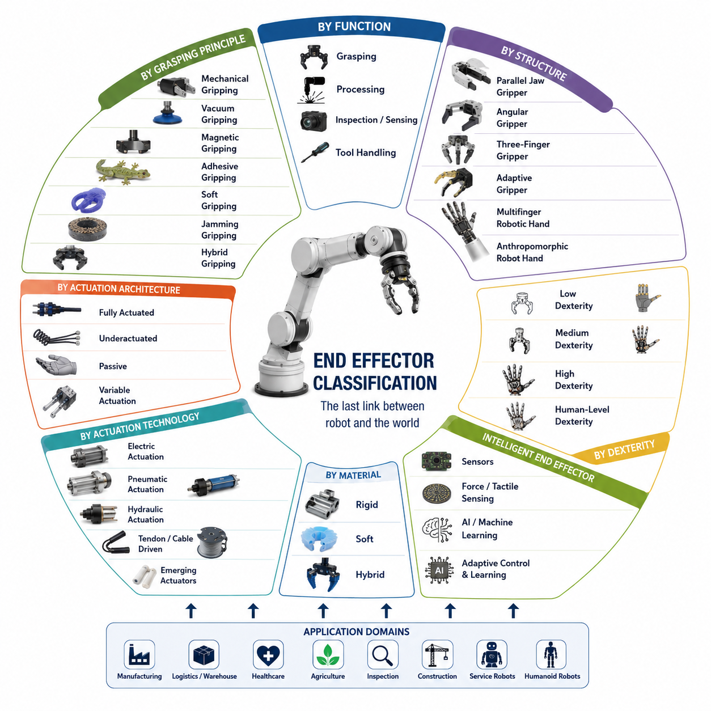
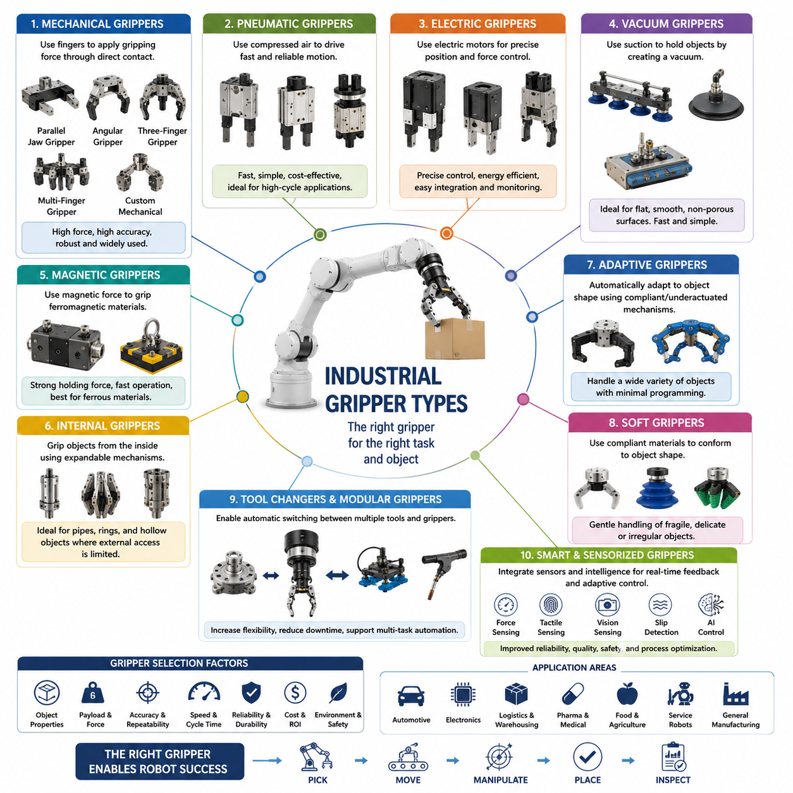
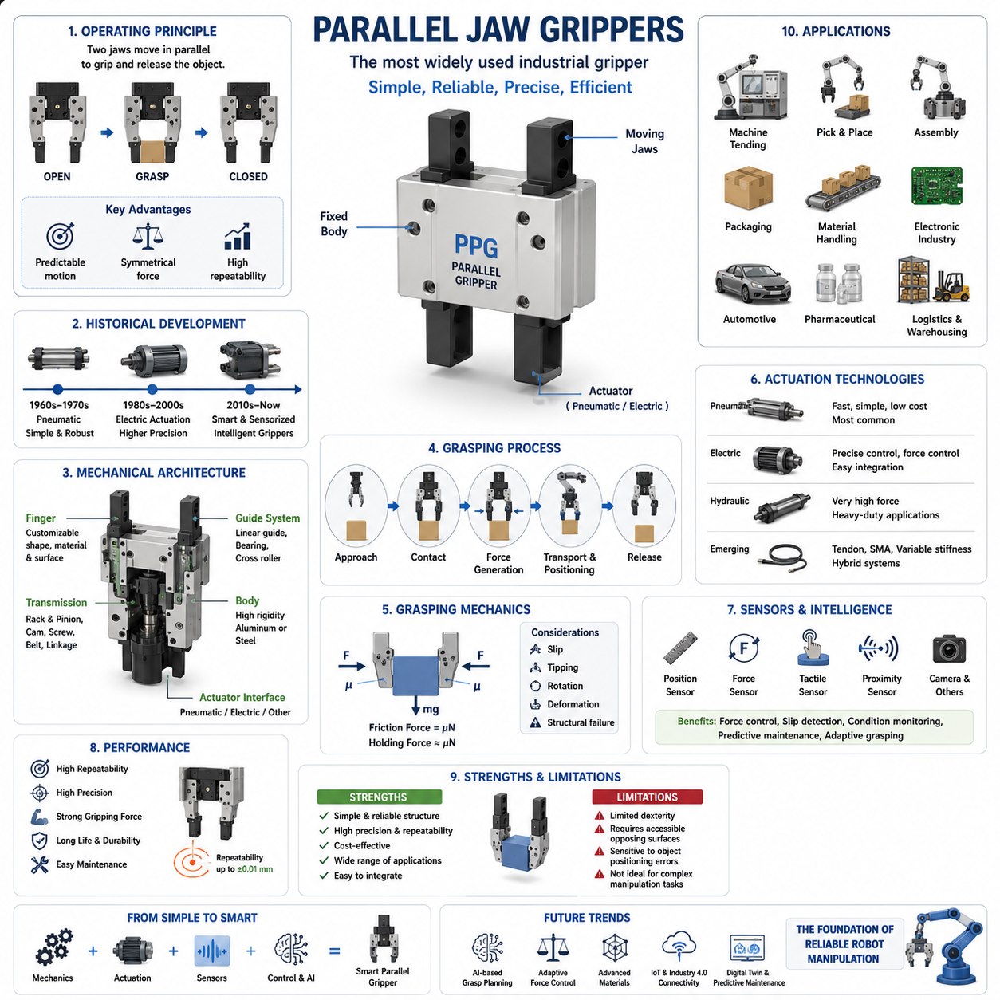
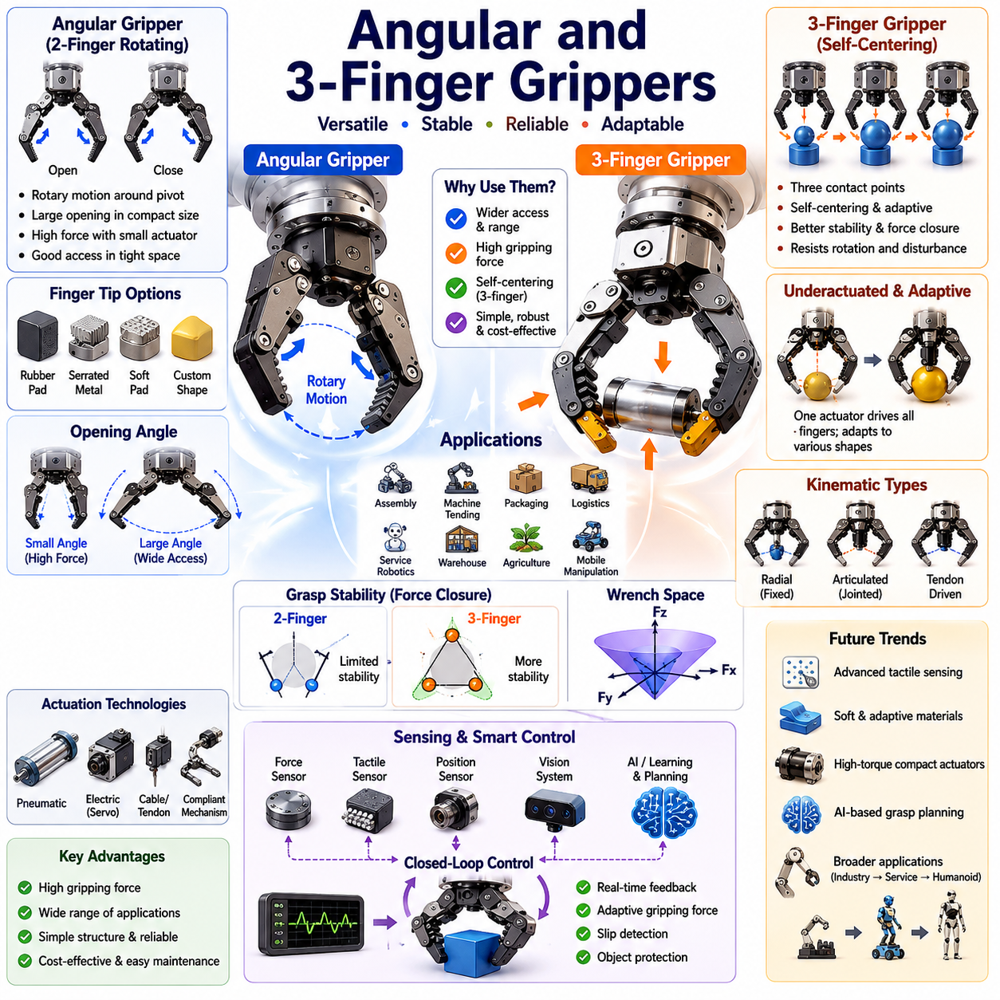
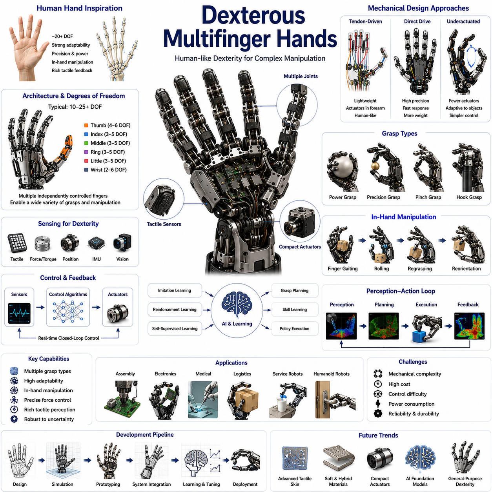
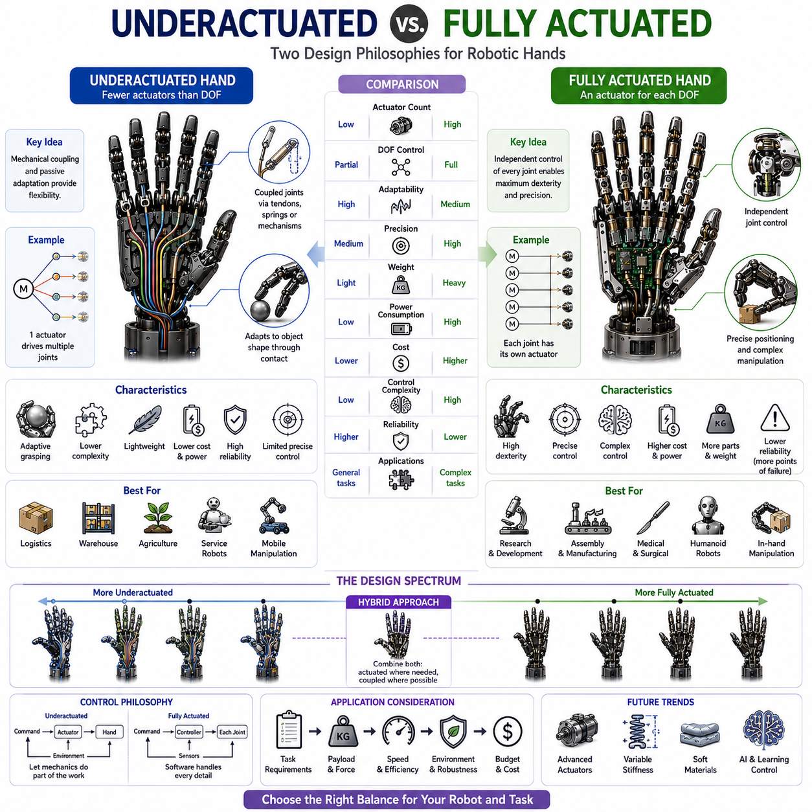
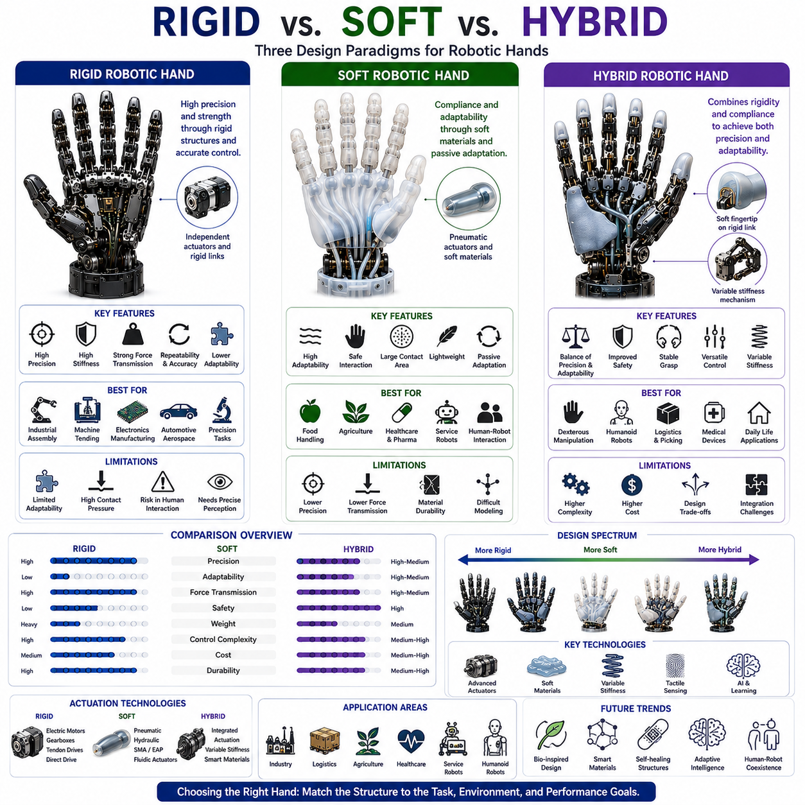
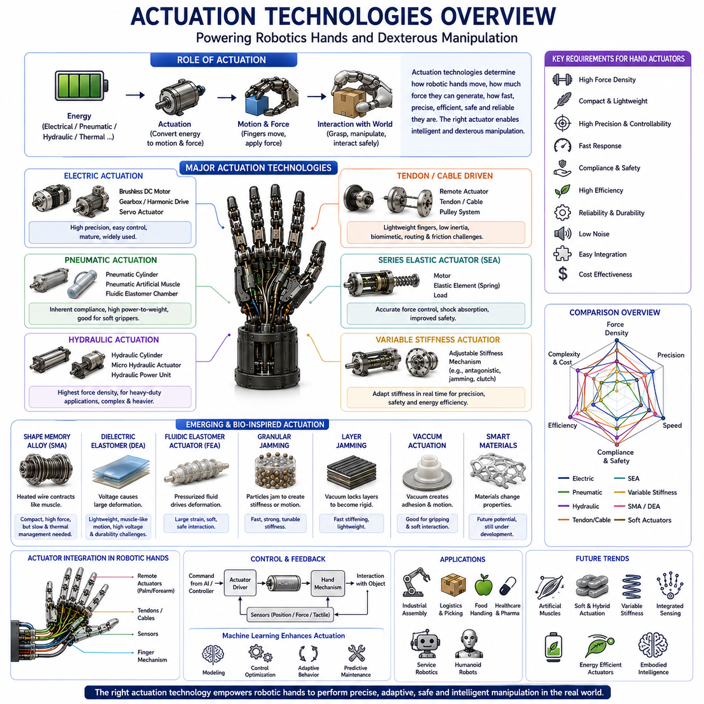
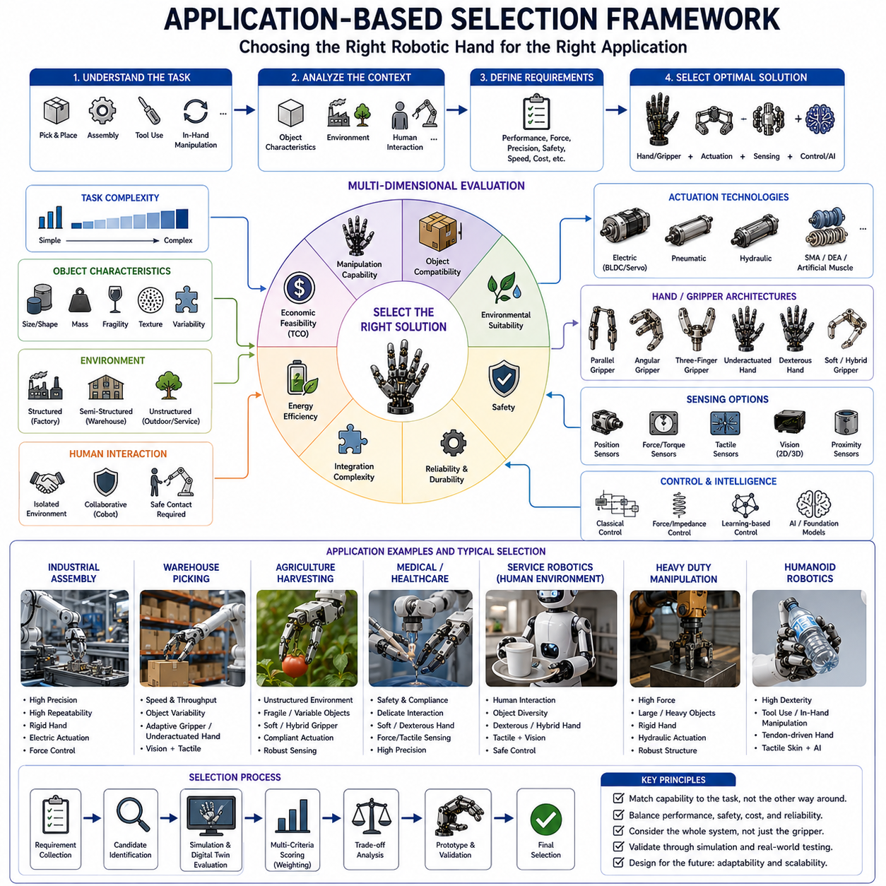
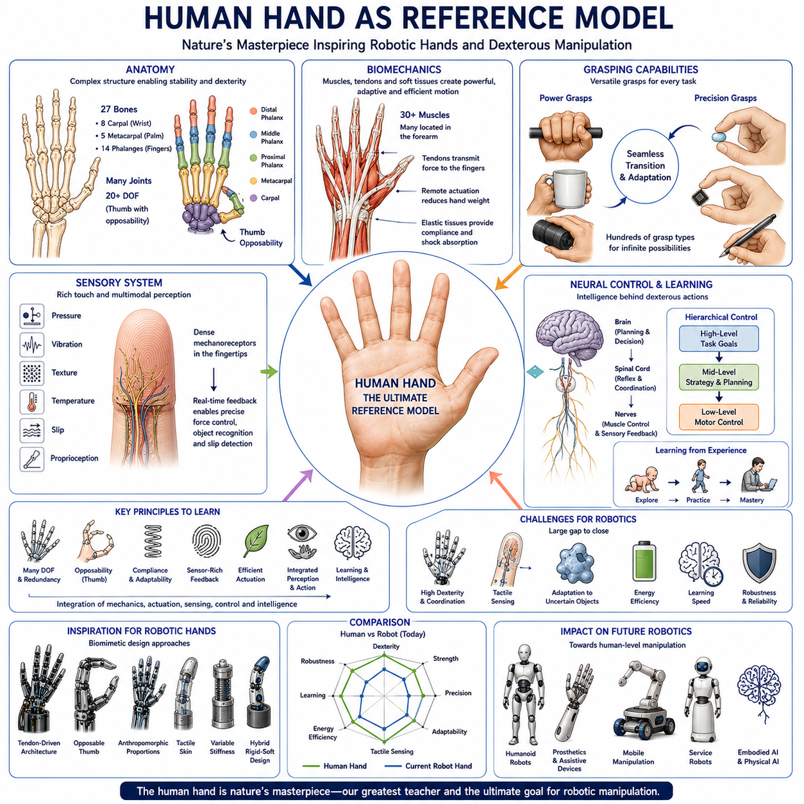

**Volume 06 Robot Hands and Dexterous Grasping**


# 01. Gripper and Hand Taxonomy

##  

## 01.01 End-Effector Classification

{width="7.268055555555556in" height="7.268055555555556in"}

Introduction

An end effector is the final component attached to the terminal link of a robotic manipulator and serves as the physical interface between the robot and its environment. While the robot arm provides positioning, orientation, and motion generation capabilities, the end effector performs the actual interaction with objects, tools, materials, and surrounding structures. In practical robotic systems, the end effector is often the most application-specific component because it directly determines what tasks the robot can perform. The same robotic arm can be transformed into a welding robot, assembly robot, inspection robot, surgical robot, warehouse picking robot, or agricultural harvesting robot simply by changing the end effector.

The concept of end effectors has evolved significantly over the history of robotics. Early industrial robots primarily employed simple mechanical grippers designed for repetitive pick-and-place operations. These devices were optimized for reliability, speed, and low cost. As robotic applications expanded into logistics, healthcare, service robotics, aerospace, agriculture, and humanoid systems, the complexity and diversity of end effectors increased dramatically. Modern end effectors may incorporate advanced sensing technologies, force control algorithms, artificial intelligence, tactile perception, adaptive mechanisms, and soft robotic structures. Consequently, understanding end effector classification provides a fundamental framework for understanding robotic manipulation as a whole.

Within the broader context of robot hand engineering, end effectors represent the starting point of all grasping and manipulation systems. Every robotic hand, gripper, tool changer, vacuum cup, welding torch, inspection probe, and dexterous hand can be considered a specialized form of end effector. The classification of these systems enables engineers to systematically compare different technologies, evaluate design tradeoffs, and select appropriate solutions for specific applications.

---

Functional Classification of End Effectors

One of the most widely used classification approaches is based on functional purpose. Under this framework, end effectors are categorized according to the primary task they perform.

Grasping end effectors are designed to acquire, hold, transport, and release objects. They constitute the largest category of robotic end effectors and include industrial grippers, robotic hands, adaptive fingers, dexterous manipulation systems, and collaborative robot grippers. These devices are commonly found in manufacturing plants, warehouses, logistics centers, hospitals, and service environments.

Process end effectors perform direct operations on workpieces rather than holding them. Examples include welding torches, painting systems, cutting tools, laser heads, drilling tools, polishing systems, dispensing devices, and fastening tools. In such systems, the robot arm functions as a positioning platform while the end effector executes the manufacturing process.

Inspection and sensing end effectors focus on information acquisition rather than physical manipulation. Cameras, LiDAR systems, ultrasonic sensors, thermal imaging devices, tactile probes, coordinate measuring instruments, and hyperspectral imaging systems belong to this category. These tools are widely used in quality control, infrastructure inspection, predictive maintenance, medical diagnostics, and autonomous navigation.

Tool-handling end effectors are specifically designed to grasp and manipulate external tools. Such systems allow robots to extend their capabilities beyond fixed functionality. Examples include screwdriver systems, wrench manipulation systems, surgical instruments, agricultural harvesting tools, and maintenance equipment. Future humanoid robots are expected to rely heavily on tool-handling end effectors because tool use significantly expands operational versatility.

---

Classification Based on Grasping Principle

Another important classification method focuses on how the end effector generates holding forces.

Mechanical gripping is the most common approach. Mechanical grippers generate grasping forces through direct physical contact between fingers and objects. This category includes parallel-jaw grippers, angular grippers, three-finger grippers, and multifinger robotic hands. Mechanical gripping offers predictable behavior, high reliability, and compatibility with a wide range of industrial tasks.

Vacuum gripping utilizes pressure differentials between the atmosphere and a suction chamber. Vacuum cups can rapidly acquire objects with smooth surfaces such as cardboard boxes, glass panels, semiconductor wafers, and packaged products. Vacuum gripping dominates many logistics and packaging applications because of its simplicity and speed.

Magnetic gripping relies on magnetic attraction. Permanent magnets and electromagnets are commonly used to manipulate steel plates, metal components, automotive parts, and construction materials. Magnetic systems provide fast engagement and release while minimizing moving mechanical parts.

Adhesive gripping employs surface adhesion mechanisms to generate attachment forces. Bio-inspired gecko adhesives, electroadhesion technologies, and specialized adhesive materials belong to this category. Such systems are particularly useful when manipulating fragile or delicate objects that cannot tolerate large gripping forces.

Soft gripping utilizes compliant materials and deformable structures to adapt naturally to object geometry. Soft robotic grippers distribute contact forces over larger surface areas, reducing the risk of damage. These devices are increasingly used in food handling, agriculture, healthcare, and consumer product logistics.

Jamming-based gripping uses granular materials or layered structures that transition between flexible and rigid states. By controlling internal pressure, these systems can conform to an object\'s shape and then stiffen to provide secure grasping. Jamming grippers have become an important research area within soft robotics.

Hybrid gripping combines multiple grasping principles. A hybrid system may integrate mechanical fingers with vacuum suction, tactile sensing, and soft contact surfaces. Such designs often provide greater robustness and flexibility than single-principle approaches.

---

Classification Based on Structural Configuration

The physical structure of an end effector significantly influences its capabilities.

Parallel jaw grippers are the most common industrial design. Two opposing fingers move linearly toward and away from each other. Their simplicity, reliability, and ease of control make them popular in automated manufacturing systems.

Angular grippers use rotational finger motion rather than linear translation. These devices provide wider opening ranges and are useful in applications requiring clearance around objects.

Three-finger grippers offer enhanced stability compared to two-finger designs. Three-point contact often provides more robust grasping performance, especially for cylindrical or irregularly shaped objects.

Adaptive grippers incorporate passive mechanisms that automatically conform to object geometry. Instead of requiring precise finger positioning, adaptive grippers exploit mechanical intelligence to simplify grasp acquisition.

Multifinger robotic hands provide independent control of multiple fingers. These systems support complex grasp configurations, in-hand manipulation, object reorientation, and dexterous task execution.

Anthropomorphic robotic hands attempt to replicate the structure and functionality of the human hand. Such systems often feature multiple fingers, articulated joints, thumb opposition, tactile sensing, and advanced control algorithms. Examples include research platforms such as Shadow Hand, Allegro Hand, Schunk SVH, and emerging humanoid robot hands.

---

Classification Based on Degree of Actuation

Actuation architecture plays a critical role in determining performance, cost, complexity, and dexterity.

Fully actuated end effectors provide an independent actuator for each controllable degree of freedom. This approach offers maximum control authority and dexterity but increases system complexity, weight, cost, and maintenance requirements.

Underactuated end effectors employ fewer actuators than mechanical degrees of freedom. Through mechanical coupling, springs, tendons, and differential mechanisms, these systems distribute forces automatically. Underactuated hands often achieve excellent adaptability while maintaining relatively simple hardware.

Passive end effectors contain little or no active actuation. Gravity-assisted grippers, passive hooks, and compliance-based mechanisms belong to this category. Although their functionality is limited, passive systems are highly reliable and energy efficient.

Variable actuation architectures dynamically adjust force distribution or mechanical stiffness. Such systems enable robots to switch between delicate manipulation and high-force grasping modes depending on task requirements.

---

Classification Based on Actuation Technology

Electric actuation dominates modern robotics due to precise controllability, high efficiency, and compatibility with digital control systems. Brushless DC motors, servo motors, direct-drive motors, and compact geared actuators are commonly used.

Pneumatic actuation remains widespread in industrial automation because compressed air systems are inexpensive, lightweight, and inherently compliant. Pneumatic grippers often achieve high speeds and low maintenance requirements.

Hydraulic actuation offers exceptional force density and robustness. Heavy industrial robots, construction machinery, mining systems, and large-scale field robots frequently rely on hydraulic technologies.

Cable-driven and tendon-driven systems draw inspiration from biological musculoskeletal structures. By placing actuators remotely, these architectures reduce distal mass and improve dynamic performance.

Shape memory alloy actuators, electroactive polymers, dielectric elastomer actuators, artificial muscles, and fluidic elastomer systems represent emerging actuation technologies that may play increasingly important roles in future robotic hands.

---

Classification Based on Material Characteristics

Rigid end effectors are constructed primarily from metallic or hard polymer components. These systems emphasize precision, repeatability, payload capacity, and durability. Most industrial grippers fall into this category.

Soft end effectors employ elastomers, silicones, flexible polymers, textiles, and compliant materials. Their ability to adapt to object geometry makes them particularly suitable for unstructured environments.

Hybrid end effectors combine rigid structural elements with soft contact surfaces. Hybrid architectures attempt to balance precision and adaptability while maintaining sufficient load-carrying capability.

Recent advances in additive manufacturing and advanced materials have enabled increasingly sophisticated hybrid designs. Many next-generation robotic hands employ variable stiffness mechanisms that dynamically transition between rigid and compliant states.

---

Classification Based on Dexterity

Dexterity refers to the ability of an end effector to manipulate objects beyond simple grasping.

Low-dexterity systems perform basic pick-and-place operations. Most industrial grippers belong to this category.

Medium-dexterity systems support adaptive grasping and limited object repositioning. Underactuated hands and adaptive grippers are common examples.

High-dexterity systems enable complex object manipulation, tool use, regrasping, rolling, pivoting, finger gaiting, and in-hand manipulation. Multifinger robotic hands represent the primary technology within this category.

Human-level dexterity remains one of the ultimate goals of robotics research. Achieving this objective requires the integration of advanced mechanics, tactile sensing, force control, machine learning, and real-time planning.

---

Intelligent End Effectors

The emergence of intelligent robotics has introduced a new generation of end effectors. Traditional devices relied primarily on position control and predefined grasp strategies. Modern intelligent end effectors incorporate perception, learning, reasoning, and adaptation capabilities.

Force sensors, torque sensors, tactile arrays, proximity sensors, depth cameras, event cameras, and slip detection systems provide rich information about object interactions. These sensors enable robots to adjust grasp forces dynamically, detect contact conditions, and respond to unexpected disturbances.

Machine learning algorithms further enhance performance by enabling robots to learn grasping strategies from data rather than relying exclusively on manually engineered rules. Reinforcement learning, imitation learning, self-supervised learning, and foundation models have demonstrated remarkable improvements in robotic manipulation capabilities.

Vision-Language-Action systems are beginning to transform end effectors into intelligent cyber-physical interfaces capable of understanding natural language instructions and translating them into physical actions. In this paradigm, the end effector becomes not merely a mechanical device but a sophisticated embodiment of robotic intelligence.

---

End Effectors in Mobile Manipulators and Humanoid Robots

In mobile manipulation systems, the end effector serves as the final link connecting autonomous navigation, perception, planning, and physical interaction. The robot base transports the manipulator to the target location, the arm positions the end effector, and the end effector performs the task itself. Consequently, the overall success of a mobile manipulator is often determined by the effectiveness of its end effector.

Humanoid robots place even greater demands on end effector design. Unlike industrial robots operating in structured environments, humanoids must interact with tools, doors, appliances, containers, switches, keyboards, and countless everyday objects. These requirements drive the development of highly dexterous hands capable of human-like manipulation.

Future humanoid systems are expected to integrate tactile sensing, force control, variable stiffness mechanisms, foundation models, world models, and advanced dexterous manipulation algorithms. Their end effectors will function as intelligent robotic hands capable of performing a wide variety of tasks within unstructured environments.

---

Conclusion

End effector classification provides a systematic framework for understanding the diverse technologies that enable robotic interaction with the physical world. Classification can be performed according to function, grasping principle, structural configuration, actuation architecture, actuation technology, material characteristics, and dexterity level. Each classification perspective reveals different design tradeoffs and application requirements.

As robotics continues to evolve toward embodied intelligence, autonomous manipulation, mobile manipulation, and humanoid systems, end effectors are becoming increasingly sophisticated. The future of robotic manipulation will depend heavily on the convergence of advanced mechanics, soft robotics, tactile sensing, artificial intelligence, and foundation models. Understanding end effector classification is therefore essential not only for selecting appropriate hardware but also for designing the next generation of intelligent robotic systems.

서론

엔드 이펙터(End Effector)는 로봇 매니퓰레이터(Manipulator)의 가장 끝단에 장착되는 장치로서, 로봇과 외부 환경을 연결하는 물리적 인터페이스 역할을 수행한다. 로봇 암(Robot Arm)이 위치와 자세를 제어하고 운동을 생성하는 역할을 담당한다면, 엔드 이펙터는 실제로 물체를 잡고, 이동시키고, 가공하고, 검사하며, 환경과 상호작용하는 역할을 수행한다. 따라서 엔드 이펙터는 로봇 시스템이 실제로 무엇을 할 수 있는지를 결정하는 핵심 구성 요소라고 할 수 있다.

동일한 로봇 암이라도 어떤 엔드 이펙터를 장착하느냐에 따라 완전히 다른 로봇 시스템으로 변화할 수 있다. 용접 토치(Welding Torch)를 장착하면 용접 로봇이 되고, 진공 그리퍼(Vacuum Gripper)를 장착하면 물류 로봇이 되며, 다지 로봇 핸드(Multifinger Robot Hand)를 장착하면 정교한 조작이 가능한 서비스 로봇 또는 휴머노이드 로봇이 된다.

로봇 산업 초기에는 단순한 산업용 그리퍼(Industrial Gripper)가 대부분이었지만, 최근에는 물류 자동화, 서비스 로봇, 의료 로봇, 농업 로봇, 우주 로봇, 휴머노이드 로봇 등이 등장하면서 엔드 이펙터의 종류와 복잡성이 급격히 증가하였다. 현대의 엔드 이펙터는 단순한 기계 장치를 넘어 촉각 센서(Tactile Sensor), 힘 센서(Force Sensor), 비전 시스템(Vision System), 인공지능(AI), 소프트 로보틱스(Soft Robotics) 기술까지 통합된 지능형 시스템으로 발전하고 있다.

따라서 엔드 이펙터를 체계적으로 분류하고 이해하는 것은 로봇 핸드(Robot Hand), 그리퍼(Gripper), 조작(Manipulation), 파지(Grasping) 기술 전반을 이해하기 위한 첫 번째 단계라 할 수 있다.

---

기능(Function)에 따른 분류

가장 일반적인 분류 방법은 엔드 이펙터가 수행하는 기능에 따른 분류이다.

파지형 엔드 이펙터(Grasping End Effector)는 물체를 잡고 이동시키며 놓는 기능을 수행한다. 산업용 그리퍼, 적응형 그리퍼(Adaptive Gripper), 로봇 핸드, 다지형 핸드(Dexterous Hand) 등이 여기에 포함된다. 제조업, 물류 자동화, 창고 시스템, 병원 물류, 서비스 로봇 분야에서 가장 널리 사용되는 유형이다.

공정형 엔드 이펙터(Process End Effector)는 물체를 잡기보다는 작업물을 직접 가공하는 역할을 수행한다. 용접 토치, 도장 장비, 절삭 공구, 연마 장치, 레이저 가공기, 드릴링 장치, 접착제 도포 장치 등이 이에 해당한다. 이러한 경우 로봇 암은 위치를 제공하는 역할을 수행하며 실제 작업은 엔드 이펙터가 담당한다.

검사 및 센싱형 엔드 이펙터(Inspection and Sensing End Effector)는 정보를 수집하는 것이 목적이다. 카메라(Camera), 라이다(LiDAR), 열화상 카메라(Thermal Camera), 초음파 센서(Ultrasonic Sensor), 검사 프로브(Inspection Probe), 계측 장비(Metrology Equipment) 등이 여기에 포함된다. 이러한 장비는 품질 검사, 시설 점검, 자율주행, 의료 진단 등에 활용된다.

공구 조작형 엔드 이펙터(Tool Handling End Effector)는 다양한 외부 공구를 잡고 사용하는 기능을 제공한다. 드라이버(Screwdriver), 렌치(Wrench), 수술 기구(Surgical Instrument), 농업용 수확 도구(Harvesting Tool) 등이 대표적인 사례이다. 특히 휴머노이드 로봇은 인간이 사용하는 공구를 그대로 활용하기 위해 이러한 기능이 필수적이다.

---

파지 원리(Grasping Principle)에 따른 분류

엔드 이펙터는 물체를 잡는 방식에 따라서도 분류할 수 있다.

기계식 파지(Mechanical Gripping)는 가장 널리 사용되는 방식이다. 손가락(Finger)과 물체 사이의 물리적 접촉을 이용하여 파지력을 생성한다. 평행 조 그리퍼(Parallel Jaw Gripper), 각도형 그리퍼(Angular Gripper), 3지 그리퍼(Three-Finger Gripper), 다지 로봇 핸드(Multifinger Hand) 등이 포함된다. 높은 신뢰성과 예측 가능한 성능 때문에 산업 현장에서 가장 많이 사용된다.

진공 파지(Vacuum Gripping)는 압력 차이를 이용하여 물체를 흡착한다. 물류 창고에서 상자를 집거나 반도체 웨이퍼를 이송하는 작업에서 널리 활용된다. 단순하고 빠르지만 표면이 거칠거나 다공성인 물체에는 적용이 어렵다.

자기 파지(Magnetic Gripping)는 자석의 힘을 이용하여 금속 물체를 잡는다. 철강 산업, 자동차 생산 공정, 금속 재활용 분야에서 많이 사용된다. 구조가 단순하며 빠른 작업이 가능하다는 장점이 있다.

접착 파지(Adhesive Gripping)는 특수 표면 재료를 이용하여 물체에 부착된다. 도마뱀붙이(Gecko)의 발 구조를 모방한 바이오 모사 기술(Bio-inspired Technology)이 대표적인 예이다. 깨지기 쉬운 물체를 다룰 때 유용하다.

소프트 파지(Soft Gripping)는 실리콘(Silicone), 엘라스토머(Elastomer), 고무 재질 등을 활용하여 물체 형상에 자연스럽게 적응한다. 과일, 채소, 의료용품과 같이 손상되기 쉬운 물체를 안전하게 취급할 수 있다.

재밍 그리퍼(Jamming Gripper)는 내부 입자(Granular Material)의 상태를 변화시켜 물체 형상에 맞게 변형된 후 단단하게 고정되는 구조를 사용한다. 소프트 로보틱스 분야에서 매우 활발하게 연구되고 있다.

하이브리드 파지(Hybrid Gripping)는 기계식, 진공식, 촉각 센싱, 소프트 구조 등을 조합하여 다양한 물체를 안정적으로 파지할 수 있도록 설계된 시스템이다.

---

구조(Structure)에 따른 분류

엔드 이펙터는 기계적 구조에 따라서도 분류된다.

평행 조 그리퍼(Parallel Jaw Gripper)는 두 개의 손가락이 직선 운동을 하면서 물체를 잡는다. 가장 단순하고 널리 사용되는 구조이다.

각도형 그리퍼(Angular Gripper)는 손가락이 회전 운동을 수행한다. 큰 개구부(Open Width)를 확보할 수 있는 장점이 있다.

3지 그리퍼(Three-Finger Gripper)는 세 개의 접촉점을 이용하여 보다 안정적인 파지를 제공한다. 원통형 물체를 잡는 데 특히 유리하다.

적응형 그리퍼(Adaptive Gripper)는 물체 형상에 따라 자동으로 변형되는 기구 구조를 가진다. 정밀한 위치 제어 없이도 다양한 물체를 파지할 수 있다.

다지 로봇 핸드(Multifinger Robotic Hand)는 여러 개의 손가락을 독립적으로 제어한다. 복잡한 파지 자세와 인핸드 조작(In-Hand Manipulation)이 가능하다.

인간형 로봇 핸드(Anthropomorphic Robot Hand)는 인간 손의 구조를 모방한다. 엄지 대향(Opposable Thumb), 다수의 관절(Joint), 촉각 센서 등을 갖추고 있으며 인간 수준의 조작 능력을 목표로 한다.

---

구동 방식(Actuation Architecture)에 따른 분류

완전 구동형(Fully Actuated) 엔드 이펙터는 모든 관절에 독립적인 액추에이터(Actuator)를 배치한다. 높은 정밀도와 조작 능력을 제공하지만 구조가 복잡하고 비용이 높다.

언더액추에이티드(Underactuated) 엔드 이펙터는 자유도보다 적은 수의 액추에이터를 사용한다. 링크(Link), 케이블(Cable), 스프링(Spring), 차동 메커니즘(Differential Mechanism)을 이용하여 힘을 자동 분배한다. 단순성과 적응성이 뛰어나 최근 산업용 로봇 핸드에서 많이 채택되고 있다.

수동형(Passive) 엔드 이펙터는 능동적인 구동 장치가 거의 없다. 후크(Hook) 형태의 그리퍼나 중력 기반 장치가 이에 해당한다.

가변 구동형(Variable Actuation)은 작업 상황에 따라 강성(Stiffness)이나 힘 전달 특성을 변화시킬 수 있는 구조를 가진다.

---

액추에이터(Actuator) 기술에 따른 분류

전기식 구동(Electric Actuation)은 현재 가장 널리 사용되는 방식이다. 브러시리스 DC 모터(BLDC Motor), 서보 모터(Servo Motor), 다이렉트 드라이브 모터(Direct Drive Motor) 등이 활용된다.

공압식 구동(Pneumatic Actuation)은 압축 공기를 이용한다. 빠른 속도와 단순한 구조 때문에 제조 현장에서 매우 널리 사용된다.

유압식 구동(Hydraulic Actuation)은 매우 높은 출력 밀도를 제공한다. 건설 로봇, 광산 로봇, 대형 산업 로봇에 적합하다.

텐던 구동(Tendon-Driven Actuation)은 인간의 힘줄(Tendon)을 모방한 구조이다. 액추에이터를 손가락 밖에 배치할 수 있어 손가락의 질량을 줄일 수 있다.

최근에는 형상기억합금(SMA), 유전체 탄성체 액추에이터(Dielectric Elastomer Actuator), 인공 근육(Artificial Muscle)과 같은 차세대 기술도 연구되고 있다.

---

재질(Material)에 따른 분류

강체형(Rigid) 엔드 이펙터는 금속과 경질 플라스틱을 사용한다. 높은 정밀도와 반복성을 제공한다.

소프트형(Soft) 엔드 이펙터는 실리콘, 고무, 탄성체 등을 사용한다. 물체 형상에 적응하는 능력이 뛰어나다.

하이브리드형(Hybrid) 엔드 이펙터는 강체 구조와 소프트 재료를 결합한다. 산업용 정밀성과 생체 적응성을 동시에 추구하는 차세대 설계 방식으로 평가받고 있다.

---

정교성(Dexterity)에 따른 분류

저정교성(Low Dexterity) 시스템은 단순한 픽앤플레이스 작업에 적합하다.

중간 정교성(Medium Dexterity) 시스템은 적응형 파지와 제한적인 물체 조작이 가능하다.

고정교성(High Dexterity) 시스템은 손가락 이동(Finger Gaiting), 재파지(Regrasping), 회전(Rolling), 피벗(Pivoting), 인핸드 조작(In-Hand Manipulation) 등을 수행할 수 있다.

인간 수준의 정교성(Human-Level Dexterity)은 현재 휴머노이드 로봇과 차세대 로봇 핸드 연구의 최종 목표 중 하나이다.

---

지능형 엔드 이펙터(Intelligent End Effector)

최근의 엔드 이펙터는 단순한 기계 장치가 아니라 지능형 시스템으로 발전하고 있다.

힘 센서(Force Sensor), 토크 센서(Torque Sensor), 촉각 배열(Tactile Array), 근접 센서(Proximity Sensor), 깊이 카메라(Depth Camera), 이벤트 카메라(Event Camera), 미끄럼 감지(Slip Detection) 기술이 통합되면서 엔드 이펙터는 물체와의 상호작용을 실시간으로 이해할 수 있게 되었다.

더 나아가 강화학습(Reinforcement Learning), 모방학습(Imitation Learning), 자기지도학습(Self-Supervised Learning), 파운데이션 모델(Foundation Model), 비전-언어-행동 모델(Vision-Language-Action Model)이 적용되면서 엔드 이펙터는 스스로 파지 전략을 학습하고 새로운 작업에 적응할 수 있게 되었다.

---

모바일 매니퓰레이터와 휴머노이드에서의 역할

모바일 매니퓰레이터(Mobile Manipulator)에서 엔드 이펙터는 자율주행, 인식, 경로 계획, 조작 기술을 연결하는 마지막 단계이다. 자율주행 플랫폼이 목표 위치에 도달하더라도 엔드 이펙터가 물체를 제대로 파지하지 못하면 전체 작업은 실패한다.

휴머노이드 로봇(Humanoid Robot)에서는 더욱 높은 수준의 기능이 요구된다. 문 손잡이, 공구, 키보드, 가전제품, 생활용품 등 인간이 사용하는 다양한 물체를 다루기 위해서는 인간 손에 가까운 정교성이 필요하다.

미래의 휴머노이드 핸드는 촉각 센싱(Tactile Sensing), 힘 제어(Force Control), 가변 강성(Variable Stiffness), 월드 모델(World Model), 파운데이션 모델(Foundation Model)을 통합한 지능형 조작 플랫폼으로 발전할 것으로 예상된다.

---

결론

엔드 이펙터 분류 체계(End Effector Classification)는 로봇이 물리적 세계와 상호작용하는 방식을 이해하기 위한 가장 기본적인 프레임워크이다. 기능, 파지 원리, 구조, 구동 방식, 액추에이터 기술, 재질, 정교성이라는 다양한 관점에서 엔드 이펙터를 분류할 수 있으며, 각 분류 체계는 서로 다른 설계 기준과 응용 분야를 설명한다.

미래의 로봇은 단순한 산업용 자동화를 넘어 임바디드 AI(Embodied AI), 모바일 매니퓰레이션(Mobile Manipulation), 휴머노이드(Humanoid), 서비스 로봇(Service Robot)으로 발전할 것이다. 이러한 변화 속에서 엔드 이펙터는 단순한 말단 장치가 아니라 로봇의 지능과 물리적 행동을 연결하는 핵심 플랫폼으로 자리 잡게 될 것이다. 따라서 엔드 이펙터 분류를 이해하는 것은 로봇 핸드, 파지 기술, 조작 기술, 그리고 차세대 지능형 로봇 시스템 전체를 이해하기 위한 필수적인 출발점이라 할 수 있다.

##  

## 01.02 Industrial Gripper Types

{width="7.268055555555556in" height="7.268055555555556in"}

Introduction

Industrial grippers are the most widely deployed category of robotic end effectors and serve as the primary interface between industrial robots and the physical objects they manipulate. In modern automation systems, the gripper is often the component that directly determines whether a robotic application succeeds or fails. Regardless of how advanced a robot arm, vision system, artificial intelligence algorithm, or motion controller may be, the robot ultimately depends on its gripper to establish reliable contact with an object and execute the intended task. For this reason, gripper technology has become one of the most important fields within robotic manipulation and industrial automation.

Industrial grippers are used throughout manufacturing, logistics, warehousing, automotive production, electronics assembly, pharmaceutical handling, food processing, semiconductor fabrication, agricultural automation, and service robotics. Their functions range from simple pick-and-place operations to highly sophisticated manipulation tasks involving fragile, deformable, irregular, or unknown objects. Over several decades of industrial robotics development, numerous gripper technologies have emerged, each optimized for specific operational requirements, object characteristics, environmental conditions, and economic constraints.

The selection of an industrial gripper is not merely a hardware decision. It influences cycle time, payload capacity, energy consumption, maintenance requirements, safety performance, system reliability, and overall return on investment. Consequently, understanding the various types of industrial grippers and their underlying operating principles is essential for robotics engineers, automation specialists, system integrators, and robot hand designers.

Within the context of robot hand taxonomy, industrial grippers represent the evolutionary foundation from which more advanced adaptive grippers, dexterous robotic hands, and intelligent manipulation systems have emerged. While future humanoid robots may employ sophisticated multifinger hands, the vast majority of industrial robots operating today continue to rely on specialized grippers optimized for efficiency, robustness, and productivity.

---

The Role of Industrial Grippers in Automation

The primary purpose of an industrial gripper is to establish secure and controllable interaction between a robot and a target object. This interaction must satisfy several requirements simultaneously. The gripper must generate sufficient holding force to prevent object loss, maintain positional stability during transport, avoid damaging the object, operate at high speed, and withstand repetitive industrial usage over extended periods.

In many industrial environments, robots perform thousands or even millions of grasping cycles per year. Under such conditions, grippers must achieve extremely high reliability. Even a small decrease in grasp success rate can result in significant production losses. Therefore, industrial gripper design places strong emphasis on mechanical simplicity, durability, repeatability, and maintainability.

Unlike human hands, which are highly versatile but mechanically complex, industrial grippers are often application-specific. A gripper designed for handling automotive components may be completely unsuitable for food products or electronic assemblies. As a result, industrial robotics has developed a broad ecosystem of specialized gripper technologies tailored to particular tasks and industries.

---

Mechanical Grippers

Mechanical grippers represent the most common type of industrial gripper. They operate by applying physical contact forces through one or more fingers that move relative to each other.

Mechanical grippers are widely adopted because they provide predictable grasping behavior, relatively simple control architectures, and compatibility with a broad range of object geometries. They are particularly effective when objects possess well-defined grasp surfaces and sufficient structural rigidity.

The most common mechanical gripper configuration is the parallel-jaw gripper. In this design, two opposing fingers move linearly toward or away from each other. Parallel-jaw grippers offer excellent repeatability, straightforward control, and high positioning accuracy. They are frequently used in machine tending, electronics assembly, precision manufacturing, and warehouse automation.

Angular grippers utilize rotational motion rather than linear translation. Their fingers rotate about pivot points, creating wider opening angles. This configuration can simplify access to objects in constrained environments and reduce mechanical complexity in certain applications.

Three-finger grippers introduce an additional contact point, improving grasp stability and force distribution. Such grippers are commonly employed for cylindrical components, pipes, containers, and irregularly shaped industrial parts.

Multi-finger industrial grippers extend this concept further by incorporating additional fingers and grasp configurations. Although more expensive and complex than traditional two-finger designs, they offer greater flexibility when handling diverse product portfolios.

Mechanical grippers remain dominant across industrial automation because of their robustness, long service life, and ability to generate substantial gripping forces.

---

Pneumatic Grippers

Pneumatic grippers utilize compressed air to generate finger motion and gripping force. They have become one of the most popular gripper technologies in factory automation due to their simplicity and low cost.

In pneumatic systems, compressed air drives pistons that translate or rotate gripper fingers. Because compressed air systems are already common in manufacturing facilities, pneumatic grippers can often be integrated with minimal infrastructure changes.

One of the major advantages of pneumatic grippers is their speed. They can achieve rapid opening and closing cycles, making them ideal for high-throughput production environments. Pneumatic actuators are also relatively lightweight and resistant to harsh industrial conditions.

Furthermore, the compressibility of air naturally introduces compliance into the system. This characteristic helps absorb minor positioning errors and reduces the likelihood of damaging sensitive components.

However, pneumatic grippers generally provide less precise force control than electric grippers. Maintaining compressed air infrastructure also introduces energy costs and maintenance requirements. Despite these limitations, pneumatic grippers continue to dominate many manufacturing sectors due to their proven reliability and economic advantages.

---

Electric Grippers

Electric grippers utilize servo motors, brushless DC motors, or other electrically driven actuators to control finger motion.

The adoption of electric grippers has increased significantly with the rise of collaborative robots and Industry 4.0 automation systems. Unlike pneumatic devices, electric grippers allow precise control of position, velocity, acceleration, and gripping force.

This level of control enables robots to handle delicate objects that would otherwise be damaged by excessive force. Electronic components, medical devices, laboratory samples, and consumer products often benefit from electric gripping technologies.

Electric grippers also facilitate advanced monitoring and diagnostics. Integrated sensors can continuously report position, force, current consumption, temperature, and health status to supervisory control systems. Such capabilities support predictive maintenance strategies and improve overall equipment effectiveness.

Another advantage is simplified infrastructure. Electric grippers require only electrical power and communication interfaces, eliminating the need for compressed air systems. This feature is particularly attractive for collaborative robots operating in flexible manufacturing environments.

As motor technology, embedded electronics, and battery systems continue to improve, electric grippers are expected to capture an increasing share of industrial automation applications.

---

Vacuum Grippers

Vacuum grippers operate using pressure differentials generated by suction cups or vacuum chambers.

These systems are exceptionally popular in logistics, packaging, semiconductor manufacturing, and material handling industries. Objects such as cardboard boxes, plastic packages, glass sheets, metal plates, and solar panels are commonly manipulated using vacuum technology.

The principal advantage of vacuum gripping lies in its simplicity. A single suction cup can often grasp objects that would otherwise require complex mechanical fingers. Vacuum systems also enable rapid acquisition and release operations, supporting high-speed automation.

Vacuum grippers perform best on relatively smooth, flat, and non-porous surfaces. Their effectiveness decreases when handling porous materials, irregular geometries, highly textured surfaces, or objects with significant air leakage paths.

To address these limitations, modern vacuum systems often incorporate multiple suction cups, adaptive vacuum arrays, vacuum sensors, and intelligent pressure control algorithms. Such enhancements improve reliability when dealing with diverse object populations.

Warehouse automation and e-commerce fulfillment systems increasingly rely on advanced vacuum grippers because they can accommodate large product variations while maintaining high throughput.

---

Magnetic Grippers

Magnetic grippers employ magnetic fields to generate holding forces.

Permanent magnetic grippers provide continuous holding force without requiring external power. Electromagnetic grippers generate controllable magnetic fields that can be activated or deactivated as needed.

Magnetic gripping is particularly effective for handling ferromagnetic materials such as steel sheets, automotive components, structural beams, pipes, and metal workpieces.

One of the greatest advantages of magnetic grippers is their ability to achieve secure attachment without requiring complex mechanical alignment. Grasping and releasing operations can be performed extremely quickly, contributing to high productivity.

However, magnetic grippers are limited to compatible materials and may encounter challenges when handling non-ferrous metals, composite materials, plastics, or organic products.

Nevertheless, in industries involving steel processing, automotive manufacturing, and heavy industrial production, magnetic gripping remains highly effective.

---

Internal Grippers

Internal grippers secure objects by expanding inside a cavity rather than compressing from the outside.

This approach is particularly useful when external surfaces are inaccessible or unsuitable for conventional grasping. Examples include pipes, hollow cylinders, bearing races, containers, and tubular structures.

Internal gripping mechanisms often employ expandable fingers, inflatable elements, mechanical wedges, or pneumatic expansion systems.

Because the gripping force is applied internally, the external geometry of the object remains unobstructed. This characteristic can simplify assembly operations and improve accessibility in confined spaces.

Internal grippers are widely used in automotive assembly, machinery manufacturing, aerospace production, and industrial component handling.

---

Adaptive Grippers

Adaptive grippers represent an important transition between traditional industrial grippers and advanced robotic hands.

Unlike rigid grippers that require precise alignment, adaptive grippers automatically conform to object geometry. This capability is typically achieved through underactuated mechanisms, compliant joints, flexible fingers, or passive mechanical couplings.

Adaptive grippers significantly reduce the complexity of grasp planning and object localization. Even when object position estimates contain errors, adaptive fingers can compensate through mechanical self-adjustment.

The Robotiq adaptive gripper family is a well-known example of this technology. Such systems have become popular in collaborative robotics, warehouse automation, machine tending, and research applications.

Adaptive grippers are particularly valuable in environments where object variability is high and traditional automation methods become difficult to implement.

---

Soft Grippers

Soft grippers utilize compliant materials such as silicone, elastomers, rubber composites, and flexible polymers.

Rather than imposing rigid contact constraints, soft grippers deform around object surfaces. This property enables them to distribute forces over larger contact areas and reduce local pressure concentrations.

Soft grippers excel when handling fragile items such as fruits, vegetables, pharmaceuticals, laboratory samples, consumer products, and medical instruments.

Recent advances in soft robotics have introduced pneumatically actuated fingers, jamming mechanisms, shape-changing structures, and bio-inspired gripping technologies.

Although soft grippers generally sacrifice some positioning precision and payload capacity, they offer unmatched adaptability and safety in many applications.

The rapid growth of agricultural automation and food robotics has accelerated interest in soft gripping technologies.

---

Tool Changers and Modular Grippers

Modern industrial robots increasingly employ automatic tool changers that allow multiple grippers to be used on a single robot.

Tool changers enable robots to switch between mechanical grippers, vacuum systems, inspection tools, welding torches, dispensing systems, and specialized end effectors during operation.

This modular approach dramatically increases system flexibility and supports multi-purpose robotic workcells.

In advanced manufacturing environments, automatic tool changing reduces downtime, improves equipment utilization, and enables rapid adaptation to changing production requirements.

The combination of modular grippers, intelligent sensors, and flexible software architectures is becoming a defining characteristic of next-generation industrial automation systems.

---

Smart and Sensorized Grippers

The latest generation of industrial grippers integrates sensing, communication, and intelligence directly into the end effector.

Force sensors, torque sensors, tactile arrays, proximity sensors, cameras, temperature sensors, and vibration sensors provide real-time information regarding grasp quality and object interaction.

These capabilities enable dynamic force adjustment, slip detection, object recognition, condition monitoring, and autonomous adaptation.

Artificial intelligence algorithms further enhance performance by allowing robots to learn optimal grasp strategies from experience. Machine learning, reinforcement learning, foundation models, and vision-language-action architectures are beginning to influence industrial gripper design.

As a result, industrial grippers are evolving from simple mechanical devices into intelligent cyber-physical systems capable of perception, decision-making, and adaptive manipulation.

---

Future Trends

The future of industrial grippers lies in the convergence of mechanical engineering, sensing technologies, artificial intelligence, and advanced materials.

Traditional grippers optimized for single applications will increasingly be complemented by adaptive, intelligent, and multifunctional systems. Electric actuation, soft robotics, tactile sensing, and learning-based control are expected to become more prevalent.

Future factories will likely employ grippers capable of handling thousands of different products with minimal reconfiguration. These systems will combine dexterity, perception, force control, and cognitive reasoning to achieve levels of flexibility previously associated only with human workers.

Industrial grippers therefore represent not only a mature automation technology but also a critical foundation for the next generation of autonomous manipulation systems, collaborative robots, mobile manipulators, and humanoid robotics. Their continued evolution will play a central role in the future of intelligent manufacturing and embodied artificial intelligence.

서론

산업용 그리퍼(Industrial Gripper)는 산업용 로봇에서 가장 널리 사용되는 엔드 이펙터(End Effector) 유형이며, 로봇과 작업 대상 물체를 연결하는 핵심 인터페이스 역할을 수행한다. 현대 자동화 시스템에서 그리퍼는 단순한 부품이 아니라 전체 시스템의 성공 여부를 결정하는 중요한 요소이다. 아무리 우수한 로봇 암(Robot Arm), 비전 시스템(Vision System), 인공지능(AI), 모션 제어(Motion Control) 기술이 적용되어 있더라도, 최종적으로 물체를 안정적으로 잡고 작업을 수행하는 것은 그리퍼의 역할이다.

산업용 그리퍼는 제조업, 물류, 창고 자동화, 자동차 생산, 전자제품 조립, 제약 산업, 식품 가공, 반도체 생산, 농업 자동화 및 서비스 로봇 분야에 이르기까지 광범위하게 사용된다. 단순한 픽앤플레이스(Pick-and-Place) 작업부터 정밀 조립, 포장, 검사, 분류, 이송 및 복잡한 조작 작업까지 다양한 기능을 수행한다.

산업용 그리퍼는 수십 년간의 자동화 기술 발전 과정에서 매우 다양한 형태로 발전해 왔다. 각각의 그리퍼는 특정 산업 환경과 물체 특성, 생산성 요구사항 및 경제적 조건에 맞추어 최적화되어 있다. 따라서 그리퍼의 종류와 특징을 이해하는 것은 로봇 시스템 설계, 자동화 설비 구축 및 차세대 로봇 핸드 개발에 있어 매우 중요한 기초 지식이다.

로봇 핸드(Robot Hand)의 발전 관점에서 보면 산업용 그리퍼는 적응형 그리퍼(Adaptive Gripper), 소프트 그리퍼(Soft Gripper), 다지 로봇 핸드(Dexterous Hand), 휴머노이드 핸드(Humanoid Hand)의 출발점이 되는 기술이다. 미래에는 인간 손과 유사한 정교한 로봇 핸드가 보편화될 가능성이 높지만, 현재 산업 현장의 대부분은 여전히 산업용 그리퍼를 중심으로 운영되고 있다.

---

자동화 시스템에서 산업용 그리퍼의 역할

산업용 그리퍼의 기본 목적은 로봇과 물체 사이에 안정적이고 제어 가능한 접촉을 형성하는 것이다.

이를 위해 그리퍼는 여러 가지 조건을 동시에 만족해야 한다. 충분한 파지력(Gripping Force)을 생성하여 물체가 떨어지지 않도록 해야 하며, 이동 중에도 안정성을 유지해야 한다. 또한 물체를 손상시키지 않아야 하고, 빠른 작업 속도를 제공해야 하며, 수백만 회 이상의 반복 동작에도 견딜 수 있는 내구성을 확보해야 한다.

대부분의 생산 현장에서 로봇은 하루 수천 회에서 수만 회의 파지 작업을 수행한다. 따라서 산업용 그리퍼는 매우 높은 신뢰성을 요구받는다. 파지 성공률이 단 몇 퍼센트만 감소하더라도 생산성 저하와 품질 문제로 이어질 수 있기 때문이다.

인간의 손은 매우 범용적이지만 구조가 복잡하다. 반면 산업용 그리퍼는 특정 작업에 최적화되어 있기 때문에 상대적으로 단순하면서도 높은 효율을 제공한다. 자동차 부품을 잡는 그리퍼와 식품을 다루는 그리퍼는 완전히 다른 구조를 가지며, 각각의 목적에 맞추어 설계된다.

---

기계식 그리퍼 (Mechanical Gripper)

기계식 그리퍼(Mechanical Gripper)는 가장 널리 사용되는 산업용 그리퍼 유형이다.

기계식 그리퍼는 손가락(Finger)을 이용하여 물체에 직접 접촉하고 파지력을 생성한다. 구조가 단순하며 제어가 쉽고 높은 신뢰성을 제공하기 때문에 대부분의 산업 자동화 현장에서 사용된다.

가장 대표적인 형태는 평행 조 그리퍼(Parallel Jaw Gripper)이다. 두 개의 손가락이 직선 운동을 수행하면서 물체를 양쪽에서 잡는다. 높은 반복 정밀도와 간단한 제어 구조를 제공하며 기계 가공, 전자 조립, 물류 자동화 등에서 널리 사용된다.

각도형 그리퍼(Angular Gripper)는 손가락이 회전 운동을 수행한다. 큰 개구 범위(Open Width)를 확보할 수 있어 협소한 공간에서 유리하다.

3지 그리퍼(Three-Finger Gripper)는 세 개의 손가락을 사용하여 보다 안정적인 파지를 제공한다. 원통형 부품이나 불규칙한 형상의 부품을 다룰 때 효과적이다.

다지 그리퍼(Multi-Finger Gripper)는 더 많은 손가락을 사용하여 다양한 파지 형태를 제공한다. 구조는 복잡하지만 유연성이 높다.

기계식 그리퍼는 높은 파지력, 긴 수명, 우수한 신뢰성을 제공하기 때문에 현재까지도 산업 자동화의 주력 기술로 사용되고 있다.

---

공압 그리퍼 (Pneumatic Gripper)

공압 그리퍼(Pneumatic Gripper)는 압축 공기를 이용하여 손가락을 구동한다.

공압 시스템은 제조 현장에서 이미 널리 사용되고 있기 때문에 추가적인 인프라 구축 비용이 적다. 또한 구조가 단순하고 비용이 저렴하여 매우 높은 보급률을 가지고 있다.

공압 그리퍼의 가장 큰 장점은 빠른 동작 속도이다. 매우 짧은 시간 안에 열고 닫을 수 있기 때문에 대량 생산 환경에 적합하다.

압축 공기의 특성상 자연스러운 탄성(Compliance)이 존재하기 때문에 위치 오차를 어느 정도 흡수할 수 있으며 민감한 부품의 손상을 줄이는 데도 도움이 된다.

반면 정밀한 힘 제어는 전동 그리퍼(Electric Gripper)에 비해 어렵다. 또한 압축 공기 설비의 유지보수 비용과 에너지 소비가 발생한다.

그럼에도 불구하고 공압 그리퍼는 비용 대비 성능이 뛰어나며 현재도 자동차 산업과 일반 제조업에서 가장 널리 사용되는 그리퍼 중 하나이다.

---

전동 그리퍼 (Electric Gripper)

전동 그리퍼(Electric Gripper)는 서보 모터(Servo Motor) 또는 브러시리스 DC 모터(BLDC Motor)를 이용하여 구동된다.

최근 협동로봇(Collaborative Robot)과 스마트 팩토리(Smart Factory)의 확산으로 전동 그리퍼의 사용이 급격히 증가하고 있다.

전동 그리퍼는 위치(Position), 속도(Velocity), 가속도(Acceleration), 파지력(Gripping Force)을 정밀하게 제어할 수 있다는 장점이 있다.

이러한 특성 덕분에 전자부품, 의료기기, 반도체, 정밀 기계 부품과 같이 민감한 제품을 안전하게 취급할 수 있다.

또한 내부 센서를 통해 힘, 전류, 온도, 위치 상태를 실시간으로 모니터링할 수 있으며 예지보전(Predictive Maintenance)에도 활용될 수 있다.

전동 그리퍼는 별도의 공압 설비가 필요하지 않기 때문에 설치가 간편하며 Industry 4.0 환경과의 연동성이 우수하다.

---

진공 그리퍼 (Vacuum Gripper)

진공 그리퍼(Vacuum Gripper)는 흡착력을 이용하여 물체를 파지한다.

주로 물류 자동화, 포장 공정, 반도체 제조, 유리 제조, 태양광 패널 생산 등에 사용된다.

진공 흡착 방식은 매우 단순하면서도 효과적이다. 단 하나의 흡착컵(Suction Cup)만으로도 큰 물체를 안정적으로 이동시킬 수 있다.

상자, 유리판, 플라스틱 시트, 금속 판재와 같이 평평한 표면을 가진 물체에 특히 효과적이다.

그러나 다공성 물질, 거친 표면, 불규칙한 형상의 물체에서는 성능이 저하될 수 있다.

최근에는 다중 흡착컵(Multi-Suction Cup), 적응형 진공 배열(Adaptive Vacuum Array), 압력 센서 기반 제어 기술이 개발되어 적용 범위가 크게 확대되고 있다.

전자상거래(E-Commerce) 물류센터에서는 수천 종류의 상품을 처리하기 위해 진공 그리퍼가 핵심 기술로 활용되고 있다.

---

자기 그리퍼 (Magnetic Gripper)

자기 그리퍼(Magnetic Gripper)는 자석의 힘을 이용하여 물체를 잡는다.

영구자석(Permanent Magnet) 또는 전자석(Electromagnet)을 사용하며 철강 산업, 자동차 생산, 금속 가공 공정에서 매우 널리 사용된다.

자기 그리퍼는 복잡한 기계 구조 없이도 매우 강한 파지력을 제공한다.

또한 물체에 빠르게 접근하여 즉시 부착할 수 있으므로 작업 시간이 매우 짧다.

그러나 철(Fe) 계열의 자성체에만 사용할 수 있다는 한계가 있다.

---

내부 파지형 그리퍼 (Internal Gripper)

내부 파지형 그리퍼(Internal Gripper)는 물체 외부가 아니라 내부 공간을 이용하여 고정한다.

파이프, 원통형 부품, 베어링(Bearing), 중공 구조물(Hollow Structure) 등을 다룰 때 사용된다.

확장형 손가락(Expandable Finger), 공압 팽창 장치(Pneumatic Expansion Mechanism), 웨지(Wedge) 구조 등을 사용하여 내부에서 바깥 방향으로 힘을 가한다.

이 방식은 외부 표면을 자유롭게 사용할 수 있기 때문에 조립 공정에서 매우 유용하다.

---

적응형 그리퍼 (Adaptive Gripper)

적응형 그리퍼(Adaptive Gripper)는 전통적인 산업용 그리퍼와 로봇 핸드 사이의 중간 단계에 해당한다.

이들은 물체 형상에 자동으로 적응할 수 있도록 설계되어 있다.

언더액추에이티드 구조(Underactuated Structure), 수동 링크(Passive Linkage), 탄성 요소(Elastic Element) 등을 활용하여 물체를 자연스럽게 감싼다.

정확한 위치 제어 없이도 다양한 형상의 물체를 파지할 수 있어 물류 자동화와 협동로봇 분야에서 매우 인기가 높다.

대표적인 예로는 Robotiq의 적응형 그리퍼 제품군이 있다.

---

소프트 그리퍼 (Soft Gripper)

소프트 그리퍼는 실리콘(Silicone), 엘라스토머(Elastomer), 고무(Rubber)와 같은 유연한 재료를 사용한다.

물체 표면을 따라 자연스럽게 변형되므로 접촉 면적이 넓어지고 국부 압력이 감소한다.

과일, 채소, 제약 제품, 의료 기구와 같이 쉽게 손상되는 물체를 다루기에 적합하다.

최근 소프트 로보틱스(Soft Robotics)의 발전과 함께 공압식 소프트 핑거(Pneumatic Soft Finger), 재밍 그리퍼(Jamming Gripper), 생체 모사형 그리퍼(Bio-inspired Gripper)가 활발히 연구되고 있다.

농업 로봇과 식품 산업에서는 소프트 그리퍼가 핵심 기술로 자리 잡고 있다.

---

툴 체인저와 모듈형 그리퍼

최신 산업용 로봇은 자동 툴 체인저(Automatic Tool Changer)를 사용하여 여러 종류의 그리퍼를 교체하면서 작업할 수 있다.

하나의 로봇이 기계식 그리퍼, 진공 그리퍼, 검사 장비, 용접 토치, 접착제 도포 장치 등을 자동으로 교체하여 사용할 수 있다.

이러한 모듈형 구조(Modular Architecture)는 생산 설비의 유연성을 크게 향상시키며 다품종 소량 생산 환경에 적합하다.

---

지능형 그리퍼 (Smart Gripper)

최신 산업용 그리퍼는 센서와 인공지능을 통합한 지능형 시스템으로 발전하고 있다.

힘 센서, 토크 센서, 촉각 센서, 근접 센서, 카메라, 온도 센서 등이 내장되어 파지 상태를 실시간으로 모니터링한다.

이를 통해 미끄럼 감지(Slip Detection), 물체 인식(Object Recognition), 자동 힘 조절(Automatic Force Adjustment), 상태 진단(Condition Monitoring)이 가능해진다.

더 나아가 강화학습(Reinforcement Learning), 머신러닝(Machine Learning), 파운데이션 모델(Foundation Model), 비전-언어-행동 모델(Vision-Language-Action Model)이 적용되면서 그리퍼는 단순한 기계 장치를 넘어 지능형 사이버 물리 시스템(Intelligent Cyber-Physical System)으로 진화하고 있다.

---

미래 전망

산업용 그리퍼의 미래는 기계공학(Mechanical Engineering), 센서 기술(Sensing Technology), 인공지능(AI), 첨단 재료공학(Material Science)의 융합 방향으로 발전하고 있다.

과거에는 특정 작업에 최적화된 전용 그리퍼가 주류였다면, 미래에는 다양한 물체를 처리할 수 있는 적응형, 지능형, 다기능 그리퍼가 더욱 보편화될 것이다.

전동 구동(Electric Actuation), 소프트 로보틱스(Soft Robotics), 촉각 센싱(Tactile Sensing), 학습 기반 제어(Learning-Based Control)는 앞으로 산업용 그리퍼 기술 발전의 핵심 요소가 될 것으로 예상된다.

미래의 공장에서는 하나의 그리퍼가 수천 종류의 제품을 별도의 재설정 없이 처리할 수 있을 것으로 기대된다. 이러한 시스템은 인간 수준의 유연성, 인식 능력, 힘 제어 능력, 추론 능력을 갖춘 차세대 조작 플랫폼으로 발전할 것이다.

결국 산업용 그리퍼는 단순한 자동화 장치를 넘어 모바일 매니퓰레이터(Mobile Manipulator), 휴머노이드 로봇(Humanoid Robot), 임바디드 AI(Embodied AI)의 핵심 기반 기술로 자리매김하게 될 것이다.

##  

## 01.03 Parallel Jaw Grippers

{width="7.268055555555556in" height="7.268055555555556in"}

Parallel jaw grippers are the most widely used industrial robotic grippers and represent the foundation of modern robotic manipulation. Their popularity stems from a simple yet highly effective operating principle: two opposing fingers move in parallel toward or away from each other to grasp and release objects. Despite the emergence of adaptive grippers, soft robotic systems, multifinger dexterous hands, and artificial intelligence-driven manipulation technologies, parallel jaw grippers continue to dominate industrial automation due to their reliability, simplicity, precision, and economic efficiency.

In manufacturing environments, the majority of pick-and-place operations, machine tending applications, assembly processes, packaging systems, and material handling tasks rely on parallel jaw grippers. Their straightforward mechanical architecture allows them to perform repetitive operations with extremely high repeatability while maintaining relatively low cost and maintenance requirements. As a result, parallel jaw grippers have become a standard component in factories around the world.

Within the broader taxonomy of robot hands and end effectors, parallel jaw grippers occupy an important position. They represent the baseline against which more advanced grasping technologies are often evaluated. Understanding their design principles, kinematics, force generation mechanisms, sensing integration, and application domains provides essential knowledge for anyone involved in robotic manipulation, automation engineering, or robot hand development.

Although parallel jaw grippers appear mechanically simple, their engineering involves numerous considerations related to grasp stability, actuator selection, payload capacity, precision control, durability, environmental resistance, and system integration. Modern parallel grippers are increasingly incorporating sensors, embedded intelligence, and adaptive control capabilities, enabling them to remain relevant even as robotics advances toward more sophisticated manipulation systems.

---

Fundamental Operating Principle

The defining characteristic of a parallel jaw gripper is that its fingers move along parallel trajectories during opening and closing operations. Unlike angular grippers, whose fingers rotate about pivot points, parallel jaw grippers maintain a constant orientation throughout their motion.

This seemingly simple behavior provides several important advantages. First, the contact surfaces remain aligned with the object during the entire grasping process. Second, the grasping geometry is highly predictable, simplifying robot programming and grasp planning. Third, the generated gripping forces are typically applied symmetrically, improving grasp stability.

During operation, the fingers move inward until they establish contact with the target object. Continued actuator motion generates normal forces at the contact points. These forces, combined with friction between the finger surfaces and the object, create the holding capability necessary to prevent slipping and object loss.

The grasping process can generally be divided into object approach, contact establishment, force generation, object transport, positioning, and release. Each phase requires careful coordination between robot motion and gripper control to achieve reliable operation.

Because the finger motion remains linear and parallel, engineers can easily predict object positions after grasping. This predictability contributes significantly to the widespread adoption of parallel jaw grippers in precision manufacturing applications.

---

Historical Development

The origins of parallel jaw grippers can be traced back to early industrial automation systems developed during the rise of factory robotics in the 1960s and 1970s. At that time, automation engineers sought simple mechanisms capable of performing repetitive handling operations.

Early designs utilized pneumatic cylinders and basic linkage systems. These grippers were robust, inexpensive, and easy to maintain. As industrial robots became more common, parallel jaw grippers evolved to support higher precision, greater payloads, and more demanding operating conditions.

The introduction of servo-controlled electric actuators represented a major milestone in gripper development. Electric grippers enabled precise position control, force regulation, and programmable grasp strategies. This advancement expanded the range of applications beyond traditional manufacturing and into electronics assembly, medical device production, and collaborative robotics.

Today, parallel jaw grippers are available in a wide variety of sizes, force capacities, environmental ratings, and actuation technologies. Manufacturers offer miniature grippers for semiconductor handling, heavy-duty models for automotive production, hygienic designs for food processing, and sensorized systems for Industry 4.0 environments.

---

Mechanical Architecture

The mechanical architecture of a parallel jaw gripper is centered around the finger guidance mechanism. This subsystem ensures that the fingers move linearly and remain parallel throughout the grasping motion.

Several guidance technologies are commonly employed. Sliding guides represent the simplest solution and are often used in low-cost applications. Linear bearings provide higher precision and reduced friction. Cross-roller guides offer excellent stiffness and positioning accuracy for demanding industrial environments.

The fingers themselves are usually attached to moving carriages connected to an actuator through mechanical transmission elements. These transmissions may include rack-and-pinion mechanisms, wedge drives, cam systems, ball screws, lead screws, belts, or linkage arrangements.

Finger design is a particularly important aspect of gripper engineering. The fingers constitute the primary contact interface with the object. Their geometry, material selection, surface finish, and compliance characteristics directly influence grasp quality.

Many industrial applications employ custom finger designs tailored to specific products. These fingers may incorporate soft pads, rubber coatings, textured surfaces, or specialized geometries to improve contact stability and reduce object damage.

Structural rigidity is another key consideration. Excessive finger deflection can degrade positioning accuracy and reduce grasp reliability. Therefore, engineers must carefully balance weight, strength, stiffness, and manufacturing cost during the design process.

---

Actuation Technologies

Parallel jaw grippers can be actuated using several different technologies.

Pneumatic actuation remains the most common approach in industrial environments. Compressed air drives pistons connected to the finger mechanism. Pneumatic grippers offer high speed, simplicity, low cost, and robust operation. Their widespread adoption is supported by the availability of compressed air infrastructure in most factories.

Electric actuation is becoming increasingly popular, particularly in collaborative robotics and flexible automation systems. Servo motors and brushless DC motors provide precise control of position, velocity, and gripping force. Electric grippers also support advanced diagnostics and data collection.

Hydraulic actuation is typically reserved for heavy-duty applications requiring extremely high gripping forces. Construction robotics, mining systems, and large industrial manipulators may employ hydraulic grippers when pneumatic or electric alternatives cannot generate sufficient force.

Emerging technologies include tendon-driven systems, shape-memory alloy actuators, variable-stiffness mechanisms, and hybrid actuation architectures. Although less common in industrial environments, these technologies are actively being explored for future robotic hands and advanced manipulation systems.

---

Grasping Mechanics

The performance of a parallel jaw gripper is fundamentally governed by contact mechanics and friction.

When a gripper grasps an object, each finger generates a normal force at the contact interface. These normal forces create frictional forces proportional to the coefficient of friction between the finger surface and the object.

For a simple two-finger grasp, the maximum achievable holding force can be approximated by the product of normal force and friction coefficient. Consequently, finger materials and surface treatments play a significant role in grasp stability.

Engineers must consider multiple failure modes when designing grasp strategies. These include slipping, tipping, rotation, deformation, and structural failure. Proper finger placement and force distribution are essential for preventing such failures.

In many applications, the gripper must accommodate variations in object size, weight, center of gravity, and surface properties. This requirement motivates the integration of force sensing and adaptive control capabilities.

The study of grasp mechanics has evolved into a sophisticated field involving contact models, friction cone analysis, grasp wrench spaces, force closure theory, and grasp quality metrics. Even though parallel jaw grippers appear simple, their behavior can be analyzed using advanced theoretical frameworks developed within robotic grasping research.

---

Precision and Repeatability

One of the greatest strengths of parallel jaw grippers is their ability to achieve exceptional repeatability.

In manufacturing environments, repeatability often matters more than absolute accuracy. A gripper capable of consistently positioning objects within a few hundredths of a millimeter can significantly improve assembly quality and reduce production defects.

Several factors contribute to repeatability. Precision guidance systems minimize mechanical play. High-quality actuators provide consistent motion profiles. Structural rigidity reduces deformation under load. Sensor feedback enables closed-loop control.

Modern industrial parallel grippers can achieve positioning repeatability measured in micrometers. Such performance is essential for semiconductor manufacturing, electronics assembly, optical systems production, and medical device fabrication.

The ability to repeatedly execute identical grasping motions is one of the primary reasons parallel jaw grippers remain indispensable in industrial automation.

---

Force Control

Traditional parallel jaw grippers operated primarily in open-loop mode, applying a fixed force regardless of object characteristics.

Modern grippers increasingly incorporate force control capabilities. Integrated force sensors, motor current monitoring, strain gauges, and torque estimation algorithms enable precise regulation of gripping forces.

Force control is particularly important when handling fragile objects. Excessive force may damage electronic components, medical devices, food products, or delicate assemblies. Insufficient force may result in object slippage.

Advanced force control strategies continuously adjust gripping forces based on sensor feedback. Some systems implement adaptive grasping algorithms that automatically determine optimal force levels for different objects.

The integration of force control transforms the gripper from a simple mechanical device into an intelligent manipulation component capable of responding dynamically to changing conditions.

---

Sensor Integration

Modern parallel jaw grippers increasingly function as sensor platforms rather than purely mechanical devices.

Position sensors monitor finger displacement and opening width. Force sensors measure contact forces. Proximity sensors detect approaching objects. Tactile sensors provide detailed information regarding contact conditions.

Some advanced grippers incorporate miniature cameras, temperature sensors, accelerometers, and vibration sensors. These devices support condition monitoring, predictive maintenance, object recognition, and grasp quality assessment.

Sensor integration is particularly important for autonomous manipulation systems operating in unstructured environments. Robots must be capable of detecting unexpected conditions and adjusting their behavior accordingly.

The combination of sensing and actuation enables increasingly sophisticated grasping capabilities while maintaining the fundamental simplicity of the parallel jaw architecture.

---

Applications

Parallel jaw grippers are used across virtually every industrial sector.

In automotive manufacturing, they handle engine components, body panels, fasteners, and assembly parts. In electronics production, they manipulate circuit boards, connectors, semiconductors, and precision assemblies.

Warehousing and logistics systems employ parallel grippers for package handling, sorting, and order fulfillment. Pharmaceutical facilities use specialized grippers for handling vials, syringes, and medical products.

Machine tending applications rely heavily on parallel jaw grippers for loading and unloading CNC machines, injection molding equipment, and manufacturing cells.

Collaborative robots frequently utilize electric parallel grippers because of their controllability, safety features, and ease of integration.

The versatility of parallel jaw grippers explains their continued dominance across industrial automation despite the availability of more complex alternatives.

---

Limitations

Despite their numerous advantages, parallel jaw grippers possess inherent limitations.

Their grasping strategy is primarily designed for objects with accessible opposing surfaces. Irregular geometries, highly deformable objects, and complex manipulation tasks may challenge traditional parallel gripper designs.

They generally provide limited dexterity compared to multifinger robotic hands. Tasks involving in-hand manipulation, tool use, object reorientation, and complex assembly often require more sophisticated end effectors.

Furthermore, successful operation frequently depends on accurate object localization and controlled environmental conditions.

These limitations have motivated research into adaptive grippers, soft robotics, underactuated hands, and dexterous manipulation systems.

---

Future Trends

The future of parallel jaw grippers lies not in replacing their fundamental architecture but in enhancing it through intelligence, sensing, and adaptability.

Artificial intelligence is increasingly being used to optimize grasp planning, force regulation, and object handling strategies. Machine learning models can predict successful grasp configurations based on visual and tactile information.

Advanced materials are enabling lighter, stronger, and more compliant finger designs. Embedded sensing technologies continue to improve perception capabilities.

Industry 4.0 initiatives are driving the adoption of smart grippers capable of communicating operational data to factory management systems. Predictive maintenance, cloud analytics, and digital twins are becoming integrated components of gripper ecosystems.

Although humanoid robots and dexterous robotic hands attract significant attention, parallel jaw grippers are expected to remain the dominant industrial gripping technology for decades to come. Their combination of simplicity, reliability, affordability, precision, and scalability ensures their continued relevance in the evolving landscape of robotic automation.

In many ways, the parallel jaw gripper represents the perfect example of engineering elegance: a seemingly simple mechanism that continues to provide extraordinary value across countless industrial applications while serving as the foundation for more advanced robotic manipulation technologies.

서론

평행 조 그리퍼(Parallel Jaw Gripper)는 산업용 로봇에서 가장 널리 사용되는 그리퍼 유형이며 현대 로봇 조작 기술의 기본이 되는 엔드 이펙터이다. 평행 조 그리퍼의 핵심 원리는 매우 단순하다. 두 개의 손가락(Finger)이 서로 평행한 방향으로 움직이며 물체를 잡고 놓는 방식이다. 이러한 단순한 구조에도 불구하고 평행 조 그리퍼는 높은 신뢰성, 정밀성, 내구성 및 경제성을 제공하기 때문에 오늘날 산업 자동화 분야에서 가장 많이 사용되는 그리퍼로 자리 잡고 있다.

최근 적응형 그리퍼(Adaptive Gripper), 소프트 그리퍼(Soft Gripper), 다지 로봇 핸드(Dexterous Hand), 인공지능 기반 조작 기술(AI-Based Manipulation)이 빠르게 발전하고 있지만, 여전히 대부분의 제조 공정, 물류 자동화 시스템, 기계 가공 설비, 조립 라인 및 검사 장비에서는 평행 조 그리퍼가 핵심적인 역할을 수행하고 있다.

평행 조 그리퍼는 단순히 물체를 잡는 장치를 넘어 산업 자동화의 생산성, 품질, 안정성을 결정하는 중요한 요소이다. 로봇 핸드(Robot Hand) 기술을 이해하기 위해서는 평행 조 그리퍼의 구조, 운동학(Kinematics), 힘 전달 메커니즘, 제어 방식 및 응용 분야를 깊이 이해하는 것이 필수적이다.

비록 구조는 단순해 보이지만 실제로는 파지 안정성(Grasp Stability), 액추에이터 선택, 하중 지지 능력(Payload Capacity), 위치 정밀도(Position Accuracy), 반복 정밀도(Repeatability), 내구성(Durability), 환경 적응성(Environmental Compatibility) 등 다양한 공학적 요소가 복합적으로 작용한다. 또한 최근에는 센서와 인공지능 기능이 추가되면서 평행 조 그리퍼 역시 지능형 엔드 이펙터(Intelligent End Effector)로 발전하고 있다.

---

기본 동작 원리

평행 조 그리퍼의 가장 큰 특징은 손가락이 항상 서로 평행한 상태를 유지하며 움직인다는 점이다.

각도형 그리퍼(Angular Gripper)가 회전 운동을 이용하는 것과 달리, 평행 조 그리퍼는 직선 운동(Linear Motion)을 통해 물체를 파지한다. 따라서 파지 과정 전체에서 손가락의 방향이 일정하게 유지된다.

이러한 특성은 여러 가지 장점을 제공한다.

첫째, 손가락과 물체 사이의 접촉 면이 일정하게 유지된다.

둘째, 물체를 잡은 이후의 위치를 정확하게 예측할 수 있다.

셋째, 양쪽에서 균일한 힘을 가하기 때문에 파지 안정성이 우수하다.

파지 과정은 일반적으로 접근(Approach), 접촉(Contact), 힘 생성(Force Generation), 이송(Transport), 위치 결정(Positioning), 해제(Release)의 단계로 이루어진다.

손가락이 물체에 접촉한 이후에는 정상력(Normal Force)이 발생하며, 이 힘과 마찰력(Friction Force)이 결합하여 물체를 안정적으로 유지한다.

평행 구조 덕분에 파지된 물체의 위치 변화가 적고 반복성이 높아 정밀 제조 공정에서 매우 유리하다.

---

역사적 발전 과정

평행 조 그리퍼의 기원은 1960\~1970년대 산업용 로봇이 등장하던 시기로 거슬러 올라간다.

당시 자동화 시스템은 단순하고 신뢰성이 높은 물체 이송 장치를 필요로 했다. 초기 평행 조 그리퍼는 공압 실린더(Pneumatic Cylinder)와 간단한 링크 구조(Linkage Mechanism)를 사용하였다.

이러한 초기 설계는 제작 비용이 저렴하고 유지보수가 쉬웠기 때문에 빠르게 확산되었다.

이후 산업용 로봇이 발전하면서 더 높은 정밀도와 더 큰 하중을 처리할 수 있는 그리퍼가 요구되었고, 전동 액추에이터(Electric Actuator)가 도입되면서 기술적 발전이 이루어졌다.

오늘날의 평행 조 그리퍼는 초소형 반도체용 그리퍼부터 자동차 생산용 대형 그리퍼까지 다양한 형태로 발전하였다.

또한 식품 산업용 위생형(Hygienic Design), 방진·방수형(IP-Rated Design), 협동로봇용 안전형(Safe Gripper) 제품들도 개발되고 있다.

---

기계적 구조

평행 조 그리퍼의 핵심은 손가락 안내 장치(Finger Guide Mechanism)이다.

이 장치는 손가락이 정확한 직선 경로를 따라 움직이도록 보장한다.

가장 단순한 형태는 슬라이딩 가이드(Sliding Guide) 구조이다.

고정밀 산업용 제품에서는 리니어 베어링(Linear Bearing), 크로스 롤러 가이드(Cross Roller Guide), 정밀 레일 시스템(Precision Rail System)이 사용된다.

손가락은 이동 캐리지(Moving Carriage)에 연결되어 있으며 액추에이터의 힘을 전달받아 움직인다.

동력 전달 방식으로는 랙 앤 피니언(Rack and Pinion), 캠(Cam), 볼 스크류(Ball Screw), 리드 스크류(Lead Screw), 벨트 드라이브(Belt Drive), 링크 메커니즘(Linkage Mechanism) 등이 사용된다.

손가락 설계는 매우 중요하다.

실제로 물체와 직접 접촉하는 부분이기 때문에 형상, 재질, 표면 마찰 특성이 파지 성능을 결정한다.

많은 산업 현장에서는 특정 부품에 맞춘 맞춤형 손가락(Custom Finger)을 제작하여 사용한다.

손가락 끝에는 고무 패드(Rubber Pad), 폴리우레탄 코팅(Polyurethane Coating), 특수 마찰 소재(Friction Material) 등이 적용되기도 한다.

또한 구조 강성(Stiffness)이 충분하지 않으면 하중에 의해 손가락이 휘어질 수 있으므로 강도와 무게 사이의 균형이 중요하다.

---

구동 기술

평행 조 그리퍼는 다양한 방식으로 구동될 수 있다.

가장 널리 사용되는 방식은 공압 구동(Pneumatic Actuation)이다.

압축 공기를 이용하여 피스톤을 움직이고 이를 통해 손가락을 개폐한다.

공압 방식은 구조가 단순하고 빠르며 유지보수가 쉽다.

전동 구동(Electric Actuation)은 최근 빠르게 성장하고 있다.

서보 모터(Servo Motor)와 BLDC 모터(Brushless DC Motor)를 이용하여 손가락을 구동한다.

전동 방식은 위치, 속도, 힘을 정밀하게 제어할 수 있어 협동로봇과 스마트 팩토리에서 널리 사용된다.

유압 구동(Hydraulic Actuation)은 매우 높은 파지력이 필요한 중장비 산업이나 건설 로봇에 사용된다.

최근에는 텐던 구동(Tendon-Driven Mechanism), 형상기억합금(SMA), 가변 강성 액추에이터(Variable Stiffness Actuator) 등의 신기술도 연구되고 있다.

---

파지 역학

평행 조 그리퍼의 성능은 접촉 역학(Contact Mechanics)과 마찰(Friction)에 의해 결정된다.

손가락이 물체를 누르면 정상력(Normal Force)이 발생한다.

이 정상력과 마찰계수(Coefficient of Friction)의 곱이 실제 파지력을 결정한다.

마찰계수가 높을수록 적은 힘으로도 물체를 안정적으로 잡을 수 있다.

설계 시에는 미끄럼(Slip), 회전(Rotation), 전도(Tipping), 구조 파손(Structural Failure) 등의 문제를 고려해야 한다.

특히 무게 중심(Center of Gravity)이 치우친 물체를 다룰 경우에는 손가락 위치와 힘 분포가 매우 중요하다.

로봇 파지 이론(Grasp Theory)에서는 힘 폐쇄(Force Closure), 형태 폐쇄(Form Closure), 그립 렌치 공간(Grasp Wrench Space) 등의 개념을 이용하여 이러한 현상을 분석한다.

---

정밀도와 반복성

평행 조 그리퍼의 가장 큰 장점 중 하나는 뛰어난 반복 정밀도(Repeatability)이다.

생산 현장에서는 절대 정확도보다 동일한 동작을 반복적으로 수행하는 능력이 더 중요하다.

고품질 평행 조 그리퍼는 수십 마이크로미터(μm) 수준의 반복 정밀도를 제공할 수 있다.

이는 반도체 생산, 광학 부품 조립, 의료 기기 제조와 같은 정밀 산업에서 필수적인 성능이다.

높은 반복성을 제공하는 이유는 구조가 단순하고 직선 운동을 사용하기 때문이다.

또한 정밀 가이드와 센서 피드백 시스템이 이를 지원한다.

---

힘 제어

초기의 평행 조 그리퍼는 정해진 힘만을 사용하는 개방 루프(Open Loop) 방식이었다.

그러나 최근에는 힘 제어(Force Control)가 매우 중요한 기능으로 자리 잡고 있다.

힘 센서(Force Sensor), 모터 전류 모니터링(Current Monitoring), 스트레인 게이지(Strain Gauge), 토크 추정 알고리즘(Torque Estimation Algorithm) 등을 이용하여 파지력을 실시간으로 조절할 수 있다.

전자 부품, 의료 기기, 유리 제품과 같은 민감한 물체를 다룰 때는 과도한 힘이 제품 손상을 초래할 수 있다.

반대로 힘이 부족하면 물체가 미끄러질 수 있다.

따라서 최신 그리퍼는 물체의 특성에 따라 최적의 힘을 자동으로 적용하는 적응형 힘 제어(Adaptive Force Control)를 제공한다.

---

센서 통합

현대의 평행 조 그리퍼는 단순한 기계 장치가 아니라 센서 플랫폼(Sensor Platform)으로 발전하고 있다.

위치 센서(Position Sensor)는 손가락 개구 폭(Opening Width)을 측정한다.

힘 센서는 접촉력을 측정한다.

근접 센서(Proximity Sensor)는 물체 접근을 감지한다.

촉각 센서(Tactile Sensor)는 접촉 상태를 상세하게 분석할 수 있다.

일부 고급 제품은 카메라(Camera), 온도 센서(Temperature Sensor), 진동 센서(Vibration Sensor), 가속도계(Accelerometer)까지 내장하고 있다.

이러한 센서들은 파지 품질 평가(Grasp Quality Assessment), 상태 모니터링(Condition Monitoring), 예지 보전(Predictive Maintenance)에 활용된다.

---

응용 분야

평행 조 그리퍼는 거의 모든 산업 분야에서 사용된다.

자동차 산업에서는 엔진 부품, 차체 부품, 볼트 및 너트 등을 취급한다.

전자 산업에서는 PCB, 반도체, 커넥터, 소형 부품을 조작한다.

물류 산업에서는 상자(Box), 포장재(Package), 주문 상품(Order Item)을 처리한다.

제약 산업에서는 바이알(Vial), 주사기(Syringe), 의료 기기를 다룬다.

CNC 공작기계 자동화에서는 공작물을 로딩하고 언로딩하는 역할을 수행한다.

협동로봇(Cobot) 분야에서도 가장 많이 사용되는 엔드 이펙터 중 하나이다.

---

한계점

평행 조 그리퍼는 많은 장점을 가지고 있지만 한계도 존재한다.

기본적으로 서로 마주 보는 두 개의 표면을 이용하는 구조이기 때문에 매우 불규칙한 형상이나 복잡한 물체를 다루는 데는 제한이 있다.

또한 다지 로봇 핸드에 비해 정교한 조작 능력(Dexterity)이 부족하다.

인핸드 조작(In-Hand Manipulation), 도구 사용(Tool Use), 물체 재배치(Object Reorientation)와 같은 작업에는 적합하지 않을 수 있다.

정확한 물체 위치 정보가 필요하다는 점도 제약 요소 중 하나이다.

이러한 이유로 최근에는 적응형 그리퍼, 소프트 그리퍼, 다지 핸드 기술이 함께 발전하고 있다.

---

미래 발전 방향

평행 조 그리퍼의 미래는 기존 구조를 유지하면서 지능(Intelligence), 센싱(Sensing), 적응성(Adaptability)을 강화하는 방향으로 발전하고 있다.

인공지능은 최적의 파지 위치와 힘을 자동으로 계산하는 데 활용되고 있다.

머신러닝(Machine Learning)은 성공적인 파지 패턴을 학습하여 작업 효율을 향상시킨다.

신소재 기술은 더 가볍고 강하며 적응성이 높은 손가락 구조를 가능하게 한다.

Industry 4.0 환경에서는 스마트 그리퍼(Smart Gripper)가 공장 네트워크와 연결되어 실시간 상태 정보를 제공하게 될 것이다.

디지털 트윈(Digital Twin), 클라우드 분석(Cloud Analytics), 예지 보전(Predictive Maintenance) 기능 역시 평행 조 그리퍼의 표준 기능으로 자리 잡을 가능성이 높다.

휴머노이드 로봇과 다지 로봇 핸드가 주목받고 있지만, 향후 수십 년 동안 산업 현장에서 가장 많이 사용되는 그리퍼는 여전히 평행 조 그리퍼일 가능성이 높다.

단순성, 신뢰성, 정밀성, 경제성이라는 강력한 장점 덕분에 평행 조 그리퍼는 앞으로도 산업 자동화의 핵심 엔드 이펙터로서 중요한 역할을 수행할 것이다.

##  

## 01.04 Angular and Three-Finger Grippers

{width="7.268055555555556in" height="7.268055555555556in"}

Angular grippers and three-finger grippers represent an important category within the taxonomy of robotic end effectors. Positioned between simple parallel jaw grippers and highly dexterous multifinger robotic hands, these grippers provide a practical balance between mechanical simplicity, grasp versatility, reliability, and industrial usability. Within the broader framework of robot hand engineering, angular and three-finger grippers occupy a critical role because they can manipulate a wider range of object geometries than traditional two-finger parallel grippers while avoiding much of the complexity associated with anthropomorphic robot hands. As identified in the taxonomy structure of Volume 06, these grippers form a key transitional stage in the evolution from industrial grasping systems toward dexterous robotic manipulation.

An angular gripper differs fundamentally from a parallel jaw gripper in the way its fingers move during opening and closing operations. Instead of translating linearly toward each other, the fingers rotate about a pivot point. This rotational motion generates an angular trajectory that allows the gripper to approach and secure objects from different orientations. The rotational movement often results in a larger opening range relative to the overall size of the mechanism, making angular grippers attractive in applications where space is limited but grasp width requirements are large. Because the fingers swing outward or inward, angular grippers can reach around obstacles and provide better access to objects located in confined spaces.

The mechanical architecture of angular grippers is typically based on rotary linkages, cam mechanisms, gear trains, or rack-and-pinion systems. Pneumatic angular grippers frequently employ compact piston-driven linkages that convert linear actuator motion into finger rotation. Electric angular grippers often utilize servo motors, brushless DC motors, or compact planetary gear systems to achieve precise finger positioning. The simplicity of the underlying kinematic structure contributes to their durability and widespread adoption in manufacturing environments.

One of the major advantages of angular grippers lies in their ability to provide high gripping forces while maintaining compact dimensions. The linkage geometry can be optimized to generate mechanical advantage near the end of the closing motion, allowing substantial holding forces even when relatively small actuators are used. This characteristic is particularly beneficial in industrial automation systems where payload capacity, cycle time, and equipment footprint must be carefully balanced.

Angular grippers are frequently used in assembly lines, packaging systems, machine tending applications, injection molding operations, and material handling environments. In many manufacturing facilities, robots equipped with angular grippers transfer components between conveyors, fixtures, inspection stations, and production equipment. Their reliability, ease of maintenance, and relatively low cost have made them one of the most common end effectors in factory automation.

The grasping mechanics of angular grippers differ from those of parallel jaw grippers because the contact geometry changes continuously during closure. As the fingers rotate, the contact points move relative to the object surface. This dynamic interaction can either enhance or reduce grasp stability depending on the object shape. Cylindrical objects often benefit from the enveloping motion of angular fingers, whereas flat objects may require specialized finger designs to maintain secure contact. Engineers must therefore consider contact mechanics, friction characteristics, and object geometry when selecting or designing an angular gripper.

Finger design plays a crucial role in determining the performance of angular grippers. Industrial systems commonly employ interchangeable fingertips that can be customized for specific tasks. Soft polymer pads may be added to improve friction and protect delicate surfaces. Serrated metal inserts can increase holding capability for heavy industrial components. Specialized fingertip geometries can be developed for handling pipes, shafts, bottles, electronic components, or irregularly shaped objects.

The opening angle of an angular gripper significantly influences its workspace and operational flexibility. Small-angle grippers prioritize force generation and precision, while large-angle grippers emphasize accessibility and grasping range. Designers must carefully balance these competing requirements based on application demands. Excessive opening angles may introduce mechanical instability or increase cycle times, whereas insufficient opening angles may limit object accessibility.

Three-finger grippers extend the capabilities of traditional two-finger systems by introducing an additional contact point. This seemingly simple modification dramatically changes the grasping characteristics of the system. With three fingers, the gripper can establish more stable force distributions, achieve improved object centering, and provide enhanced adaptability to variations in object geometry. Three-finger configurations often approximate the natural grasping strategies observed in the human hand, although they remain significantly simpler than anthropomorphic robotic hands.

Most industrial three-finger grippers employ either symmetric radial motion or adaptive finger coordination mechanisms. In radial designs, all three fingers move simultaneously toward a central grasping axis. This arrangement is particularly effective for cylindrical and round objects because it naturally centers the object within the grasp. Examples include handling pipes, bearings, bottles, containers, and mechanical components with rotational symmetry.

The centering capability of three-finger grippers offers significant advantages in automated production environments. When objects arrive with positional uncertainties, the gripper can automatically compensate for small misalignments by drawing the object toward the geometric center of the grasp. This reduces dependence on highly precise object localization systems and improves overall system robustness. In high-speed industrial automation, such self-centering behavior can substantially increase operational efficiency.

Three-finger grippers often employ underactuated designs in which a single actuator controls multiple fingers through differential mechanisms. Underactuation allows the fingers to adapt passively to variations in object shape without requiring complex control algorithms. As contact occurs, force distribution automatically adjusts according to object geometry and finger compliance. This capability enables reliable grasping of objects with irregular surfaces, variable dimensions, or uncertain positioning.

Adaptive three-finger grippers are particularly valuable in logistics, warehouse automation, agricultural robotics, and service robotics. These environments frequently involve handling objects that vary significantly in shape, size, and orientation. Unlike rigid industrial production lines where objects are highly standardized, real-world environments require grasping systems capable of accommodating uncertainty and variability.

The kinematic design of three-finger grippers can vary considerably depending on intended applications. Some systems utilize fixed finger trajectories optimized for industrial precision. Others incorporate articulated finger joints that enable adaptive contact formation. More advanced designs employ tendon-driven mechanisms, compliant structures, or variable stiffness technologies to achieve greater grasp versatility.

Contact mechanics become increasingly important as the number of fingers increases. With three fingers, the grasp stability problem transitions from simple force balancing to multi-contact coordination. Engineers must analyze friction cones, contact normals, force closure conditions, and wrench space representations to evaluate grasp quality. Theoretical concepts from robotic grasp theory provide mathematical frameworks for determining whether a given finger arrangement can resist disturbances from arbitrary directions.

Force closure is one of the most important concepts in evaluating three-finger grasp performance. A grasp achieves force closure when the contact forces generated by the fingers can counteract any external force or torque acting on the object. Three-finger configurations often achieve force closure more readily than two-finger configurations because the additional contact point increases the range of achievable force vectors. This leads to greater grasp robustness and reduced risk of object slippage.

Three-finger grippers also provide improved resistance to rotational disturbances. In two-finger systems, objects may rotate around the grasp axis if friction is insufficient. The third finger introduces additional constraints that help stabilize object orientation. This characteristic is particularly beneficial when manipulating components that must maintain precise alignment during transport or assembly operations.

Sensor integration further enhances the capabilities of angular and three-finger grippers. Modern robotic systems increasingly incorporate position sensors, force sensors, torque sensors, tactile sensors, and proximity sensors within the gripper structure. These sensing technologies enable closed-loop grasp control, allowing the robot to adjust gripping forces dynamically in response to changing conditions. Force feedback can prevent damage to fragile objects, while tactile sensing can improve grasp stability assessment and slip detection.

Vision-guided grasping systems frequently work in conjunction with three-finger grippers. Machine vision algorithms identify object location, orientation, and geometry, while grasp planning algorithms determine optimal contact points. The three-finger configuration often provides greater flexibility in executing planned grasps because multiple contact arrangements can be achieved without requiring extensive object repositioning.

Machine learning techniques are increasingly being applied to grasp optimization for three-finger systems. Reinforcement learning algorithms can discover effective grasp strategies through trial-and-error interactions. Deep neural networks can predict grasp success probabilities based on visual and tactile information. Foundation models for manipulation are beginning to incorporate grasp reasoning capabilities that allow robots to generalize across diverse object categories and operational scenarios. These developments create opportunities for angular and three-finger grippers to operate effectively in environments that were previously considered too unstructured for traditional industrial automation.

In mobile manipulation systems, three-finger grippers provide a useful compromise between simplicity and dexterity. Autonomous mobile robots operating in warehouses, hospitals, factories, and service environments often require versatile grasping capabilities without the complexity of full robotic hands. Three-finger grippers can manipulate boxes, tools, containers, medical supplies, and consumer products while maintaining relatively simple control architectures and low maintenance requirements. Their compatibility with mobile manipulators makes them attractive for next-generation logistics and service robotics applications.

Safety considerations are also important in gripper design. Industrial environments require reliable operation under demanding conditions, while collaborative robotics applications introduce additional constraints related to human interaction. Rounded finger geometries, compliant materials, force-limited actuators, and collision detection mechanisms can improve safety during human-robot collaboration. Three-finger grippers often distribute contact forces more evenly than two-finger systems, reducing localized pressure and minimizing the risk of damaging sensitive objects.

From a system engineering perspective, selecting between angular grippers, parallel jaw grippers, and three-finger grippers requires careful analysis of application requirements. Factors such as object geometry, payload, cycle time, positioning accuracy, environmental conditions, maintenance requirements, cost constraints, and integration complexity must all be considered. Angular grippers generally excel in compact, high-speed industrial applications, while three-finger grippers offer superior adaptability and grasp stability across a broader range of object types.

The future development of angular and three-finger grippers is expected to be driven by advances in sensing, materials, actuation technologies, and artificial intelligence. Improvements in tactile sensing will enable more sophisticated contact awareness. Adaptive materials and soft robotic technologies will enhance compliance and object protection. Compact high-torque actuators will improve force density and responsiveness. AI-driven grasp planning systems will allow robots to select optimal grasp strategies automatically based on object characteristics and task objectives.

As robotic manipulation continues to expand beyond structured factory environments into logistics, healthcare, agriculture, construction, retail, and service domains, angular and three-finger grippers will remain essential components of robotic end effector technology. Their combination of robustness, adaptability, affordability, and operational simplicity ensures that they will continue to serve as a critical bridge between traditional industrial grippers and the highly dexterous robotic hands that represent the future of intelligent manipulation systems. This role places them at the center of modern grasping technology and establishes them as one of the most important categories within the broader field of robot hand engineering and dexterous grasping.

Angular Gripper(앵귤러 그리퍼)와 Three-Finger Gripper(3지 그리퍼)는 로봇 엔드 이펙터(End Effector) 분류 체계에서 매우 중요한 위치를 차지하는 그리퍼 유형이다. 이들은 단순한 Parallel Jaw Gripper(평행 조 그리퍼)와 고도의 Dexterous Robotic Hand(정교한 다지형 로봇 손) 사이에 위치하며, 기계적 단순성, 파지 안정성, 적응성, 산업 현장 적용성을 균형 있게 제공한다. 로봇 핸드 공학(Robot Hand Engineering)의 관점에서 볼 때, Angular Gripper와 Three-Finger Gripper는 산업용 그리핑 기술에서 보다 지능적이고 유연한 조작 기술로 발전해 가는 과정에서 중요한 중간 단계에 해당한다.

Angular Gripper는 Parallel Jaw Gripper와 가장 큰 차이점으로 손가락의 움직임 방식을 가진다. 평행 조 그리퍼가 직선 운동을 통해 물체를 잡는 반면, Angular Gripper는 회전 운동을 통해 손가락을 개폐한다. 각 손가락은 특정 회전축(Pivot Point)을 중심으로 회전하며 물체에 접근하고 파지한다. 이러한 구조는 동일한 크기의 장치에서 더 넓은 개구 범위(Open Range)를 제공할 수 있으며, 협소한 공간에서도 물체에 접근할 수 있는 장점을 가진다.

Angular Gripper의 기계 구조는 일반적으로 링크 메커니즘(Linkage Mechanism), 캠(Cam), 기어 트레인(Gear Train), 랙 앤 피니언(Rack-and-Pinion) 등을 이용하여 구현된다. 공압식(Pneumatic) 모델은 실린더의 직선 운동을 회전 운동으로 변환하는 구조를 사용하며, 전동식(Electric) 모델은 서보 모터(Servo Motor) 또는 브러시리스 모터(Brushless Motor)를 이용하여 정밀한 제어를 수행한다.

Angular Gripper의 주요 장점 중 하나는 작은 크기에서도 높은 파지력을 생성할 수 있다는 점이다. 링크 구조를 적절히 설계하면 손가락이 닫히는 마지막 구간에서 큰 기계적 이득(Mechanical Advantage)을 얻을 수 있으며, 이를 통해 상대적으로 작은 액추에이터로도 높은 파지력을 확보할 수 있다. 따라서 산업 자동화 시스템에서는 공간 효율성과 파지 성능을 동시에 확보할 수 있다.

이러한 그리퍼는 조립 공정(Assembly), 포장(Packaging), 머신 텐딩(Machine Tending), 사출 성형기(Injection Molding Machine) 자동화, 물류 이송(Material Handling) 등 다양한 산업 분야에서 널리 사용된다. 공장 자동화 환경에서는 로봇이 컨베이어, 검사 장비, 조립 설비, 공작 기계 사이에서 부품을 이동시키는 작업에 활용된다.

Angular Gripper의 파지 특성은 물체와의 접촉점(Contact Point)이 지속적으로 변화한다는 특징을 가진다. 손가락이 회전하면서 물체와의 접촉 위치도 이동하게 되므로 물체의 형상에 따라 파지 안정성이 달라질 수 있다. 원통형(Cylindrical) 물체는 회전식 손가락이 물체를 감싸는 형태의 파지를 제공하여 안정성이 높지만, 평면형 물체는 적절한 손가락 설계가 필요하다.

이 때문에 손가락 끝(Fingertip)의 설계는 매우 중요하다. 고무 패드(Rubber Pad)나 폴리머 소재를 사용하면 마찰력을 증가시키고 물체 손상을 줄일 수 있다. 금속 톱니(Serrated Surface)를 적용하면 중량물의 파지 성능을 향상시킬 수 있다. 또한 특정 제품에 최적화된 맞춤형 손가락 설계를 통해 원통, 병, 파이프, 전자 부품 등 다양한 물체를 효과적으로 다룰 수 있다.

개방 각도(Open Angle) 또한 중요한 설계 요소이다. 작은 각도는 높은 힘과 정밀성을 제공하는 반면, 큰 각도는 접근성과 작업 범위를 향상시킨다. 따라서 응용 분야에 따라 적절한 개방 각도를 선택해야 한다.

Three-Finger Gripper는 여기에 하나의 손가락을 추가함으로써 파지 능력을 크게 향상시킨 구조이다. 단순히 접촉점이 하나 늘어나는 것처럼 보이지만, 실제로는 파지 안정성, 자기 중심화(Self-Centering), 적응성 측면에서 매우 큰 차이를 만든다. 세 개의 손가락은 물체를 보다 균형 있게 지지할 수 있으며, 인간 손의 기본적인 파지 방식과도 유사한 특성을 제공한다.

대부분의 산업용 Three-Finger Gripper는 세 손가락이 동시에 중심 방향으로 움직이는 Radial Gripper(방사형 그리퍼) 구조를 채택한다. 이러한 구조는 원형 또는 원통형 물체를 자동으로 중심에 위치시키는 능력을 가진다. 베어링, 파이프, 병, 원형 부품 등을 다루는 작업에서 매우 효과적이다.

Self-Centering 기능은 자동화 생산 라인에서 큰 장점을 제공한다. 물체 위치에 약간의 오차가 있더라도 세 손가락이 물체를 자동으로 중앙으로 유도하기 때문에 고정밀 비전 시스템이나 정밀 피더(Feeder)에 대한 의존도를 줄일 수 있다. 결과적으로 시스템의 전체 신뢰성과 생산성이 향상된다.

Three-Finger Gripper는 종종 Underactuated Design(언더액추에이티드 설계)을 적용한다. 이는 하나의 액추에이터가 여러 손가락을 동시에 구동하는 방식이다. 물체와 접촉하는 과정에서 각 손가락이 수동적으로 적응하여 다양한 형상에 맞춰질 수 있다. 따라서 복잡한 제어 없이도 불규칙한 형상의 물체를 안정적으로 파지할 수 있다.

이러한 적응형 구조는 물류(Logistics), 창고 자동화(Warehouse Automation), 농업 로봇(Agricultural Robotics), 서비스 로봇(Service Robotics) 분야에서 특히 유용하다. 이러한 환경에서는 동일한 크기와 형상의 물체만 다루는 것이 아니라 크기와 모양이 계속 변하는 다양한 물체를 처리해야 하기 때문이다.

Three-Finger Gripper의 운동학(Kinematics)은 설계 목적에 따라 다양하게 구현될 수 있다. 일부는 고정된 궤적을 가지는 정밀 산업용 구조를 사용하며, 일부는 다관절(Articulated) 구조를 적용하여 적응성을 높인다. 최근에는 Tendon Driven Mechanism(텐던 구동 방식), Compliant Mechanism(순응 메커니즘), Variable Stiffness Technology(가변 강성 기술) 등이 적용되면서 더욱 다양한 파지 능력을 제공하고 있다.

세 손가락이 물체를 잡을 때는 접촉 역학(Contact Mechanics)이 매우 중요해진다. 이때 Force Closure(힘 폐쇄), Form Closure(형상 폐쇄), Friction Cone(마찰 원뿔), Grasp Wrench Space(파지 렌치 공간) 등의 개념을 사용하여 파지 품질을 평가한다.

특히 Force Closure는 Three-Finger Gripper의 핵심적인 장점 중 하나이다. Force Closure란 외부에서 어떤 방향의 힘이나 토크가 가해지더라도 손가락들이 이를 상쇄할 수 있는 상태를 의미한다. 세 개의 접촉점은 두 개의 접촉점보다 훨씬 다양한 힘 벡터를 생성할 수 있기 때문에 더욱 안정적인 파지를 제공한다.

또한 회전 저항(Rotational Stability) 측면에서도 우수하다. 두 손가락 그리퍼는 마찰력이 부족할 경우 물체가 회전할 가능성이 있지만, 세 번째 손가락은 이러한 회전을 억제하는 역할을 수행한다. 따라서 정밀 조립이나 방향 유지가 중요한 작업에서 유리하다.

최근의 Angular 및 Three-Finger Gripper는 다양한 센서를 통합하고 있다. 위치 센서(Position Sensor), 힘 센서(Force Sensor), 토크 센서(Torque Sensor), 촉각 센서(Tactile Sensor), 근접 센서(Proximity Sensor) 등이 대표적이다. 이러한 센서들은 폐루프 제어(Closed-Loop Control)를 가능하게 하며, 파지력을 실시간으로 조절하여 물체 손상을 방지하고 안정성을 향상시킨다.

비전 기반 조작(Vision-Guided Manipulation) 시스템과의 통합도 활발하게 이루어지고 있다. 카메라와 AI 기반 물체 인식 알고리즘이 물체의 위치와 자세(Pose)를 추정하면, 그리퍼는 최적의 접촉점을 계산하여 파지를 수행한다. Three-Finger Gripper는 다양한 접촉 구성을 생성할 수 있기 때문에 이러한 지능형 파지 시스템과 매우 잘 결합된다.

최근에는 머신러닝(Machine Learning)과 강화학습(Reinforcement Learning)을 이용하여 파지 전략을 최적화하는 연구도 활발하다. 딥러닝 기반 네트워크는 이미지나 포인트 클라우드(Point Cloud)를 입력받아 성공 가능성이 높은 파지 자세를 예측할 수 있다. 또한 Foundation Model(파운데이션 모델) 기반 조작 기술은 언어와 시각 정보를 결합하여 보다 일반화된 파지 능력을 구현하고 있다.

모바일 매니퓰레이터(Mobile Manipulator) 시스템에서도 Three-Finger Gripper는 중요한 역할을 수행한다. 물류 창고, 병원, 제조 공장, 서비스 환경에서 운용되는 이동형 로봇은 복잡한 인간형 로봇 손보다는 단순하면서도 다양한 물체를 다룰 수 있는 솔루션이 필요하다. Three-Finger Gripper는 이러한 요구를 충족시키는 현실적인 대안으로 평가받고 있다.

안전성 측면에서도 장점이 존재한다. 협동 로봇(Collaborative Robot) 환경에서는 인간과의 접촉 가능성이 존재하기 때문에 힘 제한(Force Limiting), 순응 제어(Compliance Control), 충돌 감지(Collision Detection) 기능이 중요하다. Three-Finger 구조는 힘을 여러 접촉점으로 분산시켜 물체 손상과 사고 위험을 줄일 수 있다.

시스템 엔지니어링 관점에서 Angular Gripper, Parallel Jaw Gripper, Three-Finger Gripper 중 어떤 유형을 선택할지는 작업 조건에 따라 달라진다. 물체 형상, 중량, 요구 정밀도, 작업 속도, 환경 조건, 유지보수 비용, 통합 복잡성 등을 종합적으로 고려해야 한다. Angular Gripper는 고속 산업 자동화에 적합하며, Three-Finger Gripper는 적응성과 안정성이 필요한 응용 분야에 적합하다.

향후 Angular 및 Three-Finger Gripper 기술은 촉각 센서, 소프트 로보틱스(Soft Robotics), 고성능 액추에이터, 인공지능 기반 파지 계획 기술과 결합하면서 더욱 발전할 것으로 예상된다. 보다 정교한 촉각 인식, 적응형 소재, 고토크 소형 액추에이터, AI 기반 파지 최적화 기술이 도입되면서 이들 그리퍼는 전통적인 산업 자동화를 넘어 물류, 의료, 서비스, 농업, 건설, 휴머노이드 로봇 분야까지 적용 범위를 확대하게 될 것이다.

결국 Angular Gripper와 Three-Finger Gripper는 단순한 산업용 그리퍼와 고도의 Dexterous Hand(정교한 다지형 로봇 손) 사이를 연결하는 핵심 기술로 자리 잡고 있으며, 미래의 지능형 로봇 조작 시스템(Intelligent Robotic Manipulation System)에서 매우 중요한 역할을 수행하게 될 것이다.

##  

## 01.05 Dexterous Multifinger Hands

{width="7.268055555555556in" height="7.268055555555556in"}

Dexterous Multifinger Hands represent the highest level of sophistication in robotic end-effector technology. Unlike simple industrial grippers that are primarily designed to secure and transport objects, dexterous robotic hands are developed to perform complex manipulation tasks that closely resemble the capabilities of the human hand. These systems are capable of grasping, holding, rotating, repositioning, manipulating, and interacting with objects in dynamic environments while continuously adapting to changes in object geometry, contact conditions, and task requirements. Within the taxonomy of robot hands and grasping systems, dexterous multifinger hands occupy the most advanced category, serving as the bridge between conventional industrial automation and truly intelligent physical interaction. Their development has become one of the central challenges in robotics because manipulation remains one of the most difficult problems in creating autonomous systems capable of operating in unstructured human environments.

The human hand serves as the primary inspiration for most dexterous robotic hand designs. A typical human hand contains more than twenty degrees of freedom distributed across the fingers, thumb, palm, and wrist. This remarkable mechanical structure allows humans to perform a vast range of manipulation tasks, from lifting heavy tools to handling fragile objects such as eggs, paper, or medical instruments. Replicating even a fraction of these capabilities in robotic systems requires highly sophisticated mechanical engineering, sensing technologies, control algorithms, and artificial intelligence. Consequently, dexterous robotic hands have become one of the most active research areas in robotics, artificial intelligence, biomechanical engineering, and human-machine interaction.

The defining characteristic of a dexterous multifinger hand is the presence of multiple independently controlled fingers. Most robotic hands contain three, four, or five fingers, although some research platforms utilize even more complex configurations. Unlike traditional industrial grippers that rely on simple open-and-close motions, each finger in a dexterous hand may contain multiple joints, actuators, sensors, and control loops. The result is a highly articulated system capable of generating a wide variety of grasp configurations and manipulation strategies.

The thumb plays a particularly important role in dexterous hand design. In the human hand, thumb opposability is responsible for many advanced manipulation capabilities. Similarly, robotic thumbs are often designed to oppose the remaining fingers, enabling pinch grasps, precision grasps, power grasps, and complex in-hand manipulation. Designing a robotic thumb is significantly more challenging than designing ordinary fingers because it requires multiple degrees of freedom, complex kinematic relationships, and precise coordination with the other fingers.

Dexterous hands typically employ between ten and twenty-five degrees of freedom depending on the intended application. Each degree of freedom contributes to the flexibility of the system but also increases mechanical complexity, control difficulty, power consumption, and computational requirements. Engineers must therefore balance dexterity against practical considerations such as reliability, weight, cost, and maintainability.

The mechanical architecture of multifinger hands varies significantly across different designs. Some systems employ rigid-link mechanisms similar to industrial robot arms. Others use tendon-driven architectures inspired by biological muscles and tendons. Tendon-driven designs offer advantages in weight reduction and actuator placement because motors can be located remotely within the forearm rather than inside the fingers themselves. This approach allows the fingers to remain lightweight while maintaining high force capabilities.

Cable-driven and tendon-driven robotic hands often utilize pulleys, differential mechanisms, and flexible transmission systems to distribute actuator forces throughout the hand. These architectures more closely resemble biological musculoskeletal systems and can provide smoother motion, improved compliance, and greater safety during human interaction. However, they also introduce challenges related to friction, cable stretching, backlash, calibration, and maintenance.

Direct-drive robotic fingers represent another design philosophy. In these systems, actuators are integrated directly into finger joints, providing precise position control and simplified transmission mechanisms. Direct-drive systems often achieve excellent responsiveness and accuracy but may suffer from increased weight and larger finger dimensions. Consequently, the selection between tendon-driven and direct-drive architectures depends heavily on application requirements.

Underactuated designs have become increasingly popular within dexterous robotics. In an underactuated hand, the number of actuators is smaller than the number of degrees of freedom. Mechanical differentials, springs, and adaptive mechanisms allow fingers to conform naturally to object geometry. This reduces control complexity while preserving much of the adaptability associated with fully actuated systems. Underactuation is particularly attractive for practical robotic applications where reliability and robustness are more important than achieving maximum dexterity.

The study of finger kinematics is fundamental to the development of multifinger robotic hands. Each finger can be modeled as a serial kinematic chain composed of links and joints. Forward kinematics determine fingertip positions based on joint configurations, while inverse kinematics calculate the joint angles required to achieve desired fingertip positions. When multiple fingers interact simultaneously with an object, the complexity of these calculations increases dramatically.

Workspace analysis is another critical aspect of hand design. Engineers must evaluate the reachable regions of individual fingertips as well as the combined workspace generated by all fingers. The overlap between these workspaces determines the range of objects and manipulation strategies that the hand can support. A well-designed robotic hand maximizes useful workspace while maintaining compact dimensions and structural efficiency.

Contact mechanics play a central role in dexterous manipulation. Every interaction between a robotic finger and an object generates forces, torques, frictional effects, and deformation phenomena. Understanding these interactions is essential for achieving stable grasps and reliable manipulation. Contact models ranging from simple point contacts to sophisticated soft-finger models are commonly used to describe these interactions mathematically.

Force closure and form closure are fundamental concepts in grasp theory. A grasp achieves force closure when the fingers can generate forces capable of resisting arbitrary external disturbances. Form closure occurs when object motion is physically constrained by geometric relationships between the fingers and the object. Dexterous hands are particularly effective at achieving force closure because multiple fingers can cooperate to generate highly versatile force distributions.

One of the most distinctive capabilities of multifinger hands is in-hand manipulation. Unlike traditional grippers that require external arm motion to reposition objects, dexterous hands can manipulate objects directly within the grasp. Objects may be rotated, translated, pivoted, rolled, or reoriented through coordinated finger motions. This capability significantly expands the range of tasks that a robot can perform and reduces dependence on large arm movements.

In-hand manipulation includes operations such as finger gaiting, rolling contact manipulation, regrasping, object reorientation, and precision adjustment. Finger gaiting involves sequentially moving fingers to create new contact configurations while maintaining overall grasp stability. Rolling manipulation uses controlled rolling motions at contact points to reposition objects. Regrasping allows the hand to transition between different grasp configurations without releasing the object entirely.

Achieving reliable in-hand manipulation requires sophisticated control algorithms. Position control alone is generally insufficient because contact interactions introduce uncertainties and nonlinearities. Modern dexterous hands frequently combine position control, force control, impedance control, compliance control, and tactile feedback to achieve stable manipulation performance.

Tactile sensing has emerged as one of the most important technologies in dexterous robotic hands. Human manipulation relies heavily on tactile information, allowing continuous monitoring of contact conditions, force distributions, texture, slip, and object properties. Robotic hands increasingly incorporate tactile sensor arrays distributed across fingertips and finger surfaces to provide similar capabilities.

Several tactile sensing technologies are commonly used. Piezoresistive sensors measure pressure-induced resistance changes. Capacitive sensors detect deformations through capacitance variations. Optical tactile sensors use internal cameras and deformable surfaces to generate high-resolution contact images. Emerging technologies include flexible electronic skin, magnetic tactile sensing, and multimodal sensor fusion systems.

Slip detection is particularly important during manipulation. If an object begins to slip, the robotic hand must respond immediately by adjusting grip forces or modifying contact strategies. Human hands perform this adjustment almost unconsciously through rapid tactile feedback loops. Replicating this capability in robotic systems requires fast sensor processing, accurate slip detection algorithms, and responsive control systems.

The integration of force and torque sensing further enhances manipulation performance. Wrist-mounted force-torque sensors provide information about external loads acting on the hand, while fingertip force sensors measure local contact forces. Combining these measurements enables precise control of grasp stability and object interaction forces.

Artificial intelligence has transformed the field of dexterous manipulation over the past decade. Traditional robotic manipulation relied heavily on analytical models and manually programmed strategies. While these methods remain important, machine learning techniques have enabled robots to learn manipulation skills from experience. Reinforcement learning, imitation learning, behavior cloning, and self-supervised learning have all contributed to significant advances in robotic dexterity.

Large-scale robotic learning systems can train dexterous hands using millions of simulated interactions. Through repeated practice, robots learn how to grasp, manipulate, and reorient objects under varying conditions. Simulation environments such as Isaac Sim, MuJoCo, and other physics engines play a crucial role in generating training data while avoiding the cost and risk of physical experimentation.

Sim-to-real transfer has become a major research area because behaviors learned in simulation must eventually operate in the physical world. Domain randomization, physics adaptation, and foundation-model-based learning approaches help bridge the gap between virtual and real environments. As simulation fidelity improves, dexterous robotic hands continue to demonstrate increasingly sophisticated manipulation capabilities.

Foundation models for robotics represent another significant advancement. Vision-Language Models, Vision-Language-Action Models, and multimodal foundation models can reason about objects, tasks, and manipulation objectives using natural language instructions. These models allow robotic hands to generalize across previously unseen objects and tasks, reducing the need for extensive task-specific programming.

The integration of visual perception with dexterous manipulation is essential for autonomous operation. Cameras, depth sensors, and 3D perception systems provide information about object geometry, pose, orientation, and environmental context. Vision systems guide grasp planning algorithms, while tactile systems refine manipulation during physical interaction. Together, these sensing modalities enable robust perception-action loops.

Industrial applications of dexterous hands continue to expand. Advanced assembly operations, electronics manufacturing, aerospace component handling, medical robotics, pharmaceutical automation, and laboratory automation increasingly require manipulation capabilities beyond those offered by traditional grippers. Multifinger hands enable robots to perform tasks involving complex object geometries, delicate materials, and variable operating conditions.

Warehouse automation is another promising area. Future logistics systems may require robots capable of handling thousands of object categories with varying shapes, sizes, and packaging materials. Dexterous hands provide the adaptability needed to operate effectively in such environments. Similarly, service robots operating in homes, hospitals, hotels, and public facilities will depend heavily on advanced manipulation capabilities.

Humanoid robotics represents perhaps the most visible application of dexterous hands. Humanoid robots are expected to operate in environments designed for humans, using tools, opening doors, manipulating switches, assembling products, and interacting with everyday objects. Because these environments assume the presence of human hands, robotic hands must achieve comparable levels of functionality to perform tasks efficiently.

Several notable robotic hand platforms have become benchmarks within the field. The Shadow Dexterous Hand, Allegro Hand, Schunk SVH Hand, Tesla Optimus Hand, Figure AI Hand, and various research systems demonstrate different approaches to achieving robotic dexterity. Each platform reflects different priorities regarding complexity, cost, control architecture, sensing integration, and application focus.

Despite significant progress, many challenges remain. Robotic hands still struggle with manipulation tasks that humans perform effortlessly. Mechanical complexity can reduce reliability. High-performance sensing systems remain expensive. Control algorithms often require substantial computational resources. Real-world uncertainty continues to challenge even the most advanced systems.

Future developments are expected to focus on adaptive materials, soft robotic structures, high-density tactile sensing, compact actuators, energy-efficient designs, and AI-driven manipulation intelligence. Advances in foundation models, world models, tactile learning, and multimodal reasoning are likely to accelerate progress toward human-level manipulation capabilities. As these technologies mature, dexterous multifinger hands will become increasingly important components of autonomous robots operating across industrial, commercial, medical, service, and domestic environments.

Ultimately, dexterous multifinger hands represent the culmination of robotic grasping technology. They combine advanced mechanics, sophisticated sensing, intelligent control, and artificial intelligence into integrated systems capable of interacting with the physical world in highly versatile ways. Within the broader field of robotics, they serve as a foundational technology for achieving true embodied intelligence, enabling robots not merely to move through the world but to understand, manipulate, and transform it with a level of skill that increasingly approaches human capability.

Dexterous Multifinger Hand(정교한 다지형 로봇 핸드)는 로봇 엔드 이펙터 기술 가운데 가장 높은 수준의 복잡성과 기능성을 갖춘 시스템이다. 단순한 산업용 그리퍼가 물체를 잡고 이동시키는 역할에 집중한다면, 다지형 로봇 핸드는 인간의 손과 유사하게 물체를 파지하고, 회전시키고, 위치를 변경하며, 세밀하게 조작할 수 있도록 설계된다. 이러한 시스템은 물체의 형상, 접촉 상태, 작업 목적이 지속적으로 변화하는 환경에서도 안정적으로 작업을 수행할 수 있으며, 산업 자동화와 지능형 물리 AI(Physical AI)를 연결하는 핵심 기술로 평가받고 있다. 로봇 핸드 분류 체계에서 Dexterous Multifinger Hand는 가장 상위 단계에 위치하며, 단순한 그리퍼에서 인간 수준의 조작 능력을 가진 로봇으로 발전하기 위한 궁극적인 형태라고 볼 수 있다.

인간의 손은 대부분의 다지형 로봇 핸드 설계의 출발점이다. 인간의 손은 손가락, 엄지손가락, 손바닥, 손목에 걸쳐 20개 이상의 자유도(Degree of Freedom)를 가지고 있으며, 이를 통해 무거운 공구를 들거나 계란과 같은 매우 깨지기 쉬운 물체를 다루는 등 다양한 작업을 수행할 수 있다. 이러한 능력을 로봇으로 구현하기 위해서는 정교한 기구 설계, 센서 기술, 제어 알고리즘, 인공지능 기술이 필요하다. 따라서 다지형 로봇 핸드는 로봇공학, 인공지능, 생체공학, 인간-기계 상호작용 분야에서 가장 활발하게 연구되는 주제 중 하나이다.

Dexterous Multifinger Hand의 가장 큰 특징은 여러 개의 손가락이 독립적으로 제어된다는 점이다. 일반적으로 3개, 4개 또는 5개의 손가락을 가지며, 각 손가락은 여러 개의 관절과 액추에이터를 포함한다. 기존의 산업용 그리퍼가 단순한 개폐 동작만 수행하는 것과 달리, 다지형 로봇 핸드는 손가락 각각이 독립적으로 움직이면서 다양한 파지 형태를 생성할 수 있다.

특히 엄지손가락(Thumb)은 매우 중요한 역할을 수행한다. 인간의 손이 높은 조작 능력을 가지는 이유 중 하나는 엄지손가락의 대향성(Opposability) 때문이다. 로봇 핸드에서도 엄지는 다른 손가락들과 마주 보도록 설계되어 정밀 파지(Precision Grasp), 힘 파지(Power Grasp), 집게 파지(Pinch Grasp) 등을 가능하게 한다. 그러나 이러한 엄지를 설계하는 것은 일반 손가락보다 훨씬 어렵다. 여러 자유도와 복잡한 운동학 구조가 필요하며, 다른 손가락들과의 정밀한 협조 제어도 요구된다.

다지형 로봇 핸드는 일반적으로 10개에서 25개 정도의 자유도를 가진다. 자유도가 많을수록 다양한 자세와 파지 동작을 생성할 수 있지만, 동시에 기계 구조의 복잡성, 제어 난이도, 전력 소비, 비용 또한 증가한다. 따라서 실제 시스템에서는 필요한 수준의 정밀성과 현실적인 유지보수성 사이에서 균형을 찾아야 한다.

기계 구조는 설계 철학에 따라 다양하게 구현된다. 일부 시스템은 산업용 로봇 팔과 유사한 강체 링크(Rigid Link) 구조를 사용한다. 다른 시스템은 인간의 근육과 힘줄을 모사한 Tendon-Driven Mechanism(텐던 구동 방식)을 채택한다. 텐던 구동 방식은 모터를 손가락 내부가 아닌 전완부(Forearm)에 배치할 수 있기 때문에 손가락을 가볍게 만들 수 있으며, 보다 생체 모사적인 움직임을 구현할 수 있다.

케이블이나 텐던을 이용한 구조는 인간의 근골격계(Musculoskeletal System)와 유사하게 작동하며, 높은 순응성(Compliance)과 안전성을 제공한다. 반면 마찰, 케이블 장력 변화, 백래시(Backlash), 유지보수 문제를 해결해야 하는 과제도 존재한다.

반대로 Direct Drive 방식은 각 관절에 액추에이터를 직접 배치하여 높은 정밀도와 응답성을 제공한다. 그러나 모터가 손가락 내부에 위치하기 때문에 무게가 증가하고 구조가 커질 수 있다. 따라서 응용 분야에 따라 적절한 구동 방식을 선택해야 한다.

최근에는 Underactuated Hand(언더액추에이티드 핸드)가 주목받고 있다. 이는 자유도의 수보다 액추에이터 수가 적은 구조를 의미한다. 차동기어(Differential), 스프링, 적응형 메커니즘을 활용하여 손가락이 물체 형상에 자연스럽게 적응할 수 있도록 설계된다. 이 방식은 제어 복잡성을 줄이면서도 상당한 수준의 적응성과 파지 능력을 제공하기 때문에 실제 산업용 로봇에서 활용 가능성이 높다.

손가락 운동학(Finger Kinematics)은 다지형 핸드 설계의 핵심 요소이다. 각 손가락은 여러 링크와 관절로 구성된 직렬 운동학 체인(Serial Kinematic Chain)으로 모델링할 수 있다. Forward Kinematics(순기구학)는 관절 각도로부터 손끝 위치를 계산하며, Inverse Kinematics(역기구학)는 원하는 손끝 위치를 만들기 위해 필요한 관절 각도를 계산한다. 여러 손가락이 동시에 물체를 조작할 경우 계산 복잡성은 급격히 증가한다.

Workspace Analysis(작업 공간 분석) 또한 중요하다. 각 손가락이 도달할 수 있는 영역과 모든 손가락이 함께 생성하는 작업 공간을 분석해야 한다. 이러한 분석은 어떤 물체를 얼마나 효과적으로 조작할 수 있는지를 결정하는 중요한 기준이 된다.

다지형 핸드에서 Contact Mechanics(접촉 역학)는 매우 중요한 분야이다. 손가락과 물체가 접촉할 때 힘, 토크, 마찰, 변형 등이 발생한다. 이를 정확히 이해해야 안정적인 파지와 조작이 가능하다. 점 접촉(Point Contact) 모델부터 Soft Finger Contact Model(소프트 핑거 접촉 모델)까지 다양한 수학적 모델이 사용된다.

Grasp Theory(파지 이론)에서는 Force Closure와 Form Closure가 핵심 개념이다. Force Closure는 외부에서 어떠한 힘이나 토크가 가해지더라도 손가락들이 이를 상쇄할 수 있는 상태를 의미한다. Form Closure는 물체의 운동 자체가 기하학적으로 제한되는 상태를 의미한다. 다지형 핸드는 여러 개의 접촉점을 사용하기 때문에 Force Closure를 달성하기가 상대적으로 쉽고 안정적이다.

다지형 핸드의 가장 강력한 기능 중 하나는 In-Hand Manipulation(손 안 조작)이다. 일반적인 그리퍼는 물체를 이동시키기 위해 로봇 팔 전체를 움직여야 하지만, 다지형 핸드는 손가락만을 이용하여 물체를 회전시키거나 재배치할 수 있다. 이는 로봇의 작업 효율성을 크게 향상시킨다.

손 안 조작에는 Finger Gaiting, Rolling Manipulation, Regrasping, Object Reorientation 등이 포함된다. Finger Gaiting은 일부 손가락의 접촉점을 이동시키면서도 전체 파지를 유지하는 기술이다. Rolling Manipulation은 접촉면에서 굴림 운동을 활용하여 물체를 이동시키는 방법이다. Regrasping은 물체를 놓지 않고 다른 파지 형태로 전환하는 기술이다.

이러한 기능을 구현하기 위해서는 단순한 위치 제어만으로는 부족하다. Force Control(힘 제어), Impedance Control(임피던스 제어), Compliance Control(순응 제어), Tactile Feedback(촉각 피드백)이 함께 사용된다.

Tactile Sensing(촉각 센싱)은 다지형 핸드의 핵심 기술 중 하나이다. 인간은 손가락을 통해 압력, 질감, 미끄러짐, 접촉 위치 등을 감지한다. 로봇도 이를 모방하기 위해 촉각 센서를 손가락 끝과 표면에 배치한다.

촉각 센서에는 Piezoresistive Sensor(압저항식 센서), Capacitive Sensor(정전용량식 센서), Optical Tactile Sensor(광학식 촉각 센서) 등이 사용된다. 최근에는 Electronic Skin(전자 피부)과 같은 기술도 활발히 연구되고 있다.

Slip Detection(미끄러짐 감지)은 매우 중요한 기능이다. 물체가 미끄러지기 시작하면 즉시 파지력을 증가시키거나 접촉 상태를 변경해야 한다. 인간은 이를 거의 무의식적으로 수행하지만, 로봇에서는 빠른 센서 처리와 실시간 제어가 필요하다.

Force/Torque Sensor(힘/토크 센서)도 중요한 역할을 한다. 손목에 장착된 F/T 센서는 전체 외력을 측정하며, 손끝 센서는 접촉력을 측정한다. 이러한 데이터를 통해 보다 정밀한 파지 제어가 가능해진다.

최근 인공지능 기술은 다지형 조작 기술을 크게 발전시키고 있다. 과거에는 수학적 모델과 수작업 프로그래밍에 의존했지만, 현재는 Reinforcement Learning(강화학습), Imitation Learning(모방학습), Behavior Cloning(행동 복제), Self-Supervised Learning(자기지도학습)을 이용하여 조작 기술을 학습하고 있다.

수백만 번의 시뮬레이션을 수행하면서 로봇은 다양한 물체를 잡고 조작하는 방법을 학습할 수 있다. Isaac Sim, MuJoCo 등의 물리 시뮬레이터는 이러한 학습을 위한 핵심 도구로 활용된다.

Sim-to-Real Transfer 기술은 시뮬레이션에서 학습한 기술을 실제 로봇에 적용하기 위한 연구 분야이다. Domain Randomization, Physics Adaptation, Foundation Model 기반 학습 기법이 이를 지원하고 있다.

최근에는 Foundation Model 기반 로봇 조작 기술도 등장하고 있다. Vision-Language Model(VLM), Vision-Language-Action(VLA) 모델은 자연어 명령을 이해하고 새로운 물체에 대해서도 일반화된 파지 전략을 생성할 수 있다.

비전 시스템과의 통합도 필수적이다. RGB 카메라, Depth Camera, 3D 센서 등을 이용하여 물체의 위치와 자세를 파악하고, 촉각 센서와 함께 사용하여 안정적인 조작을 수행한다. 이러한 Visual-Tactile Fusion은 차세대 조작 기술의 핵심 방향으로 평가된다.

산업 현장에서는 전자제품 조립, 항공우주 부품 조립, 의료 로봇, 제약 자동화, 연구실 자동화 등에 다지형 핸드가 적용되고 있다. 기존 그리퍼로는 수행하기 어려운 정밀 작업을 가능하게 한다.

물류 창고에서도 활용 가능성이 높다. 미래의 창고 로봇은 수천 가지 종류의 상품을 다루어야 하며, 다양한 크기와 형상의 물체를 처리해야 한다. 다지형 핸드는 이러한 환경에 적합한 범용 조작 플랫폼이 될 수 있다.

휴머노이드 로봇(Humanoid Robot)은 다지형 핸드 기술의 대표적인 응용 분야이다. 인간이 사용하는 도구, 문손잡이, 스위치, 기계 장비를 그대로 사용하기 위해서는 인간 손과 유사한 수준의 조작 능력이 필요하다.

대표적인 사례로는 Shadow Dexterous Hand, Allegro Hand, Schunk SVH Hand, Tesla Optimus Hand, Figure AI Hand 등이 있다. 각각은 비용, 센서 구성, 자유도, 제어 구조 측면에서 서로 다른 접근 방식을 채택하고 있다.

비록 많은 발전이 이루어졌지만 아직도 인간 수준의 조작 능력에는 도달하지 못했다. 기계 구조의 복잡성, 높은 비용, 센서 가격, 계산량, 실제 환경의 불확실성은 여전히 해결해야 할 과제이다.

향후에는 Soft Robotics(소프트 로보틱스), 고밀도 촉각 센싱, 소형 고토크 액추에이터, AI 기반 조작 지능, Foundation Model, World Model 기술이 발전하면서 다지형 핸드의 성능이 크게 향상될 것으로 예상된다. 이러한 발전은 산업용 로봇, 물류 로봇, 의료 로봇, 서비스 로봇, 휴머노이드 로봇 전반에 걸쳐 새로운 가능성을 열어줄 것이다.

결국 Dexterous Multifinger Hand는 로봇 파지 기술의 최종 진화 형태에 해당한다. 이는 정교한 기계 구조, 고급 센서, 지능형 제어, 인공지능 기술을 통합하여 인간과 유사한 수준의 물리적 상호작용을 목표로 하는 시스템이다. 미래의 Embodied AI(체화형 인공지능)와 Physical AI(물리 AI)를 실현하기 위한 핵심 구성 요소로서, 로봇이 단순히 이동하는 수준을 넘어 실제 세계를 이해하고 조작하는 능력을 제공하는 가장 중요한 기술 중 하나가 될 것이다.

##  

## 01.06 Underactuated and Fully Actuated Hands

{width="7.268055555555556in" height="7.268055555555556in"}

Underactuated and Fully Actuated robotic hands represent two fundamentally different design philosophies in the field of robotic grasping and dexterous manipulation. The distinction between these approaches influences nearly every aspect of robot hand development, including mechanical design, actuator selection, control architecture, sensing requirements, computational complexity, manufacturing cost, reliability, and application suitability. As robotic systems move beyond traditional industrial automation into logistics, service robotics, humanoid robots, healthcare, and embodied artificial intelligence, understanding the tradeoffs between underactuated and fully actuated hands has become increasingly important. Within the taxonomy of robotic hands, this distinction serves as one of the primary classification criteria because it directly determines the capabilities and limitations of a robotic manipulation system.

A robotic hand is considered fully actuated when every independently movable joint possesses its own dedicated actuator. In a fully actuated system, each degree of freedom is directly controlled by a separate motor, servo actuator, hydraulic actuator, or other actuation mechanism. This arrangement allows the controller to command each joint independently and precisely. If a robotic hand contains twenty degrees of freedom, a fully actuated design may require twenty individual actuators. Such a configuration provides maximum flexibility and enables highly sophisticated manipulation behaviors.

In contrast, an underactuated robotic hand contains fewer actuators than mechanical degrees of freedom. Multiple joints are coupled together through mechanical linkages, differential mechanisms, tendons, springs, gears, or compliant structures. Rather than controlling every joint individually, the system allows certain motions to emerge naturally through interactions between the hand and the grasped object. This design philosophy intentionally sacrifices some controllability in exchange for reduced complexity, lower cost, lighter weight, and improved adaptability.

The concept of underactuation originates from observations of biological systems. Human hands are often described as partially underactuated because tendons, muscles, ligaments, and passive tissue structures create natural couplings between finger joints. Many everyday manipulation tasks do not require independent control of every joint. Instead, the physical structure of the hand automatically adapts to object geometry. Robotic underactuated hands attempt to exploit similar principles to achieve efficient grasping with fewer actuators and simpler control systems.

Mechanical design considerations differ significantly between the two approaches. Fully actuated hands typically incorporate individual actuators at each joint or utilize tendon transmission systems that preserve independent control authority over every degree of freedom. Such designs often require complex routing mechanisms, multiple motor drivers, high-resolution encoders, sophisticated power distribution systems, and extensive calibration procedures. While these systems provide exceptional dexterity, they also increase mechanical complexity and manufacturing costs.

Underactuated hands generally employ mechanical intelligence rather than computational intelligence to achieve adaptability. Mechanical intelligence refers to the ability of the physical structure itself to perform useful functions without requiring explicit control commands. Springs, compliant joints, tendon differentials, and passive couplings allow fingers to conform naturally to object surfaces. As a result, the hand can accommodate uncertainty in object shape, position, and orientation without requiring complex planning algorithms.

One of the most significant advantages of underactuated systems is their ability to generate adaptive grasps. When an underactuated finger encounters an object, contact forces automatically redistribute through the mechanical structure. Joints continue moving until equilibrium is reached, allowing the finger to wrap around the object. This behavior enables robust grasping even when object geometry is unknown or only partially observed. In many practical applications, adaptive grasping is more valuable than precise joint-level control.

Fully actuated hands, however, excel in tasks requiring precise finger positioning and coordinated manipulation. Because every joint can be controlled independently, the system can generate highly specific grasp configurations and manipulation trajectories. This capability is essential for advanced operations such as in-hand manipulation, tool usage, assembly tasks, finger gaiting, object reorientation, and fine motor control. Research platforms designed to explore human-level dexterity almost always employ fully actuated architectures.

The control challenges associated with these two approaches are dramatically different. Fully actuated systems require high-dimensional control algorithms capable of coordinating numerous degrees of freedom simultaneously. Motion planning, trajectory generation, force distribution, collision avoidance, and grasp optimization become increasingly complex as the number of independently controlled joints grows. Advanced control techniques such as model predictive control, impedance control, operational space control, and reinforcement learning are often required to exploit the full capabilities of these systems.

Underactuated systems reduce control complexity by transferring part of the problem from software to hardware. Rather than computing precise joint trajectories for every finger segment, the controller may only need to command a few actuator positions or forces. The mechanical design then determines how the remaining joints move in response to object contact. This simplification significantly reduces computational requirements and enables reliable operation in resource-constrained robotic platforms.

The actuator count represents one of the most visible differences between the two architectures. A fully actuated five-finger robotic hand may require twenty or more motors, gearboxes, encoders, and control channels. An underactuated equivalent may achieve useful grasping functionality with only five or six actuators. The reduction in component count directly influences system cost, weight, power consumption, reliability, and maintainability.

Weight is particularly important in mobile manipulation and humanoid robotics. Heavy robotic hands increase arm inertia, reduce energy efficiency, and complicate dynamic control. Fully actuated hands often suffer from increased mass because each joint requires dedicated actuation hardware. Underactuated designs can achieve comparable grasping functionality with significantly lower weight, making them attractive for mobile robots, autonomous service robots, and wearable robotic systems.

Power consumption is another critical consideration. Fully actuated systems require continuous operation of multiple actuators, especially during complex manipulation tasks. Underactuated systems often rely on passive mechanics and can therefore operate with lower energy requirements. For battery-powered robots operating in field environments, this advantage can substantially increase operational duration.

Reliability considerations also favor underactuated designs in many industrial applications. Every actuator introduces potential failure modes, including motor burnout, gearbox wear, encoder failure, cable breakage, and electrical faults. By reducing the number of active components, underactuated systems often achieve higher reliability and lower maintenance costs. This characteristic is particularly valuable in logistics, warehouse automation, agricultural robotics, and service applications where continuous operation is essential.

Despite these advantages, underactuated hands possess inherent limitations. Because not every joint can be controlled independently, certain finger configurations may be impossible to achieve. Manipulation tasks requiring precise positioning of individual fingertips can become difficult or impossible. The system may also exhibit reduced performance when handling objects with highly complex geometries or when performing sophisticated in-hand manipulation tasks.

Fully actuated hands provide unparalleled versatility in such situations. Independent joint control allows the generation of arbitrary finger postures and contact configurations. Researchers studying dexterous manipulation frequently rely on fully actuated systems because they offer complete access to the hand\'s mechanical capabilities. This flexibility supports advanced experimentation involving grasp synthesis, contact planning, tactile exploration, and human-like manipulation behaviors.

Grasp planning algorithms must account for these architectural differences. For fully actuated hands, planners can optimize individual joint trajectories, contact locations, and force distributions. The resulting search space is extremely large but provides substantial flexibility. For underactuated hands, planners must consider the mechanical coupling relationships that constrain finger motion. While the search space is smaller, the planner must accurately model adaptive behaviors arising from contact interactions.

Contact mechanics play an important role in both approaches. Underactuated hands often rely heavily on contact-driven adaptation. The mechanical structure responds dynamically to contact forces, allowing fingers to conform to object surfaces. Fully actuated hands can actively regulate contact forces through force control algorithms, providing greater precision but requiring more sophisticated sensing and computation.

Tactile sensing further influences the performance of both architectures. Fully actuated hands benefit greatly from high-resolution tactile feedback because each joint can respond independently to sensory information. Underactuated hands can also utilize tactile sensing, but the available responses are constrained by mechanical couplings. Nevertheless, tactile feedback remains valuable for grasp verification, slip detection, and adaptive force regulation.

Machine learning has begun to transform the comparison between underactuated and fully actuated systems. Historically, fully actuated hands were considered too complex for practical deployment because controlling many degrees of freedom was computationally difficult. Recent advances in deep learning, reinforcement learning, imitation learning, and foundation models have significantly improved the ability of robots to coordinate high-dimensional systems. As a result, fully actuated hands are becoming increasingly viable for real-world applications.

Reinforcement learning has demonstrated remarkable success in controlling dexterous robotic hands. Through millions of simulated interactions, robotic systems can learn sophisticated manipulation strategies that would be difficult to program manually. Tasks such as object rotation, reorientation, tool usage, and dynamic manipulation have become achievable using learning-based approaches. These advances have renewed interest in fully actuated architectures because machine learning can exploit their greater dexterity.

At the same time, machine learning has also enhanced underactuated systems. Learning algorithms can optimize grasp strategies that leverage mechanical adaptation rather than fighting against it. By combining intelligent control with mechanically adaptive structures, underactuated hands can achieve impressive performance while retaining their simplicity and efficiency.

Humanoid robotics provides an excellent example of the tradeoffs involved. Human-like manipulation requires significant dexterity, suggesting the use of fully actuated hands. However, humanoid robots also face strict constraints on weight, power consumption, reliability, and manufacturing cost. Consequently, many commercial humanoid platforms adopt hybrid approaches that combine underactuated fingers with selective independent actuation. These architectures attempt to balance dexterity and practicality.

Several well-known robotic hand platforms illustrate these design philosophies. Research-oriented systems such as the Shadow Dexterous Hand and Allegro Hand emphasize independent joint control and advanced manipulation capabilities. In contrast, many industrial adaptive grippers employ underactuated mechanisms that prioritize robustness, simplicity, and reliability. Emerging humanoid platforms increasingly adopt hybrid architectures that integrate advantages from both approaches.

Hybrid actuation architectures represent an important future direction. Rather than choosing exclusively between underactuation and full actuation, designers increasingly combine both concepts within a single hand. Critical joints may receive independent actuators, while less important joints remain mechanically coupled. This approach allows designers to allocate complexity where it provides the greatest benefit. Hybrid systems can achieve substantial dexterity while maintaining reasonable cost and reliability.

Advances in actuator technology, materials science, embedded sensing, and artificial intelligence are likely to reshape the balance between these architectures. Compact high-torque actuators, variable stiffness mechanisms, soft robotic materials, distributed tactile sensing, and foundation-model-based control systems will expand the capabilities of both underactuated and fully actuated hands. Future robotic hands may dynamically adjust their effective actuation structure depending on task requirements, switching between adaptive grasping modes and precision manipulation modes as needed.

As robotics continues to evolve toward embodied intelligence and general-purpose physical interaction, both underactuated and fully actuated hands will remain important. Underactuated systems provide practical, efficient, and robust solutions for large-scale deployment across industrial and service applications. Fully actuated systems provide the dexterity and flexibility required for advanced manipulation research and human-level task execution. Rather than competing alternatives, they represent complementary design strategies occupying different points along the spectrum of robotic manipulation capability.

Ultimately, the choice between underactuation and full actuation depends on application requirements. Tasks emphasizing robustness, cost efficiency, reliability, and adaptive grasping often favor underactuated designs. Tasks demanding maximum dexterity, precise manipulation, and human-like capabilities generally favor fully actuated architectures. Understanding these tradeoffs is essential for engineers developing next-generation robotic hands, mobile manipulators, humanoid robots, and intelligent autonomous systems. In the broader context of robot hand engineering, the comparison between underactuated and fully actuated systems remains one of the most important design decisions shaping the future of robotic manipulation.

Underactuated Hand(언더액추에이티드 핸드)와 Fully Actuated Hand(완전 구동형 핸드)는 로봇 파지 및 조작 기술에서 가장 중요한 두 가지 설계 철학을 대표한다. 이 두 방식의 차이는 단순히 액추에이터의 개수에만 영향을 주는 것이 아니라, 기계 구조, 제어 알고리즘, 센서 구성, 계산 복잡도, 제조 비용, 유지보수성, 신뢰성, 그리고 적용 가능한 작업 범위까지 결정하게 된다. 로봇이 기존의 산업 자동화 환경을 넘어 물류, 서비스 로봇, 휴머노이드, 의료 로봇, Embodied AI(체화형 인공지능) 분야로 확장되면서 Underactuated와 Fully Actuated 구조에 대한 이해는 더욱 중요해지고 있다. 로봇 핸드 분류 체계에서 이 둘의 구분은 가장 핵심적인 분류 기준 중 하나이며, 로봇 손이 수행할 수 있는 조작 능력을 결정하는 중요한 요소이다.

Fully Actuated Hand는 모든 관절(Joint)이 독립적인 액추에이터에 의해 구동되는 구조를 의미한다. 즉, 각 자유도(Degree of Freedom)가 하나의 모터나 서보 액추에이터에 직접 연결되어 있으며, 제어기가 각각의 관절을 독립적으로 제어할 수 있다. 예를 들어 20개의 자유도를 가진 로봇 핸드라면 20개의 액추에이터를 사용할 수 있다. 이러한 구조는 가장 높은 수준의 제어 자유도와 정밀성을 제공하며, 복잡한 조작 작업을 수행할 수 있게 해준다.

반면 Underactuated Hand는 자유도의 수보다 액추에이터 수가 적은 구조이다. 여러 관절이 케이블, 텐던, 스프링, 차동기어(Differential), 링크 메커니즘 등에 의해 서로 연결되어 있기 때문에 일부 관절은 독립적으로 제어되지 않는다. 대신 물체와의 접촉 과정에서 자연스럽게 움직이며 적응하는 방식으로 동작한다. 즉, 모든 움직임을 제어기가 계산하는 것이 아니라 기계 구조 자체가 적응성을 제공한다.

Underactuated 구조의 개념은 인간의 손에서 영감을 받았다. 인간의 손도 엄밀히 말하면 완전한 독립 제어 구조가 아니다. 근육, 힘줄, 인대, 조직 등이 서로 연결되어 있기 때문에 특정 손가락을 움직이면 다른 손가락에도 영향을 준다. 이러한 생체 구조는 최소한의 에너지와 제어 노력으로 다양한 물체를 안정적으로 파지할 수 있도록 한다. Underactuated Hand는 이러한 원리를 로봇에 적용한 것이다.

기계 구조 측면에서 Fully Actuated Hand는 매우 복잡하다. 각 관절마다 모터, 감속기, 엔코더, 전력 공급 장치, 제어 채널이 필요하다. 따라서 설계와 제조가 어렵고 비용도 높다. 또한 많은 부품이 사용되기 때문에 조립과 유지보수 역시 복잡해진다.

반면 Underactuated Hand는 Mechanical Intelligence(기계적 지능)라는 개념을 활용한다. 이는 소프트웨어가 아닌 기계 구조 자체가 문제를 해결하는 능력을 의미한다. 스프링, 텐던, 순응 구조(Compliant Structure), 차동기어 등을 이용하여 손가락이 물체 형상에 자연스럽게 적응하도록 만든다. 결과적으로 복잡한 계산 없이도 다양한 물체를 안정적으로 파지할 수 있다.

Underactuated 구조의 가장 큰 장점은 Adaptive Grasping(적응형 파지)이다. 손가락이 물체에 닿으면 접촉력에 따라 관절들이 자동으로 재배치된다. 손가락은 물체 표면을 따라 감싸면서 접촉점을 형성하게 되고, 결과적으로 다양한 형상의 물체를 안정적으로 잡을 수 있다. 특히 물체의 형상이나 위치를 정확히 알 수 없는 환경에서는 이러한 적응 능력이 매우 큰 장점이 된다.

반면 Fully Actuated Hand는 정밀한 조작이 필요한 작업에서 뛰어난 성능을 제공한다. 모든 관절을 독립적으로 제어할 수 있기 때문에 매우 복잡한 손 모양을 만들 수 있으며, 정교한 In-Hand Manipulation(손 안 조작)을 수행할 수 있다. 도구 사용, 정밀 조립, 손가락 보행(Finger Gaiting), 물체 재배치(Object Reorientation)와 같은 작업은 대부분 Fully Actuated 구조에서 구현된다.

제어(Control) 측면에서 Fully Actuated Hand는 매우 높은 계산 능력을 요구한다. 수십 개의 자유도를 동시에 제어해야 하기 때문에 Motion Planning, Trajectory Generation, Force Distribution, Collision Avoidance, Grasp Optimization 등의 문제가 매우 복잡해진다. 따라서 Model Predictive Control(MPC), Impedance Control, Reinforcement Learning 등 고급 제어 기법이 자주 사용된다.

Underactuated Hand는 이러한 복잡성을 기계 구조로 이전한다. 제어기는 소수의 액추에이터만 제어하면 되고, 나머지 적응 동작은 기계 구조가 수행한다. 따라서 계산량이 크게 감소하며, 저전력 프로세서에서도 안정적으로 동작할 수 있다.

액추에이터 수의 차이는 비용과 무게에도 직접적인 영향을 미친다. Fully Actuated 5지 로봇 핸드는 20개 이상의 모터와 감속기를 사용할 수 있지만, Underactuated 구조는 5\~6개의 액추에이터만으로도 상당한 수준의 파지 능력을 구현할 수 있다. 이는 제조 비용 절감뿐 아니라 무게 감소에도 큰 도움이 된다.

특히 Mobile Manipulator(이동형 매니퓰레이터)와 Humanoid Robot(휴머노이드 로봇)에서는 무게가 매우 중요하다. 손이 무거워질수록 로봇 팔의 관성(Inertia)이 증가하고 에너지 효율이 감소한다. Fully Actuated Hand는 일반적으로 더 무겁고 복잡한 반면, Underactuated Hand는 훨씬 가볍고 효율적이다.

전력 소비 측면에서도 차이가 존재한다. Fully Actuated 구조는 많은 액추에이터를 지속적으로 구동해야 하므로 전력 소비가 높다. Underactuated 구조는 기계적 적응성을 활용하기 때문에 에너지 요구량이 상대적으로 낮다. 배터리 기반 로봇에서는 이러한 차이가 운용 시간에 직접적인 영향을 준다.

신뢰성(Reliability) 역시 중요한 고려 사항이다. 액추에이터 수가 많아질수록 고장 가능성도 증가한다. 모터, 감속기, 엔코더, 케이블 등은 모두 잠재적인 고장 요소가 될 수 있다. Underactuated Hand는 부품 수가 적기 때문에 일반적으로 신뢰성이 높고 유지보수 비용도 낮다. 따라서 물류, 창고 자동화, 농업 로봇, 서비스 로봇 등에서는 Underactuated 구조가 선호되는 경우가 많다.

그러나 Underactuated 구조에도 한계는 존재한다. 모든 관절을 독립적으로 제어할 수 없기 때문에 특정 손 모양을 정확하게 구현하기 어렵다. 또한 복잡한 형상의 물체를 조작하거나 정밀한 손가락 움직임이 필요한 작업에서는 성능이 제한될 수 있다.

Fully Actuated Hand는 이러한 상황에서 압도적인 유연성을 제공한다. 각 관절을 독립적으로 움직일 수 있기 때문에 다양한 접촉점과 파지 자세를 생성할 수 있으며, 복잡한 조작 작업을 수행할 수 있다. 따라서 연구용 로봇 핸드나 고급 휴머노이드 로봇에서는 Fully Actuated 구조가 널리 사용된다.

Grasp Planning(파지 계획) 측면에서도 차이가 존재한다. Fully Actuated Hand는 개별 관절의 움직임과 접촉력을 최적화할 수 있기 때문에 매우 정교한 계획이 가능하다. 반면 Underactuated Hand는 기계적 연결 관계를 고려해야 하며, 접촉 후에 발생하는 적응 동작을 예측해야 한다.

Contact Mechanics(접촉 역학) 또한 중요한 역할을 한다. Underactuated Hand는 물체와의 접촉을 적극적으로 활용하여 적응성을 확보한다. 반면 Fully Actuated Hand는 Force Control(힘 제어)을 통해 원하는 접촉력을 직접 생성할 수 있다.

Tactile Sensing(촉각 센싱)은 두 구조 모두에서 중요하다. Fully Actuated Hand는 촉각 정보를 이용하여 각 관절을 독립적으로 조정할 수 있다. Underactuated Hand는 기계적 제약이 존재하지만, 미끄러짐 감지와 파지 상태 확인에 촉각 센서를 효과적으로 활용할 수 있다.

최근 머신러닝(Machine Learning)의 발전은 Fully Actuated Hand의 활용 가능성을 크게 높이고 있다. 과거에는 너무 많은 자유도를 제어하는 것이 현실적으로 어려웠지만, 현재는 Reinforcement Learning(강화학습), Imitation Learning(모방학습), Self-Supervised Learning(자기지도학습) 등을 통해 복잡한 조작 기술을 학습할 수 있게 되었다.

수백만 번의 시뮬레이션 학습을 통해 로봇은 물체 회전, 재배치, 도구 사용과 같은 고난도 작업을 수행할 수 있게 되었으며, 이는 Fully Actuated 구조의 가치를 더욱 높이고 있다.

흥미로운 점은 머신러닝이 Underactuated 구조에도 도움을 주고 있다는 것이다. AI는 기계적 적응성을 적극 활용하는 파지 전략을 학습할 수 있으며, 결과적으로 단순한 구조에서도 높은 성능을 달성할 수 있다.

휴머노이드 로봇은 이러한 두 설계 철학의 절충안을 잘 보여준다. 인간 수준의 조작 능력을 위해서는 Fully Actuated 구조가 유리하지만, 무게와 비용, 전력 소비 문제 때문에 모든 관절을 독립적으로 구동하는 것은 현실적이지 않다. 따라서 최근 상용 휴머노이드들은 Hybrid Architecture(하이브리드 구조)를 채택하는 경우가 많다.

대표적인 Fully Actuated 시스템으로는 Shadow Dexterous Hand, Allegro Hand 등이 있으며, 연구용 플랫폼으로 널리 사용된다. 반면 많은 산업용 Adaptive Gripper는 Underactuated 구조를 채택하여 높은 신뢰성과 낮은 비용을 실현하고 있다.

미래에는 Hybrid Actuation Architecture가 더욱 중요해질 것으로 예상된다. 중요한 관절은 독립적으로 제어하고, 나머지 관절은 기계적으로 연결하는 방식이다. 이러한 구조는 Underactuated의 단순성과 Fully Actuated의 정밀성을 동시에 활용할 수 있다.

또한 고토크 소형 액추에이터, 가변 강성 메커니즘(Variable Stiffness Mechanism), 소프트 로보틱스 소재, 촉각 센서 피부(Tactile Skin), Foundation Model 기반 제어 기술이 발전하면서 두 구조 모두 성능이 향상될 것으로 전망된다.

결국 Underactuated Hand와 Fully Actuated Hand는 경쟁 관계가 아니라 서로 다른 목적을 가진 설계 전략이라고 볼 수 있다. Underactuated 구조는 비용 효율성, 신뢰성, 적응성을 제공하며 대규모 산업 적용에 적합하다. Fully Actuated 구조는 최대 수준의 정밀성, 조작성, 인간 수준의 손 기능을 제공하며 고급 연구와 휴머노이드 로봇에 적합하다.

따라서 어떤 구조가 더 우수한가의 문제가 아니라, 어떤 작업을 수행하려는가에 따라 적절한 구조를 선택하는 것이 중요하다. 미래의 로봇 핸드 공학에서는 두 가지 접근 방식을 적절히 융합한 하이브리드 설계가 주류가 될 가능성이 높으며, 이는 차세대 Dexterous Manipulation(정교 조작) 기술의 핵심 방향이 될 것이다.

##  

## 01.07 Rigid, Soft and Hybrid Hands

{width="7.268055555555556in" height="7.268055555555556in"}

Rigid, Soft, and Hybrid robotic hands represent three major design paradigms that define how a robot physically interacts with the world. The selection of a rigid, soft, or hybrid architecture influences nearly every aspect of robotic manipulation, including grasping performance, safety, force transmission, durability, sensing integration, control complexity, manufacturing methods, and application suitability. As robotics expands from highly structured industrial environments into logistics, healthcare, agriculture, service robotics, humanoid systems, and embodied artificial intelligence, understanding the differences between these three approaches has become increasingly important. Within the taxonomy of robot hands and grippers, the distinction between rigid, soft, and hybrid systems serves as a foundational classification because it directly affects how a robotic hand generates contact, adapts to objects, and performs manipulation tasks.

Rigid robotic hands represent the traditional approach to robotic manipulation and have dominated industrial automation for several decades. These systems are constructed primarily from rigid materials such as aluminum alloys, steel, titanium, carbon fiber composites, engineering plastics, and precision-machined mechanical components. The primary objective of a rigid robotic hand is to maximize positional accuracy, force transmission efficiency, structural stiffness, and repeatability. Because the mechanical structure undergoes minimal deformation during operation, the relationship between actuator motion and fingertip motion can be modeled accurately using classical kinematic and dynamic equations.

The high stiffness of rigid robotic hands offers several advantages. Motion control becomes more predictable because the structure behaves in a deterministic manner. Forces generated by actuators are transmitted directly to the object without significant losses due to deformation. This enables precise grasping, accurate force regulation, and highly repeatable manipulation. Consequently, rigid hands have become the preferred solution for applications such as industrial assembly, machine tending, electronics manufacturing, semiconductor handling, aerospace production, automotive assembly, and precision laboratory automation.

The mechanical architecture of rigid hands often consists of articulated links connected through revolute or prismatic joints. Each joint may be driven by electric motors, harmonic drives, planetary gearboxes, tendon transmission systems, or direct-drive actuators. Because the structural components maintain their shape under load, engineers can achieve highly accurate positioning and precise control of contact forces. This characteristic is particularly important in tasks requiring sub-millimeter accuracy or repeatable insertion operations.

However, the same rigidity that provides precision can also create challenges. Rigid hands generally have limited adaptability to variations in object geometry. When a rigid finger encounters an object, the contact area is often small and concentrated. High contact pressures may damage fragile objects or create instability during grasping. Furthermore, rigid systems typically require precise object localization because they cannot easily compensate for positioning errors through mechanical adaptation.

Safety considerations also become more challenging in rigid robotic systems. During unexpected collisions with humans or environmental obstacles, rigid structures transmit impact forces directly. Without sophisticated sensing and control algorithms, these interactions may pose risks to both humans and equipment. As collaborative robotics becomes more widespread, the limitations of purely rigid architectures have become increasingly apparent.

Soft robotic hands emerged as an alternative approach inspired by biological systems. Rather than relying on rigid structures, soft hands utilize compliant materials such as silicone elastomers, polyurethane, rubber compounds, flexible polymers, textiles, foams, hydrogels, and other deformable materials. The fundamental principle of soft robotics is that compliance can be used as a functional design feature rather than a limitation. Instead of resisting deformation, soft robotic structures exploit deformation to improve adaptability, safety, and robustness.

The most significant advantage of soft robotic hands is their ability to conform naturally to object surfaces. When a soft finger contacts an object, the material deforms and increases the contact area. This distributes contact forces over a larger region, reducing local pressure and improving grasp stability. As a result, soft hands are particularly effective at handling fragile, irregularly shaped, or deformable objects that would be difficult to manipulate using traditional rigid grippers.

Biological inspiration plays a major role in soft robotics. Human fingers, octopus tentacles, elephant trunks, and various biological appendages demonstrate how compliant structures can achieve remarkable adaptability and dexterity. Soft robotic systems attempt to replicate these capabilities through material engineering and innovative actuation mechanisms.

Actuation in soft robotic hands differs significantly from traditional rigid systems. Pneumatic actuation is among the most common approaches. Pressurized air chambers embedded within flexible structures generate bending, curling, twisting, or elongation motions. Hydraulic systems can provide similar functionality while offering higher force output. Alternative technologies include shape memory alloys, dielectric elastomer actuators, electroactive polymers, fluidic elastomer actuators, cable-driven soft structures, and emerging smart material systems.

One of the defining characteristics of soft robotic hands is passive adaptation. Rather than calculating exact contact locations and grasp configurations, the hand automatically conforms to object geometry through material deformation. This greatly reduces the need for precise perception and complex control algorithms. In many practical applications, a simple closing motion is sufficient to achieve stable grasps across a wide variety of object shapes.

The food industry provides a compelling example of the benefits of soft robotic manipulation. Fruits, vegetables, baked goods, seafood, and other delicate products are easily damaged by rigid grippers. Soft robotic hands can handle these items safely while maintaining high throughput. Similar advantages are observed in agriculture, pharmaceutical packaging, biomedical applications, and service robotics.

Safety is another major advantage of soft systems. Because the structures deform during contact, impact forces are naturally reduced. This characteristic makes soft robotic hands attractive for collaborative robotics, rehabilitation systems, wearable robotic devices, assistive technologies, and human-robot interaction applications. The inherent compliance acts as a passive safety mechanism that complements active control strategies.

Despite these advantages, soft robotic hands face several significant challenges. Positional accuracy is generally lower than that of rigid systems because structural deformation introduces uncertainty. Modeling soft materials is inherently more difficult due to nonlinear elasticity, viscoelastic effects, hysteresis, and complex contact interactions. Force transmission efficiency may also be reduced because some actuator energy is absorbed by material deformation.

Durability remains another concern. Soft materials can experience fatigue, puncture damage, abrasion, environmental degradation, and performance drift over time. While advances in material science continue to improve robustness, many soft robotic systems still have shorter operational lifetimes than traditional rigid industrial grippers.

Control complexity presents an interesting paradox. Although soft hands often simplify grasping tasks through passive adaptation, accurately controlling deformable structures can be extremely challenging. Classical rigid-body kinematics are often insufficient. Instead, researchers must employ continuum mechanics models, finite element simulations, data-driven models, machine learning techniques, or hybrid analytical approaches to predict system behavior.

Hybrid robotic hands have emerged as a solution that combines the strengths of both rigid and soft architectures while minimizing their respective weaknesses. A hybrid hand integrates rigid structural elements with compliant materials, creating a system capable of achieving both precision and adaptability. This approach has gained significant attention because it aligns closely with the design principles observed in biological hands.

Human hands themselves can be considered hybrid systems. Bones provide structural support and force transmission. Soft tissues, skin, muscles, and connective structures provide compliance, adaptability, and tactile sensing. Inspired by this architecture, robotic hybrid hands incorporate rigid skeletons combined with compliant finger pads, flexible joints, soft coverings, or adaptive contact surfaces.

The design space for hybrid robotic hands is extremely diverse. Some systems utilize rigid fingers with soft fingertips to improve contact quality. Others employ rigid palm structures combined with flexible finger segments. Advanced designs may incorporate variable stiffness mechanisms that dynamically adjust compliance based on task requirements. These systems can transition between rigid and compliant behavior depending on operational conditions.

Variable stiffness technologies represent one of the most promising developments within hybrid robotics. Through mechanisms such as antagonistic actuation, jamming structures, adjustable compliance systems, or smart materials, robotic hands can modify their mechanical properties in real time. During precision assembly operations, the hand may operate in a stiff configuration. During human interaction or fragile object handling, compliance can be increased to improve safety and adaptability.

Hybrid architectures are particularly valuable in dexterous manipulation applications. Precision manipulation requires accurate control of contact locations and force distributions, characteristics associated with rigid systems. Simultaneously, successful manipulation often depends on the ability to accommodate uncertainties and maintain stable contact, characteristics associated with soft systems. Hybrid hands provide a practical compromise that supports both requirements.

Tactile sensing integration is also enhanced by hybrid designs. Soft materials can improve sensor contact quality by conforming to object surfaces, while rigid structures provide stable mounting platforms for sensor electronics. Modern tactile sensing systems frequently combine flexible sensor arrays, rigid electronic components, compliant protective layers, and advanced signal processing algorithms.

Machine learning and artificial intelligence are accelerating the development of hybrid robotic hands. Learning-based control methods can exploit the advantages of both rigid and soft behaviors without requiring perfectly accurate physical models. Reinforcement learning, imitation learning, foundation models, and self-supervised learning approaches enable robots to discover effective manipulation strategies through experience. These techniques are particularly valuable for hybrid systems because the interaction dynamics are often too complex for purely analytical modeling.

The rise of embodied AI has further increased interest in hybrid robotic hands. Future intelligent robots must operate in dynamic environments filled with uncertainty, fragile objects, human interactions, and diverse manipulation tasks. Purely rigid systems may lack sufficient adaptability, while purely soft systems may lack sufficient precision. Hybrid architectures provide a balanced solution capable of addressing these competing requirements.

Humanoid robotics offers perhaps the clearest example of this trend. Humanoid robots must manipulate tools, operate machinery, grasp consumer products, interact with humans, and perform a wide variety of everyday tasks. These requirements demand both dexterity and robustness. Consequently, many next-generation humanoid hands employ hybrid designs featuring rigid skeletal structures, compliant contact surfaces, tactile sensing layers, and variable stiffness mechanisms.

Several commercial and research platforms have adopted hybrid principles. Advanced prosthetic hands, service robot manipulators, warehouse picking systems, medical robotic devices, and humanoid robotic hands increasingly integrate rigid and soft technologies. The convergence of these approaches reflects a broader shift toward more biologically inspired robotic systems.

Material science continues to expand the possibilities of hybrid design. Emerging technologies include self-healing materials, stretchable electronics, flexible sensor skins, smart polymers, programmable matter, shape-changing materials, and bioinspired composites. These innovations enable new forms of robotic hands that blur the traditional boundaries between rigid and soft systems.

From an engineering perspective, selecting between rigid, soft, and hybrid architectures depends on application requirements. Precision assembly, machining, and high-force manipulation often favor rigid systems. Fragile object handling, agricultural harvesting, food processing, and human interaction frequently favor soft systems. Applications requiring both precision and adaptability increasingly favor hybrid solutions.

The future of robotic manipulation is unlikely to be dominated by a single architecture. Instead, rigid, soft, and hybrid systems will continue to coexist, each serving different operational requirements. As artificial intelligence, sensing technologies, material science, and actuator technologies advance, the distinction between these categories may become increasingly fluid. Future robotic hands may dynamically alter their structural properties, switching between rigid, compliant, and hybrid behaviors as tasks evolve.

Ultimately, the comparison between rigid, soft, and hybrid robotic hands reflects a broader challenge in robotics: balancing precision, adaptability, safety, efficiency, and intelligence. Rigid systems provide unmatched control and accuracy. Soft systems offer exceptional adaptability and safety. Hybrid systems seek to combine the best qualities of both. Together, these architectures form the foundation of modern robotic grasping technology and will play a central role in the development of next-generation robotic manipulators, humanoid robots, and embodied artificial intelligence systems.

Rigid Robotic Hand(강체 로봇 핸드), Soft Robotic Hand(소프트 로봇 핸드), Hybrid Robotic Hand(하이브리드 로봇 핸드)는 로봇이 물리적 세계와 상호작용하는 방식을 결정하는 세 가지 대표적인 설계 철학이다. 이들 구조의 선택은 파지 성능, 안전성, 힘 전달 능력, 내구성, 센서 통합, 제어 복잡성, 제조 방식, 그리고 적용 가능한 산업 분야까지 영향을 미친다. 로봇 기술이 기존의 공장 자동화를 넘어 물류, 의료, 농업, 서비스 로봇, 휴머노이드, Embodied AI(체화형 인공지능) 분야로 확장되면서 이러한 세 가지 구조에 대한 이해는 더욱 중요해지고 있다. 로봇 핸드 분류 체계에서 Rigid, Soft, Hybrid의 구분은 물체와 접촉하고 적응하며 조작하는 방식 자체를 결정하는 가장 기본적인 분류 기준 중 하나이다.

Rigid Robotic Hand는 전통적인 산업용 로봇 핸드의 대표적인 형태이다. 이러한 시스템은 알루미늄, 강철, 티타늄, 카본 복합재, 엔지니어링 플라스틱과 같은 강성이 높은 재료로 제작된다. 설계 목표는 높은 위치 정밀도(Position Accuracy), 효율적인 힘 전달(Force Transmission), 구조적 강성(Stiffness), 그리고 반복 정밀도(Repeatability)를 확보하는 것이다. 강체 구조는 외력이 가해져도 변형이 거의 발생하지 않기 때문에 액추에이터의 움직임과 손끝(Fingertip)의 움직임 사이의 관계를 정확하게 모델링할 수 있다.

강체 핸드의 가장 큰 장점은 높은 정밀성이다. 구조가 변형되지 않기 때문에 제어기가 계산한 움직임이 거의 그대로 구현된다. 또한 액추에이터가 생성한 힘이 손실 없이 물체에 전달되므로 정밀한 파지와 힘 제어가 가능하다. 이러한 특성 때문에 산업용 조립, 전자 제품 생산, 반도체 제조, 항공우주 부품 조립, 자동차 생산, 정밀 실험실 자동화 등에서는 여전히 강체 핸드가 가장 널리 사용된다.

강체 핸드는 일반적으로 링크(Link)와 회전 관절(Revolute Joint), 직선 관절(Prismatic Joint)로 구성된다. 각 관절은 전기 모터, 하모닉 드라이브(Harmonic Drive), 유성 감속기(Planetary Gearbox), 텐던 구동 장치(Tendon Drive), Direct Drive Actuator 등에 의해 구동된다. 이러한 구조는 매우 높은 위치 정확도와 반복성을 제공한다.

그러나 강체 핸드는 적응성이 부족하다는 한계를 가진다. 물체와 접촉할 때 접촉 면적이 작고 힘이 특정 위치에 집중되기 때문에 깨지기 쉬운 물체를 손상시킬 수 있다. 또한 물체의 위치나 자세가 정확하게 알려져 있어야 안정적인 파지가 가능하다. 작은 위치 오차에도 파지 실패가 발생할 수 있기 때문에 정밀한 비전 시스템과 센서가 요구된다.

안전성 측면에서도 문제가 존재한다. 강체 구조는 충돌이 발생하면 충격력을 그대로 전달한다. 따라서 사람과 함께 작업하는 협동 로봇(Collaborative Robot) 환경에서는 추가적인 힘 제어와 충돌 감지 기술이 필요하다.

이러한 한계를 해결하기 위해 등장한 것이 Soft Robotic Hand이다. 소프트 로봇 핸드는 실리콘(Silicone), 폴리우레탄(Polyurethane), 고무(Rubber), 섬유(Fabric), 폼(Foam), 하이드로젤(Hydrogel) 등 변형 가능한 재료를 이용하여 제작된다. 소프트 로보틱스의 핵심 철학은 변형(Deformation)을 문제로 보지 않고 기능으로 활용하는 것이다. 즉, 물체에 적응하기 위해 의도적으로 구조를 유연하게 설계한다.

Soft Hand의 가장 큰 장점은 물체 표면에 자연스럽게 적응할 수 있다는 점이다. 손가락이 물체와 접촉하면 재료가 변형되면서 접촉 면적이 증가한다. 결과적으로 힘이 넓은 영역에 분산되어 물체 손상을 줄이고 파지 안정성을 향상시킬 수 있다. 따라서 깨지기 쉬운 물체, 불규칙한 형상의 물체, 변형 가능한 물체를 다루는 데 매우 적합하다.

소프트 로보틱스는 생물학적 시스템에서 많은 영감을 얻었다. 인간의 손가락, 문어의 촉수, 코끼리의 코와 같은 생체 구조는 뛰어난 적응성과 유연성을 보여준다. 소프트 핸드는 이러한 특성을 모방하여 다양한 환경에서 안정적인 조작 능력을 제공한다.

소프트 핸드의 구동 방식은 기존 강체 로봇과 크게 다르다. 가장 널리 사용되는 방식은 공압(Pneumatic Actuation)이다. 유연한 재료 내부에 형성된 공기 챔버에 압력을 가하여 손가락을 구부리거나 회전시키는 방식이다. 유압(Hydraulic Actuation) 방식도 사용되며, 보다 큰 힘을 생성할 수 있다. 또한 Shape Memory Alloy(SMA), Electroactive Polymer(EAP), Fluidic Elastomer Actuator 등 다양한 신소재 기반 구동 기술도 연구되고 있다.

소프트 핸드의 중요한 특징 중 하나는 Passive Adaptation(수동 적응)이다. 물체 형상에 맞게 손가락이 자동으로 변형되기 때문에 복잡한 경로 계획이나 접촉 계산이 필요하지 않다. 단순히 손가락을 닫는 동작만으로도 다양한 형상의 물체를 안정적으로 잡을 수 있다.

이러한 특성은 식품 산업에서 매우 유용하다. 과일, 채소, 빵, 해산물과 같은 제품은 강체 그리퍼로 다룰 경우 손상될 가능성이 높다. 그러나 소프트 핸드는 높은 적응성과 낮은 접촉 압력을 통해 이러한 문제를 해결할 수 있다. 농업, 제약 산업, 바이오 산업, 서비스 로봇 분야에서도 유사한 장점이 나타난다.

안전성 역시 Soft Hand의 중요한 장점이다. 구조 자체가 변형되기 때문에 충돌 시 충격을 흡수할 수 있다. 따라서 협동 로봇, 재활 로봇, 웨어러블 로봇, 보조 로봇, 인간-로봇 상호작용 시스템에서 매우 유리하다.

하지만 Soft Hand에도 단점이 존재한다. 구조가 변형되기 때문에 위치 정확도가 낮고, 힘 전달 효율이 떨어질 수 있다. 또한 재료의 비선형 탄성(Nonlinear Elasticity), 히스테리시스(Hysteresis), 점탄성(Viscoelasticity) 때문에 정확한 모델링과 제어가 어렵다.

내구성 문제도 존재한다. 소프트 재료는 피로(Fatigue), 마모(Abrasion), 찢어짐(Puncture), 환경적 열화(Environmental Degradation)에 취약하다. 따라서 장기간 산업 환경에서 사용하기 위해서는 재료 기술의 발전이 필요하다.

이러한 Rigid와 Soft 구조의 장점을 결합하기 위해 등장한 것이 Hybrid Robotic Hand이다. Hybrid Hand는 강체 구조와 유연한 구조를 동시에 사용하여 정밀성과 적응성을 모두 확보하려는 접근 방식이다.

사실 인간의 손도 Hybrid System이라고 볼 수 있다. 뼈(Bone)는 강체 구조로서 힘을 전달하고 형태를 유지한다. 반면 피부(Skin), 근육(Muscle), 지방 조직(Fat Tissue), 인대(Ligament)는 유연성을 제공한다. 이러한 구조 덕분에 인간의 손은 강력한 힘과 뛰어난 적응성을 동시에 갖는다.

Hybrid Hand는 이러한 원리를 모방한다. 일반적으로 강체 골격(Rigid Skeleton)을 중심으로 구성되며, 손끝(Fingertip)이나 접촉면에는 부드러운 재료를 사용한다. 일부 설계에서는 손바닥은 강체 구조로 만들고 손가락 일부만 유연하게 설계하기도 한다.

가장 단순한 형태는 강체 손가락에 소프트 패드를 부착하는 방식이다. 이를 통해 접촉 면적을 증가시키고 미끄러짐을 줄일 수 있다. 보다 발전된 구조는 손가락 내부에 강체 프레임과 유연한 외피를 결합하여 높은 적응성과 정밀성을 동시에 제공한다.

Variable Stiffness Technology(가변 강성 기술)는 Hybrid Robotics의 핵심 기술 중 하나이다. 이러한 시스템은 작업 상황에 따라 강성을 조절할 수 있다. 정밀 조립 작업에서는 강체처럼 동작하고, 사람과 상호작용하거나 깨지기 쉬운 물체를 다룰 때는 부드럽게 변형된다.

하이브리드 구조는 Dexterous Manipulation(정교 조작) 분야에서 특히 중요하다. 정밀 조작에는 강체 구조의 정확성이 필요하지만, 안정적인 접촉과 적응성에는 소프트 구조의 장점이 필요하다. Hybrid Hand는 이러한 두 가지 요구를 동시에 만족시킬 수 있다.

촉각 센서(Tactile Sensor) 통합 측면에서도 하이브리드 구조는 매우 유리하다. 강체 구조는 전자 장치를 안정적으로 장착할 수 있고, 소프트 재료는 물체 표면에 밀착하여 더 풍부한 촉각 정보를 제공할 수 있다. 최근의 촉각 센서 시스템은 Flexible Sensor Array(유연 센서 배열)와 강체 전자 회로를 결합하는 방식으로 발전하고 있다.

인공지능과 머신러닝 역시 Hybrid Hand의 발전을 가속화하고 있다. Reinforcement Learning(강화학습), Imitation Learning(모방학습), Self-Supervised Learning(자기지도학습), Foundation Model 기반 조작 기술은 복잡한 하이브리드 구조의 동작을 학습할 수 있게 해준다. 물리 모델만으로는 설명하기 어려운 접촉 현상과 변형 거동도 데이터 기반 학습을 통해 제어할 수 있게 되었다.

Embodied AI의 발전은 Hybrid Robotics의 중요성을 더욱 높이고 있다. 미래의 로봇은 인간 환경에서 다양한 물체를 다루고 사람과 상호작용해야 한다. 순수한 강체 구조는 적응성이 부족하고, 순수한 소프트 구조는 정밀성이 부족할 수 있다. 따라서 하이브리드 구조가 가장 현실적인 해결책으로 평가받고 있다.

휴머노이드 로봇은 이러한 흐름을 잘 보여준다. 휴머노이드 로봇은 공구를 사용하고, 문을 열고, 기계를 조작하고, 다양한 생활용품을 다루어야 한다. 따라서 높은 정밀성과 높은 적응성이 동시에 필요하다. 최근의 휴머노이드 핸드는 대부분 강체 골격, 촉각 센서 피부, 소프트 패드, 가변 강성 메커니즘을 결합한 하이브리드 구조를 채택하고 있다.

재료 과학(Material Science)의 발전은 하이브리드 설계의 가능성을 더욱 확대하고 있다. Self-Healing Material(자가 치유 소재), Stretchable Electronics(신축성 전자소자), Flexible Sensor Skin(유연 센서 피부), Smart Polymer(스마트 폴리머), Programmable Matter(프로그래머블 물질) 등은 차세대 로봇 핸드 설계의 핵심 기술로 주목받고 있다.

공학적 관점에서 Rigid, Soft, Hybrid 중 어떤 구조를 선택할지는 응용 분야에 따라 달라진다. 정밀 조립과 고정밀 제조는 강체 구조가 유리하다. 농업, 식품 산업, 인간과의 상호작용은 소프트 구조가 유리하다. 정밀성과 적응성이 동시에 필요한 차세대 로봇 시스템은 하이브리드 구조가 가장 적합하다.

미래에는 세 가지 구조가 서로 경쟁하는 것이 아니라 공존하게 될 가능성이 높다. 기술 발전에 따라 로봇 핸드는 작업 상황에 맞추어 강체 특성과 소프트 특성을 동적으로 전환할 수 있는 방향으로 발전할 것으로 예상된다.

결국 Rigid, Soft, Hybrid 구조의 비교는 로봇 공학이 직면한 가장 중요한 질문 중 하나인 "정밀성(Precision), 적응성(Adaptability), 안전성(Safety), 효율성(Efficiency)을 어떻게 균형 있게 확보할 것인가?"에 대한 답을 찾는 과정이라고 볼 수 있다. 강체 구조는 최고의 정밀성을 제공하고, 소프트 구조는 최고의 적응성과 안전성을 제공하며, 하이브리드 구조는 두 가지 장점을 통합하려고 한다. 이 세 가지 접근 방식은 미래의 로봇 핸드, 휴머노이드 로봇, Mobile Manipulator, 그리고 Embodied AI 시스템의 핵심 기반 기술로 계속 발전하게 될 것이다.

##  

## 01.08 Actuation Technologies Overview

{width="7.268055555555556in" height="7.268055555555556in"}

Actuation technologies form the foundation of every robotic hand, gripper, and dexterous manipulation system. Regardless of how sophisticated the sensing, perception, planning, or artificial intelligence capabilities may be, the ultimate interaction between a robot and the physical world depends on the actuators that generate motion and force. In robotic hand engineering, actuation technologies determine how fingers move, how forces are applied, how quickly a grasp can be executed, how accurately an object can be manipulated, and how safely a robot can interact with humans and its environment. For this reason, actuation systems represent one of the most critical design decisions in the development of robotic hands, dexterous manipulators, soft grippers, mobile manipulators, humanoid robots, and embodied AI systems. Within the structure of Robot Hand and Dexterous Grasping, the study of actuation technologies serves as the bridge between mechanical design and intelligent manipulation, connecting structural architecture with control and perception systems.

An actuator can be defined as a device that converts stored energy into controlled mechanical motion. In robotic hands, this motion may take the form of rotation, translation, bending, contraction, expansion, twisting, or adaptive deformation. The energy source may be electrical, pneumatic, hydraulic, thermal, magnetic, or chemical in nature. The choice of actuator technology affects nearly every aspect of system performance, including force output, speed, efficiency, precision, weight, power consumption, reliability, maintenance requirements, cost, and scalability.

The requirements placed on robotic hand actuators differ significantly from those found in industrial robot arms. While industrial manipulators often prioritize high torque and structural stiffness, robotic hands must simultaneously achieve compactness, lightweight construction, fast response, high force density, compliance, dexterity, and safety. The limited space available inside fingers creates additional engineering challenges. Designers must often integrate actuators, transmissions, sensors, cables, and electronic components within extremely constrained volumes while maintaining sufficient performance for manipulation tasks.

Electric actuators represent the most widely used actuation technology in modern robotic hands. Their popularity stems from their high controllability, relatively high efficiency, compatibility with digital control systems, and maturity within the robotics industry. Most electric robotic hands employ either brushed DC motors, brushless DC motors, servo motors, or specialized miniature actuators.

Brushed DC motors were among the earliest actuator technologies used in robotic hands. These motors provide simple operation and straightforward control characteristics. However, mechanical brushes introduce wear, generate electrical noise, and reduce long-term reliability. As robotic systems became more advanced, brushless DC motors gradually replaced brushed motors in most high-performance applications.

Brushless DC motors have become the dominant actuation technology in advanced robotic hands. These motors eliminate mechanical brushes, resulting in improved efficiency, higher reliability, lower maintenance requirements, and longer operational lifetimes. Modern brushless motors can achieve remarkable power density while providing precise velocity and position control. Many contemporary dexterous robotic hands employ miniature brushless motors integrated with planetary gearboxes, harmonic drives, or tendon transmission systems.

Servo actuators represent a specialized category of electric actuation systems. A servo actuator combines a motor, gearbox, encoder, and control electronics into a single integrated package. This architecture simplifies system integration and enables closed-loop position control. Servo actuators are commonly used in educational robots, research platforms, humanoid robots, and commercial robotic grippers because they provide a convenient balance between performance and implementation complexity.

One of the primary advantages of electric actuation is precision. High-resolution encoders enable accurate position feedback, allowing robotic fingers to achieve repeatable motion and fine manipulation. Furthermore, electric systems integrate naturally with modern control architectures such as ROS2, MoveIt2, impedance control frameworks, and reinforcement learning systems. These characteristics have made electric actuation the preferred solution for industrial automation, mobile manipulation, warehouse robotics, service robots, and humanoid platforms.

Despite their advantages, electric actuators also present challenges. High torque output often requires gear reduction systems, which introduce backlash, friction, compliance, and mechanical complexity. Heat generation can become significant in compact robotic hands where thermal dissipation is limited. Additionally, achieving biological levels of force density remains difficult with purely electric systems.

Pneumatic actuators represent another important category within robotic hand actuation. Pneumatic systems use compressed air to generate motion and force. Because air is naturally compressible, pneumatic actuators possess inherent compliance, making them particularly attractive for safe human-robot interaction and soft robotic applications.

Pneumatic fingers typically employ cylinders, bellows, artificial muscles, or fluidic elastomer chambers. When pressurized, these structures expand, contract, or bend, producing finger motion. Soft robotic grippers frequently utilize pneumatically driven fingers because the resulting compliance allows the hand to adapt naturally to object geometry without requiring complex control algorithms.

The food industry, agricultural robotics, pharmaceutical packaging, and logistics applications have benefited significantly from pneumatic grippers. Delicate objects such as fruits, vegetables, baked goods, medical supplies, and consumer products can be grasped safely due to the compliant nature of pneumatic systems. Furthermore, pneumatic actuators often achieve high force-to-weight ratios and relatively simple mechanical designs.

However, pneumatic systems require compressors, valves, pressure regulators, tubing networks, and air management infrastructure. These additional components increase system complexity and may limit portability. Control accuracy is also generally lower than that of electric systems because air compressibility introduces nonlinear behavior and delays.

Hydraulic actuators provide the highest force density among commonly used robotic actuation technologies. By utilizing incompressible fluids under pressure, hydraulic systems can generate extremely large forces within compact volumes. This capability has made hydraulics indispensable in heavy industrial machinery, construction equipment, aerospace systems, and certain high-performance robotic platforms.

In robotic hand applications, hydraulic micro-actuators have been explored for situations requiring exceptional gripping strength. Advanced humanoid robots, military manipulation systems, and specialized industrial manipulators may employ miniature hydraulic technologies to achieve force outputs beyond the capabilities of conventional electric systems.

Hydraulic actuation offers excellent power density and force control characteristics. Because hydraulic fluids are nearly incompressible, motion transmission can be highly responsive and efficient. Nevertheless, hydraulic systems introduce challenges related to fluid leakage, maintenance, pump integration, noise, weight, and operational complexity. These limitations have restricted their widespread adoption in commercial robotic hands.

Biologically inspired actuation technologies have attracted increasing attention over the past two decades. Shape Memory Alloy actuators represent one of the most extensively studied examples. Shape Memory Alloys are metallic materials capable of changing shape in response to temperature variations. When heated, these materials contract or return to predefined configurations, generating useful mechanical motion.

Shape Memory Alloy actuators offer several attractive characteristics. They are lightweight, compact, silent, and capable of producing relatively high forces for their size. Their muscle-like behavior makes them particularly appealing for biomimetic robotic hands and wearable robotic devices. However, thermal actuation introduces limitations in speed, energy efficiency, repeatability, and thermal management. Cooling cycles often restrict operational frequency, making rapid manipulation difficult.

Dielectric Elastomer Actuators represent another promising emerging technology. These actuators consist of elastic dielectric materials sandwiched between compliant electrodes. When electrical voltage is applied, electrostatic forces cause the material to deform. Dielectric elastomers can achieve large strains, lightweight construction, and muscle-like motion characteristics.

Researchers often describe dielectric elastomers as artificial muscles because their behavior resembles biological tissue. Potential applications include soft robotic hands, wearable devices, medical robotics, and highly compliant manipulation systems. Nevertheless, high voltage requirements, material durability challenges, and manufacturing complexity currently limit widespread commercialization.

Cable-driven and tendon-driven actuation systems occupy a central position in robotic hand design. Inspired by the musculoskeletal structure of the human hand, tendon-driven systems relocate actuators away from the fingers and into the palm, forearm, or robot body. Forces are transmitted through cables, tendons, pulleys, and guide mechanisms.

This approach offers several significant advantages. Finger structures become lighter because motors are located remotely. Lower finger inertia improves dynamic performance and safety. More compact finger geometries become possible, allowing robotic hands to more closely resemble biological hands. Many advanced dexterous robotic hands employ tendon-driven architectures for precisely these reasons.

However, tendon systems introduce challenges including cable stretch, friction, hysteresis, routing complexity, maintenance requirements, and calibration difficulties. Precise control often requires sophisticated compensation algorithms and careful mechanical design.

Series Elastic Actuators represent another influential development in robotic actuation. A Series Elastic Actuator introduces a compliant element, typically a spring, between the motor and the load. This configuration enables accurate force measurement through spring deflection while simultaneously improving safety and impact tolerance.

Series Elastic Actuators have become particularly important in humanoid robotics and collaborative manipulation. The compliant element absorbs shocks, reduces collision forces, and improves interaction safety. Additionally, force control becomes more straightforward because spring deformation provides a direct measurement of transmitted force. Many advanced robotic hands incorporate elastic elements either explicitly through Series Elastic Actuators or implicitly through compliant transmission mechanisms.

The concept of Variable Stiffness Actuation extends this idea further. Rather than maintaining a fixed compliance level, Variable Stiffness Actuators allow robotic systems to adjust their mechanical stiffness dynamically. During precise manipulation tasks, the actuator may operate in a stiff configuration. During human interaction or uncertain contact situations, stiffness can be reduced to improve safety and adaptability.

Variable Stiffness technologies draw significant inspiration from biological systems. Human muscles continuously modulate joint stiffness through co-contraction mechanisms. Replicating this capability in robotic hands offers substantial advantages for dexterous manipulation, force regulation, and physical interaction.

Recent advances in soft robotics have introduced entirely new categories of actuation technologies. Fluidic elastomer actuators, pneumatic networks, granular jamming systems, layer jamming structures, vacuum-driven actuators, and shape-changing materials enable robotic hands to achieve behaviors that are difficult or impossible with conventional rigid mechanisms. These technologies have expanded the design space for robotic manipulation beyond traditional electromechanical approaches.

Artificial intelligence is increasingly influencing actuator design and control. Machine learning algorithms can compensate for nonlinear actuator dynamics, optimize energy consumption, predict maintenance requirements, and improve manipulation performance. Reinforcement learning has demonstrated the ability to coordinate large numbers of actuators within dexterous robotic hands, enabling behaviors that would be difficult to achieve using conventional model-based control methods.

Foundation models and embodied AI systems are also changing actuator requirements. Future robotic hands will not simply execute predefined motions. Instead, they will perform adaptive, context-aware manipulation tasks in dynamic environments. This shift places greater emphasis on actuator compliance, sensing integration, force controllability, and multimodal interaction capabilities.

Actuator selection must always consider application requirements. Industrial assembly often favors electric servo systems because of their precision and repeatability. Soft robotic grippers frequently rely on pneumatic actuation because of their adaptability and safety. Heavy-duty manipulation may benefit from hydraulic technologies due to their force density. Biomimetic and wearable systems may utilize Shape Memory Alloys or dielectric elastomers. Advanced dexterous hands commonly employ tendon-driven architectures combined with brushless motors and sophisticated control systems.

No single actuator technology is universally superior. Each technology occupies a different point within the tradeoff space defined by force output, speed, precision, compliance, efficiency, cost, weight, and complexity. Modern robotic hand design increasingly relies on hybrid actuation architectures that combine multiple technologies within a single system. A robotic hand may utilize brushless motors for precise finger positioning, elastic elements for force control, soft structures for contact adaptation, and tactile sensors for feedback regulation.

As robotics progresses toward human-level manipulation, future actuation technologies will likely become more compact, energy-efficient, intelligent, and biologically inspired. Artificial muscles, smart materials, variable stiffness mechanisms, distributed actuation systems, and integrated sensing-actuation structures are expected to play increasingly important roles. These developments will enable robotic hands to achieve levels of dexterity, adaptability, and efficiency that more closely resemble those of biological systems.

Ultimately, actuation technologies constitute the driving force behind robotic manipulation. They transform electrical, pneumatic, hydraulic, thermal, or material energy into purposeful motion, enabling robotic hands to interact with the physical world. In the broader context of Robot Hand and Dexterous Grasping, actuation technologies serve as the foundation upon which kinematics, grasp planning, tactile sensing, force control, in-hand manipulation, learning-based grasping, and embodied intelligence are built. As actuator technology continues to evolve, it will remain one of the most critical enablers of future robotic capabilities and intelligent physical interaction systems.

Actuation Technology(구동 기술)는 모든 로봇 핸드, 그리퍼, 정교 조작 시스템의 핵심 기반 기술이다. 아무리 뛰어난 센서, 인공지능, 비전 시스템, 경로 계획 알고리즘이 존재하더라도 실제로 물체를 움직이고 조작하는 것은 액추에이터(Actuator)이다. 따라서 액추에이터는 로봇이 물리 세계와 상호작용할 수 있도록 만드는 최종 실행 장치라고 할 수 있다.

로봇 핸드 공학(Robot Hand Engineering)에서 구동 기술은 손가락의 움직임 방식, 생성 가능한 힘, 조작 속도, 파지 정밀도, 에너지 효율, 안전성, 그리고 전체 시스템의 구조를 결정한다. 특히 Dexterous Hand(정교한 다지형 로봇 핸드), Humanoid Hand(휴머노이드 핸드), Mobile Manipulator(모바일 매니퓰레이터), Soft Gripper(소프트 그리퍼), Embodied AI(체화형 인공지능) 시스템에서는 액추에이터 선택이 시스템 성능을 좌우하는 가장 중요한 설계 요소 중 하나이다. 로봇 핸드와 정교 조작 분야의 전체 구조에서 Actuation Technology는 기계 설계(Mechanical Design)와 지능형 조작(Intelligent Manipulation)을 연결하는 핵심 기술 영역에 해당한다.

액추에이터는 저장된 에너지를 제어 가능한 기계적 운동으로 변환하는 장치이다. 이러한 운동은 회전(Rotation), 직선 이동(Translation), 굽힘(Bending), 수축(Contraction), 팽창(Expansion), 비틀림(Twisting), 변형(Deformation) 등의 형태로 나타난다. 에너지원은 전기(Electrical), 공압(Pneumatic), 유압(Hydraulic), 열(Thermal), 자기(Magnetic), 화학(Chemical) 에너지 등이 사용될 수 있다.

액추에이터 기술의 선택은 힘 생성 능력, 응답 속도, 정밀도, 무게, 전력 소비, 유지보수성, 제조 비용, 시스템 확장성 등에 직접적인 영향을 준다. 특히 로봇 핸드는 산업용 로봇 팔과는 다른 요구 사항을 가진다. 로봇 팔은 높은 토크와 강성이 중요하지만, 로봇 손은 작은 공간 안에서 높은 힘, 빠른 응답성, 경량화, 안전성, 순응성(Compliance), 정교한 조작 능력을 동시에 확보해야 한다.

이러한 이유로 로봇 핸드 액추에이터는 매우 제한된 공간 안에 모터, 센서, 감속기, 케이블, 전자회로 등을 통합해야 하는 어려운 설계 문제를 가진다.

가장 널리 사용되는 구동 방식은 Electric Actuation(전기 구동)이다. 전기 구동은 높은 제어 정밀도, 우수한 에너지 효율, 디지털 제어 시스템과의 높은 호환성, 그리고 산업계에서 축적된 기술 성숙도를 바탕으로 현대 로봇 핸드의 주류 기술이 되었다.

초기의 로봇 핸드는 Brushed DC Motor(브러시 DC 모터)를 사용하였다. 이 방식은 구조가 단순하고 제어가 쉬웠지만 브러시 마모, 전기적 노이즈, 유지보수 문제를 가지고 있었다.

현재 대부분의 고성능 로봇 핸드는 Brushless DC Motor(BLDC 모터)를 사용한다. 브러시가 제거되면서 효율이 향상되고 수명이 길어졌으며 유지보수가 거의 필요하지 않게 되었다. 또한 높은 출력 밀도(Power Density)를 제공하면서도 정밀한 위치 제어가 가능하다.

현대의 Dexterous Hand는 소형 BLDC 모터와 Planetary Gearbox(유성 감속기), Harmonic Drive(하모닉 드라이브), Tendon Mechanism(텐던 메커니즘)을 결합하여 사용한다.

Servo Actuator(서보 액추에이터)는 모터, 감속기, 엔코더, 제어기를 하나의 패키지로 통합한 형태이다. 이러한 구조는 개발을 단순화하고 위치 제어를 쉽게 구현할 수 있도록 해준다. 교육용 로봇, 연구용 로봇, 서비스 로봇, 휴머노이드 핸드에서 매우 널리 사용된다.

전기 구동 방식의 가장 큰 장점은 정밀성이다. 고해상도 엔코더를 이용하여 손가락의 위치를 정확하게 측정할 수 있으며 반복성이 매우 우수하다. 또한 ROS2, MoveIt2, Impedance Control, Reinforcement Learning 기반 제어 시스템과 쉽게 통합할 수 있다.

하지만 전기 액추에이터에도 한계는 존재한다. 높은 토크를 얻기 위해서는 감속기가 필요하며, 감속기는 백래시(Backlash), 마찰(Friction), 유연성(Compliance) 문제를 유발할 수 있다. 또한 작은 공간에서 높은 전력을 사용할 경우 발열 문제가 발생한다.

Pneumatic Actuation(공압 구동)은 또 다른 중요한 구동 기술이다. 공압 시스템은 압축 공기를 이용하여 힘과 운동을 생성한다. 공기는 본질적으로 압축성이 있기 때문에 공압 시스템은 자연스러운 순응성을 가진다.

공압 액추에이터는 실린더(Cylinder), 벨로우즈(Bellows), 인공근육(Artificial Muscle), 유체 탄성 챔버(Fluidic Chamber) 등을 이용하여 동작한다. 특히 Soft Robotics에서는 공압 구동이 가장 널리 사용된다.

공압식 소프트 핸드는 물체 형상에 자연스럽게 적응할 수 있기 때문에 복잡한 제어 없이도 안정적인 파지를 제공한다. 과일, 채소, 제과류, 의약품, 생활용품 등 깨지기 쉬운 물체를 다루는 산업에서 특히 유용하다.

공압 시스템은 높은 출력 대비 낮은 무게를 제공하며 구조가 비교적 단순하다는 장점을 가진다. 하지만 압축기(Compressor), 밸브(Valve), 압력 조절기(Regulator), 공기 배관(Tubing) 등이 필요하기 때문에 시스템 전체가 복잡해질 수 있다.

또한 공기의 압축성 때문에 위치 제어 정밀도는 전기 시스템보다 낮은 경우가 많다.

Hydraulic Actuation(유압 구동)은 가장 높은 힘 밀도를 제공하는 기술이다. 유압 시스템은 비압축성 유체를 사용하여 매우 큰 힘을 생성할 수 있다.

건설 장비, 항공기, 군용 장비 등에서는 오래전부터 유압 기술이 사용되어 왔다. 로봇 핸드 분야에서는 소형 유압 액추에이터(Micro Hydraulic Actuator)가 연구되고 있으며, 극도로 높은 파지력이 필요한 응용 분야에 사용될 수 있다.

유압 시스템은 높은 출력 밀도와 우수한 힘 제어 성능을 제공하지만, 누유(Leakage), 펌프 시스템, 유지보수, 무게 증가 등의 문제가 존재한다. 이러한 이유로 상용 로봇 핸드에서는 상대적으로 제한적으로 사용된다.

생체 모사(Bio-Inspired) 구동 기술도 활발히 연구되고 있다.

Shape Memory Alloy(SMA, 형상기억합금)는 특정 온도에서 원래 형태로 복원되는 금속 소재이다. 가열되면 수축하면서 힘을 생성하기 때문에 인공 근육처럼 사용할 수 있다.

SMA는 매우 가볍고 조용하며 높은 힘을 생성할 수 있다. 따라서 웨어러블 로봇, 의수(Prosthetic Hand), 생체 모사 로봇 핸드에서 큰 관심을 받고 있다.

그러나 가열과 냉각 과정이 필요하기 때문에 응답 속도가 느리고 에너지 효율이 낮으며 열 관리가 어렵다는 문제가 존재한다.

Dielectric Elastomer Actuator(DEA)는 전기장을 이용하여 변형되는 탄성체 기반 액추에이터이다. 탄성체 양쪽에 전극을 배치하고 전압을 인가하면 전기적 힘에 의해 형태가 변화한다.

DEA는 인공 근육(Artificial Muscle)과 유사한 특성을 가지며 매우 가볍고 큰 변형을 생성할 수 있다. 소프트 로봇 핸드, 의료 로봇, 웨어러블 장치 등에 적용 가능성이 높다.

하지만 높은 전압이 필요하고 재료 내구성 및 제조 공정이 복잡하다는 한계가 있다.

Cable-Driven Actuation(케이블 구동)과 Tendon-Driven Actuation(텐던 구동)은 인간의 손 구조를 가장 잘 모방한 방식 중 하나이다.

인간의 손은 손가락 내부에 근육이 거의 없고 대부분의 근육이 전완부(Forearm)에 위치한다. 힘은 힘줄(Tendon)을 통해 전달된다.

로봇도 이와 유사하게 모터를 손바닥이나 전완부에 배치하고 케이블이나 텐던을 이용하여 힘을 전달할 수 있다.

이 방식의 가장 큰 장점은 손가락을 매우 가볍게 만들 수 있다는 것이다. 관성이 감소하므로 빠른 움직임과 안전한 충돌 특성을 얻을 수 있으며, 인간 손과 유사한 크기의 손가락을 설계할 수 있다.

반면 케이블 늘어남(Cable Stretching), 마찰, 히스테리시스, 유지보수 문제는 해결해야 할 과제이다.

Series Elastic Actuator(SEA)는 모터와 부하 사이에 스프링을 삽입한 구조이다.

스프링 변형량을 측정하면 힘을 직접 계산할 수 있기 때문에 매우 정밀한 힘 제어가 가능하다. 또한 충격 흡수 기능을 제공하여 인간과의 상호작용 시 안전성을 향상시킨다.

SEA는 협동 로봇, 휴머노이드 로봇, 정교 조작 시스템에서 매우 중요한 기술로 평가받고 있다.

Variable Stiffness Actuator(VSA)는 한 단계 더 발전된 개념이다. 시스템이 실시간으로 강성을 조절할 수 있도록 설계된다.

정밀 조작 작업에서는 강성을 높이고, 인간과의 상호작용이나 불확실한 환경에서는 강성을 낮출 수 있다.

인간의 근육이 공동 수축(Co-Contraction)을 통해 관절 강성을 조절하는 것과 매우 유사한 개념이다.

최근 Soft Robotics의 발전은 완전히 새로운 구동 기술들을 등장시키고 있다. Fluidic Elastomer Actuator, Granular Jamming, Layer Jamming, Vacuum Driven Actuator, Smart Material Actuator 등이 대표적인 예이다.

이러한 기술들은 기존 전기 모터 중심의 설계가 제공하지 못했던 적응성, 안전성, 유연성을 제공한다.

인공지능 역시 액추에이터 기술에 영향을 주고 있다. 머신러닝은 비선형 액추에이터 모델을 보정하고 에너지 효율을 최적화하며 고장을 예측할 수 있다. 강화학습은 다수의 액추에이터를 동시에 제어하여 복잡한 조작 기술을 학습할 수 있게 한다.

Foundation Model과 Embodied AI의 등장으로 액추에이터에 대한 요구도 변화하고 있다. 미래의 로봇은 단순히 정해진 동작을 반복하는 것이 아니라 상황에 따라 적응하고 판단하며 물체를 조작해야 한다. 따라서 순응성, 힘 제어 능력, 촉각 센서와의 통합 능력이 더욱 중요해지고 있다.

액추에이터 선택은 항상 응용 분야에 따라 달라진다. 산업용 조립 작업은 전기 서보 액추에이터가 적합하다. 소프트 그리퍼는 공압 구동이 적합하다. 고출력 작업은 유압 시스템이 유리하다. 생체 모사 시스템은 SMA나 DEA와 같은 인공 근육 기술이 적합하다. 정교한 다지형 핸드는 BLDC 모터와 텐던 시스템을 결합한 구조가 가장 많이 사용된다.

어떤 액추에이터도 모든 분야에서 최고는 아니다. 힘, 속도, 정밀도, 순응성, 무게, 비용, 효율성 사이에는 항상 트레이드오프가 존재한다.

따라서 최근의 로봇 핸드는 Hybrid Actuation Architecture(하이브리드 구동 구조)를 채택하는 경우가 많다. 예를 들어 BLDC 모터로 정밀한 위치 제어를 수행하고, SEA로 힘 제어를 수행하며, 소프트 구조를 이용하여 적응성을 확보하는 방식이다.

미래에는 Artificial Muscle(인공 근육), Smart Material(스마트 소재), Variable Stiffness Mechanism(가변 강성 메커니즘), Distributed Actuation(분산 구동), Sensing-Integrated Actuator(센서 통합형 액추에이터) 등이 핵심 기술로 발전할 것으로 예상된다.

결국 Actuation Technology는 로봇 조작 기술의 심장과도 같은 존재이다. 전기, 공압, 유압, 열, 스마트 소재 등의 에너지를 실제 움직임으로 변환하여 로봇이 물리 세계와 상호작용할 수 있도록 만든다. 로봇 핸드와 정교 조작 분야 전체에서 액추에이터는 운동학(Kinematics), 촉각 센싱(Tactile Sensing), 힘 제어(Force Control), 손 안 조작(In-Hand Manipulation), 학습 기반 파지(Learning-Based Grasping), 그리고 Embodied Intelligence(체화 지능)를 실현하는 가장 근본적인 기술 기반이라고 할 수 있다.

##  

## 01.09 Application-Based Selection Framework

{width="7.268055555555556in" height="7.268055555555556in"}

Application-Based Selection Framework refers to a systematic methodology for selecting the most appropriate robotic hand, gripper, actuation technology, sensing architecture, and control strategy based on the requirements of a specific application. As robotic systems continue to expand beyond traditional industrial automation into logistics, healthcare, agriculture, service robotics, humanoid systems, autonomous inspection, warehouse automation, and embodied artificial intelligence, the diversity of manipulation requirements has increased dramatically. A robotic hand that performs exceptionally well in a semiconductor manufacturing line may be completely unsuitable for agricultural harvesting, while a gripper optimized for warehouse picking may not possess the dexterity required for medical robotics. Consequently, robotic hand selection can no longer be based solely on mechanical specifications or actuator performance. Instead, engineers must evaluate the complete application context and systematically match system capabilities to task requirements.

Within the broader field of Robot Hand and Dexterous Grasping, the Application-Based Selection Framework serves as a decision-making architecture that connects manipulation requirements with hardware and software design choices. Rather than asking which robotic hand is objectively better, the framework asks which robotic hand is most appropriate for a given task, environment, object category, operational constraint, safety requirement, and economic objective. This perspective reflects the reality that robotic manipulation is fundamentally application-driven rather than technology-driven.

The first step in any selection framework involves understanding the manipulation task itself. Manipulation tasks vary enormously in complexity. Some applications require only simple pick-and-place operations where an object is grasped, transported, and released. Other applications involve assembly, insertion, fastening, tool usage, object reorientation, surface inspection, packaging, sorting, or collaborative interaction with humans. Each task places different demands on the robotic hand.

Simple pick-and-place operations generally prioritize speed, reliability, and low cost. In such cases, a Parallel Jaw Gripper may outperform a highly dexterous robotic hand because the additional complexity provides little practical benefit. Conversely, tasks involving in-hand manipulation, multi-step assembly, or tool handling often require multifinger dexterous hands capable of generating complex grasp configurations and adaptive contact strategies.

Object characteristics represent another critical dimension of the selection framework. Every object possesses physical attributes that directly influence manipulation requirements. These attributes include size, shape, mass, center of gravity, surface texture, rigidity, fragility, thermal properties, material composition, and geometric variability. The robotic hand must be selected with these characteristics in mind.

Large and heavy objects typically require high gripping forces and structurally rigid manipulation systems. Industrial lifting applications may favor rigid grippers with powerful electric or hydraulic actuators. Small and lightweight objects often require high positional precision rather than maximum force output. Semiconductor components, medical instruments, and electronic assemblies frequently demand sub-millimeter positioning accuracy and carefully regulated contact forces.

Object shape complexity also plays an important role. Standardized objects with predictable geometries can often be manipulated using simple grippers. Irregular, unknown, or highly variable objects may require adaptive grippers, underactuated hands, soft robotic systems, or fully dexterous manipulation platforms. The greater the variability of object geometry, the greater the value of mechanical adaptability and intelligent grasp planning.

Fragility introduces additional requirements. Delicate objects such as fruits, vegetables, pharmaceuticals, laboratory samples, consumer products, and medical devices require careful force regulation and compliant contact surfaces. Soft robotic grippers and hybrid manipulation systems often provide advantages in these scenarios because they distribute forces over larger contact areas and reduce the risk of damage.

Environmental factors significantly influence robotic hand selection. Traditional factory environments are highly structured, predictable, and controlled. In such settings, rigid grippers and industrial robotic hands often perform exceptionally well. However, many emerging robotic applications operate in semi-structured or unstructured environments where uncertainty becomes a dominant factor.

Agricultural robots encounter changing weather conditions, variable lighting, dust, moisture, biological variability, and unpredictable object arrangements. Service robots operate in human environments filled with clutter, dynamic obstacles, and diverse object categories. Autonomous inspection robots may encounter vibration, temperature variations, and difficult accessibility constraints. These conditions often favor manipulation systems with higher adaptability and robustness.

Human interaction requirements form another important consideration. Collaborative robots, healthcare robots, assistive devices, rehabilitation systems, and service robots frequently operate in close proximity to humans. In such applications, safety becomes a primary design objective. Soft robotic hands, compliant actuators, series elastic mechanisms, and force-limited control systems may be preferred because they reduce injury risk during accidental contact.

Task frequency and operational throughput also affect system selection. High-volume industrial manufacturing environments often prioritize cycle time, repeatability, and operational efficiency. A robotic hand performing millions of identical grasps per year may benefit from task-specific optimization rather than generalized dexterity. Conversely, low-volume, high-mix environments may require more versatile manipulation systems capable of handling diverse objects and tasks.

Economic considerations cannot be ignored. The most sophisticated robotic hand is not necessarily the most practical solution. Fully actuated dexterous hands may provide extraordinary capabilities but can also introduce substantial costs related to hardware, software development, maintenance, training, and integration. In many industrial settings, a simpler gripper may achieve the desired performance at a fraction of the cost.

The concept of Total Cost of Ownership has therefore become increasingly important. Engineers must consider not only the initial acquisition cost but also installation expenses, maintenance requirements, spare parts availability, energy consumption, operational reliability, downtime risk, software support, and expected system lifespan. A lower-cost gripper with exceptional reliability may generate greater long-term value than a more advanced but less reliable manipulation system.

The framework must also account for required levels of dexterity. Dexterity exists along a continuum rather than a binary classification. At one end of the spectrum are simple two-finger parallel grippers optimized for repetitive industrial tasks. At the opposite end are multifinger dexterous robotic hands capable of sophisticated in-hand manipulation. Between these extremes lie angular grippers, three-finger grippers, adaptive grippers, underactuated hands, and hybrid architectures.

Selecting an appropriate level of dexterity requires understanding the manipulation demands of the application. If the task involves grasping standardized boxes from a conveyor belt, advanced dexterity may provide minimal benefit. If the task involves assembling complex mechanical components, using tools, or manipulating unknown objects, higher dexterity may become essential.

Actuation technology selection represents another key component of the framework. Electric actuators remain the dominant solution for industrial automation because of their precision, controllability, and ease of integration. Pneumatic systems offer simplicity, compliance, and high speed, making them attractive for packaging and soft gripping applications. Hydraulic systems provide unmatched force density for heavy-duty manipulation. Emerging technologies such as shape memory alloys, dielectric elastomers, and artificial muscles may become increasingly relevant in specialized applications.

The framework must evaluate tradeoffs among force output, precision, speed, compliance, efficiency, weight, reliability, and maintenance requirements. No actuator technology dominates across all dimensions, making application-specific optimization essential.

Sensing requirements represent an increasingly important selection criterion. Basic industrial applications may require only position feedback and simple object detection. More advanced applications often require force sensing, torque sensing, tactile sensing, proximity sensing, vision systems, depth cameras, or multimodal perception architectures.

Tactile sensing becomes particularly valuable when manipulation uncertainty is high. Warehouse robots, service robots, humanoid robots, and healthcare systems frequently encounter objects whose properties are not fully known in advance. Tactile feedback allows the robotic hand to adjust grasp forces dynamically, detect slip events, and improve manipulation reliability.

Vision-guided manipulation introduces additional considerations. Cameras, depth sensors, structured-light systems, and 3D perception technologies enable robots to identify objects, estimate poses, and plan grasps. The complexity of the vision system often influences the selection of the robotic hand. Highly adaptive grippers may reduce perception requirements because mechanical compliance compensates for positioning uncertainty.

Artificial intelligence is becoming an increasingly influential factor in manipulation system selection. Traditional robotic systems relied heavily on structured environments and deterministic programming. Modern systems increasingly utilize machine learning, reinforcement learning, foundation models, and multimodal reasoning to improve adaptability and generalization.

Applications involving unknown objects, dynamic environments, or human collaboration often benefit from AI-enhanced manipulation systems. However, integrating advanced AI introduces additional computational requirements, software complexity, training infrastructure, and validation challenges. The selection framework must therefore consider the entire manipulation stack rather than focusing solely on hardware.

Mobile manipulators introduce further complexity because weight, power consumption, and energy efficiency become critical constraints. A robotic hand that performs well on a stationary industrial robot may be unsuitable for a battery-powered autonomous mobile robot. Designers must carefully balance manipulation capability against mobility requirements.

Humanoid robots present perhaps the most demanding application category. Human environments are designed around human hands, requiring robots to interact with tools, doors, switches, containers, appliances, and countless everyday objects. Consequently, humanoid hands often require high levels of dexterity, tactile sensing, adaptive control, and safety. However, constraints related to weight, size, energy consumption, and cost prevent the use of excessively complex architectures. Hybrid designs frequently provide the best balance.

An effective Application-Based Selection Framework typically employs a multi-dimensional evaluation process. Candidate solutions are assessed across categories such as manipulation capability, object compatibility, environmental suitability, safety, reliability, scalability, maintainability, integration complexity, energy efficiency, and economic feasibility. Decision matrices, weighted scoring systems, trade-space analyses, and simulation-based evaluations are commonly used to compare alternatives.

Digital twins and simulation environments are increasingly integrated into the selection process. Before physical deployment, engineers can evaluate candidate robotic hands within virtual environments that replicate task conditions. This approach reduces risk, accelerates development, and improves design decisions. Modern simulation platforms allow simultaneous evaluation of grasp success rates, cycle times, energy consumption, collision risks, and manipulation performance.

As robotics moves toward embodied intelligence, selection frameworks are evolving from static engineering tools into adaptive decision systems. Future frameworks may automatically recommend hardware architectures based on task descriptions, object datasets, environmental models, and operational objectives. AI-driven design optimization may eventually generate customized robotic hand architectures tailored to specific applications.

The emergence of foundation models and generalized robotic intelligence further reinforces the importance of application-based selection. Future robots will be expected to operate across diverse environments while performing a wide range of tasks. Achieving this capability requires careful alignment between mechanical design, actuation systems, sensing architectures, control strategies, and learning algorithms.

Ultimately, the Application-Based Selection Framework provides a structured methodology for navigating the immense design space of robotic manipulation systems. Rather than searching for a universally optimal robotic hand, the framework recognizes that optimality is inherently application-dependent. Successful robotic manipulation arises from selecting the right combination of mechanical architecture, actuation technology, sensing systems, control methods, and intelligence capabilities for a specific operational context. As robotic systems become more capable and more widespread, application-based selection will remain one of the most important principles guiding the design of future robot hands, dexterous manipulators, mobile manipulation systems, humanoid robots, and embodied AI platforms.

Application-Based Selection Framework(응용 분야 기반 선정 프레임워크)는 특정 작업과 환경에 가장 적합한 로봇 핸드, 그리퍼, 액추에이터, 센서 시스템, 제어 구조를 체계적으로 선택하기 위한 의사결정 방법론이다. 최근 로봇 기술은 기존의 공장 자동화를 넘어 물류(Logistics), 의료(Medical Robotics), 농업(Agricultural Robotics), 서비스 로봇(Service Robotics), 휴머노이드(Humanoid Robots), 자율 검사 로봇(Autonomous Inspection Robots), 창고 자동화(Warehouse Automation), 그리고 Embodied AI(체화형 인공지능) 분야로 빠르게 확장되고 있다. 이에 따라 조작(Manipulation) 요구 사항도 매우 다양해지고 있다.

예를 들어 반도체 제조 공정에 최적화된 로봇 핸드는 농작물 수확 로봇에는 적합하지 않을 수 있으며, 창고 피킹용 그리퍼는 의료용 수술 로봇이 요구하는 정밀성을 제공하지 못할 수 있다. 따라서 현대의 로봇 핸드 선정은 단순히 힘이나 속도와 같은 성능 수치만으로 결정할 수 없으며, 실제 적용 환경과 작업 요구 사항을 종합적으로 분석해야 한다.

로봇 핸드 및 Dexterous Grasping 분야에서 이 프레임워크는 조작 요구 사항과 하드웨어·소프트웨어 설계 사이를 연결하는 의사결정 구조로 볼 수 있다. 중요한 질문은 "가장 좋은 로봇 핸드가 무엇인가?"가 아니라 "현재 작업에 가장 적합한 로봇 핸드는 무엇인가?"이다. 이는 로봇 조작 기술이 기술 중심(Technology Driven)이 아니라 응용 분야 중심(Application Driven)으로 발전하고 있음을 의미한다.

가장 먼저 고려해야 하는 것은 Manipulation Task(조작 작업)의 특성이다. 조작 작업은 매우 다양하다. 단순히 물체를 집어서 이동시키는 Pick-and-Place 작업도 있고, 조립(Assembly), 삽입(Insertion), 체결(Fastening), 도구 사용(Tool Use), 방향 변경(Reorientation), 검사(Inspection), 포장(Packaging), 분류(Sorting), 인간 협업(Human Collaboration)과 같은 복잡한 작업도 존재한다.

단순 Pick-and-Place 작업에서는 속도, 신뢰성, 비용 효율성이 중요하다. 이 경우에는 복잡한 다지형 로봇 핸드보다 Parallel Jaw Gripper(평행 조 그리퍼)가 더 적합할 수 있다. 반면 조립이나 정밀 조작이 필요한 작업에서는 Multifinger Dexterous Hand(다지형 정교 로봇 핸드)가 필요할 수 있다.

다음으로 고려해야 할 요소는 Object Characteristics(물체 특성)이다. 물체의 크기(Size), 형상(Shape), 무게(Mass), 무게 중심(Center of Gravity), 표면 질감(Texture), 강성(Stiffness), 취약성(Fragility), 재질(Material), 형상 변화 정도(Geometric Variability) 등은 모두 그리퍼 선정에 영향을 준다.

무겁고 큰 물체는 높은 파지력과 강성이 요구된다. 이러한 경우에는 강체(Rigid) 구조와 전기 또는 유압 구동 시스템이 적합하다. 반면 작은 전자 부품이나 의료 기구는 높은 힘보다 높은 위치 정밀도(Position Accuracy)가 중요하다.

물체 형상 또한 중요한 요소이다. 일정한 형상의 제품을 반복적으로 다루는 경우에는 단순한 산업용 그리퍼가 가장 효율적일 수 있다. 그러나 불규칙하거나 형상이 계속 바뀌는 물체를 다루는 경우에는 Adaptive Gripper(적응형 그리퍼), Underactuated Hand(언더액추에이티드 핸드), Soft Gripper(소프트 그리퍼), Dexterous Hand(정교 로봇 핸드)가 더욱 적합하다.

Fragility(취약성) 역시 중요한 고려 사항이다. 과일, 채소, 의약품, 실험 샘플, 소비재, 의료 기기와 같은 물체는 손상이 발생하지 않도록 세심한 힘 제어가 필요하다. 이러한 경우 Soft Robotics(소프트 로보틱스) 또는 Hybrid Hand(하이브리드 핸드)가 유리하다. 이들은 접촉 면적을 넓혀 힘을 분산시킬 수 있기 때문이다.

Environment(환경) 또한 선택 과정에서 중요한 요소이다. 전통적인 제조 공장은 구조화된 환경(Structured Environment)에 해당한다. 물체 위치와 작업 순서가 대부분 예측 가능하며 반복성이 높다. 이러한 환경에서는 Rigid Gripper와 산업용 로봇 핸드가 매우 효과적이다.

반면 농업 로봇은 날씨, 조명, 먼지, 습도, 생물학적 다양성 등 다양한 변수를 마주한다. 서비스 로봇은 사람이 생활하는 복잡한 환경에서 동작해야 하며, 검사 로봇은 진동, 온도 변화, 협소 공간 등 다양한 조건을 고려해야 한다. 이러한 환경에서는 적응성과 견고성(Robustness)이 높은 시스템이 필요하다.

Human Interaction(인간과의 상호작용) 요구 사항도 매우 중요하다. 협동 로봇(Cobot), 의료 로봇, 재활 로봇, 보조 로봇, 서비스 로봇은 사람 가까이에서 작업한다. 따라서 안전성(Safety)이 최우선 고려 사항이 된다.

이 경우 Soft Hand, Series Elastic Actuator(SEA), Compliance Mechanism(순응 메커니즘), Force-Limited Control(힘 제한 제어) 등이 적용된 시스템이 선호된다. 이러한 구조는 충돌 시 충격을 흡수하고 부상 위험을 줄일 수 있다.

Operational Throughput(생산량)과 작업 빈도 또한 고려해야 한다. 대량 생산 공장에서는 사이클 타임(Cycle Time), 반복 정밀도, 생산 효율성이 중요하다. 동일한 작업을 수백만 번 반복하는 경우에는 범용성이 높은 로봇 핸드보다 특정 작업에 최적화된 그리퍼가 더 효율적일 수 있다.

반면 다품종 소량 생산 환경에서는 높은 적응성을 가진 범용 로봇 핸드가 필요하다. 물체 종류가 지속적으로 바뀌기 때문이다.

Economic Consideration(경제성 평가)도 반드시 포함되어야 한다. 가장 성능이 뛰어난 로봇 핸드가 항상 최적의 선택은 아니다. Fully Actuated Dexterous Hand는 뛰어난 조작 능력을 제공하지만 하드웨어 비용, 소프트웨어 개발 비용, 유지보수 비용, 통합 비용이 매우 높을 수 있다.

따라서 Total Cost of Ownership(TCO, 총소유비용)을 고려해야 한다. 초기 구매 비용뿐 아니라 설치, 유지보수, 부품 수급, 전력 소비, 고장 발생률, 다운타임, 소프트웨어 지원, 예상 수명까지 종합적으로 평가해야 한다.

Dexterity Requirement(정교성 요구 수준) 역시 중요한 요소이다. 정교성은 단순히 있다 또는 없다의 문제가 아니라 연속적인 스펙트럼이다.

한쪽 끝에는 Parallel Jaw Gripper가 있으며, 다른 쪽 끝에는 Multifinger Dexterous Hand가 존재한다. 그 사이에는 Angular Gripper, Three-Finger Gripper, Adaptive Gripper, Underactuated Hand, Hybrid Hand 등이 위치한다.

작업이 단순 박스 이송이라면 높은 정교성은 필요하지 않을 수 있다. 그러나 공구 사용, 정밀 조립, 미지 물체 조작과 같은 작업에서는 높은 정교성이 필수적이다.

Actuation Technology(구동 기술) 선택도 중요한 요소이다. Electric Actuation은 정밀성과 제어성이 우수하여 산업용 분야에 적합하다. Pneumatic Actuation은 빠르고 안전하며 적응성이 높아 포장 및 소프트 그리퍼에 적합하다. Hydraulic Actuation은 매우 높은 힘을 요구하는 작업에 적합하다.

최근에는 Shape Memory Alloy(SMA), Dielectric Elastomer(DEA), Artificial Muscle(인공 근육)과 같은 새로운 구동 기술도 특정 응용 분야에서 활용되고 있다.

이 과정에서는 힘, 정밀도, 속도, 순응성, 무게, 효율성, 비용 사이의 트레이드오프를 평가해야 한다.

Sensor Requirement(센서 요구 사항)도 점점 중요해지고 있다. 단순 산업용 시스템은 위치 센서만으로도 충분할 수 있다. 그러나 고급 조작 시스템은 Force Sensor, Torque Sensor, Tactile Sensor, Proximity Sensor, RGB Camera, Depth Camera 등 다양한 센서를 요구한다.

특히 Tactile Sensing(촉각 센싱)은 물체 특성이 불확실한 환경에서 매우 중요하다. 촉각 센서는 미끄러짐을 감지하고 파지력을 자동으로 조정하여 안정적인 조작을 가능하게 한다.

Vision-Guided Manipulation(비전 기반 조작)도 중요한 요소이다. 카메라와 3D 센서는 물체 위치와 자세를 추정하고 최적의 파지 전략을 계획한다. 적응형 그리퍼는 기계적 순응성을 통해 위치 오차를 보상할 수 있기 때문에 비전 시스템 요구 사항을 낮출 수 있다.

Artificial Intelligence(인공지능)는 최근 선정 프레임워크에서 중요한 요소로 부상하고 있다. 과거의 로봇은 정형화된 환경과 고정된 프로그램에 의존했다. 그러나 현재는 Reinforcement Learning(강화학습), Foundation Model, Multimodal AI 등을 통해 새로운 환경에 적응할 수 있다.

하지만 AI 시스템을 통합하려면 고성능 컴퓨팅 자원, 데이터셋, 학습 인프라, 검증 시스템이 필요하다. 따라서 프레임워크는 하드웨어뿐 아니라 전체 소프트웨어 스택도 고려해야 한다.

Mobile Manipulator(이동형 매니퓰레이터)의 경우에는 무게와 에너지 효율성이 매우 중요하다. 고정형 산업용 로봇에서는 문제가 되지 않는 무게가 배터리 기반 이동 로봇에서는 치명적인 문제가 될 수 있다.

Humanoid Robot(휴머노이드 로봇)은 가장 복잡한 응용 분야 중 하나이다. 인간 환경은 인간의 손을 기준으로 설계되어 있기 때문에 로봇도 도구, 문손잡이, 스위치, 기계 장비, 생활용품 등을 다룰 수 있어야 한다.

따라서 휴머노이드 핸드는 높은 정교성, 촉각 센싱, 적응형 제어, 안전성을 동시에 요구한다. 그러나 무게, 크기, 전력 소비, 비용의 제약도 존재하기 때문에 Hybrid Architecture가 가장 현실적인 선택으로 평가받고 있다.

실제 Application-Based Selection Framework는 일반적으로 다차원 평가(Multi-Dimensional Evaluation)를 사용한다. 후보 시스템은 Manipulation Capability, Object Compatibility, Environmental Suitability, Safety, Reliability, Scalability, Maintainability, Integration Complexity, Energy Efficiency, Economic Feasibility 등의 항목으로 평가된다.

이를 위해 Decision Matrix(의사결정 행렬), Weighted Scoring System(가중치 평가), Trade-Space Analysis(트레이드오프 분석), Simulation-Based Evaluation(시뮬레이션 기반 평가) 등이 사용된다.

최근에는 Digital Twin(디지털 트윈)과 시뮬레이션 환경이 선정 과정에 적극적으로 활용되고 있다. 실제 장비를 제작하기 전에 가상 환경에서 파지 성공률, 사이클 타임, 에너지 소비, 충돌 위험성, 작업 성능을 평가할 수 있다.

Embodied AI 시대로 발전하면서 Application-Based Selection Framework도 점점 지능화되고 있다. 미래에는 AI가 작업 설명과 환경 조건만 입력받아 최적의 로봇 핸드 구조, 액추에이터, 센서, 제어 시스템을 자동으로 추천하는 방향으로 발전할 가능성이 높다.

결국 Application-Based Selection Framework의 핵심 철학은 "최고의 로봇 핸드는 존재하지 않는다"는 것이다. 존재하는 것은 특정 응용 분야에 가장 적합한 로봇 핸드뿐이다. 성공적인 로봇 조작 시스템은 기계 구조, 구동 기술, 센서, 제어기, 인공지능 기술을 특정 작업 환경에 맞게 최적 조합하는 과정에서 탄생한다.

따라서 이 프레임워크는 미래의 Robot Hand, Dexterous Manipulator, Mobile Manipulator, Humanoid Robot, Embodied AI 시스템을 설계하는 데 있어 가장 중요한 의사결정 도구 중 하나로 계속 활용될 것이다.

##  

## 01.10 Human Hand as a Reference Model

{width="7.268055555555556in" height="7.268055555555556in"}

The human hand serves as the most influential reference model in the development of robotic hands, dexterous manipulation systems, prosthetic devices, humanoid robots, and embodied artificial intelligence. Throughout the history of robotics, engineers and researchers have repeatedly looked to the human hand as the ultimate benchmark for grasping, manipulation, adaptability, sensing, and motor control. Despite tremendous advances in robotic technology, no artificial system has yet fully matched the versatility, efficiency, precision, and intelligence of the biological human hand. As a result, understanding the structure and function of the human hand remains one of the most important foundations for robot hand engineering and dexterous grasping research. Within the broader taxonomy of robotic manipulation systems, the human hand serves not only as a biological inspiration but also as a functional performance target that guides the design of future robotic systems.

The remarkable capabilities of the human hand arise from the integration of anatomy, biomechanics, sensing, neural control, and learning. Unlike most engineered systems, the human hand is not simply a mechanical device. It is a highly integrated biological platform that combines structural support, actuation, sensing, adaptation, and intelligence into a unified system. The hand works in close coordination with the arm, shoulder, eyes, vestibular system, nervous system, and brain. Consequently, studying the human hand requires understanding not only its physical structure but also the cognitive and sensory processes that enable manipulation.

Anatomically, the human hand contains twenty-seven bones organized into a highly sophisticated skeletal framework. These bones are divided into three primary groups. The carpal bones form the wrist, the metacarpal bones create the palm, and the phalanges constitute the fingers and thumb. This skeletal arrangement provides both structural stability and remarkable flexibility. The configuration allows the hand to generate powerful grasps while simultaneously performing extremely delicate manipulations.

One of the defining characteristics of the human hand is its large number of degrees of freedom. Depending on the level of anatomical detail considered, the hand possesses more than twenty independent mechanical degrees of freedom. Each finger contains multiple joints capable of flexion, extension, and limited lateral motion. The thumb introduces additional complexity through its unique saddle joint configuration, enabling movements that are impossible for the other fingers.

The thumb represents one of the most important evolutionary features contributing to human dexterity. Thumb opposability allows the thumb to touch the fingertips and oppose the other fingers during grasping. This capability dramatically expands the range of achievable grasp configurations. Precision grasps, power grasps, tool manipulation, writing, button pressing, and countless other activities depend on thumb opposition. In robotics, reproducing the functionality of the human thumb remains one of the most difficult engineering challenges.

The biomechanics of the human hand are equally remarkable. More than thirty muscles contribute directly or indirectly to hand motion. Many of these muscles are located within the forearm rather than inside the hand itself. Tendons transmit forces from the forearm muscles to the finger joints. This arrangement minimizes hand weight while maintaining substantial force generation capability. The biological tendon-driven architecture has inspired numerous robotic hand designs, particularly tendon-driven dexterous hands used in humanoid robotics and advanced manipulation research.

The tendon system introduces several important principles that robotic engineers attempt to replicate. First, remote actuation reduces distal mass, improving dynamic performance and energy efficiency. Second, tendons enable complex coupling relationships among joints, allowing coordinated finger motion. Third, passive elastic properties within tendons and soft tissues contribute to natural compliance and shock absorption. These characteristics enhance both manipulation performance and safety.

Human grasping behavior can generally be divided into two broad categories: power grasps and precision grasps. A power grasp involves wrapping the fingers and palm around an object to maximize force generation and stability. Examples include holding a hammer, carrying a suitcase, or gripping a tool handle. Precision grasps involve controlled fingertip contacts used for fine manipulation tasks such as writing, threading a needle, picking up small objects, or operating electronic devices.

The ability to transition seamlessly between power and precision grasps is one of the most extraordinary features of the human hand. Most robotic systems remain specialized toward one end of this spectrum. Industrial grippers excel at power grasping but lack precision manipulation capabilities. Research-oriented dexterous hands often achieve impressive precision but may struggle with forceful grasping. Human hands achieve both simultaneously through highly adaptive coordination between muscles, tendons, joints, and sensory feedback.

The sensory capabilities of the human hand are equally impressive. Human fingertips contain dense concentrations of mechanoreceptors capable of detecting pressure, vibration, texture, temperature, slip, and contact location. These receptors provide continuous information about interactions between the hand and manipulated objects. This sensory feedback enables real-time adjustments during grasping and manipulation.

Touch plays a critical role in everyday activities. Humans can often identify objects, estimate weight, determine surface properties, and detect subtle motion changes through tactile sensing alone. Furthermore, tactile information contributes significantly to grip force regulation. When an object begins to slip, sensory receptors detect microscopic changes in contact conditions and trigger automatic increases in grip force. These adjustments occur rapidly and often without conscious awareness.

Replicating human tactile sensing has become a major objective in robotic hand research. Modern tactile sensors attempt to emulate biological skin by measuring pressure distributions, shear forces, vibration patterns, and contact geometries. Electronic skin technologies, flexible sensor arrays, optical tactile sensors, and multimodal sensing systems represent ongoing efforts to approximate the capabilities of biological touch.

The human hand also demonstrates extraordinary adaptability. Humans routinely manipulate objects they have never encountered before. New tools, unfamiliar shapes, deformable materials, and changing environmental conditions can often be handled successfully without explicit prior training. This adaptability results from the integration of sensory feedback, motor learning, cognitive reasoning, and experience accumulated throughout life.

Motor control within the human hand is governed by a hierarchical nervous system. High-level goals originate within the brain, while lower-level control loops regulate muscle activation, force generation, posture stabilization, and reflex responses. This hierarchical organization allows humans to focus on task objectives rather than consciously controlling every individual joint movement.

Robotic control systems increasingly adopt similar hierarchical architectures. High-level planning modules generate manipulation goals. Mid-level controllers coordinate grasp strategies and motion planning. Low-level controllers regulate actuator outputs and contact forces. This layered approach reflects lessons learned from biological motor control systems.

Learning is another critical feature of human hand functionality. Infants are not born with fully developed manipulation skills. Instead, dexterity emerges gradually through exploration, interaction, and practice. Grasping, tool use, handwriting, and object manipulation are learned behaviors refined over years of experience. This observation has influenced modern robotics research, particularly in reinforcement learning and self-supervised learning approaches.

Machine learning systems now attempt to replicate aspects of biological learning by allowing robotic hands to acquire manipulation skills through repeated interactions. Rather than explicitly programming every behavior, engineers increasingly rely on learning-based methods that enable robotic systems to develop skills through experience. This paradigm shift mirrors biological development and represents one of the most significant trends in contemporary robotics.

The compliance of the human hand provides another important source of inspiration. Human fingers are neither completely rigid nor completely soft. Bones provide structural support, while muscles, tendons, ligaments, skin, and soft tissues introduce compliance. This combination allows the hand to conform to object surfaces while maintaining force transmission capability. The resulting balance between rigidity and compliance is difficult to reproduce in artificial systems.

This observation has directly influenced the development of hybrid robotic hands. Many modern robotic hands incorporate rigid skeletal structures combined with compliant finger pads, soft coverings, elastic joints, or variable stiffness mechanisms. Such architectures attempt to capture the advantages of both rigid and soft manipulation systems.

The human hand also demonstrates remarkable energy efficiency. Biological muscles generate motion using chemical energy with highly adaptive recruitment strategies. Different muscle groups activate depending on task demands, minimizing unnecessary energy expenditure. In contrast, many robotic hands consume substantial electrical power even when maintaining static grasps. Improving energy efficiency remains a major challenge in robotic hand design.

Another important aspect of the human hand is redundancy. Multiple joints, muscles, and movement strategies can often achieve the same manipulation objective. This redundancy enhances robustness because alternative solutions remain available when disturbances occur. Robotic systems increasingly exploit similar concepts by introducing redundant degrees of freedom and adaptive control strategies.

Human hand performance is not solely determined by mechanical structure. Vision plays a crucial role in guiding manipulation. The eyes provide information about object location, shape, orientation, and motion. Visual feedback works in conjunction with tactile sensing to create a highly effective perception-action loop. Humans continuously integrate information from multiple sensory modalities while manipulating objects.

This principle has strongly influenced modern robotic systems. Vision-guided grasping, visual-tactile fusion, multimodal perception, and sensor fusion architectures all reflect attempts to replicate biological perception-action integration. The growing importance of foundation models and embodied AI further reinforces the value of combining sensory information from multiple sources.

Humanoid robotics represents perhaps the most direct application of the human hand as a reference model. Because human environments are designed around human anatomy, humanoid robots must interact with tools, appliances, machinery, furniture, switches, and everyday objects originally intended for human hands. Consequently, achieving human-like manipulation capabilities becomes essential for successful operation in human-centered environments.

Several advanced robotic hand platforms explicitly model human anatomy. Tendon-driven architectures, opposable thumbs, anthropomorphic finger proportions, tactile skin systems, and variable stiffness mechanisms all draw inspiration from biological hand design. While current systems remain less capable than their biological counterparts, they demonstrate increasing levels of dexterity and adaptability.

Despite decades of research, significant gaps remain between robotic hands and human hands. Humans continue to outperform robots in object recognition through touch, manipulation under uncertainty, tool usage, adaptive grasping, energy efficiency, robustness, and learning speed. These differences highlight the extraordinary sophistication of biological systems and provide valuable guidance for future research.

Emerging technologies such as soft robotics, artificial muscles, electronic skin, neuromorphic sensing, reinforcement learning, world models, and foundation models are gradually narrowing this gap. Future robotic hands are likely to become increasingly biomimetic, not by copying every anatomical detail, but by adopting the fundamental principles that make biological manipulation so effective.

The human hand therefore serves multiple roles within robotics. It is a source of inspiration, a benchmark for performance evaluation, a biological model for mechanical design, a framework for sensor development, and a guide for intelligent control architectures. More importantly, it provides a vision of what future robotic manipulation systems may eventually achieve.

Ultimately, the study of the human hand reveals that dexterity is not the product of a single technology but the result of the seamless integration of mechanics, actuation, sensing, compliance, perception, control, learning, and intelligence. For roboticists, the human hand remains both a teacher and a challenge. It demonstrates what is possible in physical interaction while continuously motivating the development of more capable robotic hands. As embodied AI and humanoid robotics continue to advance, the human hand will remain the most important reference model for the design of next-generation manipulation systems and intelligent physical agents.

인간의 손(Human Hand)은 로봇 핸드, 정교 조작 시스템(Dexterous Manipulation System), 의수(Prosthetic Hand), 휴머노이드 로봇(Humanoid Robot), 그리고 Embodied AI(체화형 인공지능) 개발에 있어 가장 중요한 참조 모델(Reference Model)이다. 로봇공학의 역사 전반에 걸쳐 연구자와 엔지니어들은 인간의 손을 파지(Grasping), 조작(Manipulation), 적응성(Adaptability), 감각(Sensing), 운동 제어(Motor Control)의 궁극적인 기준으로 삼아왔다. 오늘날 로봇 기술이 크게 발전했음에도 불구하고, 인간 손의 다재다능함과 효율성, 정밀성, 지능을 완전히 재현한 인공 시스템은 아직 존재하지 않는다. 따라서 인간의 손을 이해하는 것은 로봇 핸드 공학과 정교 조작 기술의 가장 중요한 기초 중 하나로 간주된다. 로봇 조작 기술 전체 구조에서 인간의 손은 단순한 생체 모사 대상이 아니라 미래 로봇이 도달해야 할 성능 목표이자 설계 기준으로 기능한다.

인간의 손이 보여주는 놀라운 능력은 해부학(Anatomy), 생체역학(Biomechanics), 감각 시스템(Sensory System), 신경 제어(Neural Control), 그리고 학습(Learning)이 통합된 결과이다. 인간의 손은 단순한 기계 장치가 아니라 구조적 지지, 구동, 감지, 적응, 지능이 하나의 시스템으로 결합된 복합 생체 플랫폼이라고 볼 수 있다. 손은 팔, 어깨, 눈, 전정기관(Vestibular System), 신경계, 그리고 뇌와 긴밀하게 협력하여 동작한다. 따라서 인간 손을 연구한다는 것은 단순히 손가락 구조를 분석하는 것이 아니라, 물체를 인식하고 조작하는 전체 지각-행동 체계를 이해하는 것을 의미한다.

해부학적으로 인간의 손은 총 27개의 뼈(Bone)로 구성되어 있다. 이 뼈들은 손목을 구성하는 수근골(Carpal Bone), 손바닥을 구성하는 중수골(Metacarpal Bone), 그리고 손가락을 구성하는 지골(Phalanges)로 구분된다. 이러한 골격 구조는 높은 강성과 뛰어난 유연성을 동시에 제공한다. 덕분에 인간은 무거운 물체를 강하게 잡을 수 있을 뿐 아니라 매우 정밀한 조작도 수행할 수 있다.

인간 손의 가장 중요한 특징 중 하나는 높은 자유도(Degree of Freedom)이다. 세부적인 해부학적 모델에 따라 차이는 있지만 일반적으로 20개 이상의 독립적인 자유도를 가진다. 각 손가락은 여러 개의 관절을 통해 굽힘(Flexion), 펴기(Extension), 제한적인 측면 움직임(Lateral Motion)을 수행할 수 있다. 특히 엄지손가락은 다른 손가락과는 완전히 다른 구조를 가지며, 손 전체의 조작 능력을 획기적으로 향상시킨다.

엄지손가락(Thumb)은 인간 손의 정교함을 가능하게 한 가장 중요한 진화적 특징 중 하나이다. 인간의 엄지는 대향성(Opposability)을 가지고 있어 다른 손가락 끝과 마주칠 수 있다. 이 기능 덕분에 인간은 정밀 파지(Precision Grasp), 힘 파지(Power Grasp), 도구 사용(Tool Manipulation), 필기(Writing), 버튼 조작(Button Pressing) 등 매우 다양한 작업을 수행할 수 있다. 로봇공학에서도 인간 엄지의 기능을 재현하는 것은 가장 어려운 설계 과제 중 하나로 여겨진다.

생체역학적 관점에서 인간의 손은 더욱 놀라운 구조를 가지고 있다. 손의 움직임에는 30개 이상의 근육(Muscle)이 직간접적으로 관여한다. 흥미로운 점은 이들 근육 중 상당수가 손 내부가 아니라 전완부(Forearm)에 위치한다는 것이다. 근육에서 생성된 힘은 힘줄(Tendon)을 통해 손가락 관절로 전달된다. 이러한 구조는 손의 무게를 최소화하면서도 강력한 힘을 생성할 수 있게 해준다.

이러한 생체 구조는 Tendon-Driven Robotic Hand(텐던 구동 로봇 핸드)의 주요 설계 영감이 되었다. 전완부에 모터를 배치하고 케이블을 통해 힘을 전달하는 로봇 핸드는 인간의 손과 유사한 구조를 구현하려는 시도라고 볼 수 있다.

인간의 힘줄 구조는 로봇 설계에 여러 중요한 교훈을 제공한다. 첫째, 원격 구동(Remote Actuation)을 통해 손가락 끝의 무게를 줄일 수 있다. 둘째, 여러 관절 사이의 복잡한 운동 연계를 자연스럽게 구현할 수 있다. 셋째, 힘줄과 연부 조직(Soft Tissue)의 탄성 특성이 충격 흡수와 순응성을 제공한다. 이러한 특성은 조작 성능과 안전성을 동시에 향상시킨다.

인간의 파지 방식은 크게 Power Grasp와 Precision Grasp로 구분된다. Power Grasp는 손바닥과 손가락 전체를 이용하여 물체를 강하게 감싸는 방식이다. 망치를 잡거나 가방을 드는 동작이 대표적인 예이다. Precision Grasp는 손끝(Fingertip)을 이용하여 물체를 정밀하게 조작하는 방식이다. 글쓰기, 바늘에 실 끼우기, 작은 부품 조립 등이 이에 해당한다.

인간 손의 가장 놀라운 능력 중 하나는 이 두 가지 파지 방식을 자유롭게 전환할 수 있다는 점이다. 산업용 그리퍼는 강한 파지에는 뛰어나지만 정밀 조작은 어렵고, 연구용 다지형 로봇 핸드는 정밀 조작은 가능하지만 강한 힘을 생성하기 어려운 경우가 많다. 인간의 손은 두 가지를 모두 자연스럽게 수행한다.

감각 능력 또한 인간 손의 핵심 특징이다. 인간의 손끝에는 수많은 기계 수용기(Mechanoreceptor)가 존재하며 압력, 진동, 질감, 온도, 미끄러짐, 접촉 위치 등을 감지할 수 있다. 이러한 감각 정보는 물체와의 상호작용 상태를 실시간으로 알려준다.

촉각(Touch)은 단순한 접촉 감지 이상의 역할을 수행한다. 인간은 촉각만으로 물체를 식별하고 무게를 추정하며 표면 특성을 판단할 수 있다. 또한 물체가 미끄러지기 시작하면 촉각 수용기가 이를 감지하여 자동으로 파지력을 증가시킨다. 이러한 반응은 매우 빠르게 이루어지며 대부분 무의식적으로 수행된다.

로봇공학에서는 이러한 능력을 재현하기 위해 Tactile Sensor(촉각 센서) 기술이 활발히 연구되고 있다. 전자 피부(Electronic Skin), 유연 센서 배열(Flexible Sensor Array), 광학식 촉각 센서(Optical Tactile Sensor), 다중 모달 센서(Multimodal Sensor) 등이 인간 피부의 기능을 모방하기 위해 개발되고 있다.

인간의 손은 뛰어난 적응성(Adaptability)도 보여준다. 인간은 처음 보는 물체도 비교적 쉽게 다룰 수 있다. 새로운 공구, 익숙하지 않은 형상, 변형되는 재료, 예측하기 어려운 환경에서도 성공적으로 조작을 수행한다. 이러한 적응성은 감각 정보, 운동 학습, 추론 능력, 경험이 결합된 결과이다.

운동 제어(Motor Control)는 계층적 구조(Hierarchical Structure)를 가진다. 상위 수준에서는 뇌가 목표를 결정하고, 하위 수준에서는 신경계가 근육 활성화와 힘 생성, 자세 안정화, 반사 반응 등을 담당한다. 인간은 개별 관절을 의식적으로 제어하지 않고도 원하는 작업을 수행할 수 있다.

현대 로봇 제어 시스템도 이러한 구조를 모방하고 있다. 상위 계층은 작업 계획(Task Planning)을 수행하고, 중간 계층은 파지 전략과 경로 계획을 생성하며, 하위 계층은 액추에이터와 힘 제어를 담당한다.

학습(Learning) 역시 인간 손의 중요한 특징이다. 인간은 태어날 때부터 완벽한 조작 능력을 갖고 있지 않다. 유아는 물체를 만지고 탐색하면서 점차 조작 능력을 발전시킨다. 파지, 필기, 도구 사용 등은 모두 경험을 통해 습득되는 기술이다.

이러한 관찰은 현대 로봇공학에 큰 영향을 주었다. Reinforcement Learning(강화학습), Self-Supervised Learning(자기지도학습), Imitation Learning(모방학습) 등은 인간의 학습 과정을 모방하여 로봇이 스스로 조작 기술을 습득하도록 만든다.

인간 손의 또 다른 중요한 특징은 Compliance(순응성)이다. 인간의 손은 완전히 강체도 아니고 완전히 소프트 구조도 아니다. 뼈는 강성을 제공하고, 근육과 힘줄, 피부는 유연성을 제공한다. 이러한 구조 덕분에 손은 물체 형상에 적응하면서도 충분한 힘을 전달할 수 있다.

이러한 특성은 Hybrid Robotic Hand(하이브리드 로봇 핸드)의 설계 철학으로 이어졌다. 현대의 많은 로봇 핸드는 강체 골격(Rigid Skeleton)과 소프트 패드(Soft Pad), 탄성 관절(Elastic Joint), 가변 강성 메커니즘(Variable Stiffness Mechanism)을 결합하여 인간 손의 특성을 모방하고 있다.

에너지 효율(Energy Efficiency) 또한 인간 손이 가진 놀라운 특성이다. 인간의 근육은 화학 에너지를 매우 효율적으로 사용하며, 필요한 근육만 선택적으로 활성화한다. 반면 많은 로봇 핸드는 정지 상태에서도 상당한 전력을 소비한다. 따라서 에너지 효율 향상은 로봇 핸드 개발의 중요한 연구 과제이다.

인간 손은 높은 중복성(Redundancy)도 가지고 있다. 동일한 작업을 여러 가지 방법으로 수행할 수 있다. 여러 관절과 근육 조합이 같은 결과를 만들어낼 수 있기 때문에 외란이 발생하더라도 다른 해결책을 선택할 수 있다. 이러한 중복성은 시스템의 견고성을 향상시킨다.

또한 인간의 손은 시각(Vision)과 긴밀하게 연동된다. 눈은 물체의 위치, 자세, 형상, 움직임 정보를 제공하고, 촉각은 실제 접촉 정보를 제공한다. 인간은 이러한 정보를 지속적으로 통합하여 조작을 수행한다.

이 원리는 현대 로봇공학에도 적용되고 있다. Vision-Guided Grasping, Visual-Tactile Fusion, Sensor Fusion Architecture는 모두 인간의 지각-행동 통합 구조를 모방한 기술들이다.

휴머노이드 로봇은 인간 손을 참조 모델로 활용하는 가장 대표적인 사례이다. 인간 환경은 인간 손을 기준으로 설계되어 있기 때문에 휴머노이드 로봇 역시 문손잡이, 공구, 가전제품, 스위치, 기계 장비 등을 다룰 수 있어야 한다. 따라서 인간과 유사한 수준의 조작 능력이 필수적이다.

현재의 많은 로봇 핸드는 인간 손의 해부학적 구조를 직접 모방하고 있다. 텐던 구동 구조, 대향 엄지(Opposable Thumb), 인간과 유사한 손가락 비율, 촉각 피부(Tactile Skin), 가변 강성 메커니즘 등이 대표적인 예이다.

그럼에도 불구하고 현재의 로봇 핸드는 아직 인간 손과 상당한 차이를 보인다. 인간은 촉각 기반 물체 인식, 불확실한 환경에서의 조작, 도구 사용, 적응형 파지, 에너지 효율, 학습 속도 등에서 여전히 로봇보다 훨씬 뛰어난 성능을 보인다.

최근 Soft Robotics, Artificial Muscle(인공 근육), Electronic Skin(전자 피부), Neuromorphic Sensor(뉴로모픽 센서), Reinforcement Learning, World Model, Foundation Model 등의 발전은 이러한 격차를 점차 줄이고 있다.

결국 인간의 손은 로봇공학에서 단순한 생체 모사 대상이 아니다. 그것은 설계 원리의 원천이며, 성능 평가 기준이고, 센서 개발의 모델이며, 지능형 제어 구조의 교과서이다. 무엇보다도 미래 로봇이 도달해야 할 궁극적인 목표를 보여주는 존재이다.

인간의 손이 가르쳐주는 가장 중요한 교훈은 정교함(Dexterity)이 단일 기술의 결과가 아니라는 점이다. 그것은 기계 구조(Mechanics), 구동(Actuation), 감각(Sensing), 순응성(Compliance), 지각(Perception), 제어(Control), 학습(Learning), 지능(Intelligence)이 완벽하게 통합된 결과이다.

따라서 Human Hand as Reference Model은 Robot Hand and Dexterous Grasping 분야 전체의 출발점이자 궁극적인 목표이며, 미래의 휴머노이드 로봇, Embodied AI, Physical AI, 그리고 차세대 지능형 조작 시스템 개발을 이끄는 가장 중요한 기준 모델로 계속 활용될 것이다.
