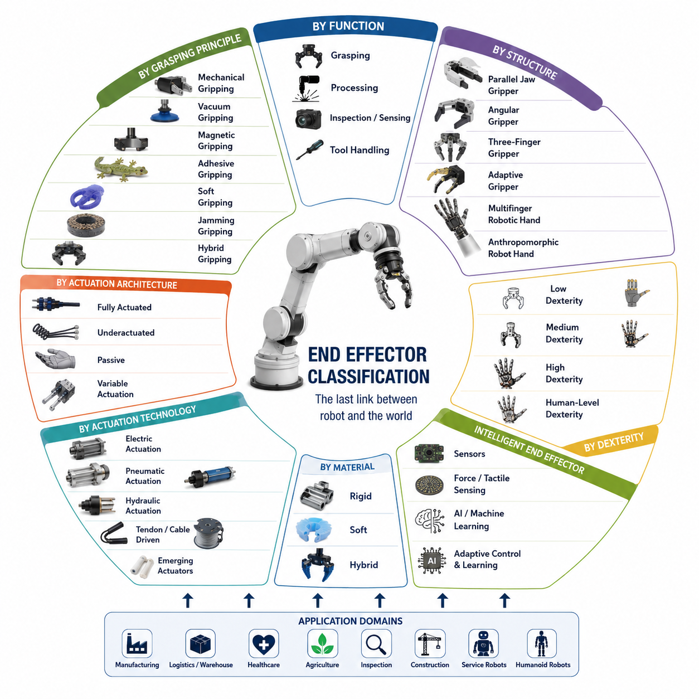
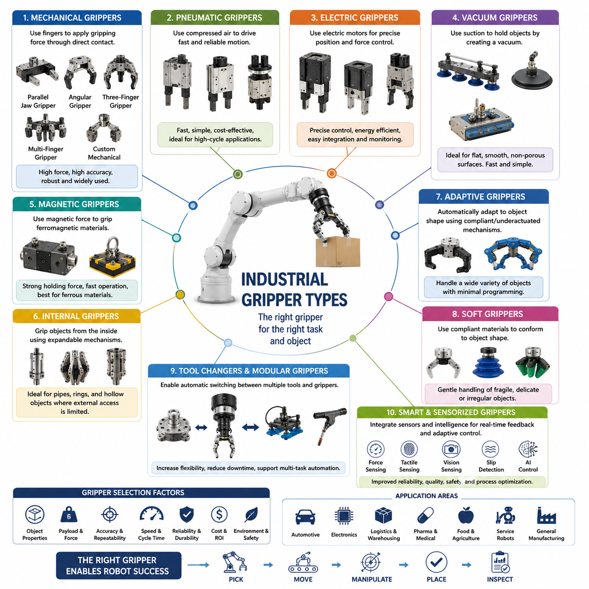
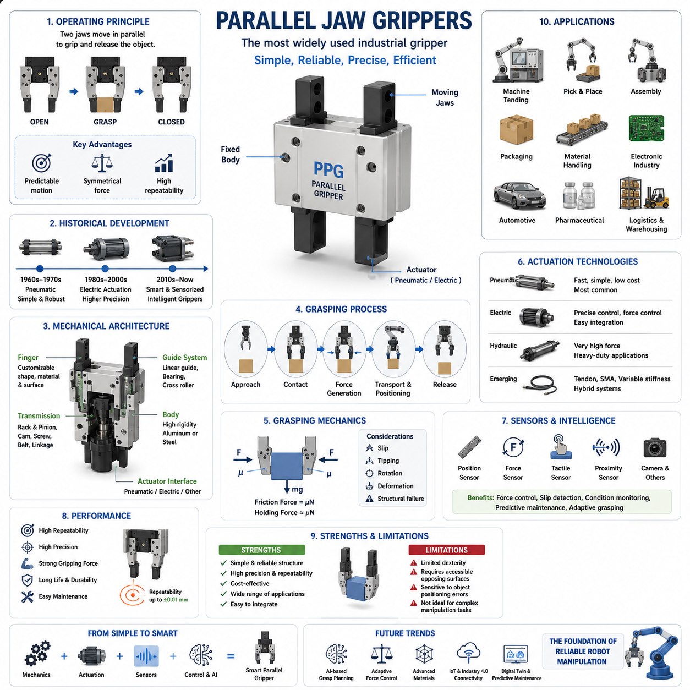
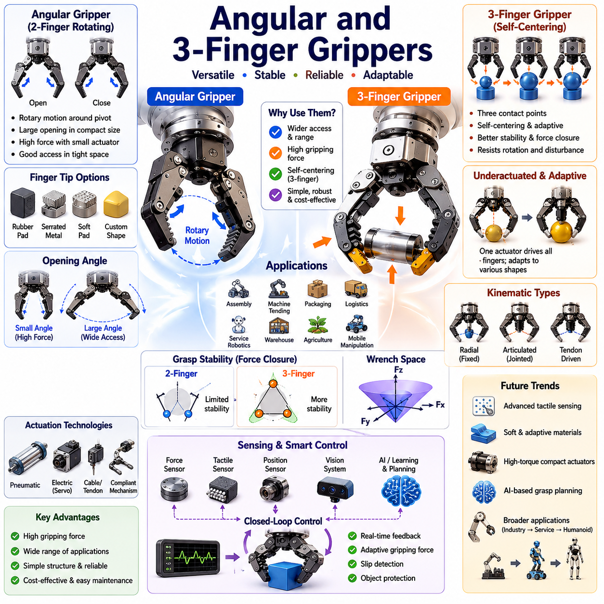
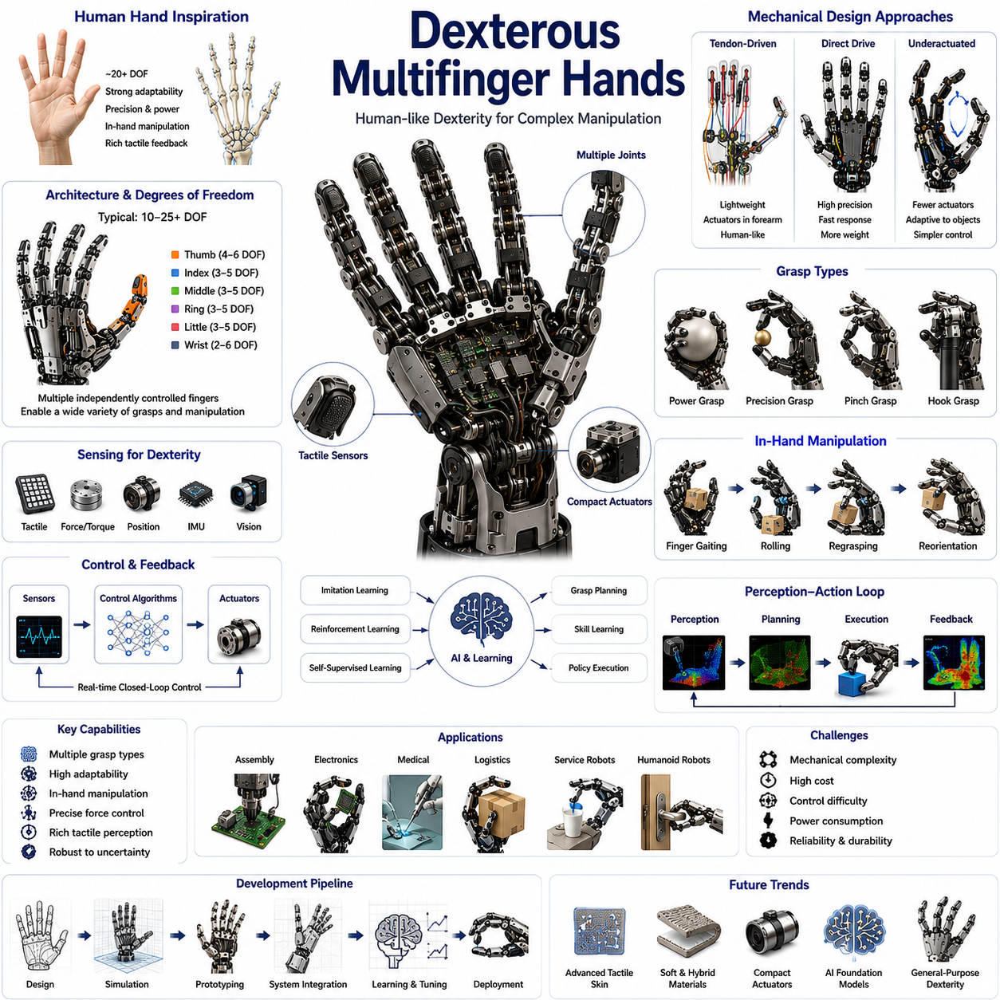
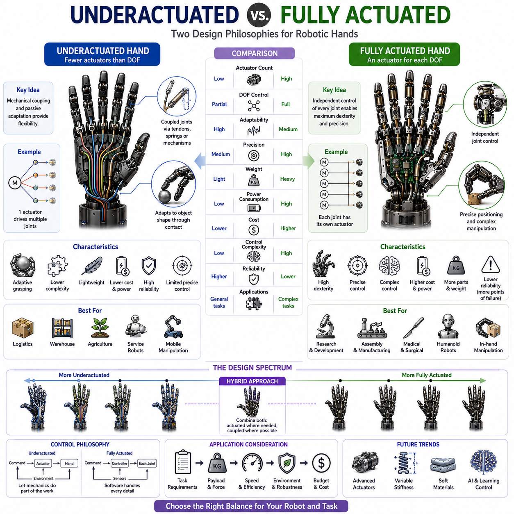
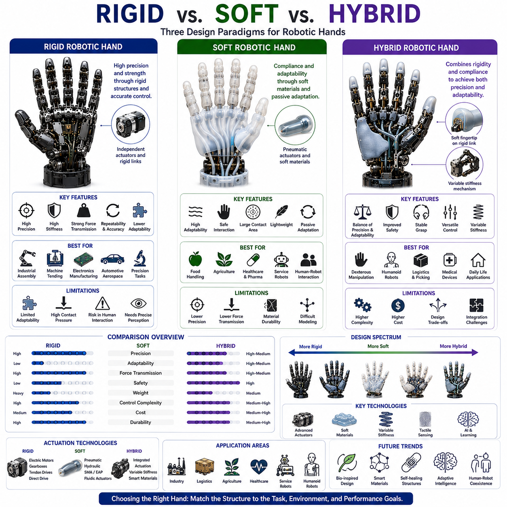
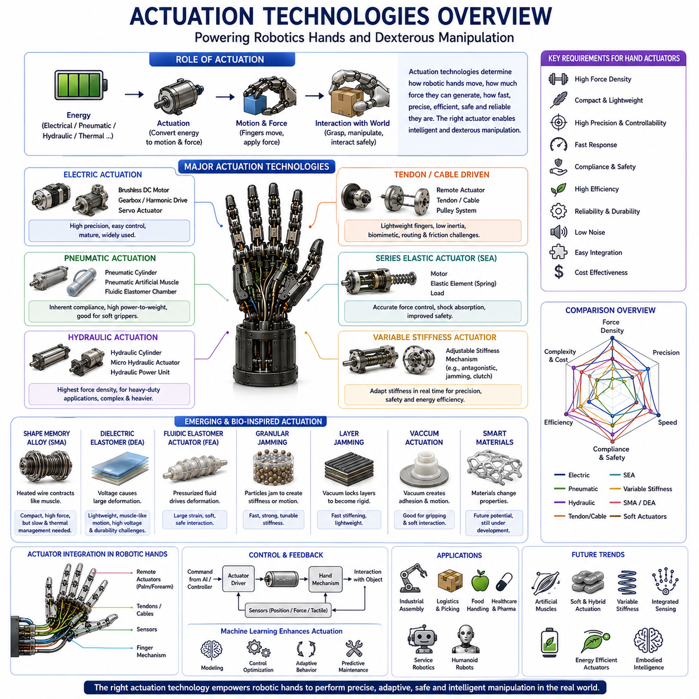
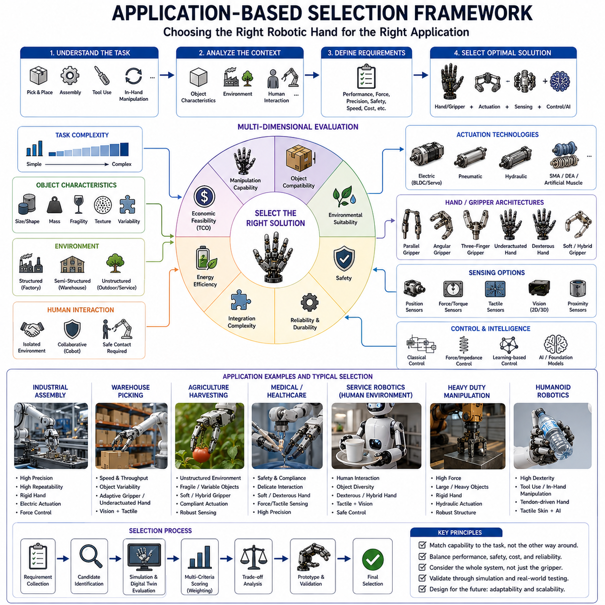
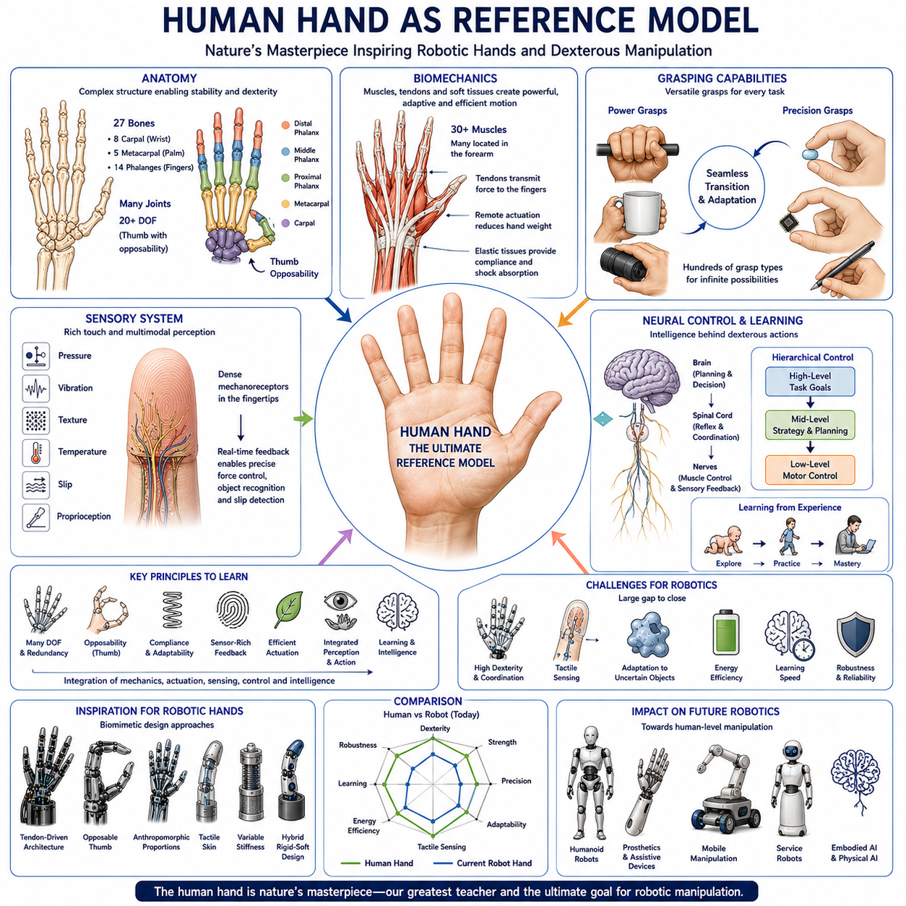

**Volume 06 Robot Hands and Dexterous Grasping**

# 01. Gripper and Hand Taxonomy

## 01.01 End-Effector Classification

{width="7.268055555555556in" height="7.268055555555556in"}

---

---

---

---

---

---

---

---

---

---

---

---

---

---

---

---

---

---

---

---

Introduction

An end effector is the final component attached to the terminal link of a robotic manipulator and serves as the physical interface between the robot and its environment. While the robot arm provides positioning, orientation, and motion generation capabilities, the end effector performs the actual interaction with objects, tools, materials, and surrounding structures. In practical robotic systems, the end effector is often the most application-specific component because it directly determines what tasks the robot can perform. The same robotic arm can be transformed into a welding robot, assembly robot, inspection robot, surgical robot, warehouse picking robot, or agricultural harvesting robot simply by changing the end effector.

The concept of end effectors has evolved significantly over the history of robotics. Early industrial robots primarily employed simple mechanical grippers designed for repetitive pick-and-place operations. These devices were optimized for reliability, speed, and low cost. As robotic applications expanded into logistics, healthcare, service robotics, aerospace, agriculture, and humanoid systems, the complexity and diversity of end effectors increased dramatically. Modern end effectors may incorporate advanced sensing technologies, force control algorithms, artificial intelligence, tactile perception, adaptive mechanisms, and soft robotic structures. Consequently, understanding end effector classification provides a fundamental framework for understanding robotic manipulation as a whole.

Within the broader context of robot hand engineering, end effectors represent the starting point of all grasping and manipulation systems. Every robotic hand, gripper, tool changer, vacuum cup, welding torch, inspection probe, and dexterous hand can be considered a specialized form of end effector. The classification of these systems enables engineers to systematically compare different technologies, evaluate design tradeoffs, and select appropriate solutions for specific applications.

Functional Classification of End Effectors

One of the most widely used classification approaches is based on functional purpose. Under this framework, end effectors are categorized according to the primary task they perform.

Grasping end effectors are designed to acquire, hold, transport, and release objects. They constitute the largest category of robotic end effectors and include industrial grippers, robotic hands, adaptive fingers, dexterous manipulation systems, and collaborative robot grippers. These devices are commonly found in manufacturing plants, warehouses, logistics centers, hospitals, and service environments.

Process end effectors perform direct operations on workpieces rather than holding them. Examples include welding torches, painting systems, cutting tools, laser heads, drilling tools, polishing systems, dispensing devices, and fastening tools. In such systems, the robot arm functions as a positioning platform while the end effector executes the manufacturing process.

Inspection and sensing end effectors focus on information acquisition rather than physical manipulation. Cameras, LiDAR systems, ultrasonic sensors, thermal imaging devices, tactile probes, coordinate measuring instruments, and hyperspectral imaging systems belong to this category. These tools are widely used in quality control, infrastructure inspection, predictive maintenance, medical diagnostics, and autonomous navigation.

Tool-handling end effectors are specifically designed to grasp and manipulate external tools. Such systems allow robots to extend their capabilities beyond fixed functionality. Examples include screwdriver systems, wrench manipulation systems, surgical instruments, agricultural harvesting tools, and maintenance equipment. Future humanoid robots are expected to rely heavily on tool-handling end effectors because tool use significantly expands operational versatility.

Classification Based on Grasping Principle

Another important classification method focuses on how the end effector generates holding forces.

Mechanical gripping is the most common approach. Mechanical grippers generate grasping forces through direct physical contact between fingers and objects. This category includes parallel-jaw grippers, angular grippers, three-finger grippers, and multifinger robotic hands. Mechanical gripping offers predictable behavior, high reliability, and compatibility with a wide range of industrial tasks.

Vacuum gripping utilizes pressure differentials between the atmosphere and a suction chamber. Vacuum cups can rapidly acquire objects with smooth surfaces such as cardboard boxes, glass panels, semiconductor wafers, and packaged products. Vacuum gripping dominates many logistics and packaging applications because of its simplicity and speed.

Magnetic gripping relies on magnetic attraction. Permanent magnets and electromagnets are commonly used to manipulate steel plates, metal components, automotive parts, and construction materials. Magnetic systems provide fast engagement and release while minimizing moving mechanical parts.

Adhesive gripping employs surface adhesion mechanisms to generate attachment forces. Bio-inspired gecko adhesives, electroadhesion technologies, and specialized adhesive materials belong to this category. Such systems are particularly useful when manipulating fragile or delicate objects that cannot tolerate large gripping forces.

Soft gripping utilizes compliant materials and deformable structures to adapt naturally to object geometry. Soft robotic grippers distribute contact forces over larger surface areas, reducing the risk of damage. These devices are increasingly used in food handling, agriculture, healthcare, and consumer product logistics.

Jamming-based gripping uses granular materials or layered structures that transition between flexible and rigid states. By controlling internal pressure, these systems can conform to an object\'s shape and then stiffen to provide secure grasping. Jamming grippers have become an important research area within soft robotics.

Hybrid gripping combines multiple grasping principles. A hybrid system may integrate mechanical fingers with vacuum suction, tactile sensing, and soft contact surfaces. Such designs often provide greater robustness and flexibility than single-principle approaches.

Classification Based on Structural Configuration

The physical structure of an end effector significantly influences its capabilities.

Parallel jaw grippers are the most common industrial design. Two opposing fingers move linearly toward and away from each other. Their simplicity, reliability, and ease of control make them popular in automated manufacturing systems.

Angular grippers use rotational finger motion rather than linear translation. These devices provide wider opening ranges and are useful in applications requiring clearance around objects.

Three-finger grippers offer enhanced stability compared to two-finger designs. Three-point contact often provides more robust grasping performance, especially for cylindrical or irregularly shaped objects.

Adaptive grippers incorporate passive mechanisms that automatically conform to object geometry. Instead of requiring precise finger positioning, adaptive grippers exploit mechanical intelligence to simplify grasp acquisition.

Multifinger robotic hands provide independent control of multiple fingers. These systems support complex grasp configurations, in-hand manipulation, object reorientation, and dexterous task execution.

Anthropomorphic robotic hands attempt to replicate the structure and functionality of the human hand. Such systems often feature multiple fingers, articulated joints, thumb opposition, tactile sensing, and advanced control algorithms. Examples include research platforms such as Shadow Hand, Allegro Hand, Schunk SVH, and emerging humanoid robot hands.

Classification Based on Degree of Actuation

Actuation architecture plays a critical role in determining performance, cost, complexity, and dexterity.

Fully actuated end effectors provide an independent actuator for each controllable degree of freedom. This approach offers maximum control authority and dexterity but increases system complexity, weight, cost, and maintenance requirements.

Underactuated end effectors employ fewer actuators than mechanical degrees of freedom. Through mechanical coupling, springs, tendons, and differential mechanisms, these systems distribute forces automatically. Underactuated hands often achieve excellent adaptability while maintaining relatively simple hardware.

Passive end effectors contain little or no active actuation. Gravity-assisted grippers, passive hooks, and compliance-based mechanisms belong to this category. Although their functionality is limited, passive systems are highly reliable and energy efficient.

Variable actuation architectures dynamically adjust force distribution or mechanical stiffness. Such systems enable robots to switch between delicate manipulation and high-force grasping modes depending on task requirements.

Classification Based on Actuation Technology

Electric actuation dominates modern robotics due to precise controllability, high efficiency, and compatibility with digital control systems. Brushless DC motors, servo motors, direct-drive motors, and compact geared actuators are commonly used.

Pneumatic actuation remains widespread in industrial automation because compressed air systems are inexpensive, lightweight, and inherently compliant. Pneumatic grippers often achieve high speeds and low maintenance requirements.

Hydraulic actuation offers exceptional force density and robustness. Heavy industrial robots, construction machinery, mining systems, and large-scale field robots frequently rely on hydraulic technologies.

Cable-driven and tendon-driven systems draw inspiration from biological musculoskeletal structures. By placing actuators remotely, these architectures reduce distal mass and improve dynamic performance.

Shape memory alloy actuators, electroactive polymers, dielectric elastomer actuators, artificial muscles, and fluidic elastomer systems represent emerging actuation technologies that may play increasingly important roles in future robotic hands.

Classification Based on Material Characteristics

Rigid end effectors are constructed primarily from metallic or hard polymer components. These systems emphasize precision, repeatability, payload capacity, and durability. Most industrial grippers fall into this category.

Soft end effectors employ elastomers, silicones, flexible polymers, textiles, and compliant materials. Their ability to adapt to object geometry makes them particularly suitable for unstructured environments.

Hybrid end effectors combine rigid structural elements with soft contact surfaces. Hybrid architectures attempt to balance precision and adaptability while maintaining sufficient load-carrying capability.

Recent advances in additive manufacturing and advanced materials have enabled increasingly sophisticated hybrid designs. Many next-generation robotic hands employ variable stiffness mechanisms that dynamically transition between rigid and compliant states.

Classification Based on Dexterity

Dexterity refers to the ability of an end effector to manipulate objects beyond simple grasping.

Low-dexterity systems perform basic pick-and-place operations. Most industrial grippers belong to this category.

Medium-dexterity systems support adaptive grasping and limited object repositioning. Underactuated hands and adaptive grippers are common examples.

High-dexterity systems enable complex object manipulation, tool use, regrasping, rolling, pivoting, finger gaiting, and in-hand manipulation. Multifinger robotic hands represent the primary technology within this category.

Human-level dexterity remains one of the ultimate goals of robotics research. Achieving this objective requires the integration of advanced mechanics, tactile sensing, force control, machine learning, and real-time planning.

Intelligent End Effectors

The emergence of intelligent robotics has introduced a new generation of end effectors. Traditional devices relied primarily on position control and predefined grasp strategies. Modern intelligent end effectors incorporate perception, learning, reasoning, and adaptation capabilities.

Force sensors, torque sensors, tactile arrays, proximity sensors, depth cameras, event cameras, and slip detection systems provide rich information about object interactions. These sensors enable robots to adjust grasp forces dynamically, detect contact conditions, and respond to unexpected disturbances.

Machine learning algorithms further enhance performance by enabling robots to learn grasping strategies from data rather than relying exclusively on manually engineered rules. Reinforcement learning, imitation learning, self-supervised learning, and foundation models have demonstrated remarkable improvements in robotic manipulation capabilities.

Vision-Language-Action systems are beginning to transform end effectors into intelligent cyber-physical interfaces capable of understanding natural language instructions and translating them into physical actions. In this paradigm, the end effector becomes not merely a mechanical device but a sophisticated embodiment of robotic intelligence.

End Effectors in Mobile Manipulators and Humanoid Robots

In mobile manipulation systems, the end effector serves as the final link connecting autonomous navigation, perception, planning, and physical interaction. The robot base transports the manipulator to the target location, the arm positions the end effector, and the end effector performs the task itself. Consequently, the overall success of a mobile manipulator is often determined by the effectiveness of its end effector.

Humanoid robots place even greater demands on end effector design. Unlike industrial robots operating in structured environments, humanoids must interact with tools, doors, appliances, containers, switches, keyboards, and countless everyday objects. These requirements drive the development of highly dexterous hands capable of human-like manipulation.

Future humanoid systems are expected to integrate tactile sensing, force control, variable stiffness mechanisms, foundation models, world models, and advanced dexterous manipulation algorithms. Their end effectors will function as intelligent robotic hands capable of performing a wide variety of tasks within unstructured environments.

Conclusion

End effector classification provides a systematic framework for understanding the diverse technologies that enable robotic interaction with the physical world. Classification can be performed according to function, grasping principle, structural configuration, actuation architecture, actuation technology, material characteristics, and dexterity level. Each classification perspective reveals different design tradeoffs and application requirements.

As robotics continues to evolve toward embodied intelligence, autonomous manipulation, mobile manipulation, and humanoid systems, end effectors are becoming increasingly sophisticated. The future of robotic manipulation will depend heavily on the convergence of advanced mechanics, soft robotics, tactile sensing, artificial intelligence, and foundation models. Understanding end effector classification is therefore essential not only for selecting appropriate hardware but also for designing the next generation of intelligent robotic systems.

## 01.02 Industrial Gripper Types

{width="7.268055555555556in" height="7.268055555555556in"}

---

---

---

---

---

---

---

---

---

---

---

---

---

---

---

---

---

---

---

---

---

---

---

---

Introduction

Industrial grippers are the most widely deployed category of robotic end effectors and serve as the primary interface between industrial robots and the physical objects they manipulate. In modern automation systems, the gripper is often the component that directly determines whether a robotic application succeeds or fails. Regardless of how advanced a robot arm, vision system, artificial intelligence algorithm, or motion controller may be, the robot ultimately depends on its gripper to establish reliable contact with an object and execute the intended task. For this reason, gripper technology has become one of the most important fields within robotic manipulation and industrial automation.

Industrial grippers are used throughout manufacturing, logistics, warehousing, automotive production, electronics assembly, pharmaceutical handling, food processing, semiconductor fabrication, agricultural automation, and service robotics. Their functions range from simple pick-and-place operations to highly sophisticated manipulation tasks involving fragile, deformable, irregular, or unknown objects. Over several decades of industrial robotics development, numerous gripper technologies have emerged, each optimized for specific operational requirements, object characteristics, environmental conditions, and economic constraints.

The selection of an industrial gripper is not merely a hardware decision. It influences cycle time, payload capacity, energy consumption, maintenance requirements, safety performance, system reliability, and overall return on investment. Consequently, understanding the various types of industrial grippers and their underlying operating principles is essential for robotics engineers, automation specialists, system integrators, and robot hand designers.

Within the context of robot hand taxonomy, industrial grippers represent the evolutionary foundation from which more advanced adaptive grippers, dexterous robotic hands, and intelligent manipulation systems have emerged. While future humanoid robots may employ sophisticated multifinger hands, the vast majority of industrial robots operating today continue to rely on specialized grippers optimized for efficiency, robustness, and productivity.

The Role of Industrial Grippers in Automation

The primary purpose of an industrial gripper is to establish secure and controllable interaction between a robot and a target object. This interaction must satisfy several requirements simultaneously. The gripper must generate sufficient holding force to prevent object loss, maintain positional stability during transport, avoid damaging the object, operate at high speed, and withstand repetitive industrial usage over extended periods.

In many industrial environments, robots perform thousands or even millions of grasping cycles per year. Under such conditions, grippers must achieve extremely high reliability. Even a small decrease in grasp success rate can result in significant production losses. Therefore, industrial gripper design places strong emphasis on mechanical simplicity, durability, repeatability, and maintainability.

Unlike human hands, which are highly versatile but mechanically complex, industrial grippers are often application-specific. A gripper designed for handling automotive components may be completely unsuitable for food products or electronic assemblies. As a result, industrial robotics has developed a broad ecosystem of specialized gripper technologies tailored to particular tasks and industries.

Mechanical Grippers

Mechanical grippers represent the most common type of industrial gripper. They operate by applying physical contact forces through one or more fingers that move relative to each other.

Mechanical grippers are widely adopted because they provide predictable grasping behavior, relatively simple control architectures, and compatibility with a broad range of object geometries. They are particularly effective when objects possess well-defined grasp surfaces and sufficient structural rigidity.

The most common mechanical gripper configuration is the parallel-jaw gripper. In this design, two opposing fingers move linearly toward or away from each other. Parallel-jaw grippers offer excellent repeatability, straightforward control, and high positioning accuracy. They are frequently used in machine tending, electronics assembly, precision manufacturing, and warehouse automation.

Angular grippers utilize rotational motion rather than linear translation. Their fingers rotate about pivot points, creating wider opening angles. This configuration can simplify access to objects in constrained environments and reduce mechanical complexity in certain applications.

Three-finger grippers introduce an additional contact point, improving grasp stability and force distribution. Such grippers are commonly employed for cylindrical components, pipes, containers, and irregularly shaped industrial parts.

Multi-finger industrial grippers extend this concept further by incorporating additional fingers and grasp configurations. Although more expensive and complex than traditional two-finger designs, they offer greater flexibility when handling diverse product portfolios.

Mechanical grippers remain dominant across industrial automation because of their robustness, long service life, and ability to generate substantial gripping forces.

Pneumatic Grippers

Pneumatic grippers utilize compressed air to generate finger motion and gripping force. They have become one of the most popular gripper technologies in factory automation due to their simplicity and low cost.

In pneumatic systems, compressed air drives pistons that translate or rotate gripper fingers. Because compressed air systems are already common in manufacturing facilities, pneumatic grippers can often be integrated with minimal infrastructure changes.

One of the major advantages of pneumatic grippers is their speed. They can achieve rapid opening and closing cycles, making them ideal for high-throughput production environments. Pneumatic actuators are also relatively lightweight and resistant to harsh industrial conditions.

Furthermore, the compressibility of air naturally introduces compliance into the system. This characteristic helps absorb minor positioning errors and reduces the likelihood of damaging sensitive components.

However, pneumatic grippers generally provide less precise force control than electric grippers. Maintaining compressed air infrastructure also introduces energy costs and maintenance requirements. Despite these limitations, pneumatic grippers continue to dominate many manufacturing sectors due to their proven reliability and economic advantages.

Electric Grippers

Electric grippers utilize servo motors, brushless DC motors, or other electrically driven actuators to control finger motion.

The adoption of electric grippers has increased significantly with the rise of collaborative robots and Industry 4.0 automation systems. Unlike pneumatic devices, electric grippers allow precise control of position, velocity, acceleration, and gripping force.

This level of control enables robots to handle delicate objects that would otherwise be damaged by excessive force. Electronic components, medical devices, laboratory samples, and consumer products often benefit from electric gripping technologies.

Electric grippers also facilitate advanced monitoring and diagnostics. Integrated sensors can continuously report position, force, current consumption, temperature, and health status to supervisory control systems. Such capabilities support predictive maintenance strategies and improve overall equipment effectiveness.

Another advantage is simplified infrastructure. Electric grippers require only electrical power and communication interfaces, eliminating the need for compressed air systems. This feature is particularly attractive for collaborative robots operating in flexible manufacturing environments.

As motor technology, embedded electronics, and battery systems continue to improve, electric grippers are expected to capture an increasing share of industrial automation applications.

Vacuum Grippers

Vacuum grippers operate using pressure differentials generated by suction cups or vacuum chambers.

These systems are exceptionally popular in logistics, packaging, semiconductor manufacturing, and material handling industries. Objects such as cardboard boxes, plastic packages, glass sheets, metal plates, and solar panels are commonly manipulated using vacuum technology.

The principal advantage of vacuum gripping lies in its simplicity. A single suction cup can often grasp objects that would otherwise require complex mechanical fingers. Vacuum systems also enable rapid acquisition and release operations, supporting high-speed automation.

Vacuum grippers perform best on relatively smooth, flat, and non-porous surfaces. Their effectiveness decreases when handling porous materials, irregular geometries, highly textured surfaces, or objects with significant air leakage paths.

To address these limitations, modern vacuum systems often incorporate multiple suction cups, adaptive vacuum arrays, vacuum sensors, and intelligent pressure control algorithms. Such enhancements improve reliability when dealing with diverse object populations.

Warehouse automation and e-commerce fulfillment systems increasingly rely on advanced vacuum grippers because they can accommodate large product variations while maintaining high throughput.

Magnetic Grippers

Magnetic grippers employ magnetic fields to generate holding forces.

Permanent magnetic grippers provide continuous holding force without requiring external power. Electromagnetic grippers generate controllable magnetic fields that can be activated or deactivated as needed.

Magnetic gripping is particularly effective for handling ferromagnetic materials such as steel sheets, automotive components, structural beams, pipes, and metal workpieces.

One of the greatest advantages of magnetic grippers is their ability to achieve secure attachment without requiring complex mechanical alignment. Grasping and releasing operations can be performed extremely quickly, contributing to high productivity.

However, magnetic grippers are limited to compatible materials and may encounter challenges when handling non-ferrous metals, composite materials, plastics, or organic products.

Nevertheless, in industries involving steel processing, automotive manufacturing, and heavy industrial production, magnetic gripping remains highly effective.

Internal Grippers

Internal grippers secure objects by expanding inside a cavity rather than compressing from the outside.

This approach is particularly useful when external surfaces are inaccessible or unsuitable for conventional grasping. Examples include pipes, hollow cylinders, bearing races, containers, and tubular structures.

Internal gripping mechanisms often employ expandable fingers, inflatable elements, mechanical wedges, or pneumatic expansion systems.

Because the gripping force is applied internally, the external geometry of the object remains unobstructed. This characteristic can simplify assembly operations and improve accessibility in confined spaces.

Internal grippers are widely used in automotive assembly, machinery manufacturing, aerospace production, and industrial component handling.

Adaptive Grippers

Adaptive grippers represent an important transition between traditional industrial grippers and advanced robotic hands.

Unlike rigid grippers that require precise alignment, adaptive grippers automatically conform to object geometry. This capability is typically achieved through underactuated mechanisms, compliant joints, flexible fingers, or passive mechanical couplings.

Adaptive grippers significantly reduce the complexity of grasp planning and object localization. Even when object position estimates contain errors, adaptive fingers can compensate through mechanical self-adjustment.

The Robotiq adaptive gripper family is a well-known example of this technology. Such systems have become popular in collaborative robotics, warehouse automation, machine tending, and research applications.

Adaptive grippers are particularly valuable in environments where object variability is high and traditional automation methods become difficult to implement.

Soft Grippers

Soft grippers utilize compliant materials such as silicone, elastomers, rubber composites, and flexible polymers.

Rather than imposing rigid contact constraints, soft grippers deform around object surfaces. This property enables them to distribute forces over larger contact areas and reduce local pressure concentrations.

Soft grippers excel when handling fragile items such as fruits, vegetables, pharmaceuticals, laboratory samples, consumer products, and medical instruments.

Recent advances in soft robotics have introduced pneumatically actuated fingers, jamming mechanisms, shape-changing structures, and bio-inspired gripping technologies.

Although soft grippers generally sacrifice some positioning precision and payload capacity, they offer unmatched adaptability and safety in many applications.

The rapid growth of agricultural automation and food robotics has accelerated interest in soft gripping technologies.

Tool Changers and Modular Grippers

Modern industrial robots increasingly employ automatic tool changers that allow multiple grippers to be used on a single robot.

Tool changers enable robots to switch between mechanical grippers, vacuum systems, inspection tools, welding torches, dispensing systems, and specialized end effectors during operation.

This modular approach dramatically increases system flexibility and supports multi-purpose robotic workcells.

In advanced manufacturing environments, automatic tool changing reduces downtime, improves equipment utilization, and enables rapid adaptation to changing production requirements.

The combination of modular grippers, intelligent sensors, and flexible software architectures is becoming a defining characteristic of next-generation industrial automation systems.

Smart and Sensorized Grippers

The latest generation of industrial grippers integrates sensing, communication, and intelligence directly into the end effector.

Force sensors, torque sensors, tactile arrays, proximity sensors, cameras, temperature sensors, and vibration sensors provide real-time information regarding grasp quality and object interaction.

These capabilities enable dynamic force adjustment, slip detection, object recognition, condition monitoring, and autonomous adaptation.

Artificial intelligence algorithms further enhance performance by allowing robots to learn optimal grasp strategies from experience. Machine learning, reinforcement learning, foundation models, and vision-language-action architectures are beginning to influence industrial gripper design.

As a result, industrial grippers are evolving from simple mechanical devices into intelligent cyber-physical systems capable of perception, decision-making, and adaptive manipulation.

Future Trends

The future of industrial grippers lies in the convergence of mechanical engineering, sensing technologies, artificial intelligence, and advanced materials.

Traditional grippers optimized for single applications will increasingly be complemented by adaptive, intelligent, and multifunctional systems. Electric actuation, soft robotics, tactile sensing, and learning-based control are expected to become more prevalent.

Future factories will likely employ grippers capable of handling thousands of different products with minimal reconfiguration. These systems will combine dexterity, perception, force control, and cognitive reasoning to achieve levels of flexibility previously associated only with human workers.

Industrial grippers therefore represent not only a mature automation technology but also a critical foundation for the next generation of autonomous manipulation systems, collaborative robots, mobile manipulators, and humanoid robotics. Their continued evolution will play a central role in the future of intelligent manufacturing and embodied artificial intelligence.

## 01.03 Parallel Jaw Grippers

{width="7.268055555555556in" height="7.268055555555556in"}

---

---

---

---

---

---

---

---

---

---

---

---

---

---

---

---

---

---

---

---

---

---

Parallel jaw grippers are the most widely used industrial robotic grippers and represent the foundation of modern robotic manipulation. Their popularity stems from a simple yet highly effective operating principle: two opposing fingers move in parallel toward or away from each other to grasp and release objects. Despite the emergence of adaptive grippers, soft robotic systems, multifinger dexterous hands, and artificial intelligence-driven manipulation technologies, parallel jaw grippers continue to dominate industrial automation due to their reliability, simplicity, precision, and economic efficiency.

In manufacturing environments, the majority of pick-and-place operations, machine tending applications, assembly processes, packaging systems, and material handling tasks rely on parallel jaw grippers. Their straightforward mechanical architecture allows them to perform repetitive operations with extremely high repeatability while maintaining relatively low cost and maintenance requirements. As a result, parallel jaw grippers have become a standard component in factories around the world.

Within the broader taxonomy of robot hands and end effectors, parallel jaw grippers occupy an important position. They represent the baseline against which more advanced grasping technologies are often evaluated. Understanding their design principles, kinematics, force generation mechanisms, sensing integration, and application domains provides essential knowledge for anyone involved in robotic manipulation, automation engineering, or robot hand development.

Although parallel jaw grippers appear mechanically simple, their engineering involves numerous considerations related to grasp stability, actuator selection, payload capacity, precision control, durability, environmental resistance, and system integration. Modern parallel grippers are increasingly incorporating sensors, embedded intelligence, and adaptive control capabilities, enabling them to remain relevant even as robotics advances toward more sophisticated manipulation systems.

Fundamental Operating Principle

The defining characteristic of a parallel jaw gripper is that its fingers move along parallel trajectories during opening and closing operations. Unlike angular grippers, whose fingers rotate about pivot points, parallel jaw grippers maintain a constant orientation throughout their motion.

This seemingly simple behavior provides several important advantages. First, the contact surfaces remain aligned with the object during the entire grasping process. Second, the grasping geometry is highly predictable, simplifying robot programming and grasp planning. Third, the generated gripping forces are typically applied symmetrically, improving grasp stability.

During operation, the fingers move inward until they establish contact with the target object. Continued actuator motion generates normal forces at the contact points. These forces, combined with friction between the finger surfaces and the object, create the holding capability necessary to prevent slipping and object loss.

The grasping process can generally be divided into object approach, contact establishment, force generation, object transport, positioning, and release. Each phase requires careful coordination between robot motion and gripper control to achieve reliable operation.

Because the finger motion remains linear and parallel, engineers can easily predict object positions after grasping. This predictability contributes significantly to the widespread adoption of parallel jaw grippers in precision manufacturing applications.

Historical Development

The origins of parallel jaw grippers can be traced back to early industrial automation systems developed during the rise of factory robotics in the 1960s and 1970s. At that time, automation engineers sought simple mechanisms capable of performing repetitive handling operations.

Early designs utilized pneumatic cylinders and basic linkage systems. These grippers were robust, inexpensive, and easy to maintain. As industrial robots became more common, parallel jaw grippers evolved to support higher precision, greater payloads, and more demanding operating conditions.

The introduction of servo-controlled electric actuators represented a major milestone in gripper development. Electric grippers enabled precise position control, force regulation, and programmable grasp strategies. This advancement expanded the range of applications beyond traditional manufacturing and into electronics assembly, medical device production, and collaborative robotics.

Today, parallel jaw grippers are available in a wide variety of sizes, force capacities, environmental ratings, and actuation technologies. Manufacturers offer miniature grippers for semiconductor handling, heavy-duty models for automotive production, hygienic designs for food processing, and sensorized systems for Industry 4.0 environments.

Mechanical Architecture

The mechanical architecture of a parallel jaw gripper is centered around the finger guidance mechanism. This subsystem ensures that the fingers move linearly and remain parallel throughout the grasping motion.

Several guidance technologies are commonly employed. Sliding guides represent the simplest solution and are often used in low-cost applications. Linear bearings provide higher precision and reduced friction. Cross-roller guides offer excellent stiffness and positioning accuracy for demanding industrial environments.

The fingers themselves are usually attached to moving carriages connected to an actuator through mechanical transmission elements. These transmissions may include rack-and-pinion mechanisms, wedge drives, cam systems, ball screws, lead screws, belts, or linkage arrangements.

Finger design is a particularly important aspect of gripper engineering. The fingers constitute the primary contact interface with the object. Their geometry, material selection, surface finish, and compliance characteristics directly influence grasp quality.

Many industrial applications employ custom finger designs tailored to specific products. These fingers may incorporate soft pads, rubber coatings, textured surfaces, or specialized geometries to improve contact stability and reduce object damage.

Structural rigidity is another key consideration. Excessive finger deflection can degrade positioning accuracy and reduce grasp reliability. Therefore, engineers must carefully balance weight, strength, stiffness, and manufacturing cost during the design process.

Actuation Technologies

Parallel jaw grippers can be actuated using several different technologies.

Pneumatic actuation remains the most common approach in industrial environments. Compressed air drives pistons connected to the finger mechanism. Pneumatic grippers offer high speed, simplicity, low cost, and robust operation. Their widespread adoption is supported by the availability of compressed air infrastructure in most factories.

Electric actuation is becoming increasingly popular, particularly in collaborative robotics and flexible automation systems. Servo motors and brushless DC motors provide precise control of position, velocity, and gripping force. Electric grippers also support advanced diagnostics and data collection.

Hydraulic actuation is typically reserved for heavy-duty applications requiring extremely high gripping forces. Construction robotics, mining systems, and large industrial manipulators may employ hydraulic grippers when pneumatic or electric alternatives cannot generate sufficient force.

Emerging technologies include tendon-driven systems, shape-memory alloy actuators, variable-stiffness mechanisms, and hybrid actuation architectures. Although less common in industrial environments, these technologies are actively being explored for future robotic hands and advanced manipulation systems.

Grasping Mechanics

The performance of a parallel jaw gripper is fundamentally governed by contact mechanics and friction.

When a gripper grasps an object, each finger generates a normal force at the contact interface. These normal forces create frictional forces proportional to the coefficient of friction between the finger surface and the object.

For a simple two-finger grasp, the maximum achievable holding force can be approximated by the product of normal force and friction coefficient. Consequently, finger materials and surface treatments play a significant role in grasp stability.

Engineers must consider multiple failure modes when designing grasp strategies. These include slipping, tipping, rotation, deformation, and structural failure. Proper finger placement and force distribution are essential for preventing such failures.

In many applications, the gripper must accommodate variations in object size, weight, center of gravity, and surface properties. This requirement motivates the integration of force sensing and adaptive control capabilities.

The study of grasp mechanics has evolved into a sophisticated field involving contact models, friction cone analysis, grasp wrench spaces, force closure theory, and grasp quality metrics. Even though parallel jaw grippers appear simple, their behavior can be analyzed using advanced theoretical frameworks developed within robotic grasping research.

Precision and Repeatability

One of the greatest strengths of parallel jaw grippers is their ability to achieve exceptional repeatability.

In manufacturing environments, repeatability often matters more than absolute accuracy. A gripper capable of consistently positioning objects within a few hundredths of a millimeter can significantly improve assembly quality and reduce production defects.

Several factors contribute to repeatability. Precision guidance systems minimize mechanical play. High-quality actuators provide consistent motion profiles. Structural rigidity reduces deformation under load. Sensor feedback enables closed-loop control.

Modern industrial parallel grippers can achieve positioning repeatability measured in micrometers. Such performance is essential for semiconductor manufacturing, electronics assembly, optical systems production, and medical device fabrication.

The ability to repeatedly execute identical grasping motions is one of the primary reasons parallel jaw grippers remain indispensable in industrial automation.

Force Control

Traditional parallel jaw grippers operated primarily in open-loop mode, applying a fixed force regardless of object characteristics.

Modern grippers increasingly incorporate force control capabilities. Integrated force sensors, motor current monitoring, strain gauges, and torque estimation algorithms enable precise regulation of gripping forces.

Force control is particularly important when handling fragile objects. Excessive force may damage electronic components, medical devices, food products, or delicate assemblies. Insufficient force may result in object slippage.

Advanced force control strategies continuously adjust gripping forces based on sensor feedback. Some systems implement adaptive grasping algorithms that automatically determine optimal force levels for different objects.

The integration of force control transforms the gripper from a simple mechanical device into an intelligent manipulation component capable of responding dynamically to changing conditions.

Sensor Integration

Modern parallel jaw grippers increasingly function as sensor platforms rather than purely mechanical devices.

Position sensors monitor finger displacement and opening width. Force sensors measure contact forces. Proximity sensors detect approaching objects. Tactile sensors provide detailed information regarding contact conditions.

Some advanced grippers incorporate miniature cameras, temperature sensors, accelerometers, and vibration sensors. These devices support condition monitoring, predictive maintenance, object recognition, and grasp quality assessment.

Sensor integration is particularly important for autonomous manipulation systems operating in unstructured environments. Robots must be capable of detecting unexpected conditions and adjusting their behavior accordingly.

The combination of sensing and actuation enables increasingly sophisticated grasping capabilities while maintaining the fundamental simplicity of the parallel jaw architecture.

Applications

Parallel jaw grippers are used across virtually every industrial sector.

In automotive manufacturing, they handle engine components, body panels, fasteners, and assembly parts. In electronics production, they manipulate circuit boards, connectors, semiconductors, and precision assemblies.

Warehousing and logistics systems employ parallel grippers for package handling, sorting, and order fulfillment. Pharmaceutical facilities use specialized grippers for handling vials, syringes, and medical products.

Machine tending applications rely heavily on parallel jaw grippers for loading and unloading CNC machines, injection molding equipment, and manufacturing cells.

Collaborative robots frequently utilize electric parallel grippers because of their controllability, safety features, and ease of integration.

The versatility of parallel jaw grippers explains their continued dominance across industrial automation despite the availability of more complex alternatives.

Limitations

Despite their numerous advantages, parallel jaw grippers possess inherent limitations.

Their grasping strategy is primarily designed for objects with accessible opposing surfaces. Irregular geometries, highly deformable objects, and complex manipulation tasks may challenge traditional parallel gripper designs.

They generally provide limited dexterity compared to multifinger robotic hands. Tasks involving in-hand manipulation, tool use, object reorientation, and complex assembly often require more sophisticated end effectors.

Furthermore, successful operation frequently depends on accurate object localization and controlled environmental conditions.

These limitations have motivated research into adaptive grippers, soft robotics, underactuated hands, and dexterous manipulation systems.

Future Trends

The future of parallel jaw grippers lies not in replacing their fundamental architecture but in enhancing it through intelligence, sensing, and adaptability.

Artificial intelligence is increasingly being used to optimize grasp planning, force regulation, and object handling strategies. Machine learning models can predict successful grasp configurations based on visual and tactile information.

Advanced materials are enabling lighter, stronger, and more compliant finger designs. Embedded sensing technologies continue to improve perception capabilities.

Industry 4.0 initiatives are driving the adoption of smart grippers capable of communicating operational data to factory management systems. Predictive maintenance, cloud analytics, and digital twins are becoming integrated components of gripper ecosystems.

Although humanoid robots and dexterous robotic hands attract significant attention, parallel jaw grippers are expected to remain the dominant industrial gripping technology for decades to come. Their combination of simplicity, reliability, affordability, precision, and scalability ensures their continued relevance in the evolving landscape of robotic automation.

In many ways, the parallel jaw gripper represents the perfect example of engineering elegance: a seemingly simple mechanism that continues to provide extraordinary value across countless industrial applications while serving as the foundation for more advanced robotic manipulation technologies.

## 01.04 Angular and Three-Finger Grippers

{width="7.268055555555556in" height="7.268055555555556in"}

Angular grippers and three-finger grippers represent an important category within the taxonomy of robotic end effectors. Positioned between simple parallel jaw grippers and highly dexterous multifinger robotic hands, these grippers provide a practical balance between mechanical simplicity, grasp versatility, reliability, and industrial usability. Within the broader framework of robot hand engineering, angular and three-finger grippers occupy a critical role because they can manipulate a wider range of object geometries than traditional two-finger parallel grippers while avoiding much of the complexity associated with anthropomorphic robot hands. As identified in the taxonomy structure of Volume 06, these grippers form a key transitional stage in the evolution from industrial grasping systems toward dexterous robotic manipulation.

An angular gripper differs fundamentally from a parallel jaw gripper in the way its fingers move during opening and closing operations. Instead of translating linearly toward each other, the fingers rotate about a pivot point. This rotational motion generates an angular trajectory that allows the gripper to approach and secure objects from different orientations. The rotational movement often results in a larger opening range relative to the overall size of the mechanism, making angular grippers attractive in applications where space is limited but grasp width requirements are large. Because the fingers swing outward or inward, angular grippers can reach around obstacles and provide better access to objects located in confined spaces.

The mechanical architecture of angular grippers is typically based on rotary linkages, cam mechanisms, gear trains, or rack-and-pinion systems. Pneumatic angular grippers frequently employ compact piston-driven linkages that convert linear actuator motion into finger rotation. Electric angular grippers often utilize servo motors, brushless DC motors, or compact planetary gear systems to achieve precise finger positioning. The simplicity of the underlying kinematic structure contributes to their durability and widespread adoption in manufacturing environments.

One of the major advantages of angular grippers lies in their ability to provide high gripping forces while maintaining compact dimensions. The linkage geometry can be optimized to generate mechanical advantage near the end of the closing motion, allowing substantial holding forces even when relatively small actuators are used. This characteristic is particularly beneficial in industrial automation systems where payload capacity, cycle time, and equipment footprint must be carefully balanced.

Angular grippers are frequently used in assembly lines, packaging systems, machine tending applications, injection molding operations, and material handling environments. In many manufacturing facilities, robots equipped with angular grippers transfer components between conveyors, fixtures, inspection stations, and production equipment. Their reliability, ease of maintenance, and relatively low cost have made them one of the most common end effectors in factory automation.

The grasping mechanics of angular grippers differ from those of parallel jaw grippers because the contact geometry changes continuously during closure. As the fingers rotate, the contact points move relative to the object surface. This dynamic interaction can either enhance or reduce grasp stability depending on the object shape. Cylindrical objects often benefit from the enveloping motion of angular fingers, whereas flat objects may require specialized finger designs to maintain secure contact. Engineers must therefore consider contact mechanics, friction characteristics, and object geometry when selecting or designing an angular gripper.

Finger design plays a crucial role in determining the performance of angular grippers. Industrial systems commonly employ interchangeable fingertips that can be customized for specific tasks. Soft polymer pads may be added to improve friction and protect delicate surfaces. Serrated metal inserts can increase holding capability for heavy industrial components. Specialized fingertip geometries can be developed for handling pipes, shafts, bottles, electronic components, or irregularly shaped objects.

The opening angle of an angular gripper significantly influences its workspace and operational flexibility. Small-angle grippers prioritize force generation and precision, while large-angle grippers emphasize accessibility and grasping range. Designers must carefully balance these competing requirements based on application demands. Excessive opening angles may introduce mechanical instability or increase cycle times, whereas insufficient opening angles may limit object accessibility.

Three-finger grippers extend the capabilities of traditional two-finger systems by introducing an additional contact point. This seemingly simple modification dramatically changes the grasping characteristics of the system. With three fingers, the gripper can establish more stable force distributions, achieve improved object centering, and provide enhanced adaptability to variations in object geometry. Three-finger configurations often approximate the natural grasping strategies observed in the human hand, although they remain significantly simpler than anthropomorphic robotic hands.

Most industrial three-finger grippers employ either symmetric radial motion or adaptive finger coordination mechanisms. In radial designs, all three fingers move simultaneously toward a central grasping axis. This arrangement is particularly effective for cylindrical and round objects because it naturally centers the object within the grasp. Examples include handling pipes, bearings, bottles, containers, and mechanical components with rotational symmetry.

The centering capability of three-finger grippers offers significant advantages in automated production environments. When objects arrive with positional uncertainties, the gripper can automatically compensate for small misalignments by drawing the object toward the geometric center of the grasp. This reduces dependence on highly precise object localization systems and improves overall system robustness. In high-speed industrial automation, such self-centering behavior can substantially increase operational efficiency.

Three-finger grippers often employ underactuated designs in which a single actuator controls multiple fingers through differential mechanisms. Underactuation allows the fingers to adapt passively to variations in object shape without requiring complex control algorithms. As contact occurs, force distribution automatically adjusts according to object geometry and finger compliance. This capability enables reliable grasping of objects with irregular surfaces, variable dimensions, or uncertain positioning.

Adaptive three-finger grippers are particularly valuable in logistics, warehouse automation, agricultural robotics, and service robotics. These environments frequently involve handling objects that vary significantly in shape, size, and orientation. Unlike rigid industrial production lines where objects are highly standardized, real-world environments require grasping systems capable of accommodating uncertainty and variability.

The kinematic design of three-finger grippers can vary considerably depending on intended applications. Some systems utilize fixed finger trajectories optimized for industrial precision. Others incorporate articulated finger joints that enable adaptive contact formation. More advanced designs employ tendon-driven mechanisms, compliant structures, or variable stiffness technologies to achieve greater grasp versatility.

Contact mechanics become increasingly important as the number of fingers increases. With three fingers, the grasp stability problem transitions from simple force balancing to multi-contact coordination. Engineers must analyze friction cones, contact normals, force closure conditions, and wrench space representations to evaluate grasp quality. Theoretical concepts from robotic grasp theory provide mathematical frameworks for determining whether a given finger arrangement can resist disturbances from arbitrary directions.

Force closure is one of the most important concepts in evaluating three-finger grasp performance. A grasp achieves force closure when the contact forces generated by the fingers can counteract any external force or torque acting on the object. Three-finger configurations often achieve force closure more readily than two-finger configurations because the additional contact point increases the range of achievable force vectors. This leads to greater grasp robustness and reduced risk of object slippage.

Three-finger grippers also provide improved resistance to rotational disturbances. In two-finger systems, objects may rotate around the grasp axis if friction is insufficient. The third finger introduces additional constraints that help stabilize object orientation. This characteristic is particularly beneficial when manipulating components that must maintain precise alignment during transport or assembly operations.

Sensor integration further enhances the capabilities of angular and three-finger grippers. Modern robotic systems increasingly incorporate position sensors, force sensors, torque sensors, tactile sensors, and proximity sensors within the gripper structure. These sensing technologies enable closed-loop grasp control, allowing the robot to adjust gripping forces dynamically in response to changing conditions. Force feedback can prevent damage to fragile objects, while tactile sensing can improve grasp stability assessment and slip detection.

Vision-guided grasping systems frequently work in conjunction with three-finger grippers. Machine vision algorithms identify object location, orientation, and geometry, while grasp planning algorithms determine optimal contact points. The three-finger configuration often provides greater flexibility in executing planned grasps because multiple contact arrangements can be achieved without requiring extensive object repositioning.

Machine learning techniques are increasingly being applied to grasp optimization for three-finger systems. Reinforcement learning algorithms can discover effective grasp strategies through trial-and-error interactions. Deep neural networks can predict grasp success probabilities based on visual and tactile information. Foundation models for manipulation are beginning to incorporate grasp reasoning capabilities that allow robots to generalize across diverse object categories and operational scenarios. These developments create opportunities for angular and three-finger grippers to operate effectively in environments that were previously considered too unstructured for traditional industrial automation.

In mobile manipulation systems, three-finger grippers provide a useful compromise between simplicity and dexterity. Autonomous mobile robots operating in warehouses, hospitals, factories, and service environments often require versatile grasping capabilities without the complexity of full robotic hands. Three-finger grippers can manipulate boxes, tools, containers, medical supplies, and consumer products while maintaining relatively simple control architectures and low maintenance requirements. Their compatibility with mobile manipulators makes them attractive for next-generation logistics and service robotics applications.

Safety considerations are also important in gripper design. Industrial environments require reliable operation under demanding conditions, while collaborative robotics applications introduce additional constraints related to human interaction. Rounded finger geometries, compliant materials, force-limited actuators, and collision detection mechanisms can improve safety during human-robot collaboration. Three-finger grippers often distribute contact forces more evenly than two-finger systems, reducing localized pressure and minimizing the risk of damaging sensitive objects.

From a system engineering perspective, selecting between angular grippers, parallel jaw grippers, and three-finger grippers requires careful analysis of application requirements. Factors such as object geometry, payload, cycle time, positioning accuracy, environmental conditions, maintenance requirements, cost constraints, and integration complexity must all be considered. Angular grippers generally excel in compact, high-speed industrial applications, while three-finger grippers offer superior adaptability and grasp stability across a broader range of object types.

The future development of angular and three-finger grippers is expected to be driven by advances in sensing, materials, actuation technologies, and artificial intelligence. Improvements in tactile sensing will enable more sophisticated contact awareness. Adaptive materials and soft robotic technologies will enhance compliance and object protection. Compact high-torque actuators will improve force density and responsiveness. AI-driven grasp planning systems will allow robots to select optimal grasp strategies automatically based on object characteristics and task objectives.

As robotic manipulation continues to expand beyond structured factory environments into logistics, healthcare, agriculture, construction, retail, and service domains, angular and three-finger grippers will remain essential components of robotic end effector technology. Their combination of robustness, adaptability, affordability, and operational simplicity ensures that they will continue to serve as a critical bridge between traditional industrial grippers and the highly dexterous robotic hands that represent the future of intelligent manipulation systems. This role places them at the center of modern grasping technology and establishes them as one of the most important categories within the broader field of robot hand engineering and dexterous grasping.

## 01.05 Dexterous Multifinger Hands

{width="7.268055555555556in" height="7.268055555555556in"}

Dexterous Multifinger Hands represent the highest level of sophistication in robotic end-effector technology. Unlike simple industrial grippers that are primarily designed to secure and transport objects, dexterous robotic hands are developed to perform complex manipulation tasks that closely resemble the capabilities of the human hand. These systems are capable of grasping, holding, rotating, repositioning, manipulating, and interacting with objects in dynamic environments while continuously adapting to changes in object geometry, contact conditions, and task requirements. Within the taxonomy of robot hands and grasping systems, dexterous multifinger hands occupy the most advanced category, serving as the bridge between conventional industrial automation and truly intelligent physical interaction. Their development has become one of the central challenges in robotics because manipulation remains one of the most difficult problems in creating autonomous systems capable of operating in unstructured human environments.

The human hand serves as the primary inspiration for most dexterous robotic hand designs. A typical human hand contains more than twenty degrees of freedom distributed across the fingers, thumb, palm, and wrist. This remarkable mechanical structure allows humans to perform a vast range of manipulation tasks, from lifting heavy tools to handling fragile objects such as eggs, paper, or medical instruments. Replicating even a fraction of these capabilities in robotic systems requires highly sophisticated mechanical engineering, sensing technologies, control algorithms, and artificial intelligence. Consequently, dexterous robotic hands have become one of the most active research areas in robotics, artificial intelligence, biomechanical engineering, and human-machine interaction.

The defining characteristic of a dexterous multifinger hand is the presence of multiple independently controlled fingers. Most robotic hands contain three, four, or five fingers, although some research platforms utilize even more complex configurations. Unlike traditional industrial grippers that rely on simple open-and-close motions, each finger in a dexterous hand may contain multiple joints, actuators, sensors, and control loops. The result is a highly articulated system capable of generating a wide variety of grasp configurations and manipulation strategies.

The thumb plays a particularly important role in dexterous hand design. In the human hand, thumb opposability is responsible for many advanced manipulation capabilities. Similarly, robotic thumbs are often designed to oppose the remaining fingers, enabling pinch grasps, precision grasps, power grasps, and complex in-hand manipulation. Designing a robotic thumb is significantly more challenging than designing ordinary fingers because it requires multiple degrees of freedom, complex kinematic relationships, and precise coordination with the other fingers.

Dexterous hands typically employ between ten and twenty-five degrees of freedom depending on the intended application. Each degree of freedom contributes to the flexibility of the system but also increases mechanical complexity, control difficulty, power consumption, and computational requirements. Engineers must therefore balance dexterity against practical considerations such as reliability, weight, cost, and maintainability.

The mechanical architecture of multifinger hands varies significantly across different designs. Some systems employ rigid-link mechanisms similar to industrial robot arms. Others use tendon-driven architectures inspired by biological muscles and tendons. Tendon-driven designs offer advantages in weight reduction and actuator placement because motors can be located remotely within the forearm rather than inside the fingers themselves. This approach allows the fingers to remain lightweight while maintaining high force capabilities.

Cable-driven and tendon-driven robotic hands often utilize pulleys, differential mechanisms, and flexible transmission systems to distribute actuator forces throughout the hand. These architectures more closely resemble biological musculoskeletal systems and can provide smoother motion, improved compliance, and greater safety during human interaction. However, they also introduce challenges related to friction, cable stretching, backlash, calibration, and maintenance.

Direct-drive robotic fingers represent another design philosophy. In these systems, actuators are integrated directly into finger joints, providing precise position control and simplified transmission mechanisms. Direct-drive systems often achieve excellent responsiveness and accuracy but may suffer from increased weight and larger finger dimensions. Consequently, the selection between tendon-driven and direct-drive architectures depends heavily on application requirements.

Underactuated designs have become increasingly popular within dexterous robotics. In an underactuated hand, the number of actuators is smaller than the number of degrees of freedom. Mechanical differentials, springs, and adaptive mechanisms allow fingers to conform naturally to object geometry. This reduces control complexity while preserving much of the adaptability associated with fully actuated systems. Underactuation is particularly attractive for practical robotic applications where reliability and robustness are more important than achieving maximum dexterity.

The study of finger kinematics is fundamental to the development of multifinger robotic hands. Each finger can be modeled as a serial kinematic chain composed of links and joints. Forward kinematics determine fingertip positions based on joint configurations, while inverse kinematics calculate the joint angles required to achieve desired fingertip positions. When multiple fingers interact simultaneously with an object, the complexity of these calculations increases dramatically.

Workspace analysis is another critical aspect of hand design. Engineers must evaluate the reachable regions of individual fingertips as well as the combined workspace generated by all fingers. The overlap between these workspaces determines the range of objects and manipulation strategies that the hand can support. A well-designed robotic hand maximizes useful workspace while maintaining compact dimensions and structural efficiency.

Contact mechanics play a central role in dexterous manipulation. Every interaction between a robotic finger and an object generates forces, torques, frictional effects, and deformation phenomena. Understanding these interactions is essential for achieving stable grasps and reliable manipulation. Contact models ranging from simple point contacts to sophisticated soft-finger models are commonly used to describe these interactions mathematically.

Force closure and form closure are fundamental concepts in grasp theory. A grasp achieves force closure when the fingers can generate forces capable of resisting arbitrary external disturbances. Form closure occurs when object motion is physically constrained by geometric relationships between the fingers and the object. Dexterous hands are particularly effective at achieving force closure because multiple fingers can cooperate to generate highly versatile force distributions.

One of the most distinctive capabilities of multifinger hands is in-hand manipulation. Unlike traditional grippers that require external arm motion to reposition objects, dexterous hands can manipulate objects directly within the grasp. Objects may be rotated, translated, pivoted, rolled, or reoriented through coordinated finger motions. This capability significantly expands the range of tasks that a robot can perform and reduces dependence on large arm movements.

In-hand manipulation includes operations such as finger gaiting, rolling contact manipulation, regrasping, object reorientation, and precision adjustment. Finger gaiting involves sequentially moving fingers to create new contact configurations while maintaining overall grasp stability. Rolling manipulation uses controlled rolling motions at contact points to reposition objects. Regrasping allows the hand to transition between different grasp configurations without releasing the object entirely.

Achieving reliable in-hand manipulation requires sophisticated control algorithms. Position control alone is generally insufficient because contact interactions introduce uncertainties and nonlinearities. Modern dexterous hands frequently combine position control, force control, impedance control, compliance control, and tactile feedback to achieve stable manipulation performance.

Tactile sensing has emerged as one of the most important technologies in dexterous robotic hands. Human manipulation relies heavily on tactile information, allowing continuous monitoring of contact conditions, force distributions, texture, slip, and object properties. Robotic hands increasingly incorporate tactile sensor arrays distributed across fingertips and finger surfaces to provide similar capabilities.

Several tactile sensing technologies are commonly used. Piezoresistive sensors measure pressure-induced resistance changes. Capacitive sensors detect deformations through capacitance variations. Optical tactile sensors use internal cameras and deformable surfaces to generate high-resolution contact images. Emerging technologies include flexible electronic skin, magnetic tactile sensing, and multimodal sensor fusion systems.

Slip detection is particularly important during manipulation. If an object begins to slip, the robotic hand must respond immediately by adjusting grip forces or modifying contact strategies. Human hands perform this adjustment almost unconsciously through rapid tactile feedback loops. Replicating this capability in robotic systems requires fast sensor processing, accurate slip detection algorithms, and responsive control systems.

The integration of force and torque sensing further enhances manipulation performance. Wrist-mounted force-torque sensors provide information about external loads acting on the hand, while fingertip force sensors measure local contact forces. Combining these measurements enables precise control of grasp stability and object interaction forces.

Artificial intelligence has transformed the field of dexterous manipulation over the past decade. Traditional robotic manipulation relied heavily on analytical models and manually programmed strategies. While these methods remain important, machine learning techniques have enabled robots to learn manipulation skills from experience. Reinforcement learning, imitation learning, behavior cloning, and self-supervised learning have all contributed to significant advances in robotic dexterity.

Large-scale robotic learning systems can train dexterous hands using millions of simulated interactions. Through repeated practice, robots learn how to grasp, manipulate, and reorient objects under varying conditions. Simulation environments such as Isaac Sim, MuJoCo, and other physics engines play a crucial role in generating training data while avoiding the cost and risk of physical experimentation.

Sim-to-real transfer has become a major research area because behaviors learned in simulation must eventually operate in the physical world. Domain randomization, physics adaptation, and foundation-model-based learning approaches help bridge the gap between virtual and real environments. As simulation fidelity improves, dexterous robotic hands continue to demonstrate increasingly sophisticated manipulation capabilities.

Foundation models for robotics represent another significant advancement. Vision-Language Models, Vision-Language-Action Models, and multimodal foundation models can reason about objects, tasks, and manipulation objectives using natural language instructions. These models allow robotic hands to generalize across previously unseen objects and tasks, reducing the need for extensive task-specific programming.

The integration of visual perception with dexterous manipulation is essential for autonomous operation. Cameras, depth sensors, and 3D perception systems provide information about object geometry, pose, orientation, and environmental context. Vision systems guide grasp planning algorithms, while tactile systems refine manipulation during physical interaction. Together, these sensing modalities enable robust perception-action loops.

Industrial applications of dexterous hands continue to expand. Advanced assembly operations, electronics manufacturing, aerospace component handling, medical robotics, pharmaceutical automation, and laboratory automation increasingly require manipulation capabilities beyond those offered by traditional grippers. Multifinger hands enable robots to perform tasks involving complex object geometries, delicate materials, and variable operating conditions.

Warehouse automation is another promising area. Future logistics systems may require robots capable of handling thousands of object categories with varying shapes, sizes, and packaging materials. Dexterous hands provide the adaptability needed to operate effectively in such environments. Similarly, service robots operating in homes, hospitals, hotels, and public facilities will depend heavily on advanced manipulation capabilities.

Humanoid robotics represents perhaps the most visible application of dexterous hands. Humanoid robots are expected to operate in environments designed for humans, using tools, opening doors, manipulating switches, assembling products, and interacting with everyday objects. Because these environments assume the presence of human hands, robotic hands must achieve comparable levels of functionality to perform tasks efficiently.

Several notable robotic hand platforms have become benchmarks within the field. The Shadow Dexterous Hand, Allegro Hand, Schunk SVH Hand, Tesla Optimus Hand, Figure AI Hand, and various research systems demonstrate different approaches to achieving robotic dexterity. Each platform reflects different priorities regarding complexity, cost, control architecture, sensing integration, and application focus.

Despite significant progress, many challenges remain. Robotic hands still struggle with manipulation tasks that humans perform effortlessly. Mechanical complexity can reduce reliability. High-performance sensing systems remain expensive. Control algorithms often require substantial computational resources. Real-world uncertainty continues to challenge even the most advanced systems.

Future developments are expected to focus on adaptive materials, soft robotic structures, high-density tactile sensing, compact actuators, energy-efficient designs, and AI-driven manipulation intelligence. Advances in foundation models, world models, tactile learning, and multimodal reasoning are likely to accelerate progress toward human-level manipulation capabilities. As these technologies mature, dexterous multifinger hands will become increasingly important components of autonomous robots operating across industrial, commercial, medical, service, and domestic environments.

Ultimately, dexterous multifinger hands represent the culmination of robotic grasping technology. They combine advanced mechanics, sophisticated sensing, intelligent control, and artificial intelligence into integrated systems capable of interacting with the physical world in highly versatile ways. Within the broader field of robotics, they serve as a foundational technology for achieving true embodied intelligence, enabling robots not merely to move through the world but to understand, manipulate, and transform it with a level of skill that increasingly approaches human capability.

## 01.06 Underactuated and Fully Actuated Hands

{width="7.268055555555556in" height="7.268055555555556in"}

Underactuated and Fully Actuated robotic hands represent two fundamentally different design philosophies in the field of robotic grasping and dexterous manipulation. The distinction between these approaches influences nearly every aspect of robot hand development, including mechanical design, actuator selection, control architecture, sensing requirements, computational complexity, manufacturing cost, reliability, and application suitability. As robotic systems move beyond traditional industrial automation into logistics, service robotics, humanoid robots, healthcare, and embodied artificial intelligence, understanding the tradeoffs between underactuated and fully actuated hands has become increasingly important. Within the taxonomy of robotic hands, this distinction serves as one of the primary classification criteria because it directly determines the capabilities and limitations of a robotic manipulation system.

A robotic hand is considered fully actuated when every independently movable joint possesses its own dedicated actuator. In a fully actuated system, each degree of freedom is directly controlled by a separate motor, servo actuator, hydraulic actuator, or other actuation mechanism. This arrangement allows the controller to command each joint independently and precisely. If a robotic hand contains twenty degrees of freedom, a fully actuated design may require twenty individual actuators. Such a configuration provides maximum flexibility and enables highly sophisticated manipulation behaviors.

In contrast, an underactuated robotic hand contains fewer actuators than mechanical degrees of freedom. Multiple joints are coupled together through mechanical linkages, differential mechanisms, tendons, springs, gears, or compliant structures. Rather than controlling every joint individually, the system allows certain motions to emerge naturally through interactions between the hand and the grasped object. This design philosophy intentionally sacrifices some controllability in exchange for reduced complexity, lower cost, lighter weight, and improved adaptability.

The concept of underactuation originates from observations of biological systems. Human hands are often described as partially underactuated because tendons, muscles, ligaments, and passive tissue structures create natural couplings between finger joints. Many everyday manipulation tasks do not require independent control of every joint. Instead, the physical structure of the hand automatically adapts to object geometry. Robotic underactuated hands attempt to exploit similar principles to achieve efficient grasping with fewer actuators and simpler control systems.

Mechanical design considerations differ significantly between the two approaches. Fully actuated hands typically incorporate individual actuators at each joint or utilize tendon transmission systems that preserve independent control authority over every degree of freedom. Such designs often require complex routing mechanisms, multiple motor drivers, high-resolution encoders, sophisticated power distribution systems, and extensive calibration procedures. While these systems provide exceptional dexterity, they also increase mechanical complexity and manufacturing costs.

Underactuated hands generally employ mechanical intelligence rather than computational intelligence to achieve adaptability. Mechanical intelligence refers to the ability of the physical structure itself to perform useful functions without requiring explicit control commands. Springs, compliant joints, tendon differentials, and passive couplings allow fingers to conform naturally to object surfaces. As a result, the hand can accommodate uncertainty in object shape, position, and orientation without requiring complex planning algorithms.

One of the most significant advantages of underactuated systems is their ability to generate adaptive grasps. When an underactuated finger encounters an object, contact forces automatically redistribute through the mechanical structure. Joints continue moving until equilibrium is reached, allowing the finger to wrap around the object. This behavior enables robust grasping even when object geometry is unknown or only partially observed. In many practical applications, adaptive grasping is more valuable than precise joint-level control.

Fully actuated hands, however, excel in tasks requiring precise finger positioning and coordinated manipulation. Because every joint can be controlled independently, the system can generate highly specific grasp configurations and manipulation trajectories. This capability is essential for advanced operations such as in-hand manipulation, tool usage, assembly tasks, finger gaiting, object reorientation, and fine motor control. Research platforms designed to explore human-level dexterity almost always employ fully actuated architectures.

The control challenges associated with these two approaches are dramatically different. Fully actuated systems require high-dimensional control algorithms capable of coordinating numerous degrees of freedom simultaneously. Motion planning, trajectory generation, force distribution, collision avoidance, and grasp optimization become increasingly complex as the number of independently controlled joints grows. Advanced control techniques such as model predictive control, impedance control, operational space control, and reinforcement learning are often required to exploit the full capabilities of these systems.

Underactuated systems reduce control complexity by transferring part of the problem from software to hardware. Rather than computing precise joint trajectories for every finger segment, the controller may only need to command a few actuator positions or forces. The mechanical design then determines how the remaining joints move in response to object contact. This simplification significantly reduces computational requirements and enables reliable operation in resource-constrained robotic platforms.

The actuator count represents one of the most visible differences between the two architectures. A fully actuated five-finger robotic hand may require twenty or more motors, gearboxes, encoders, and control channels. An underactuated equivalent may achieve useful grasping functionality with only five or six actuators. The reduction in component count directly influences system cost, weight, power consumption, reliability, and maintainability.

Weight is particularly important in mobile manipulation and humanoid robotics. Heavy robotic hands increase arm inertia, reduce energy efficiency, and complicate dynamic control. Fully actuated hands often suffer from increased mass because each joint requires dedicated actuation hardware. Underactuated designs can achieve comparable grasping functionality with significantly lower weight, making them attractive for mobile robots, autonomous service robots, and wearable robotic systems.

Power consumption is another critical consideration. Fully actuated systems require continuous operation of multiple actuators, especially during complex manipulation tasks. Underactuated systems often rely on passive mechanics and can therefore operate with lower energy requirements. For battery-powered robots operating in field environments, this advantage can substantially increase operational duration.

Reliability considerations also favor underactuated designs in many industrial applications. Every actuator introduces potential failure modes, including motor burnout, gearbox wear, encoder failure, cable breakage, and electrical faults. By reducing the number of active components, underactuated systems often achieve higher reliability and lower maintenance costs. This characteristic is particularly valuable in logistics, warehouse automation, agricultural robotics, and service applications where continuous operation is essential.

Despite these advantages, underactuated hands possess inherent limitations. Because not every joint can be controlled independently, certain finger configurations may be impossible to achieve. Manipulation tasks requiring precise positioning of individual fingertips can become difficult or impossible. The system may also exhibit reduced performance when handling objects with highly complex geometries or when performing sophisticated in-hand manipulation tasks.

Fully actuated hands provide unparalleled versatility in such situations. Independent joint control allows the generation of arbitrary finger postures and contact configurations. Researchers studying dexterous manipulation frequently rely on fully actuated systems because they offer complete access to the hand\'s mechanical capabilities. This flexibility supports advanced experimentation involving grasp synthesis, contact planning, tactile exploration, and human-like manipulation behaviors.

Grasp planning algorithms must account for these architectural differences. For fully actuated hands, planners can optimize individual joint trajectories, contact locations, and force distributions. The resulting search space is extremely large but provides substantial flexibility. For underactuated hands, planners must consider the mechanical coupling relationships that constrain finger motion. While the search space is smaller, the planner must accurately model adaptive behaviors arising from contact interactions.

Contact mechanics play an important role in both approaches. Underactuated hands often rely heavily on contact-driven adaptation. The mechanical structure responds dynamically to contact forces, allowing fingers to conform to object surfaces. Fully actuated hands can actively regulate contact forces through force control algorithms, providing greater precision but requiring more sophisticated sensing and computation.

Tactile sensing further influences the performance of both architectures. Fully actuated hands benefit greatly from high-resolution tactile feedback because each joint can respond independently to sensory information. Underactuated hands can also utilize tactile sensing, but the available responses are constrained by mechanical couplings. Nevertheless, tactile feedback remains valuable for grasp verification, slip detection, and adaptive force regulation.

Machine learning has begun to transform the comparison between underactuated and fully actuated systems. Historically, fully actuated hands were considered too complex for practical deployment because controlling many degrees of freedom was computationally difficult. Recent advances in deep learning, reinforcement learning, imitation learning, and foundation models have significantly improved the ability of robots to coordinate high-dimensional systems. As a result, fully actuated hands are becoming increasingly viable for real-world applications.

Reinforcement learning has demonstrated remarkable success in controlling dexterous robotic hands. Through millions of simulated interactions, robotic systems can learn sophisticated manipulation strategies that would be difficult to program manually. Tasks such as object rotation, reorientation, tool usage, and dynamic manipulation have become achievable using learning-based approaches. These advances have renewed interest in fully actuated architectures because machine learning can exploit their greater dexterity.

At the same time, machine learning has also enhanced underactuated systems. Learning algorithms can optimize grasp strategies that leverage mechanical adaptation rather than fighting against it. By combining intelligent control with mechanically adaptive structures, underactuated hands can achieve impressive performance while retaining their simplicity and efficiency.

Humanoid robotics provides an excellent example of the tradeoffs involved. Human-like manipulation requires significant dexterity, suggesting the use of fully actuated hands. However, humanoid robots also face strict constraints on weight, power consumption, reliability, and manufacturing cost. Consequently, many commercial humanoid platforms adopt hybrid approaches that combine underactuated fingers with selective independent actuation. These architectures attempt to balance dexterity and practicality.

Several well-known robotic hand platforms illustrate these design philosophies. Research-oriented systems such as the Shadow Dexterous Hand and Allegro Hand emphasize independent joint control and advanced manipulation capabilities. In contrast, many industrial adaptive grippers employ underactuated mechanisms that prioritize robustness, simplicity, and reliability. Emerging humanoid platforms increasingly adopt hybrid architectures that integrate advantages from both approaches.

Hybrid actuation architectures represent an important future direction. Rather than choosing exclusively between underactuation and full actuation, designers increasingly combine both concepts within a single hand. Critical joints may receive independent actuators, while less important joints remain mechanically coupled. This approach allows designers to allocate complexity where it provides the greatest benefit. Hybrid systems can achieve substantial dexterity while maintaining reasonable cost and reliability.

Advances in actuator technology, materials science, embedded sensing, and artificial intelligence are likely to reshape the balance between these architectures. Compact high-torque actuators, variable stiffness mechanisms, soft robotic materials, distributed tactile sensing, and foundation-model-based control systems will expand the capabilities of both underactuated and fully actuated hands. Future robotic hands may dynamically adjust their effective actuation structure depending on task requirements, switching between adaptive grasping modes and precision manipulation modes as needed.

As robotics continues to evolve toward embodied intelligence and general-purpose physical interaction, both underactuated and fully actuated hands will remain important. Underactuated systems provide practical, efficient, and robust solutions for large-scale deployment across industrial and service applications. Fully actuated systems provide the dexterity and flexibility required for advanced manipulation research and human-level task execution. Rather than competing alternatives, they represent complementary design strategies occupying different points along the spectrum of robotic manipulation capability.

Ultimately, the choice between underactuation and full actuation depends on application requirements. Tasks emphasizing robustness, cost efficiency, reliability, and adaptive grasping often favor underactuated designs. Tasks demanding maximum dexterity, precise manipulation, and human-like capabilities generally favor fully actuated architectures. Understanding these tradeoffs is essential for engineers developing next-generation robotic hands, mobile manipulators, humanoid robots, and intelligent autonomous systems. In the broader context of robot hand engineering, the comparison between underactuated and fully actuated systems remains one of the most important design decisions shaping the future of robotic manipulation.

## 01.07 Rigid, Soft and Hybrid Hands

{width="7.268055555555556in" height="7.268055555555556in"}

Rigid, Soft, and Hybrid robotic hands represent three major design paradigms that define how a robot physically interacts with the world. The selection of a rigid, soft, or hybrid architecture influences nearly every aspect of robotic manipulation, including grasping performance, safety, force transmission, durability, sensing integration, control complexity, manufacturing methods, and application suitability. As robotics expands from highly structured industrial environments into logistics, healthcare, agriculture, service robotics, humanoid systems, and embodied artificial intelligence, understanding the differences between these three approaches has become increasingly important. Within the taxonomy of robot hands and grippers, the distinction between rigid, soft, and hybrid systems serves as a foundational classification because it directly affects how a robotic hand generates contact, adapts to objects, and performs manipulation tasks.

Rigid robotic hands represent the traditional approach to robotic manipulation and have dominated industrial automation for several decades. These systems are constructed primarily from rigid materials such as aluminum alloys, steel, titanium, carbon fiber composites, engineering plastics, and precision-machined mechanical components. The primary objective of a rigid robotic hand is to maximize positional accuracy, force transmission efficiency, structural stiffness, and repeatability. Because the mechanical structure undergoes minimal deformation during operation, the relationship between actuator motion and fingertip motion can be modeled accurately using classical kinematic and dynamic equations.

The high stiffness of rigid robotic hands offers several advantages. Motion control becomes more predictable because the structure behaves in a deterministic manner. Forces generated by actuators are transmitted directly to the object without significant losses due to deformation. This enables precise grasping, accurate force regulation, and highly repeatable manipulation. Consequently, rigid hands have become the preferred solution for applications such as industrial assembly, machine tending, electronics manufacturing, semiconductor handling, aerospace production, automotive assembly, and precision laboratory automation.

The mechanical architecture of rigid hands often consists of articulated links connected through revolute or prismatic joints. Each joint may be driven by electric motors, harmonic drives, planetary gearboxes, tendon transmission systems, or direct-drive actuators. Because the structural components maintain their shape under load, engineers can achieve highly accurate positioning and precise control of contact forces. This characteristic is particularly important in tasks requiring sub-millimeter accuracy or repeatable insertion operations.

However, the same rigidity that provides precision can also create challenges. Rigid hands generally have limited adaptability to variations in object geometry. When a rigid finger encounters an object, the contact area is often small and concentrated. High contact pressures may damage fragile objects or create instability during grasping. Furthermore, rigid systems typically require precise object localization because they cannot easily compensate for positioning errors through mechanical adaptation.

Safety considerations also become more challenging in rigid robotic systems. During unexpected collisions with humans or environmental obstacles, rigid structures transmit impact forces directly. Without sophisticated sensing and control algorithms, these interactions may pose risks to both humans and equipment. As collaborative robotics becomes more widespread, the limitations of purely rigid architectures have become increasingly apparent.

Soft robotic hands emerged as an alternative approach inspired by biological systems. Rather than relying on rigid structures, soft hands utilize compliant materials such as silicone elastomers, polyurethane, rubber compounds, flexible polymers, textiles, foams, hydrogels, and other deformable materials. The fundamental principle of soft robotics is that compliance can be used as a functional design feature rather than a limitation. Instead of resisting deformation, soft robotic structures exploit deformation to improve adaptability, safety, and robustness.

The most significant advantage of soft robotic hands is their ability to conform naturally to object surfaces. When a soft finger contacts an object, the material deforms and increases the contact area. This distributes contact forces over a larger region, reducing local pressure and improving grasp stability. As a result, soft hands are particularly effective at handling fragile, irregularly shaped, or deformable objects that would be difficult to manipulate using traditional rigid grippers.

Biological inspiration plays a major role in soft robotics. Human fingers, octopus tentacles, elephant trunks, and various biological appendages demonstrate how compliant structures can achieve remarkable adaptability and dexterity. Soft robotic systems attempt to replicate these capabilities through material engineering and innovative actuation mechanisms.

Actuation in soft robotic hands differs significantly from traditional rigid systems. Pneumatic actuation is among the most common approaches. Pressurized air chambers embedded within flexible structures generate bending, curling, twisting, or elongation motions. Hydraulic systems can provide similar functionality while offering higher force output. Alternative technologies include shape memory alloys, dielectric elastomer actuators, electroactive polymers, fluidic elastomer actuators, cable-driven soft structures, and emerging smart material systems.

One of the defining characteristics of soft robotic hands is passive adaptation. Rather than calculating exact contact locations and grasp configurations, the hand automatically conforms to object geometry through material deformation. This greatly reduces the need for precise perception and complex control algorithms. In many practical applications, a simple closing motion is sufficient to achieve stable grasps across a wide variety of object shapes.

The food industry provides a compelling example of the benefits of soft robotic manipulation. Fruits, vegetables, baked goods, seafood, and other delicate products are easily damaged by rigid grippers. Soft robotic hands can handle these items safely while maintaining high throughput. Similar advantages are observed in agriculture, pharmaceutical packaging, biomedical applications, and service robotics.

Safety is another major advantage of soft systems. Because the structures deform during contact, impact forces are naturally reduced. This characteristic makes soft robotic hands attractive for collaborative robotics, rehabilitation systems, wearable robotic devices, assistive technologies, and human-robot interaction applications. The inherent compliance acts as a passive safety mechanism that complements active control strategies.

Despite these advantages, soft robotic hands face several significant challenges. Positional accuracy is generally lower than that of rigid systems because structural deformation introduces uncertainty. Modeling soft materials is inherently more difficult due to nonlinear elasticity, viscoelastic effects, hysteresis, and complex contact interactions. Force transmission efficiency may also be reduced because some actuator energy is absorbed by material deformation.

Durability remains another concern. Soft materials can experience fatigue, puncture damage, abrasion, environmental degradation, and performance drift over time. While advances in material science continue to improve robustness, many soft robotic systems still have shorter operational lifetimes than traditional rigid industrial grippers.

Control complexity presents an interesting paradox. Although soft hands often simplify grasping tasks through passive adaptation, accurately controlling deformable structures can be extremely challenging. Classical rigid-body kinematics are often insufficient. Instead, researchers must employ continuum mechanics models, finite element simulations, data-driven models, machine learning techniques, or hybrid analytical approaches to predict system behavior.

Hybrid robotic hands have emerged as a solution that combines the strengths of both rigid and soft architectures while minimizing their respective weaknesses. A hybrid hand integrates rigid structural elements with compliant materials, creating a system capable of achieving both precision and adaptability. This approach has gained significant attention because it aligns closely with the design principles observed in biological hands.

Human hands themselves can be considered hybrid systems. Bones provide structural support and force transmission. Soft tissues, skin, muscles, and connective structures provide compliance, adaptability, and tactile sensing. Inspired by this architecture, robotic hybrid hands incorporate rigid skeletons combined with compliant finger pads, flexible joints, soft coverings, or adaptive contact surfaces.

The design space for hybrid robotic hands is extremely diverse. Some systems utilize rigid fingers with soft fingertips to improve contact quality. Others employ rigid palm structures combined with flexible finger segments. Advanced designs may incorporate variable stiffness mechanisms that dynamically adjust compliance based on task requirements. These systems can transition between rigid and compliant behavior depending on operational conditions.

Variable stiffness technologies represent one of the most promising developments within hybrid robotics. Through mechanisms such as antagonistic actuation, jamming structures, adjustable compliance systems, or smart materials, robotic hands can modify their mechanical properties in real time. During precision assembly operations, the hand may operate in a stiff configuration. During human interaction or fragile object handling, compliance can be increased to improve safety and adaptability.

Hybrid architectures are particularly valuable in dexterous manipulation applications. Precision manipulation requires accurate control of contact locations and force distributions, characteristics associated with rigid systems. Simultaneously, successful manipulation often depends on the ability to accommodate uncertainties and maintain stable contact, characteristics associated with soft systems. Hybrid hands provide a practical compromise that supports both requirements.

Tactile sensing integration is also enhanced by hybrid designs. Soft materials can improve sensor contact quality by conforming to object surfaces, while rigid structures provide stable mounting platforms for sensor electronics. Modern tactile sensing systems frequently combine flexible sensor arrays, rigid electronic components, compliant protective layers, and advanced signal processing algorithms.

Machine learning and artificial intelligence are accelerating the development of hybrid robotic hands. Learning-based control methods can exploit the advantages of both rigid and soft behaviors without requiring perfectly accurate physical models. Reinforcement learning, imitation learning, foundation models, and self-supervised learning approaches enable robots to discover effective manipulation strategies through experience. These techniques are particularly valuable for hybrid systems because the interaction dynamics are often too complex for purely analytical modeling.

The rise of embodied AI has further increased interest in hybrid robotic hands. Future intelligent robots must operate in dynamic environments filled with uncertainty, fragile objects, human interactions, and diverse manipulation tasks. Purely rigid systems may lack sufficient adaptability, while purely soft systems may lack sufficient precision. Hybrid architectures provide a balanced solution capable of addressing these competing requirements.

Humanoid robotics offers perhaps the clearest example of this trend. Humanoid robots must manipulate tools, operate machinery, grasp consumer products, interact with humans, and perform a wide variety of everyday tasks. These requirements demand both dexterity and robustness. Consequently, many next-generation humanoid hands employ hybrid designs featuring rigid skeletal structures, compliant contact surfaces, tactile sensing layers, and variable stiffness mechanisms.

Several commercial and research platforms have adopted hybrid principles. Advanced prosthetic hands, service robot manipulators, warehouse picking systems, medical robotic devices, and humanoid robotic hands increasingly integrate rigid and soft technologies. The convergence of these approaches reflects a broader shift toward more biologically inspired robotic systems.

Material science continues to expand the possibilities of hybrid design. Emerging technologies include self-healing materials, stretchable electronics, flexible sensor skins, smart polymers, programmable matter, shape-changing materials, and bioinspired composites. These innovations enable new forms of robotic hands that blur the traditional boundaries between rigid and soft systems.

From an engineering perspective, selecting between rigid, soft, and hybrid architectures depends on application requirements. Precision assembly, machining, and high-force manipulation often favor rigid systems. Fragile object handling, agricultural harvesting, food processing, and human interaction frequently favor soft systems. Applications requiring both precision and adaptability increasingly favor hybrid solutions.

The future of robotic manipulation is unlikely to be dominated by a single architecture. Instead, rigid, soft, and hybrid systems will continue to coexist, each serving different operational requirements. As artificial intelligence, sensing technologies, material science, and actuator technologies advance, the distinction between these categories may become increasingly fluid. Future robotic hands may dynamically alter their structural properties, switching between rigid, compliant, and hybrid behaviors as tasks evolve.

Ultimately, the comparison between rigid, soft, and hybrid robotic hands reflects a broader challenge in robotics: balancing precision, adaptability, safety, efficiency, and intelligence. Rigid systems provide unmatched control and accuracy. Soft systems offer exceptional adaptability and safety. Hybrid systems seek to combine the best qualities of both. Together, these architectures form the foundation of modern robotic grasping technology and will play a central role in the development of next-generation robotic manipulators, humanoid robots, and embodied artificial intelligence systems.

## 01.08 Actuation Technologies Overview

{width="7.268055555555556in" height="7.268055555555556in"}

Actuation technologies form the foundation of every robotic hand, gripper, and dexterous manipulation system. Regardless of how sophisticated the sensing, perception, planning, or artificial intelligence capabilities may be, the ultimate interaction between a robot and the physical world depends on the actuators that generate motion and force. In robotic hand engineering, actuation technologies determine how fingers move, how forces are applied, how quickly a grasp can be executed, how accurately an object can be manipulated, and how safely a robot can interact with humans and its environment. For this reason, actuation systems represent one of the most critical design decisions in the development of robotic hands, dexterous manipulators, soft grippers, mobile manipulators, humanoid robots, and embodied AI systems. Within the structure of Robot Hand and Dexterous Grasping, the study of actuation technologies serves as the bridge between mechanical design and intelligent manipulation, connecting structural architecture with control and perception systems.

An actuator can be defined as a device that converts stored energy into controlled mechanical motion. In robotic hands, this motion may take the form of rotation, translation, bending, contraction, expansion, twisting, or adaptive deformation. The energy source may be electrical, pneumatic, hydraulic, thermal, magnetic, or chemical in nature. The choice of actuator technology affects nearly every aspect of system performance, including force output, speed, efficiency, precision, weight, power consumption, reliability, maintenance requirements, cost, and scalability.

The requirements placed on robotic hand actuators differ significantly from those found in industrial robot arms. While industrial manipulators often prioritize high torque and structural stiffness, robotic hands must simultaneously achieve compactness, lightweight construction, fast response, high force density, compliance, dexterity, and safety. The limited space available inside fingers creates additional engineering challenges. Designers must often integrate actuators, transmissions, sensors, cables, and electronic components within extremely constrained volumes while maintaining sufficient performance for manipulation tasks.

Electric actuators represent the most widely used actuation technology in modern robotic hands. Their popularity stems from their high controllability, relatively high efficiency, compatibility with digital control systems, and maturity within the robotics industry. Most electric robotic hands employ either brushed DC motors, brushless DC motors, servo motors, or specialized miniature actuators.

Brushed DC motors were among the earliest actuator technologies used in robotic hands. These motors provide simple operation and straightforward control characteristics. However, mechanical brushes introduce wear, generate electrical noise, and reduce long-term reliability. As robotic systems became more advanced, brushless DC motors gradually replaced brushed motors in most high-performance applications.

Brushless DC motors have become the dominant actuation technology in advanced robotic hands. These motors eliminate mechanical brushes, resulting in improved efficiency, higher reliability, lower maintenance requirements, and longer operational lifetimes. Modern brushless motors can achieve remarkable power density while providing precise velocity and position control. Many contemporary dexterous robotic hands employ miniature brushless motors integrated with planetary gearboxes, harmonic drives, or tendon transmission systems.

Servo actuators represent a specialized category of electric actuation systems. A servo actuator combines a motor, gearbox, encoder, and control electronics into a single integrated package. This architecture simplifies system integration and enables closed-loop position control. Servo actuators are commonly used in educational robots, research platforms, humanoid robots, and commercial robotic grippers because they provide a convenient balance between performance and implementation complexity.

One of the primary advantages of electric actuation is precision. High-resolution encoders enable accurate position feedback, allowing robotic fingers to achieve repeatable motion and fine manipulation. Furthermore, electric systems integrate naturally with modern control architectures such as ROS2, MoveIt2, impedance control frameworks, and reinforcement learning systems. These characteristics have made electric actuation the preferred solution for industrial automation, mobile manipulation, warehouse robotics, service robots, and humanoid platforms.

Despite their advantages, electric actuators also present challenges. High torque output often requires gear reduction systems, which introduce backlash, friction, compliance, and mechanical complexity. Heat generation can become significant in compact robotic hands where thermal dissipation is limited. Additionally, achieving biological levels of force density remains difficult with purely electric systems.

Pneumatic actuators represent another important category within robotic hand actuation. Pneumatic systems use compressed air to generate motion and force. Because air is naturally compressible, pneumatic actuators possess inherent compliance, making them particularly attractive for safe human-robot interaction and soft robotic applications.

Pneumatic fingers typically employ cylinders, bellows, artificial muscles, or fluidic elastomer chambers. When pressurized, these structures expand, contract, or bend, producing finger motion. Soft robotic grippers frequently utilize pneumatically driven fingers because the resulting compliance allows the hand to adapt naturally to object geometry without requiring complex control algorithms.

The food industry, agricultural robotics, pharmaceutical packaging, and logistics applications have benefited significantly from pneumatic grippers. Delicate objects such as fruits, vegetables, baked goods, medical supplies, and consumer products can be grasped safely due to the compliant nature of pneumatic systems. Furthermore, pneumatic actuators often achieve high force-to-weight ratios and relatively simple mechanical designs.

However, pneumatic systems require compressors, valves, pressure regulators, tubing networks, and air management infrastructure. These additional components increase system complexity and may limit portability. Control accuracy is also generally lower than that of electric systems because air compressibility introduces nonlinear behavior and delays.

Hydraulic actuators provide the highest force density among commonly used robotic actuation technologies. By utilizing incompressible fluids under pressure, hydraulic systems can generate extremely large forces within compact volumes. This capability has made hydraulics indispensable in heavy industrial machinery, construction equipment, aerospace systems, and certain high-performance robotic platforms.

In robotic hand applications, hydraulic micro-actuators have been explored for situations requiring exceptional gripping strength. Advanced humanoid robots, military manipulation systems, and specialized industrial manipulators may employ miniature hydraulic technologies to achieve force outputs beyond the capabilities of conventional electric systems.

Hydraulic actuation offers excellent power density and force control characteristics. Because hydraulic fluids are nearly incompressible, motion transmission can be highly responsive and efficient. Nevertheless, hydraulic systems introduce challenges related to fluid leakage, maintenance, pump integration, noise, weight, and operational complexity. These limitations have restricted their widespread adoption in commercial robotic hands.

Biologically inspired actuation technologies have attracted increasing attention over the past two decades. Shape Memory Alloy actuators represent one of the most extensively studied examples. Shape Memory Alloys are metallic materials capable of changing shape in response to temperature variations. When heated, these materials contract or return to predefined configurations, generating useful mechanical motion.

Shape Memory Alloy actuators offer several attractive characteristics. They are lightweight, compact, silent, and capable of producing relatively high forces for their size. Their muscle-like behavior makes them particularly appealing for biomimetic robotic hands and wearable robotic devices. However, thermal actuation introduces limitations in speed, energy efficiency, repeatability, and thermal management. Cooling cycles often restrict operational frequency, making rapid manipulation difficult.

Dielectric Elastomer Actuators represent another promising emerging technology. These actuators consist of elastic dielectric materials sandwiched between compliant electrodes. When electrical voltage is applied, electrostatic forces cause the material to deform. Dielectric elastomers can achieve large strains, lightweight construction, and muscle-like motion characteristics.

Researchers often describe dielectric elastomers as artificial muscles because their behavior resembles biological tissue. Potential applications include soft robotic hands, wearable devices, medical robotics, and highly compliant manipulation systems. Nevertheless, high voltage requirements, material durability challenges, and manufacturing complexity currently limit widespread commercialization.

Cable-driven and tendon-driven actuation systems occupy a central position in robotic hand design. Inspired by the musculoskeletal structure of the human hand, tendon-driven systems relocate actuators away from the fingers and into the palm, forearm, or robot body. Forces are transmitted through cables, tendons, pulleys, and guide mechanisms.

This approach offers several significant advantages. Finger structures become lighter because motors are located remotely. Lower finger inertia improves dynamic performance and safety. More compact finger geometries become possible, allowing robotic hands to more closely resemble biological hands. Many advanced dexterous robotic hands employ tendon-driven architectures for precisely these reasons.

However, tendon systems introduce challenges including cable stretch, friction, hysteresis, routing complexity, maintenance requirements, and calibration difficulties. Precise control often requires sophisticated compensation algorithms and careful mechanical design.

Series Elastic Actuators represent another influential development in robotic actuation. A Series Elastic Actuator introduces a compliant element, typically a spring, between the motor and the load. This configuration enables accurate force measurement through spring deflection while simultaneously improving safety and impact tolerance.

Series Elastic Actuators have become particularly important in humanoid robotics and collaborative manipulation. The compliant element absorbs shocks, reduces collision forces, and improves interaction safety. Additionally, force control becomes more straightforward because spring deformation provides a direct measurement of transmitted force. Many advanced robotic hands incorporate elastic elements either explicitly through Series Elastic Actuators or implicitly through compliant transmission mechanisms.

The concept of Variable Stiffness Actuation extends this idea further. Rather than maintaining a fixed compliance level, Variable Stiffness Actuators allow robotic systems to adjust their mechanical stiffness dynamically. During precise manipulation tasks, the actuator may operate in a stiff configuration. During human interaction or uncertain contact situations, stiffness can be reduced to improve safety and adaptability.

Variable Stiffness technologies draw significant inspiration from biological systems. Human muscles continuously modulate joint stiffness through co-contraction mechanisms. Replicating this capability in robotic hands offers substantial advantages for dexterous manipulation, force regulation, and physical interaction.

Recent advances in soft robotics have introduced entirely new categories of actuation technologies. Fluidic elastomer actuators, pneumatic networks, granular jamming systems, layer jamming structures, vacuum-driven actuators, and shape-changing materials enable robotic hands to achieve behaviors that are difficult or impossible with conventional rigid mechanisms. These technologies have expanded the design space for robotic manipulation beyond traditional electromechanical approaches.

Artificial intelligence is increasingly influencing actuator design and control. Machine learning algorithms can compensate for nonlinear actuator dynamics, optimize energy consumption, predict maintenance requirements, and improve manipulation performance. Reinforcement learning has demonstrated the ability to coordinate large numbers of actuators within dexterous robotic hands, enabling behaviors that would be difficult to achieve using conventional model-based control methods.

Foundation models and embodied AI systems are also changing actuator requirements. Future robotic hands will not simply execute predefined motions. Instead, they will perform adaptive, context-aware manipulation tasks in dynamic environments. This shift places greater emphasis on actuator compliance, sensing integration, force controllability, and multimodal interaction capabilities.

Actuator selection must always consider application requirements. Industrial assembly often favors electric servo systems because of their precision and repeatability. Soft robotic grippers frequently rely on pneumatic actuation because of their adaptability and safety. Heavy-duty manipulation may benefit from hydraulic technologies due to their force density. Biomimetic and wearable systems may utilize Shape Memory Alloys or dielectric elastomers. Advanced dexterous hands commonly employ tendon-driven architectures combined with brushless motors and sophisticated control systems.

No single actuator technology is universally superior. Each technology occupies a different point within the tradeoff space defined by force output, speed, precision, compliance, efficiency, cost, weight, and complexity. Modern robotic hand design increasingly relies on hybrid actuation architectures that combine multiple technologies within a single system. A robotic hand may utilize brushless motors for precise finger positioning, elastic elements for force control, soft structures for contact adaptation, and tactile sensors for feedback regulation.

As robotics progresses toward human-level manipulation, future actuation technologies will likely become more compact, energy-efficient, intelligent, and biologically inspired. Artificial muscles, smart materials, variable stiffness mechanisms, distributed actuation systems, and integrated sensing-actuation structures are expected to play increasingly important roles. These developments will enable robotic hands to achieve levels of dexterity, adaptability, and efficiency that more closely resemble those of biological systems.

Ultimately, actuation technologies constitute the driving force behind robotic manipulation. They transform electrical, pneumatic, hydraulic, thermal, or material energy into purposeful motion, enabling robotic hands to interact with the physical world. In the broader context of Robot Hand and Dexterous Grasping, actuation technologies serve as the foundation upon which kinematics, grasp planning, tactile sensing, force control, in-hand manipulation, learning-based grasping, and embodied intelligence are built. As actuator technology continues to evolve, it will remain one of the most critical enablers of future robotic capabilities and intelligent physical interaction systems.

## 01.09 Application-Based Selection Framework

{width="7.268055555555556in" height="7.268055555555556in"}

Application-Based Selection Framework refers to a systematic methodology for selecting the most appropriate robotic hand, gripper, actuation technology, sensing architecture, and control strategy based on the requirements of a specific application. As robotic systems continue to expand beyond traditional industrial automation into logistics, healthcare, agriculture, service robotics, humanoid systems, autonomous inspection, warehouse automation, and embodied artificial intelligence, the diversity of manipulation requirements has increased dramatically. A robotic hand that performs exceptionally well in a semiconductor manufacturing line may be completely unsuitable for agricultural harvesting, while a gripper optimized for warehouse picking may not possess the dexterity required for medical robotics. Consequently, robotic hand selection can no longer be based solely on mechanical specifications or actuator performance. Instead, engineers must evaluate the complete application context and systematically match system capabilities to task requirements.

Within the broader field of Robot Hand and Dexterous Grasping, the Application-Based Selection Framework serves as a decision-making architecture that connects manipulation requirements with hardware and software design choices. Rather than asking which robotic hand is objectively better, the framework asks which robotic hand is most appropriate for a given task, environment, object category, operational constraint, safety requirement, and economic objective. This perspective reflects the reality that robotic manipulation is fundamentally application-driven rather than technology-driven.

The first step in any selection framework involves understanding the manipulation task itself. Manipulation tasks vary enormously in complexity. Some applications require only simple pick-and-place operations where an object is grasped, transported, and released. Other applications involve assembly, insertion, fastening, tool usage, object reorientation, surface inspection, packaging, sorting, or collaborative interaction with humans. Each task places different demands on the robotic hand.

Simple pick-and-place operations generally prioritize speed, reliability, and low cost. In such cases, a Parallel Jaw Gripper may outperform a highly dexterous robotic hand because the additional complexity provides little practical benefit. Conversely, tasks involving in-hand manipulation, multi-step assembly, or tool handling often require multifinger dexterous hands capable of generating complex grasp configurations and adaptive contact strategies.

Object characteristics represent another critical dimension of the selection framework. Every object possesses physical attributes that directly influence manipulation requirements. These attributes include size, shape, mass, center of gravity, surface texture, rigidity, fragility, thermal properties, material composition, and geometric variability. The robotic hand must be selected with these characteristics in mind.

Large and heavy objects typically require high gripping forces and structurally rigid manipulation systems. Industrial lifting applications may favor rigid grippers with powerful electric or hydraulic actuators. Small and lightweight objects often require high positional precision rather than maximum force output. Semiconductor components, medical instruments, and electronic assemblies frequently demand sub-millimeter positioning accuracy and carefully regulated contact forces.

Object shape complexity also plays an important role. Standardized objects with predictable geometries can often be manipulated using simple grippers. Irregular, unknown, or highly variable objects may require adaptive grippers, underactuated hands, soft robotic systems, or fully dexterous manipulation platforms. The greater the variability of object geometry, the greater the value of mechanical adaptability and intelligent grasp planning.

Fragility introduces additional requirements. Delicate objects such as fruits, vegetables, pharmaceuticals, laboratory samples, consumer products, and medical devices require careful force regulation and compliant contact surfaces. Soft robotic grippers and hybrid manipulation systems often provide advantages in these scenarios because they distribute forces over larger contact areas and reduce the risk of damage.

Environmental factors significantly influence robotic hand selection. Traditional factory environments are highly structured, predictable, and controlled. In such settings, rigid grippers and industrial robotic hands often perform exceptionally well. However, many emerging robotic applications operate in semi-structured or unstructured environments where uncertainty becomes a dominant factor.

Agricultural robots encounter changing weather conditions, variable lighting, dust, moisture, biological variability, and unpredictable object arrangements. Service robots operate in human environments filled with clutter, dynamic obstacles, and diverse object categories. Autonomous inspection robots may encounter vibration, temperature variations, and difficult accessibility constraints. These conditions often favor manipulation systems with higher adaptability and robustness.

Human interaction requirements form another important consideration. Collaborative robots, healthcare robots, assistive devices, rehabilitation systems, and service robots frequently operate in close proximity to humans. In such applications, safety becomes a primary design objective. Soft robotic hands, compliant actuators, series elastic mechanisms, and force-limited control systems may be preferred because they reduce injury risk during accidental contact.

Task frequency and operational throughput also affect system selection. High-volume industrial manufacturing environments often prioritize cycle time, repeatability, and operational efficiency. A robotic hand performing millions of identical grasps per year may benefit from task-specific optimization rather than generalized dexterity. Conversely, low-volume, high-mix environments may require more versatile manipulation systems capable of handling diverse objects and tasks.

Economic considerations cannot be ignored. The most sophisticated robotic hand is not necessarily the most practical solution. Fully actuated dexterous hands may provide extraordinary capabilities but can also introduce substantial costs related to hardware, software development, maintenance, training, and integration. In many industrial settings, a simpler gripper may achieve the desired performance at a fraction of the cost.

The concept of Total Cost of Ownership has therefore become increasingly important. Engineers must consider not only the initial acquisition cost but also installation expenses, maintenance requirements, spare parts availability, energy consumption, operational reliability, downtime risk, software support, and expected system lifespan. A lower-cost gripper with exceptional reliability may generate greater long-term value than a more advanced but less reliable manipulation system.

The framework must also account for required levels of dexterity. Dexterity exists along a continuum rather than a binary classification. At one end of the spectrum are simple two-finger parallel grippers optimized for repetitive industrial tasks. At the opposite end are multifinger dexterous robotic hands capable of sophisticated in-hand manipulation. Between these extremes lie angular grippers, three-finger grippers, adaptive grippers, underactuated hands, and hybrid architectures.

Selecting an appropriate level of dexterity requires understanding the manipulation demands of the application. If the task involves grasping standardized boxes from a conveyor belt, advanced dexterity may provide minimal benefit. If the task involves assembling complex mechanical components, using tools, or manipulating unknown objects, higher dexterity may become essential.

Actuation technology selection represents another key component of the framework. Electric actuators remain the dominant solution for industrial automation because of their precision, controllability, and ease of integration. Pneumatic systems offer simplicity, compliance, and high speed, making them attractive for packaging and soft gripping applications. Hydraulic systems provide unmatched force density for heavy-duty manipulation. Emerging technologies such as shape memory alloys, dielectric elastomers, and artificial muscles may become increasingly relevant in specialized applications.

The framework must evaluate tradeoffs among force output, precision, speed, compliance, efficiency, weight, reliability, and maintenance requirements. No actuator technology dominates across all dimensions, making application-specific optimization essential.

Sensing requirements represent an increasingly important selection criterion. Basic industrial applications may require only position feedback and simple object detection. More advanced applications often require force sensing, torque sensing, tactile sensing, proximity sensing, vision systems, depth cameras, or multimodal perception architectures.

Tactile sensing becomes particularly valuable when manipulation uncertainty is high. Warehouse robots, service robots, humanoid robots, and healthcare systems frequently encounter objects whose properties are not fully known in advance. Tactile feedback allows the robotic hand to adjust grasp forces dynamically, detect slip events, and improve manipulation reliability.

Vision-guided manipulation introduces additional considerations. Cameras, depth sensors, structured-light systems, and 3D perception technologies enable robots to identify objects, estimate poses, and plan grasps. The complexity of the vision system often influences the selection of the robotic hand. Highly adaptive grippers may reduce perception requirements because mechanical compliance compensates for positioning uncertainty.

Artificial intelligence is becoming an increasingly influential factor in manipulation system selection. Traditional robotic systems relied heavily on structured environments and deterministic programming. Modern systems increasingly utilize machine learning, reinforcement learning, foundation models, and multimodal reasoning to improve adaptability and generalization.

Applications involving unknown objects, dynamic environments, or human collaboration often benefit from AI-enhanced manipulation systems. However, integrating advanced AI introduces additional computational requirements, software complexity, training infrastructure, and validation challenges. The selection framework must therefore consider the entire manipulation stack rather than focusing solely on hardware.

Mobile manipulators introduce further complexity because weight, power consumption, and energy efficiency become critical constraints. A robotic hand that performs well on a stationary industrial robot may be unsuitable for a battery-powered autonomous mobile robot. Designers must carefully balance manipulation capability against mobility requirements.

Humanoid robots present perhaps the most demanding application category. Human environments are designed around human hands, requiring robots to interact with tools, doors, switches, containers, appliances, and countless everyday objects. Consequently, humanoid hands often require high levels of dexterity, tactile sensing, adaptive control, and safety. However, constraints related to weight, size, energy consumption, and cost prevent the use of excessively complex architectures. Hybrid designs frequently provide the best balance.

An effective Application-Based Selection Framework typically employs a multi-dimensional evaluation process. Candidate solutions are assessed across categories such as manipulation capability, object compatibility, environmental suitability, safety, reliability, scalability, maintainability, integration complexity, energy efficiency, and economic feasibility. Decision matrices, weighted scoring systems, trade-space analyses, and simulation-based evaluations are commonly used to compare alternatives.

Digital twins and simulation environments are increasingly integrated into the selection process. Before physical deployment, engineers can evaluate candidate robotic hands within virtual environments that replicate task conditions. This approach reduces risk, accelerates development, and improves design decisions. Modern simulation platforms allow simultaneous evaluation of grasp success rates, cycle times, energy consumption, collision risks, and manipulation performance.

As robotics moves toward embodied intelligence, selection frameworks are evolving from static engineering tools into adaptive decision systems. Future frameworks may automatically recommend hardware architectures based on task descriptions, object datasets, environmental models, and operational objectives. AI-driven design optimization may eventually generate customized robotic hand architectures tailored to specific applications.

The emergence of foundation models and generalized robotic intelligence further reinforces the importance of application-based selection. Future robots will be expected to operate across diverse environments while performing a wide range of tasks. Achieving this capability requires careful alignment between mechanical design, actuation systems, sensing architectures, control strategies, and learning algorithms.

Ultimately, the Application-Based Selection Framework provides a structured methodology for navigating the immense design space of robotic manipulation systems. Rather than searching for a universally optimal robotic hand, the framework recognizes that optimality is inherently application-dependent. Successful robotic manipulation arises from selecting the right combination of mechanical architecture, actuation technology, sensing systems, control methods, and intelligence capabilities for a specific operational context. As robotic systems become more capable and more widespread, application-based selection will remain one of the most important principles guiding the design of future robot hands, dexterous manipulators, mobile manipulation systems, humanoid robots, and embodied AI platforms.

## 01.10 Human Hand as a Reference Model

{width="7.268055555555556in" height="7.268055555555556in"}

The human hand serves as the most influential reference model in the development of robotic hands, dexterous manipulation systems, prosthetic devices, humanoid robots, and embodied artificial intelligence. Throughout the history of robotics, engineers and researchers have repeatedly looked to the human hand as the ultimate benchmark for grasping, manipulation, adaptability, sensing, and motor control. Despite tremendous advances in robotic technology, no artificial system has yet fully matched the versatility, efficiency, precision, and intelligence of the biological human hand. As a result, understanding the structure and function of the human hand remains one of the most important foundations for robot hand engineering and dexterous grasping research. Within the broader taxonomy of robotic manipulation systems, the human hand serves not only as a biological inspiration but also as a functional performance target that guides the design of future robotic systems.

The remarkable capabilities of the human hand arise from the integration of anatomy, biomechanics, sensing, neural control, and learning. Unlike most engineered systems, the human hand is not simply a mechanical device. It is a highly integrated biological platform that combines structural support, actuation, sensing, adaptation, and intelligence into a unified system. The hand works in close coordination with the arm, shoulder, eyes, vestibular system, nervous system, and brain. Consequently, studying the human hand requires understanding not only its physical structure but also the cognitive and sensory processes that enable manipulation.

Anatomically, the human hand contains twenty-seven bones organized into a highly sophisticated skeletal framework. These bones are divided into three primary groups. The carpal bones form the wrist, the metacarpal bones create the palm, and the phalanges constitute the fingers and thumb. This skeletal arrangement provides both structural stability and remarkable flexibility. The configuration allows the hand to generate powerful grasps while simultaneously performing extremely delicate manipulations.

One of the defining characteristics of the human hand is its large number of degrees of freedom. Depending on the level of anatomical detail considered, the hand possesses more than twenty independent mechanical degrees of freedom. Each finger contains multiple joints capable of flexion, extension, and limited lateral motion. The thumb introduces additional complexity through its unique saddle joint configuration, enabling movements that are impossible for the other fingers.

The thumb represents one of the most important evolutionary features contributing to human dexterity. Thumb opposability allows the thumb to touch the fingertips and oppose the other fingers during grasping. This capability dramatically expands the range of achievable grasp configurations. Precision grasps, power grasps, tool manipulation, writing, button pressing, and countless other activities depend on thumb opposition. In robotics, reproducing the functionality of the human thumb remains one of the most difficult engineering challenges.

The biomechanics of the human hand are equally remarkable. More than thirty muscles contribute directly or indirectly to hand motion. Many of these muscles are located within the forearm rather than inside the hand itself. Tendons transmit forces from the forearm muscles to the finger joints. This arrangement minimizes hand weight while maintaining substantial force generation capability. The biological tendon-driven architecture has inspired numerous robotic hand designs, particularly tendon-driven dexterous hands used in humanoid robotics and advanced manipulation research.

The tendon system introduces several important principles that robotic engineers attempt to replicate. First, remote actuation reduces distal mass, improving dynamic performance and energy efficiency. Second, tendons enable complex coupling relationships among joints, allowing coordinated finger motion. Third, passive elastic properties within tendons and soft tissues contribute to natural compliance and shock absorption. These characteristics enhance both manipulation performance and safety.

Human grasping behavior can generally be divided into two broad categories: power grasps and precision grasps. A power grasp involves wrapping the fingers and palm around an object to maximize force generation and stability. Examples include holding a hammer, carrying a suitcase, or gripping a tool handle. Precision grasps involve controlled fingertip contacts used for fine manipulation tasks such as writing, threading a needle, picking up small objects, or operating electronic devices.

The ability to transition seamlessly between power and precision grasps is one of the most extraordinary features of the human hand. Most robotic systems remain specialized toward one end of this spectrum. Industrial grippers excel at power grasping but lack precision manipulation capabilities. Research-oriented dexterous hands often achieve impressive precision but may struggle with forceful grasping. Human hands achieve both simultaneously through highly adaptive coordination between muscles, tendons, joints, and sensory feedback.

The sensory capabilities of the human hand are equally impressive. Human fingertips contain dense concentrations of mechanoreceptors capable of detecting pressure, vibration, texture, temperature, slip, and contact location. These receptors provide continuous information about interactions between the hand and manipulated objects. This sensory feedback enables real-time adjustments during grasping and manipulation.

Touch plays a critical role in everyday activities. Humans can often identify objects, estimate weight, determine surface properties, and detect subtle motion changes through tactile sensing alone. Furthermore, tactile information contributes significantly to grip force regulation. When an object begins to slip, sensory receptors detect microscopic changes in contact conditions and trigger automatic increases in grip force. These adjustments occur rapidly and often without conscious awareness.

Replicating human tactile sensing has become a major objective in robotic hand research. Modern tactile sensors attempt to emulate biological skin by measuring pressure distributions, shear forces, vibration patterns, and contact geometries. Electronic skin technologies, flexible sensor arrays, optical tactile sensors, and multimodal sensing systems represent ongoing efforts to approximate the capabilities of biological touch.

The human hand also demonstrates extraordinary adaptability. Humans routinely manipulate objects they have never encountered before. New tools, unfamiliar shapes, deformable materials, and changing environmental conditions can often be handled successfully without explicit prior training. This adaptability results from the integration of sensory feedback, motor learning, cognitive reasoning, and experience accumulated throughout life.

Motor control within the human hand is governed by a hierarchical nervous system. High-level goals originate within the brain, while lower-level control loops regulate muscle activation, force generation, posture stabilization, and reflex responses. This hierarchical organization allows humans to focus on task objectives rather than consciously controlling every individual joint movement.

Robotic control systems increasingly adopt similar hierarchical architectures. High-level planning modules generate manipulation goals. Mid-level controllers coordinate grasp strategies and motion planning. Low-level controllers regulate actuator outputs and contact forces. This layered approach reflects lessons learned from biological motor control systems.

Learning is another critical feature of human hand functionality. Infants are not born with fully developed manipulation skills. Instead, dexterity emerges gradually through exploration, interaction, and practice. Grasping, tool use, handwriting, and object manipulation are learned behaviors refined over years of experience. This observation has influenced modern robotics research, particularly in reinforcement learning and self-supervised learning approaches.

Machine learning systems now attempt to replicate aspects of biological learning by allowing robotic hands to acquire manipulation skills through repeated interactions. Rather than explicitly programming every behavior, engineers increasingly rely on learning-based methods that enable robotic systems to develop skills through experience. This paradigm shift mirrors biological development and represents one of the most significant trends in contemporary robotics.

The compliance of the human hand provides another important source of inspiration. Human fingers are neither completely rigid nor completely soft. Bones provide structural support, while muscles, tendons, ligaments, skin, and soft tissues introduce compliance. This combination allows the hand to conform to object surfaces while maintaining force transmission capability. The resulting balance between rigidity and compliance is difficult to reproduce in artificial systems.

This observation has directly influenced the development of hybrid robotic hands. Many modern robotic hands incorporate rigid skeletal structures combined with compliant finger pads, soft coverings, elastic joints, or variable stiffness mechanisms. Such architectures attempt to capture the advantages of both rigid and soft manipulation systems.

The human hand also demonstrates remarkable energy efficiency. Biological muscles generate motion using chemical energy with highly adaptive recruitment strategies. Different muscle groups activate depending on task demands, minimizing unnecessary energy expenditure. In contrast, many robotic hands consume substantial electrical power even when maintaining static grasps. Improving energy efficiency remains a major challenge in robotic hand design.

Another important aspect of the human hand is redundancy. Multiple joints, muscles, and movement strategies can often achieve the same manipulation objective. This redundancy enhances robustness because alternative solutions remain available when disturbances occur. Robotic systems increasingly exploit similar concepts by introducing redundant degrees of freedom and adaptive control strategies.

Human hand performance is not solely determined by mechanical structure. Vision plays a crucial role in guiding manipulation. The eyes provide information about object location, shape, orientation, and motion. Visual feedback works in conjunction with tactile sensing to create a highly effective perception-action loop. Humans continuously integrate information from multiple sensory modalities while manipulating objects.

This principle has strongly influenced modern robotic systems. Vision-guided grasping, visual-tactile fusion, multimodal perception, and sensor fusion architectures all reflect attempts to replicate biological perception-action integration. The growing importance of foundation models and embodied AI further reinforces the value of combining sensory information from multiple sources.

Humanoid robotics represents perhaps the most direct application of the human hand as a reference model. Because human environments are designed around human anatomy, humanoid robots must interact with tools, appliances, machinery, furniture, switches, and everyday objects originally intended for human hands. Consequently, achieving human-like manipulation capabilities becomes essential for successful operation in human-centered environments.

Several advanced robotic hand platforms explicitly model human anatomy. Tendon-driven architectures, opposable thumbs, anthropomorphic finger proportions, tactile skin systems, and variable stiffness mechanisms all draw inspiration from biological hand design. While current systems remain less capable than their biological counterparts, they demonstrate increasing levels of dexterity and adaptability.

Despite decades of research, significant gaps remain between robotic hands and human hands. Humans continue to outperform robots in object recognition through touch, manipulation under uncertainty, tool usage, adaptive grasping, energy efficiency, robustness, and learning speed. These differences highlight the extraordinary sophistication of biological systems and provide valuable guidance for future research.

Emerging technologies such as soft robotics, artificial muscles, electronic skin, neuromorphic sensing, reinforcement learning, world models, and foundation models are gradually narrowing this gap. Future robotic hands are likely to become increasingly biomimetic, not by copying every anatomical detail, but by adopting the fundamental principles that make biological manipulation so effective.

The human hand therefore serves multiple roles within robotics. It is a source of inspiration, a benchmark for performance evaluation, a biological model for mechanical design, a framework for sensor development, and a guide for intelligent control architectures. More importantly, it provides a vision of what future robotic manipulation systems may eventually achieve.

Ultimately, the study of the human hand reveals that dexterity is not the product of a single technology but the result of the seamless integration of mechanics, actuation, sensing, compliance, perception, control, learning, and intelligence. For roboticists, the human hand remains both a teacher and a challenge. It demonstrates what is possible in physical interaction while continuously motivating the development of more capable robotic hands. As embodied AI and humanoid robotics continue to advance, the human hand will remain the most important reference model for the design of next-generation manipulation systems and intelligent physical agents.
