**Volume 06 Robot Hands and Dexterous Grasping**


# 02. Hand Mechanism and Structural Design

##  

## 02.01 Finger Design Principles

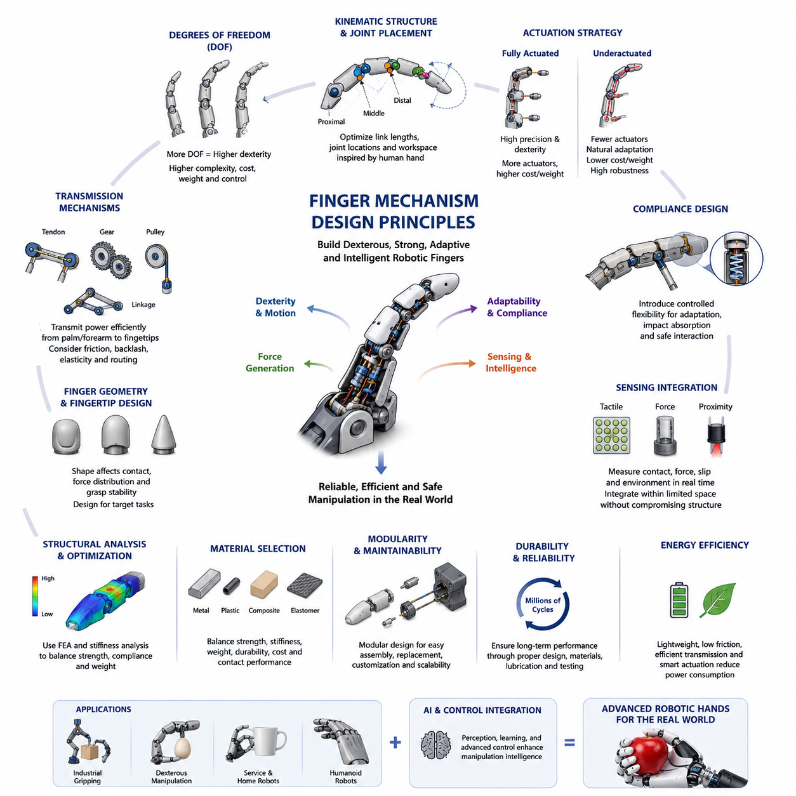{width="7.268055555555556in" height="7.268055555555556in"}

The design of robotic finger mechanisms represents one of the most fundamental and influential aspects of robot hand engineering. A robot hand ultimately interacts with the physical world through its fingers, making finger mechanism design a critical factor that determines grasp stability, dexterity, payload capability, manipulation performance, durability, and overall system intelligence. While advances in sensing, control, artificial intelligence, and machine learning continue to expand the capabilities of robotic manipulation systems, the physical design of the finger remains the foundation upon which these higher-level functions operate. A poorly designed finger mechanism cannot be compensated for entirely through software, whereas a well-designed mechanism can significantly simplify control and improve grasp robustness across a wide range of tasks. Within the overall structure of Robot Hand and Dexterous Grasping engineering, finger mechanism design serves as the bridge between actuator systems, contact mechanics, grasp planning, tactile sensing, and force control.

The primary objective of a robotic finger mechanism is to generate controlled motion and force while maintaining structural integrity and adaptability to various object geometries. Unlike industrial robot arms that typically operate in open kinematic chains with large workspaces, robotic fingers operate within highly constrained environments involving continuous physical contact with objects. This unique operational context introduces challenges related to compliance, contact uncertainty, friction, collision, force distribution, and manipulation stability. Consequently, the design principles governing robotic fingers differ significantly from those applied to conventional robotic manipulators.

One of the first considerations in finger mechanism design is determining the number of degrees of freedom. The degree of freedom of a finger directly affects its dexterity and ability to conform to object shapes. Human fingers typically possess multiple joints and degrees of freedom that enable sophisticated manipulation tasks such as grasping, pinching, rotating, and repositioning objects. Robotic fingers may range from simple single-degree-of-freedom mechanisms used in industrial grippers to highly articulated multi-joint systems designed for dexterous manipulation. Increasing the number of degrees of freedom generally enhances manipulation capability but simultaneously increases mechanical complexity, control requirements, cost, weight, and reliability concerns. Therefore, the selection of finger degrees of freedom requires careful balancing between functional requirements and engineering constraints.

Kinematic structure is another central design principle. The arrangement of links and joints determines the motion characteristics of the finger and influences its reachable workspace. Most robotic fingers are modeled as serial kinematic chains consisting of proximal, middle, and distal phalanges connected through revolute joints. The lengths of these links must be optimized according to target object sizes and intended applications. Longer fingers increase reach but may reduce structural stiffness and payload capacity. Shorter fingers improve strength and rigidity but limit grasping flexibility. Designers often perform extensive kinematic simulations to evaluate workspace coverage, fingertip trajectories, and grasp configurations before finalizing link dimensions.

Joint placement significantly influences finger functionality. Proper joint positioning allows the fingertip to follow natural grasping trajectories that approximate human hand movements. In many successful robotic hand designs, joint locations are inspired by human anatomy because millions of years of biological evolution have produced highly optimized grasping structures. However, direct replication of human anatomy is not always desirable. Engineering requirements such as manufacturability, actuator integration, durability, and control simplicity often necessitate modifications to biological structures. The resulting robotic finger typically combines biomimetic inspiration with practical engineering considerations.

The choice between fully actuated and underactuated mechanisms represents another major design decision. Fully actuated fingers assign an independent actuator to each degree of freedom, enabling precise control of joint positions and forces. Such designs are capable of achieving highly dexterous manipulation and are frequently employed in research platforms and advanced humanoid hands. However, fully actuated systems require numerous actuators, transmission components, sensors, and control channels. This increases system weight, cost, power consumption, and maintenance requirements.

Underactuated fingers address these challenges by utilizing fewer actuators than degrees of freedom. Mechanical couplings, differential mechanisms, springs, tendons, or compliant elements distribute actuator forces across multiple joints. When interacting with an object, the finger naturally adapts its shape to the object\'s geometry. This adaptive behavior often improves grasp robustness while reducing mechanical complexity. Many modern robotic hands utilize underactuated designs because they offer an attractive balance between dexterity and practicality. The concept of underactuation has become one of the most influential developments in contemporary robotic hand engineering.

Compliance plays a critical role in finger mechanism design. Real-world environments contain uncertainties that cannot be perfectly modeled or predicted. Objects may have varying shapes, material properties, positions, and orientations. Rigid mechanisms often struggle to accommodate such variability, resulting in unstable grasps or excessive contact forces. Compliant mechanisms introduce controlled flexibility into the finger structure, allowing passive adaptation to object surfaces. Compliance may be achieved through elastic joints, flexible materials, series elastic actuators, tendon elasticity, or specialized compliant link structures. Properly designed compliance improves safety, shock tolerance, grasp stability, and interaction quality.

Structural stiffness must be carefully balanced against compliance. Excessive compliance can reduce positioning accuracy and payload capability, while excessive rigidity can increase impact forces and sensitivity to alignment errors. Designers often analyze stiffness distribution throughout the finger structure to ensure that compliance occurs in desired directions while maintaining adequate strength in load-bearing regions. Advanced finite element analysis is frequently employed to evaluate deformation characteristics under expected operating loads.

Transmission design forms another essential aspect of finger engineering. Actuators are rarely positioned directly at finger joints because such arrangements increase distal mass and rotational inertia. Instead, power is commonly transmitted through mechanisms such as tendons, gears, pulleys, belts, linkages, or differential systems. Tendon-driven mechanisms are particularly popular because they allow actuators to be placed remotely within the palm or forearm. This configuration reduces finger weight and improves dynamic performance. However, tendon systems introduce challenges related to friction, backlash, elasticity, tension control, and routing complexity.

Gear-based transmissions provide precise motion transfer and high torque capacity but often increase weight and mechanical complexity. Pulley systems offer efficient force transmission while maintaining compact packaging. Linkage mechanisms can generate desired motion trajectories through purely mechanical means. The selection of a transmission mechanism depends on application requirements including precision, payload, speed, compactness, and maintenance considerations.

Finger geometry significantly influences grasp performance. Fingertip shape affects contact conditions, force distribution, and object stability. Flat fingertips provide large contact areas suitable for stable gripping. Rounded fingertips facilitate rolling contacts and dexterous manipulation. Pointed fingertips enable precise interaction with small objects but reduce contact stability. Designers frequently optimize fingertip geometry according to intended task domains. Industrial gripping applications often prioritize stability and robustness, whereas dexterous manipulation systems prioritize versatility and contact mobility.

The integration of sensing technologies increasingly shapes finger mechanism design. Modern robotic fingers often incorporate tactile sensors, force sensors, strain gauges, pressure arrays, temperature sensors, and proximity sensors. These sensing elements provide critical information regarding contact states, force distribution, slip detection, and object properties. Integrating sensors within limited finger volumes presents significant engineering challenges. Mechanical designers must allocate space for sensor components while maintaining structural strength and minimizing wiring complexity. Sensor placement strategies directly influence measurement accuracy and manipulation performance.

Another important design principle involves force transmission efficiency. The effectiveness with which actuator output is converted into fingertip force determines the overall capability of the robotic hand. Designers analyze mechanical advantage throughout the finger workspace to ensure consistent force generation. Certain grasp configurations may experience reduced mechanical advantage due to unfavorable joint alignments. Optimization techniques are often employed to maximize force transmission efficiency across commonly used grasp postures.

Finger mechanism design must also consider collision avoidance and self-interference. Multi-finger robotic hands operate within highly constrained spatial environments where links and joints may collide with each other during motion. Designers conduct kinematic analyses to identify and eliminate potential interference regions. Mechanical stops, motion constraints, and optimized link geometries are commonly used to prevent damaging collisions while preserving functional workspace.

Durability and reliability are particularly important for industrial applications. Robotic fingers may perform millions of grasping cycles over their operational lifetime. Repeated loading, impact events, and environmental exposure can lead to wear, fatigue, and component degradation. Finger mechanisms must therefore be designed with appropriate safety factors, material selections, lubrication strategies, and maintenance accessibility. Reliability engineering principles play a crucial role in ensuring long-term operational performance.

Material selection strongly influences finger performance characteristics. Metals such as aluminum, titanium, and stainless steel provide high strength and durability. Engineering plastics reduce weight and manufacturing costs. Composite materials offer favorable stiffness-to-weight ratios. Elastomers introduce compliance and improve contact properties. Increasingly, hybrid material architectures combine multiple material types within a single finger structure to achieve optimal performance across diverse requirements.

Modularity has emerged as a major trend in robotic hand development. Modular finger architectures allow rapid replacement, customization, maintenance, and scalability. Researchers and manufacturers can experiment with different finger configurations without redesigning entire hand systems. Standardized interfaces facilitate integration with various actuator modules, sensor packages, and palm structures. This modular approach accelerates development cycles and supports a wider range of application scenarios.

Energy efficiency is becoming increasingly important as robotic systems move toward mobile and autonomous operation. Every aspect of finger design influences power consumption, including transmission efficiency, friction characteristics, actuator sizing, structural weight, and compliance mechanisms. Efficient finger mechanisms reduce energy requirements while extending operational duration for battery-powered robotic platforms. This consideration is especially relevant in mobile manipulators, service robots, warehouse automation systems, and humanoid robots. The role of robotic hands within mobile manipulation systems continues to expand as robots become capable of performing increasingly sophisticated physical tasks.

Human-inspired design remains a powerful source of innovation. The human hand demonstrates an extraordinary combination of dexterity, strength, adaptability, sensing, and energy efficiency. Many robotic finger designs draw inspiration from anatomical structures such as tendons, ligaments, joints, muscles, and skin. Biomimetic approaches seek not merely to replicate appearance but to capture underlying functional principles. Examples include tendon-driven actuation systems, variable stiffness mechanisms, compliant fingertips, and adaptive grasping structures. Nevertheless, robotic hands are not constrained by biological limitations and may exceed human capabilities in certain domains through specialized designs.

The future of finger mechanism design is increasingly influenced by advancements in soft robotics, additive manufacturing, intelligent materials, embedded sensing, and artificial intelligence. Soft robotic fingers offer unprecedented adaptability and safety. Additive manufacturing enables complex geometries that were previously impossible to fabricate. Smart materials introduce variable stiffness and self-sensing capabilities. Integrated tactile sensing allows fingers to perceive and respond to contact events in real time. Artificial intelligence enables optimization of both mechanical structures and control strategies through data-driven approaches.

Ultimately, finger mechanism design represents a multidisciplinary engineering challenge that combines mechanics, materials science, kinematics, dynamics, sensing, control, manufacturing, and robotics. Successful finger designs achieve a delicate balance between dexterity, strength, adaptability, reliability, efficiency, and cost. As robotic systems continue to evolve toward greater autonomy and physical intelligence, the importance of well-designed finger mechanisms will only increase. They serve as the primary interface between robotic cognition and the physical world, transforming computational decisions into meaningful physical interactions and enabling robots to perform tasks that increasingly approach the versatility and capability of human hands.

로봇 손가락(Finger)의 메커니즘 설계는 로봇 핸드(Robot Hand) 공학에서 가장 기본적이면서도 중요한 분야 중 하나이다. 로봇 핸드는 결국 손가락을 통해 실제 물체와 접촉하고 상호작용하기 때문에, 손가락 구조는 파지 안정성(Grasp Stability), 조작성(Dexterity), 가반하중(Payload Capacity), 조작 성능(Manipulation Performance), 내구성(Durability), 그리고 전체 시스템의 지능(Intelligence)을 결정하는 핵심 요소가 된다. 최근 인공지능(AI), 촉각 센싱(Tactile Sensing), 강화학습(Reinforcement Learning), 파운데이션 모델(Foundation Models) 등의 기술이 급속히 발전하고 있지만, 물리적으로 우수한 손가락 구조가 뒷받침되지 않는다면 이러한 고수준 기능들은 충분한 성능을 발휘하기 어렵다. 반대로 잘 설계된 손가락 메커니즘은 제어를 단순화하고 다양한 물체에 대한 파지 성공률을 크게 향상시킬 수 있다.

손가락 메커니즘 설계의 가장 중요한 목적은 원하는 운동(Motion)과 힘(Force)을 효율적으로 생성하면서도 다양한 물체 형상에 적응할 수 있는 구조를 만드는 것이다. 일반적인 산업용 로봇 팔(Robot Arm)이 비교적 넓은 작업 공간에서 움직이는 개방형 운동학 체인(Open Kinematic Chain)이라면, 손가락은 항상 물체와 접촉하는 매우 제한된 환경에서 동작한다. 따라서 접촉(Contact), 마찰(Friction), 순응성(Compliance), 힘 분배(Force Distribution), 충돌(Collision), 파지 안정성(Stability)과 같은 요소들이 설계 초기부터 고려되어야 한다.

손가락 설계에서 가장 먼저 결정해야 할 사항 중 하나는 자유도(Degree of Freedom, DOF)의 수이다. 자유도는 손가락이 얼마나 다양한 자세와 움직임을 생성할 수 있는지를 결정한다. 인간의 손가락은 여러 개의 관절(Joint)과 자유도를 통해 물체를 잡고, 회전시키고, 위치를 바꾸는 복잡한 조작을 수행할 수 있다. 로봇 손가락은 단일 자유도를 가지는 단순한 산업용 그리퍼(Gripper)부터 여러 관절을 가진 고자유도 다지형 로봇 손(Dexterous Hand)까지 매우 다양한 형태로 설계될 수 있다.

자유도가 증가하면 조작성은 향상되지만 기구 구조가 복잡해지고 제어 난이도, 비용, 무게, 유지보수 부담도 증가한다. 따라서 설계자는 요구되는 작업(Task)에 필요한 최소한의 자유도와 실제 구현 가능한 수준의 복잡성 사이에서 적절한 균형을 찾아야 한다.

운동학 구조(Kinematic Structure)는 손가락 성능을 결정하는 또 다른 핵심 요소이다. 링크(Link)와 관절의 배치는 손가락의 움직임 특성과 작업 공간(Workspace)을 결정한다. 대부분의 로봇 손가락은 인간 손가락과 유사하게 근위지절(Proximal Phalanx), 중위지절(Middle Phalanx), 원위지절(Distal Phalanx) 구조를 가지는 직렬형(Serial Chain) 메커니즘을 채택한다. 링크 길이는 목표 물체의 크기와 응용 분야에 따라 최적화된다. 긴 손가락은 작업 범위를 넓힐 수 있지만 강성이 감소할 수 있으며, 짧은 손가락은 강도는 높지만 적응성이 떨어질 수 있다.

관절 위치(Joint Placement)는 손가락 끝(Fingertip)의 궤적(Trajectory)과 파지 능력에 직접적인 영향을 미친다. 적절한 관절 배치는 인간 손과 유사한 자연스러운 움직임을 구현할 수 있게 한다. 실제로 많은 로봇 손 설계는 인간 손의 해부학적 구조를 참고하여 개발된다. 그러나 인간 손을 그대로 모방하는 것이 항상 최선은 아니다. 제조성(Manufacturability), 내구성(Durability), 액추에이터 배치(Actuator Integration), 비용(Cost), 제어 단순성(Control Simplicity) 등의 공학적 요구사항 때문에 인간 구조를 변형한 형태가 주로 사용된다.

손가락 설계에서 매우 중요한 선택 중 하나는 완전 구동형(Fully Actuated) 구조와 부족 구동형(Underactuated) 구조 중 어느 것을 채택할 것인가이다. 완전 구동형은 모든 자유도에 독립적인 액추에이터를 배치하여 각 관절을 개별적으로 제어한다. 이 방식은 매우 높은 정밀도와 조작성(Dexterity)을 제공하지만 액추에이터 수가 많아지고 시스템이 복잡해진다.

반면 부족 구동형 구조는 자유도 수보다 적은 수의 액추에이터를 사용한다. 스프링(Spring), 텐던(Tendon), 차동기구(Differential Mechanism), 순응성 구조 등을 활용하여 여러 관절이 하나의 액추에이터에 의해 구동된다. 이러한 구조는 물체와 접촉했을 때 자연스럽게 형태를 적응시키는 특성을 가지며, 적은 비용과 무게로도 우수한 파지 성능을 제공할 수 있다. 오늘날 많은 상용 로봇 핸드가 부족 구동형 설계를 채택하는 이유도 여기에 있다.

순응성(Compliance)은 현대 로봇 손가락 설계에서 필수적인 개념이다. 실제 환경에서는 물체의 위치, 형상, 재질, 마찰 계수 등을 완벽하게 예측할 수 없다. 순응성이 없는 강체 구조(Rigid Structure)는 작은 오차에도 쉽게 실패하거나 과도한 충격력을 발생시킬 수 있다. 따라서 적절한 탄성(Elasticity)을 부여하여 물체 형상에 자연스럽게 적응하도록 만드는 것이 중요하다.

순응성은 탄성 관절(Elastic Joint), 유연한 재료(Flexible Material), 직렬 탄성 액추에이터(Series Elastic Actuator), 케이블 탄성(Cable Elasticity) 등을 통해 구현될 수 있다. 이러한 구조는 충격 흡수, 안전성 향상, 파지 안정성 증가, 그리고 인간과의 협업 환경에서의 안전성을 크게 향상시킨다.

그러나 순응성이 지나치게 크면 위치 정확도(Position Accuracy)가 감소하고, 반대로 강성이 지나치게 높으면 충격과 오차에 민감해진다. 따라서 설계자는 강성(Stiffness)과 순응성 사이에서 적절한 균형을 찾아야 한다. 이를 위해 유한요소해석(Finite Element Analysis, FEA)이 자주 사용되며, 예상 하중 조건에서의 변형과 응력을 분석하여 구조를 최적화한다.

동력 전달(Transmission) 방식 또한 매우 중요한 설계 요소이다. 액추에이터를 손가락 끝에 직접 배치하면 무게와 관성(Inertia)이 증가하여 성능이 저하된다. 따라서 대부분의 로봇 손은 액추에이터를 손바닥(Palm)이나 전완(Forearm)에 배치하고 텐던, 기어, 풀리(Pulley), 벨트(Belt), 링크(Linkage)를 이용해 힘을 전달한다.

텐던 구동(Tendon-Driven) 방식은 가장 널리 사용되는 구조 중 하나이다. 액추에이터를 손바닥 내부에 배치할 수 있어 손가락을 가볍게 만들 수 있다. 그러나 마찰(Friction), 케이블 장력(Tension), 탄성(Elasticity), 백래시(Backlash)와 같은 문제가 발생할 수 있다. 기어 기반 전송(Gear Transmission)은 높은 정밀도와 토크(Torque)를 제공하지만 무게 증가와 복잡성 증가라는 단점이 있다.

손가락 형상(Finger Geometry) 역시 파지 성능에 큰 영향을 준다. 평평한 손끝은 넓은 접촉면을 제공하여 안정적인 파지를 가능하게 한다. 둥근 손끝은 굴림(Rolling)과 같은 정교한 조작에 유리하다. 뾰족한 손끝은 작은 부품을 다루기에 적합하지만 접촉 안정성이 떨어질 수 있다. 따라서 손끝 형상은 응용 분야에 맞게 최적화되어야 한다.

최근에는 촉각 센서(Tactile Sensor), 힘 센서(Force Sensor), 압력 센서(Pressure Sensor), 근접 센서(Proximity Sensor) 등을 손가락 내부에 통합하는 것이 일반화되고 있다. 이러한 센서들은 접촉 위치, 접촉 힘, 미끄러짐(Slip), 물체 특성 등을 실시간으로 측정하여 더욱 정교한 조작을 가능하게 한다. 하지만 제한된 공간 안에 센서를 배치하는 것은 상당한 기계 설계상의 도전 과제이다.

힘 전달 효율(Force Transmission Efficiency)은 손가락 설계의 핵심 성능 지표 중 하나이다. 액추에이터에서 생성된 힘이 얼마나 효율적으로 손끝까지 전달되는지가 실제 파지 능력을 결정한다. 일부 자세에서는 기구학적 구조 때문에 기계적 이점(Mechanical Advantage)이 감소할 수 있으며, 설계자는 이를 최소화하도록 링크 비율과 관절 구조를 최적화해야 한다.

다지형 로봇 핸드(Multifinger Robot Hand)에서는 손가락 간 충돌(Self-Interference) 문제도 중요하다. 여러 손가락이 좁은 공간 안에서 움직이기 때문에 링크와 관절이 서로 충돌할 가능성이 존재한다. 따라서 설계 단계에서 충분한 운동학 분석(Kinematic Analysis)을 수행하여 충돌 가능성을 제거해야 한다.

산업용 응용에서는 내구성(Durability)과 신뢰성(Reliability)이 매우 중요하다. 로봇 손은 수백만 회 이상의 파지 사이클을 수행할 수 있으므로 반복 하중, 충격, 마모, 피로(Fatigue)에 대한 충분한 설계 여유를 확보해야 한다. 적절한 재료 선택, 윤활(Lubrication), 구조 설계, 유지보수 접근성 등이 장기적인 신뢰성을 결정한다.

재료 선택(Material Selection)은 손가락 성능에 직접적인 영향을 준다. 알루미늄(Aluminum), 티타늄(Titanium), 스테인리스강(Stainless Steel)은 높은 강도와 내구성을 제공한다. 엔지니어링 플라스틱(Engineering Plastic)은 무게를 줄이고 비용을 절감할 수 있다. 복합재료(Composite Material)는 높은 강성 대 중량비(Stiffness-to-Weight Ratio)를 제공한다. 또한 엘라스토머(Elastomer)는 접촉 안정성과 순응성을 향상시키는 데 사용된다.

최근에는 모듈화(Modularity)가 중요한 설계 철학으로 자리 잡고 있다. 모듈형 손가락 구조는 유지보수, 업그레이드, 실험적 개발을 쉽게 만든다. 손가락 모듈을 독립적으로 교체하거나 수정할 수 있기 때문에 개발 기간을 단축하고 다양한 응용 분야에 대응할 수 있다.

에너지 효율(Energy Efficiency) 역시 모바일 매니퓰레이터(Mobile Manipulator), 서비스 로봇(Service Robot), 휴머노이드(Humanoid Robot) 시대에 매우 중요한 요소가 되고 있다. 손가락의 무게, 마찰, 전달 효율, 구동 방식은 모두 전력 소비에 영향을 미친다. 효율적인 손가락 설계는 배터리 기반 로봇의 운용 시간을 연장하고 전체 시스템 효율을 향상시킨다.

인간 손(Human Hand)은 여전히 가장 중요한 참고 모델(Reference Model)이다. 인간 손은 뛰어난 조작성, 적응성, 감각 능력, 에너지 효율성을 동시에 제공한다. 많은 로봇 손 설계가 힘줄(Tendon), 인대(Ligament), 관절(Joint), 근육(Muscle), 피부(Skin) 구조에서 영감을 얻고 있다. 그러나 로봇은 반드시 인간과 동일할 필요는 없으며, 특정 작업에서는 인간을 능가하는 특화된 구조를 채택할 수 있다.

미래의 손가락 메커니즘 설계는 소프트 로보틱스(Soft Robotics), 적층 제조(Additive Manufacturing), 스마트 재료(Smart Materials), 임베디드 센싱(Embedded Sensing), 그리고 물리 AI(Physical AI)에 의해 더욱 발전할 것으로 예상된다. 소프트 손가락은 뛰어난 적응성과 안전성을 제공하고, 3D 프린팅은 기존 제조 방식으로는 불가능했던 복잡한 구조를 구현할 수 있게 한다. 또한 지능형 재료는 가변 강성(Variable Stiffness)과 자체 센싱(Self-Sensing) 기능을 제공할 수 있다.

결국 손가락 메커니즘 설계는 기계공학(Mechanical Engineering), 재료공학(Material Engineering), 운동학(Kinematics), 동역학(Dynamics), 센싱(Sensing), 제어(Control), 제조공학(Manufacturing Engineering), 인공지능(AI)이 융합된 대표적인 다학제(Multidisciplinary) 분야이다. 우수한 손가락 설계는 조작성, 강도, 적응성, 신뢰성, 에너지 효율, 비용 사이에서 최적의 균형을 달성해야 한다. 미래의 지능형 로봇 시스템에서 손가락은 단순한 말단 장치(End Effector)가 아니라, 로봇의 지능을 물리 세계와 연결하는 핵심 인터페이스로서 더욱 중요한 역할을 수행하게 될 것이다.

##  

## 02.02 Linkage-Based Finger Mechanisms

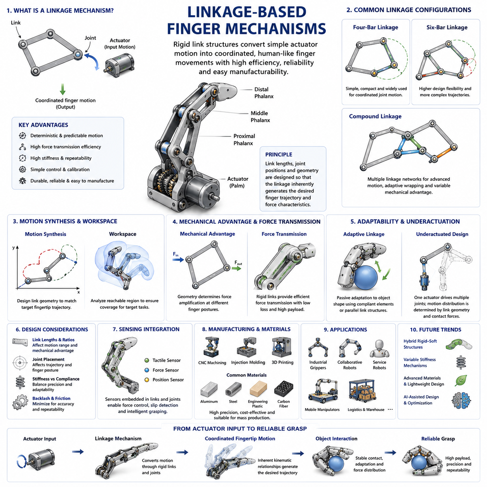{width="7.268055555555556in" height="7.268055555555556in"}

Linkage-based finger mechanisms represent one of the oldest, most practical, and most widely adopted approaches in robotic hand engineering. Long before advanced tendon-driven systems, soft robotic fingers, and highly dexterous anthropomorphic hands became popular research topics, linkage mechanisms provided engineers with an effective method for transforming actuator motion into controlled finger movements. Even today, linkage-based fingers remain a dominant solution in industrial grippers, collaborative robots, service robots, mobile manipulators, agricultural robots, logistics automation systems, and many commercial robotic hands because of their simplicity, reliability, predictability, and ease of manufacturing.

A linkage mechanism can be broadly defined as a collection of rigid links connected through joints that transmit motion and forces from an actuator to one or more output points. In robotic fingers, linkage systems convert rotary or linear actuator motion into coordinated finger joint movements. Unlike tendon-driven fingers that rely on flexible cables and complex routing paths, linkage mechanisms use rigid mechanical structures to establish deterministic relationships between input motion and output finger trajectories. This deterministic behavior simplifies modeling, control, calibration, and maintenance while providing excellent repeatability.

The fundamental objective of a linkage-based finger mechanism is to reproduce useful grasping motions while minimizing actuator count, reducing control complexity, and maximizing mechanical efficiency. Human fingers contain muscles, tendons, ligaments, and multiple joints that create highly sophisticated motion patterns. Replicating these biological systems directly can be difficult, expensive, and mechanically complex. Linkage mechanisms provide an alternative approach by generating human-like finger movements through carefully designed geometric relationships between rigid links.

One of the key advantages of linkage mechanisms is their ability to generate complex motion trajectories using relatively simple mechanical structures. By adjusting link lengths, pivot locations, joint offsets, and transmission ratios, engineers can design fingers that naturally follow desired grasping paths. In many cases, the geometry of the linkage itself performs part of the control function. Instead of requiring sophisticated software algorithms to coordinate multiple joints, the mechanical structure inherently produces synchronized motion.

This concept is often referred to as mechanical intelligence. Mechanical intelligence describes the ability of a mechanism to perform useful behaviors through its physical design rather than through computational control. Linkage-based fingers frequently exploit this principle. For example, a properly designed four-bar linkage may naturally curl around an object during grasping, reducing the need for active control and sensor feedback.

The simplest linkage-based finger consists of a single rigid link driven by a rotary actuator. Such systems are commonly found in industrial parallel-jaw grippers where each finger behaves as a rigid body moving along a predefined path. While simple and robust, these fingers offer limited adaptability because they cannot conform to object geometry. They are most suitable for structured environments where object shapes and positions are known in advance.

More advanced linkage-based fingers incorporate multiple phalanges connected through revolute joints. These designs mimic the segmented structure of the human finger and allow greater adaptability during grasping. The movement of multiple joints can be coordinated through interconnected linkages, enabling a single actuator to drive several finger segments simultaneously. Such coordinated motion creates more natural grasping behavior and improves contact distribution across the object surface.

Among the most widely used linkage configurations is the four-bar linkage mechanism. Four-bar systems consist of four rigid links connected in a closed kinematic chain. By selecting appropriate link lengths and joint positions, designers can generate a wide range of motion patterns. Four-bar linkages are popular because they are compact, efficient, and relatively easy to analyze mathematically. Many robotic fingers employ four-bar mechanisms to synchronize distal and proximal joints, creating coordinated curling motions similar to those observed in human fingers.

Another common configuration is the six-bar linkage. Six-bar systems provide greater design flexibility and can generate more complex motion trajectories than four-bar mechanisms. These mechanisms are particularly useful when designers seek to approximate biological finger movements or achieve specific grasping behaviors. However, increased flexibility comes at the cost of greater mechanical complexity and more challenging optimization processes.

Multi-link finger mechanisms can also be designed using compound linkage structures. In these systems, several linkage networks interact to coordinate motion across multiple joints. Compound mechanisms enable sophisticated finger behaviors such as adaptive wrapping, sequential joint engagement, and variable mechanical advantage throughout the grasping process. These characteristics are particularly valuable when handling objects with diverse shapes and sizes.

One of the most important design considerations in linkage-based finger engineering is motion synthesis. Motion synthesis refers to the process of determining linkage dimensions and joint locations that generate desired output trajectories. Engineers often begin by defining target fingertip paths or desired joint angle relationships. Optimization techniques are then used to determine linkage geometries that approximate these objectives. Advances in computational design tools have significantly improved the ability to synthesize complex linkage mechanisms for robotic applications.

Workspace analysis is another critical aspect of linkage mechanism design. The workspace of a robotic finger defines the region within which the fingertip can move. Different linkage configurations produce different workspace characteristics. Some mechanisms generate large sweeping motions suitable for enveloping grasps, while others prioritize precision and control within smaller workspaces. Designers must carefully evaluate workspace coverage to ensure compatibility with intended manipulation tasks.

Mechanical advantage plays a central role in determining the force capabilities of linkage-based fingers. Mechanical advantage describes how effectively actuator forces are amplified or transmitted through the linkage structure. Certain linkage geometries provide high force output near fully closed configurations, making them suitable for secure gripping applications. Other geometries prioritize speed and range of motion over force amplification. Optimizing mechanical advantage requires balancing grasp force, motion speed, energy efficiency, and actuator size.

Force transmission efficiency is generally one of the strongest advantages of linkage-based systems. Because forces are transmitted through rigid structures rather than flexible cables, losses due to elasticity and friction are often reduced. This allows linkage fingers to achieve high payload capacities relative to their size and weight. Industrial gripping systems frequently rely on linkage mechanisms for this reason.

Structural stiffness is another significant benefit. Rigid linkages maintain precise geometric relationships between joints, resulting in accurate and repeatable motion. High stiffness improves positioning accuracy and grasp stability, especially in applications involving assembly, inspection, machining, or precision manipulation. However, excessive stiffness may reduce adaptability when interacting with uncertain environments or delicate objects.

To address this challenge, many modern linkage-based fingers incorporate compliance elements into their design. Springs, elastic joints, flexible couplings, and compliant materials can be integrated within linkage structures to introduce controlled flexibility. This combination of rigid kinematic guidance and localized compliance allows fingers to maintain precision while adapting to contact uncertainties.

Adaptive linkage mechanisms represent an important evolution of traditional linkage-based fingers. These systems use passive or semi-passive mechanical elements to automatically adjust finger posture during grasping. When a finger encounters an object, contact forces cause the linkage structure to reconfigure itself, allowing multiple contact points to form without requiring additional actuators or complex control algorithms. Adaptive linkage fingers are particularly effective for handling objects with unknown geometries.

Underactuated robotic hands frequently employ linkage mechanisms as their primary motion transmission architecture. In these designs, one actuator drives multiple joints through interconnected linkages. The resulting motion distribution emerges naturally from the mechanical structure and object interaction forces. This approach significantly reduces actuator count while preserving much of the adaptability associated with more complex systems.

Biomimetic engineering has also influenced the development of linkage-based finger mechanisms. Researchers often study human finger anatomy to identify key motion characteristics and functional relationships. Linkage structures are then synthesized to reproduce these behaviors using simplified mechanical systems. Although robotic fingers rarely replicate biological anatomy exactly, many successful designs capture essential aspects of human grasping kinematics through carefully engineered linkage arrangements.

The integration of sensors within linkage mechanisms introduces additional design considerations. Tactile sensors, force sensors, position encoders, and strain gauges must be incorporated without interfering with linkage motion. Sensor placement often requires detailed analysis of mechanical loads, deformation patterns, and available packaging space. Modern robotic fingers increasingly combine sophisticated sensing capabilities with linkage-based motion systems to achieve intelligent grasping behavior.

Manufacturability is another major reason for the popularity of linkage mechanisms. Most linkage components can be fabricated using conventional machining, injection molding, additive manufacturing, or sheet metal processes. Compared to tendon-driven systems, linkage mechanisms generally require fewer specialized components and less complex assembly procedures. This reduces production costs and simplifies maintenance.

Reliability and durability are particularly important in industrial environments where robotic systems may perform millions of grasping cycles over their operational lifetime. Linkage mechanisms typically exhibit excellent wear resistance and predictable failure modes. Properly designed joints, bearings, and structural members can provide long service lives with minimal maintenance requirements. This reliability makes linkage-based fingers attractive for applications where downtime must be minimized.

The rise of collaborative robots and service robots has created renewed interest in lightweight linkage architectures. Engineers increasingly seek mechanisms that provide high performance while minimizing weight and inertia. Advanced materials such as carbon fiber composites, high-performance polymers, and lightweight aluminum alloys are frequently employed to achieve these objectives. Topology optimization and generative design techniques further enhance structural efficiency.

Simulation and digital engineering tools have transformed the development of linkage-based fingers. Modern computer-aided design software enables engineers to model complex kinematic relationships, evaluate force transmission characteristics, analyze collision behavior, and optimize performance before physical prototypes are constructed. Dynamic simulations provide insights into actuator requirements, contact interactions, and manipulation performance under realistic operating conditions.

In mobile manipulation systems, linkage-based fingers play a critical role in enabling reliable object interaction. Warehouse robots, logistics systems, agricultural platforms, service robots, and industrial mobile manipulators often prioritize robustness and repeatability over extreme dexterity. Linkage mechanisms align well with these requirements by offering predictable behavior, efficient force transmission, and low maintenance demands.

Future developments in linkage-based finger engineering are expected to focus on hybrid architectures that combine rigid linkages with compliant materials, embedded sensing, variable stiffness mechanisms, and artificial intelligence. These hybrid systems seek to preserve the strengths of traditional linkage mechanisms while addressing their limitations in adaptability and environmental interaction. Emerging technologies such as smart materials, additive manufacturing, and computational mechanism design will further expand the capabilities of linkage-based robotic fingers.

Ultimately, linkage-based finger mechanisms remain one of the foundational technologies of robotic hand engineering. Their ability to transform simple actuator motions into sophisticated grasping behaviors through purely mechanical means represents a powerful example of intelligent mechanical design. By combining kinematic precision, force efficiency, structural robustness, manufacturability, and adaptability, linkage-based fingers continue to serve as essential building blocks for robotic systems ranging from industrial grippers to advanced dexterous hands. As robotic manipulation expands into increasingly diverse environments, linkage mechanisms will remain a cornerstone of practical, reliable, and scalable robotic hand development.

링크 기반 손가락 메커니즘(Linkage-Based Finger Mechanism)은 로봇 핸드 공학에서 가장 오래되고 실용적이며 널리 사용되는 설계 방식 중 하나이다. 오늘날에는 텐던 구동(Tendon-Driven) 시스템, 소프트 로보틱스(Soft Robotics), 다지형 로봇 핸드(Dexterous Robot Hand) 등이 활발히 연구되고 있지만, 링크 메커니즘은 여전히 산업용 그리퍼(Industrial Gripper), 협동로봇(Collaborative Robot), 서비스 로봇(Service Robot), 모바일 매니퓰레이터(Mobile Manipulator), 물류 자동화(Logistics Automation), 농업용 로봇(Agricultural Robot) 등에서 핵심적인 기술로 사용되고 있다. 이는 링크 구조가 단순하면서도 신뢰성이 높고, 반복 정밀도가 우수하며, 제조와 유지보수가 용이하기 때문이다.

링크 메커니즘은 여러 개의 강체 링크(Rigid Link)와 관절(Joint)로 구성된 기계 구조로 정의할 수 있다. 로봇 손가락에서는 액추에이터(Actuator)의 운동을 손가락 관절의 움직임으로 전달하는 역할을 수행한다. 텐던 방식이 케이블과 풀리(Pulley)를 이용하여 힘을 전달하는 반면, 링크 기반 구조는 강체 구조를 이용하여 보다 직접적이고 예측 가능한 운동을 생성한다. 따라서 모델링(Modeling), 제어(Control), 보정(Calibration), 유지보수(Maintenance)가 상대적으로 단순하며 반복 동작의 정확성이 매우 높다.

링크 기반 손가락의 가장 중요한 목적은 최소한의 액추에이터로 자연스러운 파지 동작을 구현하는 것이다. 인간 손은 수많은 근육(Muscle), 힘줄(Tendon), 인대(Ligament), 관절(Joint)들이 복합적으로 작동하여 정교한 움직임을 만들어낸다. 이를 그대로 기계적으로 구현하는 것은 매우 어렵고 비용도 높다. 따라서 링크 메커니즘은 비교적 단순한 기계 구조를 사용하여 인간 손과 유사한 움직임을 생성하는 대안적 접근 방법으로 발전해 왔다.

링크 메커니즘의 가장 큰 장점 중 하나는 복잡한 움직임을 기계 구조 자체만으로 생성할 수 있다는 점이다. 링크 길이(Link Length), 회전축 위치(Pivot Position), 관절 간 거리(Joint Offset), 기어비(Transmission Ratio) 등을 적절하게 설계하면 손가락 끝(Fingertip)이 원하는 경로를 자연스럽게 따라 움직이도록 만들 수 있다. 이러한 특성은 종종 기계적 지능(Mechanical Intelligence)이라고 불린다.

기계적 지능이란 복잡한 소프트웨어 제어 없이도 기계 구조 자체가 원하는 행동을 수행하도록 설계되는 개념을 의미한다. 예를 들어 잘 설계된 4절 링크(Four-Bar Linkage)는 물체를 감싸는 자연스러운 곡선 운동을 생성할 수 있으며, 별도의 복잡한 제어 알고리즘 없이도 안정적인 파지를 구현할 수 있다.

가장 단순한 링크 기반 손가락은 하나의 링크와 하나의 회전 관절로 구성된다. 이러한 구조는 산업용 평행 그리퍼(Parallel Jaw Gripper)에서 흔히 볼 수 있으며, 정해진 경로를 따라 움직이는 강체 손가락 형태를 가진다. 구조가 단순하고 신뢰성이 높지만 물체 형상에 적응하는 능력은 제한적이다. 따라서 주로 형상과 위치가 일정한 공장 자동화 환경에서 사용된다.

보다 발전된 링크 기반 손가락은 여러 개의 지절(Phalanx)을 가진다. 인간 손가락처럼 근위지절(Proximal Phalanx), 중위지절(Middle Phalanx), 원위지절(Distal Phalanx)을 포함하는 구조를 채택하여 다양한 물체 형상에 적응할 수 있다. 여러 관절은 링크 구조를 통해 서로 연결되어 하나의 액추에이터가 여러 관절을 동시에 움직일 수 있다. 이러한 방식은 보다 자연스러운 파지 자세를 형성하며 물체와의 접촉 면적을 증가시켜 안정성을 향상시킨다.

가장 널리 사용되는 링크 구조 중 하나는 4절 링크(Four-Bar Linkage)이다. 4절 링크는 네 개의 링크가 폐쇄형 운동학 체인(Closed Kinematic Chain)을 형성하는 구조이다. 링크 길이와 관절 위치를 적절히 조정하면 매우 다양한 운동 궤적을 생성할 수 있다. 많은 로봇 손가락 설계에서는 근위 관절과 원위 관절의 움직임을 동기화하기 위해 4절 링크를 사용하며, 인간 손가락과 유사한 굽힘 동작(Curling Motion)을 구현한다.

보다 복잡한 운동을 구현하기 위해서는 6절 링크(Six-Bar Linkage)가 사용되기도 한다. 6절 링크는 4절 링크보다 설계 자유도가 높아 보다 다양한 운동 특성을 생성할 수 있다. 특히 인간 손의 움직임을 모사하거나 특정 파지 궤적을 구현할 때 유용하다. 그러나 설계와 최적화 과정이 복잡해지고 제조 난이도 역시 증가한다.

복합 링크 구조(Compound Linkage Mechanism)는 여러 개의 링크 시스템을 결합한 형태이다. 이러한 구조는 손가락이 물체를 감싸거나, 특정 순서로 관절이 움직이거나, 파지 과정에서 기계적 이점(Mechanical Advantage)을 변화시키는 등 보다 고급 기능을 구현할 수 있다. 특히 다양한 형상의 물체를 다루는 응용 분야에서 매우 유용하다.

링크 기반 손가락 설계에서 중요한 과정 중 하나는 운동 합성(Motion Synthesis)이다. 운동 합성이란 원하는 손끝 궤적(Fingertip Trajectory)을 생성하기 위한 링크 길이와 관절 위치를 계산하는 과정이다. 설계자는 먼저 목표 운동 경로를 정의한 후 최적화 알고리즘을 사용하여 가장 적합한 링크 구조를 도출한다. 최근 CAD 및 시뮬레이션 기술의 발전으로 이러한 설계 과정은 과거보다 훨씬 효율적으로 수행되고 있다.

작업 공간 분석(Workspace Analysis) 또한 필수적인 설계 요소이다. 작업 공간은 손끝이 도달할 수 있는 영역을 의미한다. 일부 링크 구조는 넓은 범위를 커버하여 물체를 감싸는 데 적합하며, 다른 구조는 좁지만 높은 정밀도를 제공한다. 따라서 목표 응용 분야에 맞는 작업 공간 특성을 확보해야 한다.

기계적 이점(Mechanical Advantage)은 링크 기반 손가락의 힘 생성 능력을 결정한다. 이는 액추에이터가 생성한 힘이 얼마나 효과적으로 증폭되어 손끝으로 전달되는지를 나타낸다. 특정 링크 구조는 손가락이 완전히 닫힐 때 매우 높은 파지력을 생성할 수 있으며, 다른 구조는 힘보다는 속도와 운동 범위를 우선시한다. 따라서 설계자는 파지력, 속도, 전력 소비, 액추에이터 크기 사이에서 균형을 맞추어야 한다.

힘 전달 효율(Force Transmission Efficiency)은 링크 메커니즘의 대표적인 장점이다. 강체 링크를 통해 힘이 전달되므로 텐던 시스템에서 발생하는 탄성 손실이나 장력 변화 문제가 적다. 결과적으로 동일한 크기의 시스템에서도 높은 하중을 처리할 수 있다. 이러한 이유로 산업용 파지 시스템에서는 링크 구조가 매우 널리 사용된다.

구조 강성(Structural Stiffness) 역시 링크 구조의 중요한 특징이다. 강체 링크는 관절 사이의 기하학적 관계를 정확하게 유지하므로 높은 반복 정밀도와 우수한 위치 정확도를 제공한다. 이는 조립(Assembly), 검사(Inspection), 정밀 취급(Precision Manipulation)과 같은 응용 분야에서 매우 중요한 장점이다.

그러나 강성이 지나치게 높으면 적응성이 부족해질 수 있다. 이를 해결하기 위해 현대의 링크 기반 손가락은 스프링(Spring), 탄성 관절(Elastic Joint), 유연 결합(Flexible Coupling) 등을 사용하여 제한적인 순응성(Compliance)을 도입한다. 이러한 방식은 강체 구조의 정밀성을 유지하면서도 접촉 오차를 흡수할 수 있게 해준다.

적응형 링크 메커니즘(Adaptive Linkage Mechanism)은 전통적인 링크 구조가 발전한 형태이다. 이러한 시스템은 물체와 접촉했을 때 수동적으로 자세를 변화시키며, 추가 액추에이터 없이도 여러 접촉점을 형성할 수 있다. 그 결과 다양한 형상의 물체를 보다 안정적으로 파지할 수 있다.

부족 구동형 로봇 핸드(Underactuated Robot Hand)의 대부분은 링크 메커니즘을 기반으로 한다. 하나의 액추에이터가 여러 관절을 구동하고, 실제 운동 분배는 링크 구조와 물체와의 상호작용에 의해 결정된다. 이러한 구조는 액추에이터 수를 크게 줄이면서도 우수한 적응성을 제공한다.

생체모방 설계(Biomimetic Design) 역시 링크 메커니즘 발전에 큰 영향을 주었다. 연구자들은 인간 손의 운동 특성을 분석하여 이를 단순화된 링크 구조로 구현하고자 노력해 왔다. 완전한 복제는 어렵지만 인간 손의 핵심 운동학적 특성을 효과적으로 재현하는 사례들이 많이 개발되고 있다.

센서 통합(Sensor Integration)은 링크 기반 손가락의 또 다른 중요한 설계 과제이다. 촉각 센서(Tactile Sensor), 힘 센서(Force Sensor), 위치 인코더(Position Encoder), 스트레인 게이지(Strain Gauge) 등을 통합하기 위해서는 링크 운동에 영향을 주지 않는 적절한 배치가 필요하다. 최근의 지능형 로봇 핸드는 이러한 센서들을 링크 구조와 결합하여 더욱 정교한 파지 능력을 제공한다.

제조성(Manufacturability)은 링크 기반 메커니즘이 널리 사용되는 또 다른 이유이다. 대부분의 링크 부품은 CNC 가공, 사출성형(Injection Molding), 3D 프린팅(Additive Manufacturing), 판금 가공(Sheet Metal Processing) 등을 통해 쉽게 제작할 수 있다. 따라서 생산 비용이 낮고 대량 생산에도 적합하다.

내구성(Durability)과 신뢰성(Reliability)은 산업용 환경에서 특히 중요하다. 링크 기반 손가락은 수백만 회 이상의 파지 동작을 수행할 수 있으며, 마모 특성이 예측 가능하고 유지보수가 용이하다. 이러한 특성은 생산 중단 비용이 큰 산업 현장에서 매우 높은 가치를 가진다.

최근 협동로봇과 서비스 로봇의 성장으로 인해 경량 링크 구조(Lightweight Linkage Architecture)에 대한 관심도 증가하고 있다. 탄소섬유 복합재(Carbon Fiber Composite), 고성능 플라스틱(High-Performance Polymer), 경량 알루미늄 합금(Lightweight Aluminum Alloy) 등이 적극적으로 활용되고 있으며, 위상 최적화(Topology Optimization)와 생성형 설계(Generative Design)를 통해 더욱 효율적인 구조가 개발되고 있다.

디지털 엔지니어링(Digital Engineering) 기술 또한 링크 기반 손가락 개발을 크게 변화시키고 있다. CAD, 다물체 동역학 시뮬레이션(Multibody Dynamics Simulation), FEA, 디지털 트윈(Digital Twin) 등을 이용하여 실제 시제품 제작 이전에 운동 특성, 힘 전달 성능, 충돌 가능성, 내구성을 평가할 수 있다.

모바일 매니퓰레이터 분야에서는 링크 기반 손가락이 특히 중요한 역할을 수행한다. 물류 로봇, 창고 자동화 시스템, 서비스 로봇, 농업용 로봇 등은 극단적인 조작성보다는 높은 신뢰성과 반복성을 요구하는 경우가 많다. 링크 메커니즘은 이러한 요구 사항에 매우 잘 부합한다.

미래의 링크 기반 손가락 기술은 강체 링크 구조에 소프트 로보틱스, 스마트 재료, 가변 강성 메커니즘(Variable Stiffness Mechanism), 임베디드 센싱(Embedded Sensing), 인공지능 기반 설계(AI-Based Design)를 결합하는 방향으로 발전할 것으로 예상된다. 이러한 하이브리드 구조는 기존 링크 메커니즘의 강점인 정밀성, 강성, 내구성을 유지하면서도 적응성과 안전성을 크게 향상시킬 것이다.

결론적으로 링크 기반 손가락 메커니즘은 로봇 핸드 공학의 가장 기본적이고 중요한 기술 중 하나이다. 단순한 액추에이터 입력을 복잡한 파지 동작으로 변환하는 능력은 기계 설계의 우수성을 보여주는 대표적인 사례라 할 수 있다. 운동학적 정밀성, 높은 힘 전달 효율, 우수한 강성, 제조 용이성, 높은 신뢰성을 동시에 제공하는 링크 기반 메커니즘은 앞으로도 산업용 그리퍼에서 휴머노이드 로봇 핸드에 이르기까지 다양한 로봇 시스템의 핵심 구성 요소로 계속 활용될 것이다.

##  

## 02.03 Tendon-Driven Mechanisms

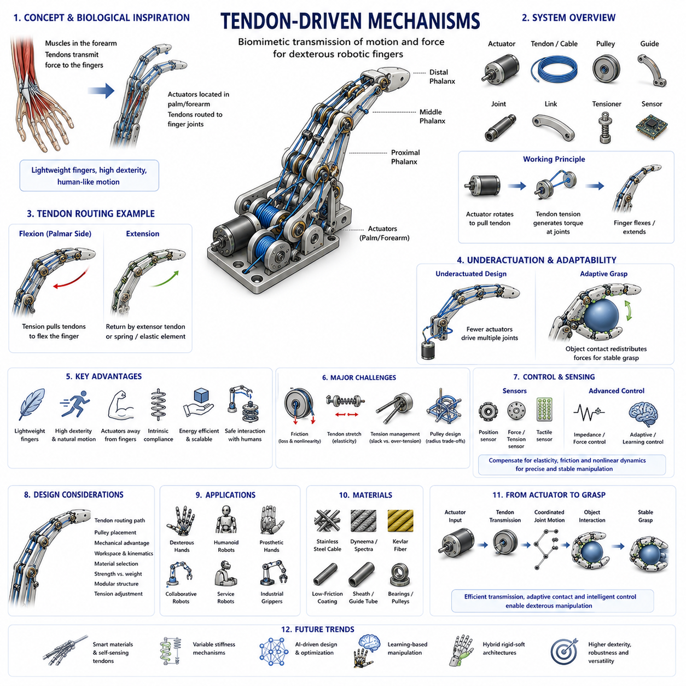{width="7.268055555555556in" height="7.268055555555556in"}

Tendon-driven mechanisms represent one of the most influential and biologically inspired approaches in robotic hand engineering. Among the many technologies developed for robotic fingers and dexterous hands, tendon-driven systems are particularly valued for their ability to reproduce human-like finger motion while maintaining lightweight structures, compact form factors, and high dexterity. The majority of advanced anthropomorphic robotic hands, humanoid robot hands, prosthetic hands, research manipulation platforms, and next-generation dexterous robotic systems employ some form of tendon-driven architecture because it closely resembles the musculoskeletal structure of the human hand.

In biological systems, muscles are generally located in the forearm, while tendons transmit forces to the fingers through a network of flexible connective tissues. This arrangement allows the human hand to achieve extraordinary dexterity without placing bulky muscles inside the fingers themselves. Tendon-driven robotic fingers follow a similar principle. Instead of mounting heavy actuators directly at each finger joint, motors are positioned in the palm, wrist, forearm, or robot arm, and forces are transmitted to the finger joints through cables, tendons, or flexible transmission elements. This separation of actuation and motion generation is one of the defining characteristics of tendon-driven robotic systems.

The primary objective of tendon-driven finger design is to minimize distal mass while maximizing dexterity and force generation capability. Distal mass refers to the weight located far from the base of the mechanism, particularly within finger segments. High distal mass increases inertia, reduces responsiveness, consumes additional energy, and limits dynamic performance. By relocating actuators away from the fingers, tendon-driven architectures significantly reduce finger weight, allowing faster movement, smoother control, and more natural manipulation behavior.

A tendon-driven finger typically consists of several key components including actuators, tendons or cables, pulleys, routing guides, finger joints, structural links, tension regulation mechanisms, and sensing systems. When an actuator rotates, it pulls or releases a tendon. The resulting tension generates torque at one or more finger joints, causing the finger to flex, extend, or perform more complex motions. The relationship between tendon displacement and joint motion depends on tendon routing geometry, pulley dimensions, joint design, and mechanical coupling characteristics.

One of the most attractive features of tendon-driven mechanisms is their ability to create highly articulated fingers using relatively compact hardware. A single tendon can influence multiple joints simultaneously, allowing complex finger movements to emerge from simple actuator commands. This characteristic enables designers to create anthropomorphic hands with many degrees of freedom while avoiding the need for a dedicated motor at every joint. Such efficiency is particularly valuable in humanoid robotics where space, weight, and power consumption are critical design constraints.

The design of tendon routing paths is one of the most important aspects of tendon-driven engineering. Tendons must follow carefully planned trajectories through finger structures to ensure efficient force transmission and predictable motion. Routing paths determine mechanical advantage, joint coordination, force distribution, and overall system behavior. Poor tendon routing can result in excessive friction, cable wear, inefficient force transmission, and unstable motion. Consequently, tendon path optimization is a major focus during robotic hand development.

Finger flexion mechanisms typically employ tendons that run along the palmar side of the finger. When tension is applied, the joints bend inward, creating grasping motions. Extension can be achieved through several methods. Some systems use dedicated extensor tendons similar to biological hands. Others rely on springs, elastic elements, compliant joints, or gravity compensation mechanisms to return the finger to its initial position. The selection of flexion-extension architecture significantly affects system complexity, control requirements, and mechanical performance.

One of the major advantages of tendon-driven systems is their compatibility with underactuated design principles. In underactuated robotic fingers, the number of actuators is smaller than the number of degrees of freedom. Tendons naturally facilitate this approach because a single tendon can drive multiple joints through passive mechanical coupling. When the finger encounters an object during grasping, contact forces automatically influence joint configurations, allowing the finger to adapt its shape to the object\'s geometry. This adaptive behavior enhances grasp robustness while reducing hardware complexity.

Mechanical compliance is another characteristic that distinguishes tendon-driven fingers from purely rigid linkage mechanisms. Tendons possess inherent elasticity, and this elasticity can be exploited to absorb shocks, accommodate positioning errors, and improve contact stability. Controlled compliance allows robotic fingers to interact safely with uncertain environments, fragile objects, and human users. In collaborative robotics and service robotics applications, this capability is particularly important because it enhances safety and reduces the risk of damage during physical interaction.

Despite their many advantages, tendon-driven systems introduce several engineering challenges. Friction is among the most significant issues. As tendons pass through guides, pulleys, sheaths, and routing channels, frictional forces can reduce transmission efficiency and introduce nonlinear behavior. Friction complicates force estimation, decreases control precision, and may lead to hysteresis effects in finger motion. Engineers must carefully select materials, routing geometries, and lubrication strategies to minimize friction-related problems.

Tendon stretch is another important consideration. No physical tendon is perfectly rigid. Under load, tendons experience elastic deformation, causing displacement errors and reducing positioning accuracy. While a certain amount of elasticity can be beneficial for compliance, excessive stretch can compromise performance. Material selection therefore becomes a critical aspect of tendon-driven finger design. Common tendon materials include stainless steel cables, Dyneema fibers, Kevlar fibers, Spectra fibers, and specialized synthetic materials designed for high tensile strength and low elongation.

Tension management plays a central role in tendon-driven systems. Proper tendon tension ensures consistent force transmission and prevents slack formation. Insufficient tension can cause control instability and delayed responses, while excessive tension increases wear, friction, and energy consumption. Many robotic hands incorporate adjustable tensioning mechanisms that allow precise calibration during assembly and maintenance.

Pulley design is closely associated with tendon routing. Pulleys guide tendon motion while altering force transmission characteristics. Pulley radius directly affects the relationship between actuator displacement and joint rotation. Larger pulleys increase motion resolution but require more actuator travel. Smaller pulleys reduce actuator travel requirements but may increase tendon stress and wear. Engineers must carefully balance these trade-offs when designing tendon-driven fingers.

Differential tendon systems represent an advanced category of tendon-driven mechanisms. Differential architectures distribute forces among multiple joints or fingers using shared tendon networks. These systems enable adaptive force allocation and coordinated movement without requiring additional actuators. Differential mechanisms are particularly useful in dexterous robotic hands where multiple fingers must cooperate during grasping and manipulation tasks.

Biomimetic robotic hands often employ tendon-driven architectures because they closely resemble the organization of the human hand. Human finger motion is generated through a sophisticated interaction between flexor tendons, extensor tendons, ligaments, and muscles. While robotic systems rarely replicate every biological detail, many successful designs capture essential biomechanical principles. Examples include tendon routing through artificial pulleys, differential tension control, and passive joint coupling mechanisms that mimic biological tendon networks.

The integration of sensing technologies has significantly enhanced the capabilities of tendon-driven robotic fingers. Position sensors monitor actuator movement and joint angles. Force sensors measure tendon tension and contact forces. Tactile sensors detect pressure distribution and object interaction states. Combining these sensing modalities enables closed-loop control strategies that improve grasp stability, manipulation precision, and environmental awareness.

Control of tendon-driven mechanisms is inherently more complex than control of rigid linkage systems. Because tendons introduce elasticity, friction, backlash, and nonlinear coupling effects, simple position control strategies are often insufficient. Advanced control approaches such as impedance control, force control, adaptive control, model predictive control, and learning-based control methods are commonly employed. These techniques allow robotic fingers to achieve smooth and stable behavior despite the complexities of tendon dynamics.

Simulation plays a crucial role in tendon-driven system development. Engineers use dynamic simulation tools to analyze tendon tension, joint motion, contact interactions, actuator requirements, and failure modes. Accurate tendon models must account for elasticity, friction, routing geometry, pulley interactions, and contact mechanics. As computational tools continue to improve, simulation-driven optimization is becoming increasingly important in robotic hand design.

Tendon-driven architectures are particularly well suited for dexterous manipulation tasks. In-hand manipulation, object reorientation, finger gaiting, rolling contacts, and fine motor skills often require lightweight fingers with high degrees of freedom and compliant interaction capabilities. Tendon-driven systems naturally support these requirements and therefore dominate many research platforms focused on advanced robotic manipulation.

Prosthetic hand development has also benefited greatly from tendon-driven mechanisms. Prosthetic devices must achieve human-like functionality while remaining lightweight, compact, and energy efficient. Tendon-driven architectures allow actuators to be placed away from the fingertips, reducing overall hand weight and improving user comfort. Many state-of-the-art prosthetic hands employ tendon-based transmission systems combined with myoelectric control interfaces.

Humanoid robots such as modern research platforms and commercial humanoid systems increasingly rely on tendon-driven hands. These robots must perform diverse tasks ranging from object handling and tool use to household assistance and industrial operations. Tendon-driven fingers provide the dexterity and adaptability necessary for such applications while maintaining manageable weight and power consumption.

Recent advances in materials science are driving further improvements in tendon-driven robotic systems. High-performance synthetic fibers offer greater strength-to-weight ratios than traditional steel cables. Low-friction coatings reduce energy losses and improve durability. Smart materials capable of sensing tension and deformation may eventually allow tendons to function simultaneously as transmission elements and sensing devices.

Artificial intelligence and machine learning are also influencing tendon-driven mechanism design. Learning-based optimization techniques can automatically identify efficient tendon routing configurations, actuator placements, and control strategies. Reinforcement learning approaches increasingly enable robotic hands to discover complex manipulation behaviors that would be difficult to program manually.

Future tendon-driven robotic fingers are expected to combine lightweight structures, advanced sensing, variable stiffness technologies, adaptive actuation, and intelligent control systems. These developments will further narrow the gap between robotic and biological manipulation capabilities. As robotic systems move beyond structured industrial environments into homes, hospitals, warehouses, public spaces, and everyday human environments, the demand for versatile and dexterous robotic hands will continue to grow.

Ultimately, tendon-driven mechanisms represent one of the most elegant solutions in robotic hand engineering. By separating actuators from finger joints and transmitting forces through flexible tendons, these systems achieve an exceptional balance between dexterity, weight reduction, adaptability, and biomimetic functionality. Their ability to replicate many of the key characteristics of the human hand while remaining practical for engineering implementation has made tendon-driven architectures a cornerstone of modern robotic manipulation. As advances in materials, sensing, computation, and artificial intelligence continue to accelerate, tendon-driven robotic fingers will remain at the forefront of dexterous robotic hand development for decades to come.

텐던 구동 메커니즘(Tendon-Driven Mechanism)은 로봇 핸드 공학 분야에서 가장 영향력이 크고 생체모방적(Biomimetic)인 설계 방식 중 하나이다. 로봇 손가락과 다지형 로봇 핸드(Dexterous Robot Hand)를 구현하기 위해 개발된 다양한 기술 가운데 텐던 구동 방식은 인간 손의 움직임을 가장 효과적으로 모사할 수 있는 구조로 평가받고 있다. 오늘날의 고성능 휴머노이드 로봇(Humanoid Robot), 의수(Prosthetic Hand), 연구용 조작성 핸드(Research Manipulation Platform), 그리고 차세대 물리 AI(Physical AI) 로봇들은 대부분 텐던 기반 구조를 채택하고 있다. 이는 텐던 시스템이 가벼운 구조, 높은 자유도, 우수한 조작성, 그리고 인간 손과 유사한 운동 특성을 동시에 제공할 수 있기 때문이다.

인간의 손을 살펴보면 대부분의 근육(Muscle)은 전완(Forearm)에 위치하며, 실제 손가락 운동은 힘줄(Tendon)을 통해 전달된다. 손가락 내부에는 거대한 근육이 존재하지 않음에도 불구하고 매우 정교하고 빠른 움직임을 수행할 수 있는 이유가 여기에 있다. 텐던 구동 로봇 손가락 역시 동일한 원리를 따른다. 액추에이터(Actuator)를 손가락 내부에 배치하지 않고 손바닥(Palm), 손목(Wrist), 전완(Forearm), 또는 로봇 팔 내부에 설치한 후 케이블(Cable)이나 텐던을 이용하여 힘을 전달한다. 이러한 구동부와 운동부의 분리는 텐던 구동 구조를 정의하는 가장 중요한 특징이다.

텐던 구동 손가락의 핵심 목표는 손가락 끝에 위치하는 질량(Distal Mass)을 최소화하면서도 높은 조작성(Dexterity)과 충분한 힘 생성 능력을 확보하는 것이다. 손가락 끝부분의 무게가 증가하면 관성(Inertia)이 커지고 응답 속도가 감소하며 더 많은 에너지가 필요하게 된다. 반대로 액추에이터를 손가락 외부로 이동시키면 손가락 자체는 매우 가벼워질 수 있으며, 결과적으로 빠르고 부드러운 움직임을 구현할 수 있다.

일반적인 텐던 구동 손가락은 액추에이터, 텐던 또는 케이블, 풀리(Pulley), 가이드(Guide), 관절(Joint), 링크(Link), 장력 조절 장치(Tension Regulation Mechanism), 그리고 센서(Sensor)로 구성된다. 액추에이터가 회전하면 텐던을 당기거나 풀어주게 되며, 이 장력(Tension)이 관절에 토크(Torque)를 발생시켜 손가락을 굽히거나 펴게 만든다. 텐던 이동량과 관절 각도 사이의 관계는 텐던 경로(Routing Path), 풀리 반경(Pulley Radius), 관절 구조, 그리고 기계적 결합 방식에 의해 결정된다.

텐던 구동 구조의 가장 큰 장점 중 하나는 매우 높은 자유도를 가진 손가락을 상대적으로 단순한 하드웨어로 구현할 수 있다는 점이다. 하나의 텐던이 여러 관절에 동시에 영향을 줄 수 있기 때문에, 적은 수의 액추에이터만으로도 인간 손과 유사한 움직임을 생성할 수 있다. 이는 공간과 무게, 전력 소비가 중요한 휴머노이드 로봇 분야에서 매우 큰 장점으로 작용한다.

텐던 경로 설계(Tendon Routing Design)는 텐던 구동 시스템에서 가장 중요한 설계 요소 중 하나이다. 텐던은 손가락 내부를 따라 적절한 경로로 배치되어야 하며, 이 경로가 힘 전달 효율과 운동 특성을 결정한다. 텐던 경로는 기계적 이점(Mechanical Advantage), 힘 분배(Force Distribution), 관절 간 협응(Coordinated Motion), 그리고 전체 시스템의 성능에 직접적인 영향을 미친다. 잘못 설계된 경로는 마찰 증가, 케이블 마모, 힘 손실, 불안정한 움직임 등을 초래할 수 있기 때문에 매우 신중한 설계가 필요하다.

대부분의 텐던 구동 손가락에서는 굽힘(Flexion)을 담당하는 텐던이 손가락의 손바닥 측(Palmar Side)을 따라 배치된다. 액추에이터가 텐던을 당기면 손가락이 안쪽으로 굽어지며 물체를 파지하게 된다. 반대로 펴기(Extension)는 여러 방식으로 구현될 수 있다. 일부 시스템은 별도의 신전 텐던(Extensor Tendon)을 사용하고, 다른 시스템은 스프링(Spring), 탄성체(Elastic Element), 순응성 관절(Compliant Joint) 등을 활용하여 손가락을 원래 위치로 복귀시킨다.

텐던 구동 구조는 부족 구동형(Underactuated) 설계와 매우 잘 결합된다. 부족 구동이란 자유도 수보다 적은 수의 액추에이터를 사용하는 구조를 의미한다. 하나의 텐던이 여러 관절을 동시에 구동할 수 있기 때문에, 물체와 접촉하는 과정에서 자연스럽게 관절 각도가 변화하며 물체 형상에 적응하게 된다. 이러한 적응형 파지(Adaptive Grasping)는 구조를 단순하게 유지하면서도 높은 파지 성공률을 제공한다.

순응성(Compliance)은 텐던 구동 시스템의 또 다른 중요한 특징이다. 텐던 자체는 완전히 강체가 아니며 일정한 탄성을 가진다. 이 탄성은 충격을 흡수하고 접촉 오차를 보완하며 물체와의 안정적인 상호작용을 가능하게 한다. 협동로봇(Collaborative Robot)이나 서비스 로봇(Service Robot)에서는 이러한 순응성이 특히 중요하다. 사람과 함께 작업할 때 충돌 충격을 줄이고 섬세한 물체를 안전하게 다룰 수 있기 때문이다.

그러나 텐던 구동 방식은 여러 공학적 문제도 가지고 있다. 가장 대표적인 문제는 마찰(Friction)이다. 텐던이 가이드, 풀리, 덕트(Sheath) 등을 통과하면서 마찰력이 발생하며 이는 힘 전달 효율을 감소시키고 비선형적인 거동을 유발한다. 마찰은 제어 정확도를 떨어뜨리고 히스테리시스(Hysteresis)를 발생시키는 주요 원인이 된다.

텐던의 신장(Stretch) 역시 중요한 문제이다. 실제 텐던은 완전히 강체가 아니므로 하중이 걸리면 늘어난다. 이러한 탄성 변형은 위치 오차를 유발할 수 있다. 적절한 탄성은 순응성을 제공하지만 과도한 신장은 제어 성능을 악화시킨다. 따라서 텐던 재료 선택이 매우 중요하다.

대표적인 텐던 재료로는 스테인리스 케이블(Stainless Steel Cable), 다이니마(Dyneema), 케블라(Kevlar), 스펙트라(Spectra)와 같은 고강도 섬유가 사용된다. 이러한 재료들은 높은 인장 강도(Tensile Strength)와 낮은 신장률(Elongation)을 제공하여 효율적인 힘 전달을 가능하게 한다.

장력 관리(Tension Management)는 텐던 구동 시스템의 핵심 기술 중 하나이다. 적절한 장력이 유지되어야 힘이 안정적으로 전달된다. 장력이 너무 낮으면 느슨함(Slack)이 발생하여 제어가 불안정해지고, 너무 높으면 마찰 증가와 마모 가속, 에너지 손실이 발생한다. 따라서 대부분의 시스템에는 장력 조절 장치가 포함된다.

풀리 설계(Pulley Design) 또한 중요한 역할을 수행한다. 풀리 반경은 액추에이터 회전량과 관절 회전량의 관계를 결정한다. 큰 풀리는 높은 분해능(Resolution)을 제공하지만 더 긴 이동 거리가 필요하고, 작은 풀리는 빠른 움직임을 제공하지만 텐던에 더 큰 응력을 발생시킬 수 있다.

차동 텐던 시스템(Differential Tendon System)은 텐던 구동 기술의 발전된 형태이다. 차동 메커니즘은 여러 관절 또는 여러 손가락 사이에 힘을 자동으로 분배할 수 있다. 이를 통해 추가 액추에이터 없이도 복잡한 협응 동작과 적응형 파지를 구현할 수 있다.

생체모방 로봇 핸드(Biomimetic Robot Hand)는 대부분 텐던 구동 구조를 채택한다. 인간 손의 굴곡근(Flexor Muscle), 신전근(Extensor Muscle), 힘줄, 인대의 구조를 참고하여 설계되기 때문이다. 실제 인간 손을 완벽히 복제하는 것은 어렵지만, 텐던 기반 구조는 생체역학적 특성을 가장 효과적으로 구현할 수 있는 방법 중 하나이다.

센서 통합(Sensor Integration)은 텐던 구동 손가락의 성능을 크게 향상시킨다. 위치 센서(Position Sensor)는 관절 각도를 측정하고, 힘 센서(Force Sensor)는 텐던 장력과 접촉력을 측정하며, 촉각 센서(Tactile Sensor)는 접촉 위치와 압력 분포를 감지한다. 이러한 정보들은 폐루프 제어(Closed-Loop Control)를 가능하게 하여 보다 안정적인 파지와 조작을 구현한다.

텐던 구동 시스템의 제어는 링크 기반 구조보다 훨씬 복잡하다. 텐던의 탄성, 마찰, 백래시(Backlash), 비선형성(Nonlinearity) 때문에 단순한 위치 제어만으로는 충분하지 않다. 따라서 임피던스 제어(Impedance Control), 힘 제어(Force Control), 적응 제어(Adaptive Control), 모델 예측 제어(Model Predictive Control), 강화학습 기반 제어(Reinforcement Learning Control) 등이 자주 사용된다.

시뮬레이션(Simulation)은 텐던 시스템 개발에서 매우 중요한 역할을 한다. 설계자는 시뮬레이션을 통해 장력 분포, 관절 운동, 접촉 상태, 액추에이터 요구사항 등을 분석할 수 있다. 정확한 시뮬레이션 모델은 탄성, 마찰, 텐던 경로, 풀리 상호작용, 접촉 역학(Contact Mechanics)을 모두 고려해야 한다.

텐던 구동 구조는 특히 인핸드 조작(In-Hand Manipulation), 물체 재배치(Object Reorientation), 핑거 게이팅(Finger Gaiting), 롤링 접촉(Rolling Contact)과 같은 고난도 조작 작업에 적합하다. 가볍고 자유도가 높은 손가락 구조를 제공하기 때문에 정교한 물체 조작이 가능하다.

의수(Prosthetic Hand) 분야에서도 텐던 구동 방식은 매우 중요한 역할을 한다. 의수는 인간 손과 유사한 기능을 제공하면서도 가볍고 에너지 효율적이어야 한다. 텐던 구조는 액추에이터를 손가락 외부에 배치할 수 있기 때문에 무게를 줄이고 착용자의 편의성을 향상시킨다.

최근에는 휴머노이드 로봇의 발전과 함께 텐던 구동 핸드의 중요성이 더욱 커지고 있다. 휴머노이드 로봇은 공장 작업뿐 아니라 가정, 병원, 서비스 환경에서도 다양한 물체를 다루어야 한다. 텐던 구동 손가락은 이러한 환경에서 요구되는 높은 적응성과 조작 능력을 제공한다.

재료공학(Material Science)의 발전도 텐던 기술을 향상시키고 있다. 고성능 합성섬유는 기존 금속 케이블보다 우수한 강도 대 중량비(Strength-to-Weight Ratio)를 제공하며, 저마찰 코팅은 에너지 손실을 줄이고 수명을 향상시킨다. 미래에는 텐던 자체가 센서 역할을 수행하는 스마트 텐던(Smart Tendon) 기술도 등장할 가능성이 있다.

인공지능(AI)과 머신러닝(Machine Learning) 역시 텐던 시스템 설계에 활용되고 있다. AI는 최적의 텐던 경로, 액추에이터 위치, 제어 전략을 자동으로 탐색할 수 있으며, 강화학습은 복잡한 조작 행동을 스스로 학습하게 만들 수 있다.

결론적으로 텐던 구동 메커니즘은 인간 손의 구조를 가장 효과적으로 모사하면서도 실용적인 공학적 구현이 가능한 기술이다. 액추에이터를 손가락 외부에 배치하고 유연한 텐던을 통해 힘을 전달함으로써 경량화, 높은 자유도, 적응성, 생체모방 특성을 동시에 달성할 수 있다. 재료, 센서, 제어, AI 기술이 발전함에 따라 텐던 구동 손가락은 앞으로도 휴머노이드 로봇, 의수, 모바일 매니퓰레이터, 물리 AI 시스템의 핵심 기술로 지속적으로 발전할 것이다.

##  

## 02.04 Gear and Pulley Transmissions

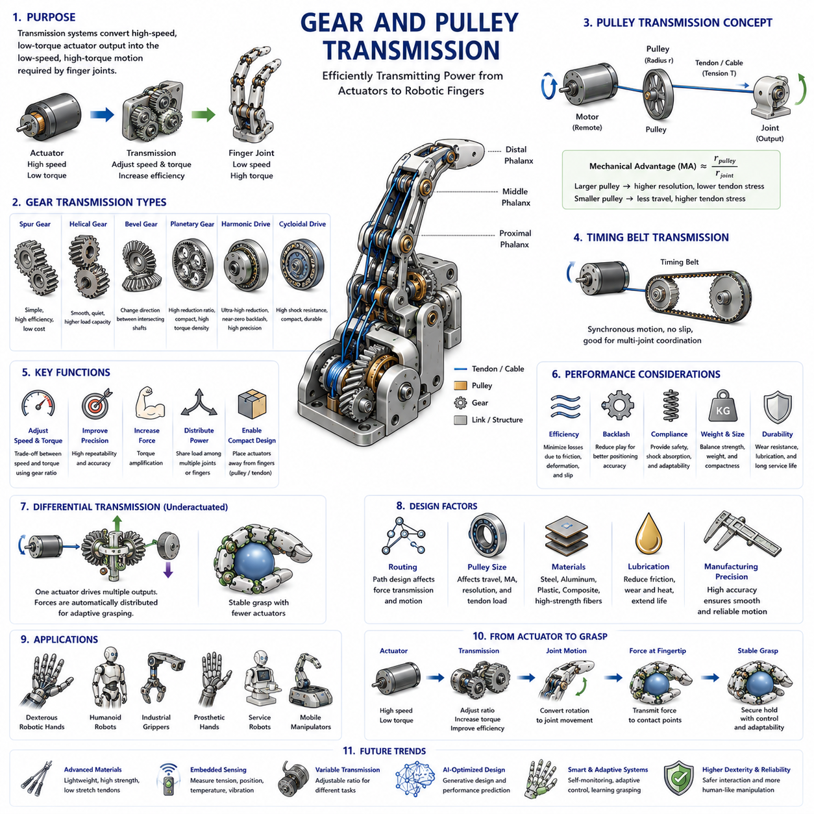{width="7.268055555555556in" height="7.268055555555556in"}

Gear and pulley transmission systems are among the most important mechanical power transmission technologies used in robotic hands, robotic fingers, dexterous manipulators, humanoid robots, industrial grippers, and advanced robotic manipulation platforms. While actuators generate motion and force, transmission systems determine how efficiently and accurately that power is delivered to the finger joints. In many cases, the overall performance of a robotic hand depends as much on the transmission mechanism as on the actuator itself. A powerful motor connected to an inefficient transmission system may produce poor grasping performance, while a well-designed transmission architecture can significantly enhance precision, force capability, responsiveness, and reliability.

Within robotic hand engineering, gear and pulley transmissions serve as the fundamental bridge between actuators and finger mechanisms. They transform motor output characteristics into useful joint motions, adjust torque and speed relationships, distribute forces among multiple joints, and enable compact packaging of complex robotic systems. Because robotic fingers operate within highly constrained spaces and often require precise force control, the design of transmission systems becomes a critical aspect of hand engineering.

The primary purpose of a transmission system is to modify the relationship between actuator motion and output joint motion. Electric motors typically operate at high rotational speeds but relatively low torque levels. Robotic fingers, on the other hand, generally require lower speeds and significantly higher torques to achieve stable grasping and manipulation. Transmission systems perform this conversion by trading speed for torque according to mechanical principles. The transmission ratio, often called the gear ratio or reduction ratio, determines the magnitude of this transformation.

Gear-based transmissions are among the most widely used solutions in robotics. A gear is a rotating mechanical component with teeth that mesh with another gear to transmit torque and motion. By varying the sizes of the driving and driven gears, engineers can achieve desired speed reductions and torque amplification. Gear systems provide highly predictable motion transfer, excellent repeatability, and relatively high efficiency. These characteristics make them particularly suitable for robotic applications requiring precise positioning and force control.

One of the simplest gear configurations is the spur gear transmission. Spur gears contain straight teeth arranged parallel to the axis of rotation. They are easy to manufacture, highly efficient, and commonly used in robotic joints where simplicity and reliability are priorities. However, spur gears may generate noise and vibration at high rotational speeds due to abrupt tooth engagement. Despite this limitation, they remain popular in many robotic finger mechanisms because of their compactness and low cost.

Helical gears represent an improvement over traditional spur gears. Their teeth are cut at an angle relative to the rotation axis, creating gradual tooth engagement during operation. This results in smoother motion, reduced vibration, and quieter operation. Helical gears can also transmit greater loads than comparable spur gears. However, they generate axial forces that require additional bearing support, increasing mechanical complexity.

Bevel gears are used when rotational motion must be transmitted between intersecting shafts. In robotic fingers and wrists, bevel gears often enable compact transmission layouts where space constraints prevent direct actuator alignment. By changing the direction of power flow, bevel gears facilitate more flexible mechanical architectures.

Planetary gear systems are among the most important transmission technologies in modern robotics. A planetary gearbox consists of a central sun gear, multiple planet gears, and an outer ring gear. This arrangement provides high reduction ratios within a compact volume while maintaining excellent load distribution characteristics. Planetary transmissions offer high torque density, efficient power transfer, and exceptional durability. Consequently, they are widely used in robotic joints, servo actuators, humanoid robots, and high-performance robotic hands.

Harmonic drive systems represent another highly specialized transmission technology. Harmonic drives utilize flexible spline structures to achieve extremely high reduction ratios with near-zero backlash. Backlash refers to the small amount of lost motion caused by gaps between gear teeth. In precision robotic manipulation, backlash can significantly degrade positioning accuracy and control performance. Harmonic drives largely eliminate this issue, making them particularly attractive for dexterous robotic hands and humanoid finger joints requiring highly accurate motion control.

Cycloidal gear systems provide another alternative for high-reduction applications. These mechanisms employ rolling contact rather than conventional gear meshing, resulting in high shock resistance, compact packaging, and excellent durability. Cycloidal drives are increasingly used in robotic systems where robustness and longevity are critical requirements.

While gears dominate many robotic transmission architectures, pulley-based systems offer a fundamentally different set of advantages. A pulley is a rotating wheel designed to guide and transmit forces through belts, cables, or tendons. In robotic fingers, pulleys are frequently used in conjunction with tendon-driven mechanisms, where actuators are positioned remotely from the finger joints. This arrangement reduces distal mass and enables lightweight finger designs.

Pulley systems are particularly attractive because they allow flexible routing of forces through complex geometries. Unlike gears, which generally require direct mechanical contact between rotating components, pulleys can transmit power across significant distances using belts or cables. This capability enables designers to place actuators within the palm, wrist, or forearm while maintaining compact finger structures.

The radius of a pulley directly influences the mechanical advantage of the transmission system. Larger pulleys increase motion resolution and reduce tendon stress but require greater actuator displacement. Smaller pulleys reduce actuator travel requirements but increase tendon loading and may reduce positioning precision. Determining optimal pulley dimensions is therefore a critical design task.

Timing belt transmissions represent a hybrid solution combining features of gears and pulleys. Timing belts contain teeth that engage corresponding pulley grooves, preventing slippage during operation. These systems provide accurate motion transfer while maintaining many of the flexibility advantages associated with pulley architectures. Timing belt transmissions are widely used in robotic systems requiring precise synchronization between multiple joints.

Cable-driven pulley systems are especially common in anthropomorphic robotic hands. In these architectures, tendons or cables wrap around pulleys attached to finger joints. When actuators pull the tendons, the pulleys rotate, generating joint motion. Such systems closely resemble the biomechanics of the human hand and allow the creation of lightweight, highly dexterous fingers.

One of the most important considerations in transmission design is efficiency. Transmission efficiency measures the percentage of actuator power successfully delivered to the output joint. Losses may occur due to friction, deformation, backlash, bearing resistance, cable stretch, or pulley slip. High-efficiency transmissions reduce energy consumption, improve battery life, and enhance overall system performance. Modern robotic hands often target transmission efficiencies exceeding ninety percent in critical joints.

Backlash is a particularly important factor in robotic finger applications. Even small amounts of backlash can introduce positioning errors that become problematic during precision manipulation tasks. Gear transmissions, especially low-cost systems, may exhibit measurable backlash due to manufacturing tolerances. Engineers often employ preload mechanisms, anti-backlash gears, harmonic drives, or advanced control algorithms to minimize its effects.

Compliance also plays a major role in transmission system behavior. Rigid transmissions provide precise motion control but may be sensitive to impacts and positioning errors. Compliant transmissions introduce flexibility that improves safety, shock absorption, and environmental adaptability. Pulley and tendon systems naturally exhibit some degree of compliance due to cable elasticity. This characteristic can be beneficial for collaborative robotics and delicate object handling.

Load distribution is another key consideration. During grasping, forces generated by robotic fingers must be transmitted efficiently from actuators to contact points. Poor transmission design may create uneven load distribution, excessive wear, or localized stresses. Advanced transmission architectures often employ differential mechanisms that automatically distribute forces among multiple fingers or joints.

Differential transmissions are widely used in underactuated robotic hands. A differential mechanism allows a single actuator to drive multiple outputs while automatically adapting force distribution according to environmental interactions. These systems can improve grasp stability, reduce actuator count, and increase adaptability without requiring additional control complexity.

Structural integration presents significant challenges in robotic hand design. Gearboxes, pulleys, bearings, shafts, tensioners, and support structures must fit within extremely limited volumes. The desire for compact, lightweight fingers often conflicts with requirements for strength, durability, and high torque output. Consequently, transmission design involves extensive trade-off analysis between competing objectives.

Material selection significantly influences transmission performance. Traditional steel gears provide excellent strength and wear resistance but increase weight. Aluminum gears reduce mass but may exhibit reduced durability under high loads. Engineering polymers offer low noise, reduced cost, and lightweight construction but may experience greater deformation and wear. Composite materials are increasingly used in advanced robotic systems to optimize strength-to-weight ratios.

Lubrication is essential for maintaining transmission efficiency and longevity. Gear teeth, bearings, and moving interfaces experience repeated contact stresses during operation. Proper lubrication reduces friction, minimizes wear, dissipates heat, and extends component lifespan. In some robotic applications, dry lubricants or self-lubricating materials are preferred to avoid contamination risks.

Manufacturing precision strongly affects transmission quality. Small dimensional errors can lead to increased backlash, uneven load distribution, excessive friction, or premature wear. Modern robotic transmission components often require high-precision machining, grinding, molding, or additive manufacturing processes to achieve desired performance levels.

Simulation and digital engineering tools play increasingly important roles in transmission development. Engineers use multibody dynamics simulations, finite element analysis, contact mechanics models, and digital twin environments to evaluate transmission performance before physical prototypes are constructed. These tools enable optimization of gear geometry, pulley dimensions, load paths, efficiency, durability, and thermal behavior.

The emergence of humanoid robotics has further increased the importance of advanced transmission technologies. Humanoid hands must perform a wide range of manipulation tasks while maintaining compact form factors comparable to human anatomy. Achieving this combination of strength, dexterity, and compactness requires highly optimized transmission architectures integrating gears, pulleys, tendons, and differential systems.

Recent advances in additive manufacturing have enabled the creation of transmission components with geometries previously impossible to produce using conventional manufacturing methods. Lightweight lattice structures, integrated pulley systems, optimized gear profiles, and topology-optimized support structures are becoming increasingly common in advanced robotic hands.

Artificial intelligence is beginning to influence transmission design as well. Generative design algorithms can automatically explore large design spaces to identify optimal transmission architectures. Machine learning models can predict wear patterns, efficiency losses, and failure risks based on simulation and operational data. These capabilities accelerate development and improve system reliability.

Future robotic transmission systems are expected to combine traditional gears and pulleys with smart materials, embedded sensing, variable transmission ratios, adaptive stiffness mechanisms, and self-monitoring capabilities. Such systems will enable robotic fingers to dynamically adjust their mechanical characteristics according to task requirements, improving efficiency, safety, and manipulation performance.

Ultimately, gear and pulley transmission systems form the mechanical backbone of robotic finger actuation. They determine how effectively actuator power is converted into useful motion and force at the point of contact with the environment. Whether implemented through precision gears, compact planetary drives, harmonic transmissions, tendon-driven pulleys, or hybrid architectures, transmission systems fundamentally shape the capabilities of robotic hands. As robotics continues to advance toward greater dexterity, autonomy, and human-like manipulation, the importance of sophisticated transmission engineering will continue to grow, serving as a critical enabler of next-generation robotic hand technology.

기어(Gear)와 풀리(Pulley) 전달 시스템은 로봇 핸드(Robot Hand), 로봇 손가락(Robotic Finger), 다지형 조작기(Dexterous Manipulator), 휴머노이드 로봇(Humanoid Robot), 산업용 그리퍼(Industrial Gripper) 및 고성능 로봇 조작 시스템에서 가장 중요한 동력 전달 기술 중 하나이다. 액추에이터(Actuator)가 운동과 힘을 생성한다면, 전달 시스템(Transmission System)은 그 힘과 운동을 얼마나 효율적이고 정확하게 손가락 관절로 전달할 수 있는지를 결정한다. 실제로 로봇 핸드의 성능은 액추에이터 자체보다도 전달 시스템의 품질에 의해 좌우되는 경우가 많다. 강력한 모터를 사용하더라도 전달 구조가 비효율적이라면 파지 성능은 떨어질 수 있으며, 반대로 잘 설계된 전달 시스템은 정밀도, 파지력, 응답성, 신뢰성을 크게 향상시킬 수 있다.

로봇 핸드 공학에서 기어와 풀리 시스템은 액추에이터와 손가락 메커니즘을 연결하는 핵심 인터페이스 역할을 수행한다. 전달 시스템은 모터의 회전 운동을 손가락 관절 운동으로 변환하고, 토크(Torque)와 속도(Speed)를 조절하며, 여러 관절에 힘을 분배하고, 제한된 공간 안에 복잡한 기계 구조를 집적할 수 있도록 해준다. 특히 로봇 손가락은 매우 작은 공간 안에서 높은 정밀도와 파지력을 요구하기 때문에 전달 시스템의 설계는 매우 중요하다.

전달 시스템의 가장 기본적인 역할은 액추에이터의 운동 특성과 출력 관절의 운동 특성 사이의 관계를 변환하는 것이다. 대부분의 전기 모터는 높은 회전 속도와 비교적 낮은 토크를 제공한다. 반면 로봇 손가락은 낮은 속도와 높은 토크가 필요하다. 전달 장치는 이러한 차이를 조정하여 원하는 출력 특성을 생성한다. 이때 중요한 개념이 감속비(Reduction Ratio) 또는 기어비(Gear Ratio)이다. 감속비는 속도를 줄이는 대신 토크를 증가시키는 역할을 수행한다.

기어 전달(Gear Transmission)은 로봇 분야에서 가장 널리 사용되는 전달 방식이다. 기어는 치형(Teeth)을 가진 회전 부품으로 다른 기어와 맞물려 힘과 운동을 전달한다. 입력 기어와 출력 기어의 크기를 조정함으로써 원하는 감속비를 구현할 수 있다. 기어 시스템은 높은 반복 정밀도(Repeatability), 우수한 위치 정확도(Position Accuracy), 그리고 예측 가능한 운동 특성을 제공한다. 이러한 특성은 정밀한 위치 제어와 힘 제어가 필요한 로봇 시스템에 매우 적합하다.

가장 단순한 기어 구조는 스퍼 기어(Spur Gear)이다. 스퍼 기어는 회전축과 평행한 직선 치형을 가진다. 제조가 쉽고 효율이 높으며 가격이 저렴하기 때문에 다양한 로봇 손가락 구조에 사용된다. 그러나 고속 회전 시 소음과 진동이 발생할 수 있다는 단점이 있다.

헬리컬 기어(Helical Gear)는 치형이 비스듬하게 배치된 구조이다. 치형이 점진적으로 맞물리기 때문에 스퍼 기어보다 훨씬 부드럽고 조용하게 작동한다. 또한 더 큰 하중을 전달할 수 있다. 그러나 축 방향 힘(Axial Force)이 발생하므로 추가적인 베어링 지지가 필요하다.

베벨 기어(Bevel Gear)는 서로 교차하는 축 사이에서 동력을 전달할 때 사용된다. 로봇 손목(Wrist)이나 손가락 내부에서는 공간 제약 때문에 모터를 직접 연결하기 어려운 경우가 많으며, 베벨 기어를 이용하면 동력 전달 방향을 자유롭게 변경할 수 있다.

행성 기어(Planetary Gearbox)는 현대 로봇 시스템에서 가장 중요한 전달 장치 중 하나이다. 중심의 선 기어(Sun Gear), 여러 개의 행성 기어(Planet Gear), 외부의 링 기어(Ring Gear)로 구성된다. 매우 작은 공간에서도 높은 감속비를 제공할 수 있으며, 하중이 여러 기어에 분산되므로 내구성이 우수하다. 따라서 휴머노이드 로봇, 서보 액추에이터(Servo Actuator), 로봇 관절 등에 널리 사용된다.

하모닉 드라이브(Harmonic Drive)는 초정밀 로봇 시스템에서 자주 사용되는 특수한 감속기이다. 유연한 스플라인(Flexspline)을 이용하여 매우 높은 감속비를 구현하며 거의 백래시(Backlash)가 없는 것이 특징이다. 백래시는 기어 간의 유격으로 인해 발생하는 미세한 운동 오차를 의미한다. 정밀 조작에서는 이러한 오차가 큰 문제를 일으킬 수 있기 때문에 하모닉 드라이브는 다지형 로봇 핸드와 휴머노이드 손가락에 매우 적합하다.

사이클로이드 감속기(Cycloidal Drive)는 구름 접촉(Rolling Contact)을 기반으로 동작한다. 충격 저항성이 높고 내구성이 우수하며 높은 감속비를 제공한다. 최근에는 고신뢰성이 요구되는 로봇 시스템에서 점점 더 많이 사용되고 있다.

기어가 강체 기반 전달 방식이라면, 풀리 전달(Pulley Transmission)은 보다 유연한 방식의 동력 전달 기술이다. 풀리는 케이블, 벨트, 텐던(Tendon) 등을 이용하여 힘을 전달하는 회전 휠 구조이다. 특히 텐던 구동 손가락에서는 매우 중요한 역할을 수행한다.

풀리 시스템의 가장 큰 장점은 액추에이터를 손가락 외부에 배치할 수 있다는 점이다. 모터를 손바닥(Palm), 손목(Wrist), 전완(Forearm)에 배치하고 텐던과 풀리를 통해 힘을 전달함으로써 손가락 자체를 매우 가볍게 만들 수 있다. 이러한 구조는 인간 손과 매우 유사하다.

풀리는 기어와 달리 직접 접촉하지 않고도 힘을 전달할 수 있기 때문에 복잡한 경로를 따라 동력을 전송할 수 있다. 이는 휴머노이드 손과 같은 공간 제약이 큰 시스템에서 매우 유리하다.

풀리 반경(Pulley Radius)은 전달 특성을 결정하는 중요한 변수이다. 큰 풀리는 높은 분해능(Resolution)과 낮은 케이블 응력을 제공하지만 더 긴 이동 거리가 필요하다. 반대로 작은 풀리는 빠른 응답을 제공하지만 텐던에 더 큰 하중을 발생시킨다.

타이밍 벨트(Timing Belt)는 기어와 풀리의 특성을 결합한 방식이다. 벨트에 치형이 존재하며 풀리의 치형과 맞물려 미끄러짐 없이 정확한 동력 전달을 제공한다. 따라서 여러 관절의 동기화(Synchronization)가 필요한 로봇 시스템에서 자주 사용된다.

케이블 기반 풀리 시스템(Cable-Driven Pulley System)은 다지형 로봇 핸드에서 매우 흔히 사용된다. 텐던이나 케이블이 관절에 연결된 풀리를 감고 있으며, 모터가 케이블을 당기면 풀리가 회전하여 관절 운동을 생성한다. 이러한 구조는 인간 손의 힘줄 구조와 매우 유사하다.

전달 시스템 설계에서 가장 중요한 요소 중 하나는 효율(Efficiency)이다. 효율은 액추에이터 출력 에너지 중 실제로 출력 관절에 전달되는 비율을 의미한다. 마찰(Friction), 변형(Deformation), 백래시, 베어링 저항(Bearing Resistance), 케이블 신장(Cable Stretch) 등은 모두 에너지 손실의 원인이 된다. 고효율 전달 시스템은 배터리 사용 시간을 늘리고 전체 시스템 성능을 향상시킨다.

백래시는 정밀 조작에서 매우 중요한 문제이다. 기어 사이의 작은 유격도 손끝에서는 상당한 위치 오차로 확대될 수 있다. 따라서 고정밀 로봇 핸드에서는 프리로드(Preload) 기구, 안티백래시 기어(Anti-Backlash Gear), 하모닉 드라이브 등을 사용하여 이를 최소화한다.

순응성(Compliance)은 전달 시스템의 또 다른 중요한 특성이다. 완전히 강체인 전달 구조는 높은 정밀도를 제공하지만 충격과 오차에 민감하다. 반면 텐던과 풀리 시스템은 자연적인 탄성을 가지므로 충격 흡수와 안전성 측면에서 유리하다. 이러한 특성은 협동로봇과 서비스 로봇에서 특히 중요하다.

하중 분배(Load Distribution) 역시 중요한 설계 요소이다. 로봇 손가락이 물체를 잡을 때 발생하는 힘은 여러 관절을 통해 전달된다. 전달 구조가 적절하지 않으면 특정 부품에 과도한 응력이 집중될 수 있으며, 이는 조기 마모와 고장의 원인이 된다.

차동 전달 시스템(Differential Transmission)은 부족 구동형(Underactuated) 로봇 핸드에서 널리 사용된다. 하나의 액추에이터가 여러 관절이나 여러 손가락을 동시에 구동하면서도 물체와의 접촉 상황에 따라 자동으로 힘을 분배할 수 있다. 이를 통해 적은 액추에이터 수로도 높은 적응성을 확보할 수 있다.

로봇 손가락 설계에서는 구조 통합(Structural Integration)이 매우 어려운 과제이다. 기어박스(Gearbox), 풀리, 베어링(Bearing), 샤프트(Shaft), 텐셔너(Tensioner) 등을 매우 작은 공간 안에 배치해야 하기 때문이다. 높은 토크, 낮은 무게, 우수한 내구성을 동시에 달성해야 하므로 다양한 설계 절충(Trade-off)이 필요하다.

재료 선택(Material Selection)은 전달 성능에 직접적인 영향을 미친다. 강철(Steel)은 높은 강도와 내구성을 제공하지만 무게가 크다. 알루미늄(Aluminum)은 경량화에 유리하지만 내마모성이 낮을 수 있다. 엔지니어링 플라스틱(Engineering Plastic)은 저소음과 저비용이라는 장점을 제공하지만 변형 가능성이 높다. 최근에는 탄소섬유 복합재(Carbon Fiber Composite)도 적극적으로 사용되고 있다.

윤활(Lubrication)은 전달 장치의 수명과 효율을 결정하는 핵심 요소이다. 기어 치면, 베어링, 회전 부품 간의 마찰을 줄이고 열을 제거하며 마모를 감소시킨다. 일부 의료용 및 식품용 로봇에서는 오염을 방지하기 위해 건식 윤활(Dry Lubrication)이 사용되기도 한다.

제조 정밀도(Manufacturing Precision) 역시 매우 중요하다. 작은 가공 오차도 백래시 증가, 마찰 증가, 하중 불균형, 조기 마모를 초래할 수 있다. 따라서 고성능 로봇 핸드에서는 고정밀 CNC 가공, 연삭(Grinding), 사출성형, 적층 제조(Additive Manufacturing) 기술이 사용된다.

최근 휴머노이드 로봇의 발전으로 인해 전달 기술의 중요성은 더욱 커지고 있다. 인간 손 크기 수준의 공간 안에 높은 힘, 높은 조작성, 높은 신뢰성을 모두 구현해야 하기 때문이다. 따라서 기어, 풀리, 텐던, 차동 메커니즘을 통합한 하이브리드 전달 구조가 점점 더 중요해지고 있다.

미래의 전달 시스템은 스마트 재료(Smart Materials), 내장 센서(Embedded Sensor), 가변 감속비(Variable Transmission Ratio), 가변 강성(Variable Stiffness), 자가 진단(Self-Monitoring) 기능을 통합하는 방향으로 발전할 것으로 예상된다. 이러한 기술은 로봇 손가락이 작업 상황에 따라 스스로 기계적 특성을 변경할 수 있게 해줄 것이다.

결론적으로 기어 및 풀리 전달 시스템은 로봇 손가락 구동의 기계적 핵심이라 할 수 있다. 액추에이터에서 생성된 힘과 운동을 실제 접촉 지점까지 얼마나 정확하고 효율적으로 전달하는지가 로봇 핸드의 성능을 결정한다. 정밀 기어, 행성 감속기, 하모닉 드라이브, 텐던 풀리 시스템, 그리고 이들을 결합한 하이브리드 구조는 모두 현대 로봇 핸드의 핵심 기술이다. 미래의 휴머노이드 로봇과 물리 AI 시스템이 인간 수준의 조작 능력에 가까워질수록, 고성능 전달 시스템의 중요성은 더욱 커질 것이며 차세대 로봇 핸드 기술의 기반이 될 것이다.

##  

## 02.05 Underactuated Hand Design

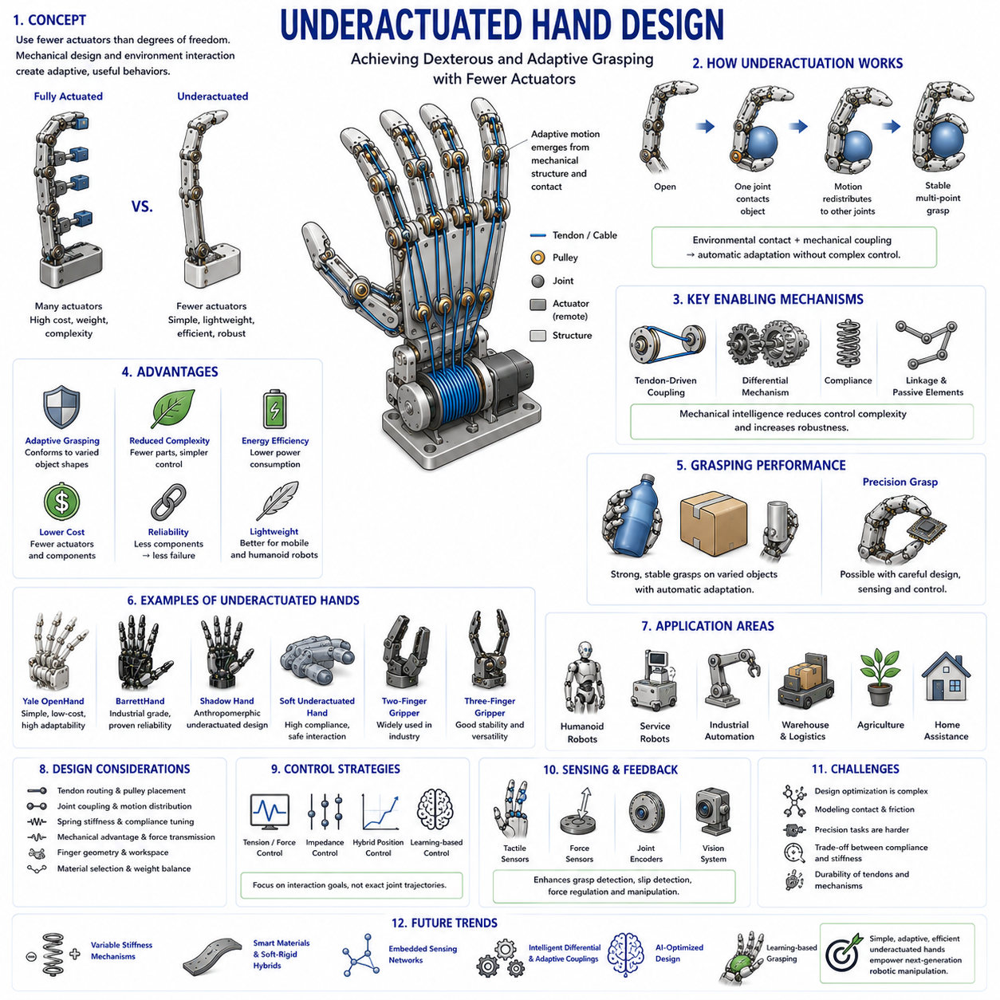{width="7.268055555555556in" height="7.268055555555556in"}

Underactuated hand design represents one of the most important breakthroughs in modern robotic hand engineering. Among the numerous approaches developed for robotic grasping and manipulation, underactuated hands have emerged as a highly practical solution that balances dexterity, adaptability, cost, complexity, reliability, and energy efficiency. Unlike fully actuated robotic hands, where every joint is controlled by an independent actuator, underactuated hands intentionally employ fewer actuators than the total number of degrees of freedom. This design philosophy enables robotic systems to achieve sophisticated grasping behaviors through intelligent mechanical structures rather than relying solely on complex sensing and control algorithms.

The concept of underactuation originates from the observation that many grasping tasks do not require independent control of every finger joint. Human hands possess extraordinary dexterity, but even biological systems often exploit passive mechanical interactions, tendon couplings, compliance, and environmental constraints to simplify control. Similarly, underactuated robotic hands leverage mechanical intelligence to reduce control complexity while maintaining robust interaction with the physical world. Rather than commanding every joint individually, the designer allows the hand's structure and the physics of contact to determine how forces and motions are distributed throughout the mechanism.

In robotics, a system is considered underactuated when the number of independent control inputs is smaller than the number of degrees of freedom. For example, a robotic finger may contain three revolute joints but be driven by a single actuator through a tendon or linkage mechanism. Although only one actuator is present, the finger can still achieve multiple configurations because contact forces and passive mechanical elements influence joint motion. This characteristic distinguishes underactuated systems from conventional fully actuated mechanisms.

The primary motivation behind underactuated hand design is to reduce hardware complexity. Fully actuated robotic hands often require a dedicated motor, gearbox, sensor package, and control channel for every joint. As the number of fingers and joints increases, system complexity grows rapidly. A humanoid hand with twenty or more degrees of freedom may require dozens of actuators, resulting in significant increases in weight, volume, power consumption, cost, thermal management requirements, and maintenance burden. Underactuated architectures address these challenges by reducing actuator count while preserving much of the functionality needed for practical manipulation.

One of the most attractive features of underactuated hands is their ability to adapt automatically to object geometry. When a fully actuated finger closes around an object, every joint position must typically be controlled explicitly. In contrast, an underactuated finger can passively conform to the object\'s shape. As one segment of the finger encounters contact, motion naturally redistributes to other joints, allowing the finger to wrap around the object without requiring sophisticated control decisions. This adaptive grasping behavior significantly improves robustness in uncertain environments.

Adaptive grasping is particularly important because real-world objects exhibit enormous variability in size, shape, orientation, texture, stiffness, and mass distribution. Industrial automation systems often operate in structured environments where object positions are known in advance. However, service robots, warehouse robots, agricultural robots, domestic assistants, humanoid robots, and mobile manipulators frequently encounter unknown objects. Underactuated hands excel in such situations because their mechanical structure inherently compensates for uncertainty.

The notion of mechanical intelligence is central to underactuated hand design. Mechanical intelligence refers to the ability of a mechanism to perform useful functions through its physical structure rather than through computational control. An underactuated hand often embeds grasping strategies directly into its mechanics. Springs, tendons, differential systems, compliant joints, linkage structures, and passive couplings collectively create behaviors that would otherwise require sophisticated software algorithms. As a result, control systems become simpler, more reliable, and computationally efficient.

Underactuated fingers commonly employ tendon-driven architectures. A single tendon may pass through multiple joints, generating coordinated motion throughout the finger. When the actuator applies tension, the finger begins to close. If one joint encounters an object before others, continued actuator motion causes the remaining joints to continue moving until additional contact points are established. This process allows the finger to achieve stable multi-point contact without explicit planning or sensing.

Differential mechanisms are another key technology in underactuated hand design. Differentials distribute forces among multiple outputs while using a single input source. In robotic hands, differential transmissions allow one actuator to drive several fingers simultaneously. If one finger encounters an object first, the differential automatically redistributes motion and force to the remaining fingers. This capability improves adaptability while minimizing actuator requirements.

Compliance plays a critical role in most underactuated systems. Compliance refers to the controlled flexibility of mechanical components. Springs, elastic tendons, flexible joints, and compliant materials allow fingers to absorb impacts, accommodate positioning errors, and adapt to contact conditions. Compliance also improves safety when interacting with humans or fragile objects. Rather than resisting environmental uncertainties, compliant underactuated hands exploit them to achieve more stable grasps.

The relationship between compliance and underactuation is particularly important. While underactuation reduces control complexity by decreasing actuator count, compliance introduces passive adaptability. Together, these characteristics enable robotic hands to achieve robust performance in environments that would be difficult to model precisely. Many successful robotic hand designs combine both principles extensively.

The grasping process in an underactuated hand differs significantly from that of a fully actuated hand. In a fully actuated system, the desired grasp posture is typically planned in advance and executed through precise joint control. In an underactuated system, the final grasp configuration emerges dynamically through interactions among actuator forces, finger mechanics, object geometry, friction, and contact conditions. This emergent behavior is one of the defining characteristics of underactuated manipulation.

Underactuated hands often exhibit excellent performance in power grasps. Power grasps involve enveloping an object with multiple fingers and generating large contact forces. Examples include grasping bottles, tools, boxes, handles, fruits, industrial parts, and household objects. Because underactuated fingers naturally conform to object surfaces, they frequently achieve more stable power grasps than rigid, position-controlled systems.

Precision grasping presents a more complex challenge. Tasks such as inserting connectors, handling small components, performing assembly operations, or manipulating delicate objects often require highly controlled contact conditions. While underactuated hands can perform many precision tasks, achieving human-level dexterity may require additional sensing, compliance control, or hybrid actuation strategies.

The design of underactuated fingers involves careful selection of joint coupling relationships. Engineers must determine how motion and force are distributed among joints during grasping. Tendon routing, linkage geometry, spring stiffness, pulley dimensions, and differential mechanisms all influence this distribution. Optimization techniques are frequently used to achieve desired grasping behaviors while maintaining mechanical simplicity.

Mechanical advantage is another important design consideration. Different joint configurations generate different force transmission characteristics. Designers seek to ensure that fingertip forces remain sufficient throughout the grasping process while avoiding excessive actuator loads. The mechanical structure must provide both adaptability and effective force generation.

The number of fingers significantly influences underactuated hand performance. Two-finger underactuated grippers are widely used in industrial automation due to their simplicity and reliability. Three-finger designs offer improved grasp stability and object adaptability. Four-finger and five-finger hands provide greater dexterity and manipulation capability but introduce additional design complexity. The optimal configuration depends on the intended application domain.

Several influential robotic hands have demonstrated the effectiveness of underactuated design principles. The Yale OpenHand project popularized simple, low-cost underactuated grippers capable of handling a wide range of objects. The BarrettHand introduced sophisticated underactuated finger mechanisms combined with industrial reliability. Numerous research platforms and commercial robotic grippers now incorporate underactuated architectures because of their practical advantages.

Underactuated hands are particularly attractive for mobile robots. Mobile platforms often face strict limitations regarding weight, energy consumption, computational resources, and cost. Reducing actuator count directly lowers power requirements and simplifies integration. Consequently, many warehouse robots, delivery robots, agricultural platforms, and service robots employ underactuated end effectors.

Humanoid robotics has also embraced underactuation. Human-like hands require many degrees of freedom to achieve versatile manipulation capabilities. Implementing full actuation for every joint would result in excessive complexity and weight. Underactuated architectures provide a practical compromise that enables substantial dexterity while remaining compatible with humanoid design constraints.

Soft robotics has introduced new opportunities for underactuated hand development. Soft fingers naturally exhibit compliance and adaptability, making them highly compatible with underactuation principles. Hybrid rigid-soft architectures combine the structural advantages of rigid mechanisms with the adaptability of soft materials. Such systems often achieve exceptional grasp robustness while maintaining relatively simple control requirements.

Sensing remains important even in underactuated systems. Although mechanical intelligence reduces dependence on complex control algorithms, tactile sensors, force sensors, joint encoders, and vision systems can significantly enhance performance. Sensor feedback enables grasp verification, slip detection, force regulation, and adaptive manipulation strategies. The combination of mechanical intelligence and sensory intelligence often produces the most effective robotic hands.

Control strategies for underactuated hands differ from those used in fully actuated systems. Instead of commanding individual joint positions, controllers often regulate tendon tension, actuator displacement, grasp force, impedance, or contact conditions. High-level planning algorithms focus on object interaction objectives rather than exact joint trajectories. This shift in control philosophy simplifies many aspects of robotic manipulation.

Simulation and modeling of underactuated hands present unique challenges. Because final grasp configurations emerge through contact interactions, accurate simulation requires detailed modeling of friction, compliance, contact mechanics, tendon dynamics, and object behavior. Modern simulation platforms increasingly incorporate these effects, enabling more reliable virtual prototyping and optimization.

Artificial intelligence and machine learning are beginning to transform underactuated hand design. Learning-based methods can optimize tendon routing, spring placement, differential architectures, and grasping strategies. Reinforcement learning algorithms allow robotic systems to discover effective manipulation behaviors that leverage the unique characteristics of underactuated mechanisms.

Future underactuated hands are expected to incorporate variable stiffness technologies, adaptive materials, embedded sensing networks, intelligent differential mechanisms, and advanced learning-based controllers. These developments will further enhance adaptability, efficiency, and dexterity while preserving the simplicity that makes underactuation attractive.

The growing field of Physical AI increasingly recognizes the value of underactuation. Physical AI emphasizes the integration of intelligence within both software and hardware. Underactuated hands exemplify this philosophy because they embed problem-solving capability directly into the mechanical structure. Rather than forcing software to solve every challenge, the hand itself contributes to intelligent interaction with the environment.

Ultimately, underactuated hand design represents a powerful engineering paradigm that balances simplicity and capability. By intentionally reducing actuator count and exploiting mechanical intelligence, underactuated hands achieve robust grasping performance across diverse environments. Their ability to adapt passively to object geometry, reduce hardware complexity, improve reliability, and lower costs has made them one of the most successful approaches in robotic manipulation. As robotics continues to expand into homes, factories, hospitals, warehouses, and public spaces, underactuated hands are likely to remain a foundational technology for practical and scalable robotic grasping systems.

부족 구동형 로봇 핸드(Underactuated Hand)는 현대 로봇 핸드 공학에서 가장 중요한 혁신 중 하나로 평가받고 있다. 로봇 파지(Robotic Grasping)와 조작(Manipulation)을 구현하기 위해 개발된 수많은 기술 가운데 부족 구동형 구조는 조작성(Dexterity), 적응성(Adaptability), 비용(Cost), 복잡성(Complexity), 신뢰성(Reliability), 에너지 효율(Energy Efficiency) 사이에서 매우 우수한 균형을 제공하는 설계 방식이다. 완전 구동형(Fully Actuated) 로봇 핸드가 모든 관절을 독립적인 액추에이터로 제어하는 반면, 부족 구동형 로봇 핸드는 자유도(Degree of Freedom)의 수보다 적은 수의 액추에이터를 의도적으로 사용한다. 이러한 설계 철학은 복잡한 센서와 제어 알고리즘에 의존하지 않고도 높은 수준의 파지 성능을 구현할 수 있게 해준다.

부족 구동이라는 개념은 모든 관절을 독립적으로 제어할 필요가 없다는 관찰에서 출발한다. 인간의 손은 매우 뛰어난 조작성과 유연성을 제공하지만, 실제로는 힘줄(Tendon), 인대(Ligament), 근육(Muscle), 순응성 구조(Compliance) 및 물체와의 물리적 상호작용을 적극적으로 활용하여 제어 부담을 줄이고 있다. 부족 구동형 로봇 핸드도 동일한 원리를 따른다. 모든 관절을 명령으로 제어하는 대신 기계 구조(Mechanical Structure)와 접촉 물리(Contact Physics)가 스스로 운동과 힘의 분배를 결정하도록 설계한다.

일반적으로 로봇 시스템에서 제어 입력(Control Input)의 수가 전체 자유도보다 적으면 부족 구동 시스템으로 분류된다. 예를 들어 하나의 손가락이 세 개의 회전 관절(Revolute Joint)을 가지고 있지만 하나의 액추에이터만으로 구동된다면 부족 구동 구조에 해당한다. 이 경우 각 관절은 독립적으로 제어되지 않지만 물체와의 접촉 상태 및 내부 기계 구조에 의해 자연스럽게 자세가 결정된다. 이것이 부족 구동 구조가 가진 가장 큰 특징이다.

부족 구동형 핸드가 등장한 가장 중요한 이유는 하드웨어 복잡성을 줄이기 위해서이다. 완전 구동형 로봇 핸드는 관절마다 모터(Motor), 감속기(Gearbox), 센서(Sensor), 제어기(Control Channel)가 필요하다. 손가락 수와 자유도가 증가할수록 시스템의 크기, 무게, 전력 소비, 발열, 비용, 유지보수 부담이 급격히 증가한다. 특히 인간 손과 유사한 20개 이상의 자유도를 가진 휴머노이드 핸드를 완전 구동형으로 구현하는 것은 매우 어렵다. 부족 구동형 구조는 이러한 문제를 효과적으로 해결할 수 있는 현실적인 대안이다.

부족 구동 핸드의 가장 큰 장점은 물체 형상에 대한 자동 적응 능력이다. 완전 구동형 손가락은 각 관절을 정밀하게 제어해야 하지만 부족 구동형 손가락은 물체와 접촉하는 과정에서 스스로 자세를 변화시킨다. 손가락의 한 부분이 먼저 물체와 접촉하면 나머지 관절들이 계속 움직이며 물체를 감싸게 된다. 결과적으로 복잡한 제어 없이도 여러 접촉점을 형성할 수 있으며 안정적인 파지가 가능해진다.

이러한 적응형 파지(Adaptive Grasping)는 실제 환경에서 매우 중요하다. 현실 세계의 물체는 크기, 형상, 질량, 표면 재질, 마찰 계수 등이 모두 다르다. 산업용 자동화 시스템은 비교적 규칙적인 환경에서 작동하지만 서비스 로봇(Service Robot), 물류 로봇(Logistics Robot), 농업용 로봇(Agricultural Robot), 가정용 로봇(Domestic Robot), 휴머노이드 로봇(Humanoid Robot) 등은 매우 다양한 물체를 다루어야 한다. 부족 구동형 구조는 이러한 불확실성에 강한 적응성을 제공한다.

부족 구동형 설계의 핵심 개념은 기계적 지능(Mechanical Intelligence)이다. 기계적 지능이란 복잡한 계산 없이도 기계 구조 자체가 원하는 행동을 수행하도록 만드는 설계 철학을 의미한다. 스프링(Spring), 텐던(Tendon), 차동 메커니즘(Differential Mechanism), 링크(Linkage), 순응성 관절(Compliant Joint) 등의 요소들이 조합되어 자연스럽게 안정적인 파지를 생성한다. 즉 소프트웨어가 해결해야 할 문제를 기계 구조가 대신 해결하는 것이다.

대부분의 부족 구동 손가락은 텐던 구동(Tendon-Driven) 구조를 사용한다. 하나의 텐던이 여러 관절을 통과하면서 연결되어 있기 때문에 하나의 액추에이터만으로도 여러 관절을 동시에 움직일 수 있다. 손가락이 닫히는 과정에서 일부 관절이 먼저 물체와 접촉하면 남은 관절들이 계속 움직여 추가적인 접촉점을 형성한다. 이러한 특성 덕분에 매우 적은 액추에이터로도 인간 손과 유사한 적응성을 구현할 수 있다.

차동 메커니즘(Differential Mechanism)은 부족 구동 핸드에서 매우 중요한 기술이다. 차동 장치는 하나의 입력을 여러 출력으로 분배하는 역할을 한다. 로봇 핸드에서는 하나의 액추에이터가 여러 손가락을 동시에 구동할 수 있도록 만들어 준다. 만약 한 손가락이 먼저 물체에 접촉하면 차동 구조가 자동으로 나머지 손가락에 운동과 힘을 분배한다. 이 과정은 별도의 제어 없이 기계적으로 이루어진다.

순응성(Compliance)은 부족 구동 설계에서 매우 중요한 역할을 수행한다. 순응성은 기계 구조가 일정 수준의 유연성을 갖도록 하는 특성을 의미한다. 스프링, 탄성체, 유연 관절, 소프트 재료 등을 이용하여 구현할 수 있다. 순응성은 충격을 흡수하고 위치 오차를 보완하며 사람과의 안전한 상호작용을 가능하게 한다. 또한 깨지기 쉬운 물체를 다룰 때도 큰 장점을 제공한다.

부족 구동과 순응성은 매우 밀접한 관계를 가진다. 부족 구동이 액추에이터 수를 줄여 구조를 단순화한다면, 순응성은 환경 적응성을 높여준다. 이 두 요소가 결합되면 매우 적은 하드웨어로도 높은 수준의 파지 성능을 구현할 수 있다.

부족 구동형 핸드의 파지 과정은 완전 구동형 핸드와 크게 다르다. 완전 구동형 구조에서는 목표 파지 자세를 미리 계획하고 각 관절을 정확하게 제어한다. 반면 부족 구동형 구조에서는 최종 파지 자세가 물체 형상, 마찰, 접촉 위치, 내부 기계 구조에 의해 자연스럽게 결정된다. 이러한 자기 조직화(Self-Organizing) 특성은 부족 구동 구조만의 독특한 장점이다.

부족 구동형 핸드는 특히 파워 그립(Power Grasp)에 매우 강하다. 병(Bottle), 공구(Tool), 상자(Box), 손잡이(Handle), 과일(Fruit), 산업용 부품(Industrial Part) 등과 같이 물체를 감싸서 잡는 작업에서 매우 안정적인 성능을 제공한다. 손가락이 물체 표면에 자연스럽게 적응하기 때문에 접촉 면적이 증가하고 파지 안정성이 향상된다.

반면 정밀 파지(Precision Grasp)는 다소 어려운 과제이다. 전자 부품 조립, 커넥터 삽입, 나사 조립, 미세 부품 취급과 같은 작업은 매우 정밀한 접촉 제어가 필요하다. 부족 구동 핸드도 이러한 작업을 수행할 수 있지만, 일반적으로는 추가 센서와 정교한 제어 알고리즘이 요구된다.

부족 구동 손가락을 설계할 때는 관절 결합(Joint Coupling) 구조를 신중하게 결정해야 한다. 텐던 경로, 링크 길이, 스프링 강성, 풀리 반경, 차동 메커니즘 등이 모두 힘과 운동의 분배에 영향을 준다. 따라서 설계자는 원하는 파지 특성을 얻기 위해 최적화 과정을 수행해야 한다.

기계적 이점(Mechanical Advantage) 또한 중요한 설계 요소이다. 관절 위치에 따라 힘 전달 효율이 달라지기 때문에 손끝에서 충분한 파지력을 확보할 수 있도록 구조를 설계해야 한다. 적응성과 힘 생성 능력을 동시에 만족시키는 것이 부족 구동 설계의 핵심 과제 중 하나이다.

손가락 수 역시 중요한 설계 변수이다. 2지형(Two-Finger) 부족 구동 그리퍼는 산업 현장에서 가장 널리 사용된다. 3지형(Three-Finger) 구조는 보다 안정적인 파지를 제공한다. 4지형(Four-Finger) 및 5지형(Five-Finger) 구조는 높은 조작성과 다양한 조작 기능을 제공하지만 설계 복잡성이 증가한다.

대표적인 부족 구동 핸드 사례로는 Yale OpenHand 프로젝트가 있다. 이 프로젝트는 저비용이면서도 매우 우수한 적응성을 가진 부족 구동 그리퍼를 개발하여 큰 영향을 미쳤다. BarrettHand 역시 산업 현장에서 널리 사용되는 대표적인 부족 구동 핸드이다. 이들 시스템은 적은 액추에이터로도 높은 파지 성능을 구현할 수 있음을 보여주었다.

모바일 로봇(Mobile Robot)에서는 부족 구동 구조의 장점이 더욱 두드러진다. 모바일 플랫폼은 배터리 용량, 무게, 공간, 계산 자원에 제한이 있기 때문에 액추에이터 수를 줄이는 것이 매우 중요하다. 따라서 물류 로봇, 배송 로봇, 농업용 로봇, 서비스 로봇 등은 부족 구동 엔드 이펙터(End Effector)를 선호하는 경우가 많다.

휴머노이드 로봇 분야에서도 부족 구동 구조는 매우 중요하다. 인간 손과 유사한 외형과 기능을 구현하려면 많은 자유도가 필요하지만 모든 관절을 독립적으로 구동하면 지나치게 무겁고 복잡해진다. 부족 구동 구조는 이러한 문제를 해결하면서도 상당한 수준의 조작 능력을 제공한다.

최근 소프트 로보틱스(Soft Robotics)의 발전은 부족 구동 설계에 새로운 가능성을 제공하고 있다. 소프트 핑거(Soft Finger)는 본질적으로 순응성이 높기 때문에 부족 구동 원리와 매우 잘 결합된다. 강체와 연성 재료를 결합한 하이브리드 구조(Hybrid Rigid-Soft Structure)는 뛰어난 적응성과 안정성을 제공한다.

센서(Sensor)는 부족 구동 시스템에서도 여전히 중요하다. 기계적 지능이 제어 부담을 줄여주지만 촉각 센서(Tactile Sensor), 힘 센서(Force Sensor), 엔코더(Encoder), 비전 시스템(Vision System)을 추가하면 파지 검증, 미끄러짐 감지(Slip Detection), 힘 조절(Force Regulation), 고급 조작 기능을 수행할 수 있다.

부족 구동 핸드의 제어 방식은 완전 구동형과 다르다. 개별 관절 각도를 제어하기보다는 텐던 장력(Tendon Tension), 액추에이터 이동량, 파지력, 임피던스(Impedance) 등을 제어하는 경우가 많다. 이는 제어 문제를 크게 단순화시킨다.

최근에는 인공지능(AI)과 머신러닝(Machine Learning)이 부족 구동 핸드 설계에도 적용되고 있다. AI는 텐던 경로, 스프링 위치, 차동 구조를 최적화할 수 있으며, 강화학습(Reinforcement Learning)은 부족 구동 구조의 특성을 활용하는 새로운 조작 전략을 스스로 학습할 수 있다.

미래의 부족 구동 핸드는 가변 강성(Variable Stiffness), 스마트 재료(Smart Material), 내장 센서 네트워크(Embedded Sensor Network), 지능형 차동 메커니즘(Intelligent Differential Mechanism), AI 기반 제어를 통합하는 방향으로 발전할 것으로 예상된다. 이러한 기술은 부족 구동 구조의 단순함을 유지하면서도 인간 손에 더욱 가까운 조작성과 적응성을 제공할 것이다.

결론적으로 부족 구동형 로봇 핸드 설계는 단순성과 성능 사이의 균형을 가장 잘 보여주는 공학적 접근 방식이다. 액추에이터 수를 의도적으로 줄이고 기계적 지능을 적극 활용함으로써 높은 적응성, 우수한 신뢰성, 낮은 비용, 뛰어난 파지 성능을 동시에 달성할 수 있다. 이러한 장점 덕분에 부족 구동 핸드는 앞으로도 휴머노이드 로봇, 모바일 매니퓰레이터, 서비스 로봇, 물류 자동화 시스템, 그리고 물리 AI(Physical AI) 로봇의 핵심 기술로 계속 발전해 나갈 것으로 예상된다.

##  

## 02.06 Adaptive Finger Design

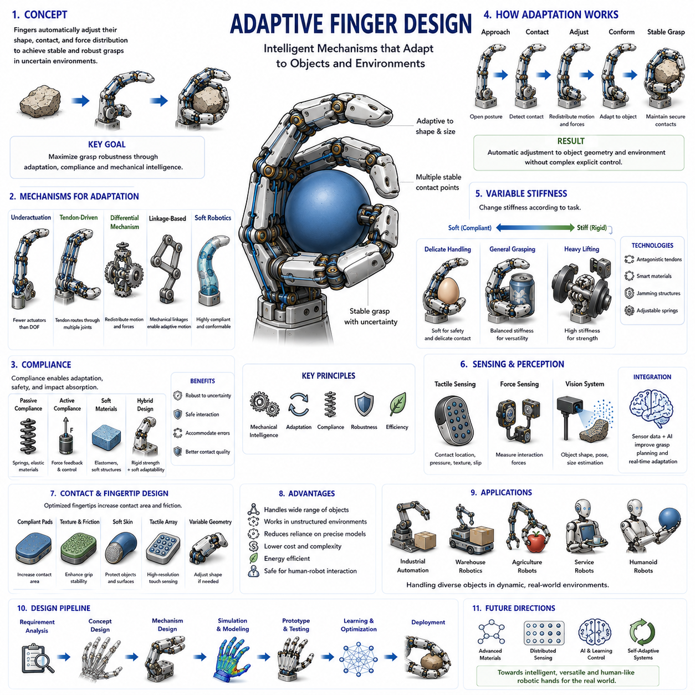{width="7.268055555555556in" height="7.268055555555556in"}

Adaptive finger design represents one of the most significant developments in modern robotic hand engineering. As robots increasingly move beyond highly structured industrial environments and enter homes, hospitals, warehouses, agricultural fields, public facilities, and collaborative workspaces, the ability to interact reliably with objects of unknown size, shape, orientation, texture, and material properties has become a critical requirement. Traditional rigid robotic fingers were originally designed for repetitive tasks involving predictable objects and carefully controlled environments. While these systems excel in precision and repeatability, they often struggle when faced with uncertainty. Adaptive finger design emerged as a solution to this challenge by enabling robotic fingers to automatically adjust their configuration, contact conditions, and force distribution in response to object characteristics and environmental interactions.

The central philosophy of adaptive finger design is that a robotic finger should not rely entirely on explicit control commands to achieve successful grasping. Instead, part of the intelligence required for manipulation should be embedded directly within the mechanical structure. This concept is closely related to mechanical intelligence, where the physical design of the finger contributes to decision-making and adaptation. Rather than forcing software to compensate for every possible uncertainty, adaptive mechanisms allow the finger to naturally conform to objects and respond to contact events in a beneficial manner.

In biological systems, adaptation is a fundamental characteristic of manipulation. Human fingers continuously adjust their shape, stiffness, force distribution, and contact points during grasping. This adaptability allows people to handle objects ranging from delicate glassware to heavy tools without consciously calculating every movement. Adaptive robotic fingers attempt to capture similar capabilities through engineered mechanisms that respond dynamically to environmental conditions.

One of the primary objectives of adaptive finger design is to maximize grasp robustness. Grasp robustness refers to the ability of a robotic hand to maintain stable contact despite uncertainties in object geometry, positioning errors, sensor inaccuracies, and environmental disturbances. Adaptive fingers achieve this by increasing the probability that multiple stable contact points will be established during the grasping process. Instead of requiring exact alignment between the hand and the object, adaptive mechanisms tolerate deviations and compensate automatically.

The most common form of adaptation occurs through passive adaptation. Passive adaptation refers to mechanical adjustments that occur without active control intervention. As a finger encounters an object, contact forces naturally influence the configuration of joints and links. Springs, compliant joints, differential mechanisms, tendon couplings, and flexible structures allow the finger to reshape itself according to the object\'s geometry. Because these adjustments occur mechanically, passive adaptation can operate rapidly and reliably without computational overhead.

Underactuated finger architectures are closely associated with adaptive finger design. In an underactuated finger, fewer actuators are used than the number of degrees of freedom. When an actuator drives the finger, object contact determines how motion is distributed among the joints. This creates a natural adaptive behavior where the finger wraps around objects and forms stable contact patterns without requiring explicit joint-level control. Many successful adaptive robotic fingers are fundamentally underactuated systems.

Compliance is another essential component of adaptive finger engineering. Compliance refers to the ability of a mechanism to deform in response to external forces. Controlled compliance enables fingers to absorb impacts, accommodate positioning errors, and maintain stable contact with irregular surfaces. Compliance may be achieved through springs, elastomeric materials, flexible joints, compliant linkages, pneumatic structures, or soft robotic components. The introduction of compliance often dramatically improves the adaptability of robotic fingers.

A distinction is commonly made between passive compliance and active compliance. Passive compliance relies on physical elasticity built into the mechanism itself. Active compliance, in contrast, uses sensors and control algorithms to modify actuator behavior in response to external forces. Both approaches contribute to adaptive grasping, but passive compliance is generally faster, simpler, and more energy efficient. Active compliance provides greater flexibility and control authority but requires more sophisticated sensing and computation.

Adaptive finger mechanisms frequently employ differential systems. Differential mechanisms distribute forces and motions among multiple joints or fingers according to contact conditions. If one part of the finger encounters resistance, the differential automatically redirects motion elsewhere. This capability enhances adaptability while minimizing control complexity. Differential architectures are particularly common in underactuated robotic hands because they provide elegant solutions for coordinating multiple contact points.

Tendon-driven adaptive fingers are widely used due to their ability to combine lightweight construction with mechanical adaptability. Tendons naturally allow forces to be distributed across multiple joints. When one joint encounters an obstacle, tendon tension can continue driving motion in the remaining joints. This behavior allows the finger to conform to object shapes and establish stable grasp configurations. Tendon-driven adaptive systems are frequently found in anthropomorphic robotic hands and prosthetic devices.

Linkage-based adaptive fingers represent another important design category. Carefully engineered linkage mechanisms can generate adaptive motion trajectories through purely mechanical means. As contact occurs, linkages redistribute movement among finger segments, allowing the structure to wrap around objects. These mechanisms often exhibit high reliability and durability because they rely on rigid mechanical components rather than complex sensing systems.

Soft robotics has significantly expanded the possibilities for adaptive finger design. Soft robotic fingers are constructed from flexible materials that can undergo substantial deformation during interaction. Unlike traditional rigid mechanisms, soft fingers inherently adapt to object geometry through material compliance. Pneumatic actuators, fluidic networks, elastomeric structures, and flexible composites allow soft fingers to achieve levels of adaptability that are difficult to replicate using conventional mechanical designs.

Hybrid adaptive fingers combine rigid structural elements with soft components. These systems seek to balance precision and adaptability. Rigid elements provide load-bearing capability and positional accuracy, while soft regions enhance environmental conformity and safety. Hybrid architectures have become increasingly popular because they offer practical performance across a wide range of manipulation tasks.

Variable stiffness technology represents one of the most advanced directions in adaptive finger research. Traditional fingers exhibit fixed stiffness characteristics. Variable stiffness mechanisms allow the finger to modify its mechanical properties dynamically. During delicate manipulation, the finger can become compliant to improve safety and contact quality. During forceful grasping, stiffness can be increased to maximize load capacity and stability. Variable stiffness technologies include antagonistic tendon systems, smart materials, jamming structures, and mechanically adjustable elastic elements.

Contact mechanics play a central role in adaptive finger performance. The behavior of contact interfaces determines how forces are transmitted between the finger and the object. Adaptive fingers seek to maximize contact area while maintaining appropriate force distributions. Larger contact areas generally improve stability, reduce pressure concentrations, and increase frictional grip. Designers therefore pay careful attention to fingertip geometry, surface materials, compliance distribution, and contact modeling.

Fingertip design is particularly important within adaptive systems. Adaptive fingertips may incorporate compliant pads, textured surfaces, soft skins, tactile sensors, or variable geometry structures. These features enhance the ability of the finger to conform to object surfaces while maintaining secure contact. Many robotic hands achieve significant performance improvements simply through careful fingertip optimization.

The integration of tactile sensing has dramatically improved adaptive finger capabilities. Tactile sensors provide information regarding contact location, pressure distribution, slip events, texture characteristics, and object properties. This information enables the robotic system to modify grasping strategies in real time. While mechanical adaptation can operate independently, combining adaptive mechanisms with tactile sensing creates significantly more capable manipulation systems.

Force sensing is equally important. Adaptive fingers often regulate grasp forces to prevent object damage while maintaining sufficient holding strength. Force sensors embedded within joints, tendons, fingertips, or structural members provide feedback that supports intelligent grasp adjustment. This capability is particularly valuable when handling fragile, deformable, or high-value objects.

Vision systems further enhance adaptive grasping. Cameras, depth sensors, structured light systems, and machine vision algorithms provide information about object geometry before physical contact occurs. By combining visual perception with adaptive finger mechanics, robotic hands can achieve highly reliable grasping performance across diverse environments. Vision enables predictive adaptation, while mechanical structures provide reactive adaptation during contact.

Machine learning has emerged as a powerful tool for adaptive finger development. Reinforcement learning, imitation learning, and data-driven optimization methods enable robotic systems to discover effective manipulation strategies through experience. Adaptive fingers provide rich opportunities for learning because their behavior depends strongly on interactions with the environment. Learning algorithms can exploit these interactions to improve grasp stability, manipulation efficiency, and task performance.

Simulation environments have become increasingly important for adaptive finger research. Modern simulation platforms can model contact mechanics, compliance, tendon dynamics, friction, deformation, and object interactions with high fidelity. These tools allow engineers to evaluate adaptive designs before constructing physical prototypes. Simulation also supports machine learning approaches that require large numbers of training interactions.

One of the greatest advantages of adaptive finger design is robustness to uncertainty. Real-world environments are inherently unpredictable. Objects may be positioned inaccurately, partially occluded, deformable, damaged, or previously unseen. Adaptive fingers reduce dependence on precise environmental models and enable successful operation despite incomplete information. This robustness is one of the key reasons adaptive mechanisms are increasingly favored in practical robotic applications.

Industrial automation is beginning to incorporate adaptive finger technologies, particularly in applications involving variable products, mixed production lines, and flexible manufacturing. Warehouse robots use adaptive grippers to handle packages of different sizes and shapes. Agricultural robots employ adaptive fingers to harvest fruits and vegetables without causing damage. Service robots rely on adaptive manipulation to interact safely with household objects and human users.

Humanoid robotics is perhaps the field most strongly influenced by adaptive finger design. Human environments were created for human hands, not robotic grippers. To function effectively in such environments, humanoid robots require hands capable of handling diverse objects under uncertain conditions. Adaptive fingers provide much of the versatility necessary for achieving this goal.

Future adaptive finger systems are expected to integrate advanced materials, embedded sensing, variable stiffness technologies, intelligent control systems, and artificial intelligence. Smart materials capable of changing shape, stiffness, or surface properties in response to electrical signals may enable entirely new forms of adaptation. Distributed tactile sensing networks could provide continuous perception across the finger surface. Learning-based controllers may allow robotic hands to refine their adaptive behavior through lifelong experience.

The broader vision of Physical AI strongly aligns with adaptive finger design. Physical AI emphasizes the integration of intelligence into both software and hardware. Adaptive fingers embody this principle by embedding problem-solving capabilities directly into the mechanical structure. Rather than relying exclusively on computation, they leverage the physics of materials, contact, compliance, and mechanical design to achieve intelligent interaction.

Ultimately, adaptive finger design represents a fundamental shift in robotic manipulation philosophy. Instead of viewing uncertainty as a problem to eliminate through sensing and control, adaptive systems embrace uncertainty and exploit it through intelligent mechanical design. By combining compliance, underactuation, differential mechanisms, soft materials, sensing technologies, and advanced control strategies, adaptive fingers achieve levels of robustness and versatility that would be difficult to obtain through conventional approaches alone. As robotics continues to expand into increasingly unstructured and human-centered environments, adaptive finger design will remain a cornerstone technology for the development of capable, resilient, and intelligent robotic hands.

적응형 손가락 설계(Adaptive Finger Design)는 현대 로봇 핸드 공학에서 가장 중요한 발전 중 하나로 평가받고 있다. 로봇이 기존의 정형화된 산업 환경을 넘어 가정(Home), 병원(Hospital), 물류창고(Warehouse), 농업 현장(Agricultural Field), 공공시설(Public Facility), 협업 작업장(Collaborative Workspace) 등 다양한 환경으로 진출하면서, 크기와 형상, 방향, 재질, 표면 상태가 모두 다른 물체를 안정적으로 다룰 수 있는 능력이 필수적인 요구사항이 되었다. 기존의 강체 기반 로봇 손가락은 정밀성과 반복성에서는 우수했지만 예측할 수 없는 환경에서는 한계를 보였다. 적응형 손가락 설계는 이러한 문제를 해결하기 위해 등장했으며, 물체와 환경의 특성에 따라 손가락이 스스로 자세와 접촉 상태, 힘 분배를 조절할 수 있도록 하는 기술이다.

적응형 손가락 설계의 핵심 철학은 성공적인 파지를 위해 모든 것을 제어 알고리즘에 의존하지 않는다는 것이다. 즉, 조작에 필요한 일부 지능(Intelligence)을 기계 구조 자체에 내장하는 것이다. 이러한 개념은 기계적 지능(Mechanical Intelligence)과 밀접하게 연관되어 있다. 전통적인 로봇 시스템에서는 센서와 소프트웨어가 모든 불확실성을 해결해야 했지만, 적응형 손가락은 기계 구조가 물체와 자연스럽게 상호작용하며 문제를 해결하도록 설계된다.

생물학적 관점에서 보면 적응성은 조작(Manipulation)의 가장 중요한 특성 중 하나이다. 인간의 손가락은 물체를 잡을 때마다 형태, 강성(Stiffness), 접촉 위치(Contact Point), 힘 분포(Force Distribution)를 지속적으로 변화시킨다. 사람은 유리잔과 망치를 전혀 다른 방식으로 잡지만 이를 의식적으로 계산하지 않는다. 적응형 로봇 손가락 역시 이러한 능력을 기계적으로 구현하고자 한다.

적응형 손가락 설계의 가장 중요한 목표 중 하나는 파지 강건성(Grasp Robustness)을 향상시키는 것이다. 파지 강건성이란 물체 형상의 불확실성, 위치 오차, 센서 오차, 외부 충격과 같은 다양한 조건에서도 안정적인 접촉을 유지할 수 있는 능력을 의미한다. 적응형 손가락은 여러 개의 안정적인 접촉점을 자동으로 형성하여 이러한 문제를 해결한다. 따라서 손과 물체가 정확히 정렬되지 않더라도 안정적인 파지가 가능하다.

가장 일반적인 적응 방식은 수동 적응(Passive Adaptation)이다. 수동 적응은 별도의 제어 명령 없이 기계 구조 자체가 환경에 반응하는 것을 의미한다. 손가락이 물체와 접촉하면 접촉력이 관절과 링크 구조에 영향을 미치고, 스프링(Spring), 순응성 관절(Compliant Joint), 차동 메커니즘(Differential Mechanism), 텐던 결합(Tendon Coupling), 유연 구조(Flexible Structure) 등이 작동하여 손가락 형태를 물체에 맞게 변화시킨다. 이러한 과정은 계산 자원을 거의 사용하지 않으면서도 매우 빠르게 이루어진다.

부족 구동형(Underactuated) 구조는 적응형 손가락 설계와 매우 밀접한 관계를 가진다. 부족 구동 손가락은 자유도(Degree of Freedom)보다 적은 수의 액추에이터를 사용한다. 하나의 액추에이터가 여러 관절을 구동하고, 실제 관절 움직임은 물체와의 접촉 상황에 따라 결정된다. 이 과정에서 손가락은 물체를 자연스럽게 감싸며 적응적인 파지를 수행하게 된다. 오늘날 많은 적응형 로봇 손가락은 부족 구동 구조를 기반으로 설계된다.

순응성(Compliance)은 적응형 손가락 공학의 핵심 요소이다. 순응성이란 외부 힘에 의해 일정 수준의 변형이 가능하도록 설계된 특성을 의미한다. 스프링, 탄성 재료(Elastic Material), 유연 링크(Flexible Link), 공압 구조(Pneumatic Structure), 소프트 로보틱스(Soft Robotics) 기술 등을 통해 구현될 수 있다. 적절한 순응성은 충격을 흡수하고 위치 오차를 보완하며 불규칙한 물체 표면에도 안정적인 접촉을 유지할 수 있게 한다.

순응성은 수동 순응성(Passive Compliance)과 능동 순응성(Active Compliance)으로 구분된다. 수동 순응성은 재료와 구조 자체의 탄성에 의존한다. 반면 능동 순응성은 센서와 제어 알고리즘을 이용하여 외부 힘에 따라 액추에이터의 동작을 조정하는 방식이다. 수동 순응성은 단순하고 빠르며 에너지 효율이 높고, 능동 순응성은 보다 정밀한 제어와 다양한 동작을 가능하게 한다.

적응형 손가락에는 차동 메커니즘(Differential Mechanism)이 자주 사용된다. 차동 메커니즘은 여러 관절이나 손가락 사이에 힘과 운동을 자동으로 분배한다. 예를 들어 손가락의 일부가 물체와 먼저 접촉하면 차동 구조가 나머지 부분으로 운동을 전달하여 추가적인 접촉점을 형성한다. 이는 복잡한 제어 없이도 안정적인 파지를 가능하게 한다.

텐던 구동(Tendon-Driven) 적응형 손가락은 경량화와 적응성을 동시에 달성할 수 있는 대표적인 구조이다. 텐던은 여러 관절에 힘을 분배할 수 있기 때문에 하나의 관절이 물체와 접촉하더라도 다른 관절은 계속 움직일 수 있다. 결과적으로 손가락은 물체 형상에 맞추어 자연스럽게 휘어지고 안정적인 접촉을 형성한다. 이러한 구조는 휴머노이드 핸드(Humanoid Hand)와 의수(Prosthetic Hand)에서 널리 사용된다.

링크 기반(Linkage-Based) 적응형 손가락도 중요한 설계 방식이다. 정교하게 설계된 링크 구조는 별도의 복잡한 제어 없이도 적응적인 움직임을 생성할 수 있다. 물체와 접촉하면 링크 구조가 운동을 재분배하여 손가락이 물체를 감싸도록 유도한다. 이러한 방식은 높은 신뢰성과 내구성을 제공한다.

소프트 로보틱스는 적응형 손가락 설계의 가능성을 크게 확장시켰다. 소프트 손가락(Soft Finger)은 유연한 재료로 제작되어 접촉 시 큰 변형이 가능하다. 기존의 강체 구조와 달리 재료 자체가 물체 형상에 적응하기 때문에 매우 뛰어난 적응성을 제공한다. 공압 액추에이터(Pneumatic Actuator), 유체 네트워크(Fluidic Network), 엘라스토머(Elastomer) 구조 등이 대표적인 예이다.

최근에는 강체 구조와 연성 구조를 결합한 하이브리드 적응형 손가락(Hybrid Adaptive Finger)이 주목받고 있다. 강체 부분은 정밀도와 하중 지지 능력을 제공하고, 연성 부분은 적응성과 안전성을 제공한다. 이러한 구조는 실제 응용 분야에서 매우 높은 활용성을 보인다.

가변 강성(Variable Stiffness) 기술은 적응형 손가락 연구의 가장 발전된 분야 중 하나이다. 일반적인 손가락은 일정한 강성을 가지지만, 가변 강성 손가락은 작업에 따라 강성을 변화시킬 수 있다. 예를 들어 섬세한 물체를 다룰 때는 부드럽게 만들고, 무거운 물체를 잡을 때는 강성을 높일 수 있다. 이를 위해 길항 텐던(Antagonistic Tendon), 스마트 재료(Smart Material), 재밍 구조(Jamming Structure), 조절 가능한 탄성 요소 등이 사용된다.

접촉 역학(Contact Mechanics)은 적응형 손가락 성능을 결정하는 중요한 요소이다. 적응형 손가락은 가능한 한 넓은 접촉 면적을 형성하면서도 적절한 힘 분포를 유지하려고 한다. 접촉 면적이 증가하면 마찰력이 향상되고 압력이 분산되어 보다 안정적인 파지가 가능해진다.

손끝(Fingertip) 설계 또한 매우 중요하다. 적응형 손끝은 연성 패드(Compliant Pad), 표면 텍스처(Texture), 소프트 스킨(Soft Skin), 촉각 센서(Tactile Sensor), 가변 형상 구조 등을 포함할 수 있다. 이러한 요소들은 물체 표면에 대한 적응성을 향상시키고 파지 안정성을 높인다.

촉각 센서의 통합은 적응형 손가락의 성능을 크게 향상시켰다. 촉각 센서는 접촉 위치, 압력 분포, 미끄러짐(Slip), 표면 질감(Texture), 물체 특성 등을 측정할 수 있다. 이를 통해 로봇은 파지 전략을 실시간으로 조정할 수 있다. 기계적 적응만으로도 우수한 성능을 제공하지만, 촉각 센싱이 결합되면 훨씬 높은 수준의 조작 능력을 구현할 수 있다.

힘 센서(Force Sensor) 역시 중요한 역할을 한다. 적응형 손가락은 물체를 손상시키지 않으면서도 충분한 파지력을 유지해야 한다. 이를 위해 관절, 텐던, 손끝 등에 설치된 힘 센서를 사용하여 파지력을 지속적으로 조절한다. 이러한 기능은 깨지기 쉬운 물체나 변형 가능한 물체를 다룰 때 특히 중요하다.

비전 시스템(Vision System)은 적응형 파지를 더욱 향상시킨다. RGB 카메라, 깊이 카메라(Depth Camera), 구조광 센서(Structured Light Sensor) 등을 이용하면 물체와 접촉하기 전에 형상 정보를 획득할 수 있다. 비전은 예측적 적응(Predictive Adaptation)을 가능하게 하고, 적응형 메커니즘은 접촉 이후의 반응적 적응(Reactive Adaptation)을 수행한다.

머신러닝(Machine Learning)과 강화학습(Reinforcement Learning)은 적응형 손가락 개발에 강력한 도구로 자리 잡고 있다. 데이터 기반 최적화(Data-Driven Optimization)를 통해 파지 전략을 자동으로 학습할 수 있으며, 실제 환경과의 상호작용을 통해 점점 더 나은 조작 능력을 획득할 수 있다.

시뮬레이션 환경(Simulation Environment)도 적응형 손가락 연구에서 매우 중요하다. 최신 시뮬레이션 플랫폼은 접촉 역학, 순응성, 텐던 거동, 마찰, 변형 등을 높은 정확도로 모델링할 수 있다. 이를 통해 실제 하드웨어 제작 이전에 성능을 검증하고 최적화할 수 있다.

적응형 손가락 설계의 가장 큰 장점은 불확실성에 대한 강건성(Robustness to Uncertainty)이다. 현실 세계의 물체는 항상 예측 불가능하다. 물체 위치가 잘못되었거나, 일부가 가려져 있거나, 변형 가능하거나, 처음 보는 물체일 수도 있다. 적응형 손가락은 정밀한 모델 없이도 이러한 상황에 대응할 수 있기 때문에 실제 응용에서 매우 높은 가치를 가진다.

산업 자동화(Industrial Automation)에서도 적응형 손가락의 활용이 증가하고 있다. 다양한 제품을 생산하는 유연 생산 시스템(Flexible Manufacturing System), 물류 자동화, 농업용 수확 로봇(Harvesting Robot), 서비스 로봇(Service Robot) 등에서 적응형 손가락은 핵심 기술로 자리 잡고 있다.

특히 휴머노이드 로봇 분야에서는 적응형 손가락이 필수적이다. 인간이 사용하는 환경은 인간의 손을 기준으로 설계되어 있기 때문에, 휴머노이드 로봇도 다양한 물체를 다룰 수 있는 손을 필요로 한다. 적응형 손가락은 이러한 요구를 충족시키는 가장 현실적인 기술 중 하나이다.

미래의 적응형 손가락은 스마트 재료, 분산형 촉각 센서 네트워크, 가변 강성 기술, AI 기반 제어, 자가 학습(Self-Learning) 기능을 통합할 것으로 예상된다. 이러한 발전은 인간 손에 더욱 가까운 적응성과 조작 능력을 제공할 것이다.

물리 AI(Physical AI)의 관점에서 보면 적응형 손가락은 매우 중요한 의미를 가진다. 물리 AI는 소프트웨어뿐 아니라 하드웨어 자체에도 지능을 내장하는 것을 목표로 한다. 적응형 손가락은 재료, 구조, 접촉 역학, 순응성을 활용하여 기계 구조 자체가 문제 해결에 참여하도록 만든 대표적인 사례이다.

결론적으로 적응형 손가락 설계는 로봇 조작 기술의 패러다임을 변화시키고 있다. 기존에는 불확실성을 제거하기 위해 센서와 제어를 강화했다면, 적응형 설계는 불확실성을 자연스럽게 수용하고 활용한다. 순응성, 부족 구동, 차동 메커니즘, 소프트 재료, 촉각 센싱, 인공지능 기술을 결합함으로써 적응형 손가락은 기존 방식으로는 달성하기 어려운 수준의 강건성과 유연성을 제공한다. 앞으로 로봇이 인간 중심 환경으로 더욱 확장될수록 적응형 손가락은 지능형 로봇 핸드의 핵심 기술로서 그 중요성이 더욱 커질 것이다.

##  

## 02.07 Palm and Wrist Structures

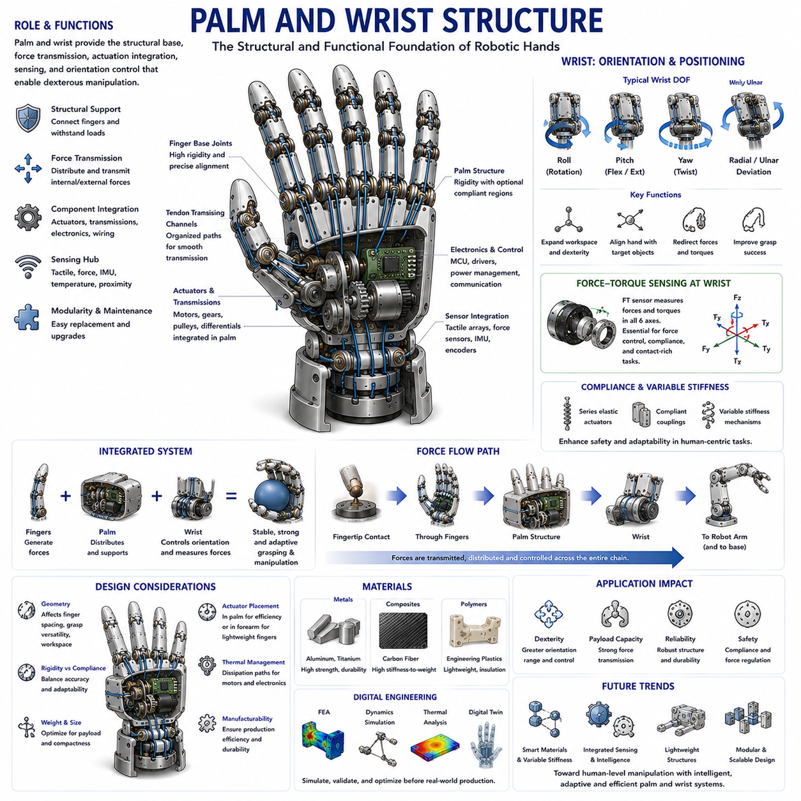{width="7.268055555555556in" height="7.268055555555556in"}

The palm and wrist structure forms the central mechanical foundation of every robotic hand system. While robotic finger design often receives the majority of attention because fingers directly interact with objects, the palm and wrist serve as the structural, functional, and computational backbone that enables those fingers to operate effectively. In many robotic hand systems, overall grasping performance, manipulation capability, payload capacity, durability, sensor integration, and system intelligence are heavily influenced by palm and wrist design decisions. Consequently, the engineering of robotic palms and wrists is not merely a supporting activity but a critical discipline within robotic hand development. This chapter belongs to the Hand Mechanism and Structural Design section of Volume 06 and serves as a bridge between finger mechanisms, actuation systems, hand kinematics, force control, tactile sensing, and dexterous manipulation architectures.

In biological systems, the human palm serves as a complex structural platform that connects the fingers to the forearm while providing mechanical support, force transmission pathways, sensory integration, and adaptability. The human wrist further extends these capabilities by enabling orientation control, positioning flexibility, and force redirection. Together they create a highly versatile manipulation platform capable of handling objects ranging from fragile eggshells to heavy industrial tools. Robotic palm and wrist structures attempt to reproduce many of these functions while adapting them to engineering constraints such as manufacturability, durability, weight limitations, actuator integration, and control architecture.

The primary role of the robotic palm is to serve as the structural base that connects multiple fingers into a coordinated grasping system. Every finger generates forces during object interaction, and these forces ultimately flow through the palm structure. The palm therefore acts as a load-bearing framework that distributes internal forces, maintains finger alignment, supports actuators and transmission systems, and houses sensing and computational components. A poorly designed palm may compromise the performance of even the most advanced finger mechanisms.

One of the most fundamental considerations in palm design is geometric architecture. Palm geometry determines finger spacing, finger orientation, reachable grasp configurations, and overall hand workspace. The arrangement of fingers relative to one another significantly influences grasp stability and manipulation capability. A narrow palm may provide compactness and higher force concentration, while a wider palm can improve object coverage and enhance adaptability to large objects. Designers must balance these competing requirements according to the intended application.

Anthropomorphic robotic hands frequently adopt palm geometries inspired by the human hand. Human palms exhibit a non-planar structure in which fingers are not positioned on a straight line but instead follow a curved arrangement. This curvature contributes to natural grasp formation and improved object enclosure. Robotic palms often replicate this concept by positioning finger bases along an arc rather than a linear arrangement. Such designs enhance grasp versatility and facilitate more natural object manipulation.

Industrial robotic hands frequently prioritize mechanical simplicity over biological realism. Many industrial grippers employ flat or semi-flat palm structures that maximize manufacturability and simplify force transmission. These designs are often optimized for repetitive tasks involving predictable object geometries rather than highly dexterous manipulation.

Palm rigidity is another major design consideration. High structural rigidity ensures accurate force transmission and precise positioning. During manipulation tasks, deformation of the palm structure can introduce positioning errors, reduce grasp stability, and compromise control performance. For applications involving high loads or precision assembly, rigid palm architectures are generally preferred.

However, complete rigidity is not always desirable. Certain robotic hands benefit from incorporating compliant regions within the palm. Compliant palm structures can absorb impacts, improve adaptation to object geometry, reduce stress concentrations, and enhance safety during human-robot interaction. Hybrid palm architectures that combine rigid load-bearing regions with localized compliance have become increasingly popular in collaborative robotics and service robotics.

The palm also serves as the primary integration platform for actuators. In tendon-driven robotic hands, motors are often located within the palm to reduce distal finger mass. This arrangement improves finger responsiveness and reduces inertia. Palm volume therefore becomes a critical resource that must accommodate motors, gearboxes, pulleys, tendon routing systems, electronics, wiring, and cooling structures while maintaining compact overall dimensions.

Actuator placement strongly influences hand performance. Locating actuators within the palm improves transmission efficiency but increases hand weight. Relocating actuators to the forearm reduces palm mass but introduces longer transmission paths and additional complexity. Designers must carefully evaluate these trade-offs according to application requirements.

Transmission systems are deeply integrated into palm structures. Tendon routing channels, differential mechanisms, pulley networks, gear trains, and force distribution systems frequently occupy substantial portions of the palm interior. Effective transmission integration requires careful mechanical packaging to avoid interference among moving components while preserving accessibility for maintenance and repair.

Sensor integration represents another critical aspect of palm engineering. Modern robotic hands often incorporate force sensors, tactile sensors, temperature sensors, inertial sensors, joint encoders, and proximity sensors. Many of these sensing elements are mounted within or routed through the palm structure. The palm effectively functions as a sensor integration hub that connects distributed sensing systems throughout the hand.

Tactile sensing is particularly important. Although fingertip tactile sensing receives significant attention, palm tactile sensing can provide valuable information regarding object support, contact distribution, grasp stability, and unexpected collisions. Advanced robotic hands increasingly incorporate tactile arrays across both fingers and palm surfaces to achieve richer environmental awareness.

The mechanical connection between fingers and palm requires careful attention. Finger base joints must withstand significant forces while maintaining precise alignment. Joint mounting structures must accommodate repeated loading cycles without excessive wear or deformation. Bearing selection, joint reinforcement, and structural support design all contribute to long-term reliability.

Modularity has become an increasingly important design principle in robotic palm engineering. Modular palm architectures allow fingers, sensors, actuators, and transmission components to be replaced independently. This approach simplifies maintenance, reduces downtime, and supports rapid experimentation during research and development. Many modern robotic hands are intentionally designed as modular systems to facilitate upgrades and customization.

The wrist serves as the dynamic interface between the robotic hand and the larger manipulator system. While fingers and palm generate grasping actions, the wrist determines the orientation and positioning of the entire hand relative to the environment. In many manipulation tasks, wrist motion contributes more significantly to overall dexterity than finger motion alone.

Human wrists provide multiple degrees of freedom including flexion, extension, radial deviation, ulnar deviation, and rotational motion. Robotic wrists typically implement a subset of these capabilities depending on system requirements. Industrial manipulators often achieve wrist functionality through the final joints of the robot arm, while humanoid and dexterous robotic hands frequently include dedicated wrist mechanisms.

Wrist kinematics strongly influence reachable grasp configurations. A highly dexterous wrist expands the effective workspace of the hand and reduces the burden placed on finger articulation. By adjusting wrist orientation, the robotic system can align the hand with target objects more effectively and improve grasp success rates.

Degrees of freedom within the wrist must be carefully selected. Additional wrist joints increase dexterity but also introduce greater mechanical complexity, weight, control requirements, and power consumption. Designers must identify the minimum number of wrist degrees of freedom necessary to achieve desired task performance.

Wrist load capacity is particularly important in industrial applications. During manipulation, the wrist must transmit forces generated by both the object and the arm. Heavy payload operations require robust wrist structures capable of resisting bending moments, torsional loads, and impact forces. Structural analysis and fatigue evaluation are therefore essential aspects of wrist engineering.

Force and torque sensing are frequently integrated at the wrist level. Wrist-mounted force-torque sensors provide critical information regarding contact interactions, insertion tasks, assembly operations, and manipulation forces. These sensors are particularly important for compliant control, force regulation, and contact-rich manipulation tasks. The integration of wrist force-torque sensing forms a foundational component of modern dexterous manipulation systems and directly connects to later topics involving force control and tactile feedback.

Compliance within wrist structures has become increasingly important as robots transition into human-centered environments. Series elastic actuators, compliant couplings, flexible joints, and variable stiffness mechanisms allow wrists to absorb impacts and regulate interaction forces. These capabilities enhance safety and improve manipulation robustness in uncertain environments.

Variable stiffness wrists represent an advanced research direction. Such systems can dynamically adjust mechanical stiffness according to task requirements. High stiffness may be desirable for precision assembly and heavy lifting, while low stiffness improves safety and adaptability during human interaction and delicate manipulation.

The integration of palm and wrist systems creates a unified manipulation platform. Forces generated at the fingertips travel through finger structures, into the palm, through the wrist, and ultimately into the robotic arm. The quality of this force transmission chain significantly influences overall manipulation performance. Designers must therefore view palm and wrist engineering as a unified system rather than independent subsystems.

Material selection plays a crucial role in both palm and wrist design. Aluminum alloys provide excellent weight-to-strength ratios and are commonly used in research and commercial robotic hands. Titanium alloys offer higher strength and corrosion resistance but at increased cost. Engineering polymers reduce weight and manufacturing costs while providing electrical insulation. Carbon fiber composites deliver exceptional stiffness-to-weight performance and are increasingly adopted in advanced robotic systems.

Thermal management is becoming an increasingly important consideration as robotic hands integrate larger numbers of actuators, sensors, processors, and communication modules. Palm structures often function as heat dissipation platforms. Proper thermal design improves component reliability and extends operational lifespan.

Manufacturability remains a critical engineering concern. Palm and wrist structures must be designed not only for performance but also for production efficiency. Additive manufacturing, CNC machining, injection molding, composite fabrication, and hybrid manufacturing methods are all employed depending on application requirements. Modern generative design techniques increasingly optimize palm and wrist geometries for weight reduction and structural efficiency.

Simulation and digital engineering tools have transformed palm and wrist development. Finite Element Analysis, multibody dynamics simulation, contact modeling, thermal analysis, and digital twins allow engineers to evaluate performance before physical prototypes are built. These tools reduce development costs while improving design quality.

The emergence of humanoid robotics has renewed interest in sophisticated palm and wrist architectures. Human environments were designed around the capabilities of human hands. Consequently, humanoid robots require palms and wrists that support diverse manipulation tasks while maintaining compact dimensions comparable to biological anatomy. Achieving this balance remains one of the most significant challenges in robotic hand engineering.

Artificial intelligence and Physical AI are further increasing the importance of palm and wrist design. Future robotic systems will rely not only on computational intelligence but also on embodied intelligence embedded within mechanical structures. Palms and wrists will increasingly integrate sensing, adaptive mechanisms, variable stiffness technologies, self-monitoring systems, and intelligent control architectures.

Ultimately, the palm and wrist structure serves as the central foundation of robotic hand functionality. While fingers perform direct object interaction, the palm provides structural integration and force distribution, and the wrist delivers positioning flexibility and dynamic orientation control. Together they form the essential framework upon which dexterous manipulation, tactile interaction, force regulation, adaptive grasping, and intelligent robotic behavior are built. As robotic hands continue to evolve toward human-level manipulation capabilities, the engineering of palm and wrist structures will remain one of the most critical disciplines in robotic hand design and development.

손바닥(Palm)과 손목(Wrist) 구조는 모든 로봇 핸드 시스템의 핵심 기계적 기반을 형성한다. 일반적으로 로봇 핸드 설계에서는 물체와 직접 접촉하는 손가락(Finger)에 많은 관심이 집중되지만, 실제로 손바닥과 손목은 손가락이 효과적으로 기능할 수 있도록 지원하는 구조적·기능적·제어적 중심 역할을 수행한다. 파지 성능(Grasping Performance), 조작성(Manipulation Capability), 적재 능력(Payload Capacity), 내구성(Durability), 센서 통합(Sensor Integration), 그리고 전체 시스템 지능(System Intelligence)은 상당 부분 손바닥과 손목의 설계에 의해 결정된다. 따라서 손바닥과 손목 설계는 단순한 보조 구조물이 아니라 로봇 핸드 개발의 핵심 공학 분야라고 할 수 있다. 본 주제는 Volume 06의 「Hand Mechanism and Structural Design」에 속하며, 손가락 메커니즘, 액추에이터 시스템, 핸드 운동학, 힘 제어, 촉각 센싱, 정교한 조작 시스템을 연결하는 중요한 역할을 수행한다.

생물학적으로 인간의 손바닥은 손가락과 전완(Forearm)을 연결하는 복합 구조물이다. 단순한 연결 부위가 아니라 힘 전달, 감각 통합, 구조적 지지, 적응적 조작을 가능하게 하는 플랫폼 역할을 수행한다. 손목은 여기에 추가적으로 방향 제어(Orientation Control), 위치 조정(Positioning), 힘의 전달 방향 변경 기능을 제공한다. 이 두 구조가 결합되어 인간은 깨지기 쉬운 유리잔부터 무거운 공구까지 자유롭게 다룰 수 있다. 로봇의 손바닥과 손목 역시 이러한 기능을 구현하려 하지만, 제조성(Manufacturability), 내구성, 무게 제한, 액추에이터 배치, 제어 구조와 같은 공학적 제약을 고려하여 설계된다.

손바닥의 가장 중요한 역할은 여러 손가락을 하나의 통합된 파지 시스템으로 연결하는 구조적 기반을 제공하는 것이다. 물체를 잡을 때 각 손가락에서 발생하는 힘은 최종적으로 손바닥을 통해 전달된다. 따라서 손바닥은 하중을 지지하고, 힘을 분산하며, 손가락 정렬을 유지하고, 액추에이터와 전달 장치 및 센서를 수용하는 프레임워크 역할을 수행한다. 아무리 우수한 손가락 구조를 사용하더라도 손바닥 설계가 부실하면 전체 핸드 성능은 크게 저하될 수 있다.

손바닥 설계에서 가장 기본적인 요소 중 하나는 형상 구조(Geometry Architecture)이다. 손바닥의 형태는 손가락 간격(Finger Spacing), 손가락 방향(Finger Orientation), 파지 자세(Grasp Configuration), 그리고 전체 작업 공간(Workspace)을 결정한다. 좁은 손바닥은 컴팩트한 구조와 높은 힘 집중도를 제공하지만 큰 물체를 다루기 어렵다. 반면 넓은 손바닥은 더 큰 물체를 감싸고 다양한 파지를 수행할 수 있지만 구조가 커지고 무게가 증가한다.

인간형(Anthropomorphic) 로봇 핸드는 종종 인간 손의 형태를 모방한다. 인간 손의 손가락들은 직선상에 배치되어 있지 않고 완만한 곡선을 따라 배열되어 있다. 이러한 곡선 구조는 물체를 자연스럽게 감싸는 데 중요한 역할을 한다. 따라서 많은 로봇 핸드에서도 손가락 베이스를 곡선 형태로 배치하여 보다 자연스러운 파지와 조작이 가능하도록 설계한다.

산업용 로봇 핸드는 생체모방보다는 단순성과 신뢰성을 우선시하는 경우가 많다. 따라서 평평한 손바닥 구조를 사용하는 경우가 많으며, 이는 제조가 쉽고 힘 전달 구조를 단순화할 수 있다는 장점이 있다.

손바닥 강성(Palm Rigidity)은 또 다른 중요한 설계 요소이다. 높은 강성은 힘을 정확하게 전달하고 손가락 위치를 안정적으로 유지하는 데 도움이 된다. 특히 정밀 조립(Precision Assembly)이나 고하중 작업에서는 손바닥 변형이 오차를 유발할 수 있으므로 높은 강성이 요구된다.

그러나 모든 경우에 높은 강성이 최선은 아니다. 일부 로봇 핸드는 순응성(Compliance)을 가진 손바닥 구조를 채택한다. 이러한 구조는 충격을 흡수하고, 물체 형상에 적응하며, 사람과의 협업 환경에서 안전성을 향상시킨다. 최근에는 강체 구조와 순응성 구조를 결합한 하이브리드 손바닥 설계가 널리 연구되고 있다.

손바닥은 액추에이터 통합 플랫폼 역할도 수행한다. 텐던 구동(Tendon-Driven) 로봇 핸드에서는 모터를 손가락 내부가 아니라 손바닥 내부에 배치하는 경우가 많다. 이를 통해 손가락 질량을 줄이고 응답성을 향상시킬 수 있다. 따라서 손바닥 내부 공간은 모터, 감속기, 풀리, 텐던 경로, 전자 회로, 배선, 냉각 구조 등을 수용해야 하는 매우 중요한 자원이 된다.

액추에이터 배치는 전체 핸드 성능에 큰 영향을 준다. 액추에이터를 손바닥 내부에 배치하면 전달 효율이 향상되지만 무게가 증가한다. 반대로 전완부에 배치하면 손은 가벼워지지만 텐던 경로가 길어지고 구조가 복잡해진다.

전달 시스템(Transmission System) 역시 손바닥 내부와 깊게 통합된다. 텐던 경로, 차동 메커니즘, 풀리 네트워크, 기어 시스템 등이 손바닥 내부에 위치하는 경우가 많다. 이러한 부품들을 제한된 공간 안에 효율적으로 배치하는 것은 매우 중요한 설계 과제이다.

센서 통합(Sensor Integration) 또한 손바닥 설계의 핵심 요소이다. 현대 로봇 핸드는 힘 센서, 촉각 센서, 온도 센서, 관성 센서(IMU), 엔코더(Encoder), 근접 센서(Proximity Sensor) 등을 포함한다. 이들 센서는 대부분 손바닥을 중심으로 연결되고 관리된다.

특히 촉각 센싱(Tactile Sensing)은 손가락뿐 아니라 손바닥에서도 중요하다. 손바닥 촉각 센서는 물체 지지 상태, 접촉 분포, 파지 안정성, 예상치 못한 충돌 등을 감지할 수 있다. 최근의 고성능 로봇 핸드는 손가락과 손바닥 전체에 촉각 센서를 배치하는 방향으로 발전하고 있다.

손가락과 손바닥의 연결 구조도 매우 중요하다. 손가락 베이스 관절은 반복적인 하중을 견디면서도 정밀한 정렬을 유지해야 한다. 따라서 베어링(Bearing), 보강 구조(Reinforcement Structure), 관절 지지 설계가 장기 신뢰성 확보에 큰 영향을 미친다.

최근에는 모듈화(Modularity)가 중요한 설계 원칙으로 자리 잡고 있다. 모듈형 손바닥 구조는 손가락, 센서, 액추에이터, 전달 장치를 개별적으로 교체할 수 있게 한다. 이러한 구조는 유지보수를 쉽게 하고 연구개발 과정에서 빠른 실험과 업그레이드를 가능하게 한다.

손목은 로봇 핸드와 로봇 팔을 연결하는 동적 인터페이스(Dynamic Interface) 역할을 수행한다. 손가락과 손바닥이 파지를 담당한다면 손목은 핸드 전체의 방향과 위치를 조절한다. 실제 조작 작업에서는 손가락보다 손목의 움직임이 더 큰 영향을 미치는 경우도 많다.

인간 손목은 굴곡(Flexion), 신전(Extension), 요측 편위(Radial Deviation), 척측 편위(Ulnar Deviation), 회전(Rotation) 등 다양한 자유도(Degree of Freedom)를 제공한다. 로봇 손목은 응용 분야에 따라 이러한 기능 중 일부 또는 전부를 구현한다.

손목 운동학(Wrist Kinematics)은 파지 가능한 자세의 범위를 결정한다. 자유도가 높은 손목은 손 전체의 작업 공간을 크게 확장시키며, 손가락에 요구되는 운동 범위를 줄여준다. 이를 통해 더 다양한 물체를 효과적으로 다룰 수 있다.

그러나 손목 자유도가 증가하면 무게와 복잡성, 제어 부담도 함께 증가한다. 따라서 설계자는 목표 응용에 필요한 최소한의 자유도를 신중하게 결정해야 한다.

산업용 응용에서는 손목 하중 용량(Load Capacity)이 매우 중요하다. 손목은 물체 무게뿐 아니라 로봇 팔에서 전달되는 힘과 토크도 견뎌야 한다. 따라서 굽힘 모멘트(Bending Moment), 비틀림 하중(Torsional Load), 충격 하중(Impact Load)에 대한 충분한 강도가 요구된다.

힘·토크 센서(Force-Torque Sensor)는 일반적으로 손목에 장착된다. 손목 FT 센서는 조립 작업, 삽입 작업, 접촉 기반 조작(Contact-Rich Manipulation)에서 매우 중요한 정보를 제공한다. 또한 임피던스 제어(Impedance Control), 힘 제어(Force Control), 순응 제어(Compliance Control)의 핵심 센서 역할을 수행한다. 이는 이후 Force and Torque Control 및 Tactile Sensing 주제와 직접적으로 연결된다.

최근에는 순응형 손목(Compliant Wrist)이 중요해지고 있다. 시리즈 탄성 액추에이터(Series Elastic Actuator), 유연 커플링(Flexible Coupling), 가변 강성 메커니즘(Variable Stiffness Mechanism)을 통해 충격을 흡수하고 사람과의 안전한 상호작용을 가능하게 한다.

가변 강성 손목(Variable Stiffness Wrist)은 최신 연구 분야 중 하나이다. 무거운 물체를 들 때는 강성을 높이고, 사람과 협업하거나 섬세한 작업을 수행할 때는 강성을 낮출 수 있다. 이를 통해 안전성과 성능을 동시에 확보할 수 있다.

손바닥과 손목은 독립적인 구조가 아니라 하나의 통합 시스템으로 설계되어야 한다. 손끝에서 발생한 힘은 손가락을 지나 손바닥, 손목, 그리고 로봇 팔로 전달된다. 이 전체 힘 전달 체인의 품질이 조작 성능을 결정한다.

재료 선택(Material Selection)은 손바닥과 손목 설계에서 매우 중요하다. 알루미늄 합금(Aluminum Alloy)은 우수한 강도 대 중량비를 제공하며 가장 널리 사용된다. 티타늄(Titanium)은 높은 강도와 내식성을 제공하지만 비용이 높다. 엔지니어링 플라스틱(Engineering Plastic)은 경량화와 전기 절연에 유리하다. 탄소섬유 복합재(Carbon Fiber Composite)는 매우 높은 강성 대 중량비를 제공하여 고성능 시스템에 사용된다.

열 관리(Thermal Management)의 중요성도 점점 증가하고 있다. 액추에이터, 프로세서, 센서가 증가하면서 손바닥 구조는 방열판(Heat Sink)의 역할까지 수행하게 된다. 적절한 열 설계는 시스템 신뢰성과 수명을 향상시킨다.

제조성(Manufacturability) 역시 핵심 고려사항이다. 손바닥과 손목은 성능뿐 아니라 생산 효율성도 고려하여 설계되어야 한다. CNC 가공, 적층 제조(Additive Manufacturing), 사출성형(Injection Molding), 복합재 제조 등이 활용된다.

유한요소해석(FEA), 다물체 동역학(Multibody Dynamics), 접촉 시뮬레이션(Contact Simulation), 디지털 트윈(Digital Twin)과 같은 디지털 엔지니어링 도구는 손바닥과 손목 설계를 크게 발전시키고 있다. 이를 통해 실제 제작 전에 구조 강도, 열 특성, 동작 특성을 검증할 수 있다.

휴머노이드 로봇의 발전은 손바닥과 손목 설계의 중요성을 더욱 높이고 있다. 인간 환경은 인간 손을 기준으로 만들어졌기 때문에 휴머노이드 로봇 역시 인간과 유사한 크기와 기능을 가진 손바닥 및 손목 구조를 필요로 한다. 이러한 요구를 만족시키는 것은 로봇 핸드 공학의 가장 큰 도전 과제 중 하나이다.

인공지능(AI)과 물리 AI(Physical AI)의 발전은 손바닥과 손목을 단순한 구조물이 아닌 지능형 플랫폼으로 변화시키고 있다. 미래의 손바닥과 손목은 분산 센서, 적응 메커니즘, 가변 강성 기술, 자가 진단 기능(Self-Monitoring), 지능형 제어 시스템을 통합하게 될 것이다.

결론적으로 손바닥과 손목 구조는 로봇 핸드의 중심 기반 기술이다. 손가락이 직접 물체와 상호작용한다면, 손바닥은 구조 통합과 힘 분배를 담당하고, 손목은 위치와 방향을 제어한다. 이 세 요소가 결합되어 정교한 조작(Dexterous Manipulation), 촉각 상호작용(Tactile Interaction), 힘 제어(Force Regulation), 적응형 파지(Adaptive Grasping), 그리고 지능형 로봇 행동(Intelligent Robotic Behavior)을 가능하게 한다. 인간 수준의 조작 능력을 목표로 하는 미래 로봇 핸드 개발에서 손바닥과 손목 구조 설계는 앞으로도 가장 중요한 핵심 기술 분야 중 하나로 남게 될 것이다.

##  

## 02.08 Material Selection

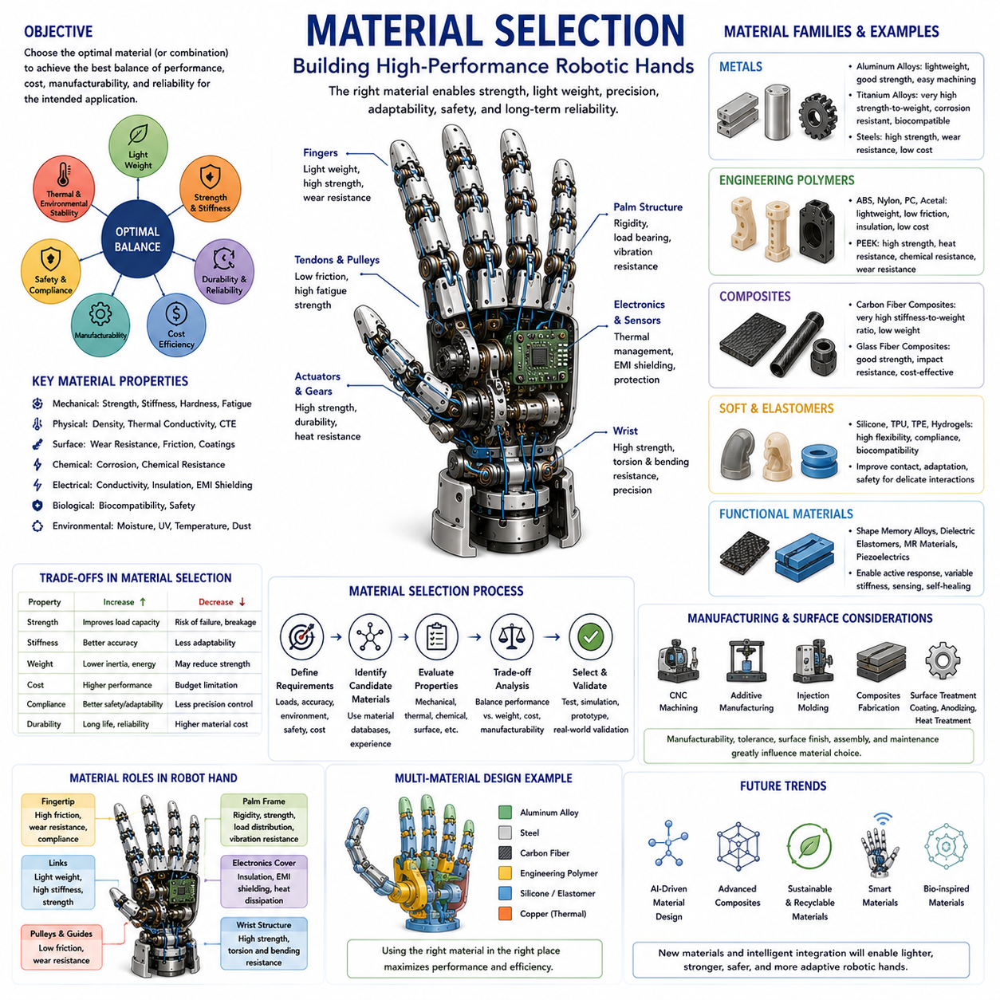{width="7.268055555555556in" height="7.268055555555556in"}

Material selection is one of the most fundamental and influential aspects of robotic hand engineering. Every robotic hand, regardless of its complexity, performance level, or intended application, is ultimately constrained by the materials from which it is constructed. The mechanical strength, stiffness, durability, weight, thermal characteristics, manufacturability, cost, safety, and long-term reliability of a robotic hand are all directly influenced by material selection decisions. While kinematic design, actuation systems, sensing technologies, and control algorithms often receive significant attention, the success of these systems frequently depends upon whether the underlying materials can support the required performance objectives.

In robotic hand design, materials are not merely structural elements. They actively shape the behavior of the system. The flexibility of a finger, the rigidity of a palm, the durability of a transmission mechanism, the sensitivity of a tactile sensor, and the efficiency of a tendon routing system all emerge from the properties of the materials involved. Consequently, material selection should be viewed as a system-level engineering process rather than a simple component choice.

The primary objective of material selection is to achieve an optimal balance among multiple competing requirements. Robotic hands must often be lightweight while remaining strong, compliant while maintaining accuracy, durable while minimizing cost, and compact while accommodating complex mechanical systems. No single material can maximize every desired characteristic simultaneously. Engineers therefore evaluate trade-offs among performance metrics to identify the most appropriate material combinations for a given application.

One of the most important properties considered during material selection is mechanical strength. Strength refers to the ability of a material to resist failure under applied loads. Robotic fingers, palms, wrists, gears, linkages, tendon anchors, and structural supports all experience forces during manipulation. Materials with insufficient strength may deform permanently, crack, fracture, or fail catastrophically. The required strength level depends heavily on the intended application. A lightweight prosthetic hand handling household objects requires far lower strength than an industrial robotic gripper manipulating heavy automotive components.

Closely related to strength is stiffness. Stiffness describes the resistance of a material to elastic deformation. High stiffness is often desirable because it improves positioning accuracy, force transmission efficiency, and grasp stability. When a robotic finger contacts an object, excessive structural deflection may introduce positioning errors and reduce control precision. Industrial robotic hands frequently employ high-stiffness materials to achieve consistent and repeatable manipulation performance.

However, stiffness is not universally beneficial. Excessively rigid systems may struggle to adapt to uncertain environments or fragile objects. Human hands achieve remarkable manipulation capabilities partly because biological tissues exhibit controlled compliance. Modern robotic systems increasingly incorporate materials with carefully selected flexibility to improve safety and adaptability. Consequently, material selection often involves balancing stiffness and compliance according to application requirements.

Density is another critical parameter. Density determines the mass of a structure for a given volume. Weight reduction is particularly important in robotic hands because mass located far from the robot base increases inertia, energy consumption, actuator requirements, and dynamic loading. Lightweight fingers can accelerate more rapidly, respond more efficiently, and interact more safely with their environment. As a result, materials with high strength-to-weight ratios are highly valued in robotic hand design.

Aluminum alloys have become one of the most widely used material families in robotic hand engineering. Aluminum offers an attractive combination of low density, good strength, corrosion resistance, excellent machinability, and relatively low cost. Many robotic palms, finger links, wrist structures, actuator housings, and mounting components are fabricated from aluminum alloys. The balance between performance and manufacturability makes aluminum a preferred choice for research prototypes and commercial robotic systems alike.

Titanium alloys provide even higher strength-to-weight ratios than aluminum while offering exceptional corrosion resistance and fatigue performance. Titanium components are frequently used in aerospace robotics, medical robotic systems, prosthetic devices, and high-performance humanoid hands. However, titanium is significantly more expensive and difficult to machine than aluminum. Consequently, it is typically reserved for applications where superior performance justifies increased cost.

Steel remains indispensable in robotic hand engineering. Various grades of steel are used for gears, shafts, bearings, springs, fasteners, transmission components, and structural reinforcements. Steel provides outstanding strength, hardness, wear resistance, and durability. Although heavier than aluminum or titanium, steel remains the material of choice for highly loaded components where reliability is paramount.

Stainless steel offers additional advantages through improved corrosion resistance. Robotic systems operating in medical environments, food processing facilities, agricultural applications, marine settings, or outdoor environments often employ stainless steel components to withstand moisture and contamination. The combination of strength and environmental durability makes stainless steel an important material class for many robotic applications.

Engineering polymers have become increasingly important in robotic hand design. Unlike traditional structural metals, polymers offer lightweight construction, electrical insulation, low friction, chemical resistance, and reduced manufacturing costs. Materials such as ABS, Nylon, PEEK, Polycarbonate, Acetal, and UHMWPE are frequently used in robotic fingers, sensor housings, cable guides, pulley systems, compliant structures, and protective covers.

Polyether Ether Ketone (PEEK) deserves particular attention due to its exceptional performance characteristics. PEEK combines high strength, thermal stability, chemical resistance, wear resistance, and low weight. These properties make it suitable for demanding robotic applications including aerospace systems, surgical robots, and high-performance manipulation devices. Despite its advantages, PEEK remains relatively expensive and is generally used only when its unique properties are required.

Composite materials represent another major advancement in robotic hand engineering. Carbon fiber reinforced polymers have become especially popular due to their extraordinary stiffness-to-weight ratios. Carbon fiber structures can provide exceptional rigidity while dramatically reducing mass. This characteristic is highly beneficial for robotic fingers and wrists where minimizing inertia directly improves dynamic performance.

Carbon fiber composites are frequently used in humanoid robots, aerial manipulation systems, advanced prosthetics, and research platforms focused on high-performance dexterous manipulation. However, composites present manufacturing challenges, including anisotropic behavior, specialized fabrication requirements, and complex repair procedures. Engineers must carefully consider fiber orientation, laminate design, and loading conditions when employing composite materials.

Glass fiber composites provide a lower-cost alternative to carbon fiber. Although not as stiff or lightweight, glass fiber reinforced materials offer excellent durability, electrical insulation, and impact resistance. These characteristics make them attractive for industrial robotic systems where cost considerations are significant.

Soft robotic technologies have introduced entirely new categories of materials into robotic hand design. Elastomers, silicones, thermoplastic polyurethanes, hydrogels, and flexible composite materials enable robotic fingers to deform substantially during interaction. These materials allow robotic hands to achieve levels of adaptability that are difficult to obtain using conventional rigid structures.

Silicone elastomers are particularly common in soft robotic fingers. Their flexibility, durability, biocompatibility, and ease of fabrication make them suitable for applications involving delicate object handling and human-robot interaction. Silicone-based structures can conform naturally to object surfaces, increasing contact area and improving grasp stability.

Thermoplastic polyurethane (TPU) has also gained popularity because it combines flexibility with excellent abrasion resistance and mechanical durability. TPU components are frequently manufactured using additive manufacturing technologies, enabling rapid prototyping and customization of robotic finger structures.

The emergence of additive manufacturing has significantly influenced material selection practices. Three-dimensional printing technologies allow engineers to produce complex geometries using materials that would be difficult to process through conventional manufacturing methods. Additive manufacturing supports rapid iteration, customized designs, lightweight structures, and integrated functional components.

Common additive manufacturing materials include PLA, ABS, PETG, Nylon, TPU, reinforced composites, and high-performance engineering polymers. Each material offers distinct advantages and limitations regarding strength, stiffness, thermal performance, surface finish, and production cost. The increasing maturity of additive manufacturing continues to expand design possibilities for robotic hands.

Wear resistance is another crucial consideration. Robotic hands frequently perform thousands or even millions of manipulation cycles. Contact surfaces, gears, pulleys, bearings, tendon guides, and linkage joints experience continuous friction and loading. Materials with inadequate wear resistance may degrade rapidly, reducing system performance and increasing maintenance requirements.

Frictional properties significantly influence robotic hand behavior. Certain applications require low-friction surfaces to maximize transmission efficiency and minimize wear. Others benefit from high-friction contact materials that improve grasp stability. Engineers often employ specialized coatings, surface treatments, and composite materials to optimize frictional characteristics.

Thermal properties are becoming increasingly important as robotic systems integrate larger numbers of actuators, sensors, processors, and communication modules. Materials influence heat generation, thermal conductivity, thermal expansion, and heat dissipation. Effective thermal management improves reliability and extends component lifespan. Aluminum, copper, graphite composites, and advanced thermal interface materials are frequently employed to manage heat flow within robotic hands.

Electrical properties must also be considered. Conductive materials are necessary for grounding, electromagnetic shielding, and power distribution. Insulating materials protect sensitive electronics and prevent unintended electrical interactions. The coexistence of electrical and mechanical requirements often necessitates careful material integration strategies.

Biocompatibility becomes essential in medical robotics, prosthetics, rehabilitation devices, and wearable robotic systems. Materials that come into contact with human tissue must satisfy stringent safety requirements. Titanium alloys, medical-grade silicones, biocompatible polymers, and specialized coatings are commonly employed in such applications.

Environmental resistance is another key factor. Robotic systems may operate in humid, dusty, chemically aggressive, high-temperature, low-temperature, or outdoor environments. Material selection must account for exposure to moisture, ultraviolet radiation, chemicals, corrosion, abrasion, and temperature fluctuations. Failure to consider environmental conditions can dramatically shorten operational lifespan.

Cost considerations inevitably influence material selection decisions. Although high-performance materials may offer superior characteristics, budget constraints often require compromise. Engineers must evaluate whether performance improvements justify additional manufacturing, procurement, and maintenance expenses. Effective material selection balances technical requirements with economic realities.

Sustainability is emerging as an increasingly important factor. Modern engineering practices increasingly emphasize recyclable materials, environmentally responsible manufacturing processes, reduced waste generation, and lifecycle optimization. As robotics becomes more widespread, sustainable material strategies are likely to play a larger role in system design.

Material selection is rarely limited to a single material. Most advanced robotic hands employ multi-material architectures in which different materials are assigned to different functions. Structural frames may utilize aluminum or carbon fiber, transmission systems may incorporate steel components, compliant elements may use elastomers, and sensor housings may rely on engineering polymers. The successful integration of these materials often determines overall system performance.

Simulation and digital engineering tools have transformed the material selection process. Finite Element Analysis, fatigue modeling, topology optimization, thermal simulation, and digital twin technologies enable engineers to evaluate material performance before physical prototypes are constructed. These tools reduce development costs while improving design quality and reliability.

Artificial intelligence is beginning to influence material selection as well. Machine learning algorithms can analyze vast design spaces, predict material behavior, optimize multi-material structures, and identify novel material combinations. Future robotic systems may increasingly rely on AI-assisted material engineering to achieve unprecedented levels of performance.

Looking ahead, smart materials represent one of the most exciting frontiers in robotic hand development. Shape memory alloys, electroactive polymers, magnetorheological materials, piezoelectric materials, self-healing polymers, and programmable metamaterials offer capabilities that extend beyond conventional structural functions. These materials can actively change shape, stiffness, conductivity, or mechanical behavior in response to environmental conditions.

The broader vision of Physical AI aligns closely with advances in material science. Future robotic hands will not rely solely on computational intelligence but will embed intelligence within materials themselves. Smart materials capable of sensing, adapting, healing, and responding autonomously may fundamentally transform how robotic hands interact with the physical world.

Ultimately, material selection forms the foundation upon which all robotic hand technologies are built. Every aspect of robotic performance---from strength and precision to adaptability and safety---depends upon the properties of the materials employed. As advances in material science continue to accelerate, new opportunities will emerge for creating robotic hands that are lighter, stronger, safer, more adaptive, and more intelligent than ever before. Material selection will therefore remain one of the most critical disciplines in the ongoing evolution of robotic hand engineering and Physical AI systems.

재료 선정(Material Selection)은 로봇 핸드 공학에서 가장 기본적이면서도 가장 큰 영향을 미치는 요소 중 하나이다. 로봇 핸드는 아무리 복잡한 구조와 뛰어난 제어 알고리즘을 갖추고 있더라도 결국 특정 재료(Material)로 만들어진 물리적 시스템이다. 따라서 로봇 핸드의 기계적 강도(Mechanical Strength), 강성(Stiffness), 내구성(Durability), 무게(Weight), 열 특성(Thermal Characteristics), 제조성(Manufacturability), 비용(Cost), 안전성(Safety), 장기 신뢰성(Long-Term Reliability)은 모두 재료 선택에 의해 직접적으로 영향을 받는다. 로봇 핸드 개발에서는 운동학(Kinematics), 액추에이터(Actuator), 센서(Sensor), 제어(Control)에 많은 관심이 집중되지만, 실제 성능은 이를 지탱하는 재료가 적절하게 선택되었는지에 의해 크게 좌우된다.

로봇 핸드에서 재료는 단순한 구조 부품이 아니다. 재료는 시스템의 거동 자체를 결정한다. 손가락의 유연성, 손바닥의 강성, 기어의 내구성, 촉각 센서의 민감도, 텐던 시스템의 효율성은 모두 사용된 재료의 특성에서 비롯된다. 따라서 재료 선정은 단순한 부품 선택이 아니라 시스템 수준(System-Level)의 설계 과정으로 이해되어야 한다.

재료 선정의 가장 중요한 목표는 서로 상충되는 요구사항 사이에서 최적의 균형을 찾는 것이다. 로봇 핸드는 가벼워야 하지만 강해야 하고, 유연해야 하지만 정밀해야 하며, 내구성이 높아야 하지만 비용은 낮아야 한다. 또한 복잡한 기능을 수행해야 하지만 크기는 작아야 한다. 이러한 요구사항을 동시에 만족하는 단일 재료는 존재하지 않기 때문에 설계자는 여러 성능 지표를 비교하고 최적의 조합을 찾아야 한다.

가장 먼저 고려되는 특성은 기계적 강도(Mechanical Strength)이다. 강도란 외부 하중을 받았을 때 파손되지 않는 능력을 의미한다. 로봇 손가락, 손바닥, 손목, 기어, 링크, 텐던 고정부 등은 모두 다양한 힘을 받는다. 강도가 부족한 재료는 영구 변형(Permanent Deformation), 균열(Crack), 파단(Fracture) 등의 문제를 일으킬 수 있다. 필요한 강도 수준은 응용 분야에 따라 달라진다. 예를 들어 가정용 의수(Prosthetic Hand)는 비교적 낮은 강도만 요구하지만, 자동차 부품을 다루는 산업용 그리퍼는 매우 높은 강도를 필요로 한다.

강도와 밀접한 관련이 있는 특성은 강성(Stiffness)이다. 강성은 하중을 받았을 때 얼마나 변형되지 않는지를 나타낸다. 높은 강성은 위치 정확도(Position Accuracy), 힘 전달 효율(Force Transmission Efficiency), 파지 안정성(Grasp Stability)을 향상시킨다. 로봇 손가락이 물체를 잡을 때 구조물이 과도하게 휘어지면 위치 오차가 발생하고 정밀 제어가 어려워진다. 따라서 산업용 로봇 핸드에서는 일반적으로 높은 강성이 요구된다.

그러나 강성이 항상 좋은 것은 아니다. 지나치게 강한 구조는 환경 변화에 적응하기 어렵고 깨지기 쉬운 물체를 손상시킬 수 있다. 인간의 손이 뛰어난 조작 능력을 가지는 이유 중 하나는 생체 조직이 적절한 순응성(Compliance)을 가지고 있기 때문이다. 최근의 로봇 핸드는 일부 구조에 유연성을 부여하여 적응성과 안전성을 향상시키고 있다.

밀도(Density)는 무게와 직접적으로 관련된 중요한 특성이다. 밀도가 낮은 재료는 동일한 크기에서 더 가벼운 구조를 만들 수 있다. 로봇 손가락과 같이 말단부(Distal Part)에 위치한 구조는 무게가 증가할수록 관성(Inertia)이 증가하고 에너지 소비가 커진다. 따라서 로봇 핸드 설계에서는 높은 강도 대비 낮은 무게를 제공하는 재료가 매우 중요하다.

알루미늄 합금(Aluminum Alloy)은 로봇 핸드 공학에서 가장 널리 사용되는 재료 중 하나이다. 알루미늄은 낮은 밀도, 우수한 강도, 내식성(Corrosion Resistance), 가공성(Machinability), 비교적 낮은 비용을 제공한다. 많은 로봇 손가락 링크(Finger Link), 손바닥 구조(Palm Structure), 손목(Wrist), 액추에이터 하우징(Actuator Housing)이 알루미늄으로 제작된다. 연구용 플랫폼과 상용 제품 모두에서 가장 보편적으로 사용되는 재료라고 할 수 있다.

티타늄 합금(Titanium Alloy)은 알루미늄보다 더 높은 강도 대 중량비(Strength-to-Weight Ratio)를 제공한다. 또한 내식성과 피로 강도(Fatigue Strength)가 매우 우수하다. 따라서 항공우주 로봇(Aerospace Robotics), 의료 로봇(Medical Robotics), 고성능 의수(Prosthetic Hand), 휴머노이드 로봇 핸드(Humanoid Hand) 등에 사용된다. 하지만 가격이 높고 가공이 어려워 제한적으로 사용된다.

강철(Steel)은 로봇 핸드에서 여전히 필수적인 재료이다. 기어(Gear), 샤프트(Shaft), 베어링(Bearing), 스프링(Spring), 볼트(Fastener), 감속기(Transmission Component) 등 높은 하중을 받는 부품은 대부분 강철로 제작된다. 강철은 높은 강도, 경도(Hardness), 내마모성(Wear Resistance), 내구성을 제공하지만 무게가 무겁다는 단점이 있다.

스테인리스강(Stainless Steel)은 강철의 강도에 내식성을 추가한 재료이다. 의료 환경, 식품 산업, 농업 로봇, 해양 로봇 등 습기와 오염에 노출되는 환경에서 널리 사용된다.

엔지니어링 플라스틱(Engineering Plastic)은 최근 로봇 핸드 설계에서 매우 중요한 역할을 하고 있다. ABS, Nylon, PEEK, Polycarbonate, Acetal, UHMWPE 등의 재료는 경량화, 전기 절연(Electrical Insulation), 저마찰(Low Friction), 화학적 안정성을 제공한다. 이러한 재료는 센서 하우징, 케이블 가이드, 보호 커버, 순응성 구조 등에 자주 사용된다.

특히 PEEK(Polyether Ether Ketone)는 매우 우수한 특성을 가진 고성능 엔지니어링 플라스틱이다. 높은 강도, 우수한 내열성(Thermal Stability), 내화학성(Chemical Resistance), 내마모성을 제공한다. 따라서 항공우주, 의료 로봇, 고성능 조작 시스템 등에 사용된다. 다만 가격이 매우 높기 때문에 필요한 경우에만 적용된다.

복합재료(Composite Material)는 로봇 핸드 공학의 중요한 발전 분야이다. 특히 탄소섬유 강화 플라스틱(Carbon Fiber Reinforced Polymer)은 매우 높은 강성 대 중량비를 제공한다. 탄소섬유는 무게를 크게 줄이면서도 뛰어난 강성을 유지할 수 있기 때문에 휴머노이드 로봇, 드론 매니퓰레이터, 고급 의수, 연구용 로봇 핸드 등에 사용된다.

탄소섬유는 뛰어난 성능을 제공하지만 제작 과정이 복잡하고 비용이 높다. 또한 방향성(Anisotropy)을 가지기 때문에 적절한 적층(Lamination) 설계가 필요하다.

유리섬유 복합재(Glass Fiber Composite)는 탄소섬유보다 저렴하면서도 우수한 내구성과 전기 절연 특성을 제공한다. 산업용 로봇 시스템에서 비용 대비 성능이 우수한 대안으로 활용된다.

소프트 로보틱스(Soft Robotics)의 발전은 새로운 재료들을 로봇 핸드에 도입하였다. 실리콘(Silicone), TPU(Thermoplastic Polyurethane), 하이드로겔(Hydrogel), 연성 복합재(Flexible Composite)와 같은 재료는 손가락이 물체와 접촉할 때 크게 변형될 수 있도록 한다. 이를 통해 기존 강체 구조에서는 얻기 어려운 적응성을 제공한다.

실리콘 엘라스토머(Silicone Elastomer)는 특히 소프트 핑거(Soft Finger)에 많이 사용된다. 유연성, 내구성, 생체 적합성(Biocompatibility), 제작 용이성을 제공하며 깨지기 쉬운 물체를 다루는 데 적합하다.

TPU는 유연성과 내마모성을 동시에 제공하는 재료이다. 특히 3D 프린팅(Additive Manufacturing)과 잘 결합되어 맞춤형 손가락 구조 제작에 널리 사용된다.

적층 제조(Additive Manufacturing)의 발전은 재료 선정 방식에도 큰 변화를 가져왔다. PLA, ABS, PETG, Nylon, TPU, 강화 복합재 등 다양한 재료를 이용하여 복잡한 형상의 로봇 핸드를 빠르게 제작할 수 있게 되었다. 이를 통해 설계 반복과 시제품 개발이 크게 가속화되었다.

내마모성(Wear Resistance)은 장기적인 신뢰성 확보를 위해 매우 중요하다. 로봇 핸드는 수십만 회에서 수백만 회 이상의 반복 동작을 수행한다. 기어, 베어링, 텐던 가이드, 링크 관절은 지속적인 마찰을 경험하기 때문에 내마모성이 부족한 재료는 빠르게 성능이 저하된다.

마찰 특성(Friction Characteristics) 역시 중요하다. 일부 부품은 낮은 마찰이 필요하지만, 손끝(Fingertip)과 같은 접촉 부위는 높은 마찰 계수가 필요하다. 따라서 표면 처리(Coating), 복합재, 특수 고무 재료 등을 사용하여 원하는 마찰 특성을 구현한다.

열 특성(Thermal Properties)은 최근 더욱 중요해지고 있다. 로봇 핸드 내부에는 액추에이터, 센서, 프로세서, 통신 장치가 탑재되기 때문이다. 알루미늄, 구리(Copper), 흑연 복합재(Graphite Composite)는 열 방출을 위해 자주 사용된다.

전기적 특성(Electrical Properties)도 고려되어야 한다. 금속은 접지(Grounding)와 전자기 차폐(Electromagnetic Shielding)에 사용되고, 플라스틱은 절연체 역할을 수행한다. 따라서 기계적 요구사항과 전기적 요구사항을 동시에 고려한 설계가 필요하다.

생체 적합성(Biocompatibility)은 의료 로봇, 의수, 웨어러블 로봇(Wearable Robot)에서 필수적인 요소이다. 인체와 접촉하는 부품은 안전성을 보장해야 하며, 이를 위해 티타늄, 의료용 실리콘, 생체 적합성 폴리머가 사용된다.

환경 저항성(Environmental Resistance)도 중요하다. 로봇은 습도, 먼지, 화학물질, 자외선, 온도 변화 등 다양한 환경에 노출될 수 있다. 재료 선정 시 이러한 조건을 충분히 고려해야 한다.

비용(Cost)은 현실적인 설계에서 절대 무시할 수 없는 요소이다. 아무리 뛰어난 성능을 가진 재료라도 가격이 지나치게 높다면 상용화가 어렵다. 따라서 설계자는 기술적 요구사항과 경제성을 동시에 만족해야 한다.

최근에는 지속 가능성(Sustainability) 또한 중요한 고려 요소가 되고 있다. 재활용 가능한 재료, 친환경 제조 공정, 폐기물 감소, 수명 주기 최적화 등이 점점 더 중요해지고 있다.

실제 로봇 핸드는 단일 재료로 제작되지 않는다. 대부분의 고성능 로봇 핸드는 다중 재료 구조(Multi-Material Architecture)를 사용한다. 예를 들어 구조 프레임은 알루미늄이나 탄소섬유, 기어는 강철, 순응성 부품은 엘라스토머, 센서 하우징은 엔지니어링 플라스틱으로 구성될 수 있다. 이러한 재료들의 조합이 전체 시스템 성능을 결정한다.

유한요소해석(FEA), 피로 해석(Fatigue Analysis), 위상 최적화(Topology Optimization), 열 해석(Thermal Analysis), 디지털 트윈(Digital Twin)은 재료 선정 과정을 크게 발전시키고 있다. 설계자는 실제 제작 전에 다양한 재료 조합의 성능을 검증할 수 있다.

인공지능(AI) 또한 재료 선정 분야에 활용되기 시작하고 있다. 머신러닝은 방대한 설계 공간을 탐색하고 최적의 재료 조합을 찾으며 새로운 복합재 구조를 제안할 수 있다.

미래에는 스마트 재료(Smart Material)가 로봇 핸드 설계의 핵심 기술이 될 가능성이 높다. 형상기억합금(Shape Memory Alloy), 전기활성 고분자(Electroactive Polymer), 자기유변재료(Magnetorheological Material), 압전재료(Piezoelectric Material), 자가치유 고분자(Self-Healing Polymer), 메타물질(Metamaterial)은 단순한 구조 재료를 넘어 능동적으로 형태와 특성을 변화시킬 수 있다.

물리 AI(Physical AI)의 관점에서도 재료 과학은 매우 중요하다. 미래의 로봇 핸드는 단순히 소프트웨어에 의해 지능을 구현하는 것이 아니라, 재료 자체가 센싱(Sensing), 적응(Adaptation), 복구(Self-Healing), 반응(Response)을 수행하게 될 것이다.

결론적으로 재료 선정은 모든 로봇 핸드 기술의 기초를 이루는 핵심 분야이다. 강도, 정밀도, 적응성, 안전성, 내구성, 비용 효율성 등 로봇 핸드의 거의 모든 성능은 사용된 재료에 의해 결정된다. 재료 과학이 발전함에 따라 미래의 로봇 핸드는 더욱 가볍고, 강하며, 안전하고, 적응적이며, 지능적인 시스템으로 진화할 것이며, 재료 선정은 이러한 발전을 가능하게 하는 가장 중요한 공학 분야 중 하나로 계속 남게 될 것이다.

##  

## 02.09 Weight and Payload Optimization

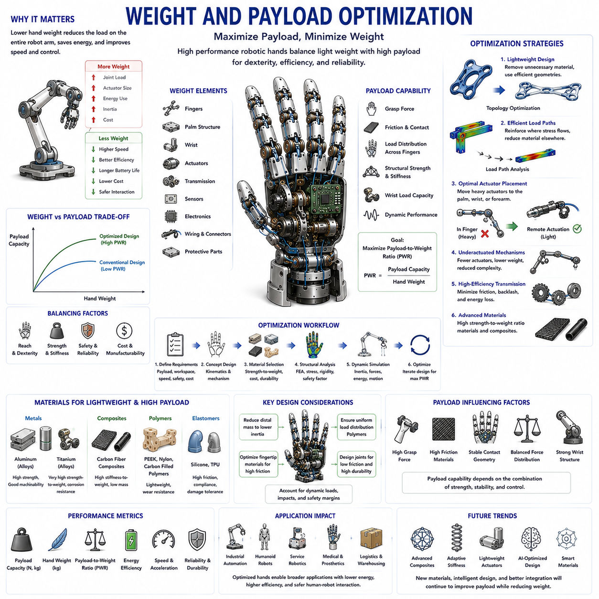{width="7.268055555555556in" height="7.268055555555556in"}

Weight and payload optimization is one of the most important engineering disciplines in robotic hand development. Every robotic hand must balance two competing objectives: minimizing its own mass while maximizing the amount of force and payload it can manipulate. This balance directly affects dexterity, energy efficiency, actuator requirements, structural durability, safety, control performance, and overall system capability. Regardless of whether a robotic hand is designed for industrial automation, humanoid robotics, service robotics, prosthetic devices, medical systems, logistics applications, or Physical AI platforms, weight and payload optimization remains a fundamental design challenge.

In robotic hand engineering, weight refers to the total mass of the hand structure, including fingers, palm, wrist, actuators, sensors, transmission systems, wiring, electronics, and protective components. Payload refers to the maximum object mass or external force that the hand can manipulate while maintaining acceptable performance and safety. The relationship between these two parameters is often used as a key indicator of design quality. A robotic hand that weighs less while carrying heavier loads is generally considered more efficient than a heavier system with the same payload capability.

The importance of weight optimization becomes immediately apparent when considering the kinematic structure of a robotic manipulator. Every kilogram added to the hand increases the load experienced by the wrist, forearm, elbow, shoulder, and base joints. This increase propagates throughout the entire robotic system. As a result, a heavier hand may require larger actuators, stronger structures, larger batteries, increased cooling capacity, and more robust control systems. Consequently, reducing hand weight often produces benefits far beyond the hand itself.

Payload optimization is equally critical. A robotic hand that cannot generate sufficient grasping force or support meaningful loads has limited practical value. The objective is therefore not simply to make the hand lighter but to maximize the payload-to-weight ratio. This ratio is frequently used as a benchmark in advanced robotic systems. High-performance robotic hands seek to achieve the highest possible payload while maintaining minimal structural mass.

Biological systems provide valuable inspiration for this optimization challenge. The human hand weighs only a few hundred grams yet can manipulate objects many times heavier than its own weight. This remarkable capability results from millions of years of evolutionary optimization involving skeletal structures, tendons, muscles, ligaments, and soft tissues. Robotic engineers often study biological systems to identify principles that can improve payload performance while minimizing mass.

One of the primary factors influencing weight optimization is structural architecture. The geometry of fingers, palm structures, and wrist components significantly affects mass distribution and load-bearing capability. Efficient structural design seeks to place material only where it contributes meaningfully to strength and stiffness. Regions experiencing low stress can often be reduced in thickness or removed entirely without compromising performance.

Topology optimization has become an important tool in modern robotic hand design. Topology optimization algorithms automatically identify material distributions that maximize structural performance while minimizing mass. Rather than relying solely on traditional engineering intuition, designers can use computational methods to generate lightweight structures that maintain required strength and stiffness characteristics. Many advanced robotic hands incorporate topology-optimized finger links, palm frames, and wrist components.

Load path analysis plays a central role in payload optimization. Forces generated during grasping travel through specific structural pathways. Understanding these load paths allows engineers to reinforce critical regions while reducing unnecessary material elsewhere. Efficient load path design ensures that structural mass contributes directly to force transmission rather than merely increasing weight.

Material selection strongly influences both weight and payload performance. Aluminum alloys provide an excellent balance of strength, weight, manufacturability, and cost. Titanium alloys offer superior strength-to-weight ratios but at significantly higher cost. Carbon fiber composites deliver exceptional stiffness and low mass, making them attractive for high-performance robotic hands. Engineering polymers can further reduce weight in low-load regions while maintaining adequate functionality.

Composite materials are particularly important in advanced robotic systems. Carbon fiber reinforced structures can achieve stiffness levels comparable to metals while dramatically reducing mass. In robotic fingers, reduced weight lowers inertia and improves dynamic response. This enables faster movements, lower energy consumption, and improved manipulation performance.

The placement of actuators significantly affects weight optimization. Motors are often among the heaviest components in a robotic hand. Placing actuators directly within the fingers simplifies transmission systems but increases distal mass. Increased finger mass leads to higher inertia and reduced responsiveness. Consequently, many robotic hands employ remote actuation strategies in which motors are located within the palm, wrist, or forearm while forces are transmitted through tendons, cables, or other lightweight mechanisms.

Tendon-driven systems are particularly effective for weight optimization. By relocating actuators away from distal finger segments, designers can dramatically reduce moving mass. Lightweight fingers require less energy to accelerate and decelerate, improving both speed and efficiency. Tendon-driven architectures are therefore common in humanoid hands, prosthetic devices, and dexterous manipulation systems.

Underactuated mechanisms further contribute to weight reduction. By reducing the number of required actuators, underactuated hands achieve significant savings in mass, power consumption, electronics, and thermal management requirements. Mechanical intelligence embedded within underactuated structures often allows comparable grasping performance with fewer active components.

Transmission efficiency directly influences payload capability. Inefficient transmissions waste actuator energy through friction, backlash, deformation, and mechanical losses. Improving transmission efficiency increases the amount of useful force delivered to the object. As a result, payload performance can often be improved without increasing actuator size or system weight.

Finger geometry strongly affects payload optimization. Longer fingers increase reach and grasping versatility but also increase bending moments and structural loading. Shorter fingers provide greater force capability but may reduce workspace and object adaptability. Designers must balance these competing requirements according to application objectives.

Joint design is another critical factor. Every joint introduces potential sources of weight, friction, compliance, and energy loss. Bearings, shafts, housings, sensors, and transmission elements all contribute to system mass. Optimized joint architectures seek to minimize these penalties while maintaining durability and precision.

The payload capability of a robotic hand depends not only on structural strength but also on grasp stability. A hand may possess sufficient actuator force to lift a heavy object yet fail because of inadequate friction or poor contact geometry. Effective payload optimization therefore requires careful consideration of fingertip design, contact mechanics, friction coefficients, and grasp planning strategies.

Fingertip materials play an important role in this process. High-friction materials increase grip stability and reduce the force required to hold objects securely. Improved friction effectively increases usable payload without requiring larger actuators or stronger structures. Soft fingertip materials may also increase contact area, further improving grasp performance.

Force distribution among fingers significantly influences payload capability. Uneven force distribution can overload individual fingers while leaving others underutilized. Differential mechanisms, adaptive fingers, and underactuated architectures often improve payload performance by distributing loads more uniformly across the hand.

Wrist design has a substantial impact on payload optimization. Even if the fingers can generate sufficient grasping forces, the wrist must withstand the resulting loads. Heavy objects create bending moments and torsional loads that propagate through the wrist into the robotic arm. Optimized wrist structures seek to maximize load capacity while minimizing mass and inertia.

Dynamic loading introduces additional complexity. Payload specifications are often based on static conditions, but real-world manipulation involves acceleration, deceleration, impacts, and changing contact conditions. Dynamic loads may significantly exceed static loads. Consequently, weight and payload optimization must account for both static and dynamic operating scenarios.

Safety considerations become increasingly important as payload capacity increases. Collaborative robots and humanoid systems frequently operate near humans. A lightweight hand carrying heavy objects must maintain predictable behavior and avoid dangerous failure modes. Structural redundancy, overload protection, compliant mechanisms, and force-limiting strategies contribute to safe payload optimization.

Thermal performance is closely related to payload capability. Higher payloads generally require greater actuator forces, which generate additional heat. Excessive temperatures can reduce motor efficiency, damage electronics, accelerate wear, and shorten system lifespan. Effective thermal management therefore supports sustained payload performance without increasing overall system mass excessively.

Energy efficiency is another major consideration. Lightweight hands require less energy for motion, while efficient force transmission reduces power losses during grasping. Improved efficiency enables longer battery life, reduced operating costs, and greater system endurance. These benefits are particularly important for mobile robots and autonomous systems.

Simulation and digital engineering tools play a crucial role in weight and payload optimization. Finite Element Analysis allows engineers to evaluate structural stresses, deformations, and safety factors. Multibody dynamics simulations predict inertial effects and force distributions. Optimization algorithms explore alternative designs to identify solutions that maximize payload performance while minimizing weight.

Digital twins further enhance the optimization process by combining simulation models with operational data from real systems. This approach enables continuous refinement of designs based on observed performance, wear patterns, and loading conditions.

Machine learning and artificial intelligence are beginning to transform optimization workflows. AI-driven design tools can evaluate thousands of structural configurations, material combinations, actuator placements, and transmission architectures. These methods often identify solutions that would be difficult to discover through traditional engineering approaches alone.

Humanoid robotics has intensified interest in weight and payload optimization. Human-scale robots require hands that are lightweight enough to maintain natural movement yet strong enough to manipulate tools, open doors, carry objects, and perform complex tasks. Achieving human-like performance demands careful optimization across every aspect of hand design.

The emergence of Physical AI further emphasizes the importance of embodied efficiency. Intelligent behavior depends not only on software algorithms but also on mechanical design. Lightweight structures, efficient force transmission, adaptive mechanisms, and optimized load distribution contribute directly to overall system intelligence by reducing control complexity and improving interaction quality.

Future robotic hands are expected to incorporate advanced composites, smart materials, topology-optimized structures, adaptive stiffness systems, embedded sensing networks, and AI-assisted design methodologies. These technologies will continue to improve payload-to-weight ratios while enabling new levels of dexterity, efficiency, and safety.

Ultimately, weight and payload optimization represents a holistic engineering challenge that influences every aspect of robotic hand design. Success requires the integration of structural engineering, material science, actuation technology, transmission design, contact mechanics, control systems, and artificial intelligence. As robotic systems continue to evolve toward greater autonomy and human-like manipulation capabilities, the ability to maximize payload while minimizing weight will remain one of the defining measures of engineering excellence in robotic hand development.

중량 및 페이로드 최적화(Weight and Payload Optimization)는 로봇 핸드 개발에서 가장 중요한 공학 분야 중 하나이다. 모든 로봇 핸드는 자신의 무게를 최소화하면서 동시에 더 큰 하중을 다룰 수 있어야 하는 상반된 목표를 가진다. 이러한 균형은 조작성(Dexterity), 에너지 효율(Energy Efficiency), 액추에이터 요구사항(Actuator Requirements), 구조적 내구성(Structural Durability), 안전성(Safety), 제어 성능(Control Performance), 그리고 전체 시스템 능력(System Capability)에 직접적인 영향을 미친다. 산업용 자동화, 휴머노이드 로봇, 서비스 로봇, 의수(Prosthetic Hand), 의료 로봇, 물류 시스템, 물리 AI(Physical AI) 플랫폼 등 어떤 분야에서 사용되더라도 중량과 페이로드의 최적화는 반드시 해결해야 하는 핵심 설계 과제이다.

로봇 핸드에서 중량은 손가락(Finger), 손바닥(Palm), 손목(Wrist), 액추에이터, 센서, 전달 장치(Transmission System), 전자 장치(Electronics), 배선(Wiring), 보호 구조물 등을 포함한 전체 질량을 의미한다. 반면 페이로드(Payload)는 로봇 핸드가 허용 가능한 성능과 안전성을 유지하면서 다룰 수 있는 최대 물체 무게 또는 외부 하중을 의미한다. 일반적으로 로봇 핸드의 성능은 페이로드 대 중량 비율(Payload-to-Weight Ratio)로 평가된다. 동일한 무게에서 더 무거운 물체를 다룰 수 있거나, 동일한 페이로드를 더 가벼운 구조로 달성할 수 있다면 더욱 우수한 설계로 평가받는다.

중량 최적화의 중요성은 로봇의 전체 구조를 고려하면 더욱 분명해진다. 로봇 핸드에 추가되는 무게는 손목뿐 아니라 전완(Forearm), 팔꿈치(Elbow), 어깨(Shoulder), 로봇 베이스(Base)까지 영향을 미친다. 결과적으로 무거운 핸드는 더 강력한 액추에이터, 더 큰 배터리, 더 강한 프레임, 더 복잡한 냉각 시스템을 필요로 한다. 따라서 핸드의 무게를 줄이는 것은 단순히 손 자체의 문제가 아니라 전체 로봇 시스템의 효율성을 향상시키는 중요한 방법이다.

반대로 페이로드 최적화는 로봇 핸드가 실질적인 작업을 수행할 수 있도록 만드는 핵심 요소이다. 아무리 가벼운 핸드라도 충분한 파지력(Grasping Force)과 하중 지지 능력이 없다면 실제 응용 분야에서 활용되기 어렵다. 따라서 설계의 목표는 단순히 무게를 줄이는 것이 아니라 가능한 한 높은 페이로드를 제공하는 것이다.

인간의 손은 이러한 최적화의 대표적인 사례이다. 인간 손의 무게는 수백 그램 수준에 불과하지만 자신의 무게보다 훨씬 무거운 물체를 다룰 수 있다. 이러한 능력은 뼈(Skeleton), 근육(Muscle), 힘줄(Tendon), 인대(Ligament), 연부 조직(Soft Tissue)이 수백만 년의 진화를 통해 최적화된 결과이다. 로봇 공학자들은 이러한 생체 구조를 분석하여 높은 페이로드와 낮은 중량을 동시에 달성하는 원리를 찾고자 한다.

중량 최적화에 가장 큰 영향을 미치는 요소 중 하나는 구조 설계(Structural Architecture)이다. 손가락, 손바닥, 손목의 형상은 전체 질량 분포(Mass Distribution)와 하중 지지 능력에 직접적인 영향을 준다. 효율적인 구조 설계는 필요한 부분에만 재료를 배치하고 응력이 거의 발생하지 않는 부분의 재료는 제거하는 것을 목표로 한다.

최근에는 위상 최적화(Topology Optimization)가 널리 사용되고 있다. 위상 최적화는 컴퓨터가 자동으로 응력 분포를 분석하여 필요한 부분만 남기고 불필요한 재료를 제거하는 설계 기법이다. 이를 통해 기존 설계보다 훨씬 가볍고 강한 구조를 만들 수 있다. 고성능 로봇 핸드에서는 손가락 링크, 손바닥 프레임, 손목 구조 등에 위상 최적화가 적극 활용되고 있다.

하중 경로 분석(Load Path Analysis) 역시 중요한 기술이다. 물체를 잡을 때 발생하는 힘은 특정 경로를 따라 전달된다. 설계자는 이러한 하중 경로를 분석하여 실제로 힘이 흐르는 부분만 보강하고 나머지 부분은 경량화할 수 있다. 이를 통해 구조적 효율성을 극대화할 수 있다.

재료 선정(Material Selection)은 중량과 페이로드 최적화에 직접적인 영향을 준다. 알루미늄 합금(Aluminum Alloy)은 낮은 무게와 우수한 강도를 제공하며 가장 널리 사용된다. 티타늄 합금(Titanium Alloy)은 더욱 높은 강도 대 중량비를 제공하지만 가격이 높다. 탄소섬유 복합재(Carbon Fiber Composite)는 매우 높은 강성과 낮은 무게를 동시에 제공하기 때문에 고성능 로봇 핸드에 자주 사용된다. 엔지니어링 플라스틱(Engineering Plastic)은 하중이 적은 영역에서 무게를 줄이는 데 유용하다.

특히 탄소섬유 복합재는 현대 로봇 핸드 경량화 기술의 핵심 재료 중 하나이다. 금속 수준의 강성을 제공하면서도 무게를 크게 줄일 수 있기 때문에 손가락과 손목 구조에 매우 적합하다. 질량 감소는 관성(Inertia)을 줄이고 빠른 응답성을 가능하게 한다.

액추에이터 배치(Actuator Placement)는 중량 최적화에 큰 영향을 미친다. 모터는 로봇 핸드에서 가장 무거운 부품 중 하나이다. 모터를 손가락 내부에 배치하면 전달 시스템은 단순해지지만 손가락 무게가 증가한다. 손가락 무게가 증가하면 관성이 커지고 에너지 소비도 증가한다. 따라서 많은 로봇 핸드는 액추에이터를 손바닥이나 전완에 배치하고 텐던(Tendon)이나 케이블(Cable)을 통해 힘을 전달한다.

텐던 구동(Tendon-Driven) 구조는 중량 최적화에 매우 효과적이다. 무거운 액추에이터를 손가락 외부로 이동시켜 말단 질량(Distal Mass)을 줄일 수 있기 때문이다. 가벼운 손가락은 더 빠르게 움직일 수 있으며 에너지 효율도 향상된다.

부족 구동(Underactuation) 구조도 중량 감소에 중요한 역할을 한다. 부족 구동형 핸드는 자유도보다 적은 수의 액추에이터를 사용한다. 이는 액추에이터, 배선, 제어기, 냉각 장치 수를 줄여 전체 중량을 감소시키는 효과를 제공한다.

전달 효율(Transmission Efficiency)은 페이로드 능력과 밀접한 관련이 있다. 마찰(Friction), 백래시(Backlash), 구조 변형(Deformation), 기계적 손실(Mechanical Loss)이 크면 액추에이터의 힘이 실제 물체에 제대로 전달되지 않는다. 전달 효율을 높이면 동일한 액추에이터로도 더 큰 페이로드를 처리할 수 있다.

손가락 길이(Finger Length)는 페이로드와 중량의 균형에 영향을 미친다. 긴 손가락은 작업 공간(Workspace)을 넓혀주지만 굽힘 모멘트(Bending Moment)가 증가하여 구조적 부담이 커진다. 짧은 손가락은 높은 힘을 제공할 수 있지만 큰 물체를 다루기 어렵다.

관절 설계(Joint Design) 역시 중요한 요소이다. 관절은 베어링, 샤프트, 센서, 하우징 등을 포함하기 때문에 상당한 무게를 차지한다. 동시에 관절은 마찰과 에너지 손실의 주요 원인이 되기도 한다. 따라서 관절 구조를 최적화하는 것은 중량 감소와 페이로드 향상에 모두 기여한다.

페이로드 능력은 단순히 구조 강도만으로 결정되지 않는다. 충분한 파지 안정성(Grasp Stability)도 필요하다. 손가락이 충분한 힘을 생성하더라도 마찰력이 부족하면 물체가 미끄러질 수 있다. 따라서 접촉 역학(Contact Mechanics), 마찰 계수(Friction Coefficient), 손끝 구조(Fingertip Design) 역시 중요하다.

손끝 재료(Fingertip Material)는 페이로드 성능 향상에 직접적으로 기여한다. 높은 마찰 계수를 가진 재료는 동일한 파지력으로도 더 무거운 물체를 안정적으로 잡을 수 있게 한다. 또한 연성 재료는 접촉 면적을 증가시켜 파지 안정성을 향상시킨다.

손가락 간 힘 분배(Force Distribution)도 중요하다. 특정 손가락에만 하중이 집중되면 구조적 한계에 빨리 도달하게 된다. 차동 메커니즘(Differential Mechanism), 적응형 손가락(Adaptive Finger), 부족 구동 구조는 힘을 균등하게 분배하여 페이로드 능력을 향상시킨다.

손목 구조(Wrist Structure)는 전체 페이로드 성능에 매우 큰 영향을 준다. 손가락이 물체를 잡더라도 손목이 하중을 견디지 못하면 전체 시스템이 실패한다. 무거운 물체는 손목에 큰 굽힘 모멘트와 비틀림 하중(Torsional Load)을 발생시키므로 충분한 강도와 강성이 요구된다.

동적 하중(Dynamic Load)은 추가적인 설계 과제를 제공한다. 페이로드는 일반적으로 정적 하중(Static Load) 기준으로 평가되지만 실제 환경에서는 가속, 감속, 충돌, 진동 등이 발생한다. 따라서 실제 동작 중에는 정적 하중보다 훨씬 큰 힘이 발생할 수 있다. 따라서 설계자는 정적 조건뿐 아니라 동적 조건도 고려해야 한다.

안전성(Safety)은 페이로드가 증가할수록 더욱 중요해진다. 협동로봇(Collaborative Robot)과 휴머노이드 로봇은 사람과 가까운 환경에서 작동하기 때문에 무거운 물체를 다룰 때 예측 가능한 동작과 안전한 고장 모드(Failure Mode)가 요구된다. 이를 위해 과부하 보호(Overload Protection), 순응 메커니즘(Compliance Mechanism), 힘 제한 기술(Force Limiting Strategy)이 적용된다.

열 관리(Thermal Management)는 페이로드와 밀접한 관련이 있다. 더 무거운 물체를 다루기 위해서는 더 큰 힘이 필요하고, 이는 더 많은 전력을 소비하며 더 많은 열을 발생시킨다. 과도한 열은 모터 효율을 감소시키고 전자 장치를 손상시키며 수명을 단축시킬 수 있다.

에너지 효율(Energy Efficiency) 또한 중요한 고려 요소이다. 가벼운 핸드는 움직이는 데 필요한 에너지가 적으며, 효율적인 전달 시스템은 파지 시 손실을 최소화한다. 이는 배터리 수명 연장과 운영 비용 감소로 이어진다.

유한요소해석(Finite Element Analysis), 다물체 동역학(Multibody Dynamics), 최적화 알고리즘(Optimization Algorithm)은 중량 및 페이로드 최적화에 필수적인 도구이다. 이를 통해 응력, 변형, 안전계수(Safety Factor), 하중 분포를 분석하고 최적의 설계를 찾을 수 있다.

디지털 트윈(Digital Twin)은 실제 운영 데이터를 설계 과정에 반영할 수 있게 해준다. 이를 통해 실제 사용 환경에서 발생하는 하중, 마모, 피로(Fatigue) 정보를 활용하여 지속적으로 설계를 개선할 수 있다.

최근에는 인공지능(AI)과 머신러닝(Machine Learning)이 최적화 과정에도 적용되고 있다. AI는 수천 개의 설계안을 자동으로 평가하고 최적의 구조, 재료, 액추에이터 위치, 전달 시스템 구성을 찾아낼 수 있다.

휴머노이드 로봇의 발전은 중량 및 페이로드 최적화의 중요성을 더욱 높이고 있다. 인간 크기의 로봇은 자연스러운 움직임을 유지하면서도 공구를 사용하고 문을 열고 다양한 물체를 다룰 수 있어야 한다. 이를 위해서는 매우 높은 페이로드 대 중량 비율이 요구된다.

물리 AI(Physical AI)의 관점에서도 중량과 페이로드 최적화는 중요한 의미를 가진다. 지능은 단순히 소프트웨어에서만 나오는 것이 아니라 기계 구조에서도 나온다. 경량 구조, 효율적인 힘 전달, 적응형 메커니즘, 최적화된 하중 분배는 제어 복잡성을 줄이고 시스템의 지능적 행동을 향상시킨다.

미래의 로봇 핸드는 고급 복합재, 스마트 재료(Smart Material), 위상 최적화 구조, 가변 강성 시스템(Variable Stiffness System), 분산 센서 네트워크(Distributed Sensor Network), AI 기반 설계를 활용하여 더욱 높은 페이로드 대 중량 비율을 달성하게 될 것이다.

결론적으로 중량 및 페이로드 최적화는 구조 설계, 재료 공학, 액추에이터 기술, 전달 시스템, 접촉 역학, 제어 공학, 인공지능을 통합하는 종합적인 공학 과제이다. 로봇 핸드의 성능을 평가하는 가장 중요한 지표 중 하나는 얼마나 가벼우면서도 얼마나 무거운 물체를 다룰 수 있는가이다. 따라서 중량을 최소화하고 페이로드를 극대화하는 능력은 앞으로도 로봇 핸드 공학과 물리 AI 시스템 개발의 핵심 경쟁력이 될 것이다.

##  

## 02.10 Modularity and Replaceability

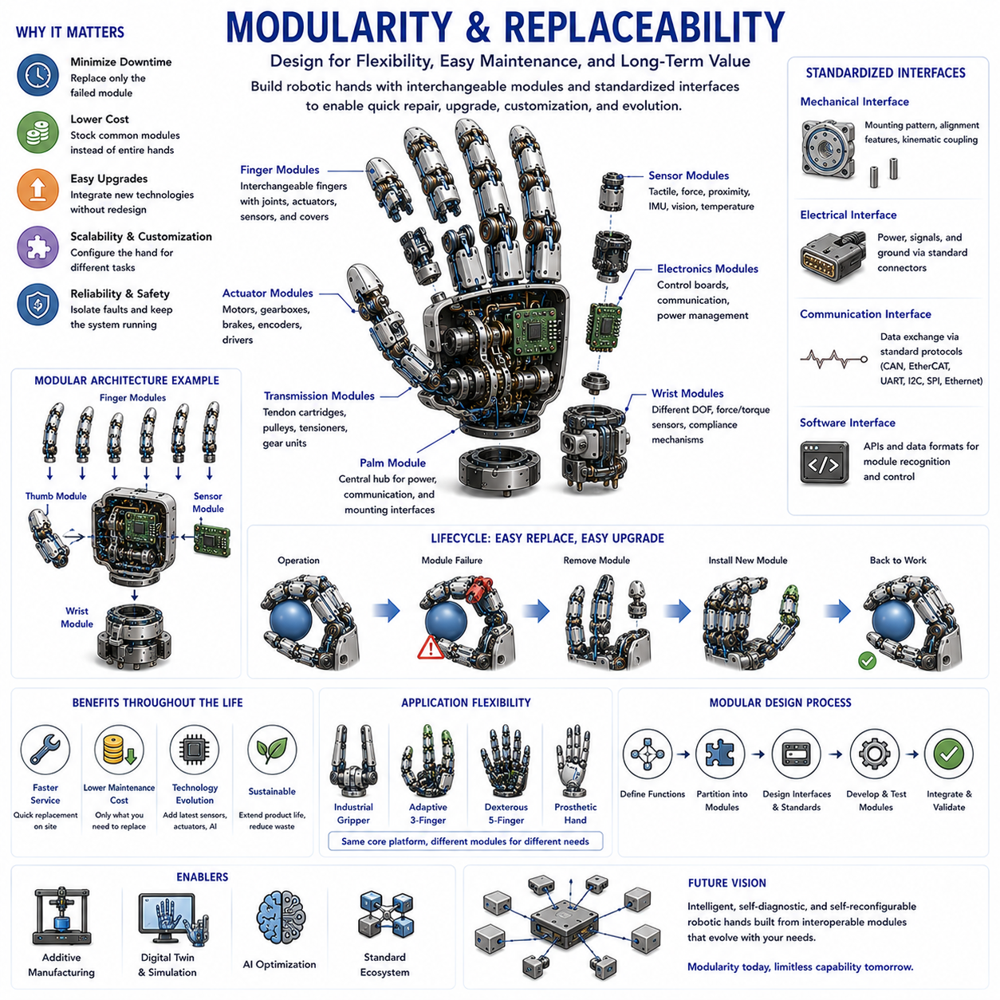{width="7.268055555555556in" height="7.268055555555556in"}

Modularity and replaceability are among the most important design philosophies in modern robotic hand engineering. As robotic systems become increasingly complex and are expected to operate continuously in industrial, service, medical, logistics, agricultural, humanoid, and Physical AI environments, the ability to rapidly maintain, upgrade, repair, and reconfigure robotic hands has become a critical requirement. Traditional robotic systems were often designed as highly integrated assemblies in which individual components were difficult to access or replace. While such designs sometimes offered compact packaging and optimized performance, they frequently resulted in increased maintenance costs, longer downtime, reduced flexibility, and limited scalability. Modern robotic hand engineering increasingly embraces modularity and replaceability as foundational principles that improve system lifecycle performance and operational efficiency.

At its core, modularity refers to the decomposition of a robotic hand into distinct functional units that can operate independently while interacting through standardized interfaces. Instead of treating the robotic hand as a single monolithic structure, modular design views the hand as a collection of interchangeable subsystems including fingers, palms, wrists, actuators, sensors, transmission mechanisms, controllers, communication modules, and protective structures. Each module performs a specific function and can be developed, tested, upgraded, maintained, or replaced independently from the rest of the system.

Replaceability refers to the ability to remove and exchange modules quickly and efficiently without requiring major disassembly or redesign. A replaceable component may be exchanged due to failure, wear, performance upgrades, application changes, customization requirements, or technological advancements. Together, modularity and replaceability create robotic systems that are more adaptable, maintainable, scalable, and economically sustainable over long operational lifetimes.

The importance of modularity becomes particularly evident when considering the lifecycle of robotic hands. Unlike laboratory prototypes, commercial robotic systems often operate for many years under demanding conditions. Components inevitably experience wear, fatigue, contamination, accidental damage, and technological obsolescence. In a non-modular system, repairing or upgrading a single component may require replacing the entire hand. In a modular architecture, only the affected module must be exchanged, significantly reducing cost and downtime.

Biological systems provide an interesting conceptual analogy. While the human hand is not modular in the engineering sense, biological tissues exhibit a form of functional modularity. Bones, muscles, tendons, ligaments, nerves, and skin each perform specialized roles while interacting within a coordinated system. Robotic engineers often seek similar organizational principles by separating functions into well-defined subsystems.

One of the most common forms of modularity in robotic hands is finger modularity. Finger modules are designed as self-contained units that include structural elements, joints, transmission mechanisms, sensors, and sometimes even local actuation systems. These modules can be attached to a common palm interface and exchanged independently. Finger modularity allows designers to experiment with different finger configurations without redesigning the entire hand.

For example, a robotic platform may use two-finger grippers for industrial handling, three-finger adaptive hands for logistics applications, and five-finger anthropomorphic hands for dexterous manipulation. If the palm interface is standardized, all these configurations can be supported using the same core platform. This significantly improves development efficiency and system versatility.

Palm modularity is another important design approach. In modular palm architectures, the palm serves as a central integration platform that accommodates interchangeable finger modules, sensor arrays, communication interfaces, and power distribution systems. Different palm designs may be optimized for different applications while maintaining compatibility with common finger modules.

Wrist modularity extends flexibility even further. The wrist functions as the interface between the hand and the larger robotic manipulator. A modular wrist architecture enables different wrist configurations to be attached depending on task requirements. Some applications may require lightweight wrists with limited degrees of freedom, while others demand highly dexterous wrists with force-torque sensing and advanced compliance mechanisms.

Actuator modularity has become increasingly important as robotic systems diversify. Actuators often represent some of the most expensive and failure-prone components within robotic hands. Modular actuator units allow motors, gearboxes, brakes, encoders, and control electronics to be replaced as integrated packages. This approach simplifies maintenance and reduces diagnostic complexity.

Transmission systems also benefit from modular design. Tendon-driven hands may employ replaceable tendon cartridges, pulley modules, tensioning assemblies, and routing structures. Gear-driven systems may utilize modular gearbox units that can be exchanged without disturbing surrounding components. Such architectures reduce service time and improve long-term maintainability.

Sensor modularity plays a critical role in modern robotic hands. Rapid advances in tactile sensing, force sensing, vision systems, proximity sensing, and environmental monitoring technologies create strong incentives for sensor upgrades. A modular sensor architecture allows new sensing technologies to be integrated without redesigning the entire hand. This capability is particularly valuable in research environments where sensor technologies evolve rapidly.

Electrical modularity is equally important. Connectors, wiring harnesses, communication buses, power distribution systems, and embedded electronics must support easy assembly and replacement. Standardized electrical interfaces simplify integration and reduce the risk of wiring errors during maintenance operations.

Software modularity complements hardware modularity. In modern robotic systems, each physical module is often associated with corresponding software components. Modular software architectures separate sensing, actuation, communication, control, planning, diagnostics, and user interface functions into independent modules. This approach simplifies updates, testing, debugging, and system expansion.

The development of standardized interfaces is central to successful modular design. Mechanical interfaces define how modules physically connect. Electrical interfaces define power and signal connections. Communication interfaces define data exchange protocols. Software interfaces define interactions between control modules. Without standardization, modularity quickly becomes difficult to maintain.

Mechanical interface standardization often involves mounting patterns, alignment features, fastening systems, and load transfer structures. Precision alignment is particularly important because repeated module replacement must not compromise accuracy or reliability. Engineers frequently employ dowel pins, kinematic couplings, locating features, and precision-machined interfaces to ensure repeatable assembly.

Electrical interface standardization focuses on connectors, voltage levels, communication protocols, and signal definitions. Modern robotic systems increasingly adopt standardized communication technologies such as CAN, EtherCAT, Ethernet, SPI, I2C, UART, and USB. Standardized interfaces improve interoperability among modules from different vendors and development teams.

Communication modularity becomes increasingly important as robotic hands evolve into distributed intelligent systems. Rather than relying on a single centralized controller, many advanced robotic hands incorporate local processing units within individual modules. These distributed architectures improve scalability, fault tolerance, and computational efficiency.

Fault tolerance is one of the major advantages of modular systems. In a monolithic robotic hand, a single component failure may disable the entire system. Modular architectures can isolate failures, allowing unaffected modules to continue operating. Some advanced robotic hands even support hot-swappable modules that can be replaced without shutting down the system.

Maintenance efficiency is perhaps the most immediate benefit of modularity. Industrial facilities place enormous value on minimizing downtime. Every hour of lost production can result in significant financial costs. Modular robotic hands allow technicians to replace failed components rapidly without requiring extensive troubleshooting or disassembly procedures.

Inventory management also benefits from modularity. Instead of stocking complete replacement hands, organizations can maintain inventories of common modules. This reduces spare part costs while improving maintenance responsiveness. Standardized modules can often be shared across multiple robotic platforms.

Scalability represents another major advantage. Modular architectures enable robotic hands to evolve incrementally as requirements change. New fingers, sensors, actuators, controllers, or software capabilities can be integrated without redesigning the entire system. This approach supports continuous technological evolution while protecting existing investments.

Customization is particularly important in service robotics and industrial automation. Different applications often require specialized configurations. Modular systems allow users to tailor robotic hands for specific tasks while retaining a common underlying platform. This flexibility reduces development costs and accelerates deployment.

Research and development environments benefit enormously from modularity. Experimental robotic hands frequently undergo numerous design iterations. Modular architectures allow researchers to evaluate alternative designs rapidly by exchanging specific subsystems rather than rebuilding entire platforms. This capability significantly accelerates innovation.

Humanoid robotics has further increased interest in modular architectures. Humanoid hands contain large numbers of actuators, sensors, joints, transmission mechanisms, and electronic components. Given this complexity, maintenance and upgrade requirements become especially significant. Modular design enables humanoid systems to remain serviceable despite their sophistication.

Prosthetic hands also benefit from modularity. Individual users may require different finger configurations, control methods, sensor systems, or cosmetic features. Modular architectures support personalized solutions while maintaining manufacturing efficiency. As technologies evolve, users can upgrade specific components without replacing the entire prosthesis.

Additive manufacturing technologies have accelerated the adoption of modular design principles. Three-dimensional printing enables rapid production of customized modules, replacement components, and experimental configurations. Engineers can iterate designs quickly while maintaining compatibility with standardized interfaces.

Digital twins and advanced simulation environments further support modular engineering. Virtual models can represent individual modules as independent entities while simulating their interactions within the larger system. This approach simplifies testing, validation, maintenance planning, and lifecycle management.

Artificial intelligence is beginning to influence modular robotic design as well. AI-driven optimization tools can identify optimal module boundaries, interface structures, maintenance strategies, and upgrade pathways. Future robotic systems may autonomously reconfigure themselves by exchanging or adapting modules according to task requirements.

The concept of Physical AI strongly aligns with modularity and replaceability. Physical AI emphasizes the integration of intelligence into both software and hardware systems. Modular architectures support this vision by enabling intelligent subsystems to evolve independently while contributing to overall system functionality. Intelligent sensor modules, adaptive finger modules, variable stiffness actuators, and self-monitoring diagnostic units may all function as specialized building blocks within future robotic hands.

Looking toward the future, robotic hands are likely to become increasingly modular. Standardized hardware ecosystems may emerge in which users can assemble custom robotic hands from interchangeable components much like modern computer systems are assembled from standardized modules. Such ecosystems could dramatically accelerate innovation, reduce costs, and improve accessibility across the robotics industry.

Ultimately, modularity and replaceability represent far more than maintenance conveniences. They are fundamental engineering strategies that enhance adaptability, reliability, scalability, sustainability, and long-term value. By enabling robotic hands to evolve, adapt, and remain serviceable throughout their operational lifetimes, modular design principles provide a critical foundation for the next generation of intelligent robotic manipulation systems. As robotic technologies continue to expand into increasingly diverse and demanding environments, modularity and replaceability will remain essential pillars of advanced robotic hand engineering and Physical AI development.

모듈화(Modularity)와 교체 가능성(Replaceability)은 현대 로봇 핸드 공학에서 가장 중요한 설계 철학 가운데 하나이다. 로봇 시스템이 산업 자동화, 서비스 로봇, 의료 로봇, 물류 시스템, 농업 로봇, 휴머노이드 로봇, 물리 AI(Physical AI) 환경으로 확대되면서, 유지보수(Maintenance), 업그레이드(Upgrade), 수리(Repair), 재구성(Reconfiguration)을 빠르고 효율적으로 수행할 수 있는 능력이 매우 중요해지고 있다. 과거의 로봇 핸드는 하나의 통합 구조물처럼 설계되는 경우가 많았으며, 특정 부품이 고장 나면 전체 시스템을 분해해야 하는 경우가 많았다. 이러한 구조는 초기 성능은 우수할 수 있지만 유지보수 비용 증가, 긴 다운타임(Downtime), 낮은 확장성, 제한된 유연성이라는 문제를 발생시킨다. 이에 따라 현대 로봇 핸드 설계에서는 모듈화와 교체 가능성을 핵심 원칙으로 채택하고 있다.

모듈화란 로봇 핸드를 여러 개의 독립적인 기능 단위(Function Unit)로 분리하는 설계 방식을 의미한다. 즉, 로봇 핸드를 하나의 거대한 구조물로 보는 것이 아니라 손가락(Finger), 손바닥(Palm), 손목(Wrist), 액추에이터(Actuator), 센서(Sensor), 전달 장치(Transmission System), 제어기(Controller), 통신 모듈(Communication Module), 보호 구조물(Protective Structure) 등으로 나누어 설계하는 것이다. 각 모듈은 특정 기능을 담당하며 독립적으로 개발, 시험, 유지보수, 업그레이드, 교체가 가능하다.

교체 가능성은 이러한 모듈을 쉽고 빠르게 분리하여 새로운 모듈로 교체할 수 있는 능력을 의미한다. 모듈은 고장, 마모, 성능 향상, 응용 환경 변화, 사용자 요구사항 변화, 기술 발전 등의 이유로 교체될 수 있다. 모듈화와 교체 가능성이 결합되면 로봇 시스템은 보다 유연하고 유지보수가 쉬우며 장기적으로 경제적인 구조를 갖게 된다.

모듈화의 중요성은 로봇 시스템의 전체 수명 주기(Lifecycle)를 고려하면 더욱 분명해진다. 연구용 프로토타입과 달리 상용 로봇은 수년 또는 수십 년 동안 운용된다. 이 과정에서 부품은 마모(Wear), 피로(Fatigue), 오염(Contamination), 충격(Damage), 기술 노후화(Obsolescence)를 경험하게 된다. 비모듈형 구조에서는 하나의 부품 문제 때문에 전체 핸드를 교체해야 할 수도 있지만, 모듈형 구조에서는 해당 모듈만 교체하면 되므로 비용과 시간을 크게 줄일 수 있다.

생물학적으로 인간의 손은 공학적인 의미의 모듈 구조는 아니지만 기능적 모듈화(Function Modularity)의 개념을 보여준다. 뼈(Bone), 근육(Muscle), 힘줄(Tendon), 인대(Ligament), 신경(Nerve), 피부(Skin)는 각각 독립적인 기능을 수행하면서도 전체적으로 하나의 시스템처럼 동작한다. 로봇 공학에서도 이와 유사하게 기능을 분리하고 독립적인 서브시스템으로 설계하는 접근법이 사용된다.

가장 대표적인 예는 손가락 모듈화(Finger Modularity)이다. 손가락 모듈은 구조체, 관절, 전달 장치, 센서, 액추에이터를 포함하는 독립적인 단위로 설계된다. 이러한 손가락 모듈은 공통 손바닥 인터페이스(Common Palm Interface)에 연결되며 필요에 따라 교체할 수 있다. 이를 통해 동일한 플랫폼에서 2지형(Two-Finger), 3지형(Three-Finger), 5지형(Five-Finger) 핸드를 자유롭게 구성할 수 있다.

예를 들어 산업용 물류 로봇은 2지형 그리퍼(Two-Finger Gripper)를 사용할 수 있고, 서비스 로봇은 3지형 적응형 핸드(Adaptive Hand)를 사용할 수 있으며, 휴머노이드 로봇은 5지형 인간형 핸드(Anthropomorphic Hand)를 사용할 수 있다. 만약 손바닥 인터페이스가 표준화되어 있다면 동일한 플랫폼에서 이러한 다양한 구성이 가능해진다.

손바닥 모듈화(Palm Modularity) 역시 중요한 설계 방법이다. 손바닥은 손가락 모듈, 센서 모듈, 전원 분배 모듈(Power Distribution Module), 통신 모듈을 수용하는 중앙 플랫폼 역할을 수행한다. 응용 분야에 따라 다양한 손바닥 구조를 사용할 수 있으며, 기존 손가락 모듈과의 호환성을 유지할 수 있다.

손목 모듈화(Wrist Modularity)는 더욱 높은 유연성을 제공한다. 손목은 로봇 핸드와 로봇 팔을 연결하는 인터페이스이다. 일부 응용에서는 가볍고 단순한 손목이 필요하지만, 다른 응용에서는 힘·토크 센서(Force-Torque Sensor)와 다자유도(Degree of Freedom)를 가진 정교한 손목이 요구될 수 있다. 모듈형 손목은 이러한 요구사항을 쉽게 충족시킨다.

액추에이터 모듈화(Actuator Modularity)도 매우 중요하다. 액추에이터는 로봇 핸드에서 가장 비싸고 고장 가능성이 높은 부품 중 하나이다. 모터(Motor), 감속기(Gearbox), 브레이크(Brake), 엔코더(Encoder), 제어 회로(Control Electronics)를 하나의 모듈로 구성하면 문제가 발생했을 때 전체를 빠르게 교체할 수 있다.

전달 장치 모듈화(Transmission Modularity) 역시 널리 사용된다. 텐던 구동(Tendon-Driven) 시스템에서는 텐던 카트리지(Tendon Cartridge), 풀리 모듈(Pulley Module), 장력 조절 모듈(Tensioning Module)을 독립적으로 설계할 수 있다. 기어 기반 시스템에서는 감속기 모듈을 별도로 교체할 수 있도록 설계하기도 한다.

센서 모듈화(Sensor Modularity)는 현대 로봇 핸드에서 특히 중요하다. 촉각 센서(Tactile Sensor), 힘 센서(Force Sensor), 비전 센서(Vision Sensor), 근접 센서(Proximity Sensor) 기술은 빠르게 발전하고 있다. 모듈형 센서 구조를 사용하면 새로운 센서 기술이 등장했을 때 전체 핸드를 다시 설계하지 않고도 센서만 업그레이드할 수 있다.

전기적 모듈화(Electrical Modularity)는 커넥터(Connector), 배선(Wiring Harness), 전원 공급 시스템(Power System), 통신 버스(Communication Bus)의 표준화를 포함한다. 이를 통해 조립과 유지보수가 쉬워지고 배선 오류를 줄일 수 있다.

소프트웨어 모듈화(Software Modularity)는 하드웨어 모듈화와 밀접하게 연결된다. 현대 로봇 시스템에서는 각 하드웨어 모듈에 대응되는 소프트웨어 모듈이 존재한다. 센싱, 제어, 계획(Planning), 통신, 진단(Diagnostics), 사용자 인터페이스(User Interface)를 분리하여 독립적으로 개발하고 업그레이드할 수 있다.

모듈화가 성공하기 위해서는 표준 인터페이스(Standard Interface)가 필수적이다. 기계적 인터페이스(Mechanical Interface)는 물리적 연결 방식을 정의하고, 전기적 인터페이스(Electrical Interface)는 전원 및 신호 연결을 정의한다. 통신 인터페이스(Communication Interface)는 데이터 교환 방식을 정의하며, 소프트웨어 인터페이스(Software Interface)는 프로그램 간의 상호작용을 정의한다.

기계적 인터페이스는 체결 구조(Fastening Structure), 정렬 장치(Alignment Feature), 위치 결정 핀(Locating Pin), 기준면(Datum Surface) 등을 포함한다. 반복적인 교체가 이루어져도 정밀도가 유지되어야 하므로 매우 높은 정밀도가 요구된다.

전기적 인터페이스는 커넥터 종류, 전압 수준, 통신 프로토콜을 표준화한다. CAN, EtherCAT, Ethernet, SPI, I2C, UART, USB와 같은 표준 통신 방식이 널리 사용된다. 이를 통해 다양한 공급업체와 개발팀이 제작한 모듈도 쉽게 통합할 수 있다.

분산 지능(Distributed Intelligence)의 발전은 통신 모듈화의 중요성을 더욱 높이고 있다. 과거에는 중앙 제어기(Central Controller)가 모든 기능을 담당했지만, 최근에는 각 모듈에 독립적인 프로세서가 내장되는 경우가 많다. 이러한 구조는 확장성, 고장 허용성(Fault Tolerance), 계산 효율성을 향상시킨다.

고장 허용성은 모듈형 시스템의 큰 장점 중 하나이다. 일체형 시스템에서는 하나의 부품이 고장 나면 전체 핸드가 작동을 멈출 수 있다. 반면 모듈형 구조는 문제가 발생한 모듈만 격리하여 교체할 수 있으며, 일부 경우에는 나머지 시스템이 계속 작동할 수도 있다.

유지보수 효율성(Maintenance Efficiency)은 모듈화가 제공하는 가장 직접적인 이점이다. 산업 현장에서는 로봇의 다운타임이 곧 비용으로 연결된다. 모듈형 로봇 핸드는 복잡한 분해 작업 없이 고장 부품만 빠르게 교체할 수 있기 때문에 생산 손실을 최소화할 수 있다.

재고 관리(Inventory Management)도 개선된다. 전체 로봇 핸드를 예비품으로 보관하는 대신 손가락 모듈, 액추에이터 모듈, 센서 모듈과 같은 공통 부품만 보유하면 된다. 이는 유지보수 비용을 크게 줄인다.

확장성(Scalability)은 또 다른 중요한 장점이다. 로봇 핸드는 시간이 지나면서 새로운 기능을 필요로 하게 된다. 모듈형 구조는 새로운 센서, 새로운 손가락, 새로운 액추에이터를 추가할 수 있게 해주며 기존 투자 자산을 보호한다.

맞춤형 설계(Customization)도 용이하다. 산업용 자동화와 서비스 로봇은 각각 다른 요구사항을 가진다. 모듈형 구조를 사용하면 동일한 플랫폼을 기반으로 다양한 사용자 요구에 맞춘 로봇 핸드를 제작할 수 있다.

연구개발(R&D) 환경에서는 모듈화의 가치가 더욱 크다. 연구자는 특정 손가락 구조, 센서, 액추에이터를 반복적으로 교체하며 실험할 수 있다. 이를 통해 개발 속도를 크게 향상시킬 수 있다.

휴머노이드 로봇은 수십 개의 관절, 액추에이터, 센서, 전자 장치를 포함한다. 이러한 복잡성 때문에 모듈화는 필수적인 설계 원칙이 되고 있다. 모듈형 구조가 없다면 유지보수와 업그레이드가 사실상 불가능해질 수 있다.

의수(Prosthetic Hand) 역시 모듈화의 큰 수혜 분야이다. 사용자는 자신의 요구에 따라 손가락 구성, 제어 방식, 센서 시스템, 외형을 선택할 수 있다. 또한 기술 발전에 따라 특정 모듈만 업그레이드할 수 있다.

3D 프린팅(Additive Manufacturing)의 발전은 모듈화 확산을 더욱 가속화하고 있다. 맞춤형 모듈과 교체 부품을 빠르게 제작할 수 있기 때문에 설계 반복과 유지보수가 쉬워진다.

디지털 트윈(Digital Twin)과 시뮬레이션 기술은 모듈형 설계를 더욱 효과적으로 만든다. 각 모듈을 독립적으로 모델링하고 가상 환경에서 검증할 수 있기 때문이다.

인공지능(AI)은 앞으로 모듈 설계와 최적화에 중요한 역할을 할 것으로 예상된다. AI는 최적의 모듈 경계(Module Boundary), 인터페이스 구조, 유지보수 전략을 자동으로 설계할 수 있다. 미래에는 로봇이 스스로 모듈을 교체하거나 재구성하는 자율 재구성(Self-Reconfiguration) 기술도 가능할 것으로 전망된다.

물리 AI(Physical AI)의 관점에서도 모듈화와 교체 가능성은 매우 중요하다. 물리 AI는 지능을 소프트웨어뿐 아니라 하드웨어에도 분산시키는 것을 목표로 한다. 따라서 지능형 센서 모듈(Intelligent Sensor Module), 적응형 손가락 모듈(Adaptive Finger Module), 가변 강성 액추에이터(Variable Stiffness Actuator), 자가 진단 모듈(Self-Diagnostic Module) 등이 독립적인 지능 블록으로 작동하게 될 것이다.

미래의 로봇 핸드는 컴퓨터 산업과 유사한 방향으로 발전할 가능성이 높다. 사용자는 표준화된 모듈을 조합하여 자신만의 로봇 핸드를 구성할 수 있게 될 것이다. 이는 개발 속도를 높이고 비용을 줄이며 로봇 기술의 대중화를 촉진할 것이다.

결론적으로 모듈화와 교체 가능성은 단순히 유지보수를 편리하게 만드는 기술이 아니다. 이는 적응성(Adaptability), 신뢰성(Reliability), 확장성(Scalability), 지속 가능성(Sustainability), 경제성(Economics)을 향상시키는 핵심 설계 철학이다. 로봇 핸드가 오랜 기간 동안 진화하고 유지되며 새로운 기술을 수용할 수 있도록 만드는 기반 기술이며, 차세대 지능형 로봇 핸드와 물리 AI 시스템의 핵심 구성 원리로 계속 발전하게 될 것이다.

##  

## 02.11 Structural Validation and FEA

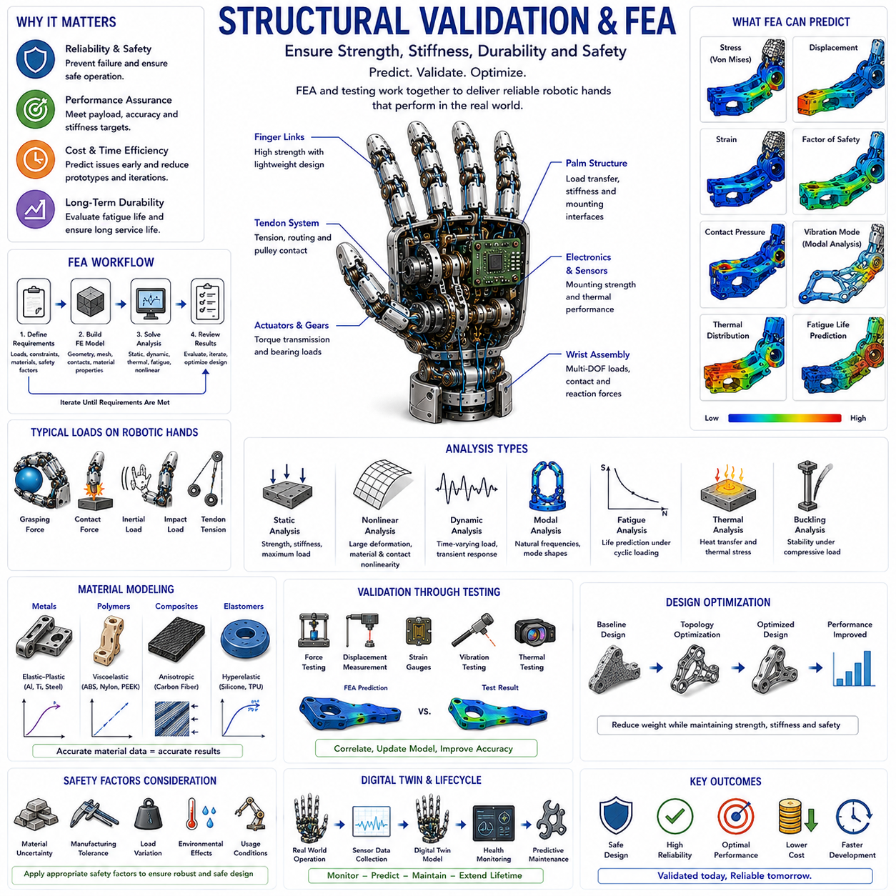{width="7.268055555555556in" height="7.268055555555556in"}

Structural Validation and Finite Element Analysis (FEA) represent essential engineering disciplines in robotic hand development. Regardless of how sophisticated a robotic hand may be in terms of kinematics, sensing, actuation, control algorithms, or artificial intelligence, its practical success ultimately depends on whether the physical structure can safely withstand operational loads throughout its intended service life. Structural validation ensures that a robotic hand can perform required tasks without excessive deformation, instability, fatigue damage, material failure, or unexpected mechanical behavior. Finite Element Analysis provides engineers with powerful computational tools to predict structural performance before physical prototypes are manufactured, significantly reducing development cost, risk, and design iteration cycles.

The increasing complexity of modern robotic hands has elevated the importance of structural validation. Advanced robotic hands often contain multiple degrees of freedom, lightweight structures, integrated sensors, compact actuators, tendon routing systems, gear transmissions, compliant elements, and embedded electronics. These components interact under dynamic loading conditions that are difficult to evaluate using traditional analytical methods alone. Structural validation enables engineers to understand how forces propagate through the system and how individual components contribute to overall mechanical performance.

The primary objective of structural validation is to ensure that every component of the robotic hand satisfies performance requirements under expected operating conditions. These requirements may include maximum payload capacity, positioning accuracy, stiffness targets, durability objectives, safety factors, impact resistance, thermal stability, and fatigue life. Structural validation is therefore not limited to failure prevention but encompasses the broader goal of guaranteeing reliable operation throughout the entire lifecycle of the system.

Finite Element Analysis is one of the most widely used computational techniques for structural validation. FEA divides a complex structure into many smaller elements connected at nodes. Mathematical equations describing material behavior, force equilibrium, deformation, and boundary conditions are solved across these elements. The resulting numerical model provides detailed information regarding stress distributions, strain fields, displacements, contact pressures, vibration characteristics, thermal effects, and failure risks.

The adoption of FEA transformed mechanical design by allowing engineers to evaluate virtual prototypes before manufacturing physical hardware. In robotic hand engineering, this capability is particularly valuable because many components possess complex geometries that are difficult to analyze using classical analytical approaches. Finger links, tendon anchors, palm structures, wrist assemblies, gear housings, compliant joints, and sensor mounts can all be evaluated accurately through finite element methods.

Structural validation begins with a clear understanding of operational requirements. Engineers must identify expected loads, environmental conditions, safety requirements, and performance objectives. The quality of an FEA study depends heavily on the accuracy of these assumptions. Unrealistic loading conditions may lead to misleading results and inappropriate design decisions.

One of the first steps in structural validation involves load definition. Robotic hands experience a wide variety of forces during operation. Grasping forces, contact forces, inertial loads, impact loads, actuator reactions, tendon tensions, gear transmission forces, and environmental disturbances all contribute to structural loading. Engineers must identify both normal operating loads and worst-case scenarios.

Static loading analysis is often the starting point for structural validation. Static analysis assumes that loads are applied slowly and remain constant over time. This approach allows engineers to evaluate stress distributions, structural deflections, and safety margins under steady-state conditions. Static FEA is particularly useful for assessing maximum payload capacity and overall structural integrity.

Stress analysis is one of the most common outputs of finite element simulations. Stress represents the internal force intensity within a material. Regions experiencing elevated stress are potential locations for yielding, cracking, fatigue damage, or catastrophic failure. Engineers use stress analysis to identify weak points and optimize structural geometry.

Several stress metrics are commonly evaluated. Von Mises stress is widely used for ductile materials such as aluminum, steel, and titanium. It provides a single scalar value that can be compared against material yield strength. Principal stresses are often examined when brittle materials or composite structures are involved. Shear stresses may also be critical in specific applications such as bonded joints and fastener connections.

Displacement analysis is equally important. Even if stresses remain below allowable limits, excessive deformation may compromise robotic performance. Finger positioning accuracy, grasp stability, force transmission efficiency, sensor alignment, and manipulation precision all depend on structural stiffness. Engineers therefore evaluate both strength and stiffness during structural validation.

Stiffness analysis plays a particularly important role in robotic hand design. High stiffness improves precision and force control, while excessive compliance may introduce positioning errors. However, complete rigidity is not always desirable. Certain applications benefit from controlled compliance that enhances safety, adaptability, and environmental interaction. Structural validation helps identify appropriate stiffness levels for specific tasks.

Contact mechanics is another critical aspect of robotic hand simulation. Robotic hands frequently interact with objects, surfaces, and internal components through contact interfaces. Fingertips contact objects, gears contact gear teeth, tendons interact with pulleys, and mechanical stops engage during joint motion. Contact simulations allow engineers to predict contact pressures, friction forces, wear patterns, and load transfer mechanisms.

Nonlinear behavior often arises in robotic hand structures. Large deformations, material nonlinearities, contact interactions, tendon routing systems, and compliant mechanisms may invalidate assumptions used in simple linear analysis. Advanced finite element methods can account for these nonlinear effects and provide more accurate predictions of real-world behavior.

Dynamic analysis extends structural validation beyond static loading conditions. Real robotic systems rarely operate under purely static conditions. Fingers accelerate and decelerate, objects are grasped and released, impacts occur, and external disturbances introduce transient loads. Dynamic FEA allows engineers to evaluate structural response under time-varying conditions.

Modal analysis is a common form of dynamic simulation. Every structure possesses natural frequencies at which it tends to vibrate. If operating frequencies coincide with these natural frequencies, resonance may occur, leading to excessive vibration and potential structural damage. Modal analysis identifies vibration modes and helps engineers avoid resonance-related problems.

Harmonic response analysis evaluates how structures respond to periodic excitation. Robotic actuators, gear systems, and external environments may generate cyclic forces that excite structural vibrations. Harmonic simulations help assess vibration amplitudes and identify potential reliability concerns.

Transient dynamic analysis provides even greater detail by simulating time-dependent loading events. Impact forces, collisions, emergency stops, grasping transitions, and sudden accelerations can all be studied using transient simulations. These analyses are particularly important for robotic systems operating in unstructured environments.

Fatigue analysis represents one of the most important aspects of structural validation. Robotic hands often perform millions of repeated manipulation cycles throughout their operational lifetimes. Even when stresses remain below material yield strength, repeated loading can eventually cause fatigue failure. Fatigue analysis estimates component lifespan and identifies regions vulnerable to crack initiation.

Fatigue behavior depends on stress amplitude, load frequency, material properties, surface finish, manufacturing quality, environmental conditions, and geometric features. Sharp corners, holes, threads, and stress concentrations frequently become fatigue-critical locations. Engineers use fatigue simulations to optimize geometry and improve long-term durability.

Safety factor evaluation is fundamental to engineering validation. A safety factor represents the margin between expected loads and structural failure limits. Appropriate safety factors account for uncertainties in material properties, manufacturing variations, loading conditions, environmental influences, and model assumptions. Critical robotic applications often require higher safety factors than laboratory prototypes.

Buckling analysis may be necessary for slender structural members. Compression-loaded components can experience sudden instability even when material stresses remain relatively low. Finger links, tendon supports, actuator brackets, and lightweight structural elements may require buckling evaluation to ensure stability.

Material modeling significantly influences simulation accuracy. Different materials exhibit different mechanical behaviors. Metals generally demonstrate elastic-plastic characteristics. Polymers may exhibit viscoelastic behavior. Elastomers undergo large deformations. Composite materials exhibit anisotropic properties that depend on fiber orientation. Accurate material characterization is therefore essential for reliable FEA results.

Composite materials introduce additional complexity into structural validation. Carbon fiber reinforced structures, increasingly common in advanced robotic hands, possess directional properties that vary with laminate design. Specialized composite analysis techniques are required to predict failure modes, delamination risks, and structural performance accurately.

Thermal analysis is becoming increasingly important as robotic hands incorporate higher-power actuators, embedded processors, sensors, and communication systems. Temperature changes influence material properties, dimensional stability, electronic reliability, and actuator performance. Thermal simulations evaluate heat generation, heat transfer, thermal expansion, and cooling effectiveness.

Thermo-mechanical coupling combines structural and thermal effects. Temperature gradients may induce stresses, deformations, and alignment errors. Engineers often perform coupled simulations to understand how thermal conditions influence mechanical performance.

Additive manufacturing has introduced new challenges and opportunities for structural validation. Three-dimensional printed components often possess complex internal geometries, lattice structures, and anisotropic material properties. FEA helps engineers evaluate these structures and exploit their weight-saving potential while maintaining adequate strength and stiffness.

Topology optimization is closely related to structural validation. Rather than simply analyzing existing designs, topology optimization algorithms generate improved structural configurations based on performance objectives and constraints. These algorithms identify regions where material can be removed without compromising functionality, resulting in lightweight yet robust robotic hand components.

Experimental validation remains essential even when sophisticated simulations are available. Physical testing verifies simulation accuracy and reveals phenomena that may not be fully captured by numerical models. Engineers often combine strain measurements, force testing, displacement measurements, vibration testing, thermal testing, and fatigue experiments with finite element simulations.

Digital twins represent the next evolution of structural validation. A digital twin combines real-world sensor data with simulation models to continuously monitor structural health throughout operation. This approach enables predictive maintenance, early fault detection, performance optimization, and lifecycle management.

Artificial intelligence is increasingly influencing structural engineering workflows. Machine learning algorithms can accelerate simulation processes, identify failure patterns, optimize geometries, predict fatigue life, and automate design exploration. AI-assisted engineering is expected to play a major role in future robotic hand development.

In humanoid robotics, structural validation becomes even more critical because robotic hands must operate in unpredictable environments while maintaining human-level dexterity. Humanoid hands experience diverse loading conditions, frequent impacts, complex interactions, and demanding reliability requirements. Comprehensive structural validation is therefore indispensable.

The emerging field of Physical AI further emphasizes the importance of structural engineering. Physical AI recognizes that intelligence is not solely computational but also embodied within physical structures. A mechanically optimized hand can simplify control requirements, improve robustness, and enhance interaction quality. Structural validation therefore contributes directly to system intelligence by ensuring that mechanical behavior supports higher-level cognitive functions.

Future robotic hands are expected to integrate advanced composite materials, smart materials, adaptive stiffness mechanisms, distributed sensing networks, self-monitoring capabilities, and AI-driven design methodologies. These innovations will increase structural complexity and further elevate the importance of sophisticated validation techniques.

Ultimately, Structural Validation and Finite Element Analysis provide the engineering foundation upon which reliable robotic hands are built. They enable engineers to predict performance, reduce risk, optimize designs, improve durability, and accelerate innovation. As robotic hands continue to evolve toward greater dexterity, autonomy, and Physical AI integration, structural validation and FEA will remain indispensable tools for ensuring that these systems are not only intelligent but also mechanically robust, safe, and reliable.

구조 검증(Structural Validation)과 유한요소해석(Finite Element Analysis, FEA)은 로봇 핸드 개발에서 필수적인 공학 분야이다. 로봇 핸드가 아무리 정교한 운동학(Kinematics), 센싱(Sensing), 액추에이션(Actuation), 제어 알고리즘(Control Algorithm), 인공지능(AI)을 갖추고 있더라도 실제 현장에서 성공적으로 사용되기 위해서는 물리적 구조가 요구되는 하중을 안전하게 견디고 예상 수명 동안 안정적으로 작동해야 한다. 구조 검증은 과도한 변형, 구조 불안정성, 피로 파손(Fatigue Failure), 재료 손상(Material Failure), 예기치 않은 기계적 거동(Mechanical Behavior)이 발생하지 않도록 확인하는 과정이며, 유한요소해석은 이러한 구조적 성능을 실제 제작 이전에 예측할 수 있도록 해주는 강력한 계산 도구이다.

현대의 로봇 핸드는 다수의 자유도(Degree of Freedom), 경량 구조(Lightweight Structure), 내장 센서, 소형 액추에이터, 텐던 구동 시스템(Tendon Routing System), 기어 전달 장치(Gear Transmission), 순응성 구조(Compliant Structure), 전자 회로 등을 포함하고 있다. 이러한 요소들은 복잡한 하중 조건 아래에서 동시에 작동하기 때문에 전통적인 수식 기반 계산만으로는 전체 거동을 정확히 예측하기 어렵다. 구조 검증은 힘이 시스템 내부를 어떻게 전달되는지 이해하고 각 부품이 전체 성능에 어떻게 기여하는지를 분석할 수 있게 해준다.

구조 검증의 가장 중요한 목적은 로봇 핸드의 모든 구성 요소가 실제 사용 환경에서 요구되는 성능을 만족하는지 확인하는 것이다. 이러한 성능 요구사항에는 최대 페이로드(Maximum Payload), 위치 정확도(Position Accuracy), 구조 강성(Stiffness), 내구성(Durability), 안전 계수(Safety Factor), 충격 저항성(Impact Resistance), 열 안정성(Thermal Stability), 피로 수명(Fatigue Life) 등이 포함된다. 따라서 구조 검증은 단순히 부품이 부러지지 않는지 확인하는 것이 아니라 전체 시스템이 수명 주기 동안 안정적으로 작동할 수 있는지를 평가하는 과정이라고 할 수 있다.

유한요소해석은 구조 검증에 가장 널리 사용되는 계산 방법이다. FEA는 복잡한 구조물을 수많은 작은 요소(Element)로 분할하고, 각 요소의 거동을 계산하여 전체 구조의 응력(Stress), 변형(Strain), 변위(Displacement), 접촉 압력(Contact Pressure), 진동(Vibration), 열 분포(Thermal Distribution) 등을 예측한다.

유한요소해석의 가장 큰 장점은 실제 시제품을 제작하기 전에 가상 환경에서 구조 성능을 평가할 수 있다는 점이다. 로봇 핸드의 손가락 링크(Finger Link), 텐던 고정부(Tendon Anchor), 손바닥(Palm), 손목(Wrist), 기어 하우징(Gear Housing), 순응성 관절(Compliant Joint), 센서 마운트(Sensor Mount) 등 복잡한 형상을 가진 부품도 정밀하게 분석할 수 있다.

구조 검증은 먼저 실제 운용 조건을 정의하는 것에서 시작된다. 로봇 핸드가 어떤 하중을 받는지, 어떤 환경에서 사용되는지, 어떤 안전 기준을 만족해야 하는지 명확히 정의해야 한다. 잘못된 가정을 기반으로 수행된 해석은 실제 환경을 제대로 반영하지 못하므로 잘못된 설계 결정을 유도할 수 있다.

구조 검증에서 가장 먼저 수행되는 작업 중 하나는 하중 정의(Load Definition)이다. 로봇 핸드는 파지력(Grasping Force), 접촉력(Contact Force), 관성 하중(Inertial Load), 충격 하중(Impact Load), 액추에이터 반력(Actuator Reaction), 텐던 장력(Tendon Tension), 기어 전달력(Gear Force), 환경 외란(Environmental Disturbance) 등 다양한 힘을 경험한다. 따라서 정상 운용 조건뿐 아니라 최악의 상황(Worst Case Scenario)도 함께 고려해야 한다.

정적 해석(Static Analysis)은 구조 검증의 가장 기본적인 단계이다. 정적 해석은 하중이 천천히 작용하며 시간에 따라 변하지 않는다고 가정한다. 이를 통해 응력 분포, 구조 변형, 안전 계수 등을 계산할 수 있다. 특히 최대 페이로드 조건에서의 구조 건전성을 평가하는 데 유용하다.

응력 해석(Stress Analysis)은 유한요소해석에서 가장 많이 사용되는 결과 중 하나이다. 응력은 재료 내부에 발생하는 힘의 밀도를 의미한다. 응력이 높은 영역은 항복(Yielding), 균열(Crack), 피로 손상(Fatigue Damage), 파손(Failure)이 발생할 가능성이 높은 영역이다. 설계자는 응력 분포를 분석하여 구조적으로 취약한 부분을 찾아내고 설계를 개선할 수 있다.

연성 재료(Ductile Material)인 알루미늄, 강철, 티타늄의 경우에는 폰 미세스 응력(Von Mises Stress)이 주로 사용된다. 이는 재료 항복 강도(Yield Strength)와 비교할 수 있는 단일 응력 지표를 제공한다. 복합재나 취성 재료(Brittle Material)의 경우에는 주응력(Principal Stress)이 더 중요하게 고려된다.

변위 해석(Displacement Analysis) 또한 매우 중요하다. 구조가 파손되지 않더라도 과도하게 변형되면 로봇 핸드의 성능이 저하될 수 있다. 손가락 위치 정확도, 파지 안정성, 힘 전달 효율, 센서 정렬 상태, 조작 정밀도는 모두 구조 변형의 영향을 받는다.

강성 해석(Stiffness Analysis)은 로봇 핸드 설계에서 핵심적인 역할을 한다. 높은 강성은 정밀도와 힘 제어 성능을 향상시킨다. 그러나 지나치게 높은 강성은 적응성과 안전성을 저하시킬 수 있다. 일부 서비스 로봇이나 협동로봇(Collaborative Robot)은 의도적으로 순응성을 가진 구조를 사용하기도 한다. 구조 검증은 응용 목적에 적합한 강성 수준을 결정하는 데 도움을 준다.

접촉 역학(Contact Mechanics)은 로봇 핸드에서 매우 중요한 분석 분야이다. 손끝(Fingertip)은 물체와 접촉하고, 기어는 기어와 맞물리며, 텐던은 풀리(Pulley)를 따라 이동한다. 접촉 해석을 통해 접촉 압력, 마찰력(Friction Force), 마모(Wear), 하중 전달 메커니즘을 예측할 수 있다.

많은 로봇 핸드는 비선형 거동(Nonlinear Behavior)을 보인다. 큰 변형(Large Deformation), 재료 비선형성(Material Nonlinearity), 접촉(Contact), 텐던 메커니즘, 순응성 구조 등은 단순 선형 해석으로는 정확히 모델링하기 어렵다. 이러한 경우에는 비선형 유한요소해석이 필요하다.

동적 해석(Dynamic Analysis)은 시간에 따라 변화하는 하중을 분석하는 방법이다. 실제 로봇은 가속과 감속을 반복하고, 물체를 잡고 놓으며, 충격을 경험한다. 이러한 상황은 정적 조건보다 훨씬 복잡한 하중을 발생시킨다.

모드 해석(Modal Analysis)은 구조물의 고유 진동수(Natural Frequency)를 분석한다. 만약 액추에이터나 외부 진동이 고유 진동수와 일치하면 공진(Resonance)이 발생하여 과도한 진동과 구조 손상을 초래할 수 있다. 따라서 모드 해석은 진동 문제를 예방하는 데 매우 중요하다.

조화 응답 해석(Harmonic Response Analysis)은 반복적인 주기 하중에 대한 응답을 분석한다. 기어 시스템, 모터, 반복 동작 등은 주기적인 힘을 발생시키므로 진동 특성을 평가해야 한다.

과도 응답 해석(Transient Analysis)은 충돌, 급정지(Emergency Stop), 물체 파지, 낙하 충격 등 시간에 따라 변화하는 사건을 시뮬레이션한다. 이러한 해석은 비정형 환경에서 작동하는 로봇 시스템에 특히 중요하다.

피로 해석(Fatigue Analysis)은 구조 검증에서 가장 중요한 분야 중 하나이다. 로봇 핸드는 수백만 회 이상의 반복 동작을 수행한다. 비록 응력이 항복 강도 이하라고 하더라도 반복 하중은 결국 피로 균열과 파손을 유발할 수 있다.

피로 수명은 응력 진폭(Stress Amplitude), 하중 주기(Frequency), 재료 특성, 표면 상태(Surface Finish), 제조 품질, 환경 조건에 따라 달라진다. 특히 날카로운 모서리, 나사산(Thread), 구멍(Hole), 응력 집중부(Stress Concentration)는 피로 파손이 발생하기 쉬운 영역이다.

안전 계수(Safety Factor)는 구조 검증의 기본 요소이다. 안전 계수는 실제 예상 하중과 구조 파손 한계 사이의 여유도를 의미한다. 재료 특성의 편차, 제조 오차, 환경 변화, 모델링 오차 등을 고려하여 적절한 안전 계수를 설정해야 한다.

좌굴 해석(Buckling Analysis)은 가늘고 긴 구조물에 대해 중요하다. 압축 하중을 받는 부재는 응력이 높지 않더라도 갑작스럽게 불안정해질 수 있다. 손가락 링크, 텐던 지지대, 액추에이터 브래킷 등의 구조에서는 좌굴 검토가 필요하다.

재료 모델링(Material Modeling)은 해석 정확도에 직접적인 영향을 미친다. 금속은 탄성-소성(Elastic-Plastic) 거동을 보이고, 폴리머는 점탄성(Viscoelastic) 특성을 가지며, 엘라스토머는 큰 변형을 경험한다. 복합재는 방향성(Anisotropy)을 가지므로 특별한 모델링이 필요하다.

탄소섬유 복합재(Carbon Fiber Composite)는 최근 로봇 핸드에서 많이 사용되고 있지만, 섬유 방향(Fiber Orientation)에 따라 특성이 달라진다. 따라서 복합재 전용 해석 기법이 필요하다.

열 해석(Thermal Analysis)은 점점 더 중요해지고 있다. 액추에이터, 프로세서, 센서, 통신 장치는 모두 열을 발생시킨다. 온도 변화는 재료 특성, 구조 변형, 전자 장치 신뢰성에 영향을 미친다.

열-구조 연성 해석(Thermo-Mechanical Analysis)은 열과 구조의 상호작용을 분석한다. 온도 변화로 인해 발생하는 열응력(Thermal Stress)과 변형은 정밀한 로봇 핸드에서 중요한 설계 요소가 된다.

적층 제조(Additive Manufacturing)는 새로운 구조 검증 과제를 제공하고 있다. 3D 프린팅 부품은 내부 격자 구조(Lattice Structure)와 방향성 특성을 가지므로 전통적인 구조물과 다른 해석 접근이 필요하다.

위상 최적화(Topology Optimization)는 구조 검증과 밀접하게 연관된다. 단순히 구조를 분석하는 것이 아니라, 불필요한 재료를 제거하여 가장 가볍고 강한 형상을 자동으로 생성하는 기술이다. 최근 고성능 로봇 핸드 설계에서 널리 사용되고 있다.

아무리 정교한 해석을 수행하더라도 실험적 검증(Experimental Validation)은 반드시 필요하다. 변형 측정(Strain Measurement), 힘 시험(Force Testing), 진동 시험(Vibration Testing), 열 시험(Thermal Testing), 피로 시험(Fatigue Testing)을 통해 해석 결과를 검증해야 한다.

디지털 트윈(Digital Twin)은 구조 검증의 차세대 기술로 주목받고 있다. 실제 센서 데이터와 해석 모델을 결합하여 운영 중인 로봇 핸드의 구조 상태를 실시간으로 모니터링할 수 있다. 이를 통해 예지 정비(Predictive Maintenance), 고장 예측(Fault Prediction), 수명 관리(Lifecycle Management)가 가능해진다.

인공지능(AI)은 구조 검증 분야에도 적용되고 있다. 머신러닝은 피로 수명 예측, 구조 최적화, 파손 패턴 분석, 설계 자동화를 지원하며, 미래의 구조 설계 프로세스를 크게 변화시킬 것으로 예상된다.

휴머노이드 로봇에서는 구조 검증의 중요성이 더욱 커진다. 인간 수준의 조작 능력을 구현하기 위해서는 다양한 환경과 복잡한 상호작용을 견뎌야 하기 때문이다. 따라서 더욱 높은 수준의 구조 신뢰성이 요구된다.

물리 AI(Physical AI)의 관점에서도 구조 검증은 중요한 의미를 가진다. 물리 AI는 지능이 단순히 소프트웨어에만 존재하는 것이 아니라 물리 구조에도 내재되어 있다고 본다. 최적화된 구조는 제어 부담을 줄이고 적응성을 향상시키며 시스템의 지능적 행동을 지원한다.

미래의 로봇 핸드는 스마트 재료(Smart Material), 적응형 강성 구조(Adaptive Stiffness Structure), 분산 센서 네트워크(Distributed Sensor Network), 자가 진단 기능(Self-Monitoring), AI 기반 설계(AI-Driven Design)를 통합하게 될 것이다. 이러한 발전은 구조 검증의 중요성을 더욱 높일 것이다.

결론적으로 구조 검증과 유한요소해석은 신뢰성 있는 로봇 핸드를 개발하기 위한 핵심 기술이다. 이를 통해 설계자는 성능을 예측하고, 위험을 줄이며, 구조를 최적화하고, 내구성을 향상시키며, 개발 비용과 시간을 절감할 수 있다. 앞으로 로봇 핸드가 더욱 높은 조작성(Dexterity), 자율성(Autonomy), 물리 AI 통합 능력을 갖추게 될수록 구조 검증과 FEA는 안전하고 신뢰성 있는 시스템을 구현하기 위한 필수 공학 도구로 계속 활용될 것이다.
