**Volume 06 Robot Hands and Dexterous Grasping**

# 02. Hand Mechanism and Structural Design

## 02.01 Finger Design Principles

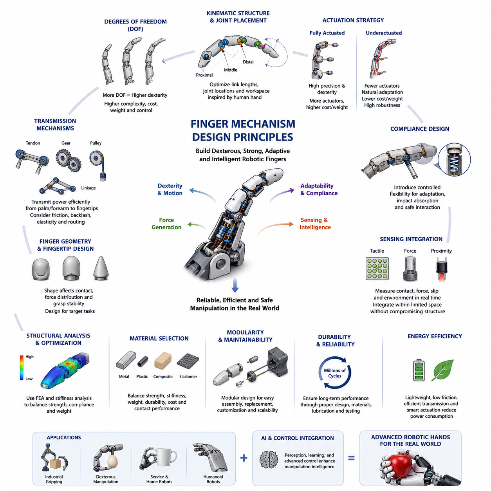{width="7.268055555555556in" height="7.268055555555556in"}

The design of robotic finger mechanisms represents one of the most fundamental and influential aspects of robot hand engineering. A robot hand ultimately interacts with the physical world through its fingers, making finger mechanism design a critical factor that determines grasp stability, dexterity, payload capability, manipulation performance, durability, and overall system intelligence. While advances in sensing, control, artificial intelligence, and machine learning continue to expand the capabilities of robotic manipulation systems, the physical design of the finger remains the foundation upon which these higher-level functions operate. A poorly designed finger mechanism cannot be compensated for entirely through software, whereas a well-designed mechanism can significantly simplify control and improve grasp robustness across a wide range of tasks. Within the overall structure of Robot Hand and Dexterous Grasping engineering, finger mechanism design serves as the bridge between actuator systems, contact mechanics, grasp planning, tactile sensing, and force control.

The primary objective of a robotic finger mechanism is to generate controlled motion and force while maintaining structural integrity and adaptability to various object geometries. Unlike industrial robot arms that typically operate in open kinematic chains with large workspaces, robotic fingers operate within highly constrained environments involving continuous physical contact with objects. This unique operational context introduces challenges related to compliance, contact uncertainty, friction, collision, force distribution, and manipulation stability. Consequently, the design principles governing robotic fingers differ significantly from those applied to conventional robotic manipulators.

One of the first considerations in finger mechanism design is determining the number of degrees of freedom. The degree of freedom of a finger directly affects its dexterity and ability to conform to object shapes. Human fingers typically possess multiple joints and degrees of freedom that enable sophisticated manipulation tasks such as grasping, pinching, rotating, and repositioning objects. Robotic fingers may range from simple single-degree-of-freedom mechanisms used in industrial grippers to highly articulated multi-joint systems designed for dexterous manipulation. Increasing the number of degrees of freedom generally enhances manipulation capability but simultaneously increases mechanical complexity, control requirements, cost, weight, and reliability concerns. Therefore, the selection of finger degrees of freedom requires careful balancing between functional requirements and engineering constraints.

Kinematic structure is another central design principle. The arrangement of links and joints determines the motion characteristics of the finger and influences its reachable workspace. Most robotic fingers are modeled as serial kinematic chains consisting of proximal, middle, and distal phalanges connected through revolute joints. The lengths of these links must be optimized according to target object sizes and intended applications. Longer fingers increase reach but may reduce structural stiffness and payload capacity. Shorter fingers improve strength and rigidity but limit grasping flexibility. Designers often perform extensive kinematic simulations to evaluate workspace coverage, fingertip trajectories, and grasp configurations before finalizing link dimensions.

Joint placement significantly influences finger functionality. Proper joint positioning allows the fingertip to follow natural grasping trajectories that approximate human hand movements. In many successful robotic hand designs, joint locations are inspired by human anatomy because millions of years of biological evolution have produced highly optimized grasping structures. However, direct replication of human anatomy is not always desirable. Engineering requirements such as manufacturability, actuator integration, durability, and control simplicity often necessitate modifications to biological structures. The resulting robotic finger typically combines biomimetic inspiration with practical engineering considerations.

The choice between fully actuated and underactuated mechanisms represents another major design decision. Fully actuated fingers assign an independent actuator to each degree of freedom, enabling precise control of joint positions and forces. Such designs are capable of achieving highly dexterous manipulation and are frequently employed in research platforms and advanced humanoid hands. However, fully actuated systems require numerous actuators, transmission components, sensors, and control channels. This increases system weight, cost, power consumption, and maintenance requirements.

Underactuated fingers address these challenges by utilizing fewer actuators than degrees of freedom. Mechanical couplings, differential mechanisms, springs, tendons, or compliant elements distribute actuator forces across multiple joints. When interacting with an object, the finger naturally adapts its shape to the object\'s geometry. This adaptive behavior often improves grasp robustness while reducing mechanical complexity. Many modern robotic hands utilize underactuated designs because they offer an attractive balance between dexterity and practicality. The concept of underactuation has become one of the most influential developments in contemporary robotic hand engineering.

Compliance plays a critical role in finger mechanism design. Real-world environments contain uncertainties that cannot be perfectly modeled or predicted. Objects may have varying shapes, material properties, positions, and orientations. Rigid mechanisms often struggle to accommodate such variability, resulting in unstable grasps or excessive contact forces. Compliant mechanisms introduce controlled flexibility into the finger structure, allowing passive adaptation to object surfaces. Compliance may be achieved through elastic joints, flexible materials, series elastic actuators, tendon elasticity, or specialized compliant link structures. Properly designed compliance improves safety, shock tolerance, grasp stability, and interaction quality.

Structural stiffness must be carefully balanced against compliance. Excessive compliance can reduce positioning accuracy and payload capability, while excessive rigidity can increase impact forces and sensitivity to alignment errors. Designers often analyze stiffness distribution throughout the finger structure to ensure that compliance occurs in desired directions while maintaining adequate strength in load-bearing regions. Advanced finite element analysis is frequently employed to evaluate deformation characteristics under expected operating loads.

Transmission design forms another essential aspect of finger engineering. Actuators are rarely positioned directly at finger joints because such arrangements increase distal mass and rotational inertia. Instead, power is commonly transmitted through mechanisms such as tendons, gears, pulleys, belts, linkages, or differential systems. Tendon-driven mechanisms are particularly popular because they allow actuators to be placed remotely within the palm or forearm. This configuration reduces finger weight and improves dynamic performance. However, tendon systems introduce challenges related to friction, backlash, elasticity, tension control, and routing complexity.

Gear-based transmissions provide precise motion transfer and high torque capacity but often increase weight and mechanical complexity. Pulley systems offer efficient force transmission while maintaining compact packaging. Linkage mechanisms can generate desired motion trajectories through purely mechanical means. The selection of a transmission mechanism depends on application requirements including precision, payload, speed, compactness, and maintenance considerations.

Finger geometry significantly influences grasp performance. Fingertip shape affects contact conditions, force distribution, and object stability. Flat fingertips provide large contact areas suitable for stable gripping. Rounded fingertips facilitate rolling contacts and dexterous manipulation. Pointed fingertips enable precise interaction with small objects but reduce contact stability. Designers frequently optimize fingertip geometry according to intended task domains. Industrial gripping applications often prioritize stability and robustness, whereas dexterous manipulation systems prioritize versatility and contact mobility.

The integration of sensing technologies increasingly shapes finger mechanism design. Modern robotic fingers often incorporate tactile sensors, force sensors, strain gauges, pressure arrays, temperature sensors, and proximity sensors. These sensing elements provide critical information regarding contact states, force distribution, slip detection, and object properties. Integrating sensors within limited finger volumes presents significant engineering challenges. Mechanical designers must allocate space for sensor components while maintaining structural strength and minimizing wiring complexity. Sensor placement strategies directly influence measurement accuracy and manipulation performance.

Another important design principle involves force transmission efficiency. The effectiveness with which actuator output is converted into fingertip force determines the overall capability of the robotic hand. Designers analyze mechanical advantage throughout the finger workspace to ensure consistent force generation. Certain grasp configurations may experience reduced mechanical advantage due to unfavorable joint alignments. Optimization techniques are often employed to maximize force transmission efficiency across commonly used grasp postures.

Finger mechanism design must also consider collision avoidance and self-interference. Multi-finger robotic hands operate within highly constrained spatial environments where links and joints may collide with each other during motion. Designers conduct kinematic analyses to identify and eliminate potential interference regions. Mechanical stops, motion constraints, and optimized link geometries are commonly used to prevent damaging collisions while preserving functional workspace.

Durability and reliability are particularly important for industrial applications. Robotic fingers may perform millions of grasping cycles over their operational lifetime. Repeated loading, impact events, and environmental exposure can lead to wear, fatigue, and component degradation. Finger mechanisms must therefore be designed with appropriate safety factors, material selections, lubrication strategies, and maintenance accessibility. Reliability engineering principles play a crucial role in ensuring long-term operational performance.

Material selection strongly influences finger performance characteristics. Metals such as aluminum, titanium, and stainless steel provide high strength and durability. Engineering plastics reduce weight and manufacturing costs. Composite materials offer favorable stiffness-to-weight ratios. Elastomers introduce compliance and improve contact properties. Increasingly, hybrid material architectures combine multiple material types within a single finger structure to achieve optimal performance across diverse requirements.

Modularity has emerged as a major trend in robotic hand development. Modular finger architectures allow rapid replacement, customization, maintenance, and scalability. Researchers and manufacturers can experiment with different finger configurations without redesigning entire hand systems. Standardized interfaces facilitate integration with various actuator modules, sensor packages, and palm structures. This modular approach accelerates development cycles and supports a wider range of application scenarios.

Energy efficiency is becoming increasingly important as robotic systems move toward mobile and autonomous operation. Every aspect of finger design influences power consumption, including transmission efficiency, friction characteristics, actuator sizing, structural weight, and compliance mechanisms. Efficient finger mechanisms reduce energy requirements while extending operational duration for battery-powered robotic platforms. This consideration is especially relevant in mobile manipulators, service robots, warehouse automation systems, and humanoid robots. The role of robotic hands within mobile manipulation systems continues to expand as robots become capable of performing increasingly sophisticated physical tasks.

Human-inspired design remains a powerful source of innovation. The human hand demonstrates an extraordinary combination of dexterity, strength, adaptability, sensing, and energy efficiency. Many robotic finger designs draw inspiration from anatomical structures such as tendons, ligaments, joints, muscles, and skin. Biomimetic approaches seek not merely to replicate appearance but to capture underlying functional principles. Examples include tendon-driven actuation systems, variable stiffness mechanisms, compliant fingertips, and adaptive grasping structures. Nevertheless, robotic hands are not constrained by biological limitations and may exceed human capabilities in certain domains through specialized designs.

The future of finger mechanism design is increasingly influenced by advancements in soft robotics, additive manufacturing, intelligent materials, embedded sensing, and artificial intelligence. Soft robotic fingers offer unprecedented adaptability and safety. Additive manufacturing enables complex geometries that were previously impossible to fabricate. Smart materials introduce variable stiffness and self-sensing capabilities. Integrated tactile sensing allows fingers to perceive and respond to contact events in real time. Artificial intelligence enables optimization of both mechanical structures and control strategies through data-driven approaches.

Ultimately, finger mechanism design represents a multidisciplinary engineering challenge that combines mechanics, materials science, kinematics, dynamics, sensing, control, manufacturing, and robotics. Successful finger designs achieve a delicate balance between dexterity, strength, adaptability, reliability, efficiency, and cost. As robotic systems continue to evolve toward greater autonomy and physical intelligence, the importance of well-designed finger mechanisms will only increase. They serve as the primary interface between robotic cognition and the physical world, transforming computational decisions into meaningful physical interactions and enabling robots to perform tasks that increasingly approach the versatility and capability of human hands.

## 02.02 Linkage-Based Finger Mechanisms

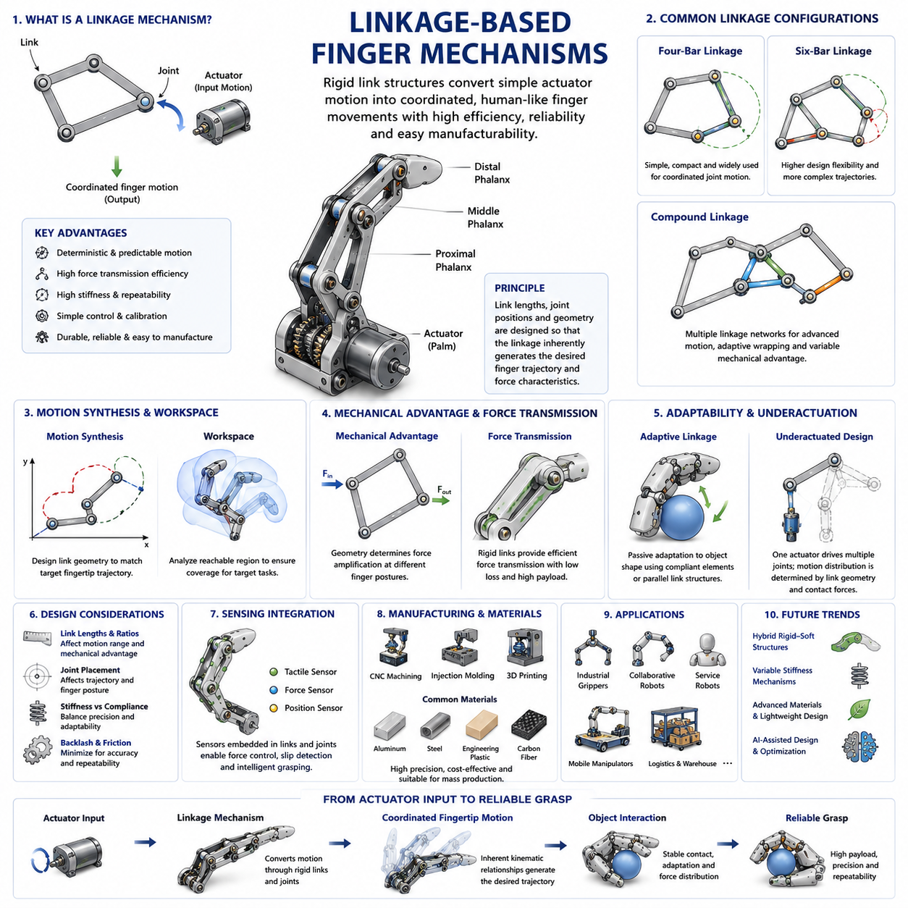{width="7.268055555555556in" height="7.268055555555556in"}

Linkage-based finger mechanisms represent one of the oldest, most practical, and most widely adopted approaches in robotic hand engineering. Long before advanced tendon-driven systems, soft robotic fingers, and highly dexterous anthropomorphic hands became popular research topics, linkage mechanisms provided engineers with an effective method for transforming actuator motion into controlled finger movements. Even today, linkage-based fingers remain a dominant solution in industrial grippers, collaborative robots, service robots, mobile manipulators, agricultural robots, logistics automation systems, and many commercial robotic hands because of their simplicity, reliability, predictability, and ease of manufacturing.

A linkage mechanism can be broadly defined as a collection of rigid links connected through joints that transmit motion and forces from an actuator to one or more output points. In robotic fingers, linkage systems convert rotary or linear actuator motion into coordinated finger joint movements. Unlike tendon-driven fingers that rely on flexible cables and complex routing paths, linkage mechanisms use rigid mechanical structures to establish deterministic relationships between input motion and output finger trajectories. This deterministic behavior simplifies modeling, control, calibration, and maintenance while providing excellent repeatability.

The fundamental objective of a linkage-based finger mechanism is to reproduce useful grasping motions while minimizing actuator count, reducing control complexity, and maximizing mechanical efficiency. Human fingers contain muscles, tendons, ligaments, and multiple joints that create highly sophisticated motion patterns. Replicating these biological systems directly can be difficult, expensive, and mechanically complex. Linkage mechanisms provide an alternative approach by generating human-like finger movements through carefully designed geometric relationships between rigid links.

One of the key advantages of linkage mechanisms is their ability to generate complex motion trajectories using relatively simple mechanical structures. By adjusting link lengths, pivot locations, joint offsets, and transmission ratios, engineers can design fingers that naturally follow desired grasping paths. In many cases, the geometry of the linkage itself performs part of the control function. Instead of requiring sophisticated software algorithms to coordinate multiple joints, the mechanical structure inherently produces synchronized motion.

This concept is often referred to as mechanical intelligence. Mechanical intelligence describes the ability of a mechanism to perform useful behaviors through its physical design rather than through computational control. Linkage-based fingers frequently exploit this principle. For example, a properly designed four-bar linkage may naturally curl around an object during grasping, reducing the need for active control and sensor feedback.

The simplest linkage-based finger consists of a single rigid link driven by a rotary actuator. Such systems are commonly found in industrial parallel-jaw grippers where each finger behaves as a rigid body moving along a predefined path. While simple and robust, these fingers offer limited adaptability because they cannot conform to object geometry. They are most suitable for structured environments where object shapes and positions are known in advance.

More advanced linkage-based fingers incorporate multiple phalanges connected through revolute joints. These designs mimic the segmented structure of the human finger and allow greater adaptability during grasping. The movement of multiple joints can be coordinated through interconnected linkages, enabling a single actuator to drive several finger segments simultaneously. Such coordinated motion creates more natural grasping behavior and improves contact distribution across the object surface.

Among the most widely used linkage configurations is the four-bar linkage mechanism. Four-bar systems consist of four rigid links connected in a closed kinematic chain. By selecting appropriate link lengths and joint positions, designers can generate a wide range of motion patterns. Four-bar linkages are popular because they are compact, efficient, and relatively easy to analyze mathematically. Many robotic fingers employ four-bar mechanisms to synchronize distal and proximal joints, creating coordinated curling motions similar to those observed in human fingers.

Another common configuration is the six-bar linkage. Six-bar systems provide greater design flexibility and can generate more complex motion trajectories than four-bar mechanisms. These mechanisms are particularly useful when designers seek to approximate biological finger movements or achieve specific grasping behaviors. However, increased flexibility comes at the cost of greater mechanical complexity and more challenging optimization processes.

Multi-link finger mechanisms can also be designed using compound linkage structures. In these systems, several linkage networks interact to coordinate motion across multiple joints. Compound mechanisms enable sophisticated finger behaviors such as adaptive wrapping, sequential joint engagement, and variable mechanical advantage throughout the grasping process. These characteristics are particularly valuable when handling objects with diverse shapes and sizes.

One of the most important design considerations in linkage-based finger engineering is motion synthesis. Motion synthesis refers to the process of determining linkage dimensions and joint locations that generate desired output trajectories. Engineers often begin by defining target fingertip paths or desired joint angle relationships. Optimization techniques are then used to determine linkage geometries that approximate these objectives. Advances in computational design tools have significantly improved the ability to synthesize complex linkage mechanisms for robotic applications.

Workspace analysis is another critical aspect of linkage mechanism design. The workspace of a robotic finger defines the region within which the fingertip can move. Different linkage configurations produce different workspace characteristics. Some mechanisms generate large sweeping motions suitable for enveloping grasps, while others prioritize precision and control within smaller workspaces. Designers must carefully evaluate workspace coverage to ensure compatibility with intended manipulation tasks.

Mechanical advantage plays a central role in determining the force capabilities of linkage-based fingers. Mechanical advantage describes how effectively actuator forces are amplified or transmitted through the linkage structure. Certain linkage geometries provide high force output near fully closed configurations, making them suitable for secure gripping applications. Other geometries prioritize speed and range of motion over force amplification. Optimizing mechanical advantage requires balancing grasp force, motion speed, energy efficiency, and actuator size.

Force transmission efficiency is generally one of the strongest advantages of linkage-based systems. Because forces are transmitted through rigid structures rather than flexible cables, losses due to elasticity and friction are often reduced. This allows linkage fingers to achieve high payload capacities relative to their size and weight. Industrial gripping systems frequently rely on linkage mechanisms for this reason.

Structural stiffness is another significant benefit. Rigid linkages maintain precise geometric relationships between joints, resulting in accurate and repeatable motion. High stiffness improves positioning accuracy and grasp stability, especially in applications involving assembly, inspection, machining, or precision manipulation. However, excessive stiffness may reduce adaptability when interacting with uncertain environments or delicate objects.

To address this challenge, many modern linkage-based fingers incorporate compliance elements into their design. Springs, elastic joints, flexible couplings, and compliant materials can be integrated within linkage structures to introduce controlled flexibility. This combination of rigid kinematic guidance and localized compliance allows fingers to maintain precision while adapting to contact uncertainties.

Adaptive linkage mechanisms represent an important evolution of traditional linkage-based fingers. These systems use passive or semi-passive mechanical elements to automatically adjust finger posture during grasping. When a finger encounters an object, contact forces cause the linkage structure to reconfigure itself, allowing multiple contact points to form without requiring additional actuators or complex control algorithms. Adaptive linkage fingers are particularly effective for handling objects with unknown geometries.

Underactuated robotic hands frequently employ linkage mechanisms as their primary motion transmission architecture. In these designs, one actuator drives multiple joints through interconnected linkages. The resulting motion distribution emerges naturally from the mechanical structure and object interaction forces. This approach significantly reduces actuator count while preserving much of the adaptability associated with more complex systems.

Biomimetic engineering has also influenced the development of linkage-based finger mechanisms. Researchers often study human finger anatomy to identify key motion characteristics and functional relationships. Linkage structures are then synthesized to reproduce these behaviors using simplified mechanical systems. Although robotic fingers rarely replicate biological anatomy exactly, many successful designs capture essential aspects of human grasping kinematics through carefully engineered linkage arrangements.

The integration of sensors within linkage mechanisms introduces additional design considerations. Tactile sensors, force sensors, position encoders, and strain gauges must be incorporated without interfering with linkage motion. Sensor placement often requires detailed analysis of mechanical loads, deformation patterns, and available packaging space. Modern robotic fingers increasingly combine sophisticated sensing capabilities with linkage-based motion systems to achieve intelligent grasping behavior.

Manufacturability is another major reason for the popularity of linkage mechanisms. Most linkage components can be fabricated using conventional machining, injection molding, additive manufacturing, or sheet metal processes. Compared to tendon-driven systems, linkage mechanisms generally require fewer specialized components and less complex assembly procedures. This reduces production costs and simplifies maintenance.

Reliability and durability are particularly important in industrial environments where robotic systems may perform millions of grasping cycles over their operational lifetime. Linkage mechanisms typically exhibit excellent wear resistance and predictable failure modes. Properly designed joints, bearings, and structural members can provide long service lives with minimal maintenance requirements. This reliability makes linkage-based fingers attractive for applications where downtime must be minimized.

The rise of collaborative robots and service robots has created renewed interest in lightweight linkage architectures. Engineers increasingly seek mechanisms that provide high performance while minimizing weight and inertia. Advanced materials such as carbon fiber composites, high-performance polymers, and lightweight aluminum alloys are frequently employed to achieve these objectives. Topology optimization and generative design techniques further enhance structural efficiency.

Simulation and digital engineering tools have transformed the development of linkage-based fingers. Modern computer-aided design software enables engineers to model complex kinematic relationships, evaluate force transmission characteristics, analyze collision behavior, and optimize performance before physical prototypes are constructed. Dynamic simulations provide insights into actuator requirements, contact interactions, and manipulation performance under realistic operating conditions.

In mobile manipulation systems, linkage-based fingers play a critical role in enabling reliable object interaction. Warehouse robots, logistics systems, agricultural platforms, service robots, and industrial mobile manipulators often prioritize robustness and repeatability over extreme dexterity. Linkage mechanisms align well with these requirements by offering predictable behavior, efficient force transmission, and low maintenance demands.

Future developments in linkage-based finger engineering are expected to focus on hybrid architectures that combine rigid linkages with compliant materials, embedded sensing, variable stiffness mechanisms, and artificial intelligence. These hybrid systems seek to preserve the strengths of traditional linkage mechanisms while addressing their limitations in adaptability and environmental interaction. Emerging technologies such as smart materials, additive manufacturing, and computational mechanism design will further expand the capabilities of linkage-based robotic fingers.

Ultimately, linkage-based finger mechanisms remain one of the foundational technologies of robotic hand engineering. Their ability to transform simple actuator motions into sophisticated grasping behaviors through purely mechanical means represents a powerful example of intelligent mechanical design. By combining kinematic precision, force efficiency, structural robustness, manufacturability, and adaptability, linkage-based fingers continue to serve as essential building blocks for robotic systems ranging from industrial grippers to advanced dexterous hands. As robotic manipulation expands into increasingly diverse environments, linkage mechanisms will remain a cornerstone of practical, reliable, and scalable robotic hand development.

## 02.03 Tendon-Driven Mechanisms

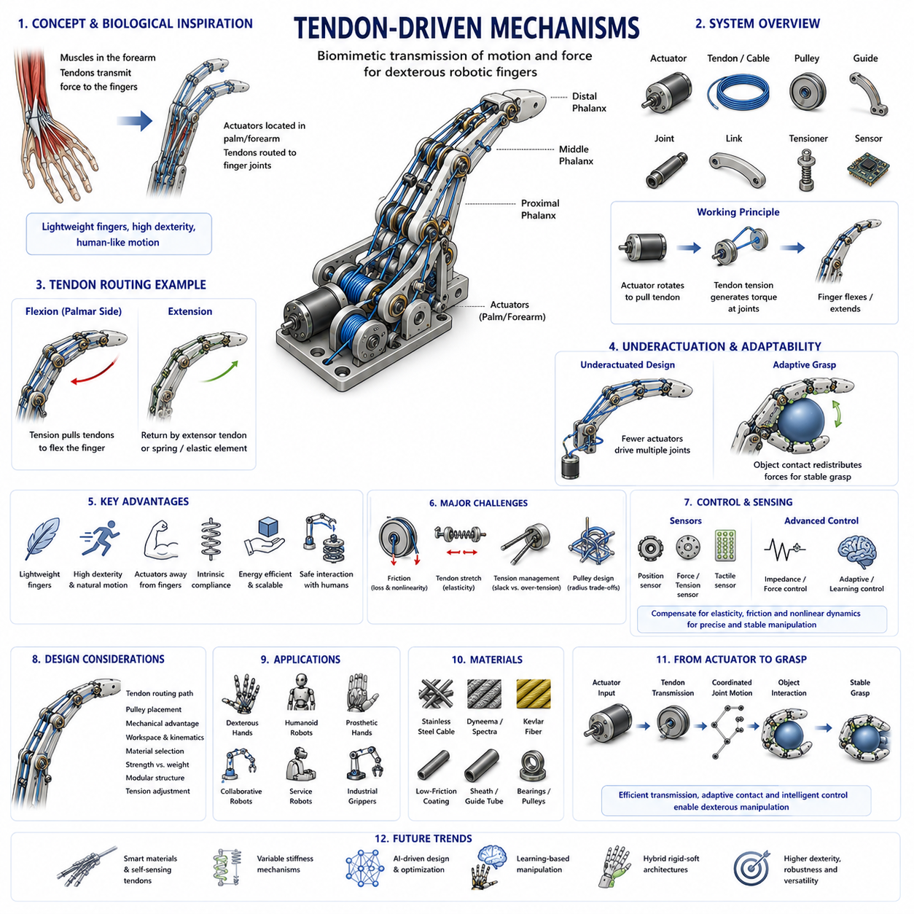{width="7.268055555555556in" height="7.268055555555556in"}

Tendon-driven mechanisms represent one of the most influential and biologically inspired approaches in robotic hand engineering. Among the many technologies developed for robotic fingers and dexterous hands, tendon-driven systems are particularly valued for their ability to reproduce human-like finger motion while maintaining lightweight structures, compact form factors, and high dexterity. The majority of advanced anthropomorphic robotic hands, humanoid robot hands, prosthetic hands, research manipulation platforms, and next-generation dexterous robotic systems employ some form of tendon-driven architecture because it closely resembles the musculoskeletal structure of the human hand.

In biological systems, muscles are generally located in the forearm, while tendons transmit forces to the fingers through a network of flexible connective tissues. This arrangement allows the human hand to achieve extraordinary dexterity without placing bulky muscles inside the fingers themselves. Tendon-driven robotic fingers follow a similar principle. Instead of mounting heavy actuators directly at each finger joint, motors are positioned in the palm, wrist, forearm, or robot arm, and forces are transmitted to the finger joints through cables, tendons, or flexible transmission elements. This separation of actuation and motion generation is one of the defining characteristics of tendon-driven robotic systems.

The primary objective of tendon-driven finger design is to minimize distal mass while maximizing dexterity and force generation capability. Distal mass refers to the weight located far from the base of the mechanism, particularly within finger segments. High distal mass increases inertia, reduces responsiveness, consumes additional energy, and limits dynamic performance. By relocating actuators away from the fingers, tendon-driven architectures significantly reduce finger weight, allowing faster movement, smoother control, and more natural manipulation behavior.

A tendon-driven finger typically consists of several key components including actuators, tendons or cables, pulleys, routing guides, finger joints, structural links, tension regulation mechanisms, and sensing systems. When an actuator rotates, it pulls or releases a tendon. The resulting tension generates torque at one or more finger joints, causing the finger to flex, extend, or perform more complex motions. The relationship between tendon displacement and joint motion depends on tendon routing geometry, pulley dimensions, joint design, and mechanical coupling characteristics.

One of the most attractive features of tendon-driven mechanisms is their ability to create highly articulated fingers using relatively compact hardware. A single tendon can influence multiple joints simultaneously, allowing complex finger movements to emerge from simple actuator commands. This characteristic enables designers to create anthropomorphic hands with many degrees of freedom while avoiding the need for a dedicated motor at every joint. Such efficiency is particularly valuable in humanoid robotics where space, weight, and power consumption are critical design constraints.

The design of tendon routing paths is one of the most important aspects of tendon-driven engineering. Tendons must follow carefully planned trajectories through finger structures to ensure efficient force transmission and predictable motion. Routing paths determine mechanical advantage, joint coordination, force distribution, and overall system behavior. Poor tendon routing can result in excessive friction, cable wear, inefficient force transmission, and unstable motion. Consequently, tendon path optimization is a major focus during robotic hand development.

Finger flexion mechanisms typically employ tendons that run along the palmar side of the finger. When tension is applied, the joints bend inward, creating grasping motions. Extension can be achieved through several methods. Some systems use dedicated extensor tendons similar to biological hands. Others rely on springs, elastic elements, compliant joints, or gravity compensation mechanisms to return the finger to its initial position. The selection of flexion-extension architecture significantly affects system complexity, control requirements, and mechanical performance.

One of the major advantages of tendon-driven systems is their compatibility with underactuated design principles. In underactuated robotic fingers, the number of actuators is smaller than the number of degrees of freedom. Tendons naturally facilitate this approach because a single tendon can drive multiple joints through passive mechanical coupling. When the finger encounters an object during grasping, contact forces automatically influence joint configurations, allowing the finger to adapt its shape to the object\'s geometry. This adaptive behavior enhances grasp robustness while reducing hardware complexity.

Mechanical compliance is another characteristic that distinguishes tendon-driven fingers from purely rigid linkage mechanisms. Tendons possess inherent elasticity, and this elasticity can be exploited to absorb shocks, accommodate positioning errors, and improve contact stability. Controlled compliance allows robotic fingers to interact safely with uncertain environments, fragile objects, and human users. In collaborative robotics and service robotics applications, this capability is particularly important because it enhances safety and reduces the risk of damage during physical interaction.

Despite their many advantages, tendon-driven systems introduce several engineering challenges. Friction is among the most significant issues. As tendons pass through guides, pulleys, sheaths, and routing channels, frictional forces can reduce transmission efficiency and introduce nonlinear behavior. Friction complicates force estimation, decreases control precision, and may lead to hysteresis effects in finger motion. Engineers must carefully select materials, routing geometries, and lubrication strategies to minimize friction-related problems.

Tendon stretch is another important consideration. No physical tendon is perfectly rigid. Under load, tendons experience elastic deformation, causing displacement errors and reducing positioning accuracy. While a certain amount of elasticity can be beneficial for compliance, excessive stretch can compromise performance. Material selection therefore becomes a critical aspect of tendon-driven finger design. Common tendon materials include stainless steel cables, Dyneema fibers, Kevlar fibers, Spectra fibers, and specialized synthetic materials designed for high tensile strength and low elongation.

Tension management plays a central role in tendon-driven systems. Proper tendon tension ensures consistent force transmission and prevents slack formation. Insufficient tension can cause control instability and delayed responses, while excessive tension increases wear, friction, and energy consumption. Many robotic hands incorporate adjustable tensioning mechanisms that allow precise calibration during assembly and maintenance.

Pulley design is closely associated with tendon routing. Pulleys guide tendon motion while altering force transmission characteristics. Pulley radius directly affects the relationship between actuator displacement and joint rotation. Larger pulleys increase motion resolution but require more actuator travel. Smaller pulleys reduce actuator travel requirements but may increase tendon stress and wear. Engineers must carefully balance these trade-offs when designing tendon-driven fingers.

Differential tendon systems represent an advanced category of tendon-driven mechanisms. Differential architectures distribute forces among multiple joints or fingers using shared tendon networks. These systems enable adaptive force allocation and coordinated movement without requiring additional actuators. Differential mechanisms are particularly useful in dexterous robotic hands where multiple fingers must cooperate during grasping and manipulation tasks.

Biomimetic robotic hands often employ tendon-driven architectures because they closely resemble the organization of the human hand. Human finger motion is generated through a sophisticated interaction between flexor tendons, extensor tendons, ligaments, and muscles. While robotic systems rarely replicate every biological detail, many successful designs capture essential biomechanical principles. Examples include tendon routing through artificial pulleys, differential tension control, and passive joint coupling mechanisms that mimic biological tendon networks.

The integration of sensing technologies has significantly enhanced the capabilities of tendon-driven robotic fingers. Position sensors monitor actuator movement and joint angles. Force sensors measure tendon tension and contact forces. Tactile sensors detect pressure distribution and object interaction states. Combining these sensing modalities enables closed-loop control strategies that improve grasp stability, manipulation precision, and environmental awareness.

Control of tendon-driven mechanisms is inherently more complex than control of rigid linkage systems. Because tendons introduce elasticity, friction, backlash, and nonlinear coupling effects, simple position control strategies are often insufficient. Advanced control approaches such as impedance control, force control, adaptive control, model predictive control, and learning-based control methods are commonly employed. These techniques allow robotic fingers to achieve smooth and stable behavior despite the complexities of tendon dynamics.

Simulation plays a crucial role in tendon-driven system development. Engineers use dynamic simulation tools to analyze tendon tension, joint motion, contact interactions, actuator requirements, and failure modes. Accurate tendon models must account for elasticity, friction, routing geometry, pulley interactions, and contact mechanics. As computational tools continue to improve, simulation-driven optimization is becoming increasingly important in robotic hand design.

Tendon-driven architectures are particularly well suited for dexterous manipulation tasks. In-hand manipulation, object reorientation, finger gaiting, rolling contacts, and fine motor skills often require lightweight fingers with high degrees of freedom and compliant interaction capabilities. Tendon-driven systems naturally support these requirements and therefore dominate many research platforms focused on advanced robotic manipulation.

Prosthetic hand development has also benefited greatly from tendon-driven mechanisms. Prosthetic devices must achieve human-like functionality while remaining lightweight, compact, and energy efficient. Tendon-driven architectures allow actuators to be placed away from the fingertips, reducing overall hand weight and improving user comfort. Many state-of-the-art prosthetic hands employ tendon-based transmission systems combined with myoelectric control interfaces.

Humanoid robots such as modern research platforms and commercial humanoid systems increasingly rely on tendon-driven hands. These robots must perform diverse tasks ranging from object handling and tool use to household assistance and industrial operations. Tendon-driven fingers provide the dexterity and adaptability necessary for such applications while maintaining manageable weight and power consumption.

Recent advances in materials science are driving further improvements in tendon-driven robotic systems. High-performance synthetic fibers offer greater strength-to-weight ratios than traditional steel cables. Low-friction coatings reduce energy losses and improve durability. Smart materials capable of sensing tension and deformation may eventually allow tendons to function simultaneously as transmission elements and sensing devices.

Artificial intelligence and machine learning are also influencing tendon-driven mechanism design. Learning-based optimization techniques can automatically identify efficient tendon routing configurations, actuator placements, and control strategies. Reinforcement learning approaches increasingly enable robotic hands to discover complex manipulation behaviors that would be difficult to program manually.

Future tendon-driven robotic fingers are expected to combine lightweight structures, advanced sensing, variable stiffness technologies, adaptive actuation, and intelligent control systems. These developments will further narrow the gap between robotic and biological manipulation capabilities. As robotic systems move beyond structured industrial environments into homes, hospitals, warehouses, public spaces, and everyday human environments, the demand for versatile and dexterous robotic hands will continue to grow.

Ultimately, tendon-driven mechanisms represent one of the most elegant solutions in robotic hand engineering. By separating actuators from finger joints and transmitting forces through flexible tendons, these systems achieve an exceptional balance between dexterity, weight reduction, adaptability, and biomimetic functionality. Their ability to replicate many of the key characteristics of the human hand while remaining practical for engineering implementation has made tendon-driven architectures a cornerstone of modern robotic manipulation. As advances in materials, sensing, computation, and artificial intelligence continue to accelerate, tendon-driven robotic fingers will remain at the forefront of dexterous robotic hand development for decades to come.

## 02.04 Gear and Pulley Transmissions

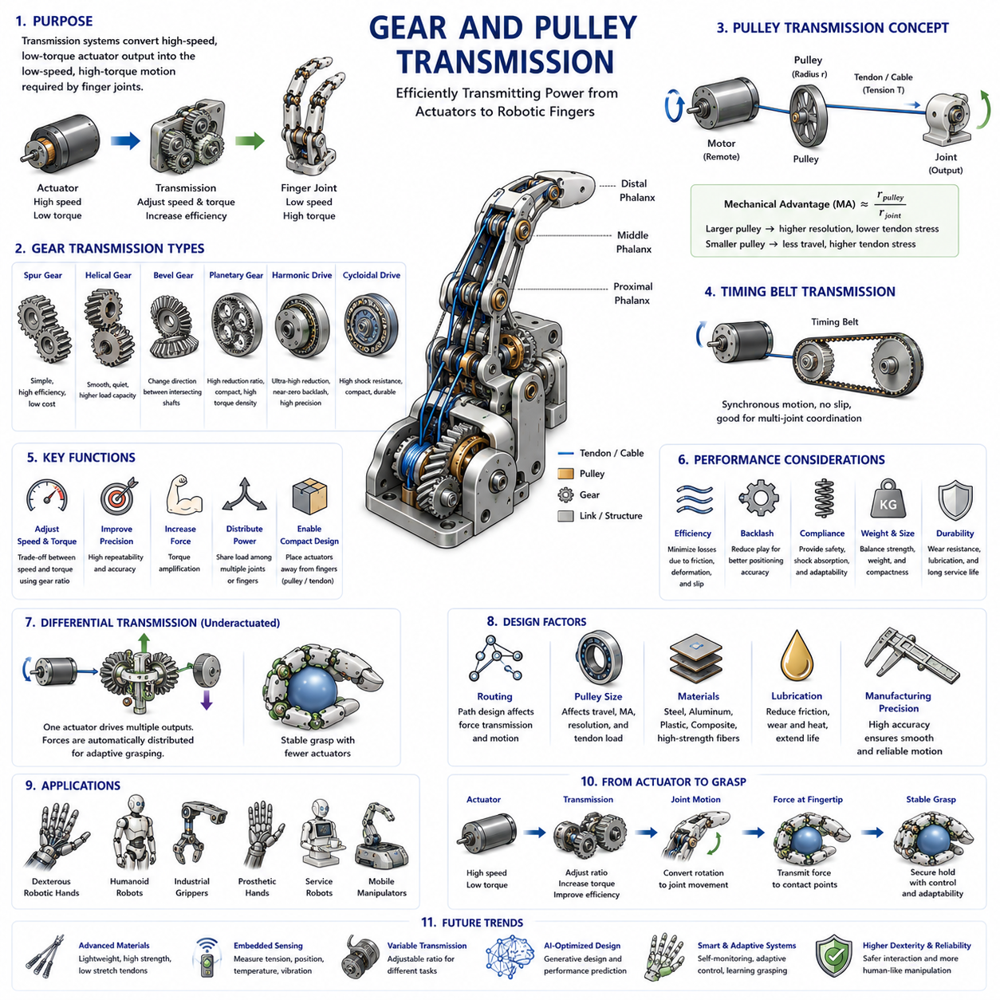{width="7.268055555555556in" height="7.268055555555556in"}

Gear and pulley transmission systems are among the most important mechanical power transmission technologies used in robotic hands, robotic fingers, dexterous manipulators, humanoid robots, industrial grippers, and advanced robotic manipulation platforms. While actuators generate motion and force, transmission systems determine how efficiently and accurately that power is delivered to the finger joints. In many cases, the overall performance of a robotic hand depends as much on the transmission mechanism as on the actuator itself. A powerful motor connected to an inefficient transmission system may produce poor grasping performance, while a well-designed transmission architecture can significantly enhance precision, force capability, responsiveness, and reliability.

Within robotic hand engineering, gear and pulley transmissions serve as the fundamental bridge between actuators and finger mechanisms. They transform motor output characteristics into useful joint motions, adjust torque and speed relationships, distribute forces among multiple joints, and enable compact packaging of complex robotic systems. Because robotic fingers operate within highly constrained spaces and often require precise force control, the design of transmission systems becomes a critical aspect of hand engineering.

The primary purpose of a transmission system is to modify the relationship between actuator motion and output joint motion. Electric motors typically operate at high rotational speeds but relatively low torque levels. Robotic fingers, on the other hand, generally require lower speeds and significantly higher torques to achieve stable grasping and manipulation. Transmission systems perform this conversion by trading speed for torque according to mechanical principles. The transmission ratio, often called the gear ratio or reduction ratio, determines the magnitude of this transformation.

Gear-based transmissions are among the most widely used solutions in robotics. A gear is a rotating mechanical component with teeth that mesh with another gear to transmit torque and motion. By varying the sizes of the driving and driven gears, engineers can achieve desired speed reductions and torque amplification. Gear systems provide highly predictable motion transfer, excellent repeatability, and relatively high efficiency. These characteristics make them particularly suitable for robotic applications requiring precise positioning and force control.

One of the simplest gear configurations is the spur gear transmission. Spur gears contain straight teeth arranged parallel to the axis of rotation. They are easy to manufacture, highly efficient, and commonly used in robotic joints where simplicity and reliability are priorities. However, spur gears may generate noise and vibration at high rotational speeds due to abrupt tooth engagement. Despite this limitation, they remain popular in many robotic finger mechanisms because of their compactness and low cost.

Helical gears represent an improvement over traditional spur gears. Their teeth are cut at an angle relative to the rotation axis, creating gradual tooth engagement during operation. This results in smoother motion, reduced vibration, and quieter operation. Helical gears can also transmit greater loads than comparable spur gears. However, they generate axial forces that require additional bearing support, increasing mechanical complexity.

Bevel gears are used when rotational motion must be transmitted between intersecting shafts. In robotic fingers and wrists, bevel gears often enable compact transmission layouts where space constraints prevent direct actuator alignment. By changing the direction of power flow, bevel gears facilitate more flexible mechanical architectures.

Planetary gear systems are among the most important transmission technologies in modern robotics. A planetary gearbox consists of a central sun gear, multiple planet gears, and an outer ring gear. This arrangement provides high reduction ratios within a compact volume while maintaining excellent load distribution characteristics. Planetary transmissions offer high torque density, efficient power transfer, and exceptional durability. Consequently, they are widely used in robotic joints, servo actuators, humanoid robots, and high-performance robotic hands.

Harmonic drive systems represent another highly specialized transmission technology. Harmonic drives utilize flexible spline structures to achieve extremely high reduction ratios with near-zero backlash. Backlash refers to the small amount of lost motion caused by gaps between gear teeth. In precision robotic manipulation, backlash can significantly degrade positioning accuracy and control performance. Harmonic drives largely eliminate this issue, making them particularly attractive for dexterous robotic hands and humanoid finger joints requiring highly accurate motion control.

Cycloidal gear systems provide another alternative for high-reduction applications. These mechanisms employ rolling contact rather than conventional gear meshing, resulting in high shock resistance, compact packaging, and excellent durability. Cycloidal drives are increasingly used in robotic systems where robustness and longevity are critical requirements.

While gears dominate many robotic transmission architectures, pulley-based systems offer a fundamentally different set of advantages. A pulley is a rotating wheel designed to guide and transmit forces through belts, cables, or tendons. In robotic fingers, pulleys are frequently used in conjunction with tendon-driven mechanisms, where actuators are positioned remotely from the finger joints. This arrangement reduces distal mass and enables lightweight finger designs.

Pulley systems are particularly attractive because they allow flexible routing of forces through complex geometries. Unlike gears, which generally require direct mechanical contact between rotating components, pulleys can transmit power across significant distances using belts or cables. This capability enables designers to place actuators within the palm, wrist, or forearm while maintaining compact finger structures.

The radius of a pulley directly influences the mechanical advantage of the transmission system. Larger pulleys increase motion resolution and reduce tendon stress but require greater actuator displacement. Smaller pulleys reduce actuator travel requirements but increase tendon loading and may reduce positioning precision. Determining optimal pulley dimensions is therefore a critical design task.

Timing belt transmissions represent a hybrid solution combining features of gears and pulleys. Timing belts contain teeth that engage corresponding pulley grooves, preventing slippage during operation. These systems provide accurate motion transfer while maintaining many of the flexibility advantages associated with pulley architectures. Timing belt transmissions are widely used in robotic systems requiring precise synchronization between multiple joints.

Cable-driven pulley systems are especially common in anthropomorphic robotic hands. In these architectures, tendons or cables wrap around pulleys attached to finger joints. When actuators pull the tendons, the pulleys rotate, generating joint motion. Such systems closely resemble the biomechanics of the human hand and allow the creation of lightweight, highly dexterous fingers.

One of the most important considerations in transmission design is efficiency. Transmission efficiency measures the percentage of actuator power successfully delivered to the output joint. Losses may occur due to friction, deformation, backlash, bearing resistance, cable stretch, or pulley slip. High-efficiency transmissions reduce energy consumption, improve battery life, and enhance overall system performance. Modern robotic hands often target transmission efficiencies exceeding ninety percent in critical joints.

Backlash is a particularly important factor in robotic finger applications. Even small amounts of backlash can introduce positioning errors that become problematic during precision manipulation tasks. Gear transmissions, especially low-cost systems, may exhibit measurable backlash due to manufacturing tolerances. Engineers often employ preload mechanisms, anti-backlash gears, harmonic drives, or advanced control algorithms to minimize its effects.

Compliance also plays a major role in transmission system behavior. Rigid transmissions provide precise motion control but may be sensitive to impacts and positioning errors. Compliant transmissions introduce flexibility that improves safety, shock absorption, and environmental adaptability. Pulley and tendon systems naturally exhibit some degree of compliance due to cable elasticity. This characteristic can be beneficial for collaborative robotics and delicate object handling.

Load distribution is another key consideration. During grasping, forces generated by robotic fingers must be transmitted efficiently from actuators to contact points. Poor transmission design may create uneven load distribution, excessive wear, or localized stresses. Advanced transmission architectures often employ differential mechanisms that automatically distribute forces among multiple fingers or joints.

Differential transmissions are widely used in underactuated robotic hands. A differential mechanism allows a single actuator to drive multiple outputs while automatically adapting force distribution according to environmental interactions. These systems can improve grasp stability, reduce actuator count, and increase adaptability without requiring additional control complexity.

Structural integration presents significant challenges in robotic hand design. Gearboxes, pulleys, bearings, shafts, tensioners, and support structures must fit within extremely limited volumes. The desire for compact, lightweight fingers often conflicts with requirements for strength, durability, and high torque output. Consequently, transmission design involves extensive trade-off analysis between competing objectives.

Material selection significantly influences transmission performance. Traditional steel gears provide excellent strength and wear resistance but increase weight. Aluminum gears reduce mass but may exhibit reduced durability under high loads. Engineering polymers offer low noise, reduced cost, and lightweight construction but may experience greater deformation and wear. Composite materials are increasingly used in advanced robotic systems to optimize strength-to-weight ratios.

Lubrication is essential for maintaining transmission efficiency and longevity. Gear teeth, bearings, and moving interfaces experience repeated contact stresses during operation. Proper lubrication reduces friction, minimizes wear, dissipates heat, and extends component lifespan. In some robotic applications, dry lubricants or self-lubricating materials are preferred to avoid contamination risks.

Manufacturing precision strongly affects transmission quality. Small dimensional errors can lead to increased backlash, uneven load distribution, excessive friction, or premature wear. Modern robotic transmission components often require high-precision machining, grinding, molding, or additive manufacturing processes to achieve desired performance levels.

Simulation and digital engineering tools play increasingly important roles in transmission development. Engineers use multibody dynamics simulations, finite element analysis, contact mechanics models, and digital twin environments to evaluate transmission performance before physical prototypes are constructed. These tools enable optimization of gear geometry, pulley dimensions, load paths, efficiency, durability, and thermal behavior.

The emergence of humanoid robotics has further increased the importance of advanced transmission technologies. Humanoid hands must perform a wide range of manipulation tasks while maintaining compact form factors comparable to human anatomy. Achieving this combination of strength, dexterity, and compactness requires highly optimized transmission architectures integrating gears, pulleys, tendons, and differential systems.

Recent advances in additive manufacturing have enabled the creation of transmission components with geometries previously impossible to produce using conventional manufacturing methods. Lightweight lattice structures, integrated pulley systems, optimized gear profiles, and topology-optimized support structures are becoming increasingly common in advanced robotic hands.

Artificial intelligence is beginning to influence transmission design as well. Generative design algorithms can automatically explore large design spaces to identify optimal transmission architectures. Machine learning models can predict wear patterns, efficiency losses, and failure risks based on simulation and operational data. These capabilities accelerate development and improve system reliability.

Future robotic transmission systems are expected to combine traditional gears and pulleys with smart materials, embedded sensing, variable transmission ratios, adaptive stiffness mechanisms, and self-monitoring capabilities. Such systems will enable robotic fingers to dynamically adjust their mechanical characteristics according to task requirements, improving efficiency, safety, and manipulation performance.

Ultimately, gear and pulley transmission systems form the mechanical backbone of robotic finger actuation. They determine how effectively actuator power is converted into useful motion and force at the point of contact with the environment. Whether implemented through precision gears, compact planetary drives, harmonic transmissions, tendon-driven pulleys, or hybrid architectures, transmission systems fundamentally shape the capabilities of robotic hands. As robotics continues to advance toward greater dexterity, autonomy, and human-like manipulation, the importance of sophisticated transmission engineering will continue to grow, serving as a critical enabler of next-generation robotic hand technology.

## 02.05 Underactuated Hand Design

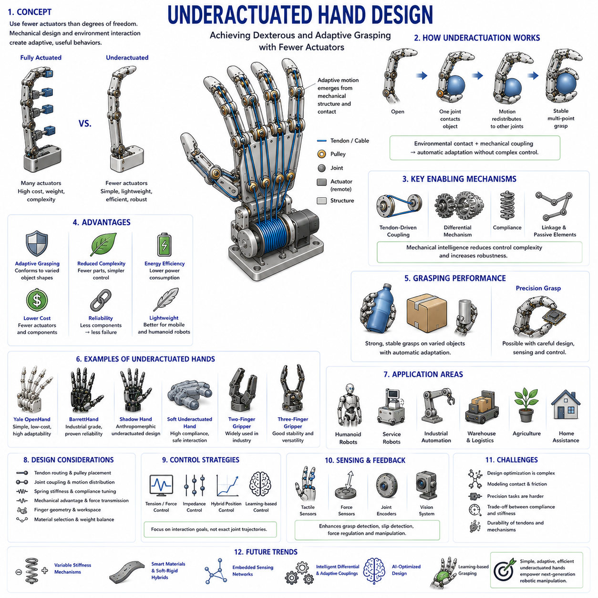{width="7.268055555555556in" height="7.268055555555556in"}

Underactuated hand design represents one of the most important breakthroughs in modern robotic hand engineering. Among the numerous approaches developed for robotic grasping and manipulation, underactuated hands have emerged as a highly practical solution that balances dexterity, adaptability, cost, complexity, reliability, and energy efficiency. Unlike fully actuated robotic hands, where every joint is controlled by an independent actuator, underactuated hands intentionally employ fewer actuators than the total number of degrees of freedom. This design philosophy enables robotic systems to achieve sophisticated grasping behaviors through intelligent mechanical structures rather than relying solely on complex sensing and control algorithms.

The concept of underactuation originates from the observation that many grasping tasks do not require independent control of every finger joint. Human hands possess extraordinary dexterity, but even biological systems often exploit passive mechanical interactions, tendon couplings, compliance, and environmental constraints to simplify control. Similarly, underactuated robotic hands leverage mechanical intelligence to reduce control complexity while maintaining robust interaction with the physical world. Rather than commanding every joint individually, the designer allows the hand's structure and the physics of contact to determine how forces and motions are distributed throughout the mechanism.

In robotics, a system is considered underactuated when the number of independent control inputs is smaller than the number of degrees of freedom. For example, a robotic finger may contain three revolute joints but be driven by a single actuator through a tendon or linkage mechanism. Although only one actuator is present, the finger can still achieve multiple configurations because contact forces and passive mechanical elements influence joint motion. This characteristic distinguishes underactuated systems from conventional fully actuated mechanisms.

The primary motivation behind underactuated hand design is to reduce hardware complexity. Fully actuated robotic hands often require a dedicated motor, gearbox, sensor package, and control channel for every joint. As the number of fingers and joints increases, system complexity grows rapidly. A humanoid hand with twenty or more degrees of freedom may require dozens of actuators, resulting in significant increases in weight, volume, power consumption, cost, thermal management requirements, and maintenance burden. Underactuated architectures address these challenges by reducing actuator count while preserving much of the functionality needed for practical manipulation.

One of the most attractive features of underactuated hands is their ability to adapt automatically to object geometry. When a fully actuated finger closes around an object, every joint position must typically be controlled explicitly. In contrast, an underactuated finger can passively conform to the object\'s shape. As one segment of the finger encounters contact, motion naturally redistributes to other joints, allowing the finger to wrap around the object without requiring sophisticated control decisions. This adaptive grasping behavior significantly improves robustness in uncertain environments.

Adaptive grasping is particularly important because real-world objects exhibit enormous variability in size, shape, orientation, texture, stiffness, and mass distribution. Industrial automation systems often operate in structured environments where object positions are known in advance. However, service robots, warehouse robots, agricultural robots, domestic assistants, humanoid robots, and mobile manipulators frequently encounter unknown objects. Underactuated hands excel in such situations because their mechanical structure inherently compensates for uncertainty.

The notion of mechanical intelligence is central to underactuated hand design. Mechanical intelligence refers to the ability of a mechanism to perform useful functions through its physical structure rather than through computational control. An underactuated hand often embeds grasping strategies directly into its mechanics. Springs, tendons, differential systems, compliant joints, linkage structures, and passive couplings collectively create behaviors that would otherwise require sophisticated software algorithms. As a result, control systems become simpler, more reliable, and computationally efficient.

Underactuated fingers commonly employ tendon-driven architectures. A single tendon may pass through multiple joints, generating coordinated motion throughout the finger. When the actuator applies tension, the finger begins to close. If one joint encounters an object before others, continued actuator motion causes the remaining joints to continue moving until additional contact points are established. This process allows the finger to achieve stable multi-point contact without explicit planning or sensing.

Differential mechanisms are another key technology in underactuated hand design. Differentials distribute forces among multiple outputs while using a single input source. In robotic hands, differential transmissions allow one actuator to drive several fingers simultaneously. If one finger encounters an object first, the differential automatically redistributes motion and force to the remaining fingers. This capability improves adaptability while minimizing actuator requirements.

Compliance plays a critical role in most underactuated systems. Compliance refers to the controlled flexibility of mechanical components. Springs, elastic tendons, flexible joints, and compliant materials allow fingers to absorb impacts, accommodate positioning errors, and adapt to contact conditions. Compliance also improves safety when interacting with humans or fragile objects. Rather than resisting environmental uncertainties, compliant underactuated hands exploit them to achieve more stable grasps.

The relationship between compliance and underactuation is particularly important. While underactuation reduces control complexity by decreasing actuator count, compliance introduces passive adaptability. Together, these characteristics enable robotic hands to achieve robust performance in environments that would be difficult to model precisely. Many successful robotic hand designs combine both principles extensively.

The grasping process in an underactuated hand differs significantly from that of a fully actuated hand. In a fully actuated system, the desired grasp posture is typically planned in advance and executed through precise joint control. In an underactuated system, the final grasp configuration emerges dynamically through interactions among actuator forces, finger mechanics, object geometry, friction, and contact conditions. This emergent behavior is one of the defining characteristics of underactuated manipulation.

Underactuated hands often exhibit excellent performance in power grasps. Power grasps involve enveloping an object with multiple fingers and generating large contact forces. Examples include grasping bottles, tools, boxes, handles, fruits, industrial parts, and household objects. Because underactuated fingers naturally conform to object surfaces, they frequently achieve more stable power grasps than rigid, position-controlled systems.

Precision grasping presents a more complex challenge. Tasks such as inserting connectors, handling small components, performing assembly operations, or manipulating delicate objects often require highly controlled contact conditions. While underactuated hands can perform many precision tasks, achieving human-level dexterity may require additional sensing, compliance control, or hybrid actuation strategies.

The design of underactuated fingers involves careful selection of joint coupling relationships. Engineers must determine how motion and force are distributed among joints during grasping. Tendon routing, linkage geometry, spring stiffness, pulley dimensions, and differential mechanisms all influence this distribution. Optimization techniques are frequently used to achieve desired grasping behaviors while maintaining mechanical simplicity.

Mechanical advantage is another important design consideration. Different joint configurations generate different force transmission characteristics. Designers seek to ensure that fingertip forces remain sufficient throughout the grasping process while avoiding excessive actuator loads. The mechanical structure must provide both adaptability and effective force generation.

The number of fingers significantly influences underactuated hand performance. Two-finger underactuated grippers are widely used in industrial automation due to their simplicity and reliability. Three-finger designs offer improved grasp stability and object adaptability. Four-finger and five-finger hands provide greater dexterity and manipulation capability but introduce additional design complexity. The optimal configuration depends on the intended application domain.

Several influential robotic hands have demonstrated the effectiveness of underactuated design principles. The Yale OpenHand project popularized simple, low-cost underactuated grippers capable of handling a wide range of objects. The BarrettHand introduced sophisticated underactuated finger mechanisms combined with industrial reliability. Numerous research platforms and commercial robotic grippers now incorporate underactuated architectures because of their practical advantages.

Underactuated hands are particularly attractive for mobile robots. Mobile platforms often face strict limitations regarding weight, energy consumption, computational resources, and cost. Reducing actuator count directly lowers power requirements and simplifies integration. Consequently, many warehouse robots, delivery robots, agricultural platforms, and service robots employ underactuated end effectors.

Humanoid robotics has also embraced underactuation. Human-like hands require many degrees of freedom to achieve versatile manipulation capabilities. Implementing full actuation for every joint would result in excessive complexity and weight. Underactuated architectures provide a practical compromise that enables substantial dexterity while remaining compatible with humanoid design constraints.

Soft robotics has introduced new opportunities for underactuated hand development. Soft fingers naturally exhibit compliance and adaptability, making them highly compatible with underactuation principles. Hybrid rigid-soft architectures combine the structural advantages of rigid mechanisms with the adaptability of soft materials. Such systems often achieve exceptional grasp robustness while maintaining relatively simple control requirements.

Sensing remains important even in underactuated systems. Although mechanical intelligence reduces dependence on complex control algorithms, tactile sensors, force sensors, joint encoders, and vision systems can significantly enhance performance. Sensor feedback enables grasp verification, slip detection, force regulation, and adaptive manipulation strategies. The combination of mechanical intelligence and sensory intelligence often produces the most effective robotic hands.

Control strategies for underactuated hands differ from those used in fully actuated systems. Instead of commanding individual joint positions, controllers often regulate tendon tension, actuator displacement, grasp force, impedance, or contact conditions. High-level planning algorithms focus on object interaction objectives rather than exact joint trajectories. This shift in control philosophy simplifies many aspects of robotic manipulation.

Simulation and modeling of underactuated hands present unique challenges. Because final grasp configurations emerge through contact interactions, accurate simulation requires detailed modeling of friction, compliance, contact mechanics, tendon dynamics, and object behavior. Modern simulation platforms increasingly incorporate these effects, enabling more reliable virtual prototyping and optimization.

Artificial intelligence and machine learning are beginning to transform underactuated hand design. Learning-based methods can optimize tendon routing, spring placement, differential architectures, and grasping strategies. Reinforcement learning algorithms allow robotic systems to discover effective manipulation behaviors that leverage the unique characteristics of underactuated mechanisms.

Future underactuated hands are expected to incorporate variable stiffness technologies, adaptive materials, embedded sensing networks, intelligent differential mechanisms, and advanced learning-based controllers. These developments will further enhance adaptability, efficiency, and dexterity while preserving the simplicity that makes underactuation attractive.

The growing field of Physical AI increasingly recognizes the value of underactuation. Physical AI emphasizes the integration of intelligence within both software and hardware. Underactuated hands exemplify this philosophy because they embed problem-solving capability directly into the mechanical structure. Rather than forcing software to solve every challenge, the hand itself contributes to intelligent interaction with the environment.

Ultimately, underactuated hand design represents a powerful engineering paradigm that balances simplicity and capability. By intentionally reducing actuator count and exploiting mechanical intelligence, underactuated hands achieve robust grasping performance across diverse environments. Their ability to adapt passively to object geometry, reduce hardware complexity, improve reliability, and lower costs has made them one of the most successful approaches in robotic manipulation. As robotics continues to expand into homes, factories, hospitals, warehouses, and public spaces, underactuated hands are likely to remain a foundational technology for practical and scalable robotic grasping systems.

## 02.06 Adaptive Finger Design

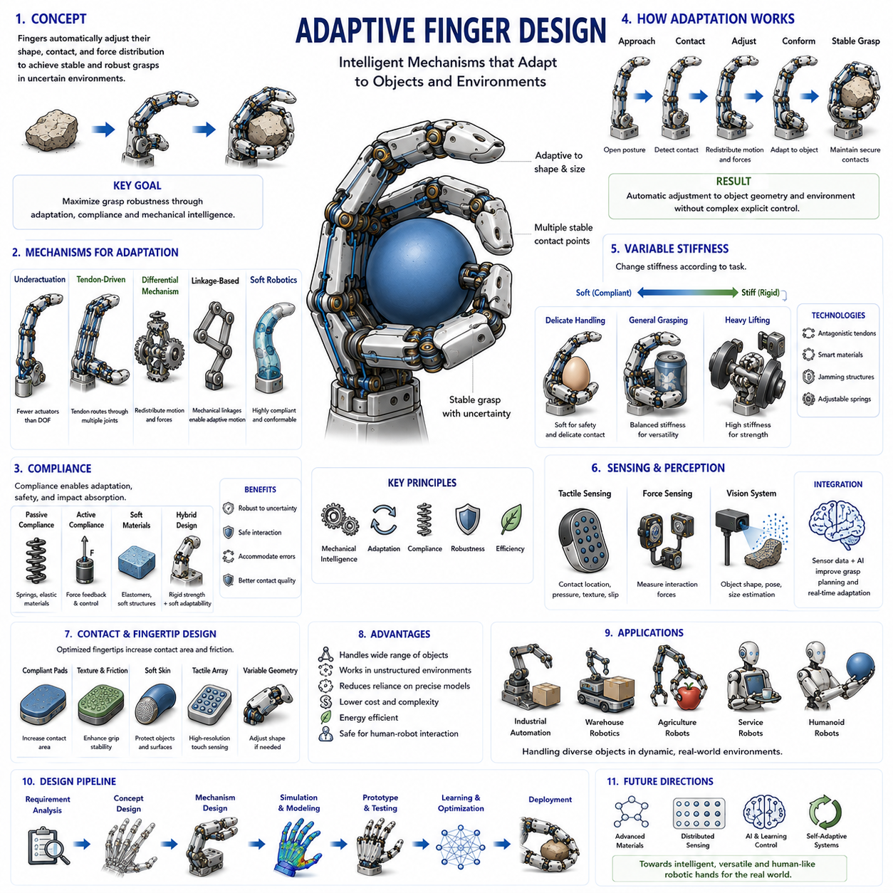{width="7.268055555555556in" height="7.268055555555556in"}

Adaptive finger design represents one of the most significant developments in modern robotic hand engineering. As robots increasingly move beyond highly structured industrial environments and enter homes, hospitals, warehouses, agricultural fields, public facilities, and collaborative workspaces, the ability to interact reliably with objects of unknown size, shape, orientation, texture, and material properties has become a critical requirement. Traditional rigid robotic fingers were originally designed for repetitive tasks involving predictable objects and carefully controlled environments. While these systems excel in precision and repeatability, they often struggle when faced with uncertainty. Adaptive finger design emerged as a solution to this challenge by enabling robotic fingers to automatically adjust their configuration, contact conditions, and force distribution in response to object characteristics and environmental interactions.

The central philosophy of adaptive finger design is that a robotic finger should not rely entirely on explicit control commands to achieve successful grasping. Instead, part of the intelligence required for manipulation should be embedded directly within the mechanical structure. This concept is closely related to mechanical intelligence, where the physical design of the finger contributes to decision-making and adaptation. Rather than forcing software to compensate for every possible uncertainty, adaptive mechanisms allow the finger to naturally conform to objects and respond to contact events in a beneficial manner.

In biological systems, adaptation is a fundamental characteristic of manipulation. Human fingers continuously adjust their shape, stiffness, force distribution, and contact points during grasping. This adaptability allows people to handle objects ranging from delicate glassware to heavy tools without consciously calculating every movement. Adaptive robotic fingers attempt to capture similar capabilities through engineered mechanisms that respond dynamically to environmental conditions.

One of the primary objectives of adaptive finger design is to maximize grasp robustness. Grasp robustness refers to the ability of a robotic hand to maintain stable contact despite uncertainties in object geometry, positioning errors, sensor inaccuracies, and environmental disturbances. Adaptive fingers achieve this by increasing the probability that multiple stable contact points will be established during the grasping process. Instead of requiring exact alignment between the hand and the object, adaptive mechanisms tolerate deviations and compensate automatically.

The most common form of adaptation occurs through passive adaptation. Passive adaptation refers to mechanical adjustments that occur without active control intervention. As a finger encounters an object, contact forces naturally influence the configuration of joints and links. Springs, compliant joints, differential mechanisms, tendon couplings, and flexible structures allow the finger to reshape itself according to the object\'s geometry. Because these adjustments occur mechanically, passive adaptation can operate rapidly and reliably without computational overhead.

Underactuated finger architectures are closely associated with adaptive finger design. In an underactuated finger, fewer actuators are used than the number of degrees of freedom. When an actuator drives the finger, object contact determines how motion is distributed among the joints. This creates a natural adaptive behavior where the finger wraps around objects and forms stable contact patterns without requiring explicit joint-level control. Many successful adaptive robotic fingers are fundamentally underactuated systems.

Compliance is another essential component of adaptive finger engineering. Compliance refers to the ability of a mechanism to deform in response to external forces. Controlled compliance enables fingers to absorb impacts, accommodate positioning errors, and maintain stable contact with irregular surfaces. Compliance may be achieved through springs, elastomeric materials, flexible joints, compliant linkages, pneumatic structures, or soft robotic components. The introduction of compliance often dramatically improves the adaptability of robotic fingers.

A distinction is commonly made between passive compliance and active compliance. Passive compliance relies on physical elasticity built into the mechanism itself. Active compliance, in contrast, uses sensors and control algorithms to modify actuator behavior in response to external forces. Both approaches contribute to adaptive grasping, but passive compliance is generally faster, simpler, and more energy efficient. Active compliance provides greater flexibility and control authority but requires more sophisticated sensing and computation.

Adaptive finger mechanisms frequently employ differential systems. Differential mechanisms distribute forces and motions among multiple joints or fingers according to contact conditions. If one part of the finger encounters resistance, the differential automatically redirects motion elsewhere. This capability enhances adaptability while minimizing control complexity. Differential architectures are particularly common in underactuated robotic hands because they provide elegant solutions for coordinating multiple contact points.

Tendon-driven adaptive fingers are widely used due to their ability to combine lightweight construction with mechanical adaptability. Tendons naturally allow forces to be distributed across multiple joints. When one joint encounters an obstacle, tendon tension can continue driving motion in the remaining joints. This behavior allows the finger to conform to object shapes and establish stable grasp configurations. Tendon-driven adaptive systems are frequently found in anthropomorphic robotic hands and prosthetic devices.

Linkage-based adaptive fingers represent another important design category. Carefully engineered linkage mechanisms can generate adaptive motion trajectories through purely mechanical means. As contact occurs, linkages redistribute movement among finger segments, allowing the structure to wrap around objects. These mechanisms often exhibit high reliability and durability because they rely on rigid mechanical components rather than complex sensing systems.

Soft robotics has significantly expanded the possibilities for adaptive finger design. Soft robotic fingers are constructed from flexible materials that can undergo substantial deformation during interaction. Unlike traditional rigid mechanisms, soft fingers inherently adapt to object geometry through material compliance. Pneumatic actuators, fluidic networks, elastomeric structures, and flexible composites allow soft fingers to achieve levels of adaptability that are difficult to replicate using conventional mechanical designs.

Hybrid adaptive fingers combine rigid structural elements with soft components. These systems seek to balance precision and adaptability. Rigid elements provide load-bearing capability and positional accuracy, while soft regions enhance environmental conformity and safety. Hybrid architectures have become increasingly popular because they offer practical performance across a wide range of manipulation tasks.

Variable stiffness technology represents one of the most advanced directions in adaptive finger research. Traditional fingers exhibit fixed stiffness characteristics. Variable stiffness mechanisms allow the finger to modify its mechanical properties dynamically. During delicate manipulation, the finger can become compliant to improve safety and contact quality. During forceful grasping, stiffness can be increased to maximize load capacity and stability. Variable stiffness technologies include antagonistic tendon systems, smart materials, jamming structures, and mechanically adjustable elastic elements.

Contact mechanics play a central role in adaptive finger performance. The behavior of contact interfaces determines how forces are transmitted between the finger and the object. Adaptive fingers seek to maximize contact area while maintaining appropriate force distributions. Larger contact areas generally improve stability, reduce pressure concentrations, and increase frictional grip. Designers therefore pay careful attention to fingertip geometry, surface materials, compliance distribution, and contact modeling.

Fingertip design is particularly important within adaptive systems. Adaptive fingertips may incorporate compliant pads, textured surfaces, soft skins, tactile sensors, or variable geometry structures. These features enhance the ability of the finger to conform to object surfaces while maintaining secure contact. Many robotic hands achieve significant performance improvements simply through careful fingertip optimization.

The integration of tactile sensing has dramatically improved adaptive finger capabilities. Tactile sensors provide information regarding contact location, pressure distribution, slip events, texture characteristics, and object properties. This information enables the robotic system to modify grasping strategies in real time. While mechanical adaptation can operate independently, combining adaptive mechanisms with tactile sensing creates significantly more capable manipulation systems.

Force sensing is equally important. Adaptive fingers often regulate grasp forces to prevent object damage while maintaining sufficient holding strength. Force sensors embedded within joints, tendons, fingertips, or structural members provide feedback that supports intelligent grasp adjustment. This capability is particularly valuable when handling fragile, deformable, or high-value objects.

Vision systems further enhance adaptive grasping. Cameras, depth sensors, structured light systems, and machine vision algorithms provide information about object geometry before physical contact occurs. By combining visual perception with adaptive finger mechanics, robotic hands can achieve highly reliable grasping performance across diverse environments. Vision enables predictive adaptation, while mechanical structures provide reactive adaptation during contact.

Machine learning has emerged as a powerful tool for adaptive finger development. Reinforcement learning, imitation learning, and data-driven optimization methods enable robotic systems to discover effective manipulation strategies through experience. Adaptive fingers provide rich opportunities for learning because their behavior depends strongly on interactions with the environment. Learning algorithms can exploit these interactions to improve grasp stability, manipulation efficiency, and task performance.

Simulation environments have become increasingly important for adaptive finger research. Modern simulation platforms can model contact mechanics, compliance, tendon dynamics, friction, deformation, and object interactions with high fidelity. These tools allow engineers to evaluate adaptive designs before constructing physical prototypes. Simulation also supports machine learning approaches that require large numbers of training interactions.

One of the greatest advantages of adaptive finger design is robustness to uncertainty. Real-world environments are inherently unpredictable. Objects may be positioned inaccurately, partially occluded, deformable, damaged, or previously unseen. Adaptive fingers reduce dependence on precise environmental models and enable successful operation despite incomplete information. This robustness is one of the key reasons adaptive mechanisms are increasingly favored in practical robotic applications.

Industrial automation is beginning to incorporate adaptive finger technologies, particularly in applications involving variable products, mixed production lines, and flexible manufacturing. Warehouse robots use adaptive grippers to handle packages of different sizes and shapes. Agricultural robots employ adaptive fingers to harvest fruits and vegetables without causing damage. Service robots rely on adaptive manipulation to interact safely with household objects and human users.

Humanoid robotics is perhaps the field most strongly influenced by adaptive finger design. Human environments were created for human hands, not robotic grippers. To function effectively in such environments, humanoid robots require hands capable of handling diverse objects under uncertain conditions. Adaptive fingers provide much of the versatility necessary for achieving this goal.

Future adaptive finger systems are expected to integrate advanced materials, embedded sensing, variable stiffness technologies, intelligent control systems, and artificial intelligence. Smart materials capable of changing shape, stiffness, or surface properties in response to electrical signals may enable entirely new forms of adaptation. Distributed tactile sensing networks could provide continuous perception across the finger surface. Learning-based controllers may allow robotic hands to refine their adaptive behavior through lifelong experience.

The broader vision of Physical AI strongly aligns with adaptive finger design. Physical AI emphasizes the integration of intelligence into both software and hardware. Adaptive fingers embody this principle by embedding problem-solving capabilities directly into the mechanical structure. Rather than relying exclusively on computation, they leverage the physics of materials, contact, compliance, and mechanical design to achieve intelligent interaction.

Ultimately, adaptive finger design represents a fundamental shift in robotic manipulation philosophy. Instead of viewing uncertainty as a problem to eliminate through sensing and control, adaptive systems embrace uncertainty and exploit it through intelligent mechanical design. By combining compliance, underactuation, differential mechanisms, soft materials, sensing technologies, and advanced control strategies, adaptive fingers achieve levels of robustness and versatility that would be difficult to obtain through conventional approaches alone. As robotics continues to expand into increasingly unstructured and human-centered environments, adaptive finger design will remain a cornerstone technology for the development of capable, resilient, and intelligent robotic hands.

## 02.07 Palm and Wrist Structures

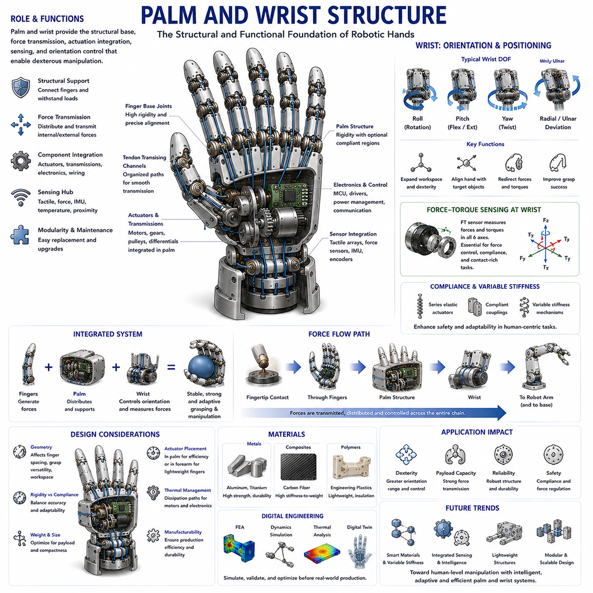{width="7.268055555555556in" height="7.268055555555556in"}

The palm and wrist structure forms the central mechanical foundation of every robotic hand system. While robotic finger design often receives the majority of attention because fingers directly interact with objects, the palm and wrist serve as the structural, functional, and computational backbone that enables those fingers to operate effectively. In many robotic hand systems, overall grasping performance, manipulation capability, payload capacity, durability, sensor integration, and system intelligence are heavily influenced by palm and wrist design decisions. Consequently, the engineering of robotic palms and wrists is not merely a supporting activity but a critical discipline within robotic hand development. This chapter belongs to the Hand Mechanism and Structural Design section of Volume 06 and serves as a bridge between finger mechanisms, actuation systems, hand kinematics, force control, tactile sensing, and dexterous manipulation architectures.

In biological systems, the human palm serves as a complex structural platform that connects the fingers to the forearm while providing mechanical support, force transmission pathways, sensory integration, and adaptability. The human wrist further extends these capabilities by enabling orientation control, positioning flexibility, and force redirection. Together they create a highly versatile manipulation platform capable of handling objects ranging from fragile eggshells to heavy industrial tools. Robotic palm and wrist structures attempt to reproduce many of these functions while adapting them to engineering constraints such as manufacturability, durability, weight limitations, actuator integration, and control architecture.

The primary role of the robotic palm is to serve as the structural base that connects multiple fingers into a coordinated grasping system. Every finger generates forces during object interaction, and these forces ultimately flow through the palm structure. The palm therefore acts as a load-bearing framework that distributes internal forces, maintains finger alignment, supports actuators and transmission systems, and houses sensing and computational components. A poorly designed palm may compromise the performance of even the most advanced finger mechanisms.

One of the most fundamental considerations in palm design is geometric architecture. Palm geometry determines finger spacing, finger orientation, reachable grasp configurations, and overall hand workspace. The arrangement of fingers relative to one another significantly influences grasp stability and manipulation capability. A narrow palm may provide compactness and higher force concentration, while a wider palm can improve object coverage and enhance adaptability to large objects. Designers must balance these competing requirements according to the intended application.

Anthropomorphic robotic hands frequently adopt palm geometries inspired by the human hand. Human palms exhibit a non-planar structure in which fingers are not positioned on a straight line but instead follow a curved arrangement. This curvature contributes to natural grasp formation and improved object enclosure. Robotic palms often replicate this concept by positioning finger bases along an arc rather than a linear arrangement. Such designs enhance grasp versatility and facilitate more natural object manipulation.

Industrial robotic hands frequently prioritize mechanical simplicity over biological realism. Many industrial grippers employ flat or semi-flat palm structures that maximize manufacturability and simplify force transmission. These designs are often optimized for repetitive tasks involving predictable object geometries rather than highly dexterous manipulation.

Palm rigidity is another major design consideration. High structural rigidity ensures accurate force transmission and precise positioning. During manipulation tasks, deformation of the palm structure can introduce positioning errors, reduce grasp stability, and compromise control performance. For applications involving high loads or precision assembly, rigid palm architectures are generally preferred.

However, complete rigidity is not always desirable. Certain robotic hands benefit from incorporating compliant regions within the palm. Compliant palm structures can absorb impacts, improve adaptation to object geometry, reduce stress concentrations, and enhance safety during human-robot interaction. Hybrid palm architectures that combine rigid load-bearing regions with localized compliance have become increasingly popular in collaborative robotics and service robotics.

The palm also serves as the primary integration platform for actuators. In tendon-driven robotic hands, motors are often located within the palm to reduce distal finger mass. This arrangement improves finger responsiveness and reduces inertia. Palm volume therefore becomes a critical resource that must accommodate motors, gearboxes, pulleys, tendon routing systems, electronics, wiring, and cooling structures while maintaining compact overall dimensions.

Actuator placement strongly influences hand performance. Locating actuators within the palm improves transmission efficiency but increases hand weight. Relocating actuators to the forearm reduces palm mass but introduces longer transmission paths and additional complexity. Designers must carefully evaluate these trade-offs according to application requirements.

Transmission systems are deeply integrated into palm structures. Tendon routing channels, differential mechanisms, pulley networks, gear trains, and force distribution systems frequently occupy substantial portions of the palm interior. Effective transmission integration requires careful mechanical packaging to avoid interference among moving components while preserving accessibility for maintenance and repair.

Sensor integration represents another critical aspect of palm engineering. Modern robotic hands often incorporate force sensors, tactile sensors, temperature sensors, inertial sensors, joint encoders, and proximity sensors. Many of these sensing elements are mounted within or routed through the palm structure. The palm effectively functions as a sensor integration hub that connects distributed sensing systems throughout the hand.

Tactile sensing is particularly important. Although fingertip tactile sensing receives significant attention, palm tactile sensing can provide valuable information regarding object support, contact distribution, grasp stability, and unexpected collisions. Advanced robotic hands increasingly incorporate tactile arrays across both fingers and palm surfaces to achieve richer environmental awareness.

The mechanical connection between fingers and palm requires careful attention. Finger base joints must withstand significant forces while maintaining precise alignment. Joint mounting structures must accommodate repeated loading cycles without excessive wear or deformation. Bearing selection, joint reinforcement, and structural support design all contribute to long-term reliability.

Modularity has become an increasingly important design principle in robotic palm engineering. Modular palm architectures allow fingers, sensors, actuators, and transmission components to be replaced independently. This approach simplifies maintenance, reduces downtime, and supports rapid experimentation during research and development. Many modern robotic hands are intentionally designed as modular systems to facilitate upgrades and customization.

The wrist serves as the dynamic interface between the robotic hand and the larger manipulator system. While fingers and palm generate grasping actions, the wrist determines the orientation and positioning of the entire hand relative to the environment. In many manipulation tasks, wrist motion contributes more significantly to overall dexterity than finger motion alone.

Human wrists provide multiple degrees of freedom including flexion, extension, radial deviation, ulnar deviation, and rotational motion. Robotic wrists typically implement a subset of these capabilities depending on system requirements. Industrial manipulators often achieve wrist functionality through the final joints of the robot arm, while humanoid and dexterous robotic hands frequently include dedicated wrist mechanisms.

Wrist kinematics strongly influence reachable grasp configurations. A highly dexterous wrist expands the effective workspace of the hand and reduces the burden placed on finger articulation. By adjusting wrist orientation, the robotic system can align the hand with target objects more effectively and improve grasp success rates.

Degrees of freedom within the wrist must be carefully selected. Additional wrist joints increase dexterity but also introduce greater mechanical complexity, weight, control requirements, and power consumption. Designers must identify the minimum number of wrist degrees of freedom necessary to achieve desired task performance.

Wrist load capacity is particularly important in industrial applications. During manipulation, the wrist must transmit forces generated by both the object and the arm. Heavy payload operations require robust wrist structures capable of resisting bending moments, torsional loads, and impact forces. Structural analysis and fatigue evaluation are therefore essential aspects of wrist engineering.

Force and torque sensing are frequently integrated at the wrist level. Wrist-mounted force-torque sensors provide critical information regarding contact interactions, insertion tasks, assembly operations, and manipulation forces. These sensors are particularly important for compliant control, force regulation, and contact-rich manipulation tasks. The integration of wrist force-torque sensing forms a foundational component of modern dexterous manipulation systems and directly connects to later topics involving force control and tactile feedback.

Compliance within wrist structures has become increasingly important as robots transition into human-centered environments. Series elastic actuators, compliant couplings, flexible joints, and variable stiffness mechanisms allow wrists to absorb impacts and regulate interaction forces. These capabilities enhance safety and improve manipulation robustness in uncertain environments.

Variable stiffness wrists represent an advanced research direction. Such systems can dynamically adjust mechanical stiffness according to task requirements. High stiffness may be desirable for precision assembly and heavy lifting, while low stiffness improves safety and adaptability during human interaction and delicate manipulation.

The integration of palm and wrist systems creates a unified manipulation platform. Forces generated at the fingertips travel through finger structures, into the palm, through the wrist, and ultimately into the robotic arm. The quality of this force transmission chain significantly influences overall manipulation performance. Designers must therefore view palm and wrist engineering as a unified system rather than independent subsystems.

Material selection plays a crucial role in both palm and wrist design. Aluminum alloys provide excellent weight-to-strength ratios and are commonly used in research and commercial robotic hands. Titanium alloys offer higher strength and corrosion resistance but at increased cost. Engineering polymers reduce weight and manufacturing costs while providing electrical insulation. Carbon fiber composites deliver exceptional stiffness-to-weight performance and are increasingly adopted in advanced robotic systems.

Thermal management is becoming an increasingly important consideration as robotic hands integrate larger numbers of actuators, sensors, processors, and communication modules. Palm structures often function as heat dissipation platforms. Proper thermal design improves component reliability and extends operational lifespan.

Manufacturability remains a critical engineering concern. Palm and wrist structures must be designed not only for performance but also for production efficiency. Additive manufacturing, CNC machining, injection molding, composite fabrication, and hybrid manufacturing methods are all employed depending on application requirements. Modern generative design techniques increasingly optimize palm and wrist geometries for weight reduction and structural efficiency.

Simulation and digital engineering tools have transformed palm and wrist development. Finite Element Analysis, multibody dynamics simulation, contact modeling, thermal analysis, and digital twins allow engineers to evaluate performance before physical prototypes are built. These tools reduce development costs while improving design quality.

The emergence of humanoid robotics has renewed interest in sophisticated palm and wrist architectures. Human environments were designed around the capabilities of human hands. Consequently, humanoid robots require palms and wrists that support diverse manipulation tasks while maintaining compact dimensions comparable to biological anatomy. Achieving this balance remains one of the most significant challenges in robotic hand engineering.

Artificial intelligence and Physical AI are further increasing the importance of palm and wrist design. Future robotic systems will rely not only on computational intelligence but also on embodied intelligence embedded within mechanical structures. Palms and wrists will increasingly integrate sensing, adaptive mechanisms, variable stiffness technologies, self-monitoring systems, and intelligent control architectures.

Ultimately, the palm and wrist structure serves as the central foundation of robotic hand functionality. While fingers perform direct object interaction, the palm provides structural integration and force distribution, and the wrist delivers positioning flexibility and dynamic orientation control. Together they form the essential framework upon which dexterous manipulation, tactile interaction, force regulation, adaptive grasping, and intelligent robotic behavior are built. As robotic hands continue to evolve toward human-level manipulation capabilities, the engineering of palm and wrist structures will remain one of the most critical disciplines in robotic hand design and development.

## 02.08 Material Selection

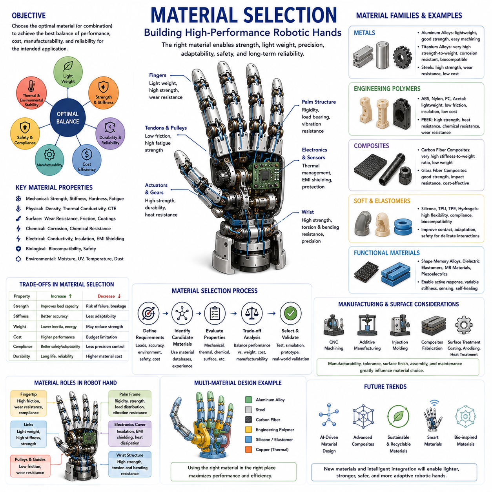{width="7.268055555555556in" height="7.268055555555556in"}

Material selection is one of the most fundamental and influential aspects of robotic hand engineering. Every robotic hand, regardless of its complexity, performance level, or intended application, is ultimately constrained by the materials from which it is constructed. The mechanical strength, stiffness, durability, weight, thermal characteristics, manufacturability, cost, safety, and long-term reliability of a robotic hand are all directly influenced by material selection decisions. While kinematic design, actuation systems, sensing technologies, and control algorithms often receive significant attention, the success of these systems frequently depends upon whether the underlying materials can support the required performance objectives.

In robotic hand design, materials are not merely structural elements. They actively shape the behavior of the system. The flexibility of a finger, the rigidity of a palm, the durability of a transmission mechanism, the sensitivity of a tactile sensor, and the efficiency of a tendon routing system all emerge from the properties of the materials involved. Consequently, material selection should be viewed as a system-level engineering process rather than a simple component choice.

The primary objective of material selection is to achieve an optimal balance among multiple competing requirements. Robotic hands must often be lightweight while remaining strong, compliant while maintaining accuracy, durable while minimizing cost, and compact while accommodating complex mechanical systems. No single material can maximize every desired characteristic simultaneously. Engineers therefore evaluate trade-offs among performance metrics to identify the most appropriate material combinations for a given application.

One of the most important properties considered during material selection is mechanical strength. Strength refers to the ability of a material to resist failure under applied loads. Robotic fingers, palms, wrists, gears, linkages, tendon anchors, and structural supports all experience forces during manipulation. Materials with insufficient strength may deform permanently, crack, fracture, or fail catastrophically. The required strength level depends heavily on the intended application. A lightweight prosthetic hand handling household objects requires far lower strength than an industrial robotic gripper manipulating heavy automotive components.

Closely related to strength is stiffness. Stiffness describes the resistance of a material to elastic deformation. High stiffness is often desirable because it improves positioning accuracy, force transmission efficiency, and grasp stability. When a robotic finger contacts an object, excessive structural deflection may introduce positioning errors and reduce control precision. Industrial robotic hands frequently employ high-stiffness materials to achieve consistent and repeatable manipulation performance.

However, stiffness is not universally beneficial. Excessively rigid systems may struggle to adapt to uncertain environments or fragile objects. Human hands achieve remarkable manipulation capabilities partly because biological tissues exhibit controlled compliance. Modern robotic systems increasingly incorporate materials with carefully selected flexibility to improve safety and adaptability. Consequently, material selection often involves balancing stiffness and compliance according to application requirements.

Density is another critical parameter. Density determines the mass of a structure for a given volume. Weight reduction is particularly important in robotic hands because mass located far from the robot base increases inertia, energy consumption, actuator requirements, and dynamic loading. Lightweight fingers can accelerate more rapidly, respond more efficiently, and interact more safely with their environment. As a result, materials with high strength-to-weight ratios are highly valued in robotic hand design.

Aluminum alloys have become one of the most widely used material families in robotic hand engineering. Aluminum offers an attractive combination of low density, good strength, corrosion resistance, excellent machinability, and relatively low cost. Many robotic palms, finger links, wrist structures, actuator housings, and mounting components are fabricated from aluminum alloys. The balance between performance and manufacturability makes aluminum a preferred choice for research prototypes and commercial robotic systems alike.

Titanium alloys provide even higher strength-to-weight ratios than aluminum while offering exceptional corrosion resistance and fatigue performance. Titanium components are frequently used in aerospace robotics, medical robotic systems, prosthetic devices, and high-performance humanoid hands. However, titanium is significantly more expensive and difficult to machine than aluminum. Consequently, it is typically reserved for applications where superior performance justifies increased cost.

Steel remains indispensable in robotic hand engineering. Various grades of steel are used for gears, shafts, bearings, springs, fasteners, transmission components, and structural reinforcements. Steel provides outstanding strength, hardness, wear resistance, and durability. Although heavier than aluminum or titanium, steel remains the material of choice for highly loaded components where reliability is paramount.

Stainless steel offers additional advantages through improved corrosion resistance. Robotic systems operating in medical environments, food processing facilities, agricultural applications, marine settings, or outdoor environments often employ stainless steel components to withstand moisture and contamination. The combination of strength and environmental durability makes stainless steel an important material class for many robotic applications.

Engineering polymers have become increasingly important in robotic hand design. Unlike traditional structural metals, polymers offer lightweight construction, electrical insulation, low friction, chemical resistance, and reduced manufacturing costs. Materials such as ABS, Nylon, PEEK, Polycarbonate, Acetal, and UHMWPE are frequently used in robotic fingers, sensor housings, cable guides, pulley systems, compliant structures, and protective covers.

Polyether Ether Ketone (PEEK) deserves particular attention due to its exceptional performance characteristics. PEEK combines high strength, thermal stability, chemical resistance, wear resistance, and low weight. These properties make it suitable for demanding robotic applications including aerospace systems, surgical robots, and high-performance manipulation devices. Despite its advantages, PEEK remains relatively expensive and is generally used only when its unique properties are required.

Composite materials represent another major advancement in robotic hand engineering. Carbon fiber reinforced polymers have become especially popular due to their extraordinary stiffness-to-weight ratios. Carbon fiber structures can provide exceptional rigidity while dramatically reducing mass. This characteristic is highly beneficial for robotic fingers and wrists where minimizing inertia directly improves dynamic performance.

Carbon fiber composites are frequently used in humanoid robots, aerial manipulation systems, advanced prosthetics, and research platforms focused on high-performance dexterous manipulation. However, composites present manufacturing challenges, including anisotropic behavior, specialized fabrication requirements, and complex repair procedures. Engineers must carefully consider fiber orientation, laminate design, and loading conditions when employing composite materials.

Glass fiber composites provide a lower-cost alternative to carbon fiber. Although not as stiff or lightweight, glass fiber reinforced materials offer excellent durability, electrical insulation, and impact resistance. These characteristics make them attractive for industrial robotic systems where cost considerations are significant.

Soft robotic technologies have introduced entirely new categories of materials into robotic hand design. Elastomers, silicones, thermoplastic polyurethanes, hydrogels, and flexible composite materials enable robotic fingers to deform substantially during interaction. These materials allow robotic hands to achieve levels of adaptability that are difficult to obtain using conventional rigid structures.

Silicone elastomers are particularly common in soft robotic fingers. Their flexibility, durability, biocompatibility, and ease of fabrication make them suitable for applications involving delicate object handling and human-robot interaction. Silicone-based structures can conform naturally to object surfaces, increasing contact area and improving grasp stability.

Thermoplastic polyurethane (TPU) has also gained popularity because it combines flexibility with excellent abrasion resistance and mechanical durability. TPU components are frequently manufactured using additive manufacturing technologies, enabling rapid prototyping and customization of robotic finger structures.

The emergence of additive manufacturing has significantly influenced material selection practices. Three-dimensional printing technologies allow engineers to produce complex geometries using materials that would be difficult to process through conventional manufacturing methods. Additive manufacturing supports rapid iteration, customized designs, lightweight structures, and integrated functional components.

Common additive manufacturing materials include PLA, ABS, PETG, Nylon, TPU, reinforced composites, and high-performance engineering polymers. Each material offers distinct advantages and limitations regarding strength, stiffness, thermal performance, surface finish, and production cost. The increasing maturity of additive manufacturing continues to expand design possibilities for robotic hands.

Wear resistance is another crucial consideration. Robotic hands frequently perform thousands or even millions of manipulation cycles. Contact surfaces, gears, pulleys, bearings, tendon guides, and linkage joints experience continuous friction and loading. Materials with inadequate wear resistance may degrade rapidly, reducing system performance and increasing maintenance requirements.

Frictional properties significantly influence robotic hand behavior. Certain applications require low-friction surfaces to maximize transmission efficiency and minimize wear. Others benefit from high-friction contact materials that improve grasp stability. Engineers often employ specialized coatings, surface treatments, and composite materials to optimize frictional characteristics.

Thermal properties are becoming increasingly important as robotic systems integrate larger numbers of actuators, sensors, processors, and communication modules. Materials influence heat generation, thermal conductivity, thermal expansion, and heat dissipation. Effective thermal management improves reliability and extends component lifespan. Aluminum, copper, graphite composites, and advanced thermal interface materials are frequently employed to manage heat flow within robotic hands.

Electrical properties must also be considered. Conductive materials are necessary for grounding, electromagnetic shielding, and power distribution. Insulating materials protect sensitive electronics and prevent unintended electrical interactions. The coexistence of electrical and mechanical requirements often necessitates careful material integration strategies.

Biocompatibility becomes essential in medical robotics, prosthetics, rehabilitation devices, and wearable robotic systems. Materials that come into contact with human tissue must satisfy stringent safety requirements. Titanium alloys, medical-grade silicones, biocompatible polymers, and specialized coatings are commonly employed in such applications.

Environmental resistance is another key factor. Robotic systems may operate in humid, dusty, chemically aggressive, high-temperature, low-temperature, or outdoor environments. Material selection must account for exposure to moisture, ultraviolet radiation, chemicals, corrosion, abrasion, and temperature fluctuations. Failure to consider environmental conditions can dramatically shorten operational lifespan.

Cost considerations inevitably influence material selection decisions. Although high-performance materials may offer superior characteristics, budget constraints often require compromise. Engineers must evaluate whether performance improvements justify additional manufacturing, procurement, and maintenance expenses. Effective material selection balances technical requirements with economic realities.

Sustainability is emerging as an increasingly important factor. Modern engineering practices increasingly emphasize recyclable materials, environmentally responsible manufacturing processes, reduced waste generation, and lifecycle optimization. As robotics becomes more widespread, sustainable material strategies are likely to play a larger role in system design.

Material selection is rarely limited to a single material. Most advanced robotic hands employ multi-material architectures in which different materials are assigned to different functions. Structural frames may utilize aluminum or carbon fiber, transmission systems may incorporate steel components, compliant elements may use elastomers, and sensor housings may rely on engineering polymers. The successful integration of these materials often determines overall system performance.

Simulation and digital engineering tools have transformed the material selection process. Finite Element Analysis, fatigue modeling, topology optimization, thermal simulation, and digital twin technologies enable engineers to evaluate material performance before physical prototypes are constructed. These tools reduce development costs while improving design quality and reliability.

Artificial intelligence is beginning to influence material selection as well. Machine learning algorithms can analyze vast design spaces, predict material behavior, optimize multi-material structures, and identify novel material combinations. Future robotic systems may increasingly rely on AI-assisted material engineering to achieve unprecedented levels of performance.

Looking ahead, smart materials represent one of the most exciting frontiers in robotic hand development. Shape memory alloys, electroactive polymers, magnetorheological materials, piezoelectric materials, self-healing polymers, and programmable metamaterials offer capabilities that extend beyond conventional structural functions. These materials can actively change shape, stiffness, conductivity, or mechanical behavior in response to environmental conditions.

The broader vision of Physical AI aligns closely with advances in material science. Future robotic hands will not rely solely on computational intelligence but will embed intelligence within materials themselves. Smart materials capable of sensing, adapting, healing, and responding autonomously may fundamentally transform how robotic hands interact with the physical world.

Ultimately, material selection forms the foundation upon which all robotic hand technologies are built. Every aspect of robotic performance---from strength and precision to adaptability and safety---depends upon the properties of the materials employed. As advances in material science continue to accelerate, new opportunities will emerge for creating robotic hands that are lighter, stronger, safer, more adaptive, and more intelligent than ever before. Material selection will therefore remain one of the most critical disciplines in the ongoing evolution of robotic hand engineering and Physical AI systems.

## 02.09 Weight and Payload Optimization

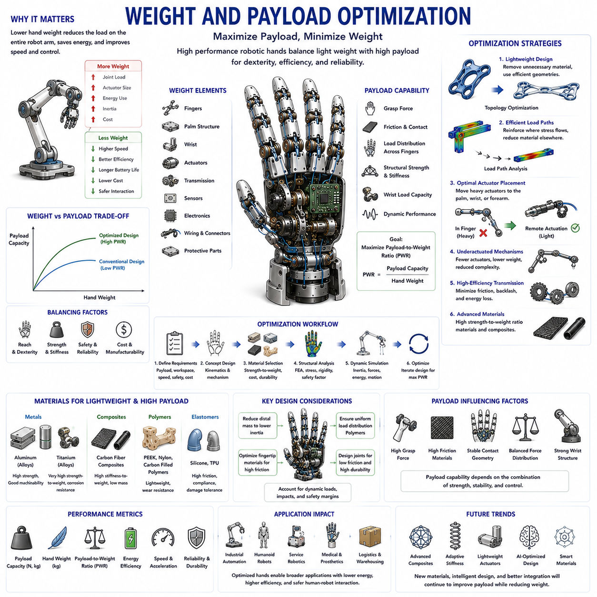{width="7.268055555555556in" height="7.268055555555556in"}

Weight and payload optimization is one of the most important engineering disciplines in robotic hand development. Every robotic hand must balance two competing objectives: minimizing its own mass while maximizing the amount of force and payload it can manipulate. This balance directly affects dexterity, energy efficiency, actuator requirements, structural durability, safety, control performance, and overall system capability. Regardless of whether a robotic hand is designed for industrial automation, humanoid robotics, service robotics, prosthetic devices, medical systems, logistics applications, or Physical AI platforms, weight and payload optimization remains a fundamental design challenge.

In robotic hand engineering, weight refers to the total mass of the hand structure, including fingers, palm, wrist, actuators, sensors, transmission systems, wiring, electronics, and protective components. Payload refers to the maximum object mass or external force that the hand can manipulate while maintaining acceptable performance and safety. The relationship between these two parameters is often used as a key indicator of design quality. A robotic hand that weighs less while carrying heavier loads is generally considered more efficient than a heavier system with the same payload capability.

The importance of weight optimization becomes immediately apparent when considering the kinematic structure of a robotic manipulator. Every kilogram added to the hand increases the load experienced by the wrist, forearm, elbow, shoulder, and base joints. This increase propagates throughout the entire robotic system. As a result, a heavier hand may require larger actuators, stronger structures, larger batteries, increased cooling capacity, and more robust control systems. Consequently, reducing hand weight often produces benefits far beyond the hand itself.

Payload optimization is equally critical. A robotic hand that cannot generate sufficient grasping force or support meaningful loads has limited practical value. The objective is therefore not simply to make the hand lighter but to maximize the payload-to-weight ratio. This ratio is frequently used as a benchmark in advanced robotic systems. High-performance robotic hands seek to achieve the highest possible payload while maintaining minimal structural mass.

Biological systems provide valuable inspiration for this optimization challenge. The human hand weighs only a few hundred grams yet can manipulate objects many times heavier than its own weight. This remarkable capability results from millions of years of evolutionary optimization involving skeletal structures, tendons, muscles, ligaments, and soft tissues. Robotic engineers often study biological systems to identify principles that can improve payload performance while minimizing mass.

One of the primary factors influencing weight optimization is structural architecture. The geometry of fingers, palm structures, and wrist components significantly affects mass distribution and load-bearing capability. Efficient structural design seeks to place material only where it contributes meaningfully to strength and stiffness. Regions experiencing low stress can often be reduced in thickness or removed entirely without compromising performance.

Topology optimization has become an important tool in modern robotic hand design. Topology optimization algorithms automatically identify material distributions that maximize structural performance while minimizing mass. Rather than relying solely on traditional engineering intuition, designers can use computational methods to generate lightweight structures that maintain required strength and stiffness characteristics. Many advanced robotic hands incorporate topology-optimized finger links, palm frames, and wrist components.

Load path analysis plays a central role in payload optimization. Forces generated during grasping travel through specific structural pathways. Understanding these load paths allows engineers to reinforce critical regions while reducing unnecessary material elsewhere. Efficient load path design ensures that structural mass contributes directly to force transmission rather than merely increasing weight.

Material selection strongly influences both weight and payload performance. Aluminum alloys provide an excellent balance of strength, weight, manufacturability, and cost. Titanium alloys offer superior strength-to-weight ratios but at significantly higher cost. Carbon fiber composites deliver exceptional stiffness and low mass, making them attractive for high-performance robotic hands. Engineering polymers can further reduce weight in low-load regions while maintaining adequate functionality.

Composite materials are particularly important in advanced robotic systems. Carbon fiber reinforced structures can achieve stiffness levels comparable to metals while dramatically reducing mass. In robotic fingers, reduced weight lowers inertia and improves dynamic response. This enables faster movements, lower energy consumption, and improved manipulation performance.

The placement of actuators significantly affects weight optimization. Motors are often among the heaviest components in a robotic hand. Placing actuators directly within the fingers simplifies transmission systems but increases distal mass. Increased finger mass leads to higher inertia and reduced responsiveness. Consequently, many robotic hands employ remote actuation strategies in which motors are located within the palm, wrist, or forearm while forces are transmitted through tendons, cables, or other lightweight mechanisms.

Tendon-driven systems are particularly effective for weight optimization. By relocating actuators away from distal finger segments, designers can dramatically reduce moving mass. Lightweight fingers require less energy to accelerate and decelerate, improving both speed and efficiency. Tendon-driven architectures are therefore common in humanoid hands, prosthetic devices, and dexterous manipulation systems.

Underactuated mechanisms further contribute to weight reduction. By reducing the number of required actuators, underactuated hands achieve significant savings in mass, power consumption, electronics, and thermal management requirements. Mechanical intelligence embedded within underactuated structures often allows comparable grasping performance with fewer active components.

Transmission efficiency directly influences payload capability. Inefficient transmissions waste actuator energy through friction, backlash, deformation, and mechanical losses. Improving transmission efficiency increases the amount of useful force delivered to the object. As a result, payload performance can often be improved without increasing actuator size or system weight.

Finger geometry strongly affects payload optimization. Longer fingers increase reach and grasping versatility but also increase bending moments and structural loading. Shorter fingers provide greater force capability but may reduce workspace and object adaptability. Designers must balance these competing requirements according to application objectives.

Joint design is another critical factor. Every joint introduces potential sources of weight, friction, compliance, and energy loss. Bearings, shafts, housings, sensors, and transmission elements all contribute to system mass. Optimized joint architectures seek to minimize these penalties while maintaining durability and precision.

The payload capability of a robotic hand depends not only on structural strength but also on grasp stability. A hand may possess sufficient actuator force to lift a heavy object yet fail because of inadequate friction or poor contact geometry. Effective payload optimization therefore requires careful consideration of fingertip design, contact mechanics, friction coefficients, and grasp planning strategies.

Fingertip materials play an important role in this process. High-friction materials increase grip stability and reduce the force required to hold objects securely. Improved friction effectively increases usable payload without requiring larger actuators or stronger structures. Soft fingertip materials may also increase contact area, further improving grasp performance.

Force distribution among fingers significantly influences payload capability. Uneven force distribution can overload individual fingers while leaving others underutilized. Differential mechanisms, adaptive fingers, and underactuated architectures often improve payload performance by distributing loads more uniformly across the hand.

Wrist design has a substantial impact on payload optimization. Even if the fingers can generate sufficient grasping forces, the wrist must withstand the resulting loads. Heavy objects create bending moments and torsional loads that propagate through the wrist into the robotic arm. Optimized wrist structures seek to maximize load capacity while minimizing mass and inertia.

Dynamic loading introduces additional complexity. Payload specifications are often based on static conditions, but real-world manipulation involves acceleration, deceleration, impacts, and changing contact conditions. Dynamic loads may significantly exceed static loads. Consequently, weight and payload optimization must account for both static and dynamic operating scenarios.

Safety considerations become increasingly important as payload capacity increases. Collaborative robots and humanoid systems frequently operate near humans. A lightweight hand carrying heavy objects must maintain predictable behavior and avoid dangerous failure modes. Structural redundancy, overload protection, compliant mechanisms, and force-limiting strategies contribute to safe payload optimization.

Thermal performance is closely related to payload capability. Higher payloads generally require greater actuator forces, which generate additional heat. Excessive temperatures can reduce motor efficiency, damage electronics, accelerate wear, and shorten system lifespan. Effective thermal management therefore supports sustained payload performance without increasing overall system mass excessively.

Energy efficiency is another major consideration. Lightweight hands require less energy for motion, while efficient force transmission reduces power losses during grasping. Improved efficiency enables longer battery life, reduced operating costs, and greater system endurance. These benefits are particularly important for mobile robots and autonomous systems.

Simulation and digital engineering tools play a crucial role in weight and payload optimization. Finite Element Analysis allows engineers to evaluate structural stresses, deformations, and safety factors. Multibody dynamics simulations predict inertial effects and force distributions. Optimization algorithms explore alternative designs to identify solutions that maximize payload performance while minimizing weight.

Digital twins further enhance the optimization process by combining simulation models with operational data from real systems. This approach enables continuous refinement of designs based on observed performance, wear patterns, and loading conditions.

Machine learning and artificial intelligence are beginning to transform optimization workflows. AI-driven design tools can evaluate thousands of structural configurations, material combinations, actuator placements, and transmission architectures. These methods often identify solutions that would be difficult to discover through traditional engineering approaches alone.

Humanoid robotics has intensified interest in weight and payload optimization. Human-scale robots require hands that are lightweight enough to maintain natural movement yet strong enough to manipulate tools, open doors, carry objects, and perform complex tasks. Achieving human-like performance demands careful optimization across every aspect of hand design.

The emergence of Physical AI further emphasizes the importance of embodied efficiency. Intelligent behavior depends not only on software algorithms but also on mechanical design. Lightweight structures, efficient force transmission, adaptive mechanisms, and optimized load distribution contribute directly to overall system intelligence by reducing control complexity and improving interaction quality.

Future robotic hands are expected to incorporate advanced composites, smart materials, topology-optimized structures, adaptive stiffness systems, embedded sensing networks, and AI-assisted design methodologies. These technologies will continue to improve payload-to-weight ratios while enabling new levels of dexterity, efficiency, and safety.

Ultimately, weight and payload optimization represents a holistic engineering challenge that influences every aspect of robotic hand design. Success requires the integration of structural engineering, material science, actuation technology, transmission design, contact mechanics, control systems, and artificial intelligence. As robotic systems continue to evolve toward greater autonomy and human-like manipulation capabilities, the ability to maximize payload while minimizing weight will remain one of the defining measures of engineering excellence in robotic hand development.

## 02.10 Modularity and Replaceability

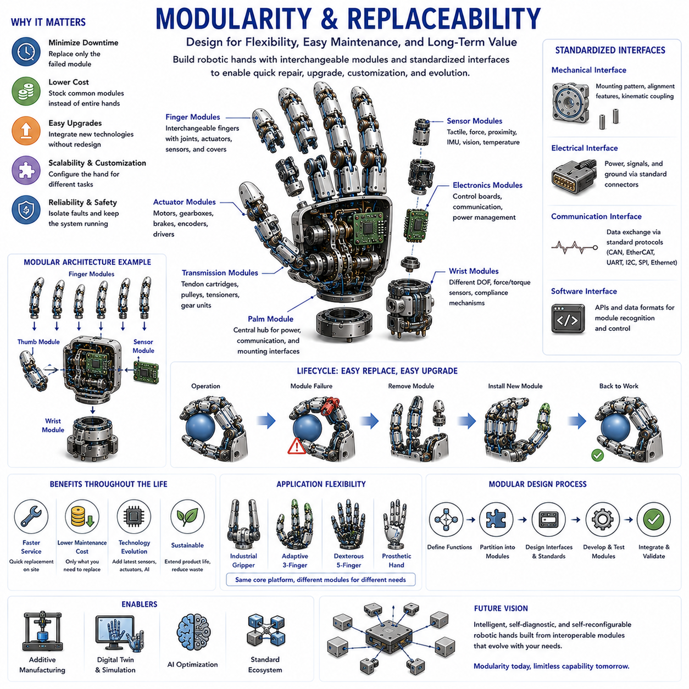{width="7.268055555555556in" height="7.268055555555556in"}

Modularity and replaceability are among the most important design philosophies in modern robotic hand engineering. As robotic systems become increasingly complex and are expected to operate continuously in industrial, service, medical, logistics, agricultural, humanoid, and Physical AI environments, the ability to rapidly maintain, upgrade, repair, and reconfigure robotic hands has become a critical requirement. Traditional robotic systems were often designed as highly integrated assemblies in which individual components were difficult to access or replace. While such designs sometimes offered compact packaging and optimized performance, they frequently resulted in increased maintenance costs, longer downtime, reduced flexibility, and limited scalability. Modern robotic hand engineering increasingly embraces modularity and replaceability as foundational principles that improve system lifecycle performance and operational efficiency.

At its core, modularity refers to the decomposition of a robotic hand into distinct functional units that can operate independently while interacting through standardized interfaces. Instead of treating the robotic hand as a single monolithic structure, modular design views the hand as a collection of interchangeable subsystems including fingers, palms, wrists, actuators, sensors, transmission mechanisms, controllers, communication modules, and protective structures. Each module performs a specific function and can be developed, tested, upgraded, maintained, or replaced independently from the rest of the system.

Replaceability refers to the ability to remove and exchange modules quickly and efficiently without requiring major disassembly or redesign. A replaceable component may be exchanged due to failure, wear, performance upgrades, application changes, customization requirements, or technological advancements. Together, modularity and replaceability create robotic systems that are more adaptable, maintainable, scalable, and economically sustainable over long operational lifetimes.

The importance of modularity becomes particularly evident when considering the lifecycle of robotic hands. Unlike laboratory prototypes, commercial robotic systems often operate for many years under demanding conditions. Components inevitably experience wear, fatigue, contamination, accidental damage, and technological obsolescence. In a non-modular system, repairing or upgrading a single component may require replacing the entire hand. In a modular architecture, only the affected module must be exchanged, significantly reducing cost and downtime.

Biological systems provide an interesting conceptual analogy. While the human hand is not modular in the engineering sense, biological tissues exhibit a form of functional modularity. Bones, muscles, tendons, ligaments, nerves, and skin each perform specialized roles while interacting within a coordinated system. Robotic engineers often seek similar organizational principles by separating functions into well-defined subsystems.

One of the most common forms of modularity in robotic hands is finger modularity. Finger modules are designed as self-contained units that include structural elements, joints, transmission mechanisms, sensors, and sometimes even local actuation systems. These modules can be attached to a common palm interface and exchanged independently. Finger modularity allows designers to experiment with different finger configurations without redesigning the entire hand.

For example, a robotic platform may use two-finger grippers for industrial handling, three-finger adaptive hands for logistics applications, and five-finger anthropomorphic hands for dexterous manipulation. If the palm interface is standardized, all these configurations can be supported using the same core platform. This significantly improves development efficiency and system versatility.

Palm modularity is another important design approach. In modular palm architectures, the palm serves as a central integration platform that accommodates interchangeable finger modules, sensor arrays, communication interfaces, and power distribution systems. Different palm designs may be optimized for different applications while maintaining compatibility with common finger modules.

Wrist modularity extends flexibility even further. The wrist functions as the interface between the hand and the larger robotic manipulator. A modular wrist architecture enables different wrist configurations to be attached depending on task requirements. Some applications may require lightweight wrists with limited degrees of freedom, while others demand highly dexterous wrists with force-torque sensing and advanced compliance mechanisms.

Actuator modularity has become increasingly important as robotic systems diversify. Actuators often represent some of the most expensive and failure-prone components within robotic hands. Modular actuator units allow motors, gearboxes, brakes, encoders, and control electronics to be replaced as integrated packages. This approach simplifies maintenance and reduces diagnostic complexity.

Transmission systems also benefit from modular design. Tendon-driven hands may employ replaceable tendon cartridges, pulley modules, tensioning assemblies, and routing structures. Gear-driven systems may utilize modular gearbox units that can be exchanged without disturbing surrounding components. Such architectures reduce service time and improve long-term maintainability.

Sensor modularity plays a critical role in modern robotic hands. Rapid advances in tactile sensing, force sensing, vision systems, proximity sensing, and environmental monitoring technologies create strong incentives for sensor upgrades. A modular sensor architecture allows new sensing technologies to be integrated without redesigning the entire hand. This capability is particularly valuable in research environments where sensor technologies evolve rapidly.

Electrical modularity is equally important. Connectors, wiring harnesses, communication buses, power distribution systems, and embedded electronics must support easy assembly and replacement. Standardized electrical interfaces simplify integration and reduce the risk of wiring errors during maintenance operations.

Software modularity complements hardware modularity. In modern robotic systems, each physical module is often associated with corresponding software components. Modular software architectures separate sensing, actuation, communication, control, planning, diagnostics, and user interface functions into independent modules. This approach simplifies updates, testing, debugging, and system expansion.

The development of standardized interfaces is central to successful modular design. Mechanical interfaces define how modules physically connect. Electrical interfaces define power and signal connections. Communication interfaces define data exchange protocols. Software interfaces define interactions between control modules. Without standardization, modularity quickly becomes difficult to maintain.

Mechanical interface standardization often involves mounting patterns, alignment features, fastening systems, and load transfer structures. Precision alignment is particularly important because repeated module replacement must not compromise accuracy or reliability. Engineers frequently employ dowel pins, kinematic couplings, locating features, and precision-machined interfaces to ensure repeatable assembly.

Electrical interface standardization focuses on connectors, voltage levels, communication protocols, and signal definitions. Modern robotic systems increasingly adopt standardized communication technologies such as CAN, EtherCAT, Ethernet, SPI, I2C, UART, and USB. Standardized interfaces improve interoperability among modules from different vendors and development teams.

Communication modularity becomes increasingly important as robotic hands evolve into distributed intelligent systems. Rather than relying on a single centralized controller, many advanced robotic hands incorporate local processing units within individual modules. These distributed architectures improve scalability, fault tolerance, and computational efficiency.

Fault tolerance is one of the major advantages of modular systems. In a monolithic robotic hand, a single component failure may disable the entire system. Modular architectures can isolate failures, allowing unaffected modules to continue operating. Some advanced robotic hands even support hot-swappable modules that can be replaced without shutting down the system.

Maintenance efficiency is perhaps the most immediate benefit of modularity. Industrial facilities place enormous value on minimizing downtime. Every hour of lost production can result in significant financial costs. Modular robotic hands allow technicians to replace failed components rapidly without requiring extensive troubleshooting or disassembly procedures.

Inventory management also benefits from modularity. Instead of stocking complete replacement hands, organizations can maintain inventories of common modules. This reduces spare part costs while improving maintenance responsiveness. Standardized modules can often be shared across multiple robotic platforms.

Scalability represents another major advantage. Modular architectures enable robotic hands to evolve incrementally as requirements change. New fingers, sensors, actuators, controllers, or software capabilities can be integrated without redesigning the entire system. This approach supports continuous technological evolution while protecting existing investments.

Customization is particularly important in service robotics and industrial automation. Different applications often require specialized configurations. Modular systems allow users to tailor robotic hands for specific tasks while retaining a common underlying platform. This flexibility reduces development costs and accelerates deployment.

Research and development environments benefit enormously from modularity. Experimental robotic hands frequently undergo numerous design iterations. Modular architectures allow researchers to evaluate alternative designs rapidly by exchanging specific subsystems rather than rebuilding entire platforms. This capability significantly accelerates innovation.

Humanoid robotics has further increased interest in modular architectures. Humanoid hands contain large numbers of actuators, sensors, joints, transmission mechanisms, and electronic components. Given this complexity, maintenance and upgrade requirements become especially significant. Modular design enables humanoid systems to remain serviceable despite their sophistication.

Prosthetic hands also benefit from modularity. Individual users may require different finger configurations, control methods, sensor systems, or cosmetic features. Modular architectures support personalized solutions while maintaining manufacturing efficiency. As technologies evolve, users can upgrade specific components without replacing the entire prosthesis.

Additive manufacturing technologies have accelerated the adoption of modular design principles. Three-dimensional printing enables rapid production of customized modules, replacement components, and experimental configurations. Engineers can iterate designs quickly while maintaining compatibility with standardized interfaces.

Digital twins and advanced simulation environments further support modular engineering. Virtual models can represent individual modules as independent entities while simulating their interactions within the larger system. This approach simplifies testing, validation, maintenance planning, and lifecycle management.

Artificial intelligence is beginning to influence modular robotic design as well. AI-driven optimization tools can identify optimal module boundaries, interface structures, maintenance strategies, and upgrade pathways. Future robotic systems may autonomously reconfigure themselves by exchanging or adapting modules according to task requirements.

The concept of Physical AI strongly aligns with modularity and replaceability. Physical AI emphasizes the integration of intelligence into both software and hardware systems. Modular architectures support this vision by enabling intelligent subsystems to evolve independently while contributing to overall system functionality. Intelligent sensor modules, adaptive finger modules, variable stiffness actuators, and self-monitoring diagnostic units may all function as specialized building blocks within future robotic hands.

Looking toward the future, robotic hands are likely to become increasingly modular. Standardized hardware ecosystems may emerge in which users can assemble custom robotic hands from interchangeable components much like modern computer systems are assembled from standardized modules. Such ecosystems could dramatically accelerate innovation, reduce costs, and improve accessibility across the robotics industry.

Ultimately, modularity and replaceability represent far more than maintenance conveniences. They are fundamental engineering strategies that enhance adaptability, reliability, scalability, sustainability, and long-term value. By enabling robotic hands to evolve, adapt, and remain serviceable throughout their operational lifetimes, modular design principles provide a critical foundation for the next generation of intelligent robotic manipulation systems. As robotic technologies continue to expand into increasingly diverse and demanding environments, modularity and replaceability will remain essential pillars of advanced robotic hand engineering and Physical AI development.

## 02.11 Structural Validation and FEA

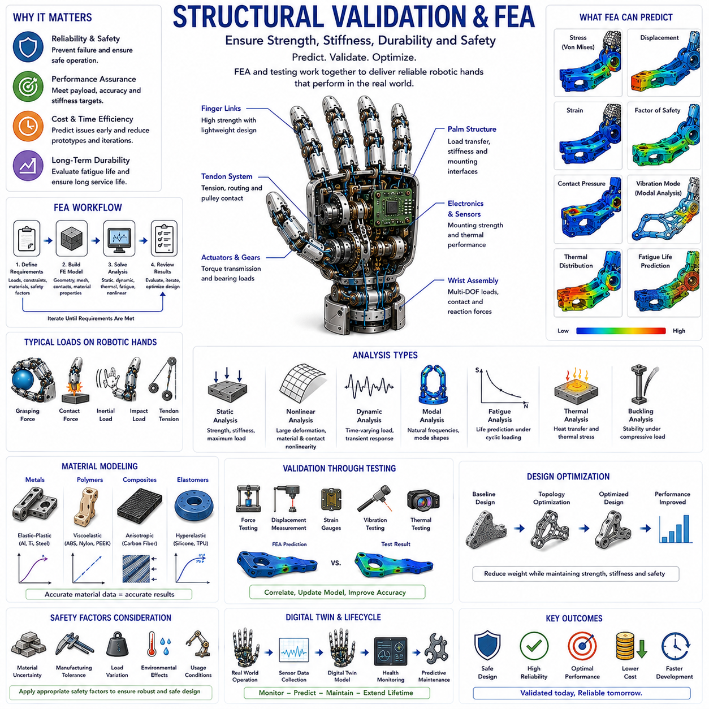{width="7.268055555555556in" height="7.268055555555556in"}

Structural Validation and Finite Element Analysis (FEA) represent essential engineering disciplines in robotic hand development. Regardless of how sophisticated a robotic hand may be in terms of kinematics, sensing, actuation, control algorithms, or artificial intelligence, its practical success ultimately depends on whether the physical structure can safely withstand operational loads throughout its intended service life. Structural validation ensures that a robotic hand can perform required tasks without excessive deformation, instability, fatigue damage, material failure, or unexpected mechanical behavior. Finite Element Analysis provides engineers with powerful computational tools to predict structural performance before physical prototypes are manufactured, significantly reducing development cost, risk, and design iteration cycles.

The increasing complexity of modern robotic hands has elevated the importance of structural validation. Advanced robotic hands often contain multiple degrees of freedom, lightweight structures, integrated sensors, compact actuators, tendon routing systems, gear transmissions, compliant elements, and embedded electronics. These components interact under dynamic loading conditions that are difficult to evaluate using traditional analytical methods alone. Structural validation enables engineers to understand how forces propagate through the system and how individual components contribute to overall mechanical performance.

The primary objective of structural validation is to ensure that every component of the robotic hand satisfies performance requirements under expected operating conditions. These requirements may include maximum payload capacity, positioning accuracy, stiffness targets, durability objectives, safety factors, impact resistance, thermal stability, and fatigue life. Structural validation is therefore not limited to failure prevention but encompasses the broader goal of guaranteeing reliable operation throughout the entire lifecycle of the system.

Finite Element Analysis is one of the most widely used computational techniques for structural validation. FEA divides a complex structure into many smaller elements connected at nodes. Mathematical equations describing material behavior, force equilibrium, deformation, and boundary conditions are solved across these elements. The resulting numerical model provides detailed information regarding stress distributions, strain fields, displacements, contact pressures, vibration characteristics, thermal effects, and failure risks.

The adoption of FEA transformed mechanical design by allowing engineers to evaluate virtual prototypes before manufacturing physical hardware. In robotic hand engineering, this capability is particularly valuable because many components possess complex geometries that are difficult to analyze using classical analytical approaches. Finger links, tendon anchors, palm structures, wrist assemblies, gear housings, compliant joints, and sensor mounts can all be evaluated accurately through finite element methods.

Structural validation begins with a clear understanding of operational requirements. Engineers must identify expected loads, environmental conditions, safety requirements, and performance objectives. The quality of an FEA study depends heavily on the accuracy of these assumptions. Unrealistic loading conditions may lead to misleading results and inappropriate design decisions.

One of the first steps in structural validation involves load definition. Robotic hands experience a wide variety of forces during operation. Grasping forces, contact forces, inertial loads, impact loads, actuator reactions, tendon tensions, gear transmission forces, and environmental disturbances all contribute to structural loading. Engineers must identify both normal operating loads and worst-case scenarios.

Static loading analysis is often the starting point for structural validation. Static analysis assumes that loads are applied slowly and remain constant over time. This approach allows engineers to evaluate stress distributions, structural deflections, and safety margins under steady-state conditions. Static FEA is particularly useful for assessing maximum payload capacity and overall structural integrity.

Stress analysis is one of the most common outputs of finite element simulations. Stress represents the internal force intensity within a material. Regions experiencing elevated stress are potential locations for yielding, cracking, fatigue damage, or catastrophic failure. Engineers use stress analysis to identify weak points and optimize structural geometry.

Several stress metrics are commonly evaluated. Von Mises stress is widely used for ductile materials such as aluminum, steel, and titanium. It provides a single scalar value that can be compared against material yield strength. Principal stresses are often examined when brittle materials or composite structures are involved. Shear stresses may also be critical in specific applications such as bonded joints and fastener connections.

Displacement analysis is equally important. Even if stresses remain below allowable limits, excessive deformation may compromise robotic performance. Finger positioning accuracy, grasp stability, force transmission efficiency, sensor alignment, and manipulation precision all depend on structural stiffness. Engineers therefore evaluate both strength and stiffness during structural validation.

Stiffness analysis plays a particularly important role in robotic hand design. High stiffness improves precision and force control, while excessive compliance may introduce positioning errors. However, complete rigidity is not always desirable. Certain applications benefit from controlled compliance that enhances safety, adaptability, and environmental interaction. Structural validation helps identify appropriate stiffness levels for specific tasks.

Contact mechanics is another critical aspect of robotic hand simulation. Robotic hands frequently interact with objects, surfaces, and internal components through contact interfaces. Fingertips contact objects, gears contact gear teeth, tendons interact with pulleys, and mechanical stops engage during joint motion. Contact simulations allow engineers to predict contact pressures, friction forces, wear patterns, and load transfer mechanisms.

Nonlinear behavior often arises in robotic hand structures. Large deformations, material nonlinearities, contact interactions, tendon routing systems, and compliant mechanisms may invalidate assumptions used in simple linear analysis. Advanced finite element methods can account for these nonlinear effects and provide more accurate predictions of real-world behavior.

Dynamic analysis extends structural validation beyond static loading conditions. Real robotic systems rarely operate under purely static conditions. Fingers accelerate and decelerate, objects are grasped and released, impacts occur, and external disturbances introduce transient loads. Dynamic FEA allows engineers to evaluate structural response under time-varying conditions.

Modal analysis is a common form of dynamic simulation. Every structure possesses natural frequencies at which it tends to vibrate. If operating frequencies coincide with these natural frequencies, resonance may occur, leading to excessive vibration and potential structural damage. Modal analysis identifies vibration modes and helps engineers avoid resonance-related problems.

Harmonic response analysis evaluates how structures respond to periodic excitation. Robotic actuators, gear systems, and external environments may generate cyclic forces that excite structural vibrations. Harmonic simulations help assess vibration amplitudes and identify potential reliability concerns.

Transient dynamic analysis provides even greater detail by simulating time-dependent loading events. Impact forces, collisions, emergency stops, grasping transitions, and sudden accelerations can all be studied using transient simulations. These analyses are particularly important for robotic systems operating in unstructured environments.

Fatigue analysis represents one of the most important aspects of structural validation. Robotic hands often perform millions of repeated manipulation cycles throughout their operational lifetimes. Even when stresses remain below material yield strength, repeated loading can eventually cause fatigue failure. Fatigue analysis estimates component lifespan and identifies regions vulnerable to crack initiation.

Fatigue behavior depends on stress amplitude, load frequency, material properties, surface finish, manufacturing quality, environmental conditions, and geometric features. Sharp corners, holes, threads, and stress concentrations frequently become fatigue-critical locations. Engineers use fatigue simulations to optimize geometry and improve long-term durability.

Safety factor evaluation is fundamental to engineering validation. A safety factor represents the margin between expected loads and structural failure limits. Appropriate safety factors account for uncertainties in material properties, manufacturing variations, loading conditions, environmental influences, and model assumptions. Critical robotic applications often require higher safety factors than laboratory prototypes.

Buckling analysis may be necessary for slender structural members. Compression-loaded components can experience sudden instability even when material stresses remain relatively low. Finger links, tendon supports, actuator brackets, and lightweight structural elements may require buckling evaluation to ensure stability.

Material modeling significantly influences simulation accuracy. Different materials exhibit different mechanical behaviors. Metals generally demonstrate elastic-plastic characteristics. Polymers may exhibit viscoelastic behavior. Elastomers undergo large deformations. Composite materials exhibit anisotropic properties that depend on fiber orientation. Accurate material characterization is therefore essential for reliable FEA results.

Composite materials introduce additional complexity into structural validation. Carbon fiber reinforced structures, increasingly common in advanced robotic hands, possess directional properties that vary with laminate design. Specialized composite analysis techniques are required to predict failure modes, delamination risks, and structural performance accurately.

Thermal analysis is becoming increasingly important as robotic hands incorporate higher-power actuators, embedded processors, sensors, and communication systems. Temperature changes influence material properties, dimensional stability, electronic reliability, and actuator performance. Thermal simulations evaluate heat generation, heat transfer, thermal expansion, and cooling effectiveness.

Thermo-mechanical coupling combines structural and thermal effects. Temperature gradients may induce stresses, deformations, and alignment errors. Engineers often perform coupled simulations to understand how thermal conditions influence mechanical performance.

Additive manufacturing has introduced new challenges and opportunities for structural validation. Three-dimensional printed components often possess complex internal geometries, lattice structures, and anisotropic material properties. FEA helps engineers evaluate these structures and exploit their weight-saving potential while maintaining adequate strength and stiffness.

Topology optimization is closely related to structural validation. Rather than simply analyzing existing designs, topology optimization algorithms generate improved structural configurations based on performance objectives and constraints. These algorithms identify regions where material can be removed without compromising functionality, resulting in lightweight yet robust robotic hand components.

Experimental validation remains essential even when sophisticated simulations are available. Physical testing verifies simulation accuracy and reveals phenomena that may not be fully captured by numerical models. Engineers often combine strain measurements, force testing, displacement measurements, vibration testing, thermal testing, and fatigue experiments with finite element simulations.

Digital twins represent the next evolution of structural validation. A digital twin combines real-world sensor data with simulation models to continuously monitor structural health throughout operation. This approach enables predictive maintenance, early fault detection, performance optimization, and lifecycle management.

Artificial intelligence is increasingly influencing structural engineering workflows. Machine learning algorithms can accelerate simulation processes, identify failure patterns, optimize geometries, predict fatigue life, and automate design exploration. AI-assisted engineering is expected to play a major role in future robotic hand development.

In humanoid robotics, structural validation becomes even more critical because robotic hands must operate in unpredictable environments while maintaining human-level dexterity. Humanoid hands experience diverse loading conditions, frequent impacts, complex interactions, and demanding reliability requirements. Comprehensive structural validation is therefore indispensable.

The emerging field of Physical AI further emphasizes the importance of structural engineering. Physical AI recognizes that intelligence is not solely computational but also embodied within physical structures. A mechanically optimized hand can simplify control requirements, improve robustness, and enhance interaction quality. Structural validation therefore contributes directly to system intelligence by ensuring that mechanical behavior supports higher-level cognitive functions.

Future robotic hands are expected to integrate advanced composite materials, smart materials, adaptive stiffness mechanisms, distributed sensing networks, self-monitoring capabilities, and AI-driven design methodologies. These innovations will increase structural complexity and further elevate the importance of sophisticated validation techniques.

Ultimately, Structural Validation and Finite Element Analysis provide the engineering foundation upon which reliable robotic hands are built. They enable engineers to predict performance, reduce risk, optimize designs, improve durability, and accelerate innovation. As robotic hands continue to evolve toward greater dexterity, autonomy, and Physical AI integration, structural validation and FEA will remain indispensable tools for ensuring that these systems are not only intelligent but also mechanically robust, safe, and reliable.
