**Volume 06 Robot Hands and Dexterous Grasping**

# 03. Actuators for Robot Hands

## 03.01 Actuator Requirements for Robot Hands

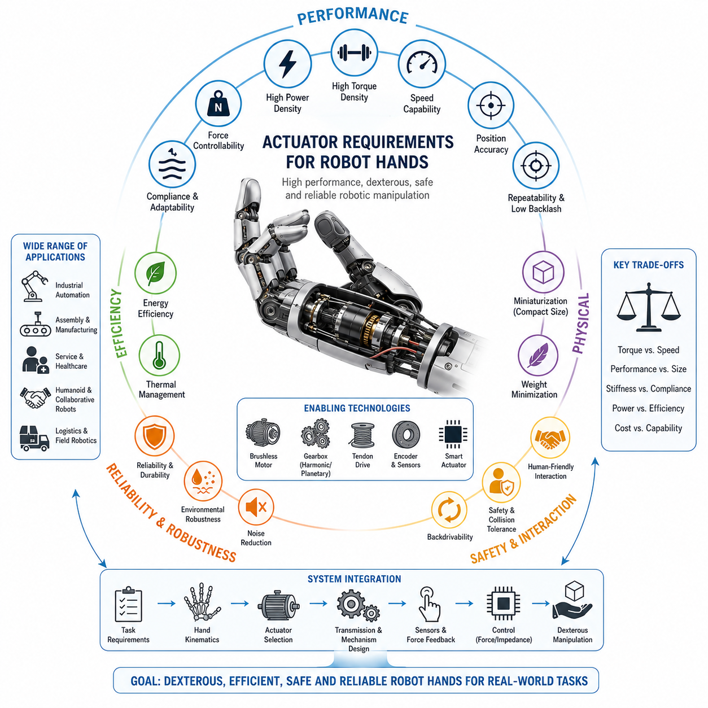{width="7.268055555555556in" height="7.268055555555556in"}

Robot hands represent one of the most demanding actuator application domains in robotics because they must simultaneously achieve precision, dexterity, force generation, compactness, safety, energy efficiency, and reliability. Unlike conventional industrial robot joints that often operate in relatively predictable environments with large actuators and generous installation spaces, robotic hands are required to reproduce many of the capabilities of the human hand within a highly constrained volume and weight budget. The selection and specification of actuators therefore become fundamental engineering decisions that influence every aspect of hand performance, including grasp stability, manipulation capability, control complexity, mechanical architecture, manufacturing cost, and long-term maintainability. Within the overall architecture of robot hand development, actuator requirements form the foundation upon which finger mechanisms, transmission systems, tactile sensing, force control, and dexterous manipulation capabilities are built.

The primary function of a robotic hand actuator is to generate controlled motion and force at the finger joints. However, the practical requirements extend far beyond simple motion generation. A robot hand actuator must provide sufficient torque to grasp objects securely, enough speed to perform efficient manipulation, and adequate positioning accuracy to support fine motor tasks. These requirements are often contradictory. Increasing torque typically requires larger motors or higher gear reductions, which increase weight and reduce speed. Improving precision may require additional sensors and control electronics, increasing system complexity and cost. As a result, actuator selection becomes a multidimensional optimization problem rather than a straightforward component choice.

One of the most important requirements is torque density. Torque density refers to the amount of torque that can be generated per unit mass or volume of the actuator. Human fingers are capable of generating surprisingly large forces relative to their size, and robotic hands are often expected to approach or exceed these capabilities. Since the available space inside a robotic finger or palm is extremely limited, actuators must deliver high torque while occupying minimal physical volume. This requirement has driven the widespread adoption of brushless DC motors, compact harmonic drives, planetary gear systems, tendon-driven architectures, and other transmission technologies designed to maximize torque output while minimizing actuator size.

Closely related to torque density is power density. Robotic hands frequently perform dynamic motions such as grasping moving objects, reorienting tools, manipulating parts during assembly, or interacting with humans. These operations require actuators capable of delivering substantial mechanical power during short periods of high demand. High power density allows the hand to accelerate rapidly, respond to external disturbances, and maintain stable control under changing load conditions. Power density becomes especially important in mobile manipulators and humanoid robots where the total system weight and energy consumption must remain tightly controlled.

Speed requirements vary significantly depending on the intended application. Industrial grippers designed for pick-and-place operations often prioritize cycle time and productivity. Such systems may require finger closing times of less than a few hundred milliseconds to maximize throughput. In contrast, dexterous robotic hands performing manipulation tasks may require slower but more controlled motions to maintain stable contact with objects. The actuator must therefore provide a suitable balance between velocity capability and force generation. In many cases, actuator design is driven by the tradeoff between maximum speed and maximum torque, requiring careful analysis of the intended task domain.

Positioning accuracy represents another fundamental actuator requirement. Many robotic hand applications involve interaction with small or delicate objects. Assembly tasks may require inserting connectors, handling electronic components, manipulating medical instruments, or performing precision manufacturing operations. These tasks demand highly accurate joint positioning and repeatable motion control. Actuators must therefore support fine resolution, minimal backlash, low hysteresis, and precise feedback mechanisms. High-resolution encoders are commonly integrated into robotic hand actuators to provide accurate position measurements and enable advanced control strategies.

Repeatability is often more important than absolute accuracy. A robotic hand used in industrial environments may execute the same grasp thousands of times per day. Even if the absolute positioning error is slightly larger than desired, the hand can often compensate through calibration or sensor feedback as long as the motion remains consistent. Poor repeatability, however, leads to unpredictable grasp outcomes and reduced operational reliability. Therefore actuator systems must be designed to maintain stable performance over long operational periods despite wear, temperature changes, and mechanical loading.

Compliance is an increasingly important actuator characteristic in modern robotic hands. Traditional industrial robots emphasized rigidity to maximize positional accuracy. However, robotic hands frequently interact with uncertain environments, fragile objects, and human users. Excessive stiffness can lead to object damage, unstable grasps, or unsafe interactions. Actuators must therefore support compliant behavior either through mechanical means such as elastic elements or through software-based impedance and admittance control. Compliance allows robotic fingers to adapt naturally to object geometry, absorb impacts, and distribute contact forces more effectively.

The requirement for force controllability is closely associated with compliance. Robotic hands must regulate grasp forces across a wide range of operating conditions. The force required to manipulate a sheet of paper differs dramatically from that needed to hold a heavy tool or industrial component. Actuators must therefore provide smooth force modulation over a broad dynamic range. This capability is essential for preventing object slippage while simultaneously avoiding excessive squeezing forces that could damage sensitive items. Advanced robotic hands often integrate force sensors, tactile sensors, or motor current estimation techniques to achieve precise force regulation.

Backdrivability represents another critical actuator requirement, particularly for dexterous and collaborative robotic systems. A backdrivable actuator allows external forces to move the mechanism without causing damage. High backdrivability improves safety, enables compliant interactions, and facilitates force sensing through actuator dynamics. Human fingers naturally exhibit significant backdrivability due to the properties of muscles and tendons. Replicating this characteristic in robotic systems remains a major engineering challenge because many high-torque transmission systems introduce friction and mechanical resistance.

Energy efficiency plays a significant role in actuator selection, especially for battery-powered robots. Mobile manipulators, service robots, humanoid robots, and field robots must operate for extended periods without frequent recharging. Since robotic hands may contain multiple actuators operating simultaneously, even small inefficiencies can accumulate into significant energy losses. Efficient actuators reduce thermal generation, extend battery life, and improve overall system performance. Energy-efficient operation also reduces cooling requirements and increases component longevity.

Thermal performance is often underestimated during early-stage hand design. Compact actuators operating within confined spaces can generate substantial heat during continuous operation. Excessive temperatures degrade motor efficiency, accelerate component aging, alter sensor calibration, and potentially damage nearby electronics. Robot hand actuators must therefore be designed with careful consideration of thermal management. Heat dissipation pathways, motor duty cycles, material selection, and ventilation strategies all influence actuator reliability and long-term performance.

Miniaturization is one of the defining requirements of robotic hand actuators. Human-sized robotic hands may contain between ten and twenty degrees of freedom, all of which must fit within dimensions comparable to those of a human hand. This constraint forces designers to pursue highly compact actuation architectures. Some systems place actuators directly within the fingers, while others locate motors inside the palm or forearm and transmit force through tendons or cables. Each approach introduces different tradeoffs involving mass distribution, maintenance complexity, transmission efficiency, and control performance.

Weight minimization is equally important. Excessive actuator weight increases the inertia of finger motions and reduces overall manipulation performance. Heavy fingers require larger actuators to move themselves, creating a cascading design problem. By reducing actuator mass, engineers can improve responsiveness, lower energy consumption, and enhance safety during physical interaction. Lightweight actuators are particularly valuable in humanoid robots where the arms and hands must operate efficiently throughout large workspaces.

Reliability and durability requirements are especially demanding because robotic hands often experience frequent contact events. Unlike industrial arm joints that may move relatively smoothly through predictable trajectories, hand actuators encounter impacts, vibrations, repeated loading cycles, and unexpected external forces. Components must withstand millions of operational cycles without significant degradation. Reliability considerations influence motor selection, bearing design, gearbox architecture, cable routing, lubrication methods, and environmental protection measures.

Environmental robustness is another major requirement. Robot hands may operate in factories, warehouses, hospitals, laboratories, agricultural environments, construction sites, or outdoor settings. Exposure to dust, moisture, chemicals, temperature variations, and mechanical shock can significantly affect actuator performance. Industrial applications often require ingress protection, corrosion resistance, vibration tolerance, and contamination control. The actuator must maintain consistent operation despite these environmental challenges.

Noise generation has become increasingly important as robots move beyond industrial settings and into human-centered environments. Service robots, healthcare assistants, collaborative robots, and household systems must operate quietly to ensure user acceptance. High gear ratios, poorly designed transmissions, or pneumatic systems can generate undesirable noise. Therefore actuator technologies are increasingly evaluated not only on mechanical performance but also on acoustic characteristics.

Safety requirements strongly influence actuator design. Collaborative robotic hands are expected to operate in close proximity to humans while minimizing injury risk. Actuators must support safe force limits, rapid fault detection, compliant behavior, and emergency stop capabilities. In some applications, fail-safe mechanisms are required to prevent accidental object release during power loss. Safety considerations affect both hardware architecture and control system implementation.

Scalability is also an important engineering consideration. Different robotic hand products may target different payload ranges, finger counts, or application domains. A scalable actuator architecture enables manufacturers to reuse components across multiple product variants, reducing development costs and simplifying maintenance. Modular actuator designs facilitate rapid customization while maintaining a common engineering foundation.

Cost remains one of the most practical actuator requirements. Although research laboratories may prioritize performance above all else, commercial robotic systems must balance capability against economic constraints. High-performance actuators incorporating precision gearboxes, advanced sensors, and custom manufacturing processes can become prohibitively expensive. Engineers must therefore evaluate actuator technologies not only based on technical specifications but also on production cost, supply chain availability, maintenance expenses, and lifecycle economics.

Modern robotic hands increasingly require intelligent actuator systems capable of integrated sensing and control. Smart actuators may include embedded processors, high-speed communication interfaces, encoder systems, temperature monitoring, current sensing, and local control loops. Such integration reduces wiring complexity, improves control performance, and enables distributed architectures suitable for highly articulated robotic hands. The actuator is no longer merely a source of mechanical power but becomes an active participant in the overall robotic control system.

From a systems engineering perspective, actuator requirements cannot be defined independently from the rest of the robotic hand architecture. Finger kinematics, tendon routing, contact mechanics, tactile sensing, force control, grasp planning, and manipulation objectives all influence actuator specifications. Successful robot hand development therefore begins with a thorough understanding of task requirements and system-level objectives before selecting individual actuator technologies. The resulting actuator architecture must achieve an optimal balance among force capability, speed, precision, compliance, efficiency, safety, reliability, and cost.

As robotic hands continue to evolve toward human-level dexterity, actuator requirements will become even more demanding. Future systems will require higher torque density, improved compliance, lower energy consumption, enhanced sensing integration, and more compact packaging than current technologies can provide. Advances in brushless motor design, soft actuators, artificial muscles, variable stiffness mechanisms, electroactive polymers, tendon-driven architectures, and intelligent actuator networks will play a central role in enabling the next generation of dexterous robotic hands. In this context, actuator requirements serve not merely as design constraints but as key drivers shaping the future capabilities of robotic manipulation systems.

## 03.02 Brushless DC Motors

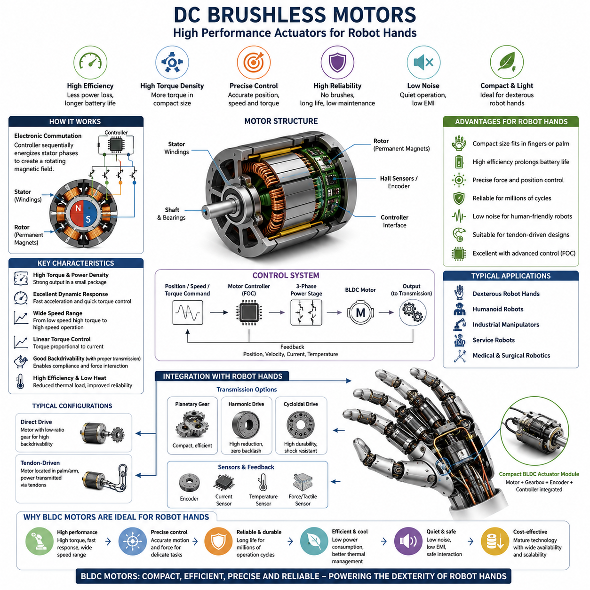{width="7.268055555555556in" height="7.268055555555556in"}

DC Brushless Motors, commonly referred to as BLDC motors, have become one of the most important actuator technologies in modern robotic hands. Their combination of high efficiency, compact size, excellent controllability, long operational life, and high power density makes them particularly suitable for dexterous robotic manipulation systems. As robotic hands evolve from simple industrial grippers toward highly articulated anthropomorphic hands capable of human-like dexterity, the performance demands placed on actuators continue to increase. Within this context, brushless motor technology has emerged as a foundational component that enables many of the capabilities associated with advanced robotic grasping, in-hand manipulation, force control, and tactile interaction.

The development of robotic hands has historically been constrained by actuator limitations. Traditional brushed DC motors provided relatively simple control and low manufacturing cost, but suffered from wear mechanisms associated with mechanical brushes and commutators. These components generate friction, electrical noise, heat, and maintenance requirements that limit long-term reliability. In contrast, brushless motors eliminate physical commutation by using electronic switching of motor phases. This design significantly improves efficiency, reduces maintenance requirements, increases operational lifespan, and enables more precise control of torque and velocity. As a result, brushless motors have become the dominant actuation technology in high-performance robotic hands.

A brushless motor operates through the interaction between a permanent magnet rotor and an electromagnet stator. Unlike brushed motors where current is mechanically switched through physical contact, BLDC motors rely on electronic controllers to energize stator windings in a carefully coordinated sequence. This electronic commutation creates a rotating magnetic field that drives rotor motion. The absence of brushes reduces mechanical wear and allows the motor to operate at higher rotational speeds while maintaining high efficiency. For robotic hand applications where compactness and reliability are critical, these characteristics provide substantial advantages.

One of the most important characteristics of brushless motors is their exceptional torque density. Torque density refers to the amount of torque produced relative to motor size or weight. Robot hands are extremely space-constrained systems, particularly when attempting to replicate the dimensions of the human hand. Designers must fit multiple actuators, sensors, transmissions, wiring systems, and control electronics within a compact mechanical structure. High torque density allows brushless motors to generate substantial gripping forces without occupying excessive space, making them ideal for finger joints and palm-mounted actuation systems.

Power density is equally significant. Robotic hands often perform dynamic manipulation tasks requiring rapid accelerations, precise object repositioning, and high-frequency control updates. Brushless motors can deliver substantial mechanical power relative to their physical size, enabling fast finger movements while maintaining precise control. This capability becomes particularly valuable in applications such as warehouse picking, industrial assembly, service robotics, humanoid manipulation, and tool-use operations where cycle time and responsiveness directly influence system performance.

Efficiency represents another major advantage of brushless motor technology. Because there are no brushes generating frictional losses, BLDC motors typically achieve efficiencies significantly higher than those of brushed motor systems. Improved efficiency translates directly into lower power consumption, reduced heat generation, and longer battery life. For mobile manipulators, humanoid robots, and service robots operating from battery power, efficient actuation is essential for achieving practical operating durations. A robotic hand containing ten or more actuators can consume a considerable amount of energy, making motor efficiency a critical design consideration.

Thermal performance is closely related to efficiency. Heat generation is one of the most significant engineering challenges in compact robotic hands. Small actuators operating continuously within confined spaces can experience substantial temperature increases. Excessive heat affects motor performance, degrades electronic components, alters sensor calibration, and reduces overall reliability. Brushless motors generate less heat for a given output power than many alternative actuator technologies, making thermal management easier and improving long-term system stability.

Precision control is another area where brushless motors excel. Modern robotic hands frequently require highly accurate positioning, force regulation, and trajectory tracking. BLDC motors can be paired with high-resolution encoders that provide precise measurements of rotor position, velocity, and acceleration. These measurements enable advanced control algorithms to achieve extremely accurate joint motion. Such precision is essential for tasks involving object insertion, tool handling, electronics assembly, surgical manipulation, and delicate grasping operations.

Torque controllability is particularly important in robotic grasping applications. A robotic hand must regulate contact forces carefully to avoid damaging objects while maintaining stable grasps. Brushless motors provide highly linear torque characteristics that allow precise force generation across a wide operating range. Through current-based control strategies, motor torque can be estimated and regulated with high accuracy. This capability supports advanced force control methods, impedance control, compliant manipulation, and tactile feedback integration.

The relationship between brushless motors and force control is especially important in dexterous robotic hands. Human hands continuously adjust grip force based on tactile information and environmental interactions. To replicate similar behavior, robotic systems require actuators capable of responding rapidly to changing force commands. Brushless motors offer excellent dynamic response characteristics, allowing controllers to modify output torque almost instantaneously. This responsiveness supports stable interaction with uncertain environments and enables real-time adaptation during manipulation tasks.

Backdrivability is another important consideration. Many robotic hand applications benefit from actuators that can be moved by external forces. Backdrivable systems improve safety, facilitate compliant interaction, and enable more natural contact behavior. While the brushless motor itself is inherently capable of backdrivable operation, overall system backdrivability depends heavily on transmission design. Low-ratio gear systems combined with brushless motors can achieve excellent compliance characteristics, whereas high-ratio gearboxes may introduce significant resistance to external motion.

Brushless motors are highly compatible with tendon-driven robotic hand architectures. In many advanced robotic hands, motors are not placed directly inside the fingers but are instead located within the palm, wrist, or forearm. Force is transmitted to finger joints through tendons, cables, or pulley systems. This approach reduces finger mass and inertia while allowing larger motors to be used in less space-constrained locations. Brushless motors are particularly well suited for tendon-driven systems because they can operate at high rotational speeds and efficiently drive cable-based transmission mechanisms.

Miniaturization remains a major area of development in robotic hand actuators. Advances in magnetic materials, winding techniques, manufacturing processes, and electronic control systems have enabled the creation of increasingly compact brushless motors. Modern miniature BLDC motors can provide surprisingly high performance despite diameters of only a few millimeters. These developments have expanded the range of possible robotic hand architectures and enabled increasingly anthropomorphic designs.

The integration of gear reduction systems is often necessary when using brushless motors in robotic hands. Although BLDC motors provide excellent speed and efficiency characteristics, their native torque output may be insufficient for direct finger actuation. Various transmission technologies are therefore employed to amplify torque. Planetary gearboxes offer compactness and efficiency. Harmonic drives provide high reduction ratios with minimal backlash. Cycloidal mechanisms offer durability and shock resistance. The selection of a suitable transmission system significantly influences the overall performance of the actuator assembly.

Encoder technology plays a crucial role in brushless motor systems. Position feedback is necessary for electronic commutation and closed-loop control. Incremental encoders provide relative position measurements, while absolute encoders offer direct angle information without requiring homing procedures. High-resolution magnetic encoders, optical encoders, and capacitive encoders are commonly integrated into robotic hand actuators. The quality of the encoder system often determines the achievable precision of the entire hand.

Motor controllers are equally important. A brushless motor cannot operate without an electronic control system capable of managing phase currents and commutation sequences. Modern motor controllers incorporate sophisticated algorithms such as Field Oriented Control (FOC), vector control, adaptive current regulation, and sensor fusion techniques. These methods enable smoother operation, higher efficiency, reduced torque ripple, and improved dynamic performance. In robotic hands, advanced motor control contributes directly to grasp stability and manipulation precision.

Field Oriented Control has become the dominant control strategy for high-performance robotic hand actuators. FOC transforms motor current control into a rotating reference frame aligned with the rotor magnetic field. This approach allows independent regulation of torque-producing and flux-producing current components. The result is highly efficient motor operation, smooth torque generation, low vibration, and precise dynamic control. Many state-of-the-art robotic hands rely heavily on FOC-based brushless actuator systems.

Reliability is one of the strongest advantages of brushless motor technology. The absence of brushes eliminates one of the primary wear mechanisms found in conventional DC motors. This increases operational lifetime and reduces maintenance requirements. Robotic hands used in industrial environments may execute millions of grasp cycles over their service life. The durability of brushless motors contributes significantly to overall system reliability and reduced operating costs.

Noise reduction is another benefit. Mechanical brushes generate acoustic and electrical noise during operation. Because brushless motors eliminate these components, they typically operate more quietly and produce less electromagnetic interference. Quiet operation is particularly important in collaborative robotics, healthcare applications, household robots, and service environments where user comfort influences system acceptance.

Safety considerations further reinforce the suitability of brushless motors for robotic hands. Modern controllers can monitor current, temperature, voltage, velocity, and position in real time. Abnormal conditions can be detected rapidly and appropriate protective actions can be executed. Overcurrent protection, thermal shutdown, collision detection, and torque limiting functions improve operational safety and protect both the robot and surrounding humans.

In collaborative robotics and humanoid systems, brushless motors are often combined with series elastic elements. Series Elastic Actuators (SEAs) introduce compliant components between the motor and load. This architecture improves force sensing accuracy, enhances safety, absorbs impacts, and facilitates compliant interaction. The combination of brushless motors and elastic transmission elements has become a popular solution for advanced robotic hands designed to operate safely alongside humans.

Cost remains an important consideration in actuator selection. Historically, brushless motor systems were significantly more expensive than brushed alternatives due to the need for electronic controllers and position sensors. However, advances in manufacturing and widespread adoption across industries have dramatically reduced costs. Today, BLDC technology offers an attractive balance between performance, reliability, and economic feasibility for both research and commercial robotic systems.

The future of robotic hand actuation is closely linked to ongoing developments in brushless motor technology. Improvements in permanent magnet materials, advanced winding topologies, integrated electronics, high-efficiency controllers, and compact transmission systems continue to expand actuator capabilities. Emerging trends include fully integrated smart actuators that combine motors, encoders, controllers, communication interfaces, and diagnostic functions within a single compact module. Such developments simplify system integration and enable increasingly sophisticated robotic hand architectures.

As robotic hands move toward human-level dexterity, brushless motors will remain one of the most important enabling technologies. Their combination of high torque density, excellent efficiency, precise controllability, long operational life, and compatibility with advanced transmission mechanisms makes them uniquely suited to the demanding requirements of dexterous manipulation. Within the broader field of robotic hand engineering, brushless motors serve not merely as motion generators but as fundamental building blocks that enable the realization of intelligent, adaptive, reliable, and highly capable robotic grasping systems.

## 03.03 Servo Actuators

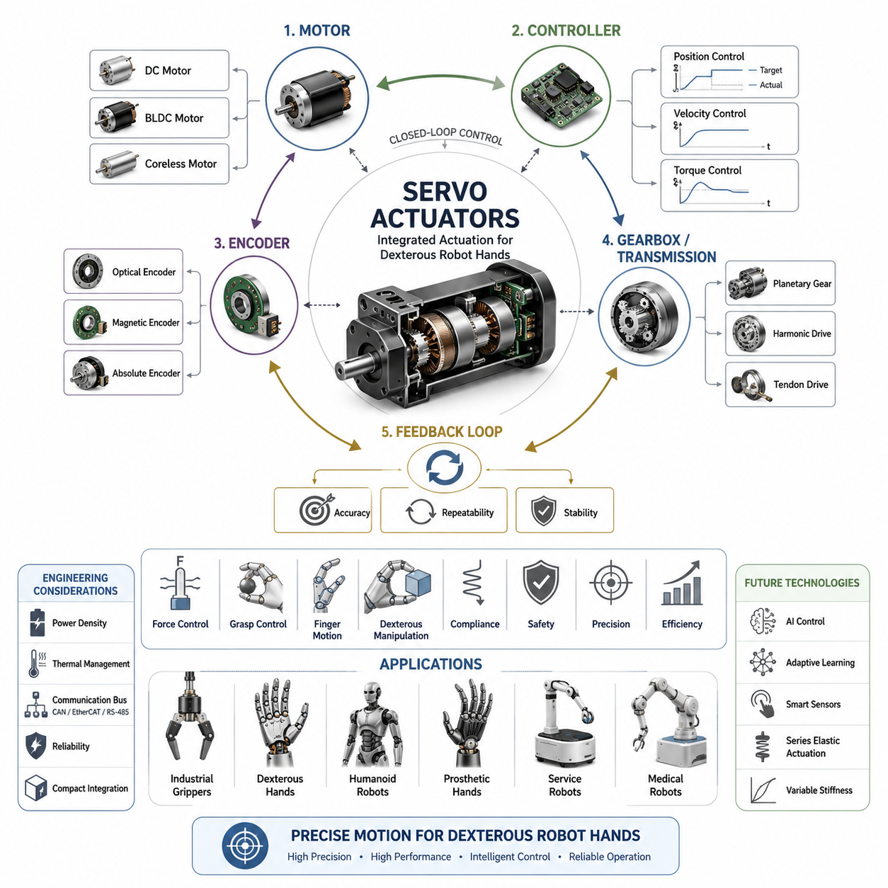{width="7.268055555555556in" height="7.268055555555556in"}

Servo actuators are among the most widely used actuation technologies in robotics and have played a critical role in the evolution of robotic hands from simple gripping devices to highly dexterous manipulation systems. A servo actuator is not simply a motor but rather an integrated actuation system that combines a motor, position sensor, controller, transmission mechanism, and feedback control architecture into a unified package. This integration enables precise control of position, velocity, acceleration, and in many cases force or torque. Within robotic hands, servo actuators provide the ability to execute accurate and repeatable finger motions, maintain stable grasp configurations, and support complex manipulation behaviors that require continuous feedback and adjustment.

The concept of servo control originates from the principle of closed-loop regulation. Unlike open-loop actuators that execute commands without measuring the resulting motion, servo actuators continuously compare commanded states with actual states and generate corrective actions to minimize error. This feedback-driven operation is fundamental to robotic manipulation because grasping tasks often occur in uncertain environments where external disturbances, object variations, and contact interactions cannot be predicted perfectly. Servo actuators enable robotic hands to adapt to these uncertainties while maintaining precise control over finger motion and contact forces.

The basic architecture of a servo actuator consists of several interconnected subsystems. At the core lies an electric motor, which may be a brushed DC motor, brushless DC motor, coreless motor, or other motor technology depending on application requirements. Coupled to the motor is a transmission system that converts motor rotation into usable output torque and motion. Position sensors such as encoders, potentiometers, resolvers, or magnetic sensors provide feedback regarding actuator state. A dedicated control unit processes sensor information and computes corrective commands that drive the motor toward the desired target position. Together, these elements create an intelligent actuator capable of autonomous motion regulation.

In robotic hand applications, position control has historically been the primary function of servo actuators. Early robotic grippers relied on simple position-controlled servos that opened and closed fingers according to predefined trajectories. While effective for structured industrial environments, these systems lacked the adaptability required for handling uncertain objects. Modern robotic hands extend servo functionality beyond position control to include velocity regulation, force control, impedance control, compliance control, and adaptive interaction strategies. The servo actuator has therefore evolved from a simple positioning device into a sophisticated mechatronic system supporting intelligent manipulation.

One of the most important advantages of servo actuators is their ability to achieve highly accurate positioning. Robotic fingers often operate within millimeter-level or even sub-millimeter-level tolerances. Assembly operations, medical procedures, laboratory automation, and electronics manufacturing require precise fingertip placement and repeatable motion execution. Servo actuators continuously correct position errors using feedback information, enabling significantly higher accuracy than open-loop actuation methods. This capability is essential for achieving reliable grasping performance in demanding applications.

Repeatability is equally important. Industrial robotic hands may execute identical grasping motions millions of times throughout their operational lifetime. Even when minor disturbances occur, servo control systems ensure that the actuator consistently returns to the desired position. High repeatability improves process quality, reduces grasp failures, and increases overall system reliability. In many industrial applications, repeatability is considered more valuable than absolute positioning accuracy because it directly affects production consistency.

Speed control represents another critical capability of servo actuators. Robotic hands frequently operate in environments where task efficiency is important. Warehouse automation, logistics handling, packaging systems, and manufacturing processes often require rapid grasp execution to maximize throughput. Servo actuators allow precise regulation of finger velocity, enabling designers to optimize movement speed without sacrificing accuracy. Sophisticated motion profiles can be implemented to achieve smooth acceleration and deceleration while minimizing vibration and mechanical stress.

Dynamic response characteristics significantly influence robotic hand performance. During manipulation tasks, robotic fingers must react rapidly to changing conditions such as object movement, external forces, or contact events. Servo actuators provide high bandwidth control that enables quick responses to command changes and environmental disturbances. Fast dynamic response improves grasp stability, supports tactile interaction, and enables advanced manipulation behaviors such as in-hand object reorientation and finger gaiting.

Torque generation and torque regulation are fundamental requirements for robotic grasping. A robotic hand must apply sufficient force to maintain stable contact with an object while avoiding excessive force that could cause damage. Servo actuators equipped with current sensing and advanced control algorithms can estimate and regulate output torque with considerable accuracy. This capability supports force-sensitive tasks such as handling fragile products, medical instruments, food items, electronic components, and laboratory samples.

Modern servo actuators increasingly incorporate force control capabilities directly within the actuator architecture. Rather than controlling only position, these systems can regulate interaction forces in real time. Force-controlled servo actuators allow robotic hands to interact safely with uncertain environments, accommodate object variations, and maintain stable contact conditions. Such functionality becomes particularly important when manipulating deformable, delicate, or irregularly shaped objects.

Compliance is another major consideration in robotic hand design. Human hands naturally exhibit compliant behavior due to the elasticity of muscles, tendons, ligaments, and soft tissues. Traditional industrial servos were designed to maximize rigidity and positional precision, often resulting in stiff interactions. However, robotic hands operating alongside humans require more adaptive behavior. Modern servo actuators increasingly incorporate compliant control strategies that allow fingers to yield under external forces while maintaining control authority. This balance between precision and compliance is essential for safe and effective manipulation.

The relationship between servo actuators and tactile sensing has become increasingly important. Robotic hands equipped with tactile sensors can detect contact location, pressure distribution, vibration, slip events, and object properties. Servo actuators use this sensory information to adjust grasp forces and finger positions dynamically. This sensor-actuator integration creates closed-loop manipulation systems capable of responding intelligently to changing contact conditions. As tactile sensing technologies continue to improve, servo actuators play a central role in transforming sensory information into physical action.

Servo actuators are available in a wide range of configurations suitable for different robotic hand architectures. Micro servo actuators are often used in compact robotic fingers where space constraints dominate design decisions. Medium-sized servos may be integrated into industrial grippers or adaptive hands. High-performance servo systems are commonly found in research platforms, humanoid robots, and advanced dexterous hands where precision and flexibility are prioritized. The scalability of servo technology allows designers to select solutions appropriate for specific application requirements.

Miniaturization has become one of the most significant trends in servo actuator development. Human-sized robotic hands require multiple degrees of freedom within a compact form factor. Advances in motor design, sensor integration, embedded electronics, and manufacturing processes have enabled the creation of increasingly compact servo actuators. Modern miniature servos can deliver impressive levels of torque, speed, and precision despite their small physical dimensions. This progress has expanded the possibilities for anthropomorphic robotic hand designs.

Brushless servo actuators have become particularly important in modern robotic systems. By combining brushless motor technology with advanced servo control, these actuators achieve high efficiency, long operational life, reduced maintenance requirements, and excellent dynamic performance. Brushless servo systems provide smoother operation, lower noise levels, and greater reliability compared to traditional brushed servo technologies. Consequently, many advanced robotic hands utilize brushless servo architectures as their primary actuation solution.

The transmission system integrated within a servo actuator significantly influences performance characteristics. Planetary gear systems offer compactness and efficiency while providing moderate reduction ratios. Harmonic drives deliver high precision and near-zero backlash. Cycloidal reducers provide durability and shock resistance. Belt drives, cable transmissions, and tendon mechanisms offer lightweight alternatives for specific applications. The choice of transmission technology affects torque output, speed capability, backdrivability, compliance, and overall system behavior.

Backlash reduction is a major design objective in servo actuators for robotic hands. Backlash refers to the mechanical play that exists between mating transmission components. Excessive backlash degrades positioning accuracy, reduces control stability, and negatively impacts manipulation performance. High-quality servo actuators employ precision gear manufacturing, preload mechanisms, advanced transmission designs, and compensation algorithms to minimize backlash and improve control fidelity.

Sensor technology forms the foundation of servo actuator performance. Encoders provide precise measurements of position and velocity, enabling accurate feedback control. Optical encoders offer extremely high resolution and accuracy. Magnetic encoders provide compactness and robustness. Absolute encoders eliminate the need for homing procedures after power cycles. Multi-turn encoders allow continuous position tracking across large rotational ranges. The integration of advanced sensing technologies significantly enhances actuator capabilities.

Modern servo controllers utilize sophisticated control algorithms to achieve superior performance. Proportional-Integral-Derivative control remains widely used due to its simplicity and effectiveness. However, advanced robotic hands increasingly employ model-based control, adaptive control, disturbance observers, feedforward compensation, state estimation, and learning-based control methods. These algorithms improve precision, robustness, responsiveness, and energy efficiency while enabling more complex manipulation behaviors.

Communication capability has become an increasingly important feature of servo actuators. Traditional servos often operated as isolated devices receiving simple control signals. Contemporary servo systems frequently incorporate high-speed digital communication interfaces such as CAN, EtherCAT, RS-485, SPI, or industrial Ethernet protocols. These interfaces support synchronized multi-actuator control, distributed intelligence, real-time diagnostics, and advanced system integration. Such capabilities are particularly valuable in robotic hands containing numerous coordinated joints.

Energy efficiency is a critical consideration in servo actuator design. Mobile robots, humanoids, service robots, and wearable robotic systems operate under strict energy constraints. Efficient servo actuators reduce power consumption, minimize heat generation, and extend operational endurance. Regenerative braking techniques, optimized motor control strategies, and intelligent power management systems further enhance energy efficiency in modern servo architectures.

Thermal management remains an important engineering challenge. Servo actuators operating within compact robotic hands can experience significant heat accumulation during prolonged operation. Elevated temperatures affect motor efficiency, sensor accuracy, electronic reliability, and actuator lifespan. Effective thermal design may involve conductive cooling paths, advanced materials, thermal monitoring systems, and intelligent control strategies that manage actuator loading to prevent overheating.

Reliability is a defining characteristic of industrial-grade servo actuators. Robotic hands deployed in production environments may perform millions of manipulation cycles under demanding operating conditions. High reliability requires robust mechanical construction, durable transmission components, reliable electronics, environmental protection measures, and comprehensive fault detection capabilities. Long-term reliability directly influences maintenance costs, system availability, and overall operational effectiveness.

Safety considerations have become increasingly important as robots move into collaborative environments. Servo actuators contribute significantly to safe operation through torque limiting, collision detection, emergency shutdown functions, fault monitoring, and compliant control behavior. Advanced safety features allow robotic hands to interact more naturally with humans while minimizing injury risks. In collaborative robotics, safety is often considered as important as performance itself.

The integration of servo actuators into dexterous robotic hands requires careful system-level engineering. Actuator placement affects weight distribution, inertia, and workspace accessibility. Power requirements influence battery sizing and thermal management. Communication architectures determine scalability and synchronization capabilities. Mechanical interfaces affect maintainability and modularity. Successful robotic hand design therefore depends not only on actuator selection but also on effective integration of servo systems into the overall hand architecture.

Future developments in servo actuator technology are expected to further enhance robotic hand capabilities. Advances in embedded processing, artificial intelligence, smart sensing, integrated electronics, compact transmissions, and high-energy magnetic materials will continue to improve actuator performance. Emerging smart servo actuators may incorporate onboard perception, adaptive learning, predictive maintenance, and autonomous optimization capabilities. These developments will enable robotic hands to achieve higher levels of dexterity, autonomy, and robustness.

As robotic manipulation systems evolve toward human-level performance, servo actuators will remain one of the fundamental enabling technologies. Their ability to combine precise motion control, force regulation, adaptability, reliability, and intelligent feedback processing makes them indispensable components in modern robotic hands. Within the broader discipline of robotic hand engineering, servo actuators serve not only as motion generators but as integrated mechatronic systems that transform sensing, computation, and control into purposeful physical interaction with the world.

## 03.04 Pneumatic Actuators

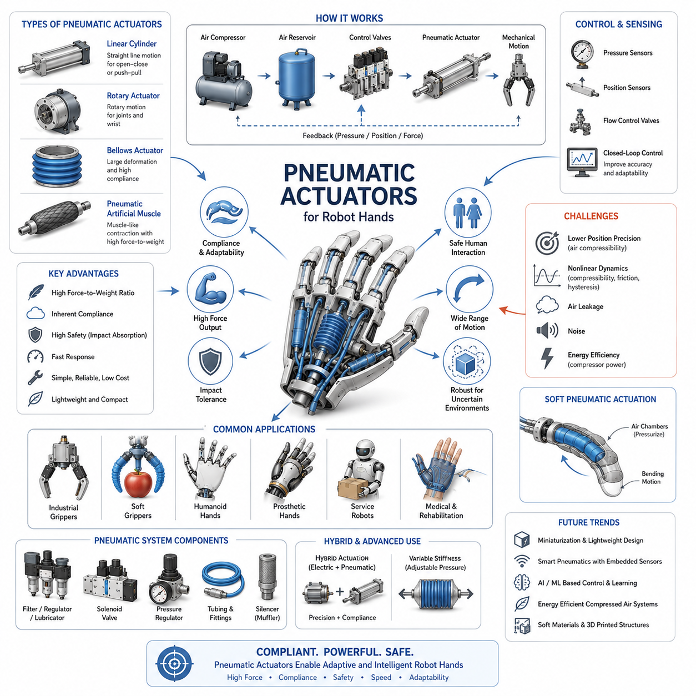{width="7.268055555555556in" height="7.268055555555556in"}

Pneumatic actuators have played a significant role in industrial automation and robotic manipulation for decades, and they continue to be an important actuation technology for robot hands, adaptive grippers, and soft robotic systems. Within the context of robot hand engineering, pneumatic actuators provide a unique combination of simplicity, compliance, high power-to-weight ratio, and inherent safety. While electric servo actuators dominate applications requiring precise position control and dexterous manipulation, pneumatic systems remain highly attractive for grasping tasks where adaptability, impact tolerance, and robust interaction with uncertain environments are essential. As robotic hands evolve toward greater versatility and human-like interaction capabilities, pneumatic actuation continues to offer valuable advantages that complement other actuation technologies. This topic belongs to the "Actuators for Robot Hands" chapter within the Robot Hand and Dexterous Grasping series and serves as an important bridge between conventional rigid robotic systems and emerging soft robotic technologies.

A pneumatic actuator is a mechanical device that converts the energy stored in compressed air into mechanical motion. Unlike electric motors, which generate torque through electromagnetic interactions, pneumatic actuators generate force through air pressure acting on pistons, diaphragms, bellows, or flexible chambers. When compressed air enters the actuator, pressure differences create forces that drive movement. By controlling airflow, pressure, and valve timing, robotic systems can achieve a wide range of motions suitable for grasping, holding, and manipulating objects.

The fundamental operating principle of pneumatic actuation is based on fluid power. Air is compressed by an external compressor and stored in reservoirs or supplied directly through pneumatic distribution systems. Control valves regulate the flow of air into actuator chambers, causing expansion or contraction that generates mechanical movement. Since air is compressible, pneumatic systems naturally exhibit compliant behavior, making them well suited for applications involving physical interaction with delicate or uncertain objects.

One of the primary advantages of pneumatic actuators in robotic hands is their inherent compliance. Human hands interact with objects through a combination of force control and mechanical flexibility. Purely rigid robotic fingers can easily damage fragile objects or generate excessive contact forces during unexpected collisions. Pneumatic actuators, however, naturally absorb impacts and adapt to object geometry because compressed air acts as a flexible energy medium. This characteristic significantly improves grasp safety and robustness.

Historically, pneumatic technology emerged as a dominant industrial automation solution due to its simplicity, reliability, and cost-effectiveness. Factories around the world adopted pneumatic cylinders and grippers for repetitive pick-and-place operations because compressed air systems were already widely available. Pneumatic grippers became standard components in manufacturing environments, enabling fast and reliable handling of products ranging from metal parts to food items. Many modern industrial robot end effectors still rely on pneumatic actuation because of its proven reliability and low maintenance requirements.

In robot hand applications, pneumatic actuators can take many forms. The most common type is the pneumatic cylinder, which converts air pressure into linear motion through a piston mechanism. Pneumatic cylinders are often used in industrial parallel grippers where two jaws open and close along a straight path. These actuators provide simple and effective grasping capabilities for structured environments.

Rotary pneumatic actuators represent another important category. Instead of producing linear displacement, rotary actuators generate angular motion suitable for finger joints, wrist mechanisms, or rotational grippers. Rotary actuators often employ vane-based mechanisms or rack-and-pinion systems to transform pneumatic pressure into rotational movement. Such configurations enable robotic fingers to perform bending and curling motions similar to biological joints.

Bellows actuators provide an alternative approach for generating motion. A pneumatic bellows expands or contracts when air pressure changes, producing smooth and compliant movement. Bellows-based actuators are particularly attractive for soft robotic fingers because they can achieve large deformations while maintaining lightweight construction. Their flexible nature allows them to conform to irregular object surfaces and distribute contact forces more evenly.

Artificial muscle actuators have become one of the most exciting developments in pneumatic robotics. Pneumatic Artificial Muscles (PAMs), sometimes referred to as McKibben muscles, mimic the behavior of biological muscles. When pressurized, the actuator contracts longitudinally while expanding radially, producing tensile force. This muscle-like behavior offers a highly biomimetic solution for robotic hands seeking human-inspired motion characteristics. Pneumatic muscles provide high force output relative to weight and exhibit natural compliance that enhances safety during human-robot interaction.

The force generation capability of pneumatic actuators is one of their most attractive features. Even relatively compact actuators can generate substantial forces when supplied with sufficient air pressure. This characteristic enables robotic hands to grasp heavy objects without requiring large electric motors or complex transmission systems. In industrial environments, pneumatic grippers are frequently used to manipulate components weighing several kilograms while maintaining compact dimensions.

Speed is another important advantage of pneumatic systems. Air can flow rapidly through valves and channels, allowing actuators to respond quickly to control commands. High-speed grasping operations are particularly valuable in manufacturing and logistics applications where cycle time directly affects productivity. Pneumatic grippers can often achieve opening and closing motions faster than many equivalent electric systems.

Despite these advantages, pneumatic actuators present unique challenges in robot hand design. One of the most significant limitations is control precision. Because air is compressible, achieving accurate position control is inherently more difficult than with electric servo systems. Changes in load, temperature, pressure, and airflow can influence actuator behavior. As a result, pneumatic systems traditionally excel in binary operations such as open-close gripping but struggle with highly precise dexterous manipulation.

To address these limitations, modern pneumatic control systems increasingly incorporate sensors and closed-loop feedback mechanisms. Pressure sensors monitor chamber pressure, position sensors track actuator displacement, and advanced controllers continuously adjust valve commands to improve accuracy. Model-based control algorithms can compensate for nonlinear pneumatic dynamics and enhance system performance. These developments have significantly expanded the capabilities of pneumatic robot hands.

The nonlinear behavior of compressed air introduces additional complexity into system modeling and control. Unlike rigid mechanical systems, pneumatic actuators exhibit dynamic effects such as air compressibility, flow resistance, hysteresis, friction, and pressure lag. Engineers must carefully model these phenomena when developing high-performance control systems. Accurate simulation and parameter identification become critical for achieving predictable behavior.

Soft robotics has dramatically increased interest in pneumatic actuation. Many soft robotic grippers rely entirely on pneumatic chambers embedded within flexible materials. When pressurized, these chambers deform in controlled ways, causing fingers to bend around objects. Such grippers can safely handle delicate items including fruits, vegetables, laboratory samples, medical instruments, and fragile consumer products. The ability to passively adapt to object geometry reduces the need for complex sensing and control systems.

Soft pneumatic fingers often employ elastomeric materials such as silicone rubber. Internal air chambers are strategically designed to create asymmetric expansion during pressurization. This controlled deformation produces predictable bending motions that enable grasping functionality. By varying chamber geometry and material properties, engineers can customize finger behavior for specific applications.

Hybrid robotic hands frequently combine pneumatic and electric actuation technologies. Electric motors provide precise positioning and dexterous control, while pneumatic components introduce compliance and force adaptation. Such hybrid architectures seek to capture the advantages of both technologies while minimizing their respective limitations. For example, an anthropomorphic hand may use electric actuators for joint positioning and pneumatic elements for adaptive gripping surfaces.

Energy efficiency is an important consideration when evaluating pneumatic systems. While pneumatic actuators themselves can be lightweight and simple, the generation of compressed air requires significant energy. Compressors consume substantial electrical power, and inefficiencies associated with air compression, leakage, and pressure regulation can reduce overall system efficiency. Consequently, pneumatic systems may be less energy-efficient than electric alternatives in some applications.

Air leakage represents another common engineering challenge. Pneumatic systems contain numerous components including hoses, fittings, valves, seals, and connectors. Even small leaks can reduce performance and increase operating costs over time. Robust sealing strategies and preventive maintenance procedures are therefore essential for maintaining system reliability.

Noise generation is often associated with pneumatic operation. Exhausting compressed air can create audible noise that may be undesirable in service robotics, healthcare environments, or collaborative workspaces. Engineers frequently employ silencers, mufflers, and optimized airflow designs to minimize acoustic emissions and improve user acceptance.

Safety remains one of the strongest advantages of pneumatic actuation. The compliant nature of compressed air significantly reduces injury risks during accidental collisions. In collaborative robotics, where humans and robots share workspaces, pneumatic systems can provide a safer interaction profile compared to rigid high-torque mechanisms. This characteristic aligns closely with emerging trends toward human-centered robotic systems.

The integration of pneumatic actuators into robot fingers requires careful consideration of size, weight, and routing constraints. Air lines must be routed through the hand structure without interfering with motion. Valve placement, pressure regulation, and pneumatic distribution architecture must be optimized to achieve compact and efficient designs. Miniaturization of pneumatic components remains an active area of research and development.

Recent advances in micro-pneumatic technology have enabled increasingly compact robotic hands. Miniature valves, lightweight tubing, and integrated pressure control systems allow pneumatic actuators to be deployed in applications previously dominated by electric motors. These developments are particularly important for wearable robotics, prosthetics, and portable service robots.

Tactile sensing and pneumatic actuation form a powerful combination in robotic grasping systems. Tactile sensors can detect contact forces, pressure distribution, and slip events, while pneumatic actuators adjust grasp force accordingly. This closed-loop interaction enables more intelligent and adaptive manipulation. As tactile sensing technologies continue to mature, their integration with pneumatic systems is expected to become increasingly sophisticated.

Artificial intelligence and machine learning are also influencing pneumatic robot hand development. Data-driven models can learn complex actuator dynamics, predict system behavior, and optimize control strategies. Reinforcement learning algorithms have demonstrated the ability to improve grasping performance even in the presence of highly nonlinear pneumatic characteristics. These approaches reduce reliance on manually derived models and enable more adaptive robotic behavior.

In biomedical and rehabilitation robotics, pneumatic actuators offer unique benefits due to their compliance and safety. Robotic rehabilitation gloves frequently employ pneumatic actuation to assist finger movement during therapy sessions. Prosthetic devices can utilize pneumatic components to create more natural and comfortable interactions with users. The lightweight nature of pneumatic systems further enhances their suitability for wearable applications.

Humanoid robotics represents another promising area for pneumatic actuation. Human hands rely on compliant muscle-tendon systems rather than rigid motors and gears. Pneumatic artificial muscles provide one of the closest engineering approximations to biological muscle behavior. As humanoid robots become more capable and widespread, pneumatic muscle technologies may play an increasingly important role in achieving human-like dexterity and safety.

Future developments in pneumatic actuation are likely to focus on improved controllability, higher efficiency, miniaturization, and tighter integration with sensing technologies. Smart pneumatic actuators may incorporate embedded sensors, onboard electronics, and adaptive control algorithms. Advances in soft materials, additive manufacturing, and microfluidic technologies will further expand the capabilities of pneumatic robotic hands.

Research into variable stiffness systems is also closely related to pneumatic technology. By adjusting internal pressure levels, pneumatic structures can modify their stiffness characteristics in real time. This capability allows robotic hands to transition between soft adaptive grasping and more rigid forceful manipulation depending on task requirements. Such adaptability represents a key step toward achieving human-like manipulation performance.

In conclusion, pneumatic actuators remain a highly relevant and versatile technology for robot hands and dexterous grasping systems. Their inherent compliance, high force-to-weight ratio, safety, and adaptability make them particularly valuable for grasping tasks involving uncertainty, fragility, and human interaction. Although challenges related to control precision and energy efficiency persist, ongoing advances in sensing, control theory, soft robotics, and artificial intelligence continue to expand their capabilities. As robotic manipulation moves toward increasingly adaptive, safe, and human-centered systems, pneumatic actuators are expected to remain a foundational technology in both industrial and next-generation robotic hands.

## 03.05 Hydraulic Micro Actuators

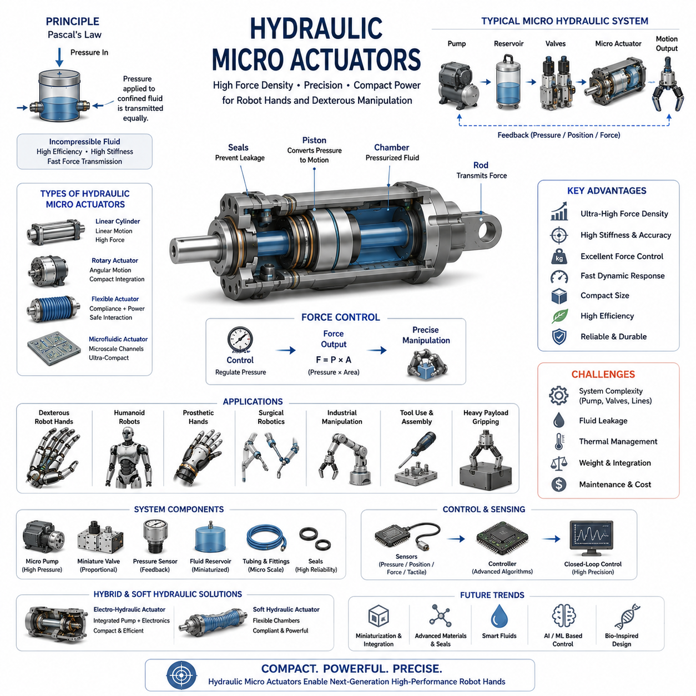{width="7.268055555555556in" height="7.268055555555556in"}

Hydraulic micro actuators represent one of the most powerful and compact actuation technologies available for advanced robotic hands, dexterous manipulators, humanoid robots, and bio-inspired robotic systems. While electric servo actuators dominate most commercial robot hand applications and pneumatic actuators provide excellent compliance characteristics, hydraulic micro actuators occupy a unique position by delivering extremely high force density within very small physical dimensions. As robotic hands continue to evolve toward human-level dexterity, greater payload capability, and increasingly complex manipulation tasks, hydraulic micro actuation has emerged as an important technology for applications where compact size, high force output, and precise force control must coexist within limited mechanical space.

Hydraulic actuation is based on the transmission of power through pressurized incompressible fluids. Unlike pneumatic systems that rely on compressible air, hydraulic systems use liquids such as hydraulic oil, synthetic fluids, water-based fluids, or specialized microfluidic media. Because liquids exhibit minimal compressibility, hydraulic actuators can transfer force more efficiently and with greater stiffness than pneumatic alternatives. This characteristic makes hydraulic systems particularly attractive when robotic fingers must generate substantial gripping forces while maintaining accurate motion control.

The fundamental operating principle of a hydraulic actuator is based on Pascal\'s Law, which states that pressure applied to a confined fluid is transmitted equally throughout the fluid. When pressure is generated by a hydraulic pump, that pressure can be directed through valves and channels into miniature cylinders or chambers. The resulting fluid pressure acts upon pistons or flexible structures, creating mechanical motion that can be used to drive robotic joints, finger segments, or gripping mechanisms.

Hydraulic micro actuators are essentially miniaturized versions of conventional hydraulic systems. Traditional hydraulic systems have long been used in heavy machinery, aircraft control systems, industrial presses, and construction equipment due to their exceptional force-generation capabilities. However, advances in microfabrication, precision machining, additive manufacturing, and microfluidic engineering have enabled hydraulic systems to be scaled down dramatically. These developments have opened new possibilities for integrating hydraulic technology into robotic fingers, prosthetic devices, surgical instruments, and humanoid robotic hands.

One of the most important advantages of hydraulic micro actuators is their extraordinary power density. Power density refers to the amount of force or power that can be generated relative to actuator size and weight. Hydraulic systems can produce forces that are often several times greater than comparable electric or pneumatic actuators occupying the same volume. This capability is particularly valuable in robot hands, where available space is extremely limited and every cubic millimeter must be utilized efficiently.

The human hand itself provides a useful benchmark when considering actuator requirements. Human fingers are capable of generating surprisingly large forces despite their relatively small size. Replicating this combination of compactness and strength presents a major challenge in robotic hand design. Hydraulic micro actuators offer one of the few engineering solutions capable of approaching biological muscle performance in terms of force density. As a result, they have attracted considerable interest in advanced dexterous hand research.

Hydraulic micro actuators can be implemented using several different architectural approaches. The most common configuration involves miniature hydraulic cylinders. These devices contain small pistons that translate fluid pressure into linear motion. The resulting displacement can be transmitted directly to finger joints or converted into rotational motion through linkage mechanisms. Hydraulic cylinders offer high efficiency, predictable behavior, and excellent force generation capabilities.

Another approach utilizes hydraulic rotary actuators. Instead of producing linear displacement, rotary actuators generate angular motion directly. This configuration can simplify finger joint design by eliminating the need for additional transmission mechanisms. Hydraulic rotary actuators are particularly attractive for anthropomorphic robotic fingers that require compact integration and multiple degrees of freedom.

Flexible hydraulic actuators have also emerged as an important research area. These systems combine hydraulic pressure with compliant materials to create soft yet powerful actuation mechanisms. Flexible hydraulic structures can bend, twist, or deform while maintaining substantial force output. Such characteristics are especially useful for robotic hands that must interact safely with humans or manipulate delicate objects.

Microfluidic actuators represent another advanced form of hydraulic actuation. These systems employ microscopic channels and chambers fabricated using techniques similar to those used in semiconductor manufacturing. By precisely controlling fluid movement within these structures, engineers can generate highly controlled mechanical motions at extremely small scales. Microfluidic actuation is particularly relevant for surgical robotics, minimally invasive medical devices, and biomimetic robotic systems.

The incompressibility of hydraulic fluids provides several performance advantages. Because the fluid does not significantly compress under pressure, hydraulic actuators exhibit high stiffness and rapid force transmission. This characteristic enables precise force control and stable manipulation behavior. In robot hands, such properties are particularly valuable during tasks involving tool use, assembly operations, precision insertion, and contact-rich manipulation.

Force control is one of the strongest capabilities of hydraulic systems. The relationship between hydraulic pressure and generated force is relatively direct and predictable. By regulating pressure levels, robotic systems can precisely control output forces at the fingertips. This capability supports advanced manipulation tasks that require careful force modulation, including grasping fragile objects, maintaining stable contact, and performing in-hand manipulation operations.

Hydraulic systems also demonstrate excellent dynamic response characteristics. High-pressure fluids can transfer energy rapidly throughout the system, enabling fast actuator response times. Combined with high force density, this responsiveness allows hydraulic robot hands to perform powerful and dynamic motions while maintaining precise control. Such capabilities are particularly attractive for humanoid robots, field robotics, and physically demanding manipulation tasks.

Despite their impressive advantages, hydraulic micro actuators introduce several engineering challenges. One of the most significant challenges is system complexity. Unlike electric actuators that require only electrical power and control signals, hydraulic systems require pumps, reservoirs, valves, tubing, seals, and fluid management infrastructure. Integrating these components into compact robotic hands requires careful engineering and optimization.

Fluid leakage represents another major concern. Hydraulic systems operate under pressure, and even small leaks can degrade performance, reduce efficiency, and create maintenance issues. In robotic hands, where actuators are often densely packed and exposed to continuous motion, maintaining reliable seals becomes particularly challenging. Advances in sealing materials, microfabrication technologies, and precision manufacturing have significantly improved system reliability, but leakage remains an important design consideration.

Thermal management is also critical in hydraulic systems. Fluid friction, pump operation, valve switching, and energy dissipation can generate heat during operation. Excessive temperatures may alter fluid properties, reduce efficiency, and accelerate component wear. Engineers must therefore design effective thermal management strategies, including heat dissipation pathways, cooling systems, and optimized fluid selection.

Weight is another consideration when integrating hydraulic systems into robotic hands. While hydraulic actuators themselves may offer exceptional power density, associated components such as pumps, reservoirs, and fluid lines can increase overall system weight. Designers must carefully balance force requirements against mass constraints, particularly in mobile robots and humanoid systems where energy efficiency and agility are important.

Recent developments in electro-hydraulic actuation have significantly expanded the practicality of hydraulic systems for robotics. Electro-hydraulic actuators combine electric motors with miniature hydraulic circuits, creating self-contained actuation modules that integrate power generation, fluid control, sensing, and mechanical output within a compact package. These hybrid systems reduce external infrastructure requirements while preserving many of the advantages of hydraulic actuation.

Soft hydraulic actuators have become a particularly active area of research within soft robotics. Unlike conventional rigid hydraulic systems, soft hydraulic actuators employ flexible chambers and deformable structures. Pressurized fluid causes controlled deformation, generating motion while maintaining compliance. Such actuators can achieve both high force output and safe interaction characteristics, making them attractive for robotic hands operating in unstructured environments.

Bio-inspired robotics has also benefited from hydraulic actuation technologies. Many biological organisms utilize fluid-based mechanisms to generate movement. Examples include spider legs, certain marine animals, and various invertebrates. Engineers have drawn inspiration from these biological systems to develop hydraulic robotic fingers capable of efficient and adaptive motion. These biomimetic designs often combine hydraulic power transmission with compliant structural elements to achieve natural movement patterns.

Humanoid robotics represents one of the most promising application areas for hydraulic micro actuators. Human-like robots require compact actuators capable of generating substantial forces while fitting within anatomically realistic dimensions. Hydraulic systems provide an attractive solution because they can deliver high torque and force outputs without requiring large motors or gearboxes. Several advanced humanoid research platforms have explored hydraulic hand actuation as a means of achieving superior manipulation performance.

Prosthetic hand development is another area where hydraulic micro actuators show considerable promise. Advanced prosthetic devices must balance strength, weight, comfort, and dexterity. Hydraulic actuation offers the potential to create highly capable prosthetic fingers with force outputs approaching those of biological hands. Future prosthetic systems may incorporate miniature hydraulic networks integrated with neural interfaces and intelligent control algorithms.

Medical robotics presents additional opportunities for hydraulic actuation. Surgical instruments often require precise motion, high force capability, and compact dimensions. Hydraulic micro actuators can satisfy these requirements while enabling minimally invasive operation. Their smooth force control characteristics make them particularly suitable for delicate medical procedures where precision and safety are critical.

The integration of sensors is essential for high-performance hydraulic robotic hands. Pressure sensors monitor fluid conditions throughout the system, while position sensors track joint motion and actuator displacement. Force sensors and tactile sensors provide additional feedback regarding object interaction. Together, these sensing technologies enable closed-loop control architectures capable of achieving precise and adaptive manipulation behavior.

Modern control systems have significantly improved hydraulic actuator performance. Advanced controllers incorporate dynamic models, state estimation techniques, adaptive algorithms, and predictive control methods to compensate for system nonlinearities. These approaches enable hydraulic systems to achieve levels of precision previously associated primarily with electric servo actuators.

Artificial intelligence and machine learning are increasingly being applied to hydraulic robotic systems. Data-driven models can learn actuator dynamics, predict system behavior, detect anomalies, and optimize control strategies. Reinforcement learning techniques allow robotic hands to discover effective manipulation policies while accounting for the complex characteristics of hydraulic actuation. Such approaches are expected to play an increasingly important role in future hydraulic robotic systems.

Reliability and durability remain key strengths of hydraulic technology. Properly designed hydraulic components can withstand extremely demanding operating conditions while maintaining consistent performance over long periods. This robustness makes hydraulic actuators particularly attractive for industrial robotics, field robotics, defense applications, and other environments where reliability is critical.

Future research directions are focused on miniaturization, integration, efficiency, and intelligence. Advances in microfluidics, additive manufacturing, advanced materials, and embedded sensing technologies are enabling increasingly sophisticated hydraulic micro actuators. Future systems may integrate pumps, valves, sensors, controllers, and fluid reservoirs directly within robotic fingers, creating highly compact and self-contained actuation units.

Researchers are also investigating novel hydraulic fluids, including biodegradable fluids, low-viscosity synthetic fluids, and magnetorheological fluids capable of dynamically changing their mechanical properties. Such innovations could further enhance performance, safety, and adaptability in robotic hand applications.

In the broader context of robot hand engineering, hydraulic micro actuators occupy a unique position among available actuation technologies. Electric actuators offer excellent precision and simplicity, pneumatic actuators provide compliance and safety, while hydraulic actuators deliver unmatched force density and power capability. Rather than competing directly, these technologies increasingly complement one another within hybrid robotic systems.

In conclusion, hydraulic micro actuators represent a powerful and highly capable actuation technology for advanced robotic hands. Their exceptional force density, precise force control, high stiffness, and strong dynamic performance make them particularly suitable for demanding manipulation tasks where conventional actuators may be insufficient. Although challenges related to complexity, leakage, thermal management, and integration remain significant, ongoing advances in micro-hydraulics, electro-hydraulic systems, soft robotics, and intelligent control continue to expand their practical applicability. As future robotic hands move closer to achieving human-level strength and dexterity, hydraulic micro actuators are expected to play an increasingly important role in enabling the next generation of high-performance robotic manipulation systems.

## 03.06 Shape Memory Alloy Actuators

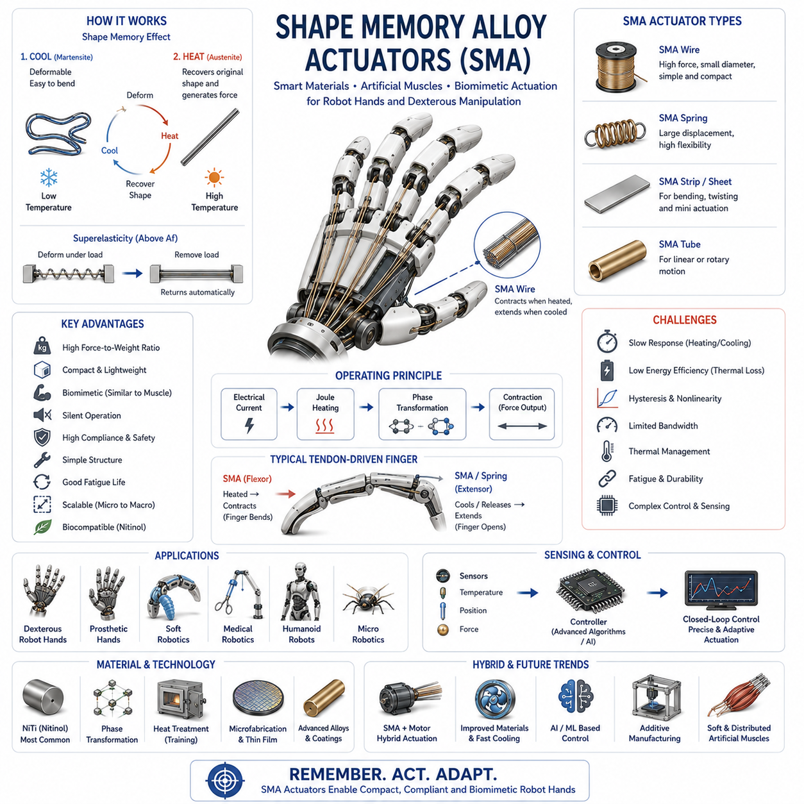{width="7.268055555555556in" height="7.268055555555556in"}

Shape Memory Alloy (SMA) actuators represent one of the most fascinating and biologically inspired actuation technologies in modern robotics. Unlike conventional actuators that rely on electromagnetic forces, fluid pressure, or mechanical transmissions, Shape Memory Alloy actuators generate motion through reversible changes in material structure at the atomic level. This unique mechanism allows SMA actuators to function as artificial muscles, producing significant force and displacement while maintaining extremely compact dimensions. Within the field of robot hands and dexterous grasping systems, SMA actuators have attracted considerable attention because they offer a pathway toward lightweight, silent, compliant, and highly biomimetic robotic fingers capable of mimicking many characteristics of biological muscle systems.

The concept of shape memory materials originates from the discovery that certain metal alloys can undergo reversible phase transformations when exposed to temperature changes. Among these materials, Nickel-Titanium (NiTi), commonly known as Nitinol, has become the most widely used Shape Memory Alloy due to its excellent mechanical properties, large recoverable strains, corrosion resistance, biocompatibility, and long operational life. When appropriately processed, Nitinol can remember a predefined shape and return to that shape after deformation simply by heating above a critical transition temperature.

The operation of an SMA actuator is fundamentally different from that of electric motors, pneumatic cylinders, or hydraulic pistons. Rather than generating motion through rotating shafts or moving pistons, SMA materials produce movement through solid-state phase transformations. At lower temperatures, the material exists primarily in a martensitic phase, which is relatively soft and easily deformable. When heated, the material transforms into an austenitic phase, which possesses a different crystal structure and returns to its memorized shape. This transformation generates force and mechanical movement without requiring gears, linkages, or fluid systems.

The Shape Memory Effect is the defining characteristic of SMA materials. During manufacturing, the alloy is trained to remember a particular geometry. When cooled into its martensitic state, it can be deformed away from that geometry. Upon reheating, the alloy automatically recovers its original shape. This phenomenon allows SMA wires, springs, strips, and tubes to function as actuators capable of generating controlled motion. In robotic hands, such movement can be used to bend fingers, close grippers, rotate joints, or perform complex manipulation tasks.

Closely related to the Shape Memory Effect is the phenomenon of Superelasticity. In this operating mode, the alloy remains above its transformation temperature and can undergo large deformations while automatically returning to its original shape when the load is removed. Superelastic behavior is particularly attractive in robotic grasping because it introduces compliance, impact tolerance, and passive adaptability. Robotic fingers incorporating superelastic components can better accommodate uncertainties in object geometry and contact conditions.

One of the most appealing aspects of SMA actuators is their exceptionally high force-to-weight ratio. Compared with traditional electric motors of similar size, SMA actuators can generate surprisingly large forces while occupying very little space. This characteristic is particularly valuable in robot hand design, where space constraints are severe and actuator miniaturization is essential. A thin SMA wire only a few hundred micrometers in diameter can generate forces many times greater than its own weight.

The resemblance between SMA actuators and biological muscles has made them a popular choice in biomimetic robotics. Human muscles generate motion through contraction rather than rotary motion. SMA wires behave similarly by contracting when heated and relaxing when cooled. This similarity allows robotic designers to create finger actuation systems that more closely resemble natural musculoskeletal structures. As a result, SMA technology has become an important research area in anthropomorphic hands, prosthetic devices, and bio-inspired manipulation systems.

The most common SMA actuator configuration uses thin wires. When electrical current passes through the wire, resistive heating occurs through the Joule heating effect. As the wire temperature rises above the transformation threshold, it contracts and generates force. When the current is removed, the wire cools and returns to its extended state, either through external loading or antagonistic mechanisms. This simple operating principle enables highly compact actuator designs with minimal mechanical complexity.

SMA springs represent another frequently used actuator architecture. By forming the alloy into a spring geometry, larger displacements can be achieved compared with straight wires. SMA springs are often employed in robotic fingers requiring substantial bending motion. Their ability to produce large deformations while maintaining compact packaging makes them attractive for miniature robotic systems.

SMA films and thin sheets have also emerged as important actuation technologies. These structures can be integrated into flexible robotic skins, soft robotic fingers, and adaptive surfaces. Thin-film SMA actuators are particularly relevant for micro-robotics and wearable systems where space and weight constraints are especially demanding.

One of the primary advantages of SMA actuators is mechanical simplicity. Traditional actuators often require motors, gearboxes, bearings, transmissions, encoders, and control electronics. In contrast, an SMA actuator may consist of little more than an alloy wire, electrical connections, and a supporting structure. This simplicity reduces mechanical complexity, lowers part count, and enables highly compact integration.

Silent operation represents another important advantage. Electric motors and gear systems generate audible noise during operation. Pneumatic systems often produce airflow noise, while hydraulic systems generate pump and fluid-flow sounds. SMA actuators operate almost silently because motion results from internal material transformations rather than rotating machinery. This characteristic is highly desirable in service robots, healthcare environments, assistive devices, and consumer robotics.

Compliance is another key benefit. Biological systems naturally incorporate compliance, allowing safe interaction with uncertain environments. SMA actuators inherently exhibit compliant behavior because they are based on deformable materials rather than rigid mechanisms. This compliance improves safety during human-robot interaction and reduces the likelihood of damage during accidental collisions.

Energy efficiency at the actuator level can be attractive because force generation occurs directly within the material itself. However, overall efficiency is often limited by thermal processes. Heating and cooling cycles consume energy and introduce dynamic limitations. Consequently, while SMA actuators offer remarkable compactness and force density, their efficiency characteristics must be evaluated carefully within specific application contexts.

Despite their many advantages, SMA actuators face several important challenges. The most significant limitation is response speed. Because actuation depends on heating and cooling, motion is inherently tied to thermal dynamics. Heating can often be achieved relatively quickly through electrical current, but cooling typically occurs more slowly through natural convection, conduction, or radiation. This thermal dependence limits operating frequency and can restrict actuator bandwidth.

Researchers have developed various strategies to address cooling limitations. Forced-air cooling, liquid cooling, thermoelectric cooling, heat sinks, and optimized material geometries can all accelerate thermal transitions. Advanced control strategies may also anticipate thermal behavior and improve dynamic response. Nevertheless, response speed remains one of the primary challenges limiting widespread adoption of SMA actuators in high-speed robotic applications.

Another challenge involves hysteresis. The relationship between temperature, phase transformation, displacement, and force is highly nonlinear. During heating and cooling cycles, the material follows different transformation paths, creating hysteresis effects that complicate control. Accurate modeling and compensation are therefore essential for achieving precise motion control.

Fatigue life is another important consideration. Repeated phase transformations introduce mechanical and thermal stresses within the material. Over time, these stresses can lead to degradation of actuation performance. Modern SMA materials have achieved substantial improvements in durability, with some systems capable of millions of operating cycles, but lifecycle considerations remain important in practical deployments.

Control complexity presents additional challenges. Unlike electric motors, which often exhibit relatively predictable behavior, SMA actuators involve coupled thermal, mechanical, and material dynamics. Accurate control requires monitoring temperature, force, displacement, and environmental conditions. Advanced control algorithms frequently incorporate adaptive control, model predictive control, neural networks, or machine learning techniques to achieve robust performance.

Sensing plays a critical role in SMA actuator systems. Temperature sensors monitor thermal state, while position sensors measure displacement and motion. Force sensors provide feedback regarding interaction forces during grasping and manipulation. Integrating these sensing modalities enables closed-loop control systems capable of improving accuracy, repeatability, and reliability.

Robot hands employing SMA actuators often utilize tendon-driven architectures. SMA wires function as artificial tendons that contract when energized, pulling finger joints into desired configurations. Antagonistic arrangements are commonly used, with opposing SMA elements generating bidirectional motion similar to biological flexor and extensor muscles. Such architectures closely resemble human hand biomechanics and support natural movement patterns.

Prosthetic hand development has benefited significantly from SMA technology. Prosthetic devices require compact, lightweight, and quiet actuation systems that can be comfortably worn by users. SMA actuators satisfy many of these requirements while offering biomimetic movement characteristics. Although challenges related to speed and efficiency remain, ongoing research continues to improve their practicality for assistive technologies.

Medical robotics represents another promising application area. Surgical instruments and minimally invasive robotic devices often operate under severe space constraints. SMA actuators provide compact actuation capabilities that can be integrated into small-scale medical systems. Their silent operation and smooth force generation further enhance their suitability for healthcare environments.

Soft robotics has emerged as one of the most active research domains for SMA technology. By embedding SMA wires within elastomeric structures, engineers can create soft robotic fingers capable of bending, curling, twisting, and adapting to object geometry. Such systems combine the compliance of soft materials with the actuation capabilities of smart materials, enabling new forms of robotic grasping and manipulation.

Micro-robotics has also embraced SMA actuators due to their exceptional scalability. Traditional motors become increasingly difficult to miniaturize while maintaining useful performance. SMA materials, however, can be fabricated at extremely small scales without losing their fundamental operating principles. This characteristic makes them attractive for micro-grippers, miniature surgical robots, and small autonomous robotic systems.

Recent developments in advanced materials have expanded the capabilities of Shape Memory Alloys. Researchers continue to develop new alloy compositions with improved transformation temperatures, higher fatigue resistance, greater efficiency, and enhanced actuation performance. These innovations are expected to broaden the range of practical robotic applications.

Artificial intelligence and machine learning are increasingly influencing SMA control strategies. Because SMA dynamics are highly nonlinear and difficult to model accurately, data-driven approaches offer attractive alternatives. Neural networks can learn actuator behavior directly from experimental data, while reinforcement learning algorithms can discover effective control policies for manipulation tasks. These approaches have demonstrated significant potential for improving performance and reducing control complexity.

Hybrid actuation systems combining SMA technology with electric motors, pneumatic actuators, or other smart materials have also gained attention. Such systems leverage the strengths of multiple technologies while mitigating individual weaknesses. For example, electric motors may provide fast positioning while SMA elements contribute compliance and fine force modulation. Hybrid architectures are likely to become increasingly important in future robotic hand designs.

Humanoid robotics continues to drive interest in SMA actuators. Human-like robots require compact actuators distributed throughout highly constrained anatomical structures. SMA technology offers a pathway toward muscle-inspired actuation systems capable of supporting natural motion and safe interaction. Although challenges remain, continued advances in materials science and control engineering are steadily improving feasibility.

Future research directions focus on improving response speed, increasing efficiency, enhancing durability, and simplifying control. Advances in thermal management, material processing, additive manufacturing, and integrated sensing technologies are expected to significantly improve actuator performance. Emerging concepts such as distributed artificial muscles, smart material networks, and integrated morphing structures may further expand the role of SMA technology in robotics.

In conclusion, Shape Memory Alloy actuators represent a unique and highly promising actuation technology for robot hands and dexterous manipulation systems. Their ability to generate motion through reversible material transformations provides advantages that are difficult to achieve with conventional actuators. High force density, compact size, silent operation, compliance, and biomimetic behavior make SMA actuators particularly attractive for anthropomorphic hands, prosthetics, medical robotics, and soft robotic systems. Although challenges related to speed, efficiency, hysteresis, and control complexity remain significant, ongoing advances in materials science, sensing technologies, artificial intelligence, and system integration continue to enhance their capabilities. As robotic hands evolve toward greater dexterity, adaptability, and human-like performance, Shape Memory Alloy actuators are expected to play an increasingly important role in the next generation of intelligent robotic manipulation systems.

## 03.07 Dielectric Elastomer Actuators

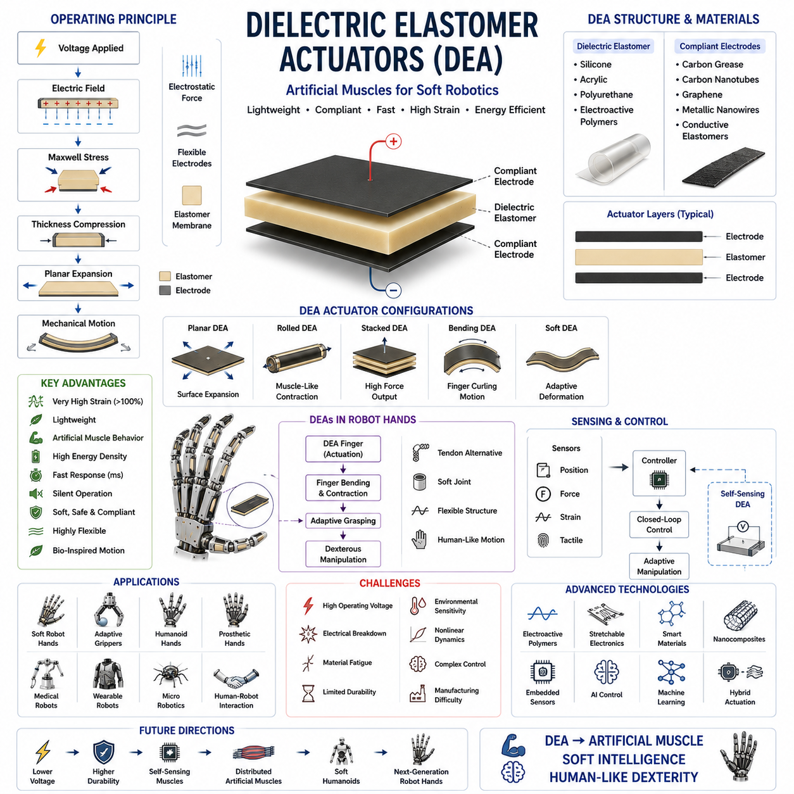{width="7.268055555555556in" height="7.268055555555556in"}

Dielectric Elastomer Actuators (DEAs) represent one of the most promising classes of soft actuators in modern robotics and are frequently regarded as artificial muscles capable of producing large deformations, lightweight motion, and highly compliant interactions. Within the field of robot hands and dexterous manipulation, Dielectric Elastomer Actuators have attracted significant attention because they offer a fundamentally different approach to actuation compared with traditional electric motors, pneumatic cylinders, hydraulic systems, and even Shape Memory Alloy actuators. Rather than relying on electromagnetic forces, fluid pressure, or thermally induced phase transformations, DEAs generate motion through electrostatic forces acting within soft elastic materials. This unique operating principle enables actuators that are lightweight, silent, flexible, and capable of producing muscle-like motion, making them particularly attractive for next-generation robotic hands, soft grippers, wearable robotics, prosthetic systems, and humanoid robots.

The development of Dielectric Elastomer Actuators is closely associated with the broader field of Electroactive Polymers (EAPs). Electroactive polymers are materials capable of changing their shape, dimensions, or mechanical properties in response to electrical stimulation. Among the many categories of EAPs, dielectric elastomers have emerged as one of the most practical and high-performance technologies because of their large strain capabilities, relatively simple structures, and high energy density. Researchers often describe dielectric elastomers as artificial muscles because their actuation behavior resembles biological muscle contraction more closely than many conventional robotic actuators.

A Dielectric Elastomer Actuator typically consists of a thin elastomer membrane positioned between two compliant electrodes. The elastomer serves as an electrically insulating dielectric material, while the electrodes remain flexible enough to deform along with the elastomer. When a voltage is applied across the electrodes, electrostatic attraction develops between the opposite charges on each side of the membrane. This attraction compresses the elastomer thickness while simultaneously causing expansion in the planar directions. The resulting deformation produces mechanical motion that can be harnessed for robotic actuation.

The operating principle of DEAs is fundamentally based on Maxwell stress. When an electric field is applied across a dielectric material, electrostatic forces develop within the material. These forces generate pressure that compresses the elastomer along the electric field direction. Because elastomers are nearly incompressible, thickness reduction is accompanied by expansion in other dimensions. This effect enables substantial shape changes, allowing the actuator to function as a muscle-like contractile element.

One of the most attractive characteristics of Dielectric Elastomer Actuators is their ability to achieve very large strains. Conventional electric motors typically require gears, linkages, or tendon systems to generate substantial motion. In contrast, DEAs can directly produce strains exceeding one hundred percent in some configurations. Such large deformations make them particularly suitable for soft robotic fingers, adaptive grippers, and bio-inspired manipulation systems where flexibility and range of motion are important.

The structure of a DEA is deceptively simple. In its most basic form, the actuator consists of only three layers: a dielectric elastomer film and two compliant electrodes. Common elastomer materials include silicone rubber, acrylic elastomers, polyurethane elastomers, and specially engineered electroactive polymers. The compliant electrodes may be fabricated using carbon grease, conductive elastomers, carbon nanotubes, graphene coatings, metallic nanowires, or other flexible conductive materials. Despite this structural simplicity, the resulting actuator can generate surprisingly complex and powerful movements.

Material selection plays a critical role in DEA performance. The dielectric constant, elastic modulus, breakdown strength, and mechanical durability of the elastomer directly influence actuator efficiency and reliability. Materials with high dielectric constants and low stiffness generally provide improved actuation performance because they generate larger deformations under the same electric field. However, trade-offs often exist between actuation strain, durability, manufacturing complexity, and operational stability.

One of the major advantages of Dielectric Elastomer Actuators is their exceptionally high energy density. Energy density refers to the amount of mechanical work that can be generated per unit mass or volume. DEAs often exhibit energy densities comparable to or exceeding those of biological muscle tissue. This characteristic has led many researchers to consider dielectric elastomers as one of the most promising technologies for creating truly muscle-like robotic systems.

The compliance of DEAs represents another significant advantage. Traditional robotic actuators often rely on rigid components that may create safety concerns during physical interaction with humans or delicate objects. Dielectric elastomer actuators, by contrast, are inherently soft and flexible. This compliance enables safe interaction with uncertain environments and reduces the likelihood of damaging fragile objects during grasping operations.

The lightweight nature of dielectric elastomer systems further enhances their attractiveness for robotic hand applications. Since the actuator consists primarily of thin polymer films and lightweight electrodes, overall system mass can be significantly lower than equivalent motor-based solutions. This characteristic is particularly valuable in wearable robotics, prosthetics, and humanoid robotic hands where minimizing weight directly improves usability and energy efficiency.

Silent operation is another desirable feature of DEAs. Unlike electric motors, which generate noise through rotating components and gear systems, dielectric elastomer actuators operate through internal material deformation. Consequently, they produce little or no audible noise during operation. This property is advantageous in medical robotics, service robotics, assistive technologies, and consumer applications where quiet operation is important.

The response speed of dielectric elastomer actuators can be remarkably high. Since actuation results directly from electric field generation rather than thermal processes or fluid transport, DEAs can respond within milliseconds under appropriate conditions. This fast response capability enables dynamic robotic movements and rapid grasping actions that are difficult to achieve with some alternative soft actuator technologies.

Various actuator geometries have been developed to exploit the capabilities of dielectric elastomers. Planar actuators represent the simplest configuration and consist of flat membranes that expand when electrically stimulated. Rolled actuators wrap the elastomer into cylindrical structures capable of producing linear contraction similar to biological muscles. Stacked actuators combine multiple layers to increase force output. Bending actuators utilize asymmetric structures to generate curvature and are particularly suitable for robotic fingers and soft grippers.

Bending-type DEA actuators are among the most relevant configurations for robot hand applications. By arranging active and passive layers asymmetrically, the actuator bends when energized. This bending motion can be used to curl robotic fingers around objects, creating adaptive grasping behavior without requiring rigid joints or complex mechanisms. Such systems are particularly attractive for soft robotic manipulation where adaptability is more important than precise positional accuracy.

Rolled dielectric elastomer actuators are often compared directly to biological muscles. In these configurations, pre-stretched elastomer membranes are rolled into cylindrical forms. When voltage is applied, the structure contracts longitudinally while expanding radially. This behavior closely resembles the contraction mechanism of natural muscle fibers and has inspired numerous biomimetic robotic designs.

Despite their many advantages, Dielectric Elastomer Actuators face several important challenges. One of the most significant limitations involves operating voltage. Although current requirements are typically very low, DEAs often require kilovolt-level voltages to generate useful electric fields. Such high voltages introduce challenges related to power electronics, insulation, safety, and system integration.

Electrical breakdown represents another major concern. Excessive electric fields can exceed the dielectric strength of the elastomer, leading to catastrophic failure. Once breakdown occurs, the actuator may become permanently damaged. Consequently, careful material selection, manufacturing quality, and control strategies are essential for reliable operation.

Mechanical durability is also an important consideration. Repeated deformation cycles can gradually degrade elastomer materials and electrode structures. Over time, fatigue, cracking, delamination, and material aging may reduce performance. Advances in polymer chemistry and electrode technology continue to improve actuator lifespan, but durability remains an active area of research.

Environmental sensitivity presents additional challenges. Temperature, humidity, contamination, and mechanical loading conditions can influence DEA performance. Changes in environmental conditions may alter dielectric properties, mechanical stiffness, and electrical behavior. Engineers must account for these factors when designing practical robotic systems.

Control of dielectric elastomer actuators is inherently nonlinear. The relationship between applied voltage, electric field, deformation, and generated force is highly coupled and nonlinear. Accurate control often requires sophisticated mathematical models and advanced control algorithms. Researchers frequently employ adaptive control, model predictive control, neural networks, and machine learning techniques to achieve precise actuator behavior.

Sensing integration is becoming increasingly important in DEA-based robotic systems. Position sensors, force sensors, strain sensors, and tactile sensors provide essential feedback for closed-loop control. Interestingly, dielectric elastomers themselves can sometimes function simultaneously as actuators and sensors. This dual-function capability creates opportunities for highly integrated robotic systems with embedded sensing and actuation.

Robot hands employing DEAs often take inspiration from biological structures. Human fingers derive their remarkable capabilities from compliant muscles, tendons, and soft tissues working together. Dielectric elastomer actuators offer a pathway toward recreating similar characteristics in robotic systems. Soft robotic fingers driven by DEAs can conform to object shapes, distribute contact forces evenly, and adapt naturally to environmental uncertainties.

Soft robotic grippers represent one of the most successful application areas for dielectric elastomer technology. Traditional grippers often require precise positioning and complex control to handle fragile objects safely. DEA-driven soft grippers can instead adapt passively to object geometry while applying distributed contact forces. This capability is particularly valuable in food handling, agriculture, medical applications, and delicate manufacturing processes.

Wearable robotics and exoskeleton systems also benefit from DEA technology. Conventional actuators are often bulky and heavy, limiting comfort and usability. Dielectric elastomer actuators offer lightweight alternatives capable of providing assistive forces while maintaining flexibility and comfort. Such systems may eventually support rehabilitation, mobility assistance, and human augmentation applications.

Prosthetic hand development has emerged as another promising area for DEA integration. Advanced prosthetic devices require lightweight construction, low noise, compliance, and biomimetic movement. Dielectric elastomer actuators satisfy many of these requirements while offering the potential for more natural hand movements. Although substantial engineering challenges remain, DEAs are increasingly viewed as candidates for future prosthetic technologies.

Humanoid robotics continues to drive research into artificial muscle technologies. The human body contains hundreds of muscles distributed throughout a compliant skeletal structure. Replicating such systems using traditional motors presents significant challenges related to weight, complexity, and mechanical integration. Dielectric elastomer actuators offer an alternative approach that more closely resembles biological muscle architecture and may ultimately contribute to more human-like robotic systems.

Micro-robotics and medical robotics have also embraced dielectric elastomer technologies. The scalability of thin-film structures enables actuator miniaturization without sacrificing core functionality. As a result, DEAs can be incorporated into miniature surgical tools, catheter-based systems, micro-grippers, and other devices operating in highly constrained environments.

Recent advances in materials science have substantially improved DEA performance. Researchers continue to develop elastomers with higher dielectric constants, greater breakdown strength, improved mechanical durability, and enhanced actuation efficiency. Nanocomposite materials, advanced polymer formulations, and novel electrode technologies are expanding the practical capabilities of dielectric elastomer systems.

Artificial intelligence and machine learning are increasingly influencing the development of DEA-driven robotic systems. Data-driven approaches can compensate for nonlinear behavior, optimize actuation strategies, predict material degradation, and improve overall system performance. Reinforcement learning techniques are particularly promising for enabling adaptive manipulation behaviors in soft robotic hands.

Hybrid actuation architectures are becoming more common as researchers seek to combine the strengths of multiple technologies. Dielectric elastomer actuators may be integrated with electric motors, pneumatic systems, hydraulic actuators, or Shape Memory Alloys to create multifunctional robotic hands. Such hybrid systems leverage the precision of conventional actuators while incorporating the compliance and adaptability of soft actuation technologies.

Future research directions focus on reducing operating voltage, improving durability, enhancing manufacturability, and integrating sensing capabilities directly into actuator structures. Self-sensing dielectric elastomers, stretchable electronics, advanced soft materials, and distributed artificial muscle networks represent particularly active areas of investigation. These developments are expected to significantly expand the applicability of DEAs in robotic manipulation.

In conclusion, Dielectric Elastomer Actuators represent one of the most promising artificial muscle technologies for future robot hands and dexterous manipulation systems. Their ability to produce large strains, lightweight structures, compliant motion, silent operation, and biomimetic behavior distinguishes them from conventional actuation approaches. Although challenges related to high voltage requirements, durability, nonlinear control, and material limitations remain substantial, ongoing advances in materials science, soft robotics, power electronics, and intelligent control continue to improve their practicality. As robotics moves increasingly toward human-like dexterity, safe interaction, and adaptive behavior, Dielectric Elastomer Actuators are expected to become an important enabling technology for the next generation of soft robotic hands and intelligent manipulation systems.

## 03.08 Cable-Driven Actuation Systems

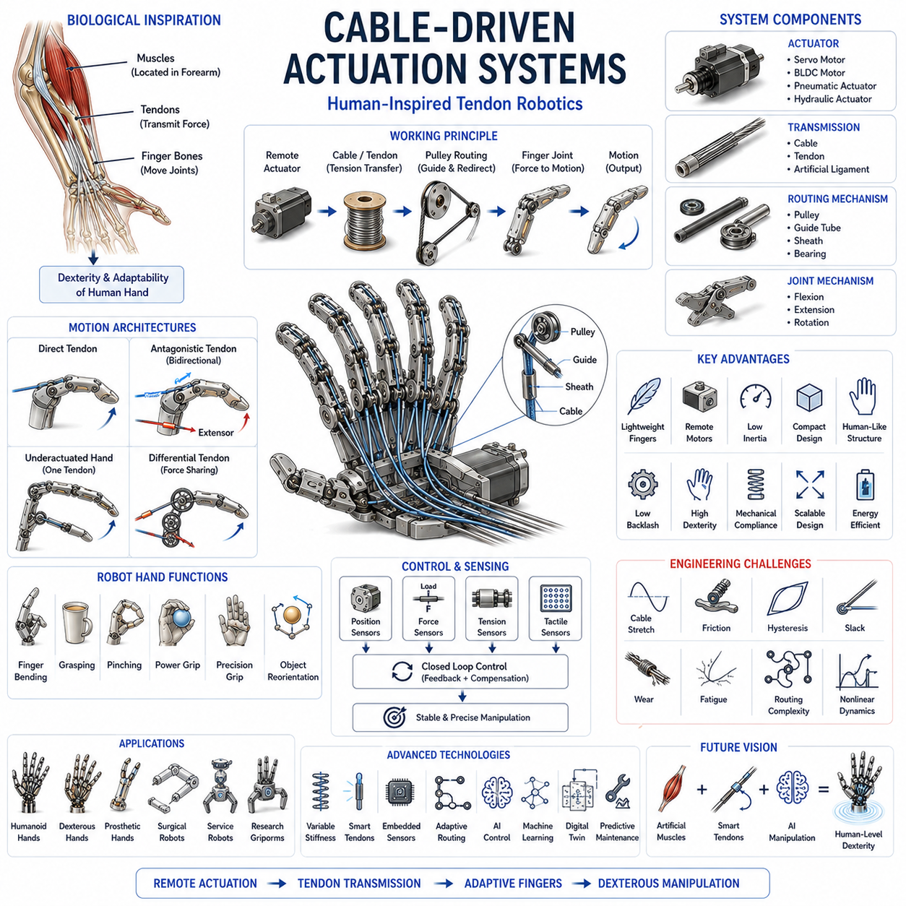{width="7.268055555555556in" height="7.268055555555556in"}

Cable-Driven Actuation Systems represent one of the most influential and biologically inspired actuation architectures in the field of robotic hands, dexterous manipulators, humanoid robots, prosthetic devices, and advanced grasping systems. Unlike conventional actuator arrangements where motors are mounted directly at each joint, cable-driven systems separate the actuator from the moving joint and transmit force through flexible cables, tendons, or artificial ligaments. This design philosophy closely resembles the structure of the human hand, where muscles are primarily located in the forearm and force is transmitted to the fingers through a network of tendons. Because of this similarity to biological anatomy, cable-driven actuation has become one of the most important technologies for developing lightweight, compact, and highly dexterous robotic hands. This topic appears within the Actuators for Robot Hands section of Volume 06 and serves as a natural progression from motor-based and smart-material-based actuation technologies toward integrated hand architectures.

The fundamental principle of cable-driven actuation is relatively simple. A motor, pneumatic actuator, hydraulic actuator, or other force-generating device creates mechanical power at a remote location. This power is then transmitted through a cable or tendon that is routed through pulleys, guides, sheaths, or structural pathways to the target joint. When the actuator applies tension to the cable, the joint rotates, translates, or otherwise moves according to the mechanical configuration. By controlling cable tension and displacement, robotic fingers can execute complex and coordinated motions while keeping heavy components away from the moving structure.

One of the primary motivations for adopting cable-driven systems is weight reduction. In robotic hands, especially anthropomorphic and humanoid hands, the available space inside each finger is extremely limited. If motors and gearboxes are placed directly inside every finger segment, the hand becomes bulky, heavy, and difficult to control dynamically. By relocating actuators to the palm, wrist, forearm, or even the robot arm itself, cable-driven systems dramatically reduce finger mass. Lower finger inertia improves responsiveness, reduces power consumption, and enhances safety during interaction with humans and delicate objects.

The human hand provides a remarkable example of cable-driven biomechanics. Most of the muscles responsible for finger movement are located within the forearm. Tendons extend through the wrist and connect to the bones of the fingers. When muscles contract, tension is generated in the tendons, causing finger joints to flex or extend. This architecture minimizes finger weight while maintaining exceptional dexterity and force generation capabilities. Robotic engineers frequently use this biological arrangement as inspiration when designing cable-driven robotic hands.

Cable-driven systems are often referred to as tendon-driven systems because their operation closely parallels biological tendons. In many robotic hands, synthetic cables made from steel, Kevlar, Dyneema, Spectra, Vectran, or advanced polymer fibers serve as artificial tendons. These materials are selected for their high tensile strength, low weight, low stretch characteristics, and resistance to fatigue.

The mechanical architecture of a cable-driven actuator system typically consists of several major components. The first component is the actuator itself, which generates force. This may be an electric motor, servo motor, brushless DC motor, pneumatic actuator, hydraulic actuator, Shape Memory Alloy actuator, or another actuation technology. The second component is the transmission cable, which carries tension from the actuator to the joint. The third component is the routing mechanism, which may include pulleys, guide tubes, bearings, or low-friction channels. The fourth component is the joint mechanism that converts cable tension into motion.

Flexion and extension are commonly achieved through antagonistic tendon arrangements. Similar to biological muscles, one cable generates flexion while another cable generates extension. When the flexor cable is tensioned, the finger bends. When the extensor cable is tensioned, the finger straightens. This antagonistic configuration provides bidirectional control and improves motion stability. It also allows variable stiffness behavior by simultaneously tensioning both cables.

Single-tendon systems are sometimes used in underactuated robotic hands. In these designs, a single cable controls multiple joints simultaneously. Springs, elastic elements, or passive mechanisms return the joints to their original positions when cable tension is released. Such systems simplify mechanical design, reduce actuator count, and improve adaptability to object geometry. Underactuated tendon-driven hands have become particularly popular in robotic grasping applications where adaptability is more important than precise individual joint control.

One of the most important advantages of cable-driven actuation is scalability. The same basic architecture can be applied to miniature surgical instruments, prosthetic fingers, robotic grippers, humanoid hands, and large industrial manipulation systems. This flexibility allows engineers to develop families of robotic systems using similar mechanical principles across vastly different size scales.

Compactness is another major benefit. Because motors can be located remotely, finger dimensions can be minimized. This enables robotic hands to more closely approximate human finger proportions and appearance. Compact fingers are particularly important in humanoid robotics, where anatomical realism contributes to functionality and social acceptance.

Cable-driven systems also offer excellent mechanical compliance. Cables can absorb shocks, accommodate slight misalignments, and distribute forces more smoothly than rigid transmission systems. This compliance improves grasp stability and reduces the likelihood of damaging fragile objects. In applications involving human-robot interaction, compliant behavior contributes significantly to safety.

Force transmission efficiency depends heavily on cable routing quality. Ideally, cables should move through low-friction pathways that minimize energy losses. However, friction between cables and pulleys, guide tubes, or sheaths can reduce efficiency and complicate control. Engineers must carefully optimize routing geometry to achieve consistent performance.

Pulley systems are frequently used to redirect cable paths and adjust mechanical advantage. By varying pulley diameters and routing configurations, designers can tailor force transmission characteristics to specific applications. Differential pulley arrangements can also distribute force across multiple joints, enabling adaptive grasping behavior.

Cable elasticity represents an important design consideration. Even high-strength materials exhibit some degree of stretch under load. Excessive elasticity can reduce positioning accuracy and introduce control challenges. Engineers therefore seek materials with high stiffness-to-weight ratios while balancing other requirements such as flexibility and fatigue resistance.

Backlash is generally lower in cable-driven systems than in gear-based transmissions because tensioned cables eliminate mechanical play between gear teeth. Reduced backlash improves positioning accuracy and manipulation quality, particularly in applications requiring fine motor control.

Cable-driven architectures are commonly employed in anthropomorphic robotic hands. Many advanced robotic hands use tendon-driven mechanisms because they enable multiple joints to be actuated within highly constrained spaces. Examples include research platforms, humanoid robot hands, advanced prosthetic hands, and experimental dexterous manipulation systems.

The Shadow Hand, one of the most famous dexterous robotic hands, relies extensively on tendon-based transmission mechanisms. Similar approaches can be found in the Allegro Hand, the Schunk SVH Hand, and numerous research prototypes designed for in-hand manipulation and advanced grasping studies. These systems demonstrate the practical advantages of tendon-driven architectures in achieving human-like dexterity.

Prosthetic hand development has particularly benefited from cable-driven actuation. Prosthetic devices must be lightweight, comfortable, and compact while providing meaningful functionality. Tendon-driven architectures allow actuators to be positioned away from the fingertips, reducing distal mass and improving usability. Some advanced prosthetic systems employ cable-driven fingers combined with myoelectric control to achieve intuitive operation.

Cable-driven systems are also widely used in surgical robotics. Minimally invasive surgical instruments often require motion transmission through long, narrow structures where direct motor placement is impossible. Tendon-driven mechanisms provide an effective solution by transmitting forces through compact pathways while maintaining precise control capabilities.

Humanoid robotics represents another major application area. Human-like hands require many degrees of freedom within extremely limited volumes. Cable-driven actuation offers one of the few practical solutions capable of meeting these constraints. By placing actuators in the forearm or wrist, engineers can preserve realistic finger dimensions while still achieving sophisticated manipulation capabilities.

The control of cable-driven systems presents unique challenges. Unlike rigid transmissions, cables introduce compliance, friction, hysteresis, and nonlinear dynamics. These factors complicate the relationship between actuator commands and joint motion. Advanced control algorithms are therefore often required to achieve precise and reliable performance.

Tension control is a central aspect of cable-driven system operation. Maintaining appropriate cable tension prevents slack formation and ensures accurate force transmission. Insufficient tension can lead to instability and loss of control, while excessive tension may accelerate wear and increase energy consumption. Many robotic systems incorporate dedicated tensioning mechanisms to maintain optimal operating conditions.

Sensors play a critical role in cable-driven actuation systems. Position encoders measure joint motion, force sensors monitor cable tension, and tactile sensors provide information about object interaction. Combined sensor data supports closed-loop control strategies that compensate for uncertainties and improve manipulation performance.

Variable stiffness control has become an active research area within tendon-driven robotics. By modulating tension in antagonistic cable pairs, robotic fingers can alter their mechanical stiffness dynamically. This capability allows the hand to transition between compliant interaction and rigid force application depending on task requirements. Such behavior closely resembles the adaptive stiffness regulation observed in biological muscles.

Differential tendon mechanisms provide another powerful capability. In these systems, a single actuator can influence multiple joints through carefully designed cable routing arrangements. Differential mechanisms enable adaptive grasping, load sharing, and underactuated behavior that improves interaction with irregular objects.

Maintenance considerations are important in practical cable-driven systems. Cables experience repeated loading cycles and may gradually wear, stretch, or fatigue. Regular inspection, replacement schedules, and appropriate material selection are therefore essential for long-term reliability. Advances in high-performance fiber materials have significantly improved cable durability over recent decades.

Thermal management is generally less problematic in cable-driven fingers because heat-generating actuators can be located away from the hand itself. This separation improves thermal performance and reduces temperature-related issues in sensitive grasping applications.

Recent advances in materials science have further expanded the capabilities of cable-driven systems. Ultra-high-molecular-weight polyethylene fibers, advanced composite materials, and specialized coatings provide improved strength, reduced friction, and enhanced fatigue resistance. These developments enable increasingly sophisticated robotic hand designs.

Artificial intelligence and machine learning are increasingly being integrated into tendon-driven robotic systems. Learning algorithms can compensate for nonlinear cable dynamics, predict tension requirements, optimize grasp strategies, and adapt to changing environmental conditions. Reinforcement learning approaches have shown particular promise for mastering complex dexterous manipulation tasks using tendon-driven hands.

Simulation and digital twin technologies are also becoming important tools for cable-driven system development. Accurate models of cable routing, tension distribution, friction effects, and joint behavior enable engineers to optimize designs before physical implementation. Such approaches reduce development costs and accelerate innovation.

Future research directions include self-adjusting tendon systems, smart cables with embedded sensing capabilities, adaptive routing mechanisms, and bio-inspired musculoskeletal architectures. Researchers are also exploring hybrid systems that combine tendon-driven actuation with soft robotics, variable stiffness mechanisms, artificial muscles, and advanced sensing technologies.

As humanoid robotics, service robotics, and dexterous manipulation continue to advance, cable-driven actuation systems are expected to play an increasingly important role. Their ability to provide lightweight structures, compact designs, human-inspired mechanics, and scalable performance makes them one of the most versatile actuation architectures available for robotic hands.

In conclusion, Cable-Driven Actuation Systems represent a foundational technology for modern robotic hand engineering. By separating actuators from joints and transmitting forces through flexible tendons, these systems achieve a unique combination of compactness, lightweight design, compliance, and dexterity. Inspired directly by the biomechanics of the human hand, cable-driven architectures enable sophisticated manipulation capabilities while overcoming many of the limitations associated with direct-drive approaches. Although challenges related to friction, tension control, elasticity, and nonlinear dynamics remain significant, continuing advances in materials, sensing, control algorithms, and artificial intelligence are steadily improving performance. As robotic hands move closer to human-level dexterity and adaptability, cable-driven actuation systems will remain one of the most important enabling technologies in the field of robotic manipulation.

## 03.09 Series Elastic Actuators

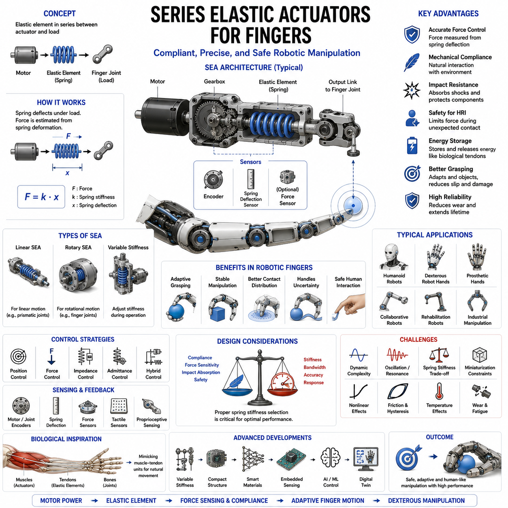{width="7.268055555555556in" height="7.268055555555556in"}

Series Elastic Actuators (SEAs) represent one of the most important innovations in modern robotic actuation, particularly in applications that require safe physical interaction, precise force control, impact tolerance, and compliant manipulation. Within the field of robotic hands, dexterous manipulators, humanoid robots, prosthetic devices, and collaborative robots, Series Elastic Actuators have become a key technology because they address many of the limitations associated with traditional rigid actuation systems. By introducing an intentional elastic element between the actuator and the load, SEAs enable robotic fingers to achieve more natural, adaptive, and human-like interaction with objects and environments. As robotic hands increasingly move toward human-level dexterity and safe interaction capabilities, Series Elastic Actuators have emerged as a foundational technology for next-generation manipulation systems.

The concept of the Series Elastic Actuator was originally developed to improve force controllability and mechanical compliance in robotic systems. Traditional robotic actuators typically connect motors directly to loads through rigid transmissions such as gears, belts, or linkages. While these systems provide excellent positional accuracy, they often exhibit high stiffness and poor impact tolerance. When unexpected contact occurs, large forces can be transmitted almost instantaneously, potentially damaging the robot, the object being manipulated, or nearby humans. Series Elastic Actuators solve this problem by placing an elastic component, typically a spring, in series between the motor output and the driven joint.

The fundamental operating principle of an SEA is relatively straightforward. A motor generates torque that passes through an elastic element before reaching the robotic finger joint. As force is transmitted through the spring, the spring deforms proportionally to the applied force according to Hooke's Law. By measuring the spring deflection, the system can estimate force directly without requiring expensive force sensors. This capability allows SEAs to function simultaneously as power transmission systems and force sensing mechanisms.

The introduction of elasticity fundamentally changes how forces are transmitted within the robotic system. Instead of acting as a rigid machine, the actuator behaves more like a biological muscle-tendon unit. Biological muscles inherently contain elastic tissues that absorb impacts, store energy, and regulate force transmission. Series Elastic Actuators mimic many of these characteristics, making them particularly attractive for biomimetic robotic hand design.

One of the primary advantages of Series Elastic Actuators is highly accurate force control. In traditional rigid actuators, friction, backlash, and transmission nonlinearities often complicate force estimation. In contrast, an SEA can determine transmitted force directly by measuring spring deformation. Since spring stiffness is known, force can be calculated using simple physical relationships. This capability enables precise force regulation during grasping, manipulation, and contact tasks.

Force control is especially important in robotic hands because grasping involves continuous interaction with uncertain environments. Objects vary widely in shape, mass, stiffness, surface texture, and fragility. A rigid robotic hand may accidentally crush delicate objects or fail to adapt to variations in contact conditions. SEA-based fingers can regulate contact forces more effectively, allowing them to grasp fragile objects while maintaining stable manipulation performance.

Mechanical compliance is another major advantage of Series Elastic Actuators. Compliance refers to the ability of a system to yield under external forces rather than resisting them rigidly. Human hands exhibit remarkable compliance due to the combined effects of muscles, tendons, ligaments, and soft tissues. By incorporating elastic elements into robotic fingers, SEAs provide similar behavior. This compliance improves safety, adaptability, and robustness during interaction.

Impact resistance represents an important consequence of compliance. When unexpected collisions occur, the elastic element absorbs and dissipates part of the impact energy. This reduces peak loads on motors, gears, bearings, and structural components. As a result, SEA-equipped robotic fingers often demonstrate superior durability and reliability compared with rigidly actuated systems.

Human-robot interaction has become one of the primary drivers behind SEA development. Collaborative robots must operate safely around humans without extensive physical barriers. Series Elastic Actuators provide intrinsic safety because their compliance limits force transmission during accidental contact. This characteristic has led to widespread adoption of SEA technology in collaborative robotics and assistive robotic systems.

The elastic element used in an SEA can take many forms. The most common implementation uses a mechanical spring positioned between the motor and the load. Compression springs, torsion springs, extension springs, leaf springs, and custom-designed elastic structures may all serve this purpose. The choice of spring architecture depends on desired force ranges, displacement requirements, packaging constraints, and dynamic performance goals.

Linear Series Elastic Actuators employ springs that deform linearly under load. These systems are relatively easy to model and control because their behavior follows well-understood physical laws. Rotary Series Elastic Actuators use torsional springs integrated into rotational transmission systems. Rotary configurations are particularly common in robotic finger joints because they align naturally with rotational degrees of freedom.

Variable Stiffness Actuators (VSAs) represent an extension of SEA concepts. While traditional SEAs use fixed-stiffness elastic elements, VSAs allow stiffness to be adjusted dynamically during operation. This capability enables robotic fingers to become compliant during safe interaction and stiff during forceful manipulation tasks. Such behavior closely resembles biological muscle co-contraction mechanisms.

The integration of SEAs into robotic fingers offers several unique advantages. Finger joints equipped with Series Elastic Actuators can adapt naturally to object surfaces, distribute contact forces more evenly, and maintain stable grasps despite positioning uncertainties. These characteristics are especially valuable in unstructured environments where precise object geometry may be unknown.

Robotic grasping benefits significantly from compliant actuation. During object acquisition, minor alignment errors are inevitable. Rigid systems often require highly accurate positioning to avoid excessive contact forces. SEA-equipped fingers can tolerate such errors because the elastic elements absorb deviations and allow the fingers to conform to object surfaces. This capability simplifies grasp planning and improves overall robustness.

Dexterous manipulation tasks also benefit from SEA technology. In-hand manipulation often involves continuous adjustments of contact forces as objects are rotated, translated, or repositioned. Accurate force sensing and compliance enable robotic fingers to maintain stable contact while minimizing the risk of object slippage or damage.

Humanoid robotics has emerged as one of the most important application areas for Series Elastic Actuators. Human-like robots require safe interaction, adaptive behavior, and efficient force control across numerous joints. Many advanced humanoid platforms incorporate SEA technology because it provides a balance between performance, safety, and biomimetic behavior.

Prosthetic hand development has also embraced SEA concepts. Advanced prosthetic devices must interact safely with users and surrounding environments while providing natural movement characteristics. Compliance improves comfort and usability by reducing sudden force transmission and enhancing object handling performance.

Rehabilitation robotics represents another important domain. Robotic rehabilitation devices frequently interact directly with patients undergoing physical therapy. Safety is paramount in such applications. Series Elastic Actuators provide inherent compliance that reduces injury risk while supporting controlled therapeutic exercises.

One particularly important characteristic of SEAs is energy storage and release. The elastic element can temporarily store mechanical energy during loading and release it later during unloading. This capability resembles the behavior of biological tendons and contributes to improved efficiency in repetitive movements. Energy storage can reduce motor power requirements and enhance dynamic performance.

The dynamic behavior of Series Elastic Actuators differs significantly from rigid actuators. The presence of elasticity introduces additional dynamic modes that must be considered during control design. While compliance provides many benefits, it also increases system complexity. Oscillations, resonances, and delayed responses may occur if the system is not properly controlled.

Control algorithms for SEA systems are therefore more sophisticated than those used for rigid actuators. Position control, force control, impedance control, admittance control, and hybrid control strategies are commonly employed. Modern robotic hands frequently combine multiple control approaches to achieve optimal performance across diverse tasks.

Impedance control has become particularly important in SEA-based robotic manipulation. Instead of controlling position or force alone, impedance control regulates the dynamic relationship between motion and force. This approach allows robotic fingers to exhibit compliant behavior while maintaining task performance. Such characteristics are essential for safe and adaptive interaction.

Sensors play a critical role in SEA operation. Encoders measure motor position and joint position, allowing spring deflection to be calculated. Additional force sensors, tactile sensors, and proprioceptive sensing systems may be integrated to enhance control performance. Together, these sensing modalities provide comprehensive information regarding system state and environmental interaction.

The mechanical design of Series Elastic Actuators requires careful consideration of spring stiffness. A spring that is too soft may reduce bandwidth and positioning accuracy. A spring that is too stiff may limit compliance benefits. Designers must therefore balance force sensitivity, dynamic response, stability, and task requirements when selecting elastic elements.

Miniaturization presents a particular challenge for robotic finger applications. Finger joints offer limited space for integrating motors, gears, sensors, and elastic elements. Engineers have developed compact SEA architectures specifically designed for anthropomorphic robotic hands. Advances in materials, manufacturing techniques, and precision engineering continue to improve integration possibilities.

Recent developments in additive manufacturing have expanded design options for Series Elastic Actuators. Custom elastic structures can now be fabricated with complex geometries optimized for specific performance objectives. Such structures may integrate compliance, sensing, and force transmission into unified components.

Soft robotics has also influenced SEA research. Many modern robotic fingers combine soft materials with elastic actuation concepts to achieve enhanced adaptability and safety. Hybrid architectures that merge soft structures with Series Elastic Actuators offer promising solutions for next-generation manipulation systems.

Artificial intelligence and machine learning are increasingly applied to SEA-based robotic systems. Learning algorithms can optimize force control, predict contact dynamics, compensate for nonlinear behavior, and adapt manipulation strategies to changing environments. Reinforcement learning has shown particular promise for exploiting compliant actuation during complex dexterous manipulation tasks.

Digital twins and simulation platforms play an important role in SEA development. Accurate dynamic models enable engineers to study force transmission, energy storage, compliance behavior, and control performance before physical implementation. Such approaches accelerate development and reduce engineering costs.

Future research directions focus on improving compactness, increasing force density, enhancing variable stiffness capabilities, integrating sensing technologies, and developing more sophisticated control algorithms. Researchers are also exploring bio-inspired elastic structures, smart materials, embedded sensing springs, and adaptive compliance mechanisms that further blur the distinction between artificial and biological systems.

The evolution of robotic hands increasingly emphasizes safety, adaptability, and human-like performance rather than raw positional accuracy alone. Series Elastic Actuators align closely with these goals because they provide a practical means of introducing controlled compliance into robotic systems. Their ability to combine force sensing, energy storage, impact tolerance, and adaptive behavior makes them uniquely valuable for advanced manipulation applications.

In conclusion, Series Elastic Actuators represent a transformative technology in robotic finger actuation. By incorporating elastic elements between actuators and loads, they enable precise force control, intrinsic compliance, improved safety, impact resistance, and biomimetic behavior. These characteristics address many of the limitations associated with traditional rigid actuation systems and support the development of robotic hands capable of more natural interaction with objects and humans. Although challenges related to dynamic complexity, control design, and miniaturization remain significant, ongoing advances in materials science, sensing technologies, artificial intelligence, and robotic engineering continue to expand the capabilities of SEA-based systems. As robotic hands move toward human-level dexterity and interaction, Series Elastic Actuators are expected to remain one of the most influential and widely adopted actuation technologies in the field of robotic manipulation.

## 03.10 Compact Hand Integration

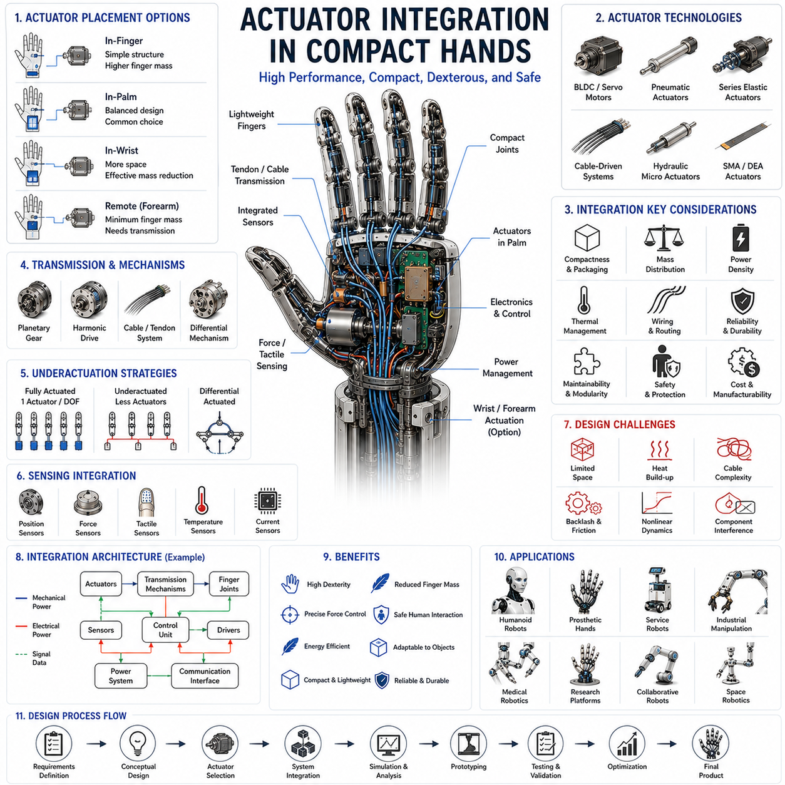{width="7.268055555555556in" height="7.268055555555556in"}

Actuator Integration in Compact Hands represents one of the most challenging and important engineering topics in the development of advanced robotic hands, prosthetic devices, humanoid manipulators, service robots, and dexterous end effectors. While individual actuator technologies such as servo motors, pneumatic actuators, hydraulic micro actuators, shape memory alloys, dielectric elastomers, cable-driven systems, and series elastic actuators each provide unique advantages, the true challenge lies in integrating these components into a compact robotic hand that can simultaneously achieve strength, dexterity, speed, compliance, reliability, efficiency, and manufacturability. As robotic hands increasingly move toward human-level functionality, actuator integration has become a multidisciplinary engineering problem involving mechanical design, electrical engineering, control systems, materials science, thermal management, and artificial intelligence.

The human hand serves as the ultimate reference model for compact actuator integration. Despite weighing only a few hundred grams, the human hand contains more than twenty degrees of freedom, numerous muscles and tendons, highly distributed sensing systems, sophisticated neural control mechanisms, and remarkable force generation capabilities. Achieving similar functionality in robotic systems remains one of the grand challenges of robotics. Unlike biological systems, robotic engineers must package motors, transmissions, sensors, wiring, electronics, and structural components within extremely limited volumes while maintaining acceptable performance.

Compact robotic hands impose severe spatial constraints on actuator placement. Every cubic millimeter inside the hand is valuable. Finger dimensions are limited by anthropomorphic requirements, grasping functionality, and ergonomic considerations. As a result, actuator integration is not merely a matter of selecting suitable motors or transmission systems. It requires a holistic optimization process that balances multiple competing objectives simultaneously.

One of the first considerations in actuator integration is actuator placement. Engineers must decide whether actuators will be located directly within the fingers, inside the palm, within the wrist, or remotely within the forearm. Each configuration presents unique advantages and disadvantages. Direct-drive finger actuators provide straightforward mechanical architectures and precise joint control but increase finger mass and inertia. Remote actuation reduces distal mass and improves dynamic performance but introduces transmission complexity.

The distribution of mass throughout the robotic hand significantly influences performance. Heavy fingers require more energy to accelerate and decelerate, resulting in slower motion and increased power consumption. Excessive distal mass also increases collision forces and reduces safety during human interaction. Consequently, many advanced robotic hands attempt to concentrate mass near the wrist or forearm while keeping finger structures lightweight.

Cable-driven actuation systems have become particularly popular in compact hand integration because they allow motors to be relocated away from the fingers. Tendon-like transmission systems enable powerful actuators to remain in the palm or forearm while transmitting forces to multiple finger joints. This approach closely resembles the musculoskeletal architecture of the human hand and significantly improves packaging efficiency.

The palm often serves as a central integration hub within compact robotic hands. It houses actuators, transmission mechanisms, electronics, sensors, communication systems, and power distribution components. Efficient utilization of palm volume is therefore critical. Engineers frequently employ three-dimensional packaging strategies to maximize functional density while preserving structural integrity and maintainability.

Miniaturization of actuators is another key aspect of compact hand design. Advances in motor technology have enabled increasingly small yet powerful brushless DC motors, coreless motors, slotless motors, and micro-servos. These technologies provide higher torque density, improved efficiency, and better thermal performance compared with earlier generations of actuators. Nevertheless, miniaturization remains constrained by fundamental physical limitations related to electromagnetic energy conversion.

Transmission systems play an equally important role in actuator integration. Since miniature motors often produce limited torque, transmission mechanisms are required to amplify output forces. Planetary gear systems, harmonic drives, cycloidal drives, tendon mechanisms, differential systems, and custom micro-transmissions are commonly employed. The choice of transmission architecture strongly influences system efficiency, backlash, compliance, reliability, and packaging complexity.

Backlash reduction is a major concern in compact robotic hands. Even small amounts of mechanical play can significantly degrade dexterous manipulation performance. High-precision grasping and in-hand manipulation tasks require accurate and repeatable motion control. Engineers therefore prioritize transmission technologies that minimize backlash while maintaining acceptable efficiency and compactness.

The number of actuators integrated into a robotic hand directly affects dexterity and functionality. Fully actuated hands assign one actuator to each degree of freedom, providing maximum control authority but increasing size, weight, cost, and complexity. Underactuated designs reduce actuator count by allowing multiple joints to share actuators. While this approach sacrifices some independent control capability, it often improves adaptability and mechanical simplicity.

Underactuation has become a particularly important design philosophy in compact robotic hands. Many successful robotic grippers utilize fewer actuators than degrees of freedom, relying on passive adaptability to conform to object geometries. This strategy reduces hardware complexity while maintaining effective grasping performance across a wide range of objects.

Differential mechanisms provide another important integration strategy. Mechanical differentials distribute actuator outputs across multiple joints or fingers, allowing coordinated motion while reducing actuator requirements. Such systems improve packaging efficiency and enable adaptive grasping behaviors without requiring complex control algorithms.

Thermal management presents one of the most significant challenges in actuator integration. Motors, power electronics, and control systems generate heat during operation. In compact robotic hands, limited volume and restricted airflow make heat dissipation difficult. Excessive temperatures can reduce actuator efficiency, degrade materials, damage electronics, and shorten component lifetimes.

Engineers employ various thermal management strategies to address these challenges. Heat sinks, thermal pathways, conductive structures, ventilation systems, advanced materials, and optimized component placement all contribute to effective heat dissipation. Some high-performance robotic hands even incorporate active cooling solutions when power densities become particularly demanding.

Power distribution represents another critical integration issue. Compact hands often contain multiple actuators, sensors, microcontrollers, communication interfaces, and safety systems. Supplying electrical power efficiently while minimizing wiring complexity requires careful architectural planning. Voltage regulation, current management, electromagnetic compatibility, and fault protection must all be considered.

Wiring complexity increases rapidly as hand sophistication grows. A highly dexterous robotic hand may contain dozens of sensors and actuators operating simultaneously. Routing wires through narrow finger structures while preserving reliability and flexibility is a major engineering challenge. Flexible printed circuits, integrated wiring harnesses, and embedded electronics have become increasingly important solutions.

Sensor integration is fundamentally linked to actuator integration. Robotic hands require position sensing, force sensing, tactile sensing, temperature monitoring, current measurement, and sometimes vibration detection. These sensing systems must coexist with actuators within highly constrained spaces. Effective integration requires minimizing interference while maximizing information quality.

Force sensing is particularly important in compact robotic hands. Direct force sensors can be difficult to integrate due to size limitations. Consequently, many systems employ indirect sensing approaches using motor currents, tendon tensions, spring deflections, or distributed tactile sensors. Such strategies reduce hardware complexity while preserving essential force feedback capabilities.

Tactile sensing represents a rapidly growing area of robotic hand development. Human hands derive much of their manipulation capability from tactile information. Integrating tactile sensors into compact robotic fingers requires careful coordination with actuator placement, structural design, and protective materials. The challenge becomes even greater when high-resolution tactile sensing is desired.

Compliance has emerged as a central theme in modern actuator integration. Traditional robotic systems emphasized stiffness and positional accuracy. However, safe interaction and adaptive manipulation require controlled compliance. Series Elastic Actuators, variable stiffness mechanisms, soft materials, and compliant transmission systems are increasingly incorporated into compact hand architectures.

Soft robotics has introduced new perspectives on actuator integration. Rather than treating compliance as a secondary consideration, soft robotic systems place compliance at the center of design philosophy. Soft actuators, flexible structures, and deformable materials enable new forms of manipulation that are difficult to achieve with conventional rigid systems. Integrating these technologies within compact hands presents both opportunities and challenges.

Material selection strongly influences actuator integration outcomes. Structural materials must balance strength, stiffness, weight, manufacturability, and cost. Aluminum alloys, titanium alloys, engineering polymers, carbon fiber composites, and advanced additive manufacturing materials are commonly employed. The choice of materials affects not only structural performance but also thermal behavior, vibration characteristics, and long-term durability.

Additive manufacturing has transformed compact robotic hand development. Complex internal structures, integrated channels, lightweight lattices, and customized transmission components can now be fabricated directly. This capability enables levels of integration that would be difficult or impossible using traditional manufacturing methods. Designers can optimize structures simultaneously for strength, weight, thermal performance, and packaging efficiency.

Modularity has become an increasingly important design principle. Modular actuator units simplify manufacturing, maintenance, upgrades, and customization. Rather than designing entirely unique mechanisms for every robotic hand, engineers can develop standardized actuator modules that are reused across multiple platforms. This approach reduces development costs and improves scalability.

Reliability remains a critical concern in actuator integration. Compact robotic hands often contain many tightly packed components operating under repetitive loading conditions. Mechanical wear, thermal cycling, vibration, cable fatigue, gear degradation, and electrical failures can all affect system performance. Reliability engineering therefore plays a central role throughout the design process.

Safety considerations extend beyond simple mechanical design. Modern robotic hands increasingly operate alongside humans in collaborative environments. Actuator integration must therefore incorporate fault detection, overload protection, emergency stop capabilities, current limiting, force limiting, and safe operating modes. These features must be implemented without significantly increasing system size or complexity.

Artificial intelligence is becoming increasingly important in actuator integration. Traditional actuator architectures were designed primarily around hardware constraints. Modern AI systems enable more intelligent utilization of available hardware resources. Machine learning algorithms can optimize force distribution, predict actuator failures, compensate for nonlinearities, and improve manipulation performance using existing hardware configurations.

Digital twins and simulation environments have become indispensable tools for actuator integration. Engineers can evaluate packaging arrangements, thermal behavior, force transmission characteristics, dynamic performance, and control strategies before constructing physical prototypes. Such approaches reduce development time and improve design quality.

Humanoid robotics continues to drive many advances in compact hand integration. Human-like robots require hands that closely approximate biological dimensions while providing sophisticated manipulation capabilities. This combination of size constraints and performance demands pushes the limits of current actuator technologies and integration methodologies.

Prosthetic hands face similar challenges. Users require lightweight devices that are comfortable, reliable, energy efficient, and capable of performing daily activities. Successful actuator integration directly influences usability, acceptance, and overall quality of life. Consequently, prosthetic hand development often serves as a valuable testbed for innovative integration technologies.

Future trends in compact hand actuator integration point toward increasingly distributed architectures. Embedded sensors, smart materials, miniature power electronics, integrated communication networks, and advanced manufacturing methods will continue to reduce system complexity while improving functionality. Artificial muscles, soft actuators, variable stiffness systems, and bio-inspired mechanisms are expected to become increasingly prominent.

The convergence of robotics, materials science, microelectronics, artificial intelligence, and advanced manufacturing is creating new opportunities for compact hand design. Future robotic hands may integrate sensing, actuation, control, and structural functions into unified multifunctional components rather than treating them as separate subsystems. Such integration could dramatically improve performance while reducing size and complexity.

In conclusion, actuator integration in compact robotic hands represents a multidisciplinary engineering challenge that sits at the intersection of mechanics, electronics, control systems, materials science, and robotics. The goal is not merely to fit actuators inside a small space but to create highly capable systems that balance dexterity, strength, compliance, efficiency, reliability, safety, and manufacturability. As robotic hands continue to evolve toward human-like performance, advances in actuator integration will remain one of the primary factors determining the capabilities of future manipulation systems. The successful integration of actuators, transmissions, sensors, power systems, and intelligent control architectures will ultimately define the next generation of compact robotic hands capable of operating effectively in complex real-world environments.

## 03.11 Thermal and Power Management

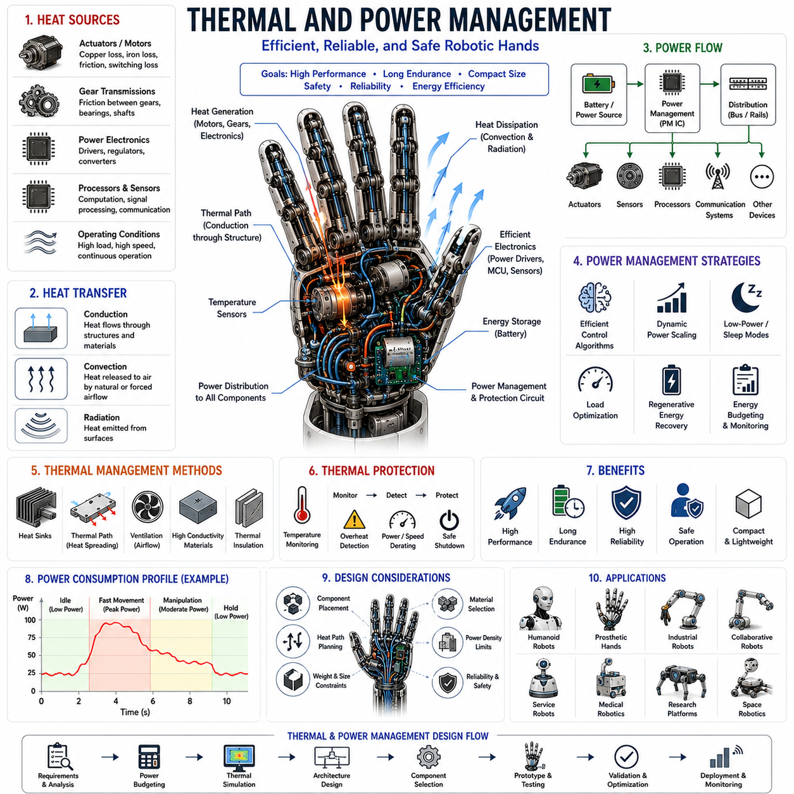{width="7.268055555555556in" height="7.268055555555556in"}

Thermal and Power Management represents one of the most critical engineering disciplines in the design of compact robotic hands, dexterous manipulators, prosthetic devices, humanoid robots, collaborative robots, and advanced end effectors. While actuator selection, mechanical design, sensing technologies, and control algorithms often receive significant attention, the long-term performance, reliability, efficiency, and safety of a robotic hand are fundamentally dependent upon effective thermal and power management. As robotic hands become increasingly compact, powerful, and intelligent, the density of electrical, mechanical, and computational components continues to rise. This increased integration inevitably generates greater thermal loads and more demanding power requirements. Consequently, thermal and power management has evolved from a secondary design consideration into a primary architectural challenge that influences nearly every aspect of robotic hand development.

The human hand provides an excellent reference for understanding the importance of energy and thermal regulation. Biological systems continuously manage energy consumption, distribute power through muscles and tendons, regulate temperature through blood circulation, and maintain efficient operation under a wide range of environmental conditions. Human hands can perform delicate manipulation tasks for extended periods without overheating or exhausting available energy resources. Robotic systems seek to achieve similar levels of efficiency, endurance, and adaptability through engineered thermal and power management strategies.

Power management in robotic hands begins with understanding the overall energy flow throughout the system. Electrical energy originates from batteries, power supplies, or external power sources and is distributed to actuators, sensors, controllers, communication systems, and auxiliary devices. Each subsystem consumes energy at different rates depending on operational demands. Effective power management ensures that sufficient energy is available where and when it is needed while minimizing losses and maximizing operational efficiency.

Actuators typically represent the largest consumers of power within robotic hands. Servo motors, brushless DC motors, pneumatic compressors, hydraulic pumps, Shape Memory Alloy actuators, dielectric elastomer systems, and other actuation technologies all convert electrical energy into mechanical work. However, no energy conversion process is perfectly efficient. A significant portion of the supplied energy is inevitably converted into heat. As actuator density increases within compact hand architectures, thermal management becomes increasingly important.

Brushless DC motors have become particularly popular in robotic hand applications due to their relatively high efficiency, compact size, and excellent controllability. Nevertheless, even high-performance motors generate heat through copper losses, iron losses, friction, and electronic switching losses. If this heat is not effectively removed, motor temperatures can rise rapidly, leading to reduced efficiency, degraded performance, insulation damage, and shortened operational life.

Gear transmissions also contribute to thermal generation. Friction between gear teeth, bearings, shafts, and lubrication systems produces heat during operation. High reduction ratio transmissions such as planetary gear systems, harmonic drives, and cycloidal reducers may generate substantial thermal loads under continuous use. Since many robotic hand joints operate in confined spaces with limited airflow, dissipating this heat becomes particularly challenging.

Power electronics represent another major source of thermal energy. Motor drivers, voltage regulators, communication interfaces, embedded processors, and sensor electronics all consume electrical power and generate heat. Modern robotic hands increasingly incorporate sophisticated onboard electronics capable of executing advanced control algorithms, sensor fusion, machine learning inference, and communication functions. While these capabilities enhance system performance, they also increase thermal management requirements.

Thermal generation is further influenced by operating conditions. High-speed movements, continuous grasping operations, repeated manipulation tasks, and sustained force application all increase power consumption and heat production. A robotic hand performing heavy industrial tasks may generate significantly more heat than one executing occasional light-duty manipulation. Consequently, thermal management strategies must be designed around anticipated operational profiles.

Heat accumulation is particularly problematic in compact robotic hands because available space is severely limited. Small internal volumes restrict airflow and reduce available surface area for heat dissipation. Unlike large industrial robots where substantial cooling systems may be integrated, compact hands must often rely on highly efficient passive cooling strategies. Engineers must therefore carefully manage thermal pathways throughout the design.

Conduction represents one of the primary heat transfer mechanisms within robotic hands. Heat generated by motors and electronics can be transferred through structural components toward larger surfaces where dissipation becomes more effective. Materials with high thermal conductivity, such as aluminum alloys, copper, and certain advanced composites, are frequently used to facilitate heat transfer. Structural components often serve dual purposes as both load-bearing elements and thermal pathways.

Convection plays an important role in removing heat from exposed surfaces. Natural convection relies on temperature-induced air movement to transport thermal energy away from components. Forced convection employs fans or airflow systems to increase cooling capacity. In compact robotic hands, forced convection is often difficult to implement due to size constraints, making natural convection and conduction particularly important.

Radiation contributes to thermal dissipation as well, although its impact is generally smaller than conduction and convection under typical robotic operating conditions. Nevertheless, surface coatings, material properties, and geometric configurations can influence radiative heat transfer and may contribute to overall thermal performance.

Thermal modeling has become an essential tool for robotic hand design. Engineers use computational simulations to predict temperature distributions, identify thermal bottlenecks, and evaluate cooling strategies before constructing physical prototypes. Finite Element Analysis (FEA), Computational Fluid Dynamics (CFD), and multiphysics simulations enable detailed investigation of thermal behavior under various operating conditions.

Thermal sensors play a critical role in operational safety and performance optimization. Temperature monitoring allows controllers to detect overheating conditions, adjust operating parameters, and prevent damage. Thermistors, resistance temperature detectors, semiconductor temperature sensors, and infrared sensing technologies are commonly integrated into robotic hand systems. Real-time thermal monitoring enables intelligent power regulation and predictive maintenance strategies.

Thermal protection mechanisms are increasingly incorporated into advanced robotic hands. When temperatures exceed safe operating limits, control systems may reduce motor currents, limit actuator speeds, temporarily disable certain functions, or initiate controlled shutdown procedures. These protective measures help preserve component integrity and prevent catastrophic failures.

Power distribution architecture significantly influences overall system performance. Modern robotic hands often contain multiple voltage domains supporting different subsystems. High-power actuators may operate at one voltage level, while sensors, processors, and communication systems require different supply voltages. Efficient power conversion and regulation are therefore essential.

Voltage regulation ensures that each subsystem receives stable and appropriate power regardless of variations in supply conditions. Switching regulators, buck converters, boost converters, and low-dropout regulators are commonly employed. The efficiency of these power conversion stages directly impacts overall energy consumption and thermal generation.

Battery-powered robotic hands introduce additional power management challenges. Available energy is finite, making efficiency critically important. Every watt of wasted energy reduces operational endurance and increases thermal loading. Consequently, battery-powered systems often employ aggressive power optimization strategies.

Energy density is a major consideration in portable robotic systems. Batteries must provide sufficient energy while minimizing size and weight. Lithium-ion batteries have become the dominant energy storage technology due to their favorable energy density characteristics. Emerging battery technologies continue to improve performance, enabling longer operating durations and greater actuator capabilities.

Power budgeting is a fundamental aspect of robotic hand design. Engineers must estimate peak power consumption, average power requirements, startup currents, transient loads, and emergency operating conditions. Accurate power budgeting ensures that energy storage, power distribution, and thermal management systems are properly sized.

Peak power requirements can differ substantially from average power consumption. A robotic hand may require high currents during rapid grasping actions or forceful manipulations while consuming relatively little power during idle periods. Effective power management systems must accommodate these transient demands without excessive oversizing.

Regenerative energy recovery represents an increasingly important area of research. During deceleration or controlled release motions, actuators may operate as generators and return energy to storage systems. While regenerative recovery is more commonly associated with large robotic systems, similar principles may improve efficiency in advanced robotic hands.

Sleep modes, low-power states, and dynamic power scaling are widely employed to reduce energy consumption. Sensors, processors, communication modules, and actuators can often operate at reduced power levels when full performance is unnecessary. Intelligent power management algorithms continuously adjust system behavior based on current operational requirements.

Embedded processors contribute significantly to modern robotic hand capabilities. Advanced control, sensor fusion, perception, and machine learning functions require substantial computational resources. However, increased computational capability generally leads to increased power consumption and thermal generation. Designers must therefore balance computational performance against energy efficiency.

Artificial intelligence is becoming increasingly important in thermal and power management. Machine learning algorithms can predict thermal behavior, optimize energy allocation, anticipate power demands, and identify abnormal operating conditions. Predictive models enable proactive thermal regulation rather than reactive responses.

Digital twin technology provides powerful tools for optimizing thermal and power architectures. Virtual models can simulate energy flows, temperature distributions, duty cycles, and operational scenarios before physical hardware is constructed. This approach reduces development costs and improves design quality.

Compact robotic hands often incorporate multiple sensing technologies including position sensors, force sensors, tactile sensors, current sensors, temperature sensors, and inertial measurement units. Although individual sensors typically consume relatively little power, their combined energy requirements can become significant. Efficient sensor management therefore contributes to overall system performance.

Wireless communication introduces additional power considerations. Bluetooth, Wi-Fi, ultra-wideband, and other communication technologies consume energy and generate heat. Communication architectures must therefore be designed carefully, particularly in battery-powered systems.

Reliability is closely linked to thermal management. Elevated temperatures accelerate material degradation, lubricant breakdown, electronic aging, insulation failure, and mechanical wear. Maintaining acceptable operating temperatures significantly extends system lifespan and improves long-term performance.

Safety considerations further emphasize the importance of thermal management. Robotic hands operating near humans must avoid surface temperatures that could cause discomfort or injury. Temperature monitoring and thermal insulation strategies therefore contribute directly to safe human-robot interaction.

Soft robotic hands introduce unique thermal and power challenges. Soft actuators often rely on pneumatic systems, artificial muscles, dielectric elastomers, or smart materials that exhibit different efficiency characteristics than conventional motors. Understanding and managing these characteristics is essential for successful integration.

Humanoid robotics places particularly demanding requirements on thermal and power systems. Human-sized robotic hands must operate within strict mass, volume, and energy constraints while providing high levels of dexterity and endurance. These competing requirements drive continuous innovation in thermal and power management technologies.

Prosthetic hands face similar challenges. Users expect lightweight devices capable of operating throughout an entire day without excessive heat generation or frequent battery replacement. Effective thermal and power management directly influences comfort, usability, and acceptance.

Future developments in thermal and power management are expected to leverage advances in materials science, battery technology, intelligent control, and integrated electronics. High-conductivity composites, phase-change materials, solid-state batteries, energy-harvesting technologies, and AI-driven optimization systems may dramatically improve performance.

Emerging concepts such as distributed power architectures, embedded thermal networks, smart energy management systems, and multifunctional structural components are likely to play increasingly important roles. These technologies aim to integrate thermal regulation, power distribution, sensing, and structural functionality into unified architectures.

Ultimately, thermal and power management is not merely a supporting subsystem but a foundational element of robotic hand engineering. Every actuator, sensor, controller, communication device, and structural component influences energy consumption and thermal behavior. Successful robotic hand design therefore requires a holistic approach that considers thermal and power issues from the earliest stages of development.

In conclusion, Thermal and Power Management forms the invisible infrastructure that enables compact robotic hands to operate safely, efficiently, and reliably. By carefully controlling energy generation, distribution, conversion, storage, and dissipation, engineers can maximize performance while minimizing size, weight, and operational risks. As robotic hands become more powerful, intelligent, and compact, advances in thermal and power management will remain essential for achieving human-like dexterity, long operational endurance, and robust real-world performance. Future breakthroughs in energy storage, intelligent control, advanced materials, and integrated system architectures will continue to expand the capabilities of robotic hands and contribute to the next generation of dexterous robotic manipulation systems.
