**Volume 06 Robot Hands and Dexterous Grasping**

# 03. Actuators for Robot Hands

## 03.01 Actuator Requirements for Robot Hands

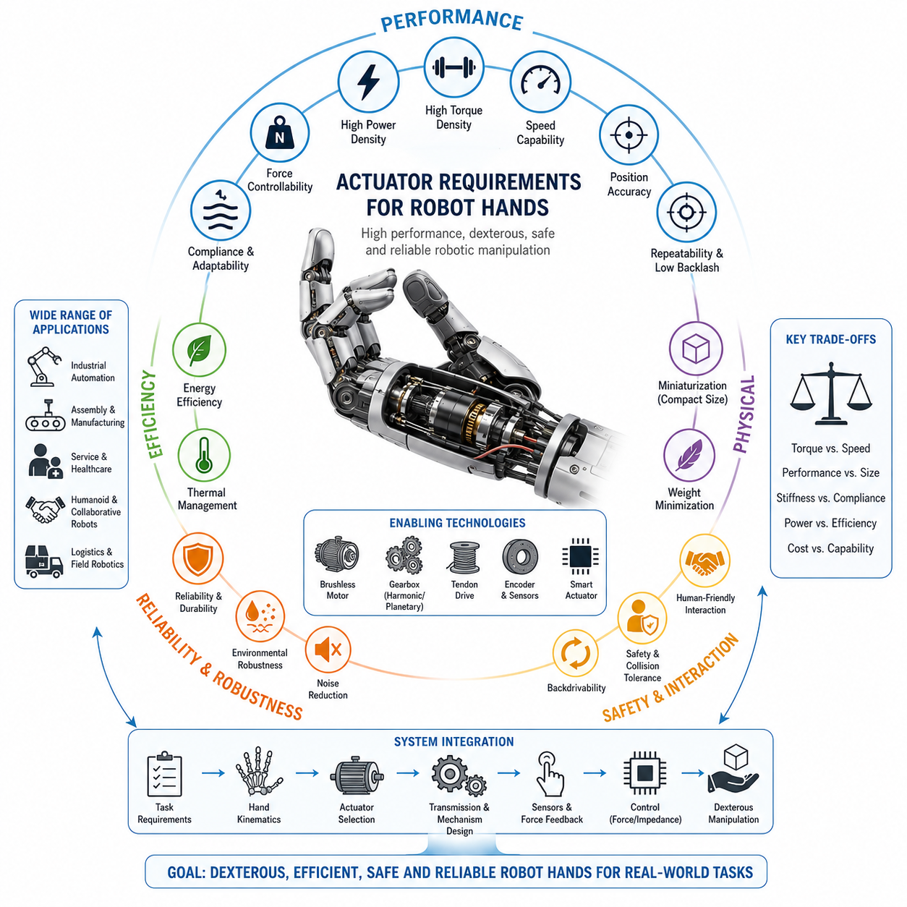{width="7.268055555555556in" height="7.268055555555556in"}

로봇 핸드(Robot Hand)는 로봇 공학 분야에서 가장 까다로운 액추에이터 응용 분야 중 하나이다. 로봇 핸드는 정밀성(Precision), 손재주(Dexterity), 힘 생성(Force Generation), 소형화(Compactness), 안전성(Safety), 에너지 효율(Energy Efficiency), 신뢰성(Reliability)을 동시에 만족해야 하기 때문이다. 일반적인 산업용 로봇 관절은 비교적 넓은 공간에서 대형 액추에이터를 사용할 수 있으며 예측 가능한 환경에서 동작하는 경우가 많지만, 로봇 핸드는 매우 제한된 공간 안에서 인간 손과 유사한 기능을 구현해야 한다. 따라서 액추에이터의 선정과 사양 정의는 손의 성능, 파지 안정성(Grasp Stability), 조작 능력(Manipulation Capability), 제어 복잡도(Control Complexity), 기구 설계(Mechanical Architecture), 제조 비용(Cost), 유지보수성(Maintainability)에 직접적인 영향을 미치는 핵심 설계 요소가 된다.

로봇 핸드 액추에이터의 가장 기본적인 역할은 손가락 관절에 제어 가능한 움직임과 힘을 제공하는 것이다. 그러나 실제 요구사항은 단순한 운동 생성에 그치지 않는다. 액추에이터는 물체를 안정적으로 잡기 위한 충분한 토크(Torque)를 제공해야 하며, 효율적인 작업 수행을 위한 속도(Speed)와 정교한 조작을 위한 위치 정밀도(Position Accuracy)도 제공해야 한다. 이러한 요구사항들은 서로 충돌하는 경우가 많다. 높은 토크를 얻기 위해서는 더 큰 모터나 높은 감속비가 필요하며, 이는 무게 증가와 속도 감소를 초래한다. 정밀도를 높이기 위해서는 추가 센서와 제어 전자장치가 필요하며, 이는 시스템 복잡성과 비용을 증가시킨다. 따라서 액추에이터 선택은 단순한 부품 선택이 아니라 다차원적인 최적화 문제라고 할 수 있다.

가장 중요한 요구사항 중 하나는 토크 밀도(Torque Density)이다. 토크 밀도는 단위 질량 또는 단위 부피당 생성 가능한 토크의 크기를 의미한다. 인간의 손가락은 매우 작은 크기에도 불구하고 상당한 힘을 발휘할 수 있으며, 로봇 핸드 역시 이에 근접하거나 이를 초과하는 수준의 성능을 요구받는다. 손가락 내부나 손바닥 내부 공간은 극도로 제한되어 있기 때문에 액추에이터는 최소한의 공간에서 최대의 토크를 생성해야 한다. 이러한 요구는 브러시리스 DC 모터(Brushless DC Motor), 하모닉 드라이브(Harmonic Drive), 유성기어(Planetary Gear), 텐던 구동(Tendon-Driven System)과 같은 기술의 발전을 이끌어 왔다.

토크 밀도와 밀접하게 연결된 개념은 출력 밀도(Power Density)이다. 로봇 핸드는 이동 중인 물체를 잡거나, 공구를 재배치하거나, 조립 작업을 수행하거나, 사람과 상호작용하는 등 동적인 작업을 수행해야 한다. 이러한 작업에서는 순간적으로 높은 기계적 출력이 요구된다. 높은 출력 밀도는 손가락이 빠르게 가속하고 외부 충격에 대응하며 변화하는 하중 조건에서도 안정적으로 제어될 수 있도록 한다. 특히 이동형 매니퓰레이터(Mobile Manipulator)와 휴머노이드 로봇(Humanoid Robot)에서는 전체 시스템의 무게와 전력 소비가 제한되므로 출력 밀도가 더욱 중요해진다.

속도(Speed)에 대한 요구사항은 응용 분야에 따라 크게 달라진다. 산업용 피킹(Picking) 및 플레이싱(Placing) 작업에서는 생산성을 높이기 위해 손가락이 수백 밀리초 이내에 닫혀야 할 수 있다. 반면 정교한 조작을 수행하는 다지형 핸드(Dexterous Hand)는 더 느리지만 안정적인 움직임이 필요하다. 따라서 액추에이터는 속도와 힘 사이에서 적절한 균형을 제공해야 하며, 최대 속도와 최대 토크 사이의 트레이드오프를 신중하게 분석해야 한다.

위치 정밀도(Position Accuracy)는 또 다른 핵심 요구사항이다. 많은 로봇 핸드 응용 분야에서는 매우 작은 부품이나 깨지기 쉬운 물체를 다루어야 한다. 전자 부품 조립, 의료 기기 조작, 정밀 제조 공정 등에서는 손가락 관절의 매우 정확한 위치 제어가 요구된다. 이를 위해 액추에이터는 낮은 백래시(Backlash), 낮은 히스테리시스(Hysteresis), 높은 분해능(Resolution), 정밀한 위치 피드백 기능을 제공해야 한다. 이러한 이유로 고해상도 엔코더(Encoder)가 대부분의 고성능 로봇 핸드 액추에이터에 통합된다.

실제 산업 현장에서는 절대 정확도보다 반복 정밀도(Repeatability)가 더욱 중요한 경우가 많다. 로봇 핸드는 하루 수천 번 이상의 동일한 파지 동작을 수행할 수 있다. 절대 위치 오차가 다소 존재하더라도 반복성이 높다면 보정(Calibration)과 센서 피드백을 통해 충분히 보완할 수 있다. 그러나 반복성이 낮다면 파지 성공률이 급격히 감소하고 작업 신뢰성이 떨어지게 된다. 따라서 액추에이터는 온도 변화, 마모, 장시간 사용 조건에서도 일관된 성능을 유지해야 한다.

최근 로봇 핸드에서는 순응성(Compliance)이 매우 중요한 요구사항으로 부상하고 있다. 전통적인 산업용 로봇은 높은 강성(Stiffness)을 통해 위치 정확도를 확보했지만, 로봇 핸드는 불확실한 환경, 깨지기 쉬운 물체, 사람과의 협업 상황에 자주 노출된다. 지나치게 강성이 높은 시스템은 물체를 손상시키거나 불안정한 파지를 유발할 수 있다. 따라서 액추에이터는 기계적 탄성 요소나 임피던스 제어(Impedance Control), 어드미턴스 제어(Admittance Control) 등을 통해 적절한 순응성을 제공해야 한다.

힘 제어 능력(Force Controllability) 역시 매우 중요하다. 로봇 핸드는 종이 한 장부터 무거운 공구에 이르기까지 다양한 물체를 다루어야 한다. 따라서 액추에이터는 넓은 범위에서 부드럽고 안정적인 힘 조절이 가능해야 한다. 이러한 능력은 미끄러짐(Slip)을 방지하면서도 과도한 압착으로 인한 물체 손상을 방지하는 데 필수적이다. 이를 위해 많은 시스템이 힘 센서(Force Sensor), 촉각 센서(Tactile Sensor), 모터 전류 기반 힘 추정 기술을 활용한다.

역구동성(Backdrivability) 또한 중요한 요구사항이다. 역구동성이란 외부 힘에 의해 액추에이터가 자연스럽게 움직일 수 있는 특성을 의미한다. 높은 역구동성은 안전성을 향상시키고, 순응적인 상호작용을 가능하게 하며, 힘 제어의 정확도를 높여준다. 인간의 손은 근육과 힘줄 구조 덕분에 매우 높은 역구동성을 가지고 있지만, 로봇에서는 고감속 기어와 마찰 요소 때문에 이를 구현하기가 쉽지 않다.

에너지 효율(Energy Efficiency)은 특히 배터리 기반 시스템에서 중요하다. 이동형 로봇, 서비스 로봇, 휴머노이드 로봇은 제한된 에너지 자원으로 장시간 동작해야 한다. 로봇 핸드에는 여러 개의 액추에이터가 동시에 작동하므로 작은 비효율도 누적되면 상당한 전력 손실이 발생한다. 효율적인 액추에이터는 배터리 사용 시간을 늘리고 열 발생을 줄이며 전체 시스템 성능을 향상시킨다.

열 관리(Thermal Management)는 초기 설계 단계에서 종종 간과되지만 매우 중요한 요소이다. 소형 액추에이터는 좁은 공간에서 지속적으로 작동하면서 상당한 열을 발생시킨다. 과도한 온도 상승은 모터 효율 저하, 센서 오차 증가, 전자회로 손상, 부품 수명 단축 등의 문제를 유발한다. 따라서 열 방출 경로, 작동 듀티 사이클(Duty Cycle), 재료 선택, 냉각 구조는 액추에이터 설계의 중요한 요소가 된다.

소형화(Miniaturization)는 로봇 핸드 설계의 핵심 목표 중 하나이다. 인간 크기의 로봇 핸드는 보통 10\~20 자유도(Degree of Freedom)를 포함하며, 이를 모두 사람 손 크기 안에 수용해야 한다. 이 때문에 매우 높은 수준의 집적화가 요구된다. 일부 시스템은 손가락 내부에 액추에이터를 직접 배치하며, 일부는 손바닥이나 전완(Forearm)에 배치하고 텐던 또는 케이블을 통해 힘을 전달한다. 각각의 방식은 무게 배분, 유지보수성, 전달 효율, 제어 복잡도 측면에서 서로 다른 장단점을 가진다.

무게 최소화(Weight Minimization)도 매우 중요하다. 무거운 손가락은 관성(Inertia)을 증가시키고 동적 성능을 저하시킨다. 또한 손가락 자체를 움직이기 위해 더 큰 액추에이터가 필요하게 되어 악순환이 발생한다. 가벼운 액추에이터는 응답 속도를 향상시키고 에너지 소비를 줄이며 인간과의 상호작용 시 안전성을 높인다.

신뢰성(Reliability)과 내구성(Durability)은 로봇 핸드에서 매우 엄격하게 요구된다. 손가락은 반복적인 접촉, 충격, 진동, 예상치 못한 외부 하중에 지속적으로 노출된다. 따라서 액추에이터는 수백만 회 이상의 동작 사이클 동안 성능 저하 없이 작동해야 한다. 이를 위해 모터, 베어링, 기어박스, 케이블, 윤활 시스템, 보호 구조 모두가 높은 신뢰성을 갖추어야 한다.

환경 적응성(Environmental Robustness)도 중요하다. 로봇 핸드는 공장, 물류창고, 병원, 농업 현장, 건설 현장 등 다양한 환경에서 사용된다. 먼지, 습기, 화학 물질, 진동, 온도 변화에 노출될 수 있으므로 액추에이터는 이러한 환경에서도 안정적인 성능을 유지해야 한다.

소음(Noise) 역시 최근 중요성이 증가하고 있다. 서비스 로봇, 병원 로봇, 가정용 로봇, 협동 로봇은 사람과 가까운 환경에서 동작하기 때문에 저소음 설계가 필수적이다. 액추에이터 기술은 이제 단순한 기계 성능뿐만 아니라 음향 특성까지 고려하여 평가되고 있다.

안전성(Safety)은 모든 로봇 핸드 설계의 핵심 요소이다. 협동 로봇용 핸드는 인간과 직접 상호작용하기 때문에 힘 제한 기능, 충돌 감지 기능, 비상 정지 기능, 순응 제어 기능 등을 제공해야 한다. 일부 응용 분야에서는 전원이 차단되더라도 물체를 안전하게 유지할 수 있는 Fail-Safe 메커니즘도 요구된다.

확장성(Scalability) 역시 제품 개발 관점에서 중요하다. 동일한 액추에이터 플랫폼을 다양한 핸드 모델에 적용할 수 있다면 개발 비용과 유지보수 비용을 크게 절감할 수 있다. 따라서 모듈형 액추에이터 설계는 산업적으로 매우 매력적인 접근 방식이다.

경제성(Cost)도 현실적인 요구사항이다. 연구용 시스템은 성능을 최우선으로 고려할 수 있지만, 상용 제품은 성능과 비용 사이의 균형이 필수적이다. 정밀 기어박스, 고성능 센서, 맞춤형 제조 공정을 사용하는 액추에이터는 매우 높은 비용을 발생시킬 수 있으므로 전체 생애주기 비용(Lifecycle Cost)을 고려한 설계가 필요하다.

최근에는 스마트 액추에이터(Smart Actuator)의 중요성이 증가하고 있다. 스마트 액추에이터는 엔코더, 전류 센서, 온도 센서, 마이크로프로세서, 통신 인터페이스 등을 내부에 통합한다. 이를 통해 배선 복잡도를 줄이고 분산 제어 구조를 구현할 수 있으며, 다자유도 로봇 핸드에 적합한 고성능 시스템을 구성할 수 있다.

시스템 공학(System Engineering) 관점에서 액추에이터 요구사항은 독립적으로 정의될 수 없다. 손가락 기구학(Finger Kinematics), 텐던 구조(Tendon Routing), 접촉 역학(Contact Mechanics), 촉각 센서(Tactile Sensing), 힘 제어(Force Control), 파지 계획(Grasp Planning), 조작 목표(Manipulation Objectives)가 모두 액추에이터 사양에 영향을 미친다. 성공적인 로봇 핸드 개발은 작업 요구사항과 시스템 목표를 명확히 정의한 후 이에 적합한 액추에이터 구조를 설계하는 과정에서 시작된다.

미래의 로봇 핸드는 인간 수준의 손재주와 조작 능력을 목표로 발전하고 있으며, 이에 따라 액추에이터에 대한 요구사항도 더욱 높아질 것이다. 더 높은 토크 밀도, 향상된 순응성, 낮은 전력 소비, 고도화된 센서 통합, 더욱 소형화된 구조가 요구될 것이다. 브러시리스 모터, 인공 근육(Artificial Muscle), 소프트 액추에이터(Soft Actuator), 가변 강성 메커니즘(Variable Stiffness Mechanism), 전기활성 고분자(Electroactive Polymer), 지능형 액추에이터 네트워크(Intelligent Actuator Network)와 같은 기술들은 차세대 로봇 핸드 구현의 핵심 기반이 될 것으로 전망된다. 이러한 관점에서 액추에이터 요구사항은 단순한 설계 조건이 아니라 미래 로봇 조작 기술의 발전 방향을 결정하는 핵심 동력이라 할 수 있다.

## 03.02 Brushless DC Motors

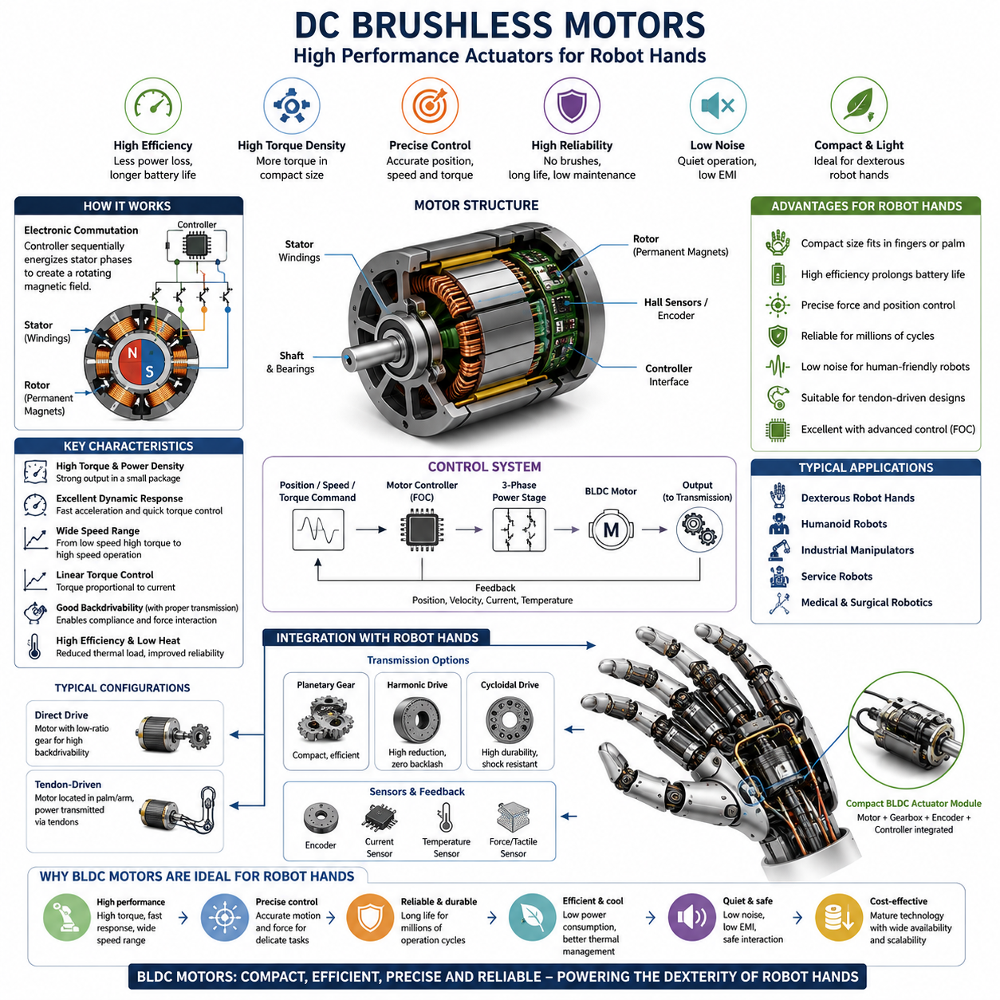{width="7.268055555555556in" height="7.268055555555556in"}

브러시리스 DC 모터(Brushless DC Motor, BLDC)는 현대 로봇 핸드에서 가장 중요한 액추에이터 기술 중 하나로 자리 잡고 있다. 높은 효율(Efficiency), 소형화(Compact Size), 우수한 제어성(Controllability), 긴 수명(Long Operational Life), 높은 출력 밀도(Power Density)를 동시에 제공할 수 있기 때문에 정교한 조작 능력을 요구하는 로봇 핸드에 매우 적합하다. 단순한 산업용 그리퍼(Gripper)에서 인간 손과 유사한 다관절 로봇 핸드(Dexterous Hand)로 발전함에 따라 액추에이터에 대한 요구 수준은 지속적으로 높아지고 있으며, 이러한 요구를 충족시키는 핵심 기술 중 하나가 바로 브러시리스 모터이다.

로봇 핸드의 발전은 오랫동안 액추에이터 기술의 한계에 의해 제약을 받아왔다. 과거에는 브러시드 DC 모터(Brushed DC Motor)가 널리 사용되었지만, 브러시(Brush)와 정류자(Commutator)의 기계적 접촉으로 인해 마모가 발생하고 유지보수가 필요하며 전기적 노이즈와 열 발생이 많다는 단점이 있었다. 반면 브러시리스 모터는 전자식 정류(Electronic Commutation)를 사용하기 때문에 기계적 마모가 거의 없고 효율이 높으며 수명이 길다. 또한 토크(Torque)와 속도(Velocity)를 더욱 정밀하게 제어할 수 있어 현재의 고성능 로봇 핸드에서는 사실상 표준 액추에이터 기술로 자리 잡고 있다.

브러시리스 모터는 영구자석(Permanent Magnet)으로 구성된 회전자(Rotor)와 전자석(Electromagnet)으로 구성된 고정자(Stator)의 상호작용을 통해 동작한다. 브러시를 사용하는 대신 전자 제어기가 각 상(Phase)의 전류를 순차적으로 제어하여 회전 자기장(Rotating Magnetic Field)을 생성하고, 이 자기장이 회전자를 움직이게 한다. 이러한 구조는 마찰을 줄이고 높은 회전 속도와 높은 효율을 동시에 달성할 수 있게 해준다. 특히 제한된 공간 안에서 높은 성능을 요구하는 로봇 핸드에는 매우 유리한 특성이다.

브러시리스 모터의 가장 중요한 장점 중 하나는 높은 토크 밀도(Torque Density)이다. 토크 밀도란 단위 질량 또는 단위 부피당 생성할 수 있는 토크의 양을 의미한다. 인간 손과 유사한 크기의 로봇 핸드에서는 매우 제한된 공간 안에 액추에이터, 센서, 감속기, 배선, 제어기를 모두 집적해야 한다. 따라서 작은 크기에서 높은 토크를 제공할 수 있는 BLDC 모터는 손가락 관절과 손바닥 내부 액추에이션 시스템에 매우 적합하다.

출력 밀도(Power Density) 역시 중요한 특성이다. 로봇 핸드는 빠른 물체 조작, 도구 사용, 물체 재배치, 조립 작업 등을 수행해야 한다. 이러한 작업은 순간적으로 높은 기계적 출력을 요구한다. 브러시리스 모터는 작은 크기에서도 높은 출력을 제공할 수 있기 때문에 빠른 손가락 움직임과 정밀한 제어를 동시에 가능하게 한다. 물류 자동화, 산업 조립, 서비스 로봇, 휴머노이드 로봇 등에서는 이러한 특성이 작업 효율을 크게 향상시킨다.

효율(Efficiency)은 브러시리스 모터의 또 다른 핵심 장점이다. 브러시와 정류자가 없기 때문에 마찰 손실이 감소하며 일반적으로 브러시드 모터보다 훨씬 높은 효율을 달성할 수 있다. 효율이 높다는 것은 동일한 작업을 수행하기 위해 더 적은 전력을 소비한다는 의미이며, 이는 배터리 수명을 연장하고 열 발생을 줄이는 데 큰 도움이 된다. 특히 이동형 매니퓰레이터(Mobile Manipulator), 휴머노이드(Humanoid), 서비스 로봇(Service Robot)과 같이 배터리 기반으로 동작하는 시스템에서는 매우 중요한 요소이다.

열 관리(Thermal Management)는 로봇 핸드 설계에서 매우 중요한 문제이다. 작은 공간 안에 여러 개의 액추에이터가 배치되면 상당한 열이 발생한다. 과도한 열은 모터 성능을 저하시킬 뿐만 아니라 전자회로와 센서의 신뢰성을 감소시키고 수명을 단축시킨다. 브러시리스 모터는 동일한 출력 조건에서 상대적으로 적은 열을 발생시키므로 열 관리 부담을 줄이고 장기적인 안정성을 향상시킨다.

정밀 제어(Precision Control)는 BLDC 모터가 가장 강력한 경쟁력을 가지는 영역 중 하나이다. 현대의 로봇 핸드는 미세한 조작과 정밀한 위치 제어를 요구한다. 브러시리스 모터는 고해상도 엔코더(Encoder)와 결합되어 회전 위치, 속도, 가속도를 매우 정확하게 측정할 수 있다. 이를 통해 고정밀 위치 제어가 가능하며, 전자 부품 조립, 의료 기기 조작, 공구 사용과 같은 작업에서 높은 성능을 발휘할 수 있다.

토크 제어 능력(Torque Controllability) 역시 매우 중요하다. 로봇 핸드는 물체를 단단히 잡으면서도 손상시키지 않아야 한다. BLDC 모터는 전류(Current)와 토크가 거의 선형적인 관계를 가지기 때문에 매우 정밀한 힘 제어가 가능하다. 이러한 특성은 힘 제어(Force Control), 임피던스 제어(Impedance Control), 순응 제어(Compliance Control) 등 고급 제어 알고리즘의 구현을 가능하게 한다.

특히 힘 제어는 인간 손과 유사한 조작 능력을 구현하는 데 핵심적인 역할을 한다. 인간은 촉각 정보를 바탕으로 지속적으로 파지력을 조절한다. 로봇 핸드도 마찬가지로 외부 환경 변화에 빠르게 대응할 수 있어야 한다. 브러시리스 모터는 매우 빠른 응답 특성을 가지므로 실시간으로 토크를 조절할 수 있으며, 이를 통해 안정적인 파지와 동적 조작이 가능해진다.

역구동성(Backdrivability) 역시 중요한 특성이다. 역구동성이란 외부 힘에 의해 액추에이터가 자연스럽게 움직일 수 있는 능력을 의미한다. 브러시리스 모터 자체는 높은 역구동성을 제공할 수 있지만, 실제 시스템의 역구동성은 감속기와 전달 메커니즘의 설계에 크게 좌우된다. 낮은 감속비를 사용하는 경우에는 높은 순응성을 얻을 수 있으며, 높은 감속비를 사용하는 경우에는 외력에 대한 저항이 커질 수 있다.

브러시리스 모터는 텐던 구동(Tendon-Driven) 구조와도 매우 잘 결합된다. 많은 고성능 로봇 핸드는 손가락 내부에 모터를 배치하지 않고 손바닥이나 전완부(Forearm)에 모터를 배치한 후 케이블과 텐던을 통해 힘을 전달한다. 이러한 방식은 손가락의 무게와 관성을 줄이고 더 큰 모터를 사용할 수 있도록 해준다. BLDC 모터는 높은 회전 속도와 효율적인 동력 전달이 가능하기 때문에 이러한 구조에 매우 적합하다.

최근에는 소형화(Miniaturization) 기술이 빠르게 발전하고 있다. 자석 재료, 권선 기술, 제조 공정, 전력 전자 기술의 발전으로 인해 수 밀리미터 크기의 초소형 브러시리스 모터도 매우 높은 성능을 제공할 수 있게 되었다. 이러한 발전은 더욱 인간 손에 가까운 로봇 핸드 설계를 가능하게 하고 있다.

브러시리스 모터는 일반적으로 감속기(Gear Reduction System)와 함께 사용된다. 모터 자체는 고속 회전에 적합하지만 손가락 구동에 필요한 토크는 충분하지 않을 수 있기 때문이다. 따라서 유성기어(Planetary Gearbox), 하모닉 드라이브(Harmonic Drive), 사이클로이드 감속기(Cycloidal Drive) 등의 기술이 함께 사용된다. 이러한 감속 시스템은 토크를 증폭시키면서도 정밀성과 효율을 유지하는 역할을 수행한다.

엔코더(Encoder)는 BLDC 시스템의 핵심 구성 요소이다. 전자식 정류와 폐루프 제어(Closed-Loop Control)를 위해서는 정확한 위치 정보가 필요하다. 증분형 엔코더(Incremental Encoder)는 상대 위치를 측정하며, 절대형 엔코더(Absolute Encoder)는 전원을 껐다 켜더라도 즉시 절대 위치를 알 수 있다. 엔코더의 성능은 전체 로봇 핸드의 정밀도를 결정하는 중요한 요소이다.

모터 제어기(Motor Controller) 또한 매우 중요하다. 브러시리스 모터는 전자 제어기 없이는 동작할 수 없다. 최신 제어기는 FOC(Field Oriented Control), 벡터 제어(Vector Control), 적응형 전류 제어 등의 고급 알고리즘을 사용한다. 이러한 기술은 토크 리플(Torque Ripple)을 줄이고 효율을 높이며 더욱 부드러운 동작을 가능하게 한다.

특히 FOC(Field Oriented Control)는 현재 가장 널리 사용되는 고성능 제어 방식이다. FOC는 모터 전류를 회전자 자기장 기준 좌표계로 변환하여 토크 생성 전류와 자속 생성 전류를 독립적으로 제어한다. 이를 통해 매우 정밀하고 효율적인 토크 제어가 가능하며, 고급 로봇 핸드의 대부분은 이러한 기술을 기반으로 동작한다.

신뢰성(Reliability)은 브러시리스 모터가 산업계에서 널리 채택된 가장 큰 이유 중 하나이다. 브러시가 없기 때문에 마모 부품이 줄어들고 유지보수 빈도가 감소한다. 산업용 로봇 핸드는 수백만 번 이상의 반복 동작을 수행해야 하므로 이러한 높은 신뢰성은 매우 중요한 장점이 된다.

소음 감소(Noise Reduction) 또한 중요한 특성이다. 브러시드 모터는 브러시 접촉으로 인해 기계적 소음과 전기적 노이즈가 발생한다. 반면 BLDC 모터는 상대적으로 조용하게 동작하며 전자기 간섭도 적다. 이는 병원, 서비스 로봇, 협동 로봇과 같이 사람과 가까운 환경에서 매우 중요한 요소이다.

안전성(Safety) 측면에서도 BLDC 모터는 강력한 장점을 가진다. 현대의 모터 제어기는 전류, 온도, 속도, 위치 등을 실시간으로 모니터링할 수 있다. 이상 상황이 발생하면 즉시 보호 동작을 수행할 수 있으며, 과전류 보호, 과열 방지, 충돌 감지, 토크 제한 등의 기능을 제공한다.

협동 로봇(Collaborative Robot)과 휴머노이드에서는 브러시리스 모터와 함께 직렬 탄성 액추에이터(Series Elastic Actuator, SEA)가 자주 사용된다. SEA는 모터와 부하 사이에 탄성 요소를 삽입하여 힘 측정 정확도를 향상시키고 충격을 흡수하며 안전성을 높인다. 이러한 구조는 사람과 함께 작업하는 로봇 핸드에서 매우 효과적이다.

과거에는 브러시리스 모터 시스템이 브러시드 모터보다 훨씬 비쌌지만, 최근에는 대량 생산과 기술 발전으로 인해 비용이 크게 감소하였다. 현재 BLDC 기술은 성능, 신뢰성, 비용 측면에서 매우 균형 잡힌 솔루션으로 평가받고 있으며 연구용 시스템뿐만 아니라 상용 제품에도 폭넓게 적용되고 있다.

미래의 로봇 핸드 기술은 브러시리스 모터의 발전과 밀접하게 연결되어 있다. 더욱 강력한 자석 재료, 고효율 권선 기술, 통합형 전자 제어기, 초소형 감속기 기술이 지속적으로 발전하고 있다. 최근에는 모터, 엔코더, 제어기, 통신 인터페이스를 하나의 패키지에 통합한 스마트 액추에이터(Smart Actuator) 기술도 빠르게 발전하고 있다.

로봇 핸드가 인간 수준의 손재주(Dexterity)에 가까워질수록 브러시리스 모터의 중요성은 더욱 커질 것이다. 높은 토크 밀도, 우수한 효율, 정밀한 제어 성능, 긴 수명, 다양한 전달 메커니즘과의 뛰어난 호환성을 동시에 제공하는 BLDC 모터는 차세대 로봇 핸드의 핵심 기반 기술로 계속 활용될 전망이다. 로봇 핸드 공학 관점에서 브러시리스 모터는 단순한 동력 발생 장치를 넘어 지능적이고 적응적이며 신뢰성 높은 로봇 조작 시스템을 가능하게 하는 핵심 구성 요소라고 할 수 있다.

## 03.03 Servo Actuators

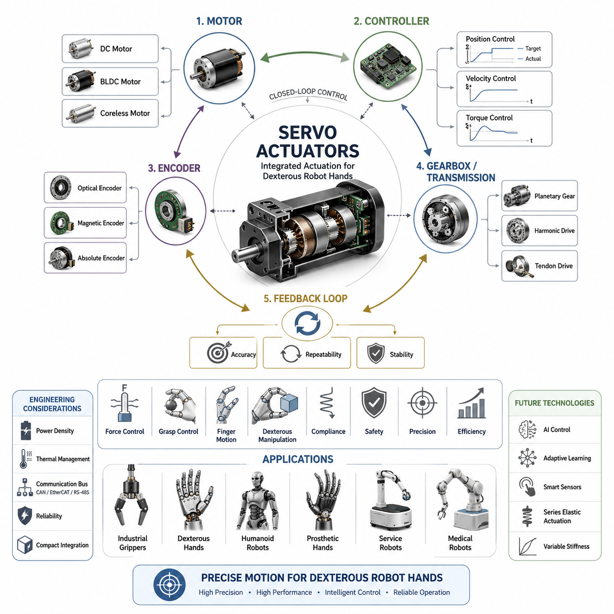{width="7.268055555555556in" height="7.268055555555556in"}

서보 액추에이터(Servo Actuator)는 로봇 공학에서 가장 널리 사용되는 구동 기술 중 하나이며, 단순한 그리퍼(Gripper)에서 인간 수준의 손재주를 갖춘 다지형 로봇 핸드(Dexterous Robot Hand)로 발전하는 과정에서 핵심적인 역할을 수행해 왔다. 서보 액추에이터는 단순한 모터가 아니라 모터(Motor), 위치 센서(Position Sensor), 제어기(Controller), 감속기 또는 전달장치(Transmission), 그리고 피드백 제어 시스템(Feedback Control System)이 하나의 패키지로 통합된 지능형 구동 장치이다. 이러한 통합 구조 덕분에 위치(Position), 속도(Velocity), 가속도(Acceleration), 그리고 경우에 따라 힘(Force)과 토크(Torque)까지 정밀하게 제어할 수 있다. 로봇 핸드에서는 정밀한 손가락 움직임을 구현하고 안정적인 파지(Grasping)를 유지하며 복잡한 조작(Manipulation)을 수행하기 위한 핵심 기술로 활용된다.

서보 제어의 핵심 개념은 폐루프 제어(Closed-Loop Control)에 있다. 개루프(Open-Loop) 방식의 액추에이터는 명령을 실행한 후 실제 결과를 확인하지 않지만, 서보 액추에이터는 목표 상태와 실제 상태를 지속적으로 비교하면서 오차를 최소화하는 방향으로 동작을 수정한다. 이러한 피드백 기반 제어는 로봇 핸드에서 매우 중요하다. 실제 환경에서는 물체의 크기, 무게, 위치, 마찰 조건 등이 항상 변하기 때문에 단순한 명령만으로는 안정적인 파지가 어렵다. 서보 액추에이터는 이러한 변화에 대응하여 원하는 동작을 지속적으로 유지할 수 있게 해준다.

서보 액추에이터의 기본 구조는 여러 하위 시스템으로 구성된다. 중심에는 전기 모터가 위치하며, 이는 브러시드 DC 모터(Brushed DC Motor), 브러시리스 DC 모터(Brushless DC Motor), 코어리스 모터(Coreless Motor) 등 다양한 형태가 사용될 수 있다. 모터에는 감속기나 기계적 전달장치가 연결되어 있으며, 이를 통해 모터의 회전 운동을 실제 손가락 움직임에 적합한 토크와 속도로 변환한다. 엔코더(Encoder), 포텐셔미터(Potentiometer), 리졸버(Resolver), 자기 센서(Magnetic Sensor) 등의 위치 센서는 현재 상태를 측정하며, 제어기는 이 정보를 바탕으로 오차를 계산하고 모터를 제어한다. 이러한 구성 요소들이 결합되어 하나의 지능형 액추에이터를 형성한다.

초기의 로봇 핸드는 주로 위치 제어(Position Control)에 초점을 맞추었다. 손가락을 특정 위치로 이동시키고 물체를 잡는 것이 주요 목적이었다. 하지만 현대의 로봇 핸드는 단순한 위치 제어를 넘어 속도 제어(Velocity Control), 힘 제어(Force Control), 임피던스 제어(Impedance Control), 순응 제어(Compliance Control), 적응형 조작(Adaptive Manipulation)까지 수행한다. 이에 따라 서보 액추에이터 역시 단순한 구동 장치에서 지능형 메카트로닉스(Mechatronics) 시스템으로 발전하고 있다.

서보 액추에이터의 가장 큰 장점 중 하나는 매우 높은 위치 정밀도(Position Accuracy)를 제공할 수 있다는 점이다. 로봇 손가락은 종종 밀리미터 수준 또는 그 이하의 정밀도를 요구받는다. 전자 부품 조립, 의료 기기 조작, 실험실 자동화, 정밀 제조와 같은 분야에서는 매우 정확한 손가락 위치 제어가 필요하다. 서보 시스템은 지속적으로 위치 오차를 수정하기 때문에 개루프 방식보다 훨씬 높은 정밀도를 달성할 수 있다.

반복 정밀도(Repeatability) 역시 중요한 성능 요소이다. 산업용 로봇 핸드는 동일한 작업을 수백만 번 반복 수행해야 한다. 서보 액추에이터는 외란이나 작은 오차가 발생하더라도 항상 목표 위치로 복귀할 수 있기 때문에 높은 반복성을 제공한다. 이러한 특성은 생산 품질 향상, 파지 실패 감소, 공정 안정성 향상에 직접적으로 기여한다.

속도 제어 능력 또한 중요한 장점이다. 물류 자동화, 창고 피킹(Picking), 포장 시스템(Packaging System), 제조 자동화에서는 작업 속도가 생산성에 직접적인 영향을 미친다. 서보 액추에이터는 손가락 속도를 정밀하게 제어할 수 있으며, 부드러운 가속과 감속을 구현하여 충격과 진동을 최소화할 수 있다.

동적 응답 특성(Dynamic Response)은 로봇 핸드 성능을 결정하는 또 다른 요소이다. 물체가 움직이거나 외부 힘이 가해질 경우 손가락은 즉각적으로 반응해야 한다. 서보 액추에이터는 높은 제어 대역폭(Control Bandwidth)을 제공하기 때문에 명령 변화나 환경 변화에 매우 빠르게 대응할 수 있다. 이는 안정적인 파지와 실시간 조작 능력을 가능하게 한다.

토크 생성(Torque Generation)과 토크 제어(Torque Regulation)는 파지 작업의 핵심이다. 로봇 핸드는 물체를 놓치지 않을 정도의 힘을 제공해야 하지만 동시에 물체를 손상시키지 않아야 한다. 서보 액추에이터는 전류 센서(Current Sensor)와 제어 알고리즘을 활용하여 토크를 정확하게 추정하고 제어할 수 있다. 이러한 기능은 깨지기 쉬운 물체, 식품, 의료 장비, 전자 부품 등을 다룰 때 특히 중요하다.

최근에는 힘 제어 기능이 서보 액추에이터 내부에 직접 통합되는 추세이다. 과거에는 위치만 제어했지만, 현대의 서보 시스템은 힘을 직접 제어할 수 있다. 이러한 기능은 다양한 형상의 물체를 다루거나 변형 가능한 물체를 조작할 때 매우 유용하다.

순응성(Compliance)은 인간 손의 중요한 특징 중 하나이다. 인간의 손은 근육(Muscle), 힘줄(Tendon), 인대(Ligament), 연부 조직(Soft Tissue)의 특성으로 인해 자연스럽게 순응성을 가진다. 전통적인 산업용 서보는 강성(Stiffness)을 높이는 데 집중했지만, 사람과 함께 작업하는 로봇에서는 적절한 순응성이 요구된다. 현대 서보 액추에이터는 외부 힘에 유연하게 반응하면서도 제어 성능을 유지할 수 있도록 설계되고 있다.

서보 액추에이터와 촉각 센서(Tactile Sensor)의 결합도 점점 중요해지고 있다. 촉각 센서는 접촉 위치, 압력 분포, 진동, 미끄러짐(Slip), 물체 특성 등을 감지할 수 있다. 서보 액추에이터는 이러한 정보를 활용하여 실시간으로 파지력을 조절한다. 이로써 로봇 핸드는 인간 손과 유사한 적응 능력을 갖추게 된다.

서보 액추에이터는 다양한 크기와 형태로 제공된다. 초소형 마이크로 서보(Micro Servo)는 작은 손가락 내부에 사용될 수 있으며, 중형 서보는 산업용 그리퍼에 적용된다. 고성능 서보는 휴머노이드 로봇과 연구용 다지형 핸드에 사용된다. 이러한 확장성은 다양한 응용 분야에 대응할 수 있는 중요한 장점이다.

최근에는 소형화(Miniaturization)가 중요한 개발 방향이 되고 있다. 인간 손 크기의 로봇 핸드는 수많은 자유도(Degree of Freedom)를 포함해야 하므로 매우 작은 공간에 액추에이터를 집적해야 한다. 모터, 센서, 제어기, 전력 전자 기술의 발전은 이러한 요구를 가능하게 만들고 있다.

브러시리스 서보 액추에이터(Brushless Servo Actuator)는 현재 가장 널리 사용되는 형태 중 하나이다. 브러시리스 모터와 서보 제어 기술을 결합함으로써 높은 효율, 긴 수명, 낮은 유지보수 비용, 우수한 동적 성능을 동시에 제공한다. 현대의 고성능 로봇 핸드는 대부분 이러한 구조를 채택하고 있다.

감속기와 전달장치의 선택도 성능에 큰 영향을 미친다. 유성기어(Planetary Gear)는 효율과 소형화에 강점을 가지며, 하모닉 드라이브(Harmonic Drive)는 높은 정밀도와 거의 없는 백래시(Backlash)를 제공한다. 사이클로이드 감속기(Cycloidal Reducer)는 내구성과 충격 저항성이 우수하다. 또한 벨트(Belt), 케이블(Cable), 텐던(Tendon) 시스템도 특정 응용 분야에서 사용된다.

백래시 감소는 서보 액추에이터 설계에서 매우 중요한 목표이다. 백래시는 기어 사이의 유격을 의미하며, 과도한 백래시는 위치 오차와 제어 불안정을 유발한다. 고급 서보 시스템은 정밀 가공, 프리로드(Preload) 구조, 보상 알고리즘 등을 활용하여 이를 최소화한다.

센서 기술은 서보 액추에이터 성능의 핵심이다. 광학 엔코더(Optical Encoder)는 매우 높은 해상도를 제공하며, 자기 엔코더(Magnetic Encoder)는 소형화와 내구성에 유리하다. 절대형 엔코더(Absolute Encoder)는 전원이 꺼졌다가 켜져도 즉시 위치를 알 수 있어 편리하다. 이러한 센서들은 정밀한 피드백 제어를 가능하게 한다.

현대의 서보 제어기는 PID(Proportional-Integral-Derivative) 제어뿐 아니라 모델 기반 제어(Model-Based Control), 적응 제어(Adaptive Control), 외란 관측기(Disturbance Observer), 피드포워드 보상(Feedforward Compensation), 학습 기반 제어(Learning-Based Control) 등을 활용한다. 이러한 알고리즘은 정밀도와 안정성을 더욱 향상시킨다.

통신 기능도 점점 중요해지고 있다. 과거에는 단순한 PWM 신호만 사용되었지만 현재는 CAN, EtherCAT, RS-485, 산업용 이더넷(Industrial Ethernet)과 같은 고속 통신 프로토콜이 사용된다. 이를 통해 다수의 액추에이터를 정밀하게 동기화하고 실시간 진단 기능도 제공할 수 있다.

에너지 효율(Energy Efficiency)은 이동형 로봇과 휴머노이드에서 매우 중요하다. 효율적인 서보 액추에이터는 전력 소비를 줄이고 열 발생을 감소시키며 작동 시간을 늘린다. 회생 제동(Regenerative Braking)과 지능형 전력 관리 기술도 점점 더 많이 적용되고 있다.

열 관리(Thermal Management)는 여전히 중요한 과제이다. 장시간 작동 시 발생하는 열은 모터 효율과 센서 정확도에 영향을 미친다. 따라서 열전도 구조, 방열 설계, 온도 모니터링 기능 등이 중요하게 고려된다.

신뢰성(Reliability)은 산업용 서보 액추에이터의 핵심 가치이다. 수백만 번 이상의 동작 사이클 동안 안정적으로 동작해야 하므로 내구성 높은 기계 구조와 전자 회로, 환경 보호 기능, 고장 감지 기능이 필수적이다.

안전성(Safety)은 협동 로봇 시대에 더욱 중요해지고 있다. 서보 액추에이터는 토크 제한(Torque Limiting), 충돌 감지(Collision Detection), 비상 정지(Emergency Stop), 고장 진단(Fault Monitoring) 등의 기능을 제공하여 사람과의 안전한 상호작용을 가능하게 한다.

로봇 핸드에 서보 액추에이터를 통합하는 과정은 단순히 부품을 장착하는 것이 아니다. 액추에이터의 위치는 무게 중심과 관성에 영향을 주며, 전력 요구사항은 배터리와 냉각 시스템 설계에 영향을 준다. 또한 통신 구조는 시스템 확장성과 동기화 성능을 결정한다. 따라서 성공적인 로봇 핸드 개발을 위해서는 액추에이터 자체뿐 아니라 전체 시스템 관점에서의 설계가 필요하다.

미래의 서보 액추에이터는 더욱 지능화될 것으로 예상된다. 인공지능(AI), 스마트 센서(Smart Sensor), 고성능 임베디드 프로세서(Embedded Processor), 통합형 전자장치, 초소형 감속기 기술이 발전하면서 액추에이터 자체가 학습하고 최적화하는 방향으로 진화하고 있다. 향후에는 예지 정비(Predictive Maintenance), 자율 최적화(Autonomous Optimization), 온보드 인공지능(On-Board AI) 기능이 통합된 스마트 서보 액추에이터가 등장할 것으로 전망된다.

로봇 조작 기술이 인간 수준의 손재주에 가까워질수록 서보 액추에이터의 중요성은 더욱 커질 것이다. 정밀한 위치 제어, 힘 제어, 높은 신뢰성, 우수한 적응성, 지능형 피드백 처리 능력을 동시에 제공하는 서보 액추에이터는 앞으로도 로봇 핸드 기술의 핵심 기반으로 활용될 것이다. 로봇 핸드 공학 관점에서 서보 액추에이터는 단순한 구동 장치를 넘어 센싱(Sensing), 계산(Computation), 제어(Control)를 실제 물리적 동작으로 변환하는 핵심 메카트로닉스 플랫폼이라고 할 수 있다.

## 03.04 Pneumatic Actuators

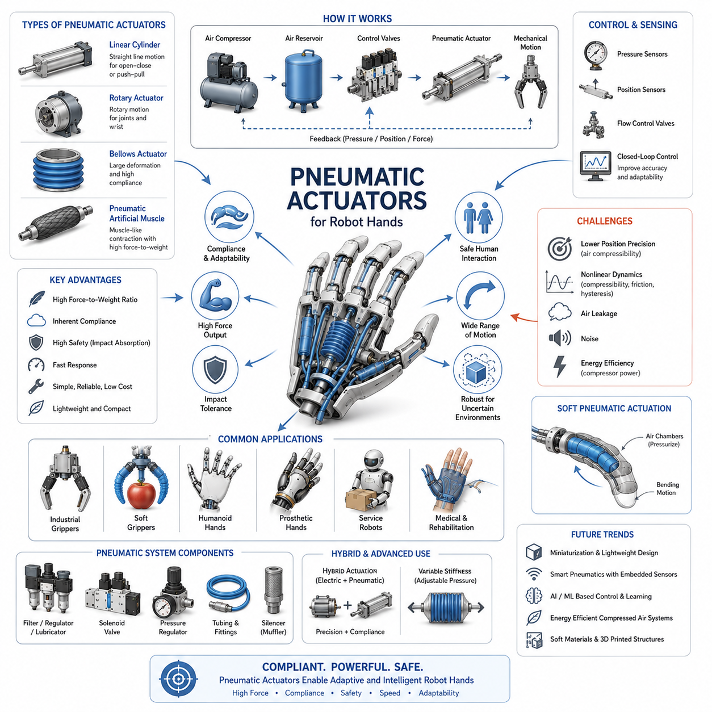{width="7.268055555555556in" height="7.268055555555556in"}

공압 액추에이터(Pneumatic Actuators)는 수십 년 동안 산업 자동화와 로봇 조작 분야에서 중요한 역할을 수행해 왔으며, 오늘날에도 로봇 핸드(Robot Hand), 적응형 그리퍼(Adaptive Gripper), 소프트 로봇(Soft Robot)의 핵심 구동 기술 중 하나로 활용되고 있다. 로봇 핸드 공학의 관점에서 공압 액추에이터는 단순한 구조, 높은 출력 대비 중량비, 본질적인 순응성(Compliance), 그리고 높은 안전성을 동시에 제공한다. 정밀 위치 제어가 필요한 경우에는 전기식 서보 액추에이터가 주류를 이루지만, 물체와의 접촉이 많고 환경 변화가 큰 상황에서는 공압 시스템이 매우 강력한 장점을 가진다. 특히 인간과 유사한 상호작용 능력을 요구하는 차세대 로봇 핸드가 등장하면서 공압 액추에이터의 중요성은 다시 높아지고 있다.

공압 액추에이터는 압축 공기(Compressed Air)에 저장된 에너지를 기계적 운동으로 변환하는 장치이다. 전기 모터가 전자기력을 이용하여 토크를 생성하는 것과 달리, 공압 액추에이터는 압축 공기의 압력이 피스톤(Piston), 다이어프램(Diaphragm), 벨로우즈(Bellows), 또는 유연한 챔버(Flexible Chamber)에 작용하면서 힘을 발생시킨다. 압축 공기가 내부로 공급되면 압력 차이가 생성되고, 이 압력 차이가 운동을 만들어낸다. 공기의 흐름과 압력, 그리고 밸브 동작을 제어함으로써 다양한 형태의 로봇 손가락 움직임을 구현할 수 있다.

공압 시스템의 기본 원리는 유체 동력(Fluid Power)에 기반한다. 외부 컴프레서(Compressor)가 공기를 압축하여 저장 탱크에 보관하거나 직접 공급하고, 제어 밸브가 공기의 흐름을 조절하여 액추에이터 내부 압력을 변화시킨다. 이 과정에서 발생하는 팽창과 수축이 기계적 운동으로 변환된다. 공기는 압축 가능한 매질이기 때문에 자연스럽게 유연성과 충격 흡수 능력을 가지며, 이는 로봇 핸드가 물체를 안전하게 다루는 데 매우 유리하다.

공압 액추에이터의 가장 큰 장점 중 하나는 본질적인 순응성이다. 인간의 손은 물체를 잡을 때 단순히 위치를 제어하는 것이 아니라 힘과 유연성을 동시에 활용한다. 반면 강성이 높은 전기식 로봇 손가락은 충돌 시 물체를 손상시키거나 과도한 힘을 가할 수 있다. 공압 액추에이터는 압축 공기가 완충재 역할을 수행하기 때문에 충격을 흡수하고 물체 형상에 자연스럽게 적응할 수 있다. 이로 인해 파손 위험이 줄어들고 그립 안정성이 향상된다.

공압 기술은 산업 자동화 초기부터 널리 사용되어 왔다. 제조 공장에서는 이미 압축 공기 인프라가 구축되어 있었기 때문에 공압 실린더와 공압 그리퍼가 자동화 설비의 표준 솔루션으로 자리 잡았다. 금속 부품, 식품, 전자 제품 등 다양한 제품을 빠르고 안정적으로 취급할 수 있었으며, 오늘날에도 많은 산업용 로봇 그리퍼가 공압 방식을 채택하고 있다.

로봇 핸드에서 사용되는 공압 액추에이터는 여러 형태로 구현된다. 가장 일반적인 형태는 공압 실린더(Pneumatic Cylinder)이다. 공압 실린더는 피스톤 운동을 통해 직선 운동을 생성하며, 산업용 평행 그리퍼(Parallel Gripper)의 개폐 동작에 널리 사용된다. 구조가 단순하고 신뢰성이 높아 반복적인 작업에 적합하다.

회전형 공압 액추에이터(Rotary Pneumatic Actuator)는 직선 운동 대신 회전 운동을 생성한다. 이러한 액추에이터는 손가락 관절, 손목 메커니즘, 회전형 그리퍼 등에 적용된다. 베인(Vane) 구조나 랙앤피니언(Rack-and-Pinion) 메커니즘을 활용하여 공기 압력을 회전 토크로 변환하며, 인간 손가락과 유사한 굽힘 동작을 구현할 수 있다.

벨로우즈 액추에이터(Bellows Actuator)는 공기 압력 변화에 따라 팽창과 수축을 반복하는 구조이다. 벨로우즈는 부드럽고 연속적인 움직임을 생성할 수 있기 때문에 소프트 로봇 핸드에서 매우 유용하다. 특히 불규칙한 형상의 물체를 다룰 때 접촉면을 넓게 확보할 수 있어 안정적인 그립을 제공한다.

공압 인공근육(Pneumatic Artificial Muscle, PAM)은 공압 기술의 가장 흥미로운 발전 중 하나이다. 맥키벤 근육(McKibben Muscle)이라고도 불리는 이 기술은 인간의 근육 구조를 모방한다. 내부 압력이 증가하면 액추에이터가 수축하면서 강한 인장력을 발생시키며, 높은 출력 대비 낮은 중량을 제공한다. 또한 인간 근육과 유사한 순응성을 갖기 때문에 휴머노이드 로봇(Humanoid Robot)이나 웨어러블 로봇(Wearable Robot)에서 큰 관심을 받고 있다.

공압 액추에이터의 힘 생성 능력은 매우 우수하다. 비교적 작은 크기의 액추에이터도 높은 압력을 사용할 경우 상당한 힘을 생성할 수 있다. 따라서 대형 물체를 다루는 산업용 그리퍼나 물류 자동화 시스템에서 효과적으로 활용된다. 전기 모터와 복잡한 감속기 없이도 높은 출력이 가능하다는 점은 큰 장점이다.

속도 또한 공압 시스템의 강점이다. 압축 공기는 매우 빠르게 이동할 수 있기 때문에 밸브 개폐만으로도 고속 동작이 가능하다. 제조 공정이나 물류 창고에서는 생산성을 높이기 위해 짧은 사이클 타임이 요구되는데, 공압 그리퍼는 이러한 요구를 충족시키기에 적합하다.

그러나 공압 액추에이터는 몇 가지 한계도 가진다. 가장 대표적인 문제는 제어 정밀도이다. 공기는 압축 가능한 유체이기 때문에 전기식 서보 모터처럼 정확한 위치 제어를 수행하기 어렵다. 하중 변화, 온도 변화, 압력 변화 등에 따라 동작 특성이 달라질 수 있으며, 정밀 조립이나 인핸드 매니퓰레이션(In-Hand Manipulation)과 같은 작업에서는 어려움이 존재한다.

이를 해결하기 위해 최근의 공압 시스템은 폐루프 제어(Closed-Loop Control)를 적극적으로 활용한다. 압력 센서, 위치 센서, 유량 센서 등을 사용하여 현재 상태를 실시간으로 측정하고, 제어기가 밸브를 지속적으로 조정하여 원하는 동작을 구현한다. 모델 기반 제어(Model-Based Control)와 적응 제어(Adaptive Control)를 적용하면 공압 시스템의 정밀도를 크게 향상시킬 수 있다.

공압 시스템은 비선형성(Nonlinearity)이 강하다는 특징을 가진다. 공기의 압축성, 유량 변화, 마찰, 히스테리시스(Hysteresis), 압력 지연 등의 현상이 복합적으로 작용하기 때문이다. 따라서 정확한 시스템 모델링과 시뮬레이션이 매우 중요하며, 최근에는 AI 기반 모델링 기법도 활용되고 있다.

소프트 로보틱스(Soft Robotics)의 발전은 공압 액추에이터에 대한 관심을 크게 증가시켰다. 많은 소프트 그리퍼는 내부에 공압 챔버를 포함하고 있으며, 압력이 가해지면 손가락이 자연스럽게 굽어 물체를 감싼다. 과일, 채소, 의료 기기, 실험실 샘플과 같은 깨지기 쉬운 물체를 다루는 데 매우 효과적이다.

이러한 소프트 공압 손가락은 일반적으로 실리콘(Silicone)과 같은 탄성체를 이용하여 제작된다. 내부 공기 채널의 형상에 따라 특정 방향으로 굽힘이 발생하도록 설계되며, 복잡한 센서나 제어 없이도 높은 적응성을 제공한다.

최근에는 공압과 전기 구동을 결합한 하이브리드 로봇 핸드(Hybrid Robot Hand)도 활발히 연구되고 있다. 전기 모터는 정밀 위치 제어를 담당하고, 공압 시스템은 순응성과 적응성을 제공한다. 이를 통해 두 기술의 장점을 동시에 활용할 수 있다.

에너지 효율 측면에서는 공압 시스템이 다소 불리할 수 있다. 액추에이터 자체는 단순하지만 압축 공기를 생성하는 컴프레서가 상당한 전력을 소비하기 때문이다. 또한 압축 과정에서 에너지 손실이 발생하며, 공기 누설 역시 효율 저하의 원인이 된다.

공기 누설(Air Leakage)은 공압 시스템에서 흔히 발생하는 문제이다. 배관, 피팅, 밸브, 실링 부품이 많기 때문에 장기간 사용 시 누설 가능성이 존재한다. 따라서 정기적인 유지보수와 신뢰성 높은 밀봉 기술이 중요하다.

소음 또한 고려해야 할 요소이다. 압축 공기가 배출될 때 발생하는 소음은 서비스 로봇이나 병원 환경에서 문제가 될 수 있다. 이를 해결하기 위해 소음기(Muffler)나 저소음 배기 구조가 적용된다.

안전성은 공압 액추에이터의 가장 큰 장점 중 하나이다. 충돌 시 압축 공기가 충격을 흡수하기 때문에 사람에게 가해지는 위험이 상대적으로 낮다. 인간과 로봇이 함께 작업하는 협동 로봇(Collaborative Robot) 환경에서 이러한 특성은 매우 중요한 의미를 가진다.

최근 마이크로 공압 기술(Micro Pneumatics)의 발전으로 소형 로봇 핸드에도 공압 액추에이터를 적용할 수 있게 되었다. 초소형 밸브, 경량 튜브, 통합 압력 제어 모듈 등이 개발되면서 웨어러블 로봇, 의료 로봇, 의수(Prosthetic Hand) 분야에서도 활용이 확대되고 있다.

촉각 센서(Tactile Sensor)와 공압 액추에이터의 결합 역시 중요한 연구 분야이다. 촉각 센서가 접촉 압력과 미끄러짐(Slip)을 감지하면 공압 시스템이 즉시 그립 힘을 조정하여 안정성을 유지할 수 있다. 이러한 피드백 기반 제어는 더욱 지능적인 로봇 핸드를 가능하게 한다.

인공지능(AI)과 머신러닝(Machine Learning)은 공압 시스템 제어에도 활용되고 있다. AI는 복잡한 공압 동역학을 학습하여 제어 성능을 향상시키고, 강화학습(Reinforcement Learning)은 다양한 물체에 대한 최적의 그립 전략을 자동으로 학습할 수 있다.

재활 로봇과 의료 로봇 분야에서도 공압 액추에이터는 중요한 역할을 수행한다. 재활용 로봇 장갑은 환자의 손가락 움직임을 보조하기 위해 공압 구동을 사용하며, 의수 시스템에서도 보다 자연스러운 움직임을 구현하기 위해 활용되고 있다.

휴머노이드 로봇 분야 역시 공압 기술의 중요한 응용 영역이다. 인간의 근육과 유사한 특성을 제공하는 공압 인공근육은 인간과 비슷한 움직임과 안전성을 구현하는 데 유리하다. 미래의 휴머노이드 로봇에서는 전기 모터와 함께 공압 인공근육이 핵심 기술 중 하나로 사용될 가능성이 높다.

향후 공압 액추에이터는 더욱 정밀한 제어, 높은 에너지 효율, 소형화, 센서 융합 기술을 중심으로 발전할 것으로 예상된다. 스마트 공압 액추에이터(Smart Pneumatic Actuator)는 내장 센서와 임베디드 제어기를 포함하여 스스로 상태를 모니터링하고 최적의 동작을 수행할 수 있게 될 것이다.

또한 가변 강성(Variable Stiffness) 기술은 공압 시스템과 매우 밀접하게 연관되어 있다. 내부 압력을 조절함으로써 손가락의 강성을 실시간으로 변화시킬 수 있으며, 이를 통해 부드러운 물체를 다룰 때는 유연하게, 무거운 물체를 다룰 때는 강하게 동작할 수 있다. 이러한 적응성은 인간 손과 유사한 조작 능력을 구현하는 데 중요한 역할을 한다.

결론적으로 공압 액추에이터는 높은 순응성, 우수한 출력 대비 중량비, 뛰어난 안전성, 그리고 강력한 적응성을 제공하는 로봇 핸드용 핵심 구동 기술이다. 정밀 제어 측면에서는 전기식 액추에이터에 비해 제약이 존재하지만, 소프트 로보틱스, 협동 로봇, 휴머노이드 로봇, 의료 로봇 분야에서 그 가치는 지속적으로 증가하고 있다. 센서 기술, AI 기반 제어, 소프트 소재 기술의 발전과 함께 공압 액추에이터는 미래의 지능형 로봇 핸드와 덱스터러스 매니퓰레이션(Dexterous Manipulation)을 구현하는 중요한 기반 기술로 자리 잡을 것으로 기대된다.

## 03.05 Hydraulic Micro Actuators

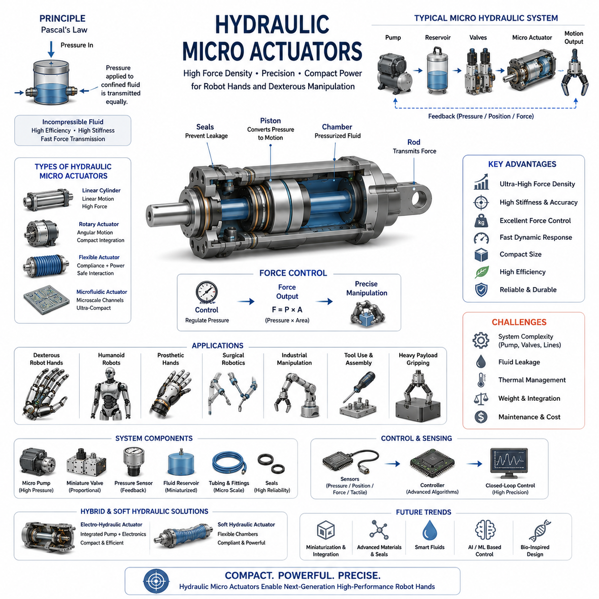{width="7.268055555555556in" height="7.268055555555556in"}

유압 마이크로 액추에이터(Hydraulic Micro Actuators)는 로봇 핸드(Robot Hand), 덱스터러스 매니퓰레이터(Dexterous Manipulator), 휴머노이드 로봇(Humanoid Robot), 그리고 생체모사 로봇(Bio-inspired Robot)에 적용될 수 있는 가장 강력한 구동 기술 중 하나이다. 전기식 서보 액추에이터가 대부분의 상용 로봇 핸드 시장을 지배하고 있고, 공압 액추에이터가 우수한 순응성(Compliance)을 제공하는 반면, 유압 마이크로 액추에이터는 매우 작은 공간에서 극도로 높은 힘을 생성할 수 있다는 독특한 장점을 가진다. 로봇 핸드가 인간 수준의 힘과 정교한 조작 능력을 목표로 발전함에 따라, 유압 마이크로 액추에이터는 제한된 공간 안에서 높은 출력과 정밀한 힘 제어를 동시에 구현할 수 있는 핵심 기술로 주목받고 있다.

유압 액추에이션(Hydraulic Actuation)은 압력을 가진 비압축성 유체(Incompressible Fluid)를 이용하여 동력을 전달하는 방식이다. 공압 시스템이 압축 가능한 공기를 사용하는 것과 달리, 유압 시스템은 유압유(Hydraulic Oil), 합성 유체(Synthetic Fluid), 수계 유체(Water-Based Fluid) 또는 특수 마이크로 유체(Microfluidic Medium)를 사용한다. 액체는 거의 압축되지 않기 때문에 에너지 전달 효율이 높고 강성(Stiffness)이 우수하다. 이러한 특성은 로봇 손가락이 큰 힘을 생성하면서도 안정적이고 정밀한 움직임을 수행해야 하는 경우 매우 유리하다.

유압 액추에이터의 기본 원리는 파스칼의 법칙(Pascal's Law)에 기반한다. 밀폐된 유체에 가해진 압력은 유체 전체에 동일하게 전달된다. 유압 펌프(Hydraulic Pump)가 압력을 생성하면, 그 압력은 밸브와 유압 라인을 통해 작은 실린더나 챔버로 전달된다. 그 결과 피스톤(Piston)이나 유연한 구조물에 힘이 작용하여 기계적인 운동이 발생한다. 이 운동은 손가락 관절, 그리퍼, 또는 다양한 매니퓰레이션 메커니즘을 구동하는 데 사용된다.

유압 마이크로 액추에이터는 기존의 대형 유압 시스템을 초소형화한 기술이다. 전통적인 유압 시스템은 건설 장비, 항공기 제어 시스템, 산업용 프레스, 중장비 등에 널리 사용되어 왔다. 최근에는 정밀 가공(Precision Machining), 적층 제조(Additive Manufacturing), 마이크로 유체공학(Microfluidics), MEMS 기술의 발전으로 인해 유압 시스템을 손가락 크기 수준까지 축소할 수 있게 되었다. 이러한 발전은 로봇 핸드, 의수(Prosthetic Hand), 수술 로봇(Surgical Robot), 휴머노이드 로봇 등에 새로운 가능성을 열어주고 있다.

유압 마이크로 액추에이터의 가장 큰 장점은 뛰어난 출력 밀도(Power Density)이다. 출력 밀도란 단위 부피 또는 단위 중량당 생성 가능한 힘의 크기를 의미한다. 동일한 공간을 사용할 경우 유압 액추에이터는 전기식이나 공압식 액추에이터보다 훨씬 큰 힘을 생성할 수 있다. 이는 공간이 매우 제한적인 로봇 손가락 설계에서 결정적인 장점이 된다.

인간의 손은 작은 크기에도 불구하고 상당한 힘을 생성할 수 있다. 이러한 생물학적 특성을 인공적으로 재현하는 것은 매우 어려운 과제이다. 유압 마이크로 액추에이터는 이러한 인간 손의 근육 성능에 가장 근접할 수 있는 기술 중 하나로 평가받는다. 따라서 차세대 덱스터러스 핸드 연구에서 지속적으로 관심을 받고 있다.

유압 마이크로 액추에이터는 여러 가지 형태로 구현될 수 있다. 가장 일반적인 구조는 초소형 유압 실린더(Miniature Hydraulic Cylinder)이다. 이 구조에서는 작은 피스톤이 유압에 의해 이동하며 직선 운동을 생성한다. 생성된 직선 운동은 링크(Linkage)나 기어 메커니즘을 통해 회전 운동으로 변환되어 손가락 관절을 구동할 수 있다.

또 다른 방식은 유압 회전 액추에이터(Hydraulic Rotary Actuator)이다. 이 방식은 직선 운동 대신 직접 회전 운동을 생성한다. 손가락 관절에 직접 연결할 수 있어 구조를 단순화할 수 있으며, 특히 다관절 구조를 가진 인간형 손 설계에 적합하다.

유연 유압 액추에이터(Flexible Hydraulic Actuator)는 유압과 유연한 재료를 결합한 기술이다. 유압의 높은 출력과 소프트 구조의 순응성을 동시에 제공할 수 있기 때문에 사람과 안전하게 상호작용하는 로봇 핸드에 적합하다.

마이크로 유체 액추에이터(Microfluidic Actuator)는 반도체 공정과 유사한 방식으로 제작된 미세 채널과 챔버를 이용한다. 매우 작은 공간에서 정밀한 유체 흐름 제어가 가능하기 때문에 의료 로봇, 수술 기기, 생체모사 시스템 등에 활용된다.

유압 유체의 비압축성은 여러 성능적 장점을 제공한다. 힘 전달이 즉각적으로 이루어지며, 높은 강성을 유지할 수 있다. 따라서 공압 시스템에서 흔히 발생하는 탄성 변형이나 지연 현상이 적고, 정밀한 힘 제어가 가능하다. 이는 공구 사용(Tool Use), 정밀 조립(Assembly), 삽입 작업(Insertion Task), 접촉 기반 조작(Contact-Rich Manipulation)과 같은 작업에 매우 유리하다.

유압 시스템은 힘 제어(Force Control)에 있어서도 강력한 장점을 가진다. 압력과 출력 힘 사이의 관계가 비교적 명확하기 때문에 압력을 조절함으로써 손끝(Fingertip)에 전달되는 힘을 정밀하게 조절할 수 있다. 이러한 능력은 깨지기 쉬운 물체를 다루거나, 안정적인 접촉 상태를 유지하거나, 인핸드 매니퓰레이션(In-Hand Manipulation)을 수행할 때 매우 중요하다.

동적 응답성(Dynamic Response) 역시 뛰어나다. 고압 유체는 매우 빠르게 에너지를 전달할 수 있기 때문에 강력하면서도 민첩한 움직임을 구현할 수 있다. 이러한 특성은 휴머노이드 로봇이나 야외 작업용 로봇(Field Robot)에서 특히 유용하다.

그러나 유압 마이크로 액추에이터는 여러 가지 기술적 과제도 가진다. 가장 큰 문제 중 하나는 시스템 복잡성(System Complexity)이다. 전기 모터는 전원과 제어 신호만 있으면 되지만, 유압 시스템은 펌프, 저장 탱크, 밸브, 배관, 씰(Seal), 유체 관리 시스템 등이 추가적으로 필요하다. 이를 손가락 내부에 통합하는 것은 매우 어려운 공학적 과제이다.

유체 누설(Fluid Leakage)은 또 다른 중요한 문제이다. 유압 시스템은 높은 압력으로 동작하기 때문에 작은 누설도 성능 저하와 유지보수 비용 증가를 초래할 수 있다. 특히 로봇 핸드처럼 반복적으로 움직이는 구조에서는 신뢰성 높은 밀봉 기술이 필수적이다.

열 관리(Thermal Management) 역시 중요하다. 유체 마찰, 펌프 동작, 밸브 전환 과정에서 열이 발생하며, 온도가 지나치게 상승하면 유체 특성이 변하고 효율이 감소할 수 있다. 따라서 냉각 구조와 열 방출 경로를 적절히 설계해야 한다.

무게 또한 고려해야 할 요소이다. 액추에이터 자체는 매우 높은 출력 밀도를 제공하지만, 펌프와 유압유 저장소, 배관 시스템이 추가되면 전체 시스템 무게가 증가할 수 있다. 따라서 이동 로봇이나 휴머노이드 로봇에서는 출력과 중량 사이의 균형이 중요하다.

최근에는 전기유압 액추에이터(Electro-Hydraulic Actuator)가 주목받고 있다. 전기 모터와 소형 유압 회로를 통합한 형태로, 펌프와 제어 시스템을 하나의 모듈 안에 포함시켜 외부 인프라를 최소화한다. 이러한 기술은 유압의 장점과 전기식 제어의 편의성을 동시에 제공한다.

소프트 유압 액추에이터(Soft Hydraulic Actuator)는 소프트 로보틱스 분야에서 활발히 연구되고 있다. 유연한 챔버 내부에 유압을 가하여 구조물이 변형되도록 하는 방식으로, 높은 출력과 안전한 상호작용을 동시에 구현할 수 있다.

생체모사 로봇(Bio-inspired Robotics) 분야에서도 유압 기술은 중요한 역할을 한다. 거미(Spider)의 다리나 일부 해양 생물은 유체 압력을 이용하여 움직인다. 연구자들은 이러한 생물학적 원리를 응용하여 효율적이고 자연스러운 움직임을 구현하는 유압 기반 로봇 손가락을 개발하고 있다.

휴머노이드 로봇은 유압 마이크로 액추에이터의 가장 유망한 응용 분야 중 하나이다. 인간과 유사한 크기 안에서 강력한 힘을 생성해야 하기 때문에 유압 시스템은 매우 매력적인 선택지가 된다. 실제로 일부 고성능 휴머노이드 연구 플랫폼에서는 유압 기반 손 구동 시스템이 실험적으로 적용되고 있다.

의수 개발 분야에서도 유압 액추에이터는 높은 잠재력을 가진다. 의수는 강한 힘, 가벼운 무게, 자연스러운 움직임을 동시에 만족해야 한다. 유압 기술은 인간 손에 가까운 힘을 제공하면서도 정밀한 조작이 가능하기 때문에 차세대 의수 기술의 후보로 평가받고 있다.

의료 로봇(Medical Robotics)에서도 유압 액추에이터는 중요한 역할을 한다. 수술 로봇은 매우 작은 공간에서 높은 힘과 정밀한 제어를 동시에 요구한다. 유압 마이크로 액추에이터는 이러한 요구 조건을 충족할 수 있는 강력한 기술이다.

고성능 유압 로봇 핸드에는 다양한 센서가 통합된다. 압력 센서(Pressure Sensor)는 유압 상태를 모니터링하고, 위치 센서(Position Sensor)는 관절 움직임을 측정한다. 힘 센서(Force Sensor)와 촉각 센서(Tactile Sensor)는 물체와의 상호작용을 감지하여 정교한 폐루프 제어를 가능하게 한다.

현대의 제어 기술은 유압 시스템의 성능을 크게 향상시켰다. 동역학 모델, 상태 추정(State Estimation), 적응 제어(Adaptive Control), 예측 제어(Model Predictive Control) 등이 적용되어 과거에는 어려웠던 정밀 제어가 가능해지고 있다.

인공지능(AI)과 머신러닝(Machine Learning) 역시 유압 로봇 시스템에 적용되고 있다. AI는 복잡한 유압 특성을 학습하여 최적의 제어 전략을 생성하고, 강화학습은 다양한 조작 작업을 스스로 학습할 수 있게 한다.

신뢰성과 내구성은 유압 기술의 전통적인 강점이다. 적절하게 설계된 유압 부품은 장기간에 걸쳐 안정적인 성능을 유지할 수 있으며, 산업용 로봇, 국방 로봇, 야외 작업 로봇과 같은 환경에서 매우 높은 가치를 가진다.

향후 연구는 소형화(Miniaturization), 통합화(Integration), 효율 향상(Efficiency), 지능화(Intelligence)에 집중될 것으로 예상된다. 미래의 유압 마이크로 액추에이터는 펌프, 밸브, 센서, 제어기, 저장소를 손가락 내부에 모두 통합한 완전 독립형 구동 모듈로 발전할 가능성이 높다.

또한 생분해성 유압유(Biodegradable Hydraulic Fluid), 저점도 합성 유체(Low-Viscosity Synthetic Fluid), 자기유변유체(Magnetorheological Fluid)와 같은 새로운 유체 기술도 연구되고 있다. 이러한 기술은 성능과 안전성, 적응성을 더욱 향상시킬 것으로 기대된다.

로봇 핸드 공학 전체 관점에서 볼 때 유압 마이크로 액추에이터는 매우 독특한 위치를 차지한다. 전기식 액추에이터는 높은 정밀도를 제공하고, 공압 액추에이터는 순응성과 안전성을 제공하며, 유압 액추에이터는 압도적인 힘 밀도와 출력 성능을 제공한다. 미래의 로봇 핸드는 이러한 기술들을 경쟁 관계가 아닌 상호 보완적인 기술로 활용하게 될 가능성이 높다.

결론적으로 유압 마이크로 액추에이터는 차세대 고성능 로봇 핸드를 위한 매우 강력한 구동 기술이다. 뛰어난 출력 밀도, 정밀한 힘 제어, 높은 강성, 우수한 동적 응답 특성은 기존 액추에이터로는 구현하기 어려운 수준의 조작 능력을 제공한다. 비록 시스템 복잡성, 누설 문제, 열 관리, 통합 난이도와 같은 과제가 존재하지만, 마이크로 유압 기술(Micro-Hydraulics), 전기유압 시스템(Electro-Hydraulics), 소프트 로보틱스(Soft Robotics), 인공지능 제어 기술의 발전에 따라 그 활용 범위는 계속 확대되고 있다. 미래의 로봇 핸드가 인간 수준의 힘과 정교한 조작 능력에 가까워질수록 유압 마이크로 액추에이터는 핵심 기반 기술 중 하나로 자리 잡게 될 것이다.

## 03.06 Shape Memory Alloy Actuators

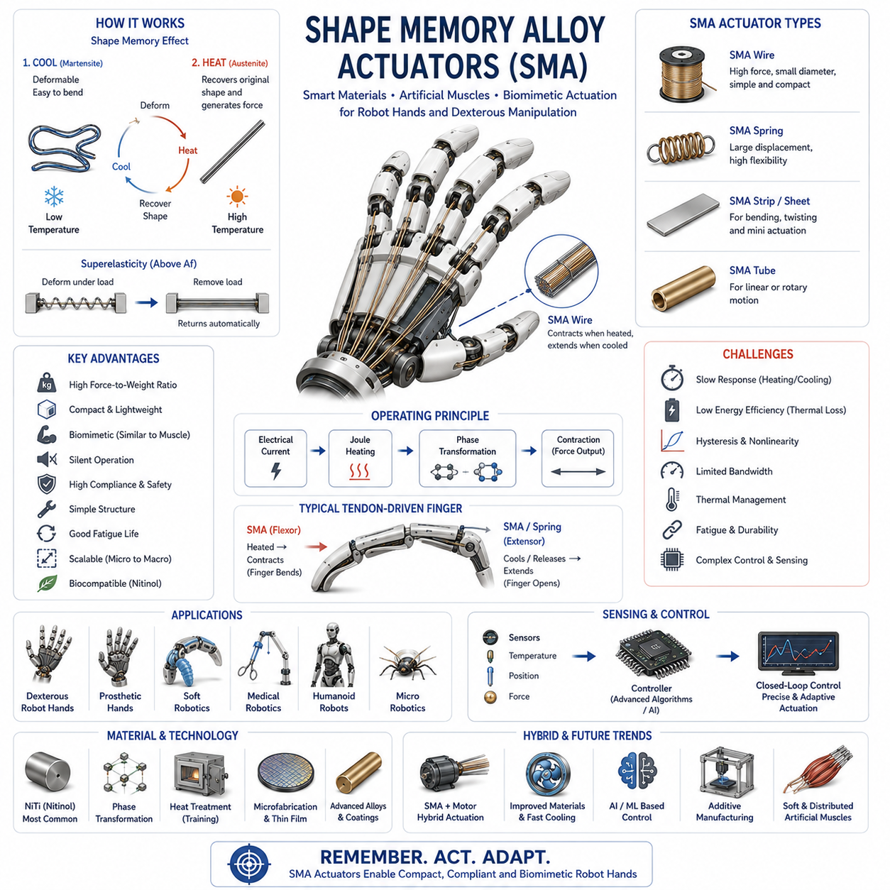{width="7.268055555555556in" height="7.268055555555556in"}

형상기억합금 액추에이터(Shape Memory Alloy Actuator, SMA)는 현대 로봇공학에서 가장 흥미롭고 생체모사적(Biomimetic)인 구동 기술 중 하나이다. 기존의 액추에이터가 전자기력, 유체 압력, 또는 기계적 전달장치를 이용하여 운동을 생성하는 것과 달리, 형상기억합금 액추에이터는 금속 내부의 원자 구조 변화(Phase Transformation)를 이용하여 운동을 발생시킨다. 이러한 독특한 원리는 매우 작은 크기에서도 상당한 힘과 변위를 생성할 수 있게 해주며, 인공 근육(Artificial Muscle)에 가장 가까운 구동 기술 중 하나로 평가받고 있다. 로봇 핸드와 덱스터러스 매니퓰레이션(Dexterous Manipulation) 분야에서 SMA 액추에이터는 가볍고, 조용하며, 순응성이 높고, 인간 근육과 유사한 특성을 제공할 수 있기 때문에 지속적으로 주목받고 있다.

형상기억합금의 개념은 특정 금속 합금이 온도 변화에 따라 가역적인 결정 구조 변화를 일으킨다는 사실에서 출발한다. 가장 대표적인 재료는 니켈-티타늄(Nickel-Titanium) 합금인 니티놀(Nitinol)이다. 니티놀은 우수한 기계적 특성, 큰 복원 변형률, 높은 내식성(Corrosion Resistance), 생체 적합성(Biocompatibility), 그리고 긴 수명을 제공하기 때문에 가장 널리 사용되는 SMA 재료이다. 적절한 열처리 과정을 거친 니티놀은 특정 형상을 기억하고 있다가 일정 온도 이상으로 가열되면 원래의 형상으로 복귀한다.

SMA 액추에이터의 동작 원리는 전기 모터, 공압 실린더, 유압 피스톤과는 완전히 다르다. 회전 운동이나 직선 운동을 직접 생성하는 것이 아니라, 금속 내부의 상변화(Phase Transformation)를 통해 운동을 발생시킨다. 낮은 온도에서는 마르텐사이트(Martensite) 상태에 존재하며 비교적 부드럽고 쉽게 변형된다. 이후 온도가 상승하면 오스테나이트(Austenite) 상태로 전환되면서 기억된 형상으로 되돌아가고, 이 과정에서 힘과 운동이 생성된다.

형상기억효과(Shape Memory Effect)는 SMA의 가장 중요한 특성이다. 제조 과정에서 특정 형상을 기억하도록 훈련된 합금은 저온 상태에서 자유롭게 변형될 수 있다. 그러나 다시 가열되면 스스로 원래 형상으로 복귀한다. 이러한 특성 덕분에 SMA 와이어(Wire), 스프링(Spring), 스트립(Strip), 튜브(Tube)는 액추에이터로 활용될 수 있으며, 로봇 손가락을 구부리거나 그리퍼를 닫거나 관절을 회전시키는 다양한 동작을 구현할 수 있다.

SMA와 밀접하게 관련된 또 다른 현상은 초탄성(Superelasticity)이다. 이 상태에서는 재료가 변태 온도 이상에 유지되며 큰 변형을 받아도 하중이 제거되면 원래 상태로 복귀한다. 초탄성은 충격 흡수와 적응성이 중요한 로봇 그립핑 시스템에서 매우 유용하다. 초탄성 구조를 가진 로봇 손가락은 다양한 형상의 물체를 안정적으로 파지할 수 있으며 충격에도 강한 특성을 가진다.

형상기억합금 액추에이터의 가장 큰 장점 중 하나는 매우 높은 출력 대비 중량비(Force-to-Weight Ratio)이다. 동일한 크기의 전기 모터와 비교했을 때 SMA는 훨씬 작은 공간에서 큰 힘을 생성할 수 있다. 이는 공간이 매우 제한적인 로봇 손가락 설계에서 매우 중요한 장점이다. 직경 수백 마이크로미터 수준의 SMA 와이어조차도 자신의 무게보다 훨씬 큰 힘을 생성할 수 있다.

SMA 액추에이터는 인간 근육과 매우 유사한 동작 특성을 가진다. 인간의 근육은 수축(Contraction)을 통해 힘을 발생시키는데, SMA 와이어 역시 가열되면 수축하고 냉각되면 다시 원래 길이로 돌아간다. 이러한 특성은 인간 손과 유사한 구조를 가진 생체모사 로봇 핸드 설계에 매우 적합하다.

가장 일반적인 SMA 액추에이터 구조는 SMA 와이어를 이용한 방식이다. 와이어에 전류를 흘리면 줄 가열(Joule Heating) 효과에 의해 온도가 상승한다. 온도가 변태 온도 이상에 도달하면 와이어가 수축하면서 힘을 발생시킨다. 이후 전류를 제거하면 냉각되면서 원래 상태로 돌아간다. 이 단순한 구조는 매우 작은 공간에서도 액추에이션 기능을 구현할 수 있게 한다.

SMA 스프링은 보다 큰 변위를 필요로 하는 경우에 사용된다. 스프링 구조는 직선 와이어보다 훨씬 큰 이동 거리를 제공할 수 있으며, 로봇 손가락의 굽힘 운동을 구현하는 데 적합하다. 또한 작은 공간 안에 긴 작동 거리를 구현할 수 있다는 장점이 있다.

최근에는 SMA 박막(Film)과 얇은 시트(Sheet) 형태도 개발되고 있다. 이러한 구조는 로봇 피부(Robot Skin), 적응형 표면(Adaptive Surface), 소프트 로봇 구조물 등에 통합될 수 있으며, 마이크로 로봇이나 웨어러블 시스템에서 매우 유용하게 활용될 수 있다.

SMA 액추에이터의 또 다른 중요한 장점은 구조적 단순성(Mechanical Simplicity)이다. 일반적인 액추에이터는 모터, 감속기, 베어링, 엔코더, 제어기 등이 필요하지만 SMA는 기본적으로 와이어와 전원 공급 장치만으로도 동작할 수 있다. 이는 부품 수를 줄이고 시스템을 더욱 소형화할 수 있게 한다.

또한 SMA는 거의 무소음(Silent Operation)으로 동작한다. 전기 모터나 기어박스는 회전 시 소음을 발생시키고, 공압 시스템은 공기 배출 소음을 발생시키며, 유압 시스템은 펌프 소음을 가진다. 반면 SMA는 내부 결정 구조 변화만으로 움직이기 때문에 매우 조용하다. 이러한 특성은 의료 로봇, 서비스 로봇, 보조 로봇 등에서 매우 중요하다.

순응성(Compliance) 역시 중요한 장점이다. 인간의 근육은 본질적으로 유연성을 가지며 환경 변화에 적응할 수 있다. SMA 액추에이터 역시 재료 자체가 변형 가능한 구조이기 때문에 자연스러운 순응성을 제공한다. 이는 사람과 로봇이 함께 작업하는 환경에서 안전성을 향상시키는 데 도움이 된다.

에너지 효율 측면에서는 장점과 단점이 동시에 존재한다. 힘 생성 자체는 재료 내부에서 직접 발생하기 때문에 효율적일 수 있지만, 동작을 위해서는 반복적인 가열과 냉각 과정이 필요하다. 따라서 전체 시스템 효율은 열 관리 방식에 크게 영향을 받는다.

SMA 액추에이터의 가장 큰 한계는 응답 속도(Response Speed)이다. 동작이 온도 변화에 의존하기 때문에 가열과 냉각 시간이 필요하다. 가열은 전류를 이용해 비교적 빠르게 수행할 수 있지만, 냉각은 자연 대류와 열전달에 의존하기 때문에 상대적으로 느리다. 이러한 특성은 고속 동작이 필요한 응용 분야에서 제한 요소가 된다.

이를 해결하기 위해 강제 공랭(Forced-Air Cooling), 액체 냉각(Liquid Cooling), 열전 냉각(Thermoelectric Cooling), 히트싱크(Heat Sink) 등이 연구되고 있다. 또한 열 거동을 예측하는 제어 알고리즘을 적용하여 응답 속도를 개선하려는 시도도 이루어지고 있다.

히스테리시스(Hysteresis) 역시 중요한 문제이다. 온도와 변위, 힘 사이의 관계가 비선형적이며, 가열 과정과 냉각 과정이 서로 다른 경로를 따라가기 때문에 정밀 제어가 어렵다. 따라서 정확한 모델링과 보상 기법이 필요하다.

피로 수명(Fatigue Life) 또한 고려해야 한다. 반복적인 상변화 과정은 재료 내부에 열적·기계적 응력을 축적시킨다. 시간이 지나면 성능 저하가 발생할 수 있으며, 장기간 사용 시 내구성이 중요한 설계 요소가 된다. 최근에는 수백만 회 이상의 동작이 가능한 SMA 재료도 개발되고 있다.

제어 측면에서도 복잡성이 존재한다. SMA는 온도, 응력, 변형률, 환경 조건이 모두 상호작용하는 복합 시스템이다. 따라서 정확한 제어를 위해서는 온도 센서, 위치 센서, 힘 센서 등이 함께 사용된다.

로봇 핸드에서는 SMA를 인공 힘줄(Artificial Tendon)처럼 사용하는 경우가 많다. 와이어가 수축하면서 손가락 관절을 움직이고, 반대 방향의 SMA 또는 복귀 스프링(Return Spring)이 원래 상태로 되돌리는 방식이다. 이러한 길항근(Antagonistic Muscle) 구조는 인간의 굴곡근(Flexor)과 신전근(Extensor) 시스템과 매우 유사하다.

의수(Prosthetic Hand) 분야는 SMA 기술의 대표적인 응용 분야 중 하나이다. 의수는 가볍고 조용하며 자연스러운 움직임을 제공해야 한다. SMA는 이러한 요구를 상당 부분 충족할 수 있기 때문에 차세대 의수 기술로 연구되고 있다.

의료 로봇(Medical Robotics) 분야에서도 SMA는 매우 유망하다. 최소 침습 수술(Minimally Invasive Surgery) 장비는 매우 작은 공간 안에서 정밀한 동작을 수행해야 하는데, SMA는 이러한 요구 조건을 만족할 수 있다.

소프트 로보틱스(Soft Robotics)는 SMA 기술이 가장 활발하게 연구되는 분야 중 하나이다. 실리콘과 같은 탄성체 내부에 SMA 와이어를 삽입하면 부드럽게 휘어지는 로봇 손가락을 만들 수 있다. 이러한 구조는 소프트 소재의 순응성과 SMA의 구동 능력을 동시에 제공한다.

마이크로 로보틱스(Micro Robotics) 분야에서도 SMA는 중요한 역할을 한다. 전기 모터는 극소형화가 어려운 반면, SMA는 매우 작은 크기에서도 동일한 원리로 동작할 수 있기 때문이다. 따라서 마이크로 그리퍼(Micro Gripper), 초소형 수술 로봇, 미세 조작 시스템 등에 적합하다.

최근에는 새로운 합금 조성과 제조 기술이 개발되면서 SMA의 성능이 지속적으로 향상되고 있다. 더 높은 내구성, 더 빠른 응답 속도, 더 낮은 에너지 소비를 가진 SMA 재료들이 연구되고 있으며, 이러한 발전은 향후 응용 범위를 크게 확대할 것으로 예상된다.

인공지능(AI)과 머신러닝(Machine Learning)도 SMA 제어에 적용되고 있다. SMA의 비선형 특성은 수학적 모델링이 어렵기 때문에 데이터 기반 학습 기법이 효과적이다. 신경망(Neural Network)은 SMA의 동작 특성을 학습할 수 있으며, 강화학습(Reinforcement Learning)은 최적의 제어 전략을 스스로 발견할 수 있다.

또한 SMA를 전기 모터, 공압 액추에이터, 또는 다른 스마트 소재와 결합한 하이브리드 액추에이션(Hybrid Actuation)도 활발히 연구되고 있다. 예를 들어 전기 모터는 빠른 위치 제어를 담당하고, SMA는 미세 힘 조절과 순응성을 제공하는 방식이다.

휴머노이드 로봇(Humanoid Robot)은 SMA 기술의 중요한 미래 응용 분야이다. 인간과 유사한 크기와 형태 안에 액추에이터를 배치해야 하기 때문에 SMA는 매우 매력적인 선택지이다. 아직 속도와 효율성 문제는 존재하지만, 재료 기술과 제어 기술의 발전으로 점차 실용성이 높아지고 있다.

향후 연구는 응답 속도 향상, 효율 개선, 내구성 증가, 제어 단순화에 집중될 것으로 예상된다. 열 관리 기술, 적층 제조(Additive Manufacturing), 통합 센서 기술, 스마트 소재 네트워크 등의 발전은 SMA 액추에이터의 성능을 크게 향상시킬 것으로 기대된다.

결론적으로 형상기억합금 액추에이터는 로봇 핸드와 덱스터러스 매니퓰레이션 분야에서 매우 독특하고 유망한 구동 기술이다. 재료 자체의 상변화를 이용하여 운동을 생성하기 때문에 기존 액추에이터로는 구현하기 어려운 특성을 제공한다. 높은 출력 밀도, 작은 크기, 무소음 동작, 우수한 순응성, 그리고 인간 근육과 유사한 특성은 의수, 의료 로봇, 소프트 로봇, 휴머노이드 로봇 분야에서 매우 큰 장점을 제공한다. 비록 응답 속도, 효율성, 히스테리시스, 제어 복잡성과 같은 과제가 존재하지만, 재료공학(Material Science), 센서 기술, 인공지능 제어, 시스템 통합 기술의 발전에 따라 SMA 액추에이터는 미래의 고성능 로봇 핸드 구현을 위한 핵심 기술 중 하나로 자리 잡을 것으로 기대된다.

## 03.07 Dielectric Elastomer Actuators

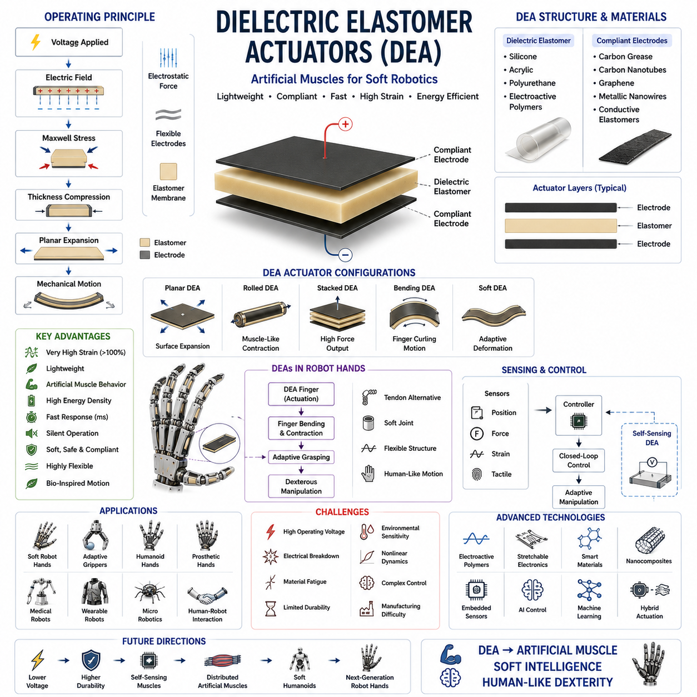{width="7.268055555555556in" height="7.268055555555556in"}

유전 탄성체 액추에이터(Dielectric Elastomer Actuator, DEA)는 현대 로봇공학에서 가장 유망한 소프트 액추에이터(Soft Actuator) 기술 중 하나로 평가받고 있으며, 종종 인공 근육(Artificial Muscle)의 대표적인 구현 기술로 간주된다. 로봇 핸드(Robot Hand)와 덱스터러스 매니퓰레이션(Dexterous Manipulation) 분야에서 DEA는 기존의 전기 모터, 공압 액추에이터, 유압 액추에이터, 그리고 형상기억합금(SMA) 액추에이터와는 완전히 다른 방식으로 운동을 생성한다. 전자기력, 유체 압력 또는 열에 의한 상변화를 사용하는 대신, DEA는 부드러운 탄성 재료 내부에서 발생하는 정전기력(Electrostatic Force)을 이용하여 운동을 만들어낸다. 이러한 특성 덕분에 DEA는 가볍고, 조용하며, 유연하고, 인간 근육과 유사한 동작 특성을 제공할 수 있어 차세대 로봇 핸드, 소프트 그리퍼, 웨어러블 로봇, 의수(Prosthetic Hand), 휴머노이드 로봇 분야에서 큰 관심을 받고 있다.

DEA는 전기활성고분자(Electroactive Polymer, EAP) 기술의 한 분야에 속한다. 전기활성고분자는 전기 자극에 반응하여 형상이나 크기, 기계적 특성이 변하는 재료를 의미한다. 다양한 EAP 기술 가운데 DEA는 비교적 단순한 구조와 높은 변형률(Strain), 우수한 에너지 밀도(Energy Density)를 제공하기 때문에 가장 실용적인 기술 중 하나로 평가된다. 많은 연구자들이 DEA를 인간의 근육과 가장 유사한 인공 구동 기술로 간주한다.

DEA의 기본 구조는 매우 단순하다. 얇은 탄성체(Elastomer) 막의 양면에 유연한 전극(Compliant Electrode)을 부착한 형태이다. 탄성체는 전기적으로 절연 특성을 가지는 유전체(Dielectric) 역할을 하며, 전극은 전기장을 형성하면서도 함께 변형될 수 있도록 유연해야 한다. 전압이 인가되면 양쪽 전극 사이에 정전기적 인력이 발생하고, 이 힘이 탄성체를 두께 방향으로 압축한다. 탄성체는 거의 비압축성(Incompressible)이기 때문에 두께가 감소하는 대신 평면 방향으로 팽창하게 된다. 이러한 변형이 기계적인 운동으로 활용된다.

DEA의 동작 원리는 맥스웰 응력(Maxwell Stress)에 기반한다. 유전체 내부에 전기장이 형성되면 정전기력이 발생하여 탄성체를 압축한다. 이 힘은 재료 내부 전체에 작용하며, 결과적으로 두께는 감소하고 길이와 폭 방향은 증가한다. 이러한 변형을 이용하여 수축, 팽창, 굽힘, 비틀림과 같은 다양한 운동을 생성할 수 있다.

DEA의 가장 큰 장점 중 하나는 매우 큰 변형률을 제공할 수 있다는 점이다. 일반적인 전기 모터는 기어, 링크, 힘줄 시스템 등을 통해 운동을 증폭해야 하지만, DEA는 재료 자체가 직접 변형되면서 큰 운동을 생성한다. 일부 시스템에서는 100% 이상의 변형률을 구현할 수 있으며, 이는 소프트 로봇 손가락이나 적응형 그리퍼 설계에 매우 유리하다.

DEA의 구조는 기본적으로 유전체 막과 전극만으로 구성된다. 사용되는 재료로는 실리콘 고무(Silicone Rubber), 아크릴 탄성체(Acrylic Elastomer), 폴리우레탄(Polyurethane) 등이 대표적이다. 전극은 카본 그리스(Carbon Grease), 탄소나노튜브(Carbon Nanotube), 그래핀(Graphene), 금속 나노와이어(Metal Nanowire), 전도성 고분자 등을 이용하여 제작된다. 구조는 단순하지만 매우 강력한 운동 성능을 제공할 수 있다.

재료 선택은 DEA 성능에 직접적인 영향을 미친다. 유전율(Dielectric Constant), 탄성 계수(Elastic Modulus), 절연 파괴 강도(Breakdown Strength), 내구성(Durability) 등이 중요한 설계 요소이다. 일반적으로 높은 유전율과 낮은 강성을 가진 재료가 더 큰 변형을 제공하지만, 내구성이나 안정성과의 균형을 고려해야 한다.

DEA는 매우 높은 에너지 밀도를 제공한다. 에너지 밀도는 단위 질량 또는 단위 부피당 생성 가능한 기계적 에너지를 의미한다. 일부 DEA는 생체 근육과 유사하거나 그 이상의 에너지 밀도를 제공할 수 있으며, 이는 인공 근육 기술로서의 가능성을 크게 높여준다.

순응성(Compliance)은 DEA의 또 다른 중요한 장점이다. 기존 로봇 액추에이터는 대부분 강체(Rigid Structure)를 기반으로 하기 때문에 사람과의 상호작용에서 안전성 문제가 발생할 수 있다. 반면 DEA는 본질적으로 부드러운 구조를 가지고 있어 충돌 시 충격을 흡수하고 환경 변화에 적응할 수 있다. 이러한 특성은 협동 로봇(Collaborative Robot)과 서비스 로봇(Service Robot) 분야에서 매우 중요하다.

DEA는 매우 가볍다는 장점도 가진다. 얇은 폴리머 필름과 가벼운 전극만으로 구성되기 때문에 동일한 출력 수준의 전기 모터 시스템보다 훨씬 가벼운 구조를 구현할 수 있다. 이는 웨어러블 로봇, 의수, 휴머노이드 로봇 등에서 매우 큰 장점으로 작용한다.

무소음 동작(Silent Operation) 역시 중요한 특징이다. 전기 모터는 회전 부품과 기어에 의해 소음을 발생시키지만, DEA는 내부 재료 변형만으로 움직이기 때문에 거의 소음이 발생하지 않는다. 따라서 의료 로봇, 가정용 로봇, 재활 로봇과 같은 응용 분야에서 매우 유리하다.

응답 속도(Response Speed) 또한 우수하다. DEA는 열전달이나 유체 흐름에 의존하지 않고 전기장을 직접 이용하기 때문에 밀리초(Millisecond) 수준의 빠른 응답이 가능하다. 이는 빠른 그립 동작이나 동적인 로봇 움직임 구현에 유리하다.

DEA는 다양한 형태로 설계될 수 있다. 평면형(Planar Actuator)은 가장 단순한 형태이며, 전압 인가 시 면적이 증가한다. 롤형(Rolled Actuator)은 원통 형태로 말아 제작되며 근육과 유사한 수축 운동을 생성한다. 적층형(Stacked Actuator)은 여러 층을 쌓아 힘 출력을 증가시킨다. 굽힘형(Bending Actuator)은 비대칭 구조를 이용하여 휘어지는 운동을 생성한다.

특히 굽힘형 DEA는 로봇 손가락에 매우 적합하다. 능동층과 수동층을 비대칭으로 배치하면 전압 인가 시 손가락이 자연스럽게 굽어진다. 이러한 구조는 별도의 관절 없이도 손가락 굽힘 동작을 구현할 수 있어 소프트 로봇 핸드에 많이 활용된다.

롤형 DEA는 생체 근육과 가장 유사한 구조 중 하나이다. 사전 인장된(Pre-Stretched) 탄성체를 원통 형태로 감아 제작하며, 전압이 인가되면 길이 방향으로 수축하고 반경 방향으로 팽창한다. 이는 인간 근육의 수축 특성과 매우 유사하다.

그러나 DEA에도 여러 가지 기술적 과제가 존재한다. 가장 큰 문제 중 하나는 높은 동작 전압(Operating Voltage)이다. DEA는 매우 작은 전류만 필요하지만 수천 볼트(kV 수준)의 높은 전압을 요구하는 경우가 많다. 이는 전원 설계, 절연, 안전성 측면에서 중요한 문제를 야기한다.

전기적 절연 파괴(Electrical Breakdown) 역시 심각한 문제이다. 전기장이 재료의 절연 한계를 초과하면 탄성체가 손상되거나 영구적으로 파괴될 수 있다. 따라서 재료 품질과 제조 공정이 매우 중요하다.

기계적 내구성(Mechanical Durability)도 중요한 요소이다. 반복적인 변형 과정에서 재료 피로(Fatigue), 균열(Crack), 층간 박리(Delamination), 노화(Aging)가 발생할 수 있다. 최근에는 고내구성 탄성체와 전극 기술이 개발되면서 이러한 문제가 점차 개선되고 있다.

환경 변화에 대한 민감성도 존재한다. 온도, 습도, 오염물질, 기계적 하중은 모두 DEA 성능에 영향을 줄 수 있다. 따라서 실제 산업 환경에서는 환경 조건을 고려한 설계가 필요하다.

DEA의 제어는 본질적으로 비선형적(Nonlinear)이다. 전압과 변형, 힘, 전기장 사이의 관계가 복잡하게 연결되어 있기 때문이다. 따라서 적응 제어(Adaptive Control), 모델 예측 제어(Model Predictive Control), 신경망(Neural Network), 머신러닝(Machine Learning) 기반 제어 기법이 자주 사용된다.

센서 통합(Sensor Integration) 역시 중요한 연구 분야이다. 위치 센서(Position Sensor), 힘 센서(Force Sensor), 변형률 센서(Strain Sensor), 촉각 센서(Tactile Sensor)를 이용하여 폐루프 제어를 구현할 수 있다. 흥미롭게도 일부 DEA는 액추에이터와 센서 기능을 동시에 수행할 수 있어 자체 감지(Self-Sensing) 기능을 제공한다.

DEA 기반 로봇 핸드는 생체 구조에서 많은 영감을 받는다. 인간 손은 근육, 힘줄, 연부 조직이 함께 작용하여 높은 적응성과 정교한 조작 능력을 제공한다. DEA는 이러한 특성을 모방할 수 있는 유력한 기술로 평가받고 있다.

소프트 그리퍼(Soft Gripper)는 DEA의 가장 성공적인 응용 분야 중 하나이다. 기존 그리퍼는 정확한 위치 제어가 필요하지만, DEA 기반 그리퍼는 물체 형상에 자연스럽게 적응하면서 안정적인 파지를 제공할 수 있다. 식품, 농업, 의료, 정밀 제조 분야에서 특히 유용하다.

웨어러블 로봇(Wearable Robot)과 외골격(Exoskeleton) 시스템도 DEA의 혜택을 받을 수 있다. 기존 액추에이터는 무겁고 부피가 크지만 DEA는 가볍고 유연하여 착용자의 편의성을 크게 향상시킬 수 있다.

의수(Prosthetic Hand) 개발 역시 DEA의 중요한 응용 분야이다. 의수는 가볍고 조용하며 인간과 유사한 움직임을 제공해야 한다. DEA는 이러한 요구 조건을 만족할 수 있는 잠재력을 가지고 있다.

휴머노이드 로봇(Humanoid Robot)은 DEA 연구를 촉진하는 주요 분야 중 하나이다. 인간 몸에는 수백 개의 근육이 분포되어 있으며, 이를 모터 기반 시스템으로 구현하는 것은 매우 어렵다. DEA는 인간 근육과 유사한 구조와 동작 특성을 제공할 수 있어 차세대 휴머노이드 로봇의 핵심 기술 후보로 평가받고 있다.

마이크로 로봇(Micro Robot)과 의료 로봇(Medical Robot) 분야에서도 DEA는 큰 잠재력을 가진다. 얇은 필름 기반 구조는 소형화가 용이하기 때문에 마이크로 그리퍼, 카테터 로봇, 수술 도구 등에 활용될 수 있다.

최근 재료공학(Material Science)의 발전은 DEA 성능을 크게 향상시키고 있다. 높은 유전율, 높은 절연 강도, 우수한 내구성을 가진 새로운 폴리머와 나노복합재(Nanocomposite)가 개발되고 있으며, 이는 실용화를 더욱 가속화하고 있다.

인공지능(AI)과 머신러닝은 DEA의 비선형 특성을 보완하는 데 중요한 역할을 하고 있다. AI는 최적의 구동 전략을 학습하고, 재료 열화(Material Degradation)를 예측하며, 전체 시스템 성능을 향상시킬 수 있다.

또한 DEA는 전기 모터, 공압 액추에이터, 유압 액추에이터, 형상기억합금 액추에이터와 결합된 하이브리드 액추에이션(Hybrid Actuation) 시스템으로도 활용될 수 있다. 이러한 방식은 각 기술의 장점을 동시에 활용할 수 있게 한다.

미래 연구는 동작 전압 감소, 내구성 향상, 제조성 개선, 자체 감지 기능 통합에 집중될 것으로 예상된다. 자가 센싱 DEA(Self-Sensing DEA), 신축성 전자회로(Stretchable Electronics), 분산형 인공 근육 네트워크(Distributed Artificial Muscle Network)와 같은 기술이 활발히 연구되고 있다.

결론적으로 유전 탄성체 액추에이터는 차세대 인공 근육 기술 가운데 가장 유망한 후보 중 하나이다. 큰 변형률, 가벼운 구조, 높은 순응성, 무소음 동작, 인간 근육과 유사한 특성은 기존 액추에이터가 제공하기 어려운 장점이다. 높은 동작 전압, 내구성 문제, 비선형 제어와 같은 과제가 존재하지만, 재료공학, 소프트 로보틱스, 전력전자(Power Electronics), 인공지능 기술의 발전에 따라 DEA는 미래의 소프트 로봇 핸드와 지능형 덱스터러스 매니퓰레이션 시스템을 구현하는 핵심 기술로 자리 잡을 가능성이 매우 높다.

## 03.08 Cable-Driven Actuation Systems

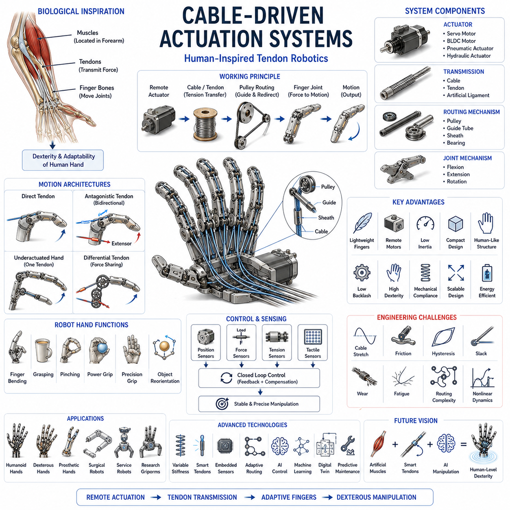{width="7.268055555555556in" height="7.268055555555556in"}

케이블 구동 액추에이션 시스템(Cable-Driven Actuation Systems)은 로봇 핸드(Robot Hand), 덱스터러스 매니퓰레이터(Dexterous Manipulator), 휴머노이드 로봇(Humanoid Robot), 의수(Prosthetic Hand), 그리고 고급 파지 시스템(Advanced Grasping System) 분야에서 가장 중요하고 생체모사적인 구동 구조 중 하나이다. 일반적인 액추에이터 구조에서는 모터가 각 관절(Joint)에 직접 장착되지만, 케이블 구동 시스템은 액추에이터를 관절과 분리하고 케이블, 텐던(Tendon), 또는 인공 인대(Artificial Ligament)를 통해 힘을 전달한다. 이러한 설계 방식은 인간의 손 구조와 매우 유사하다. 인간의 경우 손가락을 움직이는 대부분의 근육이 전완부(Forearm)에 위치하며, 힘은 힘줄(Tendon)을 통해 손가락으로 전달된다. 이러한 생체 구조와의 유사성 때문에 케이블 구동 방식은 경량화, 소형화, 그리고 높은 기민성(Dexterity)을 구현하기 위한 핵심 기술로 자리 잡고 있다.

케이블 구동의 기본 원리는 비교적 단순하다. 모터, 공압 액추에이터, 유압 액추에이터 또는 다른 구동 장치가 원격 위치에서 힘을 생성한다. 생성된 힘은 케이블을 통해 손가락 관절로 전달된다. 케이블은 풀리(Pulley), 가이드 튜브(Guide Tube), 쉬스(Sheath), 또는 다양한 경로 구조를 따라 배치된다. 액추에이터가 케이블에 장력을 가하면 관절이 회전하거나 이동하게 되며, 이를 통해 손가락 움직임이 발생한다.

케이블 구동 시스템을 사용하는 가장 큰 이유 중 하나는 무게 감소이다. 인간형 로봇이나 다지형 로봇 핸드에서는 손가락 내부 공간이 매우 제한적이다. 만약 모든 관절에 모터와 감속기를 직접 배치한다면 손가락이 무겁고 부피가 커지게 된다. 반면 케이블 구동 방식은 모터를 손바닥(Palm), 손목(Wrist), 전완부(Forearm), 또는 로봇 팔 내부에 배치할 수 있으므로 손가락 자체의 질량을 크게 줄일 수 있다. 이는 관성(Inertia)을 감소시키고 반응 속도를 향상시키며 에너지 효율과 안전성을 높인다.

인간의 손은 케이블 구동 메커니즘의 대표적인 자연 사례이다. 대부분의 손가락 구동 근육은 전완부에 위치하며, 힘줄이 손목을 지나 손가락 뼈에 연결된다. 근육이 수축하면 힘줄에 장력이 발생하고, 그 결과 손가락 관절이 굽혀지거나 펴진다. 로봇 공학에서는 이러한 구조를 그대로 모방하여 인공 힘줄 기반 로봇 핸드를 설계한다.

이 때문에 케이블 구동 시스템은 흔히 텐던 구동 시스템(Tendon-Driven System)이라고도 불린다. 로봇에서는 스테인리스 케이블, 케블라(Kevlar), 다이니마(Dyneema), 스펙트라(Spectra), 벡트란(Vectran)과 같은 고강도 섬유가 인공 힘줄 역할을 수행한다. 이러한 재료는 높은 인장 강도(Tensile Strength), 낮은 무게, 작은 신장률(Stretch), 그리고 우수한 피로 수명(Fatigue Life)을 제공한다.

케이블 구동 시스템은 일반적으로 액추에이터, 전송 케이블, 라우팅 메커니즘(Routing Mechanism), 그리고 관절 메커니즘으로 구성된다. 액추에이터는 힘을 생성하고, 케이블은 힘을 전달하며, 풀리와 가이드는 힘 전달 경로를 형성한다. 마지막으로 관절 메커니즘은 케이블 장력을 실제 운동으로 변환한다.

손가락의 굽힘(Flexion)과 신전(Extension)은 보통 길항근(Antagonistic) 구조를 이용하여 구현된다. 하나의 케이블은 굽힘을 담당하고 다른 케이블은 신전을 담당한다. 굽힘 케이블이 당겨지면 손가락이 구부러지고, 신전 케이블이 당겨지면 손가락이 펴진다. 이러한 구조는 인간의 굴곡근(Flexor)과 신전근(Extensor) 시스템을 모방한 것이다.

일부 로봇 핸드는 단일 텐던(Single Tendon)을 사용한 언더액추에이티드 핸드(Underactuated Hand)를 채택한다. 하나의 케이블이 여러 관절을 동시에 제어하며, 스프링(Spring)이나 탄성체가 복귀 메커니즘 역할을 수행한다. 이러한 구조는 액추에이터 수를 줄이고, 물체 형상에 자연스럽게 적응하는 능력을 제공한다.

케이블 구동 방식의 또 다른 장점은 확장성(Scalability)이다. 동일한 원리를 마이크로 수술 로봇(Micro Surgical Robot), 의수, 다지형 로봇 핸드, 휴머노이드 로봇, 산업용 조작 시스템 등에 적용할 수 있다. 따라서 크기와 목적이 다른 다양한 시스템에 쉽게 응용될 수 있다.

소형화(Compactness) 역시 중요한 장점이다. 모터를 원격 위치에 배치할 수 있기 때문에 손가락 자체를 매우 작고 인간과 유사한 비율로 설계할 수 있다. 이는 휴머노이드 로봇에서 특히 중요하며, 인간과 유사한 외형과 기능을 구현하는 데 큰 도움이 된다.

케이블 구동 시스템은 우수한 순응성(Compliance)도 제공한다. 케이블은 충격을 흡수하고 약간의 오정렬(Misalignment)을 허용할 수 있기 때문에 강체 기반 시스템보다 안전성이 높다. 또한 접촉 과정에서 힘을 부드럽게 전달할 수 있어 깨지기 쉬운 물체를 다룰 때 유리하다.

힘 전달 효율은 케이블 라우팅 품질에 크게 의존한다. 이상적인 경우에는 마찰이 거의 없는 경로를 따라 힘이 전달되지만, 실제 시스템에서는 케이블과 풀리, 가이드 사이의 마찰이 발생한다. 이러한 마찰은 효율 저하와 제어 오차를 유발할 수 있기 때문에 설계 단계에서 신중한 최적화가 필요하다.

풀리 시스템은 케이블 경로를 변경하거나 기계적 이득(Mechanical Advantage)을 조정하는 데 사용된다. 다양한 풀리 직경과 배치 방식을 이용하면 힘과 속도 특성을 원하는 방향으로 조정할 수 있다. 차동 풀리(Differential Pulley) 구조는 여러 관절에 힘을 분배하는 데 활용되며 적응형 그립(Adaptive Grasp)을 가능하게 한다.

케이블의 탄성(Elasticity)은 중요한 설계 요소이다. 아무리 강한 재료라도 일정 수준의 신장이 발생한다. 과도한 신장은 위치 정밀도를 저하시킬 수 있으므로 높은 강성(Stiffness)을 가진 재료를 사용하는 것이 중요하다.

케이블 구동 시스템은 일반적으로 기어 기반 시스템보다 백래시(Backlash)가 적다. 장력이 유지된 상태에서는 기계적 유격이 거의 발생하지 않기 때문에 더욱 정밀한 움직임을 구현할 수 있다.

인간형 로봇 핸드 대부분은 케이블 구동 방식을 채택한다. 이는 제한된 공간 안에서 다수의 자유도(Degree of Freedom)를 구현할 수 있기 때문이다. 실제로 Shadow Hand, Allegro Hand, Schunk SVH Hand와 같은 대표적인 다지형 로봇 핸드들이 텐던 구동 메커니즘을 활용하고 있다. 이러한 시스템은 인간과 유사한 조작 능력을 구현하는 데 성공적인 사례로 평가받고 있다.

의수 분야 역시 케이블 구동 기술의 중요한 응용 영역이다. 의수는 가볍고 작으며 사용하기 편해야 한다. 텐던 기반 구조는 액추에이터를 손가락 끝에서 멀리 배치할 수 있어 사용자의 피로를 줄이고 자연스러운 움직임을 제공할 수 있다.

수술 로봇(Surgical Robot) 분야에서도 케이블 구동은 매우 중요하다. 최소 침습 수술(Minimally Invasive Surgery) 장비는 좁고 긴 구조 내부에서 힘을 전달해야 한다. 이러한 경우 직접 모터를 배치할 수 없기 때문에 텐던 기반 메커니즘이 널리 사용된다.

휴머노이드 로봇은 케이블 구동 기술의 가장 중요한 응용 분야 중 하나이다. 인간 손과 유사한 크기 안에서 많은 자유도를 구현해야 하기 때문에, 모터를 전완부에 배치하고 케이블을 통해 힘을 전달하는 구조가 매우 효과적이다.

그러나 케이블 구동 시스템은 제어 측면에서 여러 어려움을 가진다. 케이블은 강체가 아니기 때문에 탄성, 마찰, 히스테리시스(Hysteresis), 비선형 동역학(Nonlinear Dynamics)을 발생시킨다. 따라서 정밀 제어를 위해서는 고급 제어 알고리즘이 필요하다.

장력 제어(Tension Control)는 케이블 구동 시스템의 핵심 요소이다. 적절한 장력이 유지되지 않으면 케이블이 느슨해져(Slack) 제어 정확도가 감소한다. 반대로 장력이 과도하면 마모가 증가하고 에너지 소비가 커질 수 있다. 따라서 많은 시스템이 자동 장력 조정 메커니즘을 포함한다.

센서 역시 매우 중요하다. 엔코더(Encoder)는 관절 위치를 측정하고, 장력 센서는 케이블 힘을 측정하며, 촉각 센서(Tactile Sensor)는 물체와의 접촉 상태를 감지한다. 이러한 센서 데이터를 이용하여 폐루프 제어(Closed-Loop Control)가 수행된다.

가변 강성 제어(Variable Stiffness Control)는 최근 중요한 연구 분야로 떠오르고 있다. 길항근 형태의 두 개 케이블에 동시에 장력을 가하면 관절 강성을 변화시킬 수 있다. 이는 인간 근육의 공동 수축(Co-Contraction)과 유사한 원리이며, 작업 상황에 따라 부드럽거나 단단한 동작을 구현할 수 있다.

차동 텐던 메커니즘(Differential Tendon Mechanism)은 하나의 액추에이터가 여러 관절을 동시에 제어할 수 있도록 한다. 이러한 구조는 적응형 파지와 힘 분배에 매우 유리하며 언더액추에이티드 로봇 핸드에서 널리 활용된다.

유지보수 측면에서는 케이블 마모와 피로가 중요한 문제이다. 반복적인 굽힘과 장력 변화는 시간이 지남에 따라 성능 저하를 초래할 수 있다. 따라서 정기적인 점검과 교체가 필요하며, 고성능 섬유 재료의 사용이 중요하다.

열 관리(Thermal Management)는 상대적으로 유리한 편이다. 발열이 발생하는 모터를 손가락 외부에 배치할 수 있기 때문에 손가락 내부의 온도 상승 문제를 최소화할 수 있다.

최근 재료공학의 발전은 케이블 구동 기술을 더욱 발전시키고 있다. 초고분자량 폴리에틸렌(UHMWPE), 복합재 섬유, 저마찰 코팅 기술 등이 개발되면서 강도와 내구성, 효율성이 지속적으로 향상되고 있다.

인공지능(AI)과 머신러닝(Machine Learning)도 케이블 구동 시스템에 적용되고 있다. 학습 알고리즘은 케이블의 비선형 특성을 보상하고, 최적의 장력을 계산하며, 파지 전략을 스스로 학습할 수 있다. 강화학습(Reinforcement Learning)은 특히 덱스터러스 매니퓰레이션 분야에서 유망한 결과를 보여주고 있다.

시뮬레이션과 디지털 트윈(Digital Twin) 기술 역시 중요한 역할을 한다. 케이블 장력 분포, 마찰 효과, 관절 동작을 사전에 분석할 수 있기 때문에 설계 최적화와 개발 비용 절감에 기여한다.

미래 연구는 자가 조정 텐던(Self-Adjusting Tendon), 센서 내장형 스마트 케이블(Smart Cable), 적응형 라우팅 메커니즘, 그리고 생체모사 근골격 구조(Bio-inspired Musculoskeletal Architecture)에 집중될 것으로 예상된다. 또한 소프트 로보틱스, 인공 근육, 가변 강성 기술과의 융합도 활발히 진행되고 있다.

결론적으로 케이블 구동 액추에이션 시스템은 현대 로봇 핸드 공학의 핵심 기술 중 하나이다. 액추에이터를 관절에서 분리하고 힘을 유연한 텐던을 통해 전달함으로써 경량화, 소형화, 높은 순응성, 우수한 덱스터리티를 동시에 달성할 수 있다. 인간 손의 생체역학(Biomechanics)에서 직접 영감을 받은 이 구조는 현재의 고성능 로봇 핸드 대부분에서 사용되고 있으며, 향후 휴머노이드 로봇, 의수, 서비스 로봇, 고급 조작 시스템의 발전에 있어서도 가장 중요한 기반 기술 중 하나로 계속 활용될 것으로 전망된다.

## 03.09 Series Elastic Actuators

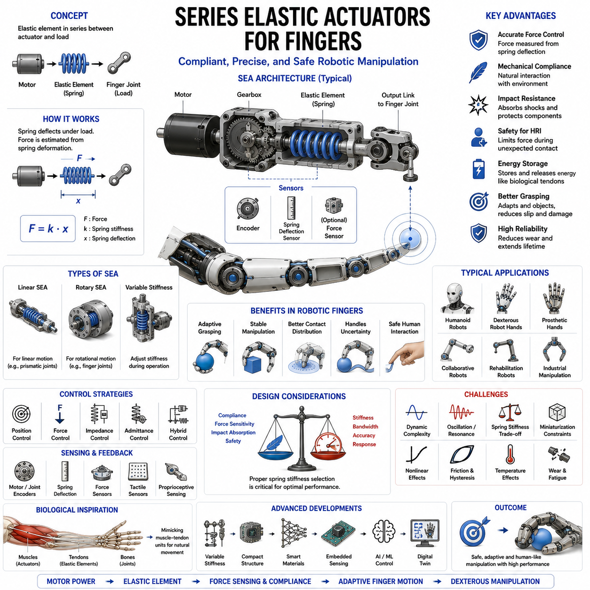{width="7.268055555555556in" height="7.268055555555556in"}

직렬 탄성 액추에이터(Series Elastic Actuator, SEA)는 현대 로봇공학에서 가장 중요한 액추에이터 기술 중 하나로 평가받고 있으며, 특히 안전한 물리적 상호작용, 정밀한 힘 제어, 충격 흡수, 순응성(Compliance), 그리고 적응형 조작(Adaptive Manipulation)이 필요한 분야에서 핵심적인 역할을 수행하고 있다. 로봇 핸드(Robot Hand), 덱스터러스 매니퓰레이터(Dexterous Manipulator), 휴머노이드 로봇(Humanoid Robot), 의수(Prosthetic Hand), 협동 로봇(Collaborative Robot) 분야에서 SEA는 기존 강체 기반 액추에이터가 가지는 한계를 해결할 수 있는 중요한 기술로 자리 잡고 있다. SEA는 액추에이터와 부하(Load) 사이에 의도적으로 탄성 요소(Elastic Element)를 삽입함으로써 로봇 손가락이 더욱 자연스럽고 인간과 유사한 방식으로 물체와 환경에 상호작용할 수 있도록 만든다.

SEA의 개념은 힘 제어 능력과 기계적 순응성을 향상시키기 위해 개발되었다. 일반적인 로봇 액추에이터는 모터가 감속기와 같은 강체 전송 장치를 통해 부하와 직접 연결된다. 이러한 구조는 높은 위치 정밀도를 제공하지만 강성이 지나치게 높고 충격에 취약하다는 단점을 가진다. 예상치 못한 충돌이 발생하면 큰 힘이 순간적으로 전달되어 로봇 자체나 물체, 심지어 주변 사람에게도 손상을 줄 수 있다. SEA는 모터 출력과 관절 사이에 스프링(Spring)과 같은 탄성체를 직렬(Series)로 삽입함으로써 이러한 문제를 해결한다.

SEA의 기본 원리는 비교적 단순하다. 모터가 생성한 토크(Torque)는 탄성 요소를 거쳐 손가락 관절에 전달된다. 힘이 전달되는 과정에서 스프링은 훅의 법칙(Hooke's Law)에 따라 변형된다. 이 변형량을 측정하면 스프링 강성(Stiffness)을 이용하여 전달된 힘을 계산할 수 있다. 따라서 SEA는 단순한 동력 전달 장치일 뿐만 아니라 힘 센서(Force Sensor)의 역할도 동시에 수행할 수 있다.

탄성 요소의 존재는 로봇 시스템의 힘 전달 특성을 근본적으로 변화시킨다. 기존의 강체 기반 액추에이터가 단단한 기계 장치처럼 동작하는 반면, SEA는 인간의 근육-힘줄(Muscle-Tendon) 구조와 유사한 특성을 갖는다. 인간의 근육에는 본질적으로 탄성 조직이 존재하며, 이는 충격을 흡수하고 에너지를 저장하며 힘을 조절하는 역할을 수행한다. SEA는 이러한 생물학적 특성을 모방한다.

SEA의 가장 큰 장점 중 하나는 매우 정밀한 힘 제어 능력이다. 기존 액추에이터는 마찰(Friction), 백래시(Backlash), 감속기 오차 등의 영향으로 정확한 힘 측정이 어렵다. 그러나 SEA는 스프링 변형량만 측정하면 힘을 직접 계산할 수 있기 때문에 훨씬 정밀한 힘 제어가 가능하다.

로봇 핸드에서는 힘 제어가 특히 중요하다. 물체는 크기, 형태, 질량, 표면 상태, 강성 등이 모두 다르다. 강체 기반 손가락은 깨지기 쉬운 물체를 부수거나, 반대로 충분한 힘을 제공하지 못해 물체를 놓칠 수 있다. SEA 기반 손가락은 접촉 힘을 정밀하게 조절할 수 있기 때문에 섬세한 물체를 안전하게 잡을 수 있다.

순응성은 SEA의 또 다른 핵심 장점이다. 순응성이란 외부 힘에 대해 유연하게 반응할 수 있는 능력을 의미한다. 인간 손은 근육, 힘줄, 인대, 연부 조직의 조합을 통해 뛰어난 순응성을 제공한다. SEA 역시 탄성 요소를 통해 유사한 특성을 구현하며, 이로 인해 물체에 자연스럽게 적응할 수 있다.

충격 저항성(Impact Resistance)도 SEA의 중요한 특징이다. 예상치 못한 충돌이 발생했을 때 스프링은 충격 에너지의 일부를 흡수하고 분산시킨다. 이로 인해 모터, 감속기, 베어링, 구조물에 전달되는 최대 하중(Peak Load)이 감소한다. 결과적으로 시스템의 내구성과 신뢰성이 향상된다.

인간-로봇 상호작용(Human-Robot Interaction)은 SEA 개발을 촉진한 주요 요인 중 하나이다. 협동 로봇은 사람과 같은 공간에서 안전하게 작업해야 한다. SEA는 본질적인 순응성을 제공하기 때문에 우발적인 접촉이 발생해도 전달되는 힘을 제한할 수 있으며, 이는 안전성 향상에 매우 큰 도움이 된다.

SEA에서 사용되는 탄성 요소는 다양한 형태로 구현될 수 있다. 가장 일반적인 방식은 기계식 스프링이다. 압축 스프링(Compression Spring), 비틀림 스프링(Torsion Spring), 인장 스프링(Extension Spring), 판 스프링(Leaf Spring), 그리고 맞춤형 탄성 구조(Custom Elastic Structure)가 사용될 수 있다. 어떤 구조를 사용할지는 요구되는 힘, 공간, 변위, 응답 속도에 따라 달라진다.

선형 SEA(Linear SEA)는 직선 방향으로 변형되는 스프링을 사용하며 비교적 모델링과 제어가 쉽다. 반면 회전형 SEA(Rotary SEA)는 비틀림 스프링을 사용하여 회전 운동을 생성한다. 로봇 손가락은 대부분 회전 관절을 사용하기 때문에 회전형 SEA가 널리 사용된다.

가변 강성 액추에이터(Variable Stiffness Actuator, VSA)는 SEA의 발전형이라 할 수 있다. 일반적인 SEA는 고정된 강성을 가지지만, VSA는 작업 중 강성을 변경할 수 있다. 이를 통해 로봇 손가락은 사람과 상호작용할 때는 부드럽게, 무거운 물체를 조작할 때는 단단하게 동작할 수 있다. 이러한 특성은 인간 근육의 공동 수축(Co-Contraction) 메커니즘과 유사하다.

SEA를 손가락 관절에 적용하면 다양한 장점을 얻을 수 있다. 손가락은 물체 표면에 자연스럽게 적응하고 접촉 힘을 균일하게 분산할 수 있으며, 위치 오차가 존재하더라도 안정적인 파지가 가능하다.

파지(Grasping) 과정에서는 작은 위치 오차가 필연적으로 발생한다. 강체 기반 손가락은 정확한 위치 제어가 필요하지만, SEA 기반 손가락은 탄성 요소가 이러한 오차를 흡수하기 때문에 보다 안정적인 파지가 가능하다. 결과적으로 파지 계획(Grasp Planning)이 단순해지고 시스템의 강건성(Robustness)이 향상된다.

인핸드 매니퓰레이션(In-Hand Manipulation)에서도 SEA는 큰 장점을 제공한다. 물체를 회전시키거나 재배치할 때 손가락은 지속적으로 접촉 힘을 조절해야 한다. SEA는 힘 감지와 순응성을 동시에 제공하기 때문에 미끄러짐(Slip)을 방지하고 안정적인 조작을 가능하게 한다.

휴머노이드 로봇은 SEA의 대표적인 응용 분야 중 하나이다. 인간형 로봇은 수많은 관절에서 안전성과 적응성을 동시에 요구한다. SEA는 이러한 요구를 만족시킬 수 있는 기술로서 널리 연구되고 있다.

의수(Prosthetic Hand) 분야에서도 SEA는 중요한 역할을 한다. 의수는 사용자의 신체와 직접 접촉하므로 안전성과 편안함이 중요하다. SEA는 충격 전달을 줄이고 자연스러운 움직임을 제공하여 사용성을 향상시킨다.

재활 로봇(Rehabilitation Robot) 역시 SEA 기술의 혜택을 받는다. 환자의 신체와 직접 상호작용하는 로봇은 매우 높은 수준의 안전성이 요구된다. SEA는 본질적인 순응성을 제공하여 부상 위험을 줄이면서 치료 운동을 지원할 수 있다.

SEA의 또 다른 중요한 특징은 에너지 저장(Energy Storage) 능력이다. 스프링은 하중이 가해질 때 에너지를 저장하고, 이후 이를 다시 방출할 수 있다. 이러한 특성은 인간의 힘줄과 유사하며 반복 동작에서 효율성을 향상시킨다. 저장된 에너지는 모터의 부하를 줄이고 시스템의 동적 성능을 개선할 수 있다.

그러나 SEA는 기존 강체 액추에이터보다 더 복잡한 동적 특성을 가진다. 탄성 요소의 존재로 인해 추가적인 진동 모드(Vibration Mode)가 발생하며, 적절하게 제어하지 않으면 진동과 공진(Resonance)이 나타날 수 있다.

따라서 SEA의 제어 알고리즘은 일반 액추에이터보다 복잡하다. 위치 제어(Position Control), 힘 제어(Force Control), 임피던스 제어(Impedance Control), 어드미턴스 제어(Admittance Control), 하이브리드 제어(Hybrid Control) 등이 사용된다.

특히 임피던스 제어는 SEA 기반 시스템에서 매우 중요하다. 임피던스 제어는 힘과 움직임 사이의 관계를 제어함으로써 로봇이 환경에 자연스럽게 반응하도록 만든다. 이는 사람과의 상호작용이나 복잡한 조작 작업에서 필수적인 기술이다.

센서 역시 중요한 역할을 수행한다. 엔코더(Encoder)는 모터 위치와 관절 위치를 측정하며, 이를 통해 스프링 변형량을 계산한다. 추가적으로 힘 센서, 촉각 센서(Tactile Sensor), 고유감각 센서(Proprioceptive Sensor)가 사용될 수 있다.

SEA 설계에서 가장 중요한 요소 중 하나는 스프링 강성 선택이다. 너무 부드러운 스프링은 응답 속도와 위치 정밀도를 저하시킬 수 있고, 너무 단단한 스프링은 순응성의 장점을 감소시킨다. 따라서 강성은 응용 분야에 맞추어 신중하게 결정되어야 한다.

로봇 손가락에 SEA를 적용할 때는 소형화(Miniaturization)가 중요한 과제가 된다. 손가락 내부 공간은 매우 제한적이므로 모터, 감속기, 센서, 스프링을 모두 통합해야 한다. 최근에는 소형 로봇 손가락을 위한 초소형 SEA 구조가 활발히 연구되고 있다.

적층 제조(Additive Manufacturing) 기술의 발전도 SEA 연구를 가속화하고 있다. 3D 프린팅을 이용하면 특정 성능에 최적화된 복잡한 탄성 구조를 제작할 수 있으며, 탄성 요소와 센서를 통합한 새로운 설계가 가능해지고 있다.

소프트 로보틱스(Soft Robotics)는 SEA와 밀접한 관련이 있다. 최근에는 부드러운 재료와 SEA를 결합한 하이브리드 구조가 등장하고 있으며, 이는 더욱 높은 적응성과 안전성을 제공한다.

인공지능(AI)과 머신러닝(Machine Learning)은 SEA 기반 시스템의 성능 향상에도 활용되고 있다. 학습 알고리즘은 비선형 특성을 보상하고, 접촉 상태를 예측하며, 최적의 파지 전략을 생성할 수 있다. 강화학습(Reinforcement Learning)은 특히 덱스터러스 매니퓰레이션 분야에서 유망한 결과를 보여주고 있다.

디지털 트윈(Digital Twin)과 시뮬레이션 기술 역시 중요한 역할을 한다. 힘 전달, 에너지 저장, 순응성, 제어 성능 등을 가상 환경에서 분석할 수 있어 개발 비용을 줄이고 설계 최적화를 가능하게 한다.

미래 연구는 소형화, 고출력화, 가변 강성 기술, 센서 통합, 지능형 제어 기술에 집중될 것으로 예상된다. 생체모사 탄성 구조, 스마트 소재, 센서 내장형 스프링, 적응형 순응성 메커니즘 등은 차세대 SEA 연구의 핵심 주제가 되고 있다.

결론적으로 직렬 탄성 액추에이터는 로봇 손가락 구동 기술의 혁신적인 발전을 이끈 핵심 기술이다. 액추에이터와 부하 사이에 탄성 요소를 삽입함으로써 정밀한 힘 제어, 높은 순응성, 향상된 안전성, 충격 저항성, 그리고 인간과 유사한 동작 특성을 제공한다. 이러한 특성은 기존 강체 기반 액추에이터의 한계를 극복하게 해주며, 인간 수준의 조작 능력과 상호작용 능력을 갖춘 로봇 핸드 개발을 가능하게 한다. 비록 동적 복잡성, 제어 난이도, 소형화와 같은 과제가 존재하지만, 재료공학, 센서 기술, 인공지능, 로봇 공학의 발전과 함께 SEA는 앞으로도 로봇 핸드와 덱스터러스 매니퓰레이션 분야에서 가장 중요한 액추에이터 기술 중 하나로 계속 활용될 것으로 전망된다.

## 03.10 Compact Hand Integration

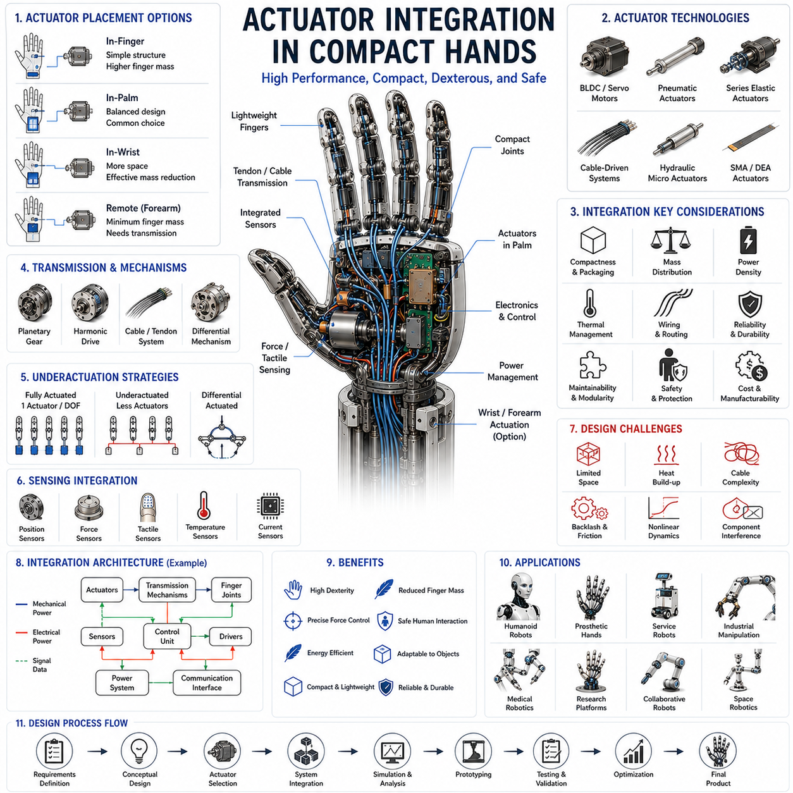{width="7.268055555555556in" height="7.268055555555556in"}

소형 로봇 핸드에서의 액추에이터 통합(Actuator Integration in Compact Hands)은 고성능 로봇 핸드, 의수(Prosthetic Hand), 휴머노이드 로봇(Humanoid Robot), 서비스 로봇(Service Robot), 그리고 정교한 조작 시스템(Dexterous Manipulation System)을 개발하는 과정에서 가장 어렵고 중요한 공학적 과제 중 하나이다. 서보 모터(Servo Motor), 공압 액추에이터(Pneumatic Actuator), 유압 마이크로 액추에이터(Hydraulic Micro Actuator), 형상기억합금 액추에이터(Shape Memory Alloy Actuator), 유전 탄성체 액추에이터(Dielectric Elastomer Actuator), 케이블 구동 시스템(Cable-Driven System), 직렬 탄성 액추에이터(Series Elastic Actuator) 등 다양한 구동 기술은 각각 고유한 장점을 제공한다. 그러나 진정한 도전 과제는 이러한 기술들을 하나의 작은 로봇 손 안에 통합하여 힘, 정밀성, 속도, 순응성, 신뢰성, 에너지 효율, 제조 용이성을 동시에 만족시키는 것이다. 로봇 핸드가 인간 수준의 기능을 목표로 발전함에 따라 액추에이터 통합은 기계공학, 전자공학, 제어공학, 재료공학, 열공학, 인공지능이 결합된 복합적인 문제로 발전하고 있다.

인간의 손은 소형 액추에이터 통합의 궁극적인 기준 모델이다. 인간 손은 수백 그램 수준의 무게만을 가지지만 20개 이상의 자유도(Degree of Freedom), 수많은 근육과 힘줄, 분산된 감각 시스템, 복잡한 신경 제어 메커니즘, 그리고 뛰어난 힘 생성 능력을 동시에 제공한다. 이러한 수준의 기능을 인공 시스템으로 구현하는 것은 현재 로봇공학이 직면한 가장 어려운 과제 중 하나이다. 생체 시스템과 달리 로봇은 모터, 감속기, 센서, 배선, 제어기, 배터리, 구조물을 제한된 공간 안에 모두 배치해야 한다.

소형 로봇 핸드는 매우 심각한 공간 제약을 가진다. 손가락 내부의 모든 공간은 매우 귀중하며, 손가락 크기는 인간과 유사한 비율, 파지 기능, 인체공학적 요구 조건에 의해 제한된다. 따라서 액추에이터 통합은 단순히 적절한 모터를 선택하는 문제가 아니라 수많은 상충되는 요구 사항을 동시에 최적화하는 과정이다.

액추에이터 통합에서 가장 먼저 고려해야 하는 요소는 액추에이터 배치(Actuator Placement)이다. 엔지니어는 액추에이터를 손가락 내부에 직접 배치할 것인지, 손바닥(Palm)에 배치할 것인지, 손목(Wrist)이나 전완부(Forearm)에 배치할 것인지를 결정해야 한다. 직접 구동 방식은 단순한 구조와 높은 위치 정밀도를 제공하지만 손가락 무게가 증가한다. 반면 원격 구동 방식은 손가락을 가볍게 만들 수 있지만 전송 메커니즘이 복잡해진다.

질량 분포(Mass Distribution)는 전체 성능에 매우 큰 영향을 미친다. 무거운 손가락은 가속과 감속에 더 많은 에너지를 필요로 하며, 반응 속도를 저하시킨다. 또한 손가락 끝의 질량이 증가하면 충돌 시 발생하는 힘도 커진다. 따라서 많은 고성능 로봇 핸드는 질량을 손목이나 전완부에 집중시키고 손가락은 최대한 가볍게 설계한다.

케이블 구동 시스템은 소형 로봇 핸드 통합에서 가장 널리 사용되는 기술 중 하나이다. 케이블 또는 텐던(Tendon)을 사용하면 모터를 손가락 밖에 배치할 수 있다. 이는 인간 손의 근골격 구조(Musculoskeletal Structure)와 유사하며, 공간 활용도를 크게 향상시킨다.

손바닥은 일반적으로 통합 허브(Hub) 역할을 수행한다. 액추에이터, 감속기, 전자회로, 센서, 통신 장치, 전력 분배 시스템 등이 손바닥 내부에 배치된다. 따라서 손바닥 공간을 효율적으로 활용하는 것은 매우 중요하다. 최근에는 3차원 패키징(3D Packaging) 기술을 활용하여 동일한 공간 안에 더 많은 기능을 집적하고 있다.

액추에이터 소형화(Miniaturization)는 중요한 연구 분야이다. 브러시리스 DC 모터(Brushless DC Motor), 코어리스 모터(Coreless Motor), 슬롯리스 모터(Slotless Motor), 마이크로 서보(Micro Servo) 기술의 발전은 점점 더 작은 크기에서 높은 출력 밀도를 제공하게 만들고 있다. 그러나 전자기 에너지 변환의 물리적 한계로 인해 무한정 소형화할 수는 없다.

전송 메커니즘(Transmission System)도 매우 중요한 역할을 한다. 소형 모터는 일반적으로 토크가 부족하기 때문에 감속기와 같은 전송 장치가 필요하다. 유성 기어(Planetary Gear), 하모닉 드라이브(Harmonic Drive), 사이클로이드 드라이브(Cycloidal Drive), 케이블 전송 시스템, 차동 메커니즘(Differential Mechanism) 등이 널리 사용된다. 전송 방식은 효율, 백래시, 순응성, 신뢰성, 그리고 패키징 복잡도에 직접적인 영향을 준다.

백래시(Backlash)는 소형 로봇 핸드에서 매우 중요한 문제이다. 작은 기계적 유격이라도 정밀 조작 능력을 크게 저하시킬 수 있다. 인핸드 매니퓰레이션(In-Hand Manipulation)과 정밀 파지(Precision Grasping)를 수행하기 위해서는 높은 위치 반복 정밀도가 필요하기 때문이다.

액추에이터 수는 덱스터리티(Dexterity)와 기능성을 결정한다. 완전 구동(Fully Actuated) 시스템은 자유도마다 하나의 액추에이터를 배치하지만 크기와 무게, 비용이 증가한다. 반면 언더액추에이션(Underactuation)은 여러 관절이 하나의 액추에이터를 공유한다. 이는 일부 제어 자유도를 희생하지만 공간과 비용을 크게 절감할 수 있다.

언더액추에이션은 현대 소형 로봇 핸드 설계에서 중요한 철학으로 자리 잡고 있다. 실제로 많은 로봇 그리퍼는 자유도보다 적은 수의 액추에이터를 사용하면서도 물체 형상에 자연스럽게 적응하는 능력을 제공한다.

차동 메커니즘은 액추에이터 통합을 위한 또 다른 중요한 전략이다. 하나의 액추에이터 출력이 여러 관절이나 손가락으로 분배되도록 설계하여 액추에이터 수를 줄이고 공간 활용도를 높일 수 있다.

열 관리(Thermal Management)는 가장 어려운 문제 중 하나이다. 모터, 드라이버, 전자회로는 지속적으로 열을 발생시킨다. 소형 핸드 내부는 공간이 제한되고 공기 흐름이 부족하기 때문에 열이 쉽게 축적된다. 과도한 온도 상승은 모터 효율 감소, 재료 열화, 전자회로 손상, 수명 감소를 초래할 수 있다.

이를 해결하기 위해 방열판(Heat Sink), 열전도 경로(Thermal Path), 고열전도 재료, 환기 구조, 그리고 일부 경우에는 능동 냉각(Active Cooling) 기술이 사용된다.

전력 분배(Power Distribution) 역시 중요한 문제이다. 현대 로봇 핸드는 다수의 액추에이터, 센서, 마이크로컨트롤러, 통신 장치를 포함한다. 따라서 전력을 효율적으로 공급하면서 배선 복잡도를 최소화해야 한다.

배선(Wiring)은 손의 복잡성이 증가할수록 큰 문제가 된다. 고성능 로봇 핸드는 수십 개의 센서와 액추에이터를 동시에 사용하기 때문에 매우 많은 전선이 필요하다. 이러한 전선을 좁은 공간에 배치하면서도 신뢰성을 유지해야 한다. 최근에는 플렉시블 PCB(Flexible PCB), 통합 와이어링 하네스(Wiring Harness), 임베디드 전자회로(Embedded Electronics)가 널리 활용되고 있다.

센서 통합(Sensor Integration)은 액추에이터 통합과 밀접하게 연결되어 있다. 로봇 핸드는 위치 센서, 힘 센서, 촉각 센서, 온도 센서, 전류 센서 등을 필요로 한다. 이러한 센서를 액추에이터와 함께 제한된 공간에 배치하는 것은 매우 어려운 문제이다.

특히 힘 센싱(Force Sensing)은 매우 중요하다. 공간 제약 때문에 직접적인 힘 센서를 배치하기 어려운 경우가 많다. 따라서 모터 전류, 케이블 장력, 스프링 변형량 등을 이용한 간접 측정 방식이 자주 사용된다.

촉각 센싱(Tactile Sensing)은 최근 가장 빠르게 발전하는 분야 중 하나이다. 인간 손은 촉각 정보를 통해 뛰어난 조작 능력을 발휘한다. 따라서 고해상도 촉각 센서를 손가락 표면에 통합하는 연구가 활발히 진행되고 있다.

순응성(Compliance)은 현대 로봇 핸드 설계의 핵심 개념이 되었다. 과거에는 강성과 위치 정밀도가 우선시되었지만, 현재는 안전한 상호작용과 적응형 조작이 더 중요해지고 있다. 이를 위해 직렬 탄성 액추에이터, 가변 강성 메커니즘, 소프트 구조, 순응성 전송 장치가 적극적으로 활용되고 있다.

소프트 로보틱스(Soft Robotics)는 액추에이터 통합에 새로운 관점을 제공하고 있다. 기존의 강체 중심 설계와 달리 순응성을 설계의 중심 요소로 고려한다. 소프트 액추에이터와 유연한 구조는 기존 방식으로는 구현하기 어려운 적응성을 제공한다.

재료 선택(Material Selection) 역시 매우 중요하다. 구조 재료는 강도, 강성, 무게, 제조성, 비용을 균형 있게 고려해야 한다. 알루미늄 합금, 티타늄 합금, 엔지니어링 플라스틱, 탄소섬유 복합재 등이 널리 사용된다.

적층 제조(Additive Manufacturing)는 소형 로봇 핸드 개발 방식을 크게 변화시켰다. 내부 채널, 경량 격자 구조(Lattice Structure), 복잡한 전송 메커니즘을 한 번에 제작할 수 있기 때문에 높은 수준의 통합 설계가 가능해졌다.

모듈화(Modularity)는 점점 더 중요한 설계 철학이 되고 있다. 표준화된 액추에이터 모듈을 사용하면 유지보수와 업그레이드가 쉬워지고 개발 비용도 감소한다.

신뢰성(Reliability)은 항상 중요한 고려 요소이다. 좁은 공간 안에서 반복적으로 동작하는 수많은 부품들은 마모, 열 피로, 진동, 케이블 피로, 기어 마모 등의 문제를 겪을 수 있다. 따라서 신뢰성 공학은 설계 초기부터 고려되어야 한다.

안전성(Safety)은 현대 로봇 핸드에서 필수 요소이다. 사람과 함께 작업하는 환경에서는 과부하 보호, 비상 정지, 전류 제한, 힘 제한, 안전 동작 모드 등이 반드시 필요하다.

인공지능(AI)은 액추에이터 통합에서도 점점 더 중요한 역할을 하고 있다. 머신러닝 알고리즘은 힘 분배를 최적화하고, 고장을 예측하며, 비선형 특성을 보상하고, 조작 성능을 향상시킬 수 있다.

디지털 트윈(Digital Twin)과 시뮬레이션 기술은 설계 과정에서 필수적인 도구가 되었다. 이를 통해 패키징 구조, 열 분포, 힘 전달 특성, 동적 성능을 사전에 분석할 수 있다.

휴머노이드 로봇은 소형 액추에이터 통합 기술 발전을 이끄는 주요 분야이다. 인간과 유사한 크기의 손 안에 고성능 조작 능력을 구현해야 하기 때문에 현재 기술의 한계를 지속적으로 확장하고 있다.

의수 역시 비슷한 도전을 가진다. 사용자는 가볍고 편안하며 신뢰성이 높고 에너지 효율적인 장치를 원한다. 따라서 액추에이터 통합 수준은 실제 사용성과 직결된다.

미래의 소형 로봇 핸드는 더욱 분산형 구조(Distributed Architecture)로 발전할 것으로 예상된다. 내장 센서, 스마트 재료, 초소형 전력전자 장치, 통합 통신 네트워크, 고급 제조 기술이 결합되어 더욱 높은 수준의 기능 통합이 가능해질 것이다.

로봇공학, 재료공학, 마이크로전자공학, 인공지능, 첨단 제조 기술의 융합은 새로운 가능성을 열고 있다. 미래의 로봇 핸드는 센서, 액추에이터, 제어기, 구조체가 개별 부품이 아니라 하나의 다기능 통합 시스템으로 설계될 가능성이 높다.

결론적으로 소형 로봇 핸드에서의 액추에이터 통합은 기계공학, 전자공학, 제어공학, 재료공학, 그리고 로봇공학이 만나는 핵심 분야이다. 목표는 단순히 작은 공간에 액추에이터를 넣는 것이 아니라, 덱스터리티, 힘, 순응성, 효율성, 신뢰성, 안전성, 제조성을 모두 만족하는 고성능 시스템을 구현하는 것이다. 인간 수준의 조작 능력을 가진 로봇 핸드를 실현하기 위해서는 액추에이터, 전송 시스템, 센서, 전력 시스템, 그리고 지능형 제어 기술의 통합이 앞으로도 가장 중요한 연구 분야 중 하나로 계속 발전할 것이다.

## 03.11 Thermal and Power Management

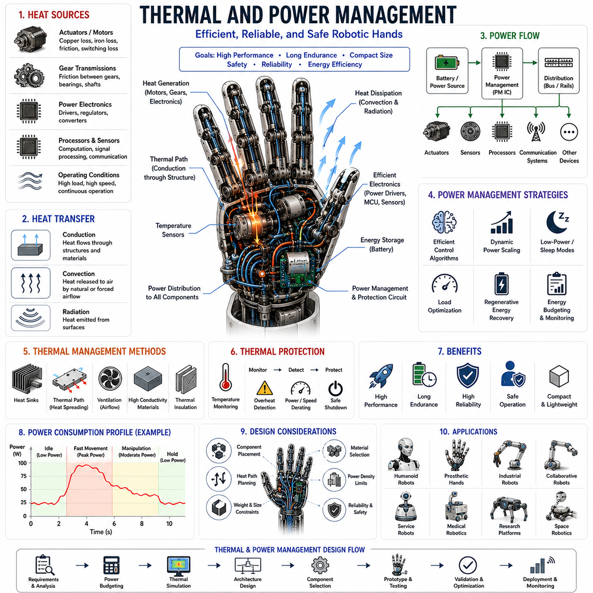{width="7.268055555555556in" height="7.268055555555556in"}

열 및 전력 관리(Thermal and Power Management)는 소형 로봇 핸드(Compact Robotic Hand), 덱스터러스 매니퓰레이터(Dexterous Manipulator), 의수(Prosthetic Hand), 휴머노이드 로봇(Humanoid Robot), 협동 로봇(Collaborative Robot), 그리고 고성능 엔드이펙터(End Effector)를 설계할 때 가장 중요한 공학 분야 중 하나이다. 액추에이터 선정, 기계 구조 설계, 센서 기술, 제어 알고리즘이 주목받는 경우가 많지만, 실제 로봇 핸드의 성능, 신뢰성, 효율성, 안전성, 수명은 결국 열과 전력을 얼마나 효과적으로 관리하느냐에 크게 좌우된다. 최근 로봇 핸드는 점점 더 소형화되고, 더 많은 기능과 센서, 액추에이터, AI 연산 장치를 포함하게 되면서 내부 발열과 전력 소비가 급격히 증가하고 있다. 따라서 열 및 전력 관리는 더 이상 보조적인 설계 요소가 아니라 전체 시스템 아키텍처를 결정하는 핵심 기술이 되었다.

인간의 손은 에너지와 열 관리의 훌륭한 참고 모델이다. 인간은 근육과 힘줄을 통해 에너지를 효율적으로 전달하며, 혈액 순환을 통해 지속적으로 온도를 조절한다. 또한 다양한 환경에서 장시간 작업을 수행하면서도 과열되거나 에너지가 급격히 소모되지 않는다. 로봇 핸드 역시 이러한 수준의 효율성과 지속성을 달성하기 위해 체계적인 열 및 전력 관리 기술을 필요로 한다.

전력 관리의 기본은 시스템 내부에서 에너지가 어떻게 흐르는지 이해하는 것에서 시작된다. 전력은 배터리, 외부 전원 공급 장치, 또는 전력 시스템으로부터 공급되며 액추에이터, 센서, 제어기, 통신 장치, 보조 장치로 분배된다. 각 구성 요소는 서로 다른 전력 요구 사항을 가지며, 상황에 따라 소비 전력이 달라진다. 효율적인 전력 관리는 필요한 시점에 필요한 곳으로 에너지를 공급하면서 에너지 손실을 최소화하는 것을 목표로 한다.

일반적으로 로봇 핸드에서 가장 많은 전력을 소비하는 부품은 액추에이터이다. 서보 모터(Servo Motor), 브러시리스 DC 모터(BLDC Motor), 공압 액추에이터(Pneumatic Actuator), 유압 액추에이터(Hydraulic Actuator), 형상기억합금 액추에이터(SMA), 유전 탄성체 액추에이터(DEA) 등은 모두 전기 에너지를 기계적 에너지로 변환한다. 그러나 어떠한 에너지 변환 과정도 100% 효율적일 수 없기 때문에 일부 에너지는 반드시 열로 변환된다.

브러시리스 DC 모터는 높은 효율과 우수한 제어성을 제공하기 때문에 로봇 핸드에서 널리 사용된다. 그러나 모터 내부의 권선 저항(Copper Loss), 철손(Iron Loss), 베어링 마찰(Friction Loss), 전력전자 스위칭 손실(Switching Loss) 등으로 인해 상당한 열이 발생한다. 이 열이 적절히 제거되지 않으면 효율 저하, 절연 열화, 출력 감소, 수명 단축이 발생할 수 있다.

감속기(Gearbox) 역시 중요한 열 발생원이다. 유성기어(Planetary Gear), 하모닉 드라이브(Harmonic Drive), 사이클로이드 감속기(Cycloidal Drive) 등은 기어 마찰과 베어링 마찰로 인해 지속적으로 열을 발생시킨다. 특히 고감속비 시스템에서는 이러한 열 발생이 더욱 커진다.

전력전자 장치(Power Electronics)도 상당한 발열을 일으킨다. 모터 드라이버(Motor Driver), 전압 조정기(Voltage Regulator), 통신 모듈, 임베디드 프로세서(Embedded Processor), AI 연산 장치 등은 모두 열을 발생시키는 요소이다. 최근 로봇 핸드는 센서 융합(Sensor Fusion), 머신러닝(Machine Learning), 촉각 처리(Tactile Processing) 등을 수행하기 위해 강력한 프로세서를 탑재하는 경우가 많아지고 있으며, 이에 따라 열 관리의 중요성이 더욱 증가하고 있다.

열 발생량은 동작 조건에 따라 크게 달라진다. 고속 움직임, 반복적인 파지 작업, 지속적인 힘 유지, 고부하 조작 작업은 모두 전력 소비와 발열을 증가시킨다. 산업용 로봇 핸드는 단순한 서비스 로봇 핸드보다 훨씬 많은 열을 발생시킬 수 있다.

소형 로봇 핸드에서는 열 축적(Heat Accumulation)이 매우 큰 문제이다. 내부 공간이 제한적이기 때문에 공기 흐름이 부족하고 방열 면적도 작다. 대형 산업용 로봇에서는 팬(Fan)이나 액체 냉각(Liquid Cooling)을 사용할 수 있지만, 소형 핸드는 대부분 수동 냉각(Passive Cooling)에 의존해야 한다.

열전도(Conduction)는 로봇 핸드 내부에서 가장 중요한 열 전달 방식 중 하나이다. 모터와 전자회로에서 발생한 열은 구조물과 프레임을 통해 외부로 전달된다. 알루미늄 합금(Aluminum Alloy), 구리(Copper), 열전도성이 높은 복합재(Composite Material)는 효과적인 열 전달을 위해 자주 사용된다.

대류(Convection)는 표면에서 열을 외부 공기로 전달하는 과정이다. 자연 대류(Natural Convection)는 온도 차이에 의해 발생하며, 강제 대류(Forced Convection)는 팬 등을 이용하여 열 방출을 증가시킨다. 소형 로봇 핸드는 팬을 장착하기 어려운 경우가 많기 때문에 자연 대류와 열전도에 크게 의존한다.

복사(Radiation) 역시 열 방출에 기여한다. 영향은 상대적으로 작지만 표면 재질과 코팅에 따라 방열 성능이 달라질 수 있다.

열 해석(Thermal Analysis)은 설계 과정에서 필수적인 단계이다. 엔지니어들은 유한요소해석(FEA), 전산유체역학(CFD), 다중물리 해석(Multiphysics Simulation)을 이용하여 온도 분포를 예측하고 열 병목 현상(Thermal Bottleneck)을 분석한다.

온도 센서(Temperature Sensor)는 실시간 열 관리를 가능하게 한다. 서미스터(Thermistor), RTD(Resistance Temperature Detector), 반도체 온도 센서, 적외선 센서(IR Sensor) 등을 사용하여 내부 온도를 모니터링할 수 있다.

현대 로봇 핸드는 다양한 열 보호 기능(Thermal Protection Mechanism)을 갖추고 있다. 온도가 임계치를 초과하면 제어기가 모터 전류를 줄이거나 속도를 제한하고, 필요시 일부 기능을 비활성화하거나 안전 정지를 수행한다.

전력 분배 구조(Power Distribution Architecture)는 전체 시스템 성능에 큰 영향을 미친다. 액추에이터는 고전압과 고전류를 필요로 하는 반면, 센서와 프로세서는 저전압 전원을 사용한다. 따라서 다양한 전압 레벨을 효율적으로 공급해야 한다.

전압 조정(Voltage Regulation)은 각 장치가 안정적인 전원을 공급받도록 보장한다. 벅 컨버터(Buck Converter), 부스트 컨버터(Boost Converter), LDO(Low Dropout Regulator) 등이 사용된다. 이러한 전력 변환 장치의 효율은 전체 에너지 소비에 직접적인 영향을 미친다.

배터리 기반 로봇 핸드에서는 에너지 효율이 더욱 중요하다. 사용 가능한 에너지가 제한되어 있기 때문에 불필요한 전력 손실을 최소화해야 한다.

에너지 밀도(Energy Density)는 휴대형 시스템의 핵심 요소이다. 현재는 리튬이온 배터리(Lithium-Ion Battery)가 가장 널리 사용되며, 높은 에너지 밀도와 우수한 수명을 제공한다. 차세대 전고체 배터리(Solid-State Battery)는 향후 중요한 기술이 될 것으로 기대된다.

전력 예산(Power Budgeting)은 설계 초기부터 수행되어야 한다. 평균 소비 전력, 최대 소비 전력, 시동 전류(Startup Current), 순간 부하(Transient Load)를 모두 고려하여 시스템을 설계해야 한다.

최대 소비 전력은 평균 소비 전력보다 훨씬 높을 수 있다. 예를 들어 손가락이 갑자기 강한 힘으로 물체를 잡는 경우 순간적으로 매우 큰 전류가 필요할 수 있다. 따라서 전력 시스템은 이러한 순간 부하를 감당할 수 있어야 한다.

회생 에너지(Regenerative Energy Recovery)는 최근 주목받는 기술이다. 감속이나 하중 해제 과정에서 액추에이터가 발전기처럼 동작하여 일부 에너지를 회수할 수 있다. 현재는 주로 대형 로봇에서 사용되지만 향후 소형 핸드에도 적용 가능성이 있다.

저전력 모드(Low-Power Mode), 슬립 모드(Sleep Mode), 동적 전력 조절(Dynamic Power Scaling)은 에너지 소비를 줄이는 데 중요한 역할을 한다. 사용하지 않는 센서나 통신 장치를 일시적으로 비활성화하여 배터리 수명을 연장할 수 있다.

임베디드 프로세서(Embedded Processor)는 현대 로봇 핸드의 핵심 구성 요소가 되었지만, 높은 연산 성능은 높은 전력 소비와 발열을 동반한다. 따라서 연산 성능과 전력 효율 사이의 균형이 중요하다.

인공지능(AI)은 열 및 전력 관리에도 활용되고 있다. AI는 온도 변화를 예측하고, 에너지 소비 패턴을 분석하며, 이상 상태를 사전에 감지할 수 있다. 이를 통해 사후 대응이 아니라 사전 예방적 관리가 가능해진다.

디지털 트윈(Digital Twin)은 열 및 전력 시스템 최적화에 매우 유용하다. 실제 하드웨어를 제작하기 전에 가상 환경에서 에너지 흐름과 온도 분포를 분석할 수 있다.

센서 시스템도 전체 전력 소비에 영향을 준다. 위치 센서(Position Sensor), 힘 센서(Force Sensor), 촉각 센서(Tactile Sensor), IMU(Inertial Measurement Unit) 등은 개별적으로는 작은 전력을 소비하지만, 수십 개가 동시에 사용되면 상당한 전력 부하를 형성할 수 있다.

무선 통신(Wireless Communication) 역시 전력 소비 요소이다. Bluetooth, Wi-Fi, UWB(Ultra-Wideband)와 같은 기술은 추가적인 전력과 열을 발생시킨다.

신뢰성(Reliability)은 열 관리와 밀접하게 연결되어 있다. 높은 온도는 전자부품의 수명을 단축시키고 윤활제 열화, 절연 파괴, 기계적 마모를 가속화한다. 적절한 온도 관리는 시스템 수명을 크게 향상시킨다.

안전성(Safety) 역시 중요하다. 사람과 상호작용하는 로봇 핸드는 사용자가 만질 수 있는 표면 온도를 안전 수준으로 유지해야 한다. 따라서 열 차폐(Thermal Insulation)와 온도 제한 기능이 필수적이다.

소프트 로봇 핸드(Soft Robotic Hand)는 또 다른 열 및 전력 관리 문제를 가진다. 공압 액추에이터, 인공 근육, 스마트 소재 기반 액추에이터는 기존 전기 모터와 다른 효율 특성을 가지므로 별도의 관리 전략이 필요하다.

휴머노이드 로봇과 의수는 특히 엄격한 열 및 전력 관리 요구 사항을 가진다. 인간과 유사한 크기 안에서 높은 성능과 긴 동작 시간을 동시에 달성해야 하기 때문이다.

미래의 열 및 전력 관리 기술은 재료공학, 배터리 기술, AI, 전력전자 기술의 발전과 함께 크게 향상될 것으로 예상된다. 고열전도 복합재, 상변화 재료(Phase Change Material), 전고체 배터리, 에너지 하베스팅(Energy Harvesting), AI 기반 에너지 최적화 기술이 핵심 연구 분야가 되고 있다.

결론적으로 열 및 전력 관리는 로봇 핸드의 보이지 않는 기반 인프라라고 할 수 있다. 액추에이터, 센서, 제어기, 통신 장치, 구조물 등 모든 구성 요소는 에너지 소비와 열 발생에 영향을 준다. 따라서 성공적인 로봇 핸드 설계는 열 발생, 에너지 저장, 전력 분배, 냉각, 보호 기능을 통합적으로 고려해야 한다. 미래의 고성능 로봇 핸드가 인간 수준의 민첩성, 장시간 동작 능력, 높은 신뢰성을 달성하기 위해서는 열 및 전력 관리 기술이 핵심 기반 기술로서 계속 발전할 것이다.
