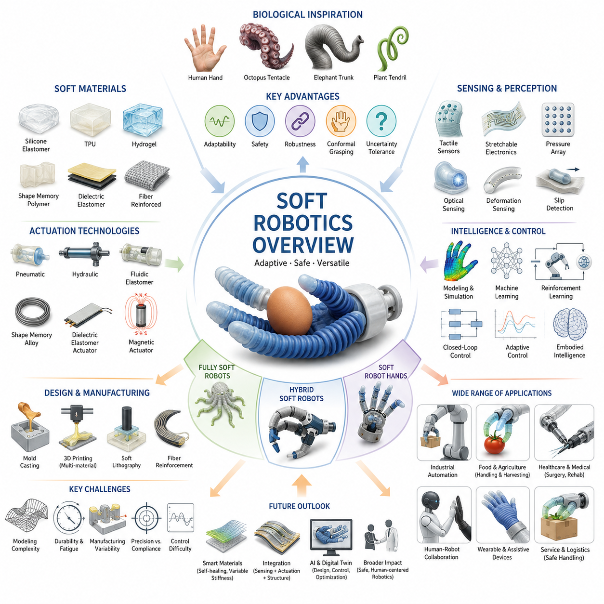
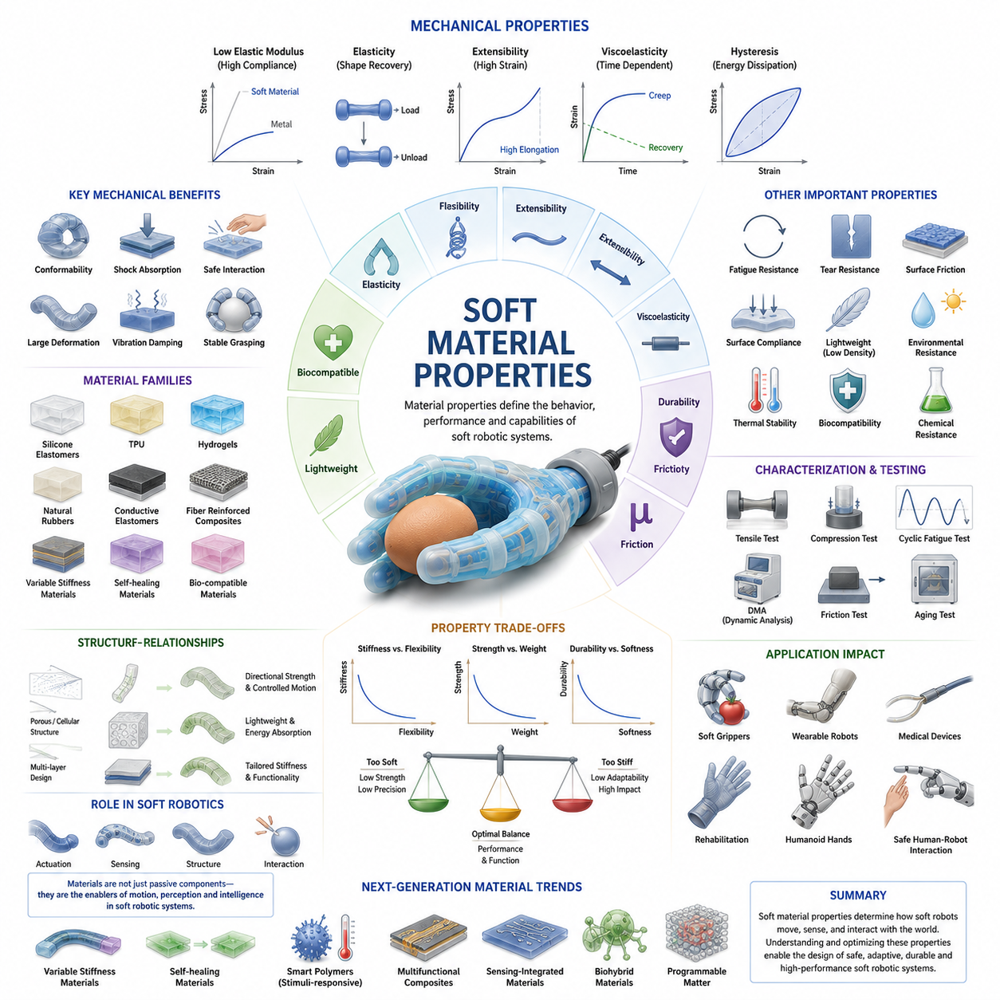
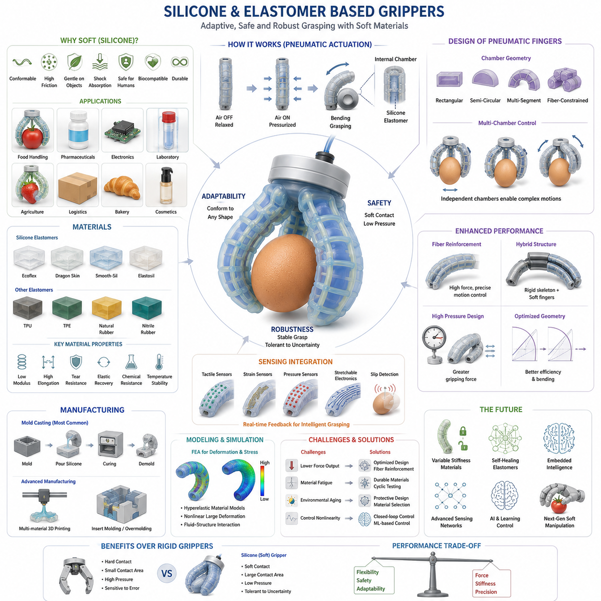
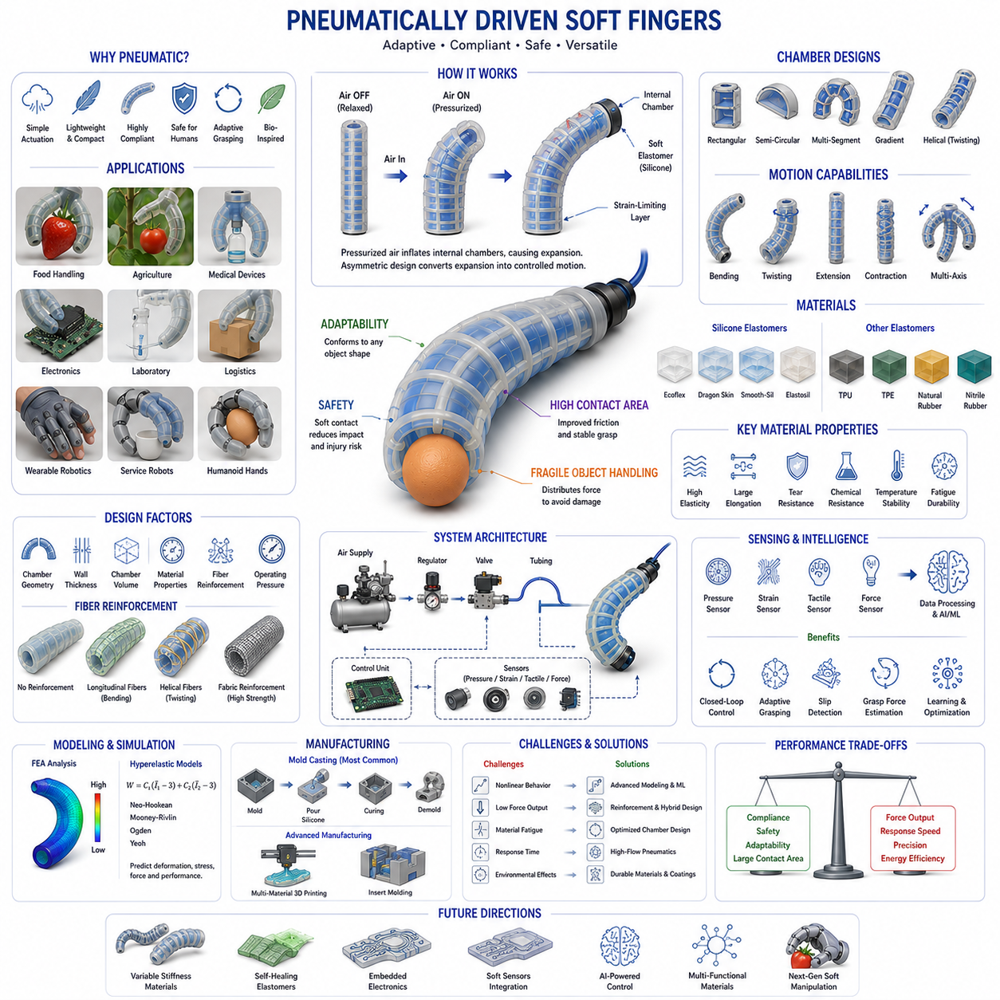
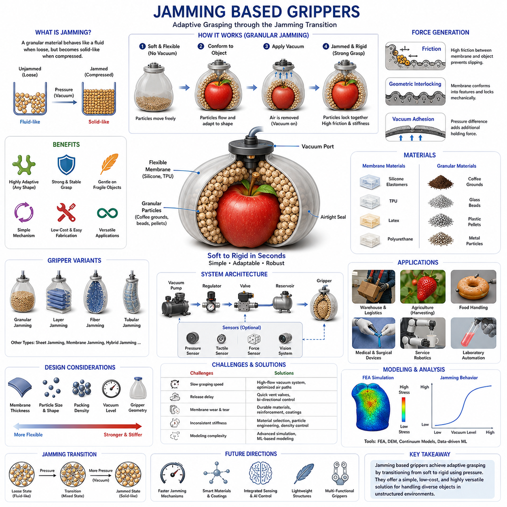
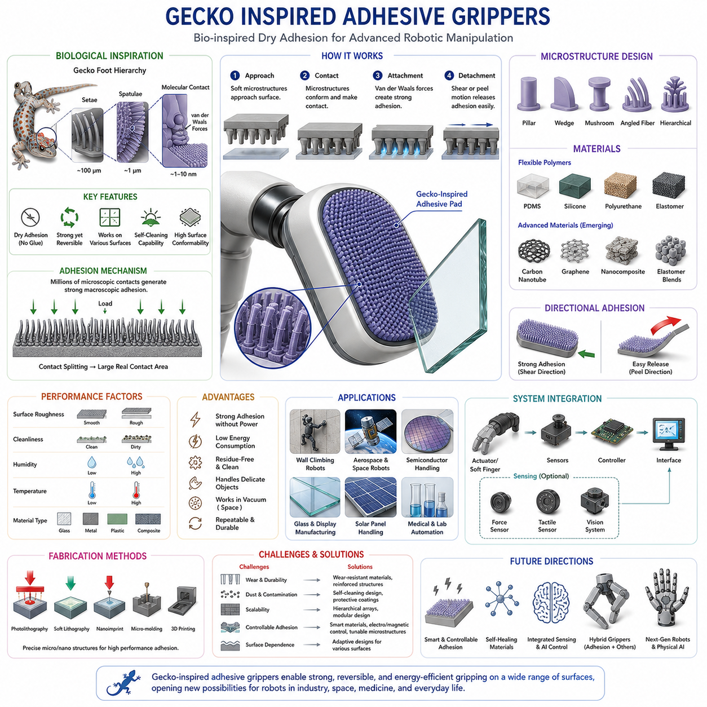
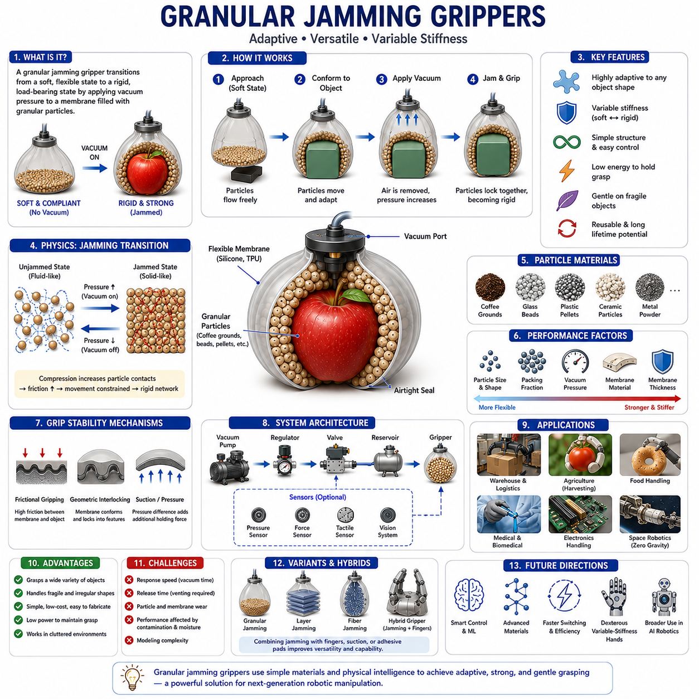
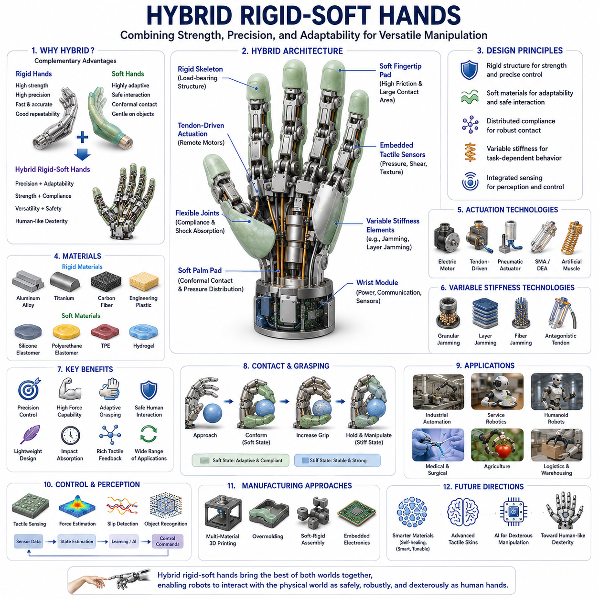
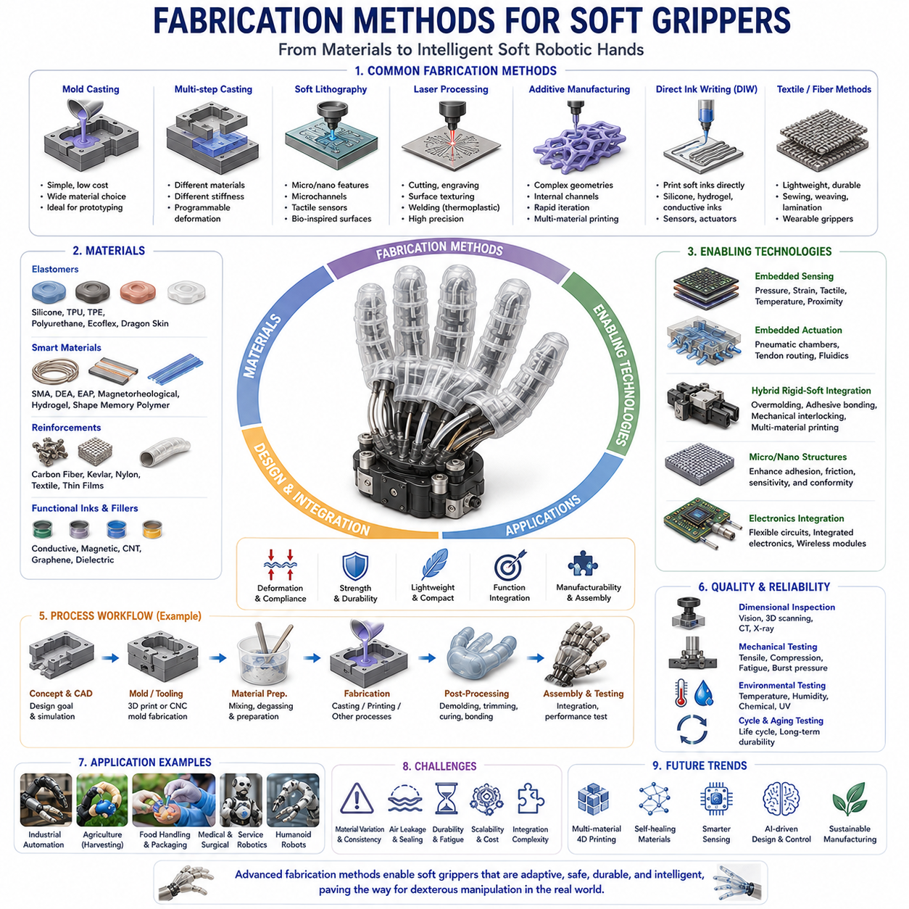
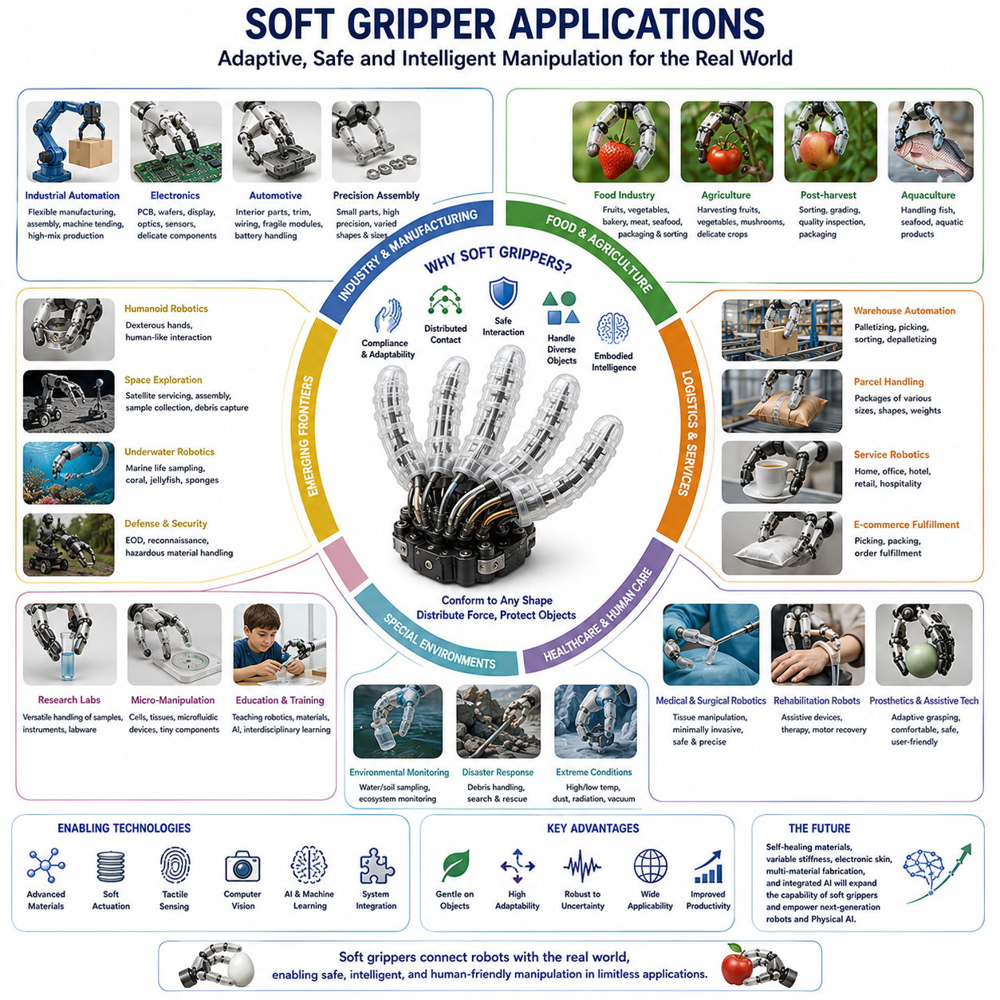

**Volume 06 Robot Hands and Dexterous Grasping**

# 04. Soft Grippers and Soft Robotics

## 04.01 Introduction to Soft Robotics

{width="7.268055555555556in" height="7.268055555555556in"}

Soft robotics is a rapidly emerging field of robotics that departs from the traditional paradigm of rigid-body mechanisms and introduces compliant, deformable, and biologically inspired structures capable of interacting safely and effectively with complex environments. Within the broader context of robot hands, dexterous manipulation, and mobile manipulators, soft robotics represents a fundamental shift in how robots are designed, controlled, and integrated into real-world applications. Instead of relying solely on rigid links, gears, bearings, and high-stiffness actuators, soft robotic systems employ flexible materials such as silicone elastomers, polymers, textiles, gels, and other compliant structures that allow robots to adapt their shape to objects, environments, and tasks. This paradigm significantly expands the range of applications that robots can perform, especially in situations involving uncertainty, delicate objects, human interaction, and unstructured environments. The topic appears as a foundational chapter within the Soft Gripper and Soft Robotics section of the Robot Hand and Dexterous Grasping volume, establishing the theoretical and engineering principles for subsequent discussions on soft materials, soft grippers, pneumatic fingers, jamming-based mechanisms, hybrid hands, fabrication techniques, and industrial deployment.

The origins of soft robotics can be traced to observations from biological organisms. Nature rarely relies on perfectly rigid mechanisms. Human fingers, octopus tentacles, elephant trunks, starfish arms, fish fins, and plant structures all achieve remarkable functionality through compliant bodies that continuously deform while interacting with their surroundings. These biological systems demonstrate that adaptability and robustness often arise not from rigid precision but from controlled compliance. Engineers studying these natural systems realized that many robotic challenges stem from excessive rigidity. Traditional robots require precise models, accurate calibration, and carefully controlled environments because small positioning errors can lead to task failure. Biological systems, in contrast, exploit compliance to absorb uncertainties and accommodate variations. Soft robotics emerged as an effort to replicate these biological advantages within engineered systems.

One of the central concepts in soft robotics is embodied intelligence. In conventional robotics, intelligence is often concentrated within software algorithms, sensors, and controllers. Soft robotics introduces the idea that part of the intelligence of a system can be embedded directly into its physical structure. The geometry, material properties, elasticity, and deformation characteristics of a soft robot contribute to how it behaves when interacting with objects. A well-designed soft gripper may automatically conform to an object\'s shape without requiring complex perception or planning algorithms. This phenomenon reduces computational requirements while increasing robustness. Instead of explicitly calculating every contact point, the mechanical properties of the gripper naturally distribute forces and adapt to geometric variations.

Soft robotic systems can be categorized according to their level of compliance. Fully soft robots consist almost entirely of deformable materials and contain few or no rigid structural components. Examples include silicone tentacles, soft continuum manipulators, inflatable robots, and pneumatic grippers. Hybrid soft robots combine rigid structural elements with compliant components, allowing designers to achieve both precision and adaptability. Semi-soft robotic hands often use rigid finger skeletons covered with soft surfaces that improve grasp quality and safety. This hybrid approach has become increasingly popular in industrial applications because it balances performance, durability, manufacturability, and control complexity.

The development of soft robotics has been enabled by significant advances in material science. Modern elastomers provide high flexibility, resilience, chemical resistance, and fatigue durability. Silicone rubbers, thermoplastic polyurethanes, shape-memory polymers, dielectric elastomers, hydrogels, and fiber-reinforced composites have expanded the range of achievable mechanical behaviors. Engineers can now design structures with carefully tuned stiffness distributions, allowing different regions of a robot to exhibit different mechanical responses. Some materials can stretch several hundred percent beyond their original dimensions while maintaining structural integrity. Others can change stiffness dynamically in response to temperature, pressure, electric fields, or magnetic fields. These capabilities provide unique opportunities for adaptive robotic systems.

Soft robotics is closely linked with novel actuation technologies. Traditional electric motors excel at delivering precise rotational motion but are often difficult to integrate into highly deformable structures. Consequently, soft robotics has stimulated the development of alternative actuation methods. Pneumatic actuators remain among the most common approaches. By controlling air pressure within internal chambers, engineers can generate bending, twisting, extension, contraction, and complex three-dimensional deformations. Pneumatic artificial muscles, fluidic elastomer actuators, and inflatable structures provide lightweight and inherently compliant motion. Hydraulic systems offer higher force density and are suitable for heavy-duty applications, although they introduce additional complexity. Emerging technologies such as shape-memory alloys, dielectric elastomer actuators, electroactive polymers, and magnetic soft actuators further broaden the design space for future robotic systems.

A major advantage of soft robotics is its ability to handle uncertainty during grasping and manipulation. Traditional rigid grippers often require precise object localization and carefully planned grasp strategies. Small positioning errors can result in unstable grasps or complete failures. Soft grippers compensate for these uncertainties through passive adaptation. When a soft finger contacts an object, its structure deforms naturally around the object\'s geometry. Contact areas increase automatically, pressure is distributed more evenly, and grasp stability improves without requiring detailed object models. This capability is particularly valuable in warehouse automation, food handling, agricultural harvesting, medical robotics, and service robotics, where objects frequently vary in size, shape, orientation, and material properties.

Human-robot interaction represents another important application area. Safety remains a major concern whenever robots operate near people. Conventional industrial robots often rely on safety cages, restricted operating zones, and extensive risk mitigation measures due to their rigid structures and high forces. Soft robotic systems inherently reduce many of these risks because compliant materials absorb impact energy and limit contact forces. Even when unexpected collisions occur, the likelihood of injury is significantly reduced. This characteristic makes soft robotics particularly attractive for collaborative robots, wearable robotic systems, rehabilitation devices, assistive technologies, and healthcare applications.

Soft robotic hands have attracted considerable attention within dexterous manipulation research. Human hands achieve extraordinary versatility through a combination of compliant tissues, adaptive contact surfaces, and sophisticated sensorimotor control. Replicating these capabilities using rigid robotic fingers remains extremely challenging. Soft robotic hands address this challenge by introducing deformable finger structures that better mimic biological behavior. Soft fingertips can increase frictional contact, improve grasp robustness, and enhance object handling performance. Multi-finger soft hands can manipulate fragile items such as fruits, laboratory samples, pharmaceuticals, electronic components, and medical instruments while minimizing the risk of damage.

The relationship between soft robotics and tactile sensing is particularly significant. Deformation itself becomes an information source. When soft materials bend, stretch, compress, or twist, embedded sensors can measure these changes and infer contact forces, object shapes, slip events, and environmental interactions. Flexible tactile sensors, stretchable electronics, conductive elastomers, optical sensing structures, and embedded pressure arrays are increasingly integrated into soft robotic systems. These sensing capabilities allow robots to perceive interactions at a level that approaches biological touch, enabling more sophisticated manipulation strategies.

Despite its advantages, soft robotics introduces substantial engineering challenges. Modeling soft structures is considerably more difficult than modeling rigid mechanisms. Traditional robotic systems are often described using rigid-body kinematics and dynamics, which provide mathematically tractable representations. Soft robots, however, undergo continuous deformation with potentially infinite degrees of freedom. Accurate modeling often requires finite element methods, continuum mechanics, nonlinear elasticity theory, and advanced numerical simulations. Real-time control becomes more complex because system behavior depends on material properties, deformation histories, environmental interactions, and manufacturing variations.

Manufacturing presents additional challenges. Producing soft robotic components frequently requires specialized fabrication techniques. Mold casting, additive manufacturing, soft lithography, fiber reinforcement, embedded channel fabrication, and multi-material printing are commonly used. Maintaining consistent quality across production batches can be difficult because material properties may vary due to environmental conditions, curing processes, or aging effects. Engineers must carefully consider durability, wear resistance, chemical compatibility, and lifecycle performance when designing commercially viable soft robotic systems.

Another challenge involves balancing compliance and precision. While compliance improves adaptability and safety, excessive softness can reduce positioning accuracy and load-carrying capacity. Industrial applications often demand repeatable motion, precise assembly, and high throughput. Achieving these requirements with fully soft structures remains difficult. Consequently, many practical systems adopt hybrid architectures that combine rigid structural elements with strategically placed compliant components. Such designs leverage the strengths of both approaches while mitigating their respective weaknesses.

Recent advances in artificial intelligence have accelerated the development of soft robotics. Machine learning techniques enable robots to learn deformation models, optimize grasp strategies, estimate contact states, and adapt to changing environments. Reinforcement learning has proven particularly effective for soft manipulation tasks because it can discover control policies without requiring highly accurate analytical models. Deep neural networks can learn relationships between actuator commands, sensor measurements, and resulting deformations directly from data. Foundation models and embodied AI systems are expected to further enhance the capabilities of soft robotic platforms by integrating perception, reasoning, planning, and manipulation within unified architectures.

Soft robotics also plays an increasingly important role in medical and healthcare applications. Soft surgical instruments can navigate delicate anatomical structures while minimizing tissue damage. Rehabilitation devices can conform comfortably to individual patients. Wearable robotic gloves can assist individuals with motor impairments. Soft exoskeletons provide mobility assistance while maintaining comfort and safety. These applications highlight the unique value of compliance in environments where direct interaction with the human body is unavoidable.

In agricultural automation, soft robotic grippers have demonstrated remarkable success in harvesting fruits and vegetables. Traditional rigid grippers often bruise or damage produce because they cannot accommodate natural variations in shape and firmness. Soft grippers distribute contact forces more evenly and adapt to irregular geometries, improving harvesting success rates while reducing waste. Similar advantages have been observed in food processing, packaging, and pharmaceutical handling applications.

The future of soft robotics is likely to be characterized by increasing integration with advanced materials, intelligent sensing, adaptive control, and embodied artificial intelligence. Researchers are developing self-healing materials capable of repairing damage autonomously, variable-stiffness structures that transition between rigid and compliant states, and multifunctional materials that combine sensing, actuation, and structural support within a single component. Advances in additive manufacturing will enable increasingly complex soft robotic architectures that were previously impossible to fabricate. Meanwhile, improvements in computational modeling and machine learning will make soft systems easier to design, control, and deploy at scale.

Within the broader framework of robot hand engineering and dexterous grasping, soft robotics serves as a critical bridge between biological inspiration and practical robotic implementation. It expands the capabilities of robotic manipulators beyond what is achievable with rigid mechanisms alone and provides new solutions to longstanding challenges in grasping, manipulation, safety, adaptability, and human interaction. As robotics continues to move from structured industrial environments into homes, hospitals, warehouses, farms, and public spaces, the principles of soft robotics are expected to become increasingly central to the next generation of intelligent robotic systems. The subsequent chapters in this volume build upon these foundational concepts by exploring soft materials, soft finger architectures, jamming mechanisms, hybrid hand designs, fabrication methodologies, durability evaluation, and real-world deployment strategies, forming a comprehensive framework for the design and development of advanced soft robotic manipulation systems.

## 04.02 Soft Material Properties

{width="7.268055555555556in" height="7.268055555555556in"}

Soft robotics is fundamentally enabled by the unique mechanical, physical, and functional characteristics of soft materials. Unlike conventional robotic systems that are primarily constructed from rigid metals, engineering plastics, and high-stiffness composites, soft robotic systems rely on compliant materials capable of undergoing large deformations while maintaining structural integrity and functional performance. The selection, characterization, and optimization of soft materials are among the most critical aspects of soft robotic design because the material itself often determines how the robot moves, senses, interacts with objects, and adapts to its environment. In many soft robotic systems, the material functions simultaneously as a structural component, actuator housing, sensing medium, and force transmission mechanism. Consequently, understanding soft material properties is essential for the successful design and deployment of soft grippers, soft fingers, continuum manipulators, wearable robots, rehabilitation devices, and bio-inspired robotic systems. This chapter builds upon the foundational concepts introduced in Soft Robotics Overview and establishes the material science framework necessary for understanding the subsequent chapters on silicone grippers, pneumatic actuators, jamming systems, hybrid robotic hands, fabrication techniques, and lifecycle testing.

The defining characteristic of soft materials is their low elastic modulus compared to traditional engineering materials. Elastic modulus, often referred to as Young's Modulus, describes a material\'s resistance to deformation under applied stress. Metals such as steel and aluminum possess elastic moduli measured in gigapascals, whereas many soft robotic materials exhibit moduli ranging from several kilopascals to a few megapascals. This difference of several orders of magnitude allows soft materials to deform significantly under relatively small forces. Such compliance enables soft robotic structures to conform to irregular object geometries, absorb impact energy, and interact safely with humans and delicate environments.

Elasticity is one of the most important mechanical properties in soft robotics. Elastic materials return to their original shape after external forces are removed. High elasticity enables repeated deformation cycles without permanent damage, making it suitable for applications involving repetitive grasping, bending, twisting, stretching, and compression. Elastomeric materials such as silicone rubber and thermoplastic polyurethane are widely used because they can sustain substantial strains while maintaining their structural properties. Elastic recovery is particularly important for soft grippers because the gripping mechanism depends on the ability of fingers to repeatedly deform and recover during manipulation tasks.

Closely related to elasticity is flexibility. While elasticity refers to the ability to recover shape after deformation, flexibility describes how easily a material can bend or deform. Materials with high flexibility require relatively low forces to produce significant shape changes. Flexible materials allow robotic fingers to wrap around objects, increase contact areas, and accommodate positional uncertainties during grasping. This characteristic contributes directly to improved grasp stability and object handling performance.

Another essential property is extensibility, which refers to the maximum amount of strain a material can withstand before failure. Many soft robotic materials can stretch several hundred percent beyond their original length. Certain silicone elastomers can achieve elongations exceeding 500 percent, while some specialized elastomeric materials can stretch even further. High extensibility enables the development of highly deformable actuators and structures capable of producing complex motions without mechanical joints or traditional linkages.

Viscoelasticity is a distinguishing feature of many soft materials. Unlike purely elastic materials, viscoelastic materials exhibit both elastic and viscous behavior. When subjected to stress, part of the deformation occurs immediately while another portion develops gradually over time. Similarly, recovery after unloading may also be delayed. This behavior influences the dynamic response of soft robotic systems and must be carefully considered during design and control. Viscoelastic effects contribute to damping, vibration absorption, and impact mitigation, but they can also introduce hysteresis and reduce positioning accuracy.

Hysteresis is commonly observed in soft materials and represents the difference between loading and unloading behavior. During repeated deformation cycles, the force-displacement relationship often follows different paths depending on whether the material is being stretched or released. Energy is dissipated during each cycle, typically in the form of heat. Hysteresis can complicate actuator control because identical input commands may produce slightly different outputs depending on previous deformation history. Advanced modeling and machine learning approaches are increasingly employed to compensate for these nonlinear behaviors.

Material damping plays an important role in many soft robotic applications. Damping refers to the ability of a material to absorb and dissipate mechanical energy. Soft materials naturally exhibit higher damping characteristics than rigid materials, making them effective for shock absorption and vibration reduction. In human-robot interaction scenarios, damping contributes significantly to safety by reducing impact forces during accidental collisions. In robotic manipulation, damping helps stabilize object contact and suppress unwanted oscillations.

The stress-strain relationship of soft materials is often highly nonlinear. Traditional engineering materials frequently exhibit approximately linear behavior within their operating ranges, allowing simple mathematical models to predict deformation. Soft materials, however, may experience significant changes in stiffness as deformation increases. Some materials become stiffer as they stretch, a phenomenon known as strain stiffening. This nonlinear behavior is commonly observed in biological tissues and many elastomeric materials. Understanding these nonlinear effects is essential for accurately predicting robotic behavior under varying operating conditions.

Fatigue resistance is another critical consideration. Soft robotic systems frequently experience thousands or even millions of deformation cycles throughout their operational lifetimes. Repeated bending, stretching, and compression can gradually degrade material properties, leading to cracks, tears, delamination, or permanent deformation. Materials selected for commercial soft robotic systems must demonstrate sufficient fatigue life to withstand long-term operation. Fatigue testing is therefore an important component of soft robot development and validation.

Tear resistance is particularly important in applications involving sharp edges, abrasive surfaces, or concentrated stresses. Even highly elastic materials may fail prematurely if their tear resistance is inadequate. Engineers often enhance tear resistance through material selection, fiber reinforcement, structural optimization, or multilayer composite construction. Improved tear resistance directly contributes to system reliability and lifecycle performance.

Surface friction characteristics strongly influence grasping performance. Soft robotic grippers frequently rely on frictional contact to maintain stable grasps. Materials with high coefficients of friction can improve object retention while reducing required gripping forces. Silicone-based materials are especially popular because they combine compliance with favorable frictional properties. However, excessive friction may complicate object release or contribute to surface wear. Therefore, friction characteristics must be optimized according to application requirements.

Surface compliance also affects contact mechanics. Soft surfaces distribute forces over larger contact areas compared to rigid surfaces. Increased contact areas reduce pressure concentrations and minimize damage to delicate objects. This characteristic is particularly valuable when handling fruits, vegetables, pharmaceuticals, electronic components, laboratory samples, and medical devices. Soft contact surfaces can also improve grasp robustness by increasing frictional engagement and reducing sensitivity to positioning errors.

Density is another important material parameter. Lightweight materials contribute to reduced actuator requirements, improved energy efficiency, and enhanced dynamic performance. Many soft robotic materials possess significantly lower densities than metals, enabling lightweight designs suitable for mobile and wearable robotic applications. However, density must often be balanced against strength, durability, and manufacturing considerations.

Environmental resistance is increasingly important as soft robotic systems move from laboratory environments into real-world applications. Materials may be exposed to moisture, ultraviolet radiation, temperature variations, chemicals, biological contaminants, and mechanical wear. Long-term exposure to such conditions can alter material properties and reduce performance. Engineers must therefore evaluate environmental compatibility when selecting materials for specific deployment scenarios.

Thermal properties significantly influence soft robotic performance. Temperature changes can affect elasticity, stiffness, viscosity, and dimensional stability. Some elastomers become softer at elevated temperatures and stiffer at lower temperatures. Extreme temperatures may accelerate material aging or reduce mechanical performance. Thermal management considerations become particularly important when integrating actuators, sensors, and electronic components into compact soft robotic systems.

Biocompatibility is essential for medical and wearable robotics applications. Materials intended for direct contact with human tissue must satisfy stringent safety requirements. Biocompatible silicones, medical-grade polymers, hydrogels, and specialized elastomers are commonly employed in rehabilitation devices, surgical tools, prosthetics, and assistive technologies. These materials must not cause toxicity, irritation, allergic reactions, or long-term adverse biological effects.

Silicone elastomers represent one of the most widely used material classes in soft robotics. They offer excellent flexibility, high elongation capability, chemical stability, transparency, and biocompatibility. Their manufacturing versatility allows engineers to create complex internal channels, embedded sensing structures, and customized actuator geometries. Popular examples include Ecoflex, Dragon Skin, and Smooth-Sil series materials, which are widely used in research and commercial soft robotic systems.

Thermoplastic polyurethanes provide another important material family. TPU materials offer a balance between elasticity, abrasion resistance, durability, and manufacturability. Unlike many silicone materials, TPUs are often compatible with additive manufacturing processes, making them attractive for rapid prototyping and scalable production. Their mechanical robustness makes them suitable for industrial soft robotic applications.

Hydrogels have attracted considerable attention because of their biological similarity to natural tissues. These water-rich materials exhibit exceptional softness and biocompatibility. Hydrogels are particularly promising for biomedical robotics, soft sensors, artificial muscles, and tissue engineering applications. However, challenges related to dehydration, durability, and environmental stability currently limit widespread industrial adoption.

Fiber-reinforced composites represent an important strategy for tailoring material behavior. By embedding fibers within soft matrices, engineers can control deformation directions, increase strength, and create anisotropic mechanical responses. Fiber reinforcement enables the development of sophisticated soft actuators that bend, twist, or contract in predictable ways when pressurized or actuated.

Variable-stiffness materials represent one of the most exciting frontiers in soft robotics. These materials can transition between soft and rigid states in response to external stimuli such as temperature, pressure, magnetic fields, or electric fields. Variable stiffness enables robots to combine the adaptability of soft systems with the load-bearing capabilities of rigid structures. Such capabilities are expected to play a major role in future dexterous robotic hands, humanoid robots, and adaptive manipulation systems.

The integration of sensing capabilities directly into materials is another rapidly growing area. Stretchable conductors, conductive elastomers, embedded optical fibers, liquid metal circuits, and piezoresistive composites enable materials to function as both structural components and sensors. This concept, often referred to as material intelligence, allows robots to perceive deformation, pressure, contact location, and environmental interactions without relying exclusively on discrete sensor modules.

Material characterization is an essential step in soft robotic development. Engineers employ tensile testing, compression testing, cyclic fatigue analysis, dynamic mechanical analysis, hardness measurements, friction testing, and environmental aging studies to quantify material performance. Accurate material models derived from these experiments support simulation, design optimization, and control system development.

As soft robotics continues to evolve, advances in material science will remain one of the primary drivers of innovation. Emerging technologies such as self-healing materials, programmable matter, multifunctional composites, biohybrid materials, and smart polymers are expected to dramatically expand the capabilities of future soft robotic systems. These next-generation materials will not only provide structural support but also integrate sensing, actuation, energy storage, and adaptive intelligence within a unified physical platform.

Ultimately, soft material properties define the foundation upon which all soft robotic systems are built. The behavior of soft grippers, compliant manipulators, wearable robots, and bio-inspired machines is governed directly by the mechanical and physical characteristics of their constituent materials. A deep understanding of elasticity, flexibility, extensibility, viscoelasticity, durability, friction, environmental resistance, and multifunctional material design is therefore indispensable for engineers seeking to develop advanced soft robotic technologies capable of operating safely, efficiently, and intelligently in complex real-world environments.

## 04.03 Silicone and Elastomer Grippers

{width="7.268055555555556in" height="7.268055555555556in"}

Silicone and elastomer-based grippers represent one of the most important technological developments in modern soft robotics. Unlike conventional rigid grippers that rely on metal linkages, rigid joints, and precise mechanical alignment, silicone and elastomer grippers utilize the intrinsic compliance of soft materials to achieve adaptive grasping, safe interaction, and robust object handling. These grippers have become a cornerstone technology in soft robotic manipulation because they provide an elegant solution to one of the most challenging problems in robotics: reliably grasping objects of varying shapes, sizes, textures, and fragility without requiring highly accurate object models or complex control algorithms. By leveraging the mechanical properties of silicone elastomers and related soft polymers, these systems are capable of achieving biologically inspired grasping behaviors that resemble those observed in human fingers and natural organisms.

The emergence of silicone-based grippers was driven by limitations encountered in traditional robotic manipulation systems. Conventional industrial grippers excel at handling rigid and geometrically predictable objects in highly structured environments. However, they often struggle when dealing with irregular, deformable, delicate, or unknown objects. Small positioning errors can cause grasp failures, excessive gripping forces may damage products, and rigid contact surfaces can reduce adaptability. Silicone and elastomer-based grippers address these issues by allowing the gripping surface itself to deform and conform to the object being manipulated. This adaptive behavior significantly increases grasp robustness while reducing control complexity.

Silicone elastomers are among the most widely used materials in soft robotic grippers due to their unique combination of mechanical and physical properties. These materials exhibit high elasticity, large strain capability, excellent flexibility, biocompatibility, chemical resistance, and long-term durability. Silicone can undergo substantial deformation while maintaining structural integrity and returning to its original shape after unloading. This property enables the creation of soft fingers capable of wrapping around objects and distributing contact forces evenly across their surfaces.

One of the most important characteristics of silicone materials is their low elastic modulus compared to metals and engineering plastics. This low stiffness allows silicone fingers to conform naturally to object geometries. When a silicone gripper contacts an object, the contact area automatically increases as the material deforms. Larger contact areas improve frictional engagement, reduce pressure concentrations, and enhance grasp stability. This behavior is fundamentally different from rigid grippers, where contact typically occurs at a limited number of points and requires precise alignment.

The ability to handle delicate objects is one of the primary advantages of silicone and elastomer grippers. In food processing applications, these grippers can manipulate fruits, vegetables, baked goods, seafood, and packaged foods without causing bruising or deformation. In pharmaceutical manufacturing, they can handle fragile medical products and laboratory samples. In electronics assembly, they can safely manipulate sensitive components without generating excessive stress. Such capabilities have significantly expanded the range of tasks that robotic systems can perform in industries where traditional automation solutions were previously impractical.

The most common design architecture for silicone-based grippers involves pneumatic actuation. Pneumatic soft grippers contain internal chambers embedded within silicone structures. When compressed air is introduced into these chambers, pressure causes the walls of the chamber to expand. By carefully controlling chamber geometry and material thickness distributions, engineers can produce predictable bending motions. The resulting structures function as soft fingers that curl around objects when pressurized and return to their original shape when pressure is released.

The design of pneumatic chambers is a critical aspect of gripper performance. Chamber geometry determines bending angle, force output, response speed, energy efficiency, and durability. Rectangular chambers, semi-circular chambers, multi-segment chambers, and fiber-constrained chambers each produce distinct deformation behaviors. Advanced designs often employ multiple independently controlled chambers to achieve complex motion patterns such as twisting, curling, and multidirectional bending.

Fiber reinforcement is frequently incorporated into silicone grippers to improve motion control and structural performance. Fibers embedded within the elastomer constrain deformation in selected directions while permitting expansion in others. This approach enables highly predictable bending behavior and prevents undesirable ballooning effects. Fiber-reinforced silicone actuators can achieve significantly higher force outputs and more efficient energy utilization than non-reinforced designs.

The selection of silicone material significantly influences gripper performance. Softer silicones provide superior compliance and adaptability but may generate lower gripping forces. Harder silicones offer increased load-carrying capacity but reduce conformity. Material selection therefore involves balancing flexibility, strength, durability, and application requirements. Popular soft robotic materials include Ecoflex, Dragon Skin, Smooth-Sil, Elastosil, and various custom-formulated elastomer blends developed specifically for robotic applications.

Material hardness is commonly characterized using Shore hardness scales. Lower Shore hardness values correspond to softer materials with greater compliance, while higher values indicate increased stiffness. Engineers frequently select Shore 00 or Shore A materials depending on desired deformation characteristics. The hardness selection directly affects grasping behavior, load capacity, durability, and control performance.

In addition to pure silicone materials, numerous elastomer families are utilized in soft gripper development. Thermoplastic polyurethanes provide excellent abrasion resistance and mechanical durability. Natural and synthetic rubbers offer cost-effective solutions for industrial applications. Thermoplastic elastomers combine flexible mechanical properties with manufacturing advantages such as injection molding and additive manufacturing compatibility. Each material family offers unique trade-offs between cost, manufacturability, performance, and lifecycle characteristics.

The mechanical modeling of silicone grippers differs significantly from conventional robotic systems. Traditional robot fingers can often be described using rigid-body kinematics and dynamics. Silicone grippers, however, behave as continuum structures with distributed deformation. Their behavior is governed by nonlinear elasticity, hyperelastic material models, contact mechanics, and fluid-structure interactions. Engineers commonly employ finite element analysis to predict deformation patterns and optimize gripper geometries prior to fabrication.

Hyperelastic material models are particularly important in soft robotics because silicone materials experience large deformations that cannot be accurately represented using linear elasticity theories. Models such as Neo-Hookean, Mooney-Rivlin, Ogden, and Yeoh formulations are widely used to characterize silicone behavior. These models enable accurate simulation of stress distributions, strain fields, force generation, and failure modes under operational conditions.

Manufacturing methods for silicone grippers have evolved significantly over the past decade. Mold casting remains the most widely used fabrication technique. This process involves creating molds that define internal chamber structures and external geometries. Liquid silicone is poured into the mold, cured, and assembled into the final actuator. Mold casting offers excellent material quality and relatively low equipment costs, making it popular in both research and industrial environments.

Additive manufacturing technologies have further expanded design possibilities. Multi-material 3D printing enables the fabrication of complex geometries that would be difficult or impossible to achieve through traditional molding processes. Researchers can now integrate rigid and soft components within a single manufacturing operation, creating highly sophisticated hybrid robotic structures. Although additive manufacturing of silicone materials remains challenging, rapid advances in materials and printing technologies continue to improve feasibility.

Durability remains a major consideration in silicone gripper design. Repeated deformation cycles can eventually lead to material fatigue, crack initiation, delamination, or rupture. Factors such as chamber geometry, material thickness, pressure levels, and environmental exposure influence lifespan. Engineers conduct extensive cyclic testing to evaluate durability and identify failure mechanisms. In industrial applications, grippers may be required to withstand millions of operating cycles while maintaining consistent performance.

Environmental factors also influence material behavior. Temperature variations can alter stiffness and elasticity. Exposure to ultraviolet radiation may accelerate aging. Chemical contaminants can degrade material properties. Humidity may affect bonding interfaces and embedded sensing systems. Consequently, material selection and protective design measures must consider operational environments to ensure reliable long-term performance.

Force generation is often viewed as a limitation of purely soft grippers. Because silicone structures are inherently compliant, they generally produce lower gripping forces than rigid mechanical systems of similar size. Researchers address this challenge through optimized chamber designs, fiber reinforcement strategies, higher operating pressures, hybrid structures, and advanced material formulations. Hybrid grippers that combine rigid skeletal elements with soft contact surfaces often achieve an effective balance between adaptability and force capability.

Sensing integration represents a rapidly growing area of research. Silicone grippers increasingly incorporate tactile sensors, strain sensors, pressure sensors, and embedded conductive structures. These sensing systems enable the gripper to detect contact events, estimate grasp forces, monitor deformation states, and identify slip conditions. Such capabilities are essential for advanced manipulation tasks requiring closed-loop control and autonomous decision-making.

Stretchable electronics have emerged as a particularly promising technology for sensor integration. Conductive elastomers, liquid metal circuits, flexible printed electronics, and optical sensing structures can be embedded directly within silicone materials. This approach allows sensing functionality to coexist with structural compliance without significantly affecting mechanical performance.

Machine learning techniques are increasingly used to improve the performance of silicone-based grippers. Traditional analytical models struggle to capture the complex nonlinear behaviors associated with soft materials. Data-driven approaches can learn relationships between pressure inputs, deformation patterns, contact states, and grasp outcomes directly from experimental observations. Reinforcement learning, imitation learning, and neural-network-based controllers have demonstrated impressive results in adaptive soft manipulation tasks.

The role of silicone grippers in human-robot interaction is particularly significant. Their inherent compliance reduces injury risks during accidental collisions and makes them suitable for collaborative robotics applications. Unlike rigid grippers that may exert concentrated forces, silicone fingers distribute loads over larger contact areas, reducing pressure on human skin and sensitive surfaces. This characteristic makes them attractive for healthcare, rehabilitation, service robotics, and assistive technologies.

Medical applications continue to drive innovation in silicone gripper technology. Surgical manipulators, rehabilitation devices, prosthetic hands, and wearable assistive systems frequently employ silicone-based components due to their biocompatibility and safety characteristics. Soft robotic gloves used for rehabilitation can assist patient movement while maintaining comfort and minimizing injury risks. Similarly, minimally invasive surgical instruments benefit from compliant structures that can navigate delicate anatomical environments.

Agricultural automation has become another major application area. Harvesting robots equipped with silicone grippers can handle delicate fruits such as strawberries, tomatoes, peaches, and grapes without causing damage. Traditional rigid grippers often struggle with these tasks due to variations in size, shape, ripeness, and surface properties. Silicone grippers naturally accommodate these variations through passive adaptation, significantly improving harvesting success rates.

Warehouse automation and logistics systems have also adopted soft gripper technologies. Modern fulfillment centers increasingly require robotic systems capable of handling diverse product categories. Silicone-based grippers can grasp objects ranging from packaged consumer goods to fragile household items with minimal reconfiguration. This versatility reduces operational complexity and increases automation flexibility.

The future of silicone and elastomer-based grippers will likely involve deeper integration with intelligent materials, embedded sensing, adaptive control systems, and foundation-model-driven robotic intelligence. Variable-stiffness materials may allow grippers to transition between soft and rigid states depending on task requirements. Self-healing elastomers could dramatically improve durability and maintenance characteristics. Multifunctional materials may simultaneously provide structure, sensing, actuation, and energy storage capabilities.

As robotic systems continue to move beyond highly structured industrial environments and into homes, hospitals, farms, warehouses, and public spaces, silicone and elastomer-based grippers will play an increasingly important role. Their ability to safely interact with uncertain environments, manipulate delicate objects, adapt to geometric variability, and support human-centered applications positions them as one of the foundational technologies of next-generation robotic manipulation. Within the broader field of robot hand engineering and dexterous grasping, silicone and elastomer-based grippers serve as a critical bridge between biological inspiration and practical robotic implementation, enabling robots to interact with the physical world in ways that are more adaptive, robust, and fundamentally human-like.

## 04.04 Pneumatic Soft Fingers

{width="7.268055555555556in" height="7.268055555555556in"}

Pneumatically Driven Soft Fingers represent one of the most influential and widely adopted technologies in modern soft robotics. These robotic structures utilize pressurized air as the primary source of actuation and employ highly compliant materials such as silicone elastomers, thermoplastic polyurethanes, flexible composites, and reinforced polymers to generate controlled motion. Unlike traditional robotic fingers that depend on rigid joints, electric motors, gears, and linkages, pneumatic soft fingers achieve movement through the deformation of internal air chambers embedded within flexible structures. This design philosophy allows the fingers to bend, curl, twist, extend, and conform naturally to objects, enabling adaptive grasping and safe physical interaction with complex and uncertain environments. As a result, pneumatically driven soft fingers have become a foundational technology in soft grippers, dexterous robotic hands, wearable robotics, medical devices, agricultural automation systems, and next-generation human-centered robotic platforms.

The concept of pneumatic actuation is inspired by biological systems. Human muscles generate movement through internal pressure changes created by muscle contractions. Similarly, many biological organisms such as octopuses, worms, starfish, and elephant trunks achieve remarkable mobility without rigid skeletal joints. Researchers recognized that fluid pressure could be used as an alternative actuation mechanism capable of producing highly compliant and adaptive robotic motions. Pneumatic soft fingers emerged from this realization and have since become one of the most successful examples of bio-inspired robotic engineering.

At the core of every pneumatic soft finger lies a network of internal chambers. These chambers are typically fabricated within a soft elastomeric body and connected to an external air supply system. When compressed air is introduced into the chambers, internal pressure increases, causing the surrounding material to expand. By carefully controlling chamber geometry, wall thickness, reinforcement structures, and material properties, engineers can direct this expansion into specific motion patterns. Instead of expanding uniformly in all directions, the finger can be designed to bend toward one side, twist around its axis, contract, or perform combinations of these movements.

One of the simplest and most common configurations is the bending actuator. In this design, the upper section of the finger contains expandable air chambers while the lower section is constrained using a strain-limiting layer. As pressure increases, the expandable side elongates more than the constrained side, resulting in a predictable bending motion. This principle allows a straight finger to gradually curl around an object, closely resembling the grasping behavior of biological fingers. Such actuators are widely used in soft grippers because they naturally conform to object geometries without requiring precise positioning.

The geometry of pneumatic chambers significantly influences actuator performance. Chamber dimensions, shape, spacing, wall thickness, and internal volume all affect bending angle, force output, response speed, pressure requirements, and energy efficiency. Rectangular chambers are commonly used due to their manufacturing simplicity and predictable deformation characteristics. Semi-circular and elliptical chambers often provide smoother stress distributions and improved durability. Multi-segment chamber designs allow more complex bending profiles, while gradient chamber structures enable variable curvature along the length of the finger.

The relationship between chamber design and motion generation is one of the most important engineering considerations in soft finger development. Small chambers typically produce faster response times because less air volume must be pressurized. Larger chambers generate greater deformation but require more air and longer filling times. Engineers must therefore balance responsiveness, force capability, and energy consumption according to application requirements.

Material selection plays an equally important role in pneumatic soft finger performance. Silicone elastomers remain the dominant material class due to their exceptional flexibility, high elongation capability, durability, and ease of fabrication. Materials such as Ecoflex, Dragon Skin, Elastosil, and Smooth-Sil are frequently used because they can sustain repeated large deformations while maintaining structural integrity. The hardness of the silicone directly influences actuator behavior. Softer materials provide larger deformations and greater compliance, while stiffer materials generate higher forces and improved load-carrying capability.

The interaction between material properties and chamber geometry creates a highly nonlinear mechanical system. Unlike rigid robotic fingers that can be modeled using traditional kinematic equations, pneumatic soft fingers behave as continuum structures with distributed deformation. Their motion is governed by nonlinear elasticity, pressure-induced stress distributions, viscoelastic effects, contact mechanics, and fluid-structure interactions. These factors make modeling and control substantially more challenging than conventional robotic systems.

To predict soft finger behavior, researchers frequently employ finite element analysis. Finite element models simulate material deformation under varying pressure conditions and help engineers optimize designs before physical fabrication. Hyperelastic material models such as Neo-Hookean, Mooney-Rivlin, Ogden, and Yeoh formulations are commonly used because they accurately represent the large-strain behavior exhibited by elastomeric materials. These models enable detailed analysis of stress concentrations, strain distributions, force generation capabilities, and potential failure mechanisms.

Fiber reinforcement has become a critical technology in advanced pneumatic soft fingers. Without reinforcement, pressurized chambers may expand in undesired directions, reducing efficiency and generating unpredictable behavior. By embedding fibers within the elastomer, engineers can selectively constrain deformation and guide motion. Helical fiber arrangements can produce twisting motions, while longitudinal reinforcements encourage bending. Fiber reinforcement improves motion repeatability, increases force output, enhances durability, and reduces energy losses associated with unwanted expansion.

Another important variation involves fabric-reinforced soft actuators. Flexible textile materials are integrated into silicone structures to improve strength and control deformation. Textile reinforcement offers excellent fatigue resistance and enables lightweight designs suitable for wearable robotics and rehabilitation systems. Fabric-based soft fingers are particularly attractive because they combine high compliance with relatively low manufacturing costs.

Pneumatic soft fingers can be classified according to their motion characteristics. Bending actuators are the most common and are primarily used for grasping applications. Twisting actuators generate rotational motion around the longitudinal axis and are useful for object reorientation. Extending actuators produce linear elongation and can be employed in continuum manipulators. Contracting actuators mimic biological muscles by shortening under pressure. Hybrid actuators combine multiple motion modes to achieve complex manipulation capabilities.

One of the most significant advantages of pneumatic soft fingers is their inherent adaptability. Traditional robotic fingers require precise control of joint positions and contact points. Pneumatic soft fingers, in contrast, automatically adapt to object geometry through passive deformation. When encountering an object, the finger naturally conforms to its shape, increasing contact area and improving grasp stability. This behavior reduces sensitivity to positioning errors and simplifies grasp planning requirements.

Large contact areas provide additional benefits. Contact forces are distributed more evenly across object surfaces, reducing localized pressure concentrations that could damage fragile items. This characteristic makes pneumatic soft fingers particularly effective for handling fruits, vegetables, laboratory samples, pharmaceutical products, electronic components, and other delicate objects. The ability to manipulate fragile objects safely has made soft robotic technology increasingly attractive for food processing, healthcare, agriculture, and service robotics.

Safety is another major advantage. Because the structures are inherently compliant, collisions with humans or surrounding objects typically result in significantly lower impact forces compared to rigid robotic systems. The material itself absorbs much of the collision energy through deformation. Consequently, pneumatic soft fingers are well suited for collaborative robotics environments where humans and robots operate in close proximity.

The pneumatic supply system is a critical component of overall performance. Air compressors, miniature pumps, pressure regulators, valves, reservoirs, and tubing networks work together to control actuator behavior. The quality of pressure regulation directly affects motion accuracy and repeatability. High-performance systems often employ proportional pressure regulators capable of continuously adjusting pressure levels to achieve precise control. Solenoid valves are commonly used for rapid switching applications, while proportional valves enable smoother motion generation.

The response speed of pneumatic soft fingers depends on multiple factors, including chamber volume, air flow rate, tubing length, valve characteristics, and control algorithms. Larger chambers require more time to fill and empty, resulting in slower response times. Engineers often optimize pneumatic networks to minimize delays and improve dynamic performance. Recent advances in miniature pneumatic components have enabled faster and more compact systems suitable for mobile robotic platforms.

Control strategies for pneumatic soft fingers range from simple open-loop pressure control to sophisticated closed-loop feedback systems. Open-loop control relies solely on pressure commands and does not account for environmental interactions or material variability. While simple to implement, open-loop approaches often suffer from reduced accuracy. Closed-loop systems incorporate sensors that measure pressure, deformation, force, position, or contact states, enabling real-time adjustments and significantly improved performance.

Sensor integration has become increasingly important in soft robotic systems. Embedded strain sensors can measure finger deformation, pressure sensors monitor internal chamber conditions, tactile sensors detect contact events, and force sensors estimate interaction forces. These sensing capabilities enable adaptive grasping, slip detection, and intelligent manipulation. Flexible electronics and stretchable conductive materials allow sensors to be integrated directly into soft structures without compromising compliance.

Machine learning techniques are increasingly used to address the control challenges associated with pneumatic soft fingers. Because the relationship between pressure inputs and resulting motion is highly nonlinear, analytical models often struggle to capture all system behaviors accurately. Data-driven approaches can learn these relationships directly from experimental observations. Neural networks, reinforcement learning algorithms, and adaptive control frameworks have demonstrated significant improvements in motion prediction, grasp planning, and manipulation performance.

Manufacturing methods for pneumatic soft fingers continue to evolve. Mold casting remains the most widely used fabrication process. Engineers create molds containing chamber geometries, pour liquid silicone, cure the material, and assemble the resulting structures. This method provides excellent material quality and relatively low production costs. Advances in additive manufacturing have expanded design possibilities further. Multi-material 3D printing enables the fabrication of highly complex internal chamber networks and integrated hybrid structures that would be difficult to produce using traditional molding techniques.

Durability remains an important research area. Repeated pressure cycles can eventually lead to material fatigue, crack propagation, chamber rupture, or delamination between layers. Designers address these challenges through optimized geometries, improved material formulations, reinforcement strategies, and protective coatings. Industrial applications often require millions of operating cycles, making reliability a critical design consideration.

Environmental factors also influence performance. Temperature changes affect material stiffness and pressure characteristics. Humidity, ultraviolet exposure, chemical contamination, and mechanical wear can gradually alter material properties. Long-term deployment therefore requires careful material selection and environmental testing to ensure consistent operation.

Medical robotics has emerged as one of the most promising application areas for pneumatic soft fingers. Soft surgical manipulators can safely interact with delicate biological tissues. Rehabilitation devices use pneumatic fingers to assist patient movement while maintaining comfort and safety. Prosthetic systems increasingly incorporate soft actuators to achieve more natural interactions with objects and human users. The biocompatibility and compliance of silicone materials make them particularly attractive for these applications.

Agricultural robotics has also benefited significantly from pneumatic soft finger technology. Harvesting robots equipped with soft fingers can handle delicate fruits without bruising or crushing them. The adaptive nature of soft fingers allows them to accommodate variations in size, shape, and ripeness that would challenge conventional robotic grippers. This capability has the potential to transform labor-intensive agricultural processes.

Warehouse automation, logistics handling, pharmaceutical packaging, laboratory automation, and consumer service robotics continue to adopt pneumatic soft finger solutions due to their versatility and reliability. Their ability to manipulate diverse object categories with minimal reconfiguration offers significant operational advantages compared to task-specific rigid grippers.

The future of pneumatically driven soft fingers will likely involve tighter integration between advanced materials, embedded sensing systems, artificial intelligence, and adaptive control architectures. Variable-stiffness materials may allow fingers to transition between highly compliant and highly rigid states depending on task requirements. Self-healing elastomers could improve durability and reduce maintenance requirements. Smart materials capable of sensing, actuation, and structural support within a single integrated platform may fundamentally change soft robotic design paradigms.

As robotic systems continue expanding into unstructured and human-centered environments, pneumatically driven soft fingers will remain one of the most important technologies enabling safe, adaptive, and intelligent manipulation. Their combination of compliance, versatility, robustness, and biological inspiration provides a powerful foundation for the next generation of robotic hands, dexterous manipulation systems, and embodied artificial intelligence platforms. Within the broader field of robot hand engineering, pneumatic soft fingers represent a critical bridge between material science, fluid power engineering, biomechanics, and intelligent robotic manipulation.

## 04.05 Jamming-Based Grippers

{width="7.268055555555556in" height="7.268055555555556in"}

Jamming Based Grippers represent one of the most innovative and unconventional approaches in the field of soft robotic manipulation. Unlike traditional robotic grippers that rely on articulated fingers, rigid mechanisms, or complex actuation systems, jamming-based grippers exploit a physical phenomenon known as the jamming transition to achieve adaptive and highly versatile grasping. This technology enables a robotic gripper to transition rapidly between a soft, compliant state and a rigid, load-bearing state, allowing it to conform to an object\'s geometry before mechanically locking into a stable grasp. The simplicity, adaptability, and robustness of this approach have made jamming-based grippers a major area of research and industrial interest within soft robotics, warehouse automation, agricultural robotics, service robotics, and advanced manipulation systems.

The concept of jamming originates from condensed matter physics and granular material science. In a loose, unconfined state, particles such as sand, coffee grounds, plastic beads, or granular media can move freely relative to one another, behaving similarly to a fluid. However, when external pressure compresses these particles, their mobility becomes constrained, causing the collection of particles to behave more like a solid. This transition from a fluid-like state to a solid-like state is known as the jamming transition. Researchers recognized that this phenomenon could be harnessed to create robotic grippers capable of adapting to a wide variety of object shapes without requiring complex sensing, planning, or control algorithms.

The most widely recognized jamming-based gripper is the granular jamming gripper. This design typically consists of a flexible elastomeric membrane filled with granular particles such as coffee grounds, glass beads, polymer pellets, or other particulate materials. In its unpressurized state, the membrane remains soft and highly deformable. When the gripper is pressed onto an object, the granular material flows and rearranges itself around the object\'s surface, naturally conforming to its geometry. Once sufficient contact has been established, a vacuum pump extracts air from the membrane, causing atmospheric pressure to compress the particles. The particles become tightly packed, friction between them increases dramatically, and the entire structure transitions into a rigid state capable of securely holding the object.

One of the most remarkable features of jamming-based grippers is their geometric adaptability. Traditional robotic grippers often require multiple fingers, precise positioning, and sophisticated grasp planning algorithms to handle diverse objects. Jamming grippers, by contrast, can adapt passively to an object\'s shape through physical interaction alone. The soft membrane molds itself around irregular geometries, while the jamming process creates a stable grasp that requires minimal active control. This ability to grasp objects without prior knowledge of their shape or orientation significantly reduces system complexity and broadens the range of objects that can be manipulated.

The gripping mechanism of a jamming gripper is typically explained through three primary force-generation principles. The first mechanism is frictional gripping. As the membrane conforms to an object and transitions into a rigid state, friction develops between the membrane and the object\'s surface. This friction provides resistance against slipping and contributes significantly to grasp stability. The second mechanism is geometric interlocking. If the membrane conforms around protrusions, edges, or irregular features, the resulting shape creates a mechanical lock that resists extraction. The third mechanism is suction or vacuum-assisted adhesion. In some cases, pressure differences between the gripper and the object contribute additional holding forces. The combination of these three mechanisms often produces surprisingly strong and reliable grasps.

Material selection is a critical aspect of jamming gripper design. The outer membrane must be sufficiently flexible to conform to object geometries while maintaining durability and airtightness during repeated operation. Silicone elastomers, latex rubbers, thermoplastic elastomers, and polyurethane films are commonly used. These materials provide high elasticity, good fatigue resistance, and compatibility with vacuum systems. Membrane thickness must be carefully optimized because excessively thin membranes may tear or puncture, while overly thick membranes reduce compliance and adaptability.

The choice of granular material significantly influences gripper performance. Coffee grounds have historically been popular because they are inexpensive, lightweight, and exhibit excellent jamming behavior. However, numerous alternative materials have been investigated, including glass microspheres, ceramic beads, polymer pellets, metal particles, and engineered composite granules. Particle size, shape, surface roughness, density, and compressibility all affect jamming characteristics. Irregularly shaped particles generally generate stronger inter-particle friction and therefore produce higher stiffness after jamming, while spherical particles often flow more easily before jamming occurs.

Particle packing density plays a major role in determining gripper behavior. Low-density packing promotes flexibility and adaptability but may reduce final stiffness. High-density packing improves stiffness and load-carrying capacity but can limit conformity. Engineers must carefully balance these competing requirements to achieve optimal performance for specific applications.

The transition between soft and rigid states is one of the defining advantages of jamming-based systems. Most robotic grippers must choose between compliance and strength. Highly compliant grippers adapt well to object geometry but often struggle to support heavy loads. Rigid grippers can generate large forces but are less tolerant of uncertainty and shape variation. Jamming grippers uniquely combine both characteristics within a single structure. During object acquisition, the gripper remains soft and adaptive. During object transport, it becomes rigid and load-bearing. This dual behavior makes jamming technology particularly attractive for unstructured environments.

Vacuum generation systems are essential components of most jamming grippers. Vacuum pumps, pneumatic ejectors, pressure regulators, reservoirs, valves, and tubing networks work together to control the jamming process. The speed at which vacuum pressure is established directly affects grasp acquisition time. Industrial applications often require rapid transitions to support high-throughput operations. Consequently, significant engineering effort is devoted to optimizing pneumatic architectures for fast response and energy efficiency.

Mechanical characterization of jamming grippers presents unique challenges. Unlike traditional robotic end effectors, the stiffness of a jamming gripper changes dynamically depending on vacuum pressure, particle packing state, material properties, and object geometry. Researchers employ compression testing, tensile testing, bending analysis, dynamic stiffness measurements, and finite element simulations to quantify performance. Advanced experimental methods are often necessary because the nonlinear interactions between particles create highly complex mechanical behavior.

Modeling the jamming process is a challenging scientific problem. Granular systems contain thousands or even millions of interacting particles. The collective behavior of these particles emerges from microscopic contact forces, frictional interactions, and packing arrangements. Researchers frequently use discrete element methods, continuum approximations, finite element analysis, and data-driven machine learning models to predict system behavior. Despite significant advances, accurately modeling granular jamming remains an active area of research.

One of the most significant advantages of jamming-based grippers is their ability to handle a wide variety of objects using a single gripper design. Traditional robotic systems often require specialized end effectors tailored to particular object categories. A warehouse robot may require different grippers for boxes, bottles, tools, electronics, and food products. A jamming gripper can often handle all of these object types without modification. This versatility reduces system complexity and improves operational flexibility.

Warehouse automation has become one of the most important application areas for jamming-based grasping. Modern fulfillment centers must process products of widely varying shapes, sizes, and materials. Jamming grippers provide a practical solution because they can grasp unknown objects with minimal planning and sensing requirements. Their adaptability makes them particularly valuable in e-commerce environments where product diversity is extremely high.

Agricultural robotics also benefits significantly from jamming technology. Fruits and vegetables exhibit substantial variability in shape, size, ripeness, and surface texture. Traditional rigid grippers often damage produce due to excessive contact forces. Jamming grippers distribute forces over larger contact areas and adapt naturally to object geometry, reducing the risk of bruising and mechanical damage. This capability is particularly valuable for harvesting delicate crops such as strawberries, tomatoes, peaches, and grapes.

Medical and biomedical applications have emerged as another promising area. Surgical manipulation often requires gentle handling of soft biological tissues with highly variable geometries. The compliance and adaptability of jamming structures can improve safety while maintaining sufficient holding capability. Researchers have explored miniature jamming devices for surgical tools, rehabilitation systems, prosthetic interfaces, and assistive technologies.

Despite their many advantages, jamming-based grippers also face several limitations. One challenge is grasp acquisition speed. Establishing vacuum pressure requires time, and this delay may limit performance in high-speed industrial environments. Researchers continue to investigate faster vacuum generation systems, optimized particle materials, and alternative jamming mechanisms to address this issue.

Another limitation involves object release. After a grasp has been established, vacuum pressure must be released before the gripper can return to its compliant state. Depending on system design, this process may introduce delays that affect overall cycle time. Efficient pneumatic architectures and intelligent control strategies can help mitigate these effects.

Durability is another important consideration. Repeated deformation cycles may gradually degrade membrane materials, particularly in harsh industrial environments. Abrasion, puncture damage, fatigue cracking, and environmental exposure can reduce operational lifespan. Engineers address these challenges through improved materials, reinforcement strategies, protective coatings, and optimized structural designs.

Researchers have developed numerous variants of traditional granular jamming technology. Layer jamming systems employ stacks of flexible sheets rather than granular particles. In the unjammed state, the sheets slide freely relative to one another. Under vacuum pressure, friction between layers increases dramatically, producing a rigid structure. Layer jamming offers advantages in terms of controllability, stiffness tuning, and manufacturability.

Fiber jamming represents another important variation. Instead of particles, bundles of flexible fibers are enclosed within a membrane. When vacuum pressure is applied, friction between fibers increases and the structure stiffens. Fiber jamming systems are particularly attractive for continuum manipulators and wearable robotics because they provide directional stiffness control and efficient integration into elongated structures.

Tubular jamming structures, sheet jamming mechanisms, membrane jamming systems, and hybrid jamming architectures continue to expand the design space of soft robotic manipulation. Each approach offers unique advantages in terms of stiffness modulation, adaptability, force generation, manufacturability, and integration with other robotic technologies.

Recent advances in sensing and intelligence are further enhancing jamming-based grippers. Embedded pressure sensors, tactile sensing systems, deformation sensors, and machine vision technologies provide information about contact conditions and grasp quality. Machine learning algorithms can optimize grasp strategies, predict object properties, and adapt control parameters based on previous experiences. Reinforcement learning and foundation-model-based robotic systems are expected to play increasingly important roles in future jamming-enabled manipulation platforms.

The integration of variable stiffness technology with robotic hands represents a major direction for future development. Human hands naturally adjust stiffness according to task requirements, becoming compliant during exploration and rigid during forceful manipulation. Jamming-based systems provide an engineering pathway toward similar capabilities. By combining soft robotic structures with controllable stiffness transitions, future robotic hands may achieve levels of dexterity and adaptability that more closely resemble biological manipulation.

As robotics continues to expand into warehouses, hospitals, homes, farms, laboratories, and service environments, the need for highly adaptable manipulation technologies will continue to grow. Jamming-based grippers offer a unique combination of simplicity, versatility, compliance, and strength that addresses many of the challenges associated with unstructured environments. Their ability to transition between soft and rigid states, conform to complex geometries, and grasp unknown objects without extensive planning makes them one of the most promising technologies in the field of soft robotic manipulation.

Within the broader context of robot hand engineering and dexterous grasping, jamming-based grippers occupy a distinctive position between traditional rigid manipulators and highly compliant soft robotic systems. They demonstrate how physical phenomena from material science and granular mechanics can be transformed into practical robotic technologies, providing powerful new tools for adaptive grasping, variable stiffness control, and intelligent physical interaction with the real world.

## 04.06 Adhesive and Gecko-Inspired Grippers

{width="7.268055555555556in" height="7.268055555555556in"}

Gecko Inspired Adhesive Grippers represent one of the most fascinating intersections between biology, materials science, and robotic manipulation. These grippers are inspired by the extraordinary climbing abilities of geckos, small reptiles capable of moving effortlessly across vertical walls, ceilings, glass surfaces, and other challenging environments without the use of liquids, glues, suction cups, or mechanical hooks. The remarkable adhesive capability of gecko feet has motivated decades of scientific research and has ultimately led to the development of advanced robotic gripping systems that utilize bio-inspired dry adhesion mechanisms. Within the broader field of soft robotics and dexterous manipulation, gecko-inspired adhesive grippers provide a unique solution for handling objects that are difficult to grasp using conventional friction-based, suction-based, or mechanical gripping technologies.

The biological foundation of gecko adhesion lies in the hierarchical microstructure of gecko footpads. At first glance, a gecko\'s foot appears relatively smooth. However, microscopic examination reveals a highly sophisticated architecture consisting of millions of microscopic hair-like structures known as setae. Each seta further branches into hundreds or thousands of even smaller nanoscale structures called spatulae. These spatulae dramatically increase the effective contact area between the foot and a surface. When the gecko\'s foot contacts a substrate, intermolecular attractions known as van der Waals forces develop between the spatulae and the surface. Although each individual force is extremely weak, the enormous number of contact points generates substantial overall adhesive strength.

One of the most remarkable aspects of gecko adhesion is that it is entirely dry. Unlike adhesives that rely on sticky chemicals or liquids, gecko feet create attachment through physical interactions at the molecular level. This allows geckos to repeatedly attach and detach from surfaces without leaving residues or experiencing significant degradation in performance. Researchers quickly recognized that replicating this capability could enable robotic systems to manipulate objects in ways that conventional gripping technologies could not achieve.

The study of gecko-inspired adhesion began as a multidisciplinary effort involving biologists, physicists, materials scientists, and robotic engineers. Early investigations focused on understanding the mechanisms responsible for gecko climbing. Over time, advances in microscopy, nanofabrication, and surface engineering enabled researchers to recreate similar structures using synthetic materials. The resulting artificial adhesive surfaces became the foundation for gecko-inspired robotic grippers, climbing robots, space manipulation systems, and advanced manufacturing technologies.

A key principle behind gecko-inspired adhesion is contact splitting. Rather than relying on a single large contact area, the adhesive interface is divided into countless microscopic contact elements. This arrangement increases the total contact area while allowing the surface to conform to microscopic irregularities. As a result, adhesive forces become more reliable and less sensitive to surface imperfections. Contact splitting also improves load distribution and enhances the durability of the adhesive structure.

Synthetic gecko adhesives typically consist of arrays of microstructures fabricated from flexible polymers such as polydimethylsiloxane, polyurethane, silicone elastomers, and other advanced materials. These structures are engineered to mimic the geometry and mechanical behavior of natural setae. Depending on the manufacturing process, the microstructures may take the form of pillars, wedges, mushroom-shaped features, angled fibers, or hierarchical branching structures. Each design aims to maximize contact area while maintaining controllable attachment and detachment characteristics.

One of the most important design considerations is directional adhesion. Natural gecko feet exhibit highly anisotropic behavior, meaning that adhesive strength depends strongly on the direction of applied force. When the gecko pulls its foot in one direction, strong adhesion develops. When it changes the angle of force, the adhesive bond is rapidly released. This mechanism enables geckos to move quickly without becoming permanently attached to surfaces. Robotic engineers have incorporated similar directional properties into synthetic adhesive systems, allowing robotic grippers to engage and disengage objects efficiently.

The ability to achieve strong adhesion without external power consumption is another significant advantage. Once contact is established, many gecko-inspired adhesives require little or no energy to maintain attachment. This characteristic makes them particularly attractive for energy-efficient robotic systems. In applications involving prolonged holding periods, such as wall-climbing robots or orbital servicing systems, passive adhesion can dramatically reduce power requirements compared to suction systems or electromagnets.

Gecko-inspired grippers are especially valuable when manipulating objects with smooth or delicate surfaces. Traditional mechanical grippers often require significant normal forces to maintain secure contact. These forces can damage fragile objects or leave undesirable marks. Gecko-inspired adhesives distribute loads across large contact areas and generate attachment through surface interactions rather than compression. Consequently, they can handle sensitive materials such as glass panels, semiconductor wafers, optical components, solar cells, and biomedical devices with minimal risk of damage.

One of the earliest practical applications of gecko-inspired adhesion emerged in robotic climbing systems. Engineers sought to develop robots capable of traversing walls, ceilings, and other vertical structures. Conventional suction systems often struggled on rough surfaces, while magnetic systems only functioned on ferromagnetic materials. Gecko-inspired adhesives offered a versatile alternative capable of operating across a wide range of substrates. Numerous climbing robots have since demonstrated the ability to navigate glass, concrete, painted surfaces, and composite materials using bio-inspired adhesive technologies.

The aerospace industry has shown considerable interest in gecko-inspired gripping systems. In microgravity environments, traditional gripping methods can be problematic because objects lack significant weight. Adhesive grippers provide an effective means of securing tools, components, and debris without requiring excessive force. Space agencies and research institutions have investigated gecko-inspired technologies for satellite servicing, orbital assembly, debris capture, and extraterrestrial exploration. The ability to function in vacuum environments is particularly attractive because van der Waals forces do not depend on atmospheric pressure.

Manufacturing and industrial automation represent another major application area. Semiconductor fabrication, display manufacturing, and precision assembly processes often involve delicate components that cannot tolerate conventional gripping forces. Gecko-inspired grippers enable non-destructive handling of thin glass sheets, flexible electronics, photovoltaic cells, and precision optical elements. Their residue-free operation is especially important in cleanroom environments where contamination must be minimized.

The performance of gecko-inspired adhesive grippers depends heavily on surface interactions. Surface roughness, cleanliness, humidity, temperature, and material composition all influence adhesive strength. Smooth surfaces generally provide the highest levels of adhesion because they maximize contact area at the microscopic scale. Rough surfaces reduce effective contact and may significantly decrease performance. Researchers continue developing advanced microstructures capable of maintaining strong adhesion even on relatively rough substrates.

Material selection is a critical aspect of adhesive design. The material must be flexible enough to conform to surface irregularities while maintaining structural stability under repeated loading cycles. Silicone elastomers are frequently used because they combine compliance, durability, and ease of fabrication. Polyurethane-based materials offer higher wear resistance and mechanical strength. Emerging materials such as nanocomposites, carbon nanotube arrays, graphene-enhanced polymers, and advanced elastomer blends are being investigated to improve performance further.

Microfabrication techniques play a central role in the production of synthetic adhesive surfaces. Photolithography, soft lithography, laser machining, nanoimprinting, micro-molding, and additive manufacturing technologies are commonly employed. These techniques enable the creation of precisely controlled microstructures that closely replicate the hierarchical architectures observed in nature. As manufacturing technologies continue to improve, researchers are achieving increasingly sophisticated designs with higher adhesive performance and greater durability.

Durability remains one of the primary challenges facing gecko-inspired adhesive systems. Repeated attachment and detachment cycles can gradually wear microstructures and reduce adhesive performance. Dust contamination, surface fouling, and mechanical abrasion may further degrade functionality. To address these issues, researchers have developed self-cleaning surfaces inspired by the natural cleaning mechanisms observed in gecko feet. Some synthetic adhesives can remove contaminants during normal operation, helping maintain consistent performance over extended periods.

Control strategies for adhesive grippers differ from those used in conventional robotic hands. Instead of focusing solely on gripping force, controllers must manage contact area, loading direction, peeling angles, and attachment dynamics. Proper control of these parameters enables reliable engagement and rapid release. Advanced systems often integrate force sensors, tactile sensors, and vision systems to monitor contact conditions and optimize adhesion performance in real time.

The integration of soft robotics with gecko-inspired adhesion has created new opportunities for adaptive manipulation. Soft robotic fingers equipped with adhesive pads can combine conformal contact with controllable attachment. This hybrid approach enables robots to manipulate objects that would be challenging for either technology alone. Soft structures increase contact area and adaptability, while adhesive mechanisms provide secure holding forces. Such systems are particularly promising for handling irregularly shaped or fragile objects.

Recent advances in machine learning have further expanded the capabilities of gecko-inspired grippers. Data-driven algorithms can learn optimal attachment strategies, predict adhesive performance under varying conditions, and adapt gripping behaviors to different surface types. Reinforcement learning has been used to optimize contact trajectories and release mechanisms, while computer vision systems assist in identifying suitable attachment regions on complex objects.

One of the most active areas of research involves controllable adhesion. Natural gecko adhesion can be activated and deactivated almost instantaneously through changes in foot orientation. Replicating this capability in synthetic systems remains a major engineering challenge. Researchers are investigating electroadhesion, magnetically responsive materials, thermally responsive structures, and mechanically tunable microstructures to achieve rapid and controllable adhesion switching. Success in this area could dramatically expand the range of practical robotic applications.

Another important research direction is scalability. Most existing gecko-inspired adhesive systems operate effectively at small or moderate scales. Scaling the technology to support very large loads introduces additional challenges related to stress distribution, structural integrity, and manufacturing complexity. Researchers are exploring hierarchical architectures and distributed adhesive arrays to address these issues and enable larger robotic platforms.

Hybrid gripping systems that combine gecko-inspired adhesion with suction, mechanical fingers, soft actuators, or jamming structures are becoming increasingly common. Each gripping technology offers unique advantages and limitations. By integrating multiple mechanisms into a single end effector, engineers can create highly versatile robotic systems capable of handling a broader range of objects and environments. Such hybrid designs are likely to become increasingly important as robots move into less structured real-world settings.

The future of gecko-inspired adhesive grippers is closely linked to advances in materials science, nanotechnology, robotics, and artificial intelligence. Emerging materials with self-healing capabilities may dramatically improve durability. Smart surfaces capable of dynamically altering their adhesive properties could enable unprecedented levels of adaptability. Integrated sensing systems may allow grippers to continuously monitor contact quality and adjust behavior in real time. AI-driven control frameworks could optimize attachment strategies based on accumulated operational experience.

As robotic systems increasingly operate in warehouses, factories, hospitals, laboratories, homes, and space environments, the demand for gentle, efficient, and highly adaptable manipulation technologies will continue to grow. Gecko-inspired adhesive grippers offer a unique solution that combines strong attachment, low energy consumption, residue-free operation, and compatibility with delicate objects. These characteristics position them as one of the most promising technologies in the broader field of soft robotic manipulation and advanced robotic grasping.

Within the context of robot hand engineering and dexterous manipulation, gecko-inspired adhesive grippers demonstrate how biological principles can be transformed into powerful engineering solutions. By harnessing nanoscale interactions and sophisticated surface architectures, these systems provide capabilities that extend beyond the limitations of conventional gripping technologies. As research continues to advance, gecko-inspired adhesion is expected to play an increasingly important role in the development of next-generation robotic hands, climbing robots, industrial manipulators, service robots, and intelligent physical AI systems.

## 04.07 Granular Jamming Grippers

{width="7.268055555555556in" height="7.268055555555556in"}

Granular Jamming Grippers represent one of the most successful and widely studied embodiments of variable-stiffness soft robotic manipulation. While the broader category of jamming-based grippers includes layer jamming, fiber jamming, membrane jamming, and hybrid jamming systems, granular jamming remains the most recognizable and experimentally validated implementation. These grippers exploit the collective mechanical behavior of granular materials to create robotic end effectors capable of transitioning rapidly between highly compliant and highly rigid states. This capability enables a single gripper to adapt to a wide range of object geometries, securely grasp irregular objects, and maintain stable manipulation without requiring complex finger mechanisms or sophisticated grasp planning algorithms. Within the context of robot hand engineering and soft robotic manipulation, granular jamming grippers serve as an important bridge between material-driven intelligence and traditional robotic grasping systems. They form a critical component of the Soft Gripper and Soft Robotics chapter and naturally extend the concepts introduced in soft materials, pneumatic soft fingers, jamming-based grippers, and bio-inspired manipulation technologies.

The concept of granular jamming originates from the study of granular matter, a unique class of materials that exhibit behaviors characteristic of both solids and fluids. Granular materials include sand, rice, coffee grounds, plastic pellets, ceramic beads, glass microspheres, and countless other collections of discrete particles. Unlike conventional solids, granular materials can flow when unconstrained. Unlike fluids, however, they can also support loads under appropriate conditions. This dual nature has fascinated physicists and engineers for decades. Researchers discovered that when granular particles are compressed beyond a critical packing state, particle motion becomes constrained and the entire system undergoes a jamming transition. During this transition, the material changes from a deformable, fluid-like state into a rigid, load-bearing structure. Granular jamming grippers exploit this physical phenomenon to create adaptable robotic grasping systems.

The development of granular jamming grippers gained significant attention following pioneering work demonstrating that a simple membrane filled with granular particles could grasp a remarkably diverse range of objects. This discovery challenged traditional assumptions regarding robotic manipulation. Conventional robotic grippers typically require multiple articulated fingers, force control systems, object recognition algorithms, and detailed grasp planning. Granular jamming grippers demonstrated that many grasping tasks could instead be accomplished through intelligent exploitation of physical interactions between materials and objects. The resulting approach became an influential example of morphological computation, where mechanical properties of materials perform functions that would otherwise require computational control.

A typical granular jamming gripper consists of three primary components. The first is a flexible outer membrane, usually fabricated from silicone elastomers, latex rubber, polyurethane films, or other compliant materials. The second is a granular medium that fills the membrane. The third is a pneumatic vacuum system that controls the jamming transition. During operation, the gripper is brought into contact with an object while in its unjammed state. Because the membrane is soft and deformable, the granular material can flow freely within the enclosure. This allows the gripper to naturally conform to the object\'s geometry. Once adequate contact has been established, vacuum pressure is applied. The removal of internal air causes atmospheric pressure to compress the membrane, increasing particle packing density and frictional interactions. The particles become mechanically locked, transforming the structure into a rigid gripping tool.

The adaptability of granular jamming grippers is one of their most attractive characteristics. Traditional robotic hands often require different finger geometries or specialized end effectors for different object categories. Granular jamming grippers can accommodate objects with highly diverse shapes using the same hardware configuration. Spherical objects, cylindrical components, irregular industrial parts, delicate fruits, laboratory containers, and consumer products can often be grasped successfully without any mechanical modification. This versatility significantly reduces system complexity and enhances operational flexibility.

The physics underlying granular jamming involves complex interactions among thousands or millions of individual particles. Before jamming occurs, particles can rearrange themselves relatively freely. The system exhibits low stiffness and behaves similarly to a highly viscous fluid. Once vacuum pressure increases, particles become compressed against one another. Contact forces increase dramatically, frictional resistance rises, and particle mobility decreases. Force transmission pathways emerge throughout the granular network, creating a mechanically stable structure capable of resisting deformation. This transition can occur within fractions of a second depending on system design.

Particle selection plays a critical role in determining gripper performance. Coffee grounds have historically been one of the most commonly used materials because they are inexpensive, lightweight, and exhibit excellent jamming characteristics. However, numerous alternatives have been investigated. Glass beads provide consistent particle geometry and repeatable behavior. Ceramic particles offer high stiffness and wear resistance. Polymer pellets reduce weight while maintaining acceptable performance. Metallic particles increase load-bearing capacity but also increase overall system mass. Each material presents unique tradeoffs involving stiffness, adaptability, durability, density, and cost.

Particle size strongly influences system behavior. Smaller particles generally provide improved conformity because they can adapt more easily to fine geometric features. However, very small particles may increase flow resistance and reduce response speed. Larger particles often improve permeability and vacuum response but may reduce geometric adaptability. Researchers frequently optimize particle size distributions to balance these competing requirements.

Particle shape is equally important. Spherical particles flow efficiently and provide excellent adaptability before jamming. However, their smooth surfaces may reduce friction after jamming occurs. Irregular particles typically generate stronger frictional interactions and higher stiffness but may exhibit reduced flow characteristics. Angular particles, elongated particles, and composite particle mixtures have all been investigated to improve performance across different operating conditions.

Packing fraction is another key parameter. The packing fraction describes the ratio of particle volume to total occupied volume. Systems operating near the jamming threshold can transition rapidly between soft and rigid states. Adjusting initial packing density affects deformation characteristics, stiffness development, energy consumption, and response speed. Optimizing packing fraction is therefore an important aspect of gripper design.

The membrane material must satisfy multiple requirements simultaneously. It must be flexible enough to conform to object geometries while remaining strong enough to withstand repeated vacuum cycles. The membrane must maintain airtightness and resist punctures, tears, abrasion, and environmental degradation. Silicone elastomers are widely used because they provide excellent flexibility, durability, and manufacturability. Polyurethane membranes often offer superior wear resistance. Multi-layer composite membranes may combine the advantages of several materials within a single structure.

The gripping performance of granular jamming systems arises from multiple physical mechanisms. Frictional forces play a dominant role. As the membrane conforms to an object and rigidifies, friction develops between the membrane surface and the object. Increased normal force generated by atmospheric compression enhances frictional engagement. Geometric interlocking contributes additional holding capability when the membrane wraps around object features. Pressure-induced suction effects may also contribute in certain situations, particularly when partial sealing occurs between the membrane and the object surface.

Researchers often analyze grasp stability using concepts derived from contact mechanics and grasp theory. Unlike multi-finger robotic hands that generate discrete contact points, granular jamming grippers create distributed contact regions. This distributed interaction provides advantages in force distribution and robustness. Contact forces are spread across larger areas, reducing localized stresses and minimizing the risk of damaging fragile objects. Such behavior is particularly beneficial when handling fruits, vegetables, biomedical samples, pharmaceutical products, and precision-manufactured components.

Mechanical characterization of granular jamming systems presents significant challenges. The stiffness of the gripper is not constant but varies continuously with vacuum pressure, particle arrangement, membrane properties, and object geometry. Researchers employ compression tests, bending tests, tensile measurements, dynamic stiffness characterization, and finite element simulations to quantify performance. Experimental studies frequently reveal highly nonlinear relationships between vacuum pressure and effective stiffness.

Modeling granular jamming behavior remains an active area of research. The enormous number of interacting particles creates computational challenges that are difficult to address using conventional engineering methods. Discrete Element Method simulations are commonly used because they model individual particle interactions directly. These simulations capture frictional contacts, collision dynamics, particle rearrangements, and force chain formation. However, they are computationally intensive for large systems. Continuum models provide simplified approximations but may fail to capture important microscopic phenomena. Machine learning approaches are increasingly employed to learn system behavior directly from experimental data.

Response speed is a critical performance metric. Industrial applications often require rapid grasp acquisition and release. The time required to establish vacuum pressure depends on chamber volume, particle permeability, membrane geometry, vacuum pump capacity, and pneumatic network design. Engineers optimize these parameters to minimize cycle times while maintaining adequate grasp strength. High-speed valve systems, vacuum reservoirs, and advanced pneumatic architectures are frequently employed to improve responsiveness.

Energy efficiency is another important consideration. Granular jamming grippers consume energy primarily during state transitions rather than while maintaining a grasp. Once vacuum pressure is established, relatively little energy is required to sustain the jammed state. This characteristic contrasts favorably with some active gripping technologies that require continuous power input. Consequently, granular jamming systems can be attractive for mobile robotic platforms where energy resources are limited.

Durability remains a major engineering concern. Repeated deformation cycles can gradually degrade membrane materials. Granular particles may experience wear, fragmentation, or contamination over time. Environmental factors such as moisture, temperature variations, ultraviolet exposure, and chemical contaminants may further influence performance. Long-term reliability testing is therefore essential for industrial deployment. Researchers continue developing advanced membrane materials, protective coatings, and optimized particle formulations to improve operational lifespan.

Agricultural robotics has emerged as a particularly promising application area. Many agricultural products exhibit substantial variability in shape, size, texture, and fragility. Granular jamming grippers can conform naturally to these variations while distributing contact forces evenly. This reduces bruising and mechanical damage compared to conventional rigid grippers. Strawberries, tomatoes, peaches, apples, grapes, and other delicate produce have been successfully manipulated using granular jamming technology.

Warehouse automation and logistics systems also benefit from the versatility of granular jamming grippers. Modern fulfillment centers process thousands of product categories with widely varying geometries. Traditional robotic systems often require extensive object-specific grasp planning. Granular jamming grippers simplify this challenge by relying on passive geometric adaptation. This capability reduces programming complexity and improves operational flexibility in dynamic inventory environments.

Medical robotics represents another important application domain. Surgical instruments equipped with miniature jamming structures can provide variable stiffness and enhanced adaptability. Rehabilitation devices may use granular jamming mechanisms to create adjustable support structures. Prosthetic systems can exploit jamming technologies to improve object handling capabilities while maintaining user comfort and safety.

The integration of sensing technologies has expanded the capabilities of granular jamming grippers considerably. Pressure sensors monitor vacuum levels and provide estimates of stiffness. Force sensors measure interaction forces during manipulation. Tactile sensing systems can detect contact distribution and object characteristics. Vision systems contribute object localization and grasp planning information. Combining these sensing modalities enables more sophisticated control strategies and adaptive behaviors.

Machine learning is becoming increasingly important in granular jamming manipulation. Data-driven models can predict grasp success probabilities, estimate object properties, and optimize vacuum control parameters. Reinforcement learning approaches have demonstrated the ability to discover effective grasping strategies through experience. Foundation-model-based robotic systems may eventually integrate high-level reasoning with physically adaptive grippers, enabling more autonomous manipulation in unstructured environments.

Several advanced variants of granular jamming technology have emerged in recent years. Variable-particle systems employ multiple particle types to achieve tunable stiffness characteristics. Magnetically enhanced granular media introduce additional control mechanisms. Hybrid systems combine granular jamming with pneumatic fingers, tendon-driven structures, or adhesive surfaces. Such hybrid approaches seek to overcome limitations associated with any single grasping technology.

One particularly important research direction involves variable stiffness robotic hands. Human hands naturally adjust stiffness depending on task requirements. During exploration and object acquisition, compliance improves adaptability and safety. During forceful manipulation, increased stiffness enhances stability and force transmission. Granular jamming offers a practical engineering mechanism for reproducing this behavior in robotic systems. Future dexterous robotic hands may integrate localized jamming structures within fingers, palms, and wrists to achieve biologically inspired stiffness modulation.

The relationship between granular jamming grippers and embodied intelligence is increasingly recognized. These systems demonstrate that intelligent behavior can emerge from material properties and physical interactions rather than computation alone. The ability to adapt to unknown object geometries without explicit sensing or planning illustrates how mechanical design can simplify control challenges. This perspective aligns closely with modern trends in soft robotics, physical AI, and embodied cognition.

As robotic systems continue expanding into agriculture, logistics, healthcare, manufacturing, service robotics, and household environments, the demand for highly adaptable manipulation technologies will continue to grow. Granular jamming grippers provide a compelling solution because they combine simplicity, versatility, compliance, variable stiffness, and robust grasping performance within a single system architecture. Their ability to transition rapidly between soft and rigid states allows them to bridge the gap between traditional rigid robotic hands and fully soft robotic manipulators.

Within the broader framework of Robot Hand and Dexterous Grasping, Granular Jamming Grippers occupy a unique position alongside pneumatic soft fingers, gecko-inspired adhesive grippers, and hybrid rigid-soft hands. They demonstrate how principles from granular physics, material science, and soft robotics can be transformed into practical robotic technologies that extend the capabilities of manipulation systems beyond the limitations of conventional designs. As advances in materials, sensing, machine learning, and manufacturing continue to accelerate, granular jamming grippers are expected to play an increasingly important role in the development of next-generation adaptive robotic hands, intelligent manipulation platforms, and embodied physical AI systems.

## 04.08 Hybrid Soft-Rigid Hands

{width="7.268055555555556in" height="7.268055555555556in"}

Hybrid Rigid-Soft Hands represent one of the most important developments in modern robotic manipulation, combining the structural strength, precision, and controllability of rigid robotic mechanisms with the adaptability, compliance, and safety of soft robotic structures. While traditional robotic hands have historically been divided into either rigid hands optimized for precision and force transmission or soft hands optimized for adaptability and safe interaction, hybrid rigid-soft hands seek to integrate the advantages of both approaches into a unified manipulation platform. This hybrid architecture has emerged as a practical solution to one of the most fundamental challenges in robotics: achieving human-like dexterity while maintaining industrial-grade robustness, accuracy, and force generation. As robotics expands beyond highly structured industrial environments into homes, hospitals, warehouses, agricultural fields, laboratories, and public spaces, hybrid rigid-soft hands are increasingly viewed as a critical enabling technology for next-generation physical AI systems, humanoid robots, mobile manipulators, service robots, and collaborative robotic platforms.

The motivation for hybrid rigid-soft hand development arises from the limitations of purely rigid and purely soft systems. Traditional rigid robotic hands excel in force transmission, positional accuracy, repeatability, and high-speed operation. Their rigid links, precision bearings, motors, and transmissions allow accurate control of finger trajectories and grasp forces. However, rigid hands often struggle when interacting with uncertain environments, fragile objects, or human users. Small positioning errors can lead to grasp failures, excessive contact forces may damage objects, and accidental collisions can create safety risks. Conversely, purely soft robotic hands provide excellent adaptability and safety but frequently suffer from limited force output, reduced positional accuracy, slower response times, and challenges associated with precise manipulation tasks. Hybrid rigid-soft hands aim to overcome these limitations by combining rigid skeletal structures with strategically placed soft components.

A typical hybrid rigid-soft hand consists of a rigid structural framework that serves as the primary load-bearing skeleton. This framework often includes finger bones, palm structures, transmission mechanisms, motor mounts, and actuator housings. Soft materials are then integrated into selected regions such as fingertips, finger pads, joints, contact surfaces, or entire finger segments. The resulting structure combines the strength and control authority of rigid components with the adaptability and compliance of soft materials. This arrangement closely resembles the biological architecture of the human hand, where rigid bones provide structural support while soft tissues, muscles, tendons, ligaments, and skin contribute flexibility, compliance, and sensory capabilities.

One of the most significant advantages of hybrid rigid-soft hands is their ability to achieve both precision grasping and adaptive grasping. Precision grasping typically requires accurate positioning of fingers and controlled force application. Tasks such as assembling electronic components, manipulating laboratory instruments, operating tools, or handling small mechanical parts benefit from rigid structures that provide accurate motion control. Adaptive grasping, on the other hand, involves conforming to object geometries and accommodating uncertainty. Soft contact surfaces enable fingers to wrap around objects, increase contact area, and maintain stable grasps even when object positions are imperfectly known. By integrating both capabilities, hybrid hands can perform a broader range of manipulation tasks than either rigid or soft systems alone.

The human hand serves as one of the primary biological inspirations for hybrid robotic hand design. Human fingers contain rigid skeletal bones connected through joints, while surrounding tissues provide compliance and adaptability. Fingertips consist of highly deformable skin and soft tissue layers that conform to object surfaces and distribute contact forces. This combination allows humans to manipulate delicate objects such as eggs, paper sheets, and fruits while simultaneously handling heavy tools and applying substantial forces. Hybrid rigid-soft robotic hands attempt to replicate this balance between strength and adaptability.

Finger architecture is a central design consideration in hybrid hand development. Some designs employ rigid finger segments connected by flexible joints. Others use rigid skeletal frameworks embedded within continuous soft structures. Certain configurations feature rigid proximal finger sections for force generation and soft distal sections for adaptive contact. The distribution of rigid and soft elements determines overall hand behavior, affecting dexterity, compliance, force capability, and control complexity. Designers must carefully select these distributions based on intended application requirements.

Actuation technologies for hybrid hands vary widely. Electric motors remain the most common actuators due to their maturity, efficiency, and controllability. Tendon-driven mechanisms are particularly popular because they mimic biological tendon systems while allowing actuators to be located remotely from finger structures. By routing cables through rigid frameworks and flexible joints, designers can achieve lightweight fingers with multiple degrees of freedom. Pneumatic actuators, hydraulic systems, shape memory alloys, dielectric elastomer actuators, and artificial muscles have also been incorporated into various hybrid hand architectures.

Tendon-driven hybrid hands provide several advantages. Remote actuator placement reduces finger mass and inertia, improving dynamic performance. Flexible tendon routing allows force transmission through complex structures. Soft finger pads combined with tendon-driven articulation create manipulation capabilities that closely resemble those of biological hands. Many advanced humanoid robotic hands employ this approach because it offers an effective balance between dexterity, force generation, and structural efficiency.

Soft materials integrated into hybrid hands serve multiple functions beyond compliance. Soft finger pads increase contact area and improve frictional engagement. Compliant joints absorb impact energy and reduce mechanical stress concentrations. Flexible coverings enhance safety during human interaction. Soft materials can also house embedded sensors, distribute pressure more uniformly, and improve grasp stability. The multifunctional nature of soft components makes them valuable contributors to overall system performance.

Material selection is therefore a critical aspect of hybrid hand design. Rigid components are typically fabricated from aluminum alloys, titanium, carbon fiber composites, engineering plastics, or lightweight structural materials. These materials provide strength, stiffness, and durability. Soft components often utilize silicone elastomers, polyurethane elastomers, thermoplastic elastomers, hydrogels, flexible composites, or advanced soft robotic materials. The challenge lies in achieving effective mechanical integration between materials with vastly different stiffness properties.

The interface between rigid and soft materials represents one of the most important engineering challenges. Large differences in stiffness can create stress concentrations that lead to delamination, fatigue failure, or structural damage. Researchers employ various strategies to address this issue, including graded material transitions, interlocking geometries, adhesive bonding techniques, overmolding processes, and multi-material additive manufacturing. These approaches improve load transfer and enhance long-term durability.

Hybrid rigid-soft hands often incorporate variable stiffness technologies. One limitation of fixed-compliance systems is that the optimal stiffness varies depending on the task. Delicate manipulation requires compliance, while forceful manipulation requires rigidity. Variable stiffness mechanisms allow robotic fingers to adjust their mechanical properties dynamically. Technologies such as granular jamming, layer jamming, fiber jamming, antagonistic tendon systems, and tunable elastic structures enable hands to transition between soft and rigid states. This capability significantly expands manipulation versatility.

Contact mechanics play a central role in hybrid hand performance. The interaction between finger surfaces and objects determines grasp stability, force transmission, and manipulation success. Soft finger pads deform under load, increasing contact area and reducing pressure concentrations. This improves grip security while minimizing damage to fragile objects. Rigid internal structures ensure that generated forces can still be transmitted effectively. The resulting balance between compliance and strength is one of the defining advantages of hybrid designs.

Tactile sensing is another major area of development. Human manipulation relies heavily on tactile feedback from skin receptors. Hybrid robotic hands increasingly integrate tactile sensors into soft contact surfaces. Pressure sensors, capacitive arrays, piezoresistive materials, optical tactile sensors, magnetic sensors, and flexible electronic skins are commonly used. These sensing systems provide information about contact location, force distribution, slip events, texture, and object properties. Such feedback is essential for advanced manipulation tasks and autonomous grasp adaptation.

Artificial skin technologies are becoming increasingly sophisticated. Flexible electronic skins can cover large portions of robotic hands while maintaining compliance and durability. These skins often integrate multiple sensing modalities, including pressure sensing, temperature sensing, vibration sensing, and proximity detection. The combination of artificial skin and hybrid hand architectures brings robotic manipulation closer to human-level sensory capabilities.

Control of hybrid rigid-soft hands presents unique challenges. Traditional robotic control assumes rigid-body dynamics, while soft robotic control must account for deformation and nonlinear material behavior. Hybrid systems require integrated models capable of representing both rigid and compliant elements simultaneously. Researchers employ a variety of approaches including finite element methods, reduced-order models, physics-informed neural networks, data-driven models, and machine learning techniques to address these challenges.

Machine learning has become increasingly important for hybrid hand control. The complexity of contact interactions, material deformation, and environmental uncertainty often exceeds the capabilities of traditional analytical models. Reinforcement learning enables robotic hands to acquire manipulation skills through experience. Imitation learning allows robots to learn from human demonstrations. Foundation models and multimodal AI systems are beginning to provide high-level manipulation reasoning that can guide low-level hand control policies.

Dexterous manipulation remains one of the ultimate goals of hybrid hand research. Dexterity involves the ability to reorient, transfer, rotate, and manipulate objects within the hand. Human hands perform these tasks effortlessly using coordinated finger motions and rich sensory feedback. Hybrid rigid-soft hands offer a promising pathway toward similar capabilities because they combine structural precision with adaptive contact mechanics. Advanced designs can perform in-hand manipulation tasks that are difficult for purely rigid or purely soft systems.

Humanoid robotics has become a major driver of hybrid hand development. Future humanoid robots are expected to operate in human environments using tools, appliances, and objects designed for human hands. This requirement demands highly capable end effectors that can handle both precision and power tasks. Hybrid rigid-soft hands are particularly well suited for this role because they provide the versatility necessary for interacting with diverse objects and environments.

Industrial automation is also benefiting from hybrid manipulation technologies. Manufacturing processes increasingly require robots to handle both rigid components and delicate materials. Electronics assembly, pharmaceutical packaging, food handling, laboratory automation, and advanced logistics all involve manipulation challenges that hybrid hands can address effectively. Their ability to accommodate uncertainty while maintaining productivity makes them attractive for flexible manufacturing systems.

Medical robotics presents additional opportunities. Prosthetic hands can benefit from hybrid architectures because users require both strength and delicate touch. Surgical robots may use hybrid fingers to manipulate tissues safely while maintaining precision. Rehabilitation devices can employ compliant interfaces to improve patient comfort and safety. The human-centered nature of medical applications aligns naturally with the advantages offered by hybrid rigid-soft designs.

Additive manufacturing technologies are accelerating innovation in this field. Multi-material 3D printing enables seamless integration of rigid and soft structures within a single manufacturing process. Complex internal geometries, embedded sensors, graded material transitions, and customized hand architectures can now be fabricated more efficiently than ever before. These capabilities are reducing development costs and expanding design possibilities.

The future of hybrid rigid-soft hands is closely linked to advances in materials science, artificial intelligence, sensing technologies, and manufacturing methods. Self-healing materials may improve durability. Smart materials capable of changing stiffness dynamically may provide unprecedented adaptability. Integrated sensing systems will continue enhancing environmental awareness. AI-driven manipulation frameworks will increasingly enable autonomous skill acquisition and adaptation. As these technologies mature, hybrid hands are expected to achieve levels of dexterity, robustness, and versatility approaching those of biological hands.

Within the broader context of Robot Hands and Dexterous Grasping, Hybrid Rigid-Soft Hands represent a convergence of traditional robotics, soft robotics, biomechanics, material science, and embodied artificial intelligence. They embody the realization that neither rigidity nor softness alone provides an ideal solution for general-purpose manipulation. Instead, the future of robotic hands lies in intelligently combining both properties to create systems capable of interacting with the physical world safely, effectively, and adaptively. As robotics moves toward increasingly complex real-world applications, hybrid rigid-soft hands are likely to become one of the foundational technologies enabling truly human-level robotic manipulation and next-generation physical AI systems.

## 04.09 Fabrication Methods

{width="7.268055555555556in" height="7.268055555555556in"}

Fabrication Methods for Soft Grippers form one of the most important foundations of soft robotics engineering because the performance, durability, adaptability, sensing capability, and manufacturability of a soft gripper are directly influenced by the way it is fabricated. Unlike traditional robotic grippers that are typically assembled from rigid mechanical components such as metal links, bearings, gears, and motors, soft grippers are constructed using compliant materials that undergo large elastic deformations during operation. As a result, fabrication methods for soft grippers require fundamentally different design philosophies, manufacturing technologies, material processing techniques, and quality control procedures. The development of advanced fabrication methods has played a critical role in transforming soft robotics from a laboratory research topic into a rapidly growing industrial technology with applications in manufacturing, logistics, agriculture, healthcare, food processing, service robotics, and humanoid robotic manipulation.

The fabrication of soft grippers begins with an understanding of the desired functionality of the final device. Different gripper architectures require different manufacturing approaches. Pneumatic soft fingers rely on embedded air chambers and flexible membranes. Tendon-driven soft hands require internal cable routing structures. Granular jamming grippers require sealed chambers filled with granular materials. Gecko-inspired adhesive grippers require microstructured surfaces. Hybrid rigid-soft hands require seamless integration between compliant and rigid components. Because of these differences, no single fabrication method can satisfy all soft robotic applications. Instead, engineers select manufacturing processes based on material properties, structural complexity, production volume, performance requirements, and economic constraints.

One of the earliest and most widely used fabrication techniques in soft robotics is mold-based casting. Mold casting remains the dominant fabrication method in research laboratories and prototype development because of its simplicity, low cost, and compatibility with a wide range of elastomeric materials. In a typical mold casting process, a mold containing the negative geometry of the desired structure is fabricated using machining, 3D printing, laser cutting, or other manufacturing techniques. Liquid elastomer is then mixed, degassed to remove trapped air bubbles, poured into the mold, and cured under controlled conditions. Once curing is complete, the elastomeric structure is removed from the mold and assembled into the final robotic component.

Silicone elastomers are among the most commonly used materials in mold casting. Materials such as Ecoflex, Dragon Skin, Elastosil, Smooth-Sil, and Sylgard provide excellent flexibility, large strain capability, biocompatibility, and durability. The curing process may occur at room temperature or under elevated temperatures depending on material chemistry. Careful control of mixing ratios, curing conditions, and environmental parameters is essential because material properties can vary significantly with processing conditions.

Mold casting offers numerous advantages. The process is relatively inexpensive, requires limited equipment, and enables the production of highly flexible structures with excellent surface quality. Complex internal pneumatic chambers can be created through the use of removable inserts or multi-part molds. The method is also highly adaptable to rapid prototyping, allowing researchers to iterate designs quickly. However, mold fabrication can become time-consuming for highly complex geometries, and producing large quantities may require significant manual labor.

Multi-step casting techniques have been developed to create more sophisticated soft robotic structures. In these methods, different materials are cast sequentially to produce structures with varying mechanical properties. For example, a soft pneumatic finger may include a highly extensible upper chamber material and a stiffer strain-limiting layer. By combining materials with different stiffness values, engineers can control deformation patterns and optimize actuator performance. Multi-material casting has become an important strategy for creating advanced soft robotic systems with programmable mechanical behavior.

Soft lithography has emerged as another important fabrication technique, particularly for microfluidic soft actuators and small-scale robotic structures. Soft lithography originated in microelectronics and microfluidics research and enables the fabrication of highly precise microscale features. In this process, photolithographic methods are used to create master molds containing microscopic patterns. Elastomeric materials are then cast against these molds to replicate the desired features. Soft lithography is particularly useful for fabricating microchannels, embedded fluid networks, tactile sensor arrays, and bio-inspired surface structures.

Laser-based fabrication technologies have also become increasingly important in soft gripper manufacturing. Laser cutting enables rapid fabrication of flexible membranes, reinforcement layers, textile structures, and polymer sheets. Laser engraving can create surface textures that influence friction, adhesion, and deformation behavior. Laser welding techniques are used in thermoplastic elastomer systems to join flexible components without adhesives. The high precision and automation potential of laser processing make it attractive for industrial production environments.

Additive manufacturing, commonly known as 3D printing, has revolutionized soft robotics fabrication. Traditional manufacturing methods often struggle to produce highly complex internal geometries, embedded channels, or multi-material structures. 3D printing enables the direct fabrication of such features without the need for specialized tooling. As additive manufacturing technologies continue to advance, they are becoming one of the most powerful tools for creating sophisticated soft gripper architectures.

Several categories of additive manufacturing are used in soft robotics. Fused Deposition Modeling utilizes thermoplastic materials deposited layer by layer to create three-dimensional structures. Flexible filaments such as TPU allow the fabrication of compliant components. While FDM is relatively inexpensive and widely accessible, layer adhesion and surface quality limitations can affect mechanical performance.

Stereolithography and Digital Light Processing technologies provide significantly higher resolution. These methods cure liquid photopolymer resins using light-based processes and can produce intricate geometries with excellent surface quality. Flexible resins have expanded the applicability of these techniques to soft robotics. High-resolution pneumatic chambers, soft sensors, compliant mechanisms, and complex actuator geometries can be fabricated using these technologies.

PolyJet printing represents one of the most powerful additive manufacturing approaches for hybrid rigid-soft systems. PolyJet printers can simultaneously deposit multiple materials with different mechanical properties within a single print. This capability enables the creation of structures containing rigid supports, flexible joints, soft contact surfaces, and embedded sensing elements. Such multi-material integration closely mirrors the architecture of biological systems and supports the development of highly sophisticated robotic hands.

Direct Ink Writing has become increasingly important for advanced soft robotic fabrication. In this approach, viscoelastic materials are extruded through a nozzle and deposited according to a predefined pattern. Silicone inks, hydrogels, conductive materials, and functional composites can all be printed using DIW systems. The ability to print soft materials directly enables rapid fabrication of actuators, sensors, artificial muscles, and multifunctional robotic structures.

Embedded manufacturing techniques represent another significant area of development. Soft robotic systems increasingly require integrated sensing, actuation, communication, and computation capabilities. Traditional assembly methods often involve attaching separate components after fabrication. Embedded manufacturing seeks to integrate these functions directly into the manufacturing process. Conductive traces, strain sensors, pressure sensors, optical fibers, and electronic components can be incorporated into soft structures during fabrication. This approach reduces assembly complexity and improves system robustness.

Fiber reinforcement techniques play a critical role in soft gripper manufacturing. Soft materials naturally deform in response to applied loads, but uncontrolled deformation can reduce performance and predictability. By embedding fibers within elastomeric structures, engineers can selectively constrain deformation and guide motion. Reinforcement fibers may be placed manually during casting or integrated automatically through advanced manufacturing processes. Carbon fibers, Kevlar fibers, nylon threads, and textile reinforcements are commonly used.

Textile-based fabrication has emerged as a particularly attractive approach for wearable robotics and lightweight soft grippers. Fabrics offer excellent flexibility, low weight, high durability, and low manufacturing cost. Soft actuators can be created by combining textiles with inflatable chambers, tendon networks, or smart materials. Sewing, embroidery, lamination, heat sealing, and textile weaving technologies are frequently employed in these systems.

The integration of smart materials into soft gripper fabrication continues to expand the capabilities of soft robotics. Shape Memory Alloys can provide compact actuation mechanisms. Dielectric Elastomer Actuators enable electrically driven deformation. Electroactive polymers offer lightweight actuation solutions. Magnetorheological materials provide tunable stiffness. Thermally responsive materials allow environmental adaptation. Fabrication methods must accommodate the unique processing requirements associated with these advanced materials.

Microfabrication techniques have become increasingly relevant for tactile sensing and surface engineering. Many advanced soft grippers incorporate microstructured surfaces inspired by biological systems. Gecko-inspired adhesive grippers require arrays of microscopic structures that mimic natural setae. Tactile sensors often rely on micro-patterned surfaces to improve sensitivity and force distribution. Microfabrication methods including photolithography, nanoimprinting, micro-molding, and laser patterning enable the creation of these structures.

Soft sensor fabrication represents a rapidly growing field within soft robotics manufacturing. Sensors provide essential information regarding deformation, contact forces, pressure distribution, temperature, and object interaction. Flexible strain sensors may be fabricated using conductive elastomers, liquid metals, carbon nanotubes, graphene composites, or printed electronics. Pressure sensors can be embedded directly into soft fingers during manufacturing. The seamless integration of sensing capabilities is increasingly viewed as a critical requirement for intelligent manipulation systems.

Hybrid fabrication approaches are becoming the dominant trend in advanced soft robotic manufacturing. Rather than relying on a single manufacturing process, engineers combine multiple techniques to achieve optimal performance. For example, a soft robotic hand may include 3D-printed rigid skeletal structures, cast silicone joints, textile reinforcement layers, embedded sensors, laser-cut membranes, and molded pneumatic actuators. Such hybrid fabrication strategies enable unprecedented levels of functionality and design flexibility.

Manufacturing scalability remains one of the major challenges facing soft robotics. Many fabrication techniques developed in research laboratories rely heavily on manual assembly and are difficult to scale for mass production. Industrial deployment requires repeatable, automated, and cost-effective manufacturing processes. Automated casting systems, robotic assembly platforms, roll-to-roll processing technologies, and continuous manufacturing approaches are being developed to address these challenges.

Quality control plays a critical role in soft gripper production. Variations in material properties, curing conditions, geometric dimensions, and assembly procedures can significantly affect performance. Advanced inspection methods including optical scanning, X-ray imaging, machine vision, digital image correlation, and embedded sensing are increasingly used to ensure manufacturing consistency. Automated quality control systems will become increasingly important as soft robotics moves toward large-scale commercialization.

Reliability and durability testing are essential components of fabrication development. Soft grippers may experience millions of deformation cycles during their operational lifetime. Fatigue testing, environmental testing, abrasion testing, pressure cycling, and accelerated aging studies are necessary to validate manufacturing processes and material selections. The results of these tests guide design improvements and manufacturing optimization efforts.

Sustainability is emerging as an important consideration in soft robotic manufacturing. Many traditional elastomers and polymers present environmental challenges related to recyclability and end-of-life disposal. Researchers are exploring biodegradable materials, recyclable polymers, bio-derived elastomers, and environmentally friendly manufacturing processes. Sustainable fabrication methods may become increasingly important as soft robotics expands into commercial applications.

Artificial intelligence is beginning to influence manufacturing processes as well. Machine learning algorithms can optimize mold designs, predict material behavior, detect manufacturing defects, and improve process control. Generative design tools enable automated creation of complex soft robotic geometries optimized for specific performance objectives. Digital twins provide virtual representations of manufacturing processes, enabling rapid experimentation and process refinement.

Future fabrication methods for soft grippers are expected to become increasingly integrated, automated, and intelligent. Multi-material additive manufacturing may eventually allow complete robotic hands containing actuators, sensors, electronics, and structural elements to be fabricated in a single process. Self-healing materials may extend operational lifetimes. Programmable materials capable of changing properties after fabrication could enable adaptive robotic systems with unprecedented functionality.

Within the broader field of Soft Robotics and Dexterous Manipulation, fabrication methods serve as the critical link between conceptual design and physical implementation. Advances in manufacturing technology have repeatedly enabled new generations of soft robotic systems that were previously impossible to build. As materials science, additive manufacturing, embedded electronics, microfabrication, and artificial intelligence continue to advance, fabrication methods will remain a central driver of innovation in soft grippers, robotic hands, humanoid manipulation systems, and future physical AI platforms. The evolution of fabrication technologies will ultimately determine how rapidly soft robotic systems transition from research laboratories into widespread real-world deployment across industry, healthcare, agriculture, logistics, and human-centered robotics applications.

## 04.10 Durability and Lifecycle Testing

{width="7.268055555555556in" height="7.268055555555556in"}

Durability and Lifecycle Testing represents one of the most critical stages in the development of soft robotic grippers, soft robotic hands, and advanced manipulation systems. While significant attention is often devoted to actuator design, material selection, sensing technologies, and control algorithms, the long-term success of any soft robotic system ultimately depends on its ability to survive repeated operation under real-world conditions. A soft gripper may demonstrate excellent performance during laboratory experiments, but without sufficient durability and lifecycle validation, it may fail prematurely when deployed in industrial environments, agricultural fields, healthcare facilities, logistics centers, or consumer applications. Therefore, durability and lifecycle testing serve as the bridge between prototype development and reliable commercial deployment, ensuring that soft robotic systems maintain their functionality, safety, and performance over extended operational periods.

Unlike traditional rigid robotic systems, soft robotic devices experience continuous deformation as part of their normal operation. Soft actuators stretch, compress, bend, twist, inflate, and relax repeatedly during every manipulation cycle. These large and repeated deformations introduce unique reliability challenges that are rarely encountered in conventional rigid robotics. Materials are subjected to cyclic stress, embedded components experience strain accumulation, interfaces between materials undergo repeated loading, and environmental conditions may accelerate degradation processes. Consequently, durability testing in soft robotics requires a fundamentally different approach from that used in conventional mechanical systems.

The concept of durability refers to the ability of a system to maintain acceptable performance throughout its intended operational lifetime. Durability encompasses mechanical integrity, actuator functionality, sensing accuracy, structural stability, environmental resistance, and safety performance. Lifecycle testing expands this concept by evaluating system behavior throughout all phases of operation, including initial use, long-term repetitive operation, environmental exposure, maintenance cycles, and eventual end-of-life conditions. Together, durability and lifecycle testing provide comprehensive insight into how a soft robotic system will behave throughout its entire service life.

One of the most important forms of durability evaluation is cyclic fatigue testing. Fatigue occurs when materials experience repeated loading and unloading cycles. Even when stress levels remain below the material\'s ultimate strength, microscopic damage can accumulate over time. Eventually, this damage may lead to cracks, tears, delamination, stiffness changes, or complete structural failure. In soft robotics, fatigue testing often involves repeatedly actuating a gripper under controlled conditions while monitoring performance degradation. Testing may continue for hundreds of thousands or even millions of cycles depending on application requirements.

Fatigue behavior in elastomeric materials differs significantly from that observed in metals. Traditional metallic fatigue is often characterized by crack initiation and propagation. Elastomers, however, may exhibit stress softening, hysteresis changes, microstructural damage accumulation, and progressive alterations in mechanical properties. Researchers therefore employ specialized fatigue characterization methods that account for the unique behavior of soft materials. Stress-strain measurements, dynamic mechanical analysis, crack growth studies, and energy dissipation analysis are frequently used to evaluate fatigue resistance.

The selection of testing parameters plays a crucial role in obtaining meaningful durability data. Actuation frequency, deformation amplitude, loading direction, environmental conditions, and operational duty cycles all influence fatigue behavior. A soft gripper used in warehouse automation may experience thousands of cycles per day, while a medical rehabilitation device may operate under entirely different conditions. Testing protocols must therefore be tailored to the intended application. Accelerated testing methods are often employed to simulate years of operation within a shorter experimental timeframe.

Mechanical durability testing extends beyond simple fatigue evaluation. Tensile testing measures resistance to stretching and provides information regarding ultimate strength, elongation at break, and material toughness. Compression testing evaluates the ability of structures to withstand repeated compressive loads. Bending tests assess flexibility and resistance to flexural fatigue. Torsional tests examine performance under twisting loads. These tests collectively characterize the mechanical robustness of soft robotic components and identify potential failure mechanisms.

Soft pneumatic actuators require specialized durability evaluation because their operation depends on repeated pressure cycling. Pneumatic lifecycle testing typically involves continuous inflation and deflation cycles while monitoring deformation characteristics, pressure retention, actuator efficiency, and structural integrity. Internal chambers experience cyclic stresses that can lead to material fatigue, seam failure, air leakage, or chamber rupture. Pressure cycling tests are therefore among the most common validation procedures for soft robotic actuators.

Air leakage represents one of the most critical failure modes in pneumatic soft robotics. Even minor leaks can reduce actuator efficiency, alter motion characteristics, increase energy consumption, and compromise system performance. Leak testing procedures often involve pressure retention measurements, flow monitoring, vacuum testing, and advanced imaging techniques. Long-term leakage evaluation is particularly important because seals and interfaces may degrade gradually over time.

Hydraulic soft robotic systems face similar challenges but introduce additional considerations related to fluid containment and contamination. Hydraulic durability testing evaluates resistance to fluid leakage, material compatibility with working fluids, seal degradation, and long-term performance stability. The interaction between hydraulic fluids and elastomeric materials must be carefully characterized because chemical interactions may alter material properties over time.

Environmental testing forms another essential component of lifecycle validation. Soft robotic systems often operate in environments that differ significantly from laboratory conditions. Temperature fluctuations, humidity changes, ultraviolet radiation, chemical exposure, dust contamination, and biological materials can all influence performance. Environmental testing seeks to quantify these effects and ensure reliable operation across expected operating conditions.

Temperature testing evaluates system behavior under both high and low temperature conditions. Elastomeric materials are particularly sensitive to temperature because their mechanical properties depend strongly on molecular mobility. Elevated temperatures may accelerate material aging, reduce stiffness, increase creep, and alter actuation performance. Low temperatures may increase stiffness, reduce flexibility, and potentially induce brittle behavior. Thermal cycling tests repeatedly expose systems to varying temperatures in order to evaluate long-term reliability.

Humidity testing is especially important for soft robotic systems operating in agricultural, medical, or outdoor environments. Moisture absorption can alter material properties, affect adhesive interfaces, influence sensor performance, and accelerate degradation mechanisms. Environmental chambers are frequently used to expose systems to controlled humidity levels while monitoring performance changes over time.

Ultraviolet radiation can significantly impact many polymer-based materials used in soft robotics. Extended UV exposure may cause discoloration, embrittlement, surface cracking, loss of elasticity, and chemical degradation. Accelerated weathering tests use UV lamps to simulate long-term outdoor exposure and evaluate material resistance to solar radiation.

Chemical resistance testing examines the compatibility of soft robotic materials with oils, solvents, cleaning agents, disinfectants, agricultural chemicals, biological fluids, and industrial contaminants. In many applications, soft grippers may come into direct contact with substances that could degrade materials or alter performance. Chemical exposure testing provides critical information for material selection and application suitability.

Abrasion resistance is particularly important for soft grippers that interact frequently with rough surfaces or abrasive materials. Repeated contact can gradually wear away protective surfaces, reduce grip performance, expose internal structures, and accelerate failure mechanisms. Abrasion testing typically involves controlled contact with standardized abrasive surfaces while monitoring material loss and performance degradation.

Impact testing evaluates the ability of soft robotic systems to withstand accidental collisions and unexpected loading events. One of the advantages of soft robotics is inherent compliance, which can reduce impact forces. However, repeated impacts may still damage materials, sensors, or structural interfaces. Drop tests, collision simulations, and dynamic impact experiments are commonly used to assess robustness.

The interfaces between different materials often represent critical reliability concerns. Many soft robotic systems integrate elastomers, rigid plastics, metals, fibers, sensors, and electronic components. Differences in mechanical properties can create stress concentrations at material boundaries. Repeated loading may lead to delamination, adhesive failure, or interfacial cracking. Interface durability testing focuses specifically on evaluating these potential failure mechanisms.

Hybrid rigid-soft robotic hands present particularly complex durability challenges because they combine components with vastly different mechanical behaviors. Rigid skeletal structures must remain securely bonded to compliant materials despite continuous deformation. Advanced testing procedures evaluate bond strength, interfacial fatigue resistance, and long-term structural integrity under realistic operational conditions.

Sensor durability has become increasingly important as soft robotics incorporates more sophisticated sensing technologies. Flexible strain sensors, tactile sensors, pressure sensors, and electronic skins must maintain accuracy despite repeated deformation. Sensor lifecycle testing evaluates drift, sensitivity changes, hysteresis effects, signal degradation, and calibration stability. Reliable sensing is essential for intelligent manipulation, making sensor durability a major focus of validation efforts.

Electrical reliability testing addresses challenges associated with flexible electronics embedded within soft structures. Conductive traces, printed circuits, flexible connectors, and integrated electronic components experience mechanical strains that can lead to electrical failures. Testing procedures evaluate conductivity retention, signal integrity, connector reliability, and resistance to repeated bending and stretching.

Soft robotic systems increasingly incorporate machine learning and adaptive control algorithms. While software does not experience physical fatigue, durability testing must still evaluate the interaction between control systems and hardware degradation. As actuators age and materials change properties, control performance may degrade. Lifecycle validation therefore often includes long-term evaluation of control robustness and adaptation capabilities.

Accelerated lifecycle testing has become an essential tool for reducing development time. Rather than waiting years to observe natural aging processes, engineers expose systems to intensified conditions that accelerate degradation. Increased loading frequencies, elevated temperatures, amplified deformation amplitudes, and aggressive environmental conditions are commonly used. Accelerated testing enables rapid identification of potential reliability issues while reducing development costs.

Reliability engineering methods such as Weibull analysis, failure mode and effects analysis, reliability growth modeling, and probabilistic lifetime prediction are increasingly applied to soft robotics. These approaches provide quantitative estimates of operational lifespan and help engineers identify dominant failure mechanisms. Reliability modeling supports design optimization and risk assessment throughout the product development process.

Digital twins are emerging as powerful tools for lifecycle analysis. A digital twin is a virtual representation of a physical system that continuously incorporates operational data. By combining experimental testing with simulation models, digital twins can predict future degradation, estimate remaining useful life, and support predictive maintenance strategies. This approach has significant potential for industrial soft robotic systems.

The concept of maintainability is closely related to lifecycle performance. Durable systems should not only resist failure but also facilitate inspection, repair, and component replacement when necessary. Modular actuator designs, replaceable membranes, accessible sensor interfaces, and serviceable pneumatic systems improve long-term operational sustainability. Design for maintenance is therefore becoming an increasingly important consideration in soft robotics engineering.

Lifecycle testing also plays a critical role in regulatory compliance and safety certification. Medical devices, collaborative robots, industrial automation systems, and consumer products often require extensive reliability validation before deployment. Regulatory standards may specify minimum durability requirements, testing procedures, and documentation practices. Compliance testing ensures that systems meet industry expectations for safety and reliability.

Sustainability considerations are becoming increasingly important in lifecycle engineering. The environmental impact of manufacturing, operation, maintenance, and disposal must be considered alongside performance objectives. Durable products reduce material consumption and waste generation by extending service life. Researchers are also investigating recyclable materials, biodegradable elastomers, and environmentally responsible manufacturing processes to improve sustainability.

Artificial intelligence is beginning to transform durability testing itself. Machine learning algorithms can analyze large volumes of sensor data to detect early signs of degradation, predict failure events, and optimize testing procedures. AI-assisted reliability analysis may significantly reduce testing time while improving predictive accuracy. Future testing frameworks are likely to combine physical experiments, digital twins, and AI-driven analytics into unified lifecycle management systems.

Future soft robotic systems are expected to incorporate self-monitoring and self-healing capabilities. Embedded sensing networks may continuously assess structural health and detect damage before failures occur. Self-healing materials may autonomously repair microscopic defects and extend operational lifetimes. Such technologies could fundamentally redefine how durability and lifecycle management are approached in robotic systems.

Within the broader context of Soft Robotics and Dexterous Manipulation, durability and lifecycle testing serve as the foundation of trustworthiness and real-world usability. No matter how innovative a design may be, its practical value depends on reliable long-term operation. Durability testing transforms experimental prototypes into dependable engineering systems capable of functioning safely and effectively in real-world environments. As soft robotics continues to mature and expand into increasingly demanding applications, durability and lifecycle testing will remain essential disciplines guiding the development of robust, intelligent, and commercially viable robotic technologies.

## 04.11 Industrial Applications of Soft Grippers

{width="7.268055555555556in" height="7.268055555555556in"}

Soft Gripper Applications represent one of the fastest growing areas within modern robotics because they address a fundamental challenge that traditional robotic systems have struggled with for decades: the reliable manipulation of objects that are fragile, deformable, irregularly shaped, uncertain, or continuously changing in geometry. While conventional rigid robotic grippers have achieved tremendous success in structured industrial environments, their performance often declines when handling delicate products, biological materials, soft goods, food items, agricultural produce, medical instruments, or consumer products with unpredictable geometries. Soft grippers provide a fundamentally different approach by utilizing compliance, adaptability, distributed contact, and material intelligence to interact safely and effectively with the physical world. As a result, soft grippers have evolved from laboratory research prototypes into practical technologies deployed across manufacturing, logistics, agriculture, healthcare, food processing, consumer robotics, space exploration, underwater operations, and emerging Physical AI systems.

The primary advantage of soft grippers lies in their ability to conform naturally to object geometries. Instead of relying on precise positioning and rigid contact points, soft grippers deform around an object\'s surface, increasing contact area and distributing forces more evenly. This capability allows them to grasp a broad range of objects without requiring complex sensing systems or highly accurate grasp planning algorithms. In many cases, the physical structure itself performs part of the adaptation process, reducing computational complexity while increasing manipulation robustness. This principle of embodied intelligence has become one of the defining characteristics of soft robotic manipulation.

Industrial automation represents one of the largest application domains for soft grippers. Modern manufacturing environments increasingly require robots to handle products with varying shapes, sizes, materials, and fragility levels. Traditional end effectors often need to be customized for specific product categories, increasing system complexity and reducing flexibility. Soft grippers offer a more universal solution. Their ability to adapt passively to different geometries allows a single gripper design to handle multiple product types. This flexibility is particularly valuable in high-mix, low-volume manufacturing environments where production lines frequently change between products.

Electronics manufacturing has become an important area for soft gripper deployment. Electronic components are often lightweight, delicate, and sensitive to excessive force. Printed circuit boards, semiconductor wafers, display panels, flexible electronics, optical assemblies, and precision sensors require careful handling throughout production. Soft grippers reduce localized contact pressures and minimize the risk of mechanical damage. Their compliant surfaces can accommodate minor positioning errors while maintaining reliable grasp stability. As electronics continue to become smaller and more sophisticated, the demand for gentle and adaptive handling technologies is expected to increase significantly.

The food industry has emerged as one of the most successful commercial sectors for soft robotic gripping technology. Food products vary dramatically in shape, texture, firmness, moisture content, and fragility. Conventional rigid grippers often struggle with such variability and may damage products during handling. Soft grippers provide an effective solution because they conform naturally to food surfaces while distributing contact forces over larger areas. This reduces bruising, crushing, tearing, and deformation. Soft robotic systems are now used for packaging fruits, vegetables, baked goods, meat products, seafood, confectionery items, and prepared foods. Their ability to meet hygiene requirements while maintaining product quality has accelerated adoption throughout food processing industries.

Agricultural robotics represents another major application domain. Crop harvesting remains one of the most challenging manipulation tasks because agricultural products exhibit significant variability. Fruits and vegetables differ in size, shape, color, ripeness, and orientation. Furthermore, many crops are highly susceptible to damage during harvesting. Soft grippers address these challenges by adapting to natural variations while applying controlled contact forces. Strawberries, tomatoes, cucumbers, apples, peaches, grapes, bell peppers, mushrooms, and numerous other crops have been harvested successfully using soft robotic systems. As labor shortages continue to affect agricultural industries worldwide, soft robotic harvesting technologies are expected to play an increasingly important role in automated farming.

Post-harvest agricultural operations also benefit significantly from soft gripper technologies. Sorting, grading, packaging, and quality inspection processes require frequent handling of delicate products. Soft robotic manipulators reduce damage rates while maintaining operational efficiency. Integrated sensing systems can simultaneously collect information regarding size, shape, color, firmness, and surface condition, enabling intelligent sorting and quality control workflows.

Warehouse automation and logistics have become major drivers of soft robotic manipulation research. E-commerce fulfillment centers process millions of products with widely varying geometries and material properties. Traditional automation systems often rely on extensive product-specific programming and specialized end effectors. Soft grippers provide greater versatility by adapting physically to different items. Combined with computer vision and machine learning systems, soft robotic grippers enable automated picking, sorting, packaging, and order fulfillment operations across highly diverse inventories.

Parcel handling represents a particularly challenging logistics application. Packages vary considerably in weight, dimensions, packaging materials, and structural rigidity. Soft grippers can accommodate these variations while reducing the risk of package damage. Their adaptability improves success rates in automated handling systems and reduces the need for manual intervention.

Healthcare and medical robotics constitute another rapidly growing application area. Medical environments require manipulation systems that prioritize safety, adaptability, and gentle interaction. Soft grippers are naturally well suited to these requirements. Rehabilitation devices often employ soft robotic structures because they conform comfortably to human anatomy while minimizing injury risk. Soft assistive devices can support grasping, lifting, and manipulation tasks for individuals with impaired motor function.

Surgical robotics has also benefited from advances in soft manipulation technologies. Biological tissues are highly deformable and susceptible to damage from excessive forces. Soft robotic instruments provide improved compliance during tissue interaction, reducing the risk of unintended injury. Researchers have developed soft surgical grippers capable of manipulating organs, blood vessels, and delicate anatomical structures with enhanced safety and precision.

Medical laboratory automation is another important application area. Biological samples, test tubes, specimen containers, tissue cultures, and diagnostic materials often require careful handling. Soft grippers provide reliable manipulation while minimizing contamination risks and reducing mechanical stress on sensitive materials. Their adaptability simplifies automation across diverse laboratory workflows.

Prosthetics and assistive technologies represent one of the most human-centered applications of soft robotic gripping systems. Traditional prosthetic hands often prioritize force generation and structural robustness but may struggle with delicate manipulation tasks. Soft robotic prostheses incorporate compliant gripping mechanisms that better replicate the natural behavior of human hands. These systems improve comfort, safety, adaptability, and object handling capabilities. Soft grippers can also be integrated into wearable exoskeletons that assist individuals with neurological conditions, muscular disorders, or age-related mobility limitations.

Service robotics increasingly relies on soft manipulation technologies because robots operating in homes, offices, hospitals, hotels, and public environments must interact safely with both humans and objects. Household tasks often involve fragile items such as dishes, cups, food products, clothing, and electronic devices. Soft grippers provide the adaptability necessary to handle these objects without requiring extensive task-specific programming. As domestic service robots become more widespread, soft manipulation capabilities are expected to become standard features.

Humanoid robotics has become one of the most influential drivers of advanced soft gripper research. Human environments are designed for human hands, which combine strength, dexterity, compliance, and sensory feedback. To operate effectively in such environments, humanoid robots require manipulation systems capable of handling diverse objects safely and efficiently. Soft grippers and hybrid rigid-soft hands provide promising solutions because they combine adaptive contact mechanics with force generation and precise control. Many next-generation humanoid platforms incorporate soft elements within fingers, palms, and contact surfaces to improve manipulation performance.

Underwater robotics presents unique manipulation challenges due to fluid forces, limited visibility, and the delicate nature of many marine organisms. Traditional rigid grippers often damage biological specimens during collection. Soft robotic grippers have demonstrated remarkable effectiveness in underwater exploration and marine biology research. They can safely collect coral samples, jellyfish, sea cucumbers, sponges, starfish, and other fragile organisms without causing significant harm. This capability has expanded scientific access to previously difficult-to-study marine ecosystems.

Environmental monitoring and conservation efforts also benefit from soft robotic manipulation. Researchers use soft grippers to collect biological samples, monitor ecosystems, and interact with sensitive environmental materials. The gentle interaction characteristics of soft robotics make them particularly suitable for conservation-oriented applications where minimizing disturbance is essential.

Space exploration represents an emerging frontier for soft gripper technologies. Space missions increasingly require robots capable of handling diverse objects under uncertain conditions. Traditional rigid manipulators perform well for structured tasks but may struggle with irregular debris, flexible materials, and unknown objects. Soft grippers provide greater adaptability and can accommodate uncertainties inherent in space environments. Applications include satellite servicing, orbital assembly, sample collection, planetary exploration, and space debris capture. Their ability to absorb impact energy and conform to irregular surfaces makes them particularly attractive for autonomous space operations.

Defense and security applications have also explored soft robotic manipulation. Explosive ordnance disposal systems, reconnaissance robots, and hazardous material handling platforms often operate in unpredictable environments. Soft grippers can manipulate unfamiliar objects more safely while reducing the risk of accidental activation or damage. Their adaptability improves operational flexibility during complex missions.

Research laboratories continue to serve as important users of soft gripper technologies. Experimental setups frequently involve unique objects, biological specimens, customized equipment, and rapidly changing requirements. Soft grippers offer researchers versatile manipulation capabilities without requiring extensive mechanical redesign. This flexibility accelerates experimentation and supports interdisciplinary research activities.

Education and STEM learning environments have adopted soft robotic grippers as instructional tools. Their intuitive behavior, visual appeal, and interdisciplinary nature make them effective platforms for teaching robotics, materials science, biomechanics, manufacturing, and artificial intelligence concepts. Students can explore the relationship between material properties, mechanical design, sensing, and control through hands-on experimentation.

Micro-manipulation and bioengineering represent highly specialized but increasingly important application areas. Researchers have developed miniature soft grippers capable of handling cells, tissue samples, microfluidic components, and biomedical devices. These systems enable precise interaction with microscopic structures while minimizing damage and contamination. Applications include tissue engineering, regenerative medicine, pharmaceutical research, and biological experimentation.

Soft grippers are also becoming central components of Physical AI systems. Physical AI seeks to combine perception, reasoning, planning, and physical interaction within a unified framework. Manipulation is one of the most difficult aspects of Physical AI because real-world objects exhibit uncertainty, variability, and complexity. Soft grippers provide a form of physical adaptability that complements computational intelligence. Instead of requiring perfect object models and exact control, soft grippers absorb uncertainty through mechanical compliance. This synergy between physical adaptation and artificial intelligence is expected to become increasingly important as robots move into unstructured environments.

Recent advances in machine learning have further expanded soft gripper applications. Reinforcement learning enables robots to discover effective grasping strategies through experience. Vision-based manipulation systems combine soft grippers with deep neural networks for object recognition and grasp planning. Foundation models and multimodal AI systems are beginning to provide high-level reasoning capabilities that guide robotic manipulation across diverse tasks and environments.

Future soft gripper applications are likely to expand significantly as materials, sensing technologies, manufacturing methods, and artificial intelligence continue to advance. Self-healing materials may improve durability. Variable stiffness technologies may provide greater manipulation versatility. Integrated tactile sensing may enhance object awareness. Multi-material fabrication methods may enable increasingly sophisticated gripper architectures. As these developments converge, soft grippers will continue evolving from specialized research devices into general-purpose manipulation systems.

Within the broader context of Soft Robotics, Robot Hands, and Dexterous Grasping, soft gripper applications demonstrate the transformative impact of compliance-based manipulation. They illustrate how intelligent material behavior can complement computational intelligence, enabling robots to interact with complex physical environments more naturally and effectively. From harvesting strawberries and assembling electronics to assisting patients and exploring distant planets, soft grippers are reshaping the future of robotic manipulation and establishing themselves as foundational technologies for next-generation autonomous systems and Physical AI platforms.
