**Volume 06 Robot Hands and Dexterous Grasping**

# 04. Soft Grippers and Soft Robotics

## 04.01 Introduction to Soft Robotics

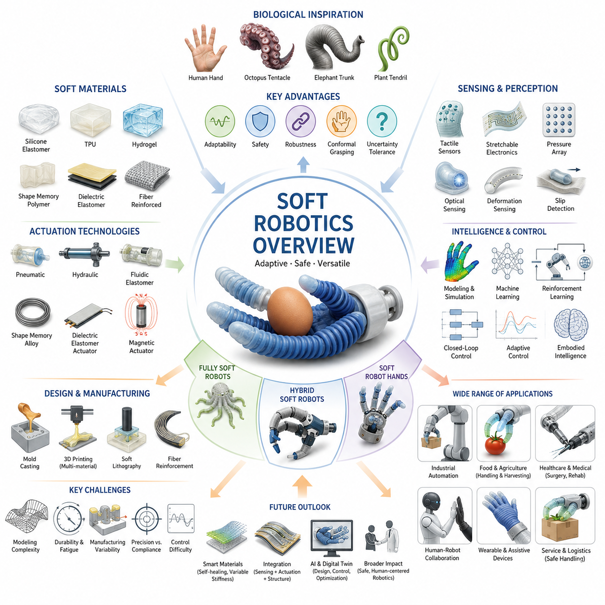{width="7.268055555555556in" height="7.268055555555556in"}

소프트 로보틱스(Soft Robotics)는 기존의 강체(Rigid Body) 기반 로봇 설계 패러다임에서 벗어나 유연하고 변형 가능한 구조를 활용하는 새로운 로봇 공학 분야이다. 전통적인 로봇이 금속 프레임, 기어, 베어링, 고강성 액추에이터를 중심으로 구성되는 반면, 소프트 로봇은 실리콘(Silicone), 엘라스토머(Elastomer), 폴리머(Polymer), 섬유(Fabric), 젤(Gel)과 같은 유연한 재료를 활용하여 환경과 물체에 적응할 수 있는 능력을 갖춘다. 이러한 접근 방식은 로봇 핸드(Robot Hand), 덱스터러스 핸드(Dexterous Hand), 모바일 매니퓰레이터(Mobile Manipulator) 분야에서 특히 중요한 의미를 가지며, 기존의 강체 로봇이 해결하기 어려웠던 다양한 문제에 새로운 해법을 제공한다. 본 장은 Robot Hand and Dexterous Grasping 볼륨의 Soft Gripper and Soft Robotics 파트의 기초 장으로서 이후의 연성 재료, 소프트 그리퍼, 공압 구동 핑거, 재밍 기반 그리퍼, 하이브리드 핸드 및 실제 산업 적용 기술을 이해하기 위한 기반을 제공한다.

소프트 로보틱스의 개념은 자연계의 생물체를 관찰하는 과정에서 발전하였다. 인간의 손, 문어의 촉수, 코끼리의 코, 물고기의 지느러미, 불가사리의 팔과 같은 생체 구조들은 대부분 유연성을 기반으로 동작한다. 이러한 생물학적 시스템은 환경과의 접촉 과정에서 지속적으로 형태를 변화시키며 복잡한 작업을 수행한다. 연구자들은 이러한 생체 시스템이 보여주는 적응성(Adaptability), 견고성(Robustness), 효율성(Efficiency)에 주목하였고, 이를 공학적으로 구현하기 위한 방법으로 소프트 로보틱스를 발전시켜 왔다.

전통적인 로봇 시스템은 정확한 위치 제어와 정밀한 모델링에 의존한다. 따라서 환경 변화나 물체 위치 오차에 민감하며, 작은 오차만 발생해도 작업 실패로 이어질 수 있다. 반면 소프트 로봇은 구조 자체의 유연성을 활용하여 이러한 불확실성을 흡수한다. 물체를 잡을 때 손가락이 자연스럽게 변형되면서 물체 표면에 맞춰 적응하기 때문에 복잡한 계산 없이도 안정적인 그립(Grip)을 형성할 수 있다.

소프트 로보틱스의 핵심 개념 중 하나는 체화 지능(Embodied Intelligence)이다. 기존 로봇에서는 센서, 프로세서, 제어 알고리즘이 대부분의 지능을 담당한다. 그러나 소프트 로봇에서는 재료의 탄성, 구조의 형태, 변형 특성 자체가 문제 해결에 기여한다. 예를 들어 소프트 그리퍼는 물체의 정확한 형상을 인식하지 못하더라도 자연스럽게 물체를 감싸며 안정적인 접촉을 형성할 수 있다. 이는 기계 구조 자체가 지능의 일부 역할을 수행하는 사례라 할 수 있다.

소프트 로봇은 유연성 수준에 따라 여러 형태로 구분된다. 완전 소프트 로봇(Fully Soft Robot)은 대부분의 구조가 연성 재료로 구성되어 있으며, 강체 부품을 거의 사용하지 않는다. 대표적으로 소프트 텐터클(Soft Tentacle), 공압 기반 연속체 매니퓰레이터(Continuum Manipulator), 팽창형 로봇(Inflatable Robot) 등이 있다. 반면 하이브리드 소프트 로봇(Hybrid Soft Robot)은 강체 구조와 연성 구조를 함께 사용하여 정밀성과 적응성을 동시에 확보한다. 실제 산업용 소프트 핸드의 상당수는 이러한 하이브리드 구조를 채택하고 있다.

소프트 로보틱스의 발전은 재료 공학(Material Science)의 발전과 밀접하게 연결되어 있다. 현대의 엘라스토머와 고분자 재료는 높은 탄성, 우수한 내구성, 화학적 안정성, 피로 수명(Fatigue Life)을 제공한다. 실리콘 고무(Silicone Rubber), 열가소성 폴리우레탄(Thermoplastic Polyurethane), 형상기억 폴리머(Shape Memory Polymer), 유전체 엘라스토머(Dielectric Elastomer), 하이드로겔(Hydrogel) 등은 각각 독특한 기계적 특성을 제공하며 다양한 소프트 로봇 설계에 활용된다.

특히 최근에는 가변 강성(Variable Stiffness)을 가진 재료가 주목받고 있다. 이러한 재료는 온도, 전기장, 자기장, 압력 변화에 따라 강성이 변화할 수 있다. 이를 통해 로봇은 필요할 때는 부드럽게 움직이고, 필요할 때는 강성을 높여 힘을 전달할 수 있게 된다. 이러한 특성은 미래의 휴머노이드 로봇과 고급 덱스터러스 핸드에서 매우 중요한 기술이 될 것으로 예상된다.

소프트 로보틱스는 새로운 액추에이터 기술의 발전도 촉진하였다. 기존의 전기 모터는 정밀한 회전 운동을 제공하지만 연성 구조와의 통합에는 한계가 존재한다. 따라서 공압 액추에이터(Pneumatic Actuator), 유압 액추에이터(Hydraulic Actuator), 형상기억합금(Shape Memory Alloy), 전기활성 폴리머(Electroactive Polymer), 유전체 엘라스토머 액추에이터(Dielectric Elastomer Actuator) 등이 적극적으로 연구되고 있다.

특히 공압 기반 소프트 액추에이터는 현재 가장 널리 사용되는 방식 중 하나이다. 내부 챔버에 공기를 주입하거나 배출함으로써 굽힘(Bending), 비틀림(Twisting), 수축(Contraction), 팽창(Expansion) 등의 다양한 운동을 생성할 수 있다. 이러한 액추에이터는 구조적으로 매우 가볍고 충격에 강하며 인간과의 상호작용에도 안전하다.

소프트 로봇의 가장 큰 장점 중 하나는 불확실한 환경에서의 적응 능력이다. 기존 강체 그리퍼는 물체의 위치와 자세를 정확히 알아야 하지만, 소프트 그리퍼는 물체에 접촉하는 순간 스스로 형태를 변형하여 적응한다. 접촉 면적이 증가하고 압력이 균일하게 분산되기 때문에 보다 안정적인 파지가 가능해진다.

이러한 특성은 물류 자동화(Logistics Automation), 식품 산업(Food Industry), 농업 로봇(Agricultural Robotics), 의료 로봇(Medical Robotics), 서비스 로봇(Service Robotics) 분야에서 매우 큰 장점을 제공한다. 특히 과일, 채소, 계란, 의약품과 같이 쉽게 손상될 수 있는 물체를 다룰 때 소프트 그리퍼는 기존 강체 그리퍼보다 훨씬 우수한 성능을 보여준다.

인간과 로봇의 협업(Human-Robot Collaboration)에서도 소프트 로보틱스는 중요한 역할을 수행한다. 기존 산업용 로봇은 높은 강성과 힘 때문에 안전 펜스(Safety Fence)와 보호 구역이 필요하다. 반면 소프트 로봇은 충돌 시 충격 에너지를 흡수하고 접촉력을 제한할 수 있기 때문에 인간과 동일한 공간에서 안전하게 동작할 수 있다. 이러한 특성은 협동 로봇(Cobot), 재활 로봇(Rehabilitation Robot), 웨어러블 로봇(Wearable Robot), 의료 보조 장치(Assistive Device)에 매우 적합하다.

소프트 로봇 핸드는 인간 손의 기능을 모방하기 위한 중요한 연구 분야로 발전하고 있다. 인간의 손은 유연한 피부, 근육, 힘줄, 관절 구조를 활용하여 매우 다양한 물체를 조작할 수 있다. 완전한 강체 구조로 이러한 능력을 재현하는 것은 매우 어렵다. 따라서 연구자들은 소프트 핑거와 유연한 접촉면을 활용하여 인간 손과 유사한 적응 능력을 구현하고 있다.

소프트 로보틱스는 촉각 센싱(Tactile Sensing)과도 밀접하게 연결된다. 소프트 구조가 변형되는 과정 자체가 센서 정보가 될 수 있기 때문이다. 연성 센서(Flexible Sensor), 신축성 전자소자(Stretchable Electronics), 광학 기반 촉각 센서(Optical Tactile Sensor), 압력 센서 어레이(Pressure Sensor Array)는 접촉 위치, 힘, 미끄러짐(Slip), 물체 형상 등을 측정하는 데 활용된다. 이를 통해 로봇은 인간의 촉각에 가까운 수준의 환경 인식 능력을 획득할 수 있다.

그러나 소프트 로보틱스는 여러 기술적 과제도 가지고 있다. 가장 큰 문제는 모델링과 제어의 복잡성이다. 강체 로봇은 상대적으로 단순한 운동학(Kinematics)과 동역학(Dynamics) 모델로 표현할 수 있지만, 소프트 로봇은 사실상 무한 자유도(Infinite Degrees of Freedom)를 가진 연속체 구조로 볼 수 있다. 따라서 유한요소해석(FEA), 연속체 역학(Continuum Mechanics), 비선형 탄성 이론(Nonlinear Elasticity) 등을 활용한 고급 모델링 기법이 필요하다.

제조 과정 또한 쉽지 않다. 소프트 로봇은 몰드 캐스팅(Mold Casting), 다중 재료 3D 프린팅(Multi-Material 3D Printing), 소프트 리소그래피(Soft Lithography), 섬유 보강(Fiber Reinforcement) 등 특수한 제작 공정을 필요로 한다. 또한 재료 특성의 변화, 노화(Aging), 온도 변화 등의 영향으로 성능이 달라질 수 있기 때문에 품질 관리 역시 중요한 문제이다.

또한 지나치게 높은 유연성은 정밀도와 하중 지지 능력을 저하시킬 수 있다. 산업 현장에서는 반복 정밀도(Repeatability)와 높은 생산성이 요구되므로, 실제 제품에서는 완전 소프트 구조보다는 강체와 연성 구조를 적절히 결합한 하이브리드 방식이 많이 사용된다.

최근에는 인공지능(AI)과 머신러닝(Machine Learning)이 소프트 로보틱스와 결합되면서 새로운 가능성이 열리고 있다. 강화학습(Reinforcement Learning)은 복잡한 변형 모델을 명시적으로 계산하지 않고도 효과적인 제어 정책을 학습할 수 있다. 딥러닝(Deep Learning)은 센서 데이터와 변형 상태의 관계를 학습하여 보다 정교한 제어를 가능하게 한다. 앞으로는 파운데이션 모델(Foundation Model)과 체화 인공지능(Embodied AI)이 소프트 로봇의 지능화에 핵심적인 역할을 수행할 것으로 예상된다.

의료 분야에서는 소프트 수술 기구(Soft Surgical Instrument), 재활 장치(Rehabilitation Device), 웨어러블 로봇 글러브(Wearable Robotic Glove), 소프트 엑소스켈레톤(Soft Exoskeleton) 등이 활발히 연구되고 있다. 농업 분야에서는 과일 수확 로봇과 채소 수확 로봇이 이미 상용화 단계에 진입하고 있으며, 식품 산업에서는 연약한 식재료를 다루기 위한 소프트 그리퍼가 널리 사용되고 있다.

미래의 소프트 로보틱스는 자가 치유 재료(Self-Healing Material), 가변 강성 구조(Variable Stiffness Structure), 센서·액추에이터·구조체가 통합된 스마트 재료(Smart Material) 기술과 결합하여 더욱 발전할 것으로 예상된다. 또한 AI 기반 제어, 디지털 트윈(Digital Twin), 실시간 시뮬레이션 기술과의 융합을 통해 설계, 제조, 운영 전 과정에서 새로운 혁신을 만들어낼 것이다.

결국 소프트 로보틱스는 단순히 부드러운 재료를 사용하는 기술이 아니라, 로봇이 환경에 적응하고 인간과 안전하게 협력하며 복잡한 현실 세계에서 보다 효과적으로 동작하기 위한 새로운 공학 패러다임이다. 특히 로봇 핸드와 덱스터러스 그라스핑 분야에서는 인간 손에 가까운 적응성과 유연성을 제공하는 핵심 기술로 자리 잡고 있으며, 향후 휴머노이드 로봇, 모바일 매니퓰레이터, 서비스 로봇, 의료 로봇, 산업용 조립 로봇의 발전에 있어 매우 중요한 역할을 담당하게 될 것이다.

## 04.02 Soft Material Properties

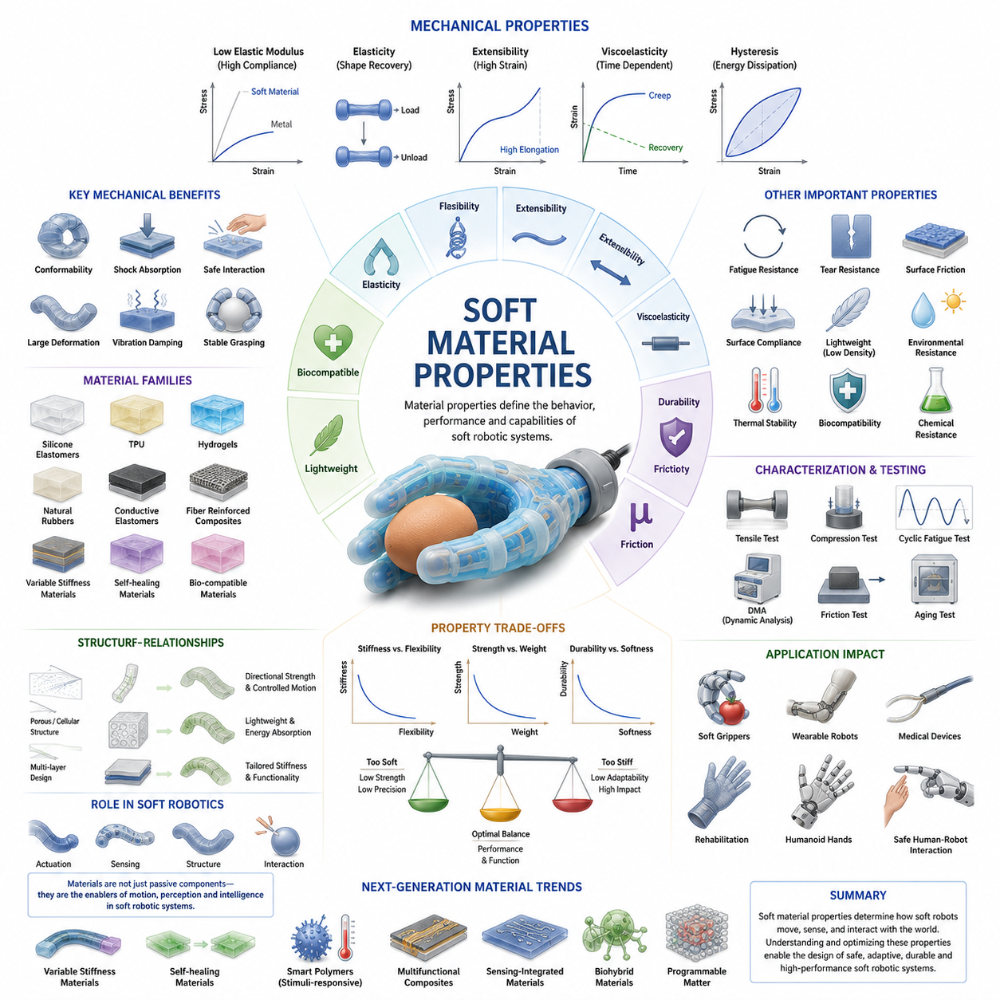{width="7.268055555555556in" height="7.268055555555556in"}

소프트 로보틱스(Soft Robotics)는 독특한 기계적, 물리적, 기능적 특성을 가진 연성 재료(Soft Materials)를 기반으로 발전한 분야이다. 기존 로봇이 금속(Metal), 엔지니어링 플라스틱(Engineering Plastic), 고강성 복합재료(Composite Material)를 중심으로 제작되는 것과 달리, 소프트 로봇은 큰 변형을 허용하면서도 구조적 안정성을 유지할 수 있는 유연한 재료를 사용한다. 이러한 재료들은 단순한 구조체 역할을 넘어 힘 전달, 센싱, 구동기 하우징, 환경 적응 기능까지 수행한다. 따라서 소프트 재료의 특성을 이해하는 것은 소프트 그리퍼(Soft Gripper), 소프트 핑거(Soft Finger), 연속체 매니퓰레이터(Continuum Manipulator), 웨어러블 로봇(Wearable Robot), 재활 로봇(Rehabilitation Robot), 바이오 영감 로봇(Bio-Inspired Robot)을 설계하는 데 있어 가장 중요한 요소 중 하나이다.

소프트 재료의 가장 대표적인 특징은 낮은 탄성계수(Elastic Modulus)이다. 탄성계수는 외부 힘에 대해 재료가 얼마나 변형에 저항하는지를 나타내는 값이다. 강철(Steel)이나 알루미늄(Aluminum)의 탄성계수가 수십에서 수백 기가파스칼(GPa)에 이르는 반면, 소프트 로보틱스에 사용되는 재료는 수 킬로파스칼(kPa)에서 수 메가파스칼(MPa) 수준에 불과하다. 이러한 차이로 인해 소프트 재료는 작은 힘에도 쉽게 변형될 수 있으며, 복잡한 형상의 물체를 감싸거나 충격을 흡수하고 사람과 안전하게 상호작용할 수 있다.

탄성(Elasticity)은 소프트 재료의 핵심 특성 중 하나이다. 탄성이란 외부 힘에 의해 변형된 재료가 힘이 제거되었을 때 원래 상태로 복원되는 능력을 의미한다. 높은 탄성을 가진 재료는 반복적인 굽힘(Bending), 비틀림(Twisting), 신장(Stretching), 압축(Compression) 과정에서도 성능을 유지할 수 있다. 실리콘 고무(Silicone Rubber)나 열가소성 폴리우레탄(Thermoplastic Polyurethane)은 이러한 특성을 잘 보여주는 대표적인 재료이다. 소프트 그리퍼가 반복적으로 물체를 잡고 놓는 작업을 수행할 수 있는 이유도 이러한 탄성 특성 덕분이다.

유연성(Flexibility) 역시 매우 중요한 특성이다. 유연성은 재료가 얼마나 쉽게 구부러지고 형태를 바꿀 수 있는지를 의미한다. 높은 유연성을 가진 재료는 적은 힘으로도 큰 변형을 만들 수 있다. 이러한 특성은 로봇 핑거가 다양한 형상의 물체를 감싸고 접촉 면적을 증가시키는 데 중요한 역할을 한다. 결과적으로 물체를 보다 안정적으로 파지할 수 있으며 위치 오차에 대한 민감도도 낮아진다.

연신율(Extensibility)은 재료가 파손되기 전까지 얼마나 늘어날 수 있는지를 나타내는 특성이다. 일부 실리콘 기반 재료는 원래 길이의 500% 이상까지 늘어날 수 있으며, 특수 엘라스토머는 그보다 더 높은 연신율을 보이기도 한다. 이러한 특성은 기계적 관절 없이도 다양한 형태의 운동을 구현할 수 있는 소프트 액추에이터 개발을 가능하게 한다.

대부분의 소프트 재료는 점탄성(Viscoelasticity)을 가진다. 점탄성이란 탄성체와 점성체의 특성을 동시에 갖는 현상을 의미한다. 외부 힘이 가해지면 즉시 발생하는 변형뿐만 아니라 시간이 지나면서 추가 변형이 발생한다. 또한 힘을 제거한 후에도 복원이 즉시 일어나지 않고 일정 시간이 필요하다. 이러한 특성은 충격 흡수와 진동 감쇠에는 유리하지만, 정밀 제어 측면에서는 추가적인 어려움을 초래한다.

점탄성 재료에서는 히스테리시스(Hysteresis) 현상이 자주 발생한다. 이는 동일한 변형량이라도 힘을 가하는 과정과 힘을 제거하는 과정에서 서로 다른 거동을 보이는 현상이다. 반복적인 변형 과정에서 일부 에너지가 열로 소산되며, 이로 인해 동일한 입력에 대해 출력이 완전히 동일하게 나타나지 않을 수 있다. 따라서 소프트 액추에이터를 정밀하게 제어하기 위해서는 이러한 비선형 특성을 고려한 모델링과 제어 알고리즘이 필요하다.

감쇠(Damping) 특성 또한 소프트 재료의 중요한 장점이다. 감쇠는 외부 충격이나 진동 에너지를 흡수하고 소산시키는 능력을 의미한다. 일반적으로 소프트 재료는 금속보다 훨씬 높은 감쇠 특성을 가지므로 충격 흡수 능력이 우수하다. 인간과 로봇이 같은 공간에서 작업하는 협동 로봇 환경에서는 이러한 특성이 안전성 향상에 크게 기여한다.

소프트 재료의 응력-변형률(Stress-Strain) 관계는 일반적으로 매우 비선형적이다. 금속과 같은 재료는 일정 범위 내에서 선형적인 거동을 보이지만, 소프트 재료는 변형이 증가함에 따라 강성이 변화하는 경우가 많다. 특히 변형이 커질수록 점점 단단해지는 변형 경화(Strain Stiffening) 현상이 자주 관찰된다. 이러한 특성은 생체 조직과 유사한 거동을 보이며, 소프트 로봇 설계 시 반드시 고려해야 한다.

피로 수명(Fatigue Life)은 산업용 소프트 로봇에서 매우 중요한 요소이다. 소프트 그리퍼와 소프트 액추에이터는 수십만 번에서 수백만 번의 반복 변형을 경험한다. 이러한 반복 사용은 미세 균열, 찢어짐, 박리(Delamination), 영구 변형(Permanent Deformation)을 유발할 수 있다. 따라서 실제 상용 제품에서는 장기간 사용이 가능한 충분한 피로 특성을 확보해야 한다.

인열 강도(Tear Resistance) 역시 중요하다. 연성 재료는 매우 유연하지만 날카로운 물체나 국부적인 응력 집중에 의해 쉽게 찢어질 수 있다. 이를 방지하기 위해 섬유 보강(Fiber Reinforcement), 다층 구조(Multi-Layer Structure), 복합재 설계(Composite Design) 등이 활용된다. 높은 인열 강도는 제품의 신뢰성과 수명을 향상시킨다.

마찰 특성(Friction Characteristics)은 파지 성능에 직접적인 영향을 미친다. 소프트 그리퍼는 물체와의 마찰력을 이용하여 물체를 안정적으로 유지한다. 실리콘 계열 재료는 높은 마찰 계수를 가지므로 적은 힘으로도 안정적인 파지가 가능하다. 하지만 마찰력이 지나치게 높으면 물체를 놓는 과정이 어려워질 수 있으므로 적절한 균형이 필요하다.

표면 순응성(Surface Compliance)은 접촉 역학(Contact Mechanics)에서 중요한 역할을 한다. 부드러운 표면은 접촉 면적을 증가시키고 압력을 넓게 분산시킨다. 이로 인해 과일, 채소, 의약품, 전자부품, 실험실 시료와 같은 민감한 물체를 손상 없이 다룰 수 있다. 또한 접촉 면적 증가로 인해 파지 안정성도 향상된다.

밀도(Density)는 소프트 로봇의 무게와 에너지 효율성에 영향을 미친다. 대부분의 소프트 재료는 금속보다 훨씬 가볍기 때문에 이동 로봇(Mobile Robot)이나 웨어러블 로봇에서 유리하다. 낮은 밀도는 액추에이터 부하를 감소시키고 동적 성능을 향상시키는 장점을 제공한다.

환경 저항성(Environmental Resistance)도 실제 적용에서 중요하다. 재료는 습도, 자외선(UV), 온도 변화, 화학 물질, 먼지, 마모 등의 영향을 받는다. 이러한 환경 요인은 재료의 강도와 탄성을 변화시킬 수 있으므로 적용 환경에 맞는 재료 선택이 필요하다.

열 특성(Thermal Properties)은 소프트 재료의 거동에 직접적인 영향을 미친다. 일부 엘라스토머는 온도가 상승하면 더 부드러워지고, 온도가 낮아지면 강성이 증가한다. 극한 환경에서는 재료 노화와 성능 저하가 발생할 수 있기 때문에 열 관리가 중요하다.

의료 및 웨어러블 로봇에서는 생체 적합성(Biocompatibility)이 필수적이다. 인체와 직접 접촉하는 재료는 독성, 자극성, 알레르기 반응을 유발하지 않아야 한다. 의료용 실리콘(Medical Grade Silicone), 하이드로겔(Hydrogel), 생체 적합성 폴리머(Biocompatible Polymer)가 이러한 분야에서 널리 사용된다.

실리콘 엘라스토머(Silicone Elastomer)는 현재 소프트 로보틱스에서 가장 널리 사용되는 재료이다. 높은 유연성, 우수한 생체 적합성, 뛰어난 화학적 안정성, 높은 연신율을 제공한다. Ecoflex, Dragon Skin, Smooth-Sil 시리즈는 연구 및 산업 분야에서 가장 널리 사용되는 대표적인 재료들이다.

열가소성 폴리우레탄(TPU)은 내마모성, 내구성, 탄성을 동시에 제공하며 3D 프린팅과 같은 적층 제조(Additive Manufacturing) 기술과의 호환성이 뛰어나다. 따라서 산업용 소프트 로봇 개발에 매우 적합한 재료로 평가받고 있다.

하이드로겔(Hydrogel)은 생체 조직과 유사한 물성을 가진 재료이다. 매우 부드럽고 생체 적합성이 우수하여 의료 로봇, 인공 근육(Artificial Muscle), 바이오 센서(Bio Sensor) 분야에서 큰 관심을 받고 있다. 다만 수분 손실과 내구성 문제는 아직 해결해야 할 과제이다.

섬유 보강 복합재(Fiber-Reinforced Composite)는 소프트 재료의 강도와 방향성을 향상시키기 위해 사용된다. 섬유를 특정 방향으로 삽입하면 굽힘, 비틀림, 수축과 같은 운동을 의도적으로 설계할 수 있다. 이는 고성능 소프트 액추에이터 개발에 매우 중요한 기술이다.

최근 가장 주목받는 분야 중 하나는 가변 강성 재료(Variable-Stiffness Material)이다. 이러한 재료는 필요할 때는 부드럽고, 필요할 때는 단단해질 수 있다. 이를 통해 소프트 로봇의 적응성과 강체 로봇의 힘 전달 능력을 동시에 확보할 수 있다. 미래의 휴머노이드 로봇과 덱스터러스 핸드에서 핵심 기술로 자리 잡을 가능성이 높다.

또한 센싱 기능을 재료 내부에 직접 통합하려는 연구도 활발하다. 전도성 엘라스토머(Conductive Elastomer), 액체 금속 회로(Liquid Metal Circuit), 광섬유 센서(Optical Fiber Sensor), 압전 복합재(Piezoresistive Composite) 등을 활용하여 재료 자체가 센서 역할을 수행하도록 설계하고 있다. 이러한 개념은 재료 지능(Material Intelligence)이라고도 불린다.

소프트 재료를 실제 로봇에 적용하기 위해서는 인장 시험(Tensile Test), 압축 시험(Compression Test), 반복 피로 시험(Cyclic Fatigue Test), 동적 기계 분석(Dynamic Mechanical Analysis), 마찰 시험(Friction Test), 환경 노화 시험(Environmental Aging Test) 등을 수행하여 특성을 정량적으로 평가해야 한다.

향후 소프트 로보틱스의 발전은 재료 기술의 발전과 함께 이루어질 것이다. 자가 치유 재료(Self-Healing Material), 스마트 폴리머(Smart Polymer), 프로그래머블 물질(Programmable Matter), 바이오 하이브리드 재료(Biohybrid Material), 다기능 복합재(Multifunctional Composite) 등의 기술은 미래 소프트 로봇의 핵심 요소가 될 것으로 예상된다.

결국 소프트 재료의 특성은 모든 소프트 로봇 시스템의 성능을 결정하는 근본적인 요소이다. 탄성, 유연성, 연신율, 점탄성, 내구성, 마찰 특성, 환경 저항성, 가변 강성 및 센싱 통합 능력은 소프트 그리퍼, 덱스터러스 핸드, 웨어러블 로봇, 휴머노이드 로봇의 성능을 좌우한다. 따라서 소프트 재료에 대한 깊이 있는 이해는 차세대 소프트 로보틱스 기술을 개발하기 위한 필수적인 기반이라고 할 수 있다.

## 04.03 Silicone and Elastomer Grippers

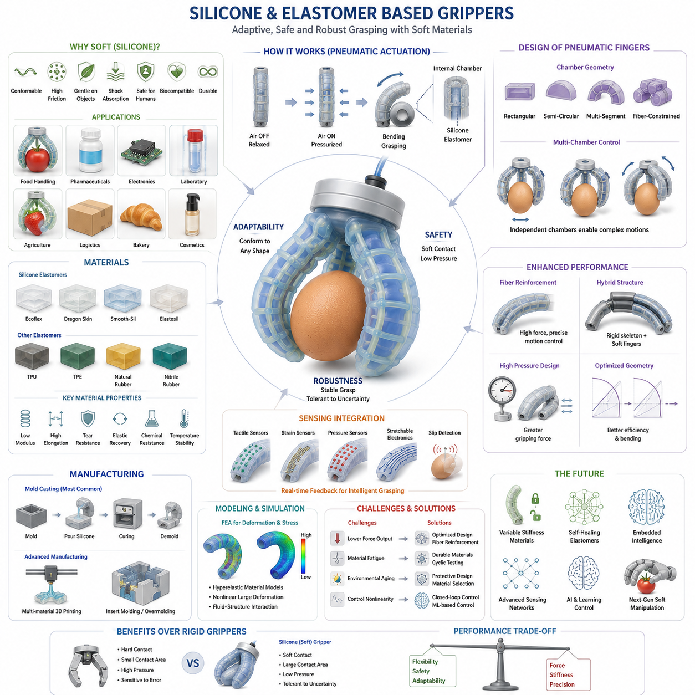{width="7.268055555555556in" height="7.268055555555556in"}

실리콘(Silicone) 및 엘라스토머(Elastomer) 기반 그리퍼는 현대 소프트 로보틱스 분야에서 가장 중요한 기술 발전 중 하나로 평가받고 있다. 기존의 강체 기반 그리퍼가 금속 링크, 기계식 관절, 정밀한 정렬 구조에 의존하는 반면, 실리콘 및 엘라스토머 기반 그리퍼는 재료 자체의 유연성과 순응성(Compliance)을 활용하여 적응형 파지(Adaptive Grasping), 안전한 상호작용(Safe Interaction), 그리고 안정적인 물체 조작(Object Handling)을 수행한다. 이러한 그리퍼는 다양한 형상과 크기, 표면 특성, 취약성을 가진 물체를 복잡한 제어 알고리즘 없이도 안정적으로 파지할 수 있기 때문에 소프트 로보틱스의 핵심 기술로 자리 잡고 있다.

실리콘 기반 그리퍼의 등장 배경은 기존 산업용 그리퍼의 한계에서 비롯되었다. 전통적인 산업용 그리퍼는 규격화된 물체를 반복적으로 다루는 환경에서는 매우 뛰어난 성능을 보이지만, 형상이 일정하지 않거나 쉽게 손상되는 물체를 다루는 데는 어려움이 있었다. 또한 물체 위치에 대한 작은 오차만 발생해도 파지 실패가 발생할 수 있으며, 과도한 힘은 제품 손상을 초래할 수 있다. 실리콘 기반 그리퍼는 접촉면 자체가 변형되면서 물체를 감싸기 때문에 이러한 문제를 효과적으로 해결할 수 있다.

실리콘 엘라스토머는 높은 탄성(Elasticity), 우수한 유연성(Flexibility), 큰 변형 허용 능력(Large Strain Capability), 생체 적합성(Biocompatibility), 화학적 안정성(Chemical Stability), 그리고 긴 수명(Long-Term Durability)을 동시에 제공한다. 이러한 특성 덕분에 소프트 핑거(Soft Finger)는 물체를 감싸면서도 원래 형태로 복원될 수 있으며, 반복적인 작업 환경에서도 안정적인 성능을 유지할 수 있다.

실리콘 재료의 가장 중요한 특징 중 하나는 낮은 탄성계수(Low Elastic Modulus)이다. 강철이나 알루미늄과 같은 금속에 비해 훨씬 낮은 강성을 가지므로 물체와 접촉했을 때 자연스럽게 변형된다. 그 결과 접촉 면적(Contact Area)이 증가하고 마찰력이 향상되며 압력이 넓은 영역에 분산된다. 이러한 특성은 파지 안정성을 크게 향상시키고 물체 손상을 줄이는 데 중요한 역할을 한다.

실리콘 기반 그리퍼의 가장 큰 장점은 연약한 물체를 안전하게 다룰 수 있다는 점이다. 식품 산업에서는 과일, 채소, 빵, 해산물 등을 손상 없이 취급할 수 있으며, 제약 산업에서는 의료용 시료와 약품을 안전하게 다룰 수 있다. 또한 전자 산업에서는 민감한 전자 부품을 과도한 힘 없이 조작할 수 있다. 이러한 능력은 기존 자동화 기술로는 어려웠던 다양한 산업 분야의 자동화를 가능하게 만들고 있다.

현재 가장 널리 사용되는 실리콘 기반 그리퍼 구조는 공압 구동(Pneumatic Actuation) 방식이다. 공압식 소프트 그리퍼는 내부에 공기 챔버(Air Chamber)를 포함하고 있으며, 압축 공기를 주입하면 챔버가 팽창하면서 구조가 변형된다. 챔버의 형상과 두께를 적절히 설계하면 원하는 방향으로 굽힘(Bending) 운동을 생성할 수 있다. 이로 인해 손가락이 자연스럽게 말려 들어가며 물체를 감싸게 된다.

공압 챔버의 설계는 그리퍼 성능을 결정하는 핵심 요소이다. 챔버의 형태에 따라 굽힘 각도, 출력 힘, 응답 속도, 에너지 효율성이 달라진다. 직사각형 챔버, 반원형 챔버, 다중 챔버, 섬유 보강 챔버 등 다양한 설계 방식이 존재하며, 최근에는 여러 개의 독립 챔버를 이용하여 비틀림(Twisting)이나 복합 운동을 구현하는 연구도 활발히 진행되고 있다.

섬유 보강(Fiber Reinforcement)은 실리콘 그리퍼의 성능 향상을 위해 널리 사용된다. 실리콘 내부에 섬유를 삽입하면 특정 방향의 변형은 제한하고 원하는 방향으로만 운동이 발생하도록 유도할 수 있다. 이를 통해 불필요한 팽창을 방지하고 더욱 정밀한 굽힘 운동을 구현할 수 있다. 또한 동일한 압력에서도 더 높은 출력 힘을 생성할 수 있기 때문에 산업용 응용 분야에서 매우 유용하다.

실리콘 재료 선택 역시 성능에 큰 영향을 미친다. 매우 부드러운 실리콘은 높은 적응성과 순응성을 제공하지만 상대적으로 작은 힘만 전달할 수 있다. 반대로 강성이 높은 실리콘은 더 큰 하중을 지탱할 수 있지만 적응성이 감소한다. 따라서 실제 설계에서는 응용 분야에 따라 적절한 재료를 선택해야 한다.

대표적인 소프트 로보틱스용 실리콘 재료로는 Ecoflex, Dragon Skin, Smooth-Sil, Elastosil 등이 있다. 이러한 재료들은 서로 다른 경도(Hardness), 연신율(Elongation), 인열 강도(Tear Strength)를 제공하며 다양한 소프트 액추에이터와 그리퍼 제작에 사용된다.

실리콘 외에도 다양한 엘라스토머 계열 재료가 사용된다. 열가소성 폴리우레탄(TPU)은 우수한 내마모성과 내구성을 제공하며, 천연고무(Natural Rubber)와 합성고무(Synthetic Rubber)는 비용 효율성이 높다. 열가소성 엘라스토머(TPE)는 사출성형과 3D 프린팅 공정에 적합하여 대량 생산에 유리하다.

실리콘 그리퍼의 해석은 기존 강체 로봇과 매우 다르다. 일반적인 로봇은 강체 운동학(Rigid Body Kinematics)으로 설명할 수 있지만, 실리콘 구조는 연속체(Continuum Structure)로 동작한다. 따라서 비선형 탄성 이론(Nonlinear Elasticity), 접촉 역학(Contact Mechanics), 유체-구조 상호작용(Fluid-Structure Interaction) 등을 고려해야 한다. 이를 위해 유한요소해석(FEA)이 널리 사용된다.

특히 실리콘은 매우 큰 변형을 경험하기 때문에 선형 탄성 모델만으로는 정확한 예측이 어렵다. 따라서 Neo-Hookean, Mooney-Rivlin, Ogden, Yeoh 모델과 같은 초탄성(Hyperelastic) 모델이 활용된다. 이러한 모델은 응력 분포, 변형 거동, 출력 힘, 파손 가능성을 보다 정확하게 예측할 수 있도록 도와준다.

제조 기술 역시 지속적으로 발전하고 있다. 가장 널리 사용되는 방식은 몰드 캐스팅(Mold Casting)이다. 몰드를 제작한 후 액상 실리콘을 주입하고 경화(Curing)시켜 원하는 형상을 만든다. 이 방법은 비교적 저렴하면서도 높은 품질의 구조를 제작할 수 있기 때문에 연구 및 산업 현장에서 널리 활용되고 있다.

최근에는 적층 제조(Additive Manufacturing) 기술도 주목받고 있다. 다중 재료 3D 프린팅(Multi-Material 3D Printing)을 이용하면 강체와 연성 구조를 동시에 제작할 수 있으며, 복잡한 내부 채널을 가진 소프트 액추에이터도 구현할 수 있다. 현재는 아직 제조 난이도가 높지만 향후 소프트 로봇 생산 방식에 큰 변화를 가져올 것으로 예상된다.

내구성(Durability)은 실리콘 그리퍼 설계에서 매우 중요한 요소이다. 반복적인 변형은 재료 피로(Material Fatigue)를 유발하며, 장기적으로 균열(Crack), 박리(Delamination), 파손(Rupture)을 초래할 수 있다. 따라서 실제 산업용 제품은 수십만 회에서 수백만 회 이상의 반복 시험을 통해 수명을 검증해야 한다.

온도, 자외선(UV), 습도, 화학물질과 같은 환경 요인도 실리콘 성능에 영향을 미친다. 높은 온도는 재료를 더욱 부드럽게 만들 수 있으며, 장기간 자외선 노출은 노화를 촉진할 수 있다. 따라서 적용 환경에 따른 적절한 보호 설계가 필요하다.

실리콘 그리퍼는 일반적으로 강체 그리퍼보다 출력 힘이 낮다는 한계가 있다. 부드러운 재료 특성상 큰 힘을 전달하기 어렵기 때문이다. 이를 해결하기 위해 섬유 보강, 최적화된 챔버 설계, 고압 구동, 하이브리드 구조 등이 활용되고 있다. 특히 강체 골격(Rigid Skeleton)과 소프트 표면을 결합한 하이브리드 그리퍼는 적응성과 출력 힘을 동시에 확보할 수 있는 현실적인 대안으로 평가받는다.

최근에는 촉각 센서(Tactile Sensor), 변형 센서(Strain Sensor), 압력 센서(Pressure Sensor)를 실리콘 구조 내부에 통합하는 연구가 활발하다. 이러한 센서는 접촉 여부, 파지력, 변형 상태, 미끄러짐(Slip) 발생 여부를 실시간으로 측정할 수 있다. 이를 통해 폐루프 제어(Closed-Loop Control)가 가능해지며 더욱 정교한 조작 능력을 구현할 수 있다.

신축성 전자소자(Stretchable Electronics)는 이러한 센서 통합 기술의 핵심이다. 전도성 엘라스토머, 액체 금속 회로, 유연 전자회로(Flexible Electronics), 광학 센서 등을 실리콘 내부에 삽입하여 구조적 유연성을 유지하면서도 센싱 기능을 제공할 수 있다.

인공지능(AI)과 머신러닝(Machine Learning) 역시 실리콘 그리퍼의 발전에 중요한 역할을 하고 있다. 소프트 구조의 비선형 특성 때문에 전통적인 수학 모델만으로는 정확한 예측이 어렵다. 이에 따라 데이터 기반 학습 기법을 활용하여 압력 입력과 변형 상태, 파지 성공 여부의 관계를 학습하는 연구가 활발히 진행되고 있다. 강화학습(Reinforcement Learning)과 모방학습(Imitation Learning)은 적응형 소프트 조작 기술의 핵심 기술로 발전하고 있다.

실리콘 기반 그리퍼는 인간-로봇 협업(Human-Robot Collaboration)에서도 매우 중요한 의미를 가진다. 충돌 시 힘이 넓게 분산되기 때문에 인체에 가해지는 위험이 크게 감소한다. 따라서 협동 로봇(Cobot), 의료 로봇(Medical Robot), 재활 로봇(Rehabilitation Robot), 서비스 로봇(Service Robot)에 매우 적합하다.

의료 분야에서는 수술용 소프트 매니퓰레이터, 재활용 글러브, 의수(Prosthetic Hand), 웨어러블 보조 장치 등에 실리콘 기반 기술이 적용되고 있다. 특히 재활용 소프트 글러브는 환자의 손 움직임을 보조하면서도 편안함과 안전성을 동시에 제공한다.

농업 자동화 분야에서는 딸기, 토마토, 복숭아, 포도와 같은 과일을 손상 없이 수확하는 데 실리콘 그리퍼가 활용되고 있다. 기존 강체 그리퍼는 과일의 크기와 숙성도 변화에 적응하기 어렵지만, 소프트 그리퍼는 자연스럽게 형태를 맞추어 안정적으로 파지할 수 있다.

물류 및 창고 자동화 분야에서도 실리콘 기반 그리퍼의 활용이 확대되고 있다. 다양한 제품을 하나의 그리퍼로 처리할 수 있기 때문에 유연 생산(Flexible Automation) 환경에서 매우 큰 장점을 제공한다.

향후 실리콘 및 엘라스토머 기반 그리퍼는 가변 강성 재료(Variable Stiffness Material), 자가 치유 재료(Self-Healing Material), 지능형 재료(Intelligent Material), 내장 센서 기술, 파운데이션 모델(Foundation Model) 기반 제어 기술과 결합하여 더욱 발전할 것으로 예상된다. 미래의 소프트 그리퍼는 단순히 물체를 잡는 장치를 넘어 스스로 환경을 인식하고 적응하며 학습하는 지능형 조작 플랫폼(Intelligent Manipulation Platform)으로 발전할 것이다.

결론적으로 실리콘 및 엘라스토머 기반 그리퍼는 생물학적 영감(Biological Inspiration)과 공학적 구현(Engineering Implementation)을 연결하는 핵심 기술이다. 높은 적응성, 안전성, 유연성, 그리고 다양한 산업 적용 가능성을 바탕으로 차세대 휴머노이드 로봇(Humanoid Robot), 모바일 매니퓰레이터(Mobile Manipulator), 서비스 로봇(Service Robot), 의료 로봇(Medical Robot)의 핵심 조작 기술로 자리 잡고 있으며, 향후 로봇 핸드와 덱스터러스 그라스핑(Dexterous Grasping) 분야에서 더욱 중요한 역할을 수행하게 될 것이다.

## 04.04 Pneumatic Soft Fingers

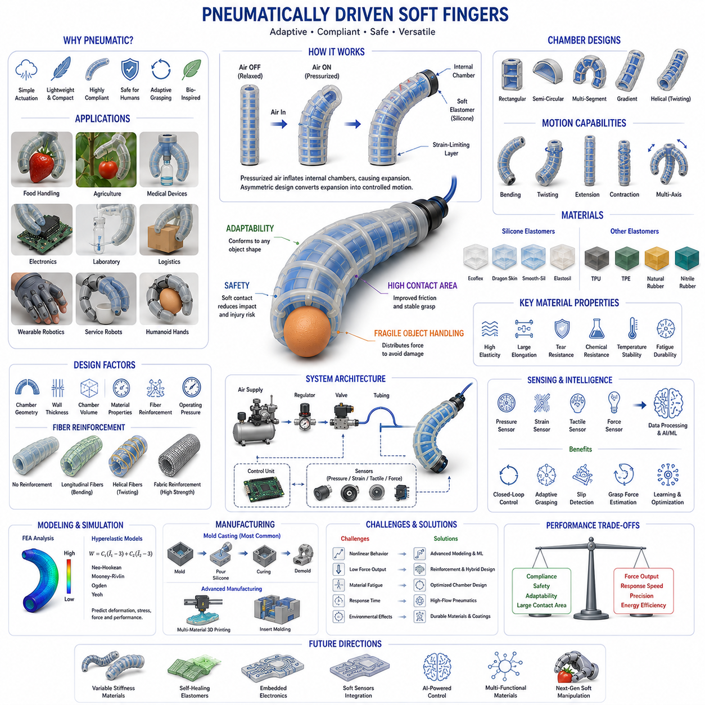{width="7.268055555555556in" height="7.268055555555556in"}

공압 구동 소프트 핑거(Pneumatically Driven Soft Fingers)는 현대 소프트 로보틱스 분야에서 가장 널리 사용되는 핵심 기술 중 하나이다. 이러한 구조는 압축 공기(Compressed Air)를 구동원으로 사용하며, 실리콘 엘라스토머(Silicone Elastomer), 열가소성 폴리우레탄(TPU), 유연 복합재(Flexible Composite), 보강 폴리머(Reinforced Polymer)와 같은 연성 재료를 이용하여 움직임을 생성한다. 기존의 로봇 핑거가 전기 모터, 기어, 링크, 강체 관절에 의존하는 것과 달리, 공압 소프트 핑거는 내부 공기 챔버(Air Chamber)의 팽창과 변형을 통해 움직임을 만들어낸다. 이러한 방식은 물체에 자연스럽게 적응하고 안전하게 상호작용할 수 있는 능력을 제공하기 때문에 소프트 그리퍼, 덱스터러스 핸드, 웨어러블 로봇, 의료기기, 농업 자동화, 차세대 인간 협업 로봇 분야에서 핵심 기술로 자리 잡고 있다.

공압 구동의 개념은 생물학적 시스템에서 영감을 얻었다. 인간의 근육은 내부 압력 변화와 근육 수축을 통해 움직임을 생성하며, 문어의 촉수, 지렁이, 불가사리, 코끼리의 코와 같은 생물 역시 강체 관절 없이 유연한 구조를 이용해 복잡한 운동을 수행한다. 연구자들은 이러한 자연계의 원리를 관찰하면서 유체 압력을 이용한 새로운 구동 방식을 개발하였고, 이것이 오늘날 공압 소프트 핑거의 기반이 되었다.

모든 공압 소프트 핑거의 중심에는 내부 공기 챔버 네트워크가 존재한다. 이 챔버는 일반적으로 실리콘이나 엘라스토머 내부에 형성되며 외부 공기 공급 장치와 연결된다. 압축 공기가 주입되면 내부 압력이 증가하면서 챔버가 팽창하고, 이로 인해 주변 구조가 변형된다. 챔버 형상, 벽 두께, 보강 구조, 재료 특성을 적절히 설계하면 원하는 방향으로 굽힘(Bending), 비틀림(Twisting), 신장(Extension), 수축(Contraction) 등의 운동을 생성할 수 있다.

가장 널리 사용되는 구조는 굽힘 액추에이터(Bending Actuator)이다. 이 구조에서는 상부 챔버가 팽창하는 반면 하부는 변형 제한층(Strain Limiting Layer)에 의해 움직임이 제한된다. 따라서 압력이 증가하면 상부가 더 많이 늘어나면서 핑거 전체가 한 방향으로 구부러진다. 이 원리는 인간 손가락이 물체를 감싸는 동작과 매우 유사하며, 소프트 그리퍼에서 가장 많이 활용되는 방식이다.

공압 챔버의 형상은 성능을 결정하는 핵심 요소이다. 챔버의 크기, 형태, 간격, 벽 두께, 내부 부피는 굽힘 각도, 출력 힘, 응답 속도, 에너지 효율성, 내구성에 직접적인 영향을 미친다. 직사각형 챔버는 제조가 간단하고 예측 가능한 거동을 제공한다. 반원형이나 타원형 챔버는 응력 집중을 줄이고 수명을 향상시킨다. 다중 챔버(Multi-Chamber) 구조는 복잡한 운동을 가능하게 하며, 길이에 따라 크기가 달라지는 그래디언트 챔버(Gradient Chamber)는 곡률을 조절할 수 있다.

챔버 설계와 운동 생성의 관계는 소프트 핑거 설계에서 매우 중요한 요소이다. 작은 챔버는 적은 공기만으로도 빠르게 압력을 변화시킬 수 있어 응답 속도가 빠르다. 반면 큰 챔버는 더 큰 변형과 힘을 생성할 수 있지만 공기 소비량이 증가하고 응답 속도가 느려질 수 있다. 따라서 설계자는 응용 목적에 따라 힘, 속도, 효율성의 균형을 고려해야 한다.

재료 선택 또한 공압 소프트 핑거의 성능에 결정적인 영향을 미친다. 실리콘 엘라스토머는 높은 유연성, 큰 연신율, 우수한 내구성, 제작 용이성 때문에 가장 널리 사용된다. Ecoflex, Dragon Skin, Elastosil, Smooth-Sil과 같은 재료는 반복적인 큰 변형에도 구조적 안정성을 유지할 수 있다. 재료의 경도(Hardness)가 낮을수록 더 큰 변형과 적응성을 제공하지만 출력 힘은 감소하며, 경도가 높을수록 더 큰 힘을 생성할 수 있지만 유연성은 감소한다.

공압 소프트 핑거는 재료 특성과 챔버 구조가 결합된 매우 비선형적인 시스템이다. 일반적인 강체 로봇은 운동학과 동역학 방정식으로 비교적 쉽게 모델링할 수 있지만, 소프트 핑거는 연속체 구조(Continuum Structure)로 동작한다. 따라서 비선형 탄성(Nonlinear Elasticity), 점탄성(Viscoelasticity), 접촉 역학(Contact Mechanics), 유체-구조 상호작용(Fluid-Structure Interaction) 등을 동시에 고려해야 한다.

이러한 복잡성을 분석하기 위해 유한요소해석(FEA)이 널리 사용된다. 유한요소 모델은 압력 변화에 따른 변형을 예측하고 설계를 최적화하는 데 활용된다. 특히 Neo-Hookean, Mooney-Rivlin, Ogden, Yeoh와 같은 초탄성(Hyperelastic) 모델은 엘라스토머 재료의 큰 변형 거동을 정확하게 표현하는 데 사용된다. 이를 통해 응력 분포, 변형 패턴, 출력 힘, 파손 가능성을 사전에 예측할 수 있다.

섬유 보강(Fiber Reinforcement)은 고성능 공압 소프트 핑거에서 매우 중요한 기술이다. 보강이 없는 경우 챔버는 원하지 않는 방향으로 팽창하여 효율이 떨어질 수 있다. 그러나 섬유를 삽입하면 특정 방향의 변형만 허용할 수 있다. 나선형 섬유는 비틀림 운동을 생성할 수 있고, 길이 방향 섬유는 굽힘 운동을 유도할 수 있다. 이러한 기술은 반복 정밀도 향상, 출력 힘 증가, 내구성 향상에 큰 기여를 한다.

직물 보강(Fabric Reinforcement)도 널리 사용된다. 섬유 직물을 실리콘 내부에 삽입하면 강도를 향상시키면서도 유연성을 유지할 수 있다. 이러한 방식은 웨어러블 로봇과 재활 장치에서 특히 유용하며, 가볍고 비용 효율적인 구조를 구현할 수 있다.

공압 소프트 핑거는 운동 형태에 따라 여러 유형으로 구분된다. 굽힘 액추에이터는 물체 파지에 사용되며 가장 일반적인 형태이다. 비틀림 액추에이터는 물체 방향 전환에 활용된다. 신장 액추에이터는 길이 방향 운동을 생성하며 연속체 매니퓰레이터에 적용된다. 수축 액추에이터는 생물학적 근육처럼 동작하며, 하이브리드 액추에이터는 여러 운동을 결합하여 더욱 복잡한 조작을 가능하게 한다.

공압 소프트 핑거의 가장 큰 장점은 적응성(Adaptability)이다. 기존 로봇 핑거는 접촉 위치를 정확히 계산해야 하지만, 소프트 핑거는 물체와 접촉하는 순간 자연스럽게 형상에 맞추어 변형된다. 이로 인해 접촉 면적이 증가하고 파지 안정성이 향상된다. 또한 위치 오차에 대한 민감도가 감소하여 복잡한 파지 계획이 필요하지 않다.

넓은 접촉 면적은 또 다른 장점을 제공한다. 접촉력이 넓은 영역에 분산되므로 과도한 압력 집중이 발생하지 않는다. 이는 과일, 채소, 의약품, 실험실 샘플, 전자 부품과 같은 민감한 물체를 안전하게 다룰 수 있게 해준다. 이러한 이유로 식품 산업, 농업 자동화, 의료 로봇, 서비스 로봇에서 공압 소프트 핑거의 활용이 급속히 증가하고 있다.

안전성(Safety) 또한 중요한 장점이다. 소프트 재료는 충돌 시 충격 에너지를 흡수하며, 사람이나 주변 물체에 가해지는 힘을 크게 감소시킨다. 따라서 인간과 로봇이 같은 공간에서 작업하는 협동 로봇(Collaborative Robot) 환경에 매우 적합하다.

공압 공급 시스템(Pneumatic Supply System)은 전체 성능에 큰 영향을 미친다. 압축기(Compressor), 미니 펌프(Miniature Pump), 압력 조절기(Pressure Regulator), 밸브(Valve), 공기 저장 탱크(Reservoir), 튜브 네트워크가 함께 동작하여 핑거를 제어한다. 고성능 시스템에서는 비례 압력 조절기(Proportional Regulator)를 사용하여 압력을 연속적으로 조절하며 정밀한 운동을 구현한다.

응답 속도(Response Speed)는 챔버 부피, 공기 유량, 튜브 길이, 밸브 성능에 의해 결정된다. 큰 챔버는 많은 공기를 필요로 하므로 상대적으로 느리지만 큰 힘을 낼 수 있다. 반대로 작은 챔버는 빠른 응답을 제공한다. 최근에는 소형 공압 부품의 발전으로 이동형 로봇에서도 공압 소프트 핑거를 적용할 수 있게 되었다.

제어 방식은 단순한 개방 루프(Open-Loop) 제어부터 고급 폐루프(Closed-Loop) 제어까지 다양하다. 개방 루프 방식은 압력만 제어하므로 구현이 쉽지만 정확도가 낮다. 폐루프 방식은 센서를 이용해 압력, 위치, 변형, 접촉 상태를 실시간으로 측정하고 보정한다. 이를 통해 훨씬 높은 정밀도와 안정성을 확보할 수 있다.

센서 통합(Sensor Integration)은 최근 연구의 핵심 분야이다. 변형 센서(Strain Sensor)는 핑거의 굽힘 정도를 측정하고, 압력 센서는 내부 상태를 모니터링한다. 촉각 센서(Tactile Sensor)는 접촉 위치와 힘을 감지하며, 힘 센서(Force Sensor)는 파지력을 추정한다. 이러한 정보는 적응형 파지와 미끄러짐 감지에 활용된다.

머신러닝(Machine Learning) 역시 공압 소프트 핑거 제어에 점점 더 많이 활용되고 있다. 압력 입력과 변형 결과의 관계는 매우 복잡하기 때문에 전통적인 모델만으로는 정확한 예측이 어렵다. 인공신경망(Neural Network), 강화학습(Reinforcement Learning), 적응 제어(Adaptive Control)를 활용하면 이러한 비선형 관계를 학습하여 더욱 정교한 제어가 가능해진다.

제조 방법으로는 몰드 캐스팅(Mold Casting)이 가장 널리 사용된다. 몰드 내부에 액상 실리콘을 주입하고 경화하여 원하는 구조를 제작한다. 최근에는 다중 재료 3D 프린팅(Multi-Material 3D Printing)을 이용하여 더욱 복잡한 챔버 구조와 하이브리드 구조를 구현하는 연구도 활발하다.

내구성(Durability)은 중요한 연구 주제이다. 반복적인 압력 사이클은 재료 피로(Fatigue), 균열(Crack), 챔버 파열(Rupture), 층간 박리(Delamination)를 유발할 수 있다. 이를 해결하기 위해 재료 개선, 보강 구조 적용, 보호 코팅 기술이 지속적으로 개발되고 있다.

환경 요인 또한 성능에 영향을 준다. 온도 변화는 재료 강성과 압력 특성을 변화시키며, 습도, 자외선, 화학물질 노출은 장기적인 성능 저하를 초래할 수 있다. 따라서 실제 산업 적용을 위해서는 충분한 환경 시험이 필요하다.

의료 로봇 분야는 공압 소프트 핑거의 가장 유망한 응용 분야 중 하나이다. 소프트 수술 도구는 인체 조직을 안전하게 다룰 수 있으며, 재활 장치는 환자의 움직임을 보조하면서도 높은 편안함을 제공한다. 의수(Prosthetic Hand)와 웨어러블 장치 역시 더욱 자연스러운 상호작용을 구현하기 위해 소프트 액추에이터를 적극 활용하고 있다.

농업 로봇에서도 공압 소프트 핑거는 큰 가능성을 보여주고 있다. 딸기, 토마토, 포도와 같은 과일은 매우 연약하여 기존 강체 그리퍼로는 손상되기 쉽다. 반면 소프트 핑거는 과일의 형상과 숙성 상태에 적응하면서 안전하게 수확할 수 있다.

물류 자동화, 제약 포장, 실험실 자동화, 서비스 로봇 분야에서도 공압 소프트 핑거는 높은 유연성과 적응성을 바탕으로 빠르게 적용 범위를 넓혀가고 있다.

미래의 공압 구동 소프트 핑거는 고급 재료, 내장 센서, 인공지능, 적응 제어 기술과 긴밀하게 결합될 것으로 예상된다. 가변 강성 재료(Variable Stiffness Material)는 필요에 따라 부드럽거나 단단하게 변할 수 있으며, 자가 치유 엘라스토머(Self-Healing Elastomer)는 내구성을 획기적으로 향상시킬 수 있다. 또한 구조, 센서, 액추에이터 기능을 하나의 재료에 통합하는 스마트 재료(Smart Material)는 소프트 로봇 설계 패러다임 자체를 변화시킬 가능성이 있다.

결론적으로 공압 구동 소프트 핑거는 재료공학(Material Science), 유체 동력학(Fluid Power Engineering), 생체역학(Biomechanics), 지능형 로봇 제어(Intelligent Robotic Control)가 융합된 대표적인 기술이다. 높은 적응성, 안전성, 강인성, 생체모방 특성을 바탕으로 차세대 로봇 핸드, 덱스터러스 매니퓰레이션(Dexterous Manipulation), 휴머노이드 로봇(Humanoid Robot), 물리 AI(Physical AI)의 핵심 구성 요소로 자리매김하고 있으며, 앞으로도 소프트 로보틱스 발전의 중심 기술로 계속 발전할 것으로 전망된다.

## 04.05 Jamming-Based Grippers

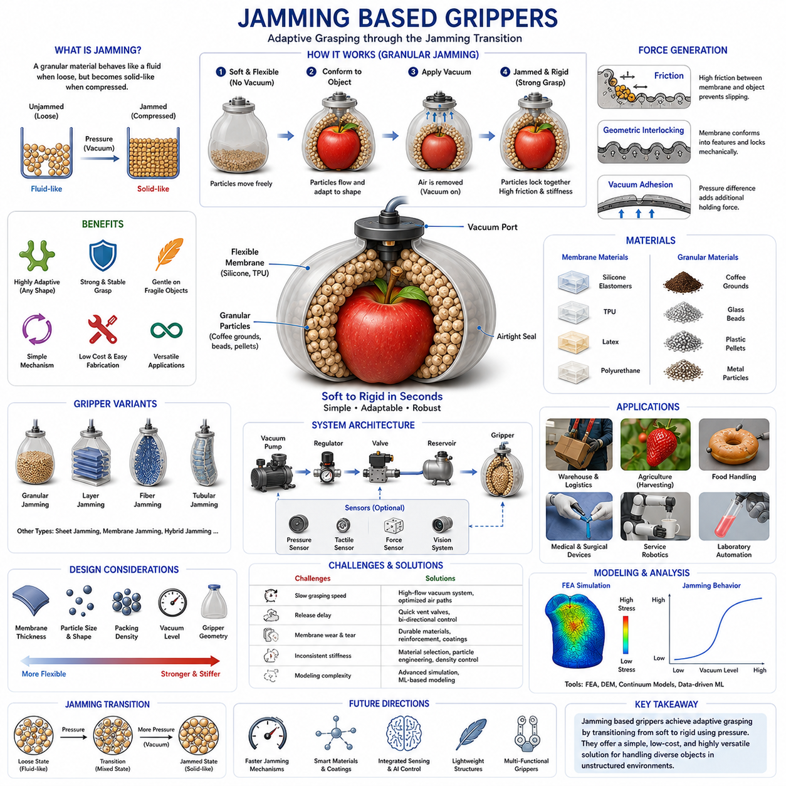{width="7.268055555555556in" height="7.268055555555556in"}

재밍 기반 그리퍼(Jamming Based Grippers)는 소프트 로보틱스 분야에서 가장 혁신적이고 독창적인 파지 기술 중 하나이다. 기존의 로봇 그리퍼가 관절, 링크, 모터, 기계식 손가락과 같은 구조를 이용하여 물체를 잡는 반면, 재밍 기반 그리퍼는 재밍 전이(Jamming Transition)라는 물리 현상을 이용하여 물체를 파지한다. 이 기술은 부드럽고 유연한 상태에서 물체 형상에 적응한 뒤, 순간적으로 강성을 증가시켜 단단하게 고정하는 방식으로 동작한다. 따라서 복잡한 제어 알고리즘이나 정밀한 파지 계획 없이도 다양한 형태의 물체를 안정적으로 잡을 수 있다. 이러한 특성 덕분에 재밍 기반 그리퍼는 창고 자동화, 농업 로봇, 서비스 로봇, 의료 로봇, 물류 자동화 및 차세대 소프트 매니퓰레이션 기술의 핵심 연구 분야로 발전하고 있다.

재밍(Jamming)의 개념은 입자 물리학과 응집물질 물리학(Condensed Matter Physics)에서 유래하였다. 모래, 커피 가루, 플라스틱 비드, 세라믹 입자와 같은 입자들은 자유로운 상태에서는 유체처럼 흐를 수 있다. 그러나 외부 압력이 가해져 입자들이 강하게 압축되면 입자 간의 이동이 제한되고 마찰력이 증가하여 마치 고체처럼 거동하게 된다. 이러한 상태 변화를 재밍 전이(Jamming Transition)라고 한다. 연구자들은 이 현상을 로봇 그리퍼에 적용함으로써 다양한 형상에 적응하면서도 높은 강성을 제공할 수 있는 새로운 형태의 파지 기술을 개발하였다.

가장 대표적인 재밍 기반 그리퍼는 입자 재밍 그리퍼(Granular Jamming Gripper)이다. 이 구조는 일반적으로 유연한 실리콘 또는 엘라스토머 막(Membrane) 내부에 커피 가루, 유리 비드, 플라스틱 펠릿, 세라믹 입자와 같은 입상 재료(Granular Material)를 채워 넣어 제작된다. 평상시에는 입자들이 자유롭게 움직일 수 있기 때문에 전체 구조가 매우 부드럽고 변형 가능하다. 물체에 접촉하면 입자들이 물체 형상에 맞추어 이동하면서 자연스럽게 표면을 감싼다. 이후 진공 펌프를 이용하여 내부 공기를 제거하면 대기압에 의해 입자들이 강하게 압축되고 서로의 마찰력이 증가하여 전체 구조가 단단하게 굳어진다. 이 상태에서는 물체를 안정적으로 고정하고 운반할 수 있다.

재밍 기반 그리퍼의 가장 큰 특징은 매우 뛰어난 형상 적응성(Geometric Adaptability)이다. 기존의 로봇 그리퍼는 물체를 잡기 위해 정밀한 위치 제어와 파지 계획이 필요하다. 반면 재밍 그리퍼는 물체와 단순히 접촉하는 것만으로도 형상에 적응할 수 있다. 따라서 물체의 형상, 크기, 자세를 정확히 알지 못하더라도 안정적인 파지가 가능하다. 이는 복잡한 센서와 알고리즘의 필요성을 크게 줄여준다.

재밍 그리퍼의 파지력은 주로 세 가지 메커니즘에 의해 생성된다. 첫 번째는 마찰 파지(Frictional Gripping)이다. 막이 물체를 감싼 후 강성이 증가하면 물체와 막 사이의 마찰력이 커져 미끄러짐을 방지한다. 두 번째는 기하학적 인터로킹(Geometric Interlocking)이다. 물체의 돌출부나 홈을 감싼 상태에서 재밍이 발생하면 구조적으로 물체를 걸어 잠그는 효과가 발생한다. 세 번째는 진공 흡착(Vacuum Adhesion)이다. 일부 상황에서는 내부 압력 차이에 의해 추가적인 흡착력이 생성된다. 실제 파지에서는 이 세 가지 힘이 복합적으로 작용하여 매우 강력한 파지력을 제공한다.

외부 막(Membrane)의 재료 선택은 매우 중요하다. 막은 충분히 부드러워야 물체 형상에 적응할 수 있으며 동시에 반복적인 사용에도 견딜 수 있어야 한다. 실리콘 엘라스토머, 라텍스 고무, 열가소성 엘라스토머(TPE), 폴리우레탄 필름 등이 주로 사용된다. 막이 너무 얇으면 쉽게 찢어질 수 있고, 너무 두꺼우면 적응성이 감소하기 때문에 적절한 두께 설계가 중요하다.

입상 재료(Granular Material)의 특성도 성능에 큰 영향을 준다. 초기 연구에서는 커피 가루가 널리 사용되었다. 커피 가루는 저렴하고 가벼우며 재밍 특성이 우수하기 때문이다. 이후 유리 구슬, 세라믹 입자, 금속 분말, 플라스틱 펠릿 등 다양한 재료가 연구되었다. 입자의 크기, 형태, 표면 거칠기, 밀도는 재밍 강성과 파지력에 직접적인 영향을 미친다.

일반적으로 불규칙한 형태의 입자는 입자 간 마찰력이 높아 재밍 이후 더 높은 강성을 제공한다. 반면 구형 입자는 재밍 전에는 유동성이 우수하여 형상 적응 능력이 뛰어나다. 따라서 응용 목적에 따라 적절한 입자 재료를 선택해야 한다.

입자의 충진 밀도(Packing Density) 역시 중요한 설계 요소이다. 낮은 충진 밀도는 높은 유연성과 적응성을 제공하지만 최종 강성은 감소한다. 반대로 높은 충진 밀도는 강성과 하중 지지 능력을 향상시키지만 적응성이 감소한다. 따라서 설계자는 유연성과 강성 사이에서 최적의 균형점을 찾아야 한다.

재밍 기반 그리퍼의 가장 독특한 장점은 가변 강성(Variable Stiffness)을 구현할 수 있다는 점이다. 대부분의 로봇 그리퍼는 부드러움과 강성 중 하나를 선택해야 한다. 부드러운 그리퍼는 적응성이 좋지만 무거운 물체를 들기 어렵고, 강체 그리퍼는 큰 힘을 낼 수 있지만 다양한 형상에 적응하기 어렵다. 재밍 기반 그리퍼는 파지 단계에서는 부드럽게 동작하고, 물체를 잡은 후에는 단단해지기 때문에 두 가지 장점을 동시에 제공한다.

진공 생성 시스템(Vacuum Generation System)은 재밍 기반 그리퍼의 핵심 구성 요소이다. 진공 펌프, 압력 조절기, 저장 탱크, 밸브, 튜브 네트워크가 함께 동작하여 재밍 과정을 제어한다. 진공 형성 속도는 파지 속도에 직접적인 영향을 미친다. 산업 현장에서는 빠른 작업이 요구되므로 진공 생성 시간을 줄이는 것이 중요한 연구 주제이다.

재밍 기반 그리퍼의 기계적 특성은 매우 복잡하다. 강성은 진공 압력, 입자 상태, 막 재료, 물체 형상에 따라 지속적으로 변화한다. 연구자들은 압축 시험, 인장 시험, 굽힘 시험, 동적 강성 측정, 유한요소해석(FEA)을 이용하여 성능을 분석한다.

재밍 현상을 수학적으로 모델링하는 것은 매우 어려운 문제이다. 수천에서 수백만 개의 입자가 서로 상호작용하기 때문이다. 이를 분석하기 위해 개별요소법(Discrete Element Method), 연속체 모델(Continuum Model), 유한요소법(FEA), 머신러닝 기반 모델링이 활용되고 있다. 그러나 현재까지도 재밍 현상을 완벽하게 설명하는 모델은 존재하지 않으며 활발한 연구가 진행 중이다.

재밍 기반 그리퍼의 가장 큰 산업적 장점은 하나의 그리퍼로 다양한 물체를 처리할 수 있다는 점이다. 기존 산업용 로봇은 물체 종류에 따라 서로 다른 엔드이펙터를 사용해야 하는 경우가 많다. 그러나 재밍 그리퍼는 상자, 병, 공구, 전자제품, 식품 등 매우 다양한 물체를 하나의 구조로 파지할 수 있다. 이는 자동화 시스템의 복잡성과 유지보수 비용을 크게 감소시킨다.

창고 자동화 분야는 재밍 기반 그리퍼의 대표적인 적용 사례이다. 전자상거래 물류센터에서는 수천 종류 이상의 제품을 처리해야 한다. 재밍 그리퍼는 물체 형상을 사전에 알지 못해도 파지가 가능하기 때문에 매우 유용하다.

농업 로봇에서도 재밍 기술은 큰 잠재력을 가진다. 과일과 채소는 크기, 모양, 숙성도, 표면 상태가 매우 다양하다. 강체 그리퍼는 과일을 손상시키기 쉽지만, 재밍 그리퍼는 넓은 접촉 면적으로 힘을 분산시키고 형상에 적응하기 때문에 손상을 최소화할 수 있다. 특히 딸기, 복숭아, 토마토, 포도와 같은 민감한 작물 수확에 적합하다.

의료 및 바이오 분야에서도 재밍 기술이 주목받고 있다. 외과 수술에서는 다양한 형상의 연성 조직을 안전하게 조작해야 한다. 재밍 구조는 높은 적응성과 안정성을 동시에 제공하기 때문에 수술용 도구, 재활 장치, 의수(Prosthetic Hand), 보조 기기 개발에 활용될 수 있다.

그러나 재밍 기반 그리퍼에도 몇 가지 한계가 존재한다. 첫 번째는 파지 속도이다. 진공을 형성하는 데 시간이 필요하므로 매우 빠른 작업에는 불리할 수 있다. 두 번째는 물체를 놓는 과정이다. 다시 공기를 주입하여 재밍 상태를 해제해야 하기 때문에 추가 시간이 필요하다.

내구성도 중요한 문제이다. 반복적인 변형은 막 재료의 피로(Fatigue)를 유발하며, 마모, 균열, 찢어짐, 자외선 노화 등이 발생할 수 있다. 따라서 고내구성 재료와 보호 코팅 기술이 지속적으로 연구되고 있다.

최근에는 다양한 형태의 재밍 기술이 개발되고 있다. 레이어 재밍(Layer Jamming)은 입자 대신 여러 장의 얇은 시트를 사용한다. 평상시에는 시트가 자유롭게 움직이지만 진공 상태에서는 시트 간 마찰이 증가하여 강성이 높아진다. 이 방식은 강성 제어가 쉽고 제조가 용이하다는 장점이 있다.

파이버 재밍(Fiber Jamming)은 입자 대신 섬유 다발(Fiber Bundle)을 사용한다. 진공을 가하면 섬유 간 마찰이 증가하여 구조가 단단해진다. 이 방식은 연속체 매니퓰레이터와 웨어러블 로봇에 특히 적합하며 방향성 강성 제어가 가능하다.

이 외에도 튜브 재밍(Tubular Jamming), 시트 재밍(Sheet Jamming), 멤브레인 재밍(Membrane Jamming), 하이브리드 재밍(Hybrid Jamming) 등 다양한 구조가 개발되고 있으며 각각 고유한 장점과 응용 가능성을 제공한다.

최근에는 촉각 센서(Tactile Sensor), 압력 센서(Pressure Sensor), 변형 센서(Strain Sensor), 비전 시스템(Vision System)과 결합하여 더욱 지능적인 재밍 그리퍼가 개발되고 있다. 머신러닝과 강화학습은 파지 품질 예측, 물체 특성 추정, 제어 최적화에 활용되고 있으며, 향후 파운데이션 모델(Foundation Model) 기반의 물리 AI 시스템과도 통합될 것으로 예상된다.

인간의 손은 작업에 따라 부드럽거나 단단하게 강성을 조절할 수 있다. 재밍 기술은 이러한 인간 손의 특성을 공학적으로 구현할 수 있는 가장 유망한 방법 중 하나이다. 따라서 미래의 덱스터러스 핸드(Dexterous Hand), 휴머노이드 로봇(Humanoid Robot), 모바일 매니퓰레이터(Mobile Manipulator)는 재밍 기술을 활용하여 훨씬 높은 수준의 적응성과 조작성(Dexterity)을 확보할 것으로 기대된다.

결론적으로 재밍 기반 그리퍼는 재료공학(Material Science), 입자역학(Granular Mechanics), 소프트 로보틱스(Soft Robotics), 물리 AI(Physical AI)가 융합된 대표적인 기술이다. 부드러운 상태와 단단한 상태를 자유롭게 전환할 수 있으며, 복잡한 형상의 물체를 손쉽게 파지할 수 있다. 이러한 특성은 창고, 병원, 농장, 가정, 연구실 등 다양한 환경에서 요구되는 차세대 적응형 파지 기술의 핵심이 될 것이며, 미래의 지능형 로봇 핸드와 소프트 매니퓰레이션 시스템의 중요한 기반 기술로 자리 잡을 것으로 전망된다.

## 04.06 Adhesive and Gecko-Inspired Grippers

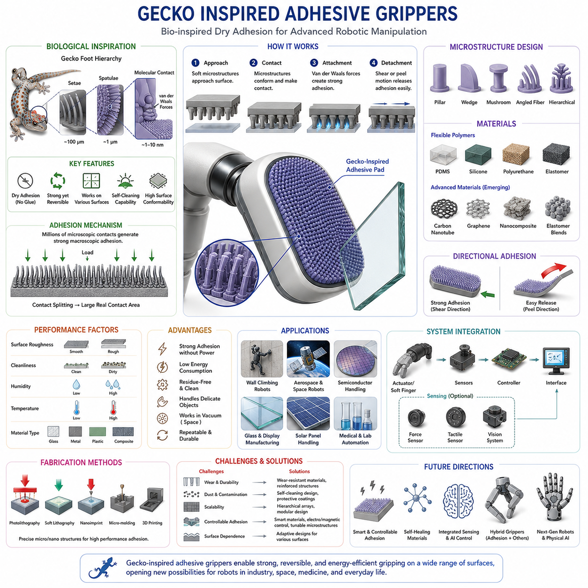{width="7.268055555555556in" height="7.268055555555556in"}

도마뱀붙이 영감 접착 그리퍼(Gecko Inspired Adhesive Grippers)는 생물학(Biology), 재료공학(Material Science), 그리고 로봇 매니퓰레이션(Robotic Manipulation)이 융합된 대표적인 바이오모방(Bio-Inspired) 기술이다. 이 기술은 수직 벽, 천장, 유리 표면 등 다양한 환경을 자유롭게 이동할 수 있는 도마뱀붙이(Gecko)의 놀라운 접착 능력에서 영감을 받아 개발되었다. 도마뱀붙이는 접착제, 흡착판, 갈고리와 같은 구조를 사용하지 않고도 다양한 표면에 안정적으로 부착할 수 있다. 연구자들은 이러한 자연 현상을 분석하여 로봇이 물체를 파지하거나 벽을 오를 수 있는 새로운 형태의 접착 기술을 개발하였으며, 이것이 오늘날의 도마뱀붙이 영감 접착 그리퍼의 기반이 되었다.

도마뱀붙이 접착의 핵심은 발바닥(Footpad)의 계층적 미세 구조(Hierarchical Microstructure)에 있다. 육안으로는 매끄럽게 보이지만 현미경으로 관찰하면 수백만 개의 미세한 털 구조인 세타(Setae)가 존재한다. 각 세타는 다시 수백\~수천 개의 나노미터 수준 구조인 스패튤라(Spatulae)로 분기된다. 이러한 구조는 표면과의 실제 접촉 면적을 극대화하며, 접촉 시 분자 간 인력인 반데르발스 힘(Van der Waals Force)을 생성한다. 개별 힘은 매우 작지만 수많은 접촉점이 동시에 작용하기 때문에 전체적으로 매우 강한 접착력을 만들어낸다.

도마뱀붙이 접착의 가장 놀라운 특징은 완전한 건식 접착(Dry Adhesion)이라는 점이다. 일반적인 접착제가 화학 물질이나 액체를 사용하는 것과 달리, 도마뱀붙이의 발은 분자 수준의 물리적 상호작용만을 이용한다. 따라서 반복적으로 부착과 분리를 수행해도 접착력이 크게 감소하지 않으며 표면에 잔여물을 남기지 않는다. 이러한 특성은 산업용 로봇과 정밀 자동화 시스템에서 매우 매력적인 요소로 평가된다.

도마뱀붙이 접착 연구는 생물학자, 물리학자, 재료공학자, 로봇공학자가 함께 참여한 다학제 연구로 발전하였다. 초기에는 자연 현상을 이해하는 것이 목적이었으나, 나노가공(Nanofabrication)과 미세구조 제조 기술(Microfabrication Technology)이 발전하면서 인공적으로 유사한 구조를 제작할 수 있게 되었다. 이를 통해 합성 접착 표면(Synthetic Adhesive Surface)이 개발되었고, 다양한 로봇 응용 기술로 확장되었다.

도마뱀붙이 접착의 중요한 원리 중 하나는 접촉 분할(Contact Splitting)이다. 단일한 큰 접촉면 대신 수많은 미세 접촉 구조로 접촉 면적을 분산시키는 방식이다. 이를 통해 전체 접촉 면적은 증가하면서도 표면의 미세한 요철에 적응할 수 있게 된다. 결과적으로 접착력이 향상되고 하중이 균일하게 분산되어 내구성도 증가한다.

인공 도마뱀붙이 접착 구조는 일반적으로 실리콘(Silicone), 폴리디메틸실록산(PDMS), 폴리우레탄(Polyurethane), 엘라스토머(Elastomer) 기반의 마이크로 구조 배열로 구성된다. 이러한 구조는 기둥(Pillar), 쐐기(Wedge), 버섯형(Mushroom Shape), 경사 섬유(Angled Fiber), 계층 구조(Hierarchical Structure) 등의 형태로 제작된다. 모든 설계의 목표는 최대 접촉 면적을 확보하면서도 쉽게 부착 및 분리할 수 있도록 만드는 것이다.

도마뱀붙이 접착의 또 다른 중요한 특징은 방향성 접착(Directional Adhesion)이다. 자연계의 도마뱀붙이는 특정 방향으로 힘을 가할 때 강한 접착력을 생성하며, 반대 방향으로 움직이면 쉽게 분리된다. 이를 통해 빠르게 이동하면서도 필요할 때만 강한 접착력을 사용할 수 있다. 인공 접착 시스템도 이러한 특성을 모방하여 로봇이 효율적으로 물체를 잡고 놓을 수 있도록 설계된다.

외부 에너지가 거의 필요하지 않다는 점도 큰 장점이다. 일단 접촉이 형성되면 접착 상태를 유지하기 위해 추가적인 전력이나 에너지가 거의 필요하지 않다. 따라서 장시간 물체를 유지해야 하는 응용 분야에서는 흡착 방식이나 전자석 방식보다 훨씬 높은 에너지 효율을 제공한다.

도마뱀붙이 영감 그리퍼는 특히 매끄럽고 민감한 표면을 가진 물체를 다루는 데 유리하다. 기존 기계식 그리퍼는 강한 압착력을 필요로 하기 때문에 물체에 손상을 줄 수 있다. 반면 접착 그리퍼는 넓은 접촉 면적을 이용하여 하중을 분산시키므로 얇은 유리, 반도체 웨이퍼, 광학 부품, 태양광 셀, 의료 기기 등을 안전하게 다룰 수 있다.

초기 응용 분야 중 하나는 벽면 등반 로봇(Wall Climbing Robot)이었다. 기존 흡착 방식은 거친 표면에서 성능이 떨어지고, 자기식 방식은 철 재질에만 사용할 수 있다는 한계가 있었다. 도마뱀붙이 접착 기술은 유리, 콘크리트, 도장 표면, 복합재 표면 등 다양한 재질에서 사용 가능하기 때문에 등반 로봇 분야에서 큰 관심을 받았다.

항공우주(Aerospace) 분야에서도 도마뱀붙이 접착 기술은 매우 유망하다. 우주 공간에서는 중력이 거의 없기 때문에 기존 파지 방식이 비효율적일 수 있다. 접착 그리퍼는 위성 부품, 공구, 우주 쓰레기(Space Debris) 등을 안정적으로 고정할 수 있으며, 특히 진공 환경에서도 반데르발스 힘은 정상적으로 작동하기 때문에 우주 응용에 매우 적합하다.

산업 자동화(Industrial Automation) 분야에서는 반도체 제조, 디스플레이 생산, 정밀 조립 공정에 활용되고 있다. 이러한 산업에서는 매우 얇고 민감한 부품을 다루어야 하며, 작은 오염도 허용되지 않는다. 도마뱀붙이 접착 그리퍼는 잔여물을 남기지 않기 때문에 클린룸(Clean Room) 환경에 적합하다.

접착 성능은 표면 상태에 크게 의존한다. 표면 거칠기(Surface Roughness), 청결도(Cleanliness), 습도(Humidity), 온도(Temperature), 재료 특성(Material Properties)이 접착력에 직접적인 영향을 준다. 일반적으로 매끄러운 표면에서 가장 높은 성능을 보이며, 거친 표면에서는 실제 접촉 면적이 감소하여 접착력이 낮아질 수 있다. 이를 해결하기 위해 연구자들은 거친 표면에도 적응 가능한 새로운 미세 구조를 개발하고 있다.

재료 선택(Material Selection)은 매우 중요하다. 접착 구조는 표면에 순응할 만큼 부드러워야 하면서도 반복 사용 시 형태를 유지할 수 있어야 한다. 실리콘 엘라스토머는 유연성과 내구성이 우수하여 가장 널리 사용된다. 폴리우레탄은 높은 마모 저항성과 기계적 강도를 제공한다. 최근에는 탄소나노튜브(Carbon Nanotube), 그래핀(Graphene), 나노복합재(Nanocomposite)를 활용한 고성능 접착 구조도 연구되고 있다.

이러한 구조를 제작하기 위해 다양한 미세가공 기술이 활용된다. 포토리소그래피(Photolithography), 소프트 리소그래피(Soft Lithography), 레이저 가공(Laser Machining), 나노임프린트(Nanoimprint), 마이크로 몰딩(Micro-Molding), 적층 제조(Additive Manufacturing)가 대표적이다. 제조 기술의 발전은 더욱 정교한 계층 구조 구현을 가능하게 하고 있다.

내구성(Durability)은 현재 해결해야 할 주요 과제 중 하나이다. 반복적인 부착과 분리는 미세 구조의 마모를 유발할 수 있으며, 먼지나 오염물은 접착력을 감소시킬 수 있다. 이를 해결하기 위해 자연계의 도마뱀붙이처럼 자가 세정(Self-Cleaning) 기능을 가진 접착 구조가 연구되고 있다.

도마뱀붙이 접착 그리퍼의 제어는 일반적인 그리퍼와 다르다. 단순히 힘을 조절하는 것이 아니라 접촉 면적(Contact Area), 접촉 각도(Contact Angle), 박리 각도(Peeling Angle), 접착 방향을 정밀하게 제어해야 한다. 이를 위해 힘 센서, 촉각 센서, 비전 센서가 통합되어 접착 상태를 실시간으로 모니터링한다.

소프트 로보틱스와 도마뱀붙이 접착 기술의 융합도 활발하게 진행되고 있다. 소프트 핑거 끝에 접착 패드를 부착하면 물체 형상에 적응하면서도 높은 접착력을 제공할 수 있다. 이러한 하이브리드 구조는 기존 소프트 그리퍼와 접착 기술의 장점을 동시에 활용할 수 있다.

최근에는 머신러닝(Machine Learning)과 인공지능(AI)이 접착 그리퍼 제어에 활용되고 있다. 데이터 기반 학습을 통해 최적의 접촉 위치와 접착 조건을 찾고, 다양한 표면에서의 성능을 예측할 수 있다. 강화학습(Reinforcement Learning)은 접촉 및 분리 전략을 최적화하는 데 활용되고 있다.

현재 가장 활발히 연구되는 분야 중 하나는 능동 제어 접착(Controllable Adhesion)이다. 자연계의 도마뱀붙이는 발의 방향만 바꾸어 즉시 접착력을 조절할 수 있다. 이를 인공적으로 구현하기 위해 전기 접착(Electroadhesion), 자기 반응 재료(Magnetic Responsive Material), 열 반응 재료(Thermally Responsive Material), 가변 구조 표면(Adaptive Microstructure)이 연구되고 있다.

또 다른 중요한 연구 방향은 대형화(Scalability)이다. 현재 대부분의 도마뱀붙이 접착 시스템은 소형 또는 중형 규모에서 우수한 성능을 보인다. 그러나 대형 하중을 지지하기 위해서는 응력 분산, 구조 강도, 제조 기술 측면에서 추가적인 발전이 필요하다.

최근에는 접착 기술을 흡착(Suction), 소프트 그리퍼(Soft Gripper), 재밍 그리퍼(Jamming Gripper), 기계식 손가락(Mechanical Finger)과 결합한 하이브리드 그리퍼가 증가하고 있다. 이러한 구조는 서로 다른 기술의 장점을 결합하여 더욱 다양한 환경에서 사용할 수 있도록 한다.

미래의 도마뱀붙이 영감 접착 그리퍼는 자가 치유 재료(Self-Healing Material), 스마트 표면(Smart Surface), 통합 센서(Integrated Sensor), AI 기반 제어(AI-Based Control)와 결합하여 더욱 발전할 것으로 예상된다. 특히 접착 상태를 스스로 판단하고 최적화하는 지능형 접착 시스템(Intelligent Adhesion System)은 차세대 물리 AI(Physical AI)의 핵심 기술 중 하나가 될 가능성이 높다.

결론적으로 도마뱀붙이 영감 접착 그리퍼는 생물학적 원리를 공학적으로 구현한 대표적인 바이오모방 기술이다. 나노 수준의 반데르발스 힘과 계층적 미세 구조를 활용하여 기존 기계식 그리퍼가 수행하기 어려운 작업을 가능하게 한다. 낮은 에너지 소비, 높은 적응성, 잔여물 없는 청정 접착, 민감한 물체에 대한 안전성이라는 장점을 바탕으로 미래의 로봇 핸드(Robot Hand), 덱스터러스 매니퓰레이션(Dexterous Manipulation), 휴머노이드 로봇(Humanoid Robot), 우주 로봇(Space Robot), 서비스 로봇(Service Robot), 산업용 자동화 시스템의 핵심 기술로 발전할 것으로 전망된다.

## 04.07 Granular Jamming Grippers

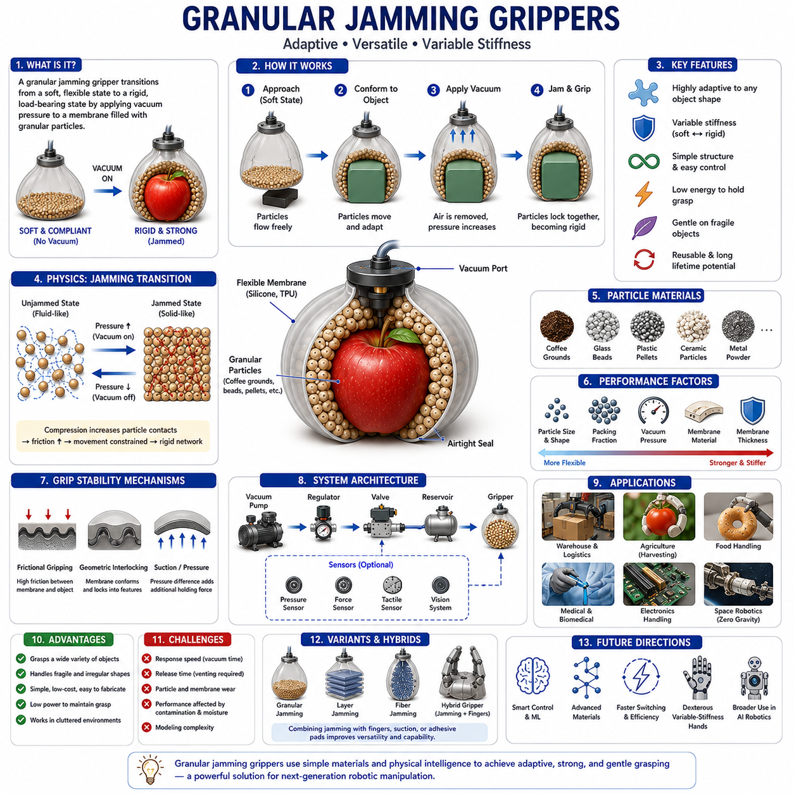{width="7.268055555555556in" height="7.268055555555556in"}

입자 재밍 그리퍼(Granular Jamming Grippers)는 가변 강성(Variable Stiffness)을 활용하는 소프트 로보틱스 기술 가운데 가장 성공적이고 널리 연구된 기술 중 하나이다. 재밍 기반 그리퍼(Jamming-Based Gripper)라는 큰 범주 안에는 레이어 재밍(Layer Jamming), 파이버 재밍(Fiber Jamming), 멤브레인 재밍(Membrane Jamming), 하이브리드 재밍(Hybrid Jamming) 등이 포함되지만, 입자 재밍은 가장 대표적이며 실제 응용 사례가 풍부한 방식으로 평가받고 있다. 입자 재밍 그리퍼는 수많은 입자(Granular Material)의 집합적 물리 현상을 이용하여 매우 부드러운 상태와 매우 단단한 상태를 자유롭게 전환할 수 있다. 이러한 특성 덕분에 복잡한 손가락 구조 없이도 다양한 물체 형상에 적응할 수 있으며, 불규칙한 형상의 물체를 안정적으로 파지할 수 있다. 따라서 로봇 핸드(Robot Hand), 덱스터러스 그라스핑(Dexterous Grasping), 소프트 매니퓰레이션(Soft Manipulation) 분야에서 중요한 위치를 차지하고 있다.

입자 재밍의 개념은 입자 물질(Granular Matter)에 대한 연구에서 시작되었다. 입자 물질은 모래, 쌀, 커피 가루, 플라스틱 펠릿, 세라믹 비드와 같이 수많은 개별 입자로 구성된 물질을 의미한다. 이러한 물질은 자유로운 상태에서는 액체처럼 흐를 수 있지만, 특정 조건에서는 고체처럼 하중을 지탱할 수도 있다. 연구자들은 입자들이 일정 밀도 이상으로 압축되면 서로의 이동이 제한되고 마찰력이 급격히 증가하여 전체 구조가 단단해진다는 사실을 발견하였다. 이를 재밍 전이(Jamming Transition)라고 하며, 입자 재밍 그리퍼는 바로 이 현상을 이용하여 물체를 파지한다.

입자 재밍 그리퍼는 기존 로봇 공학의 관점을 크게 변화시킨 기술이다. 전통적인 로봇 핸드는 다수의 손가락, 관절, 센서, 제어기, 파지 계획 알고리즘을 필요로 한다. 반면 입자 재밍 그리퍼는 재료 자체의 물리적 특성을 활용하여 복잡한 계산 없이도 다양한 물체를 안정적으로 파지할 수 있다. 이러한 접근 방식은 형태 기반 계산(Morphological Computation)의 대표적인 사례로 평가된다. 즉, 기존에는 소프트웨어가 수행하던 역할을 물리적 구조와 재료가 대신 수행하는 것이다.

일반적인 입자 재밍 그리퍼는 세 가지 핵심 요소로 구성된다. 첫 번째는 유연한 외부 막(Membrane)이다. 이 막은 실리콘 엘라스토머, 라텍스, 폴리우레탄 필름과 같은 연성 재료로 제작된다. 두 번째는 막 내부를 채우는 입상 재료(Granular Medium)이다. 세 번째는 재밍 상태를 제어하는 진공 시스템(Vacuum System)이다. 평상시에는 내부 입자들이 자유롭게 움직일 수 있기 때문에 구조가 매우 부드럽다. 물체에 접촉하면 막과 입자가 물체 형상에 맞추어 변형된다. 이후 진공을 형성하면 대기압에 의해 입자들이 강하게 압축되고, 서로의 마찰력이 증가하면서 전체 구조가 단단해진다.

입자 재밍 그리퍼의 가장 큰 장점은 뛰어난 형상 적응성(Geometric Adaptability)이다. 기존 그리퍼는 특정 물체를 위해 특별히 설계된 손가락 형상을 필요로 하는 경우가 많다. 그러나 입자 재밍 그리퍼는 동일한 구조로 구형 물체, 원통형 물체, 불규칙한 산업 부품, 과일, 실험 용기, 소비재 제품 등 매우 다양한 물체를 파지할 수 있다. 이는 자동화 시스템의 복잡성을 줄이고 운영 유연성을 크게 향상시킨다.

입자 재밍의 물리학은 수천에서 수백만 개의 입자가 서로 상호작용하는 복잡한 현상이다. 재밍 전에는 입자들이 자유롭게 재배열되며 점성이 높은 액체와 유사한 거동을 보인다. 그러나 진공이 형성되면 입자 간 접촉력이 증가하고 마찰이 급격히 커지면서 입자의 움직임이 제한된다. 이 과정에서 힘 전달 경로(Force Chain)가 형성되고 전체 구조가 강성을 갖게 된다. 이러한 전이는 설계에 따라 수백 밀리초에서 수 초 이내에 발생할 수 있다.

입자 재료의 선택은 성능에 매우 큰 영향을 미친다. 초기 연구에서는 커피 가루(Coffee Grounds)가 가장 널리 사용되었다. 커피 가루는 저렴하고 가벼우며 재밍 특성이 우수하기 때문이다. 이후 유리 비드(Glass Beads), 세라믹 입자(Ceramic Particles), 플라스틱 펠릿(Polymer Pellets), 금속 분말(Metal Particles) 등이 연구되었다. 각각의 재료는 강성, 적응성, 내구성, 무게, 비용 측면에서 서로 다른 특성을 제공한다.

입자의 크기 역시 중요한 설계 요소이다. 작은 입자는 미세한 형상에 더 잘 적응할 수 있어 높은 순응성을 제공한다. 하지만 너무 작은 입자는 유동성이 감소하고 응답 속도가 느려질 수 있다. 큰 입자는 공기 흐름이 원활하여 진공 형성이 빠르지만 형상 적응성이 감소할 수 있다. 따라서 실제 설계에서는 적절한 입자 크기 분포를 선택하는 것이 중요하다.

입자의 형상도 성능에 큰 영향을 준다. 구형 입자는 재밍 전 상태에서 유동성이 우수하지만 재밍 후 마찰력이 상대적으로 낮다. 반면 불규칙한 형상의 입자는 재밍 후 높은 마찰력을 제공하여 강성이 크게 증가한다. 따라서 응용 목적에 따라 구형, 각진 형태, 길쭉한 형태, 혼합 형태의 입자를 선택할 수 있다.

충진율(Packing Fraction)은 전체 부피 대비 입자가 차지하는 비율을 의미한다. 충진율이 낮으면 유연성과 적응성이 향상되지만 강성은 감소한다. 충진율이 높으면 높은 강성과 하중 지지 능력을 얻을 수 있지만 적응성이 감소한다. 따라서 최적의 성능을 얻기 위해서는 적절한 충진율을 선택해야 한다.

외부 막은 여러 조건을 동시에 만족해야 한다. 충분히 부드러워야 물체 형상에 적응할 수 있으며, 반복적인 진공 사이클에서도 손상되지 않아야 한다. 또한 공기 누설이 없어야 하고, 마모와 찢어짐에 대한 저항성을 가져야 한다. 실리콘 엘라스토머는 높은 유연성과 내구성 때문에 가장 널리 사용되며, 폴리우레탄 필름은 내마모성이 우수하여 산업용으로 많이 활용된다.

입자 재밍 그리퍼의 파지력은 여러 물리적 메커니즘에 의해 생성된다. 가장 중요한 것은 마찰력(Frictional Force)이다. 진공에 의해 막이 물체를 강하게 감싸면서 마찰력이 증가한다. 또한 기하학적 인터로킹(Geometric Interlocking)이 발생할 수 있다. 막이 물체의 돌출부를 감싸면 구조적으로 걸리는 효과가 생겨 파지력이 증가한다. 일부 경우에는 압력 차이에 의한 흡착 효과(Suction Effect)도 추가적으로 작용한다.

기존 다지형 로봇 핸드가 점 접촉(Point Contact)을 이용하는 것과 달리, 입자 재밍 그리퍼는 넓은 분산 접촉(Distributed Contact)을 형성한다. 따라서 힘이 넓게 분산되어 취약한 물체를 다룰 때 유리하다. 과일, 채소, 의료 샘플, 전자 부품과 같은 민감한 물체를 손상 없이 파지할 수 있다.

입자 재밍 시스템의 강성은 일정하지 않다. 진공 압력, 입자 배열, 막 재료, 물체 형상에 따라 지속적으로 변화한다. 이를 분석하기 위해 압축 시험, 굽힘 시험, 인장 시험, 동적 강성 측정, 유한요소해석(FEA) 등이 사용된다. 일반적으로 진공 압력이 증가할수록 강성도 증가하지만 완전히 선형적인 관계는 아니다.

입자 재밍을 수학적으로 모델링하는 것은 매우 어려운 문제이다. 수많은 입자가 동시에 상호작용하기 때문이다. 연구자들은 개별요소법(Discrete Element Method), 연속체 모델(Continuum Model), 유한요소해석(FEA), 그리고 최근에는 머신러닝(Machine Learning)을 이용하여 이러한 현상을 분석하고 있다.

응답 속도(Response Speed)는 산업용 응용에서 매우 중요한 요소이다. 진공을 형성하는 데 걸리는 시간은 챔버 크기, 입자 투과성, 진공 펌프 성능, 공압 네트워크 구조에 의해 결정된다. 최근에는 고속 밸브와 진공 저장 탱크를 활용하여 수백 밀리초 수준의 응답 속도를 달성하는 연구가 진행되고 있다.

에너지 효율성(Energy Efficiency) 역시 중요한 장점이다. 입자 재밍 그리퍼는 상태를 전환할 때만 에너지를 소비하며, 일단 재밍 상태가 형성되면 적은 에너지로도 파지를 유지할 수 있다. 따라서 배터리 기반 모바일 로봇에 적합한 기술로 평가받고 있다.

내구성(Durability)은 지속적인 연구 주제이다. 반복적인 변형은 막의 피로를 유발하며, 입자의 마모와 오염도 발생할 수 있다. 또한 습도, 온도, 자외선, 화학 물질 등의 환경 요인이 성능에 영향을 줄 수 있다. 따라서 산업용 적용을 위해서는 장기간 신뢰성 검증이 필수적이다.

농업 로봇 분야는 입자 재밍 기술의 대표적인 응용 분야이다. 농산물은 크기, 모양, 표면 특성이 매우 다양하다. 입자 재밍 그리퍼는 이러한 차이에 자연스럽게 적응할 수 있으며, 힘을 넓게 분산시켜 손상을 최소화한다. 딸기, 토마토, 복숭아, 포도와 같은 민감한 과일을 수확하는 데 매우 적합하다.

물류 자동화와 창고 로봇 분야에서도 큰 장점을 제공한다. 전자상거래 물류센터는 매우 다양한 상품을 처리해야 한다. 입자 재밍 그리퍼는 물체 형상을 사전에 알지 못해도 파지가 가능하므로 자동화 효율을 크게 향상시킬 수 있다.

의료 로봇 분야에서는 소형 재밍 구조를 수술 도구와 재활 장치에 적용하는 연구가 진행되고 있다. 또한 의수(Prosthetic Hand)와 보조 장치에도 활용되어 적응성과 안전성을 향상시킬 수 있다.

최근에는 센서 통합 기술이 빠르게 발전하고 있다. 압력 센서, 힘 센서, 촉각 센서, 비전 시스템을 통합하여 파지 상태를 실시간으로 모니터링할 수 있다. 이러한 정보는 적응형 파지와 지능형 제어에 활용된다.

머신러닝과 인공지능 역시 입자 재밍 기술과 결합되고 있다. 데이터 기반 모델은 파지 성공 확률을 예측하고 최적의 진공 압력을 결정할 수 있다. 강화학습은 반복 경험을 통해 최적의 파지 전략을 학습할 수 있다.

최근에는 다양한 하이브리드 구조도 등장하고 있다. 입자 재밍과 공압 소프트 핑거를 결합하거나, 접착 패드, 케이블 구동 메커니즘, 다지형 로봇 핸드와 통합하는 방식이다. 이러한 구조는 각각의 기술이 가진 장점을 결합하여 더욱 높은 성능을 제공한다.

특히 가변 강성 로봇 핸드(Variable Stiffness Robot Hand)는 향후 중요한 연구 방향이다. 인간의 손은 탐색 시에는 부드럽고, 힘을 가해야 할 때는 단단해진다. 입자 재밍 기술은 이러한 인간 손의 특성을 가장 현실적으로 구현할 수 있는 방법 중 하나이다. 미래의 덱스터러스 핸드와 휴머노이드 로봇은 손가락, 손바닥, 손목 내부에 재밍 구조를 포함하여 필요에 따라 강성을 조절할 수 있을 것으로 예상된다.

입자 재밍 그리퍼는 체화 지능(Embodied Intelligence)의 대표적인 사례이기도 하다. 물체 형상에 대한 사전 정보나 복잡한 계산 없이도 물리적 구조 자체가 적응적 행동을 수행한다. 이는 소프트 로보틱스와 물리 AI(Physical AI)의 핵심 철학과도 일치한다.

결론적으로 입자 재밍 그리퍼는 재료공학(Material Science), 입자역학(Granular Mechanics), 공압공학(Pneumatic Engineering), 소프트 로보틱스(Soft Robotics)가 융합된 대표적인 기술이다. 부드러운 상태와 단단한 상태를 자유롭게 전환할 수 있으며, 다양한 형상의 물체를 안정적으로 파지할 수 있다. 이러한 특성 덕분에 입자 재밍 그리퍼는 기존 강체 로봇 핸드와 완전 소프트 로봇 핸드 사이를 연결하는 중요한 기술로 평가받고 있으며, 향후 차세대 적응형 로봇 핸드, 지능형 매니퓰레이션 시스템, 휴머노이드 로봇, 물리 AI 플랫폼의 핵심 요소로 발전할 것으로 전망된다.

## 04.08 Hybrid Soft-Rigid Hands

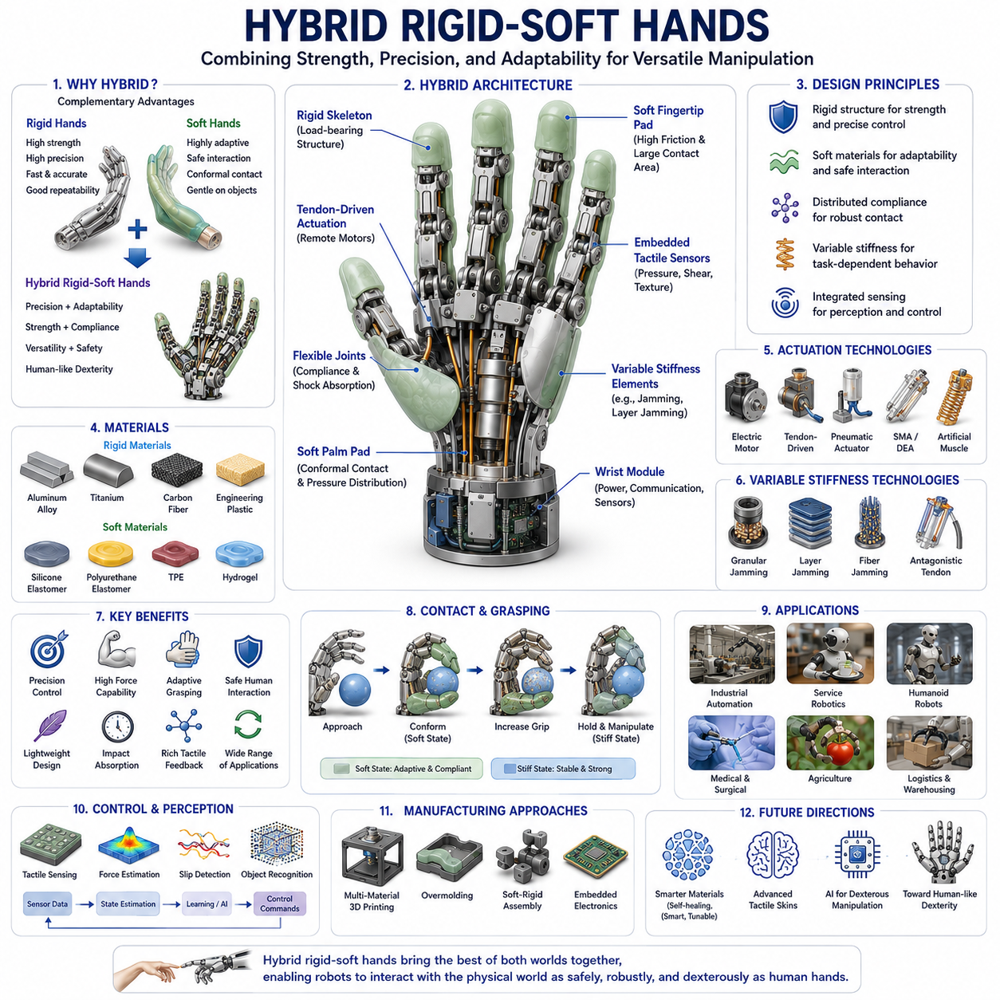{width="7.268055555555556in" height="7.268055555555556in"}

하이브리드 강체-연성 로봇 핸드(Hybrid Rigid-Soft Hands)는 현대 로봇 매니퓰레이션 분야에서 가장 중요한 발전 중 하나로 평가받고 있다. 이 기술은 강체 로봇의 구조적 강도, 정밀성, 제어 가능성과 소프트 로봇의 적응성, 순응성(Compliance), 안전성을 하나의 시스템에 통합하는 것을 목표로 한다. 전통적으로 로봇 핸드는 정밀성과 힘 전달 능력을 강조한 강체 핸드와 적응성과 안전성을 강조한 소프트 핸드로 구분되어 왔다. 그러나 실제 환경에서는 두 가지 특성이 모두 요구되는 경우가 많다. 따라서 하이브리드 강체-연성 핸드는 두 접근 방식의 장점을 동시에 활용할 수 있는 차세대 로봇 핸드 구조로 주목받고 있다. 특히 휴머노이드 로봇(Humanoid Robot), 물리 AI(Physical AI), 서비스 로봇(Service Robot), 모바일 매니퓰레이터(Mobile Manipulator), 협동 로봇(Collaborative Robot) 분야에서 핵심 기술로 자리 잡고 있다.

하이브리드 구조가 등장한 배경은 기존 강체 핸드와 소프트 핸드가 각각 가진 한계를 극복하기 위함이다. 강체 로봇 핸드는 높은 위치 정확도(Position Accuracy), 반복 정밀도(Repeatability), 힘 전달 능력(Force Transmission)을 제공한다. 모터, 기어, 링크, 베어링으로 구성된 구조는 정밀한 움직임을 구현할 수 있으며 산업용 조립 작업에 매우 적합하다. 그러나 강체 구조는 환경 변화에 대한 적응성이 낮고, 취약한 물체를 다룰 때 손상을 유발할 수 있으며, 사람과 충돌할 경우 안전 문제가 발생할 수 있다.

반면 소프트 로봇 핸드는 유연한 재료를 사용하여 물체 형상에 자연스럽게 적응하고 충격을 흡수할 수 있다. 따라서 과일, 의료 샘플, 유리 제품과 같은 민감한 물체를 안전하게 다룰 수 있으며 인간과의 상호작용에서도 높은 안전성을 제공한다. 그러나 순수 소프트 핸드는 일반적으로 출력 힘이 제한적이며, 위치 제어 정밀도가 낮고 복잡한 조작 작업을 수행하기 어려운 경우가 많다.

하이브리드 강체-연성 핸드는 이러한 두 기술의 장점을 결합한다. 일반적으로 강체 구조가 전체 하중을 지지하는 골격(Skeleton) 역할을 수행하며, 소프트 구조는 접촉면과 관절 주변에 배치된다. 이를 통해 높은 강성과 힘 전달 능력을 유지하면서도 물체 형상에 적응할 수 있는 능력을 확보한다. 이러한 구조는 인간 손의 구조와 매우 유사하다.

인간의 손은 뼈(Bone)라는 강체 구조와 근육(Muscle), 힘줄(Tendon), 인대(Ligament), 피부(Skin), 연부 조직(Soft Tissue)이라는 유연한 구조가 결합된 형태이다. 뼈는 힘을 전달하고 형태를 유지하며, 피부와 연부 조직은 물체와의 접촉 시 충격을 흡수하고 접촉 면적을 증가시킨다. 하이브리드 로봇 핸드는 바로 이러한 인간 손의 구조를 모방하여 설계된다.

하이브리드 핸드의 가장 큰 장점 중 하나는 정밀 파지(Precision Grasping)와 적응형 파지(Adaptive Grasping)를 동시에 수행할 수 있다는 점이다. 정밀 파지는 전자 부품 조립, 실험 장비 조작, 공구 사용과 같은 작업에서 중요하다. 이러한 작업에서는 강체 구조가 제공하는 높은 위치 정밀도가 필수적이다. 반면 적응형 파지는 다양한 형상의 물체를 안정적으로 잡는 데 중요하다. 소프트 패드는 물체를 감싸면서 접촉 면적을 증가시키고 파지 안정성을 향상시킨다.

하이브리드 핸드의 손가락 구조는 설계의 핵심 요소이다. 일부 시스템은 강체 링크와 유연한 관절을 결합한 형태를 사용한다. 다른 시스템은 강체 골격을 연성 재료 내부에 삽입하는 방식으로 설계된다. 또한 손가락의 근위부(Proximal Section)는 강체 구조로 구성하고, 원위부(Distal Section)는 소프트 재료로 구성하는 방식도 널리 사용된다. 이러한 설계는 힘 전달과 적응성 사이의 균형을 최적화하는 데 목적이 있다.

구동 방식 역시 매우 다양하다. 전기 모터(Electric Motor)는 가장 널리 사용되는 구동 장치이다. 특히 힘줄 구동(Tendon-Driven) 시스템은 인간 손의 힘줄 구조를 모방한 방식으로, 많은 고성능 휴머노이드 핸드에서 채택되고 있다. 케이블을 통해 힘을 전달하기 때문에 손가락 내부를 가볍게 만들 수 있으며 높은 자유도(Degree of Freedom)를 구현할 수 있다.

공압 액추에이터(Pneumatic Actuator), 유압 시스템(Hydraulic System), 형상기억합금(SMA), 유전체 엘라스토머 액추에이터(DEA), 인공 근육(Artificial Muscle) 역시 하이브리드 핸드에 적용되고 있다. 각각의 기술은 힘, 속도, 효율성, 유연성 측면에서 서로 다른 특성을 제공한다.

소프트 재료는 단순히 유연성을 제공하는 것 이상의 역할을 수행한다. 소프트 패드는 접촉 면적을 증가시켜 마찰력을 향상시키고, 충격을 흡수하며, 힘을 균일하게 분산시킨다. 또한 센서를 내장하기 용이하여 촉각 감지 기능을 제공할 수 있다. 이러한 다기능성은 하이브리드 핸드의 중요한 장점이다.

재료 선택(Material Selection)은 설계의 핵심 요소이다. 강체 구조에는 알루미늄 합금, 티타늄, 탄소섬유 복합재, 엔지니어링 플라스틱 등이 사용된다. 이러한 재료는 높은 강성과 경량화를 동시에 제공한다. 반면 소프트 구조에는 실리콘 엘라스토머, 폴리우레탄 엘라스토머, 열가소성 엘라스토머(TPE), 하이드로겔(Hydrogel), 유연 복합재(Flexible Composite)가 사용된다.

강체와 연성 재료의 연결부는 매우 중요한 설계 문제이다. 두 재료의 강성 차이가 매우 크기 때문에 응력 집중(Stress Concentration)이 발생할 수 있다. 이는 박리(Delamination)나 피로 파손(Fatigue Failure)의 원인이 된다. 이를 해결하기 위해 점진적 강성 전이(Graded Stiffness Transition), 기계적 인터로킹(Mechanical Interlocking), 오버몰딩(Overmolding), 다중 재료 적층 제조(Multi-Material Additive Manufacturing) 기술이 활용되고 있다.

최근에는 가변 강성(Variable Stiffness) 기술이 하이브리드 핸드에 적극적으로 적용되고 있다. 작업에 따라 필요한 강성은 달라진다. 섬세한 작업에서는 부드러운 상태가 필요하지만, 무거운 물체를 들 때는 높은 강성이 필요하다. 입자 재밍(Granular Jamming), 레이어 재밍(Layer Jamming), 파이버 재밍(Fiber Jamming), 길항 힘줄 시스템(Antagonistic Tendon System) 등을 이용하면 손가락의 강성을 동적으로 조절할 수 있다.

접촉 역학(Contact Mechanics)은 하이브리드 핸드의 성능을 결정하는 중요한 요소이다. 소프트 패드는 접촉 시 변형되면서 접촉 면적을 증가시키고 압력을 분산시킨다. 이는 물체 손상을 줄이고 파지 안정성을 향상시킨다. 동시에 내부의 강체 구조는 필요한 힘을 효과적으로 전달한다. 이러한 균형이 하이브리드 구조의 핵심 가치이다.

촉각 센싱(Tactile Sensing)은 하이브리드 핸드 연구에서 매우 중요한 분야이다. 인간은 피부에 분포된 수많은 감각 수용체를 통해 물체를 인식한다. 이를 모방하기 위해 압력 센서, 정전용량 센서, 압저항 센서, 광학 촉각 센서, 자기 센서 등이 소프트 표면 내부에 통합되고 있다. 이러한 센서는 접촉 위치, 압력 분포, 미끄러짐(Slip), 표면 질감(Texture) 등의 정보를 제공한다.

전자 피부(Electronic Skin) 기술 역시 빠르게 발전하고 있다. 전자 피부는 넓은 영역에 걸쳐 압력, 온도, 진동, 근접 거리 등을 측정할 수 있다. 이러한 기술은 로봇 핸드가 인간과 유사한 수준의 촉각 능력을 가지도록 만드는 데 중요한 역할을 한다.

하이브리드 핸드의 제어는 매우 복잡한 문제이다. 강체 구조는 전통적인 로봇 제어 이론으로 설명할 수 있지만, 소프트 구조는 비선형 변형과 재료 특성을 고려해야 한다. 따라서 강체 동역학(Rigid Dynamics)과 연성 동역학(Soft Dynamics)을 동시에 다룰 수 있는 통합 모델이 필요하다.

이를 위해 유한요소해석(FEA), 축소 모델(Reduced-Order Model), 물리 기반 신경망(Physics-Informed Neural Network), 데이터 기반 모델(Data-Driven Model) 등이 활용되고 있다. 최근에는 머신러닝(Machine Learning)이 이러한 복잡성을 해결하는 강력한 도구로 사용되고 있다.

강화학습(Reinforcement Learning)은 하이브리드 핸드가 스스로 조작 기술을 학습할 수 있도록 한다. 모방학습(Imitation Learning)은 인간의 손 동작을 학습하여 복잡한 조작 기술을 습득하게 한다. 최근 등장한 파운데이션 모델(Foundation Model)과 멀티모달 AI(Multimodal AI)는 고수준의 조작 계획을 제공하여 로봇 핸드의 지능화를 가속화하고 있다.

덱스터러스 매니퓰레이션(Dexterous Manipulation)은 하이브리드 핸드 연구의 궁극적인 목표 중 하나이다. 이는 손 안에서 물체를 회전시키고 이동시키며 재배치하는 능력을 의미한다. 인간은 이러한 작업을 자연스럽게 수행하지만 로봇에게는 매우 어려운 과제이다. 하이브리드 구조는 정밀 제어와 적응형 접촉을 동시에 제공하기 때문에 덱스터러스 매니퓰레이션 구현에 매우 유리하다.

휴머노이드 로봇 분야는 하이브리드 핸드 기술 발전의 가장 큰 동력 중 하나이다. 미래의 휴머노이드 로봇은 인간을 위해 설계된 도구와 환경을 그대로 사용해야 한다. 따라서 강력하면서도 섬세한 조작 능력을 가진 손이 필요하다. 하이브리드 핸드는 이러한 요구를 충족시킬 수 있는 가장 유망한 기술 중 하나로 평가받고 있다.

산업 자동화 분야에서도 하이브리드 핸드는 중요한 역할을 수행하고 있다. 전자 부품 조립, 의약품 포장, 식품 가공, 실험실 자동화, 물류 처리 등 다양한 분야에서 정밀성과 적응성을 동시에 요구하기 때문이다.

의료 로봇 역시 큰 수혜 분야이다. 의수(Prosthetic Hand)는 강한 힘과 섬세한 촉각을 동시에 제공해야 한다. 수술 로봇은 인체 조직을 안전하게 다루면서도 높은 정밀도를 유지해야 한다. 하이브리드 구조는 이러한 요구를 충족하는 데 매우 적합하다.

최근 다중 재료 3D 프린팅(Multi-Material 3D Printing)의 발전은 하이브리드 핸드 개발을 크게 가속화하고 있다. 하나의 제조 공정에서 강체와 연성 재료를 동시에 제작할 수 있기 때문에 복잡한 구조를 효율적으로 생산할 수 있다. 또한 내장 센서와 강성 전이 구조를 통합하는 것도 가능해지고 있다.

미래의 하이브리드 강체-연성 핸드는 자가 치유 재료(Self-Healing Material), 스마트 재료(Smart Material), 전자 피부(E-Skin), 통합 센서, AI 기반 제어 기술과 결합하여 더욱 발전할 것으로 예상된다. 이러한 기술들은 로봇 핸드가 인간 손에 가까운 수준의 적응성, 강인성, 조작성, 지능을 갖도록 만드는 핵심 요소가 될 것이다.

결론적으로 하이브리드 강체-연성 핸드는 전통적인 로봇공학, 소프트 로보틱스, 생체역학(Biomechanics), 재료공학(Material Science), 그리고 물리 AI(Physical AI)가 융합된 대표적인 기술이다. 강체만으로도, 연성 구조만으로도 완전한 조작 능력을 구현하기 어렵다는 사실을 보여주며, 두 기술의 장점을 결합하는 것이 차세대 로봇 핸드의 핵심 방향임을 제시하고 있다. 앞으로 하이브리드 강체-연성 핸드는 휴머노이드 로봇, 서비스 로봇, 의료 로봇, 산업 자동화, 물리 AI 플랫폼의 핵심 조작 기술로 발전할 것으로 전망된다.

## 04.09 Fabrication Methods

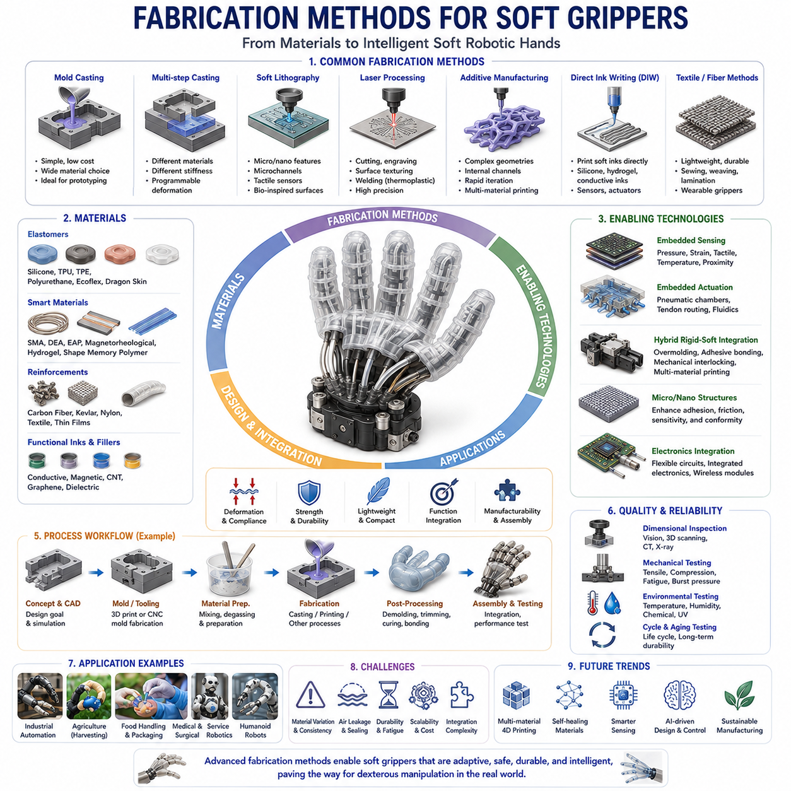{width="7.268055555555556in" height="7.268055555555556in"}

소프트 그리퍼 제작 방법(Fabrication Methods for Soft Grippers)은 소프트 로보틱스 분야의 가장 중요한 기반 기술 중 하나이다. 소프트 그리퍼의 성능, 내구성, 적응성, 센서 통합 능력, 생산성은 모두 제작 방식에 의해 크게 영향을 받는다. 기존의 로봇 그리퍼가 금속 링크, 기어, 베어링, 모터와 같은 강체 기계 부품을 조립하여 제작되는 것과 달리, 소프트 그리퍼는 큰 탄성 변형을 허용하는 연성 재료를 이용하여 제작된다. 따라서 소프트 그리퍼의 제작에는 전통적인 기계 제작 방식과는 다른 설계 철학, 재료 가공 기술, 제조 공정, 품질 관리 방법이 필요하다. 이러한 제작 기술의 발전은 소프트 로보틱스를 단순한 연구 주제에서 산업 현장에서 활용 가능한 실용 기술로 발전시키는 핵심 원동력이 되어 왔다.

소프트 그리퍼 제작은 최종적으로 구현하고자 하는 기능에 대한 이해에서 시작된다. 공압 소프트 핑거(Pneumatic Soft Finger)는 내부 공기 챔버와 유연한 막 구조를 필요로 한다. 힘줄 구동형 소프트 핸드(Tendon-Driven Soft Hand)는 내부 케이블 경로가 필요하다. 입자 재밍 그리퍼(Granular Jamming Gripper)는 밀폐된 챔버와 입상 재료를 포함해야 한다. 도마뱀붙이 영감 접착 그리퍼(Gecko-Inspired Adhesive Gripper)는 미세 접착 구조를 필요로 한다. 하이브리드 강체-연성 핸드(Hybrid Rigid-Soft Hand)는 강체와 연성 구조를 하나의 시스템으로 통합해야 한다. 따라서 단일 제조 공정만으로는 모든 소프트 로봇 구조를 구현할 수 없으며, 응용 목적에 따라 다양한 제작 기술이 사용된다.

가장 오래되고 널리 사용되는 제작 방법은 몰드 캐스팅(Mold Casting)이다. 몰드 캐스팅은 연구실과 시제품 제작 단계에서 가장 많이 사용되는 방법으로, 단순성, 저비용, 우수한 재현성을 제공한다. 일반적으로 원하는 구조의 음각 형상을 가진 몰드를 제작한 후, 액상 엘라스토머를 혼합하여 몰드 내부에 주입한다. 이후 경화 과정을 거쳐 최종 구조를 얻는다. 몰드는 CNC 가공, 3D 프린팅, 레이저 절단 등의 방법으로 제작할 수 있다.

실리콘 엘라스토머(Silicone Elastomer)는 몰드 캐스팅에서 가장 널리 사용되는 재료이다. Ecoflex, Dragon Skin, Elastosil, Smooth-Sil, Sylgard와 같은 재료는 높은 유연성, 큰 변형률, 우수한 내구성을 제공한다. 경화는 상온 또는 가열 조건에서 수행되며, 혼합 비율과 경화 조건에 따라 최종 기계적 특성이 크게 달라질 수 있다.

몰드 캐스팅의 장점은 비교적 저렴한 비용으로 복잡한 형상을 제작할 수 있다는 점이다. 특히 내부 공압 챔버나 유체 채널을 포함한 구조를 쉽게 구현할 수 있다. 또한 설계 변경이 용이하여 빠른 시제품 개발에 적합하다. 그러나 복잡한 구조일수록 몰드 제작 시간이 증가하고, 대량 생산 시 수작업이 많아질 수 있다는 단점이 있다.

다중 재료 캐스팅(Multi-Material Casting)은 더욱 발전된 방식이다. 서로 다른 강성을 가진 재료를 순차적으로 주입하여 제작하는 방법으로, 변형 특성을 정밀하게 제어할 수 있다. 예를 들어 공압 소프트 핑거에서는 상부는 부드러운 재료로 제작하고 하부는 변형 제한층(Strain Limiting Layer)으로 구성하여 원하는 방향으로만 굽힘이 발생하도록 설계할 수 있다. 이러한 방법은 프로그래머블 메카닉스(Programmable Mechanics)를 구현하는 데 중요한 역할을 한다.

소프트 리소그래피(Soft Lithography)는 미세 유체 구조(Microfluidic Structure)와 마이크로 액추에이터(Micro Actuator) 제작에 널리 사용된다. 반도체 및 미세 가공 기술에서 발전한 방법으로, 광학 패터닝을 이용해 정밀한 마이크로 구조를 제작할 수 있다. 이를 통해 초소형 공압 채널, 촉각 센서 배열, 생체 모방 표면 구조를 구현할 수 있다.

레이저 기반 제작(Laser-Based Fabrication) 역시 중요한 역할을 한다. 레이저 절단은 얇은 필름, 직물, 보강층, 멤브레인을 빠르게 제작할 수 있다. 레이저 각인(Laser Engraving)은 표면의 마찰 특성과 접착 특성을 제어하는 데 활용된다. 또한 열가소성 재료에서는 레이저 용접(Laser Welding)을 이용해 접착제를 사용하지 않고 구조를 결합할 수 있다.

적층 제조(Additive Manufacturing), 즉 3D 프린팅은 소프트 로보틱스 제작 기술을 혁신적으로 변화시켰다. 기존 제조 방법으로는 구현하기 어려운 내부 채널, 복잡한 형상, 다중 재료 구조를 직접 제작할 수 있기 때문이다. 최근에는 소프트 로봇 제작의 핵심 기술로 자리 잡고 있다.

FDM(Fused Deposition Modeling)은 가장 널리 사용되는 3D 프린팅 방식이다. TPU(Thermoplastic Polyurethane)와 같은 유연한 필라멘트를 이용하여 연성 구조를 제작할 수 있다. 비용이 저렴하고 접근성이 높지만 표면 품질과 층간 접착 강도에 제한이 있다.

SLA(Stereolithography)와 DLP(Digital Light Processing)는 더 높은 해상도를 제공한다. 광경화 수지를 사용하여 정밀한 구조를 제작할 수 있으며, 최근에는 유연한 레진(Flexible Resin)의 발전으로 소프트 로봇 제작에도 널리 사용되고 있다. 이 기술은 정밀한 공압 챔버와 소프트 센서 제작에 적합하다.

PolyJet 프린팅은 강체와 연성 재료를 동시에 출력할 수 있는 가장 강력한 기술 중 하나이다. 이를 이용하면 강체 골격, 유연한 관절, 소프트 패드, 센서 통합 구조를 한 번에 제작할 수 있다. 이는 생체 구조와 유사한 복합 시스템 구현을 가능하게 한다.

직접 잉크 쓰기(Direct Ink Writing, DIW)는 실리콘, 하이드로겔, 전도성 잉크 등을 직접 적층하는 방식이다. 이를 통해 액추에이터, 센서, 인공 근육, 전도성 회로를 동시에 제작할 수 있다. DIW는 다기능 소프트 로봇 제작에 매우 유망한 기술로 평가받고 있다.

임베디드 제조(Embedded Manufacturing)는 센서, 액추에이터, 전자 회로를 제작 과정에서 직접 통합하는 기술이다. 기존에는 제작 후 부품을 조립했지만, 최근에는 제조 단계에서부터 기능 요소를 구조 내부에 포함시키는 방식이 선호되고 있다. 이는 조립 공정을 단순화하고 신뢰성을 향상시킨다.

섬유 보강(Fiber Reinforcement)은 소프트 그리퍼 제작에서 매우 중요한 기술이다. 연성 재료는 자유롭게 변형되기 때문에 원하는 방향으로 운동을 유도하기 위해서는 보강 구조가 필요하다. 탄소섬유(Carbon Fiber), 케블라(Kevlar), 나일론 섬유, 직물 구조 등이 사용되며, 특정 방향의 변형을 제한하거나 강화할 수 있다.

직물 기반 제작(Textile-Based Fabrication)은 웨어러블 로봇과 경량 소프트 그리퍼 분야에서 큰 관심을 받고 있다. 직물은 가볍고 유연하며 내구성이 높고 비용이 낮다. 봉제(Sewing), 자수(Embroidery), 적층(Lamination), 열융착(Heat Sealing) 등의 기술을 이용하여 다양한 소프트 액추에이터를 제작할 수 있다.

스마트 재료(Smart Material)의 통합도 점점 중요해지고 있다. 형상기억합금(SMA), 유전체 엘라스토머(DEA), 전기활성 고분자(EAP), 자기유변 재료(Magnetorheological Material) 등은 새로운 형태의 액추에이션과 가변 강성을 제공한다. 이러한 재료들은 특수한 제작 공정을 필요로 한다.

마이크로 제작(Microfabrication)은 촉각 센서와 접착 구조 제작에 중요한 역할을 한다. 도마뱀붙이 영감 접착 그리퍼는 수많은 마이크로 구조를 필요로 하며, 촉각 센서 역시 미세 패턴을 이용해 감도를 향상시킨다. 이를 위해 포토리소그래피(Photolithography), 나노임프린트(Nanoimprint), 마이크로 몰딩(Micro-Molding) 기술이 활용된다.

소프트 센서 제작은 최근 가장 빠르게 성장하는 분야 중 하나이다. 변형 센서(Strain Sensor), 압력 센서(Pressure Sensor), 온도 센서(Temperature Sensor), 촉각 센서(Tactile Sensor)를 구조 내부에 직접 통합할 수 있다. 전도성 엘라스토머, 액체 금속(Liquid Metal), 탄소나노튜브(CNT), 그래핀(Graphene) 기반 복합재가 널리 사용된다.

최근에는 하이브리드 제작(Hybrid Fabrication)이 주류가 되고 있다. 예를 들어 하나의 소프트 핸드는 3D 프린팅된 강체 골격, 캐스팅된 실리콘 구조, 직물 보강층, 내장 센서, 레이저 절단 멤브레인을 동시에 포함할 수 있다. 이러한 접근 방식은 각각의 제조 기술이 가진 장점을 결합하여 최고의 성능을 구현한다.

대량 생산(Manufacturing Scalability)은 현재 소프트 로보틱스 산업화의 가장 큰 과제 중 하나이다. 연구실 수준의 제작은 대부분 수작업에 의존하기 때문에 생산성이 낮다. 이를 해결하기 위해 자동 캐스팅 시스템, 로봇 조립 플랫폼, 롤투롤(Roll-to-Roll) 공정, 연속 생산 시스템이 개발되고 있다.

품질 관리(Quality Control)는 매우 중요하다. 재료 특성, 경화 조건, 형상 오차, 조립 품질의 작은 차이도 성능에 큰 영향을 줄 수 있다. 이를 위해 광학 검사, 머신 비전, X-ray 분석, 디지털 이미지 상관법(DIC) 등이 활용된다.

내구성 검증(Reliability Testing) 역시 필수적이다. 소프트 그리퍼는 수백만 번의 반복 변형을 견뎌야 하기 때문에 피로 시험(Fatigue Test), 압력 사이클 시험(Pressure Cycling Test), 마모 시험(Abrasion Test), 환경 시험(Environmental Test)이 수행된다.

최근에는 지속 가능성(Sustainability)도 중요한 고려 요소가 되고 있다. 기존의 엘라스토머는 재활용이 어려운 경우가 많기 때문에 생분해성 재료(Biodegradable Material), 재활용 가능 고분자(Recyclable Polymer), 바이오 기반 엘라스토머(Bio-Based Elastomer)에 대한 연구가 활발하게 진행되고 있다.

인공지능(AI)은 제작 공정에도 영향을 미치고 있다. 머신러닝은 금형 설계 최적화, 재료 특성 예측, 제조 결함 탐지, 공정 제어 최적화에 활용된다. 생성형 설계(Generative Design)는 특정 성능 목표에 맞는 최적의 구조를 자동으로 생성할 수 있다. 디지털 트윈(Digital Twin)은 제조 공정을 가상 환경에서 검증하고 최적화하는 데 사용된다.

미래의 소프트 그리퍼 제작 기술은 더욱 통합적이고 자동화될 것으로 예상된다. 다중 재료 3D 프린팅은 액추에이터, 센서, 전자 회로, 구조체를 하나의 공정에서 동시에 제작할 수 있는 방향으로 발전하고 있다. 자가 치유 재료(Self-Healing Material), 프로그래머블 재료(Programmable Material), 스마트 구조(Smart Structure)가 도입되면서 제작 이후에도 특성이 변화하는 지능형 소프트 로봇이 등장할 가능성이 높다.

결론적으로 소프트 그리퍼 제작 기술은 설계와 실제 구현을 연결하는 핵심 기술이다. 재료공학(Material Science), 제조공학(Manufacturing Engineering), 전자공학(Electronics), 센서공학(Sensor Engineering), 인공지능(AI)이 융합된 분야이며, 향후 소프트 로봇 핸드, 휴머노이드 핸드, 적응형 매니퓰레이션 시스템, 물리 AI 플랫폼의 발전을 결정하는 핵심 요소가 될 것이다. 제조 기술의 발전 속도가 곧 소프트 로보틱스 산업화의 속도를 결정한다고 해도 과언이 아니다.

## 04.10 Durability and Lifecycle Testing

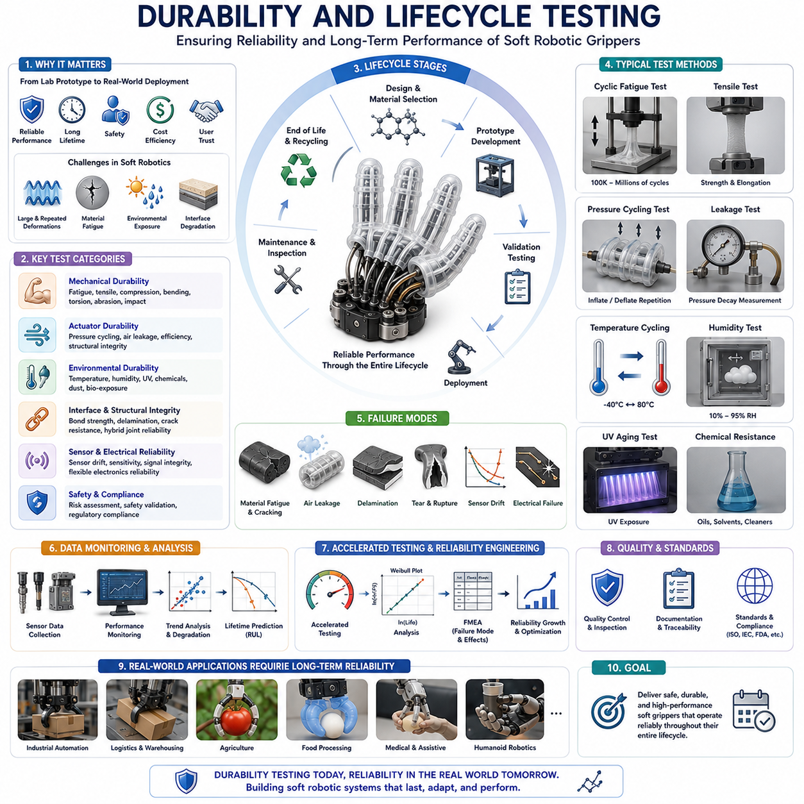{width="7.268055555555556in" height="7.268055555555556in"}

내구성 및 수명주기 시험(Durability and Lifecycle Testing)은 소프트 로봇 그리퍼, 소프트 로봇 핸드, 그리고 고급 매니퓰레이션 시스템 개발 과정에서 가장 중요한 단계 중 하나이다. 액추에이터 설계, 재료 선택, 센서 기술, 제어 알고리즘에 많은 관심이 집중되는 경우가 많지만, 실제로 로봇 시스템의 성공 여부는 장기간의 실제 환경 운용에서도 성능을 유지할 수 있는지에 의해 결정된다. 연구실에서는 우수한 성능을 보이던 소프트 그리퍼도 충분한 내구성 검증이 이루어지지 않으면 산업 현장, 농업 환경, 의료 시설, 물류 센터, 서비스 로봇 환경에서 조기에 고장날 수 있다. 따라서 내구성 시험과 수명주기 시험은 연구용 시제품을 상용 제품으로 발전시키는 핵심 과정이며, 장기간 운용 시에도 안전성과 신뢰성을 확보하기 위한 필수 절차이다.

전통적인 강체 로봇과 달리 소프트 로봇은 작동 과정 자체가 반복적인 변형을 포함한다. 소프트 액추에이터는 지속적으로 늘어나고, 압축되고, 구부러지고, 비틀어지고, 팽창과 수축을 반복한다. 이러한 대변형은 강체 시스템에서는 거의 발생하지 않는 고유한 신뢰성 문제를 유발한다. 재료는 반복 응력을 받으며, 내부 부품은 지속적으로 변형되고, 서로 다른 재료 간 접합부는 반복 하중을 경험하며, 환경 조건은 열화 과정을 가속화할 수 있다. 따라서 소프트 로봇의 내구성 평가는 전통적인 기계 시스템과는 다른 접근 방식이 필요하다.

내구성(Durability)은 시스템이 예상 수명 동안 요구되는 성능을 유지할 수 있는 능력을 의미한다. 여기에는 기계적 강도, 액추에이터 성능, 센서 정확도, 구조 안정성, 환경 저항성, 안전성 등이 포함된다. 수명주기 시험(Lifecycle Testing)은 초기 사용 단계부터 장기간 운용, 환경 노출, 유지보수, 수명 종료 단계까지 전체 사용 기간 동안의 성능 변화를 평가하는 과정이다. 이 두 가지를 통해 시스템의 실제 사용 가능 수명을 예측할 수 있다.

가장 중요한 내구성 평가 방법 중 하나는 반복 피로 시험(Cyclic Fatigue Testing)이다. 피로(Fatigue)는 반복적인 하중이 가해질 때 발생하는 손상 현상이다. 재료에 가해지는 응력이 파괴 강도보다 낮더라도 수많은 반복이 누적되면 미세 균열과 손상이 발생할 수 있다. 시간이 지남에 따라 이러한 손상은 균열, 찢어짐, 박리, 강성 변화, 최종 파손으로 이어질 수 있다. 소프트 로봇에서는 일정한 조건에서 수십만 회에서 수백만 회에 이르는 반복 동작을 수행하며 성능 저하를 측정한다.

엘라스토머(Elastomer)의 피로 특성은 금속과 상당히 다르다. 금속은 균열 생성과 전파가 주요 피로 메커니즘인 반면, 엘라스토머는 응력 연화(Stress Softening), 히스테리시스 변화(Hysteresis Change), 미세구조 손상 축적, 기계적 특성 변화 등이 주요 열화 현상으로 나타난다. 따라서 소프트 로봇에서는 응력-변형률 분석, 동적 기계 분석(Dynamic Mechanical Analysis), 균열 성장 분석, 에너지 소산 분석 등을 활용하여 피로 특성을 평가한다.

시험 조건의 설정 역시 매우 중요하다. 작동 주파수, 변형 크기, 하중 방향, 환경 조건, 운용 패턴 등에 따라 피로 수명이 크게 달라질 수 있다. 물류 로봇은 하루 수천 번의 동작을 수행할 수 있으며, 의료 재활 장치는 전혀 다른 조건에서 사용된다. 따라서 시험은 실제 사용 환경을 반영하여 설계되어야 한다. 또한 개발 기간을 단축하기 위해 가속 수명 시험(Accelerated Lifecycle Testing)이 자주 활용된다.

기계적 내구성 평가는 피로 시험만으로 이루어지지 않는다. 인장 시험(Tensile Test)은 재료의 최대 인장 강도와 파단 연신율을 측정한다. 압축 시험(Compression Test)은 반복 압축에 대한 저항성을 평가한다. 굽힘 시험(Bending Test)은 반복 굽힘에 대한 내구성을 확인한다. 비틀림 시험(Torsion Test)은 회전 하중에 대한 성능을 분석한다. 이러한 시험들은 전체 시스템의 기계적 신뢰성을 평가하는 기초 자료가 된다.

공압 소프트 액추에이터(Pneumatic Soft Actuator)는 별도의 내구성 평가가 필요하다. 공기 챔버는 지속적인 팽창과 수축을 반복하기 때문에 압력 사이클링(Pressure Cycling)에 의한 피로가 발생한다. 따라서 수십만 회 이상의 팽창-수축 시험을 수행하면서 변형 특성, 압력 유지 능력, 효율, 구조 건전성을 측정한다.

공기 누설(Air Leakage)은 공압 소프트 로봇에서 가장 흔한 고장 원인 중 하나이다. 작은 누설이라도 액추에이터 효율을 감소시키고 운동 특성을 변화시키며 에너지 소비를 증가시킨다. 이를 평가하기 위해 압력 유지 시험, 유량 측정, 진공 시험, 열화 분석 등이 수행된다.

유압 소프트 로봇(Hydraulic Soft Robot)의 경우에는 유체 누설, 씰(Seal) 열화, 작동 유체와 재료 간의 화학적 상호작용 등이 추가적인 평가 대상이 된다. 유체가 재료 특성에 영향을 미칠 수 있기 때문에 장기적인 화학적 안정성도 검증해야 한다.

환경 시험(Environmental Testing)은 수명주기 평가의 또 다른 핵심 요소이다. 실제 환경은 연구실과 매우 다르다. 온도 변화, 습도 변화, 자외선, 먼지, 화학 물질, 생물학적 오염 등이 시스템 성능에 영향을 줄 수 있다. 환경 시험은 이러한 요인들이 장기적으로 시스템에 미치는 영향을 분석한다.

온도 시험(Temperature Testing)은 고온 및 저온 환경에서의 성능을 평가한다. 엘라스토머는 온도에 매우 민감하기 때문에 높은 온도에서는 노화가 가속되고, 강성이 감소하며 크리프(Creep)가 증가할 수 있다. 반대로 낮은 온도에서는 강성이 증가하고 유연성이 감소하며 취성(Brittleness)이 나타날 수 있다. 열 사이클 시험(Thermal Cycling Test)은 반복적인 온도 변화를 적용하여 장기 신뢰성을 평가한다.

습도 시험(Humidity Testing)은 농업, 의료, 야외 환경에서 특히 중요하다. 수분 흡수는 재료 특성 변화, 접착력 감소, 센서 성능 저하를 유발할 수 있다. 따라서 다양한 습도 조건에서 장시간 노출 시험을 수행한다.

자외선(UV) 시험은 야외용 소프트 로봇에 매우 중요하다. 장기간 자외선에 노출되면 재료의 변색, 경화, 균열, 탄성 저하가 발생할 수 있다. 이를 평가하기 위해 가속 노화 시험(Accelerated Weathering Test)이 수행된다.

화학 저항성 시험(Chemical Resistance Testing)은 오일, 세정제, 소독제, 농약, 산업용 화학물질과의 접촉에 대한 내성을 평가한다. 일부 화학물질은 엘라스토머를 팽창시키거나 열화시킬 수 있기 때문에 실제 사용 환경을 고려한 평가가 필요하다.

마모 시험(Abrasion Testing)은 반복 접촉으로 인한 표면 마모를 분석한다. 물체와 반복적으로 접촉하는 소프트 그리퍼는 시간이 지남에 따라 표면이 닳고 마찰 특성이 변화할 수 있다. 이는 파지 성능 저하로 이어질 수 있으므로 중요한 평가 항목이다.

충격 시험(Impact Testing)은 예상치 못한 충돌에 대한 저항성을 평가한다. 소프트 로봇은 본질적으로 충격 흡수 능력이 우수하지만 반복적인 충격은 구조 손상을 유발할 수 있다. 낙하 시험(Drop Test), 충돌 시험(Collision Test), 동적 충격 시험(Dynamic Impact Test)이 수행된다.

재료 간 인터페이스(Interface)는 고장이 가장 많이 발생하는 영역 중 하나이다. 소프트 로봇은 종종 엘라스토머, 플라스틱, 금속, 섬유, 전자 부품을 함께 사용한다. 이들 재료는 강성이 크게 다르기 때문에 접합부에서 응력 집중이 발생한다. 반복 하중은 박리(Delamination)와 균열을 유발할 수 있으며, 이를 평가하기 위한 인터페이스 피로 시험이 수행된다.

하이브리드 강체-연성 로봇 핸드는 특히 복잡한 내구성 문제를 가진다. 강체 골격과 연성 구조가 반복 변형을 견뎌야 하므로 접합부의 강도와 장기 신뢰성이 매우 중요하다.

센서 내구성(Sensor Durability)은 최근 더욱 중요해지고 있다. 소프트 로봇은 스트레인 센서, 촉각 센서, 압력 센서, 전자 피부(Electronic Skin)를 포함하는 경우가 많다. 이러한 센서들은 반복 변형에도 정확도를 유지해야 한다. 따라서 감도 변화, 신호 드리프트, 히스테리시스, 보정 안정성을 장기간 평가한다.

유연 전자회로(Flexible Electronics)의 신뢰성도 중요하다. 전도성 패턴, 플렉서블 PCB, 커넥터, 전자 부품은 반복 굽힘과 신장에 의해 손상될 수 있다. 따라서 전기적 신뢰성 시험(Electrical Reliability Testing)을 통해 전도성 유지 여부를 검증한다.

최근에는 머신러닝과 적응형 제어가 포함된 시스템도 증가하고 있다. 하드웨어가 노화되면서 제어 성능이 어떻게 변화하는지 평가하는 것도 수명주기 시험의 중요한 부분이다.

가속 수명 시험은 개발 기간을 크게 단축할 수 있다. 높은 주파수, 높은 온도, 큰 변형, 가혹한 환경 조건을 적용하여 수년간의 사용을 단기간에 모사한다. 이를 통해 잠재적인 고장 모드를 빠르게 발견할 수 있다.

신뢰성 공학(Reliability Engineering) 기법도 널리 사용된다. 와이블 분석(Weibull Analysis), 고장 형태 및 영향 분석(FMEA), 신뢰성 성장 모델(Reliability Growth Model)을 이용하여 수명을 예측하고 주요 고장 원인을 파악한다.

디지털 트윈(Digital Twin)은 최근 매우 중요한 도구로 떠오르고 있다. 디지털 트윈은 실제 시스템의 가상 모델로서 실시간 데이터를 활용하여 열화 상태를 추정하고 잔여 수명(Remaining Useful Life)을 예측할 수 있다. 이는 예지 정비(Predictive Maintenance)를 가능하게 한다.

유지보수성(Maintainability) 역시 수명주기 설계의 중요한 요소이다. 내구성이 높은 시스템일수록 유지보수가 용이해야 한다. 교체 가능한 멤브레인, 모듈형 액추에이터, 접근 가능한 센서 구조는 장기 운용 비용을 감소시킨다.

수명주기 시험은 규제 인증(Regulatory Certification)에도 필수적이다. 의료기기, 협동 로봇, 산업 자동화 장비는 일정 수준 이상의 신뢰성을 입증해야 한다. 따라서 표준화된 내구성 시험과 문서화가 요구된다.

최근에는 지속 가능성(Sustainability)도 중요해지고 있다. 수명이 긴 제품은 폐기물을 줄이고 자원 소비를 감소시킨다. 또한 재활용 가능한 재료와 생분해성 엘라스토머를 사용하는 연구도 활발히 진행되고 있다.

인공지능은 내구성 평가에도 활용되고 있다. 머신러닝은 센서 데이터를 분석하여 열화 징후를 조기에 발견하고 고장을 예측할 수 있다. 미래에는 AI, 디지털 트윈, 실제 시험 데이터가 통합된 지능형 수명 관리 시스템이 등장할 것으로 예상된다.

향후 소프트 로봇은 자가 진단(Self-Monitoring)과 자가 치유(Self-Healing) 기능을 갖추게 될 가능성이 높다. 내장 센서가 구조 상태를 지속적으로 감시하고, 자가 치유 재료가 미세 균열을 자동으로 복구함으로써 수명을 크게 연장할 수 있을 것이다.

결론적으로 내구성 및 수명주기 시험은 소프트 로보틱스의 신뢰성과 상용화를 결정하는 핵심 기술이다. 아무리 혁신적인 소프트 그리퍼라도 장기간 안정적으로 동작하지 못한다면 실제 가치가 없다. 내구성 시험은 연구용 시제품을 산업용 제품으로 발전시키는 필수 과정이며, 향후 소프트 로봇 핸드, 휴머노이드 로봇, 물리 AI 플랫폼, 차세대 지능형 매니퓰레이션 시스템의 성공을 좌우하는 중요한 요소가 될 것이다.

## 04.11 Industrial Applications of Soft Grippers

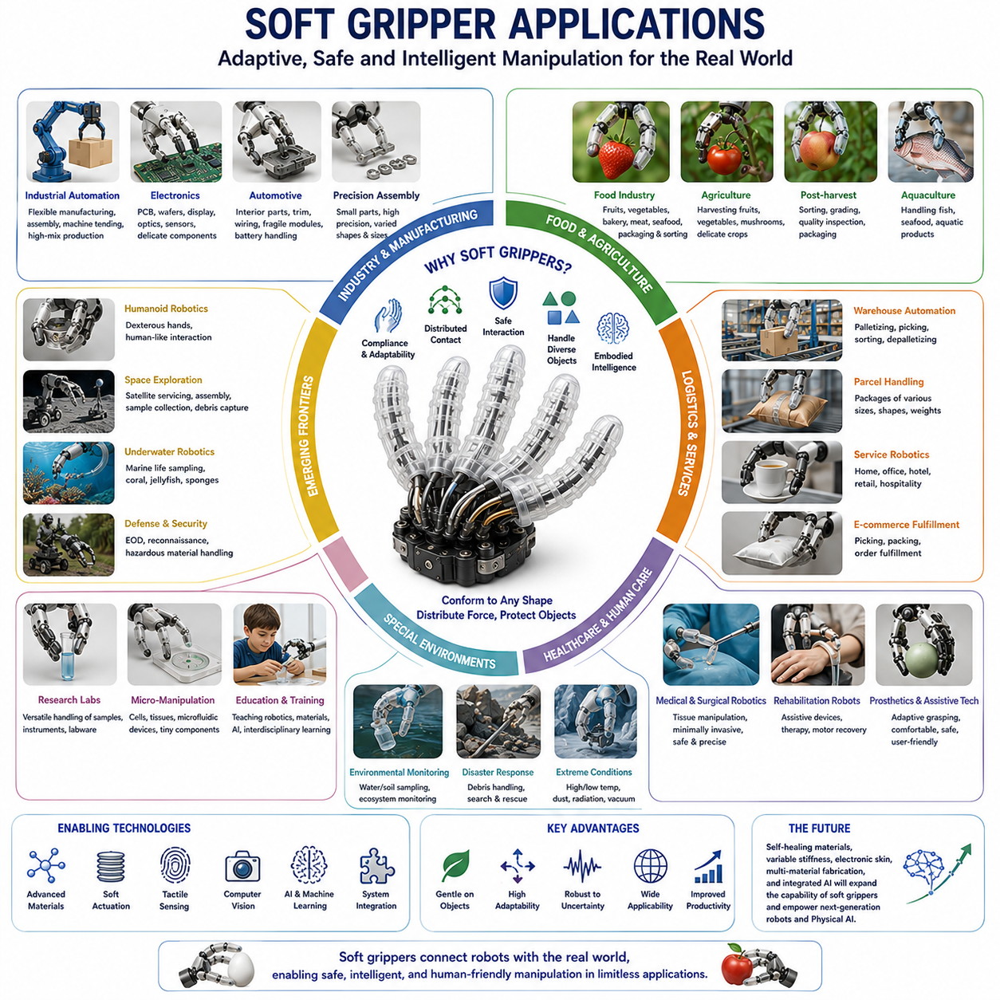{width="7.268055555555556in" height="7.268055555555556in"}

소프트 그리퍼 응용 분야(Soft Gripper Applications)는 현대 로봇공학에서 가장 빠르게 성장하고 있는 분야 중 하나이다. 이는 기존의 강체 로봇 그리퍼가 수십 년 동안 해결하기 어려웠던 문제, 즉 깨지기 쉽고, 변형 가능하며, 형상이 불규칙하거나 지속적으로 변화하는 물체를 안정적으로 다루는 문제를 해결할 수 있기 때문이다. 전통적인 강체 그리퍼는 구조화된 산업 환경에서는 매우 높은 성능을 보여 왔지만, 식품, 농산물, 의료 재료, 생체 조직, 생활용품과 같이 민감하고 다양한 형상을 가진 물체를 다룰 때는 한계를 드러냈다. 소프트 그리퍼는 순응성(Compliance), 적응성(Adaptability), 분산 접촉(Distributed Contact), 재료 기반 지능(Material Intelligence)을 활용하여 이러한 문제를 해결한다. 그 결과 연구실 수준의 기술이었던 소프트 그리퍼는 현재 제조업, 물류, 농업, 의료, 식품 산업, 서비스 로봇, 수중 탐사, 우주 탐사, 그리고 물리 AI(Physical AI) 시스템에 이르기까지 다양한 분야에서 실제 활용되고 있다.

소프트 그리퍼의 가장 큰 장점은 물체의 형상에 자연스럽게 적응할 수 있다는 점이다. 강체 그리퍼는 정확한 위치 제어와 제한된 접촉점에 의존하지만, 소프트 그리퍼는 물체 표면을 감싸며 변형되어 넓은 접촉 면적을 형성한다. 이로 인해 힘이 균일하게 분산되고 파지 안정성이 향상된다. 또한 복잡한 센서와 정교한 파지 계획 없이도 다양한 물체를 안정적으로 잡을 수 있다. 이러한 특성은 체화 지능(Embodied Intelligence)의 대표적인 사례로 평가된다.

산업 자동화(Industrial Automation)는 소프트 그리퍼가 가장 활발하게 적용되는 분야 중 하나이다. 현대 제조업은 다양한 형태와 재질의 제품을 생산하며, 생산 라인은 자주 변경된다. 기존 강체 그리퍼는 특정 제품에 최적화된 설계가 필요하지만, 소프트 그리퍼는 다양한 제품을 하나의 구조로 처리할 수 있다. 따라서 다품종 소량 생산(High-Mix Low-Volume Manufacturing) 환경에서 매우 높은 유연성을 제공한다.

전자 산업(Electronics Manufacturing)에서도 소프트 그리퍼의 중요성이 증가하고 있다. 반도체 웨이퍼, PCB, 디스플레이 패널, 광학 부품, 정밀 센서와 같은 제품은 매우 민감하며 작은 충격에도 손상될 수 있다. 소프트 그리퍼는 접촉 압력을 넓게 분산시키기 때문에 부품 손상 가능성을 줄일 수 있으며, 미세한 위치 오차가 있더라도 안정적인 파지가 가능하다. 전자 제품이 더욱 소형화되고 고정밀화됨에 따라 이러한 수요는 지속적으로 증가할 것으로 예상된다.

식품 산업(Food Industry)은 소프트 그리퍼가 상업적으로 가장 성공적으로 적용된 분야 중 하나이다. 식품은 형태, 질감, 수분 함량, 강도가 매우 다양하다. 강체 그리퍼는 과일이나 빵과 같은 제품을 쉽게 손상시킬 수 있지만, 소프트 그리퍼는 물체를 감싸면서 힘을 분산시켜 손상을 최소화한다. 현재 과일, 채소, 제과류, 육류, 수산물, 냉동식품 등의 포장과 분류 공정에 널리 사용되고 있다. 위생 요구사항을 충족하면서도 제품 품질을 유지할 수 있다는 점이 큰 장점이다.

농업 로봇(Agricultural Robotics)은 또 다른 핵심 응용 분야이다. 농산물은 크기, 모양, 색상, 숙성도, 위치가 모두 다르며, 쉽게 손상될 수 있다. 소프트 그리퍼는 이러한 다양성에 자연스럽게 적응하면서도 필요한 만큼의 힘만 가할 수 있다. 딸기, 토마토, 오이, 사과, 복숭아, 포도, 버섯 등 다양한 농산물 수확에 성공적으로 적용되고 있다. 농업 분야의 인력 부족 문제가 심화됨에 따라 자동 수확 로봇에 대한 수요는 더욱 증가할 것으로 전망된다.

수확 이후의 선별(Sorting), 등급 분류(Grading), 포장(Packaging) 과정에서도 소프트 그리퍼는 중요한 역할을 한다. 제품을 손상시키지 않으면서도 높은 처리량을 유지할 수 있으며, 비전 시스템과 결합하여 크기, 색상, 숙성도, 품질을 동시에 평가할 수 있다.

물류 자동화(Logistics Automation)는 소프트 그리퍼가 급속히 확산되고 있는 분야이다. 전자상거래 물류센터는 수백만 종류의 상품을 처리해야 한다. 기존 자동화 시스템은 제품별 맞춤형 그리퍼와 복잡한 프로그래밍이 필요했지만, 소프트 그리퍼는 다양한 물체를 동일한 구조로 파지할 수 있다. 컴퓨터 비전과 AI 기술이 결합되면서 자동 피킹(Picking), 분류(Sorting), 포장(Packing), 주문 처리(Order Fulfillment) 작업의 효율성이 크게 향상되고 있다.

택배 및 패키지 처리(Parcel Handling) 역시 중요한 응용 분야이다. 택배 상자는 크기와 무게, 재질이 모두 다르며 강성이 일정하지 않다. 소프트 그리퍼는 이러한 차이에 적응하면서도 물품 손상을 최소화할 수 있다. 따라서 물류 자동화 시스템에서 작업 성공률을 높이고 인력 의존도를 줄일 수 있다.

의료 및 헬스케어 로봇(Medical and Healthcare Robotics)은 소프트 로보틱스가 가진 안전성 덕분에 빠르게 성장하고 있는 분야이다. 의료 환경에서는 환자와 직접 접촉하는 경우가 많기 때문에 안전이 가장 중요하다. 소프트 그리퍼는 인체 조직과 유사한 유연성을 가지고 있어 부상을 최소화할 수 있다.

재활 로봇(Rehabilitation Robot)은 환자의 손 움직임을 보조하거나 재활 운동을 지원하기 위해 소프트 구조를 사용한다. 이러한 시스템은 착용감이 우수하며 사용자의 신체에 자연스럽게 적응할 수 있다. 또한 장애인과 고령자를 위한 보조 장치에도 활용되고 있다.

수술 로봇(Surgical Robotics)에서도 소프트 그리퍼의 중요성이 증가하고 있다. 인체 조직은 매우 연약하며 과도한 힘은 조직 손상을 초래할 수 있다. 소프트 수술 기구는 장기, 혈관, 조직을 보다 안전하게 다룰 수 있으며, 수술 중 예기치 않은 손상을 줄일 수 있다.

의료 검사실 자동화(Medical Laboratory Automation) 역시 중요한 응용 분야이다. 시험관, 조직 샘플, 배양 용기, 진단 키트 등은 조심스럽게 다루어야 한다. 소프트 그리퍼는 오염 위험을 줄이면서 안정적인 조작을 제공한다.

의수(Prosthetic Hand)와 보조공학(Assistive Technology)은 인간 중심 응용 분야 중 가장 중요한 영역이다. 기존 의수는 힘은 강하지만 섬세한 작업이 어려운 경우가 많다. 소프트 그리퍼 기반 의수는 보다 자연스러운 물체 조작을 가능하게 하며 사용자 안전성과 편의성을 향상시킨다.

서비스 로봇(Service Robotics)은 가정, 병원, 호텔, 사무실 등에서 사람과 함께 작업해야 한다. 접시, 컵, 의류, 식품, 전자제품과 같은 다양한 물체를 안전하게 다루기 위해서는 소프트 그리퍼가 매우 유리하다. 복잡한 프로그래밍 없이도 다양한 상황에 적응할 수 있기 때문이다.

휴머노이드 로봇(Humanoid Robot)은 소프트 그리퍼 연구를 가장 강하게 이끄는 분야 중 하나이다. 인간 환경은 인간의 손을 기준으로 설계되어 있다. 따라서 휴머노이드 로봇도 인간과 유사한 적응성과 조작 능력을 가져야 한다. 소프트 그리퍼와 하이브리드 강체-연성 핸드는 이러한 요구를 충족할 수 있는 가장 유망한 기술로 평가받고 있다.

수중 로봇(Underwater Robotics)은 특별한 조작 문제를 가진 분야이다. 바다 생물은 매우 연약하며 강체 그리퍼로는 쉽게 손상될 수 있다. 소프트 그리퍼는 산호, 해파리, 해삼, 불가사리, 해면동물과 같은 해양 생물을 손상 없이 채집할 수 있어 해양 생물학 연구에 큰 기여를 하고 있다.

환경 모니터링(Environmental Monitoring)과 생태 보전(Ecosystem Conservation) 분야에서도 소프트 그리퍼는 중요한 역할을 한다. 자연 환경에 대한 영향을 최소화하면서 생물 샘플을 채취하고 환경 데이터를 수집할 수 있기 때문이다.

우주 탐사(Space Exploration)는 최근 새롭게 주목받고 있는 응용 분야이다. 우주에서는 다양한 형태의 물체를 예측하기 어렵고, 충돌 위험도 존재한다. 소프트 그리퍼는 불규칙한 표면에 적응하고 충격을 흡수할 수 있기 때문에 위성 정비, 우주 구조물 조립, 샘플 채취, 우주 쓰레기 수거 등에 적합하다.

국방 및 보안(Defense and Security) 분야에서도 활용 가능성이 연구되고 있다. 폭발물 처리 로봇, 정찰 로봇, 위험 물질 취급 시스템은 예측 불가능한 물체를 다루어야 한다. 소프트 그리퍼는 물체 손상을 줄이고 안전성을 높일 수 있다.

연구소와 대학 실험실에서는 다양한 형태의 시료와 장비를 다루어야 한다. 소프트 그리퍼는 특별한 설계 변경 없이도 다양한 작업을 수행할 수 있기 때문에 연구 환경에서 매우 유용하다.

교육(Education) 분야에서도 소프트 그리퍼는 중요한 학습 도구가 되고 있다. 학생들은 소프트 로보틱스를 통해 재료공학, 기계공학, 전자공학, 인공지능, 생체모방공학의 융합 개념을 학습할 수 있다.

마이크로 매니퓰레이션(Micro-Manipulation)과 바이오엔지니어링(Bioengineering) 분야에서는 세포, 조직, 마이크로 유체 장치와 같은 초소형 구조를 다루기 위해 소프트 그리퍼가 사용된다. 이러한 응용은 조직공학, 재생의학, 제약 연구에서 매우 중요하다.

최근 소프트 그리퍼는 물리 AI(Physical AI)의 핵심 요소로 주목받고 있다. 물리 AI는 인식, 추론, 계획, 물리적 상호작용을 하나의 시스템으로 통합하는 것을 목표로 한다. 실제 세계는 불확실성과 다양성으로 가득 차 있기 때문에 단순한 계산만으로는 완벽한 조작이 어렵다. 소프트 그리퍼는 이러한 불확실성을 물리적 순응성으로 흡수함으로써 AI의 부담을 줄여준다. 즉, 기계적 적응성과 인공지능이 서로 보완하는 구조를 형성한다.

최근 강화학습(Reinforcement Learning), 딥러닝(Deep Learning), 비전 기반 조작(Vision-Based Manipulation), 파운데이션 모델(Foundation Model)이 발전하면서 소프트 그리퍼의 활용 범위는 더욱 넓어지고 있다. 로봇은 경험을 통해 최적의 파지 전략을 학습하고, 다양한 환경에서도 안정적으로 물체를 조작할 수 있게 되고 있다.

미래에는 자가 치유 재료(Self-Healing Material), 가변 강성 기술(Variable Stiffness Technology), 전자 피부(Electronic Skin), 다중 재료 제조(Multi-Material Manufacturing), 통합 AI 제어 기술이 발전하면서 소프트 그리퍼의 성능은 더욱 향상될 것이다.

결론적으로 소프트 그리퍼는 단순한 로봇 손이 아니라 다양한 산업과 인간 생활을 연결하는 핵심 기술이다. 농업에서 딸기를 수확하고, 공장에서 전자부품을 조립하며, 병원에서 환자를 돕고, 바다와 우주를 탐사하는 모든 과정에서 활용될 수 있다. 이러한 특성 덕분에 소프트 그리퍼는 차세대 로봇 핸드, 휴머노이드 로봇, 자율 시스템, 물리 AI 플랫폼의 핵심 구성 요소로 자리매김하고 있으며, 미래 로봇 기술 발전의 중요한 축이 될 것으로 전망된다.
