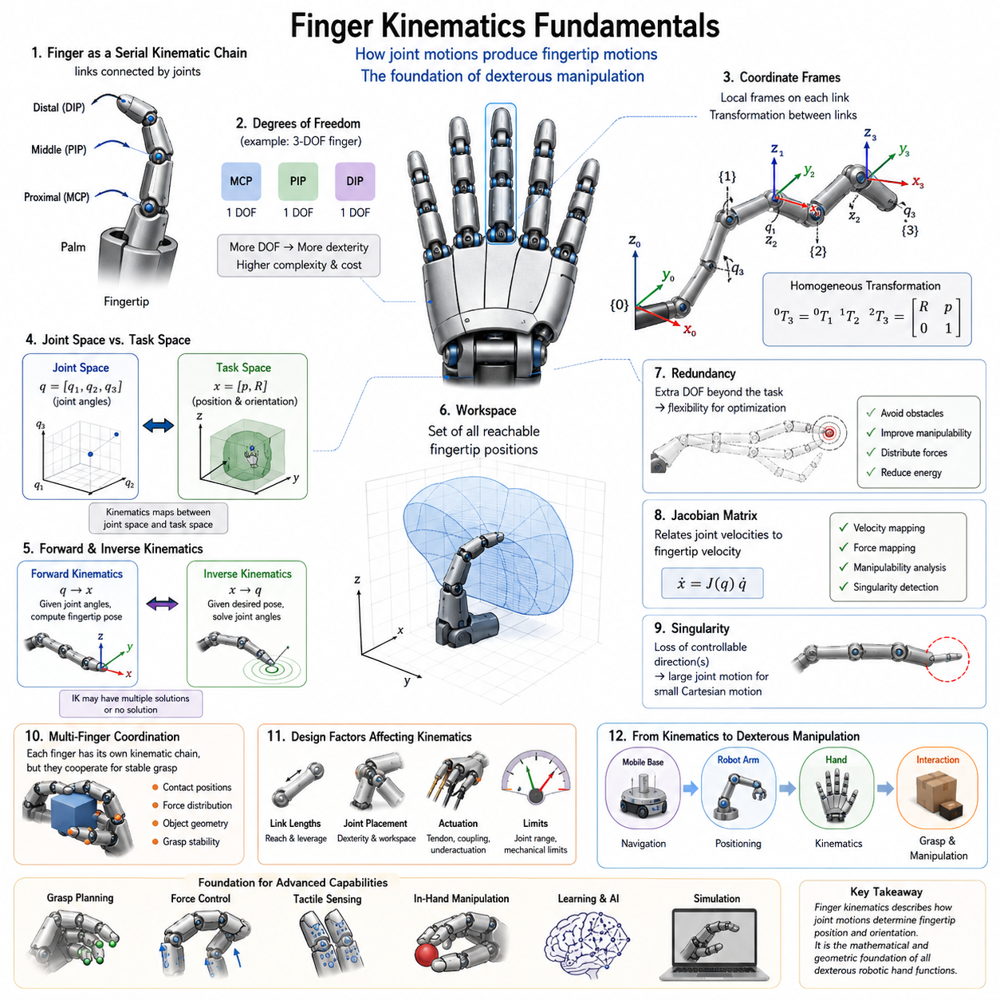
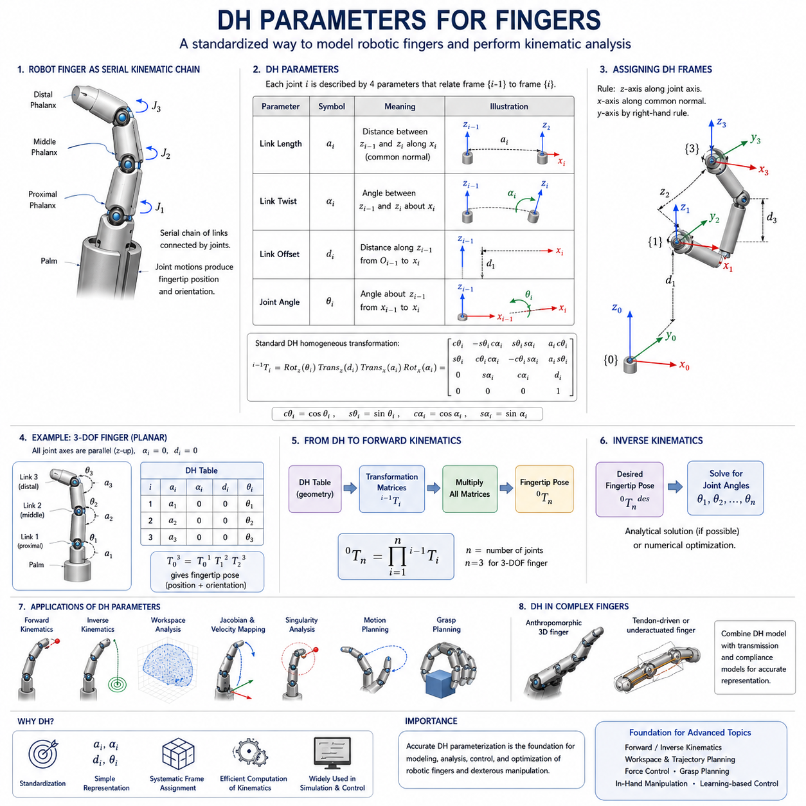
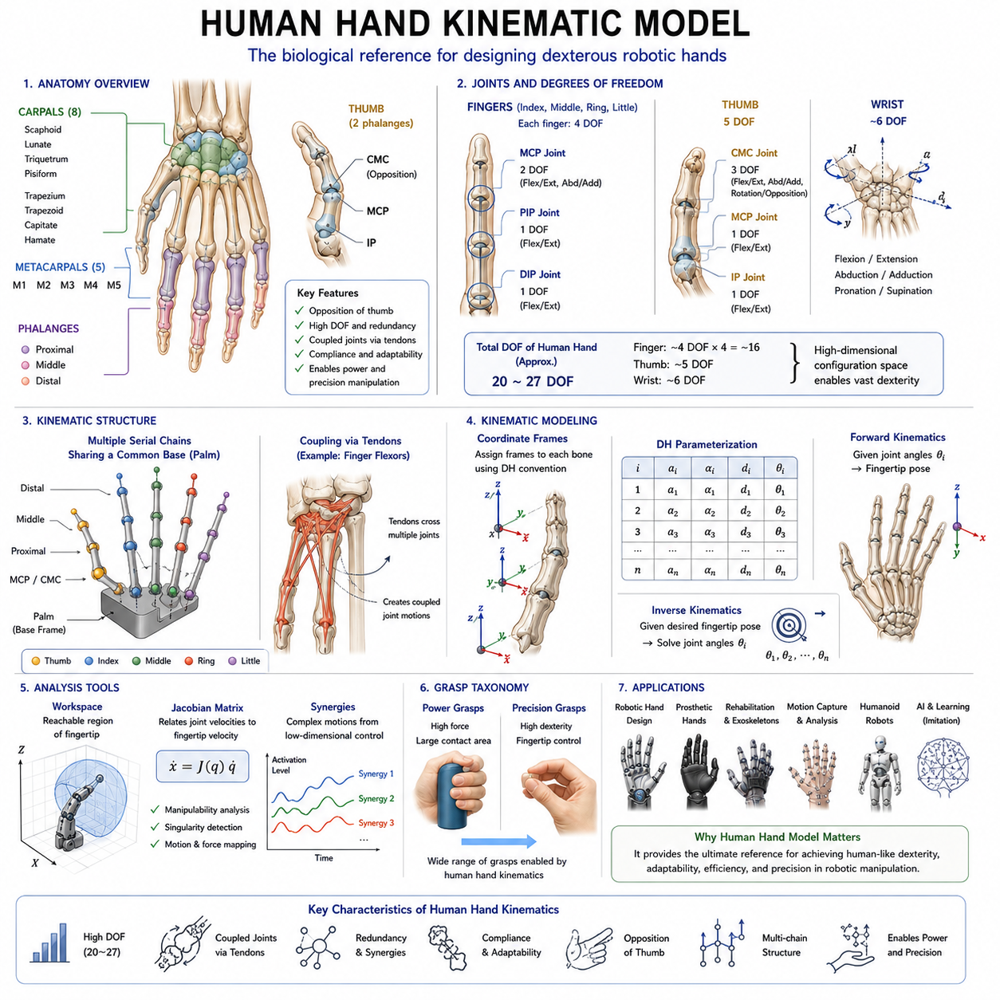
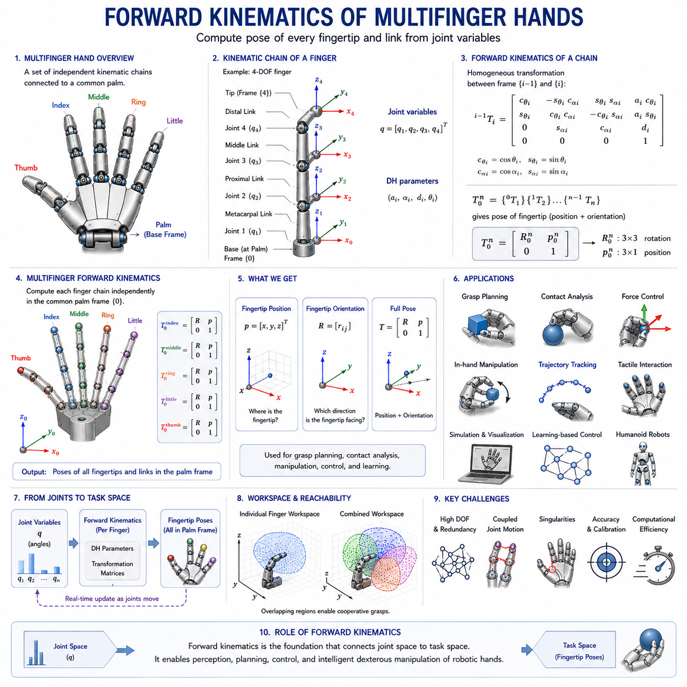
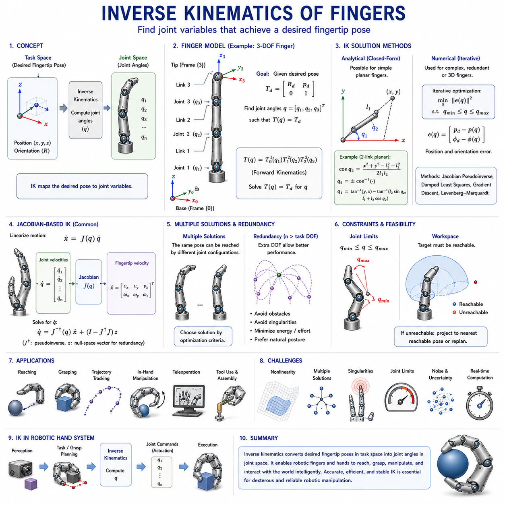
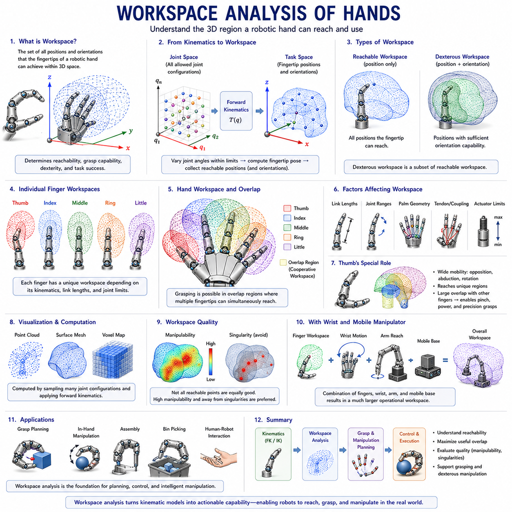
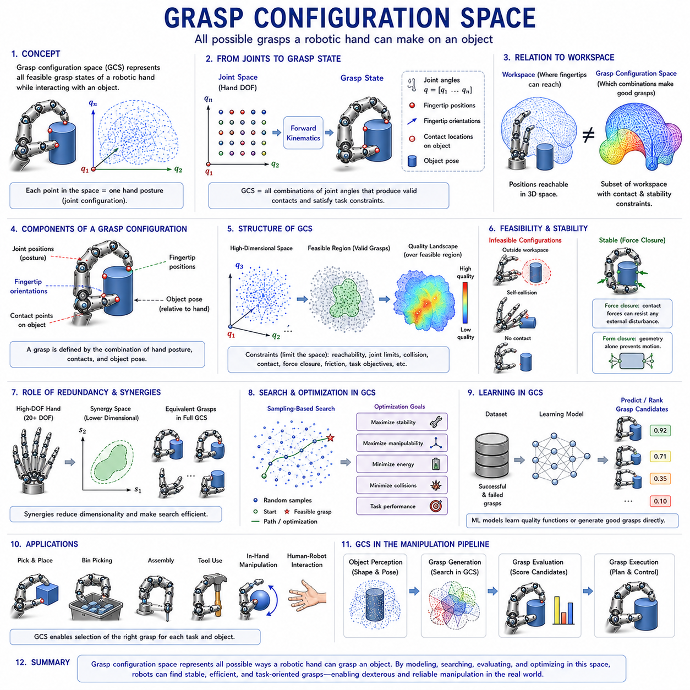
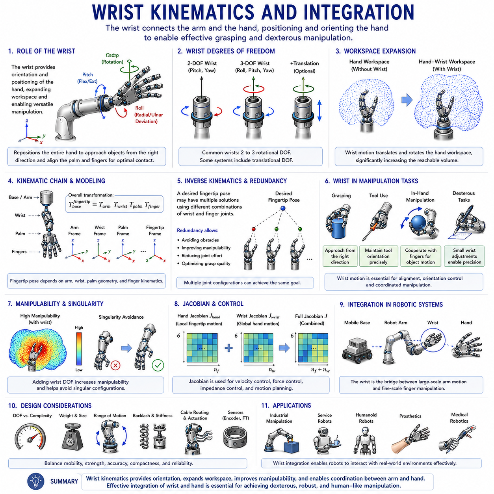
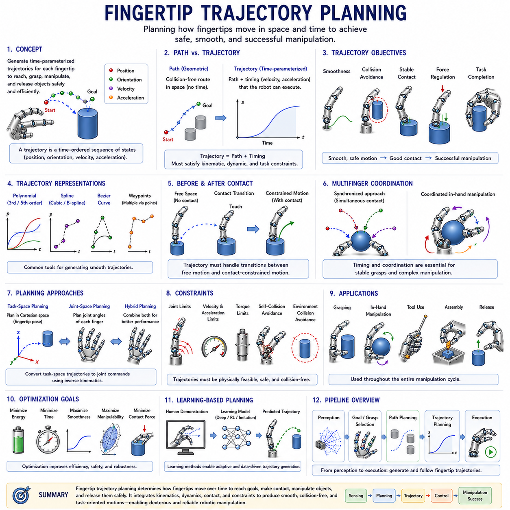
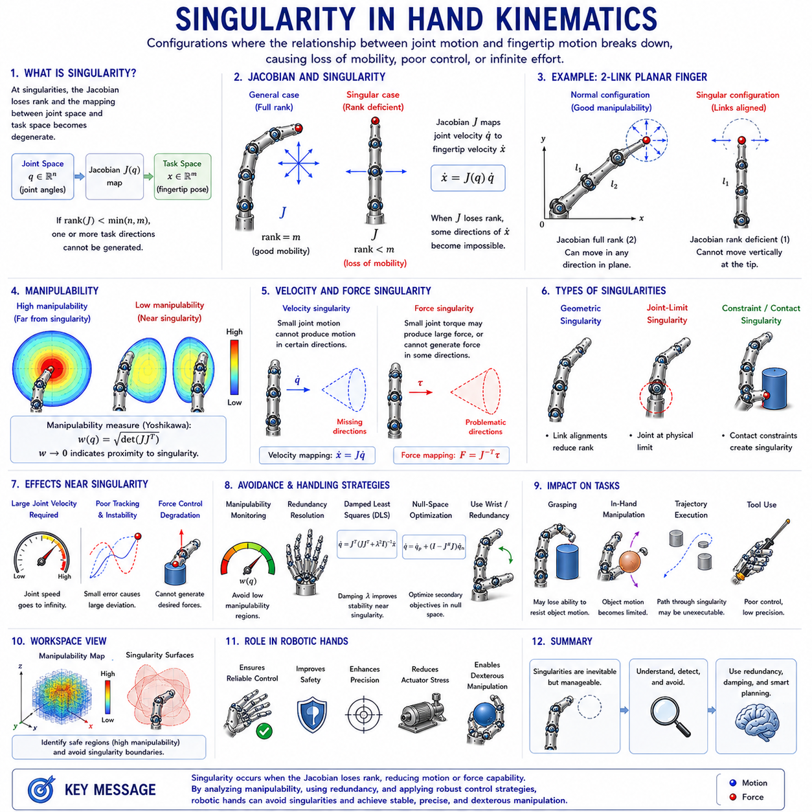

**Volume 06 Robot Hands and Dexterous Grasping**


# 05. Finger and Hand Kinematics

##  

## 05.01 Finger Kinematics Fundamentals

{width="7.268055555555556in" height="7.268055555555556in"}

Finger kinematics is one of the most fundamental topics in robot hand engineering because it provides the mathematical and geometric framework that describes how robotic fingers move, interact with objects, and generate dexterous manipulation capabilities. Within the broader field of robot hand and dexterous grasping systems, kinematics serves as the bridge between mechanical design and intelligent manipulation. Before a robot can grasp, manipulate, rotate, reposition, or assemble objects, it must first understand how the motion of each joint contributes to the motion of the fingertip and the overall hand structure. For this reason, finger kinematics forms the foundation upon which grasp planning, force control, tactile sensing, in-hand manipulation, and learning-based dexterous behaviors are built. This chapter corresponds to the first foundational topic within the Finger and Hand Kinematics section of the Robot Hand and Dexterous Grasping volume and establishes the mathematical concepts required for all subsequent chapters dealing with forward kinematics, inverse kinematics, workspace analysis, fingertip trajectory planning, and grasp configuration spaces.

A robotic finger can be viewed as a serial kinematic chain composed of rigid links connected by joints. This structure is analogous to a robot arm, but it is generally more compact and operates within a constrained workspace near the palm. Each finger consists of multiple segments that are connected through rotational or, less commonly, translational joints. When these joints move, the position and orientation of the fingertip change accordingly. The primary objective of finger kinematics is to determine the relationship between joint motions and fingertip motions. By understanding this relationship, engineers can predict how a finger will move, determine whether it can reach a desired contact location, and calculate the joint commands required to achieve a particular grasp posture.

The study of finger kinematics begins with the concept of degrees of freedom. Degrees of freedom represent the number of independent variables required to describe the configuration of a mechanical system. Human fingers provide an excellent biological reference because they exhibit a sophisticated combination of joints that enable highly versatile motions. A typical human finger consists of the metacarpophalangeal joint, proximal interphalangeal joint, and distal interphalangeal joint. Together these joints create multiple degrees of freedom that allow bending, extension, and limited lateral motion. Robotic fingers often simplify this structure while preserving essential functional capabilities. Some industrial grippers may contain only a single degree of freedom, whereas advanced dexterous robotic hands may contain three, four, or even more degrees of freedom per finger. The number of degrees of freedom directly influences dexterity, controllability, complexity, and cost.

Kinematic analysis requires the definition of coordinate systems. Every link in a robotic finger is assigned a local reference frame that describes its position and orientation relative to adjacent links. These coordinate frames provide a systematic method for representing motion mathematically. The selection of coordinate systems is crucial because all subsequent calculations depend on the consistency and accuracy of these reference definitions. Coordinate frames are typically attached at joint locations, allowing transformations between neighboring links to be expressed through rotation and translation matrices. Through the use of homogeneous transformations, multiple joint motions can be combined into a single mathematical representation that describes the position and orientation of the fingertip relative to the palm.

One of the most important concepts in finger kinematics is the distinction between joint space and task space. Joint space refers to the set of joint variables that define the configuration of the finger. These variables typically include joint angles for revolute joints and linear displacements for prismatic joints. Task space, on the other hand, refers to the physical space in which the fingertip operates. A finger controller may receive commands expressed in task space, such as moving a fingertip to a specific position on an object surface. The kinematic model is responsible for translating these task-space objectives into joint-space commands. Understanding the relationship between these two spaces is fundamental for grasp planning and manipulation control.

Finger kinematics can be analyzed using either planar or spatial models. Planar kinematic models assume that all finger motion occurs within a two-dimensional plane. These models are frequently used for educational purposes and preliminary design analysis because they simplify mathematical derivations while preserving the essential principles of kinematic behavior. Spatial kinematic models represent the full three-dimensional motion of robotic fingers and are necessary for practical dexterous manipulation applications. Real-world robot hands operate in three-dimensional environments where object interactions require complex orientations and coordinated finger movements.

The motion of a robotic finger is generated through a sequence of joint rotations. Each joint contributes to the final fingertip position through a cumulative process. The proximal joint affects the motion of all downstream links, while distal joints influence only the links located beyond them. This hierarchical relationship creates a nonlinear mapping between joint variables and fingertip positions. Small changes in proximal joints can produce large changes in fingertip locations, whereas equivalent changes in distal joints may have more localized effects. Understanding these motion propagation characteristics is essential for efficient finger design and control system development.

Forward kinematics is one of the primary objectives of kinematic analysis. In forward kinematics, the joint variables are known, and the goal is to determine the resulting position and orientation of the fingertip. This process involves multiplying a sequence of transformation matrices corresponding to each joint and link. The resulting transformation provides a complete description of fingertip pose relative to the base frame. Forward kinematics is computationally efficient and serves as the foundation for simulation, visualization, collision detection, and control verification. Every robotic hand control system relies on forward kinematics to estimate fingertip locations during operation.

Inverse kinematics addresses the opposite problem. Given a desired fingertip position and orientation, the objective is to calculate the required joint angles. Unlike forward kinematics, inverse kinematics often involves multiple possible solutions or, in some cases, no feasible solution at all. This complexity arises because robotic fingers may possess redundant degrees of freedom or operate within constrained workspaces. Inverse kinematics plays a critical role in grasp synthesis, object manipulation, and trajectory generation because it enables task-level commands to be translated into executable motor actions.

The workspace of a robotic finger represents the set of all reachable fingertip positions. Workspace analysis provides insight into the capabilities and limitations of a finger design. The shape and size of the workspace depend on link lengths, joint ranges, mechanical constraints, and palm geometry. A larger workspace generally provides greater flexibility for object interaction, while a carefully optimized workspace may improve precision and force generation for specific tasks. Engineers frequently evaluate workspaces during the design phase to ensure compatibility with intended applications such as assembly, service robotics, warehouse manipulation, or humanoid interaction.

Another critical aspect of finger kinematics is redundancy. A finger is considered kinematically redundant when it possesses more degrees of freedom than are strictly necessary to achieve a task. Redundancy provides additional flexibility for avoiding obstacles, optimizing grasp quality, minimizing energy consumption, and distributing contact forces. Human fingers naturally exhibit redundancy, allowing multiple joint configurations to achieve similar fingertip positions. Robotic systems can exploit redundancy through optimization algorithms that select the most desirable configuration among many feasible alternatives.

Finger kinematics becomes increasingly complex when multiple fingers are considered simultaneously. In a dexterous robotic hand, each finger has its own kinematic chain, yet all fingers must coordinate to achieve stable grasps and manipulation tasks. Multi-finger coordination introduces additional constraints related to object geometry, contact locations, and force distribution. The combined kinematic structure of a robotic hand can be viewed as a collection of interconnected serial chains sharing a common palm reference frame. Understanding individual finger kinematics is therefore a prerequisite for analyzing full-hand behavior.

The kinematic structure of robotic fingers is closely related to mechanical design choices. Link lengths determine reachability and leverage characteristics. Joint placement affects dexterity and workspace coverage. Tendon-driven mechanisms introduce coupling effects that alter the relationship between actuator motion and joint motion. Underactuated fingers further complicate kinematic analysis because not all joints are independently controlled. In such systems, mechanical compliance and environmental interactions influence the final finger configuration. As a result, kinematic modeling often requires integration with mechanical and dynamic analyses.

Human-inspired robotic fingers provide valuable insights into kinematic design. The human hand represents one of the most sophisticated manipulation systems found in nature. Its ability to perform precision grasping, power grasping, tool use, and delicate object manipulation has inspired generations of robotic hand researchers. Human finger kinematics includes coupled joint motions, tendon-driven actuation, and highly coordinated multi-finger behavior. By studying these biological mechanisms, engineers can develop robotic fingers that achieve higher levels of dexterity while maintaining manageable mechanical complexity.

The concept of fingertip pose extends beyond simple position representation. In many manipulation tasks, the orientation of the fingertip is equally important. For example, inserting a connector, turning a key, manipulating a screwdriver, or handling laboratory equipment requires precise control of both position and orientation. Kinematic models therefore represent fingertip pose using position vectors combined with orientation descriptions such as rotation matrices, Euler angles, quaternions, or axis-angle representations. These mathematical tools provide the foundation for advanced manipulation planning and control.

Singularities represent another important topic within finger kinematics. A singularity occurs when the kinematic structure loses one or more controllable motion directions. Near singular configurations, small fingertip motions may require disproportionately large joint motions, resulting in reduced controllability and numerical instability. Identifying and avoiding singularities is essential for reliable robotic hand operation. Many grasp planners and trajectory generators incorporate singularity avoidance strategies to ensure smooth and predictable finger behavior.

The Jacobian matrix plays a central role in modern finger kinematics. The Jacobian establishes a direct relationship between joint velocities and fingertip velocities. Through the Jacobian, engineers can analyze velocity propagation, force transmission, manipulability, and singularity conditions. The Jacobian also serves as the foundation for many control algorithms used in robotic hands, including impedance control, force control, and operational space control. Because grasping and manipulation involve continuous interactions with objects, real-time Jacobian calculations are frequently required during execution.

Kinematic modeling is not limited to analytical approaches. Numerical methods and simulation tools have become increasingly important as robotic hands grow more sophisticated. Modern robot simulation environments allow engineers to visualize finger motion, evaluate workspace coverage, analyze grasp configurations, and test manipulation strategies before constructing physical prototypes. Software frameworks integrated with robotic middleware enable seamless transitions from simulation to real-world deployment. Consequently, kinematic models serve as the digital foundation for both design optimization and operational control.

In the broader context of mobile manipulators and embodied intelligence systems, finger kinematics forms the final stage of motion generation. Mobile platforms navigate through environments, robotic arms position the hand near target objects, and finger kinematics determines the precise contact interactions required for grasp execution. This hierarchical relationship highlights why finger kinematics remains indispensable despite advances in artificial intelligence, reinforcement learning, and foundation models. Regardless of how intelligent a robot becomes, physical interaction with the world ultimately depends on the geometric and mechanical principles governing finger motion.

As robotic systems continue to evolve toward human-level dexterity, the importance of finger kinematics will only increase. Future robotic hands will incorporate larger numbers of degrees of freedom, advanced tactile sensing systems, adaptive compliance mechanisms, and AI-driven manipulation strategies. Yet all of these technologies depend upon a rigorous understanding of how finger structures move and interact with the environment. Finger kinematics therefore represents not merely a theoretical subject but a practical engineering discipline that underpins every aspect of dexterous robotic manipulation. It provides the mathematical language through which mechanical structures, control algorithms, sensing systems, and intelligent behaviors are integrated into a unified robotic hand capable of performing complex tasks in unstructured environments. Through the study of finger kinematics fundamentals, engineers gain the essential knowledge required to design, analyze, control, and optimize the next generation of robot hands and dexterous manipulation systems.

손가락 운동학(Finger Kinematics)은 로봇 핸드(Robot Hand) 공학에서 가장 기본적이고 중요한 주제 중 하나이다. 이는 로봇 손가락이 어떻게 움직이고, 물체와 어떻게 상호작용하며, 정교한 조작(Dexterous Manipulation)을 어떻게 수행하는지를 설명하는 수학적·기하학적 기반을 제공하기 때문이다. 로봇 핸드 및 정교한 그리핑(Dexterous Grasping) 분야 전체에서 운동학은 기계 설계(Mechanical Design)와 지능형 조작(Intelligent Manipulation)을 연결하는 핵심 역할을 수행한다. 로봇이 물체를 잡고, 회전시키고, 재배치하거나 조립하기 위해서는 먼저 각 관절(Joint)의 움직임이 손끝(Fingertip)의 움직임에 어떤 영향을 미치는지 이해해야 한다. 따라서 손가락 운동학은 그립 계획(Grasp Planning), 힘 제어(Force Control), 촉각 센싱(Tactile Sensing), 손 안 조작(In-Hand Manipulation), 학습 기반 조작(Learning-Based Manipulation)의 기초가 된다. 본 장은 Robot Hand and Dexterous Grasping 볼륨의 Finger and Hand Kinematics 파트의 첫 번째 핵심 장으로서 이후의 순기구학(Forward Kinematics), 역기구학(Inverse Kinematics), 작업공간 분석(Workspace Analysis), 손끝 궤적 계획(Fingertip Trajectory Planning), 그리고 그립 구성 공간(Grasp Configuration Space)에 필요한 기초 개념을 제공한다.

로봇 손가락은 일반적으로 강체 링크(Rigid Link)와 관절(Joint)로 구성된 직렬 운동학 체인(Serial Kinematic Chain)으로 표현된다. 이러한 구조는 로봇 팔(Robot Arm)과 매우 유사하지만 크기가 훨씬 작고 손바닥(Palm) 주변의 제한된 공간에서 동작한다는 차이가 있다. 손가락은 여러 개의 링크와 관절로 구성되며, 관절이 회전하거나 이동함에 따라 손끝의 위치와 방향이 변화한다. 손가락 운동학의 가장 중요한 목적은 관절 운동과 손끝 운동 사이의 관계를 수학적으로 정의하는 것이다. 이를 통해 설계자는 손가락이 어떻게 움직이는지 예측하고, 특정 위치에 도달 가능한지 판단하며, 원하는 그립 자세를 만들기 위한 관절 명령을 계산할 수 있다.

손가락 운동학의 출발점은 자유도(Degrees of Freedom, DOF) 개념이다. 자유도는 기계 시스템의 자세를 정의하기 위해 필요한 독립 변수의 개수를 의미한다. 인간의 손가락은 매우 우수한 생체 모방(Bio-Inspired) 모델이다. 일반적인 인간 손가락은 중수지절관절(MCP), 근위지절관절(PIP), 원위지절관절(DIP)로 구성되어 있으며, 이러한 관절들이 협력하여 굽힘(Flexion), 신전(Extension), 측면 운동(Lateral Motion)을 가능하게 한다. 로봇 손가락은 보통 구조를 단순화하면서도 필요한 기능을 유지하도록 설계된다. 일부 산업용 그리퍼는 1자유도만 가지지만, 고성능 다지형 핸드(Multi-Finger Hand)는 손가락 하나당 3\~4개 이상의 자유도를 갖기도 한다. 자유도의 수는 로봇의 조작성(Dexterity), 제어 난이도, 기계적 복잡성, 비용에 직접적인 영향을 미친다.

운동학 분석을 위해서는 좌표계(Coordinate Frame)를 정의해야 한다. 손가락의 각 링크에는 고유한 기준 좌표계가 부여되며, 이를 통해 인접 링크와의 위치 및 자세 관계를 표현한다. 좌표계의 정의는 매우 중요하며, 이후의 모든 운동학 계산은 이 기준에 의존한다. 일반적으로 좌표계는 관절 위치에 부착되며, 링크 간의 관계는 회전 행렬(Rotation Matrix)과 이동 벡터(Translation Vector)를 이용해 표현된다. 동차 변환(Homogeneous Transformation)을 사용하면 여러 관절의 움직임을 하나의 통합된 수학적 표현으로 결합할 수 있으며, 이를 통해 손바닥 기준에서 손끝의 위치와 자세를 계산할 수 있다.

손가락 운동학에서 중요한 개념 중 하나는 관절 공간(Joint Space)과 작업 공간(Task Space)의 구분이다. 관절 공간은 관절 각도나 변위와 같은 내부 변수들로 구성된다. 반면 작업 공간은 실제 손끝이 움직이는 물리적 공간을 의미한다. 예를 들어 제어 시스템은 "손끝을 물체 표면의 특정 위치로 이동시켜라"라는 작업 공간 명령을 생성할 수 있다. 운동학 모델은 이러한 작업 공간 명령을 관절 공간 명령으로 변환한다. 이 두 공간 간의 관계를 이해하는 것은 그립 계획과 조작 제어의 핵심이다.

손가락 운동학은 평면 운동학(Planar Kinematics)과 공간 운동학(Spatial Kinematics)으로 나눌 수 있다. 평면 운동학은 모든 움직임이 2차원 평면에서 발생한다고 가정한다. 이는 교육 및 개념 설명에 유용하며 수학적으로 단순하다. 반면 공간 운동학은 실제 로봇 손이 수행하는 3차원 운동을 표현한다. 실제 환경에서의 물체 조작은 다양한 방향과 자세를 요구하기 때문에 대부분의 실용적인 로봇 핸드는 공간 운동학 모델을 사용한다.

로봇 손가락의 움직임은 관절 회전의 연속적인 누적 결과이다. 손가락의 기저부에 가까운 관절은 그 이후에 위치한 모든 링크의 움직임에 영향을 미친다. 반면 끝부분의 관절은 제한된 영역에만 영향을 준다. 이러한 계층적 구조 때문에 관절 변수와 손끝 위치 사이의 관계는 비선형적이다. 작은 관절 변화가 큰 손끝 이동을 유발할 수도 있으며, 반대로 큰 관절 변화가 비교적 작은 손끝 이동을 만들 수도 있다. 이러한 특성을 이해하는 것은 효율적인 손가락 설계와 제어 시스템 개발에 필수적이다.

순기구학(Forward Kinematics)은 손가락 운동학의 가장 기본적인 문제이다. 순기구학에서는 관절 각도가 주어졌을 때 손끝의 위치와 방향을 계산한다. 이를 위해 각 링크와 관절의 변환 행렬을 순차적으로 곱한다. 최종 결과는 손바닥 기준에서의 손끝 자세(Fingertip Pose)이다. 순기구학은 계산량이 적고 실시간 제어에 적합하기 때문에 시뮬레이션, 충돌 검사, 상태 추정, 시각화 등에 널리 사용된다.

역기구학(Inverse Kinematics)은 그 반대의 문제를 다룬다. 원하는 손끝 위치와 방향이 주어졌을 때 필요한 관절 각도를 계산하는 것이다. 역기구학은 순기구학보다 훨씬 복잡하다. 하나의 손끝 위치에 대해 여러 개의 관절 해가 존재할 수 있으며, 경우에 따라서는 해가 존재하지 않을 수도 있다. 이러한 특성 때문에 역기구학은 수치해석 기법이나 최적화 알고리즘과 함께 사용되는 경우가 많다. 역기구학은 그립 생성, 조작 계획, 경로 생성 등에서 핵심적인 역할을 수행한다.

작업공간(Workspace)은 손끝이 도달 가능한 모든 위치의 집합이다. 작업공간 분석은 손가락 설계가 특정 작업에 적합한지 평가하는 데 사용된다. 작업공간의 형태와 크기는 링크 길이, 관절 범위, 기계적 제한, 손바닥 구조 등에 의해 결정된다. 넓은 작업공간은 다양한 물체를 다룰 수 있게 해주며, 특정 작업에 최적화된 작업공간은 정밀도와 힘 전달 성능을 향상시킬 수 있다.

중복 자유도(Redundancy) 역시 중요한 개념이다. 로봇 손가락이 작업 수행에 필요한 자유도보다 더 많은 자유도를 가진 경우 이를 운동학적 중복성이라고 한다. 중복성은 장애물 회피, 자세 최적화, 에너지 절감, 힘 분배 최적화 등의 장점을 제공한다. 인간 손 역시 높은 수준의 중복성을 가지고 있으며, 동일한 손끝 위치를 다양한 관절 자세로 구현할 수 있다.

손가락 운동학은 여러 개의 손가락이 동시에 동작하는 다지형 핸드(Multi-Finger Hand)에서는 더욱 복잡해진다. 각 손가락은 독립적인 운동학 체인이지만, 안정적인 그립과 조작을 위해 서로 협력해야 한다. 이 과정에서 물체 형상, 접촉 위치, 힘 분배와 같은 추가 제약 조건이 등장한다. 결과적으로 로봇 핸드는 하나의 손바닥을 공유하는 여러 개의 직렬 운동학 체인의 집합으로 볼 수 있다.

운동학 구조는 기계 설계와도 밀접하게 연관된다. 링크 길이는 작업공간과 힘 전달 특성을 결정하며, 관절 배치는 조작성과 도달 범위를 결정한다. 텐던 구동(Tendon-Driven) 구조는 액추에이터 운동과 관절 운동 사이에 복잡한 결합 관계를 형성한다. 언더액추에이티드 핸드(Underactuated Hand)는 모든 관절이 독립적으로 제어되지 않기 때문에 운동학 분석이 더욱 어려워진다. 이러한 경우에는 기계적 순응성(Compliance)과 환경과의 상호작용까지 고려해야 한다.

인간 손을 모방한 생체 영감형(Bio-Inspired) 로봇 핸드는 운동학 연구에서 중요한 참고 모델이다. 인간 손은 자연계에서 가장 정교한 조작 시스템 중 하나이며, 정밀 그립, 파워 그립, 도구 사용, 미세 조작을 수행할 수 있다. 인간 손의 운동학은 관절 결합, 텐던 구동, 다손가락 협조 동작 등의 특징을 포함한다. 이러한 구조를 연구함으로써 엔지니어들은 더욱 높은 수준의 조작 능력을 가진 로봇 핸드를 설계할 수 있다.

손끝 자세(Fingertip Pose)는 단순히 위치만 의미하지 않는다. 실제 조작 작업에서는 방향(Orientation)도 매우 중요하다. 커넥터 삽입, 나사 조립, 공구 사용, 실험실 장비 조작과 같은 작업에서는 손끝의 위치와 방향이 동시에 정확해야 한다. 따라서 운동학 모델은 위치 벡터뿐만 아니라 회전 행렬, 오일러 각(Euler Angle), 쿼터니언(Quaternion) 등을 사용하여 자세를 표현한다.

특이점(Singularity)은 손가락 운동학에서 반드시 고려해야 하는 현상이다. 특이점은 특정 자세에서 운동 능력이 일부 상실되는 상태를 의미한다. 특이점 근처에서는 작은 손끝 움직임을 위해 매우 큰 관절 움직임이 필요해질 수 있으며, 제어 안정성이 저하될 수 있다. 따라서 경로 계획기와 제어기는 일반적으로 특이점 회피 전략을 포함한다.

자코비안 행렬(Jacobian Matrix)은 현대 손가락 운동학의 핵심 도구이다. 자코비안은 관절 속도와 손끝 속도 사이의 관계를 정의한다. 이를 통해 속도 전달, 힘 전달, 조작성 분석(Manipulability Analysis), 특이점 검출 등을 수행할 수 있다. 또한 임피던스 제어(Impedance Control), 힘 제어(Force Control), 작업 공간 제어(Operational Space Control)의 기반이 된다.

최근에는 해석적 모델뿐만 아니라 수치해석 및 시뮬레이션 기반 접근법도 중요해지고 있다. 현대 로봇 시뮬레이터는 손가락 운동을 시각화하고, 작업공간을 분석하며, 그립 전략을 검증할 수 있는 환경을 제공한다. 이를 통해 실제 프로토타입 제작 이전에 설계를 최적화하고 문제를 사전에 발견할 수 있다.

모바일 매니퓰레이터(Mobile Manipulator)와 체화 인공지능(Embodied AI) 시스템의 관점에서 보면, 손가락 운동학은 전체 조작 체계의 마지막 단계에 위치한다. 이동 플랫폼은 목표 지점까지 이동하고, 로봇 팔은 손을 목표 물체 근처로 위치시키며, 손가락 운동학은 최종적으로 물체와의 접촉 및 그립을 수행한다. 따라서 인공지능이 아무리 발전하더라도 실제 세계와의 물리적 상호작용은 결국 손가락 운동학에 의해 결정된다.

미래의 로봇 핸드는 더 많은 자유도, 고성능 촉각 센서, 가변 강성 메커니즘, AI 기반 조작 전략을 통합하게 될 것이다. 그러나 이러한 모든 기술은 손가락 구조가 어떻게 움직이고 환경과 상호작용하는지에 대한 정확한 이해를 전제로 한다. 따라서 손가락 운동학은 단순한 이론 분야가 아니라 차세대 로봇 핸드 개발의 핵심 공학 분야이다. 이는 기계 구조, 제어 알고리즘, 센서 시스템, 인공지능을 하나의 통합된 조작 시스템으로 연결하는 공통 언어이며, 미래의 정교한 로봇 조작 기술을 실현하기 위한 가장 기본적인 토대라고 할 수 있다.

##  

## 05.02 DH Parameters for Fingers

{width="7.268055555555556in" height="7.268055555555556in"}

Denavit--Hartenberg (DH) parameters constitute one of the most important mathematical tools in robot kinematics and provide a standardized framework for describing the geometric relationships between adjacent links in a robotic mechanism. In the field of robotic hands and dexterous manipulation, DH parameters offer a systematic method for modeling the motion of fingers, calculating fingertip positions, analyzing reachable workspaces, and developing motion planning and control algorithms. Although robotic fingers are generally smaller and mechanically more complex than conventional industrial robot arms, they are fundamentally composed of serial kinematic chains. As a result, the same mathematical principles used in robot arm kinematics can be applied to robotic fingers. Within the Finger and Hand Kinematics section, the study of DH parameters serves as a critical bridge between basic finger kinematics and the more advanced topics of forward kinematics, inverse kinematics, workspace analysis, and multi-finger coordination. Understanding DH parameterization is therefore essential for anyone designing, analyzing, simulating, or controlling robotic hands.

The Denavit--Hartenberg convention was originally developed to simplify the description of articulated robotic mechanisms. Before the introduction of the DH convention, engineers often described robotic structures using arbitrary coordinate systems, making mathematical analysis difficult and inconsistent. The DH method introduced a standardized procedure for assigning coordinate frames to joints and links, allowing the geometry of a serial manipulator to be represented using a small set of parameters. This standardization greatly simplifies the derivation of transformation matrices and enables automated computation of kinematic models.

A robotic finger can be viewed as a chain of interconnected links connected by revolute joints. Similar to a robot arm, each joint introduces a relative motion between neighboring links. The objective of the DH method is to describe this relative motion using a minimal set of geometric parameters. Instead of defining complete coordinate transformations independently for every pair of links, the DH convention expresses the relationship between adjacent coordinate frames through four parameters. These parameters completely characterize the geometry of the kinematic chain and provide a consistent foundation for subsequent mathematical analysis.

The first DH parameter is the link length, commonly denoted by the symbol (a_i). Link length represents the distance between two neighboring joint axes measured along a common normal direction. In robotic fingers, link lengths correspond to the physical dimensions of phalanges or finger segments. The proximal phalanx, middle phalanx, and distal phalanx each contribute to the overall reach and dexterity of the finger. The choice of link lengths directly influences workspace size, force transmission characteristics, and manipulation capabilities. Longer links generally increase reach but may reduce stiffness and precision, while shorter links often improve structural rigidity at the expense of workspace coverage.

The second parameter is the link twist angle, represented by ( \\alpha_i ). This parameter describes the angular relationship between neighboring joint axes. In many simple planar finger mechanisms, adjacent joint axes are parallel, resulting in a twist angle of zero. However, advanced robotic fingers, anthropomorphic hands, and tendon-driven mechanisms may contain non-parallel joint arrangements that require nonzero twist angles. The twist parameter enables the kinematic model to accurately represent three-dimensional structures and complex finger geometries.

The third parameter is the link offset, represented by ( d_i ). Link offset describes the displacement between neighboring coordinate frames along the joint axis direction. In most robotic fingers utilizing revolute joints, the link offset remains constant because the joints rotate rather than translate. Nevertheless, link offsets become important when modeling mechanisms that incorporate sliding joints, telescoping structures, or specialized adaptive finger architectures. The offset parameter provides additional flexibility for representing a wide range of robotic finger designs.

The fourth parameter is the joint angle, denoted by ( \\theta_i ). This parameter describes the rotational displacement between neighboring links about the joint axis. For revolute joints, the joint angle is typically the primary variable controlling finger motion. During grasping and manipulation, actuator commands ultimately change these joint angles, causing corresponding movements of the fingertip. Because joint angles are dynamic variables, they represent the controllable inputs of the kinematic model. Monitoring and controlling joint angles is therefore central to robotic hand operation.

The power of the DH convention lies in its ability to represent complex kinematic chains using these four parameters. For each joint, a homogeneous transformation matrix can be constructed from the DH parameters. This matrix simultaneously describes both rotation and translation between adjacent coordinate frames. By multiplying the transformation matrices of successive joints, engineers can derive the complete kinematic relationship between the palm and the fingertip. This process forms the mathematical basis of forward kinematics.

Coordinate frame assignment is a critical step in applying the DH convention. The standard DH procedure specifies that the z-axis of each coordinate frame should align with the axis of joint motion. The x-axis is then defined along the common normal connecting neighboring z-axes, while the y-axis is determined using the right-hand rule. Although these rules may initially appear straightforward, practical finger mechanisms often contain compact geometries, coupled joints, and nontraditional layouts that require careful frame placement. Proper coordinate assignment ensures that the resulting DH parameters accurately reflect the physical structure of the robotic finger.

Consider a simple three-joint robotic finger consisting of proximal, middle, and distal phalanges. Each joint contributes one rotational degree of freedom corresponding to flexion and extension motions. By assigning coordinate frames according to the DH convention, each joint can be described using a unique set of DH parameters. The resulting transformation matrices can then be combined to calculate fingertip position and orientation. Even for such a relatively simple mechanism, the DH framework dramatically reduces modeling complexity and provides a structured pathway for mathematical analysis.

In human-inspired robotic hands, the kinematic structure becomes considerably more sophisticated. Human fingers exhibit coupled joint behaviors, tendon-driven actuation, and anatomical constraints that influence motion patterns. While the standard DH convention can still be applied, additional modeling considerations may be required to capture these biological characteristics accurately. Researchers often extend traditional DH formulations by incorporating joint coupling relationships, tendon constraints, and biomechanical approximations. These enhanced models allow robotic hands to emulate the dexterity and adaptability observed in human manipulation.

One of the most important applications of DH parameters is forward kinematic analysis. Forward kinematics determines fingertip position and orientation when all joint variables are known. Given the DH parameter table for a robotic finger, transformation matrices are generated for each joint and multiplied sequentially. The resulting matrix provides a complete description of fingertip pose relative to the palm frame. This information is essential for visualization, collision detection, grasp planning, simulation, and closed-loop control systems.

Inverse kinematics represents another major application. In inverse kinematics, the desired fingertip pose is specified, and the corresponding joint angles must be calculated. Because the DH model provides a mathematical description of the kinematic chain, it serves as the foundation for solving inverse kinematic equations. Depending on the complexity of the finger, analytical solutions may exist, or numerical optimization techniques may be required. In dexterous manipulation tasks, inverse kinematics enables robots to position fingertips accurately on object surfaces and establish stable grasp configurations.

Workspace analysis also relies heavily on DH parameterization. The workspace of a robotic finger is determined by evaluating all possible combinations of joint variables within their allowable ranges. By applying forward kinematics repeatedly, engineers can map the set of reachable fingertip positions. The resulting workspace provides valuable insights into dexterity, reachability, and manipulation potential. Design modifications such as changing link lengths or joint limits can be evaluated efficiently using DH-based workspace analysis.

The Jacobian matrix, which relates joint velocities to fingertip velocities, can likewise be derived from the DH model. The Jacobian plays a central role in motion control, force control, manipulability analysis, and singularity detection. Because the Jacobian depends directly on the geometric structure of the finger, accurate DH parameterization is essential for reliable control system performance. Many advanced robotic hand controllers continuously compute Jacobian matrices during operation to support real-time manipulation tasks.

The study of singularities is closely related to DH parameterization. Singular configurations occur when the Jacobian loses rank, causing a reduction in available motion directions. Near singularities, small fingertip movements may require disproportionately large joint motions, potentially leading to instability or control degradation. By analyzing the DH-based kinematic model, engineers can identify singular regions within the workspace and develop strategies to avoid them during manipulation.

Modern robotic hands frequently incorporate tendon-driven and underactuated mechanisms. In these systems, the relationship between actuator motion and joint motion is not always one-to-one. Although the DH convention still describes the geometric structure of the finger, additional transmission models must be integrated to account for tendon routing, pulley systems, elastic elements, and mechanical coupling. Consequently, the complete kinematic description often combines DH-based geometric modeling with transmission and compliance models.

Multi-finger robotic hands extend DH parameterization beyond individual fingers. Each finger possesses its own DH parameter table and kinematic chain. During grasping operations, these independent chains interact through contact constraints imposed by the grasped object. Coordinating multiple DH models enables the analysis of grasp configurations, force distribution, and in-hand manipulation strategies. As robotic hands become more sophisticated, multi-chain kinematic modeling becomes increasingly important.

Simulation environments such as ROS 2, MoveIt 2, Gazebo, Isaac Sim, MuJoCo, and Webots frequently rely on DH-inspired representations when constructing kinematic models. Although modern robotics frameworks often employ Unified Robot Description Format (URDF) files rather than explicit DH tables, the underlying concepts remain closely related. Engineers who understand DH parameterization gain a deeper understanding of how robotic simulation and motion planning systems represent kinematic structures internally.

From a mechanical design perspective, DH parameters provide a valuable tool for optimization. Designers can systematically evaluate how modifications to link lengths, joint orientations, and structural geometry affect fingertip reachability, dexterity, and workspace coverage. During the conceptual design phase, DH models enable rapid comparison of alternative finger architectures before committing to detailed mechanical development. This capability reduces development costs and accelerates design iteration cycles.

In humanoid robotics and advanced dexterous hands, accurate DH parameterization becomes even more important because manipulation tasks often require submillimeter positioning accuracy. Activities such as tool use, assembly operations, medical manipulation, laboratory automation, and precision grasping demand highly accurate fingertip control. Small errors in kinematic modeling can lead to significant performance degradation. Consequently, DH parameters are often calibrated using experimental measurements and optimization algorithms to improve model accuracy.

The emergence of learning-based manipulation systems has not diminished the importance of DH parameters. Even modern reinforcement learning, imitation learning, and foundation-model-based robotic systems rely on accurate kinematic representations. Simulation environments used for training require precise geometric models, while real-world execution depends on reliable kinematic calculations. In many cases, machine learning algorithms operate on top of traditional kinematic frameworks rather than replacing them. The combination of analytical kinematics and data-driven learning represents a powerful approach for achieving robust robotic manipulation.

Within the broader Robot Hand and Dexterous Grasping framework, DH parameters form the mathematical foundation for nearly every subsequent topic. Forward kinematics, inverse kinematics, workspace analysis, fingertip trajectory planning, singularity analysis, force control, grasp planning, and in-hand manipulation all depend on accurate kinematic representations derived from DH parameterization. Without a consistent method for describing finger geometry, advanced robotic hand functionality would be difficult to implement and analyze.

As robotic hands continue to evolve toward human-level dexterity, the importance of precise kinematic modeling will remain unchanged. Regardless of advances in artificial intelligence, tactile sensing, soft robotics, or foundation models, every robotic finger ultimately operates according to geometric principles governed by its physical structure. The Denavit--Hartenberg convention provides a rigorous and elegant framework for describing that structure. By mastering DH parameters, engineers gain the ability to model, analyze, optimize, and control robotic fingers with mathematical precision, creating the foundation upon which modern dexterous manipulation systems are built.

Denavit--Hartenberg(DH) 파라미터는 로봇 운동학(Robot Kinematics)에서 가장 중요한 수학적 도구 중 하나로, 로봇 메커니즘의 인접 링크(Link) 사이의 기하학적 관계를 표준화된 방식으로 표현하기 위한 방법이다. 로봇 핸드(Robot Hand)와 정교한 조작(Dexterous Manipulation) 분야에서 DH 파라미터는 손가락의 구조를 모델링하고, 손끝(Fingertip)의 위치를 계산하며, 작업공간(Workspace)을 분석하고, 경로 계획(Motion Planning) 및 제어 알고리즘(Control Algorithm)을 개발하는 핵심 기반을 제공한다.

로봇 손가락은 크기는 작지만 본질적으로 여러 개의 링크와 관절(Joint)이 직렬로 연결된 직렬 운동학 체인(Serial Kinematic Chain)이다. 따라서 산업용 로봇 팔(Robot Arm)에 사용되는 운동학 이론을 그대로 적용할 수 있다. Finger and Hand Kinematics 분야에서 DH 파라미터는 기본 운동학과 순기구학(Forward Kinematics), 역기구학(Inverse Kinematics), 작업공간 분석, 다손가락 협조(Multi-Finger Coordination)를 연결하는 핵심 역할을 수행한다. 따라서 로봇 핸드를 설계하거나 시뮬레이션하고 제어하려는 엔지니어에게 DH 파라미터는 필수적인 지식이다.

DH 방법론이 등장하기 전에는 엔지니어들이 각 링크 사이의 관계를 임의의 좌표계로 정의하는 경우가 많았다. 이로 인해 운동학 모델이 복잡해지고 서로 다른 시스템 간 비교가 어려웠다. DH 방법은 모든 링크와 관절에 대해 일관된 방식으로 좌표계를 부여하고, 이를 통해 로봇 구조를 소수의 기하학적 변수만으로 표현할 수 있도록 만들었다. 그 결과 변환 행렬(Transformation Matrix)의 생성이 간단해졌고, 자동화된 운동학 계산이 가능해졌다.

로봇 손가락은 여러 개의 관절로 연결된 링크 구조로 이루어진다. 각 관절은 인접 링크 사이의 상대 운동을 생성한다. DH 파라미터의 목적은 이러한 상대 운동을 최소한의 기하학적 변수로 표현하는 것이다. DH 방법은 인접한 좌표계 사이의 관계를 단 네 개의 변수로 표현하며, 이 네 개의 변수만으로 전체 운동학 구조를 정의할 수 있다.

첫 번째 DH 파라미터는 링크 길이(Link Length)이며 일반적으로 (a_i)로 표현된다. 링크 길이는 두 개의 인접한 관절축(Joint Axis) 사이의 거리를 의미한다. 로봇 손가락에서는 각 마디(Phalanx)의 길이에 해당한다. 근위지(Proximal Phalanx), 중위지(Middle Phalanx), 원위지(Distal Phalanx)의 길이는 손가락의 도달 범위(Reachability)와 조작성(Dexterity)을 결정하는 중요한 요소이다. 링크 길이가 길어질수록 작업공간은 넓어지지만 강성(Stiffness)이 감소할 수 있으며, 반대로 짧아질수록 강성은 증가하지만 도달 범위는 감소한다.

두 번째 파라미터는 링크 비틀림 각(Link Twist Angle)이며 ( \\alpha_i )로 표현된다. 이 값은 인접한 두 관절축 사이의 각도 관계를 나타낸다. 단순한 평면형(Planar) 손가락에서는 대부분 관절축이 서로 평행하므로 비틀림 각이 0이 된다. 그러나 인간 손을 모방한 고급 로봇 핸드나 다축 구조에서는 관절축이 서로 기울어져 있기 때문에 비틀림 각이 중요한 역할을 한다. 이 파라미터를 통해 3차원 공간상의 복잡한 손가락 구조를 정확하게 표현할 수 있다.

세 번째 파라미터는 링크 오프셋(Link Offset)이며 ( d_i )로 표현된다. 이는 관절축 방향으로 측정되는 인접 좌표계 간의 거리이다. 대부분의 로봇 손가락은 회전 관절(Revolute Joint)을 사용하기 때문에 링크 오프셋은 고정값인 경우가 많다. 하지만 슬라이딩 구조나 특수 적응형 손가락에서는 오프셋이 중요한 역할을 수행할 수 있다.

네 번째 파라미터는 관절각(Joint Angle)이며 ( \\theta_i )로 표현된다. 관절각은 인접한 링크 사이의 회전량을 나타낸다. 로봇 손가락에서 실제로 변화하는 변수는 대부분 이 관절각이다. 액추에이터(Actuator)가 동작하면 관절각이 변화하고, 이에 따라 손끝의 위치와 방향이 변한다. 따라서 관절각은 로봇 손가락의 제어 입력(Control Input)에 해당한다.

DH 방법의 가장 큰 장점은 이 네 개의 변수만으로 매우 복잡한 손가락 구조를 표현할 수 있다는 점이다. 각 관절마다 하나의 동차 변환 행렬(Homogeneous Transformation Matrix)을 생성할 수 있으며, 이 행렬은 회전과 이동 정보를 동시에 포함한다. 이러한 행렬들을 순차적으로 곱하면 손바닥(Palm) 기준에서 손끝의 위치와 방향을 계산할 수 있다. 이것이 바로 순기구학의 핵심 원리이다.

DH 방법을 적용하기 위해서는 먼저 좌표계(Coordinate Frame)를 정의해야 한다. 표준 DH 규칙에서는 각 관절의 회전축을 z축으로 정의한다. 이후 인접한 z축을 연결하는 방향을 x축으로 설정하고, y축은 오른손 법칙(Right-Hand Rule)을 사용하여 결정한다. 실제 로봇 손가락은 공간이 매우 제한적이고 구조가 복잡하기 때문에 좌표계 배치가 쉽지 않은 경우가 많다. 그러나 정확한 좌표계 정의는 올바른 DH 파라미터 생성의 전제 조건이다.

예를 들어 근위지, 중위지, 원위지의 세 개의 링크로 구성된 3자유도 손가락을 생각해 보자. 각 관절은 하나의 굽힘(Flexion) 자유도를 제공한다. DH 규칙에 따라 좌표계를 정의하면 각 관절은 하나의 DH 파라미터 집합으로 표현된다. 이후 변환 행렬을 연속적으로 곱하면 손끝의 위치와 자세(Pose)를 계산할 수 있다. 단순한 구조임에도 불구하고 DH 방법은 모델링 과정을 매우 체계적으로 만들어 준다.

인간 손을 모방한 고성능 로봇 핸드에서는 상황이 더욱 복잡해진다. 인간 손은 힘줄(Tendon) 기반 구조와 관절 간 결합(Coupling)을 포함한다. 이러한 경우 기본 DH 모델만으로는 충분하지 않을 수 있으며, 힘줄 모델(Tendon Model), 관절 결합 모델(Joint Coupling Model), 생체역학 모델(Biomechanical Model)을 추가해야 한다. 그럼에도 불구하고 DH 파라미터는 여전히 전체 운동학 모델의 중심 역할을 수행한다.

DH 파라미터의 가장 대표적인 활용 분야는 순기구학이다. 순기구학은 관절각이 주어졌을 때 손끝의 위치와 방향을 계산한다. 각 관절의 DH 파라미터를 이용하여 변환 행렬을 생성하고 이를 순차적으로 곱하면 손끝 자세(Fingertip Pose)를 얻을 수 있다. 이러한 계산은 시뮬레이션, 충돌 검출(Collision Detection), 경로 계획, 시각화, 제어 등 거의 모든 로봇 소프트웨어의 기본 기능으로 사용된다.

역기구학 역시 DH 파라미터에 기반한다. 역기구학에서는 원하는 손끝 위치와 방향이 주어졌을 때 필요한 관절각을 계산한다. DH 모델은 관절 변수와 손끝 위치 사이의 관계를 정의하므로 역기구학 문제를 해결하기 위한 수학적 기반이 된다. 간단한 구조는 해석적 방법(Analytical Method)으로 풀 수 있지만, 복잡한 다관절 손가락은 수치 최적화(Numerical Optimization)를 사용하는 경우가 많다.

작업공간 분석 또한 DH 모델을 기반으로 수행된다. 모든 가능한 관절각 조합에 대해 순기구학을 반복적으로 계산하면 손끝이 도달 가능한 영역을 구할 수 있다. 이를 통해 설계자는 손가락의 도달 범위와 조작성, 그립 가능 영역을 분석할 수 있다. 링크 길이나 관절 범위를 변경했을 때 작업공간이 어떻게 달라지는지 평가하는 데도 매우 유용하다.

자코비안 행렬(Jacobian Matrix) 역시 DH 모델로부터 유도된다. 자코비안은 관절 속도와 손끝 속도 사이의 관계를 나타낸다. 이를 통해 속도 제어(Velocity Control), 힘 제어(Force Control), 조작성 분석(Manipulability Analysis), 특이점 검출(Singularity Detection)을 수행할 수 있다. 현대 로봇 핸드 제어기의 상당수는 실시간으로 자코비안을 계산하여 제어에 활용한다.

특이점(Singularity) 분석 역시 DH 모델의 중요한 응용 분야이다. 특이점은 특정 자세에서 자코비안의 계수(rank)가 감소하여 운동 자유도가 부분적으로 상실되는 상태를 의미한다. 이러한 상태에서는 작은 손끝 움직임을 위해 매우 큰 관절 운동이 필요해질 수 있다. 따라서 엔지니어들은 DH 기반 모델을 이용하여 특이점 영역을 분석하고 이를 회피하는 제어 전략을 개발한다.

최근의 로봇 핸드는 텐던 구동(Tendon-Driven) 및 언더액추에이티드(Underactuated) 구조를 많이 사용한다. 이러한 구조에서는 액추에이터 운동과 관절 운동이 단순한 일대일 관계가 아니다. 이 경우에도 DH 파라미터는 기본적인 기하학 구조를 표현하지만, 추가적으로 텐던 전달 모델, 풀리(Pulley) 모델, 탄성 요소(Elastic Element) 모델 등을 함께 고려해야 한다.

다손가락 로봇 핸드에서는 각 손가락이 독립적인 DH 파라미터 집합을 가진다. 그러나 물체를 잡을 때는 여러 손가락이 동시에 협력해야 한다. 이때 각각의 DH 모델을 결합하여 그립 자세, 힘 분배, 손 안 조작(In-Hand Manipulation) 등을 분석할 수 있다. 따라서 다손가락 조작에서는 여러 개의 DH 모델이 동시에 사용된다.

ROS 2, MoveIt 2, Gazebo, Isaac Sim, MuJoCo, Webots와 같은 현대 로봇 시뮬레이션 환경 역시 DH 개념과 밀접한 관련이 있다. 실제로는 URDF(Unified Robot Description Format)를 사용하지만, 그 내부의 운동학 계산은 DH 방법과 동일한 원리를 기반으로 한다. 따라서 DH 파라미터를 이해하면 로봇 소프트웨어의 내부 동작 원리를 보다 깊이 이해할 수 있다.

기계 설계 측면에서도 DH 파라미터는 매우 유용하다. 설계자는 링크 길이, 관절 위치, 축 방향 등을 변경하면서 작업공간과 조작성 변화를 빠르게 평가할 수 있다. 따라서 DH 모델은 상세 설계 이전 단계에서 다양한 구조를 비교·평가하는 강력한 도구가 된다.

휴머노이드 로봇(Humanoid Robot)이나 초정밀 로봇 핸드에서는 DH 파라미터의 정확성이 더욱 중요하다. 공구 사용(Tool Use), 정밀 조립(Precision Assembly), 의료 로봇(Medical Robotics), 실험실 자동화(Laboratory Automation)와 같은 작업은 밀리미터 이하 수준의 위치 정확도를 요구한다. 따라서 실제 시스템에서는 DH 파라미터를 실험 데이터를 이용해 보정(Calibration)하는 경우가 많다.

최근 강화학습(Reinforcement Learning), 모방학습(Imitation Learning), 파운데이션 모델(Foundation Model) 기반의 조작 시스템이 등장했지만 DH 파라미터의 중요성은 여전히 변하지 않았다. 학습 기반 시스템 역시 시뮬레이션 환경에서 학습을 수행하며, 이 환경은 정확한 운동학 모델을 필요로 한다. 결국 현대의 AI 기반 조작 시스템도 전통적인 운동학 모델 위에서 동작한다고 볼 수 있다.

Robot Hand and Dexterous Grasping 전체 구조에서 DH 파라미터는 거의 모든 후속 주제의 기반이 된다. 순기구학, 역기구학, 작업공간 분석, 손끝 궤적 계획(Fingertip Trajectory Planning), 특이점 분석, 힘 제어, 그립 계획, 손 안 조작 등은 모두 DH 파라미터에 의해 정의된 운동학 모델을 기반으로 한다.

미래의 로봇 핸드가 인간 수준의 조작 능력에 가까워질수록 정밀한 운동학 모델링의 중요성은 더욱 커질 것이다. 인공지능, 촉각 센서, 소프트 로보틱스, 파운데이션 모델이 발전하더라도 실제 손가락의 움직임은 결국 물리적 구조와 기하학적 관계에 의해 결정된다. DH 파라미터는 이러한 구조를 체계적이고 수학적으로 표현하는 가장 강력한 방법 중 하나이며, 현대 로봇 핸드와 정교한 조작 시스템을 구축하기 위한 핵심 기반 기술이라고 할 수 있다.

##  

## 05.03 Human Hand Kinematic Models

{width="7.268055555555556in" height="7.268055555555556in"}

The human hand is widely regarded as one of the most sophisticated biomechanical systems in nature and serves as the primary inspiration for the development of dexterous robotic hands. Its remarkable ability to perform both powerful grasps and delicate manipulations has motivated decades of research in robotics, biomechanics, neuroscience, prosthetics, and human-machine interaction. In the field of robotic manipulation, understanding the Human Hand Kinematic Model is essential because it provides the theoretical and practical foundation for designing robotic fingers, anthropomorphic hands, humanoid robots, prosthetic devices, and advanced dexterous manipulation systems. Within the Finger and Hand Kinematics section, the study of the human hand model builds directly upon the concepts of finger kinematics and DH parameterization and provides the biological reference framework from which many modern robotic hand architectures are derived. The human hand demonstrates how a highly integrated system of bones, joints, tendons, muscles, ligaments, and neural control mechanisms can produce extraordinary levels of dexterity while maintaining compactness, robustness, and energy efficiency.

From a kinematic perspective, the human hand can be viewed as a complex multi-chain articulated mechanism. Unlike conventional robotic manipulators, which are typically designed around a single serial kinematic chain, the human hand consists of multiple interconnected kinematic chains sharing a common base structure in the palm. Each finger functions as an independent manipulator, yet all fingers cooperate to perform coordinated grasping and manipulation tasks. This combination of independence and coordination enables humans to perform a wide variety of actions ranging from lifting heavy objects to threading a needle. Understanding how this kinematic structure operates is a fundamental prerequisite for developing robotic systems capable of human-like manipulation.

The skeletal framework of the human hand consists of twenty-seven bones organized into three major regions: the carpal bones forming the wrist, the metacarpal bones forming the palm, and the phalanges forming the fingers. The wrist contains eight carpal bones arranged in two rows that provide flexibility and load distribution. The palm contains five metacarpal bones that establish the structural foundation of the hand. Each finger is composed of multiple phalanges connected through articulating joints. The index, middle, ring, and little fingers each contain three phalanges, while the thumb contains only two phalanges. Although this skeletal arrangement appears relatively simple, the resulting kinematic structure is remarkably sophisticated due to the interaction of numerous joints and soft tissues.

The thumb occupies a unique position within the hand and is widely considered the most important contributor to human dexterity. Unlike the other fingers, the thumb is mounted on a highly mobile carpometacarpal joint that enables opposition, a motion in which the thumb rotates and moves across the palm to contact the fingertips. Opposition dramatically expands the range of possible grasp configurations and is a defining characteristic of human manipulation capabilities. Many robotic hand designers prioritize thumb design because even minor deficiencies in thumb mobility can significantly reduce overall dexterity.

Each finger contains several joints that contribute to its kinematic behavior. The metacarpophalangeal joint, commonly referred to as the MCP joint, connects the finger to the palm and typically provides two primary degrees of freedom. These include flexion-extension and abduction-adduction motions. Flexion-extension corresponds to bending and straightening the finger, while abduction-adduction allows lateral spreading between fingers. The proximal interphalangeal joint, known as the PIP joint, primarily provides flexion-extension movement. The distal interphalangeal joint, or DIP joint, also provides flexion-extension motion and contributes to fine fingertip positioning. Together these joints enable each finger to achieve a substantial range of motion while maintaining structural stability.

The thumb possesses a distinct joint structure. The carpometacarpal joint provides multiple degrees of freedom and enables opposition. The metacarpophalangeal joint contributes additional rotational capability, while the interphalangeal joint enables distal flexion. The resulting kinematic chain is significantly different from those of the remaining fingers and requires specialized modeling approaches. Many robotic thumbs intentionally replicate this unique architecture because it is essential for precision grasping and object manipulation.

A fundamental characteristic of the human hand is its high number of degrees of freedom. Depending on the modeling approach, the human hand is commonly represented as having between twenty and twenty-seven degrees of freedom. Individual fingers generally contribute four degrees of freedom, while the thumb contributes approximately five degrees of freedom. The wrist itself introduces additional motion capabilities. This high-dimensional configuration space allows humans to generate an enormous variety of hand postures and grasp patterns. However, it also creates significant challenges for mathematical modeling, control, and simulation.

One of the key observations in hand biomechanics is that not all degrees of freedom operate independently. Human fingers exhibit substantial coupling between joints. For example, movement of the distal interphalangeal joint is often correlated with movement of the proximal interphalangeal joint due to tendon connections and anatomical constraints. These coupling effects reduce the effective dimensionality of hand motion and simplify neural control. Robotic hand designers frequently exploit similar principles by introducing mechanical coupling or underactuated mechanisms that reduce actuator count while preserving functionality.

The concept of kinematic chains is central to modeling the human hand. Each finger can be represented as a serial kinematic chain originating from the palm. The palm itself functions as a shared base platform. When viewed collectively, the hand becomes a parallel collection of interconnected serial manipulators. This structure differs significantly from traditional industrial robot arms and requires specialized analytical techniques. Multi-chain kinematic modeling enables researchers to study coordination between fingers, analyze grasp configurations, and investigate manipulation strategies.

Coordinate frame assignment plays a critical role in human hand kinematic modeling. Similar to robotic manipulators, coordinate systems are attached to individual bones and joints. These coordinate frames provide a mathematical reference for describing motion and calculating transformations. By defining coordinate systems consistently throughout the hand, researchers can construct comprehensive kinematic models capable of predicting fingertip positions and orientations. Such models form the basis for simulation, motion capture analysis, robotic imitation, and prosthetic design.

Forward kinematics is one of the primary applications of human hand models. Given a set of joint angles, forward kinematics determines the resulting positions and orientations of the fingertips. This capability is essential for understanding hand posture, evaluating reachability, and simulating manipulation behaviors. Forward kinematic models are widely used in computer graphics, virtual reality, robotics, and biomechanical research because they provide a computationally efficient means of reconstructing hand configurations.

Inverse kinematics addresses the complementary problem. Given a desired fingertip position or object contact location, inverse kinematics determines the joint angles required to achieve that configuration. In the human hand, inverse kinematics is particularly challenging due to redundancy, joint coupling, and multiple possible solutions. Nonetheless, inverse kinematic models play a vital role in robotic imitation learning, teleoperation systems, prosthetic control, and humanoid robot motion generation.

The workspace of the human hand is extraordinarily complex. Each fingertip possesses its own reachable region, while combinations of finger positions create shared interaction spaces used for grasping and manipulation. Workspace analysis provides insight into dexterity and object accessibility. Researchers frequently evaluate fingertip workspaces to compare robotic hands against human capabilities. A robotic hand with workspace characteristics similar to those of the human hand is generally expected to demonstrate improved manipulation performance.

The Jacobian matrix is another essential tool in human hand kinematics. The Jacobian relates joint velocities to fingertip velocities and provides a mathematical description of motion transmission throughout the hand. Through Jacobian analysis, researchers can evaluate manipulability, identify singularities, estimate force transmission characteristics, and develop advanced control algorithms. Because human hand movements often involve coordinated finger actions, multi-finger Jacobian formulations are commonly employed.

Human hand kinematics cannot be fully understood without considering tendons and muscles. Unlike most robotic systems that employ direct-drive actuators, human fingers are primarily driven by tendons connected to muscles located in the forearm and hand. Tendons transmit forces across multiple joints, creating coupled motion patterns that influence kinematic behavior. These tendon-driven mechanisms contribute significantly to the efficiency, adaptability, and compliance of the human hand. Consequently, many advanced robotic hands incorporate tendon-driven architectures inspired by biological systems.

Compliance is another defining feature of the human hand. Soft tissues, tendons, ligaments, and skin introduce passive adaptability that allows the hand to conform to object surfaces. Although compliance is often considered a dynamic property rather than a purely kinematic one, it profoundly influences effective hand behavior. Human fingers can adjust naturally to object geometry without requiring precise motion planning. This capability enables robust grasping under uncertain conditions and remains one of the most challenging aspects of human dexterity to replicate in robotics.

The study of grasp taxonomy provides additional insight into human hand kinematics. Human grasps are commonly categorized into power grasps and precision grasps. Power grasps involve large contact areas and high force generation, while precision grasps emphasize fingertip control and accurate object positioning. The human hand can transition smoothly between these grasp categories because its kinematic structure supports a wide range of configurations. Robotic hands seeking human-level dexterity must therefore accommodate similar kinematic versatility.

Synergies represent one of the most influential concepts in modern hand modeling. Research has shown that many complex hand motions can be represented using a relatively small number of coordinated movement patterns known as synergies. Rather than controlling every degree of freedom independently, the nervous system often activates groups of joints simultaneously through synergistic relationships. This observation has inspired numerous robotic hand designs that use low-dimensional control spaces to generate complex grasp behaviors. Synergy-based models reduce computational complexity while preserving functional performance.

Human hand kinematic models play a crucial role in prosthetic development. Advanced prosthetic hands attempt to replicate natural finger motion patterns, grasp capabilities, and manipulation functions. Accurate kinematic models enable engineers to design prosthetic devices that closely mimic biological behavior. Similarly, exoskeleton systems used for rehabilitation rely on hand kinematic models to ensure safe and effective assistance during therapeutic exercises.

Motion capture technology has significantly advanced the study of hand kinematics. Optical tracking systems, inertial sensors, magnetic tracking devices, and vision-based hand tracking systems allow researchers to measure joint motions with high precision. These measurements are used to validate kinematic models, analyze manipulation strategies, and generate datasets for machine learning applications. Modern hand datasets containing millions of recorded hand poses have become valuable resources for robotics and artificial intelligence research.

The emergence of humanoid robotics has further increased the importance of human hand kinematic modeling. Humanoid robots are expected to operate within environments designed for humans and interact with tools, equipment, and objects originally intended for human hands. Consequently, robotic hands must approximate the kinematic capabilities of human hands to achieve comparable levels of functionality. Human hand models therefore serve as critical benchmarks for evaluating robotic hand performance.

In learning-based robotics, human hand kinematic models provide structured representations for imitation learning, behavior cloning, reinforcement learning, and foundation-model-based manipulation systems. Human demonstrations are often captured and converted into kinematic trajectories that guide robot training. By leveraging accurate hand models, robots can learn manipulation skills more efficiently and generalize across a broader range of tasks.

Within the broader Robot Hand and Dexterous Grasping framework, the Human Hand Kinematic Model serves as the biological reference point connecting anatomy, biomechanics, robotics, and artificial intelligence. The concepts introduced in finger kinematics and DH parameterization are extended to a complete anthropomorphic manipulation system capable of extraordinary versatility. Subsequent topics including forward kinematics of multifinger hands, inverse kinematics, grasp configuration spaces, contact mechanics, force control, tactile sensing, and in-hand manipulation all build upon the understanding established by the human hand model.

As robotic systems continue progressing toward human-level dexterity, the Human Hand Kinematic Model remains one of the most valuable sources of inspiration and knowledge. Despite tremendous advances in actuators, sensors, control algorithms, and machine learning, the human hand continues to represent the gold standard for manipulation performance. Its unique combination of mobility, adaptability, compliance, efficiency, and precision demonstrates what is possible when mechanical design and intelligent control operate in harmony. For engineers developing the next generation of robotic hands, a deep understanding of human hand kinematics is not merely beneficial but essential for achieving truly dexterous robotic manipulation.

인간의 손(Human Hand)은 자연계에서 가장 정교한 생체역학 시스템(Biomechanical System) 중 하나로 평가되며, 현대 로봇 핸드(Robot Hand) 개발의 가장 중요한 참고 모델로 사용된다. 강한 힘으로 물체를 잡는 파워 그립(Power Grasp)부터 바늘에 실을 꿰는 수준의 정밀 조작(Precision Manipulation)까지 수행할 수 있는 능력은 수십 년 동안 로봇공학, 생체역학(Biomechanics), 신경과학(Neuroscience), 의수(Prosthetics), 인간-기계 상호작용(Human-Machine Interaction) 분야의 연구를 이끌어 왔다. 로봇 조작(Robotic Manipulation) 분야에서 인간 손 운동학 모델은 특히 중요하다. 이는 로봇 손가락, 인간형 핸드(Anthropomorphic Hand), 휴머노이드 로봇(Humanoid Robot), 의수, 그리고 차세대 정교한 조작 시스템을 설계하기 위한 이론적·실용적 기반을 제공하기 때문이다.

Finger and Hand Kinematics 분야에서 인간 손 모델은 손가락 운동학(Finger Kinematics)과 DH 파라미터(DH Parameters) 개념을 확장한 결과물이라고 볼 수 있다. 인간 손은 뼈(Bone), 관절(Joint), 힘줄(Tendon), 근육(Muscle), 인대(Ligament), 신경 제어(Neural Control)가 복합적으로 통합된 시스템이며, 매우 높은 수준의 조작성(Dexterity)을 제공하면서도 구조적으로 효율적이고 견고하다. 이러한 특성 때문에 인간 손은 오늘날 대부분의 고성능 로봇 핸드 설계의 궁극적인 목표가 되고 있다.

운동학적 관점에서 인간 손은 복잡한 다중 연결 기구(Multi-Chain Articulated Mechanism)로 볼 수 있다. 일반적인 산업용 로봇 팔이 하나의 직렬 운동학 체인(Serial Kinematic Chain)으로 구성되는 것과 달리 인간 손은 여러 개의 운동학 체인이 손바닥(Palm)을 공유하는 구조를 가진다. 각 손가락은 독립적인 조작기(Manipulator)처럼 동작하지만 동시에 다른 손가락과 협력하여 물체를 안정적으로 파지하고 조작한다. 이러한 독립성과 협력성의 조합이 인간 손을 매우 강력한 조작 시스템으로 만든다.

인간 손의 골격(Skeleton)은 총 27개의 뼈로 구성된다. 이들은 크게 손목(Wrist)을 구성하는 수근골(Carpal Bones), 손바닥을 구성하는 중수골(Metacarpal Bones), 그리고 손가락을 구성하는 지골(Phalanges)로 나누어진다. 손목은 8개의 수근골로 구성되어 있으며 유연성과 충격 분산 기능을 제공한다. 손바닥은 5개의 중수골로 구성되어 손의 기본 구조를 형성한다. 검지(Index Finger), 중지(Middle Finger), 약지(Ring Finger), 소지(Little Finger)는 각각 3개의 지골을 가지며, 엄지(Thumb)는 2개의 지골만 가진다. 단순해 보이는 이 구조는 다양한 관절과 연부조직(Soft Tissue)의 상호작용을 통해 매우 복잡한 운동 능력을 만들어낸다.

엄지는 인간 손에서 가장 중요한 요소 중 하나이다. 다른 손가락과 달리 엄지는 높은 자유도를 가진 수근중수관절(Carpometacarpal Joint, CMC)을 통해 손바닥에 연결된다. 이 관절은 대립(Opposition) 운동을 가능하게 한다. 대립 운동이란 엄지가 손바닥을 가로질러 이동하여 다른 손가락 끝과 접촉하는 동작을 의미한다. 이러한 능력은 인간이 도구를 사용하고 정밀 작업을 수행할 수 있게 하는 핵심 요소이다. 로봇 핸드 설계에서도 엄지 구조는 전체 조작성의 상당 부분을 결정하기 때문에 매우 중요한 설계 대상이다.

각 손가락에는 여러 개의 관절이 존재한다. 중수지절관절(Metacarpophalangeal Joint, MCP)은 손가락과 손바닥을 연결하며 굽힘-펴기(Flexion-Extension)와 벌림-모음(Abduction-Adduction)의 두 가지 주요 운동을 제공한다. 근위지절관절(Proximal Interphalangeal Joint, PIP)은 주로 굽힘과 펴기 운동을 담당한다. 원위지절관절(Distal Interphalangeal Joint, DIP) 역시 굽힘과 펴기 운동을 수행하며 손끝 위치를 정밀하게 조절하는 역할을 한다. 이러한 관절들이 협력하여 손가락은 넓은 운동 범위를 확보하면서도 안정성을 유지한다.

엄지는 다른 구조를 가진다. 수근중수관절은 다자유도 운동을 제공하며 대립 운동을 가능하게 한다. 중수지절관절(MCP)과 지절관절(Interphalangeal Joint, IP)은 추가적인 회전과 굽힘 운동을 제공한다. 결과적으로 엄지는 다른 손가락과는 완전히 다른 운동학 체인을 형성하며, 이는 정밀 파지와 물체 조작에 필수적이다.

인간 손의 가장 큰 특징 중 하나는 매우 많은 자유도(Degree of Freedom)를 가진다는 점이다. 모델링 방법에 따라 다르지만 일반적으로 인간 손은 약 20\~27 자유도로 표현된다. 각 손가락은 약 4자유도를 제공하며 엄지는 약 5자유도를 가진다. 여기에 손목 운동까지 포함하면 매우 복잡한 운동 공간이 형성된다. 이러한 고차원 운동 공간 덕분에 인간은 무수히 많은 손 자세와 그립 형태를 생성할 수 있다.

흥미로운 점은 인간 손의 모든 자유도가 독립적으로 움직이지 않는다는 것이다. 실제로는 관절 간 결합(Joint Coupling)이 존재한다. 예를 들어 DIP 관절은 PIP 관절과 힘줄을 통해 연결되어 있기 때문에 두 관절은 함께 움직이는 경향이 있다. 이러한 결합 구조는 제어 복잡성을 줄여주며, 인간의 신경계가 효율적으로 손을 제어할 수 있도록 돕는다. 많은 로봇 핸드가 이러한 원리를 모방하여 언더액추에이션(Underactuation)이나 기계적 결합 구조를 적용하고 있다.

운동학 체인(Kinematic Chain)의 개념은 인간 손 모델링의 핵심이다. 각 손가락은 손바닥에서 시작되는 독립적인 직렬 운동학 체인이다. 손바닥은 모든 체인이 공유하는 공통 베이스 역할을 수행한다. 결과적으로 인간 손은 여러 개의 직렬 조작기가 병렬적으로 배치된 구조라고 볼 수 있다. 이러한 구조는 전통적인 산업용 로봇과는 상당히 다르며, 다손가락 협조 제어를 위한 특별한 분석 기법을 필요로 한다.

좌표계(Coordinate Frame)의 정의 역시 중요하다. 로봇 시스템과 마찬가지로 각 뼈와 관절에 좌표계를 부착하여 운동을 수학적으로 표현한다. 이러한 좌표계를 기반으로 손끝 위치와 자세를 계산할 수 있으며, 이를 통해 시뮬레이션, 동작 분석(Motion Analysis), 인간 동작 모방(Human Imitation), 의수 설계 등을 수행할 수 있다.

순기구학(Forward Kinematics)은 인간 손 모델의 주요 활용 분야 중 하나이다. 관절 각도가 주어졌을 때 손끝의 위치와 자세를 계산한다. 이를 통해 특정 손 자세가 실제 공간에서 어떤 형태를 가지는지 분석할 수 있다. 컴퓨터 그래픽스, 가상현실(Virtual Reality), 로봇공학, 생체역학 연구에서 널리 사용된다.

역기구학(Inverse Kinematics)은 원하는 손끝 위치가 주어졌을 때 필요한 관절 각도를 계산한다. 인간 손은 자유도가 많고 중복성(Redundancy)이 존재하기 때문에 역기구학 문제는 매우 복잡하다. 동일한 손끝 위치를 여러 가지 관절 조합으로 구현할 수 있기 때문이다. 그럼에도 불구하고 역기구학은 원격 조작(Teleoperation), 의수 제어, 휴머노이드 로봇 동작 생성에 필수적이다.

인간 손의 작업공간(Workspace)은 매우 복잡하다. 각 손가락은 자신만의 작업공간을 가지며, 여러 손가락의 작업공간이 겹치면서 물체 조작에 필요한 공동 작업 영역을 형성한다. 작업공간 분석은 인간 손의 조작성과 도달 범위를 이해하는 데 매우 중요하다. 많은 로봇 핸드 연구에서는 인간 손과 유사한 작업공간을 달성하는 것을 목표로 한다.

자코비안 행렬(Jacobian Matrix)은 인간 손 운동학에서도 핵심 도구이다. 자코비안은 관절 속도와 손끝 속도 사이의 관계를 표현한다. 이를 통해 조작성 분석(Manipulability Analysis), 특이점(Singularity) 분석, 힘 전달 특성 평가, 고급 제어 알고리즘 개발이 가능해진다. 인간 손은 여러 손가락이 동시에 움직이기 때문에 다손가락 자코비안(Multi-Finger Jacobian)이 자주 사용된다.

인간 손을 이해하기 위해서는 힘줄과 근육을 고려해야 한다. 대부분의 로봇은 모터가 직접 관절을 구동하지만 인간 손은 전완(Forearm)과 손 내부에 위치한 근육이 힘줄을 통해 관절을 움직인다. 힘줄은 여러 관절에 동시에 영향을 미치기 때문에 관절 간 결합 운동을 생성한다. 이러한 구조는 높은 효율성과 적응성을 제공하며, 최근의 고성능 로봇 핸드가 텐던 구동(Tendon-Driven Architecture)을 채택하는 이유이기도 하다.

순응성(Compliance) 또한 인간 손의 중요한 특징이다. 피부, 힘줄, 인대, 연부조직은 자연스러운 탄성과 적응성을 제공한다. 이러한 특성 덕분에 인간 손은 물체의 형태에 맞추어 자동으로 적응할 수 있다. 따라서 매우 정밀한 경로 계획 없이도 안정적인 그립을 형성할 수 있다. 이는 현재 로봇공학이 완전히 재현하지 못한 중요한 능력 중 하나이다.

인간 손의 그립(Grasp)은 일반적으로 파워 그립(Power Grasp)과 정밀 그립(Precision Grasp)으로 분류된다. 파워 그립은 큰 접촉 면적과 강한 힘을 이용하는 방식이며, 정밀 그립은 손끝을 이용하여 물체를 세밀하게 제어하는 방식이다. 인간 손은 두 가지 유형 사이를 매우 자연스럽게 전환할 수 있으며, 이는 뛰어난 운동학 구조 덕분이다.

최근 손 운동학 연구에서 가장 중요한 개념 중 하나는 시너지(Synergy)이다. 연구 결과에 따르면 인간 손의 복잡한 움직임은 소수의 협조된 운동 패턴으로 설명될 수 있다. 신경계는 모든 자유도를 독립적으로 제어하는 대신 여러 관절을 동시에 활성화하는 시너지 패턴을 활용한다. 이러한 개념은 현대 로봇 핸드 설계에 큰 영향을 주었으며, 적은 수의 제어 변수로 복잡한 그립 동작을 생성할 수 있게 해준다.

인간 손 운동학 모델은 의수(Prosthetic Hand) 개발에서도 중요한 역할을 한다. 고성능 의수는 자연스러운 손 동작을 재현해야 하며, 이를 위해서는 정확한 운동학 모델이 필요하다. 또한 재활 로봇(Rehabilitation Robot)과 외골격(Exoskeleton) 시스템도 인간 손 운동학 모델을 기반으로 설계된다.

최근 모션 캡처(Motion Capture) 기술의 발전은 인간 손 연구를 크게 발전시켰다. 광학 추적 시스템(Optical Tracking), 관성 센서(IMU), 자기 추적(Magnetic Tracking), 비전 기반 손 추적(Vision-Based Hand Tracking) 기술을 통해 인간 손의 움직임을 매우 정확하게 측정할 수 있게 되었다. 이러한 데이터는 운동학 모델 검증, 조작 전략 연구, 인공지능 학습 데이터셋 구축에 활용된다.

휴머노이드 로봇의 발전 역시 인간 손 운동학 모델의 중요성을 더욱 높이고 있다. 인간 환경에서 작업하기 위해서는 인간이 사용하는 도구와 장비를 다룰 수 있어야 하며, 이를 위해서는 인간 손과 유사한 운동학적 능력이 필요하다. 따라서 인간 손 모델은 휴머노이드 핸드 설계의 핵심 기준이 된다.

학습 기반 로봇 시스템에서도 인간 손 운동학 모델은 중요한 역할을 한다. 모방학습(Imitation Learning), 행동 복제(Behavior Cloning), 강화학습(Reinforcement Learning), 파운데이션 모델 기반 조작 시스템은 인간 시연 데이터를 학습에 활용한다. 이러한 데이터는 손 운동학 모델을 기반으로 해석되며 로봇의 조작 능력을 향상시키는 데 사용된다.

Robot Hand and Dexterous Grasping 전체 체계에서 Human Hand Kinematic Model은 생체역학, 로봇공학, 인공지능을 연결하는 핵심 기준 모델이다. 손가락 운동학과 DH 파라미터에서 시작된 개념이 인간 손 전체로 확장되며, 이후 다손가락 순기구학, 역기구학, 접촉 역학(Contact Mechanics), 힘 제어(Force Control), 촉각 센싱(Tactile Sensing), 손 안 조작(In-Hand Manipulation) 등 모든 고급 주제의 기반이 된다.

미래의 로봇이 인간 수준의 조작성에 가까워질수록 인간 손 운동학 모델의 중요성은 더욱 커질 것이다. 액추에이터, 센서, 제어기, 인공지능이 아무리 발전하더라도 인간 손은 여전히 최고의 조작 시스템으로 남아 있다. 뛰어난 이동성(Mobility), 적응성(Adaptability), 순응성(Compliance), 효율성(Efficiency), 정밀성(Precision)을 동시에 갖춘 인간 손은 차세대 로봇 핸드 개발을 위한 가장 중요한 영감의 원천이며, 진정한 의미의 Dexterous Manipulation을 구현하기 위한 궁극적인 기준 모델이라고 할 수 있다.

##  

## 05.04 Forward Kinematics of Multifinger Hands

{width="7.268055555555556in" height="7.268055555555556in"}

Forward kinematics is one of the most fundamental concepts in robotics and forms the mathematical backbone of robotic hand motion analysis. In the context of multifinger robotic hands, forward kinematics describes the process of determining the position and orientation of every fingertip, finger segment, and contact point based on known joint variables. While forward kinematics for a single robotic finger is relatively straightforward because it involves only one serial kinematic chain, multifinger hands introduce significantly greater complexity due to the simultaneous interaction of multiple kinematic chains sharing a common palm structure. As robotic hands evolve toward human-like dexterity, accurate forward kinematic models become increasingly important because they provide the geometric foundation required for grasp planning, contact analysis, force control, tactile interaction, manipulation planning, and learning-based robotic behaviors.

Within the Finger and Hand Kinematics framework, forward kinematics of multifinger hands represents the natural progression from individual finger kinematics, DH parameterization, and human hand modeling. Once the kinematic structure of a single finger has been defined, engineers must determine how multiple fingers operate together as a coordinated manipulation system. Every advanced capability of a dexterous robotic hand, including stable grasping, object manipulation, finger gaiting, tool use, and in-hand manipulation, depends upon accurate knowledge of fingertip positions and orientations. Forward kinematics provides this information by transforming joint measurements into geometric representations of the hand configuration.

A multifinger robotic hand can be viewed as a collection of independent serial kinematic chains connected to a shared base frame represented by the palm. Each finger possesses its own set of links, joints, coordinate frames, and kinematic parameters. Although these fingers can be modeled individually, practical manipulation tasks require them to operate as a coordinated system. Consequently, the forward kinematic model of a multifinger hand consists of multiple interconnected kinematic chains whose outputs are expressed relative to a common reference frame. This common reference frame is typically attached to the palm and serves as the global coordinate system for the entire hand.

The primary objective of forward kinematics is to determine the pose of each fingertip. In robotics, pose refers to both position and orientation. Position describes the location of the fingertip in three-dimensional space, while orientation describes the rotational alignment of the fingertip relative to a reference frame. Both quantities are critical for grasping and manipulation. A fingertip may reach the correct position but fail to establish stable contact if its orientation is incorrect. Therefore, forward kinematic calculations must provide complete pose information rather than position alone.

The mathematical basis of forward kinematics relies on homogeneous transformation matrices. Each joint contributes a local transformation describing the relative motion between adjacent links. These transformations incorporate both rotations and translations. By multiplying the transformation matrices along a kinematic chain, the pose of the fingertip relative to the finger base can be determined. When applied to multifinger hands, this process is repeated independently for each finger. The resulting fingertip poses are then expressed relative to the palm coordinate frame, creating a unified geometric representation of the entire hand.

Consider a robotic hand containing five fingers similar to a human hand. Each finger may possess three or four rotational joints. The thumb may contain additional degrees of freedom associated with opposition and rotation. In such a system, each finger has its own transformation sequence. For example, the index finger may require four transformations to determine fingertip pose, while the thumb may require five or more transformations. The complete hand model therefore consists of multiple transformation chains operating simultaneously. Despite the increased complexity, the fundamental principle remains unchanged: the pose of each fingertip is obtained through sequential multiplication of transformation matrices.

Coordinate frame assignment is a critical aspect of multifinger forward kinematics. Each finger contains local coordinate frames attached to individual links and joints. Additionally, each finger has a base frame attached to the palm. The palm itself serves as the global hand frame. Consistent coordinate assignment ensures that fingertip poses from different fingers can be compared and combined. Without a unified coordinate system, it would be impossible to determine whether multiple fingertips can simultaneously contact an object or establish a stable grasp configuration.

The Denavit--Hartenberg convention is commonly used to describe finger kinematics within multifinger systems. DH parameters provide a standardized representation of joint geometry and simplify transformation matrix generation. For each finger, a DH parameter table defines the kinematic structure. The resulting transformation matrices are multiplied to obtain fingertip poses. Because every finger can be modeled using the same mathematical framework, DH parameterization provides an efficient method for constructing complete hand models.

One of the most important outputs of forward kinematics is fingertip position estimation. The position of each fingertip determines which regions of space the hand can access and interact with. During grasp planning, fingertip positions are compared against object geometry to identify feasible contact points. During manipulation, fingertip positions are monitored continuously to ensure that desired trajectories are being followed. Accurate fingertip position estimation is therefore essential for virtually every robotic hand application.

Equally important is fingertip orientation estimation. Orientation determines how a fingertip approaches an object surface and influences contact stability. For example, when grasping a cylindrical object, fingertips must align appropriately with the object\'s curvature. During assembly tasks, fingertip orientation often becomes even more important than position because successful insertion operations require precise angular alignment. Forward kinematic models provide the orientation information needed to execute these tasks reliably.

The concept of hand configuration space emerges naturally from multifinger forward kinematics. Configuration space represents the set of all possible joint configurations that a robotic hand can achieve. Every point within this high-dimensional space corresponds to a unique hand posture. Forward kinematics provides the mapping from configuration space to physical workspace. This mapping allows engineers to determine how changes in joint variables affect fingertip positions and orientations throughout the hand.

Workspace analysis relies heavily on forward kinematics. The workspace of an individual finger represents all reachable fingertip positions. In a multifinger hand, multiple workspaces overlap and interact. Regions where multiple fingertip workspaces intersect are particularly important because they define areas where cooperative grasping can occur. By applying forward kinematics across all possible joint configurations, engineers can generate comprehensive workspace maps that reveal the manipulation capabilities of the hand.

Forward kinematics also plays a central role in grasp analysis. Before a robotic hand can grasp an object, it must determine whether appropriate contact locations can be reached. Forward kinematic models provide the fingertip positions necessary for evaluating candidate grasp configurations. Once contacts are established, the geometric relationship between fingertips and object surfaces can be analyzed to assess grasp stability and force closure properties.

The study of contact geometry depends directly on forward kinematic calculations. Contact points between fingertips and objects are determined by the relative positions and orientations of the fingers. Accurate contact modeling requires precise knowledge of fingertip pose. This information forms the foundation for subsequent contact mechanics analysis, force distribution calculations, and grasp stability evaluation.

Multifinger forward kinematics becomes increasingly important during in-hand manipulation. Unlike simple grasping tasks where an object remains stationary relative to the hand, in-hand manipulation involves controlled object motion within the grasp. Fingertips may roll, slide, pivot, or reposition while maintaining contact. These actions require continuous updates of fingertip poses and contact locations. Forward kinematics provides the real-time geometric information needed to coordinate these complex motions.

Finger coordination is another major application of forward kinematic models. Multiple fingers must often move simultaneously while satisfying task-specific constraints. For example, grasping a fragile object may require synchronized fingertip motions to avoid excessive force. During tool use, fingers must maintain precise geometric relationships to support stable manipulation. Forward kinematic calculations allow control systems to predict the consequences of coordinated joint movements before they are executed.

Redundancy is a common characteristic of multifinger hands. A hand may possess dozens of degrees of freedom while interacting with an object that requires only a small subset of those motions. This redundancy creates multiple possible joint configurations capable of achieving the same fingertip positions. Forward kinematics provides the mapping required to analyze and exploit redundancy effectively. Through redundancy resolution techniques, engineers can optimize hand posture, avoid obstacles, improve manipulability, or reduce energy consumption.

The Jacobian matrix is closely related to forward kinematics and plays a crucial role in multifinger systems. While forward kinematics maps joint positions to fingertip positions, the Jacobian maps joint velocities to fingertip velocities. The Jacobian is derived directly from the forward kinematic model and enables velocity control, force control, singularity analysis, and manipulability evaluation. For multifinger hands, individual finger Jacobians may be combined into larger system-level Jacobians that describe coordinated hand behavior.

Singularity analysis also depends on forward kinematic models. Singularities occur when certain fingertip motions become unavailable due to the geometric arrangement of joints. Near singular configurations, small fingertip movements may require disproportionately large joint motions, leading to control difficulties. By analyzing the forward kinematic structure of a multifinger hand, engineers can identify singular regions and develop strategies to avoid them.

Human hand modeling has strongly influenced multifinger forward kinematic research. Human hands contain approximately twenty to twenty-seven effective degrees of freedom and exhibit extraordinary manipulation capabilities. Robotic hand designers frequently construct forward kinematic models that emulate human finger structures, thumb opposition mechanisms, and palm geometries. These anthropomorphic models allow robotic systems to perform tasks originally designed for human hands and improve compatibility with human environments.

Modern robotic hands often employ tendon-driven architectures rather than direct-drive joint actuation. In tendon-driven systems, actuator motion does not directly correspond to joint motion. Nevertheless, once joint positions are estimated, forward kinematics remains responsible for calculating fingertip pose. Consequently, forward kinematic models frequently operate in conjunction with tendon transmission models that convert actuator states into joint variables.

Simulation environments such as ROS 2, MoveIt 2, Gazebo, Isaac Sim, MuJoCo, and Webots depend heavily on forward kinematic calculations. Whenever a robotic hand moves within a simulation, the positions and orientations of all links and fingertips are updated using forward kinematics. These updates support visualization, collision detection, motion planning, contact simulation, and reinforcement learning environments. As a result, forward kinematics serves as one of the most frequently executed computations in robotic hand software.

In grasp planning systems, forward kinematics is often integrated with perception modules. Cameras, depth sensors, and tactile sensors provide information about object geometry and pose. Forward kinematic models determine where the fingertips are relative to the detected object. By combining these data sources, robotic systems can generate grasp candidates and evaluate their feasibility before execution.

Learning-based robotic manipulation systems also rely on forward kinematics. Reinforcement learning algorithms require accurate state representations, while imitation learning systems must map demonstrated joint trajectories to fingertip motions. Foundation models for manipulation frequently use kinematic information as part of their world representations. Even highly data-driven approaches ultimately depend upon forward kinematic calculations to connect physical joint motions with task-level geometric objectives.

The computational efficiency of forward kinematics is one of its greatest advantages. Unlike inverse kinematics, which may involve multiple solutions or iterative optimization procedures, forward kinematics produces a unique solution directly from known joint variables. This efficiency makes it suitable for real-time applications where thousands of pose calculations may be required every second. Modern robotic hands performing dynamic manipulation tasks depend on this computational speed to maintain responsiveness and stability.

As robotic hands continue to advance toward human-level dexterity, the significance of multifinger forward kinematics will only increase. Every sophisticated manipulation capability, from stable grasping and tactile exploration to tool use and autonomous assembly, depends upon accurate geometric knowledge of the hand configuration. Forward kinematics transforms raw joint measurements into meaningful spatial information, enabling robots to understand where their fingers are, how they are oriented, and how they can interact with the surrounding world.

Within the broader Robot Hand and Dexterous Grasping framework, Forward Kinematics of Multifinger Hands serves as a central pillar connecting mechanical design, kinematic modeling, grasp planning, force control, tactile sensing, and intelligent manipulation. It provides the mathematical language through which multiple fingers become a coordinated manipulation system rather than a collection of independent joints. By mastering multifinger forward kinematics, engineers gain the ability to analyze, simulate, optimize, and control robotic hands with the precision necessary for achieving advanced dexterous manipulation in real-world environments.

순기구학(Forward Kinematics)은 로봇공학에서 가장 기본적이면서도 중요한 개념 중 하나이며, 로봇 핸드(Robot Hand)의 운동을 분석하기 위한 수학적 기반을 제공한다. 특히 다손가락 로봇 핸드(Multifinger Robotic Hand)에서 순기구학은 각 관절 변수(Joint Variables)가 주어졌을 때 모든 손가락 끝(Fingertip), 손가락 링크(Link), 그리고 접촉점(Contact Point)의 위치(Position)와 자세(Orientation)를 계산하는 과정을 의미한다.

단일 손가락의 순기구학은 하나의 직렬 운동학 체인(Serial Kinematic Chain)만 다루기 때문에 비교적 단순하다. 그러나 다손가락 핸드는 여러 개의 운동학 체인이 하나의 손바닥(Palm)을 공유하면서 동시에 동작하기 때문에 훨씬 복잡해진다. 인간 수준의 조작성(Dexterity)을 목표로 하는 현대 로봇 핸드에서는 순기구학 모델의 정확성이 매우 중요하다. 이는 그립 계획(Grasp Planning), 접촉 분석(Contact Analysis), 힘 제어(Force Control), 촉각 상호작용(Tactile Interaction), 조작 계획(Manipulation Planning), 그리고 학습 기반 조작(Learning-Based Manipulation)의 기초가 되기 때문이다.

Finger and Hand Kinematics 체계에서 다손가락 순기구학은 개별 손가락 운동학(Finger Kinematics), DH 파라미터(DH Parameters), 그리고 인간 손 운동학 모델(Human Hand Kinematic Model)을 기반으로 발전하는 핵심 주제이다. 개별 손가락의 운동학 구조가 정의되면, 다음 단계는 여러 손가락이 어떻게 하나의 통합된 조작 시스템으로 동작하는지를 분석하는 것이다. 안정적인 그립 형성, 물체 조작, 손 안 조작(In-Hand Manipulation), 공구 사용(Tool Use), 핑거 게이팅(Finger Gaiting)과 같은 모든 고급 기능은 손끝 위치와 자세를 정확히 계산할 수 있어야만 가능하다.

다손가락 로봇 핸드는 하나의 공통 베이스(Common Base)를 공유하는 여러 개의 직렬 운동학 체인의 집합으로 볼 수 있다. 각 손가락은 독립적인 링크, 관절, 좌표계(Coordinate Frame), 운동학 파라미터를 가진다. 그러나 실제 조작 작업에서는 개별 손가락이 아니라 전체 손이 협력하여 물체를 다룬다. 따라서 순기구학 모델은 모든 손가락의 운동 결과를 공통 기준 좌표계로 통합하여 표현해야 한다. 일반적으로 이 기준 좌표계는 손바닥에 정의된다.

순기구학의 가장 중요한 목적은 각 손끝의 자세(Fingertip Pose)를 계산하는 것이다. 로봇공학에서 자세는 위치(Position)와 방향(Orientation)을 모두 포함한다. 위치는 손끝이 공간상 어디에 있는지를 나타내며, 방향은 손끝이 어떤 방향을 향하고 있는지를 나타낸다. 물체를 안정적으로 잡기 위해서는 위치뿐 아니라 방향도 정확해야 한다. 예를 들어 손끝이 목표 위치에 도달하더라도 방향이 잘못되면 안정적인 접촉(Contact)을 형성할 수 없다. 따라서 순기구학은 위치와 방향을 모두 계산해야 한다.

순기구학의 수학적 기반은 동차 변환 행렬(Homogeneous Transformation Matrix)에 있다. 각 관절은 인접한 링크 사이의 회전(Rotation)과 이동(Translation)을 정의한다. 이러한 변환을 행렬 형태로 표현하고 순차적으로 곱하면 손끝의 위치와 방향을 계산할 수 있다. 다손가락 핸드에서는 이 계산을 각 손가락에 대해 독립적으로 수행한 후, 결과를 손바닥 기준 좌표계로 변환하여 전체 손의 상태를 표현한다.

예를 들어 인간 손과 유사한 5손가락 로봇 핸드를 생각해 보자. 각 손가락은 3\~4개의 관절을 가지며, 엄지(Thumb)는 대립(Opposition) 기능을 위해 추가 자유도를 가질 수 있다. 이 경우 각 손가락은 독립적인 변환 체인(Transformation Chain)을 가진다. 검지는 4개의 변환 행렬을 곱해야 할 수 있으며, 엄지는 5개 이상의 변환 행렬을 필요로 할 수 있다. 결국 전체 핸드는 여러 개의 변환 체인이 동시에 동작하는 구조가 된다.

좌표계 설정(Coordinate Frame Assignment)은 다손가락 순기구학에서 매우 중요하다. 각 손가락은 자신의 링크와 관절에 부착된 지역 좌표계(Local Frame)를 가진다. 동시에 손가락의 기준 좌표계는 손바닥에 연결된다. 손바닥은 전체 핸드의 글로벌 좌표계(Global Frame)가 된다. 이러한 구조 덕분에 서로 다른 손가락의 손끝 위치를 동일한 기준에서 비교하고 협조 동작을 수행할 수 있다.

DH 파라미터(Denavit-Hartenberg Parameters)는 다손가락 순기구학 모델을 구축하는 대표적인 방법이다. 각 손가락은 고유한 DH 파라미터 테이블을 가지며, 이를 기반으로 변환 행렬을 생성한다. 모든 손가락이 동일한 수학적 프레임워크를 사용하기 때문에 전체 핸드의 모델링과 분석이 효율적으로 수행될 수 있다.

순기구학의 가장 중요한 결과 중 하나는 손끝 위치(Fingertip Position)의 계산이다. 손끝 위치는 로봇 핸드가 어떤 영역에 접근할 수 있는지를 결정한다. 그립 계획 과정에서는 손끝 위치와 물체의 형상을 비교하여 접촉 가능한 지점을 찾는다. 조작 과정에서는 손끝 위치를 지속적으로 추적하여 계획된 경로를 정확하게 따라가도록 한다.

손끝 방향(Fingertip Orientation) 역시 매우 중요하다. 방향은 손끝이 물체에 접근하는 방식을 결정하며 접촉 안정성에 직접적인 영향을 미친다. 예를 들어 원통형 물체를 잡을 때 손끝은 곡면과 적절히 정렬되어야 한다. 또한 조립 작업에서는 방향 오차가 위치 오차보다 더 치명적일 수 있다. 따라서 순기구학 모델은 항상 위치와 방향을 동시에 계산해야 한다.

다손가락 순기구학은 구성 공간(Configuration Space)이라는 개념을 형성한다. 구성 공간은 로봇 핸드가 가질 수 있는 모든 관절 조합의 집합이다. 구성 공간의 각 점은 하나의 손 자세를 의미한다. 순기구학은 이 구성 공간을 실제 작업 공간(Task Space)으로 변환하는 역할을 수행한다.

작업공간 분석(Workspace Analysis)은 순기구학의 대표적인 응용 분야이다. 각 손가락은 자신의 작업공간을 가지며, 여러 손가락의 작업공간이 겹치는 영역은 협조 그립(Cooperative Grasping)이 가능한 영역이 된다. 순기구학을 반복적으로 적용하면 이러한 작업공간을 시각화하고 분석할 수 있다.

그립 분석(Grasp Analysis) 역시 순기구학에 의존한다. 로봇 핸드가 물체를 잡기 전에 손끝이 목표 접촉점에 도달할 수 있는지 확인해야 한다. 순기구학은 이러한 접촉 가능성을 평가하는 데 필요한 정보를 제공한다. 또한 접촉 이후에는 힘 폐쇄(Force Closure)와 안정성(Stability)을 분석하는 기반 데이터를 제공한다.

접촉 기하학(Contact Geometry) 분석도 순기구학을 기반으로 한다. 손끝과 물체가 어디에서 접촉하는지 계산하기 위해서는 손끝의 위치와 방향을 정확히 알아야 한다. 이 정보는 이후 접촉 역학(Contact Mechanics), 힘 분배(Force Distribution), 그립 품질 평가(Grasp Quality Evaluation)의 기초가 된다.

손 안 조작(In-Hand Manipulation)에서는 순기구학의 중요성이 더욱 커진다. 단순히 물체를 잡는 것이 아니라, 손 안에서 물체를 회전시키고 이동시키며 재배치해야 하기 때문이다. 이 과정에서 손끝은 굴림(Rolling), 미끄러짐(Sliding), 피벗(Pivoting), 재배치(Regrasping)를 수행한다. 이러한 동작은 손끝 자세의 지속적인 업데이트 없이는 불가능하다.

손가락 협조(Finger Coordination) 또한 순기구학의 중요한 응용 분야이다. 여러 손가락이 동시에 움직이면서 특정 제약 조건을 만족해야 한다. 예를 들어 깨지기 쉬운 물체를 잡을 때는 손가락들이 서로 협력하여 과도한 힘을 가하지 않아야 한다. 순기구학은 이러한 협조 동작을 예측하고 계획하는 데 사용된다.

다손가락 핸드는 일반적으로 높은 중복성(Redundancy)을 가진다. 수십 개의 자유도를 가진 핸드가 실제로는 상대적으로 단순한 작업을 수행하는 경우가 많다. 따라서 동일한 손끝 위치를 여러 관절 조합으로 구현할 수 있다. 순기구학은 이러한 중복성을 분석하고 최적의 자세를 선택하는 데 필요한 정보를 제공한다.

자코비안 행렬(Jacobian Matrix)은 순기구학과 밀접한 관계를 가진다. 순기구학이 관절 위치를 손끝 위치로 변환한다면, 자코비안은 관절 속도를 손끝 속도로 변환한다. 자코비안은 순기구학 모델로부터 유도되며, 속도 제어(Velocity Control), 힘 제어, 조작성 분석, 특이점 분석에 사용된다. 다손가락 핸드에서는 각 손가락의 자코비안을 결합하여 전체 핸드의 자코비안을 구성할 수 있다.

특이점(Singularity) 분석 역시 순기구학에 기반한다. 특이점은 특정 방향의 운동 능력이 상실되는 상태를 의미한다. 특이점 근처에서는 작은 손끝 움직임을 위해 매우 큰 관절 움직임이 필요할 수 있다. 따라서 순기구학 모델을 통해 특이점 영역을 식별하고 회피 전략을 수립해야 한다.

인간 손 운동학 모델은 다손가락 순기구학 연구에 큰 영향을 미쳤다. 인간 손은 약 20\~27 자유도를 가지며 매우 높은 수준의 조작 능력을 제공한다. 많은 로봇 핸드는 인간 손의 구조, 엄지 대립 기능, 손바닥 형상을 모방하여 설계된다. 이러한 인간형(Anthropomorphic) 구조는 인간 환경에서의 작업 수행 능력을 향상시킨다.

최근에는 텐던 구동(Tendon-Driven) 구조가 많이 사용된다. 텐던 구동 시스템에서는 액추에이터 운동과 관절 운동이 직접적으로 대응하지 않는다. 그러나 관절 위치가 결정된 이후에는 여전히 순기구학이 손끝 위치와 방향을 계산하는 핵심 역할을 수행한다.

ROS 2, MoveIt 2, Gazebo, Isaac Sim, MuJoCo, Webots와 같은 시뮬레이션 환경은 모두 순기구학을 기반으로 동작한다. 로봇 핸드가 움직일 때마다 모든 링크와 손끝의 위치가 순기구학을 통해 계산된다. 이러한 계산은 시각화, 충돌 검사, 경로 계획, 접촉 시뮬레이션, 강화학습 환경 구축에 사용된다.

학습 기반 조작(Learning-Based Manipulation)에서도 순기구학은 필수적이다. 강화학습은 정확한 상태 표현(State Representation)을 필요로 하며, 모방학습은 인간의 관절 움직임을 손끝 궤적으로 변환해야 한다. 최근의 파운데이션 모델(Foundation Model) 기반 조작 시스템 역시 순기구학 정보를 중요한 환경 표현으로 활용한다.

순기구학의 가장 큰 장점 중 하나는 계산 효율성이다. 역기구학(Inverse Kinematics)과 달리 관절 값이 주어지면 항상 유일한 해를 직접 계산할 수 있다. 따라서 실시간 제어 시스템에서 초당 수천 번 이상의 계산을 수행하는 데 적합하다.

미래의 로봇 핸드가 인간 수준의 조작성에 가까워질수록 다손가락 순기구학의 중요성은 더욱 커질 것이다. 안정적인 그립, 촉각 탐색(Tactile Exploration), 공구 사용, 자율 조립(Autonomous Assembly)과 같은 모든 고급 기능은 손의 상태를 정확히 이해하는 것에서 시작된다. 순기구학은 관절 데이터를 의미 있는 공간 정보로 변환함으로써 로봇이 자신의 손가락이 어디에 있고, 어떤 방향을 향하고 있으며, 주변 환경과 어떻게 상호작용할 수 있는지를 이해하게 만든다.

Robot Hand and Dexterous Grasping 체계 전체에서 다손가락 순기구학은 기계 설계(Mechanical Design), 운동학 모델링(Kinematic Modeling), 그립 계획, 힘 제어, 촉각 센싱, 지능형 조작(Intelligent Manipulation)을 연결하는 핵심 축(Core Pillar)이다. 이는 여러 손가락을 단순한 관절들의 집합이 아닌 하나의 통합된 조작 시스템으로 만들어 주는 수학적 언어이며, 실제 환경에서 고도의 Dexterous Manipulation을 구현하기 위한 필수 기반 기술이라고 할 수 있다.

##  

## 05.05 Inverse Kinematics of Fingers

{width="7.268055555555556in" height="7.268055555555556in"}

Inverse kinematics is one of the most important and challenging topics in robotic hand design, dexterous manipulation, and intelligent grasping systems. While forward kinematics determines fingertip position and orientation from known joint variables, inverse kinematics addresses the opposite problem: determining the joint variables required to achieve a desired fingertip pose. In the context of robotic fingers, inverse kinematics provides the mathematical framework that allows high-level task objectives to be translated into executable joint commands. Whenever a robotic finger must reach a target location, establish contact with an object, follow a desired trajectory, or participate in a coordinated grasp, inverse kinematics serves as the computational bridge between task space objectives and joint space actions.

Within the Finger and Hand Kinematics framework, inverse kinematics naturally follows the study of finger kinematics fundamentals, DH parameterization, human hand modeling, and forward kinematics of multifinger hands. Once engineers understand how joint motions produce fingertip motions through forward kinematics, the next challenge is determining which joint motions should be generated to achieve a specific fingertip position. This problem is considerably more difficult because the mapping from task space to joint space is often nonlinear, may possess multiple solutions, and in some cases may not have any solution at all. Consequently, inverse kinematics represents one of the central computational challenges in robotic manipulation.

A robotic finger can be modeled as a serial kinematic chain composed of links connected through joints. Each joint contributes one or more degrees of freedom, and together these joints determine the position and orientation of the fingertip. In forward kinematics, the joint angles are known and the fingertip pose is calculated. In inverse kinematics, the desired fingertip pose is specified, and the objective is to calculate the corresponding joint angles. This reversal of the computational process introduces significant mathematical complexity because the equations relating joint variables to fingertip pose must be solved in the opposite direction.

The importance of inverse kinematics becomes immediately apparent when considering practical robotic applications. Most robotic tasks are naturally specified in task space rather than joint space. A grasp planner may determine that a fingertip should contact a particular location on an object. A manipulation planner may require a fingertip to follow a specific trajectory. A teleoperation system may receive target fingertip positions from a human operator. In all of these situations, the robot must convert task-level objectives into joint-level commands. Inverse kinematics provides the mechanism through which this conversion occurs.

The fundamental input to an inverse kinematic solver is a desired fingertip pose. A pose consists of both position and orientation information. Position specifies where the fingertip should be located within three-dimensional space, while orientation specifies the direction in which the fingertip should be aligned. Depending on the task, the desired pose may include only positional constraints or may require full pose specification. Precision assembly tasks, tool manipulation, and contact-sensitive operations typically require both position and orientation control, whereas simpler reaching tasks may require only positional accuracy.

One of the defining characteristics of inverse kinematics is nonlinearity. The relationship between joint angles and fingertip positions is governed by trigonometric functions that arise from rotational motion. As a result, inverse kinematic equations are generally nonlinear and cannot always be solved using simple algebraic techniques. Even relatively simple robotic fingers may require sophisticated mathematical methods to determine valid joint configurations. As the number of joints increases, the complexity of the inverse kinematic problem grows significantly.

For simple planar fingers with two or three joints, analytical solutions can often be derived. Analytical inverse kinematics involves developing closed-form mathematical expressions that directly calculate joint angles from desired fingertip positions. These solutions are computationally efficient and provide exact results. For example, a two-link planar finger can be analyzed using trigonometric relationships derived from the law of cosines and the law of sines. Such analytical methods provide valuable insight into the geometric structure of the inverse kinematic problem and remain widely used in educational settings and simple robotic systems.

As finger architectures become more complex, analytical solutions become increasingly difficult to obtain. Human-inspired robotic fingers often contain multiple joints, coupled mechanisms, tendon-driven actuation systems, and nonplanar geometries. In these cases, numerical methods are frequently employed. Numerical inverse kinematics approaches use iterative optimization techniques to gradually adjust joint variables until the fingertip reaches the desired pose. Although these methods may require more computation than analytical approaches, they offer greater flexibility and can accommodate highly complex kinematic structures.

One of the most important concepts in inverse kinematics is the distinction between joint space and task space. Joint space describes the configuration of the finger using joint variables such as rotational angles. Task space describes the fingertip pose using Cartesian coordinates and orientation representations. Inverse kinematics establishes the mapping from task space to joint space, while forward kinematics performs the opposite mapping. Understanding the relationship between these spaces is essential for robotic manipulation because high-level objectives are usually defined in task space while low-level control systems operate in joint space.

A common challenge in inverse kinematics is the existence of multiple solutions. Because robotic fingers often possess multiple degrees of freedom, several different joint configurations may produce the same fingertip position. Human fingers exhibit this characteristic naturally. A fingertip can often reach the same location using slightly different combinations of joint angles. In robotic systems, this redundancy creates flexibility but also introduces decision-making requirements. Additional optimization criteria are typically used to select the most desirable solution among the available alternatives.

Redundancy occurs when a finger possesses more degrees of freedom than are strictly necessary to achieve a particular task. Redundant fingers offer significant advantages because they provide additional flexibility for obstacle avoidance, singularity avoidance, force optimization, and posture adjustment. However, redundancy also complicates inverse kinematic calculations because an infinite number of valid solutions may exist. Modern inverse kinematic algorithms frequently incorporate optimization techniques that exploit redundancy to improve overall system performance.

Another important issue is solution existence. Not every desired fingertip pose is physically achievable. Every robotic finger has a finite workspace determined by link lengths, joint limits, and mechanical constraints. If a target pose lies outside the reachable workspace, no valid inverse kinematic solution exists. Consequently, inverse kinematic solvers must include mechanisms for detecting unreachable targets and generating appropriate responses. Such responses may involve selecting the nearest reachable configuration, modifying task objectives, or informing higher-level planning systems of the constraint violation.

Joint limits represent another practical consideration. Real robotic fingers cannot rotate indefinitely. Each joint operates within a finite range determined by mechanical design, actuator capabilities, and safety constraints. A theoretically valid inverse kinematic solution may be physically impossible if one or more required joint angles exceed allowable limits. Therefore, inverse kinematic algorithms must incorporate joint limit constraints to ensure that computed solutions are physically realizable.

The Jacobian matrix plays a central role in many inverse kinematic methods. The Jacobian describes the relationship between joint velocities and fingertip velocities. By inverting or pseudoinverting the Jacobian, small changes in fingertip position can be translated into corresponding changes in joint angles. Jacobian-based methods are particularly popular because they can be applied to complex robotic fingers and multifinger systems. They also support real-time trajectory tracking, adaptive control, and dynamic manipulation tasks.

The Jacobian pseudoinverse method is one of the most widely used approaches in robotic hand control. When the Jacobian is square and nonsingular, its inverse can be used directly. However, many robotic fingers are redundant or operate near singular configurations where a direct inverse is unavailable. In such situations, the Moore-Penrose pseudoinverse provides a generalized solution that enables stable inverse kinematic calculations. This technique has become a standard tool in dexterous manipulation research.

Singularities represent one of the most challenging aspects of inverse kinematics. A singularity occurs when the Jacobian loses rank, resulting in a loss of controllable motion directions. Near singular configurations, small fingertip movements may require extremely large joint movements. This behavior can cause numerical instability, degraded control performance, and unpredictable motion. Consequently, inverse kinematic algorithms often incorporate singularity avoidance mechanisms that steer the finger away from problematic configurations.

Trajectory tracking provides another important application of inverse kinematics. Many robotic manipulation tasks require continuous fingertip motion rather than movement to a single target pose. In such cases, inverse kinematics must be solved repeatedly along a trajectory. At each time step, the desired fingertip pose is converted into joint commands, enabling smooth and coordinated motion. Real-time inverse kinematic computation is therefore essential for tasks such as object manipulation, surface following, handwriting, assembly operations, and human-robot interaction.

Multifinger robotic hands introduce additional complexity because inverse kinematics must often be solved simultaneously for multiple fingers. During grasping operations, several fingertips must establish contact with an object while satisfying geometric and force-related constraints. The resulting inverse kinematic problem involves multiple interconnected kinematic chains sharing a common palm frame. Coordinated multifinger inverse kinematics is therefore considerably more complex than solving inverse kinematics for a single finger.

Human hand kinematics provides important inspiration for robotic inverse kinematic models. The human nervous system continuously solves inverse kinematic problems during everyday activities. Reaching for a cup, typing on a keyboard, turning a screwdriver, or tying shoelaces all require coordinated finger motions that achieve specific fingertip objectives. Although biological systems solve these problems through neural mechanisms rather than explicit mathematical computation, studying human hand behavior provides valuable insights for robotic system design.

Tendon-driven robotic fingers introduce additional inverse kinematic challenges. In tendon-driven systems, actuator positions do not directly correspond to joint angles. Instead, tendon routing and mechanical coupling influence the relationship between actuator commands and finger motion. Consequently, inverse kinematic models must often be integrated with transmission models that describe tendon behavior. This combined approach enables accurate control of complex anthropomorphic finger architectures.

Learning-based methods are increasingly being applied to inverse kinematics. Machine learning techniques can approximate inverse kinematic mappings without explicitly solving mathematical equations. Neural networks, reinforcement learning systems, and imitation learning approaches can learn relationships between fingertip poses and joint configurations from data. These methods are particularly useful for highly complex hands where traditional analytical solutions are impractical. However, even learning-based systems often rely on conventional inverse kinematic principles for training, validation, and performance evaluation.

Simulation environments such as ROS 2, MoveIt 2, Gazebo, Isaac Sim, MuJoCo, and Webots provide extensive support for inverse kinematic computation. Motion planning frameworks routinely invoke inverse kinematic solvers to generate feasible joint trajectories. The quality of these solutions directly influences manipulation performance, trajectory smoothness, and grasp success rates. Consequently, inverse kinematics remains one of the most frequently used computational components in robotic hand software systems.

Modern foundation models and embodied AI systems increasingly incorporate inverse kinematic reasoning into manipulation pipelines. High-level language instructions may specify desired object interactions, while inverse kinematic modules translate these objectives into precise finger motions. Even as artificial intelligence becomes more capable, physical interaction with the world continues to depend upon accurate inverse kinematic solutions that connect abstract goals with mechanical actions.

Within the broader Robot Hand and Dexterous Grasping framework, inverse kinematics serves as the essential link between perception, planning, and execution. Vision systems identify target objects, planning systems generate manipulation objectives, and inverse kinematics converts these objectives into joint commands that can be executed by the robotic hand. Without inverse kinematics, intelligent manipulation would remain purely conceptual because there would be no mechanism for transforming desired fingertip behaviors into physical motion.

As robotic hands continue progressing toward human-level dexterity, inverse kinematics will remain a cornerstone of manipulation research and development. Every grasp, every fingertip contact, every in-hand manipulation maneuver, and every tool-use operation ultimately depends upon solving inverse kinematic problems accurately and efficiently. By understanding the principles of finger inverse kinematics, engineers gain the ability to design robotic systems that move purposefully within complex environments, interact intelligently with objects, and perform the sophisticated manipulation tasks required for next-generation autonomous robots.

역기구학(Inverse Kinematics)은 로봇 핸드(Robot Hand) 설계, 정교한 조작(Dexterous Manipulation), 그리고 지능형 그립 시스템(Intelligent Grasping System)에서 가장 중요하면서도 어려운 주제 중 하나이다. 순기구학(Forward Kinematics)이 관절 변수(Joint Variables)가 주어졌을 때 손끝(Fingertip)의 위치와 자세를 계산하는 과정이라면, 역기구학은 그 반대의 문제를 다룬다. 즉, 원하는 손끝의 위치와 자세가 주어졌을 때 이를 달성하기 위해 필요한 관절 변수들을 계산하는 것이다.

로봇 손가락에서 역기구학은 고수준 작업 목표(Task-Level Objective)를 실제 관절 명령(Joint Command)으로 변환하는 수학적 프레임워크를 제공한다. 손가락이 특정 위치에 도달하거나, 물체와 접촉하거나, 특정 궤적(Trajectory)을 따라 움직이거나, 다손가락 그립에 참여할 때마다 역기구학은 작업 공간(Task Space)과 관절 공간(Joint Space)을 연결하는 핵심 역할을 수행한다.

Finger and Hand Kinematics 체계에서 역기구학은 손가락 운동학 기초(Finger Kinematics Fundamentals), DH 파라미터(DH Parameters), 인간 손 운동학 모델(Human Hand Kinematic Model), 그리고 다손가락 순기구학(Multifinger Forward Kinematics)을 학습한 이후 자연스럽게 이어지는 주제이다. 순기구학이 관절 운동이 손끝 운동을 어떻게 만들어내는지 설명한다면, 역기구학은 원하는 손끝 운동을 만들기 위해 어떤 관절 운동이 필요한지를 계산한다.

로봇 손가락은 여러 개의 링크(Link)와 관절(Joint)로 구성된 직렬 운동학 체인(Serial Kinematic Chain)으로 표현할 수 있다. 각 관절은 하나 이상의 자유도(Degree of Freedom)를 제공하며, 이들이 결합되어 손끝의 위치와 방향을 결정한다. 순기구학에서는 관절각(Joint Angle)이 입력이고 손끝 자세(Pose)가 출력이다. 반대로 역기구학에서는 원하는 손끝 자세가 입력이고 관절각이 출력이 된다. 문제를 반대로 푸는 과정이기 때문에 계산 복잡성이 크게 증가한다.

역기구학의 중요성은 실제 응용 분야에서 더욱 분명하게 드러난다. 대부분의 로봇 작업은 관절 공간이 아니라 작업 공간에서 정의된다. 예를 들어 그립 계획기(Grasp Planner)는 손끝이 물체 표면의 특정 지점에 접촉해야 한다고 결정할 수 있다. 조작 계획기(Manipulation Planner)는 손끝이 특정 경로를 따라 움직이도록 요구할 수 있다. 원격 조작(Teleoperation) 시스템은 사용자가 지정한 손끝 목표 위치를 전달할 수 있다. 이러한 모든 경우에 로봇은 작업 수준의 목표를 실제 관절 명령으로 변환해야 하며, 이를 담당하는 것이 역기구학이다.

역기구학의 입력은 일반적으로 원하는 손끝 자세(Fingertip Pose)이다. 자세는 위치(Position)와 방향(Orientation)을 모두 포함한다. 위치는 손끝이 공간상 어디에 있어야 하는지를 의미하고, 방향은 손끝이 어떤 각도로 배치되어야 하는지를 의미한다. 작업에 따라 위치만 필요할 수도 있고 위치와 방향 모두가 필요할 수도 있다. 정밀 조립(Precision Assembly), 공구 조작(Tool Manipulation), 접촉 기반 작업(Contact-Rich Task)에서는 위치와 방향 모두가 매우 중요하다.

역기구학의 가장 큰 특징 중 하나는 비선형성(Nonlinearity)이다. 관절각과 손끝 위치의 관계는 삼각함수(Trigonometric Function)에 의해 표현되며 본질적으로 비선형적이다. 따라서 역기구학 문제는 단순한 대수 계산만으로 해결되지 않는 경우가 많다. 손가락 구조가 복잡해질수록 계산 난이도 역시 급격히 증가한다.

2자유도 또는 3자유도 평면 손가락(Planar Finger)의 경우에는 해석적 해법(Analytical Solution)을 구할 수 있다. 해석적 역기구학은 원하는 손끝 위치를 관절각으로 직접 계산하는 수학식을 유도하는 방법이다. 예를 들어 2링크 평면 손가락은 코사인 법칙(Law of Cosines)과 사인 법칙(Law of Sines)을 이용하여 정확한 관절각을 계산할 수 있다. 이러한 해는 계산 속도가 빠르고 정확하다는 장점이 있다.

그러나 인간 손을 모방한 복잡한 로봇 핸드는 일반적으로 다수의 관절, 텐던 구동(Tendon-Driven) 구조, 결합 메커니즘(Coupled Mechanism), 비평면 구조를 포함한다. 이러한 경우에는 해석적 해를 구하기 어렵기 때문에 수치해석 방법(Numerical Method)이 사용된다. 수치해석 기반 역기구학은 반복 계산을 통해 관절각을 조금씩 수정하면서 목표 위치에 접근하는 방식이다. 계산량은 증가하지만 훨씬 복잡한 구조를 처리할 수 있다는 장점이 있다.

역기구학을 이해하기 위해서는 관절 공간(Joint Space)과 작업 공간(Task Space)의 개념을 이해해야 한다. 관절 공간은 관절각으로 표현되는 내부 상태 공간이다. 작업 공간은 손끝의 위치와 방향으로 표현되는 외부 공간이다. 역기구학은 작업 공간에서 정의된 목표를 관절 공간으로 변환하는 과정이며, 순기구학은 그 반대 방향의 변환을 수행한다.

역기구학의 중요한 특징 중 하나는 다중 해(Multiple Solutions)의 존재이다. 로봇 손가락이 여러 자유도를 가지는 경우 동일한 손끝 위치를 여러 관절 조합으로 구현할 수 있다. 인간 손 역시 동일한 위치에 손끝을 놓더라도 여러 가지 손가락 자세를 취할 수 있다. 이러한 특성은 유연성을 제공하지만 동시에 어떤 해를 선택할 것인가에 대한 추가적인 판단을 요구한다.

중복성(Redundancy)은 자유도가 작업 수행에 필요한 최소 자유도보다 많은 경우를 의미한다. 중복 자유도를 가진 손가락은 장애물 회피(Obstacle Avoidance), 특이점 회피(Singularity Avoidance), 힘 최적화(Force Optimization), 자세 최적화(Posture Optimization) 등의 장점을 제공한다. 그러나 동시에 무한히 많은 해가 존재할 수 있기 때문에 계산 복잡성이 증가한다.

또 다른 중요한 문제는 해의 존재 여부이다. 모든 목표 자세가 실제로 도달 가능한 것은 아니다. 손가락의 작업공간은 링크 길이, 관절 범위, 기계적 제약 조건에 의해 제한된다. 목표 위치가 작업공간 밖에 있다면 역기구학 해는 존재하지 않는다. 따라서 역기구학 알고리즘은 목표가 도달 가능한지 여부를 판단할 수 있어야 한다.

관절 제한(Joint Limits) 역시 반드시 고려해야 한다. 실제 로봇 손가락은 무한히 회전할 수 없으며 각 관절마다 허용 범위가 존재한다. 이론적으로 계산된 해가 있더라도 관절 제한을 초과한다면 실제로는 사용할 수 없는 해가 된다. 따라서 실용적인 역기구학 알고리즘은 관절 제한 조건을 포함해야 한다.

자코비안 행렬(Jacobian Matrix)은 역기구학에서 핵심적인 역할을 수행한다. 자코비안은 관절 속도(Joint Velocity)와 손끝 속도(Fingertip Velocity)의 관계를 나타낸다. 자코비안을 역행렬(Inverse) 또는 의사역행렬(Pseudoinverse) 형태로 사용하면 원하는 손끝 움직임을 관절 움직임으로 변환할 수 있다. 이러한 접근법은 복잡한 손가락 구조에도 적용 가능하기 때문에 널리 사용된다.

특히 자코비안 의사역행렬(Jacobian Pseudoinverse)은 현대 로봇 핸드 제어의 표준 기법 중 하나이다. 자코비안이 정방행렬(Square Matrix)이 아니거나 중복 자유도를 가진 경우에도 안정적으로 해를 구할 수 있다. 따라서 정교한 조작 연구(Dexterous Manipulation Research)에서 매우 중요한 도구로 사용된다.

특이점(Singularity)은 역기구학에서 가장 어려운 문제 중 하나이다. 특이점은 자코비안의 계수(Rank)가 감소하여 특정 방향의 운동 능력이 상실되는 상태를 의미한다. 특이점 근처에서는 작은 손끝 이동을 위해 매우 큰 관절 움직임이 필요할 수 있다. 이는 제어 불안정성과 성능 저하를 초래할 수 있기 때문에 대부분의 역기구학 알고리즘은 특이점 회피 전략을 포함한다.

궤적 추종(Trajectory Tracking)은 역기구학의 대표적인 응용 분야이다. 많은 조작 작업은 단일 목표 위치가 아니라 연속적인 경로를 따라 움직여야 한다. 이 경우 역기구학은 매 순간 새로운 목표 자세를 관절 명령으로 변환해야 한다. 따라서 실시간 역기구학 계산은 물체 조작, 표면 추적, 필기, 조립, 인간-로봇 상호작용에서 매우 중요하다.

다손가락 로봇 핸드(Multifinger Hand)에서는 문제의 복잡성이 더욱 증가한다. 여러 손가락이 동시에 물체와 접촉해야 하며, 접촉 위치와 힘 분배 조건을 동시에 만족해야 한다. 결과적으로 여러 개의 운동학 체인을 동시에 고려해야 하므로 단일 손가락 역기구학보다 훨씬 복잡한 계산이 필요하다.

인간 손은 역기구학 연구의 중요한 영감의 원천이다. 인간은 컵을 잡거나, 키보드를 치거나, 드라이버를 돌리거나, 신발끈을 묶을 때마다 역기구학 문제를 해결하고 있다. 인간은 이를 수학적으로 계산하지 않지만 신경계(Neural System)가 매우 효율적으로 처리한다. 이러한 인간의 행동은 로봇 시스템 설계에 중요한 통찰을 제공한다.

텐던 구동 손가락(Tendon-Driven Finger)은 추가적인 어려움을 가진다. 액추에이터 위치와 관절각 사이에 직접적인 일대일 대응 관계가 존재하지 않기 때문이다. 따라서 역기구학 모델은 텐던 전달 모델(Tendon Transmission Model)과 함께 사용되어야 한다.

최근에는 학습 기반 역기구학(Learning-Based Inverse Kinematics)이 활발히 연구되고 있다. 신경망(Neural Network), 강화학습(Reinforcement Learning), 모방학습(Imitation Learning)을 이용하여 손끝 자세와 관절각 사이의 관계를 데이터로부터 학습하는 방법이다. 특히 복잡한 다지형 핸드에서는 이러한 접근법이 유용하다. 그러나 대부분의 경우에도 기존 역기구학 이론은 학습 데이터 생성과 검증 과정에서 여전히 중요한 역할을 한다.

ROS 2, MoveIt 2, Gazebo, Isaac Sim, MuJoCo, Webots와 같은 현대 로봇 플랫폼은 모두 강력한 역기구학 기능을 제공한다. 경로 계획(Motion Planning), 조작 계획(Manipulation Planning), 그립 생성(Grasp Generation)은 대부분 역기구학 계산에 의존한다.

최근 파운데이션 모델(Foundation Models)과 체화 인공지능(Embodied AI) 시스템도 역기구학을 활용한다. 예를 들어 "컵을 집어라"와 같은 고수준 언어 명령이 입력되면, AI 시스템은 목표 물체를 인식하고 계획을 수립한 뒤 역기구학을 이용하여 실제 손가락 움직임으로 변환한다.

Robot Hand and Dexterous Grasping 전체 체계에서 역기구학은 인지(Perception), 계획(Planning), 실행(Execution)을 연결하는 핵심 연결 고리이다. 비전 시스템은 물체를 인식하고, 계획기는 작업 목표를 생성하며, 역기구학은 이를 실제 관절 명령으로 변환한다. 역기구학이 없다면 지능형 조작(Intelligent Manipulation)은 실제 물리적 행동으로 연결될 수 없다.

미래의 로봇 핸드가 인간 수준의 조작성에 가까워질수록 역기구학의 중요성은 더욱 커질 것이다. 모든 그립(Grasp), 손끝 접촉(Fingertip Contact), 손 안 조작(In-Hand Manipulation), 공구 사용(Tool Use)은 결국 역기구학 문제를 정확하고 효율적으로 해결하는 것에서 시작된다. 따라서 손가락 역기구학은 차세대 자율 로봇(Autonomous Robot)이 복잡한 환경에서 목적 지향적으로 움직이고, 물체와 지능적으로 상호작용하며, 인간 수준의 정교한 조작을 수행하기 위한 핵심 기반 기술이라고 할 수 있다.

##  

## 05.06 Workspace Analysis

{width="7.268055555555556in" height="7.268055555555556in"}

Workspace Analysis of Hands is one of the most important topics in robotic hand design, dexterous manipulation, and grasp planning. It focuses on understanding the set of positions and orientations that a robotic finger, a robotic hand, or a complete hand-wrist system can achieve within three-dimensional space. In robotic manipulation, the workspace defines the operational envelope of the hand and determines whether a desired object can be reached, grasped, manipulated, assembled, or repositioned. As robotic systems evolve from simple industrial grippers toward anthropomorphic dexterous hands, workspace analysis becomes increasingly important because it directly influences manipulation capability, grasp diversity, dexterity, reachability, and task success rates. Within the structure of Volume 06, Workspace Analysis of Hands follows the study of forward kinematics and inverse kinematics and provides the geometric foundation for grasp configuration spaces, fingertip trajectory planning, and dexterous manipulation strategies.

A robotic hand can be viewed as a collection of interconnected kinematic chains operating together to interact with objects. Each finger possesses its own workspace, and the overall hand workspace emerges from the combination and overlap of these individual finger workspaces. Understanding this combined workspace is essential because successful grasping requires multiple fingertips to simultaneously access compatible contact locations on an object. Unlike conventional industrial robot arms, where the workspace is often defined by a single end-effector, robotic hands involve multiple end-effectors operating cooperatively. Consequently, hand workspace analysis is considerably more complex and requires specialized modeling approaches.

At the most fundamental level, workspace refers to the set of all positions that can be reached by a particular point of interest. For robotic fingers, this point is usually the fingertip. If all allowable joint configurations are considered and the resulting fingertip positions are plotted in space, the resulting volume represents the fingertip workspace. This workspace reflects the geometric capabilities and limitations of the finger mechanism. Factors such as link lengths, joint ranges, mechanical stops, tendon routing, and coupling constraints all influence the shape and size of the reachable region.

Workspace analysis begins with kinematic modeling. Forward kinematics provides the mathematical relationship between joint variables and fingertip positions. By systematically varying joint angles throughout their allowable ranges and applying forward kinematic calculations, engineers can generate a comprehensive map of reachable fingertip locations. This process transforms abstract joint-space descriptions into intuitive spatial representations that reveal how the finger interacts with its environment.

One of the most important distinctions in workspace analysis is the difference between reachable workspace and dexterous workspace. Reachable workspace includes all positions that the fingertip can access regardless of orientation. A fingertip may be capable of reaching a point but only with a limited set of orientations. Dexterous workspace is more restrictive and consists of positions where the fingertip can achieve a sufficiently wide range of orientations. In manipulation tasks, dexterous workspace is often more important than reachable workspace because successful object interaction usually requires both position and orientation control.

For robotic fingers, workspace geometry is heavily influenced by finger architecture. Simple planar fingers generate relatively predictable workspaces that often resemble curved sectors or arcs. More complex three-dimensional fingers produce highly nonlinear workspace shapes that may include cavities, disconnected regions, and irregular boundaries. Human-inspired fingers with multiple joints and coupled motions typically generate workspaces that are both large and highly adaptable, enabling interaction with a wide variety of object geometries.

The thumb plays a particularly important role in hand workspace analysis. In anthropomorphic hands, the thumb possesses unique kinematic characteristics including opposition, rotation, and increased mobility. These capabilities allow the thumb to access regions of space that are unreachable by other fingers. More importantly, the thumb workspace overlaps extensively with the workspaces of the remaining fingers. This overlap creates the interaction regions necessary for precision grips, power grasps, pinch grasps, and in-hand manipulation. Consequently, thumb workspace optimization is often one of the most critical design objectives in dexterous robotic hand development.

When analyzing a complete robotic hand, engineers must consider not only individual finger workspaces but also cooperative workspaces. A cooperative workspace represents regions where multiple fingertips can simultaneously reach and establish contact. These regions define the potential grasping zones of the hand. If workspace overlap is insufficient, grasp diversity becomes limited and manipulation performance deteriorates. Therefore, one of the primary goals of hand design is to maximize useful overlap between finger workspaces while maintaining mechanical compactness and structural efficiency.

The palm structure also has a significant influence on workspace characteristics. The placement, orientation, and spacing of finger bases determine the relative locations of individual finger workspaces. Small changes in finger mounting positions can dramatically alter overlap regions and grasp capabilities. Human hands demonstrate an effective arrangement in which fingers are distributed across a curved palm structure that maximizes cooperative interaction. Many robotic hand designs emulate this arrangement to achieve similar workspace characteristics.

Workspace analysis is closely related to grasp taxonomy. Different grasp types require different workspace properties. Power grasps typically rely on large overlap regions where multiple fingers can wrap around an object. Precision grasps require highly coordinated fingertip access to small spatial regions. Lateral grasps, tripod grasps, spherical grasps, cylindrical grasps, and hook grasps all impose unique workspace requirements. By analyzing these requirements, engineers can tailor hand geometry to support specific manipulation objectives.

Joint limits are a major factor influencing workspace boundaries. Although forward kinematic equations may predict large theoretical workspaces, practical joint limits often reduce the achievable region significantly. Mechanical stops, tendon constraints, actuator limitations, and safety considerations restrict allowable motion ranges. Consequently, realistic workspace analysis must account for all physical constraints rather than relying solely on idealized kinematic models.

The distinction between active and passive workspace is also important. Active workspace refers to regions that can be reached through actuator-driven motion. Passive workspace includes additional reachable positions resulting from compliance, deformation, underactuation, or environmental interaction. Soft robotic fingers frequently exhibit larger effective workspaces than predicted by purely kinematic models because their compliant structures adapt to object geometry. This adaptability can substantially improve grasp robustness and object accommodation.

Underactuated robotic hands introduce unique workspace characteristics. Because multiple joints may be driven by a single actuator, finger motion is governed by mechanical coupling relationships. The resulting workspace is no longer determined solely by independent joint limits but also by coupling constraints. Although underactuation reduces direct control authority, it often enhances practical grasping performance by enabling adaptive contact formation across diverse object shapes.

Workspace visualization plays a central role in hand design and evaluation. Engineers frequently generate three-dimensional workspace plots to analyze finger reachability and identify potential design limitations. These visualizations may consist of point clouds, boundary surfaces, volumetric maps, or density distributions. Modern simulation environments allow workspace generation using millions of sampled joint configurations, producing highly detailed representations of hand capabilities.

Numerical sampling techniques are widely used in workspace analysis. Because analytical workspace derivation becomes difficult for complex hands, engineers often employ Monte Carlo methods or exhaustive joint-space sampling. Large numbers of random or structured joint configurations are evaluated using forward kinematics, and the resulting fingertip positions are recorded. This approach provides accurate approximations of workspace geometry even for highly complex anthropomorphic hands.

Manipulability analysis extends traditional workspace concepts by evaluating the quality of motion within different workspace regions. Two locations may both be reachable, yet one location may permit more flexible motion than another. Manipulability metrics quantify the ease with which the fingertip can move in different directions. Regions with high manipulability are generally preferred for dexterous manipulation tasks because they provide greater control authority and motion flexibility.

Workspace analysis is also closely linked to singularity analysis. Singularities occur when certain motion directions become unavailable due to kinematic constraints. Although a point may lie within the nominal workspace, nearby singularities can severely limit effective manipulation performance. Therefore, workspace quality evaluation often incorporates singularity information to identify regions that should be avoided during planning and control.

The wrist contributes significantly to overall hand workspace. While finger workspaces define local manipulation capability, wrist motion expands the global operational envelope of the hand. Rotational and translational wrist movements effectively reposition finger workspaces relative to the environment. In many robotic systems, the combination of finger kinematics and wrist mobility produces a workspace far larger than either subsystem could achieve independently.

Mobile manipulators introduce an additional layer of complexity. In these systems, the hand is mounted on a robot arm, which is itself mounted on a mobile platform. The effective workspace becomes the combination of platform mobility, arm reachability, wrist motion, and finger dexterity. This hierarchical workspace structure greatly expands manipulation possibilities and is a key reason why mobile manipulation systems are becoming increasingly important in logistics, manufacturing, healthcare, and service robotics. The relationship between hand capabilities and broader manipulation architectures is reflected throughout the robotics engineering structure.

Human hand workspace analysis has provided invaluable insights for robotic hand development. Studies of human grasping reveal that dexterity depends not only on finger length and joint count but also on workspace overlap patterns, thumb opposition capability, and coordinated motion strategies. Human fingertips can access a remarkably large set of positions and orientations relative to hand size, making the human hand one of the most efficient manipulation systems known. Many robotic designs attempt to replicate these workspace characteristics to achieve comparable levels of performance.

Workspace analysis is fundamental to grasp planning algorithms. Before a robot can determine how to grasp an object, it must verify that appropriate contact locations lie within the hand workspace. Candidate grasps that require unreachable fingertip positions are immediately discarded. Consequently, workspace models serve as critical constraints within grasp generation and evaluation frameworks.

In-hand manipulation further increases the importance of workspace analysis. During in-hand manipulation, objects are translated and rotated relative to the hand while maintaining contact. Such operations require continuous access to multiple workspace regions and smooth transitions between them. Workspace limitations directly constrain the complexity of achievable manipulation behaviors.

Learning-based manipulation systems increasingly incorporate workspace information into their training processes. Reinforcement learning agents, imitation learning systems, and foundation models for grasping often benefit from workspace-aware representations. By understanding reachability constraints, learning algorithms can focus exploration on feasible actions and improve training efficiency.

Simulation platforms such as ROS 2, MoveIt 2, Gazebo, Isaac Sim, MuJoCo, and Webots rely heavily on workspace analysis. Workspace maps support motion planning, collision avoidance, grasp evaluation, manipulation simulation, and robotic benchmarking. As robotic hands become more sophisticated, accurate workspace models become essential components of digital twins and virtual testing environments.

In industrial applications, workspace analysis influences nearly every aspect of hand selection and system integration. Engineers must ensure that robotic hands possess sufficient workspace to accommodate target objects, assembly operations, packaging tasks, tool interactions, and environmental constraints. Workspace deficiencies often lead to poor grasp performance, reduced flexibility, and increased system complexity.

Within the broader Robot Hand and Dexterous Grasping framework, Workspace Analysis of Hands serves as the geometric bridge connecting kinematics, grasp theory, manipulation planning, contact mechanics, force control, and intelligent robotic behavior. It transforms abstract kinematic structures into measurable operational capabilities and provides the quantitative foundation for evaluating hand performance. Subsequent topics including Grasp Configuration Space, Wrist Kinematics and Integration, Fingertip Trajectory Planning, and Singularity Analysis all depend directly on the understanding established through workspace analysis.

As robotic hands continue evolving toward human-level dexterity, workspace analysis will remain a cornerstone of robotic hand engineering. The ability to accurately characterize, optimize, and exploit hand workspaces determines whether a robotic system can effectively interact with objects, perform complex manipulations, and adapt to real-world environments. By understanding workspace geometry, engineers gain a powerful tool for designing robotic hands that are not only mechanically capable but also functionally intelligent, versatile, and effective across a wide range of manipulation tasks.

로봇 핸드의 작업공간 분석(Workspace Analysis of Hands)은 로봇 핸드 설계, 정교한 조작(Dexterous Manipulation), 그리고 그립 계획(Grasp Planning)에서 가장 중요한 주제 중 하나이다. 작업공간 분석은 로봇 손가락, 로봇 핸드, 그리고 손목(Wrist)을 포함한 전체 핸드 시스템이 3차원 공간 내에서 도달할 수 있는 위치(Position)와 방향(Orientation)의 범위를 이해하는 데 초점을 둔다. 로봇 조작 분야에서 작업공간은 핸드가 실제로 활동할 수 있는 영역을 정의하며, 특정 물체에 도달할 수 있는지, 물체를 잡을 수 있는지, 조작할 수 있는지, 조립할 수 있는지, 또는 재배치할 수 있는지를 결정한다.

산업용 그리퍼(Industrial Gripper)에서 인간형 다지형 핸드(Anthropomorphic Multifinger Hand)로 발전할수록 작업공간 분석의 중요성은 더욱 커진다. 작업공간은 조작성(Dexterity), 도달성(Reachability), 그립 다양성(Grasp Diversity), 물체 조작 능력(Manipulation Capability), 그리고 실제 작업 성공률(Task Success Rate)에 직접적인 영향을 미치기 때문이다. Volume 06의 Finger and Hand Kinematics 구조에서 작업공간 분석은 순기구학(Forward Kinematics)과 역기구학(Inverse Kinematics) 다음 단계에 위치하며, 이후 다루게 될 그립 구성 공간(Grasp Configuration Space), 손끝 궤적 계획(Fingertip Trajectory Planning), 그리고 정교한 조작 전략(Dexterous Manipulation Strategy)의 기하학적 기반을 제공한다.

로봇 핸드는 여러 개의 운동학 체인(Kinematic Chain)이 협력하여 물체와 상호작용하는 구조로 볼 수 있다. 각 손가락은 자신만의 작업공간을 가지며, 전체 핸드의 작업공간은 이 개별 작업공간들이 결합되고 겹쳐지면서 형성된다. 이러한 통합 작업공간을 이해하는 것은 매우 중요하다. 안정적인 그립을 형성하려면 여러 손끝(Fingertip)이 동시에 물체의 적절한 접촉 위치(Contact Location)에 도달해야 하기 때문이다.

산업용 로봇 팔은 하나의 엔드 이펙터(End Effector)를 기준으로 작업공간을 정의하지만, 로봇 핸드는 여러 개의 손끝이 동시에 동작한다. 따라서 핸드의 작업공간 분석은 단일 매니퓰레이터(Manipulator)의 작업공간 분석보다 훨씬 복잡하며, 다수의 운동학 체인을 동시에 고려해야 한다.

가장 기본적으로 작업공간은 특정 점(Point of Interest)이 도달할 수 있는 모든 위치의 집합을 의미한다. 로봇 손가락에서는 일반적으로 손끝이 이 기준점이 된다. 모든 가능한 관절 구성(Joint Configuration)에 대해 손끝 위치를 계산하고 이를 공간상에 표시하면 손끝 작업공간(Fingertip Workspace)이 형성된다. 이 작업공간은 손가락의 기구학적 능력과 한계를 나타낸다.

작업공간의 형태는 링크 길이(Link Length), 관절 범위(Joint Range), 기계적 제한(Mechanical Stop), 텐던 구조(Tendon Routing), 관절 결합(Coupling Constraint) 등에 의해 결정된다. 따라서 작업공간 분석은 단순한 위치 계산이 아니라 기계 구조 전체를 평가하는 과정이라고 볼 수 있다.

작업공간 분석은 순기구학 모델에서 시작된다. 순기구학은 관절 변수와 손끝 위치 사이의 관계를 제공한다. 관절각을 가능한 범위 내에서 변화시키고 순기구학 계산을 반복 수행하면 손끝이 도달 가능한 영역을 계산할 수 있다. 이를 통해 추상적인 관절 공간(Joint Space)을 실제 물리 공간인 작업 공간(Task Space)으로 변환할 수 있다.

작업공간 분석에서 중요한 개념 중 하나는 도달 가능 작업공간(Reachable Workspace)과 조작성 작업공간(Dexterous Workspace)의 차이이다. 도달 가능 작업공간은 손끝이 도달할 수 있는 모든 위치를 의미한다. 그러나 특정 위치에 도달하더라도 손끝 방향이 제한될 수 있다. 반면 조작성 작업공간은 다양한 방향을 자유롭게 생성할 수 있는 위치들의 집합을 의미한다. 실제 조작 작업에서는 단순히 도달하는 것보다 원하는 방향을 유지할 수 있는 능력이 더욱 중요하기 때문에 조작성 작업공간이 더 큰 의미를 가진다.

손가락 구조는 작업공간 형상에 큰 영향을 미친다. 단순한 평면형 손가락(Planar Finger)은 부채꼴 형태의 비교적 단순한 작업공간을 생성한다. 반면 다자유도 인간형 손가락은 매우 복잡한 3차원 작업공간을 생성한다. 이러한 작업공간은 비선형적이며 내부에 빈 공간이나 복잡한 경계를 포함할 수 있다.

엄지(Thumb)는 작업공간 분석에서 특별한 중요성을 가진다. 인간형 핸드에서 엄지는 대립(Opposition) 운동과 회전 자유도를 제공한다. 이러한 특성 덕분에 엄지는 다른 손가락이 접근할 수 없는 영역에 도달할 수 있으며, 동시에 다른 손가락들과 넓은 중첩 영역(Workspace Overlap)을 형성한다.

이 중첩 영역은 정밀 그립(Precision Grasp), 핀치 그립(Pinch Grasp), 파워 그립(Power Grasp), 손 안 조작(In-Hand Manipulation)을 가능하게 하는 핵심 요소이다. 실제로 많은 인간형 로봇 핸드 개발 프로젝트에서 엄지 작업공간 최적화는 가장 중요한 설계 목표 중 하나로 간주된다.

전체 핸드의 작업공간을 분석할 때는 개별 손가락 작업공간뿐 아니라 협력 작업공간(Cooperative Workspace)을 고려해야 한다. 협력 작업공간은 여러 손끝이 동시에 접근 가능한 영역을 의미한다. 이 영역이 넓을수록 다양한 그립을 생성할 수 있으며 복잡한 조작 작업도 수행할 수 있다.

손바닥(Palm)의 구조 역시 작업공간에 큰 영향을 미친다. 손가락의 배치 위치, 간격, 각도는 개별 작업공간의 중첩 정도를 결정한다. 인간 손은 곡면 형태의 손바닥 위에 손가락이 배치되어 있어 효율적인 협력 작업공간을 형성한다. 많은 로봇 핸드 설계가 이러한 인간 손 구조를 모방하는 이유도 여기에 있다.

작업공간 분석은 그립 분류 체계(Grasp Taxonomy)와도 밀접하게 연결된다. 파워 그립은 넓은 작업공간 중첩을 필요로 하며, 정밀 그립은 작은 영역에서 매우 높은 위치 정확도를 요구한다. 원통형 그립(Cylindrical Grasp), 구형 그립(Spherical Grasp), 후크 그립(Hook Grasp), 삼각 그립(Tripod Grasp) 등 다양한 그립 방식은 각각 다른 작업공간 특성을 요구한다.

관절 제한(Joint Limits)은 실제 작업공간을 결정하는 중요한 요소이다. 순수한 기하학 모델은 큰 작업공간을 예측할 수 있지만, 실제 시스템은 관절 회전 범위, 액추에이터 성능, 안전 제한 등에 의해 제약을 받는다. 따라서 현실적인 작업공간 분석은 이러한 제약 조건을 반드시 포함해야 한다.

작업공간은 능동 작업공간(Active Workspace)과 수동 작업공간(Passive Workspace)으로도 구분할 수 있다. 능동 작업공간은 액추에이터에 의해 직접 도달 가능한 영역이다. 수동 작업공간은 순응성(Compliance), 변형(Deformation), 언더액추에이션(Underactuation) 등에 의해 추가적으로 확보되는 영역이다.

특히 소프트 로봇 핸드(Soft Robotic Hand)는 물체 형상에 적응하면서 실제 작업공간이 이론적 작업공간보다 커지는 경우가 많다. 이러한 특성은 다양한 물체를 안정적으로 잡는 데 큰 장점을 제공한다.

언더액추에이티드 핸드(Underactuated Hand)는 독특한 작업공간 특성을 가진다. 여러 관절이 하나의 액추에이터에 의해 구동되므로 작업공간이 단순한 관절 범위의 합이 아니라 기계적 결합 구조에 의해 결정된다. 비록 제어 자유도는 감소하지만 실제 그립 적응성은 오히려 향상될 수 있다.

작업공간 시각화(Workspace Visualization)는 설계 과정에서 매우 중요하다. 엔지니어들은 3차원 포인트 클라우드(Point Cloud), 표면 모델(Surface Model), 체적 지도(Volumetric Map) 등을 이용하여 작업공간을 표현한다. 이를 통해 설계 결함이나 제한 요소를 직관적으로 파악할 수 있다.

현대 로봇 시스템에서는 수치 샘플링(Numerical Sampling) 기법이 널리 사용된다. 복잡한 인간형 핸드는 해석적으로 작업공간을 계산하기 어렵기 때문에 몬테카를로 방법(Monte Carlo Method)이나 대규모 관절 샘플링을 수행한다. 수백만 개의 관절 구성을 평가하여 정밀한 작업공간 모델을 생성할 수 있다.

조작성 분석(Manipulability Analysis)은 작업공간 분석을 한 단계 확장한 개념이다. 두 위치가 모두 도달 가능하더라도 한 위치에서는 더 자유로운 움직임이 가능할 수 있다. 조작성은 특정 위치에서 손끝이 얼마나 자유롭게 움직일 수 있는지를 정량적으로 평가하는 지표이다.

작업공간 분석은 특이점(Singularity) 분석과도 밀접하게 관련된다. 특정 위치는 작업공간 내부에 존재하더라도 근처에 특이점이 있으면 실제 조작 능력이 크게 저하될 수 있다. 따라서 현대 작업공간 분석은 단순한 도달성뿐 아니라 특이점 정보도 함께 고려한다.

손목(Wrist)은 전체 작업공간을 크게 확장한다. 손가락 작업공간이 국소 조작(Local Manipulation)을 담당한다면 손목은 핸드 전체를 이동시켜 전역 작업공간(Global Workspace)을 확대한다. 손목과 손가락의 결합은 개별 시스템보다 훨씬 큰 작업공간을 생성한다.

모바일 매니퓰레이터(Mobile Manipulator)는 작업공간 개념을 더욱 확장한다. 이동 플랫폼(Mobile Platform), 로봇 팔(Robot Arm), 손목, 로봇 핸드가 계층적으로 결합되면서 매우 큰 작업공간이 형성된다. 이러한 구조는 물류, 제조, 의료, 서비스 로봇 분야에서 강력한 조작 능력을 제공한다.

인간 손의 작업공간 연구는 로봇 핸드 개발에 중요한 통찰을 제공하였다. 연구 결과에 따르면 인간 손의 뛰어난 조작성은 단순히 자유도 수가 많기 때문이 아니라 엄지 대립 기능, 작업공간 중첩 구조, 협조 운동 전략 때문인 것으로 나타났다. 인간 손은 크기에 비해 매우 넓은 작업공간을 가지며, 이는 현재까지도 로봇 핸드 설계의 가장 중요한 기준이 되고 있다.

작업공간 분석은 그립 계획(Grasp Planning)의 핵심 요소이다. 물체를 잡기 전에 후보 접촉점이 작업공간 내부에 존재하는지 확인해야 한다. 도달 불가능한 접촉점은 즉시 제거되며, 도달 가능한 접촉점만이 그립 후보가 된다.

손 안 조작(In-Hand Manipulation)에서는 작업공간의 중요성이 더욱 커진다. 물체를 손 안에서 회전시키고 이동시키기 위해서는 여러 작업공간 영역을 연속적으로 사용할 수 있어야 한다. 따라서 작업공간의 크기뿐 아니라 연결성(Connectivity)과 연속성(Continuity)도 중요하다.

최근 강화학습(Reinforcement Learning), 모방학습(Imitation Learning), 파운데이션 모델(Foundation Model) 기반 조작 시스템도 작업공간 정보를 적극 활용하고 있다. 작업공간 제약을 이해하면 학습 과정에서 불가능한 동작을 제거할 수 있어 학습 효율이 크게 향상된다.

ROS 2, MoveIt 2, Gazebo, Isaac Sim, MuJoCo, Webots와 같은 시뮬레이션 환경 역시 작업공간 분석을 핵심 기능으로 사용한다. 작업공간 지도는 경로 계획(Motion Planning), 충돌 회피(Collision Avoidance), 그립 평가(Grasp Evaluation), 조작 시뮬레이션, 디지털 트윈(Digital Twin) 구축에 활용된다.

Robot Hand and Dexterous Grasping 전체 구조에서 Workspace Analysis of Hands는 운동학(Kinematics), 그립 이론(Grasp Theory), 조작 계획(Manipulation Planning), 접촉 역학(Contact Mechanics), 힘 제어(Force Control), 지능형 조작(Intelligent Manipulation)을 연결하는 핵심 기하학적 기반이다. 이후의 Grasp Configuration Space, Wrist Kinematics and Integration, Fingertip Trajectory Planning, Singularity Analysis 등의 주제는 모두 작업공간 분석을 기반으로 발전한다.

미래의 로봇 핸드가 인간 수준의 조작성에 가까워질수록 작업공간 분석의 중요성은 더욱 커질 것이다. 작업공간을 정확히 이해하고 최적화할 수 있는 능력은 로봇이 다양한 물체와 효과적으로 상호작용하고, 복잡한 조작을 수행하며, 실제 환경에 적응할 수 있는 핵심 요소가 된다. 따라서 작업공간 분석은 단순한 기하학 계산을 넘어 차세대 지능형 로봇 핸드 설계와 조작 시스템 개발을 위한 필수 기반 기술이라고 할 수 있다.

##  

## 05.07 Grasp Configuration Space

{width="7.268055555555556in" height="7.268055555555556in"}

Grasp Configuration Space is one of the most important concepts in robotic hand kinematics, dexterous manipulation, grasp planning, and intelligent robotic interaction. It provides a mathematical and geometric framework for representing all possible grasp configurations that a robotic hand can achieve while interacting with objects. Whereas workspace analysis focuses on where fingertips can reach in physical space, grasp configuration space focuses on how those fingertips, joints, contact points, and object interactions combine to form stable and functional grasps. In modern robotic manipulation systems, grasp configuration space serves as the bridge between kinematics and grasp execution, enabling robots to select, evaluate, optimize, and execute grasp strategies for a wide variety of objects and tasks.

Within the Finger and Hand Kinematics section, grasp configuration space naturally follows workspace analysis because reachability alone does not guarantee successful manipulation. A robotic hand may be capable of reaching an object, yet fail to grasp it securely if the finger arrangement, contact geometry, or force distribution is inappropriate. Grasp configuration space extends the concept of reachability by incorporating the relationships between finger posture, fingertip location, object geometry, contact constraints, and manipulation objectives. As robotic systems move toward human-level dexterity, understanding grasp configuration spaces becomes increasingly important because manipulation performance depends not only on where fingers can move but also on how they cooperate to create stable object interactions.

From a mathematical perspective, a configuration space represents the set of all possible states that a system can occupy. For a robotic hand, the state is defined by the collection of joint variables associated with all fingers. If a robotic hand possesses twenty degrees of freedom, then each unique combination of joint angles corresponds to a point within a twenty-dimensional configuration space. Every hand posture, finger arrangement, and grasp candidate can therefore be represented as a location within this high-dimensional space. Grasp configuration space can be viewed as a specialized subset of this broader configuration space that includes only those states capable of establishing meaningful interactions with an object.

The dimensionality of grasp configuration space depends heavily on hand complexity. A simple two-finger gripper may require only a few parameters to describe its configuration, whereas an anthropomorphic robotic hand may contain more than twenty degrees of freedom. As dimensionality increases, the number of possible grasp configurations grows exponentially. This phenomenon is often referred to as the curse of dimensionality and represents one of the major challenges in robotic grasp planning. Efficient methods for representing, searching, and optimizing within grasp configuration spaces are therefore essential for practical robotic systems.

A grasp configuration consists of several interconnected components. Joint positions define the posture of each finger. Fingertip positions determine where contact occurs. Fingertip orientations influence the direction of contact forces. Contact locations on the object specify the geometric interaction points. Object pose determines the relative position and orientation of the grasp target. Together, these elements define the complete grasp state. The grasp configuration space encompasses all possible combinations of these variables that satisfy the physical and geometric constraints of the manipulation task.

The concept of contact is central to grasp configuration space. A grasp only becomes meaningful when the robotic hand establishes contact with an object. Consequently, grasp configuration spaces are strongly influenced by contact models. Contact can occur at a point, along a line, or across a surface. Different contact types provide different levels of stability and control authority. Point contacts offer flexibility but limited force transmission. Surface contacts provide greater stability but may restrict motion. The nature of contact significantly affects the structure of the grasp configuration space.

Object geometry plays a critical role in determining grasp configuration space. Different objects require different finger arrangements and contact strategies. A cylindrical object may support numerous grasp configurations because its geometry exhibits rotational symmetry. A complex industrial component with irregular surfaces may permit only a small number of feasible grasps. Consequently, grasp configuration spaces are not solely properties of the robotic hand but emerge from the interaction between hand kinematics and object geometry.

One of the most important concepts associated with grasp configuration space is grasp feasibility. Not every hand posture corresponds to a valid grasp. Some configurations may place fingers outside the workspace, violate joint limits, cause self-collisions, or fail to establish object contact. Feasible grasp configurations must satisfy multiple constraints simultaneously. These constraints include kinematic reachability, collision avoidance, contact requirements, force closure conditions, and task-specific objectives. The feasible region within grasp configuration space is therefore often much smaller than the total configuration space of the hand.

Force closure is a particularly important criterion for evaluating grasp configurations. A grasp possesses force closure when the contact forces generated by the fingers can resist arbitrary external disturbances. Force closure provides a formal measure of grasp stability and is widely used in grasp planning algorithms. Within grasp configuration space, regions associated with force-closure grasps are generally considered highly desirable because they offer robust object retention and manipulation capability.

Another important concept is form closure. While force closure focuses on force generation, form closure relies purely on geometric constraints. An object is in form closure when its motion is completely constrained by the arrangement of contacts. Although form closure is often difficult to achieve in practical robotic systems, it provides valuable insight into the geometric properties of grasp configurations and serves as a theoretical benchmark for grasp stability analysis.

The relationship between grasp configuration space and workspace analysis is fundamental. Workspace analysis identifies where fingers can reach. Grasp configuration space identifies which combinations of reachable positions result in useful grasps. Many reachable finger arrangements do not produce stable grasps, while some seemingly limited configurations may generate exceptionally robust object interactions. Consequently, grasp planning systems must evaluate both workspace constraints and grasp configuration properties simultaneously.

Human hands provide an extraordinary example of effective grasp configuration spaces. Despite having finite joint ranges and anatomical constraints, the human hand can generate thousands of distinct grasp patterns. Studies of human grasping behavior have revealed that humans often rely on a relatively small set of grasp synergies that efficiently span a large portion of the grasp configuration space. These observations have inspired robotic researchers to develop synergy-based hand models that reduce computational complexity while preserving manipulation capability.

Grasp synergies represent coordinated patterns of finger motion that simplify hand control. Rather than independently controlling every joint, groups of joints move together according to predefined relationships. This approach effectively reduces the dimensionality of the grasp configuration space. By operating within a lower-dimensional subspace, robotic systems can search for feasible grasps more efficiently while maintaining a high degree of functionality. Synergy-based methods have become increasingly popular in anthropomorphic robotic hand design.

The thumb occupies a uniquely important role within grasp configuration spaces. Human and robotic thumbs provide opposition capabilities that dramatically expand the range of achievable grasps. Without thumb opposition, many precision grasp configurations become impossible. Consequently, the thumb contributes disproportionately to the size and diversity of the grasp configuration space. Robotic hand designers frequently prioritize thumb mobility and workspace overlap because these characteristics strongly influence overall manipulation performance.

Multifinger coordination introduces additional complexity into grasp configuration spaces. Each finger contributes its own degrees of freedom, workspaces, and contact possibilities. Coordinated grasping requires these individual contributions to satisfy collective constraints. The resulting grasp configuration space becomes a highly structured high-dimensional manifold shaped by kinematic relationships, object geometry, and contact mechanics. Understanding this structure is essential for advanced manipulation planning.

Inverse kinematics plays a major role in navigating grasp configuration spaces. When a desired grasp configuration is identified, inverse kinematic algorithms determine the joint angles required to realize that configuration. Because multiple inverse kinematic solutions may exist for a single grasp, redundancy resolution techniques are often employed to select preferred postures. Thus, grasp configuration space and inverse kinematics are closely interconnected components of robotic manipulation systems.

Optimization techniques are widely used within grasp configuration spaces. Modern grasp planners often formulate grasp selection as an optimization problem. Objective functions may maximize grasp stability, manipulability, force transmission capability, energy efficiency, collision clearance, or task performance. Optimization algorithms search the grasp configuration space to identify solutions that best satisfy these criteria. As robotic hands become more complex, optimization-based grasp planning becomes increasingly important.

Sampling-based approaches provide another powerful strategy for exploring grasp configuration spaces. Rather than explicitly analyzing the entire space, planners generate large numbers of candidate grasps and evaluate their quality. Methods such as random sampling, Monte Carlo exploration, probabilistic roadmaps, and rapidly exploring random trees can efficiently discover feasible grasp configurations in high-dimensional systems. These approaches are particularly useful when analytical solutions are difficult or impossible to obtain.

Machine learning has transformed grasp configuration space analysis. Deep learning systems can learn relationships between object geometry and successful grasp configurations from large datasets. Instead of explicitly modeling every aspect of the configuration space, learning algorithms approximate grasp quality functions and directly predict promising grasp candidates. These techniques have enabled robotic systems to handle increasingly complex objects and environments.

Reinforcement learning further extends this capability by allowing robots to explore grasp configuration spaces autonomously. Through repeated interaction with objects, robots learn which regions of the configuration space produce successful outcomes. Over time, the system develops policies that guide exploration toward high-quality grasp configurations while avoiding unstable or infeasible regions.

Modern foundation models for robotic manipulation increasingly incorporate grasp configuration reasoning. Vision-language-action systems receive high-level task descriptions and generate manipulation plans that include grasp selection. These models often combine perception, semantic understanding, and grasp configuration analysis to determine how an object should be approached, grasped, and manipulated. Although powered by advanced artificial intelligence, these systems still depend on the underlying principles of grasp configuration space.

Simulation environments play a crucial role in grasp configuration analysis. Platforms such as ROS 2, MoveIt 2, Gazebo, Isaac Sim, MuJoCo, and Webots allow engineers to generate, evaluate, and visualize large numbers of grasp configurations before deploying them on physical hardware. Simulation-based exploration significantly reduces development time and enables systematic evaluation of grasp performance under diverse conditions.

In-hand manipulation introduces additional dimensions to grasp configuration space. During in-hand manipulation, the object moves relative to the hand while maintaining contact. This dynamic interaction creates a continuously evolving sequence of grasp configurations. Successful in-hand manipulation therefore requires not only identifying individual grasp states but also planning feasible transitions between them. Such transitions form trajectories through grasp configuration space and represent one of the most advanced capabilities in dexterous robotics.

Task-specific requirements also influence grasp configuration spaces. A grasp suitable for lifting an object may not be suitable for assembly, tool use, writing, or precision insertion. Consequently, grasp quality must be evaluated relative to the intended task. Task-oriented grasp planning has emerged as an important research area because it focuses on selecting grasp configurations that support downstream manipulation objectives rather than simply maximizing stability.

Grasp configuration spaces are also closely related to contact mechanics and force distribution. Once contact is established, the hand must generate appropriate forces to maintain object stability and execute manipulation actions. The geometry of the grasp configuration determines how forces are transmitted through the contact network. As a result, grasp configuration analysis often serves as a prerequisite for force control and grasp optimization algorithms.

Within the broader Robot Hand and Dexterous Grasping framework, Grasp Configuration Space serves as the conceptual bridge connecting kinematics, workspace analysis, contact mechanics, grasp stability, force closure, manipulation planning, and intelligent control. It transforms abstract hand postures into meaningful object interactions and provides the mathematical structure necessary for reasoning about grasp generation and execution. Subsequent topics such as grasp quality metrics, contact mechanics, force control, and dexterous in-hand manipulation all depend heavily on the understanding established through grasp configuration spaces.

As robotic hands continue progressing toward human-level dexterity, the importance of grasp configuration space will continue to grow. Future robotic systems must operate in unstructured environments, manipulate unfamiliar objects, collaborate with humans, and perform increasingly sophisticated tasks. Achieving these capabilities requires not only advanced hardware and artificial intelligence but also a deep understanding of how grasp configurations emerge, evolve, and support manipulation. By mastering grasp configuration spaces, engineers gain the ability to design robotic hands that can reason about contact, adapt to diverse objects, and perform complex manipulation tasks with a level of flexibility and intelligence approaching that of the human hand.

그립 구성 공간(Grasp Configuration Space)은 로봇 핸드 운동학(Robotic Hand Kinematics), 정교한 조작(Dexterous Manipulation), 그립 계획(Grasp Planning), 그리고 지능형 로봇 상호작용(Intelligent Robotic Interaction) 분야에서 가장 중요한 개념 중 하나이다. 이 개념은 로봇 핸드가 물체와 상호작용할 때 생성할 수 있는 모든 가능한 그립(Grasp) 상태를 수학적·기하학적으로 표현하는 프레임워크를 제공한다.

작업공간 분석(Workspace Analysis)이 손끝(Fingertip)이 어디까지 도달할 수 있는지를 다룬다면, 그립 구성 공간은 손끝의 위치, 관절 상태, 접촉점(Contact Point), 그리고 물체와의 상호작용이 어떻게 결합되어 안정적이고 기능적인 그립을 형성하는지를 다룬다. 현대 로봇 조작 시스템에서 그립 구성 공간은 운동학(Kinematics)과 실제 그립 실행(Grasp Execution)을 연결하는 핵심 개념으로 작용하며, 로봇이 다양한 물체에 대해 적절한 그립을 선택하고 평가하며 최적화하고 실행할 수 있도록 해준다.

Finger and Hand Kinematics 체계에서 그립 구성 공간은 작업공간 분석 다음 단계에 위치한다. 손가락이 물체에 도달할 수 있다는 사실만으로는 성공적인 조작이 보장되지 않기 때문이다. 손가락이 물체에 도달하더라도 손가락 배열(Finger Arrangement), 접촉 기하학(Contact Geometry), 힘 분포(Force Distribution)가 적절하지 않다면 물체를 안정적으로 잡을 수 없다. 따라서 그립 구성 공간은 단순한 도달 가능성(Reachability)을 넘어 손가락 자세(Finger Posture), 손끝 위치, 물체 형상(Object Geometry), 접촉 조건(Contact Constraints), 조작 목표(Manipulation Objective)를 함께 고려하는 개념이다.

수학적으로 구성 공간(Configuration Space)은 시스템이 가질 수 있는 모든 상태(State)의 집합을 의미한다. 로봇 핸드의 상태는 각 손가락의 관절 변수(Joint Variables)로 정의된다. 예를 들어 20자유도(Degree of Freedom)를 가진 로봇 핸드라면, 각각의 관절각 조합은 20차원 구성 공간 내의 하나의 점(Point)이 된다. 모든 손 자세(Hand Posture), 손가락 배열, 그리고 그립 후보(Grasp Candidate)는 이 공간 안에서 표현될 수 있다. 그립 구성 공간은 이러한 전체 구성 공간 중에서 실제로 물체와 의미 있는 상호작용을 형성할 수 있는 상태들의 부분집합(Subspace)이라고 볼 수 있다.

그립 구성 공간의 차원(Dimensionality)은 핸드의 복잡성에 따라 달라진다. 단순한 2지 그리퍼(Two-Finger Gripper)는 몇 개의 변수만으로 표현될 수 있지만, 인간형 로봇 핸드(Anthropomorphic Robotic Hand)는 20개 이상의 자유도를 가질 수 있다. 차원이 증가할수록 가능한 그립의 수는 기하급수적으로 증가한다. 이러한 현상은 차원의 저주(Curse of Dimensionality)라고 불리며, 로봇 그립 계획에서 가장 어려운 문제 중 하나이다. 따라서 효율적인 공간 표현과 탐색(Search), 최적화(Optimization) 기법이 필수적이다.

하나의 그립 구성은 여러 요소의 결합으로 이루어진다. 관절 위치는 손가락 자세를 정의하고, 손끝 위치는 접촉 지점을 결정한다. 손끝 방향은 접촉력(Contact Force)의 방향을 결정하며, 물체 위의 접촉 위치는 실제 상호작용 지점을 정의한다. 또한 물체의 자세(Object Pose)는 손과 물체의 상대적 관계를 결정한다. 이 모든 요소가 결합되어 하나의 완전한 그립 상태를 형성한다.

접촉(Contact)은 그립 구성 공간의 핵심 개념이다. 손이 물체와 접촉하지 않는다면 그립은 존재하지 않는다. 따라서 그립 구성 공간은 접촉 모델(Contact Model)에 크게 의존한다. 접촉은 점 접촉(Point Contact), 선 접촉(Line Contact), 면 접촉(Surface Contact) 형태로 나타날 수 있다. 점 접촉은 높은 자유도를 제공하지만 힘 전달 능력이 제한적이며, 면 접촉은 높은 안정성을 제공하지만 움직임을 제한할 수 있다. 따라서 접촉 형태에 따라 그립 구성 공간의 특성도 달라진다.

물체 형상(Object Geometry)은 그립 구성 공간을 결정하는 중요한 요소이다. 원통형(Cylindrical Object) 물체는 회전 대칭성을 가지기 때문에 다양한 그립 구성을 허용한다. 반면 복잡한 산업용 부품은 특정 위치에서만 접촉이 가능하므로 가능한 그립의 수가 매우 제한적이다. 따라서 그립 구성 공간은 로봇 핸드 자체의 특성뿐 아니라 물체 형상과의 상호작용을 통해 결정된다.

그립 구성 공간과 관련된 가장 중요한 개념 중 하나는 그립 가능성(Grasp Feasibility)이다. 모든 손 자세가 유효한 그립을 형성하는 것은 아니다. 일부 자세는 작업공간 밖에 위치할 수 있고, 관절 제한(Joint Limit)을 초과할 수 있으며, 자기 충돌(Self-Collision)을 일으킬 수도 있다. 또한 물체와 접촉하지 못하거나 충분한 안정성을 제공하지 못할 수도 있다. 따라서 유효한 그립은 운동학적 도달성(Kinematic Reachability), 충돌 회피(Collision Avoidance), 접촉 조건, 힘 폐쇄(Force Closure), 그리고 작업 요구사항(Task Requirement)을 모두 만족해야 한다.

힘 폐쇄(Force Closure)는 그립 안정성을 평가하는 가장 중요한 기준 중 하나이다. 힘 폐쇄란 손가락이 생성하는 접촉력이 외부에서 가해지는 임의의 힘과 토크(Torque)를 저항할 수 있는 상태를 의미한다. 힘 폐쇄를 만족하는 그립은 일반적으로 매우 안정적이며 조작 작업에 적합하다. 따라서 많은 그립 계획 알고리즘은 힘 폐쇄 조건을 만족하는 영역을 우선적으로 탐색한다.

형상 폐쇄(Form Closure) 역시 중요한 개념이다. 힘 폐쇄가 힘의 생성 능력에 기반한다면, 형상 폐쇄는 순수하게 기하학적 제약에 의해 물체의 움직임을 완전히 제한하는 상태를 의미한다. 실제 시스템에서 완전한 형상 폐쇄를 달성하기는 어렵지만, 그립 안정성을 이해하는 데 중요한 이론적 기준이 된다.

그립 구성 공간은 작업공간 분석과 밀접한 관계를 가진다. 작업공간은 손가락이 어디에 도달할 수 있는지를 알려준다. 그러나 그립 구성 공간은 이러한 도달 가능한 위치들 중 어떤 조합이 실제로 유용한 그립을 형성하는지를 알려준다. 따라서 그립 계획에서는 작업공간 제약과 그립 구성 조건을 동시에 고려해야 한다.

인간 손(Human Hand)은 매우 효율적인 그립 구성 공간의 대표적인 사례이다. 인간은 제한된 관절 범위와 해부학적 제약을 가지고 있음에도 수천 가지의 다양한 그립 패턴을 생성할 수 있다. 연구 결과에 따르면 인간은 소수의 그립 시너지(Grasp Synergy)를 활용하여 방대한 그립 구성 공간을 효율적으로 탐색한다. 이러한 발견은 현대 로봇 핸드 설계에 큰 영향을 미쳤다.

그립 시너지(Grasp Synergy)는 여러 관절이 함께 움직이는 협조 운동 패턴(Coordinated Motion Pattern)을 의미한다. 인간은 모든 관절을 독립적으로 제어하지 않고 특정 관절 그룹을 동시에 활성화한다. 이를 통해 실제 제어 차원을 크게 줄이면서도 높은 조작 능력을 유지할 수 있다. 로봇 핸드 역시 이러한 원리를 활용하여 계산 복잡성을 줄이고 효율성을 향상시키고 있다.

엄지(Thumb)는 그립 구성 공간에서 매우 특별한 역할을 수행한다. 인간과 로봇 모두에서 엄지는 대립(Opposition) 기능을 제공하며, 이를 통해 다양한 정밀 그립이 가능해진다. 엄지가 없다면 대부분의 핀치 그립(Pinch Grasp)과 정밀 조작은 불가능해진다. 따라서 엄지의 작업공간과 이동성은 전체 그립 구성 공간의 크기와 다양성에 결정적인 영향을 미친다.

다손가락 협조(Multifinger Coordination)는 그립 구성 공간을 더욱 복잡하게 만든다. 각 손가락은 자신의 자유도와 작업공간을 가지며, 동시에 다른 손가락과 협력해야 한다. 따라서 전체 그립 구성 공간은 고차원 구조를 가지는 복잡한 다양체(Manifold) 형태를 띠게 된다.

역기구학(Inverse Kinematics)은 그립 구성 공간을 실제 동작으로 변환하는 데 중요한 역할을 한다. 원하는 그립 구성이 선택되면 역기구학은 이를 실현하기 위한 관절각을 계산한다. 하나의 그립에 대해 여러 개의 역기구학 해가 존재할 수 있기 때문에, 최적의 자세를 선택하기 위한 추가적인 최적화 과정이 필요하다.

최적화(Optimization)는 현대 그립 계획 시스템의 핵심 요소이다. 그립 안정성, 조작성(Manipulability), 힘 전달 능력, 에너지 효율, 충돌 여유 공간(Collision Clearance), 작업 성능(Task Performance) 등을 목적 함수(Objective Function)로 정의하고, 이를 최대화하는 방향으로 그립 구성 공간을 탐색한다.

샘플링 기반(Sampling-Based) 접근법도 널리 사용된다. 전체 공간을 직접 분석하는 대신 수많은 그립 후보를 생성하고 평가하는 방식이다. 몬테카를로 방법(Monte Carlo Method), 확률적 로드맵(Probabilistic Roadmap), RRT(Rapidly Exploring Random Tree) 등이 대표적인 예이다. 이러한 기법은 고차원 공간에서도 효율적으로 유효한 그립을 찾을 수 있다.

머신러닝(Machine Learning)은 그립 구성 공간 연구를 크게 변화시켰다. 딥러닝(Deep Learning) 모델은 대규모 데이터셋으로부터 물체 형상과 성공적인 그립 사이의 관계를 학습할 수 있다. 이를 통해 복잡한 수학 모델을 명시적으로 계산하지 않고도 우수한 그립 후보를 예측할 수 있다.

강화학습(Reinforcement Learning)은 로봇이 스스로 그립 구성 공간을 탐색하도록 한다. 반복적인 시행착오를 통해 성공적인 그립 영역을 학습하고, 불안정한 영역은 회피하도록 정책(Policy)을 형성한다.

최근의 파운데이션 모델(Foundation Model) 기반 조작 시스템 역시 그립 구성 공간 개념을 활용한다. 비전-언어-행동(Vision-Language-Action) 시스템은 물체를 인식하고 작업 목표를 이해한 뒤, 적절한 그립을 선택하여 조작 계획을 생성한다.

시뮬레이션 환경은 그립 구성 공간 연구에 필수적인 도구이다. ROS 2, MoveIt 2, Gazebo, Isaac Sim, MuJoCo, Webots와 같은 플랫폼은 수많은 그립 후보를 생성하고 평가할 수 있도록 지원한다. 이를 통해 실제 하드웨어에서 실험하기 전에 다양한 그립 전략을 검증할 수 있다.

손 안 조작(In-Hand Manipulation)은 그립 구성 공간을 더욱 확장시킨다. 이 과정에서는 물체가 손 안에서 이동하고 회전하면서도 접촉이 유지되어야 한다. 따라서 단일 그립 상태뿐 아니라 여러 그립 상태 사이의 전환(Transition)도 계획해야 한다. 이러한 전환 경로는 그립 구성 공간 내부의 궤적(Trajectory)으로 표현된다.

작업 지향 그립(Task-Oriented Grasping)은 최근 중요한 연구 분야로 떠오르고 있다. 물체를 단순히 안정적으로 잡는 것이 아니라 이후 수행할 작업을 고려하여 그립을 선택하는 방식이다. 예를 들어 공구 사용(Tool Use), 조립(Assembly), 필기(Writing), 정밀 삽입(Precision Insertion) 작업은 서로 다른 그립 구성을 요구한다.

그립 구성 공간은 접촉 역학(Contact Mechanics)과 힘 분배(Force Distribution)와도 밀접하게 연결된다. 접촉이 형성된 이후에는 적절한 힘을 생성하여 물체를 안정적으로 유지해야 한다. 따라서 그립 구성의 기하학적 구조는 힘 전달 경로와 안정성에 직접적인 영향을 미친다.

Robot Hand and Dexterous Grasping 전체 체계에서 Grasp Configuration Space는 운동학(Kinematics), 작업공간 분석(Workspace Analysis), 접촉 역학(Contact Mechanics), 그립 안정성(Grasp Stability), 힘 폐쇄(Force Closure), 조작 계획(Manipulation Planning), 그리고 지능형 제어(Intelligent Control)를 연결하는 핵심 개념이다. 이는 단순한 손 자세를 실제 물체와의 의미 있는 상호작용으로 변환하는 수학적 기반을 제공하며, 이후의 Grasp Quality Metrics, Contact Mechanics, Force Control, In-Hand Manipulation 등의 주제를 이해하기 위한 필수 전제 조건이 된다.

미래의 로봇 핸드가 인간 수준의 조작성에 도달하기 위해서는 그립 구성 공간에 대한 깊은 이해가 필수적이다. 로봇은 비정형 환경(Unstructured Environment)에서 새로운 물체를 다루고, 인간과 협력하며, 복잡한 작업을 수행해야 한다. 이를 위해서는 단순히 하드웨어 성능이나 인공지능 알고리즘만으로는 충분하지 않으며, 그립이 어떻게 형성되고 변화하며 조작을 지원하는지에 대한 근본적인 이해가 필요하다. 그립 구성 공간을 이해함으로써 엔지니어는 물체와의 접촉을 효과적으로 계획하고, 다양한 환경에 적응하며, 인간 손에 가까운 수준의 유연성과 지능을 가진 로봇 핸드를 설계할 수 있게 된다.

##  

## 05.08 Wrist Kinematics Integration

{width="7.268055555555556in" height="7.268055555555556in"}

Wrist Kinematics and Integration is one of the most critical subjects in robotic hand design, dexterous manipulation, humanoid robotics, prosthetics, and advanced robotic grasping systems. While robotic finger kinematics focuses on the motion capabilities of individual fingers and grasp configuration space examines how fingers interact with objects, wrist kinematics addresses the broader problem of positioning and orienting the entire hand relative to the surrounding environment. In biological systems, the wrist serves as the fundamental bridge between the arm and the hand, enabling the hand to approach objects from appropriate directions and establish effective grasp configurations. Similarly, in robotic systems, the wrist acts as an intermediary mechanism that significantly expands manipulation capabilities by providing additional degrees of freedom, increasing workspace accessibility, improving grasp quality, and enabling complex object interactions.

Within the Finger and Hand Kinematics framework, Wrist Kinematics and Integration naturally follows workspace analysis and grasp configuration space. Previous topics focus primarily on the internal kinematics of the hand itself. However, even the most sophisticated robotic hand becomes severely limited if it cannot be positioned appropriately relative to an object. The wrist provides the additional mobility necessary to align the hand with target objects, orient fingertips for contact, compensate for environmental constraints, and facilitate coordinated manipulation strategies. As robotic systems advance toward human-level dexterity, wrist functionality becomes increasingly important because many manipulation tasks depend as much on wrist motion as on finger motion.

The human wrist represents a remarkable example of biomechanical engineering. It combines flexibility, strength, precision, and compactness within a relatively small anatomical structure. The wrist is formed by the interaction of the radius, ulna, and multiple carpal bones. Through this complex arrangement, humans achieve flexion-extension, radial-ulnar deviation, and limited rotational movements. Although the wrist contains fewer degrees of freedom than the fingers, its contribution to overall manipulation capability is enormous because it repositions the entire hand rather than individual fingertips.

From a kinematic perspective, the wrist can be modeled as a multi-degree-of-freedom joint connecting the arm to the hand. Depending on the robotic architecture, the wrist may contain two, three, or more rotational degrees of freedom. Some systems additionally incorporate translational motion capabilities. These wrist degrees of freedom dramatically increase the reachable workspace of the hand and enable more versatile interactions with objects. In many robotic applications, wrist mobility contributes more to overall reachability than adding additional joints to individual fingers.

One of the primary functions of the wrist is orientation control. Before a robotic hand can grasp an object, it must be oriented appropriately relative to the object\'s geometry. A cylindrical object may require a side approach, while a flat object on a table may require a top-down approach. The wrist provides the rotational adjustments necessary to achieve these orientations. Without wrist mobility, grasp planning becomes significantly more constrained because finger motion alone cannot compensate for poor hand alignment.

Workspace expansion is another major benefit of wrist integration. Finger workspaces define the local manipulation region around the hand. Wrist motion effectively translates and rotates these workspaces throughout a much larger volume. As a result, the effective workspace of a hand-wrist system is substantially larger than the workspace of the hand alone. This expanded workspace increases the range of objects that can be reached and manipulated without requiring repositioning of the entire robot.

Forward kinematics of hand-wrist systems extends the concepts introduced in finger kinematics. The pose of each fingertip is no longer determined solely by finger joint variables. Instead, wrist transformations must also be incorporated into the kinematic chain. The overall fingertip pose becomes the result of arm kinematics, wrist kinematics, palm geometry, and finger kinematics operating together. Consequently, accurate forward kinematic models require hierarchical transformation structures that integrate all these components into a unified representation.

Inverse kinematics becomes significantly more complex when wrist motion is included. A desired fingertip pose can often be achieved through multiple combinations of wrist and finger configurations. This redundancy provides flexibility but also introduces additional computational challenges. Modern robotic systems frequently exploit this redundancy to optimize grasp quality, avoid obstacles, reduce joint strain, improve manipulability, or maintain comfortable operating postures.

The concept of kinematic redundancy is particularly important in hand-wrist integration. Human arms, wrists, and hands collectively possess more degrees of freedom than are strictly necessary for most manipulation tasks. This redundancy enables adaptation to environmental constraints and supports robust operation under uncertainty. Robotic systems similarly benefit from redundant kinematic structures because they allow multiple solutions to be considered during motion planning and manipulation.

The wrist plays a central role in grasp acquisition. Before stable contact can occur, the hand must approach the object from a suitable direction. The approach vector largely depends on wrist orientation. For example, grasping a mug by its handle requires a different wrist orientation than grasping the mug body. During precision manipulation tasks, subtle wrist adjustments often determine whether grasp formation succeeds or fails. Consequently, grasp planning algorithms typically optimize wrist pose alongside finger configuration.

Palm orientation is closely linked to wrist kinematics. The palm serves as the base frame for all fingers, and wrist motion directly influences palm orientation relative to the environment. Changes in palm orientation alter the positions and orientations of all fingertips simultaneously. This coordinated effect makes wrist motion highly efficient because a single wrist adjustment can reposition multiple fingers at once. In many cases, moving the wrist is computationally and mechanically more efficient than repositioning each finger individually.

Human manipulation studies reveal that wrist motion contributes significantly to dexterity. Everyday activities such as writing, pouring liquids, opening doors, using tools, typing, and handling delicate objects rely heavily on wrist coordination. The wrist continuously adjusts hand orientation to maintain favorable contact conditions and optimize force transmission. Robotic systems seeking to replicate human manipulation capabilities must therefore incorporate comparable wrist functionality.

One of the most important applications of wrist kinematics is tool use. Tools often impose strict orientation requirements that exceed the capabilities of finger motion alone. A screwdriver must remain aligned with a screw axis. A paintbrush must maintain a specific angle relative to a surface. A scalpel must be oriented precisely during surgical procedures. Wrist motion enables these orientation constraints to be satisfied while allowing fingers to maintain stable contact with the tool.

Manipulability analysis provides insight into the benefits of wrist integration. Manipulability refers to the ability of a system to generate motion in different directions. Adding wrist degrees of freedom generally increases manipulability because it provides additional movement options. Regions that might otherwise be difficult to access become more easily reachable, and singular configurations can often be avoided through appropriate wrist adjustments.

Singularity avoidance is another important aspect of wrist integration. Singularities occur when certain motion directions become unavailable due to geometric constraints. In finger-only systems, singularities can significantly restrict manipulation performance. The inclusion of wrist motion introduces additional degrees of freedom that can help bypass singular configurations and maintain effective control authority. Consequently, wrist integration often improves both robustness and flexibility.

The Jacobian matrix of a hand-wrist system reflects the combined contributions of wrist joints and finger joints. While finger Jacobians describe local fingertip motion capabilities, wrist Jacobians describe global hand motion capabilities. By combining these matrices, engineers obtain a comprehensive representation of the system\'s kinematic behavior. This combined Jacobian is fundamental for velocity control, force control, impedance control, and dynamic manipulation.

Force transmission is strongly influenced by wrist configuration. During grasping, external forces applied to an object propagate through the fingers, palm, wrist, and arm. Wrist orientation affects leverage, load distribution, and mechanical advantage. Appropriate wrist positioning can reduce actuator effort and improve overall system efficiency. Human operators intuitively exploit these principles when lifting heavy objects, and robotic systems can similarly benefit from optimized wrist configurations.

In multifinger manipulation, wrist motion often serves as a coordination mechanism. Rather than independently adjusting each finger, the wrist can reposition the entire hand relative to the object. This coordinated movement simplifies control and reduces computational complexity. For example, during in-hand manipulation, small wrist adjustments may achieve desired object motions more efficiently than complex finger reconfigurations.

In-hand manipulation represents one of the most advanced applications of wrist-hand integration. During these tasks, objects move relative to the hand while maintaining contact. Successful execution requires continuous coordination between finger motions and wrist motions. The wrist contributes global repositioning capabilities, while fingers provide local control. Together they enable sophisticated operations such as object reorientation, regrasping, rolling, and pivoting.

Humanoid robots place particularly strong demands on wrist kinematics. Unlike industrial robots operating in structured environments, humanoid robots must interact with human-designed objects and spaces. Many tools, devices, and interfaces assume human wrist capabilities. Consequently, humanoid robotic wrists are often designed with multiple degrees of freedom that closely mimic human biomechanics. Achieving human-like wrist performance remains a major objective in humanoid robotics research.

Prosthetic hands also benefit significantly from advanced wrist integration. Users of upper-limb prostheses often report that wrist mobility is nearly as important as finger functionality. Without wrist adjustment capabilities, many daily activities become difficult or impossible. Modern prosthetic systems increasingly incorporate powered wrist joints to improve usability, comfort, and task performance.

Soft robotics introduces additional considerations into wrist design. Soft wrists may provide compliance and adaptability that rigid mechanisms cannot achieve. Such systems can absorb impacts, conform to environmental constraints, and improve safety during human-robot interaction. Although modeling soft wrist kinematics is more challenging than modeling rigid systems, the resulting benefits can be substantial for collaborative robotics applications.

Simulation environments such as ROS 2, MoveIt 2, Gazebo, Isaac Sim, MuJoCo, and Webots routinely incorporate wrist kinematics into robotic hand models. Motion planning algorithms rely on accurate wrist representations to generate feasible trajectories and avoid collisions. Digital twin systems similarly depend on realistic wrist models to predict real-world performance and validate manipulation strategies before deployment.

Learning-based robotic systems increasingly integrate wrist information into their state representations. Reinforcement learning agents, imitation learning frameworks, and foundation models for manipulation all benefit from understanding wrist configuration because wrist motion significantly influences grasp success and task execution. Training data derived from human demonstrations often reveals strong correlations between wrist posture and manipulation effectiveness.

In mobile manipulation systems, the wrist forms part of a larger hierarchical kinematic structure that includes the mobile platform, robot arm, wrist, palm, and fingers. Each level contributes to overall manipulation capability. The wrist occupies a unique position within this hierarchy because it serves as the transition between large-scale arm movements and fine-scale finger movements. Effective integration of wrist kinematics is therefore essential for achieving seamless coordination across the entire manipulation system.

From an engineering perspective, wrist design involves balancing competing objectives. Increased degrees of freedom improve dexterity but add weight, complexity, cost, and control challenges. Designers must carefully select wrist architectures that provide sufficient mobility without compromising reliability or efficiency. Human wrist biomechanics often serve as a valuable reference because they represent a highly optimized balance between functionality and practicality.

Within the broader Robot Hand and Dexterous Grasping framework, Wrist Kinematics and Integration serves as the critical link connecting arm motion and finger motion. It transforms the hand from a local manipulation device into a versatile system capable of interacting effectively with complex environments. Topics such as fingertip trajectory planning, grasp execution, contact mechanics, force control, dexterous manipulation, tool use, and embodied intelligence all depend upon effective wrist integration.

As robotic systems continue progressing toward human-level dexterity, the importance of wrist kinematics will only increase. The wrist is not merely a supporting mechanism for the hand; it is an active contributor to manipulation intelligence. By expanding workspace, enhancing orientation control, improving manipulability, supporting force transmission, and enabling sophisticated coordination strategies, the wrist plays a foundational role in modern robotic manipulation. A comprehensive understanding of wrist kinematics and integration is therefore essential for engineers seeking to develop advanced robotic hands capable of performing complex real-world tasks with the flexibility, precision, and adaptability characteristic of human manipulation.

손목 운동학과 통합(Wrist Kinematics and Integration)은 로봇 핸드 설계(Robotic Hand Design), 정교한 조작(Dexterous Manipulation), 휴머노이드 로봇(Humanoid Robotics), 의수(Prosthetics), 그리고 고급 그립 시스템(Advanced Grasping Systems)에서 매우 중요한 주제이다. 손가락 운동학(Finger Kinematics)이 개별 손가락의 움직임을 다루고, 그립 구성 공간(Grasp Configuration Space)이 손가락과 물체의 상호작용을 다룬다면, 손목 운동학은 로봇 핸드 전체를 주변 환경에 대해 어떻게 위치시키고 방향을 맞출 것인가를 다룬다.

생체 시스템에서 손목은 팔(Arm)과 손(Hand)을 연결하는 핵심 구조로서, 손이 적절한 방향에서 물체에 접근하고 효과적인 그립을 형성할 수 있도록 지원한다. 마찬가지로 로봇 시스템에서도 손목은 조작 능력을 크게 향상시키는 중간 연결 장치 역할을 수행한다. 손목은 추가 자유도(Degree of Freedom)를 제공하여 작업공간(Workspace)을 확대하고, 그립 품질(Grasp Quality)을 향상시키며, 복잡한 물체 조작을 가능하게 만든다.

Finger and Hand Kinematics 체계에서 손목 운동학은 작업공간 분석(Workspace Analysis)과 그립 구성 공간(Grasp Configuration Space) 이후에 등장하는 주제이다. 앞선 내용들이 손 자체의 내부 운동학에 집중했다면, 손목 운동학은 손 전체를 어떻게 목표 물체에 적절히 배치할 것인가에 초점을 둔다. 아무리 정교한 로봇 핸드라도 적절한 위치와 방향으로 배치될 수 없다면 그 성능은 크게 제한된다. 손목은 이러한 문제를 해결하며, 손가락이 물체와 접촉할 수 있도록 적절한 접근 방향을 제공하고 환경 제약을 보상하며 복잡한 조작을 지원한다.

인간의 손목은 매우 정교한 생체공학적 구조를 가지고 있다. 손목은 요골(Radius), 척골(Ulna), 그리고 여러 개의 수근골(Carpal Bones)로 구성되어 있으며, 굽힘-펴기(Flexion-Extension), 요측-척측 편위(Radial-Ulnar Deviation), 그리고 제한적인 회전 운동을 수행할 수 있다. 비록 손가락보다 자유도 수는 적지만 손 전체를 움직일 수 있기 때문에 조작 능력에 미치는 영향은 매우 크다.

운동학적으로 손목은 팔과 손을 연결하는 다자유도 관절(Multi-DOF Joint)로 모델링된다. 로봇 구조에 따라 손목은 2자유도, 3자유도, 혹은 그 이상의 회전 자유도를 가질 수 있으며 일부 시스템은 직선 이동 자유도까지 포함한다. 이러한 자유도는 손 전체의 도달 가능 영역을 크게 확대하며 다양한 물체와 상호작용할 수 있도록 만든다. 실제로 많은 로봇 시스템에서는 손가락에 관절을 추가하는 것보다 손목 자유도를 추가하는 것이 작업공간 확장에 더 큰 효과를 제공한다.

손목의 가장 중요한 역할 중 하나는 방향 제어(Orientation Control)이다. 로봇 핸드가 물체를 잡기 위해서는 먼저 물체에 대해 적절한 방향으로 정렬되어야 한다. 예를 들어 원통형 물체는 측면 접근이 유리할 수 있으며, 테이블 위의 평평한 물체는 위쪽에서 접근하는 것이 효과적일 수 있다. 손목은 이러한 방향 조정을 가능하게 한다. 손목이 없다면 손가락만으로 이러한 정렬 문제를 해결해야 하므로 그립 계획이 매우 제한적이 된다.

작업공간 확장 역시 손목 통합의 중요한 장점이다. 손가락 작업공간은 손 주변의 국소 영역(Local Region)을 정의한다. 손목은 이 작업공간을 회전시키고 이동시켜 훨씬 더 넓은 공간으로 확장한다. 결과적으로 손목과 손가락이 결합된 시스템의 작업공간은 손가락만 사용하는 경우보다 훨씬 커진다. 이를 통해 로봇은 더 다양한 위치의 물체에 접근하고 조작할 수 있다.

손목이 포함된 순기구학(Forward Kinematics)은 손가락 운동학보다 더 복잡하다. 손끝(Fingertip)의 위치와 방향은 더 이상 손가락 관절만으로 결정되지 않는다. 팔의 운동학, 손목의 운동학, 손바닥(Palm)의 구조, 그리고 손가락의 운동학이 모두 결합되어 최종 손끝 자세(Pose)를 결정한다. 따라서 전체 시스템을 모델링하기 위해서는 계층적 변환 구조(Hierarchical Transformation Structure)가 필요하다.

역기구학(Inverse Kinematics)에서도 손목은 중요한 역할을 한다. 동일한 손끝 위치를 달성하기 위해 여러 가지 손목과 손가락 조합이 존재할 수 있다. 이러한 중복성(Redundancy)은 계산을 복잡하게 만들지만 동시에 유연성을 제공한다. 현대 로봇은 이러한 중복성을 활용하여 충돌을 회피하고, 관절 부담을 줄이며, 조작 성능을 향상시키는 방향으로 자세를 최적화한다.

중복 자유도는 인간과 로봇 모두에게 중요한 특징이다. 인간의 팔, 손목, 손은 대부분의 작업에 필요한 것보다 더 많은 자유도를 가진다. 이러한 여유 자유도는 환경 변화에 적응하고 다양한 제약 조건을 극복하는 데 도움을 준다. 로봇 시스템도 마찬가지로 중복성을 활용하여 더 강인한 조작 성능을 확보할 수 있다.

손목은 그립 형성(Grasp Acquisition) 과정에서도 핵심적인 역할을 수행한다. 물체를 잡기 위해서는 먼저 적절한 방향에서 접근해야 한다. 예를 들어 컵의 손잡이를 잡는 경우와 컵 몸체를 잡는 경우는 서로 다른 손목 방향을 필요로 한다. 정밀 조작에서는 손목의 작은 각도 변화가 성공 여부를 결정하는 경우도 많다. 따라서 현대 그립 계획 알고리즘은 손가락 자세뿐 아니라 손목 자세도 함께 최적화한다.

손바닥 방향(Palm Orientation)은 손목 운동과 직접 연결된다. 손바닥은 모든 손가락의 기준 좌표계(Base Frame) 역할을 한다. 손목이 움직이면 손바닥의 방향이 변하고, 그 결과 모든 손가락의 위치와 방향이 동시에 변화한다. 이는 손목이 매우 효율적인 제어 수단임을 의미한다. 경우에 따라서는 개별 손가락을 각각 움직이는 것보다 손목을 조정하는 것이 훨씬 효율적이다.

인간의 조작 행동을 분석하면 손목의 중요성이 더욱 명확하게 드러난다. 글쓰기, 액체 붓기, 문 열기, 공구 사용, 타이핑, 섬세한 물체 다루기와 같은 일상 작업은 모두 손목 운동에 크게 의존한다. 인간은 손목을 지속적으로 조정하여 최적의 접촉 상태와 힘 전달 조건을 유지한다. 따라서 인간 수준의 조작 능력을 목표로 하는 로봇 역시 유사한 손목 기능을 필요로 한다.

공구 사용(Tool Use)은 손목 운동학의 대표적인 응용 분야이다. 드라이버는 나사 축과 정렬되어야 하고, 붓은 특정 각도를 유지해야 하며, 수술용 메스는 매우 정밀한 방향 제어가 필요하다. 이러한 요구 조건은 손가락만으로는 달성하기 어렵고 손목의 방향 제어가 필수적이다.

조작성 분석(Manipulability Analysis)에서도 손목은 중요한 역할을 한다. 조작성은 시스템이 다양한 방향으로 움직일 수 있는 능력을 의미한다. 손목 자유도를 추가하면 조작 가능한 방향의 수가 증가하고, 특이점(Singularity)을 회피할 수 있는 가능성도 높아진다. 따라서 손목 통합은 전체 조작성 향상에 크게 기여한다.

특이점 회피 역시 손목의 중요한 기능이다. 손가락만 사용하는 시스템은 특정 자세에서 운동 능력이 크게 감소할 수 있다. 그러나 손목 자유도가 존재하면 다른 자세를 선택하여 특이점을 우회할 수 있다. 이는 시스템의 안정성과 유연성을 향상시킨다.

자코비안 행렬(Jacobian Matrix)은 손목과 손가락의 통합 운동을 수학적으로 표현한다. 손가락 자코비안은 국소적인 손끝 움직임을 설명하고, 손목 자코비안은 손 전체의 움직임을 설명한다. 두 자코비안을 결합하면 시스템 전체의 운동 특성을 분석할 수 있다. 이는 속도 제어(Velocity Control), 힘 제어(Force Control), 임피던스 제어(Impedance Control), 동적 조작(Dynamic Manipulation)의 기초가 된다.

힘 전달(Force Transmission) 또한 손목 자세에 영향을 받는다. 물체에 작용하는 힘은 손가락, 손바닥, 손목, 팔을 통해 전달된다. 손목의 방향은 지렛대 효과(Mechanical Advantage)와 하중 분포(Load Distribution)에 영향을 주며, 적절한 손목 자세는 에너지 효율을 향상시키고 액추에이터 부담을 줄일 수 있다.

다손가락 조작(Multifinger Manipulation)에서는 손목이 협조 메커니즘(Coordinated Mechanism) 역할을 수행한다. 손목을 움직이면 여러 손가락이 동시에 새로운 위치로 이동한다. 이는 제어 복잡성을 줄이고 보다 효율적인 조작을 가능하게 한다.

손 안 조작(In-Hand Manipulation)은 손목과 손가락의 통합이 가장 잘 드러나는 분야이다. 물체를 손 안에서 회전시키거나 재배치하기 위해서는 손목이 전역적(Global) 움직임을 제공하고 손가락이 국소적(Local) 움직임을 제공해야 한다. 이 둘의 협조를 통해 복잡한 재그립(Regrasp), 굴림(Rolling), 피벗(Pivoting) 동작이 가능해진다.

휴머노이드 로봇(Humanoid Robot)은 손목 운동학에 특히 높은 요구 사항을 가진다. 인간 환경에서 사용되는 도구와 장비는 인간 손목의 능력을 전제로 설계되어 있기 때문이다. 따라서 휴머노이드 로봇은 인간 손목과 유사한 자유도와 운동 범위를 갖추도록 설계되는 경우가 많다.

의수(Prosthetic Hand) 역시 손목 통합의 혜택을 크게 받는다. 상지 절단 환자들은 손가락 기능만큼이나 손목 기능의 중요성을 강조한다. 손목이 없는 의수는 일상 작업 수행에 큰 제약을 받는다. 따라서 최신 의수 시스템은 능동 구동 손목(Powered Wrist)을 포함하는 방향으로 발전하고 있다.

소프트 로보틱스(Soft Robotics)는 손목 설계에 새로운 가능성을 제공한다. 소프트 손목은 충격을 흡수하고 환경에 적응하며 인간과의 상호작용에서 안전성을 향상시킬 수 있다. 비록 모델링은 어렵지만 협동 로봇(Collaborative Robot) 분야에서 큰 장점을 제공한다.

ROS 2, MoveIt 2, Gazebo, Isaac Sim, MuJoCo, Webots와 같은 시뮬레이션 환경은 손목 운동학을 필수 요소로 포함한다. 경로 계획(Motion Planning), 충돌 회피(Collision Avoidance), 디지털 트윈(Digital Twin) 검증 과정은 모두 정확한 손목 모델을 필요로 한다.

강화학습(Reinforcement Learning), 모방학습(Imitation Learning), 파운데이션 모델(Foundation Model) 기반 조작 시스템도 손목 정보를 중요한 상태 변수(State Variable)로 활용한다. 인간 시연 데이터를 분석하면 손목 자세가 작업 성공에 매우 큰 영향을 미친다는 사실을 확인할 수 있다.

모바일 매니퓰레이터(Mobile Manipulator)에서는 손목이 이동 플랫폼(Mobile Platform), 로봇 팔(Robot Arm), 손가락(Finger)을 연결하는 핵심 계층 역할을 한다. 손목은 대규모 움직임과 미세 조작 사이를 연결하는 전환 지점(Transition Point)이며, 전체 시스템의 조화를 결정하는 중요한 요소이다.

공학적 관점에서 손목 설계는 균형(Balance)의 문제이다. 자유도를 늘리면 조작성은 향상되지만 무게, 비용, 복잡성도 증가한다. 따라서 설계자는 기능성과 실용성 사이의 최적점을 찾아야 한다. 인간 손목은 이러한 균형을 매우 성공적으로 달성한 대표적인 사례로 평가된다.

Robot Hand and Dexterous Grasping 체계 전체에서 Wrist Kinematics and Integration은 팔 운동(Arm Motion)과 손가락 운동(Finger Motion)을 연결하는 핵심 연결 고리이다. 손목은 단순한 보조 장치가 아니라 작업공간 확대, 방향 제어, 조작성 향상, 힘 전달 최적화, 복잡한 조작 지원을 수행하는 능동적인 조작 구성 요소이다.

미래의 로봇 시스템이 인간 수준의 조작성에 가까워질수록 손목 운동학의 중요성은 더욱 커질 것이다. 손목은 손을 위한 단순한 지지 장치가 아니라 조작 지능(Manipulation Intelligence)의 핵심 구성 요소이며, 이를 이해하는 것은 차세대 로봇 핸드와 자율 조작 시스템을 개발하기 위한 필수 기반 기술이라고 할 수 있다.

##  

## 05.09 Fingertip Trajectory Planning

{width="7.268055555555556in" height="7.268055555555556in"}

Fingertip Trajectory Planning is one of the most important topics in robotic hand control, dexterous manipulation, grasp execution, and intelligent robotic interaction. While kinematics determines where fingertips can move and grasp configuration space describes possible grasp states, fingertip trajectory planning focuses on how fingertips should move through space and time to achieve a desired manipulation objective. In practical robotic systems, successful grasping and manipulation require not only reaching a target position but also following carefully designed trajectories that ensure smooth motion, collision avoidance, stable contact formation, force regulation, and task completion. As robotic hands become increasingly sophisticated and approach human-like dexterity, trajectory planning emerges as a fundamental capability that connects perception, planning, control, and physical interaction.

Within the Finger and Hand Kinematics framework, Fingertip Trajectory Planning naturally follows wrist kinematics and integration. Previous topics establish how fingers, palms, and wrists are geometrically structured and how grasp configurations are represented. Once a desired grasp or manipulation objective has been selected, the robotic system must determine how the fingertips should move from their current state to the target state. This movement cannot be arbitrary. Poorly planned trajectories may cause collisions, unstable grasps, excessive forces, inefficient motion, or even task failure. Fingertip trajectory planning therefore provides the computational framework for generating safe, efficient, and coordinated fingertip motions.

A trajectory can be defined as a time-parameterized sequence of positions, orientations, velocities, and accelerations. Unlike a static target pose, a trajectory describes an entire motion process. For a fingertip, this means specifying where the fingertip should be at every moment between the initial state and the desired final state. In robotic manipulation, trajectories often include both spatial and temporal information because timing plays an essential role in achieving stable and coordinated motion.

The distinction between path planning and trajectory planning is important. A path describes a geometric route through space without considering time. A trajectory incorporates timing information and specifies how quickly the system should move along the path. In many robotic applications, a collision-free path must first be generated before a dynamically feasible trajectory can be constructed. Fingertip trajectory planning therefore often integrates both geometric planning and temporal optimization.

Human hand motion provides an excellent example of effective trajectory planning. When a person reaches toward an object, the fingertips do not move randomly. Instead, the nervous system generates smooth, coordinated trajectories that minimize effort, avoid collisions, maintain stability, and prepare for contact. These trajectories are remarkably efficient despite the complexity of the human hand. Robotic systems increasingly seek to replicate these characteristics because human motion often represents an optimized solution developed through millions of years of biological evolution.

One of the primary objectives of fingertip trajectory planning is smoothness. Abrupt changes in position, velocity, or acceleration can produce undesirable dynamic effects such as vibrations, impact forces, actuator stress, and control instability. Smooth trajectories reduce mechanical wear, improve energy efficiency, and enhance manipulation precision. Consequently, trajectory planners frequently employ mathematical representations that ensure continuity of position, velocity, and acceleration throughout the motion.

Polynomial trajectories are among the most widely used methods for generating smooth fingertip motions. Cubic polynomials provide continuous position and velocity profiles, while quintic polynomials additionally ensure acceleration continuity. These mathematical functions enable robotic systems to move between specified start and end conditions without introducing sudden discontinuities. Because of their simplicity and effectiveness, polynomial trajectories remain a standard tool in robotic hand control.

Spline-based methods offer greater flexibility for complex motions. Splines consist of multiple polynomial segments connected smoothly together. Cubic splines, B-splines, and Bézier curves are frequently used in robotic manipulation because they allow engineers to define intermediate waypoints while maintaining smooth transitions. These methods are particularly useful when fingertips must follow intricate paths around obstacles or along object surfaces.

Trajectory planning becomes significantly more challenging when contact is involved. Prior to contact, fingertips move freely through space. Once contact occurs, the trajectory must satisfy additional constraints imposed by the object. The fingertip may need to maintain a specific contact force, follow a surface contour, or execute controlled sliding motions. Consequently, manipulation trajectories often involve transitions between free-space motion and constrained motion, each requiring different planning strategies.

Contact-aware trajectory planning is essential for dexterous manipulation. During grasp acquisition, fingertips must approach the object carefully to avoid excessive impact forces. During object manipulation, contact points must remain stable while desired motions are executed. During release operations, contact forces must decrease smoothly to prevent unintended object motion. Effective trajectory planning must therefore consider not only fingertip geometry but also contact mechanics and force interactions.

Approach trajectories represent one of the most common applications of fingertip trajectory planning. Before a grasp can be established, fingertips must move from their initial positions toward the target object. The approach trajectory determines how this motion occurs. A well-designed approach trajectory minimizes collision risk, maximizes grasp quality, and positions the fingers appropriately for stable contact. Many grasp planning systems generate approach trajectories simultaneously with grasp configurations to ensure compatibility between motion and contact objectives.

Retraction trajectories are equally important. After an object has been manipulated, the robotic hand may need to release the object and move away safely. Improper retraction can destabilize the object or cause collisions with surrounding structures. Consequently, trajectory planning extends beyond grasp formation and includes the entire manipulation cycle.

Collision avoidance is a fundamental consideration in fingertip trajectory planning. Fingertips operate within environments that may contain objects, obstacles, robot components, and other fingers. Collision-free trajectories are essential for safe and reliable operation. Modern planners often incorporate collision detection algorithms that continuously evaluate potential interactions during trajectory generation. Candidate trajectories that result in collisions are modified or discarded.

Self-collision avoidance is particularly important for multifinger robotic hands. Because fingers often move in close proximity to one another, complex motions can create situations where fingers interfere with each other. Human hands naturally avoid such collisions through coordinated motion patterns. Robotic systems must achieve similar behavior through explicit planning algorithms that account for the geometry and motion capabilities of all fingers simultaneously.

Trajectory planning for multifinger systems introduces additional complexity because multiple fingertips must move in a coordinated manner. A stable grasp often requires synchronized motion across several fingers. For example, when grasping a spherical object, all fingertips may need to arrive at their contact locations simultaneously. Coordinated trajectory planning ensures that individual finger motions contribute to a common manipulation objective rather than acting independently.

Synchronization plays a crucial role in multifinger trajectory planning. If one finger reaches the object significantly earlier than the others, undesirable forces may develop and destabilize the grasp. Timing constraints therefore become as important as geometric constraints. Coordinated timing enables stable grasp acquisition, balanced force distribution, and efficient manipulation performance.

Task-space planning is frequently employed for fingertip trajectories. In task-space approaches, trajectories are generated directly in Cartesian space using fingertip positions and orientations. The resulting trajectories are then converted into joint-space commands through inverse kinematics. Task-space planning is intuitive because manipulation objectives are naturally expressed in terms of fingertip motion relative to objects and environments.

Joint-space planning provides an alternative approach. Rather than planning fingertip motion directly, trajectories are generated for individual joint variables. Joint-space planning often simplifies control implementation and guarantees compatibility with actuator constraints. However, the resulting fingertip motions may be less intuitive and require additional analysis to ensure desirable manipulation behavior.

Hybrid planning approaches combine the advantages of task-space and joint-space methods. Critical manipulation objectives may be specified in task space while secondary optimization criteria are enforced in joint space. Such approaches have become increasingly common in advanced robotic hands because they balance flexibility, computational efficiency, and control performance.

Inverse kinematics plays a central role in fingertip trajectory planning. When a desired fingertip trajectory is generated in task space, inverse kinematic algorithms compute the corresponding joint trajectories required to realize that motion. Because multiple inverse kinematic solutions may exist, trajectory planners often incorporate optimization methods that select solutions based on criteria such as smoothness, manipulability, energy efficiency, or obstacle avoidance.

The Jacobian matrix provides another important tool for trajectory planning. The Jacobian relates joint velocities to fingertip velocities and enables differential motion planning. Jacobian-based approaches are particularly useful for real-time trajectory generation because they allow incremental adjustments to fingertip motion while maintaining smooth and responsive behavior.

Dynamic constraints must also be considered during trajectory planning. Actuators have finite torque capabilities, joints have velocity limits, and mechanical structures possess inertia. A geometrically valid trajectory may still be impossible to execute if it requires excessive acceleration or force. Therefore, modern planners frequently integrate dynamic models to ensure that generated trajectories remain physically feasible.

Force-aware trajectory planning extends traditional motion planning by incorporating contact force objectives. In many manipulation tasks, maintaining an appropriate force profile is as important as achieving a desired position. Examples include delicate object handling, surface polishing, assembly operations, and human-robot interaction. Force-aware planners coordinate motion and force generation to achieve safe and effective manipulation.

In-hand manipulation represents one of the most advanced applications of fingertip trajectory planning. During in-hand manipulation, objects move relative to the hand while remaining grasped. Fingertips may roll, slide, pivot, or reposition continuously. Such tasks require highly sophisticated trajectory planning because contact locations evolve dynamically and must remain stable throughout the manipulation process.

Rolling contact trajectories occur when fingertips roll across object surfaces without slipping. These trajectories are commonly observed in human manipulation and provide efficient mechanisms for object reorientation. Planning rolling trajectories requires detailed knowledge of contact geometry and object shape.

Sliding trajectories involve controlled relative motion between fingertips and object surfaces. Although sliding is often avoided in traditional grasping, it can be highly beneficial for repositioning objects within the hand. Effective planning of sliding trajectories requires careful consideration of friction, force distribution, and stability constraints.

Trajectory planning is also fundamental for robotic tool use. Tools frequently require specific motion patterns that extend beyond simple grasping. Writing with a pen, turning a screwdriver, cutting with a knife, or operating medical instruments all depend on accurately planned fingertip trajectories. In such applications, trajectory quality directly influences task performance.

Learning-based approaches have significantly expanded the capabilities of fingertip trajectory planning. Reinforcement learning enables robots to discover effective motion strategies through interaction with the environment. Imitation learning allows robots to replicate human manipulation trajectories. Deep learning models can predict successful trajectories directly from sensory observations. These approaches complement traditional planning methods and provide powerful tools for handling complex manipulation tasks.

Modern foundation models and embodied AI systems increasingly integrate trajectory planning into broader manipulation frameworks. High-level goals specified through language or task descriptions are translated into grasp strategies and motion plans. Fingertip trajectory planning serves as the final stage that converts abstract objectives into executable physical behavior.

Simulation platforms such as ROS 2, MoveIt 2, Gazebo, Isaac Sim, MuJoCo, and Webots provide extensive support for trajectory planning research and development. Engineers can generate, test, optimize, and validate fingertip trajectories in virtual environments before deploying them on physical hardware. This capability significantly reduces development time and improves system reliability.

Trajectory optimization has emerged as a major research area in robotic manipulation. Rather than generating any feasible trajectory, optimization-based methods seek trajectories that maximize performance according to specified criteria. Objectives may include minimizing energy consumption, reducing execution time, maximizing grasp stability, improving manipulability, minimizing contact forces, or increasing robustness against uncertainty.

Human-inspired trajectory planning represents another active area of research. Studies of human reaching and grasping behavior reveal characteristic motion patterns that are smooth, efficient, and adaptable. By incorporating these principles into robotic systems, engineers can improve both performance and naturalness of robotic manipulation.

Within the broader Robot Hand and Dexterous Grasping framework, Fingertip Trajectory Planning serves as the dynamic layer connecting kinematics, inverse kinematics, workspace analysis, grasp configuration space, contact mechanics, force control, and intelligent manipulation. It transforms static grasp representations into executable motion strategies and enables robotic hands to interact effectively with complex environments.

As robotic systems continue progressing toward human-level dexterity, the importance of fingertip trajectory planning will continue to increase. Future robots must manipulate unfamiliar objects, operate in unstructured environments, collaborate safely with humans, and perform highly sophisticated tasks. Achieving these capabilities requires more than accurate kinematic models or powerful grasp planners. It requires the ability to generate coordinated, adaptive, efficient, and physically meaningful fingertip motions. Fingertip trajectory planning provides exactly this capability, making it one of the foundational technologies underlying next-generation robotic hands and intelligent manipulation systems.

손끝 궤적 계획(Fingertip Trajectory Planning)은 로봇 핸드 제어(Robotic Hand Control), 정교한 조작(Dexterous Manipulation), 그립 실행(Grasp Execution), 그리고 지능형 로봇 상호작용(Intelligent Robotic Interaction)에서 가장 중요한 주제 중 하나이다. 운동학(Kinematics)이 손끝이 어디까지 움직일 수 있는지를 설명하고, 그립 구성 공간(Grasp Configuration Space)이 가능한 그립 상태를 정의한다면, 손끝 궤적 계획은 손끝이 목표를 달성하기 위해 공간과 시간 속에서 어떻게 움직여야 하는지를 다룬다.

실제 로봇 시스템에서 성공적인 그립과 조작은 단순히 목표 위치에 도달하는 것만으로 이루어지지 않는다. 손끝은 부드럽게 움직여야 하며, 충돌을 피해야 하고, 안정적인 접촉을 형성해야 하며, 적절한 힘을 유지해야 하고, 최종 작업을 성공적으로 수행해야 한다. 따라서 손끝 궤적 계획은 인지(Perception), 계획(Planning), 제어(Control), 그리고 물리적 상호작용(Physical Interaction)을 연결하는 핵심 기술이 된다.

Finger and Hand Kinematics 체계에서 손끝 궤적 계획은 손목 운동학(Wrist Kinematics and Integration) 이후에 등장하는 주제이다. 앞선 장에서는 손가락, 손바닥, 손목의 기하학적 구조와 그립 구성을 설명하였다. 이제 목표 그립이나 조작 전략이 결정되었다면, 다음 단계는 현재 상태에서 목표 상태까지 손끝이 어떤 경로를 따라 이동할 것인지를 결정하는 것이다.

이 과정은 단순한 직선 이동이 아니다. 잘못 설계된 궤적은 충돌을 일으키고, 불안정한 접촉을 형성하며, 과도한 힘을 발생시키고, 비효율적인 움직임을 만들어 최종적으로 작업 실패를 초래할 수 있다. 따라서 손끝 궤적 계획은 안전성, 효율성, 안정성, 협조성(Cooperation)을 동시에 고려해야 한다.

궤적(Trajectory)은 시간에 따라 정의된 위치(Position), 방향(Orientation), 속도(Velocity), 가속도(Acceleration)의 연속적인 집합으로 정의할 수 있다. 목표 자세(Target Pose)가 단일 상태를 의미한다면, 궤적은 시작 상태에서 목표 상태까지의 전체 이동 과정을 의미한다. 따라서 궤적 계획은 공간적 계획(Spatial Planning)과 시간적 계획(Temporal Planning)을 동시에 포함한다.

경로 계획(Path Planning)과 궤적 계획(Trajectory Planning)은 구분되어야 한다. 경로는 단순히 공간 내에서 이동해야 할 기하학적 경로를 의미한다. 반면 궤적은 이 경로를 어떤 속도와 가속도로 이동할 것인지까지 포함한다. 일반적으로 충돌 없는 경로가 먼저 생성된 후, 그 경로를 따라 실행 가능한 궤적이 생성된다.

인간의 손 움직임은 손끝 궤적 계획의 훌륭한 예시이다. 사람이 물체를 잡을 때 손끝은 무작위로 움직이지 않는다. 신경계는 최소 에너지, 최소 충돌, 최대 안정성, 효율적인 접촉 형성을 목표로 매우 부드러운 움직임을 생성한다. 이러한 인간의 움직임은 수백만 년의 진화를 통해 최적화된 결과로 볼 수 있으며, 현대 로봇은 이를 모방하려고 노력하고 있다.

손끝 궤적 계획의 가장 중요한 목표 중 하나는 부드러움(Smoothness)이다. 위치, 속도, 가속도가 갑자기 변하면 진동(Vibration), 충격력(Impact Force), 액추에이터 스트레스(Actuator Stress), 제어 불안정성(Control Instability)이 발생할 수 있다. 부드러운 궤적은 기계적 마모를 줄이고 에너지 효율을 높이며 조작 정밀도를 향상시킨다.

이를 위해 다항식 궤적(Polynomial Trajectory)이 널리 사용된다. 3차 다항식(Cubic Polynomial)은 위치와 속도의 연속성을 제공하고, 5차 다항식(Quintic Polynomial)은 가속도까지 연속적으로 유지할 수 있다. 이러한 방법은 시작 조건과 종료 조건을 만족하면서도 자연스러운 움직임을 생성한다.

스플라인(Spline) 기반 방법은 더욱 복잡한 움직임을 표현할 수 있다. 스플라인은 여러 개의 다항식 구간을 부드럽게 연결한 형태이다. Cubic Spline, B-Spline, Bézier Curve는 로봇 조작 분야에서 널리 사용된다. 특히 장애물을 우회하거나 복잡한 곡면을 따라 움직여야 하는 경우 매우 유용하다.

손끝이 물체와 접촉(Contact)하기 시작하면 문제는 더욱 복잡해진다. 접촉 이전에는 자유 공간(Free Space)에서 움직이지만, 접촉 이후에는 물체가 추가적인 제약 조건을 제공한다. 손끝은 특정 접촉력을 유지해야 할 수도 있고, 물체 표면을 따라 이동해야 할 수도 있으며, 제어된 미끄러짐(Sliding)을 수행해야 할 수도 있다.

따라서 조작 궤적은 자유 공간 운동과 구속 운동(Constrained Motion) 사이를 전환하는 과정으로 볼 수 있다. 각각의 구간은 서로 다른 계획 전략을 필요로 한다.

접촉 인지 궤적 계획(Contact-Aware Trajectory Planning)은 정교한 조작의 핵심 기술이다. 물체를 잡을 때는 충격을 최소화해야 하고, 조작 중에는 안정적인 접촉을 유지해야 하며, 물체를 놓을 때는 접촉력을 부드럽게 감소시켜야 한다. 따라서 궤적 계획은 단순한 기하학 문제를 넘어 접촉 역학(Contact Mechanics)과 힘 제어(Force Control)를 포함하게 된다.

접근 궤적(Approach Trajectory)은 가장 대표적인 응용 사례이다. 손끝은 현재 위치에서 물체로 이동해야 하며, 이 과정에서 충돌을 피하고 안정적인 접촉을 형성해야 한다. 좋은 접근 궤적은 그립 품질을 향상시키고 물체 손상 가능성을 줄여준다.

반대로 이탈 궤적(Retraction Trajectory)도 중요하다. 물체를 조작한 후 손을 안전하게 이동시켜야 하기 때문이다. 잘못된 이탈 궤적은 물체를 밀거나 떨어뜨릴 수 있으며 주변 환경과 충돌을 일으킬 수 있다.

충돌 회피(Collision Avoidance)는 손끝 궤적 계획의 필수 요소이다. 손끝은 작업 공간 내의 물체, 장애물, 로봇 구조물, 다른 손가락과 충돌하지 않아야 한다. 현대 궤적 계획기는 경로 생성 과정에서 지속적으로 충돌 여부를 검사하며, 충돌이 발생하는 후보 경로를 제거하거나 수정한다.

자기 충돌(Self-Collision) 역시 중요한 문제이다. 다손가락 로봇 핸드는 여러 손가락이 가까운 공간에서 움직이기 때문에 손가락끼리 충돌할 수 있다. 인간은 자연스럽게 이러한 충돌을 피하지만, 로봇은 이를 명시적으로 계산해야 한다.

다손가락 시스템에서는 여러 손끝의 움직임이 동시에 계획되어야 한다. 안정적인 그립을 위해서는 손가락들이 협조적으로 움직여야 한다. 예를 들어 구형 물체를 잡는 경우 모든 손끝이 거의 동시에 접촉 위치에 도달해야 한다.

동기화(Synchronization)는 매우 중요하다. 한 손가락이 너무 빨리 도착하면 불필요한 힘이 발생할 수 있으며, 물체가 밀리거나 회전할 수 있다. 따라서 시간적 협조(Timing Coordination)는 공간적 협조만큼 중요하다.

작업 공간 계획(Task-Space Planning)은 손끝 궤적 계획에서 가장 널리 사용되는 방법 중 하나이다. 여기서는 손끝의 위치와 방향을 직접 계획하고, 이후 역기구학(Inverse Kinematics)을 통해 관절 명령으로 변환한다. 작업 목표가 손끝 수준에서 정의되기 때문에 직관적이고 이해하기 쉽다.

반면 관절 공간 계획(Joint-Space Planning)은 각 관절의 움직임을 직접 계획한다. 이 방법은 액추에이터 제약을 쉽게 고려할 수 있지만, 결과적으로 생성되는 손끝 움직임이 직관적이지 않을 수 있다.

최근에는 두 접근법을 결합한 하이브리드 계획(Hybrid Planning)이 많이 사용된다. 주요 목표는 작업 공간에서 정의하고, 부가적인 최적화는 관절 공간에서 수행하는 방식이다.

역기구학은 손끝 궤적 계획의 핵심 요소이다. 작업 공간에서 생성된 손끝 궤적은 역기구학을 통해 관절 궤적으로 변환된다. 하나의 손끝 움직임에 대해 여러 관절 해가 존재할 수 있기 때문에 최적화 과정이 필요하다.

자코비안 행렬(Jacobian Matrix)은 실시간 궤적 생성에 매우 유용하다. 자코비안은 관절 속도와 손끝 속도의 관계를 표현하며, 이를 이용하면 부드러운 미분 운동(Differential Motion)을 생성할 수 있다.

동적 제약(Dynamic Constraints)도 반드시 고려해야 한다. 액추에이터는 제한된 토크(Torque)를 가지며, 관절은 속도 제한과 가속도 제한을 가진다. 따라서 기하학적으로 가능한 궤적이라도 실제 시스템에서는 실행 불가능할 수 있다.

힘 인지 궤적 계획(Force-Aware Trajectory Planning)은 움직임과 힘을 동시에 고려한다. 섬세한 물체를 다루거나, 연마 작업을 수행하거나, 조립 작업을 수행하는 경우에는 위치보다 힘이 더 중요할 수도 있다.

손 안 조작(In-Hand Manipulation)은 손끝 궤적 계획의 가장 어려운 응용 분야 중 하나이다. 물체를 손 안에서 회전시키고 이동시키기 위해서는 손끝이 지속적으로 굴림(Rolling), 미끄러짐(Sliding), 피벗(Pivoting), 재배치(Repositioning)를 수행해야 한다.

굴림 접촉(Rolling Contact)은 손끝이 물체 표면을 미끄러지지 않고 굴러가는 경우를 의미한다. 이는 인간 손에서 매우 흔하게 나타나는 조작 방식이며 효율적인 자세 변경을 가능하게 한다.

미끄러짐 접촉(Sliding Contact)은 전통적인 그립에서는 피하려는 현상이지만, 손 안 조작에서는 매우 유용하게 활용된다. 이를 통해 물체를 재배치하고 자세를 변경할 수 있다.

공구 사용(Tool Use) 역시 손끝 궤적 계획에 크게 의존한다. 펜으로 글쓰기, 드라이버 돌리기, 칼 사용하기, 의료 기구 조작하기 등의 작업은 모두 정밀한 손끝 궤적을 필요로 한다.

최근에는 학습 기반 접근법(Learning-Based Approach)이 크게 발전하였다. 강화학습(Reinforcement Learning)은 로봇이 시행착오를 통해 효과적인 궤적을 학습하게 한다. 모방학습(Imitation Learning)은 인간의 움직임을 학습하여 자연스러운 궤적을 생성한다. 딥러닝(Deep Learning)은 센서 데이터로부터 직접 성공적인 궤적을 예측할 수 있다.

파운데이션 모델(Foundation Model)과 체화 인공지능(Embodied AI) 시스템 역시 궤적 계획을 핵심 요소로 활용한다. 고수준 언어 명령이 입력되면, 시스템은 이를 그립 전략과 손끝 궤적으로 변환하여 실제 행동을 생성한다.

ROS 2, MoveIt 2, Gazebo, Isaac Sim, MuJoCo, Webots와 같은 시뮬레이션 플랫폼은 손끝 궤적 계획 연구에 필수적인 도구이다. 개발자는 실제 하드웨어에 적용하기 전에 다양한 궤적을 가상 환경에서 검증하고 최적화할 수 있다.

궤적 최적화(Trajectory Optimization)는 현재 매우 활발한 연구 분야이다. 단순히 가능한 궤적을 찾는 것이 아니라 에너지 소비 최소화, 실행 시간 최소화, 안정성 최대화, 조작성 향상, 힘 감소, 불확실성에 대한 강인성 향상 등을 목표로 최적의 궤적을 찾는다.

인간 모방 궤적 계획(Human-Inspired Trajectory Planning) 역시 중요한 연구 주제이다. 인간의 손 움직임은 매우 효율적이고 적응적이기 때문에, 이를 모방하면 로봇의 자연스러움과 성능을 동시에 향상시킬 수 있다.

Robot Hand and Dexterous Grasping 전체 체계에서 Fingertip Trajectory Planning은 운동학(Kinematics), 역기구학(Inverse Kinematics), 작업공간 분석(Workspace Analysis), 그립 구성 공간(Grasp Configuration Space), 접촉 역학(Contact Mechanics), 힘 제어(Force Control), 그리고 지능형 조작(Intelligent Manipulation)을 연결하는 동적 계층(Dynamic Layer) 역할을 수행한다.

이는 정적인 그립 표현을 실제 움직임으로 변환하는 핵심 기술이며, 로봇 핸드가 복잡한 환경 속에서 효과적으로 상호작용할 수 있도록 만든다.

미래의 로봇이 인간 수준의 조작성에 가까워질수록 손끝 궤적 계획의 중요성은 더욱 커질 것이다. 미래의 로봇은 비정형 환경(Unstructured Environment)에서 새로운 물체를 다루고, 인간과 협력하며, 매우 복잡한 작업을 수행해야 한다. 이를 위해서는 정확한 운동학 모델이나 강력한 그립 계획기만으로는 충분하지 않다. 로봇은 적응적이고 효율적이며 물리적으로 의미 있는 손끝 움직임을 생성할 수 있어야 한다. 손끝 궤적 계획은 바로 이러한 능력을 제공하는 핵심 기술이며, 차세대 로봇 핸드와 지능형 조작 시스템의 기반을 이루는 필수 요소라고 할 수 있다.

##  

## 05.10 Kinematic Singularities

{width="7.268055555555556in" height="7.268055555555556in"}

Singularity in Hand Kinematics is one of the most fundamental and challenging topics in robotic hand design, dexterous manipulation, grasp control, and advanced robotic intelligence. While forward kinematics describes how joint motions produce fingertip movements and inverse kinematics determines how desired fingertip positions can be achieved through joint configurations, singularity analysis investigates the special configurations where the normal relationship between joint motion and fingertip motion breaks down. At these configurations, a robotic finger or hand may lose certain movement capabilities, require excessive joint velocities, experience reduced force control authority, or exhibit unstable behavior. As robotic hands become increasingly sophisticated and approach human-like dexterity, understanding singularities becomes essential for achieving reliable, precise, and safe manipulation.

Within the Finger and Hand Kinematics framework, singularity analysis naturally follows fingertip trajectory planning. Trajectory planning assumes that desired fingertip motions can be generated and executed successfully. However, if a planned trajectory passes through or near a singular configuration, execution may become difficult or even impossible. Consequently, singularity analysis provides the theoretical foundation for robust motion planning, grasp execution, force control, and manipulation optimization.

From a mathematical perspective, singularities arise from the relationship between joint space and task space. Joint space is defined by the collection of joint variables describing finger configurations. Task space is defined by fingertip positions, orientations, velocities, and forces. The transformation between these two spaces is represented by the Jacobian matrix. The Jacobian acts as a local mapping that converts joint velocities into fingertip velocities and fingertip forces into joint torques. Under normal conditions, this mapping behaves predictably and allows effective control of fingertip motion. At singularities, however, the Jacobian loses rank and the mapping becomes degenerate.

The Jacobian matrix plays a central role in singularity analysis. For a robotic finger with multiple joints, the Jacobian describes how small changes in joint angles affect fingertip motion. If the Jacobian is full rank, every desired fingertip motion can be generated through appropriate joint movements. When the Jacobian becomes rank deficient, certain fingertip motion directions become inaccessible. The system effectively loses one or more degrees of freedom despite the physical joints still existing.

One of the simplest examples of a singularity occurs in a planar two-link finger. When both links become fully extended in a straight line, the fingertip can no longer move in certain directions without first bending the finger. Although the finger still possesses two joints, the available motion directions are reduced. This configuration represents a kinematic singularity and illustrates the fundamental nature of singular behavior.

Singularities are often described as configurations where motion capability is lost. However, they can also be viewed as configurations where control effort becomes unbounded. Near a singularity, a small desired fingertip movement may require extremely large joint velocities. As the system approaches the singular configuration, required joint motions increase dramatically. In the mathematical limit, infinite joint velocity may be required to generate a finite fingertip velocity. Since physical actuators cannot produce infinite motion, such commands become impossible to execute.

The concept of manipulability provides valuable insight into singularity behavior. Manipulability describes how effectively a robotic system can generate motion in different directions. Away from singularities, manipulability tends to be high because the fingertip can move freely in multiple directions. Near singularities, manipulability decreases because certain motion directions become restricted. At the singularity itself, manipulability reaches its minimum value and one or more motion capabilities disappear completely.

Yoshikawa\'s Manipulability Measure is one of the most widely used quantitative indicators of singularity proximity. This measure is derived from the determinant of the Jacobian matrix and provides a scalar representation of motion capability. High manipulability values indicate flexible movement, while values approaching zero indicate proximity to singular configurations. Many robotic controllers monitor manipulability continuously and adjust motions to avoid dangerous regions.

Human hands also experience singular-like configurations. When a finger becomes completely extended or fully flexed, movement options become more limited than in intermediate configurations. However, the human hand possesses significant redundancy and coordination mechanisms that reduce the impact of these limitations. The nervous system automatically compensates by recruiting additional joints, adjusting wrist posture, or modifying hand orientation. These biological strategies have inspired many robotic singularity avoidance techniques.

In robotic fingers, singularities can occur for various reasons. Geometric singularities arise from specific link alignments. Joint-limit singularities occur when a joint reaches its physical motion boundary. Constraint-induced singularities result from contact conditions or mechanical couplings. Underactuated hands may experience additional singularities due to tendon routing or actuator coupling. Each type introduces unique challenges for planning and control.

Multifinger robotic hands exhibit more complex singularity structures than individual fingers. Each finger possesses its own singularity conditions, but interactions between fingers create additional possibilities. During cooperative grasping, the combined hand system may encounter collective singularities that do not exist at the individual finger level. These singularities emerge from relationships among contact constraints, object motion, and finger coordination.

Grasp singularities represent a particularly important category. During object manipulation, fingertip contacts constrain object motion. Certain contact arrangements create situations where the hand loses the ability to control specific object movements. Although individual fingers may remain fully functional, the overall grasp may become singular. Such conditions can compromise grasp stability and manipulation effectiveness.

Contact mechanics significantly influences singularity behavior. Once fingers establish contact with an object, the effective kinematic structure changes. Contact constraints alter the relationship between joint motion and object motion. New singularities may appear, existing singularities may disappear, and the overall manipulation capability may change dramatically. Consequently, singularity analysis for grasping systems must consider both kinematics and contact interactions.

Force transmission provides another perspective on singularities. While velocity singularities concern motion generation, force singularities concern force application. At certain configurations, the hand may be unable to generate forces in specific directions. Conversely, small actuator torques may produce extremely large contact forces. Understanding these relationships is essential for safe manipulation and force control.

The duality between velocity and force singularities arises from the Jacobian matrix. Velocity mappings depend on the Jacobian itself, while force mappings depend on the transpose of the Jacobian. As a result, singularities affect both motion and force generation. Regions that exhibit poor motion capability often exhibit unusual force transmission characteristics as well.

Inverse kinematics becomes particularly challenging near singularities. Standard inverse kinematic algorithms frequently rely on Jacobian inversion. When the Jacobian becomes singular or nearly singular, numerical instability emerges. Small measurement errors can produce large joint command variations. This instability can lead to oscillatory motion, degraded tracking accuracy, and unpredictable behavior.

To address these issues, robotic systems often employ pseudoinverse methods. The Moore-Penrose pseudoinverse provides a robust alternative when the Jacobian is not invertible. Although pseudoinverse solutions remain useful near singularities, performance may still degrade significantly as singular configurations are approached.

Damped Least Squares methods represent another popular singularity handling technique. Rather than directly inverting the Jacobian, these methods introduce a damping factor that improves numerical stability. Near singularities, damping reduces excessive joint velocities and smooths control behavior. Damped inverse kinematics has become a standard tool in robotic hand control because of its effectiveness and computational efficiency.

Trajectory planning and singularity analysis are closely interconnected. A trajectory that appears valid geometrically may pass through singular regions and become difficult to execute. Modern planners therefore incorporate singularity metrics into optimization objectives. Candidate trajectories are evaluated not only for collision avoidance and efficiency but also for singularity avoidance. This approach improves reliability and reduces control difficulties during execution.

Workspace analysis provides additional insight into singularities. Not all regions of the workspace are equally useful. Some areas contain high manipulability and excellent motion flexibility. Others lie near singular boundaries and offer limited control authority. Mapping singularity distributions throughout the workspace allows engineers to identify preferred operating regions and avoid problematic configurations.

Wrist kinematics plays an important role in singularity avoidance. Additional wrist degrees of freedom introduce redundancy that can be exploited to bypass singular configurations. When a finger approaches a singularity, the wrist may adjust hand orientation to restore manipulability. Human manipulation frequently relies on this strategy, and many robotic systems employ similar approaches.

Redundancy resolution is one of the most powerful tools for managing singularities. If a robotic hand possesses more degrees of freedom than required for a task, multiple solutions exist for achieving the same fingertip pose. Controllers can exploit this redundancy to select configurations that maximize manipulability and maintain safe distances from singularities. This capability becomes increasingly important as hand complexity increases.

Underactuated and tendon-driven hands introduce additional challenges. Because multiple joints may be coupled mechanically, singular behavior may not be fully captured by traditional Jacobian analysis. Tendon routing constraints, elastic deformations, and actuator couplings can create unique singularity conditions that require specialized modeling approaches.

Humanoid robotic hands place particularly strong emphasis on singularity management. Human environments require frequent manipulation of complex objects, and many tasks involve large posture variations. Without effective singularity handling, performance can deteriorate significantly. Consequently, singularity avoidance is often integrated directly into humanoid control architectures.

Learning-based robotic systems increasingly incorporate singularity awareness. Reinforcement learning agents may learn to avoid singular regions through experience. Imitation learning systems can extract singularity avoidance strategies from human demonstrations. Deep learning models can estimate manipulability directly from sensory inputs and predict potentially problematic configurations before they occur.

Foundation models and embodied AI systems also benefit from singularity analysis. Although these systems operate at higher levels of abstraction, physical execution ultimately depends on low-level kinematic feasibility. Understanding singularities ensures that generated manipulation strategies remain physically realizable and safe.

Simulation environments such as ROS 2, MoveIt 2, Gazebo, Isaac Sim, MuJoCo, and Webots provide extensive support for singularity analysis. Engineers can visualize manipulability distributions, evaluate Jacobian properties, test singularity avoidance algorithms, and validate control strategies before deploying them on physical hardware. These capabilities significantly reduce development risks and improve system reliability.

In industrial applications, singularity analysis contributes directly to productivity and safety. Manipulation systems operating near singularities may experience slower execution, increased actuator wear, reduced precision, and higher failure rates. By identifying and avoiding singular regions, engineers can improve overall system performance and extend operational lifespan.

Within the broader Robot Hand and Dexterous Grasping framework, Singularity in Hand Kinematics serves as a critical link connecting kinematic modeling, inverse kinematics, trajectory planning, workspace analysis, force control, grasp stability, and intelligent manipulation. It provides the theoretical understanding necessary to identify configurations where normal control relationships break down and offers methods for maintaining robust performance despite these challenges.

As robotic hands continue progressing toward human-level dexterity, singularity analysis will remain a fundamental area of research and engineering practice. Future robotic systems must operate reliably in complex, dynamic, and uncertain environments while performing sophisticated manipulation tasks. Achieving these goals requires not only advanced hardware and artificial intelligence but also a deep understanding of the mathematical structures governing motion and control. Singularity analysis provides this understanding, enabling robotic hands to move safely, manipulate effectively, and exploit their full kinematic potential while avoiding the limitations imposed by degenerate configurations.

손 운동학에서의 특이점(Singularity in Hand Kinematics)은 로봇 핸드 설계(Robotic Hand Design), 정교한 조작(Dexterous Manipulation), 그립 제어(Grasp Control), 그리고 고급 로봇 지능(Advanced Robotic Intelligence)에서 가장 중요하면서도 어려운 주제 중 하나이다. 순기구학(Forward Kinematics)이 관절 운동이 손끝 움직임을 어떻게 만들어내는지 설명하고, 역기구학(Inverse Kinematics)이 원하는 손끝 위치를 달성하기 위한 관절 구성을 계산한다면, 특이점 분석(Singularity Analysis)은 이러한 정상적인 관계가 붕괴되는 특별한 구성을 연구한다.

특이점이 발생하면 로봇 손가락이나 로봇 핸드는 특정 방향으로 움직일 수 있는 능력을 잃거나, 매우 큰 관절 속도를 요구하거나, 힘 제어 능력이 감소하거나, 불안정한 동작을 보일 수 있다. 따라서 인간 수준의 정교한 조작 능력을 목표로 하는 현대 로봇 시스템에서 특이점에 대한 이해는 필수적이다.

Finger and Hand Kinematics 체계에서 특이점 분석은 손끝 궤적 계획(Fingertip Trajectory Planning) 다음 단계에 위치한다. 궤적 계획은 원하는 손끝 움직임이 정상적으로 수행될 수 있다고 가정하지만, 실제로는 계획된 경로가 특이점 근처를 지나갈 수 있다. 이 경우 제어 성능이 급격히 저하되거나 동작 자체가 불가능해질 수 있다. 따라서 특이점 분석은 안정적인 경로 계획, 그립 실행, 힘 제어, 조작 최적화를 위한 이론적 기반을 제공한다.

수학적으로 특이점은 관절 공간(Joint Space)과 작업 공간(Task Space) 사이의 관계에서 발생한다. 관절 공간은 손가락 관절 변수들의 집합으로 정의되며, 작업 공간은 손끝의 위치, 자세, 속도, 힘으로 정의된다. 이 두 공간 사이의 변환은 자코비안 행렬(Jacobian Matrix)에 의해 표현된다.

자코비안은 관절 속도를 손끝 속도로 변환하고, 손끝 힘을 관절 토크(Joint Torque)로 변환하는 국소적인 매핑(Local Mapping)을 제공한다. 정상적인 상태에서는 이러한 변환이 안정적으로 이루어진다. 그러나 특이점에서는 자코비안의 랭크(Rank)가 감소하며 변환 관계가 퇴화(Degenerate)된다.

자코비안 행렬은 특이점 분석의 핵심이다. 다관절 손가락에서 자코비안은 관절각의 작은 변화가 손끝 움직임에 어떤 영향을 주는지를 나타낸다. 자코비안이 완전 랭크(Full Rank)를 가지면 원하는 모든 방향의 손끝 움직임을 생성할 수 있다. 그러나 랭크가 감소하면 특정 방향의 움직임을 생성할 수 없게 된다. 물리적인 관절은 그대로 존재하지만 실제 제어 가능한 자유도는 줄어들게 된다.

가장 간단한 예는 2링크 평면 손가락(Planar Two-Link Finger)이다. 두 링크가 완전히 일직선으로 펴진 상태에서는 손끝이 특정 방향으로 움직일 수 없게 된다. 손가락은 여전히 두 개의 관절을 가지고 있지만 실제 운동 가능 방향은 감소한다. 이러한 상태가 대표적인 운동학적 특이점(Kinematic Singularity)이다.

특이점은 단순히 움직임 능력을 잃는 상태로만 볼 수 없다. 반대로 특정 움직임을 생성하기 위해 무한대에 가까운 제어 노력이 필요한 상태로도 해석할 수 있다. 특이점 근처에서는 아주 작은 손끝 이동을 위해 매우 큰 관절 속도가 필요하다. 수학적으로는 유한한 손끝 속도를 만들기 위해 무한한 관절 속도가 요구될 수 있다. 실제 액추에이터는 이를 수행할 수 없으므로 해당 동작은 물리적으로 불가능해진다.

조작성(Manipulability)은 특이점을 이해하는 중요한 개념이다. 조작성은 시스템이 다양한 방향으로 얼마나 자유롭게 움직일 수 있는지를 나타낸다. 특이점에서 멀리 떨어져 있을 때는 조작성 값이 높고, 손끝은 다양한 방향으로 자유롭게 움직일 수 있다. 반면 특이점에 가까워질수록 조작성은 감소하며 특정 방향의 운동 능력이 제한된다. 특이점에서는 조작성 값이 최소가 되며 일부 운동 방향이 완전히 사라진다.

요시카와 조작성 지수(Yoshikawa Manipulability Measure)는 특이점 접근 정도를 정량적으로 평가하는 대표적인 지표이다. 이는 자코비안 행렬식(Determinant) 기반으로 계산되며, 값이 클수록 운동 자유도가 높고, 0에 가까울수록 특이점에 근접했음을 의미한다. 많은 로봇 제어 시스템은 이 값을 지속적으로 모니터링하여 위험한 영역을 회피한다.

인간의 손도 특이점과 유사한 상태를 경험한다. 손가락이 완전히 펴지거나 완전히 접혔을 때 움직임 선택지가 감소하는 것을 쉽게 관찰할 수 있다. 그러나 인간은 높은 중복성(Redundancy)과 협조 메커니즘을 가지고 있기 때문에 이러한 문제를 자연스럽게 해결한다. 신경계는 다른 관절을 사용하거나 손목 자세를 변경하거나 손 전체의 방향을 조정함으로써 운동 능력을 유지한다.

로봇 손가락에서는 여러 종류의 특이점이 발생할 수 있다. 기하학적 특이점(Geometric Singularity)은 특정 링크 정렬에서 발생한다. 관절 한계 특이점(Joint-Limit Singularity)은 관절이 물리적 제한에 도달할 때 발생한다. 제약 기반 특이점(Constraint-Induced Singularity)은 접촉 조건이나 기계적 결합 구조에서 발생한다. 텐던 구동(Tendon-Driven)이나 언더액추에이티드(Underactuated) 시스템은 추가적인 특이점 구조를 가질 수 있다.

다손가락 로봇 핸드는 단일 손가락보다 훨씬 복잡한 특이점 구조를 가진다. 각 손가락은 자체 특이점을 가지지만, 여러 손가락이 협력하면서 새로운 집단 특이점(Collective Singularity)이 발생할 수 있다. 이러한 특이점은 접촉 제약, 물체 운동, 손가락 협조 관계로부터 발생한다.

그립 특이점(Grasp Singularity)은 특히 중요하다. 물체를 잡고 있는 동안 손가락 접촉은 물체 운동을 제한한다. 특정 접촉 배열에서는 손이 물체의 특정 운동 방향을 더 이상 제어할 수 없게 된다. 개별 손가락은 정상적으로 동작하더라도 전체 그립은 제어 능력을 상실할 수 있다.

접촉 역학(Contact Mechanics)은 특이점 구조에 큰 영향을 미친다. 손가락이 물체와 접촉하는 순간 시스템의 운동학 구조가 변화한다. 접촉 제약은 관절 운동과 물체 운동의 관계를 바꾸며, 새로운 특이점이 발생하거나 기존 특이점이 사라질 수 있다. 따라서 실제 조작 시스템의 특이점 분석은 운동학뿐 아니라 접촉 조건까지 포함해야 한다.

힘 전달(Force Transmission) 관점에서도 특이점은 중요하다. 속도 특이점(Velocity Singularity)이 운동 생성 능력을 의미한다면, 힘 특이점(Force Singularity)은 힘 생성 능력을 의미한다. 특정 자세에서는 원하는 방향으로 힘을 가할 수 없거나, 반대로 작은 토크만으로도 매우 큰 접촉력이 발생할 수 있다.

이는 자코비안과 자코비안 전치행렬(Jacobian Transpose)의 관계에서 비롯된다. 운동 속도는 자코비안에 의해 결정되고, 힘 전달은 자코비안 전치행렬에 의해 결정된다. 따라서 특이점은 운동과 힘 양쪽 모두에 영향을 미친다.

역기구학은 특이점 근처에서 특히 어려워진다. 대부분의 역기구학 알고리즘은 자코비안 역행렬(Jacobian Inverse)에 의존한다. 특이점에서는 역행렬이 존재하지 않거나 매우 불안정해진다. 이로 인해 작은 센서 오차가 매우 큰 관절 명령 변화로 증폭될 수 있으며, 진동(Oscillation), 추종 오차(Tracking Error), 예측 불가능한 움직임이 발생할 수 있다.

이를 해결하기 위해 의사역행렬(Pseudoinverse) 기법이 사용된다. 무어-펜로즈 의사역행렬(Moore-Penrose Pseudoinverse)은 자코비안이 특이한 경우에도 해를 제공할 수 있다. 그러나 특이점에 매우 가까워지면 여전히 성능 저하가 발생할 수 있다.

댐핑 최소자승법(Damped Least Squares)은 또 다른 대표적인 방법이다. 자코비안을 직접 역변환하지 않고 감쇠 계수(Damping Factor)를 추가하여 수치적 안정성을 확보한다. 이 방법은 과도한 관절 속도를 억제하고 제어를 부드럽게 만들어 현대 로봇 핸드 제어에서 널리 사용된다.

궤적 계획과 특이점 분석은 매우 밀접하게 연결되어 있다. 기하학적으로는 유효한 경로라 하더라도 특이점을 통과하면 실행이 어려워질 수 있다. 따라서 현대 경로 계획기는 충돌 회피뿐 아니라 특이점 회피도 최적화 목표로 포함한다.

작업공간 분석(Workspace Analysis) 역시 특이점을 이해하는 데 중요하다. 작업공간의 모든 영역이 동일한 가치를 가지는 것은 아니다. 일부 영역은 높은 조작성과 우수한 제어 능력을 제공하는 반면, 일부 영역은 특이점 경계 근처에 위치하여 조작 능력이 크게 제한된다. 이러한 특성을 지도 형태로 표현하면 선호 작업 영역(Preferred Operating Region)을 정의할 수 있다.

손목 운동학(Wrist Kinematics)은 특이점 회피에 중요한 역할을 한다. 추가적인 손목 자유도는 중복성을 증가시키며 특이점을 우회할 수 있는 새로운 해결책을 제공한다. 실제 인간도 손가락이 불리한 자세에 도달하면 손목을 움직여 조작 능력을 회복한다.

중복성 해석(Redundancy Resolution)은 특이점 관리의 가장 강력한 방법 중 하나이다. 작업 수행에 필요한 자유도보다 더 많은 자유도를 가진 시스템은 동일한 손끝 자세에 대해 여러 개의 해를 가진다. 제어기는 이 중에서 조작성 최대화, 특이점 회피, 에너지 최소화 등의 기준을 적용하여 최적의 자세를 선택할 수 있다.

언더액추에이션(Underactuation)과 텐던 구동 시스템은 추가적인 어려움을 가진다. 여러 관절이 기계적으로 연결되어 있기 때문에 전통적인 자코비안 분석만으로는 특이점을 완전히 설명할 수 없다. 텐던 경로, 탄성 변형, 기계적 결합 등을 포함한 보다 복잡한 모델이 필요하다.

휴머노이드 로봇은 특이점 관리가 특히 중요하다. 인간 환경에서 다양한 물체를 조작해야 하므로 자세 변화가 매우 크다. 특이점을 효과적으로 관리하지 못하면 조작 성능이 크게 저하될 수 있다. 따라서 현대 휴머노이드 로봇의 제어 시스템에는 특이점 회피 기능이 기본적으로 포함된다.

학습 기반 시스템 역시 특이점 정보를 활용한다. 강화학습은 경험을 통해 특이점 영역을 회피하는 정책을 학습할 수 있다. 모방학습은 인간의 특이점 회피 전략을 학습할 수 있다. 딥러닝 모델은 센서 데이터로부터 조작성이나 특이점 위험도를 직접 예측할 수도 있다.

파운데이션 모델(Foundation Model)과 체화 인공지능(Embodied AI) 역시 특이점 분석의 도움을 받는다. 고수준에서 생성된 조작 전략도 결국 물리적인 실행 가능성을 가져야 하며, 특이점 분석은 이를 보장하는 중요한 역할을 한다.

ROS 2, MoveIt 2, Gazebo, Isaac Sim, MuJoCo, Webots와 같은 시뮬레이션 플랫폼은 특이점 분석 기능을 제공한다. 엔지니어는 조작성 분포를 시각화하고, 자코비안 특성을 분석하며, 특이점 회피 알고리즘을 검증할 수 있다. 이러한 과정은 실제 하드웨어 적용 전에 위험을 줄이고 시스템 신뢰성을 향상시킨다.

산업용 로봇에서도 특이점 분석은 생산성과 안전성에 직접적인 영향을 준다. 특이점 근처에서 동작하는 시스템은 속도가 감소하고, 액추에이터 마모가 증가하며, 정밀도가 저하되고, 실패 확률이 높아질 수 있다. 따라서 특이점을 미리 분석하고 회피하는 것은 전체 시스템 성능 향상에 매우 중요하다.

Robot Hand and Dexterous Grasping 체계 전체에서 Singularity in Hand Kinematics는 운동학 모델링(Kinematic Modeling), 역기구학(Inverse Kinematics), 궤적 계획(Trajectory Planning), 작업공간 분석(Workspace Analysis), 힘 제어(Force Control), 그립 안정성(Grasp Stability), 그리고 지능형 조작(Intelligent Manipulation)을 연결하는 핵심 개념이다. 특이점 분석은 정상적인 제어 관계가 붕괴되는 구성을 이해하고, 이러한 문제를 극복하면서 안정적인 성능을 유지하기 위한 이론적 기반을 제공한다.

미래의 로봇 핸드가 인간 수준의 정교함에 가까워질수록 특이점 분석의 중요성은 더욱 커질 것이다. 차세대 로봇은 복잡하고 동적인 환경에서 다양한 조작 작업을 수행해야 하며, 이를 위해서는 단순한 하드웨어 성능이나 인공지능만으로는 충분하지 않다. 운동과 제어를 지배하는 수학적 구조에 대한 깊은 이해가 필요하다. 특이점 분석은 바로 이러한 이해를 제공하며, 로봇 핸드가 안전하고 효율적으로 움직이고, 안정적으로 물체를 조작하며, 자신의 운동학적 잠재력을 최대한 활용할 수 있도록 만드는 핵심 기술이라고 할 수 있다.
