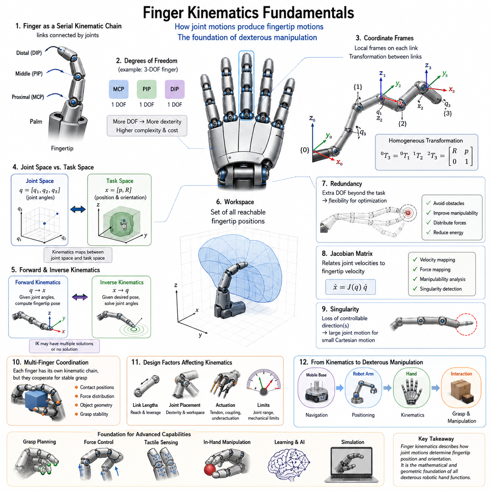
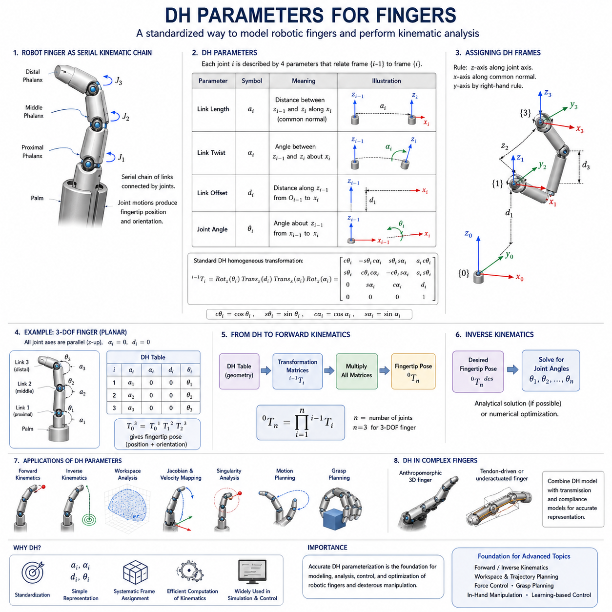
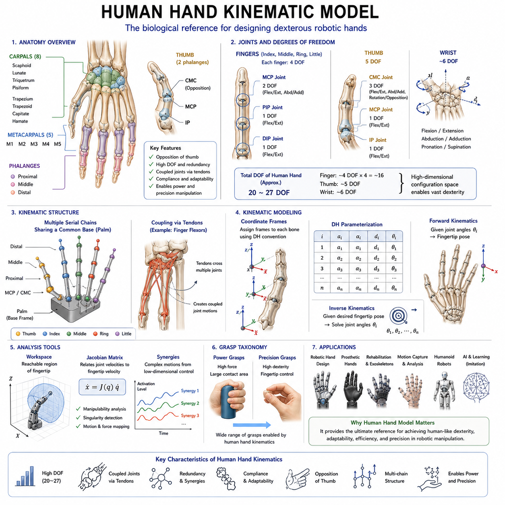
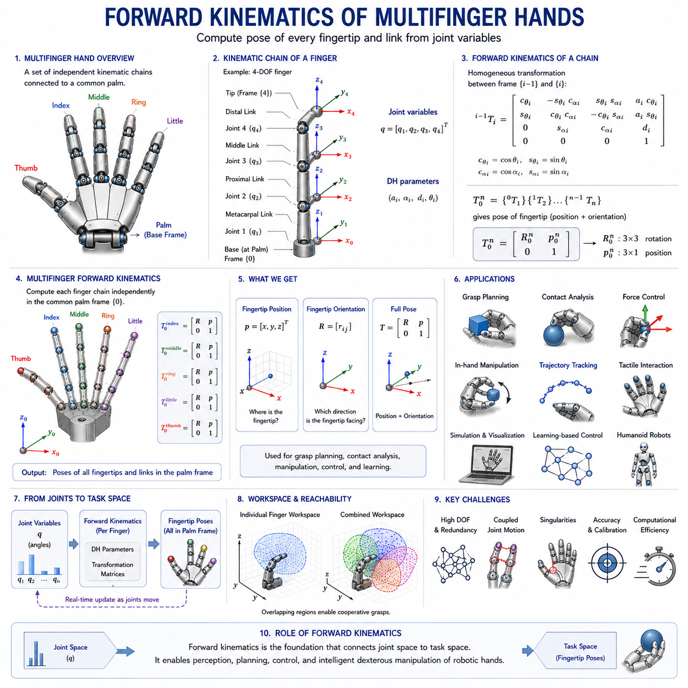
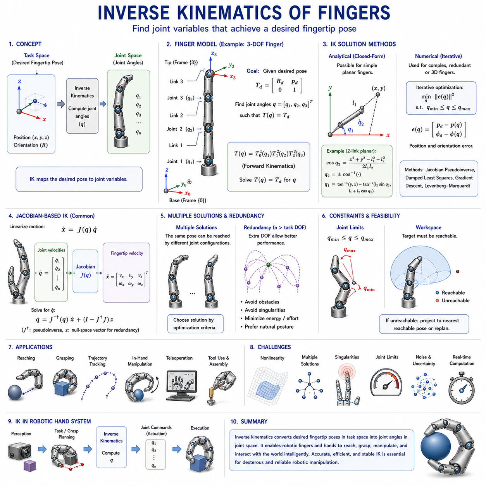
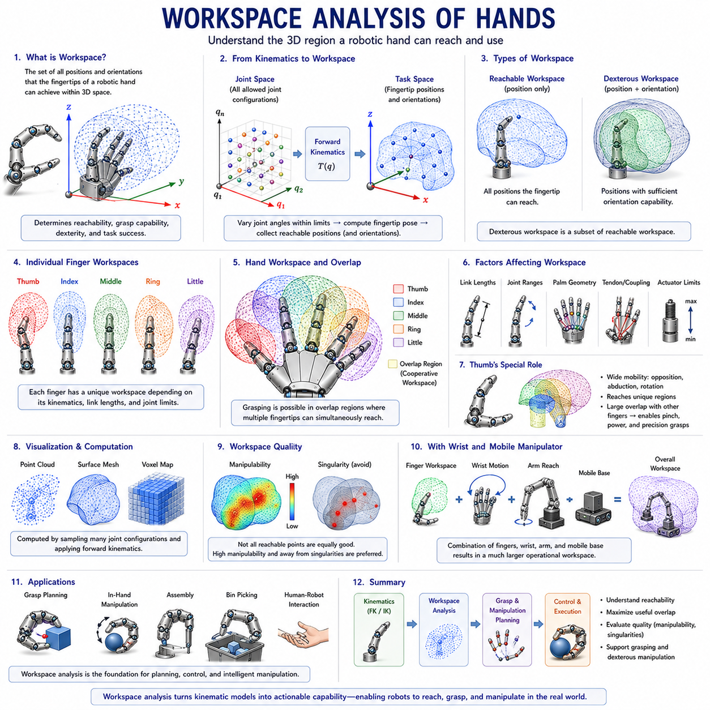
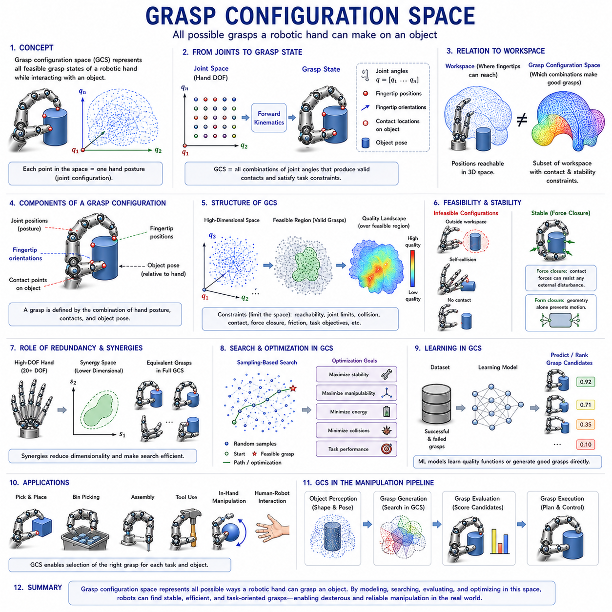
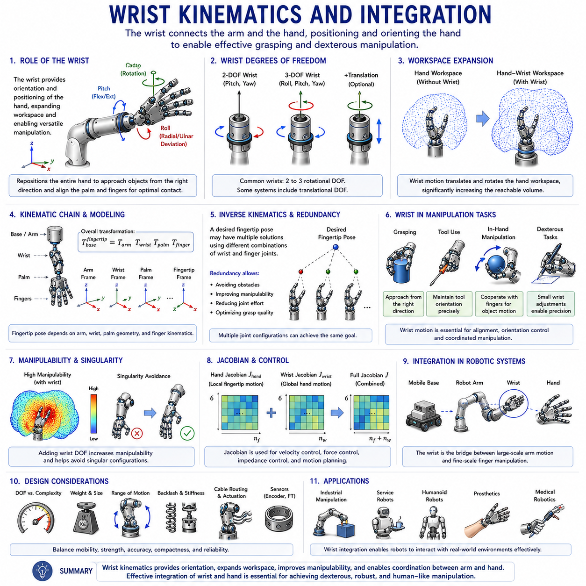
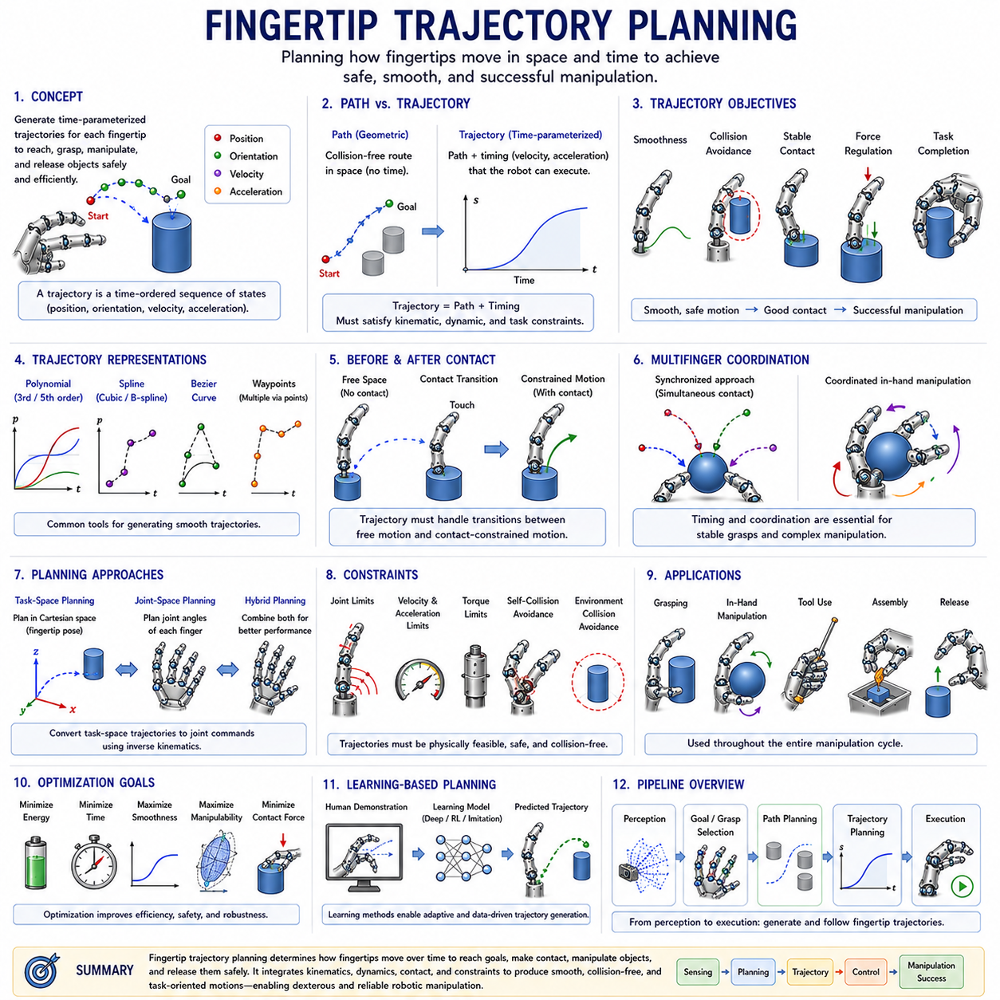
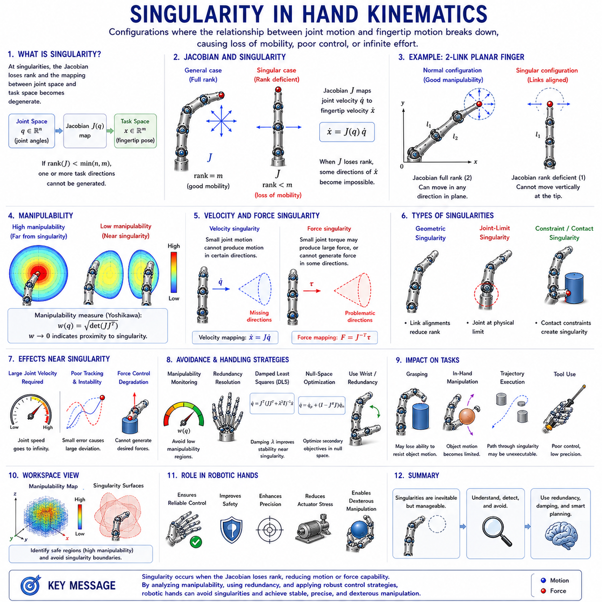

**Volume 06 Robot Hands and Dexterous Grasping**

# 05. Finger and Hand Kinematics

## 05.01 Finger Kinematics Fundamentals

{width="7.268055555555556in" height="7.268055555555556in"}

Finger kinematics is one of the most fundamental topics in robot hand engineering because it provides the mathematical and geometric framework that describes how robotic fingers move, interact with objects, and generate dexterous manipulation capabilities. Within the broader field of robot hand and dexterous grasping systems, kinematics serves as the bridge between mechanical design and intelligent manipulation. Before a robot can grasp, manipulate, rotate, reposition, or assemble objects, it must first understand how the motion of each joint contributes to the motion of the fingertip and the overall hand structure. For this reason, finger kinematics forms the foundation upon which grasp planning, force control, tactile sensing, in-hand manipulation, and learning-based dexterous behaviors are built. This chapter corresponds to the first foundational topic within the Finger and Hand Kinematics section of the Robot Hand and Dexterous Grasping volume and establishes the mathematical concepts required for all subsequent chapters dealing with forward kinematics, inverse kinematics, workspace analysis, fingertip trajectory planning, and grasp configuration spaces.

A robotic finger can be viewed as a serial kinematic chain composed of rigid links connected by joints. This structure is analogous to a robot arm, but it is generally more compact and operates within a constrained workspace near the palm. Each finger consists of multiple segments that are connected through rotational or, less commonly, translational joints. When these joints move, the position and orientation of the fingertip change accordingly. The primary objective of finger kinematics is to determine the relationship between joint motions and fingertip motions. By understanding this relationship, engineers can predict how a finger will move, determine whether it can reach a desired contact location, and calculate the joint commands required to achieve a particular grasp posture.

The study of finger kinematics begins with the concept of degrees of freedom. Degrees of freedom represent the number of independent variables required to describe the configuration of a mechanical system. Human fingers provide an excellent biological reference because they exhibit a sophisticated combination of joints that enable highly versatile motions. A typical human finger consists of the metacarpophalangeal joint, proximal interphalangeal joint, and distal interphalangeal joint. Together these joints create multiple degrees of freedom that allow bending, extension, and limited lateral motion. Robotic fingers often simplify this structure while preserving essential functional capabilities. Some industrial grippers may contain only a single degree of freedom, whereas advanced dexterous robotic hands may contain three, four, or even more degrees of freedom per finger. The number of degrees of freedom directly influences dexterity, controllability, complexity, and cost.

Kinematic analysis requires the definition of coordinate systems. Every link in a robotic finger is assigned a local reference frame that describes its position and orientation relative to adjacent links. These coordinate frames provide a systematic method for representing motion mathematically. The selection of coordinate systems is crucial because all subsequent calculations depend on the consistency and accuracy of these reference definitions. Coordinate frames are typically attached at joint locations, allowing transformations between neighboring links to be expressed through rotation and translation matrices. Through the use of homogeneous transformations, multiple joint motions can be combined into a single mathematical representation that describes the position and orientation of the fingertip relative to the palm.

One of the most important concepts in finger kinematics is the distinction between joint space and task space. Joint space refers to the set of joint variables that define the configuration of the finger. These variables typically include joint angles for revolute joints and linear displacements for prismatic joints. Task space, on the other hand, refers to the physical space in which the fingertip operates. A finger controller may receive commands expressed in task space, such as moving a fingertip to a specific position on an object surface. The kinematic model is responsible for translating these task-space objectives into joint-space commands. Understanding the relationship between these two spaces is fundamental for grasp planning and manipulation control.

Finger kinematics can be analyzed using either planar or spatial models. Planar kinematic models assume that all finger motion occurs within a two-dimensional plane. These models are frequently used for educational purposes and preliminary design analysis because they simplify mathematical derivations while preserving the essential principles of kinematic behavior. Spatial kinematic models represent the full three-dimensional motion of robotic fingers and are necessary for practical dexterous manipulation applications. Real-world robot hands operate in three-dimensional environments where object interactions require complex orientations and coordinated finger movements.

The motion of a robotic finger is generated through a sequence of joint rotations. Each joint contributes to the final fingertip position through a cumulative process. The proximal joint affects the motion of all downstream links, while distal joints influence only the links located beyond them. This hierarchical relationship creates a nonlinear mapping between joint variables and fingertip positions. Small changes in proximal joints can produce large changes in fingertip locations, whereas equivalent changes in distal joints may have more localized effects. Understanding these motion propagation characteristics is essential for efficient finger design and control system development.

Forward kinematics is one of the primary objectives of kinematic analysis. In forward kinematics, the joint variables are known, and the goal is to determine the resulting position and orientation of the fingertip. This process involves multiplying a sequence of transformation matrices corresponding to each joint and link. The resulting transformation provides a complete description of fingertip pose relative to the base frame. Forward kinematics is computationally efficient and serves as the foundation for simulation, visualization, collision detection, and control verification. Every robotic hand control system relies on forward kinematics to estimate fingertip locations during operation.

Inverse kinematics addresses the opposite problem. Given a desired fingertip position and orientation, the objective is to calculate the required joint angles. Unlike forward kinematics, inverse kinematics often involves multiple possible solutions or, in some cases, no feasible solution at all. This complexity arises because robotic fingers may possess redundant degrees of freedom or operate within constrained workspaces. Inverse kinematics plays a critical role in grasp synthesis, object manipulation, and trajectory generation because it enables task-level commands to be translated into executable motor actions.

The workspace of a robotic finger represents the set of all reachable fingertip positions. Workspace analysis provides insight into the capabilities and limitations of a finger design. The shape and size of the workspace depend on link lengths, joint ranges, mechanical constraints, and palm geometry. A larger workspace generally provides greater flexibility for object interaction, while a carefully optimized workspace may improve precision and force generation for specific tasks. Engineers frequently evaluate workspaces during the design phase to ensure compatibility with intended applications such as assembly, service robotics, warehouse manipulation, or humanoid interaction.

Another critical aspect of finger kinematics is redundancy. A finger is considered kinematically redundant when it possesses more degrees of freedom than are strictly necessary to achieve a task. Redundancy provides additional flexibility for avoiding obstacles, optimizing grasp quality, minimizing energy consumption, and distributing contact forces. Human fingers naturally exhibit redundancy, allowing multiple joint configurations to achieve similar fingertip positions. Robotic systems can exploit redundancy through optimization algorithms that select the most desirable configuration among many feasible alternatives.

Finger kinematics becomes increasingly complex when multiple fingers are considered simultaneously. In a dexterous robotic hand, each finger has its own kinematic chain, yet all fingers must coordinate to achieve stable grasps and manipulation tasks. Multi-finger coordination introduces additional constraints related to object geometry, contact locations, and force distribution. The combined kinematic structure of a robotic hand can be viewed as a collection of interconnected serial chains sharing a common palm reference frame. Understanding individual finger kinematics is therefore a prerequisite for analyzing full-hand behavior.

The kinematic structure of robotic fingers is closely related to mechanical design choices. Link lengths determine reachability and leverage characteristics. Joint placement affects dexterity and workspace coverage. Tendon-driven mechanisms introduce coupling effects that alter the relationship between actuator motion and joint motion. Underactuated fingers further complicate kinematic analysis because not all joints are independently controlled. In such systems, mechanical compliance and environmental interactions influence the final finger configuration. As a result, kinematic modeling often requires integration with mechanical and dynamic analyses.

Human-inspired robotic fingers provide valuable insights into kinematic design. The human hand represents one of the most sophisticated manipulation systems found in nature. Its ability to perform precision grasping, power grasping, tool use, and delicate object manipulation has inspired generations of robotic hand researchers. Human finger kinematics includes coupled joint motions, tendon-driven actuation, and highly coordinated multi-finger behavior. By studying these biological mechanisms, engineers can develop robotic fingers that achieve higher levels of dexterity while maintaining manageable mechanical complexity.

The concept of fingertip pose extends beyond simple position representation. In many manipulation tasks, the orientation of the fingertip is equally important. For example, inserting a connector, turning a key, manipulating a screwdriver, or handling laboratory equipment requires precise control of both position and orientation. Kinematic models therefore represent fingertip pose using position vectors combined with orientation descriptions such as rotation matrices, Euler angles, quaternions, or axis-angle representations. These mathematical tools provide the foundation for advanced manipulation planning and control.

Singularities represent another important topic within finger kinematics. A singularity occurs when the kinematic structure loses one or more controllable motion directions. Near singular configurations, small fingertip motions may require disproportionately large joint motions, resulting in reduced controllability and numerical instability. Identifying and avoiding singularities is essential for reliable robotic hand operation. Many grasp planners and trajectory generators incorporate singularity avoidance strategies to ensure smooth and predictable finger behavior.

The Jacobian matrix plays a central role in modern finger kinematics. The Jacobian establishes a direct relationship between joint velocities and fingertip velocities. Through the Jacobian, engineers can analyze velocity propagation, force transmission, manipulability, and singularity conditions. The Jacobian also serves as the foundation for many control algorithms used in robotic hands, including impedance control, force control, and operational space control. Because grasping and manipulation involve continuous interactions with objects, real-time Jacobian calculations are frequently required during execution.

Kinematic modeling is not limited to analytical approaches. Numerical methods and simulation tools have become increasingly important as robotic hands grow more sophisticated. Modern robot simulation environments allow engineers to visualize finger motion, evaluate workspace coverage, analyze grasp configurations, and test manipulation strategies before constructing physical prototypes. Software frameworks integrated with robotic middleware enable seamless transitions from simulation to real-world deployment. Consequently, kinematic models serve as the digital foundation for both design optimization and operational control.

In the broader context of mobile manipulators and embodied intelligence systems, finger kinematics forms the final stage of motion generation. Mobile platforms navigate through environments, robotic arms position the hand near target objects, and finger kinematics determines the precise contact interactions required for grasp execution. This hierarchical relationship highlights why finger kinematics remains indispensable despite advances in artificial intelligence, reinforcement learning, and foundation models. Regardless of how intelligent a robot becomes, physical interaction with the world ultimately depends on the geometric and mechanical principles governing finger motion.

As robotic systems continue to evolve toward human-level dexterity, the importance of finger kinematics will only increase. Future robotic hands will incorporate larger numbers of degrees of freedom, advanced tactile sensing systems, adaptive compliance mechanisms, and AI-driven manipulation strategies. Yet all of these technologies depend upon a rigorous understanding of how finger structures move and interact with the environment. Finger kinematics therefore represents not merely a theoretical subject but a practical engineering discipline that underpins every aspect of dexterous robotic manipulation. It provides the mathematical language through which mechanical structures, control algorithms, sensing systems, and intelligent behaviors are integrated into a unified robotic hand capable of performing complex tasks in unstructured environments. Through the study of finger kinematics fundamentals, engineers gain the essential knowledge required to design, analyze, control, and optimize the next generation of robot hands and dexterous manipulation systems.

## 05.02 DH Parameters for Fingers

{width="7.268055555555556in" height="7.268055555555556in"}

Denavit--Hartenberg (DH) parameters constitute one of the most important mathematical tools in robot kinematics and provide a standardized framework for describing the geometric relationships between adjacent links in a robotic mechanism. In the field of robotic hands and dexterous manipulation, DH parameters offer a systematic method for modeling the motion of fingers, calculating fingertip positions, analyzing reachable workspaces, and developing motion planning and control algorithms. Although robotic fingers are generally smaller and mechanically more complex than conventional industrial robot arms, they are fundamentally composed of serial kinematic chains. As a result, the same mathematical principles used in robot arm kinematics can be applied to robotic fingers. Within the Finger and Hand Kinematics section, the study of DH parameters serves as a critical bridge between basic finger kinematics and the more advanced topics of forward kinematics, inverse kinematics, workspace analysis, and multi-finger coordination. Understanding DH parameterization is therefore essential for anyone designing, analyzing, simulating, or controlling robotic hands.

The Denavit--Hartenberg convention was originally developed to simplify the description of articulated robotic mechanisms. Before the introduction of the DH convention, engineers often described robotic structures using arbitrary coordinate systems, making mathematical analysis difficult and inconsistent. The DH method introduced a standardized procedure for assigning coordinate frames to joints and links, allowing the geometry of a serial manipulator to be represented using a small set of parameters. This standardization greatly simplifies the derivation of transformation matrices and enables automated computation of kinematic models.

A robotic finger can be viewed as a chain of interconnected links connected by revolute joints. Similar to a robot arm, each joint introduces a relative motion between neighboring links. The objective of the DH method is to describe this relative motion using a minimal set of geometric parameters. Instead of defining complete coordinate transformations independently for every pair of links, the DH convention expresses the relationship between adjacent coordinate frames through four parameters. These parameters completely characterize the geometry of the kinematic chain and provide a consistent foundation for subsequent mathematical analysis.

The first DH parameter is the link length, commonly denoted by the symbol (a_i). Link length represents the distance between two neighboring joint axes measured along a common normal direction. In robotic fingers, link lengths correspond to the physical dimensions of phalanges or finger segments. The proximal phalanx, middle phalanx, and distal phalanx each contribute to the overall reach and dexterity of the finger. The choice of link lengths directly influences workspace size, force transmission characteristics, and manipulation capabilities. Longer links generally increase reach but may reduce stiffness and precision, while shorter links often improve structural rigidity at the expense of workspace coverage.

The second parameter is the link twist angle, represented by ( \\alpha_i ). This parameter describes the angular relationship between neighboring joint axes. In many simple planar finger mechanisms, adjacent joint axes are parallel, resulting in a twist angle of zero. However, advanced robotic fingers, anthropomorphic hands, and tendon-driven mechanisms may contain non-parallel joint arrangements that require nonzero twist angles. The twist parameter enables the kinematic model to accurately represent three-dimensional structures and complex finger geometries.

The third parameter is the link offset, represented by ( d_i ). Link offset describes the displacement between neighboring coordinate frames along the joint axis direction. In most robotic fingers utilizing revolute joints, the link offset remains constant because the joints rotate rather than translate. Nevertheless, link offsets become important when modeling mechanisms that incorporate sliding joints, telescoping structures, or specialized adaptive finger architectures. The offset parameter provides additional flexibility for representing a wide range of robotic finger designs.

The fourth parameter is the joint angle, denoted by ( \\theta_i ). This parameter describes the rotational displacement between neighboring links about the joint axis. For revolute joints, the joint angle is typically the primary variable controlling finger motion. During grasping and manipulation, actuator commands ultimately change these joint angles, causing corresponding movements of the fingertip. Because joint angles are dynamic variables, they represent the controllable inputs of the kinematic model. Monitoring and controlling joint angles is therefore central to robotic hand operation.

The power of the DH convention lies in its ability to represent complex kinematic chains using these four parameters. For each joint, a homogeneous transformation matrix can be constructed from the DH parameters. This matrix simultaneously describes both rotation and translation between adjacent coordinate frames. By multiplying the transformation matrices of successive joints, engineers can derive the complete kinematic relationship between the palm and the fingertip. This process forms the mathematical basis of forward kinematics.

Coordinate frame assignment is a critical step in applying the DH convention. The standard DH procedure specifies that the z-axis of each coordinate frame should align with the axis of joint motion. The x-axis is then defined along the common normal connecting neighboring z-axes, while the y-axis is determined using the right-hand rule. Although these rules may initially appear straightforward, practical finger mechanisms often contain compact geometries, coupled joints, and nontraditional layouts that require careful frame placement. Proper coordinate assignment ensures that the resulting DH parameters accurately reflect the physical structure of the robotic finger.

Consider a simple three-joint robotic finger consisting of proximal, middle, and distal phalanges. Each joint contributes one rotational degree of freedom corresponding to flexion and extension motions. By assigning coordinate frames according to the DH convention, each joint can be described using a unique set of DH parameters. The resulting transformation matrices can then be combined to calculate fingertip position and orientation. Even for such a relatively simple mechanism, the DH framework dramatically reduces modeling complexity and provides a structured pathway for mathematical analysis.

In human-inspired robotic hands, the kinematic structure becomes considerably more sophisticated. Human fingers exhibit coupled joint behaviors, tendon-driven actuation, and anatomical constraints that influence motion patterns. While the standard DH convention can still be applied, additional modeling considerations may be required to capture these biological characteristics accurately. Researchers often extend traditional DH formulations by incorporating joint coupling relationships, tendon constraints, and biomechanical approximations. These enhanced models allow robotic hands to emulate the dexterity and adaptability observed in human manipulation.

One of the most important applications of DH parameters is forward kinematic analysis. Forward kinematics determines fingertip position and orientation when all joint variables are known. Given the DH parameter table for a robotic finger, transformation matrices are generated for each joint and multiplied sequentially. The resulting matrix provides a complete description of fingertip pose relative to the palm frame. This information is essential for visualization, collision detection, grasp planning, simulation, and closed-loop control systems.

Inverse kinematics represents another major application. In inverse kinematics, the desired fingertip pose is specified, and the corresponding joint angles must be calculated. Because the DH model provides a mathematical description of the kinematic chain, it serves as the foundation for solving inverse kinematic equations. Depending on the complexity of the finger, analytical solutions may exist, or numerical optimization techniques may be required. In dexterous manipulation tasks, inverse kinematics enables robots to position fingertips accurately on object surfaces and establish stable grasp configurations.

Workspace analysis also relies heavily on DH parameterization. The workspace of a robotic finger is determined by evaluating all possible combinations of joint variables within their allowable ranges. By applying forward kinematics repeatedly, engineers can map the set of reachable fingertip positions. The resulting workspace provides valuable insights into dexterity, reachability, and manipulation potential. Design modifications such as changing link lengths or joint limits can be evaluated efficiently using DH-based workspace analysis.

The Jacobian matrix, which relates joint velocities to fingertip velocities, can likewise be derived from the DH model. The Jacobian plays a central role in motion control, force control, manipulability analysis, and singularity detection. Because the Jacobian depends directly on the geometric structure of the finger, accurate DH parameterization is essential for reliable control system performance. Many advanced robotic hand controllers continuously compute Jacobian matrices during operation to support real-time manipulation tasks.

The study of singularities is closely related to DH parameterization. Singular configurations occur when the Jacobian loses rank, causing a reduction in available motion directions. Near singularities, small fingertip movements may require disproportionately large joint motions, potentially leading to instability or control degradation. By analyzing the DH-based kinematic model, engineers can identify singular regions within the workspace and develop strategies to avoid them during manipulation.

Modern robotic hands frequently incorporate tendon-driven and underactuated mechanisms. In these systems, the relationship between actuator motion and joint motion is not always one-to-one. Although the DH convention still describes the geometric structure of the finger, additional transmission models must be integrated to account for tendon routing, pulley systems, elastic elements, and mechanical coupling. Consequently, the complete kinematic description often combines DH-based geometric modeling with transmission and compliance models.

Multi-finger robotic hands extend DH parameterization beyond individual fingers. Each finger possesses its own DH parameter table and kinematic chain. During grasping operations, these independent chains interact through contact constraints imposed by the grasped object. Coordinating multiple DH models enables the analysis of grasp configurations, force distribution, and in-hand manipulation strategies. As robotic hands become more sophisticated, multi-chain kinematic modeling becomes increasingly important.

Simulation environments such as ROS 2, MoveIt 2, Gazebo, Isaac Sim, MuJoCo, and Webots frequently rely on DH-inspired representations when constructing kinematic models. Although modern robotics frameworks often employ Unified Robot Description Format (URDF) files rather than explicit DH tables, the underlying concepts remain closely related. Engineers who understand DH parameterization gain a deeper understanding of how robotic simulation and motion planning systems represent kinematic structures internally.

From a mechanical design perspective, DH parameters provide a valuable tool for optimization. Designers can systematically evaluate how modifications to link lengths, joint orientations, and structural geometry affect fingertip reachability, dexterity, and workspace coverage. During the conceptual design phase, DH models enable rapid comparison of alternative finger architectures before committing to detailed mechanical development. This capability reduces development costs and accelerates design iteration cycles.

In humanoid robotics and advanced dexterous hands, accurate DH parameterization becomes even more important because manipulation tasks often require submillimeter positioning accuracy. Activities such as tool use, assembly operations, medical manipulation, laboratory automation, and precision grasping demand highly accurate fingertip control. Small errors in kinematic modeling can lead to significant performance degradation. Consequently, DH parameters are often calibrated using experimental measurements and optimization algorithms to improve model accuracy.

The emergence of learning-based manipulation systems has not diminished the importance of DH parameters. Even modern reinforcement learning, imitation learning, and foundation-model-based robotic systems rely on accurate kinematic representations. Simulation environments used for training require precise geometric models, while real-world execution depends on reliable kinematic calculations. In many cases, machine learning algorithms operate on top of traditional kinematic frameworks rather than replacing them. The combination of analytical kinematics and data-driven learning represents a powerful approach for achieving robust robotic manipulation.

Within the broader Robot Hand and Dexterous Grasping framework, DH parameters form the mathematical foundation for nearly every subsequent topic. Forward kinematics, inverse kinematics, workspace analysis, fingertip trajectory planning, singularity analysis, force control, grasp planning, and in-hand manipulation all depend on accurate kinematic representations derived from DH parameterization. Without a consistent method for describing finger geometry, advanced robotic hand functionality would be difficult to implement and analyze.

As robotic hands continue to evolve toward human-level dexterity, the importance of precise kinematic modeling will remain unchanged. Regardless of advances in artificial intelligence, tactile sensing, soft robotics, or foundation models, every robotic finger ultimately operates according to geometric principles governed by its physical structure. The Denavit--Hartenberg convention provides a rigorous and elegant framework for describing that structure. By mastering DH parameters, engineers gain the ability to model, analyze, optimize, and control robotic fingers with mathematical precision, creating the foundation upon which modern dexterous manipulation systems are built.

## 05.03 Human Hand Kinematic Models

{width="7.268055555555556in" height="7.268055555555556in"}

The human hand is widely regarded as one of the most sophisticated biomechanical systems in nature and serves as the primary inspiration for the development of dexterous robotic hands. Its remarkable ability to perform both powerful grasps and delicate manipulations has motivated decades of research in robotics, biomechanics, neuroscience, prosthetics, and human-machine interaction. In the field of robotic manipulation, understanding the Human Hand Kinematic Model is essential because it provides the theoretical and practical foundation for designing robotic fingers, anthropomorphic hands, humanoid robots, prosthetic devices, and advanced dexterous manipulation systems. Within the Finger and Hand Kinematics section, the study of the human hand model builds directly upon the concepts of finger kinematics and DH parameterization and provides the biological reference framework from which many modern robotic hand architectures are derived. The human hand demonstrates how a highly integrated system of bones, joints, tendons, muscles, ligaments, and neural control mechanisms can produce extraordinary levels of dexterity while maintaining compactness, robustness, and energy efficiency.

From a kinematic perspective, the human hand can be viewed as a complex multi-chain articulated mechanism. Unlike conventional robotic manipulators, which are typically designed around a single serial kinematic chain, the human hand consists of multiple interconnected kinematic chains sharing a common base structure in the palm. Each finger functions as an independent manipulator, yet all fingers cooperate to perform coordinated grasping and manipulation tasks. This combination of independence and coordination enables humans to perform a wide variety of actions ranging from lifting heavy objects to threading a needle. Understanding how this kinematic structure operates is a fundamental prerequisite for developing robotic systems capable of human-like manipulation.

The skeletal framework of the human hand consists of twenty-seven bones organized into three major regions: the carpal bones forming the wrist, the metacarpal bones forming the palm, and the phalanges forming the fingers. The wrist contains eight carpal bones arranged in two rows that provide flexibility and load distribution. The palm contains five metacarpal bones that establish the structural foundation of the hand. Each finger is composed of multiple phalanges connected through articulating joints. The index, middle, ring, and little fingers each contain three phalanges, while the thumb contains only two phalanges. Although this skeletal arrangement appears relatively simple, the resulting kinematic structure is remarkably sophisticated due to the interaction of numerous joints and soft tissues.

The thumb occupies a unique position within the hand and is widely considered the most important contributor to human dexterity. Unlike the other fingers, the thumb is mounted on a highly mobile carpometacarpal joint that enables opposition, a motion in which the thumb rotates and moves across the palm to contact the fingertips. Opposition dramatically expands the range of possible grasp configurations and is a defining characteristic of human manipulation capabilities. Many robotic hand designers prioritize thumb design because even minor deficiencies in thumb mobility can significantly reduce overall dexterity.

Each finger contains several joints that contribute to its kinematic behavior. The metacarpophalangeal joint, commonly referred to as the MCP joint, connects the finger to the palm and typically provides two primary degrees of freedom. These include flexion-extension and abduction-adduction motions. Flexion-extension corresponds to bending and straightening the finger, while abduction-adduction allows lateral spreading between fingers. The proximal interphalangeal joint, known as the PIP joint, primarily provides flexion-extension movement. The distal interphalangeal joint, or DIP joint, also provides flexion-extension motion and contributes to fine fingertip positioning. Together these joints enable each finger to achieve a substantial range of motion while maintaining structural stability.

The thumb possesses a distinct joint structure. The carpometacarpal joint provides multiple degrees of freedom and enables opposition. The metacarpophalangeal joint contributes additional rotational capability, while the interphalangeal joint enables distal flexion. The resulting kinematic chain is significantly different from those of the remaining fingers and requires specialized modeling approaches. Many robotic thumbs intentionally replicate this unique architecture because it is essential for precision grasping and object manipulation.

A fundamental characteristic of the human hand is its high number of degrees of freedom. Depending on the modeling approach, the human hand is commonly represented as having between twenty and twenty-seven degrees of freedom. Individual fingers generally contribute four degrees of freedom, while the thumb contributes approximately five degrees of freedom. The wrist itself introduces additional motion capabilities. This high-dimensional configuration space allows humans to generate an enormous variety of hand postures and grasp patterns. However, it also creates significant challenges for mathematical modeling, control, and simulation.

One of the key observations in hand biomechanics is that not all degrees of freedom operate independently. Human fingers exhibit substantial coupling between joints. For example, movement of the distal interphalangeal joint is often correlated with movement of the proximal interphalangeal joint due to tendon connections and anatomical constraints. These coupling effects reduce the effective dimensionality of hand motion and simplify neural control. Robotic hand designers frequently exploit similar principles by introducing mechanical coupling or underactuated mechanisms that reduce actuator count while preserving functionality.

The concept of kinematic chains is central to modeling the human hand. Each finger can be represented as a serial kinematic chain originating from the palm. The palm itself functions as a shared base platform. When viewed collectively, the hand becomes a parallel collection of interconnected serial manipulators. This structure differs significantly from traditional industrial robot arms and requires specialized analytical techniques. Multi-chain kinematic modeling enables researchers to study coordination between fingers, analyze grasp configurations, and investigate manipulation strategies.

Coordinate frame assignment plays a critical role in human hand kinematic modeling. Similar to robotic manipulators, coordinate systems are attached to individual bones and joints. These coordinate frames provide a mathematical reference for describing motion and calculating transformations. By defining coordinate systems consistently throughout the hand, researchers can construct comprehensive kinematic models capable of predicting fingertip positions and orientations. Such models form the basis for simulation, motion capture analysis, robotic imitation, and prosthetic design.

Forward kinematics is one of the primary applications of human hand models. Given a set of joint angles, forward kinematics determines the resulting positions and orientations of the fingertips. This capability is essential for understanding hand posture, evaluating reachability, and simulating manipulation behaviors. Forward kinematic models are widely used in computer graphics, virtual reality, robotics, and biomechanical research because they provide a computationally efficient means of reconstructing hand configurations.

Inverse kinematics addresses the complementary problem. Given a desired fingertip position or object contact location, inverse kinematics determines the joint angles required to achieve that configuration. In the human hand, inverse kinematics is particularly challenging due to redundancy, joint coupling, and multiple possible solutions. Nonetheless, inverse kinematic models play a vital role in robotic imitation learning, teleoperation systems, prosthetic control, and humanoid robot motion generation.

The workspace of the human hand is extraordinarily complex. Each fingertip possesses its own reachable region, while combinations of finger positions create shared interaction spaces used for grasping and manipulation. Workspace analysis provides insight into dexterity and object accessibility. Researchers frequently evaluate fingertip workspaces to compare robotic hands against human capabilities. A robotic hand with workspace characteristics similar to those of the human hand is generally expected to demonstrate improved manipulation performance.

The Jacobian matrix is another essential tool in human hand kinematics. The Jacobian relates joint velocities to fingertip velocities and provides a mathematical description of motion transmission throughout the hand. Through Jacobian analysis, researchers can evaluate manipulability, identify singularities, estimate force transmission characteristics, and develop advanced control algorithms. Because human hand movements often involve coordinated finger actions, multi-finger Jacobian formulations are commonly employed.

Human hand kinematics cannot be fully understood without considering tendons and muscles. Unlike most robotic systems that employ direct-drive actuators, human fingers are primarily driven by tendons connected to muscles located in the forearm and hand. Tendons transmit forces across multiple joints, creating coupled motion patterns that influence kinematic behavior. These tendon-driven mechanisms contribute significantly to the efficiency, adaptability, and compliance of the human hand. Consequently, many advanced robotic hands incorporate tendon-driven architectures inspired by biological systems.

Compliance is another defining feature of the human hand. Soft tissues, tendons, ligaments, and skin introduce passive adaptability that allows the hand to conform to object surfaces. Although compliance is often considered a dynamic property rather than a purely kinematic one, it profoundly influences effective hand behavior. Human fingers can adjust naturally to object geometry without requiring precise motion planning. This capability enables robust grasping under uncertain conditions and remains one of the most challenging aspects of human dexterity to replicate in robotics.

The study of grasp taxonomy provides additional insight into human hand kinematics. Human grasps are commonly categorized into power grasps and precision grasps. Power grasps involve large contact areas and high force generation, while precision grasps emphasize fingertip control and accurate object positioning. The human hand can transition smoothly between these grasp categories because its kinematic structure supports a wide range of configurations. Robotic hands seeking human-level dexterity must therefore accommodate similar kinematic versatility.

Synergies represent one of the most influential concepts in modern hand modeling. Research has shown that many complex hand motions can be represented using a relatively small number of coordinated movement patterns known as synergies. Rather than controlling every degree of freedom independently, the nervous system often activates groups of joints simultaneously through synergistic relationships. This observation has inspired numerous robotic hand designs that use low-dimensional control spaces to generate complex grasp behaviors. Synergy-based models reduce computational complexity while preserving functional performance.

Human hand kinematic models play a crucial role in prosthetic development. Advanced prosthetic hands attempt to replicate natural finger motion patterns, grasp capabilities, and manipulation functions. Accurate kinematic models enable engineers to design prosthetic devices that closely mimic biological behavior. Similarly, exoskeleton systems used for rehabilitation rely on hand kinematic models to ensure safe and effective assistance during therapeutic exercises.

Motion capture technology has significantly advanced the study of hand kinematics. Optical tracking systems, inertial sensors, magnetic tracking devices, and vision-based hand tracking systems allow researchers to measure joint motions with high precision. These measurements are used to validate kinematic models, analyze manipulation strategies, and generate datasets for machine learning applications. Modern hand datasets containing millions of recorded hand poses have become valuable resources for robotics and artificial intelligence research.

The emergence of humanoid robotics has further increased the importance of human hand kinematic modeling. Humanoid robots are expected to operate within environments designed for humans and interact with tools, equipment, and objects originally intended for human hands. Consequently, robotic hands must approximate the kinematic capabilities of human hands to achieve comparable levels of functionality. Human hand models therefore serve as critical benchmarks for evaluating robotic hand performance.

In learning-based robotics, human hand kinematic models provide structured representations for imitation learning, behavior cloning, reinforcement learning, and foundation-model-based manipulation systems. Human demonstrations are often captured and converted into kinematic trajectories that guide robot training. By leveraging accurate hand models, robots can learn manipulation skills more efficiently and generalize across a broader range of tasks.

Within the broader Robot Hand and Dexterous Grasping framework, the Human Hand Kinematic Model serves as the biological reference point connecting anatomy, biomechanics, robotics, and artificial intelligence. The concepts introduced in finger kinematics and DH parameterization are extended to a complete anthropomorphic manipulation system capable of extraordinary versatility. Subsequent topics including forward kinematics of multifinger hands, inverse kinematics, grasp configuration spaces, contact mechanics, force control, tactile sensing, and in-hand manipulation all build upon the understanding established by the human hand model.

As robotic systems continue progressing toward human-level dexterity, the Human Hand Kinematic Model remains one of the most valuable sources of inspiration and knowledge. Despite tremendous advances in actuators, sensors, control algorithms, and machine learning, the human hand continues to represent the gold standard for manipulation performance. Its unique combination of mobility, adaptability, compliance, efficiency, and precision demonstrates what is possible when mechanical design and intelligent control operate in harmony. For engineers developing the next generation of robotic hands, a deep understanding of human hand kinematics is not merely beneficial but essential for achieving truly dexterous robotic manipulation.

## 05.04 Forward Kinematics of Multifinger Hands

{width="7.268055555555556in" height="7.268055555555556in"}

Forward kinematics is one of the most fundamental concepts in robotics and forms the mathematical backbone of robotic hand motion analysis. In the context of multifinger robotic hands, forward kinematics describes the process of determining the position and orientation of every fingertip, finger segment, and contact point based on known joint variables. While forward kinematics for a single robotic finger is relatively straightforward because it involves only one serial kinematic chain, multifinger hands introduce significantly greater complexity due to the simultaneous interaction of multiple kinematic chains sharing a common palm structure. As robotic hands evolve toward human-like dexterity, accurate forward kinematic models become increasingly important because they provide the geometric foundation required for grasp planning, contact analysis, force control, tactile interaction, manipulation planning, and learning-based robotic behaviors.

Within the Finger and Hand Kinematics framework, forward kinematics of multifinger hands represents the natural progression from individual finger kinematics, DH parameterization, and human hand modeling. Once the kinematic structure of a single finger has been defined, engineers must determine how multiple fingers operate together as a coordinated manipulation system. Every advanced capability of a dexterous robotic hand, including stable grasping, object manipulation, finger gaiting, tool use, and in-hand manipulation, depends upon accurate knowledge of fingertip positions and orientations. Forward kinematics provides this information by transforming joint measurements into geometric representations of the hand configuration.

A multifinger robotic hand can be viewed as a collection of independent serial kinematic chains connected to a shared base frame represented by the palm. Each finger possesses its own set of links, joints, coordinate frames, and kinematic parameters. Although these fingers can be modeled individually, practical manipulation tasks require them to operate as a coordinated system. Consequently, the forward kinematic model of a multifinger hand consists of multiple interconnected kinematic chains whose outputs are expressed relative to a common reference frame. This common reference frame is typically attached to the palm and serves as the global coordinate system for the entire hand.

The primary objective of forward kinematics is to determine the pose of each fingertip. In robotics, pose refers to both position and orientation. Position describes the location of the fingertip in three-dimensional space, while orientation describes the rotational alignment of the fingertip relative to a reference frame. Both quantities are critical for grasping and manipulation. A fingertip may reach the correct position but fail to establish stable contact if its orientation is incorrect. Therefore, forward kinematic calculations must provide complete pose information rather than position alone.

The mathematical basis of forward kinematics relies on homogeneous transformation matrices. Each joint contributes a local transformation describing the relative motion between adjacent links. These transformations incorporate both rotations and translations. By multiplying the transformation matrices along a kinematic chain, the pose of the fingertip relative to the finger base can be determined. When applied to multifinger hands, this process is repeated independently for each finger. The resulting fingertip poses are then expressed relative to the palm coordinate frame, creating a unified geometric representation of the entire hand.

Consider a robotic hand containing five fingers similar to a human hand. Each finger may possess three or four rotational joints. The thumb may contain additional degrees of freedom associated with opposition and rotation. In such a system, each finger has its own transformation sequence. For example, the index finger may require four transformations to determine fingertip pose, while the thumb may require five or more transformations. The complete hand model therefore consists of multiple transformation chains operating simultaneously. Despite the increased complexity, the fundamental principle remains unchanged: the pose of each fingertip is obtained through sequential multiplication of transformation matrices.

Coordinate frame assignment is a critical aspect of multifinger forward kinematics. Each finger contains local coordinate frames attached to individual links and joints. Additionally, each finger has a base frame attached to the palm. The palm itself serves as the global hand frame. Consistent coordinate assignment ensures that fingertip poses from different fingers can be compared and combined. Without a unified coordinate system, it would be impossible to determine whether multiple fingertips can simultaneously contact an object or establish a stable grasp configuration.

The Denavit--Hartenberg convention is commonly used to describe finger kinematics within multifinger systems. DH parameters provide a standardized representation of joint geometry and simplify transformation matrix generation. For each finger, a DH parameter table defines the kinematic structure. The resulting transformation matrices are multiplied to obtain fingertip poses. Because every finger can be modeled using the same mathematical framework, DH parameterization provides an efficient method for constructing complete hand models.

One of the most important outputs of forward kinematics is fingertip position estimation. The position of each fingertip determines which regions of space the hand can access and interact with. During grasp planning, fingertip positions are compared against object geometry to identify feasible contact points. During manipulation, fingertip positions are monitored continuously to ensure that desired trajectories are being followed. Accurate fingertip position estimation is therefore essential for virtually every robotic hand application.

Equally important is fingertip orientation estimation. Orientation determines how a fingertip approaches an object surface and influences contact stability. For example, when grasping a cylindrical object, fingertips must align appropriately with the object\'s curvature. During assembly tasks, fingertip orientation often becomes even more important than position because successful insertion operations require precise angular alignment. Forward kinematic models provide the orientation information needed to execute these tasks reliably.

The concept of hand configuration space emerges naturally from multifinger forward kinematics. Configuration space represents the set of all possible joint configurations that a robotic hand can achieve. Every point within this high-dimensional space corresponds to a unique hand posture. Forward kinematics provides the mapping from configuration space to physical workspace. This mapping allows engineers to determine how changes in joint variables affect fingertip positions and orientations throughout the hand.

Workspace analysis relies heavily on forward kinematics. The workspace of an individual finger represents all reachable fingertip positions. In a multifinger hand, multiple workspaces overlap and interact. Regions where multiple fingertip workspaces intersect are particularly important because they define areas where cooperative grasping can occur. By applying forward kinematics across all possible joint configurations, engineers can generate comprehensive workspace maps that reveal the manipulation capabilities of the hand.

Forward kinematics also plays a central role in grasp analysis. Before a robotic hand can grasp an object, it must determine whether appropriate contact locations can be reached. Forward kinematic models provide the fingertip positions necessary for evaluating candidate grasp configurations. Once contacts are established, the geometric relationship between fingertips and object surfaces can be analyzed to assess grasp stability and force closure properties.

The study of contact geometry depends directly on forward kinematic calculations. Contact points between fingertips and objects are determined by the relative positions and orientations of the fingers. Accurate contact modeling requires precise knowledge of fingertip pose. This information forms the foundation for subsequent contact mechanics analysis, force distribution calculations, and grasp stability evaluation.

Multifinger forward kinematics becomes increasingly important during in-hand manipulation. Unlike simple grasping tasks where an object remains stationary relative to the hand, in-hand manipulation involves controlled object motion within the grasp. Fingertips may roll, slide, pivot, or reposition while maintaining contact. These actions require continuous updates of fingertip poses and contact locations. Forward kinematics provides the real-time geometric information needed to coordinate these complex motions.

Finger coordination is another major application of forward kinematic models. Multiple fingers must often move simultaneously while satisfying task-specific constraints. For example, grasping a fragile object may require synchronized fingertip motions to avoid excessive force. During tool use, fingers must maintain precise geometric relationships to support stable manipulation. Forward kinematic calculations allow control systems to predict the consequences of coordinated joint movements before they are executed.

Redundancy is a common characteristic of multifinger hands. A hand may possess dozens of degrees of freedom while interacting with an object that requires only a small subset of those motions. This redundancy creates multiple possible joint configurations capable of achieving the same fingertip positions. Forward kinematics provides the mapping required to analyze and exploit redundancy effectively. Through redundancy resolution techniques, engineers can optimize hand posture, avoid obstacles, improve manipulability, or reduce energy consumption.

The Jacobian matrix is closely related to forward kinematics and plays a crucial role in multifinger systems. While forward kinematics maps joint positions to fingertip positions, the Jacobian maps joint velocities to fingertip velocities. The Jacobian is derived directly from the forward kinematic model and enables velocity control, force control, singularity analysis, and manipulability evaluation. For multifinger hands, individual finger Jacobians may be combined into larger system-level Jacobians that describe coordinated hand behavior.

Singularity analysis also depends on forward kinematic models. Singularities occur when certain fingertip motions become unavailable due to the geometric arrangement of joints. Near singular configurations, small fingertip movements may require disproportionately large joint motions, leading to control difficulties. By analyzing the forward kinematic structure of a multifinger hand, engineers can identify singular regions and develop strategies to avoid them.

Human hand modeling has strongly influenced multifinger forward kinematic research. Human hands contain approximately twenty to twenty-seven effective degrees of freedom and exhibit extraordinary manipulation capabilities. Robotic hand designers frequently construct forward kinematic models that emulate human finger structures, thumb opposition mechanisms, and palm geometries. These anthropomorphic models allow robotic systems to perform tasks originally designed for human hands and improve compatibility with human environments.

Modern robotic hands often employ tendon-driven architectures rather than direct-drive joint actuation. In tendon-driven systems, actuator motion does not directly correspond to joint motion. Nevertheless, once joint positions are estimated, forward kinematics remains responsible for calculating fingertip pose. Consequently, forward kinematic models frequently operate in conjunction with tendon transmission models that convert actuator states into joint variables.

Simulation environments such as ROS 2, MoveIt 2, Gazebo, Isaac Sim, MuJoCo, and Webots depend heavily on forward kinematic calculations. Whenever a robotic hand moves within a simulation, the positions and orientations of all links and fingertips are updated using forward kinematics. These updates support visualization, collision detection, motion planning, contact simulation, and reinforcement learning environments. As a result, forward kinematics serves as one of the most frequently executed computations in robotic hand software.

In grasp planning systems, forward kinematics is often integrated with perception modules. Cameras, depth sensors, and tactile sensors provide information about object geometry and pose. Forward kinematic models determine where the fingertips are relative to the detected object. By combining these data sources, robotic systems can generate grasp candidates and evaluate their feasibility before execution.

Learning-based robotic manipulation systems also rely on forward kinematics. Reinforcement learning algorithms require accurate state representations, while imitation learning systems must map demonstrated joint trajectories to fingertip motions. Foundation models for manipulation frequently use kinematic information as part of their world representations. Even highly data-driven approaches ultimately depend upon forward kinematic calculations to connect physical joint motions with task-level geometric objectives.

The computational efficiency of forward kinematics is one of its greatest advantages. Unlike inverse kinematics, which may involve multiple solutions or iterative optimization procedures, forward kinematics produces a unique solution directly from known joint variables. This efficiency makes it suitable for real-time applications where thousands of pose calculations may be required every second. Modern robotic hands performing dynamic manipulation tasks depend on this computational speed to maintain responsiveness and stability.

As robotic hands continue to advance toward human-level dexterity, the significance of multifinger forward kinematics will only increase. Every sophisticated manipulation capability, from stable grasping and tactile exploration to tool use and autonomous assembly, depends upon accurate geometric knowledge of the hand configuration. Forward kinematics transforms raw joint measurements into meaningful spatial information, enabling robots to understand where their fingers are, how they are oriented, and how they can interact with the surrounding world.

Within the broader Robot Hand and Dexterous Grasping framework, Forward Kinematics of Multifinger Hands serves as a central pillar connecting mechanical design, kinematic modeling, grasp planning, force control, tactile sensing, and intelligent manipulation. It provides the mathematical language through which multiple fingers become a coordinated manipulation system rather than a collection of independent joints. By mastering multifinger forward kinematics, engineers gain the ability to analyze, simulate, optimize, and control robotic hands with the precision necessary for achieving advanced dexterous manipulation in real-world environments.

## 05.05 Inverse Kinematics of Fingers

{width="7.268055555555556in" height="7.268055555555556in"}

Inverse kinematics is one of the most important and challenging topics in robotic hand design, dexterous manipulation, and intelligent grasping systems. While forward kinematics determines fingertip position and orientation from known joint variables, inverse kinematics addresses the opposite problem: determining the joint variables required to achieve a desired fingertip pose. In the context of robotic fingers, inverse kinematics provides the mathematical framework that allows high-level task objectives to be translated into executable joint commands. Whenever a robotic finger must reach a target location, establish contact with an object, follow a desired trajectory, or participate in a coordinated grasp, inverse kinematics serves as the computational bridge between task space objectives and joint space actions.

Within the Finger and Hand Kinematics framework, inverse kinematics naturally follows the study of finger kinematics fundamentals, DH parameterization, human hand modeling, and forward kinematics of multifinger hands. Once engineers understand how joint motions produce fingertip motions through forward kinematics, the next challenge is determining which joint motions should be generated to achieve a specific fingertip position. This problem is considerably more difficult because the mapping from task space to joint space is often nonlinear, may possess multiple solutions, and in some cases may not have any solution at all. Consequently, inverse kinematics represents one of the central computational challenges in robotic manipulation.

A robotic finger can be modeled as a serial kinematic chain composed of links connected through joints. Each joint contributes one or more degrees of freedom, and together these joints determine the position and orientation of the fingertip. In forward kinematics, the joint angles are known and the fingertip pose is calculated. In inverse kinematics, the desired fingertip pose is specified, and the objective is to calculate the corresponding joint angles. This reversal of the computational process introduces significant mathematical complexity because the equations relating joint variables to fingertip pose must be solved in the opposite direction.

The importance of inverse kinematics becomes immediately apparent when considering practical robotic applications. Most robotic tasks are naturally specified in task space rather than joint space. A grasp planner may determine that a fingertip should contact a particular location on an object. A manipulation planner may require a fingertip to follow a specific trajectory. A teleoperation system may receive target fingertip positions from a human operator. In all of these situations, the robot must convert task-level objectives into joint-level commands. Inverse kinematics provides the mechanism through which this conversion occurs.

The fundamental input to an inverse kinematic solver is a desired fingertip pose. A pose consists of both position and orientation information. Position specifies where the fingertip should be located within three-dimensional space, while orientation specifies the direction in which the fingertip should be aligned. Depending on the task, the desired pose may include only positional constraints or may require full pose specification. Precision assembly tasks, tool manipulation, and contact-sensitive operations typically require both position and orientation control, whereas simpler reaching tasks may require only positional accuracy.

One of the defining characteristics of inverse kinematics is nonlinearity. The relationship between joint angles and fingertip positions is governed by trigonometric functions that arise from rotational motion. As a result, inverse kinematic equations are generally nonlinear and cannot always be solved using simple algebraic techniques. Even relatively simple robotic fingers may require sophisticated mathematical methods to determine valid joint configurations. As the number of joints increases, the complexity of the inverse kinematic problem grows significantly.

For simple planar fingers with two or three joints, analytical solutions can often be derived. Analytical inverse kinematics involves developing closed-form mathematical expressions that directly calculate joint angles from desired fingertip positions. These solutions are computationally efficient and provide exact results. For example, a two-link planar finger can be analyzed using trigonometric relationships derived from the law of cosines and the law of sines. Such analytical methods provide valuable insight into the geometric structure of the inverse kinematic problem and remain widely used in educational settings and simple robotic systems.

As finger architectures become more complex, analytical solutions become increasingly difficult to obtain. Human-inspired robotic fingers often contain multiple joints, coupled mechanisms, tendon-driven actuation systems, and nonplanar geometries. In these cases, numerical methods are frequently employed. Numerical inverse kinematics approaches use iterative optimization techniques to gradually adjust joint variables until the fingertip reaches the desired pose. Although these methods may require more computation than analytical approaches, they offer greater flexibility and can accommodate highly complex kinematic structures.

One of the most important concepts in inverse kinematics is the distinction between joint space and task space. Joint space describes the configuration of the finger using joint variables such as rotational angles. Task space describes the fingertip pose using Cartesian coordinates and orientation representations. Inverse kinematics establishes the mapping from task space to joint space, while forward kinematics performs the opposite mapping. Understanding the relationship between these spaces is essential for robotic manipulation because high-level objectives are usually defined in task space while low-level control systems operate in joint space.

A common challenge in inverse kinematics is the existence of multiple solutions. Because robotic fingers often possess multiple degrees of freedom, several different joint configurations may produce the same fingertip position. Human fingers exhibit this characteristic naturally. A fingertip can often reach the same location using slightly different combinations of joint angles. In robotic systems, this redundancy creates flexibility but also introduces decision-making requirements. Additional optimization criteria are typically used to select the most desirable solution among the available alternatives.

Redundancy occurs when a finger possesses more degrees of freedom than are strictly necessary to achieve a particular task. Redundant fingers offer significant advantages because they provide additional flexibility for obstacle avoidance, singularity avoidance, force optimization, and posture adjustment. However, redundancy also complicates inverse kinematic calculations because an infinite number of valid solutions may exist. Modern inverse kinematic algorithms frequently incorporate optimization techniques that exploit redundancy to improve overall system performance.

Another important issue is solution existence. Not every desired fingertip pose is physically achievable. Every robotic finger has a finite workspace determined by link lengths, joint limits, and mechanical constraints. If a target pose lies outside the reachable workspace, no valid inverse kinematic solution exists. Consequently, inverse kinematic solvers must include mechanisms for detecting unreachable targets and generating appropriate responses. Such responses may involve selecting the nearest reachable configuration, modifying task objectives, or informing higher-level planning systems of the constraint violation.

Joint limits represent another practical consideration. Real robotic fingers cannot rotate indefinitely. Each joint operates within a finite range determined by mechanical design, actuator capabilities, and safety constraints. A theoretically valid inverse kinematic solution may be physically impossible if one or more required joint angles exceed allowable limits. Therefore, inverse kinematic algorithms must incorporate joint limit constraints to ensure that computed solutions are physically realizable.

The Jacobian matrix plays a central role in many inverse kinematic methods. The Jacobian describes the relationship between joint velocities and fingertip velocities. By inverting or pseudoinverting the Jacobian, small changes in fingertip position can be translated into corresponding changes in joint angles. Jacobian-based methods are particularly popular because they can be applied to complex robotic fingers and multifinger systems. They also support real-time trajectory tracking, adaptive control, and dynamic manipulation tasks.

The Jacobian pseudoinverse method is one of the most widely used approaches in robotic hand control. When the Jacobian is square and nonsingular, its inverse can be used directly. However, many robotic fingers are redundant or operate near singular configurations where a direct inverse is unavailable. In such situations, the Moore-Penrose pseudoinverse provides a generalized solution that enables stable inverse kinematic calculations. This technique has become a standard tool in dexterous manipulation research.

Singularities represent one of the most challenging aspects of inverse kinematics. A singularity occurs when the Jacobian loses rank, resulting in a loss of controllable motion directions. Near singular configurations, small fingertip movements may require extremely large joint movements. This behavior can cause numerical instability, degraded control performance, and unpredictable motion. Consequently, inverse kinematic algorithms often incorporate singularity avoidance mechanisms that steer the finger away from problematic configurations.

Trajectory tracking provides another important application of inverse kinematics. Many robotic manipulation tasks require continuous fingertip motion rather than movement to a single target pose. In such cases, inverse kinematics must be solved repeatedly along a trajectory. At each time step, the desired fingertip pose is converted into joint commands, enabling smooth and coordinated motion. Real-time inverse kinematic computation is therefore essential for tasks such as object manipulation, surface following, handwriting, assembly operations, and human-robot interaction.

Multifinger robotic hands introduce additional complexity because inverse kinematics must often be solved simultaneously for multiple fingers. During grasping operations, several fingertips must establish contact with an object while satisfying geometric and force-related constraints. The resulting inverse kinematic problem involves multiple interconnected kinematic chains sharing a common palm frame. Coordinated multifinger inverse kinematics is therefore considerably more complex than solving inverse kinematics for a single finger.

Human hand kinematics provides important inspiration for robotic inverse kinematic models. The human nervous system continuously solves inverse kinematic problems during everyday activities. Reaching for a cup, typing on a keyboard, turning a screwdriver, or tying shoelaces all require coordinated finger motions that achieve specific fingertip objectives. Although biological systems solve these problems through neural mechanisms rather than explicit mathematical computation, studying human hand behavior provides valuable insights for robotic system design.

Tendon-driven robotic fingers introduce additional inverse kinematic challenges. In tendon-driven systems, actuator positions do not directly correspond to joint angles. Instead, tendon routing and mechanical coupling influence the relationship between actuator commands and finger motion. Consequently, inverse kinematic models must often be integrated with transmission models that describe tendon behavior. This combined approach enables accurate control of complex anthropomorphic finger architectures.

Learning-based methods are increasingly being applied to inverse kinematics. Machine learning techniques can approximate inverse kinematic mappings without explicitly solving mathematical equations. Neural networks, reinforcement learning systems, and imitation learning approaches can learn relationships between fingertip poses and joint configurations from data. These methods are particularly useful for highly complex hands where traditional analytical solutions are impractical. However, even learning-based systems often rely on conventional inverse kinematic principles for training, validation, and performance evaluation.

Simulation environments such as ROS 2, MoveIt 2, Gazebo, Isaac Sim, MuJoCo, and Webots provide extensive support for inverse kinematic computation. Motion planning frameworks routinely invoke inverse kinematic solvers to generate feasible joint trajectories. The quality of these solutions directly influences manipulation performance, trajectory smoothness, and grasp success rates. Consequently, inverse kinematics remains one of the most frequently used computational components in robotic hand software systems.

Modern foundation models and embodied AI systems increasingly incorporate inverse kinematic reasoning into manipulation pipelines. High-level language instructions may specify desired object interactions, while inverse kinematic modules translate these objectives into precise finger motions. Even as artificial intelligence becomes more capable, physical interaction with the world continues to depend upon accurate inverse kinematic solutions that connect abstract goals with mechanical actions.

Within the broader Robot Hand and Dexterous Grasping framework, inverse kinematics serves as the essential link between perception, planning, and execution. Vision systems identify target objects, planning systems generate manipulation objectives, and inverse kinematics converts these objectives into joint commands that can be executed by the robotic hand. Without inverse kinematics, intelligent manipulation would remain purely conceptual because there would be no mechanism for transforming desired fingertip behaviors into physical motion.

As robotic hands continue progressing toward human-level dexterity, inverse kinematics will remain a cornerstone of manipulation research and development. Every grasp, every fingertip contact, every in-hand manipulation maneuver, and every tool-use operation ultimately depends upon solving inverse kinematic problems accurately and efficiently. By understanding the principles of finger inverse kinematics, engineers gain the ability to design robotic systems that move purposefully within complex environments, interact intelligently with objects, and perform the sophisticated manipulation tasks required for next-generation autonomous robots.

## 05.06 Workspace Analysis

{width="7.268055555555556in" height="7.268055555555556in"}

Workspace Analysis of Hands is one of the most important topics in robotic hand design, dexterous manipulation, and grasp planning. It focuses on understanding the set of positions and orientations that a robotic finger, a robotic hand, or a complete hand-wrist system can achieve within three-dimensional space. In robotic manipulation, the workspace defines the operational envelope of the hand and determines whether a desired object can be reached, grasped, manipulated, assembled, or repositioned. As robotic systems evolve from simple industrial grippers toward anthropomorphic dexterous hands, workspace analysis becomes increasingly important because it directly influences manipulation capability, grasp diversity, dexterity, reachability, and task success rates. Within the structure of Volume 06, Workspace Analysis of Hands follows the study of forward kinematics and inverse kinematics and provides the geometric foundation for grasp configuration spaces, fingertip trajectory planning, and dexterous manipulation strategies.

A robotic hand can be viewed as a collection of interconnected kinematic chains operating together to interact with objects. Each finger possesses its own workspace, and the overall hand workspace emerges from the combination and overlap of these individual finger workspaces. Understanding this combined workspace is essential because successful grasping requires multiple fingertips to simultaneously access compatible contact locations on an object. Unlike conventional industrial robot arms, where the workspace is often defined by a single end-effector, robotic hands involve multiple end-effectors operating cooperatively. Consequently, hand workspace analysis is considerably more complex and requires specialized modeling approaches.

At the most fundamental level, workspace refers to the set of all positions that can be reached by a particular point of interest. For robotic fingers, this point is usually the fingertip. If all allowable joint configurations are considered and the resulting fingertip positions are plotted in space, the resulting volume represents the fingertip workspace. This workspace reflects the geometric capabilities and limitations of the finger mechanism. Factors such as link lengths, joint ranges, mechanical stops, tendon routing, and coupling constraints all influence the shape and size of the reachable region.

Workspace analysis begins with kinematic modeling. Forward kinematics provides the mathematical relationship between joint variables and fingertip positions. By systematically varying joint angles throughout their allowable ranges and applying forward kinematic calculations, engineers can generate a comprehensive map of reachable fingertip locations. This process transforms abstract joint-space descriptions into intuitive spatial representations that reveal how the finger interacts with its environment.

One of the most important distinctions in workspace analysis is the difference between reachable workspace and dexterous workspace. Reachable workspace includes all positions that the fingertip can access regardless of orientation. A fingertip may be capable of reaching a point but only with a limited set of orientations. Dexterous workspace is more restrictive and consists of positions where the fingertip can achieve a sufficiently wide range of orientations. In manipulation tasks, dexterous workspace is often more important than reachable workspace because successful object interaction usually requires both position and orientation control.

For robotic fingers, workspace geometry is heavily influenced by finger architecture. Simple planar fingers generate relatively predictable workspaces that often resemble curved sectors or arcs. More complex three-dimensional fingers produce highly nonlinear workspace shapes that may include cavities, disconnected regions, and irregular boundaries. Human-inspired fingers with multiple joints and coupled motions typically generate workspaces that are both large and highly adaptable, enabling interaction with a wide variety of object geometries.

The thumb plays a particularly important role in hand workspace analysis. In anthropomorphic hands, the thumb possesses unique kinematic characteristics including opposition, rotation, and increased mobility. These capabilities allow the thumb to access regions of space that are unreachable by other fingers. More importantly, the thumb workspace overlaps extensively with the workspaces of the remaining fingers. This overlap creates the interaction regions necessary for precision grips, power grasps, pinch grasps, and in-hand manipulation. Consequently, thumb workspace optimization is often one of the most critical design objectives in dexterous robotic hand development.

When analyzing a complete robotic hand, engineers must consider not only individual finger workspaces but also cooperative workspaces. A cooperative workspace represents regions where multiple fingertips can simultaneously reach and establish contact. These regions define the potential grasping zones of the hand. If workspace overlap is insufficient, grasp diversity becomes limited and manipulation performance deteriorates. Therefore, one of the primary goals of hand design is to maximize useful overlap between finger workspaces while maintaining mechanical compactness and structural efficiency.

The palm structure also has a significant influence on workspace characteristics. The placement, orientation, and spacing of finger bases determine the relative locations of individual finger workspaces. Small changes in finger mounting positions can dramatically alter overlap regions and grasp capabilities. Human hands demonstrate an effective arrangement in which fingers are distributed across a curved palm structure that maximizes cooperative interaction. Many robotic hand designs emulate this arrangement to achieve similar workspace characteristics.

Workspace analysis is closely related to grasp taxonomy. Different grasp types require different workspace properties. Power grasps typically rely on large overlap regions where multiple fingers can wrap around an object. Precision grasps require highly coordinated fingertip access to small spatial regions. Lateral grasps, tripod grasps, spherical grasps, cylindrical grasps, and hook grasps all impose unique workspace requirements. By analyzing these requirements, engineers can tailor hand geometry to support specific manipulation objectives.

Joint limits are a major factor influencing workspace boundaries. Although forward kinematic equations may predict large theoretical workspaces, practical joint limits often reduce the achievable region significantly. Mechanical stops, tendon constraints, actuator limitations, and safety considerations restrict allowable motion ranges. Consequently, realistic workspace analysis must account for all physical constraints rather than relying solely on idealized kinematic models.

The distinction between active and passive workspace is also important. Active workspace refers to regions that can be reached through actuator-driven motion. Passive workspace includes additional reachable positions resulting from compliance, deformation, underactuation, or environmental interaction. Soft robotic fingers frequently exhibit larger effective workspaces than predicted by purely kinematic models because their compliant structures adapt to object geometry. This adaptability can substantially improve grasp robustness and object accommodation.

Underactuated robotic hands introduce unique workspace characteristics. Because multiple joints may be driven by a single actuator, finger motion is governed by mechanical coupling relationships. The resulting workspace is no longer determined solely by independent joint limits but also by coupling constraints. Although underactuation reduces direct control authority, it often enhances practical grasping performance by enabling adaptive contact formation across diverse object shapes.

Workspace visualization plays a central role in hand design and evaluation. Engineers frequently generate three-dimensional workspace plots to analyze finger reachability and identify potential design limitations. These visualizations may consist of point clouds, boundary surfaces, volumetric maps, or density distributions. Modern simulation environments allow workspace generation using millions of sampled joint configurations, producing highly detailed representations of hand capabilities.

Numerical sampling techniques are widely used in workspace analysis. Because analytical workspace derivation becomes difficult for complex hands, engineers often employ Monte Carlo methods or exhaustive joint-space sampling. Large numbers of random or structured joint configurations are evaluated using forward kinematics, and the resulting fingertip positions are recorded. This approach provides accurate approximations of workspace geometry even for highly complex anthropomorphic hands.

Manipulability analysis extends traditional workspace concepts by evaluating the quality of motion within different workspace regions. Two locations may both be reachable, yet one location may permit more flexible motion than another. Manipulability metrics quantify the ease with which the fingertip can move in different directions. Regions with high manipulability are generally preferred for dexterous manipulation tasks because they provide greater control authority and motion flexibility.

Workspace analysis is also closely linked to singularity analysis. Singularities occur when certain motion directions become unavailable due to kinematic constraints. Although a point may lie within the nominal workspace, nearby singularities can severely limit effective manipulation performance. Therefore, workspace quality evaluation often incorporates singularity information to identify regions that should be avoided during planning and control.

The wrist contributes significantly to overall hand workspace. While finger workspaces define local manipulation capability, wrist motion expands the global operational envelope of the hand. Rotational and translational wrist movements effectively reposition finger workspaces relative to the environment. In many robotic systems, the combination of finger kinematics and wrist mobility produces a workspace far larger than either subsystem could achieve independently.

Mobile manipulators introduce an additional layer of complexity. In these systems, the hand is mounted on a robot arm, which is itself mounted on a mobile platform. The effective workspace becomes the combination of platform mobility, arm reachability, wrist motion, and finger dexterity. This hierarchical workspace structure greatly expands manipulation possibilities and is a key reason why mobile manipulation systems are becoming increasingly important in logistics, manufacturing, healthcare, and service robotics. The relationship between hand capabilities and broader manipulation architectures is reflected throughout the robotics engineering structure.

Human hand workspace analysis has provided invaluable insights for robotic hand development. Studies of human grasping reveal that dexterity depends not only on finger length and joint count but also on workspace overlap patterns, thumb opposition capability, and coordinated motion strategies. Human fingertips can access a remarkably large set of positions and orientations relative to hand size, making the human hand one of the most efficient manipulation systems known. Many robotic designs attempt to replicate these workspace characteristics to achieve comparable levels of performance.

Workspace analysis is fundamental to grasp planning algorithms. Before a robot can determine how to grasp an object, it must verify that appropriate contact locations lie within the hand workspace. Candidate grasps that require unreachable fingertip positions are immediately discarded. Consequently, workspace models serve as critical constraints within grasp generation and evaluation frameworks.

In-hand manipulation further increases the importance of workspace analysis. During in-hand manipulation, objects are translated and rotated relative to the hand while maintaining contact. Such operations require continuous access to multiple workspace regions and smooth transitions between them. Workspace limitations directly constrain the complexity of achievable manipulation behaviors.

Learning-based manipulation systems increasingly incorporate workspace information into their training processes. Reinforcement learning agents, imitation learning systems, and foundation models for grasping often benefit from workspace-aware representations. By understanding reachability constraints, learning algorithms can focus exploration on feasible actions and improve training efficiency.

Simulation platforms such as ROS 2, MoveIt 2, Gazebo, Isaac Sim, MuJoCo, and Webots rely heavily on workspace analysis. Workspace maps support motion planning, collision avoidance, grasp evaluation, manipulation simulation, and robotic benchmarking. As robotic hands become more sophisticated, accurate workspace models become essential components of digital twins and virtual testing environments.

In industrial applications, workspace analysis influences nearly every aspect of hand selection and system integration. Engineers must ensure that robotic hands possess sufficient workspace to accommodate target objects, assembly operations, packaging tasks, tool interactions, and environmental constraints. Workspace deficiencies often lead to poor grasp performance, reduced flexibility, and increased system complexity.

Within the broader Robot Hand and Dexterous Grasping framework, Workspace Analysis of Hands serves as the geometric bridge connecting kinematics, grasp theory, manipulation planning, contact mechanics, force control, and intelligent robotic behavior. It transforms abstract kinematic structures into measurable operational capabilities and provides the quantitative foundation for evaluating hand performance. Subsequent topics including Grasp Configuration Space, Wrist Kinematics and Integration, Fingertip Trajectory Planning, and Singularity Analysis all depend directly on the understanding established through workspace analysis.

As robotic hands continue evolving toward human-level dexterity, workspace analysis will remain a cornerstone of robotic hand engineering. The ability to accurately characterize, optimize, and exploit hand workspaces determines whether a robotic system can effectively interact with objects, perform complex manipulations, and adapt to real-world environments. By understanding workspace geometry, engineers gain a powerful tool for designing robotic hands that are not only mechanically capable but also functionally intelligent, versatile, and effective across a wide range of manipulation tasks.

## 05.07 Grasp Configuration Space

{width="7.268055555555556in" height="7.268055555555556in"}

Grasp Configuration Space is one of the most important concepts in robotic hand kinematics, dexterous manipulation, grasp planning, and intelligent robotic interaction. It provides a mathematical and geometric framework for representing all possible grasp configurations that a robotic hand can achieve while interacting with objects. Whereas workspace analysis focuses on where fingertips can reach in physical space, grasp configuration space focuses on how those fingertips, joints, contact points, and object interactions combine to form stable and functional grasps. In modern robotic manipulation systems, grasp configuration space serves as the bridge between kinematics and grasp execution, enabling robots to select, evaluate, optimize, and execute grasp strategies for a wide variety of objects and tasks.

Within the Finger and Hand Kinematics section, grasp configuration space naturally follows workspace analysis because reachability alone does not guarantee successful manipulation. A robotic hand may be capable of reaching an object, yet fail to grasp it securely if the finger arrangement, contact geometry, or force distribution is inappropriate. Grasp configuration space extends the concept of reachability by incorporating the relationships between finger posture, fingertip location, object geometry, contact constraints, and manipulation objectives. As robotic systems move toward human-level dexterity, understanding grasp configuration spaces becomes increasingly important because manipulation performance depends not only on where fingers can move but also on how they cooperate to create stable object interactions.

From a mathematical perspective, a configuration space represents the set of all possible states that a system can occupy. For a robotic hand, the state is defined by the collection of joint variables associated with all fingers. If a robotic hand possesses twenty degrees of freedom, then each unique combination of joint angles corresponds to a point within a twenty-dimensional configuration space. Every hand posture, finger arrangement, and grasp candidate can therefore be represented as a location within this high-dimensional space. Grasp configuration space can be viewed as a specialized subset of this broader configuration space that includes only those states capable of establishing meaningful interactions with an object.

The dimensionality of grasp configuration space depends heavily on hand complexity. A simple two-finger gripper may require only a few parameters to describe its configuration, whereas an anthropomorphic robotic hand may contain more than twenty degrees of freedom. As dimensionality increases, the number of possible grasp configurations grows exponentially. This phenomenon is often referred to as the curse of dimensionality and represents one of the major challenges in robotic grasp planning. Efficient methods for representing, searching, and optimizing within grasp configuration spaces are therefore essential for practical robotic systems.

A grasp configuration consists of several interconnected components. Joint positions define the posture of each finger. Fingertip positions determine where contact occurs. Fingertip orientations influence the direction of contact forces. Contact locations on the object specify the geometric interaction points. Object pose determines the relative position and orientation of the grasp target. Together, these elements define the complete grasp state. The grasp configuration space encompasses all possible combinations of these variables that satisfy the physical and geometric constraints of the manipulation task.

The concept of contact is central to grasp configuration space. A grasp only becomes meaningful when the robotic hand establishes contact with an object. Consequently, grasp configuration spaces are strongly influenced by contact models. Contact can occur at a point, along a line, or across a surface. Different contact types provide different levels of stability and control authority. Point contacts offer flexibility but limited force transmission. Surface contacts provide greater stability but may restrict motion. The nature of contact significantly affects the structure of the grasp configuration space.

Object geometry plays a critical role in determining grasp configuration space. Different objects require different finger arrangements and contact strategies. A cylindrical object may support numerous grasp configurations because its geometry exhibits rotational symmetry. A complex industrial component with irregular surfaces may permit only a small number of feasible grasps. Consequently, grasp configuration spaces are not solely properties of the robotic hand but emerge from the interaction between hand kinematics and object geometry.

One of the most important concepts associated with grasp configuration space is grasp feasibility. Not every hand posture corresponds to a valid grasp. Some configurations may place fingers outside the workspace, violate joint limits, cause self-collisions, or fail to establish object contact. Feasible grasp configurations must satisfy multiple constraints simultaneously. These constraints include kinematic reachability, collision avoidance, contact requirements, force closure conditions, and task-specific objectives. The feasible region within grasp configuration space is therefore often much smaller than the total configuration space of the hand.

Force closure is a particularly important criterion for evaluating grasp configurations. A grasp possesses force closure when the contact forces generated by the fingers can resist arbitrary external disturbances. Force closure provides a formal measure of grasp stability and is widely used in grasp planning algorithms. Within grasp configuration space, regions associated with force-closure grasps are generally considered highly desirable because they offer robust object retention and manipulation capability.

Another important concept is form closure. While force closure focuses on force generation, form closure relies purely on geometric constraints. An object is in form closure when its motion is completely constrained by the arrangement of contacts. Although form closure is often difficult to achieve in practical robotic systems, it provides valuable insight into the geometric properties of grasp configurations and serves as a theoretical benchmark for grasp stability analysis.

The relationship between grasp configuration space and workspace analysis is fundamental. Workspace analysis identifies where fingers can reach. Grasp configuration space identifies which combinations of reachable positions result in useful grasps. Many reachable finger arrangements do not produce stable grasps, while some seemingly limited configurations may generate exceptionally robust object interactions. Consequently, grasp planning systems must evaluate both workspace constraints and grasp configuration properties simultaneously.

Human hands provide an extraordinary example of effective grasp configuration spaces. Despite having finite joint ranges and anatomical constraints, the human hand can generate thousands of distinct grasp patterns. Studies of human grasping behavior have revealed that humans often rely on a relatively small set of grasp synergies that efficiently span a large portion of the grasp configuration space. These observations have inspired robotic researchers to develop synergy-based hand models that reduce computational complexity while preserving manipulation capability.

Grasp synergies represent coordinated patterns of finger motion that simplify hand control. Rather than independently controlling every joint, groups of joints move together according to predefined relationships. This approach effectively reduces the dimensionality of the grasp configuration space. By operating within a lower-dimensional subspace, robotic systems can search for feasible grasps more efficiently while maintaining a high degree of functionality. Synergy-based methods have become increasingly popular in anthropomorphic robotic hand design.

The thumb occupies a uniquely important role within grasp configuration spaces. Human and robotic thumbs provide opposition capabilities that dramatically expand the range of achievable grasps. Without thumb opposition, many precision grasp configurations become impossible. Consequently, the thumb contributes disproportionately to the size and diversity of the grasp configuration space. Robotic hand designers frequently prioritize thumb mobility and workspace overlap because these characteristics strongly influence overall manipulation performance.

Multifinger coordination introduces additional complexity into grasp configuration spaces. Each finger contributes its own degrees of freedom, workspaces, and contact possibilities. Coordinated grasping requires these individual contributions to satisfy collective constraints. The resulting grasp configuration space becomes a highly structured high-dimensional manifold shaped by kinematic relationships, object geometry, and contact mechanics. Understanding this structure is essential for advanced manipulation planning.

Inverse kinematics plays a major role in navigating grasp configuration spaces. When a desired grasp configuration is identified, inverse kinematic algorithms determine the joint angles required to realize that configuration. Because multiple inverse kinematic solutions may exist for a single grasp, redundancy resolution techniques are often employed to select preferred postures. Thus, grasp configuration space and inverse kinematics are closely interconnected components of robotic manipulation systems.

Optimization techniques are widely used within grasp configuration spaces. Modern grasp planners often formulate grasp selection as an optimization problem. Objective functions may maximize grasp stability, manipulability, force transmission capability, energy efficiency, collision clearance, or task performance. Optimization algorithms search the grasp configuration space to identify solutions that best satisfy these criteria. As robotic hands become more complex, optimization-based grasp planning becomes increasingly important.

Sampling-based approaches provide another powerful strategy for exploring grasp configuration spaces. Rather than explicitly analyzing the entire space, planners generate large numbers of candidate grasps and evaluate their quality. Methods such as random sampling, Monte Carlo exploration, probabilistic roadmaps, and rapidly exploring random trees can efficiently discover feasible grasp configurations in high-dimensional systems. These approaches are particularly useful when analytical solutions are difficult or impossible to obtain.

Machine learning has transformed grasp configuration space analysis. Deep learning systems can learn relationships between object geometry and successful grasp configurations from large datasets. Instead of explicitly modeling every aspect of the configuration space, learning algorithms approximate grasp quality functions and directly predict promising grasp candidates. These techniques have enabled robotic systems to handle increasingly complex objects and environments.

Reinforcement learning further extends this capability by allowing robots to explore grasp configuration spaces autonomously. Through repeated interaction with objects, robots learn which regions of the configuration space produce successful outcomes. Over time, the system develops policies that guide exploration toward high-quality grasp configurations while avoiding unstable or infeasible regions.

Modern foundation models for robotic manipulation increasingly incorporate grasp configuration reasoning. Vision-language-action systems receive high-level task descriptions and generate manipulation plans that include grasp selection. These models often combine perception, semantic understanding, and grasp configuration analysis to determine how an object should be approached, grasped, and manipulated. Although powered by advanced artificial intelligence, these systems still depend on the underlying principles of grasp configuration space.

Simulation environments play a crucial role in grasp configuration analysis. Platforms such as ROS 2, MoveIt 2, Gazebo, Isaac Sim, MuJoCo, and Webots allow engineers to generate, evaluate, and visualize large numbers of grasp configurations before deploying them on physical hardware. Simulation-based exploration significantly reduces development time and enables systematic evaluation of grasp performance under diverse conditions.

In-hand manipulation introduces additional dimensions to grasp configuration space. During in-hand manipulation, the object moves relative to the hand while maintaining contact. This dynamic interaction creates a continuously evolving sequence of grasp configurations. Successful in-hand manipulation therefore requires not only identifying individual grasp states but also planning feasible transitions between them. Such transitions form trajectories through grasp configuration space and represent one of the most advanced capabilities in dexterous robotics.

Task-specific requirements also influence grasp configuration spaces. A grasp suitable for lifting an object may not be suitable for assembly, tool use, writing, or precision insertion. Consequently, grasp quality must be evaluated relative to the intended task. Task-oriented grasp planning has emerged as an important research area because it focuses on selecting grasp configurations that support downstream manipulation objectives rather than simply maximizing stability.

Grasp configuration spaces are also closely related to contact mechanics and force distribution. Once contact is established, the hand must generate appropriate forces to maintain object stability and execute manipulation actions. The geometry of the grasp configuration determines how forces are transmitted through the contact network. As a result, grasp configuration analysis often serves as a prerequisite for force control and grasp optimization algorithms.

Within the broader Robot Hand and Dexterous Grasping framework, Grasp Configuration Space serves as the conceptual bridge connecting kinematics, workspace analysis, contact mechanics, grasp stability, force closure, manipulation planning, and intelligent control. It transforms abstract hand postures into meaningful object interactions and provides the mathematical structure necessary for reasoning about grasp generation and execution. Subsequent topics such as grasp quality metrics, contact mechanics, force control, and dexterous in-hand manipulation all depend heavily on the understanding established through grasp configuration spaces.

As robotic hands continue progressing toward human-level dexterity, the importance of grasp configuration space will continue to grow. Future robotic systems must operate in unstructured environments, manipulate unfamiliar objects, collaborate with humans, and perform increasingly sophisticated tasks. Achieving these capabilities requires not only advanced hardware and artificial intelligence but also a deep understanding of how grasp configurations emerge, evolve, and support manipulation. By mastering grasp configuration spaces, engineers gain the ability to design robotic hands that can reason about contact, adapt to diverse objects, and perform complex manipulation tasks with a level of flexibility and intelligence approaching that of the human hand.

## 05.08 Wrist Kinematics Integration

{width="7.268055555555556in" height="7.268055555555556in"}

Wrist Kinematics and Integration is one of the most critical subjects in robotic hand design, dexterous manipulation, humanoid robotics, prosthetics, and advanced robotic grasping systems. While robotic finger kinematics focuses on the motion capabilities of individual fingers and grasp configuration space examines how fingers interact with objects, wrist kinematics addresses the broader problem of positioning and orienting the entire hand relative to the surrounding environment. In biological systems, the wrist serves as the fundamental bridge between the arm and the hand, enabling the hand to approach objects from appropriate directions and establish effective grasp configurations. Similarly, in robotic systems, the wrist acts as an intermediary mechanism that significantly expands manipulation capabilities by providing additional degrees of freedom, increasing workspace accessibility, improving grasp quality, and enabling complex object interactions.

Within the Finger and Hand Kinematics framework, Wrist Kinematics and Integration naturally follows workspace analysis and grasp configuration space. Previous topics focus primarily on the internal kinematics of the hand itself. However, even the most sophisticated robotic hand becomes severely limited if it cannot be positioned appropriately relative to an object. The wrist provides the additional mobility necessary to align the hand with target objects, orient fingertips for contact, compensate for environmental constraints, and facilitate coordinated manipulation strategies. As robotic systems advance toward human-level dexterity, wrist functionality becomes increasingly important because many manipulation tasks depend as much on wrist motion as on finger motion.

The human wrist represents a remarkable example of biomechanical engineering. It combines flexibility, strength, precision, and compactness within a relatively small anatomical structure. The wrist is formed by the interaction of the radius, ulna, and multiple carpal bones. Through this complex arrangement, humans achieve flexion-extension, radial-ulnar deviation, and limited rotational movements. Although the wrist contains fewer degrees of freedom than the fingers, its contribution to overall manipulation capability is enormous because it repositions the entire hand rather than individual fingertips.

From a kinematic perspective, the wrist can be modeled as a multi-degree-of-freedom joint connecting the arm to the hand. Depending on the robotic architecture, the wrist may contain two, three, or more rotational degrees of freedom. Some systems additionally incorporate translational motion capabilities. These wrist degrees of freedom dramatically increase the reachable workspace of the hand and enable more versatile interactions with objects. In many robotic applications, wrist mobility contributes more to overall reachability than adding additional joints to individual fingers.

One of the primary functions of the wrist is orientation control. Before a robotic hand can grasp an object, it must be oriented appropriately relative to the object\'s geometry. A cylindrical object may require a side approach, while a flat object on a table may require a top-down approach. The wrist provides the rotational adjustments necessary to achieve these orientations. Without wrist mobility, grasp planning becomes significantly more constrained because finger motion alone cannot compensate for poor hand alignment.

Workspace expansion is another major benefit of wrist integration. Finger workspaces define the local manipulation region around the hand. Wrist motion effectively translates and rotates these workspaces throughout a much larger volume. As a result, the effective workspace of a hand-wrist system is substantially larger than the workspace of the hand alone. This expanded workspace increases the range of objects that can be reached and manipulated without requiring repositioning of the entire robot.

Forward kinematics of hand-wrist systems extends the concepts introduced in finger kinematics. The pose of each fingertip is no longer determined solely by finger joint variables. Instead, wrist transformations must also be incorporated into the kinematic chain. The overall fingertip pose becomes the result of arm kinematics, wrist kinematics, palm geometry, and finger kinematics operating together. Consequently, accurate forward kinematic models require hierarchical transformation structures that integrate all these components into a unified representation.

Inverse kinematics becomes significantly more complex when wrist motion is included. A desired fingertip pose can often be achieved through multiple combinations of wrist and finger configurations. This redundancy provides flexibility but also introduces additional computational challenges. Modern robotic systems frequently exploit this redundancy to optimize grasp quality, avoid obstacles, reduce joint strain, improve manipulability, or maintain comfortable operating postures.

The concept of kinematic redundancy is particularly important in hand-wrist integration. Human arms, wrists, and hands collectively possess more degrees of freedom than are strictly necessary for most manipulation tasks. This redundancy enables adaptation to environmental constraints and supports robust operation under uncertainty. Robotic systems similarly benefit from redundant kinematic structures because they allow multiple solutions to be considered during motion planning and manipulation.

The wrist plays a central role in grasp acquisition. Before stable contact can occur, the hand must approach the object from a suitable direction. The approach vector largely depends on wrist orientation. For example, grasping a mug by its handle requires a different wrist orientation than grasping the mug body. During precision manipulation tasks, subtle wrist adjustments often determine whether grasp formation succeeds or fails. Consequently, grasp planning algorithms typically optimize wrist pose alongside finger configuration.

Palm orientation is closely linked to wrist kinematics. The palm serves as the base frame for all fingers, and wrist motion directly influences palm orientation relative to the environment. Changes in palm orientation alter the positions and orientations of all fingertips simultaneously. This coordinated effect makes wrist motion highly efficient because a single wrist adjustment can reposition multiple fingers at once. In many cases, moving the wrist is computationally and mechanically more efficient than repositioning each finger individually.

Human manipulation studies reveal that wrist motion contributes significantly to dexterity. Everyday activities such as writing, pouring liquids, opening doors, using tools, typing, and handling delicate objects rely heavily on wrist coordination. The wrist continuously adjusts hand orientation to maintain favorable contact conditions and optimize force transmission. Robotic systems seeking to replicate human manipulation capabilities must therefore incorporate comparable wrist functionality.

One of the most important applications of wrist kinematics is tool use. Tools often impose strict orientation requirements that exceed the capabilities of finger motion alone. A screwdriver must remain aligned with a screw axis. A paintbrush must maintain a specific angle relative to a surface. A scalpel must be oriented precisely during surgical procedures. Wrist motion enables these orientation constraints to be satisfied while allowing fingers to maintain stable contact with the tool.

Manipulability analysis provides insight into the benefits of wrist integration. Manipulability refers to the ability of a system to generate motion in different directions. Adding wrist degrees of freedom generally increases manipulability because it provides additional movement options. Regions that might otherwise be difficult to access become more easily reachable, and singular configurations can often be avoided through appropriate wrist adjustments.

Singularity avoidance is another important aspect of wrist integration. Singularities occur when certain motion directions become unavailable due to geometric constraints. In finger-only systems, singularities can significantly restrict manipulation performance. The inclusion of wrist motion introduces additional degrees of freedom that can help bypass singular configurations and maintain effective control authority. Consequently, wrist integration often improves both robustness and flexibility.

The Jacobian matrix of a hand-wrist system reflects the combined contributions of wrist joints and finger joints. While finger Jacobians describe local fingertip motion capabilities, wrist Jacobians describe global hand motion capabilities. By combining these matrices, engineers obtain a comprehensive representation of the system\'s kinematic behavior. This combined Jacobian is fundamental for velocity control, force control, impedance control, and dynamic manipulation.

Force transmission is strongly influenced by wrist configuration. During grasping, external forces applied to an object propagate through the fingers, palm, wrist, and arm. Wrist orientation affects leverage, load distribution, and mechanical advantage. Appropriate wrist positioning can reduce actuator effort and improve overall system efficiency. Human operators intuitively exploit these principles when lifting heavy objects, and robotic systems can similarly benefit from optimized wrist configurations.

In multifinger manipulation, wrist motion often serves as a coordination mechanism. Rather than independently adjusting each finger, the wrist can reposition the entire hand relative to the object. This coordinated movement simplifies control and reduces computational complexity. For example, during in-hand manipulation, small wrist adjustments may achieve desired object motions more efficiently than complex finger reconfigurations.

In-hand manipulation represents one of the most advanced applications of wrist-hand integration. During these tasks, objects move relative to the hand while maintaining contact. Successful execution requires continuous coordination between finger motions and wrist motions. The wrist contributes global repositioning capabilities, while fingers provide local control. Together they enable sophisticated operations such as object reorientation, regrasping, rolling, and pivoting.

Humanoid robots place particularly strong demands on wrist kinematics. Unlike industrial robots operating in structured environments, humanoid robots must interact with human-designed objects and spaces. Many tools, devices, and interfaces assume human wrist capabilities. Consequently, humanoid robotic wrists are often designed with multiple degrees of freedom that closely mimic human biomechanics. Achieving human-like wrist performance remains a major objective in humanoid robotics research.

Prosthetic hands also benefit significantly from advanced wrist integration. Users of upper-limb prostheses often report that wrist mobility is nearly as important as finger functionality. Without wrist adjustment capabilities, many daily activities become difficult or impossible. Modern prosthetic systems increasingly incorporate powered wrist joints to improve usability, comfort, and task performance.

Soft robotics introduces additional considerations into wrist design. Soft wrists may provide compliance and adaptability that rigid mechanisms cannot achieve. Such systems can absorb impacts, conform to environmental constraints, and improve safety during human-robot interaction. Although modeling soft wrist kinematics is more challenging than modeling rigid systems, the resulting benefits can be substantial for collaborative robotics applications.

Simulation environments such as ROS 2, MoveIt 2, Gazebo, Isaac Sim, MuJoCo, and Webots routinely incorporate wrist kinematics into robotic hand models. Motion planning algorithms rely on accurate wrist representations to generate feasible trajectories and avoid collisions. Digital twin systems similarly depend on realistic wrist models to predict real-world performance and validate manipulation strategies before deployment.

Learning-based robotic systems increasingly integrate wrist information into their state representations. Reinforcement learning agents, imitation learning frameworks, and foundation models for manipulation all benefit from understanding wrist configuration because wrist motion significantly influences grasp success and task execution. Training data derived from human demonstrations often reveals strong correlations between wrist posture and manipulation effectiveness.

In mobile manipulation systems, the wrist forms part of a larger hierarchical kinematic structure that includes the mobile platform, robot arm, wrist, palm, and fingers. Each level contributes to overall manipulation capability. The wrist occupies a unique position within this hierarchy because it serves as the transition between large-scale arm movements and fine-scale finger movements. Effective integration of wrist kinematics is therefore essential for achieving seamless coordination across the entire manipulation system.

From an engineering perspective, wrist design involves balancing competing objectives. Increased degrees of freedom improve dexterity but add weight, complexity, cost, and control challenges. Designers must carefully select wrist architectures that provide sufficient mobility without compromising reliability or efficiency. Human wrist biomechanics often serve as a valuable reference because they represent a highly optimized balance between functionality and practicality.

Within the broader Robot Hand and Dexterous Grasping framework, Wrist Kinematics and Integration serves as the critical link connecting arm motion and finger motion. It transforms the hand from a local manipulation device into a versatile system capable of interacting effectively with complex environments. Topics such as fingertip trajectory planning, grasp execution, contact mechanics, force control, dexterous manipulation, tool use, and embodied intelligence all depend upon effective wrist integration.

As robotic systems continue progressing toward human-level dexterity, the importance of wrist kinematics will only increase. The wrist is not merely a supporting mechanism for the hand; it is an active contributor to manipulation intelligence. By expanding workspace, enhancing orientation control, improving manipulability, supporting force transmission, and enabling sophisticated coordination strategies, the wrist plays a foundational role in modern robotic manipulation. A comprehensive understanding of wrist kinematics and integration is therefore essential for engineers seeking to develop advanced robotic hands capable of performing complex real-world tasks with the flexibility, precision, and adaptability characteristic of human manipulation.

## 05.09 Fingertip Trajectory Planning

{width="7.268055555555556in" height="7.268055555555556in"}

Fingertip Trajectory Planning is one of the most important topics in robotic hand control, dexterous manipulation, grasp execution, and intelligent robotic interaction. While kinematics determines where fingertips can move and grasp configuration space describes possible grasp states, fingertip trajectory planning focuses on how fingertips should move through space and time to achieve a desired manipulation objective. In practical robotic systems, successful grasping and manipulation require not only reaching a target position but also following carefully designed trajectories that ensure smooth motion, collision avoidance, stable contact formation, force regulation, and task completion. As robotic hands become increasingly sophisticated and approach human-like dexterity, trajectory planning emerges as a fundamental capability that connects perception, planning, control, and physical interaction.

Within the Finger and Hand Kinematics framework, Fingertip Trajectory Planning naturally follows wrist kinematics and integration. Previous topics establish how fingers, palms, and wrists are geometrically structured and how grasp configurations are represented. Once a desired grasp or manipulation objective has been selected, the robotic system must determine how the fingertips should move from their current state to the target state. This movement cannot be arbitrary. Poorly planned trajectories may cause collisions, unstable grasps, excessive forces, inefficient motion, or even task failure. Fingertip trajectory planning therefore provides the computational framework for generating safe, efficient, and coordinated fingertip motions.

A trajectory can be defined as a time-parameterized sequence of positions, orientations, velocities, and accelerations. Unlike a static target pose, a trajectory describes an entire motion process. For a fingertip, this means specifying where the fingertip should be at every moment between the initial state and the desired final state. In robotic manipulation, trajectories often include both spatial and temporal information because timing plays an essential role in achieving stable and coordinated motion.

The distinction between path planning and trajectory planning is important. A path describes a geometric route through space without considering time. A trajectory incorporates timing information and specifies how quickly the system should move along the path. In many robotic applications, a collision-free path must first be generated before a dynamically feasible trajectory can be constructed. Fingertip trajectory planning therefore often integrates both geometric planning and temporal optimization.

Human hand motion provides an excellent example of effective trajectory planning. When a person reaches toward an object, the fingertips do not move randomly. Instead, the nervous system generates smooth, coordinated trajectories that minimize effort, avoid collisions, maintain stability, and prepare for contact. These trajectories are remarkably efficient despite the complexity of the human hand. Robotic systems increasingly seek to replicate these characteristics because human motion often represents an optimized solution developed through millions of years of biological evolution.

One of the primary objectives of fingertip trajectory planning is smoothness. Abrupt changes in position, velocity, or acceleration can produce undesirable dynamic effects such as vibrations, impact forces, actuator stress, and control instability. Smooth trajectories reduce mechanical wear, improve energy efficiency, and enhance manipulation precision. Consequently, trajectory planners frequently employ mathematical representations that ensure continuity of position, velocity, and acceleration throughout the motion.

Polynomial trajectories are among the most widely used methods for generating smooth fingertip motions. Cubic polynomials provide continuous position and velocity profiles, while quintic polynomials additionally ensure acceleration continuity. These mathematical functions enable robotic systems to move between specified start and end conditions without introducing sudden discontinuities. Because of their simplicity and effectiveness, polynomial trajectories remain a standard tool in robotic hand control.

Spline-based methods offer greater flexibility for complex motions. Splines consist of multiple polynomial segments connected smoothly together. Cubic splines, B-splines, and Bézier curves are frequently used in robotic manipulation because they allow engineers to define intermediate waypoints while maintaining smooth transitions. These methods are particularly useful when fingertips must follow intricate paths around obstacles or along object surfaces.

Trajectory planning becomes significantly more challenging when contact is involved. Prior to contact, fingertips move freely through space. Once contact occurs, the trajectory must satisfy additional constraints imposed by the object. The fingertip may need to maintain a specific contact force, follow a surface contour, or execute controlled sliding motions. Consequently, manipulation trajectories often involve transitions between free-space motion and constrained motion, each requiring different planning strategies.

Contact-aware trajectory planning is essential for dexterous manipulation. During grasp acquisition, fingertips must approach the object carefully to avoid excessive impact forces. During object manipulation, contact points must remain stable while desired motions are executed. During release operations, contact forces must decrease smoothly to prevent unintended object motion. Effective trajectory planning must therefore consider not only fingertip geometry but also contact mechanics and force interactions.

Approach trajectories represent one of the most common applications of fingertip trajectory planning. Before a grasp can be established, fingertips must move from their initial positions toward the target object. The approach trajectory determines how this motion occurs. A well-designed approach trajectory minimizes collision risk, maximizes grasp quality, and positions the fingers appropriately for stable contact. Many grasp planning systems generate approach trajectories simultaneously with grasp configurations to ensure compatibility between motion and contact objectives.

Retraction trajectories are equally important. After an object has been manipulated, the robotic hand may need to release the object and move away safely. Improper retraction can destabilize the object or cause collisions with surrounding structures. Consequently, trajectory planning extends beyond grasp formation and includes the entire manipulation cycle.

Collision avoidance is a fundamental consideration in fingertip trajectory planning. Fingertips operate within environments that may contain objects, obstacles, robot components, and other fingers. Collision-free trajectories are essential for safe and reliable operation. Modern planners often incorporate collision detection algorithms that continuously evaluate potential interactions during trajectory generation. Candidate trajectories that result in collisions are modified or discarded.

Self-collision avoidance is particularly important for multifinger robotic hands. Because fingers often move in close proximity to one another, complex motions can create situations where fingers interfere with each other. Human hands naturally avoid such collisions through coordinated motion patterns. Robotic systems must achieve similar behavior through explicit planning algorithms that account for the geometry and motion capabilities of all fingers simultaneously.

Trajectory planning for multifinger systems introduces additional complexity because multiple fingertips must move in a coordinated manner. A stable grasp often requires synchronized motion across several fingers. For example, when grasping a spherical object, all fingertips may need to arrive at their contact locations simultaneously. Coordinated trajectory planning ensures that individual finger motions contribute to a common manipulation objective rather than acting independently.

Synchronization plays a crucial role in multifinger trajectory planning. If one finger reaches the object significantly earlier than the others, undesirable forces may develop and destabilize the grasp. Timing constraints therefore become as important as geometric constraints. Coordinated timing enables stable grasp acquisition, balanced force distribution, and efficient manipulation performance.

Task-space planning is frequently employed for fingertip trajectories. In task-space approaches, trajectories are generated directly in Cartesian space using fingertip positions and orientations. The resulting trajectories are then converted into joint-space commands through inverse kinematics. Task-space planning is intuitive because manipulation objectives are naturally expressed in terms of fingertip motion relative to objects and environments.

Joint-space planning provides an alternative approach. Rather than planning fingertip motion directly, trajectories are generated for individual joint variables. Joint-space planning often simplifies control implementation and guarantees compatibility with actuator constraints. However, the resulting fingertip motions may be less intuitive and require additional analysis to ensure desirable manipulation behavior.

Hybrid planning approaches combine the advantages of task-space and joint-space methods. Critical manipulation objectives may be specified in task space while secondary optimization criteria are enforced in joint space. Such approaches have become increasingly common in advanced robotic hands because they balance flexibility, computational efficiency, and control performance.

Inverse kinematics plays a central role in fingertip trajectory planning. When a desired fingertip trajectory is generated in task space, inverse kinematic algorithms compute the corresponding joint trajectories required to realize that motion. Because multiple inverse kinematic solutions may exist, trajectory planners often incorporate optimization methods that select solutions based on criteria such as smoothness, manipulability, energy efficiency, or obstacle avoidance.

The Jacobian matrix provides another important tool for trajectory planning. The Jacobian relates joint velocities to fingertip velocities and enables differential motion planning. Jacobian-based approaches are particularly useful for real-time trajectory generation because they allow incremental adjustments to fingertip motion while maintaining smooth and responsive behavior.

Dynamic constraints must also be considered during trajectory planning. Actuators have finite torque capabilities, joints have velocity limits, and mechanical structures possess inertia. A geometrically valid trajectory may still be impossible to execute if it requires excessive acceleration or force. Therefore, modern planners frequently integrate dynamic models to ensure that generated trajectories remain physically feasible.

Force-aware trajectory planning extends traditional motion planning by incorporating contact force objectives. In many manipulation tasks, maintaining an appropriate force profile is as important as achieving a desired position. Examples include delicate object handling, surface polishing, assembly operations, and human-robot interaction. Force-aware planners coordinate motion and force generation to achieve safe and effective manipulation.

In-hand manipulation represents one of the most advanced applications of fingertip trajectory planning. During in-hand manipulation, objects move relative to the hand while remaining grasped. Fingertips may roll, slide, pivot, or reposition continuously. Such tasks require highly sophisticated trajectory planning because contact locations evolve dynamically and must remain stable throughout the manipulation process.

Rolling contact trajectories occur when fingertips roll across object surfaces without slipping. These trajectories are commonly observed in human manipulation and provide efficient mechanisms for object reorientation. Planning rolling trajectories requires detailed knowledge of contact geometry and object shape.

Sliding trajectories involve controlled relative motion between fingertips and object surfaces. Although sliding is often avoided in traditional grasping, it can be highly beneficial for repositioning objects within the hand. Effective planning of sliding trajectories requires careful consideration of friction, force distribution, and stability constraints.

Trajectory planning is also fundamental for robotic tool use. Tools frequently require specific motion patterns that extend beyond simple grasping. Writing with a pen, turning a screwdriver, cutting with a knife, or operating medical instruments all depend on accurately planned fingertip trajectories. In such applications, trajectory quality directly influences task performance.

Learning-based approaches have significantly expanded the capabilities of fingertip trajectory planning. Reinforcement learning enables robots to discover effective motion strategies through interaction with the environment. Imitation learning allows robots to replicate human manipulation trajectories. Deep learning models can predict successful trajectories directly from sensory observations. These approaches complement traditional planning methods and provide powerful tools for handling complex manipulation tasks.

Modern foundation models and embodied AI systems increasingly integrate trajectory planning into broader manipulation frameworks. High-level goals specified through language or task descriptions are translated into grasp strategies and motion plans. Fingertip trajectory planning serves as the final stage that converts abstract objectives into executable physical behavior.

Simulation platforms such as ROS 2, MoveIt 2, Gazebo, Isaac Sim, MuJoCo, and Webots provide extensive support for trajectory planning research and development. Engineers can generate, test, optimize, and validate fingertip trajectories in virtual environments before deploying them on physical hardware. This capability significantly reduces development time and improves system reliability.

Trajectory optimization has emerged as a major research area in robotic manipulation. Rather than generating any feasible trajectory, optimization-based methods seek trajectories that maximize performance according to specified criteria. Objectives may include minimizing energy consumption, reducing execution time, maximizing grasp stability, improving manipulability, minimizing contact forces, or increasing robustness against uncertainty.

Human-inspired trajectory planning represents another active area of research. Studies of human reaching and grasping behavior reveal characteristic motion patterns that are smooth, efficient, and adaptable. By incorporating these principles into robotic systems, engineers can improve both performance and naturalness of robotic manipulation.

Within the broader Robot Hand and Dexterous Grasping framework, Fingertip Trajectory Planning serves as the dynamic layer connecting kinematics, inverse kinematics, workspace analysis, grasp configuration space, contact mechanics, force control, and intelligent manipulation. It transforms static grasp representations into executable motion strategies and enables robotic hands to interact effectively with complex environments.

As robotic systems continue progressing toward human-level dexterity, the importance of fingertip trajectory planning will continue to increase. Future robots must manipulate unfamiliar objects, operate in unstructured environments, collaborate safely with humans, and perform highly sophisticated tasks. Achieving these capabilities requires more than accurate kinematic models or powerful grasp planners. It requires the ability to generate coordinated, adaptive, efficient, and physically meaningful fingertip motions. Fingertip trajectory planning provides exactly this capability, making it one of the foundational technologies underlying next-generation robotic hands and intelligent manipulation systems.

## 05.10 Kinematic Singularities

{width="7.268055555555556in" height="7.268055555555556in"}

Singularity in Hand Kinematics is one of the most fundamental and challenging topics in robotic hand design, dexterous manipulation, grasp control, and advanced robotic intelligence. While forward kinematics describes how joint motions produce fingertip movements and inverse kinematics determines how desired fingertip positions can be achieved through joint configurations, singularity analysis investigates the special configurations where the normal relationship between joint motion and fingertip motion breaks down. At these configurations, a robotic finger or hand may lose certain movement capabilities, require excessive joint velocities, experience reduced force control authority, or exhibit unstable behavior. As robotic hands become increasingly sophisticated and approach human-like dexterity, understanding singularities becomes essential for achieving reliable, precise, and safe manipulation.

Within the Finger and Hand Kinematics framework, singularity analysis naturally follows fingertip trajectory planning. Trajectory planning assumes that desired fingertip motions can be generated and executed successfully. However, if a planned trajectory passes through or near a singular configuration, execution may become difficult or even impossible. Consequently, singularity analysis provides the theoretical foundation for robust motion planning, grasp execution, force control, and manipulation optimization.

From a mathematical perspective, singularities arise from the relationship between joint space and task space. Joint space is defined by the collection of joint variables describing finger configurations. Task space is defined by fingertip positions, orientations, velocities, and forces. The transformation between these two spaces is represented by the Jacobian matrix. The Jacobian acts as a local mapping that converts joint velocities into fingertip velocities and fingertip forces into joint torques. Under normal conditions, this mapping behaves predictably and allows effective control of fingertip motion. At singularities, however, the Jacobian loses rank and the mapping becomes degenerate.

The Jacobian matrix plays a central role in singularity analysis. For a robotic finger with multiple joints, the Jacobian describes how small changes in joint angles affect fingertip motion. If the Jacobian is full rank, every desired fingertip motion can be generated through appropriate joint movements. When the Jacobian becomes rank deficient, certain fingertip motion directions become inaccessible. The system effectively loses one or more degrees of freedom despite the physical joints still existing.

One of the simplest examples of a singularity occurs in a planar two-link finger. When both links become fully extended in a straight line, the fingertip can no longer move in certain directions without first bending the finger. Although the finger still possesses two joints, the available motion directions are reduced. This configuration represents a kinematic singularity and illustrates the fundamental nature of singular behavior.

Singularities are often described as configurations where motion capability is lost. However, they can also be viewed as configurations where control effort becomes unbounded. Near a singularity, a small desired fingertip movement may require extremely large joint velocities. As the system approaches the singular configuration, required joint motions increase dramatically. In the mathematical limit, infinite joint velocity may be required to generate a finite fingertip velocity. Since physical actuators cannot produce infinite motion, such commands become impossible to execute.

The concept of manipulability provides valuable insight into singularity behavior. Manipulability describes how effectively a robotic system can generate motion in different directions. Away from singularities, manipulability tends to be high because the fingertip can move freely in multiple directions. Near singularities, manipulability decreases because certain motion directions become restricted. At the singularity itself, manipulability reaches its minimum value and one or more motion capabilities disappear completely.

Yoshikawa\'s Manipulability Measure is one of the most widely used quantitative indicators of singularity proximity. This measure is derived from the determinant of the Jacobian matrix and provides a scalar representation of motion capability. High manipulability values indicate flexible movement, while values approaching zero indicate proximity to singular configurations. Many robotic controllers monitor manipulability continuously and adjust motions to avoid dangerous regions.

Human hands also experience singular-like configurations. When a finger becomes completely extended or fully flexed, movement options become more limited than in intermediate configurations. However, the human hand possesses significant redundancy and coordination mechanisms that reduce the impact of these limitations. The nervous system automatically compensates by recruiting additional joints, adjusting wrist posture, or modifying hand orientation. These biological strategies have inspired many robotic singularity avoidance techniques.

In robotic fingers, singularities can occur for various reasons. Geometric singularities arise from specific link alignments. Joint-limit singularities occur when a joint reaches its physical motion boundary. Constraint-induced singularities result from contact conditions or mechanical couplings. Underactuated hands may experience additional singularities due to tendon routing or actuator coupling. Each type introduces unique challenges for planning and control.

Multifinger robotic hands exhibit more complex singularity structures than individual fingers. Each finger possesses its own singularity conditions, but interactions between fingers create additional possibilities. During cooperative grasping, the combined hand system may encounter collective singularities that do not exist at the individual finger level. These singularities emerge from relationships among contact constraints, object motion, and finger coordination.

Grasp singularities represent a particularly important category. During object manipulation, fingertip contacts constrain object motion. Certain contact arrangements create situations where the hand loses the ability to control specific object movements. Although individual fingers may remain fully functional, the overall grasp may become singular. Such conditions can compromise grasp stability and manipulation effectiveness.

Contact mechanics significantly influences singularity behavior. Once fingers establish contact with an object, the effective kinematic structure changes. Contact constraints alter the relationship between joint motion and object motion. New singularities may appear, existing singularities may disappear, and the overall manipulation capability may change dramatically. Consequently, singularity analysis for grasping systems must consider both kinematics and contact interactions.

Force transmission provides another perspective on singularities. While velocity singularities concern motion generation, force singularities concern force application. At certain configurations, the hand may be unable to generate forces in specific directions. Conversely, small actuator torques may produce extremely large contact forces. Understanding these relationships is essential for safe manipulation and force control.

The duality between velocity and force singularities arises from the Jacobian matrix. Velocity mappings depend on the Jacobian itself, while force mappings depend on the transpose of the Jacobian. As a result, singularities affect both motion and force generation. Regions that exhibit poor motion capability often exhibit unusual force transmission characteristics as well.

Inverse kinematics becomes particularly challenging near singularities. Standard inverse kinematic algorithms frequently rely on Jacobian inversion. When the Jacobian becomes singular or nearly singular, numerical instability emerges. Small measurement errors can produce large joint command variations. This instability can lead to oscillatory motion, degraded tracking accuracy, and unpredictable behavior.

To address these issues, robotic systems often employ pseudoinverse methods. The Moore-Penrose pseudoinverse provides a robust alternative when the Jacobian is not invertible. Although pseudoinverse solutions remain useful near singularities, performance may still degrade significantly as singular configurations are approached.

Damped Least Squares methods represent another popular singularity handling technique. Rather than directly inverting the Jacobian, these methods introduce a damping factor that improves numerical stability. Near singularities, damping reduces excessive joint velocities and smooths control behavior. Damped inverse kinematics has become a standard tool in robotic hand control because of its effectiveness and computational efficiency.

Trajectory planning and singularity analysis are closely interconnected. A trajectory that appears valid geometrically may pass through singular regions and become difficult to execute. Modern planners therefore incorporate singularity metrics into optimization objectives. Candidate trajectories are evaluated not only for collision avoidance and efficiency but also for singularity avoidance. This approach improves reliability and reduces control difficulties during execution.

Workspace analysis provides additional insight into singularities. Not all regions of the workspace are equally useful. Some areas contain high manipulability and excellent motion flexibility. Others lie near singular boundaries and offer limited control authority. Mapping singularity distributions throughout the workspace allows engineers to identify preferred operating regions and avoid problematic configurations.

Wrist kinematics plays an important role in singularity avoidance. Additional wrist degrees of freedom introduce redundancy that can be exploited to bypass singular configurations. When a finger approaches a singularity, the wrist may adjust hand orientation to restore manipulability. Human manipulation frequently relies on this strategy, and many robotic systems employ similar approaches.

Redundancy resolution is one of the most powerful tools for managing singularities. If a robotic hand possesses more degrees of freedom than required for a task, multiple solutions exist for achieving the same fingertip pose. Controllers can exploit this redundancy to select configurations that maximize manipulability and maintain safe distances from singularities. This capability becomes increasingly important as hand complexity increases.

Underactuated and tendon-driven hands introduce additional challenges. Because multiple joints may be coupled mechanically, singular behavior may not be fully captured by traditional Jacobian analysis. Tendon routing constraints, elastic deformations, and actuator couplings can create unique singularity conditions that require specialized modeling approaches.

Humanoid robotic hands place particularly strong emphasis on singularity management. Human environments require frequent manipulation of complex objects, and many tasks involve large posture variations. Without effective singularity handling, performance can deteriorate significantly. Consequently, singularity avoidance is often integrated directly into humanoid control architectures.

Learning-based robotic systems increasingly incorporate singularity awareness. Reinforcement learning agents may learn to avoid singular regions through experience. Imitation learning systems can extract singularity avoidance strategies from human demonstrations. Deep learning models can estimate manipulability directly from sensory inputs and predict potentially problematic configurations before they occur.

Foundation models and embodied AI systems also benefit from singularity analysis. Although these systems operate at higher levels of abstraction, physical execution ultimately depends on low-level kinematic feasibility. Understanding singularities ensures that generated manipulation strategies remain physically realizable and safe.

Simulation environments such as ROS 2, MoveIt 2, Gazebo, Isaac Sim, MuJoCo, and Webots provide extensive support for singularity analysis. Engineers can visualize manipulability distributions, evaluate Jacobian properties, test singularity avoidance algorithms, and validate control strategies before deploying them on physical hardware. These capabilities significantly reduce development risks and improve system reliability.

In industrial applications, singularity analysis contributes directly to productivity and safety. Manipulation systems operating near singularities may experience slower execution, increased actuator wear, reduced precision, and higher failure rates. By identifying and avoiding singular regions, engineers can improve overall system performance and extend operational lifespan.

Within the broader Robot Hand and Dexterous Grasping framework, Singularity in Hand Kinematics serves as a critical link connecting kinematic modeling, inverse kinematics, trajectory planning, workspace analysis, force control, grasp stability, and intelligent manipulation. It provides the theoretical understanding necessary to identify configurations where normal control relationships break down and offers methods for maintaining robust performance despite these challenges.

As robotic hands continue progressing toward human-level dexterity, singularity analysis will remain a fundamental area of research and engineering practice. Future robotic systems must operate reliably in complex, dynamic, and uncertain environments while performing sophisticated manipulation tasks. Achieving these goals requires not only advanced hardware and artificial intelligence but also a deep understanding of the mathematical structures governing motion and control. Singularity analysis provides this understanding, enabling robotic hands to move safely, manipulate effectively, and exploit their full kinematic potential while avoiding the limitations imposed by degenerate configurations.
