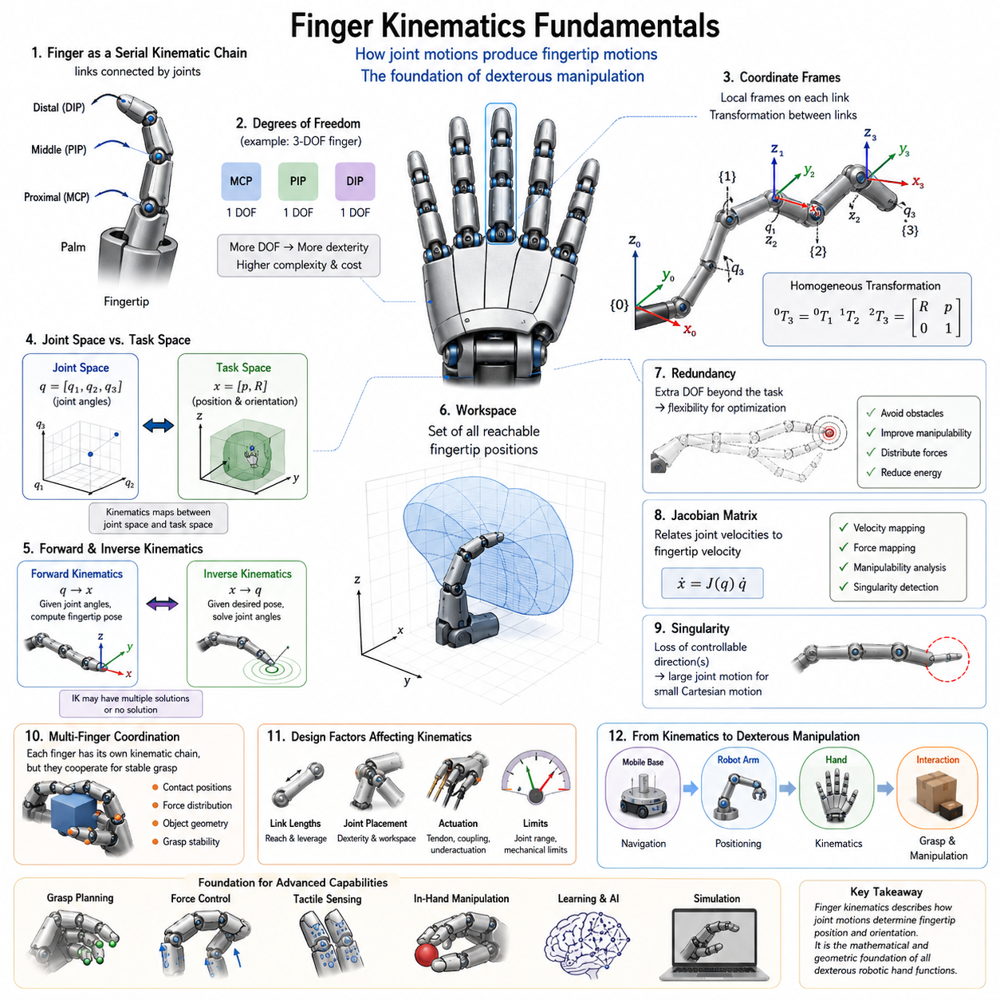
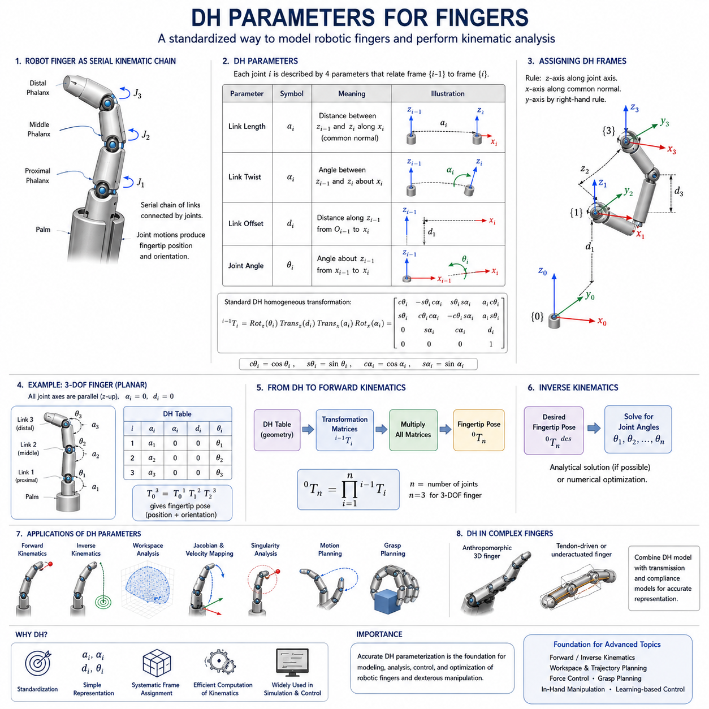
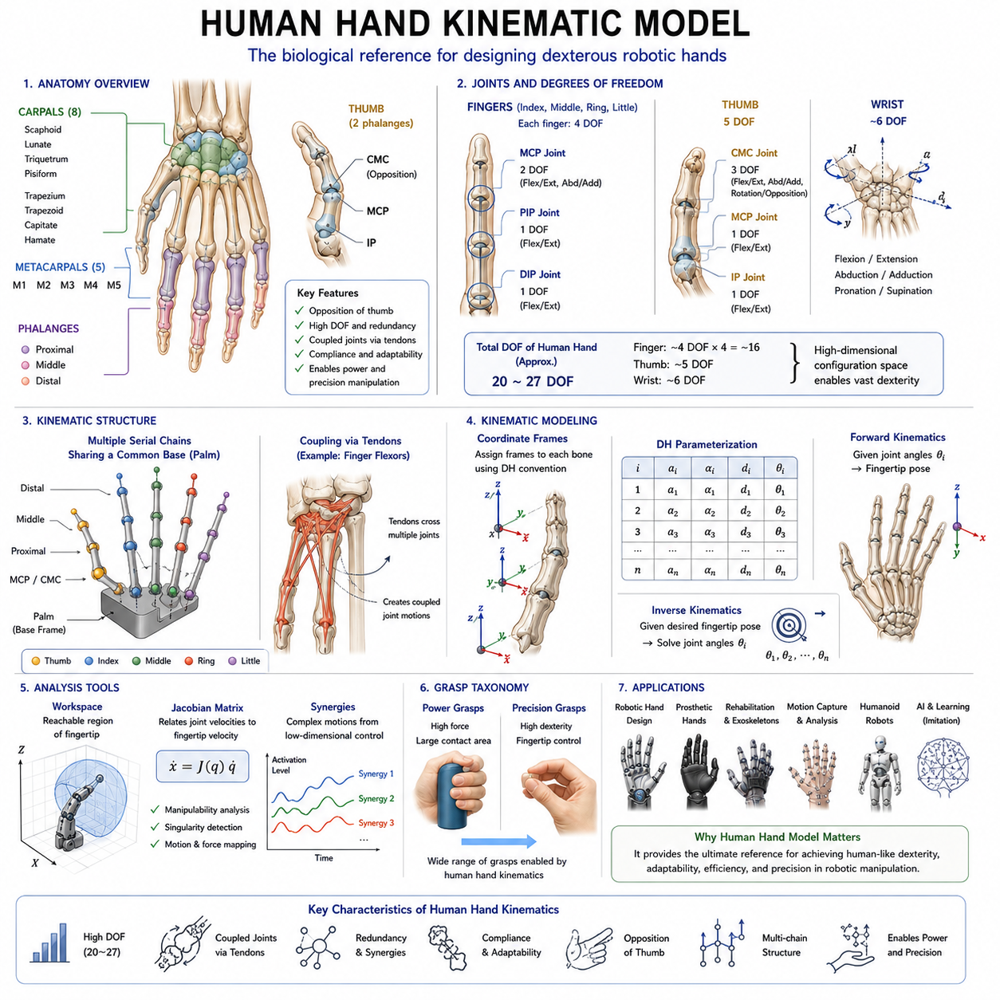
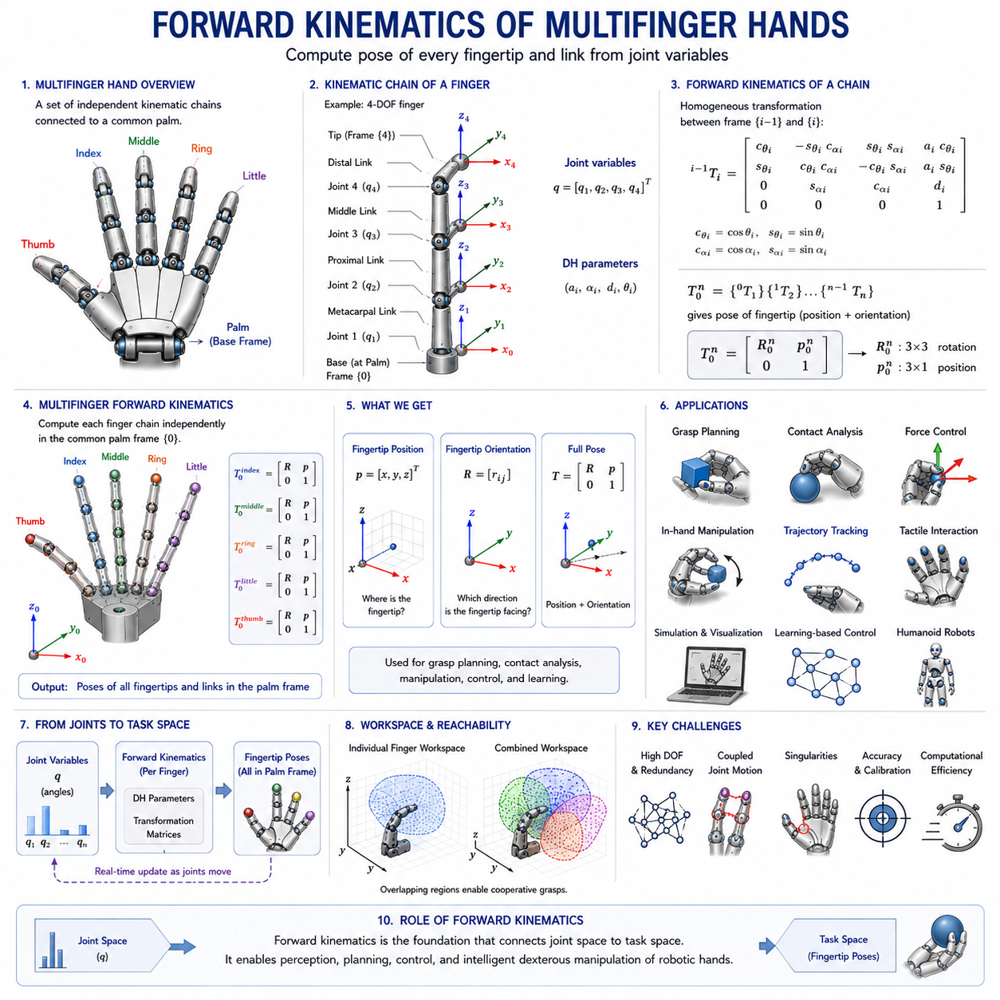
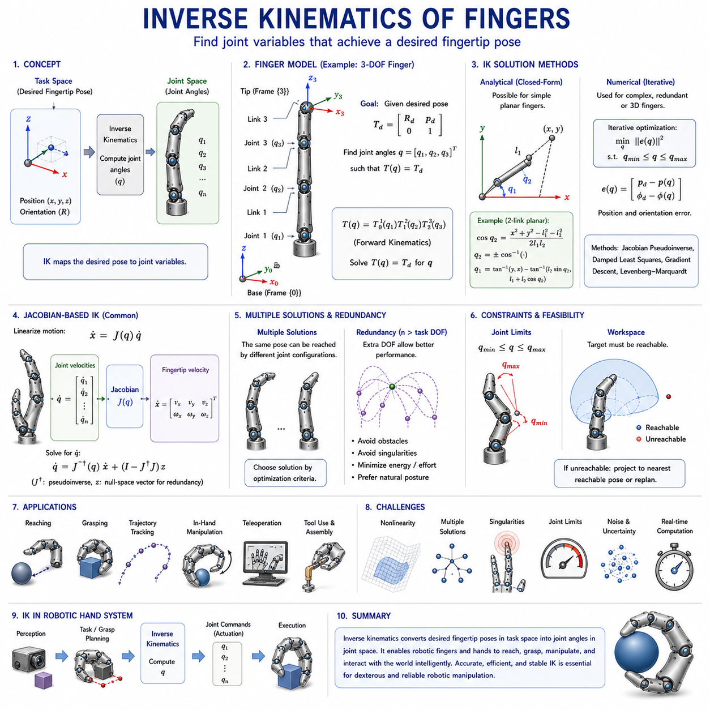
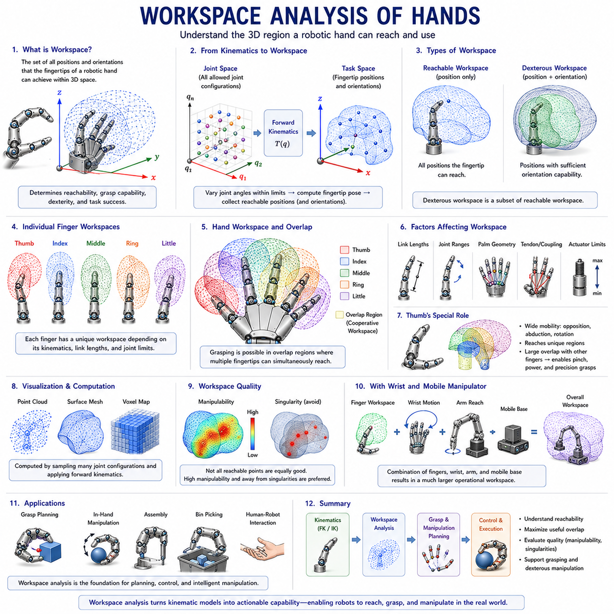
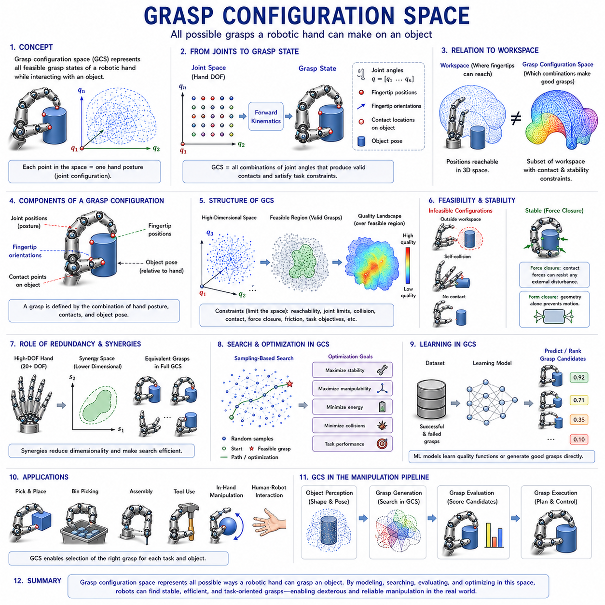
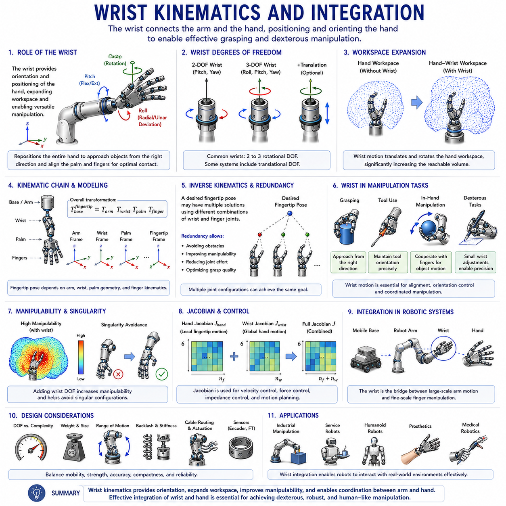
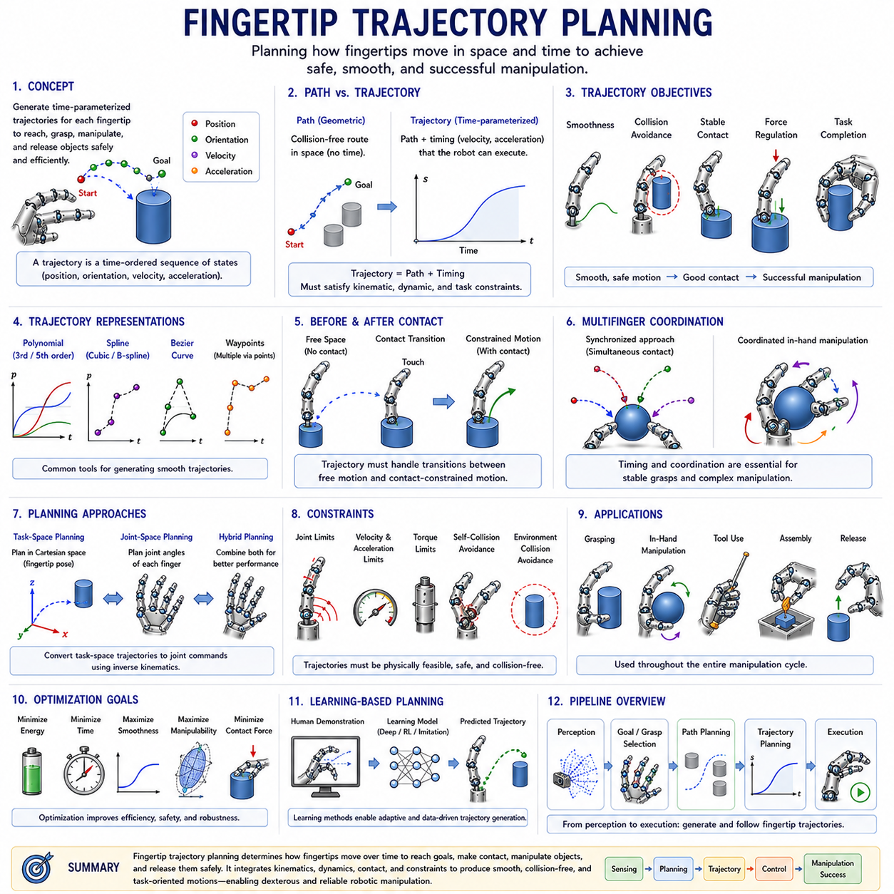
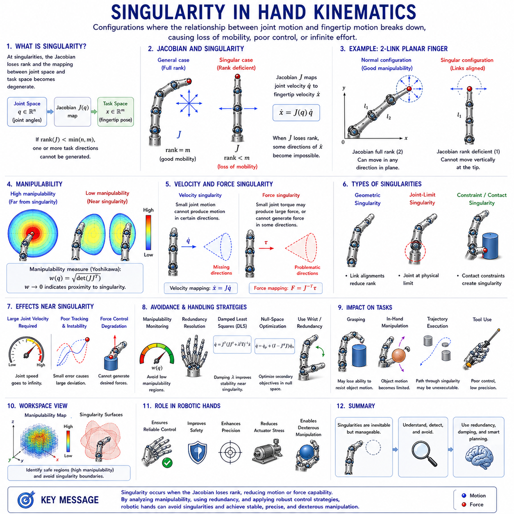

**Volume 06 Robot Hands and Dexterous Grasping**

# 05. Finger and Hand Kinematics

## 05.01 Finger Kinematics Fundamentals

{width="7.268055555555556in" height="7.268055555555556in"}

손가락 운동학(Finger Kinematics)은 로봇 핸드(Robot Hand) 공학에서 가장 기본적이고 중요한 주제 중 하나이다. 이는 로봇 손가락이 어떻게 움직이고, 물체와 어떻게 상호작용하며, 정교한 조작(Dexterous Manipulation)을 어떻게 수행하는지를 설명하는 수학적·기하학적 기반을 제공하기 때문이다. 로봇 핸드 및 정교한 그리핑(Dexterous Grasping) 분야 전체에서 운동학은 기계 설계(Mechanical Design)와 지능형 조작(Intelligent Manipulation)을 연결하는 핵심 역할을 수행한다. 로봇이 물체를 잡고, 회전시키고, 재배치하거나 조립하기 위해서는 먼저 각 관절(Joint)의 움직임이 손끝(Fingertip)의 움직임에 어떤 영향을 미치는지 이해해야 한다. 따라서 손가락 운동학은 그립 계획(Grasp Planning), 힘 제어(Force Control), 촉각 센싱(Tactile Sensing), 손 안 조작(In-Hand Manipulation), 학습 기반 조작(Learning-Based Manipulation)의 기초가 된다. 본 장은 Robot Hand and Dexterous Grasping 볼륨의 Finger and Hand Kinematics 파트의 첫 번째 핵심 장으로서 이후의 순기구학(Forward Kinematics), 역기구학(Inverse Kinematics), 작업공간 분석(Workspace Analysis), 손끝 궤적 계획(Fingertip Trajectory Planning), 그리고 그립 구성 공간(Grasp Configuration Space)에 필요한 기초 개념을 제공한다.

로봇 손가락은 일반적으로 강체 링크(Rigid Link)와 관절(Joint)로 구성된 직렬 운동학 체인(Serial Kinematic Chain)으로 표현된다. 이러한 구조는 로봇 팔(Robot Arm)과 매우 유사하지만 크기가 훨씬 작고 손바닥(Palm) 주변의 제한된 공간에서 동작한다는 차이가 있다. 손가락은 여러 개의 링크와 관절로 구성되며, 관절이 회전하거나 이동함에 따라 손끝의 위치와 방향이 변화한다. 손가락 운동학의 가장 중요한 목적은 관절 운동과 손끝 운동 사이의 관계를 수학적으로 정의하는 것이다. 이를 통해 설계자는 손가락이 어떻게 움직이는지 예측하고, 특정 위치에 도달 가능한지 판단하며, 원하는 그립 자세를 만들기 위한 관절 명령을 계산할 수 있다.

손가락 운동학의 출발점은 자유도(Degrees of Freedom, DOF) 개념이다. 자유도는 기계 시스템의 자세를 정의하기 위해 필요한 독립 변수의 개수를 의미한다. 인간의 손가락은 매우 우수한 생체 모방(Bio-Inspired) 모델이다. 일반적인 인간 손가락은 중수지절관절(MCP), 근위지절관절(PIP), 원위지절관절(DIP)로 구성되어 있으며, 이러한 관절들이 협력하여 굽힘(Flexion), 신전(Extension), 측면 운동(Lateral Motion)을 가능하게 한다. 로봇 손가락은 보통 구조를 단순화하면서도 필요한 기능을 유지하도록 설계된다. 일부 산업용 그리퍼는 1자유도만 가지지만, 고성능 다지형 핸드(Multi-Finger Hand)는 손가락 하나당 3\~4개 이상의 자유도를 갖기도 한다. 자유도의 수는 로봇의 조작성(Dexterity), 제어 난이도, 기계적 복잡성, 비용에 직접적인 영향을 미친다.

운동학 분석을 위해서는 좌표계(Coordinate Frame)를 정의해야 한다. 손가락의 각 링크에는 고유한 기준 좌표계가 부여되며, 이를 통해 인접 링크와의 위치 및 자세 관계를 표현한다. 좌표계의 정의는 매우 중요하며, 이후의 모든 운동학 계산은 이 기준에 의존한다. 일반적으로 좌표계는 관절 위치에 부착되며, 링크 간의 관계는 회전 행렬(Rotation Matrix)과 이동 벡터(Translation Vector)를 이용해 표현된다. 동차 변환(Homogeneous Transformation)을 사용하면 여러 관절의 움직임을 하나의 통합된 수학적 표현으로 결합할 수 있으며, 이를 통해 손바닥 기준에서 손끝의 위치와 자세를 계산할 수 있다.

손가락 운동학에서 중요한 개념 중 하나는 관절 공간(Joint Space)과 작업 공간(Task Space)의 구분이다. 관절 공간은 관절 각도나 변위와 같은 내부 변수들로 구성된다. 반면 작업 공간은 실제 손끝이 움직이는 물리적 공간을 의미한다. 예를 들어 제어 시스템은 "손끝을 물체 표면의 특정 위치로 이동시켜라"라는 작업 공간 명령을 생성할 수 있다. 운동학 모델은 이러한 작업 공간 명령을 관절 공간 명령으로 변환한다. 이 두 공간 간의 관계를 이해하는 것은 그립 계획과 조작 제어의 핵심이다.

손가락 운동학은 평면 운동학(Planar Kinematics)과 공간 운동학(Spatial Kinematics)으로 나눌 수 있다. 평면 운동학은 모든 움직임이 2차원 평면에서 발생한다고 가정한다. 이는 교육 및 개념 설명에 유용하며 수학적으로 단순하다. 반면 공간 운동학은 실제 로봇 손이 수행하는 3차원 운동을 표현한다. 실제 환경에서의 물체 조작은 다양한 방향과 자세를 요구하기 때문에 대부분의 실용적인 로봇 핸드는 공간 운동학 모델을 사용한다.

로봇 손가락의 움직임은 관절 회전의 연속적인 누적 결과이다. 손가락의 기저부에 가까운 관절은 그 이후에 위치한 모든 링크의 움직임에 영향을 미친다. 반면 끝부분의 관절은 제한된 영역에만 영향을 준다. 이러한 계층적 구조 때문에 관절 변수와 손끝 위치 사이의 관계는 비선형적이다. 작은 관절 변화가 큰 손끝 이동을 유발할 수도 있으며, 반대로 큰 관절 변화가 비교적 작은 손끝 이동을 만들 수도 있다. 이러한 특성을 이해하는 것은 효율적인 손가락 설계와 제어 시스템 개발에 필수적이다.

순기구학(Forward Kinematics)은 손가락 운동학의 가장 기본적인 문제이다. 순기구학에서는 관절 각도가 주어졌을 때 손끝의 위치와 방향을 계산한다. 이를 위해 각 링크와 관절의 변환 행렬을 순차적으로 곱한다. 최종 결과는 손바닥 기준에서의 손끝 자세(Fingertip Pose)이다. 순기구학은 계산량이 적고 실시간 제어에 적합하기 때문에 시뮬레이션, 충돌 검사, 상태 추정, 시각화 등에 널리 사용된다.

역기구학(Inverse Kinematics)은 그 반대의 문제를 다룬다. 원하는 손끝 위치와 방향이 주어졌을 때 필요한 관절 각도를 계산하는 것이다. 역기구학은 순기구학보다 훨씬 복잡하다. 하나의 손끝 위치에 대해 여러 개의 관절 해가 존재할 수 있으며, 경우에 따라서는 해가 존재하지 않을 수도 있다. 이러한 특성 때문에 역기구학은 수치해석 기법이나 최적화 알고리즘과 함께 사용되는 경우가 많다. 역기구학은 그립 생성, 조작 계획, 경로 생성 등에서 핵심적인 역할을 수행한다.

작업공간(Workspace)은 손끝이 도달 가능한 모든 위치의 집합이다. 작업공간 분석은 손가락 설계가 특정 작업에 적합한지 평가하는 데 사용된다. 작업공간의 형태와 크기는 링크 길이, 관절 범위, 기계적 제한, 손바닥 구조 등에 의해 결정된다. 넓은 작업공간은 다양한 물체를 다룰 수 있게 해주며, 특정 작업에 최적화된 작업공간은 정밀도와 힘 전달 성능을 향상시킬 수 있다.

중복 자유도(Redundancy) 역시 중요한 개념이다. 로봇 손가락이 작업 수행에 필요한 자유도보다 더 많은 자유도를 가진 경우 이를 운동학적 중복성이라고 한다. 중복성은 장애물 회피, 자세 최적화, 에너지 절감, 힘 분배 최적화 등의 장점을 제공한다. 인간 손 역시 높은 수준의 중복성을 가지고 있으며, 동일한 손끝 위치를 다양한 관절 자세로 구현할 수 있다.

손가락 운동학은 여러 개의 손가락이 동시에 동작하는 다지형 핸드(Multi-Finger Hand)에서는 더욱 복잡해진다. 각 손가락은 독립적인 운동학 체인이지만, 안정적인 그립과 조작을 위해 서로 협력해야 한다. 이 과정에서 물체 형상, 접촉 위치, 힘 분배와 같은 추가 제약 조건이 등장한다. 결과적으로 로봇 핸드는 하나의 손바닥을 공유하는 여러 개의 직렬 운동학 체인의 집합으로 볼 수 있다.

운동학 구조는 기계 설계와도 밀접하게 연관된다. 링크 길이는 작업공간과 힘 전달 특성을 결정하며, 관절 배치는 조작성과 도달 범위를 결정한다. 텐던 구동(Tendon-Driven) 구조는 액추에이터 운동과 관절 운동 사이에 복잡한 결합 관계를 형성한다. 언더액추에이티드 핸드(Underactuated Hand)는 모든 관절이 독립적으로 제어되지 않기 때문에 운동학 분석이 더욱 어려워진다. 이러한 경우에는 기계적 순응성(Compliance)과 환경과의 상호작용까지 고려해야 한다.

인간 손을 모방한 생체 영감형(Bio-Inspired) 로봇 핸드는 운동학 연구에서 중요한 참고 모델이다. 인간 손은 자연계에서 가장 정교한 조작 시스템 중 하나이며, 정밀 그립, 파워 그립, 도구 사용, 미세 조작을 수행할 수 있다. 인간 손의 운동학은 관절 결합, 텐던 구동, 다손가락 협조 동작 등의 특징을 포함한다. 이러한 구조를 연구함으로써 엔지니어들은 더욱 높은 수준의 조작 능력을 가진 로봇 핸드를 설계할 수 있다.

손끝 자세(Fingertip Pose)는 단순히 위치만 의미하지 않는다. 실제 조작 작업에서는 방향(Orientation)도 매우 중요하다. 커넥터 삽입, 나사 조립, 공구 사용, 실험실 장비 조작과 같은 작업에서는 손끝의 위치와 방향이 동시에 정확해야 한다. 따라서 운동학 모델은 위치 벡터뿐만 아니라 회전 행렬, 오일러 각(Euler Angle), 쿼터니언(Quaternion) 등을 사용하여 자세를 표현한다.

특이점(Singularity)은 손가락 운동학에서 반드시 고려해야 하는 현상이다. 특이점은 특정 자세에서 운동 능력이 일부 상실되는 상태를 의미한다. 특이점 근처에서는 작은 손끝 움직임을 위해 매우 큰 관절 움직임이 필요해질 수 있으며, 제어 안정성이 저하될 수 있다. 따라서 경로 계획기와 제어기는 일반적으로 특이점 회피 전략을 포함한다.

자코비안 행렬(Jacobian Matrix)은 현대 손가락 운동학의 핵심 도구이다. 자코비안은 관절 속도와 손끝 속도 사이의 관계를 정의한다. 이를 통해 속도 전달, 힘 전달, 조작성 분석(Manipulability Analysis), 특이점 검출 등을 수행할 수 있다. 또한 임피던스 제어(Impedance Control), 힘 제어(Force Control), 작업 공간 제어(Operational Space Control)의 기반이 된다.

최근에는 해석적 모델뿐만 아니라 수치해석 및 시뮬레이션 기반 접근법도 중요해지고 있다. 현대 로봇 시뮬레이터는 손가락 운동을 시각화하고, 작업공간을 분석하며, 그립 전략을 검증할 수 있는 환경을 제공한다. 이를 통해 실제 프로토타입 제작 이전에 설계를 최적화하고 문제를 사전에 발견할 수 있다.

모바일 매니퓰레이터(Mobile Manipulator)와 체화 인공지능(Embodied AI) 시스템의 관점에서 보면, 손가락 운동학은 전체 조작 체계의 마지막 단계에 위치한다. 이동 플랫폼은 목표 지점까지 이동하고, 로봇 팔은 손을 목표 물체 근처로 위치시키며, 손가락 운동학은 최종적으로 물체와의 접촉 및 그립을 수행한다. 따라서 인공지능이 아무리 발전하더라도 실제 세계와의 물리적 상호작용은 결국 손가락 운동학에 의해 결정된다.

미래의 로봇 핸드는 더 많은 자유도, 고성능 촉각 센서, 가변 강성 메커니즘, AI 기반 조작 전략을 통합하게 될 것이다. 그러나 이러한 모든 기술은 손가락 구조가 어떻게 움직이고 환경과 상호작용하는지에 대한 정확한 이해를 전제로 한다. 따라서 손가락 운동학은 단순한 이론 분야가 아니라 차세대 로봇 핸드 개발의 핵심 공학 분야이다. 이는 기계 구조, 제어 알고리즘, 센서 시스템, 인공지능을 하나의 통합된 조작 시스템으로 연결하는 공통 언어이며, 미래의 정교한 로봇 조작 기술을 실현하기 위한 가장 기본적인 토대라고 할 수 있다.

## 05.02 DH Parameters for Fingers

{width="7.268055555555556in" height="7.268055555555556in"}

Denavit--Hartenberg(DH) 파라미터는 로봇 운동학(Robot Kinematics)에서 가장 중요한 수학적 도구 중 하나로, 로봇 메커니즘의 인접 링크(Link) 사이의 기하학적 관계를 표준화된 방식으로 표현하기 위한 방법이다. 로봇 핸드(Robot Hand)와 정교한 조작(Dexterous Manipulation) 분야에서 DH 파라미터는 손가락의 구조를 모델링하고, 손끝(Fingertip)의 위치를 계산하며, 작업공간(Workspace)을 분석하고, 경로 계획(Motion Planning) 및 제어 알고리즘(Control Algorithm)을 개발하는 핵심 기반을 제공한다.

로봇 손가락은 크기는 작지만 본질적으로 여러 개의 링크와 관절(Joint)이 직렬로 연결된 직렬 운동학 체인(Serial Kinematic Chain)이다. 따라서 산업용 로봇 팔(Robot Arm)에 사용되는 운동학 이론을 그대로 적용할 수 있다. Finger and Hand Kinematics 분야에서 DH 파라미터는 기본 운동학과 순기구학(Forward Kinematics), 역기구학(Inverse Kinematics), 작업공간 분석, 다손가락 협조(Multi-Finger Coordination)를 연결하는 핵심 역할을 수행한다. 따라서 로봇 핸드를 설계하거나 시뮬레이션하고 제어하려는 엔지니어에게 DH 파라미터는 필수적인 지식이다.

DH 방법론이 등장하기 전에는 엔지니어들이 각 링크 사이의 관계를 임의의 좌표계로 정의하는 경우가 많았다. 이로 인해 운동학 모델이 복잡해지고 서로 다른 시스템 간 비교가 어려웠다. DH 방법은 모든 링크와 관절에 대해 일관된 방식으로 좌표계를 부여하고, 이를 통해 로봇 구조를 소수의 기하학적 변수만으로 표현할 수 있도록 만들었다. 그 결과 변환 행렬(Transformation Matrix)의 생성이 간단해졌고, 자동화된 운동학 계산이 가능해졌다.

로봇 손가락은 여러 개의 관절로 연결된 링크 구조로 이루어진다. 각 관절은 인접 링크 사이의 상대 운동을 생성한다. DH 파라미터의 목적은 이러한 상대 운동을 최소한의 기하학적 변수로 표현하는 것이다. DH 방법은 인접한 좌표계 사이의 관계를 단 네 개의 변수로 표현하며, 이 네 개의 변수만으로 전체 운동학 구조를 정의할 수 있다.

첫 번째 DH 파라미터는 링크 길이(Link Length)이며 일반적으로 (a_i)로 표현된다. 링크 길이는 두 개의 인접한 관절축(Joint Axis) 사이의 거리를 의미한다. 로봇 손가락에서는 각 마디(Phalanx)의 길이에 해당한다. 근위지(Proximal Phalanx), 중위지(Middle Phalanx), 원위지(Distal Phalanx)의 길이는 손가락의 도달 범위(Reachability)와 조작성(Dexterity)을 결정하는 중요한 요소이다. 링크 길이가 길어질수록 작업공간은 넓어지지만 강성(Stiffness)이 감소할 수 있으며, 반대로 짧아질수록 강성은 증가하지만 도달 범위는 감소한다.

두 번째 파라미터는 링크 비틀림 각(Link Twist Angle)이며 ( \\alpha_i )로 표현된다. 이 값은 인접한 두 관절축 사이의 각도 관계를 나타낸다. 단순한 평면형(Planar) 손가락에서는 대부분 관절축이 서로 평행하므로 비틀림 각이 0이 된다. 그러나 인간 손을 모방한 고급 로봇 핸드나 다축 구조에서는 관절축이 서로 기울어져 있기 때문에 비틀림 각이 중요한 역할을 한다. 이 파라미터를 통해 3차원 공간상의 복잡한 손가락 구조를 정확하게 표현할 수 있다.

세 번째 파라미터는 링크 오프셋(Link Offset)이며 ( d_i )로 표현된다. 이는 관절축 방향으로 측정되는 인접 좌표계 간의 거리이다. 대부분의 로봇 손가락은 회전 관절(Revolute Joint)을 사용하기 때문에 링크 오프셋은 고정값인 경우가 많다. 하지만 슬라이딩 구조나 특수 적응형 손가락에서는 오프셋이 중요한 역할을 수행할 수 있다.

네 번째 파라미터는 관절각(Joint Angle)이며 ( \\theta_i )로 표현된다. 관절각은 인접한 링크 사이의 회전량을 나타낸다. 로봇 손가락에서 실제로 변화하는 변수는 대부분 이 관절각이다. 액추에이터(Actuator)가 동작하면 관절각이 변화하고, 이에 따라 손끝의 위치와 방향이 변한다. 따라서 관절각은 로봇 손가락의 제어 입력(Control Input)에 해당한다.

DH 방법의 가장 큰 장점은 이 네 개의 변수만으로 매우 복잡한 손가락 구조를 표현할 수 있다는 점이다. 각 관절마다 하나의 동차 변환 행렬(Homogeneous Transformation Matrix)을 생성할 수 있으며, 이 행렬은 회전과 이동 정보를 동시에 포함한다. 이러한 행렬들을 순차적으로 곱하면 손바닥(Palm) 기준에서 손끝의 위치와 방향을 계산할 수 있다. 이것이 바로 순기구학의 핵심 원리이다.

DH 방법을 적용하기 위해서는 먼저 좌표계(Coordinate Frame)를 정의해야 한다. 표준 DH 규칙에서는 각 관절의 회전축을 z축으로 정의한다. 이후 인접한 z축을 연결하는 방향을 x축으로 설정하고, y축은 오른손 법칙(Right-Hand Rule)을 사용하여 결정한다. 실제 로봇 손가락은 공간이 매우 제한적이고 구조가 복잡하기 때문에 좌표계 배치가 쉽지 않은 경우가 많다. 그러나 정확한 좌표계 정의는 올바른 DH 파라미터 생성의 전제 조건이다.

예를 들어 근위지, 중위지, 원위지의 세 개의 링크로 구성된 3자유도 손가락을 생각해 보자. 각 관절은 하나의 굽힘(Flexion) 자유도를 제공한다. DH 규칙에 따라 좌표계를 정의하면 각 관절은 하나의 DH 파라미터 집합으로 표현된다. 이후 변환 행렬을 연속적으로 곱하면 손끝의 위치와 자세(Pose)를 계산할 수 있다. 단순한 구조임에도 불구하고 DH 방법은 모델링 과정을 매우 체계적으로 만들어 준다.

인간 손을 모방한 고성능 로봇 핸드에서는 상황이 더욱 복잡해진다. 인간 손은 힘줄(Tendon) 기반 구조와 관절 간 결합(Coupling)을 포함한다. 이러한 경우 기본 DH 모델만으로는 충분하지 않을 수 있으며, 힘줄 모델(Tendon Model), 관절 결합 모델(Joint Coupling Model), 생체역학 모델(Biomechanical Model)을 추가해야 한다. 그럼에도 불구하고 DH 파라미터는 여전히 전체 운동학 모델의 중심 역할을 수행한다.

DH 파라미터의 가장 대표적인 활용 분야는 순기구학이다. 순기구학은 관절각이 주어졌을 때 손끝의 위치와 방향을 계산한다. 각 관절의 DH 파라미터를 이용하여 변환 행렬을 생성하고 이를 순차적으로 곱하면 손끝 자세(Fingertip Pose)를 얻을 수 있다. 이러한 계산은 시뮬레이션, 충돌 검출(Collision Detection), 경로 계획, 시각화, 제어 등 거의 모든 로봇 소프트웨어의 기본 기능으로 사용된다.

역기구학 역시 DH 파라미터에 기반한다. 역기구학에서는 원하는 손끝 위치와 방향이 주어졌을 때 필요한 관절각을 계산한다. DH 모델은 관절 변수와 손끝 위치 사이의 관계를 정의하므로 역기구학 문제를 해결하기 위한 수학적 기반이 된다. 간단한 구조는 해석적 방법(Analytical Method)으로 풀 수 있지만, 복잡한 다관절 손가락은 수치 최적화(Numerical Optimization)를 사용하는 경우가 많다.

작업공간 분석 또한 DH 모델을 기반으로 수행된다. 모든 가능한 관절각 조합에 대해 순기구학을 반복적으로 계산하면 손끝이 도달 가능한 영역을 구할 수 있다. 이를 통해 설계자는 손가락의 도달 범위와 조작성, 그립 가능 영역을 분석할 수 있다. 링크 길이나 관절 범위를 변경했을 때 작업공간이 어떻게 달라지는지 평가하는 데도 매우 유용하다.

자코비안 행렬(Jacobian Matrix) 역시 DH 모델로부터 유도된다. 자코비안은 관절 속도와 손끝 속도 사이의 관계를 나타낸다. 이를 통해 속도 제어(Velocity Control), 힘 제어(Force Control), 조작성 분석(Manipulability Analysis), 특이점 검출(Singularity Detection)을 수행할 수 있다. 현대 로봇 핸드 제어기의 상당수는 실시간으로 자코비안을 계산하여 제어에 활용한다.

특이점(Singularity) 분석 역시 DH 모델의 중요한 응용 분야이다. 특이점은 특정 자세에서 자코비안의 계수(rank)가 감소하여 운동 자유도가 부분적으로 상실되는 상태를 의미한다. 이러한 상태에서는 작은 손끝 움직임을 위해 매우 큰 관절 운동이 필요해질 수 있다. 따라서 엔지니어들은 DH 기반 모델을 이용하여 특이점 영역을 분석하고 이를 회피하는 제어 전략을 개발한다.

최근의 로봇 핸드는 텐던 구동(Tendon-Driven) 및 언더액추에이티드(Underactuated) 구조를 많이 사용한다. 이러한 구조에서는 액추에이터 운동과 관절 운동이 단순한 일대일 관계가 아니다. 이 경우에도 DH 파라미터는 기본적인 기하학 구조를 표현하지만, 추가적으로 텐던 전달 모델, 풀리(Pulley) 모델, 탄성 요소(Elastic Element) 모델 등을 함께 고려해야 한다.

다손가락 로봇 핸드에서는 각 손가락이 독립적인 DH 파라미터 집합을 가진다. 그러나 물체를 잡을 때는 여러 손가락이 동시에 협력해야 한다. 이때 각각의 DH 모델을 결합하여 그립 자세, 힘 분배, 손 안 조작(In-Hand Manipulation) 등을 분석할 수 있다. 따라서 다손가락 조작에서는 여러 개의 DH 모델이 동시에 사용된다.

ROS 2, MoveIt 2, Gazebo, Isaac Sim, MuJoCo, Webots와 같은 현대 로봇 시뮬레이션 환경 역시 DH 개념과 밀접한 관련이 있다. 실제로는 URDF(Unified Robot Description Format)를 사용하지만, 그 내부의 운동학 계산은 DH 방법과 동일한 원리를 기반으로 한다. 따라서 DH 파라미터를 이해하면 로봇 소프트웨어의 내부 동작 원리를 보다 깊이 이해할 수 있다.

기계 설계 측면에서도 DH 파라미터는 매우 유용하다. 설계자는 링크 길이, 관절 위치, 축 방향 등을 변경하면서 작업공간과 조작성 변화를 빠르게 평가할 수 있다. 따라서 DH 모델은 상세 설계 이전 단계에서 다양한 구조를 비교·평가하는 강력한 도구가 된다.

휴머노이드 로봇(Humanoid Robot)이나 초정밀 로봇 핸드에서는 DH 파라미터의 정확성이 더욱 중요하다. 공구 사용(Tool Use), 정밀 조립(Precision Assembly), 의료 로봇(Medical Robotics), 실험실 자동화(Laboratory Automation)와 같은 작업은 밀리미터 이하 수준의 위치 정확도를 요구한다. 따라서 실제 시스템에서는 DH 파라미터를 실험 데이터를 이용해 보정(Calibration)하는 경우가 많다.

최근 강화학습(Reinforcement Learning), 모방학습(Imitation Learning), 파운데이션 모델(Foundation Model) 기반의 조작 시스템이 등장했지만 DH 파라미터의 중요성은 여전히 변하지 않았다. 학습 기반 시스템 역시 시뮬레이션 환경에서 학습을 수행하며, 이 환경은 정확한 운동학 모델을 필요로 한다. 결국 현대의 AI 기반 조작 시스템도 전통적인 운동학 모델 위에서 동작한다고 볼 수 있다.

Robot Hand and Dexterous Grasping 전체 구조에서 DH 파라미터는 거의 모든 후속 주제의 기반이 된다. 순기구학, 역기구학, 작업공간 분석, 손끝 궤적 계획(Fingertip Trajectory Planning), 특이점 분석, 힘 제어, 그립 계획, 손 안 조작 등은 모두 DH 파라미터에 의해 정의된 운동학 모델을 기반으로 한다.

미래의 로봇 핸드가 인간 수준의 조작 능력에 가까워질수록 정밀한 운동학 모델링의 중요성은 더욱 커질 것이다. 인공지능, 촉각 센서, 소프트 로보틱스, 파운데이션 모델이 발전하더라도 실제 손가락의 움직임은 결국 물리적 구조와 기하학적 관계에 의해 결정된다. DH 파라미터는 이러한 구조를 체계적이고 수학적으로 표현하는 가장 강력한 방법 중 하나이며, 현대 로봇 핸드와 정교한 조작 시스템을 구축하기 위한 핵심 기반 기술이라고 할 수 있다.

## 05.03 Human Hand Kinematic Models

{width="7.268055555555556in" height="7.268055555555556in"}

인간의 손(Human Hand)은 자연계에서 가장 정교한 생체역학 시스템(Biomechanical System) 중 하나로 평가되며, 현대 로봇 핸드(Robot Hand) 개발의 가장 중요한 참고 모델로 사용된다. 강한 힘으로 물체를 잡는 파워 그립(Power Grasp)부터 바늘에 실을 꿰는 수준의 정밀 조작(Precision Manipulation)까지 수행할 수 있는 능력은 수십 년 동안 로봇공학, 생체역학(Biomechanics), 신경과학(Neuroscience), 의수(Prosthetics), 인간-기계 상호작용(Human-Machine Interaction) 분야의 연구를 이끌어 왔다. 로봇 조작(Robotic Manipulation) 분야에서 인간 손 운동학 모델은 특히 중요하다. 이는 로봇 손가락, 인간형 핸드(Anthropomorphic Hand), 휴머노이드 로봇(Humanoid Robot), 의수, 그리고 차세대 정교한 조작 시스템을 설계하기 위한 이론적·실용적 기반을 제공하기 때문이다.

Finger and Hand Kinematics 분야에서 인간 손 모델은 손가락 운동학(Finger Kinematics)과 DH 파라미터(DH Parameters) 개념을 확장한 결과물이라고 볼 수 있다. 인간 손은 뼈(Bone), 관절(Joint), 힘줄(Tendon), 근육(Muscle), 인대(Ligament), 신경 제어(Neural Control)가 복합적으로 통합된 시스템이며, 매우 높은 수준의 조작성(Dexterity)을 제공하면서도 구조적으로 효율적이고 견고하다. 이러한 특성 때문에 인간 손은 오늘날 대부분의 고성능 로봇 핸드 설계의 궁극적인 목표가 되고 있다.

운동학적 관점에서 인간 손은 복잡한 다중 연결 기구(Multi-Chain Articulated Mechanism)로 볼 수 있다. 일반적인 산업용 로봇 팔이 하나의 직렬 운동학 체인(Serial Kinematic Chain)으로 구성되는 것과 달리 인간 손은 여러 개의 운동학 체인이 손바닥(Palm)을 공유하는 구조를 가진다. 각 손가락은 독립적인 조작기(Manipulator)처럼 동작하지만 동시에 다른 손가락과 협력하여 물체를 안정적으로 파지하고 조작한다. 이러한 독립성과 협력성의 조합이 인간 손을 매우 강력한 조작 시스템으로 만든다.

인간 손의 골격(Skeleton)은 총 27개의 뼈로 구성된다. 이들은 크게 손목(Wrist)을 구성하는 수근골(Carpal Bones), 손바닥을 구성하는 중수골(Metacarpal Bones), 그리고 손가락을 구성하는 지골(Phalanges)로 나누어진다. 손목은 8개의 수근골로 구성되어 있으며 유연성과 충격 분산 기능을 제공한다. 손바닥은 5개의 중수골로 구성되어 손의 기본 구조를 형성한다. 검지(Index Finger), 중지(Middle Finger), 약지(Ring Finger), 소지(Little Finger)는 각각 3개의 지골을 가지며, 엄지(Thumb)는 2개의 지골만 가진다. 단순해 보이는 이 구조는 다양한 관절과 연부조직(Soft Tissue)의 상호작용을 통해 매우 복잡한 운동 능력을 만들어낸다.

엄지는 인간 손에서 가장 중요한 요소 중 하나이다. 다른 손가락과 달리 엄지는 높은 자유도를 가진 수근중수관절(Carpometacarpal Joint, CMC)을 통해 손바닥에 연결된다. 이 관절은 대립(Opposition) 운동을 가능하게 한다. 대립 운동이란 엄지가 손바닥을 가로질러 이동하여 다른 손가락 끝과 접촉하는 동작을 의미한다. 이러한 능력은 인간이 도구를 사용하고 정밀 작업을 수행할 수 있게 하는 핵심 요소이다. 로봇 핸드 설계에서도 엄지 구조는 전체 조작성의 상당 부분을 결정하기 때문에 매우 중요한 설계 대상이다.

각 손가락에는 여러 개의 관절이 존재한다. 중수지절관절(Metacarpophalangeal Joint, MCP)은 손가락과 손바닥을 연결하며 굽힘-펴기(Flexion-Extension)와 벌림-모음(Abduction-Adduction)의 두 가지 주요 운동을 제공한다. 근위지절관절(Proximal Interphalangeal Joint, PIP)은 주로 굽힘과 펴기 운동을 담당한다. 원위지절관절(Distal Interphalangeal Joint, DIP) 역시 굽힘과 펴기 운동을 수행하며 손끝 위치를 정밀하게 조절하는 역할을 한다. 이러한 관절들이 협력하여 손가락은 넓은 운동 범위를 확보하면서도 안정성을 유지한다.

엄지는 다른 구조를 가진다. 수근중수관절은 다자유도 운동을 제공하며 대립 운동을 가능하게 한다. 중수지절관절(MCP)과 지절관절(Interphalangeal Joint, IP)은 추가적인 회전과 굽힘 운동을 제공한다. 결과적으로 엄지는 다른 손가락과는 완전히 다른 운동학 체인을 형성하며, 이는 정밀 파지와 물체 조작에 필수적이다.

인간 손의 가장 큰 특징 중 하나는 매우 많은 자유도(Degree of Freedom)를 가진다는 점이다. 모델링 방법에 따라 다르지만 일반적으로 인간 손은 약 20\~27 자유도로 표현된다. 각 손가락은 약 4자유도를 제공하며 엄지는 약 5자유도를 가진다. 여기에 손목 운동까지 포함하면 매우 복잡한 운동 공간이 형성된다. 이러한 고차원 운동 공간 덕분에 인간은 무수히 많은 손 자세와 그립 형태를 생성할 수 있다.

흥미로운 점은 인간 손의 모든 자유도가 독립적으로 움직이지 않는다는 것이다. 실제로는 관절 간 결합(Joint Coupling)이 존재한다. 예를 들어 DIP 관절은 PIP 관절과 힘줄을 통해 연결되어 있기 때문에 두 관절은 함께 움직이는 경향이 있다. 이러한 결합 구조는 제어 복잡성을 줄여주며, 인간의 신경계가 효율적으로 손을 제어할 수 있도록 돕는다. 많은 로봇 핸드가 이러한 원리를 모방하여 언더액추에이션(Underactuation)이나 기계적 결합 구조를 적용하고 있다.

운동학 체인(Kinematic Chain)의 개념은 인간 손 모델링의 핵심이다. 각 손가락은 손바닥에서 시작되는 독립적인 직렬 운동학 체인이다. 손바닥은 모든 체인이 공유하는 공통 베이스 역할을 수행한다. 결과적으로 인간 손은 여러 개의 직렬 조작기가 병렬적으로 배치된 구조라고 볼 수 있다. 이러한 구조는 전통적인 산업용 로봇과는 상당히 다르며, 다손가락 협조 제어를 위한 특별한 분석 기법을 필요로 한다.

좌표계(Coordinate Frame)의 정의 역시 중요하다. 로봇 시스템과 마찬가지로 각 뼈와 관절에 좌표계를 부착하여 운동을 수학적으로 표현한다. 이러한 좌표계를 기반으로 손끝 위치와 자세를 계산할 수 있으며, 이를 통해 시뮬레이션, 동작 분석(Motion Analysis), 인간 동작 모방(Human Imitation), 의수 설계 등을 수행할 수 있다.

순기구학(Forward Kinematics)은 인간 손 모델의 주요 활용 분야 중 하나이다. 관절 각도가 주어졌을 때 손끝의 위치와 자세를 계산한다. 이를 통해 특정 손 자세가 실제 공간에서 어떤 형태를 가지는지 분석할 수 있다. 컴퓨터 그래픽스, 가상현실(Virtual Reality), 로봇공학, 생체역학 연구에서 널리 사용된다.

역기구학(Inverse Kinematics)은 원하는 손끝 위치가 주어졌을 때 필요한 관절 각도를 계산한다. 인간 손은 자유도가 많고 중복성(Redundancy)이 존재하기 때문에 역기구학 문제는 매우 복잡하다. 동일한 손끝 위치를 여러 가지 관절 조합으로 구현할 수 있기 때문이다. 그럼에도 불구하고 역기구학은 원격 조작(Teleoperation), 의수 제어, 휴머노이드 로봇 동작 생성에 필수적이다.

인간 손의 작업공간(Workspace)은 매우 복잡하다. 각 손가락은 자신만의 작업공간을 가지며, 여러 손가락의 작업공간이 겹치면서 물체 조작에 필요한 공동 작업 영역을 형성한다. 작업공간 분석은 인간 손의 조작성과 도달 범위를 이해하는 데 매우 중요하다. 많은 로봇 핸드 연구에서는 인간 손과 유사한 작업공간을 달성하는 것을 목표로 한다.

자코비안 행렬(Jacobian Matrix)은 인간 손 운동학에서도 핵심 도구이다. 자코비안은 관절 속도와 손끝 속도 사이의 관계를 표현한다. 이를 통해 조작성 분석(Manipulability Analysis), 특이점(Singularity) 분석, 힘 전달 특성 평가, 고급 제어 알고리즘 개발이 가능해진다. 인간 손은 여러 손가락이 동시에 움직이기 때문에 다손가락 자코비안(Multi-Finger Jacobian)이 자주 사용된다.

인간 손을 이해하기 위해서는 힘줄과 근육을 고려해야 한다. 대부분의 로봇은 모터가 직접 관절을 구동하지만 인간 손은 전완(Forearm)과 손 내부에 위치한 근육이 힘줄을 통해 관절을 움직인다. 힘줄은 여러 관절에 동시에 영향을 미치기 때문에 관절 간 결합 운동을 생성한다. 이러한 구조는 높은 효율성과 적응성을 제공하며, 최근의 고성능 로봇 핸드가 텐던 구동(Tendon-Driven Architecture)을 채택하는 이유이기도 하다.

순응성(Compliance) 또한 인간 손의 중요한 특징이다. 피부, 힘줄, 인대, 연부조직은 자연스러운 탄성과 적응성을 제공한다. 이러한 특성 덕분에 인간 손은 물체의 형태에 맞추어 자동으로 적응할 수 있다. 따라서 매우 정밀한 경로 계획 없이도 안정적인 그립을 형성할 수 있다. 이는 현재 로봇공학이 완전히 재현하지 못한 중요한 능력 중 하나이다.

인간 손의 그립(Grasp)은 일반적으로 파워 그립(Power Grasp)과 정밀 그립(Precision Grasp)으로 분류된다. 파워 그립은 큰 접촉 면적과 강한 힘을 이용하는 방식이며, 정밀 그립은 손끝을 이용하여 물체를 세밀하게 제어하는 방식이다. 인간 손은 두 가지 유형 사이를 매우 자연스럽게 전환할 수 있으며, 이는 뛰어난 운동학 구조 덕분이다.

최근 손 운동학 연구에서 가장 중요한 개념 중 하나는 시너지(Synergy)이다. 연구 결과에 따르면 인간 손의 복잡한 움직임은 소수의 협조된 운동 패턴으로 설명될 수 있다. 신경계는 모든 자유도를 독립적으로 제어하는 대신 여러 관절을 동시에 활성화하는 시너지 패턴을 활용한다. 이러한 개념은 현대 로봇 핸드 설계에 큰 영향을 주었으며, 적은 수의 제어 변수로 복잡한 그립 동작을 생성할 수 있게 해준다.

인간 손 운동학 모델은 의수(Prosthetic Hand) 개발에서도 중요한 역할을 한다. 고성능 의수는 자연스러운 손 동작을 재현해야 하며, 이를 위해서는 정확한 운동학 모델이 필요하다. 또한 재활 로봇(Rehabilitation Robot)과 외골격(Exoskeleton) 시스템도 인간 손 운동학 모델을 기반으로 설계된다.

최근 모션 캡처(Motion Capture) 기술의 발전은 인간 손 연구를 크게 발전시켰다. 광학 추적 시스템(Optical Tracking), 관성 센서(IMU), 자기 추적(Magnetic Tracking), 비전 기반 손 추적(Vision-Based Hand Tracking) 기술을 통해 인간 손의 움직임을 매우 정확하게 측정할 수 있게 되었다. 이러한 데이터는 운동학 모델 검증, 조작 전략 연구, 인공지능 학습 데이터셋 구축에 활용된다.

휴머노이드 로봇의 발전 역시 인간 손 운동학 모델의 중요성을 더욱 높이고 있다. 인간 환경에서 작업하기 위해서는 인간이 사용하는 도구와 장비를 다룰 수 있어야 하며, 이를 위해서는 인간 손과 유사한 운동학적 능력이 필요하다. 따라서 인간 손 모델은 휴머노이드 핸드 설계의 핵심 기준이 된다.

학습 기반 로봇 시스템에서도 인간 손 운동학 모델은 중요한 역할을 한다. 모방학습(Imitation Learning), 행동 복제(Behavior Cloning), 강화학습(Reinforcement Learning), 파운데이션 모델 기반 조작 시스템은 인간 시연 데이터를 학습에 활용한다. 이러한 데이터는 손 운동학 모델을 기반으로 해석되며 로봇의 조작 능력을 향상시키는 데 사용된다.

Robot Hand and Dexterous Grasping 전체 체계에서 Human Hand Kinematic Model은 생체역학, 로봇공학, 인공지능을 연결하는 핵심 기준 모델이다. 손가락 운동학과 DH 파라미터에서 시작된 개념이 인간 손 전체로 확장되며, 이후 다손가락 순기구학, 역기구학, 접촉 역학(Contact Mechanics), 힘 제어(Force Control), 촉각 센싱(Tactile Sensing), 손 안 조작(In-Hand Manipulation) 등 모든 고급 주제의 기반이 된다.

미래의 로봇이 인간 수준의 조작성에 가까워질수록 인간 손 운동학 모델의 중요성은 더욱 커질 것이다. 액추에이터, 센서, 제어기, 인공지능이 아무리 발전하더라도 인간 손은 여전히 최고의 조작 시스템으로 남아 있다. 뛰어난 이동성(Mobility), 적응성(Adaptability), 순응성(Compliance), 효율성(Efficiency), 정밀성(Precision)을 동시에 갖춘 인간 손은 차세대 로봇 핸드 개발을 위한 가장 중요한 영감의 원천이며, 진정한 의미의 Dexterous Manipulation을 구현하기 위한 궁극적인 기준 모델이라고 할 수 있다.

## 05.04 Forward Kinematics of Multifinger Hands

{width="7.268055555555556in" height="7.268055555555556in"}

순기구학(Forward Kinematics)은 로봇공학에서 가장 기본적이면서도 중요한 개념 중 하나이며, 로봇 핸드(Robot Hand)의 운동을 분석하기 위한 수학적 기반을 제공한다. 특히 다손가락 로봇 핸드(Multifinger Robotic Hand)에서 순기구학은 각 관절 변수(Joint Variables)가 주어졌을 때 모든 손가락 끝(Fingertip), 손가락 링크(Link), 그리고 접촉점(Contact Point)의 위치(Position)와 자세(Orientation)를 계산하는 과정을 의미한다.

단일 손가락의 순기구학은 하나의 직렬 운동학 체인(Serial Kinematic Chain)만 다루기 때문에 비교적 단순하다. 그러나 다손가락 핸드는 여러 개의 운동학 체인이 하나의 손바닥(Palm)을 공유하면서 동시에 동작하기 때문에 훨씬 복잡해진다. 인간 수준의 조작성(Dexterity)을 목표로 하는 현대 로봇 핸드에서는 순기구학 모델의 정확성이 매우 중요하다. 이는 그립 계획(Grasp Planning), 접촉 분석(Contact Analysis), 힘 제어(Force Control), 촉각 상호작용(Tactile Interaction), 조작 계획(Manipulation Planning), 그리고 학습 기반 조작(Learning-Based Manipulation)의 기초가 되기 때문이다.

Finger and Hand Kinematics 체계에서 다손가락 순기구학은 개별 손가락 운동학(Finger Kinematics), DH 파라미터(DH Parameters), 그리고 인간 손 운동학 모델(Human Hand Kinematic Model)을 기반으로 발전하는 핵심 주제이다. 개별 손가락의 운동학 구조가 정의되면, 다음 단계는 여러 손가락이 어떻게 하나의 통합된 조작 시스템으로 동작하는지를 분석하는 것이다. 안정적인 그립 형성, 물체 조작, 손 안 조작(In-Hand Manipulation), 공구 사용(Tool Use), 핑거 게이팅(Finger Gaiting)과 같은 모든 고급 기능은 손끝 위치와 자세를 정확히 계산할 수 있어야만 가능하다.

다손가락 로봇 핸드는 하나의 공통 베이스(Common Base)를 공유하는 여러 개의 직렬 운동학 체인의 집합으로 볼 수 있다. 각 손가락은 독립적인 링크, 관절, 좌표계(Coordinate Frame), 운동학 파라미터를 가진다. 그러나 실제 조작 작업에서는 개별 손가락이 아니라 전체 손이 협력하여 물체를 다룬다. 따라서 순기구학 모델은 모든 손가락의 운동 결과를 공통 기준 좌표계로 통합하여 표현해야 한다. 일반적으로 이 기준 좌표계는 손바닥에 정의된다.

순기구학의 가장 중요한 목적은 각 손끝의 자세(Fingertip Pose)를 계산하는 것이다. 로봇공학에서 자세는 위치(Position)와 방향(Orientation)을 모두 포함한다. 위치는 손끝이 공간상 어디에 있는지를 나타내며, 방향은 손끝이 어떤 방향을 향하고 있는지를 나타낸다. 물체를 안정적으로 잡기 위해서는 위치뿐 아니라 방향도 정확해야 한다. 예를 들어 손끝이 목표 위치에 도달하더라도 방향이 잘못되면 안정적인 접촉(Contact)을 형성할 수 없다. 따라서 순기구학은 위치와 방향을 모두 계산해야 한다.

순기구학의 수학적 기반은 동차 변환 행렬(Homogeneous Transformation Matrix)에 있다. 각 관절은 인접한 링크 사이의 회전(Rotation)과 이동(Translation)을 정의한다. 이러한 변환을 행렬 형태로 표현하고 순차적으로 곱하면 손끝의 위치와 방향을 계산할 수 있다. 다손가락 핸드에서는 이 계산을 각 손가락에 대해 독립적으로 수행한 후, 결과를 손바닥 기준 좌표계로 변환하여 전체 손의 상태를 표현한다.

예를 들어 인간 손과 유사한 5손가락 로봇 핸드를 생각해 보자. 각 손가락은 3\~4개의 관절을 가지며, 엄지(Thumb)는 대립(Opposition) 기능을 위해 추가 자유도를 가질 수 있다. 이 경우 각 손가락은 독립적인 변환 체인(Transformation Chain)을 가진다. 검지는 4개의 변환 행렬을 곱해야 할 수 있으며, 엄지는 5개 이상의 변환 행렬을 필요로 할 수 있다. 결국 전체 핸드는 여러 개의 변환 체인이 동시에 동작하는 구조가 된다.

좌표계 설정(Coordinate Frame Assignment)은 다손가락 순기구학에서 매우 중요하다. 각 손가락은 자신의 링크와 관절에 부착된 지역 좌표계(Local Frame)를 가진다. 동시에 손가락의 기준 좌표계는 손바닥에 연결된다. 손바닥은 전체 핸드의 글로벌 좌표계(Global Frame)가 된다. 이러한 구조 덕분에 서로 다른 손가락의 손끝 위치를 동일한 기준에서 비교하고 협조 동작을 수행할 수 있다.

DH 파라미터(Denavit-Hartenberg Parameters)는 다손가락 순기구학 모델을 구축하는 대표적인 방법이다. 각 손가락은 고유한 DH 파라미터 테이블을 가지며, 이를 기반으로 변환 행렬을 생성한다. 모든 손가락이 동일한 수학적 프레임워크를 사용하기 때문에 전체 핸드의 모델링과 분석이 효율적으로 수행될 수 있다.

순기구학의 가장 중요한 결과 중 하나는 손끝 위치(Fingertip Position)의 계산이다. 손끝 위치는 로봇 핸드가 어떤 영역에 접근할 수 있는지를 결정한다. 그립 계획 과정에서는 손끝 위치와 물체의 형상을 비교하여 접촉 가능한 지점을 찾는다. 조작 과정에서는 손끝 위치를 지속적으로 추적하여 계획된 경로를 정확하게 따라가도록 한다.

손끝 방향(Fingertip Orientation) 역시 매우 중요하다. 방향은 손끝이 물체에 접근하는 방식을 결정하며 접촉 안정성에 직접적인 영향을 미친다. 예를 들어 원통형 물체를 잡을 때 손끝은 곡면과 적절히 정렬되어야 한다. 또한 조립 작업에서는 방향 오차가 위치 오차보다 더 치명적일 수 있다. 따라서 순기구학 모델은 항상 위치와 방향을 동시에 계산해야 한다.

다손가락 순기구학은 구성 공간(Configuration Space)이라는 개념을 형성한다. 구성 공간은 로봇 핸드가 가질 수 있는 모든 관절 조합의 집합이다. 구성 공간의 각 점은 하나의 손 자세를 의미한다. 순기구학은 이 구성 공간을 실제 작업 공간(Task Space)으로 변환하는 역할을 수행한다.

작업공간 분석(Workspace Analysis)은 순기구학의 대표적인 응용 분야이다. 각 손가락은 자신의 작업공간을 가지며, 여러 손가락의 작업공간이 겹치는 영역은 협조 그립(Cooperative Grasping)이 가능한 영역이 된다. 순기구학을 반복적으로 적용하면 이러한 작업공간을 시각화하고 분석할 수 있다.

그립 분석(Grasp Analysis) 역시 순기구학에 의존한다. 로봇 핸드가 물체를 잡기 전에 손끝이 목표 접촉점에 도달할 수 있는지 확인해야 한다. 순기구학은 이러한 접촉 가능성을 평가하는 데 필요한 정보를 제공한다. 또한 접촉 이후에는 힘 폐쇄(Force Closure)와 안정성(Stability)을 분석하는 기반 데이터를 제공한다.

접촉 기하학(Contact Geometry) 분석도 순기구학을 기반으로 한다. 손끝과 물체가 어디에서 접촉하는지 계산하기 위해서는 손끝의 위치와 방향을 정확히 알아야 한다. 이 정보는 이후 접촉 역학(Contact Mechanics), 힘 분배(Force Distribution), 그립 품질 평가(Grasp Quality Evaluation)의 기초가 된다.

손 안 조작(In-Hand Manipulation)에서는 순기구학의 중요성이 더욱 커진다. 단순히 물체를 잡는 것이 아니라, 손 안에서 물체를 회전시키고 이동시키며 재배치해야 하기 때문이다. 이 과정에서 손끝은 굴림(Rolling), 미끄러짐(Sliding), 피벗(Pivoting), 재배치(Regrasping)를 수행한다. 이러한 동작은 손끝 자세의 지속적인 업데이트 없이는 불가능하다.

손가락 협조(Finger Coordination) 또한 순기구학의 중요한 응용 분야이다. 여러 손가락이 동시에 움직이면서 특정 제약 조건을 만족해야 한다. 예를 들어 깨지기 쉬운 물체를 잡을 때는 손가락들이 서로 협력하여 과도한 힘을 가하지 않아야 한다. 순기구학은 이러한 협조 동작을 예측하고 계획하는 데 사용된다.

다손가락 핸드는 일반적으로 높은 중복성(Redundancy)을 가진다. 수십 개의 자유도를 가진 핸드가 실제로는 상대적으로 단순한 작업을 수행하는 경우가 많다. 따라서 동일한 손끝 위치를 여러 관절 조합으로 구현할 수 있다. 순기구학은 이러한 중복성을 분석하고 최적의 자세를 선택하는 데 필요한 정보를 제공한다.

자코비안 행렬(Jacobian Matrix)은 순기구학과 밀접한 관계를 가진다. 순기구학이 관절 위치를 손끝 위치로 변환한다면, 자코비안은 관절 속도를 손끝 속도로 변환한다. 자코비안은 순기구학 모델로부터 유도되며, 속도 제어(Velocity Control), 힘 제어, 조작성 분석, 특이점 분석에 사용된다. 다손가락 핸드에서는 각 손가락의 자코비안을 결합하여 전체 핸드의 자코비안을 구성할 수 있다.

특이점(Singularity) 분석 역시 순기구학에 기반한다. 특이점은 특정 방향의 운동 능력이 상실되는 상태를 의미한다. 특이점 근처에서는 작은 손끝 움직임을 위해 매우 큰 관절 움직임이 필요할 수 있다. 따라서 순기구학 모델을 통해 특이점 영역을 식별하고 회피 전략을 수립해야 한다.

인간 손 운동학 모델은 다손가락 순기구학 연구에 큰 영향을 미쳤다. 인간 손은 약 20\~27 자유도를 가지며 매우 높은 수준의 조작 능력을 제공한다. 많은 로봇 핸드는 인간 손의 구조, 엄지 대립 기능, 손바닥 형상을 모방하여 설계된다. 이러한 인간형(Anthropomorphic) 구조는 인간 환경에서의 작업 수행 능력을 향상시킨다.

최근에는 텐던 구동(Tendon-Driven) 구조가 많이 사용된다. 텐던 구동 시스템에서는 액추에이터 운동과 관절 운동이 직접적으로 대응하지 않는다. 그러나 관절 위치가 결정된 이후에는 여전히 순기구학이 손끝 위치와 방향을 계산하는 핵심 역할을 수행한다.

ROS 2, MoveIt 2, Gazebo, Isaac Sim, MuJoCo, Webots와 같은 시뮬레이션 환경은 모두 순기구학을 기반으로 동작한다. 로봇 핸드가 움직일 때마다 모든 링크와 손끝의 위치가 순기구학을 통해 계산된다. 이러한 계산은 시각화, 충돌 검사, 경로 계획, 접촉 시뮬레이션, 강화학습 환경 구축에 사용된다.

학습 기반 조작(Learning-Based Manipulation)에서도 순기구학은 필수적이다. 강화학습은 정확한 상태 표현(State Representation)을 필요로 하며, 모방학습은 인간의 관절 움직임을 손끝 궤적으로 변환해야 한다. 최근의 파운데이션 모델(Foundation Model) 기반 조작 시스템 역시 순기구학 정보를 중요한 환경 표현으로 활용한다.

순기구학의 가장 큰 장점 중 하나는 계산 효율성이다. 역기구학(Inverse Kinematics)과 달리 관절 값이 주어지면 항상 유일한 해를 직접 계산할 수 있다. 따라서 실시간 제어 시스템에서 초당 수천 번 이상의 계산을 수행하는 데 적합하다.

미래의 로봇 핸드가 인간 수준의 조작성에 가까워질수록 다손가락 순기구학의 중요성은 더욱 커질 것이다. 안정적인 그립, 촉각 탐색(Tactile Exploration), 공구 사용, 자율 조립(Autonomous Assembly)과 같은 모든 고급 기능은 손의 상태를 정확히 이해하는 것에서 시작된다. 순기구학은 관절 데이터를 의미 있는 공간 정보로 변환함으로써 로봇이 자신의 손가락이 어디에 있고, 어떤 방향을 향하고 있으며, 주변 환경과 어떻게 상호작용할 수 있는지를 이해하게 만든다.

Robot Hand and Dexterous Grasping 체계 전체에서 다손가락 순기구학은 기계 설계(Mechanical Design), 운동학 모델링(Kinematic Modeling), 그립 계획, 힘 제어, 촉각 센싱, 지능형 조작(Intelligent Manipulation)을 연결하는 핵심 축(Core Pillar)이다. 이는 여러 손가락을 단순한 관절들의 집합이 아닌 하나의 통합된 조작 시스템으로 만들어 주는 수학적 언어이며, 실제 환경에서 고도의 Dexterous Manipulation을 구현하기 위한 필수 기반 기술이라고 할 수 있다.

## 05.05 Inverse Kinematics of Fingers

{width="7.268055555555556in" height="7.268055555555556in"}

역기구학(Inverse Kinematics)은 로봇 핸드(Robot Hand) 설계, 정교한 조작(Dexterous Manipulation), 그리고 지능형 그립 시스템(Intelligent Grasping System)에서 가장 중요하면서도 어려운 주제 중 하나이다. 순기구학(Forward Kinematics)이 관절 변수(Joint Variables)가 주어졌을 때 손끝(Fingertip)의 위치와 자세를 계산하는 과정이라면, 역기구학은 그 반대의 문제를 다룬다. 즉, 원하는 손끝의 위치와 자세가 주어졌을 때 이를 달성하기 위해 필요한 관절 변수들을 계산하는 것이다.

로봇 손가락에서 역기구학은 고수준 작업 목표(Task-Level Objective)를 실제 관절 명령(Joint Command)으로 변환하는 수학적 프레임워크를 제공한다. 손가락이 특정 위치에 도달하거나, 물체와 접촉하거나, 특정 궤적(Trajectory)을 따라 움직이거나, 다손가락 그립에 참여할 때마다 역기구학은 작업 공간(Task Space)과 관절 공간(Joint Space)을 연결하는 핵심 역할을 수행한다.

Finger and Hand Kinematics 체계에서 역기구학은 손가락 운동학 기초(Finger Kinematics Fundamentals), DH 파라미터(DH Parameters), 인간 손 운동학 모델(Human Hand Kinematic Model), 그리고 다손가락 순기구학(Multifinger Forward Kinematics)을 학습한 이후 자연스럽게 이어지는 주제이다. 순기구학이 관절 운동이 손끝 운동을 어떻게 만들어내는지 설명한다면, 역기구학은 원하는 손끝 운동을 만들기 위해 어떤 관절 운동이 필요한지를 계산한다.

로봇 손가락은 여러 개의 링크(Link)와 관절(Joint)로 구성된 직렬 운동학 체인(Serial Kinematic Chain)으로 표현할 수 있다. 각 관절은 하나 이상의 자유도(Degree of Freedom)를 제공하며, 이들이 결합되어 손끝의 위치와 방향을 결정한다. 순기구학에서는 관절각(Joint Angle)이 입력이고 손끝 자세(Pose)가 출력이다. 반대로 역기구학에서는 원하는 손끝 자세가 입력이고 관절각이 출력이 된다. 문제를 반대로 푸는 과정이기 때문에 계산 복잡성이 크게 증가한다.

역기구학의 중요성은 실제 응용 분야에서 더욱 분명하게 드러난다. 대부분의 로봇 작업은 관절 공간이 아니라 작업 공간에서 정의된다. 예를 들어 그립 계획기(Grasp Planner)는 손끝이 물체 표면의 특정 지점에 접촉해야 한다고 결정할 수 있다. 조작 계획기(Manipulation Planner)는 손끝이 특정 경로를 따라 움직이도록 요구할 수 있다. 원격 조작(Teleoperation) 시스템은 사용자가 지정한 손끝 목표 위치를 전달할 수 있다. 이러한 모든 경우에 로봇은 작업 수준의 목표를 실제 관절 명령으로 변환해야 하며, 이를 담당하는 것이 역기구학이다.

역기구학의 입력은 일반적으로 원하는 손끝 자세(Fingertip Pose)이다. 자세는 위치(Position)와 방향(Orientation)을 모두 포함한다. 위치는 손끝이 공간상 어디에 있어야 하는지를 의미하고, 방향은 손끝이 어떤 각도로 배치되어야 하는지를 의미한다. 작업에 따라 위치만 필요할 수도 있고 위치와 방향 모두가 필요할 수도 있다. 정밀 조립(Precision Assembly), 공구 조작(Tool Manipulation), 접촉 기반 작업(Contact-Rich Task)에서는 위치와 방향 모두가 매우 중요하다.

역기구학의 가장 큰 특징 중 하나는 비선형성(Nonlinearity)이다. 관절각과 손끝 위치의 관계는 삼각함수(Trigonometric Function)에 의해 표현되며 본질적으로 비선형적이다. 따라서 역기구학 문제는 단순한 대수 계산만으로 해결되지 않는 경우가 많다. 손가락 구조가 복잡해질수록 계산 난이도 역시 급격히 증가한다.

2자유도 또는 3자유도 평면 손가락(Planar Finger)의 경우에는 해석적 해법(Analytical Solution)을 구할 수 있다. 해석적 역기구학은 원하는 손끝 위치를 관절각으로 직접 계산하는 수학식을 유도하는 방법이다. 예를 들어 2링크 평면 손가락은 코사인 법칙(Law of Cosines)과 사인 법칙(Law of Sines)을 이용하여 정확한 관절각을 계산할 수 있다. 이러한 해는 계산 속도가 빠르고 정확하다는 장점이 있다.

그러나 인간 손을 모방한 복잡한 로봇 핸드는 일반적으로 다수의 관절, 텐던 구동(Tendon-Driven) 구조, 결합 메커니즘(Coupled Mechanism), 비평면 구조를 포함한다. 이러한 경우에는 해석적 해를 구하기 어렵기 때문에 수치해석 방법(Numerical Method)이 사용된다. 수치해석 기반 역기구학은 반복 계산을 통해 관절각을 조금씩 수정하면서 목표 위치에 접근하는 방식이다. 계산량은 증가하지만 훨씬 복잡한 구조를 처리할 수 있다는 장점이 있다.

역기구학을 이해하기 위해서는 관절 공간(Joint Space)과 작업 공간(Task Space)의 개념을 이해해야 한다. 관절 공간은 관절각으로 표현되는 내부 상태 공간이다. 작업 공간은 손끝의 위치와 방향으로 표현되는 외부 공간이다. 역기구학은 작업 공간에서 정의된 목표를 관절 공간으로 변환하는 과정이며, 순기구학은 그 반대 방향의 변환을 수행한다.

역기구학의 중요한 특징 중 하나는 다중 해(Multiple Solutions)의 존재이다. 로봇 손가락이 여러 자유도를 가지는 경우 동일한 손끝 위치를 여러 관절 조합으로 구현할 수 있다. 인간 손 역시 동일한 위치에 손끝을 놓더라도 여러 가지 손가락 자세를 취할 수 있다. 이러한 특성은 유연성을 제공하지만 동시에 어떤 해를 선택할 것인가에 대한 추가적인 판단을 요구한다.

중복성(Redundancy)은 자유도가 작업 수행에 필요한 최소 자유도보다 많은 경우를 의미한다. 중복 자유도를 가진 손가락은 장애물 회피(Obstacle Avoidance), 특이점 회피(Singularity Avoidance), 힘 최적화(Force Optimization), 자세 최적화(Posture Optimization) 등의 장점을 제공한다. 그러나 동시에 무한히 많은 해가 존재할 수 있기 때문에 계산 복잡성이 증가한다.

또 다른 중요한 문제는 해의 존재 여부이다. 모든 목표 자세가 실제로 도달 가능한 것은 아니다. 손가락의 작업공간은 링크 길이, 관절 범위, 기계적 제약 조건에 의해 제한된다. 목표 위치가 작업공간 밖에 있다면 역기구학 해는 존재하지 않는다. 따라서 역기구학 알고리즘은 목표가 도달 가능한지 여부를 판단할 수 있어야 한다.

관절 제한(Joint Limits) 역시 반드시 고려해야 한다. 실제 로봇 손가락은 무한히 회전할 수 없으며 각 관절마다 허용 범위가 존재한다. 이론적으로 계산된 해가 있더라도 관절 제한을 초과한다면 실제로는 사용할 수 없는 해가 된다. 따라서 실용적인 역기구학 알고리즘은 관절 제한 조건을 포함해야 한다.

자코비안 행렬(Jacobian Matrix)은 역기구학에서 핵심적인 역할을 수행한다. 자코비안은 관절 속도(Joint Velocity)와 손끝 속도(Fingertip Velocity)의 관계를 나타낸다. 자코비안을 역행렬(Inverse) 또는 의사역행렬(Pseudoinverse) 형태로 사용하면 원하는 손끝 움직임을 관절 움직임으로 변환할 수 있다. 이러한 접근법은 복잡한 손가락 구조에도 적용 가능하기 때문에 널리 사용된다.

특히 자코비안 의사역행렬(Jacobian Pseudoinverse)은 현대 로봇 핸드 제어의 표준 기법 중 하나이다. 자코비안이 정방행렬(Square Matrix)이 아니거나 중복 자유도를 가진 경우에도 안정적으로 해를 구할 수 있다. 따라서 정교한 조작 연구(Dexterous Manipulation Research)에서 매우 중요한 도구로 사용된다.

특이점(Singularity)은 역기구학에서 가장 어려운 문제 중 하나이다. 특이점은 자코비안의 계수(Rank)가 감소하여 특정 방향의 운동 능력이 상실되는 상태를 의미한다. 특이점 근처에서는 작은 손끝 이동을 위해 매우 큰 관절 움직임이 필요할 수 있다. 이는 제어 불안정성과 성능 저하를 초래할 수 있기 때문에 대부분의 역기구학 알고리즘은 특이점 회피 전략을 포함한다.

궤적 추종(Trajectory Tracking)은 역기구학의 대표적인 응용 분야이다. 많은 조작 작업은 단일 목표 위치가 아니라 연속적인 경로를 따라 움직여야 한다. 이 경우 역기구학은 매 순간 새로운 목표 자세를 관절 명령으로 변환해야 한다. 따라서 실시간 역기구학 계산은 물체 조작, 표면 추적, 필기, 조립, 인간-로봇 상호작용에서 매우 중요하다.

다손가락 로봇 핸드(Multifinger Hand)에서는 문제의 복잡성이 더욱 증가한다. 여러 손가락이 동시에 물체와 접촉해야 하며, 접촉 위치와 힘 분배 조건을 동시에 만족해야 한다. 결과적으로 여러 개의 운동학 체인을 동시에 고려해야 하므로 단일 손가락 역기구학보다 훨씬 복잡한 계산이 필요하다.

인간 손은 역기구학 연구의 중요한 영감의 원천이다. 인간은 컵을 잡거나, 키보드를 치거나, 드라이버를 돌리거나, 신발끈을 묶을 때마다 역기구학 문제를 해결하고 있다. 인간은 이를 수학적으로 계산하지 않지만 신경계(Neural System)가 매우 효율적으로 처리한다. 이러한 인간의 행동은 로봇 시스템 설계에 중요한 통찰을 제공한다.

텐던 구동 손가락(Tendon-Driven Finger)은 추가적인 어려움을 가진다. 액추에이터 위치와 관절각 사이에 직접적인 일대일 대응 관계가 존재하지 않기 때문이다. 따라서 역기구학 모델은 텐던 전달 모델(Tendon Transmission Model)과 함께 사용되어야 한다.

최근에는 학습 기반 역기구학(Learning-Based Inverse Kinematics)이 활발히 연구되고 있다. 신경망(Neural Network), 강화학습(Reinforcement Learning), 모방학습(Imitation Learning)을 이용하여 손끝 자세와 관절각 사이의 관계를 데이터로부터 학습하는 방법이다. 특히 복잡한 다지형 핸드에서는 이러한 접근법이 유용하다. 그러나 대부분의 경우에도 기존 역기구학 이론은 학습 데이터 생성과 검증 과정에서 여전히 중요한 역할을 한다.

ROS 2, MoveIt 2, Gazebo, Isaac Sim, MuJoCo, Webots와 같은 현대 로봇 플랫폼은 모두 강력한 역기구학 기능을 제공한다. 경로 계획(Motion Planning), 조작 계획(Manipulation Planning), 그립 생성(Grasp Generation)은 대부분 역기구학 계산에 의존한다.

최근 파운데이션 모델(Foundation Models)과 체화 인공지능(Embodied AI) 시스템도 역기구학을 활용한다. 예를 들어 "컵을 집어라"와 같은 고수준 언어 명령이 입력되면, AI 시스템은 목표 물체를 인식하고 계획을 수립한 뒤 역기구학을 이용하여 실제 손가락 움직임으로 변환한다.

Robot Hand and Dexterous Grasping 전체 체계에서 역기구학은 인지(Perception), 계획(Planning), 실행(Execution)을 연결하는 핵심 연결 고리이다. 비전 시스템은 물체를 인식하고, 계획기는 작업 목표를 생성하며, 역기구학은 이를 실제 관절 명령으로 변환한다. 역기구학이 없다면 지능형 조작(Intelligent Manipulation)은 실제 물리적 행동으로 연결될 수 없다.

미래의 로봇 핸드가 인간 수준의 조작성에 가까워질수록 역기구학의 중요성은 더욱 커질 것이다. 모든 그립(Grasp), 손끝 접촉(Fingertip Contact), 손 안 조작(In-Hand Manipulation), 공구 사용(Tool Use)은 결국 역기구학 문제를 정확하고 효율적으로 해결하는 것에서 시작된다. 따라서 손가락 역기구학은 차세대 자율 로봇(Autonomous Robot)이 복잡한 환경에서 목적 지향적으로 움직이고, 물체와 지능적으로 상호작용하며, 인간 수준의 정교한 조작을 수행하기 위한 핵심 기반 기술이라고 할 수 있다.

## 05.06 Workspace Analysis

{width="7.268055555555556in" height="7.268055555555556in"}

로봇 핸드의 작업공간 분석(Workspace Analysis of Hands)은 로봇 핸드 설계, 정교한 조작(Dexterous Manipulation), 그리고 그립 계획(Grasp Planning)에서 가장 중요한 주제 중 하나이다. 작업공간 분석은 로봇 손가락, 로봇 핸드, 그리고 손목(Wrist)을 포함한 전체 핸드 시스템이 3차원 공간 내에서 도달할 수 있는 위치(Position)와 방향(Orientation)의 범위를 이해하는 데 초점을 둔다. 로봇 조작 분야에서 작업공간은 핸드가 실제로 활동할 수 있는 영역을 정의하며, 특정 물체에 도달할 수 있는지, 물체를 잡을 수 있는지, 조작할 수 있는지, 조립할 수 있는지, 또는 재배치할 수 있는지를 결정한다.

산업용 그리퍼(Industrial Gripper)에서 인간형 다지형 핸드(Anthropomorphic Multifinger Hand)로 발전할수록 작업공간 분석의 중요성은 더욱 커진다. 작업공간은 조작성(Dexterity), 도달성(Reachability), 그립 다양성(Grasp Diversity), 물체 조작 능력(Manipulation Capability), 그리고 실제 작업 성공률(Task Success Rate)에 직접적인 영향을 미치기 때문이다. Volume 06의 Finger and Hand Kinematics 구조에서 작업공간 분석은 순기구학(Forward Kinematics)과 역기구학(Inverse Kinematics) 다음 단계에 위치하며, 이후 다루게 될 그립 구성 공간(Grasp Configuration Space), 손끝 궤적 계획(Fingertip Trajectory Planning), 그리고 정교한 조작 전략(Dexterous Manipulation Strategy)의 기하학적 기반을 제공한다.

로봇 핸드는 여러 개의 운동학 체인(Kinematic Chain)이 협력하여 물체와 상호작용하는 구조로 볼 수 있다. 각 손가락은 자신만의 작업공간을 가지며, 전체 핸드의 작업공간은 이 개별 작업공간들이 결합되고 겹쳐지면서 형성된다. 이러한 통합 작업공간을 이해하는 것은 매우 중요하다. 안정적인 그립을 형성하려면 여러 손끝(Fingertip)이 동시에 물체의 적절한 접촉 위치(Contact Location)에 도달해야 하기 때문이다.

산업용 로봇 팔은 하나의 엔드 이펙터(End Effector)를 기준으로 작업공간을 정의하지만, 로봇 핸드는 여러 개의 손끝이 동시에 동작한다. 따라서 핸드의 작업공간 분석은 단일 매니퓰레이터(Manipulator)의 작업공간 분석보다 훨씬 복잡하며, 다수의 운동학 체인을 동시에 고려해야 한다.

가장 기본적으로 작업공간은 특정 점(Point of Interest)이 도달할 수 있는 모든 위치의 집합을 의미한다. 로봇 손가락에서는 일반적으로 손끝이 이 기준점이 된다. 모든 가능한 관절 구성(Joint Configuration)에 대해 손끝 위치를 계산하고 이를 공간상에 표시하면 손끝 작업공간(Fingertip Workspace)이 형성된다. 이 작업공간은 손가락의 기구학적 능력과 한계를 나타낸다.

작업공간의 형태는 링크 길이(Link Length), 관절 범위(Joint Range), 기계적 제한(Mechanical Stop), 텐던 구조(Tendon Routing), 관절 결합(Coupling Constraint) 등에 의해 결정된다. 따라서 작업공간 분석은 단순한 위치 계산이 아니라 기계 구조 전체를 평가하는 과정이라고 볼 수 있다.

작업공간 분석은 순기구학 모델에서 시작된다. 순기구학은 관절 변수와 손끝 위치 사이의 관계를 제공한다. 관절각을 가능한 범위 내에서 변화시키고 순기구학 계산을 반복 수행하면 손끝이 도달 가능한 영역을 계산할 수 있다. 이를 통해 추상적인 관절 공간(Joint Space)을 실제 물리 공간인 작업 공간(Task Space)으로 변환할 수 있다.

작업공간 분석에서 중요한 개념 중 하나는 도달 가능 작업공간(Reachable Workspace)과 조작성 작업공간(Dexterous Workspace)의 차이이다. 도달 가능 작업공간은 손끝이 도달할 수 있는 모든 위치를 의미한다. 그러나 특정 위치에 도달하더라도 손끝 방향이 제한될 수 있다. 반면 조작성 작업공간은 다양한 방향을 자유롭게 생성할 수 있는 위치들의 집합을 의미한다. 실제 조작 작업에서는 단순히 도달하는 것보다 원하는 방향을 유지할 수 있는 능력이 더욱 중요하기 때문에 조작성 작업공간이 더 큰 의미를 가진다.

손가락 구조는 작업공간 형상에 큰 영향을 미친다. 단순한 평면형 손가락(Planar Finger)은 부채꼴 형태의 비교적 단순한 작업공간을 생성한다. 반면 다자유도 인간형 손가락은 매우 복잡한 3차원 작업공간을 생성한다. 이러한 작업공간은 비선형적이며 내부에 빈 공간이나 복잡한 경계를 포함할 수 있다.

엄지(Thumb)는 작업공간 분석에서 특별한 중요성을 가진다. 인간형 핸드에서 엄지는 대립(Opposition) 운동과 회전 자유도를 제공한다. 이러한 특성 덕분에 엄지는 다른 손가락이 접근할 수 없는 영역에 도달할 수 있으며, 동시에 다른 손가락들과 넓은 중첩 영역(Workspace Overlap)을 형성한다.

이 중첩 영역은 정밀 그립(Precision Grasp), 핀치 그립(Pinch Grasp), 파워 그립(Power Grasp), 손 안 조작(In-Hand Manipulation)을 가능하게 하는 핵심 요소이다. 실제로 많은 인간형 로봇 핸드 개발 프로젝트에서 엄지 작업공간 최적화는 가장 중요한 설계 목표 중 하나로 간주된다.

전체 핸드의 작업공간을 분석할 때는 개별 손가락 작업공간뿐 아니라 협력 작업공간(Cooperative Workspace)을 고려해야 한다. 협력 작업공간은 여러 손끝이 동시에 접근 가능한 영역을 의미한다. 이 영역이 넓을수록 다양한 그립을 생성할 수 있으며 복잡한 조작 작업도 수행할 수 있다.

손바닥(Palm)의 구조 역시 작업공간에 큰 영향을 미친다. 손가락의 배치 위치, 간격, 각도는 개별 작업공간의 중첩 정도를 결정한다. 인간 손은 곡면 형태의 손바닥 위에 손가락이 배치되어 있어 효율적인 협력 작업공간을 형성한다. 많은 로봇 핸드 설계가 이러한 인간 손 구조를 모방하는 이유도 여기에 있다.

작업공간 분석은 그립 분류 체계(Grasp Taxonomy)와도 밀접하게 연결된다. 파워 그립은 넓은 작업공간 중첩을 필요로 하며, 정밀 그립은 작은 영역에서 매우 높은 위치 정확도를 요구한다. 원통형 그립(Cylindrical Grasp), 구형 그립(Spherical Grasp), 후크 그립(Hook Grasp), 삼각 그립(Tripod Grasp) 등 다양한 그립 방식은 각각 다른 작업공간 특성을 요구한다.

관절 제한(Joint Limits)은 실제 작업공간을 결정하는 중요한 요소이다. 순수한 기하학 모델은 큰 작업공간을 예측할 수 있지만, 실제 시스템은 관절 회전 범위, 액추에이터 성능, 안전 제한 등에 의해 제약을 받는다. 따라서 현실적인 작업공간 분석은 이러한 제약 조건을 반드시 포함해야 한다.

작업공간은 능동 작업공간(Active Workspace)과 수동 작업공간(Passive Workspace)으로도 구분할 수 있다. 능동 작업공간은 액추에이터에 의해 직접 도달 가능한 영역이다. 수동 작업공간은 순응성(Compliance), 변형(Deformation), 언더액추에이션(Underactuation) 등에 의해 추가적으로 확보되는 영역이다.

특히 소프트 로봇 핸드(Soft Robotic Hand)는 물체 형상에 적응하면서 실제 작업공간이 이론적 작업공간보다 커지는 경우가 많다. 이러한 특성은 다양한 물체를 안정적으로 잡는 데 큰 장점을 제공한다.

언더액추에이티드 핸드(Underactuated Hand)는 독특한 작업공간 특성을 가진다. 여러 관절이 하나의 액추에이터에 의해 구동되므로 작업공간이 단순한 관절 범위의 합이 아니라 기계적 결합 구조에 의해 결정된다. 비록 제어 자유도는 감소하지만 실제 그립 적응성은 오히려 향상될 수 있다.

작업공간 시각화(Workspace Visualization)는 설계 과정에서 매우 중요하다. 엔지니어들은 3차원 포인트 클라우드(Point Cloud), 표면 모델(Surface Model), 체적 지도(Volumetric Map) 등을 이용하여 작업공간을 표현한다. 이를 통해 설계 결함이나 제한 요소를 직관적으로 파악할 수 있다.

현대 로봇 시스템에서는 수치 샘플링(Numerical Sampling) 기법이 널리 사용된다. 복잡한 인간형 핸드는 해석적으로 작업공간을 계산하기 어렵기 때문에 몬테카를로 방법(Monte Carlo Method)이나 대규모 관절 샘플링을 수행한다. 수백만 개의 관절 구성을 평가하여 정밀한 작업공간 모델을 생성할 수 있다.

조작성 분석(Manipulability Analysis)은 작업공간 분석을 한 단계 확장한 개념이다. 두 위치가 모두 도달 가능하더라도 한 위치에서는 더 자유로운 움직임이 가능할 수 있다. 조작성은 특정 위치에서 손끝이 얼마나 자유롭게 움직일 수 있는지를 정량적으로 평가하는 지표이다.

작업공간 분석은 특이점(Singularity) 분석과도 밀접하게 관련된다. 특정 위치는 작업공간 내부에 존재하더라도 근처에 특이점이 있으면 실제 조작 능력이 크게 저하될 수 있다. 따라서 현대 작업공간 분석은 단순한 도달성뿐 아니라 특이점 정보도 함께 고려한다.

손목(Wrist)은 전체 작업공간을 크게 확장한다. 손가락 작업공간이 국소 조작(Local Manipulation)을 담당한다면 손목은 핸드 전체를 이동시켜 전역 작업공간(Global Workspace)을 확대한다. 손목과 손가락의 결합은 개별 시스템보다 훨씬 큰 작업공간을 생성한다.

모바일 매니퓰레이터(Mobile Manipulator)는 작업공간 개념을 더욱 확장한다. 이동 플랫폼(Mobile Platform), 로봇 팔(Robot Arm), 손목, 로봇 핸드가 계층적으로 결합되면서 매우 큰 작업공간이 형성된다. 이러한 구조는 물류, 제조, 의료, 서비스 로봇 분야에서 강력한 조작 능력을 제공한다.

인간 손의 작업공간 연구는 로봇 핸드 개발에 중요한 통찰을 제공하였다. 연구 결과에 따르면 인간 손의 뛰어난 조작성은 단순히 자유도 수가 많기 때문이 아니라 엄지 대립 기능, 작업공간 중첩 구조, 협조 운동 전략 때문인 것으로 나타났다. 인간 손은 크기에 비해 매우 넓은 작업공간을 가지며, 이는 현재까지도 로봇 핸드 설계의 가장 중요한 기준이 되고 있다.

작업공간 분석은 그립 계획(Grasp Planning)의 핵심 요소이다. 물체를 잡기 전에 후보 접촉점이 작업공간 내부에 존재하는지 확인해야 한다. 도달 불가능한 접촉점은 즉시 제거되며, 도달 가능한 접촉점만이 그립 후보가 된다.

손 안 조작(In-Hand Manipulation)에서는 작업공간의 중요성이 더욱 커진다. 물체를 손 안에서 회전시키고 이동시키기 위해서는 여러 작업공간 영역을 연속적으로 사용할 수 있어야 한다. 따라서 작업공간의 크기뿐 아니라 연결성(Connectivity)과 연속성(Continuity)도 중요하다.

최근 강화학습(Reinforcement Learning), 모방학습(Imitation Learning), 파운데이션 모델(Foundation Model) 기반 조작 시스템도 작업공간 정보를 적극 활용하고 있다. 작업공간 제약을 이해하면 학습 과정에서 불가능한 동작을 제거할 수 있어 학습 효율이 크게 향상된다.

ROS 2, MoveIt 2, Gazebo, Isaac Sim, MuJoCo, Webots와 같은 시뮬레이션 환경 역시 작업공간 분석을 핵심 기능으로 사용한다. 작업공간 지도는 경로 계획(Motion Planning), 충돌 회피(Collision Avoidance), 그립 평가(Grasp Evaluation), 조작 시뮬레이션, 디지털 트윈(Digital Twin) 구축에 활용된다.

Robot Hand and Dexterous Grasping 전체 구조에서 Workspace Analysis of Hands는 운동학(Kinematics), 그립 이론(Grasp Theory), 조작 계획(Manipulation Planning), 접촉 역학(Contact Mechanics), 힘 제어(Force Control), 지능형 조작(Intelligent Manipulation)을 연결하는 핵심 기하학적 기반이다. 이후의 Grasp Configuration Space, Wrist Kinematics and Integration, Fingertip Trajectory Planning, Singularity Analysis 등의 주제는 모두 작업공간 분석을 기반으로 발전한다.

미래의 로봇 핸드가 인간 수준의 조작성에 가까워질수록 작업공간 분석의 중요성은 더욱 커질 것이다. 작업공간을 정확히 이해하고 최적화할 수 있는 능력은 로봇이 다양한 물체와 효과적으로 상호작용하고, 복잡한 조작을 수행하며, 실제 환경에 적응할 수 있는 핵심 요소가 된다. 따라서 작업공간 분석은 단순한 기하학 계산을 넘어 차세대 지능형 로봇 핸드 설계와 조작 시스템 개발을 위한 필수 기반 기술이라고 할 수 있다.

## 05.07 Grasp Configuration Space

{width="7.268055555555556in" height="7.268055555555556in"}

그립 구성 공간(Grasp Configuration Space)은 로봇 핸드 운동학(Robotic Hand Kinematics), 정교한 조작(Dexterous Manipulation), 그립 계획(Grasp Planning), 그리고 지능형 로봇 상호작용(Intelligent Robotic Interaction) 분야에서 가장 중요한 개념 중 하나이다. 이 개념은 로봇 핸드가 물체와 상호작용할 때 생성할 수 있는 모든 가능한 그립(Grasp) 상태를 수학적·기하학적으로 표현하는 프레임워크를 제공한다.

작업공간 분석(Workspace Analysis)이 손끝(Fingertip)이 어디까지 도달할 수 있는지를 다룬다면, 그립 구성 공간은 손끝의 위치, 관절 상태, 접촉점(Contact Point), 그리고 물체와의 상호작용이 어떻게 결합되어 안정적이고 기능적인 그립을 형성하는지를 다룬다. 현대 로봇 조작 시스템에서 그립 구성 공간은 운동학(Kinematics)과 실제 그립 실행(Grasp Execution)을 연결하는 핵심 개념으로 작용하며, 로봇이 다양한 물체에 대해 적절한 그립을 선택하고 평가하며 최적화하고 실행할 수 있도록 해준다.

Finger and Hand Kinematics 체계에서 그립 구성 공간은 작업공간 분석 다음 단계에 위치한다. 손가락이 물체에 도달할 수 있다는 사실만으로는 성공적인 조작이 보장되지 않기 때문이다. 손가락이 물체에 도달하더라도 손가락 배열(Finger Arrangement), 접촉 기하학(Contact Geometry), 힘 분포(Force Distribution)가 적절하지 않다면 물체를 안정적으로 잡을 수 없다. 따라서 그립 구성 공간은 단순한 도달 가능성(Reachability)을 넘어 손가락 자세(Finger Posture), 손끝 위치, 물체 형상(Object Geometry), 접촉 조건(Contact Constraints), 조작 목표(Manipulation Objective)를 함께 고려하는 개념이다.

수학적으로 구성 공간(Configuration Space)은 시스템이 가질 수 있는 모든 상태(State)의 집합을 의미한다. 로봇 핸드의 상태는 각 손가락의 관절 변수(Joint Variables)로 정의된다. 예를 들어 20자유도(Degree of Freedom)를 가진 로봇 핸드라면, 각각의 관절각 조합은 20차원 구성 공간 내의 하나의 점(Point)이 된다. 모든 손 자세(Hand Posture), 손가락 배열, 그리고 그립 후보(Grasp Candidate)는 이 공간 안에서 표현될 수 있다. 그립 구성 공간은 이러한 전체 구성 공간 중에서 실제로 물체와 의미 있는 상호작용을 형성할 수 있는 상태들의 부분집합(Subspace)이라고 볼 수 있다.

그립 구성 공간의 차원(Dimensionality)은 핸드의 복잡성에 따라 달라진다. 단순한 2지 그리퍼(Two-Finger Gripper)는 몇 개의 변수만으로 표현될 수 있지만, 인간형 로봇 핸드(Anthropomorphic Robotic Hand)는 20개 이상의 자유도를 가질 수 있다. 차원이 증가할수록 가능한 그립의 수는 기하급수적으로 증가한다. 이러한 현상은 차원의 저주(Curse of Dimensionality)라고 불리며, 로봇 그립 계획에서 가장 어려운 문제 중 하나이다. 따라서 효율적인 공간 표현과 탐색(Search), 최적화(Optimization) 기법이 필수적이다.

하나의 그립 구성은 여러 요소의 결합으로 이루어진다. 관절 위치는 손가락 자세를 정의하고, 손끝 위치는 접촉 지점을 결정한다. 손끝 방향은 접촉력(Contact Force)의 방향을 결정하며, 물체 위의 접촉 위치는 실제 상호작용 지점을 정의한다. 또한 물체의 자세(Object Pose)는 손과 물체의 상대적 관계를 결정한다. 이 모든 요소가 결합되어 하나의 완전한 그립 상태를 형성한다.

접촉(Contact)은 그립 구성 공간의 핵심 개념이다. 손이 물체와 접촉하지 않는다면 그립은 존재하지 않는다. 따라서 그립 구성 공간은 접촉 모델(Contact Model)에 크게 의존한다. 접촉은 점 접촉(Point Contact), 선 접촉(Line Contact), 면 접촉(Surface Contact) 형태로 나타날 수 있다. 점 접촉은 높은 자유도를 제공하지만 힘 전달 능력이 제한적이며, 면 접촉은 높은 안정성을 제공하지만 움직임을 제한할 수 있다. 따라서 접촉 형태에 따라 그립 구성 공간의 특성도 달라진다.

물체 형상(Object Geometry)은 그립 구성 공간을 결정하는 중요한 요소이다. 원통형(Cylindrical Object) 물체는 회전 대칭성을 가지기 때문에 다양한 그립 구성을 허용한다. 반면 복잡한 산업용 부품은 특정 위치에서만 접촉이 가능하므로 가능한 그립의 수가 매우 제한적이다. 따라서 그립 구성 공간은 로봇 핸드 자체의 특성뿐 아니라 물체 형상과의 상호작용을 통해 결정된다.

그립 구성 공간과 관련된 가장 중요한 개념 중 하나는 그립 가능성(Grasp Feasibility)이다. 모든 손 자세가 유효한 그립을 형성하는 것은 아니다. 일부 자세는 작업공간 밖에 위치할 수 있고, 관절 제한(Joint Limit)을 초과할 수 있으며, 자기 충돌(Self-Collision)을 일으킬 수도 있다. 또한 물체와 접촉하지 못하거나 충분한 안정성을 제공하지 못할 수도 있다. 따라서 유효한 그립은 운동학적 도달성(Kinematic Reachability), 충돌 회피(Collision Avoidance), 접촉 조건, 힘 폐쇄(Force Closure), 그리고 작업 요구사항(Task Requirement)을 모두 만족해야 한다.

힘 폐쇄(Force Closure)는 그립 안정성을 평가하는 가장 중요한 기준 중 하나이다. 힘 폐쇄란 손가락이 생성하는 접촉력이 외부에서 가해지는 임의의 힘과 토크(Torque)를 저항할 수 있는 상태를 의미한다. 힘 폐쇄를 만족하는 그립은 일반적으로 매우 안정적이며 조작 작업에 적합하다. 따라서 많은 그립 계획 알고리즘은 힘 폐쇄 조건을 만족하는 영역을 우선적으로 탐색한다.

형상 폐쇄(Form Closure) 역시 중요한 개념이다. 힘 폐쇄가 힘의 생성 능력에 기반한다면, 형상 폐쇄는 순수하게 기하학적 제약에 의해 물체의 움직임을 완전히 제한하는 상태를 의미한다. 실제 시스템에서 완전한 형상 폐쇄를 달성하기는 어렵지만, 그립 안정성을 이해하는 데 중요한 이론적 기준이 된다.

그립 구성 공간은 작업공간 분석과 밀접한 관계를 가진다. 작업공간은 손가락이 어디에 도달할 수 있는지를 알려준다. 그러나 그립 구성 공간은 이러한 도달 가능한 위치들 중 어떤 조합이 실제로 유용한 그립을 형성하는지를 알려준다. 따라서 그립 계획에서는 작업공간 제약과 그립 구성 조건을 동시에 고려해야 한다.

인간 손(Human Hand)은 매우 효율적인 그립 구성 공간의 대표적인 사례이다. 인간은 제한된 관절 범위와 해부학적 제약을 가지고 있음에도 수천 가지의 다양한 그립 패턴을 생성할 수 있다. 연구 결과에 따르면 인간은 소수의 그립 시너지(Grasp Synergy)를 활용하여 방대한 그립 구성 공간을 효율적으로 탐색한다. 이러한 발견은 현대 로봇 핸드 설계에 큰 영향을 미쳤다.

그립 시너지(Grasp Synergy)는 여러 관절이 함께 움직이는 협조 운동 패턴(Coordinated Motion Pattern)을 의미한다. 인간은 모든 관절을 독립적으로 제어하지 않고 특정 관절 그룹을 동시에 활성화한다. 이를 통해 실제 제어 차원을 크게 줄이면서도 높은 조작 능력을 유지할 수 있다. 로봇 핸드 역시 이러한 원리를 활용하여 계산 복잡성을 줄이고 효율성을 향상시키고 있다.

엄지(Thumb)는 그립 구성 공간에서 매우 특별한 역할을 수행한다. 인간과 로봇 모두에서 엄지는 대립(Opposition) 기능을 제공하며, 이를 통해 다양한 정밀 그립이 가능해진다. 엄지가 없다면 대부분의 핀치 그립(Pinch Grasp)과 정밀 조작은 불가능해진다. 따라서 엄지의 작업공간과 이동성은 전체 그립 구성 공간의 크기와 다양성에 결정적인 영향을 미친다.

다손가락 협조(Multifinger Coordination)는 그립 구성 공간을 더욱 복잡하게 만든다. 각 손가락은 자신의 자유도와 작업공간을 가지며, 동시에 다른 손가락과 협력해야 한다. 따라서 전체 그립 구성 공간은 고차원 구조를 가지는 복잡한 다양체(Manifold) 형태를 띠게 된다.

역기구학(Inverse Kinematics)은 그립 구성 공간을 실제 동작으로 변환하는 데 중요한 역할을 한다. 원하는 그립 구성이 선택되면 역기구학은 이를 실현하기 위한 관절각을 계산한다. 하나의 그립에 대해 여러 개의 역기구학 해가 존재할 수 있기 때문에, 최적의 자세를 선택하기 위한 추가적인 최적화 과정이 필요하다.

최적화(Optimization)는 현대 그립 계획 시스템의 핵심 요소이다. 그립 안정성, 조작성(Manipulability), 힘 전달 능력, 에너지 효율, 충돌 여유 공간(Collision Clearance), 작업 성능(Task Performance) 등을 목적 함수(Objective Function)로 정의하고, 이를 최대화하는 방향으로 그립 구성 공간을 탐색한다.

샘플링 기반(Sampling-Based) 접근법도 널리 사용된다. 전체 공간을 직접 분석하는 대신 수많은 그립 후보를 생성하고 평가하는 방식이다. 몬테카를로 방법(Monte Carlo Method), 확률적 로드맵(Probabilistic Roadmap), RRT(Rapidly Exploring Random Tree) 등이 대표적인 예이다. 이러한 기법은 고차원 공간에서도 효율적으로 유효한 그립을 찾을 수 있다.

머신러닝(Machine Learning)은 그립 구성 공간 연구를 크게 변화시켰다. 딥러닝(Deep Learning) 모델은 대규모 데이터셋으로부터 물체 형상과 성공적인 그립 사이의 관계를 학습할 수 있다. 이를 통해 복잡한 수학 모델을 명시적으로 계산하지 않고도 우수한 그립 후보를 예측할 수 있다.

강화학습(Reinforcement Learning)은 로봇이 스스로 그립 구성 공간을 탐색하도록 한다. 반복적인 시행착오를 통해 성공적인 그립 영역을 학습하고, 불안정한 영역은 회피하도록 정책(Policy)을 형성한다.

최근의 파운데이션 모델(Foundation Model) 기반 조작 시스템 역시 그립 구성 공간 개념을 활용한다. 비전-언어-행동(Vision-Language-Action) 시스템은 물체를 인식하고 작업 목표를 이해한 뒤, 적절한 그립을 선택하여 조작 계획을 생성한다.

시뮬레이션 환경은 그립 구성 공간 연구에 필수적인 도구이다. ROS 2, MoveIt 2, Gazebo, Isaac Sim, MuJoCo, Webots와 같은 플랫폼은 수많은 그립 후보를 생성하고 평가할 수 있도록 지원한다. 이를 통해 실제 하드웨어에서 실험하기 전에 다양한 그립 전략을 검증할 수 있다.

손 안 조작(In-Hand Manipulation)은 그립 구성 공간을 더욱 확장시킨다. 이 과정에서는 물체가 손 안에서 이동하고 회전하면서도 접촉이 유지되어야 한다. 따라서 단일 그립 상태뿐 아니라 여러 그립 상태 사이의 전환(Transition)도 계획해야 한다. 이러한 전환 경로는 그립 구성 공간 내부의 궤적(Trajectory)으로 표현된다.

작업 지향 그립(Task-Oriented Grasping)은 최근 중요한 연구 분야로 떠오르고 있다. 물체를 단순히 안정적으로 잡는 것이 아니라 이후 수행할 작업을 고려하여 그립을 선택하는 방식이다. 예를 들어 공구 사용(Tool Use), 조립(Assembly), 필기(Writing), 정밀 삽입(Precision Insertion) 작업은 서로 다른 그립 구성을 요구한다.

그립 구성 공간은 접촉 역학(Contact Mechanics)과 힘 분배(Force Distribution)와도 밀접하게 연결된다. 접촉이 형성된 이후에는 적절한 힘을 생성하여 물체를 안정적으로 유지해야 한다. 따라서 그립 구성의 기하학적 구조는 힘 전달 경로와 안정성에 직접적인 영향을 미친다.

Robot Hand and Dexterous Grasping 전체 체계에서 Grasp Configuration Space는 운동학(Kinematics), 작업공간 분석(Workspace Analysis), 접촉 역학(Contact Mechanics), 그립 안정성(Grasp Stability), 힘 폐쇄(Force Closure), 조작 계획(Manipulation Planning), 그리고 지능형 제어(Intelligent Control)를 연결하는 핵심 개념이다. 이는 단순한 손 자세를 실제 물체와의 의미 있는 상호작용으로 변환하는 수학적 기반을 제공하며, 이후의 Grasp Quality Metrics, Contact Mechanics, Force Control, In-Hand Manipulation 등의 주제를 이해하기 위한 필수 전제 조건이 된다.

미래의 로봇 핸드가 인간 수준의 조작성에 도달하기 위해서는 그립 구성 공간에 대한 깊은 이해가 필수적이다. 로봇은 비정형 환경(Unstructured Environment)에서 새로운 물체를 다루고, 인간과 협력하며, 복잡한 작업을 수행해야 한다. 이를 위해서는 단순히 하드웨어 성능이나 인공지능 알고리즘만으로는 충분하지 않으며, 그립이 어떻게 형성되고 변화하며 조작을 지원하는지에 대한 근본적인 이해가 필요하다. 그립 구성 공간을 이해함으로써 엔지니어는 물체와의 접촉을 효과적으로 계획하고, 다양한 환경에 적응하며, 인간 손에 가까운 수준의 유연성과 지능을 가진 로봇 핸드를 설계할 수 있게 된다.

## 05.08 Wrist Kinematics Integration

{width="7.268055555555556in" height="7.268055555555556in"}

손목 운동학과 통합(Wrist Kinematics and Integration)은 로봇 핸드 설계(Robotic Hand Design), 정교한 조작(Dexterous Manipulation), 휴머노이드 로봇(Humanoid Robotics), 의수(Prosthetics), 그리고 고급 그립 시스템(Advanced Grasping Systems)에서 매우 중요한 주제이다. 손가락 운동학(Finger Kinematics)이 개별 손가락의 움직임을 다루고, 그립 구성 공간(Grasp Configuration Space)이 손가락과 물체의 상호작용을 다룬다면, 손목 운동학은 로봇 핸드 전체를 주변 환경에 대해 어떻게 위치시키고 방향을 맞출 것인가를 다룬다.

생체 시스템에서 손목은 팔(Arm)과 손(Hand)을 연결하는 핵심 구조로서, 손이 적절한 방향에서 물체에 접근하고 효과적인 그립을 형성할 수 있도록 지원한다. 마찬가지로 로봇 시스템에서도 손목은 조작 능력을 크게 향상시키는 중간 연결 장치 역할을 수행한다. 손목은 추가 자유도(Degree of Freedom)를 제공하여 작업공간(Workspace)을 확대하고, 그립 품질(Grasp Quality)을 향상시키며, 복잡한 물체 조작을 가능하게 만든다.

Finger and Hand Kinematics 체계에서 손목 운동학은 작업공간 분석(Workspace Analysis)과 그립 구성 공간(Grasp Configuration Space) 이후에 등장하는 주제이다. 앞선 내용들이 손 자체의 내부 운동학에 집중했다면, 손목 운동학은 손 전체를 어떻게 목표 물체에 적절히 배치할 것인가에 초점을 둔다. 아무리 정교한 로봇 핸드라도 적절한 위치와 방향으로 배치될 수 없다면 그 성능은 크게 제한된다. 손목은 이러한 문제를 해결하며, 손가락이 물체와 접촉할 수 있도록 적절한 접근 방향을 제공하고 환경 제약을 보상하며 복잡한 조작을 지원한다.

인간의 손목은 매우 정교한 생체공학적 구조를 가지고 있다. 손목은 요골(Radius), 척골(Ulna), 그리고 여러 개의 수근골(Carpal Bones)로 구성되어 있으며, 굽힘-펴기(Flexion-Extension), 요측-척측 편위(Radial-Ulnar Deviation), 그리고 제한적인 회전 운동을 수행할 수 있다. 비록 손가락보다 자유도 수는 적지만 손 전체를 움직일 수 있기 때문에 조작 능력에 미치는 영향은 매우 크다.

운동학적으로 손목은 팔과 손을 연결하는 다자유도 관절(Multi-DOF Joint)로 모델링된다. 로봇 구조에 따라 손목은 2자유도, 3자유도, 혹은 그 이상의 회전 자유도를 가질 수 있으며 일부 시스템은 직선 이동 자유도까지 포함한다. 이러한 자유도는 손 전체의 도달 가능 영역을 크게 확대하며 다양한 물체와 상호작용할 수 있도록 만든다. 실제로 많은 로봇 시스템에서는 손가락에 관절을 추가하는 것보다 손목 자유도를 추가하는 것이 작업공간 확장에 더 큰 효과를 제공한다.

손목의 가장 중요한 역할 중 하나는 방향 제어(Orientation Control)이다. 로봇 핸드가 물체를 잡기 위해서는 먼저 물체에 대해 적절한 방향으로 정렬되어야 한다. 예를 들어 원통형 물체는 측면 접근이 유리할 수 있으며, 테이블 위의 평평한 물체는 위쪽에서 접근하는 것이 효과적일 수 있다. 손목은 이러한 방향 조정을 가능하게 한다. 손목이 없다면 손가락만으로 이러한 정렬 문제를 해결해야 하므로 그립 계획이 매우 제한적이 된다.

작업공간 확장 역시 손목 통합의 중요한 장점이다. 손가락 작업공간은 손 주변의 국소 영역(Local Region)을 정의한다. 손목은 이 작업공간을 회전시키고 이동시켜 훨씬 더 넓은 공간으로 확장한다. 결과적으로 손목과 손가락이 결합된 시스템의 작업공간은 손가락만 사용하는 경우보다 훨씬 커진다. 이를 통해 로봇은 더 다양한 위치의 물체에 접근하고 조작할 수 있다.

손목이 포함된 순기구학(Forward Kinematics)은 손가락 운동학보다 더 복잡하다. 손끝(Fingertip)의 위치와 방향은 더 이상 손가락 관절만으로 결정되지 않는다. 팔의 운동학, 손목의 운동학, 손바닥(Palm)의 구조, 그리고 손가락의 운동학이 모두 결합되어 최종 손끝 자세(Pose)를 결정한다. 따라서 전체 시스템을 모델링하기 위해서는 계층적 변환 구조(Hierarchical Transformation Structure)가 필요하다.

역기구학(Inverse Kinematics)에서도 손목은 중요한 역할을 한다. 동일한 손끝 위치를 달성하기 위해 여러 가지 손목과 손가락 조합이 존재할 수 있다. 이러한 중복성(Redundancy)은 계산을 복잡하게 만들지만 동시에 유연성을 제공한다. 현대 로봇은 이러한 중복성을 활용하여 충돌을 회피하고, 관절 부담을 줄이며, 조작 성능을 향상시키는 방향으로 자세를 최적화한다.

중복 자유도는 인간과 로봇 모두에게 중요한 특징이다. 인간의 팔, 손목, 손은 대부분의 작업에 필요한 것보다 더 많은 자유도를 가진다. 이러한 여유 자유도는 환경 변화에 적응하고 다양한 제약 조건을 극복하는 데 도움을 준다. 로봇 시스템도 마찬가지로 중복성을 활용하여 더 강인한 조작 성능을 확보할 수 있다.

손목은 그립 형성(Grasp Acquisition) 과정에서도 핵심적인 역할을 수행한다. 물체를 잡기 위해서는 먼저 적절한 방향에서 접근해야 한다. 예를 들어 컵의 손잡이를 잡는 경우와 컵 몸체를 잡는 경우는 서로 다른 손목 방향을 필요로 한다. 정밀 조작에서는 손목의 작은 각도 변화가 성공 여부를 결정하는 경우도 많다. 따라서 현대 그립 계획 알고리즘은 손가락 자세뿐 아니라 손목 자세도 함께 최적화한다.

손바닥 방향(Palm Orientation)은 손목 운동과 직접 연결된다. 손바닥은 모든 손가락의 기준 좌표계(Base Frame) 역할을 한다. 손목이 움직이면 손바닥의 방향이 변하고, 그 결과 모든 손가락의 위치와 방향이 동시에 변화한다. 이는 손목이 매우 효율적인 제어 수단임을 의미한다. 경우에 따라서는 개별 손가락을 각각 움직이는 것보다 손목을 조정하는 것이 훨씬 효율적이다.

인간의 조작 행동을 분석하면 손목의 중요성이 더욱 명확하게 드러난다. 글쓰기, 액체 붓기, 문 열기, 공구 사용, 타이핑, 섬세한 물체 다루기와 같은 일상 작업은 모두 손목 운동에 크게 의존한다. 인간은 손목을 지속적으로 조정하여 최적의 접촉 상태와 힘 전달 조건을 유지한다. 따라서 인간 수준의 조작 능력을 목표로 하는 로봇 역시 유사한 손목 기능을 필요로 한다.

공구 사용(Tool Use)은 손목 운동학의 대표적인 응용 분야이다. 드라이버는 나사 축과 정렬되어야 하고, 붓은 특정 각도를 유지해야 하며, 수술용 메스는 매우 정밀한 방향 제어가 필요하다. 이러한 요구 조건은 손가락만으로는 달성하기 어렵고 손목의 방향 제어가 필수적이다.

조작성 분석(Manipulability Analysis)에서도 손목은 중요한 역할을 한다. 조작성은 시스템이 다양한 방향으로 움직일 수 있는 능력을 의미한다. 손목 자유도를 추가하면 조작 가능한 방향의 수가 증가하고, 특이점(Singularity)을 회피할 수 있는 가능성도 높아진다. 따라서 손목 통합은 전체 조작성 향상에 크게 기여한다.

특이점 회피 역시 손목의 중요한 기능이다. 손가락만 사용하는 시스템은 특정 자세에서 운동 능력이 크게 감소할 수 있다. 그러나 손목 자유도가 존재하면 다른 자세를 선택하여 특이점을 우회할 수 있다. 이는 시스템의 안정성과 유연성을 향상시킨다.

자코비안 행렬(Jacobian Matrix)은 손목과 손가락의 통합 운동을 수학적으로 표현한다. 손가락 자코비안은 국소적인 손끝 움직임을 설명하고, 손목 자코비안은 손 전체의 움직임을 설명한다. 두 자코비안을 결합하면 시스템 전체의 운동 특성을 분석할 수 있다. 이는 속도 제어(Velocity Control), 힘 제어(Force Control), 임피던스 제어(Impedance Control), 동적 조작(Dynamic Manipulation)의 기초가 된다.

힘 전달(Force Transmission) 또한 손목 자세에 영향을 받는다. 물체에 작용하는 힘은 손가락, 손바닥, 손목, 팔을 통해 전달된다. 손목의 방향은 지렛대 효과(Mechanical Advantage)와 하중 분포(Load Distribution)에 영향을 주며, 적절한 손목 자세는 에너지 효율을 향상시키고 액추에이터 부담을 줄일 수 있다.

다손가락 조작(Multifinger Manipulation)에서는 손목이 협조 메커니즘(Coordinated Mechanism) 역할을 수행한다. 손목을 움직이면 여러 손가락이 동시에 새로운 위치로 이동한다. 이는 제어 복잡성을 줄이고 보다 효율적인 조작을 가능하게 한다.

손 안 조작(In-Hand Manipulation)은 손목과 손가락의 통합이 가장 잘 드러나는 분야이다. 물체를 손 안에서 회전시키거나 재배치하기 위해서는 손목이 전역적(Global) 움직임을 제공하고 손가락이 국소적(Local) 움직임을 제공해야 한다. 이 둘의 협조를 통해 복잡한 재그립(Regrasp), 굴림(Rolling), 피벗(Pivoting) 동작이 가능해진다.

휴머노이드 로봇(Humanoid Robot)은 손목 운동학에 특히 높은 요구 사항을 가진다. 인간 환경에서 사용되는 도구와 장비는 인간 손목의 능력을 전제로 설계되어 있기 때문이다. 따라서 휴머노이드 로봇은 인간 손목과 유사한 자유도와 운동 범위를 갖추도록 설계되는 경우가 많다.

의수(Prosthetic Hand) 역시 손목 통합의 혜택을 크게 받는다. 상지 절단 환자들은 손가락 기능만큼이나 손목 기능의 중요성을 강조한다. 손목이 없는 의수는 일상 작업 수행에 큰 제약을 받는다. 따라서 최신 의수 시스템은 능동 구동 손목(Powered Wrist)을 포함하는 방향으로 발전하고 있다.

소프트 로보틱스(Soft Robotics)는 손목 설계에 새로운 가능성을 제공한다. 소프트 손목은 충격을 흡수하고 환경에 적응하며 인간과의 상호작용에서 안전성을 향상시킬 수 있다. 비록 모델링은 어렵지만 협동 로봇(Collaborative Robot) 분야에서 큰 장점을 제공한다.

ROS 2, MoveIt 2, Gazebo, Isaac Sim, MuJoCo, Webots와 같은 시뮬레이션 환경은 손목 운동학을 필수 요소로 포함한다. 경로 계획(Motion Planning), 충돌 회피(Collision Avoidance), 디지털 트윈(Digital Twin) 검증 과정은 모두 정확한 손목 모델을 필요로 한다.

강화학습(Reinforcement Learning), 모방학습(Imitation Learning), 파운데이션 모델(Foundation Model) 기반 조작 시스템도 손목 정보를 중요한 상태 변수(State Variable)로 활용한다. 인간 시연 데이터를 분석하면 손목 자세가 작업 성공에 매우 큰 영향을 미친다는 사실을 확인할 수 있다.

모바일 매니퓰레이터(Mobile Manipulator)에서는 손목이 이동 플랫폼(Mobile Platform), 로봇 팔(Robot Arm), 손가락(Finger)을 연결하는 핵심 계층 역할을 한다. 손목은 대규모 움직임과 미세 조작 사이를 연결하는 전환 지점(Transition Point)이며, 전체 시스템의 조화를 결정하는 중요한 요소이다.

공학적 관점에서 손목 설계는 균형(Balance)의 문제이다. 자유도를 늘리면 조작성은 향상되지만 무게, 비용, 복잡성도 증가한다. 따라서 설계자는 기능성과 실용성 사이의 최적점을 찾아야 한다. 인간 손목은 이러한 균형을 매우 성공적으로 달성한 대표적인 사례로 평가된다.

Robot Hand and Dexterous Grasping 체계 전체에서 Wrist Kinematics and Integration은 팔 운동(Arm Motion)과 손가락 운동(Finger Motion)을 연결하는 핵심 연결 고리이다. 손목은 단순한 보조 장치가 아니라 작업공간 확대, 방향 제어, 조작성 향상, 힘 전달 최적화, 복잡한 조작 지원을 수행하는 능동적인 조작 구성 요소이다.

미래의 로봇 시스템이 인간 수준의 조작성에 가까워질수록 손목 운동학의 중요성은 더욱 커질 것이다. 손목은 손을 위한 단순한 지지 장치가 아니라 조작 지능(Manipulation Intelligence)의 핵심 구성 요소이며, 이를 이해하는 것은 차세대 로봇 핸드와 자율 조작 시스템을 개발하기 위한 필수 기반 기술이라고 할 수 있다.

## 05.09 Fingertip Trajectory Planning

{width="7.268055555555556in" height="7.268055555555556in"}

손끝 궤적 계획(Fingertip Trajectory Planning)은 로봇 핸드 제어(Robotic Hand Control), 정교한 조작(Dexterous Manipulation), 그립 실행(Grasp Execution), 그리고 지능형 로봇 상호작용(Intelligent Robotic Interaction)에서 가장 중요한 주제 중 하나이다. 운동학(Kinematics)이 손끝이 어디까지 움직일 수 있는지를 설명하고, 그립 구성 공간(Grasp Configuration Space)이 가능한 그립 상태를 정의한다면, 손끝 궤적 계획은 손끝이 목표를 달성하기 위해 공간과 시간 속에서 어떻게 움직여야 하는지를 다룬다.

실제 로봇 시스템에서 성공적인 그립과 조작은 단순히 목표 위치에 도달하는 것만으로 이루어지지 않는다. 손끝은 부드럽게 움직여야 하며, 충돌을 피해야 하고, 안정적인 접촉을 형성해야 하며, 적절한 힘을 유지해야 하고, 최종 작업을 성공적으로 수행해야 한다. 따라서 손끝 궤적 계획은 인지(Perception), 계획(Planning), 제어(Control), 그리고 물리적 상호작용(Physical Interaction)을 연결하는 핵심 기술이 된다.

Finger and Hand Kinematics 체계에서 손끝 궤적 계획은 손목 운동학(Wrist Kinematics and Integration) 이후에 등장하는 주제이다. 앞선 장에서는 손가락, 손바닥, 손목의 기하학적 구조와 그립 구성을 설명하였다. 이제 목표 그립이나 조작 전략이 결정되었다면, 다음 단계는 현재 상태에서 목표 상태까지 손끝이 어떤 경로를 따라 이동할 것인지를 결정하는 것이다.

이 과정은 단순한 직선 이동이 아니다. 잘못 설계된 궤적은 충돌을 일으키고, 불안정한 접촉을 형성하며, 과도한 힘을 발생시키고, 비효율적인 움직임을 만들어 최종적으로 작업 실패를 초래할 수 있다. 따라서 손끝 궤적 계획은 안전성, 효율성, 안정성, 협조성(Cooperation)을 동시에 고려해야 한다.

궤적(Trajectory)은 시간에 따라 정의된 위치(Position), 방향(Orientation), 속도(Velocity), 가속도(Acceleration)의 연속적인 집합으로 정의할 수 있다. 목표 자세(Target Pose)가 단일 상태를 의미한다면, 궤적은 시작 상태에서 목표 상태까지의 전체 이동 과정을 의미한다. 따라서 궤적 계획은 공간적 계획(Spatial Planning)과 시간적 계획(Temporal Planning)을 동시에 포함한다.

경로 계획(Path Planning)과 궤적 계획(Trajectory Planning)은 구분되어야 한다. 경로는 단순히 공간 내에서 이동해야 할 기하학적 경로를 의미한다. 반면 궤적은 이 경로를 어떤 속도와 가속도로 이동할 것인지까지 포함한다. 일반적으로 충돌 없는 경로가 먼저 생성된 후, 그 경로를 따라 실행 가능한 궤적이 생성된다.

인간의 손 움직임은 손끝 궤적 계획의 훌륭한 예시이다. 사람이 물체를 잡을 때 손끝은 무작위로 움직이지 않는다. 신경계는 최소 에너지, 최소 충돌, 최대 안정성, 효율적인 접촉 형성을 목표로 매우 부드러운 움직임을 생성한다. 이러한 인간의 움직임은 수백만 년의 진화를 통해 최적화된 결과로 볼 수 있으며, 현대 로봇은 이를 모방하려고 노력하고 있다.

손끝 궤적 계획의 가장 중요한 목표 중 하나는 부드러움(Smoothness)이다. 위치, 속도, 가속도가 갑자기 변하면 진동(Vibration), 충격력(Impact Force), 액추에이터 스트레스(Actuator Stress), 제어 불안정성(Control Instability)이 발생할 수 있다. 부드러운 궤적은 기계적 마모를 줄이고 에너지 효율을 높이며 조작 정밀도를 향상시킨다.

이를 위해 다항식 궤적(Polynomial Trajectory)이 널리 사용된다. 3차 다항식(Cubic Polynomial)은 위치와 속도의 연속성을 제공하고, 5차 다항식(Quintic Polynomial)은 가속도까지 연속적으로 유지할 수 있다. 이러한 방법은 시작 조건과 종료 조건을 만족하면서도 자연스러운 움직임을 생성한다.

스플라인(Spline) 기반 방법은 더욱 복잡한 움직임을 표현할 수 있다. 스플라인은 여러 개의 다항식 구간을 부드럽게 연결한 형태이다. Cubic Spline, B-Spline, Bézier Curve는 로봇 조작 분야에서 널리 사용된다. 특히 장애물을 우회하거나 복잡한 곡면을 따라 움직여야 하는 경우 매우 유용하다.

손끝이 물체와 접촉(Contact)하기 시작하면 문제는 더욱 복잡해진다. 접촉 이전에는 자유 공간(Free Space)에서 움직이지만, 접촉 이후에는 물체가 추가적인 제약 조건을 제공한다. 손끝은 특정 접촉력을 유지해야 할 수도 있고, 물체 표면을 따라 이동해야 할 수도 있으며, 제어된 미끄러짐(Sliding)을 수행해야 할 수도 있다.

따라서 조작 궤적은 자유 공간 운동과 구속 운동(Constrained Motion) 사이를 전환하는 과정으로 볼 수 있다. 각각의 구간은 서로 다른 계획 전략을 필요로 한다.

접촉 인지 궤적 계획(Contact-Aware Trajectory Planning)은 정교한 조작의 핵심 기술이다. 물체를 잡을 때는 충격을 최소화해야 하고, 조작 중에는 안정적인 접촉을 유지해야 하며, 물체를 놓을 때는 접촉력을 부드럽게 감소시켜야 한다. 따라서 궤적 계획은 단순한 기하학 문제를 넘어 접촉 역학(Contact Mechanics)과 힘 제어(Force Control)를 포함하게 된다.

접근 궤적(Approach Trajectory)은 가장 대표적인 응용 사례이다. 손끝은 현재 위치에서 물체로 이동해야 하며, 이 과정에서 충돌을 피하고 안정적인 접촉을 형성해야 한다. 좋은 접근 궤적은 그립 품질을 향상시키고 물체 손상 가능성을 줄여준다.

반대로 이탈 궤적(Retraction Trajectory)도 중요하다. 물체를 조작한 후 손을 안전하게 이동시켜야 하기 때문이다. 잘못된 이탈 궤적은 물체를 밀거나 떨어뜨릴 수 있으며 주변 환경과 충돌을 일으킬 수 있다.

충돌 회피(Collision Avoidance)는 손끝 궤적 계획의 필수 요소이다. 손끝은 작업 공간 내의 물체, 장애물, 로봇 구조물, 다른 손가락과 충돌하지 않아야 한다. 현대 궤적 계획기는 경로 생성 과정에서 지속적으로 충돌 여부를 검사하며, 충돌이 발생하는 후보 경로를 제거하거나 수정한다.

자기 충돌(Self-Collision) 역시 중요한 문제이다. 다손가락 로봇 핸드는 여러 손가락이 가까운 공간에서 움직이기 때문에 손가락끼리 충돌할 수 있다. 인간은 자연스럽게 이러한 충돌을 피하지만, 로봇은 이를 명시적으로 계산해야 한다.

다손가락 시스템에서는 여러 손끝의 움직임이 동시에 계획되어야 한다. 안정적인 그립을 위해서는 손가락들이 협조적으로 움직여야 한다. 예를 들어 구형 물체를 잡는 경우 모든 손끝이 거의 동시에 접촉 위치에 도달해야 한다.

동기화(Synchronization)는 매우 중요하다. 한 손가락이 너무 빨리 도착하면 불필요한 힘이 발생할 수 있으며, 물체가 밀리거나 회전할 수 있다. 따라서 시간적 협조(Timing Coordination)는 공간적 협조만큼 중요하다.

작업 공간 계획(Task-Space Planning)은 손끝 궤적 계획에서 가장 널리 사용되는 방법 중 하나이다. 여기서는 손끝의 위치와 방향을 직접 계획하고, 이후 역기구학(Inverse Kinematics)을 통해 관절 명령으로 변환한다. 작업 목표가 손끝 수준에서 정의되기 때문에 직관적이고 이해하기 쉽다.

반면 관절 공간 계획(Joint-Space Planning)은 각 관절의 움직임을 직접 계획한다. 이 방법은 액추에이터 제약을 쉽게 고려할 수 있지만, 결과적으로 생성되는 손끝 움직임이 직관적이지 않을 수 있다.

최근에는 두 접근법을 결합한 하이브리드 계획(Hybrid Planning)이 많이 사용된다. 주요 목표는 작업 공간에서 정의하고, 부가적인 최적화는 관절 공간에서 수행하는 방식이다.

역기구학은 손끝 궤적 계획의 핵심 요소이다. 작업 공간에서 생성된 손끝 궤적은 역기구학을 통해 관절 궤적으로 변환된다. 하나의 손끝 움직임에 대해 여러 관절 해가 존재할 수 있기 때문에 최적화 과정이 필요하다.

자코비안 행렬(Jacobian Matrix)은 실시간 궤적 생성에 매우 유용하다. 자코비안은 관절 속도와 손끝 속도의 관계를 표현하며, 이를 이용하면 부드러운 미분 운동(Differential Motion)을 생성할 수 있다.

동적 제약(Dynamic Constraints)도 반드시 고려해야 한다. 액추에이터는 제한된 토크(Torque)를 가지며, 관절은 속도 제한과 가속도 제한을 가진다. 따라서 기하학적으로 가능한 궤적이라도 실제 시스템에서는 실행 불가능할 수 있다.

힘 인지 궤적 계획(Force-Aware Trajectory Planning)은 움직임과 힘을 동시에 고려한다. 섬세한 물체를 다루거나, 연마 작업을 수행하거나, 조립 작업을 수행하는 경우에는 위치보다 힘이 더 중요할 수도 있다.

손 안 조작(In-Hand Manipulation)은 손끝 궤적 계획의 가장 어려운 응용 분야 중 하나이다. 물체를 손 안에서 회전시키고 이동시키기 위해서는 손끝이 지속적으로 굴림(Rolling), 미끄러짐(Sliding), 피벗(Pivoting), 재배치(Repositioning)를 수행해야 한다.

굴림 접촉(Rolling Contact)은 손끝이 물체 표면을 미끄러지지 않고 굴러가는 경우를 의미한다. 이는 인간 손에서 매우 흔하게 나타나는 조작 방식이며 효율적인 자세 변경을 가능하게 한다.

미끄러짐 접촉(Sliding Contact)은 전통적인 그립에서는 피하려는 현상이지만, 손 안 조작에서는 매우 유용하게 활용된다. 이를 통해 물체를 재배치하고 자세를 변경할 수 있다.

공구 사용(Tool Use) 역시 손끝 궤적 계획에 크게 의존한다. 펜으로 글쓰기, 드라이버 돌리기, 칼 사용하기, 의료 기구 조작하기 등의 작업은 모두 정밀한 손끝 궤적을 필요로 한다.

최근에는 학습 기반 접근법(Learning-Based Approach)이 크게 발전하였다. 강화학습(Reinforcement Learning)은 로봇이 시행착오를 통해 효과적인 궤적을 학습하게 한다. 모방학습(Imitation Learning)은 인간의 움직임을 학습하여 자연스러운 궤적을 생성한다. 딥러닝(Deep Learning)은 센서 데이터로부터 직접 성공적인 궤적을 예측할 수 있다.

파운데이션 모델(Foundation Model)과 체화 인공지능(Embodied AI) 시스템 역시 궤적 계획을 핵심 요소로 활용한다. 고수준 언어 명령이 입력되면, 시스템은 이를 그립 전략과 손끝 궤적으로 변환하여 실제 행동을 생성한다.

ROS 2, MoveIt 2, Gazebo, Isaac Sim, MuJoCo, Webots와 같은 시뮬레이션 플랫폼은 손끝 궤적 계획 연구에 필수적인 도구이다. 개발자는 실제 하드웨어에 적용하기 전에 다양한 궤적을 가상 환경에서 검증하고 최적화할 수 있다.

궤적 최적화(Trajectory Optimization)는 현재 매우 활발한 연구 분야이다. 단순히 가능한 궤적을 찾는 것이 아니라 에너지 소비 최소화, 실행 시간 최소화, 안정성 최대화, 조작성 향상, 힘 감소, 불확실성에 대한 강인성 향상 등을 목표로 최적의 궤적을 찾는다.

인간 모방 궤적 계획(Human-Inspired Trajectory Planning) 역시 중요한 연구 주제이다. 인간의 손 움직임은 매우 효율적이고 적응적이기 때문에, 이를 모방하면 로봇의 자연스러움과 성능을 동시에 향상시킬 수 있다.

Robot Hand and Dexterous Grasping 전체 체계에서 Fingertip Trajectory Planning은 운동학(Kinematics), 역기구학(Inverse Kinematics), 작업공간 분석(Workspace Analysis), 그립 구성 공간(Grasp Configuration Space), 접촉 역학(Contact Mechanics), 힘 제어(Force Control), 그리고 지능형 조작(Intelligent Manipulation)을 연결하는 동적 계층(Dynamic Layer) 역할을 수행한다.

이는 정적인 그립 표현을 실제 움직임으로 변환하는 핵심 기술이며, 로봇 핸드가 복잡한 환경 속에서 효과적으로 상호작용할 수 있도록 만든다.

미래의 로봇이 인간 수준의 조작성에 가까워질수록 손끝 궤적 계획의 중요성은 더욱 커질 것이다. 미래의 로봇은 비정형 환경(Unstructured Environment)에서 새로운 물체를 다루고, 인간과 협력하며, 매우 복잡한 작업을 수행해야 한다. 이를 위해서는 정확한 운동학 모델이나 강력한 그립 계획기만으로는 충분하지 않다. 로봇은 적응적이고 효율적이며 물리적으로 의미 있는 손끝 움직임을 생성할 수 있어야 한다. 손끝 궤적 계획은 바로 이러한 능력을 제공하는 핵심 기술이며, 차세대 로봇 핸드와 지능형 조작 시스템의 기반을 이루는 필수 요소라고 할 수 있다.

## 05.10 Kinematic Singularities

{width="7.268055555555556in" height="7.268055555555556in"}

손 운동학에서의 특이점(Singularity in Hand Kinematics)은 로봇 핸드 설계(Robotic Hand Design), 정교한 조작(Dexterous Manipulation), 그립 제어(Grasp Control), 그리고 고급 로봇 지능(Advanced Robotic Intelligence)에서 가장 중요하면서도 어려운 주제 중 하나이다. 순기구학(Forward Kinematics)이 관절 운동이 손끝 움직임을 어떻게 만들어내는지 설명하고, 역기구학(Inverse Kinematics)이 원하는 손끝 위치를 달성하기 위한 관절 구성을 계산한다면, 특이점 분석(Singularity Analysis)은 이러한 정상적인 관계가 붕괴되는 특별한 구성을 연구한다.

특이점이 발생하면 로봇 손가락이나 로봇 핸드는 특정 방향으로 움직일 수 있는 능력을 잃거나, 매우 큰 관절 속도를 요구하거나, 힘 제어 능력이 감소하거나, 불안정한 동작을 보일 수 있다. 따라서 인간 수준의 정교한 조작 능력을 목표로 하는 현대 로봇 시스템에서 특이점에 대한 이해는 필수적이다.

Finger and Hand Kinematics 체계에서 특이점 분석은 손끝 궤적 계획(Fingertip Trajectory Planning) 다음 단계에 위치한다. 궤적 계획은 원하는 손끝 움직임이 정상적으로 수행될 수 있다고 가정하지만, 실제로는 계획된 경로가 특이점 근처를 지나갈 수 있다. 이 경우 제어 성능이 급격히 저하되거나 동작 자체가 불가능해질 수 있다. 따라서 특이점 분석은 안정적인 경로 계획, 그립 실행, 힘 제어, 조작 최적화를 위한 이론적 기반을 제공한다.

수학적으로 특이점은 관절 공간(Joint Space)과 작업 공간(Task Space) 사이의 관계에서 발생한다. 관절 공간은 손가락 관절 변수들의 집합으로 정의되며, 작업 공간은 손끝의 위치, 자세, 속도, 힘으로 정의된다. 이 두 공간 사이의 변환은 자코비안 행렬(Jacobian Matrix)에 의해 표현된다.

자코비안은 관절 속도를 손끝 속도로 변환하고, 손끝 힘을 관절 토크(Joint Torque)로 변환하는 국소적인 매핑(Local Mapping)을 제공한다. 정상적인 상태에서는 이러한 변환이 안정적으로 이루어진다. 그러나 특이점에서는 자코비안의 랭크(Rank)가 감소하며 변환 관계가 퇴화(Degenerate)된다.

자코비안 행렬은 특이점 분석의 핵심이다. 다관절 손가락에서 자코비안은 관절각의 작은 변화가 손끝 움직임에 어떤 영향을 주는지를 나타낸다. 자코비안이 완전 랭크(Full Rank)를 가지면 원하는 모든 방향의 손끝 움직임을 생성할 수 있다. 그러나 랭크가 감소하면 특정 방향의 움직임을 생성할 수 없게 된다. 물리적인 관절은 그대로 존재하지만 실제 제어 가능한 자유도는 줄어들게 된다.

가장 간단한 예는 2링크 평면 손가락(Planar Two-Link Finger)이다. 두 링크가 완전히 일직선으로 펴진 상태에서는 손끝이 특정 방향으로 움직일 수 없게 된다. 손가락은 여전히 두 개의 관절을 가지고 있지만 실제 운동 가능 방향은 감소한다. 이러한 상태가 대표적인 운동학적 특이점(Kinematic Singularity)이다.

특이점은 단순히 움직임 능력을 잃는 상태로만 볼 수 없다. 반대로 특정 움직임을 생성하기 위해 무한대에 가까운 제어 노력이 필요한 상태로도 해석할 수 있다. 특이점 근처에서는 아주 작은 손끝 이동을 위해 매우 큰 관절 속도가 필요하다. 수학적으로는 유한한 손끝 속도를 만들기 위해 무한한 관절 속도가 요구될 수 있다. 실제 액추에이터는 이를 수행할 수 없으므로 해당 동작은 물리적으로 불가능해진다.

조작성(Manipulability)은 특이점을 이해하는 중요한 개념이다. 조작성은 시스템이 다양한 방향으로 얼마나 자유롭게 움직일 수 있는지를 나타낸다. 특이점에서 멀리 떨어져 있을 때는 조작성 값이 높고, 손끝은 다양한 방향으로 자유롭게 움직일 수 있다. 반면 특이점에 가까워질수록 조작성은 감소하며 특정 방향의 운동 능력이 제한된다. 특이점에서는 조작성 값이 최소가 되며 일부 운동 방향이 완전히 사라진다.

요시카와 조작성 지수(Yoshikawa Manipulability Measure)는 특이점 접근 정도를 정량적으로 평가하는 대표적인 지표이다. 이는 자코비안 행렬식(Determinant) 기반으로 계산되며, 값이 클수록 운동 자유도가 높고, 0에 가까울수록 특이점에 근접했음을 의미한다. 많은 로봇 제어 시스템은 이 값을 지속적으로 모니터링하여 위험한 영역을 회피한다.

인간의 손도 특이점과 유사한 상태를 경험한다. 손가락이 완전히 펴지거나 완전히 접혔을 때 움직임 선택지가 감소하는 것을 쉽게 관찰할 수 있다. 그러나 인간은 높은 중복성(Redundancy)과 협조 메커니즘을 가지고 있기 때문에 이러한 문제를 자연스럽게 해결한다. 신경계는 다른 관절을 사용하거나 손목 자세를 변경하거나 손 전체의 방향을 조정함으로써 운동 능력을 유지한다.

로봇 손가락에서는 여러 종류의 특이점이 발생할 수 있다. 기하학적 특이점(Geometric Singularity)은 특정 링크 정렬에서 발생한다. 관절 한계 특이점(Joint-Limit Singularity)은 관절이 물리적 제한에 도달할 때 발생한다. 제약 기반 특이점(Constraint-Induced Singularity)은 접촉 조건이나 기계적 결합 구조에서 발생한다. 텐던 구동(Tendon-Driven)이나 언더액추에이티드(Underactuated) 시스템은 추가적인 특이점 구조를 가질 수 있다.

다손가락 로봇 핸드는 단일 손가락보다 훨씬 복잡한 특이점 구조를 가진다. 각 손가락은 자체 특이점을 가지지만, 여러 손가락이 협력하면서 새로운 집단 특이점(Collective Singularity)이 발생할 수 있다. 이러한 특이점은 접촉 제약, 물체 운동, 손가락 협조 관계로부터 발생한다.

그립 특이점(Grasp Singularity)은 특히 중요하다. 물체를 잡고 있는 동안 손가락 접촉은 물체 운동을 제한한다. 특정 접촉 배열에서는 손이 물체의 특정 운동 방향을 더 이상 제어할 수 없게 된다. 개별 손가락은 정상적으로 동작하더라도 전체 그립은 제어 능력을 상실할 수 있다.

접촉 역학(Contact Mechanics)은 특이점 구조에 큰 영향을 미친다. 손가락이 물체와 접촉하는 순간 시스템의 운동학 구조가 변화한다. 접촉 제약은 관절 운동과 물체 운동의 관계를 바꾸며, 새로운 특이점이 발생하거나 기존 특이점이 사라질 수 있다. 따라서 실제 조작 시스템의 특이점 분석은 운동학뿐 아니라 접촉 조건까지 포함해야 한다.

힘 전달(Force Transmission) 관점에서도 특이점은 중요하다. 속도 특이점(Velocity Singularity)이 운동 생성 능력을 의미한다면, 힘 특이점(Force Singularity)은 힘 생성 능력을 의미한다. 특정 자세에서는 원하는 방향으로 힘을 가할 수 없거나, 반대로 작은 토크만으로도 매우 큰 접촉력이 발생할 수 있다.

이는 자코비안과 자코비안 전치행렬(Jacobian Transpose)의 관계에서 비롯된다. 운동 속도는 자코비안에 의해 결정되고, 힘 전달은 자코비안 전치행렬에 의해 결정된다. 따라서 특이점은 운동과 힘 양쪽 모두에 영향을 미친다.

역기구학은 특이점 근처에서 특히 어려워진다. 대부분의 역기구학 알고리즘은 자코비안 역행렬(Jacobian Inverse)에 의존한다. 특이점에서는 역행렬이 존재하지 않거나 매우 불안정해진다. 이로 인해 작은 센서 오차가 매우 큰 관절 명령 변화로 증폭될 수 있으며, 진동(Oscillation), 추종 오차(Tracking Error), 예측 불가능한 움직임이 발생할 수 있다.

이를 해결하기 위해 의사역행렬(Pseudoinverse) 기법이 사용된다. 무어-펜로즈 의사역행렬(Moore-Penrose Pseudoinverse)은 자코비안이 특이한 경우에도 해를 제공할 수 있다. 그러나 특이점에 매우 가까워지면 여전히 성능 저하가 발생할 수 있다.

댐핑 최소자승법(Damped Least Squares)은 또 다른 대표적인 방법이다. 자코비안을 직접 역변환하지 않고 감쇠 계수(Damping Factor)를 추가하여 수치적 안정성을 확보한다. 이 방법은 과도한 관절 속도를 억제하고 제어를 부드럽게 만들어 현대 로봇 핸드 제어에서 널리 사용된다.

궤적 계획과 특이점 분석은 매우 밀접하게 연결되어 있다. 기하학적으로는 유효한 경로라 하더라도 특이점을 통과하면 실행이 어려워질 수 있다. 따라서 현대 경로 계획기는 충돌 회피뿐 아니라 특이점 회피도 최적화 목표로 포함한다.

작업공간 분석(Workspace Analysis) 역시 특이점을 이해하는 데 중요하다. 작업공간의 모든 영역이 동일한 가치를 가지는 것은 아니다. 일부 영역은 높은 조작성과 우수한 제어 능력을 제공하는 반면, 일부 영역은 특이점 경계 근처에 위치하여 조작 능력이 크게 제한된다. 이러한 특성을 지도 형태로 표현하면 선호 작업 영역(Preferred Operating Region)을 정의할 수 있다.

손목 운동학(Wrist Kinematics)은 특이점 회피에 중요한 역할을 한다. 추가적인 손목 자유도는 중복성을 증가시키며 특이점을 우회할 수 있는 새로운 해결책을 제공한다. 실제 인간도 손가락이 불리한 자세에 도달하면 손목을 움직여 조작 능력을 회복한다.

중복성 해석(Redundancy Resolution)은 특이점 관리의 가장 강력한 방법 중 하나이다. 작업 수행에 필요한 자유도보다 더 많은 자유도를 가진 시스템은 동일한 손끝 자세에 대해 여러 개의 해를 가진다. 제어기는 이 중에서 조작성 최대화, 특이점 회피, 에너지 최소화 등의 기준을 적용하여 최적의 자세를 선택할 수 있다.

언더액추에이션(Underactuation)과 텐던 구동 시스템은 추가적인 어려움을 가진다. 여러 관절이 기계적으로 연결되어 있기 때문에 전통적인 자코비안 분석만으로는 특이점을 완전히 설명할 수 없다. 텐던 경로, 탄성 변형, 기계적 결합 등을 포함한 보다 복잡한 모델이 필요하다.

휴머노이드 로봇은 특이점 관리가 특히 중요하다. 인간 환경에서 다양한 물체를 조작해야 하므로 자세 변화가 매우 크다. 특이점을 효과적으로 관리하지 못하면 조작 성능이 크게 저하될 수 있다. 따라서 현대 휴머노이드 로봇의 제어 시스템에는 특이점 회피 기능이 기본적으로 포함된다.

학습 기반 시스템 역시 특이점 정보를 활용한다. 강화학습은 경험을 통해 특이점 영역을 회피하는 정책을 학습할 수 있다. 모방학습은 인간의 특이점 회피 전략을 학습할 수 있다. 딥러닝 모델은 센서 데이터로부터 조작성이나 특이점 위험도를 직접 예측할 수도 있다.

파운데이션 모델(Foundation Model)과 체화 인공지능(Embodied AI) 역시 특이점 분석의 도움을 받는다. 고수준에서 생성된 조작 전략도 결국 물리적인 실행 가능성을 가져야 하며, 특이점 분석은 이를 보장하는 중요한 역할을 한다.

ROS 2, MoveIt 2, Gazebo, Isaac Sim, MuJoCo, Webots와 같은 시뮬레이션 플랫폼은 특이점 분석 기능을 제공한다. 엔지니어는 조작성 분포를 시각화하고, 자코비안 특성을 분석하며, 특이점 회피 알고리즘을 검증할 수 있다. 이러한 과정은 실제 하드웨어 적용 전에 위험을 줄이고 시스템 신뢰성을 향상시킨다.

산업용 로봇에서도 특이점 분석은 생산성과 안전성에 직접적인 영향을 준다. 특이점 근처에서 동작하는 시스템은 속도가 감소하고, 액추에이터 마모가 증가하며, 정밀도가 저하되고, 실패 확률이 높아질 수 있다. 따라서 특이점을 미리 분석하고 회피하는 것은 전체 시스템 성능 향상에 매우 중요하다.

Robot Hand and Dexterous Grasping 체계 전체에서 Singularity in Hand Kinematics는 운동학 모델링(Kinematic Modeling), 역기구학(Inverse Kinematics), 궤적 계획(Trajectory Planning), 작업공간 분석(Workspace Analysis), 힘 제어(Force Control), 그립 안정성(Grasp Stability), 그리고 지능형 조작(Intelligent Manipulation)을 연결하는 핵심 개념이다. 특이점 분석은 정상적인 제어 관계가 붕괴되는 구성을 이해하고, 이러한 문제를 극복하면서 안정적인 성능을 유지하기 위한 이론적 기반을 제공한다.

미래의 로봇 핸드가 인간 수준의 정교함에 가까워질수록 특이점 분석의 중요성은 더욱 커질 것이다. 차세대 로봇은 복잡하고 동적인 환경에서 다양한 조작 작업을 수행해야 하며, 이를 위해서는 단순한 하드웨어 성능이나 인공지능만으로는 충분하지 않다. 운동과 제어를 지배하는 수학적 구조에 대한 깊은 이해가 필요하다. 특이점 분석은 바로 이러한 이해를 제공하며, 로봇 핸드가 안전하고 효율적으로 움직이고, 안정적으로 물체를 조작하며, 자신의 운동학적 잠재력을 최대한 활용할 수 있도록 만드는 핵심 기술이라고 할 수 있다.
