**Volume 06 Robot Hands and Dexterous Grasping**


# 06. Contact Mechanics and Grasp Theory

##  

## 06.01 Contact Models Overview

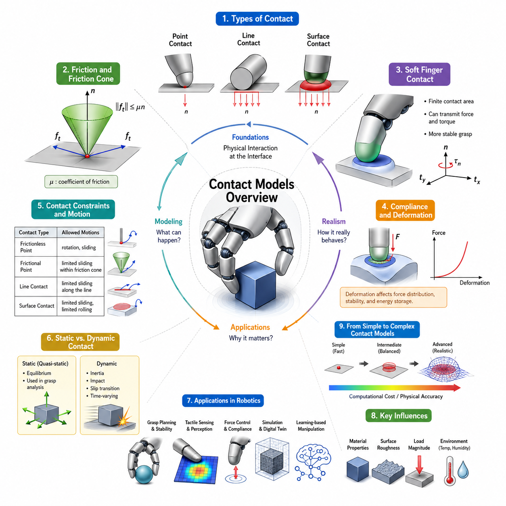{width="7.268055555555556in" height="7.268055555555556in"}

Contact models form the foundation of robotic grasping, dexterous manipulation, and physical interaction between a robot hand and an object. While robot kinematics describes how fingers move and control theory determines how actuators generate motion, contact mechanics explains what actually happens when a finger touches an object. Every successful grasp, manipulation task, assembly operation, or tool-use behavior ultimately depends on the physics of contact. For this reason, contact modeling occupies a central position in robotic hand design, grasp analysis, tactile sensing, force control, and learning-based manipulation systems. Within the broader framework of contact mechanics and grasp theory, contact models provide mathematical descriptions of how forces, moments, friction, deformation, and motion constraints are transmitted across interfaces where robot fingers and objects meet.

In robotics, contact is rarely a simple event. When a robot fingertip touches an object, multiple physical phenomena occur simultaneously. Forces are distributed over finite surface areas, microscopic surface roughness generates friction, materials deform elastically or plastically, and local pressure distributions evolve as grasp forces change. Contact models attempt to capture these phenomena with varying degrees of complexity. Some models prioritize computational efficiency for real-time control, while others prioritize physical realism for simulation and scientific analysis. The selection of a contact model directly influences grasp planning, force estimation, manipulation stability, and simulation accuracy.

The simplest interpretation of contact assumes that two bodies touch at a single infinitesimal point. This abstraction forms the basis of many classical grasp analysis methods because it significantly simplifies mathematical treatment. In reality, however, physical contact almost always occurs over finite areas rather than idealized points. Even apparently rigid objects experience small deformations under load, creating contact patches rather than mathematical points. The discrepancy between idealized models and physical reality motivates the development of increasingly sophisticated contact representations.

Contact models can generally be categorized according to the geometric characteristics of the interaction. Point contacts represent the most basic class, where contact is assumed to occur at a single location. Line contacts describe situations where elongated surfaces interact, such as cylindrical objects touching flat surfaces. Surface contacts represent distributed interactions across larger areas, such as the palm of a robotic hand holding an object. As the dimensionality of contact increases, the ability to transmit forces and moments also changes, leading to different grasping capabilities and stability characteristics.

One of the most important concepts in contact modeling is friction. Without friction, many grasping tasks become impossible because fingers would simply slide across object surfaces. Friction allows tangential forces to be transmitted between contacting bodies, enabling stable grasps and controlled manipulation. Classical robotic grasp theory often relies on the Coulomb friction model, which approximates the relationship between normal force and maximum tangential force. According to this model, frictional force is proportional to the normal contact force through a coefficient of friction. Although simple, the Coulomb model remains one of the most widely used contact representations in robotics due to its intuitive interpretation and computational efficiency.

The introduction of friction significantly expands the capabilities of contact models. A frictionless point contact can only transmit force along the surface normal direction. A point contact with friction can additionally resist tangential motion within limits defined by the friction cone. The friction cone is a geometric representation describing all allowable contact forces before slipping occurs. Understanding friction cones is essential for grasp planning, force closure analysis, and stability evaluation because they define the feasible force space available to each contact point.

Beyond simple point contacts, robotic manipulation often requires models capable of representing rotational constraints. This leads to the concept of soft-finger contacts. A soft-finger contact assumes that finite contact areas exist between deformable surfaces. Because contact occurs over an area rather than a point, the contact can transmit not only forces but also torsional moments around the surface normal. This additional capability provides enhanced grasp stability and more accurately reflects many real-world robotic fingertips that employ compliant materials such as rubber, silicone, polyurethane, or specialized tactile skins.

Compliance plays a fundamental role in modern contact modeling. In classical rigid-body analysis, objects are assumed to be perfectly rigid. While this assumption simplifies calculations, it often fails to capture important behaviors observed in practical robotic systems. Real materials deform under load, and these deformations influence force distribution, energy storage, impact absorption, and grasp stability. Compliance models introduce elastic behavior into contact representations, enabling more realistic predictions of contact forces and object interactions.

The study of compliant contacts frequently draws upon elasticity theory. Hertzian contact theory, for example, describes the deformation that occurs when elastic bodies are pressed together. This theory predicts contact area size, pressure distributions, and deformation magnitudes based on material properties and applied forces. Although originally developed for mechanical engineering applications, Hertzian contact principles have become increasingly relevant in robotic grasping, particularly for soft robotic hands and tactile sensing systems.

Contact modeling also involves understanding constraints imposed on motion. When two bodies touch, certain relative motions become restricted while others remain possible. These constraints determine the degrees of freedom available during manipulation. For example, a fingertip pressing against a flat surface restricts penetration but may still allow sliding and rolling. Different contact models encode different constraint sets, leading to varying predictions of object behavior. Motion constraints form the mathematical foundation for grasp closure analysis, manipulation planning, and contact-aware control algorithms.

An important distinction exists between static and dynamic contact models. Static contact models focus on equilibrium conditions where forces balance and motion is negligible. These models are commonly used in grasp quality analysis and force closure evaluation. Dynamic contact models incorporate inertia, impact effects, friction transitions, and time-dependent interactions. Dynamic models are essential for understanding manipulation tasks involving rapid motion, object reorientation, throwing, catching, or contact-rich assembly operations.

Contact transitions represent another major challenge in robotic systems. During manipulation, contact states continuously change as fingers touch, release, slide, roll, or reposition. Modeling these transitions accurately is difficult because contact conditions often exhibit discontinuities. For example, when slipping begins, the governing friction equations change abruptly. Similarly, impacts introduce instantaneous changes in velocity and force. Robust contact models must account for such hybrid behaviors while maintaining numerical stability and computational tractability.

The development of robotic tactile sensing has further increased the importance of contact modeling. Tactile sensors provide measurements of pressure distributions, contact locations, shear forces, and vibration patterns. Interpreting these measurements requires accurate physical models linking sensor outputs to underlying contact phenomena. Contact models therefore serve as bridges between raw tactile data and higher-level manipulation decisions. They enable robots to estimate object properties, detect slip, infer grasp stability, and adapt contact forces in real time.

Simulation environments rely heavily on contact models to reproduce realistic manipulation behavior. Physics engines such as those used in robotic simulators must compute contact forces thousands of times per second. Achieving both realism and computational efficiency presents a significant challenge. Simplified models may enable real-time performance but produce unrealistic grasp behavior, whereas highly detailed models may be computationally expensive. Consequently, simulation systems often employ approximations designed to balance physical accuracy and computational speed.

Modern soft robotics introduces additional complexities into contact modeling. Soft fingers deform substantially during interaction, causing contact geometries to evolve continuously. Traditional rigid-body assumptions become inadequate under such conditions. Advanced soft-contact models incorporate continuum mechanics, nonlinear material behavior, viscoelasticity, and large deformations. These models provide more accurate representations of how soft robotic grippers conform to object shapes and generate stable grasps through distributed contact forces.

Contact models are also central to grasp quality evaluation. The ability of a grasp to resist disturbances depends directly on the forces and moments that contact points can generate. Different contact assumptions lead to different grasp quality predictions. A grasp that appears stable under a soft-finger model may not achieve force closure under a frictionless point-contact model. Consequently, grasp evaluation metrics must always be interpreted within the context of the underlying contact representation.

In multi-finger robotic hands, contact interactions become highly coupled. Each finger generates forces that contribute to overall grasp stability while simultaneously affecting other contact locations. Contact models provide the mathematical framework necessary to analyze these interactions. Through concepts such as grasp matrices, wrench spaces, and force distributions, researchers can determine how individual contact forces combine to produce net object motions or resist external disturbances.

Recent advances in machine learning and foundation models have not eliminated the need for contact modeling. Instead, they have created new opportunities for integrating physics-based reasoning with data-driven approaches. Learning algorithms increasingly use contact models as priors, constraints, or simulation environments during training. Hybrid methods combine analytical contact mechanics with neural network predictions to achieve improved generalization, robustness, and sample efficiency. As robotic systems become more capable, the integration of contact theory and artificial intelligence is expected to play an increasingly important role in dexterous manipulation.

The study of contact models ultimately provides the essential language through which robots understand physical interaction. Every grasp, every manipulation action, every assembly operation, and every tactile perception event can be interpreted through the framework of contact mechanics. Contact models transform physical touch into mathematical representations that robots can analyze, predict, and control. They form the bridge between geometric planning and physical execution, connecting the abstract world of algorithms to the tangible world of objects and forces.

Within the context of robot hands and dexterous grasping, contact models serve as the foundation upon which subsequent topics are built. Point-contact theory, friction models, soft-finger contacts, force closure analysis, form closure analysis, grasp wrench spaces, grasp quality metrics, contact stability evaluation, multi-finger coordination, object deformation modeling, and contact simulation techniques all originate from the principles introduced in this chapter. A thorough understanding of contact models is therefore essential for anyone seeking to design, analyze, simulate, or control advanced robotic hands capable of robust and intelligent interaction with the physical world.

접촉 모델(Contact Models)은 로봇 그리핑(Grasping), 정교 조작(Dexterous Manipulation), 그리고 로봇 손과 물체 사이의 물리적 상호작용을 이해하기 위한 가장 기본적인 이론적 기반이다. 로봇의 운동학(Kinematics)이 손가락이 어떻게 움직이는지를 설명하고, 제어 이론(Control Theory)이 액추에이터가 어떻게 힘을 생성하는지를 설명한다면, 접촉 역학(Contact Mechanics)은 손가락이 실제로 물체에 닿았을 때 어떤 현상이 발생하는지를 설명한다. 따라서 모든 성공적인 파지(Grasp), 조작(Manipulation), 조립(Assembly), 도구 사용(Tool Use)은 결국 접촉 물리학(Contact Physics)에 기반한다고 볼 수 있다. 이러한 이유로 접촉 모델은 로봇 손 설계, 파지 이론, 촉각 센싱, 힘 제어, 그리고 학습 기반 조작 기술의 핵심 요소로 자리 잡고 있다.

로봇공학에서 접촉은 단순한 사건이 아니다. 로봇 손가락 끝(Fingertip)이 물체에 닿는 순간 여러 물리 현상이 동시에 발생한다. 접촉면에는 압력이 분포되고, 표면의 미세한 거칠기(Surface Roughness)는 마찰(Friction)을 발생시키며, 재료는 탄성 또는 소성 변형을 일으킨다. 또한 접촉 압력 분포는 파지력 변화에 따라 지속적으로 변한다. 접촉 모델은 이러한 복합적인 현상을 수학적으로 표현하기 위해 개발되었으며, 어떤 모델은 실시간 제어를 위해 계산 효율성을 우선시하고, 어떤 모델은 물리적 정확성을 우선시한다.

가장 단순한 접촉 모델은 두 물체가 하나의 점(Point)에서 접촉한다고 가정한다. 이러한 이상화는 수학적 분석을 크게 단순화하기 때문에 고전적인 파지 이론에서 널리 사용된다. 그러나 실제 세계에서는 완전히 강체(Rigid Body)인 물체는 존재하지 않으며, 접촉 시 미세한 변형이 발생하여 접촉은 점이 아니라 일정한 면적(Contact Patch)을 갖게 된다. 따라서 실제 현상을 보다 정확하게 설명하기 위해 다양한 접촉 모델이 발전하게 되었다.

접촉 모델은 일반적으로 접촉의 기하학적 형태에 따라 분류할 수 있다. 점 접촉(Point Contact)은 하나의 위치에서 접촉이 이루어진다고 가정한다. 선 접촉(Line Contact)은 원통형 물체가 평면과 접촉하는 경우처럼 길이를 가진 접촉을 의미한다. 면 접촉(Surface Contact)은 손바닥이 물체를 감싸는 경우처럼 넓은 영역에서 접촉이 이루어지는 상황을 나타낸다. 접촉 차원이 증가할수록 전달 가능한 힘과 모멘트의 종류도 증가하게 되며, 이는 파지 안정성과 조작 능력에 직접적인 영향을 준다.

접촉 모델에서 가장 중요한 개념 중 하나는 마찰(Friction)이다. 마찰이 없다면 대부분의 파지 작업은 불가능해진다. 손가락은 물체 표면 위에서 단순히 미끄러질 뿐 안정적으로 물체를 고정할 수 없기 때문이다. 마찰은 접촉면을 통해 접선 방향의 힘(Tangential Force)을 전달할 수 있도록 하며, 이를 통해 안정적인 파지와 정밀 조작이 가능해진다.

로봇공학에서는 일반적으로 쿨롱 마찰 모델(Coulomb Friction Model)이 사용된다. 이 모델은 최대 마찰력이 접촉면의 수직력(Normal Force)에 비례한다고 가정한다. 비록 단순한 모델이지만 직관적이며 계산 효율성이 높아 현재까지도 가장 널리 사용되는 접촉 모델 중 하나이다.

마찰 개념이 추가되면 접촉 모델의 능력은 크게 확장된다. 마찰이 없는 점 접촉(Frictionless Point Contact)은 접촉면 법선 방향의 힘만 전달할 수 있다. 반면 마찰이 존재하는 점 접촉(Point Contact with Friction)은 접선 방향 힘도 전달할 수 있으며, 일정 범위 내에서는 미끄러짐 없이 물체를 지지할 수 있다. 이때 허용 가능한 힘의 범위를 나타내는 개념이 바로 마찰 원뿔(Friction Cone)이다. 마찰 원뿔은 접촉점에서 발생 가능한 모든 힘의 집합을 기하학적으로 표현하며, 파지 계획과 안정성 분석에서 매우 중요한 역할을 한다.

보다 현실적인 모델은 소프트 핑거 접촉(Soft Finger Contact)이다. 이 모델은 접촉이 하나의 점이 아니라 일정한 면적을 통해 이루어진다고 가정한다. 접촉 면적이 존재하면 힘뿐만 아니라 접촉면 법선 방향의 회전 모멘트(Torsional Moment)도 전달할 수 있다. 따라서 소프트 핑거 모델은 실제 고무(Rubber), 실리콘(Silicone), 폴리우레탄(Polyurethane)과 같은 순응성 재료를 사용한 로봇 손가락을 보다 정확하게 표현할 수 있다.

순응성(Compliance)은 현대 접촉 모델에서 매우 중요한 개념이다. 전통적인 강체 모델에서는 물체가 변형되지 않는다고 가정하지만 실제 재료는 하중이 가해지면 변형된다. 이러한 변형은 힘 분포, 에너지 저장, 충격 흡수, 파지 안정성 등에 큰 영향을 미친다. 순응성 모델은 이러한 탄성 거동을 수학적으로 포함함으로써 실제 환경을 더욱 정확하게 표현한다.

대표적인 예가 헤르츠 접촉 이론(Hertz Contact Theory)이다. 헤르츠 이론은 탄성체가 서로 접촉할 때 발생하는 변형과 접촉 면적을 예측한다. 이 이론은 재료의 탄성 계수, 곡률, 작용 하중을 기반으로 접촉 압력 분포와 변형량을 계산할 수 있다. 원래는 기계공학 분야에서 개발되었지만 현재는 소프트 로보틱스와 촉각 센싱 분야에서도 널리 활용되고 있다.

접촉 모델은 운동 제약(Motion Constraints)을 이해하는 데에도 중요한 역할을 한다. 두 물체가 접촉하면 일부 상대 운동은 제한되고 일부는 허용된다. 예를 들어 손가락 끝이 평면에 눌려 있는 경우 침투(Penetration)는 허용되지 않지만 미끄러짐(Sliding)이나 굴림(Rolling)은 가능할 수 있다. 접촉 모델은 이러한 운동 가능성과 제약을 수학적으로 표현하며, 이는 파지 안정성 분석과 조작 계획의 기초가 된다.

정적 접촉 모델(Static Contact Model)과 동적 접촉 모델(Dynamic Contact Model)도 구분된다. 정적 모델은 힘의 평형 상태를 분석하는 데 사용되며, 파지 품질 평가와 힘 폐쇄(Force Closure) 분석에 적합하다. 반면 동적 모델은 관성(Inertia), 충돌(Impact), 미끄러짐 전이(Slip Transition), 시간 변화 효과를 포함하며, 빠른 조작이나 조립 작업과 같은 복잡한 상황을 분석하는 데 필요하다.

실제 조작 과정에서는 접촉 상태가 지속적으로 변한다. 손가락은 물체를 잡고, 미끄러지고, 굴리고, 다시 위치를 조정한다. 이러한 접촉 전이(Contact Transition)는 매우 비선형적이며 불연속성을 가진다. 예를 들어 정지 마찰(Static Friction) 상태에서 운동 마찰(Kinetic Friction) 상태로 전환되는 순간 시스템의 동작 방정식이 바뀐다. 따라서 접촉 모델은 이러한 변화도 안정적으로 처리할 수 있어야 한다.

촉각 센싱(Tactile Sensing)의 발전은 접촉 모델의 중요성을 더욱 높이고 있다. 촉각 센서는 압력 분포, 접촉 위치, 전단력(Shear Force), 진동(Vibration) 정보를 제공한다. 그러나 이러한 데이터를 의미 있는 정보로 변환하기 위해서는 접촉 모델이 필요하다. 접촉 모델은 센서 신호를 실제 물리 현상과 연결하는 역할을 수행하며, 이를 통해 로봇은 물체 특성을 추정하고, 미끄러짐을 감지하며, 파지 안정성을 평가할 수 있다.

시뮬레이션에서도 접촉 모델은 핵심 요소이다. 물리 엔진(Physics Engine)은 초당 수천 번 이상의 접촉 계산을 수행해야 한다. 지나치게 단순한 모델은 비현실적인 결과를 만들고, 지나치게 정교한 모델은 계산량이 너무 커진다. 따라서 대부분의 시뮬레이터는 현실성과 계산 효율성 사이에서 균형을 이루는 접촉 모델을 사용한다.

소프트 로보틱스(Soft Robotics)의 등장으로 접촉 모델은 더욱 복잡해졌다. 소프트 핑거는 접촉 과정에서 크게 변형되기 때문에 기존 강체 모델만으로는 충분하지 않다. 이에 따라 연속체 역학(Continuum Mechanics), 점탄성(Viscoelasticity), 비선형 재료 모델(Nonlinear Material Models) 등을 포함하는 고급 접촉 모델이 연구되고 있다. 이러한 모델은 소프트 그리퍼가 다양한 물체 형상에 적응하며 안정적인 파지를 수행하는 과정을 보다 정확하게 설명한다.

접촉 모델은 파지 품질(Grasp Quality)을 평가하는 데에도 필수적이다. 동일한 손 구조와 동일한 물체라 하더라도 어떤 접촉 모델을 사용하는가에 따라 안정성 평가 결과가 달라질 수 있다. 예를 들어 소프트 핑거 모델에서는 안정적인 파지로 평가되는 경우가 마찰 없는 점 접촉 모델에서는 불안정한 파지로 판단될 수 있다. 따라서 파지 평가 결과는 항상 사용된 접촉 모델의 가정과 함께 해석되어야 한다.

다지형 로봇 손(Multi-Finger Robot Hand)에서는 접촉 상호작용이 더욱 복잡해진다. 여러 손가락이 생성하는 힘은 서로 영향을 주며 동시에 물체의 안정성을 결정한다. 접촉 모델은 이러한 상호작용을 수학적으로 분석할 수 있도록 해 주며, 그립 매트릭스(Grasp Matrix), 렌치 공간(Wrench Space), 힘 분배(Force Distribution)와 같은 개념의 기반이 된다.

최근 인공지능과 파운데이션 모델(Foundation Models)의 발전에도 불구하고 접촉 모델의 중요성은 줄어들지 않고 있다. 오히려 물리 기반 모델과 데이터 기반 학습을 결합하는 방향으로 발전하고 있다. 최신 학습 알고리즘은 접촉 모델을 사전 지식(Prior), 제약 조건(Constraint), 또는 시뮬레이션 환경으로 활용하여 더욱 강건한 조작 능력을 구현하고 있다.

결국 접촉 모델은 로봇이 물리 세계를 이해하는 언어라고 할 수 있다. 모든 파지, 조작, 조립, 촉각 인식은 접촉 역학이라는 공통 기반 위에서 설명된다. 접촉 모델은 물리적 접촉을 수학적 표현으로 변환하고, 이를 통해 로봇이 환경을 분석하고 예측하며 제어할 수 있도록 한다. 또한 기하학적 계획(Geometric Planning)과 실제 물리 실행(Physical Execution)을 연결하는 핵심 다리 역할을 수행한다.

따라서 「Contact Mechanics and Grasp Theory」의 첫 번째 장인 **06_01_Contact_Models_Overview**는 이후에 다루게 될 점 접촉(Point Contact), 마찰 모델(Friction Model), 소프트 핑거 모델(Soft Finger Contact), 힘 폐쇄(Force Closure), 형상 폐쇄(Form Closure), 그립 렌치 공간(Grasp Wrench Space), 파지 품질 지표(Grasp Quality Metrics), 접촉 안정성(Contact Stability), 다지 접촉 협조(Multi-Finger Coordination), 물체 변형(Object Deformation), 접촉 시뮬레이션(Contact Simulation)의 기초를 제공하는 가장 중요한 입문 장이라고 할 수 있다. 이 장에 대한 깊은 이해는 고성능 로봇 핸드, 휴머노이드 손, 산업용 조작기, 소프트 그리퍼, 그리고 차세대 Physical AI 시스템을 설계하고 개발하는 데 필수적인 기반 지식이 된다.

##  

## 06.02 Point Contact and Friction Models

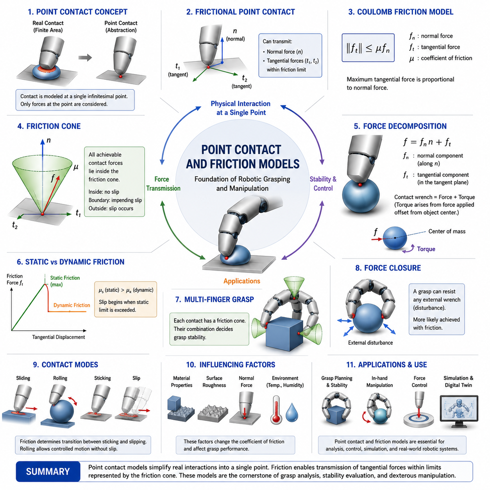{width="7.268055555555556in" height="7.268055555555556in"}

Point contact and friction models constitute the mathematical foundation of robotic grasp analysis, contact mechanics, force transmission, and dexterous manipulation. Whenever a robotic finger touches an object, the interaction between the contacting surfaces determines whether the object can be grasped, manipulated, stabilized, or moved. Although real-world contacts occur over finite surface areas and involve complex deformation phenomena, robotic grasp theory often begins with the abstraction of point contact because it provides a tractable and highly effective framework for analyzing physical interactions. Point contact models represent the first level of contact representation in robotic manipulation and serve as the basis upon which more advanced concepts such as soft-finger contacts, force closure, grasp wrench spaces, tactile control, and contact-rich manipulation are built. Within the broader field of contact mechanics and grasp theory, understanding point contacts and friction models is essential because they define the fundamental mechanisms through which forces are exchanged between robot fingers and objects.

The concept of point contact originates from the desire to simplify the physical complexity of contact into a mathematically manageable form. In a point contact model, the interaction between two bodies is assumed to occur at a single infinitesimal location. Rather than considering distributed pressure fields, elastic deformation, microscopic surface roughness, and material compliance, the entire interaction is represented by forces acting at a single point. This abstraction dramatically reduces the complexity of contact analysis while preserving many of the essential characteristics required for robotic grasp planning and stability evaluation.

Although physical contacts are never truly infinitesimal, the point contact assumption remains remarkably useful. In many robotic applications, the dimensions of the contact patch are extremely small relative to the overall size of the object. Under such circumstances, the detailed shape of the contact area contributes little to the overall grasp behavior, allowing engineers to approximate the interaction as a point contact without significant loss of accuracy. As a result, point contact models have become the dominant representation in classical robotic grasp theory.

The simplest point contact model is the frictionless point contact. In this representation, the contact point can only transmit force along the surface normal direction. No tangential forces can be generated, meaning that the contacting bodies can freely slide relative to each other along the contact surface. The only constraint imposed by the contact is the prevention of interpenetration. If the normal vector at the contact point is represented by n, then the contact force must act exclusively along this direction. Such a model is mathematically elegant and provides valuable theoretical insights into contact mechanics, but it rarely describes practical robotic grasping situations because friction is almost always present in physical systems.

Frictionless point contacts are nevertheless important because they represent the most restrictive contact condition. Many theoretical analyses begin with frictionless assumptions to establish lower bounds on grasp stability and closure properties. The study of frictionless contacts also reveals the fundamental geometric relationships between contact locations and object constraints. Concepts such as form closure often originate from analyses based on frictionless point contact models.

The introduction of friction transforms the capabilities of a contact point. A point contact with friction can transmit not only normal forces but also tangential forces that resist sliding motion. This additional capability dramatically increases the stability and versatility of robotic grasps. The resulting model, known as point contact with friction, is one of the most widely used representations in robotic manipulation research and industrial grasp planning systems.

The behavior of frictional contacts is commonly described using Coulomb friction theory. According to Coulomb's model, the maximum tangential force that can be transmitted before slipping occurs is proportional to the normal force acting at the contact. This relationship is expressed through the coefficient of friction, which characterizes the interaction between the contacting materials. Materials with high friction coefficients can resist larger tangential disturbances, while materials with low friction coefficients are more prone to slipping.

The coefficient of friction depends on numerous factors including material composition, surface roughness, temperature, humidity, contamination, wear, and contact pressure. Rubber surfaces typically exhibit higher friction coefficients than polished metal surfaces. Consequently, robotic fingertips often incorporate compliant rubber coatings to increase friction and improve grasp stability. Material selection therefore becomes an important aspect of robotic hand design because friction directly influences manipulation performance.

One of the most important geometric concepts associated with frictional contacts is the friction cone. The friction cone represents the set of all contact forces that can be sustained without causing slip. The apex of the cone is located at the contact point, and its central axis aligns with the surface normal. The opening angle of the cone depends on the coefficient of friction. Higher friction coefficients produce wider cones, allowing a larger range of force directions to be transmitted without slipping.

The friction cone provides a geometric interpretation of grasp stability. If the contact force vector remains inside the friction cone, the contact remains stable and no sliding occurs. If the force vector reaches the boundary of the cone, the contact is at the threshold of slipping. If the force vector moves outside the cone, slip becomes unavoidable. This simple geometric framework forms the basis of many grasp planning algorithms and stability analyses.

Because exact friction cones are continuous geometric objects, they are often approximated by polyhedral friction cones in computational robotics. A polyhedral friction cone replaces the smooth cone with a finite set of vectors forming a pyramid-like structure. This approximation enables efficient optimization and numerical computation while preserving the essential characteristics of frictional behavior. Most modern grasp planners and robotic simulators employ such approximations to achieve real-time performance.

Contact forces generated at frictional point contacts can be decomposed into normal and tangential components. The normal component prevents penetration between bodies, while the tangential component resists relative sliding motion. Together these components determine the overall contact wrench applied to the object. By combining multiple contact wrenches generated by different fingers, a robotic hand can stabilize and manipulate objects with remarkable precision.

The concept of contact wrench is fundamental in grasp analysis. A wrench consists of both force and torque contributions acting on an object. Even though a point contact itself cannot directly generate torsional moments around the contact normal, the force applied at an offset location from the object's center of mass naturally produces torques. These torques play a critical role in determining object motion and grasp stability.

Multi-finger grasping systems rely heavily on frictional point contact models. When several fingers simultaneously contact an object, each contact contributes a friction cone representing its force transmission capabilities. The combined effect of all friction cones determines whether the grasp can resist external disturbances. This collective force-generating capability ultimately leads to the concepts of force closure and grasp wrench spaces, which are central topics in robotic grasp theory.

Force closure refers to the ability of a grasp to resist arbitrary external disturbances through appropriate combinations of contact forces. Frictional contacts greatly increase the likelihood of achieving force closure because they expand the range of forces that can be applied at each contact point. Without friction, many stable grasps become impossible because contact forces are restricted to normal directions only.

Point contact models are also closely related to object manipulation strategies. During in-hand manipulation, robotic fingers intentionally generate controlled sliding, rolling, or pivoting motions. Predicting and controlling these motions requires accurate friction models because contact behavior determines how forces are converted into object motion. Small errors in friction estimation can lead to manipulation failures, making contact modeling a critical aspect of dexterous robotic control.

The distinction between static and dynamic friction further enriches contact modeling. Static friction describes the resistance to the initiation of motion, whereas dynamic friction describes resistance after sliding has already begun. In most material pairs, static friction exceeds dynamic friction. Consequently, once slipping begins, maintaining control becomes more challenging because the available frictional force decreases. Robotic grasp controllers often account for this phenomenon by maintaining safety margins that prevent contact forces from approaching friction cone boundaries.

Another important concept is stick-slip behavior. Stick-slip phenomena occur when contacts repeatedly alternate between sticking and sliding conditions. Such behavior is commonly observed during precision manipulation, insertion tasks, and contact-rich assembly operations. Stick-slip dynamics can generate vibrations, reduce positioning accuracy, and complicate force control. Advanced contact models incorporate these effects to improve prediction accuracy in complex manipulation scenarios.

Rolling contacts represent another form of interaction frequently encountered in robotic hands. Unlike sliding contacts, rolling contacts maintain local contact without relative tangential motion at the interface. Human fingers naturally exploit rolling contacts during dexterous manipulation because rolling preserves stability while allowing object repositioning. Modeling rolling contacts requires extensions to basic point-contact formulations, including additional kinematic and dynamic constraints.

Surface roughness significantly influences frictional behavior. At microscopic scales, contact occurs only at discrete asperities rather than across the entire apparent contact area. These microscopic interactions generate the frictional forces observed at macroscopic scales. Modern contact theories increasingly incorporate surface roughness effects to improve realism, particularly in tactile sensing applications and precision manipulation systems.

The rise of tactile sensing technologies has created new opportunities for contact-aware robotic control. Tactile sensors can estimate contact locations, pressure distributions, shear forces, and incipient slip conditions. By integrating tactile measurements with friction models, robotic systems can dynamically adjust grasp forces and maintain stable contact even under uncertain conditions. Such capabilities are essential for handling fragile, deformable, or irregularly shaped objects.

Physics-based simulation environments also depend heavily on point contact and friction models. Robotic simulators must continuously compute contact forces between fingers and objects during manipulation tasks. Accurate simulation requires realistic friction behavior, stable numerical integration, and efficient computational methods. Consequently, the development of robust contact models remains a major research area in robotics simulation and digital twin technologies.

Machine learning approaches to grasping increasingly incorporate friction models either explicitly or implicitly. Data-driven grasp planners often learn grasp strategies from large datasets, but their performance improves significantly when physical constraints such as friction cones and contact mechanics are integrated into the learning process. Hybrid approaches combining analytical contact models with neural networks offer promising pathways toward more reliable and physically grounded manipulation systems.

In soft robotic hands, friction modeling becomes even more complex because contact areas change dynamically as compliant materials deform. Contact forces become distributed across finite regions rather than concentrated at single points. Nevertheless, point contact models often remain useful approximations for high-level planning and analysis, demonstrating their enduring value across a wide range of robotic systems.

The study of point contact and friction models serves as the gateway to nearly every advanced topic in robotic grasping. Force closure theory, form closure theory, grasp wrench spaces, grasp quality metrics, contact stability analysis, tactile manipulation, force control, in-hand manipulation, and contact-rich assembly all depend upon the principles established by these models. They provide the mathematical language through which robots interpret and regulate physical interactions with the world.

Ultimately, point contact and friction models transform the abstract concept of touch into a rigorous analytical framework. They allow engineers to predict whether objects will slip, determine how forces should be distributed among fingers, evaluate grasp robustness, design stable manipulation strategies, and build robotic hands capable of interacting intelligently with complex physical environments. As robotic systems continue to advance toward human-level dexterity, the principles of point contact and friction modeling will remain among the most important foundations of robotic manipulation science.

점 접촉(Point Contact)과 마찰 모델(Friction Models)은 로봇 파지(Grasping), 접촉 역학(Contact Mechanics), 힘 전달(Force Transmission), 그리고 정교 조작(Dexterous Manipulation)을 이해하기 위한 가장 기본적인 수학적 기반이다. 로봇 손가락이 물체와 접촉할 때마다 두 표면 사이에서 발생하는 상호작용은 물체를 안정적으로 잡을 수 있는지, 원하는 방향으로 조작할 수 있는지, 외란에 저항할 수 있는지를 결정한다. 실제 접촉은 유한한 면적(Finite Contact Area)을 가지며 재료 변형과 복잡한 물리 현상을 포함하지만, 로봇공학에서는 문제를 분석하기 쉽도록 점 접촉이라는 이상화된 모델을 사용한다. 이러한 점 접촉 모델은 이후 등장하는 소프트 핑거 접촉(Soft Finger Contact), 힘 폐쇄(Force Closure), 그립 렌치 공간(Grasp Wrench Space), 촉각 기반 제어(Tactile Control), 접촉 기반 조작(Contact-Rich Manipulation)과 같은 고급 이론의 출발점이 된다.

점 접촉 개념은 실제 물리 현상을 단순하면서도 효과적으로 표현하기 위해 개발되었다. 점 접촉 모델에서는 두 물체 사이의 상호작용이 하나의 무한히 작은 점에서 발생한다고 가정한다. 실제로는 압력 분포, 탄성 변형, 표면 거칠기, 재료 특성 등이 존재하지만, 이러한 복잡성을 하나의 점에서 작용하는 힘으로 단순화한다. 이를 통해 계산 복잡도를 크게 줄이면서도 파지 안정성이나 힘 전달 특성을 효과적으로 분석할 수 있다.

현실 세계에서 완전한 점 접촉은 존재하지 않는다. 모든 접촉은 일정한 접촉 면적을 갖는다. 그러나 대부분의 로봇 조작 문제에서는 접촉 면적이 물체 전체 크기에 비해 매우 작기 때문에 점 접촉 근사가 충분히 정확한 결과를 제공한다. 이 때문에 점 접촉 모델은 오늘날까지도 고전적 파지 이론의 핵심 도구로 사용되고 있다.

가장 단순한 형태는 마찰이 없는 점 접촉(Frictionless Point Contact)이다. 이 모델에서는 접촉점에서 표면 법선 방향(Normal Direction)의 힘만 전달할 수 있다. 접선 방향(Tangential Direction)의 힘은 전달할 수 없기 때문에 물체는 표면 위에서 자유롭게 미끄러질 수 있다. 따라서 이 모델은 단지 두 물체가 서로 관통(Penetration)하지 않도록 하는 역할만 수행한다.

마찰이 없는 점 접촉은 실제 환경을 정확하게 표현하지는 못하지만 이론적으로 매우 중요하다. 이는 가장 제한적인 접촉 조건을 나타내기 때문이다. 많은 파지 이론은 먼저 마찰 없는 상황에서 분석을 수행한 후 점진적으로 마찰 효과를 추가한다. 또한 형상 폐쇄(Form Closure)와 같은 개념은 이러한 마찰 없는 모델에서 출발하여 발전하였다.

마찰(Friction)이 추가되면 접촉점의 능력은 크게 향상된다. 마찰이 존재하는 점 접촉(Point Contact with Friction)은 법선 방향 힘뿐 아니라 접선 방향 힘도 전달할 수 있다. 따라서 물체가 미끄러지는 것을 방지할 수 있으며 훨씬 안정적인 파지를 구현할 수 있다. 실제 로봇 손의 대부분은 이러한 마찰을 활용하여 물체를 잡고 조작한다.

마찰 접촉은 일반적으로 쿨롱 마찰 이론(Coulomb Friction Theory)을 이용하여 설명된다. 쿨롱 모델에 따르면 접촉점에서 발생할 수 있는 최대 마찰력은 법선력(Normal Force)에 비례한다. 이 비례 관계를 결정하는 값이 마찰 계수(Coefficient of Friction)이다. 마찰 계수가 클수록 더 큰 접선 방향 힘을 전달할 수 있으며, 마찰 계수가 작을수록 쉽게 미끄러짐이 발생한다.

마찰 계수는 다양한 요인에 의해 영향을 받는다. 재료의 종류, 표면 거칠기, 온도, 습도, 오염 상태, 마모 정도, 접촉 압력 등이 모두 마찰 특성을 변화시킨다. 일반적으로 고무(Rubber)는 금속보다 높은 마찰 계수를 가지므로 로봇 손가락 끝에는 고무나 실리콘 재질이 자주 사용된다. 이러한 재료는 파지 안정성을 크게 향상시킨다.

마찰 접촉을 설명하는 가장 중요한 개념 중 하나가 마찰 원뿔(Friction Cone)이다. 마찰 원뿔은 접촉점에서 미끄러짐 없이 생성할 수 있는 모든 힘의 범위를 나타낸다. 원뿔의 중심축은 접촉면 법선 방향과 일치하며, 원뿔의 개구각은 마찰 계수에 의해 결정된다. 마찰 계수가 높을수록 원뿔은 넓어지고, 허용 가능한 힘의 방향 범위도 증가한다.

마찰 원뿔은 파지 안정성을 직관적으로 설명해 준다. 접촉 힘 벡터가 원뿔 내부에 존재하면 접촉은 안정적이며 미끄러짐이 발생하지 않는다. 힘 벡터가 원뿔 경계에 도달하면 미끄러짐 직전 상태가 된다. 만약 힘 벡터가 원뿔 밖으로 벗어나면 접촉은 반드시 미끄러지게 된다. 이러한 개념은 대부분의 파지 계획 알고리즘과 안정성 평가 기법의 기반이 된다.

실제 계산에서는 연속적인 마찰 원뿔을 직접 사용하기 어렵기 때문에 다면체 마찰 원뿔(Polyhedral Friction Cone)을 사용한다. 이는 원뿔을 여러 개의 벡터로 근사하여 피라미드 형태로 표현하는 방법이다. 이러한 근사는 최적화 문제와 실시간 제어 계산을 효율적으로 수행할 수 있도록 해 준다.

마찰 접촉에서 생성되는 힘은 법선 성분과 접선 성분으로 분해할 수 있다. 법선 성분은 물체 간의 침투를 방지하고, 접선 성분은 미끄러짐을 억제한다. 이 두 힘이 결합되어 물체에 작용하는 전체 접촉 렌치(Contact Wrench)를 형성한다.

렌치(Wrench)는 힘(Force)과 토크(Torque)를 동시에 포함하는 개념이다. 점 접촉 자체는 접촉점에서 직접 비틀림 모멘트를 생성하지 못하지만, 힘이 물체 중심에서 떨어진 위치에 작용하기 때문에 결과적으로 회전 토크가 발생한다. 이러한 토크는 물체의 자세 변화와 안정성에 매우 중요한 역할을 한다.

다지형 로봇 손(Multi-Finger Hand)에서는 여러 접촉점이 동시에 존재한다. 각 접촉점은 자신의 마찰 원뿔을 가지며, 모든 접촉점의 힘 생성 능력이 결합되어 전체 파지 성능을 결정한다. 이러한 집합적 힘 전달 능력이 힘 폐쇄(Force Closure)와 그립 렌치 공간(Grasp Wrench Space) 개념으로 발전하게 된다.

힘 폐쇄는 외부에서 어떤 방향의 힘과 토크가 가해지더라도 파지가 이를 저항할 수 있는 능력을 의미한다. 마찰이 존재하면 각 접촉점에서 더 다양한 방향의 힘을 생성할 수 있기 때문에 힘 폐쇄를 달성할 가능성이 크게 증가한다. 반대로 마찰이 없으면 안정적인 파지를 구현하기 위해 훨씬 많은 접촉점이 필요하게 된다.

점 접촉과 마찰 모델은 물체 조작 전략에도 직접적인 영향을 미친다. 인핸드 매니퓰레이션(In-Hand Manipulation)에서는 손가락이 의도적으로 물체를 미끄러지게 하거나 굴리면서 자세를 변경한다. 이러한 동작을 예측하고 제어하기 위해서는 정확한 마찰 모델이 필요하다. 마찰 추정이 부정확하면 물체를 떨어뜨리거나 조작에 실패할 가능성이 높아진다.

정지 마찰(Static Friction)과 운동 마찰(Kinetic Friction)의 구분도 중요하다. 정지 마찰은 움직임이 시작되기 전의 저항력을 의미하며, 운동 마찰은 이미 미끄러지고 있는 상태에서의 저항력을 의미한다. 대부분의 재료에서 정지 마찰이 운동 마찰보다 크다. 따라서 한 번 미끄러짐이 시작되면 제어가 더욱 어려워질 수 있다.

스틱-슬립(Stick-Slip) 현상은 접촉이 반복적으로 고정 상태와 미끄러짐 상태를 오가는 현상이다. 이러한 현상은 정밀 조립 작업이나 삽입 작업에서 자주 발생하며, 진동과 위치 오차를 유발할 수 있다. 따라서 고정밀 조작 시스템에서는 스틱-슬립 현상을 고려한 접촉 모델이 필요하다.

굴림 접촉(Rolling Contact)은 미끄러짐 없이 접촉점이 이동하는 경우를 의미한다. 인간 손은 물체를 조작할 때 굴림 접촉을 매우 효과적으로 활용한다. 굴림은 안정성을 유지하면서도 물체의 자세를 변화시킬 수 있기 때문에 정교 조작의 핵심 메커니즘 중 하나로 간주된다.

표면 거칠기(Surface Roughness)는 마찰 특성에 큰 영향을 미친다. 현미경 수준에서는 실제 접촉이 표면 전체에서 발생하는 것이 아니라 돌기(Asperity)들 사이에서 부분적으로 발생한다. 이러한 미세 접촉들의 집합이 우리가 관찰하는 마찰력을 만들어낸다.

최근 촉각 센서(Tactile Sensors)의 발전은 접촉 모델의 중요성을 더욱 높이고 있다. 촉각 센서는 접촉 위치, 압력 분포, 전단력, 초기 미끄러짐 신호 등을 측정할 수 있다. 이러한 데이터를 마찰 모델과 결합하면 로봇은 실시간으로 파지력을 조정하여 안정적인 접촉을 유지할 수 있다.

물리 시뮬레이션에서도 점 접촉과 마찰 모델은 핵심 요소이다. 시뮬레이터는 손가락과 물체 사이의 접촉력을 초당 수천 번 이상 계산해야 한다. 따라서 물리적으로 타당하면서도 계산 효율성이 높은 마찰 모델이 필요하다. 이는 디지털 트윈(Digital Twin), 강화학습(Reinforcement Learning), 그리고 Sim-to-Real 시스템의 성능을 결정하는 중요한 요소가 된다.

최근의 학습 기반 파지 기술에서도 접촉 모델은 여전히 중요한 역할을 수행한다. 데이터 기반 학습만으로도 파지 전략을 생성할 수 있지만, 마찰 원뿔이나 접촉 역학과 같은 물리적 제약을 함께 활용하면 더욱 안정적이고 일반화 성능이 높은 시스템을 구축할 수 있다.

소프트 로봇 핸드(Soft Robotic Hand)에서는 접촉 면적이 지속적으로 변형되기 때문에 마찰 모델이 더욱 복잡해진다. 접촉력은 단일 점이 아닌 넓은 영역에 분포하게 되며, 접촉 형상도 지속적으로 변화한다. 그럼에도 불구하고 점 접촉 모델은 여전히 상위 수준 계획과 분석 단계에서 매우 유용한 근사 모델로 사용된다.

결국 점 접촉 및 마찰 모델은 로봇이 물리 세계와 상호작용하는 방식을 수학적으로 표현하는 가장 기본적인 언어라고 할 수 있다. 이 모델들은 물체가 미끄러질지 여부를 예측하고, 손가락 사이에 힘을 어떻게 분배해야 하는지를 결정하며, 파지의 안정성을 평가하고, 조작 전략을 설계하는 데 필수적인 도구이다.

따라서 **06_02 Point Contact and Friction Models**는 이후에 등장하는 **Force Closure Theory, Form Closure Theory, Grasp Wrench Space, Grasp Quality Metrics, Contact Stability Analysis, Tactile Manipulation, Force Control, In-Hand Manipulation, Contact-Rich Assembly**와 같은 모든 고급 파지 이론의 출발점이 된다. 로봇 손, 휴머노이드 핸드, 산업용 그리퍼, 소프트 그리퍼, 그리고 미래의 Physical AI 시스템을 이해하기 위해 반드시 학습해야 하는 핵심 기초 분야라고 할 수 있다.

##  

## 06.03 Soft Finger Contact Models

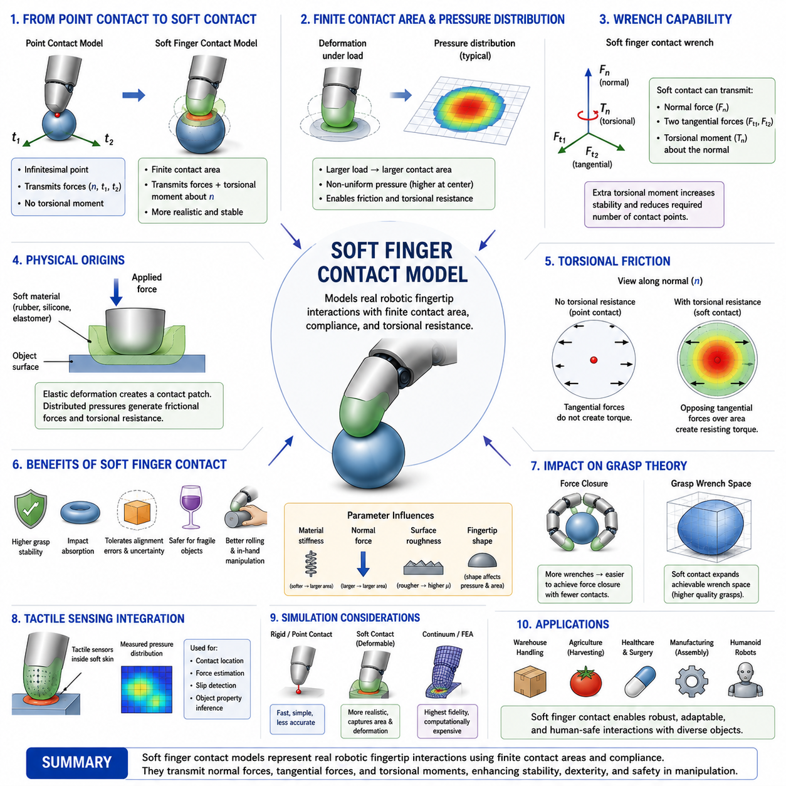{width="7.268055555555556in" height="7.268055555555556in"}

The Soft Finger Contact Model is one of the most important contact representations in robotic grasping and dexterous manipulation. While classical point-contact models provide a convenient mathematical abstraction for analyzing robotic grasps, they often fail to accurately represent the physical behavior of real robotic fingers. In practice, robotic fingertips are rarely perfectly rigid. Most robot hands employ compliant materials such as rubber, silicone, polyurethane, elastomers, or specialized tactile skins that deform under load and create finite contact areas. As a result, the interaction between a finger and an object cannot be adequately described by a single point force. The Soft Finger Contact Model was developed to bridge the gap between idealized contact theory and the physical reality of robotic manipulation. It extends traditional point-contact models by incorporating the effects of finite contact patches, compliance, and rotational force transmission, thereby providing a more realistic representation of grasp behavior.

The origins of the Soft Finger Contact Model can be traced to the limitations of the Point Contact with Friction model. In a conventional frictional point contact, the contact can transmit forces along the surface normal and within the tangential plane, but it cannot directly resist rotational motion around the normal axis. This assumption is often insufficient for practical robotic hands because real fingertips typically generate resistance to torsional rotation due to distributed pressure over a contact area. When a human finger presses against an object, the skin deforms and creates a contact patch that can resist twisting motions. The same phenomenon occurs in compliant robotic fingertips. The Soft Finger Contact Model captures this additional capability by allowing the transmission of torsional moments about the contact normal.

A defining characteristic of the Soft Finger Contact Model is the assumption that contact occurs over a finite area rather than an infinitesimal point. Although the contact area may be small compared to the dimensions of the object, it is sufficiently large to generate distributed pressure fields. These pressure distributions enable the contact to support not only translational forces but also rotational moments. Consequently, the contact gains an additional degree of constraint compared with traditional point-contact representations. This enhancement significantly improves grasp stability and expands the range of objects that can be manipulated effectively.

The physical basis of soft-finger contact behavior lies in material deformation. When a compliant fingertip presses against an object, elastic deformation occurs at the interface. The shape and size of the resulting contact patch depend on the applied load, material stiffness, surface geometry, and contact conditions. As contact force increases, the contact area generally expands, increasing frictional capability and rotational resistance. This relationship between force and contact area forms one of the fundamental mechanisms underlying stable robotic grasping.

Elasticity theory plays a central role in modeling soft-finger contacts. Classical Hertzian Contact Theory provides a foundation for understanding how elastic bodies deform under compressive loading. According to Hertzian theory, the contact area between two elastic bodies increases as normal force increases. The resulting pressure distribution is typically non-uniform, with higher pressures concentrated near the center of the contact region. These pressure distributions influence force transmission, friction generation, and torque resistance. Although Hertzian theory represents only an approximation, it provides valuable insights into the physical processes governing compliant contact behavior.

The Soft Finger Contact Model introduces the concept of torsional friction. In traditional friction models, friction is primarily associated with resistance to tangential sliding. However, finite contact areas also generate resistance to rotational motion about the contact normal. This resistance arises because different portions of the contact patch experience opposing tangential forces during attempted rotation. The aggregate effect of these distributed forces produces a resisting torque known as torsional friction. Torsional friction allows soft contacts to stabilize objects against rotational disturbances that would otherwise cause grasp failure.

Mathematically, the Soft Finger Contact Model extends the contact wrench representation used in grasp analysis. A frictionless point contact can transmit only one force component. A point contact with friction can transmit three force components. A soft-finger contact can additionally transmit a torsional moment about the contact normal. This extra degree of freedom significantly increases the contact\'s ability to constrain object motion. In many grasp configurations, the availability of torsional moments can reduce the number of required contact points while maintaining equivalent stability.

The contact wrench generated by a soft-finger contact consists of normal force, tangential force components, and a torsional moment. Together, these quantities define a higher-dimensional force transmission capability than that available in conventional point-contact models. The inclusion of torsional moments has important implications for grasp analysis because it alters the structure of grasp wrench spaces and expands the set of achievable object constraints.

Grasp stability benefits substantially from soft-finger contacts. In many robotic applications, objects are subjected to disturbances that include both forces and torques. A grasp composed entirely of frictional point contacts may be vulnerable to rotational disturbances around certain axes. Soft-finger contacts provide additional rotational resistance that improves robustness and reduces sensitivity to external perturbations. This capability is particularly valuable when manipulating cylindrical objects, spherical objects, tools, and other geometries prone to rotational slipping.

Human grasping provides an excellent example of the advantages of soft-finger contacts. Human fingertips contain soft tissue that deforms extensively during object interaction. These compliant structures generate large contact areas, distribute forces effectively, and provide substantial torsional resistance. As a result, humans can manipulate objects with extraordinary dexterity and stability. Many robotic hand designs seek to emulate these characteristics through compliant fingertip materials and soft-contact modeling approaches.

Compliance itself introduces several advantages beyond rotational stability. Compliant contacts naturally absorb impact energy, reducing peak contact forces during collisions. They accommodate geometric uncertainties and positioning errors, allowing robotic hands to grasp objects even when exact alignment is unavailable. Compliance also distributes pressure more evenly across contact surfaces, reducing the risk of damaging fragile objects. These properties make soft-finger contacts particularly attractive for service robotics, healthcare robotics, food handling, warehouse automation, and human-robot interaction applications.

The design of compliant fingertips requires careful consideration of material properties. Material stiffness strongly influences contact behavior. Softer materials generally produce larger contact areas and greater compliance but may sacrifice positional precision. Stiffer materials provide higher accuracy but reduced adaptability. Designers must balance these competing objectives according to application requirements. Material selection often involves evaluating elasticity, durability, wear resistance, temperature stability, chemical compatibility, and manufacturability.

Surface geometry also influences soft-finger contact behavior. Flat, spherical, hemispherical, and biomimetic fingertip shapes each produce distinct pressure distributions and contact mechanics. Spherical fingertips are particularly common because they provide predictable contact characteristics and facilitate rolling interactions. Biomimetic fingertips attempt to replicate human skin structures, incorporating features such as layered materials, fingerprints, and variable stiffness regions to enhance manipulation performance.

The relationship between contact force and contact area introduces nonlinear behavior into soft-finger systems. As grasp force increases, contact patches expand and frictional capabilities improve. However, excessive force may lead to material saturation, permanent deformation, or object damage. Consequently, grasp controllers must regulate contact forces carefully to achieve stable interactions without compromising safety or performance.

Soft-finger contact models are closely linked to tactile sensing technologies. Many modern robotic fingertips incorporate tactile sensors embedded within compliant materials. These sensors measure pressure distributions, shear stresses, contact locations, and incipient slip conditions. Because tactile signals depend heavily on contact mechanics, accurate soft-finger models are essential for interpreting sensor data and developing contact-aware manipulation strategies.

In robotic grasp analysis, soft-finger contacts significantly influence force closure conditions. Force closure refers to the ability of a grasp to resist arbitrary external disturbances. Because soft-finger contacts provide additional moment transmission capabilities, they often enable force closure with fewer contact points than would be required under point-contact assumptions. This property simplifies grasp planning and increases manipulation flexibility.

The concept of grasp wrench space is also affected by soft-finger contact modeling. Each contact contributes a set of achievable forces and moments. The additional torsional moment supported by soft-finger contacts expands the corresponding wrench space, increasing the set of external disturbances that can be resisted. Consequently, soft-finger contacts often produce higher grasp quality metrics than equivalent point-contact configurations.

Simulation of soft-finger contacts presents unique challenges. Traditional rigid-body simulators often assume point contacts and simplified friction models. Accurately simulating compliant contacts requires modeling deformation, pressure distributions, nonlinear material behavior, and dynamic contact transitions. Advanced simulation methods incorporate finite element analysis, continuum mechanics, and deformable body models to capture these effects. However, such approaches can be computationally expensive, motivating ongoing research into efficient soft-contact simulation techniques.

Soft robotics has further increased the importance of soft-finger contact modeling. Unlike conventional robotic hands, soft robotic grippers may undergo large-scale deformations during operation. Contact regions continuously evolve as the gripper conforms to object geometry. Under these conditions, traditional rigid-contact assumptions become inadequate. Soft-finger contact models provide a critical framework for understanding how deformable robotic structures interact with complex environments.

Machine learning and data-driven manipulation methods increasingly leverage soft-contact concepts. Learning algorithms trained in simulation must accurately represent contact behavior to achieve successful transfer to physical systems. Incorporating soft-finger contact models into training environments improves realism and reduces the sim-to-real gap. Additionally, tactile learning systems often rely on contact mechanics models to interpret sensor observations and infer object properties.

Applications of soft-finger contacts span a broad range of industries. In warehouse automation, compliant fingertips improve the handling of irregular packages and consumer products. In agriculture, they enable the harvesting of delicate fruits without causing damage. In healthcare, they facilitate safe interactions with patients and medical instruments. In manufacturing, they improve assembly performance when manipulating components with tight tolerances. In humanoid robotics, soft-finger contacts contribute directly to human-like dexterity and manipulation capability.

The development of future robotic hands is expected to increasingly emphasize compliance, adaptability, and tactile intelligence. Advances in soft materials, embedded sensing, variable stiffness mechanisms, and bioinspired designs will further expand the role of soft-finger contact models in robotic systems. As robots move beyond structured industrial environments and into human-centered settings, the ability to interact safely and robustly with diverse objects will become increasingly important.

Ultimately, the Soft Finger Contact Model represents a critical advancement in contact mechanics and grasp theory. By acknowledging that real contacts occur over finite areas and can transmit torsional moments, the model provides a more realistic and powerful framework for understanding robotic grasping. It bridges the gap between idealized mathematical abstractions and practical physical interactions, enabling more accurate grasp analysis, improved manipulation performance, enhanced simulation fidelity, and safer human-robot interaction.

Within the broader context of Contact Mechanics and Grasp Theory, the Soft Finger Contact Model serves as the foundation for advanced topics including force closure analysis, grasp quality evaluation, tactile sensing integration, compliant manipulation, in-hand object manipulation, soft robotics, and human-inspired robotic hands. A deep understanding of this model is therefore essential for engineers and researchers seeking to develop the next generation of intelligent, adaptive, and highly dexterous robotic manipulation systems.

소프트 핑거 접촉 모델(Soft Finger Contact Model)은 로봇 파지(Grasping)와 정교 조작(Dexterous Manipulation) 분야에서 가장 중요한 접촉 모델 중 하나이다. 전통적인 점 접촉(Point Contact) 모델은 로봇 파지를 수학적으로 분석하기에 매우 편리하지만, 실제 로봇 손가락이 물체와 접촉하는 방식을 완전히 설명하지는 못한다. 현실의 로봇 손가락은 대부분 고무(Rubber), 실리콘(Silicone), 폴리우레탄(Polyurethane), 엘라스토머(Elastomer), 촉각 스킨(Tactile Skin)과 같은 순응성(Compliance)을 가진 재료를 사용한다. 이러한 재료들은 물체를 잡을 때 변형되며 일정한 접촉 면적(Contact Area)을 형성한다. 따라서 실제 접촉은 하나의 점이 아니라 유한한 면적을 통해 이루어지며, 단순한 점 접촉 모델만으로는 이러한 물리 현상을 충분히 설명할 수 없다. 소프트 핑거 접촉 모델은 이러한 현실적인 접촉 특성을 반영하여 기존 점 접촉 모델을 확장한 것으로, 접촉 면적, 재료 변형, 회전 저항 효과를 포함하는 보다 실제적인 접촉 표현 방식이다.

소프트 핑거 접촉 모델은 점 접촉-마찰 모델(Point Contact with Friction)의 한계를 해결하기 위해 등장하였다. 일반적인 마찰 점 접촉 모델에서는 접촉점에서 법선 방향 힘과 접선 방향 힘은 전달할 수 있지만, 접촉면 법선 축을 중심으로 하는 비틀림 회전(Torsional Rotation)에 대해서는 저항할 수 없다. 그러나 실제 사람의 손가락이나 고무 재질의 로봇 손가락은 접촉 면적 전체에 압력이 분포하기 때문에 비틀림 운동에 대한 저항 토크를 생성할 수 있다. 소프트 핑거 접촉 모델은 바로 이 특성을 수학적으로 표현하며, 실제 접촉 현상을 보다 정확하게 설명한다.

이 모델의 가장 중요한 특징은 접촉이 무한히 작은 점이 아니라 일정한 면적을 통해 이루어진다고 가정하는 것이다. 비록 접촉 면적이 물체 전체 크기에 비해 작더라도, 그 면적 내부에는 압력 분포(Pressure Distribution)가 존재한다. 이러한 압력 분포 덕분에 접촉은 단순한 힘뿐 아니라 회전 모멘트(Moment)도 전달할 수 있게 된다. 결과적으로 소프트 핑거 접촉은 기존 점 접촉보다 하나 더 많은 제약 조건을 제공하며, 파지 안정성을 크게 향상시킨다.

소프트 핑거 접촉의 물리적 기반은 재료 변형(Material Deformation)에 있다. 부드러운 손가락이 물체를 누르면 접촉면에서 탄성 변형(Elastic Deformation)이 발생한다. 접촉 면적의 크기와 형태는 작용하는 힘, 재료의 강성(Stiffness), 표면 형상, 접촉 조건에 따라 달라진다. 일반적으로 파지력이 증가하면 접촉 면적도 증가하게 되며, 이는 마찰력과 회전 저항 능력을 향상시키는 결과를 가져온다.

이러한 현상을 설명하기 위해 탄성 이론(Elasticity Theory)이 사용된다. 대표적인 이론이 헤르츠 접촉 이론(Hertz Contact Theory)이다. 헤르츠 이론은 두 탄성체가 서로 접촉할 때 접촉 면적이 하중에 따라 증가한다는 사실을 설명한다. 또한 접촉 영역 내의 압력 분포가 균일하지 않고 중앙부에 집중된다는 점도 보여준다. 이러한 압력 분포는 힘 전달, 마찰 생성, 회전 저항 능력에 직접적인 영향을 준다.

소프트 핑거 접촉 모델에서 매우 중요한 개념은 비틀림 마찰(Torsional Friction)이다. 일반적인 마찰은 접선 방향의 미끄러짐을 억제하는 역할을 하지만, 소프트 핑거에서는 접촉 면적 전체가 회전에 저항하는 토크를 생성할 수 있다. 물체가 접촉면에서 회전하려고 하면 접촉 패치(Contact Patch) 내부의 서로 다른 위치에서 반대 방향의 접선력이 발생한다. 이러한 힘들의 합은 회전에 저항하는 토크를 생성하며, 이를 비틀림 마찰이라고 한다. 비틀림 마찰은 물체가 손 안에서 회전하거나 빠져나가는 것을 방지하는 중요한 역할을 한다.

수학적으로 보면 소프트 핑거 접촉은 접촉 렌치(Contact Wrench)의 차원을 확장한다. 마찰 없는 점 접촉은 하나의 힘만 전달할 수 있고, 마찰 점 접촉은 세 방향의 힘을 전달할 수 있다. 반면 소프트 핑거 접촉은 여기에 법선 방향의 비틀림 모멘트까지 추가적으로 전달할 수 있다. 이 추가적인 자유도는 물체 운동을 더욱 효과적으로 제어할 수 있도록 해 주며, 경우에 따라서는 동일한 안정성을 얻기 위해 필요한 접촉점 수를 줄여주기도 한다.

소프트 핑거 접촉에서 생성되는 접촉 렌치는 법선력(Normal Force), 접선력(Tangential Force), 그리고 비틀림 모멘트(Torsional Moment)로 구성된다. 이들은 함께 작용하여 물체를 안정적으로 고정하고 외부 교란에 저항할 수 있는 능력을 제공한다.

파지 안정성 측면에서 소프트 핑거 접촉은 매우 큰 장점을 가진다. 실제 환경에서는 물체에 다양한 힘과 토크가 작용한다. 일반적인 마찰 점 접촉만 사용하는 경우 특정 방향의 회전에 대해서는 저항력이 부족할 수 있다. 반면 소프트 핑거 접촉은 회전 저항 토크를 제공하기 때문에 외란에 대한 강건성(Robustness)이 크게 향상된다. 이러한 특성은 원통형 물체, 구형 물체, 공구(Tool), 병(Bottle), 컵(Cup) 등을 다룰 때 특히 중요하다.

인간의 손은 소프트 핑거 접촉의 대표적인 사례이다. 인간 손가락은 피부와 연부 조직(Soft Tissue)으로 구성되어 있으며, 물체를 잡을 때 넓은 접촉 면적을 형성한다. 이러한 접촉은 힘을 효과적으로 분산시키고, 높은 마찰력과 비틀림 저항을 생성하며, 뛰어난 조작 능력을 제공한다. 많은 로봇 핸드 설계가 이러한 인간 손의 특성을 모방하기 위해 개발되고 있다.

순응성은 회전 안정성 외에도 여러 장점을 제공한다. 먼저 충격 흡수(Impact Absorption)가 가능하다. 부드러운 재료는 충돌 시 충격 에너지를 흡수하여 물체와 로봇 모두를 보호할 수 있다. 또한 위치 오차(Position Error)나 형상 불확실성(Geometric Uncertainty)을 흡수하여 정밀한 정렬 없이도 안정적인 파지가 가능하다. 접촉 압력을 넓게 분산시킬 수 있기 때문에 깨지기 쉬운 물체를 안전하게 다룰 수도 있다.

소프트 핑거 설계에서는 재료 선택(Material Selection)이 매우 중요하다. 부드러운 재료는 큰 접촉 면적과 높은 적응성을 제공하지만 위치 정밀도가 낮아질 수 있다. 반대로 단단한 재료는 높은 정밀도를 제공하지만 적응성이 떨어진다. 따라서 응용 분야에 따라 적절한 균형을 찾아야 한다.

손가락 끝의 형상(Fingertip Geometry)도 접촉 특성에 큰 영향을 미친다. 평면형, 구형, 반구형, 생체모사형(Biomimetic) 구조는 각각 다른 압력 분포와 접촉 특성을 가진다. 특히 반구형 손가락은 예측 가능한 접촉 특성과 안정적인 굴림(Rolling) 동작을 제공하기 때문에 널리 사용된다. 최근에는 인간 피부 구조를 모방한 생체모사형 핑거팁도 활발히 연구되고 있다.

소프트 핑거 접촉에서는 힘과 접촉 면적 사이에 비선형 관계(Nonlinear Relationship)가 존재한다. 파지력이 증가하면 접촉 면적도 증가하고 마찰력도 향상된다. 그러나 지나치게 큰 힘은 재료의 영구 변형이나 물체 손상을 유발할 수 있다. 따라서 파지 제어기는 안정성을 확보하면서도 과도한 힘을 방지할 수 있도록 설계되어야 한다.

촉각 센싱(Tactile Sensing)은 소프트 핑거 접촉과 밀접한 관계를 가진다. 최신 로봇 손가락에는 순응성 재료 내부에 촉각 센서가 내장되는 경우가 많다. 이러한 센서는 압력 분포, 전단 응력(Shear Stress), 접촉 위치, 초기 미끄러짐 신호 등을 측정할 수 있다. 소프트 핑거 접촉 모델은 이러한 센서 데이터를 해석하는 데 핵심적인 역할을 한다.

파지 이론 측면에서 소프트 핑거 접촉은 힘 폐쇄(Force Closure) 조건을 크게 향상시킨다. 힘 폐쇄는 외부에서 어떤 방향의 힘과 토크가 가해지더라도 이를 저항할 수 있는 능력을 의미한다. 소프트 핑거 접촉은 비틀림 모멘트까지 전달할 수 있기 때문에 동일한 힘 폐쇄를 달성하기 위해 필요한 접촉점 수를 줄여준다.

그립 렌치 공간(Grasp Wrench Space)도 소프트 핑거 접촉에 의해 확장된다. 각 접촉점은 특정한 힘과 토크를 생성할 수 있으며, 소프트 핑거 접촉은 기존 점 접촉보다 더 넓은 렌치 공간을 제공한다. 따라서 동일한 파지 구조에서도 더 높은 파지 품질(Grasp Quality)을 얻을 수 있다.

소프트 핑거 접촉을 시뮬레이션하는 것은 쉽지 않다. 기존의 강체 기반 시뮬레이터는 단순한 점 접촉 모델을 사용하지만, 소프트 핑거를 정확하게 표현하려면 재료 변형, 압력 분포, 비선형 탄성 거동 등을 고려해야 한다. 이를 위해 유한요소해석(FEA), 연속체 역학(Continuum Mechanics), 변형체 시뮬레이션(Deformable Body Simulation) 등이 사용된다.

소프트 로보틱스(Soft Robotics)의 발전은 소프트 핑거 접촉 모델의 중요성을 더욱 높이고 있다. 소프트 그리퍼는 물체 형상에 따라 크게 변형되며 접촉 영역도 지속적으로 변화한다. 이러한 시스템에서는 기존의 강체 접촉 모델만으로는 충분하지 않으며, 소프트 핑거 접촉 모델이 필수적이다.

최근 머신러닝과 데이터 기반 조작 기술에서도 소프트 핑거 모델이 적극 활용되고 있다. 학습 기반 시스템이 시뮬레이션에서 학습한 내용을 실제 로봇으로 이전하기 위해서는 현실적인 접촉 모델이 필요하다. 소프트 핑거 모델은 이러한 Sim-to-Real 문제를 줄이고 학습 성능을 향상시키는 데 중요한 역할을 한다.

응용 분야는 매우 다양하다. 물류 창고에서는 다양한 포장 물체를 안정적으로 잡기 위해 사용되며, 농업에서는 과일과 채소를 손상 없이 수확하기 위해 활용된다. 의료 분야에서는 환자와 안전하게 상호작용할 수 있도록 도와주며, 제조업에서는 정밀 조립 작업의 성공률을 높인다. 휴머노이드 로봇에서는 인간과 유사한 조작 능력을 구현하기 위한 핵심 기술로 활용된다.

미래의 로봇 손은 점점 더 높은 순응성, 적응성, 촉각 지능(Tactile Intelligence)을 갖추게 될 것이다. 새로운 소프트 재료, 가변 강성 메커니즘(Variable Stiffness Mechanisms), 생체모사 설계, 고성능 촉각 센서 기술이 발전함에 따라 소프트 핑거 접촉 모델의 중요성은 더욱 커질 것으로 예상된다.

결국 소프트 핑거 접촉 모델은 실제 로봇 접촉 현상을 가장 현실적으로 표현하는 핵심 모델이라고 할 수 있다. 이 모델은 접촉이 유한한 면적에서 발생하며 비틀림 모멘트를 전달할 수 있다는 사실을 반영함으로써, 기존 점 접촉 모델과 실제 물리 세계 사이의 간극을 연결한다. 또한 보다 정확한 파지 분석, 향상된 조작 성능, 현실적인 시뮬레이션, 안전한 인간-로봇 상호작용을 가능하게 한다.

따라서 **06_03 Soft Finger Contact Model**은 이후에 등장하는 **Force Closure Analysis, Grasp Quality Evaluation, Tactile Sensing Integration, Compliant Manipulation, In-Hand Manipulation, Soft Robotics, Human-Inspired Robot Hands**와 같은 고급 주제를 이해하기 위한 핵심 기반 이론이다. 차세대 휴머노이드 핸드, 다지형 로봇 손, 소프트 그리퍼, 그리고 Physical AI 시스템을 개발하고자 하는 연구자와 엔지니어라면 반드시 깊이 이해해야 할 중요한 주제라고 할 수 있다.

##  

## 06.04 Force Closure Theory

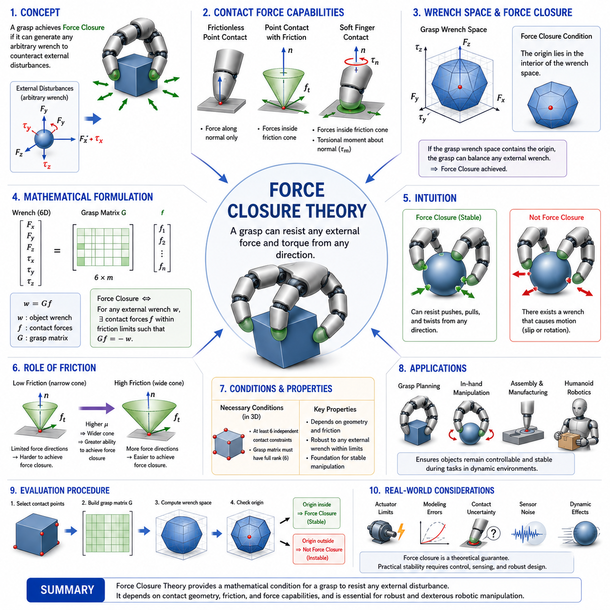{width="7.268055555555556in" height="7.268055555555556in"}

Force Closure Theory is one of the most fundamental concepts in robotic grasping, dexterous manipulation, contact mechanics, and robotic hand design. It provides a rigorous mathematical framework for determining whether a grasp is capable of resisting arbitrary external disturbances through the appropriate application of contact forces. In practical terms, force closure answers one of the most important questions in robotic manipulation: can a robot hold an object securely regardless of the direction from which external forces and torques are applied? If the answer is yes, the grasp is said to achieve force closure. Because grasp stability is a prerequisite for nearly every manipulation task, force closure has become a cornerstone of modern grasp analysis and robotic hand engineering.

The origins of force closure theory lie in the broader study of contact mechanics and constrained motion. When a robotic hand grasps an object, each contact point between the fingers and the object imposes constraints on possible object movements. The effectiveness of the grasp depends not only on the number of contacts but also on their locations, orientations, friction properties, and force-generating capabilities. Force closure theory provides a systematic method for evaluating whether these contacts collectively provide sufficient control authority to counteract any possible disturbance acting on the object.

To understand force closure, it is useful to begin with the concept of external disturbances. Any grasped object may experience forces and torques originating from gravity, inertia, environmental interactions, collisions, vibrations, assembly operations, or intentional manipulation tasks. These disturbances can occur in arbitrary directions and may vary in magnitude over time. A stable grasp must be capable of generating compensating contact forces that neutralize these disturbances and prevent object motion.

The mathematical language used to describe forces and torques acting on an object is known as wrench representation. A wrench combines translational forces and rotational torques into a unified vector representation. In three-dimensional space, an object can move in six independent degrees of freedom: three translational and three rotational. Consequently, the complete description of an external disturbance requires six-dimensional wrench vectors. Force closure is fundamentally concerned with determining whether the contact forces available to a grasp can generate wrench combinations that span the entire six-dimensional disturbance space.

Every contact point contributes a set of achievable contact forces. The nature of these forces depends on the contact model being used. A frictionless point contact can only generate force along the surface normal direction. A point contact with friction can additionally generate tangential forces within the limits imposed by the friction cone. A soft-finger contact can further generate torsional moments around the contact normal. These different contact models influence the wrench-generating capabilities of the grasp and therefore affect the conditions required for force closure.

The concept of the friction cone plays a central role in force closure analysis. At each contact point, friction limits the range of force directions that can be transmitted without slipping. The friction cone represents all admissible contact force vectors that satisfy friction constraints. When multiple fingers contact an object, each finger contributes its own friction cone. The combined set of all achievable contact forces determines the grasp's ability to resist external disturbances.

Force closure exists when the contact forces generated within the allowable friction cones can collectively produce any arbitrary wrench in six-dimensional space. In other words, for every possible external disturbance, there exists a combination of contact forces capable of exactly balancing that disturbance. Under these conditions, the object can theoretically remain stationary regardless of the direction of the applied force or torque.

An intuitive interpretation of force closure can be found in everyday human grasping. Consider holding a coffee mug between several fingers. If the mug can be pushed, pulled, twisted, or tilted in any direction without escaping the grasp, then the grasp achieves force closure. If there exists some disturbance direction that causes the mug to slip or rotate uncontrollably, force closure has not been achieved. The concept therefore captures the idea of complete grasp controllability.

One of the most important characteristics of force closure is that it depends on both geometry and friction. Contact locations alone do not guarantee force closure. Even if contact points are distributed around an object, insufficient friction may prevent the generation of the required balancing forces. Conversely, high friction coefficients can significantly improve grasp robustness and reduce the number of contacts needed to achieve force closure.

In frictionless contact systems, achieving force closure is relatively difficult. Because each contact can only push along its normal direction, many contact configurations lack sufficient force diversity to counteract arbitrary disturbances. Classical grasp theory demonstrates that, in three-dimensional space, frictionless force closure generally requires a larger number of carefully positioned contacts. This limitation motivates the use of frictional contact models in practical robotic systems.

When friction is present, the achievable force space expands considerably. Tangential force components allow each contact to contribute force vectors in multiple directions. As the coefficient of friction increases, the corresponding friction cone widens, increasing the range of achievable contact forces. Wider friction cones generally improve the likelihood of achieving force closure because they provide greater flexibility in balancing external disturbances.

The grasp matrix serves as a fundamental mathematical tool in force closure analysis. The grasp matrix describes how individual contact forces are transformed into object-level wrenches. Each column of the grasp matrix corresponds to a basis force generated at a contact point, while the resulting matrix maps contact forces into six-dimensional wrench space. By analyzing the properties of the grasp matrix, researchers can determine whether a grasp possesses sufficient wrench-generating capability to satisfy force closure conditions.

The rank of the grasp matrix provides important insights into grasp quality. A grasp matrix with insufficient rank cannot generate arbitrary object wrenches, indicating that certain disturbance directions cannot be resisted. Full rank is a necessary condition for force closure, although it is not always sufficient because friction constraints must also be satisfied. Consequently, force closure analysis requires consideration of both geometric coverage and frictional feasibility.

The grasp wrench space is another key concept closely related to force closure. The grasp wrench space represents the set of all wrenches that can be generated by the grasp. Each contact contributes allowable wrench components, and the combination of these contributions forms a multidimensional region in wrench space. Force closure is achieved when the origin lies strictly within the interior of this wrench space. Geometrically, this means that the grasp can generate balancing wrenches in every possible direction.

The geometric interpretation of force closure is particularly valuable because it provides intuitive insight into grasp design. If the achievable wrench space surrounds the origin, disturbances from any direction can be counteracted. If the origin lies outside the achievable wrench space, there exist disturbance directions that cannot be balanced, resulting in grasp instability.

Force closure is often contrasted with form closure. Although the two concepts are related, they describe different mechanisms for preventing object motion. Form closure relies entirely on geometric constraints imposed by contact locations and does not require friction. The object is physically trapped by the arrangement of contacts. Force closure, on the other hand, relies on actively generated contact forces and frictional interactions. Most practical robotic grasps achieve force closure rather than pure form closure because friction provides a more flexible and efficient mechanism for stabilization.

The relationship between force closure and grasp stability is profound. A grasp that satisfies force closure possesses the theoretical ability to resist arbitrary disturbances, but practical stability also depends on actuator limitations, sensor accuracy, control bandwidth, and modeling errors. Consequently, force closure should be viewed as a necessary foundation for robust manipulation rather than a complete guarantee of success.

Soft-finger contacts can significantly enhance force closure performance. Because soft contacts can transmit torsional moments in addition to forces, they contribute additional wrench components that expand the grasp wrench space. This expanded wrench space often allows force closure to be achieved with fewer contact points than would be required under conventional point-contact assumptions.

Multi-finger robotic hands depend heavily on force closure principles. During grasp planning, candidate contact locations are evaluated according to their ability to achieve force closure. Optimization algorithms search for finger placements that maximize grasp robustness while satisfying kinematic and force constraints. Modern grasp planners frequently incorporate force closure metrics as objective functions during contact selection.

Force closure analysis also plays an important role in in-hand manipulation. As an object moves within a robotic hand, contact configurations continuously change. Maintaining force closure throughout the manipulation sequence helps ensure that the object remains controllable and stable. Many dexterous manipulation strategies explicitly monitor force closure conditions during motion planning and execution.

The emergence of tactile sensing technologies has further strengthened the practical relevance of force closure theory. Tactile sensors provide real-time information about contact locations, pressure distributions, and slip conditions. By integrating tactile feedback with force closure analysis, robotic systems can dynamically adjust grasp forces to maintain stability even in the presence of uncertainty and external disturbances.

Simulation environments and digital twins frequently employ force closure analysis as part of grasp evaluation pipelines. Thousands of candidate grasps can be generated and evaluated automatically using force closure criteria before deployment on physical robots. This capability accelerates the development of robust manipulation strategies while reducing experimental costs and risks.

Machine learning approaches to grasping increasingly incorporate force closure concepts. Data-driven grasp planners often use force closure labels as training targets or evaluation metrics. Hybrid methods combine analytical force closure theory with neural network predictions, leveraging both physical principles and learned representations. This integration improves generalization, interpretability, and reliability in robotic grasping systems.

Industrial robotics provides numerous examples of force closure in practice. Warehouse picking robots rely on force closure to securely grasp packages with varying shapes and weights. Assembly robots use force closure to stabilize components during insertion operations. Surgical robots depend on force closure principles when manipulating delicate instruments and biological tissues. Humanoid robots employ force closure to interact with tools, household objects, and complex environments in a human-like manner.

The development of advanced robotic hands continues to increase the importance of force closure theory. As robotic systems become more dexterous, autonomous, and capable of operating in unstructured environments, the ability to reason about grasp stability becomes increasingly critical. Force closure provides a rigorous theoretical framework that supports this capability and serves as a bridge between contact mechanics, control theory, and manipulation planning.

Ultimately, Force Closure Theory represents one of the most powerful tools available for understanding robotic grasp stability. It transforms the intuitive concept of "holding an object securely" into a precise mathematical condition that can be analyzed, optimized, simulated, and implemented in robotic systems. By evaluating whether contact forces can generate arbitrary balancing wrenches, force closure provides a universal criterion for grasp effectiveness across a wide range of robotic applications.

Within the broader context of Contact Mechanics and Grasp Theory, Force Closure Theory serves as the foundation for grasp quality metrics, grasp wrench space analysis, multi-finger coordination, dexterous manipulation planning, tactile grasp stabilization, learning-based grasp evaluation, and autonomous robotic grasp synthesis. A deep understanding of force closure is therefore essential for researchers and engineers seeking to develop highly capable robotic hands, advanced manipulation systems, humanoid robots, and future generations of intelligent Physical AI platforms.

힘 폐쇄 이론(Force Closure Theory)은 로봇 파지(Grasping), 정교 조작(Dexterous Manipulation), 접촉 역학(Contact Mechanics), 그리고 로봇 핸드 설계 분야에서 가장 중요한 개념 중 하나이다. 이 이론은 로봇이 물체를 잡았을 때 임의의 외부 힘과 토크(Force and Torque)에 대해 안정적으로 저항할 수 있는지를 수학적으로 판단하는 방법을 제공한다. 보다 직관적으로 말하면, 힘 폐쇄는 "어떤 방향에서 힘이 가해지더라도 로봇이 물체를 놓치지 않고 유지할 수 있는가?"를 평가하는 이론이다. 만약 가능한 모든 외란(Disturbance)에 대해 적절한 접촉력을 생성하여 상쇄할 수 있다면, 그 파지는 힘 폐쇄를 달성했다고 말한다. 물체를 안정적으로 유지하는 것은 모든 조작 작업의 기본 전제이므로 힘 폐쇄 이론은 현대 파지 이론의 핵심 기반이 된다.

힘 폐쇄 이론은 접촉 역학과 운동 제약(Motion Constraint) 연구에서 발전하였다. 로봇 손이 물체를 잡으면 각 접촉점(Contact Point)은 물체의 움직임을 제한하는 제약 조건을 형성한다. 파지의 안정성은 단순히 접촉점의 수에 의해 결정되는 것이 아니라, 접촉 위치, 접촉 방향, 마찰 특성, 그리고 접촉점이 생성할 수 있는 힘의 범위에 의해 결정된다. 힘 폐쇄 이론은 이러한 요소들을 종합적으로 분석하여 파지가 충분한 안정성을 가지는지를 평가한다.

힘 폐쇄를 이해하기 위해서는 먼저 외란(External Disturbance)의 개념을 이해해야 한다. 물체는 중력(Gravity), 관성(Inertia), 충돌(Collision), 진동(Vibration), 조립 작업(Assembly Task), 환경 접촉(Environment Interaction) 등으로 인해 다양한 외부 힘과 토크를 받을 수 있다. 이러한 외란은 어느 방향에서든 발생할 수 있으며 크기도 지속적으로 변할 수 있다. 안정적인 파지는 이러한 외란을 상쇄할 수 있는 접촉력을 생성할 수 있어야 한다.

이러한 힘과 토크를 표현하기 위해 사용되는 개념이 렌치(Wrench)이다. 렌치는 힘(Force)과 토크(Torque)를 하나의 벡터로 통합하여 표현한 것이다. 3차원 공간에서 물체는 세 개의 병진 자유도(Translation)와 세 개의 회전 자유도(Rotation)를 가지므로 총 6개의 자유도를 가진다. 따라서 외란도 6차원 렌치 벡터로 표현된다. 힘 폐쇄는 결국 접촉점들이 생성할 수 있는 힘들이 이 6차원 외란 공간 전체를 덮을 수 있는지를 분석하는 문제라고 볼 수 있다.

각 접촉점은 특정한 범위의 힘을 생성할 수 있다. 생성 가능한 힘의 종류는 사용되는 접촉 모델(Contact Model)에 따라 달라진다. 마찰이 없는 점 접촉(Frictionless Point Contact)은 법선 방향 힘만 생성할 수 있다. 마찰이 있는 점 접촉(Point Contact with Friction)은 접선 방향 힘도 생성할 수 있다. 소프트 핑거 접촉(Soft Finger Contact)은 여기에 비틀림 모멘트(Torsional Moment)까지 생성할 수 있다. 따라서 접촉 모델에 따라 힘 폐쇄를 달성하기 위한 조건도 달라진다.

힘 폐쇄 이론에서 가장 중요한 개념 중 하나는 마찰 원뿔(Friction Cone)이다. 접촉점에서 생성할 수 있는 힘은 마찰 조건에 의해 제한된다. 마찰 원뿔은 미끄러짐 없이 전달 가능한 모든 힘의 방향을 나타낸다. 여러 손가락이 물체를 잡고 있을 때 각 손가락은 자신만의 마찰 원뿔을 가지며, 이들의 조합이 전체 파지의 힘 생성 능력을 결정한다.

힘 폐쇄는 이러한 마찰 원뿔 내부의 힘들을 적절히 조합하여 임의의 방향으로 렌치를 생성할 수 있을 때 성립한다. 즉, 어떤 외란이 가해지더라도 이를 정확하게 상쇄하는 접촉력 조합이 존재해야 한다. 이러한 조건이 만족되면 물체는 이론적으로 모든 방향의 외란에 대해 안정적으로 유지될 수 있다.

일상생활에서도 힘 폐쇄의 개념을 쉽게 발견할 수 있다. 예를 들어 사람이 컵을 손으로 잡고 있을 때 컵을 어느 방향으로 밀거나 당기거나 비틀어도 손에서 빠져나가지 않는다면 힘 폐쇄가 달성된 상태라고 볼 수 있다. 반대로 특정 방향으로 힘을 가했을 때 컵이 미끄러지거나 회전한다면 힘 폐쇄가 성립하지 않는 것이다. 따라서 힘 폐쇄는 물체를 완전히 제어할 수 있는 능력을 의미한다고 볼 수 있다.

힘 폐쇄는 기하학적 배치와 마찰 특성에 모두 의존한다. 단순히 접촉점이 여러 개 존재한다고 해서 힘 폐쇄가 자동으로 달성되는 것은 아니다. 접촉 위치가 적절하지 않거나 마찰력이 부족하면 필요한 힘을 생성할 수 없기 때문이다. 반대로 마찰 계수(Coefficient of Friction)가 높으면 더 적은 접촉점으로도 힘 폐쇄를 달성할 수 있다.

마찰이 없는 시스템에서는 힘 폐쇄를 달성하기가 매우 어렵다. 각 접촉점이 법선 방향 힘만 생성할 수 있기 때문에 생성 가능한 힘의 방향이 제한된다. 따라서 충분한 방향 다양성을 확보하기 위해서는 더 많은 접촉점이 필요하다. 이러한 이유로 실제 로봇 시스템에서는 대부분 마찰을 적극적으로 활용한다.

마찰이 존재하면 생성 가능한 힘의 범위가 크게 확장된다. 접선 방향 힘을 생성할 수 있기 때문에 하나의 접촉점이 더 다양한 방향의 힘을 제공할 수 있다. 또한 마찰 계수가 증가할수록 마찰 원뿔이 넓어지고, 생성 가능한 힘의 방향 범위도 증가한다. 따라서 높은 마찰 계수는 힘 폐쇄를 달성할 가능성을 크게 높여준다.

힘 폐쇄를 수학적으로 분석하기 위해 사용되는 핵심 도구가 그립 매트릭스(Grasp Matrix)이다. 그립 매트릭스는 각 접촉점에서 생성되는 힘이 물체 수준의 렌치로 어떻게 변환되는지를 나타낸다. 다시 말해 접촉력 공간(Contact Force Space)과 렌치 공간(Wrench Space)을 연결하는 역할을 수행한다.

그립 매트릭스의 랭크(Rank)는 파지 성능을 평가하는 중요한 지표이다. 랭크가 부족하면 특정 방향의 렌치를 생성할 수 없으므로 힘 폐쇄를 달성할 수 없다. 일반적으로 3차원 물체를 완전히 제어하려면 충분한 랭크를 가진 그립 매트릭스가 필요하다. 그러나 랭크가 충분하다고 해서 반드시 힘 폐쇄가 성립하는 것은 아니다. 마찰 제약 조건도 함께 만족되어야 한다.

힘 폐쇄와 밀접하게 관련된 또 다른 개념은 그립 렌치 공간(Grasp Wrench Space)이다. 그립 렌치 공간은 파지가 생성할 수 있는 모든 렌치의 집합을 의미한다. 각 접촉점이 제공하는 렌치들이 결합되어 하나의 다차원 공간을 형성하게 된다. 힘 폐쇄는 이 공간 내부에 원점(Origin)이 존재할 때 달성된다.

기하학적으로 보면 이는 매우 직관적이다. 원점이 그립 렌치 공간 내부에 있다는 것은 모든 방향으로 균형 렌치를 생성할 수 있다는 의미이다. 반대로 원점이 공간 외부에 있다면 특정 방향의 외란은 상쇄할 수 없게 된다. 따라서 원점 포함 여부는 힘 폐쇄를 판단하는 핵심 기준이 된다.

힘 폐쇄는 종종 형상 폐쇄(Form Closure)와 비교된다. 두 개념은 모두 물체의 움직임을 제한한다는 점에서 유사하지만 원리는 다르다. 형상 폐쇄는 순수하게 기하학적 제약만으로 물체를 움직일 수 없게 만든다. 마찰이 없어도 성립할 수 있다. 반면 힘 폐쇄는 마찰과 접촉력을 활용하여 외란을 상쇄하는 방식이다. 실제 로봇 시스템에서는 형상 폐쇄보다 힘 폐쇄가 훨씬 더 많이 사용된다.

힘 폐쇄는 이론적으로 모든 외란에 저항할 수 있는 능력을 의미하지만, 실제 시스템에서는 추가적인 요소들도 고려해야 한다. 액추에이터 출력 한계, 센서 오차, 제어 주기, 모델링 오차 등이 존재하기 때문이다. 따라서 힘 폐쇄는 강건한 파지의 필수 조건이지만, 실제 성공을 보장하는 유일한 조건은 아니다.

소프트 핑거 접촉(Soft Finger Contact)은 힘 폐쇄 성능을 크게 향상시킨다. 소프트 핑거는 비틀림 모멘트까지 생성할 수 있기 때문에 기존 점 접촉보다 더 큰 렌치 공간을 제공한다. 결과적으로 더 적은 접촉점으로도 힘 폐쇄를 달성할 수 있으며 파지 안정성도 향상된다.

다지형 로봇 손(Multi-Finger Hand)은 힘 폐쇄 원리에 크게 의존한다. 파지 계획(Grasp Planning) 과정에서 후보 접촉점들은 힘 폐쇄 달성 가능성을 기준으로 평가된다. 최적화 알고리즘은 힘 폐쇄를 만족하면서도 가장 강건한 접촉 배치를 탐색한다.

인핸드 매니퓰레이션(In-Hand Manipulation)에서도 힘 폐쇄는 중요한 역할을 한다. 물체가 손 안에서 이동하는 동안 접촉 상태는 지속적으로 변화한다. 이러한 과정에서도 힘 폐쇄를 유지해야 물체를 안정적으로 제어할 수 있다. 따라서 많은 정교 조작 알고리즘은 동작 중에도 힘 폐쇄 조건을 지속적으로 평가한다.

촉각 센서(Tactile Sensor)의 발전은 힘 폐쇄 이론의 실용성을 더욱 높이고 있다. 촉각 센서는 접촉 위치, 압력 분포, 미끄러짐 발생 여부를 실시간으로 측정할 수 있다. 이러한 정보를 힘 폐쇄 분석과 결합하면 로봇은 파지력을 실시간으로 조절하여 안정성을 유지할 수 있다.

시뮬레이션과 디지털 트윈(Digital Twin) 환경에서도 힘 폐쇄는 핵심 평가 기준으로 사용된다. 수천 개의 후보 파지를 자동으로 생성한 후 힘 폐쇄 여부를 계산함으로써 실제 실험 전에 우수한 파지 전략을 선택할 수 있다.

최근의 머신러닝 기반 파지 기술에서도 힘 폐쇄는 중요한 역할을 한다. 많은 학습 데이터셋은 힘 폐쇄 여부를 정답(Label)으로 사용하며, 신경망은 이를 학습하여 안정적인 파지 위치를 예측한다. 또한 물리 기반 이론과 데이터 기반 학습을 결합한 하이브리드 접근법도 활발히 연구되고 있다.

산업용 로봇, 물류 로봇, 조립 로봇, 의료 로봇, 휴머노이드 로봇 모두 힘 폐쇄 원리를 활용한다. 물류 로봇은 다양한 상자를 안정적으로 들어 올리기 위해 사용하고, 조립 로봇은 부품을 안정적으로 고정하기 위해 사용하며, 의료 로봇은 정밀 기구를 안전하게 다루기 위해 사용한다. 휴머노이드 로봇은 인간과 유사한 수준의 물체 조작 능력을 구현하기 위해 힘 폐쇄를 활용한다.

미래의 로봇은 점점 더 복잡한 환경에서 작업하게 될 것이다. 이러한 환경에서는 물체의 형태, 무게, 마찰 특성이 지속적으로 변화한다. 따라서 파지 안정성을 정량적으로 평가할 수 있는 힘 폐쇄 이론의 중요성은 더욱 커질 것이다. 힘 폐쇄는 접촉 역학, 제어 이론, 조작 계획을 연결하는 핵심 다리 역할을 수행한다.

결론적으로 힘 폐쇄 이론은 "물체를 안전하게 잡고 있는가?"라는 직관적인 질문을 수학적으로 정의한 이론이다. 접촉력이 임의의 외란을 상쇄할 수 있는지를 분석함으로써 파지의 품질과 안정성을 평가할 수 있다. 이는 로봇 파지의 가장 강력한 분석 도구 중 하나이며, 현대 로봇 조작 기술의 핵심 기반이다.

따라서 **06_04 Force Closure Theory**는 이후에 등장하는 **Grasp Quality Metrics, Grasp Wrench Space Analysis, Multi-Finger Coordination, Dexterous Manipulation Planning, Tactile Grasp Stabilization, Learning-Based Grasp Evaluation, Autonomous Grasp Synthesis**를 이해하기 위한 핵심 이론이다. 차세대 다지형 로봇 손, 휴머노이드 핸드, 산업용 조작기, 서비스 로봇, 그리고 미래의 Physical AI 플랫폼을 개발하는 연구자와 엔지니어라면 반드시 깊이 이해해야 할 가장 중요한 파지 이론 중 하나이다.

##  

## 06.05 Form Closure Theory

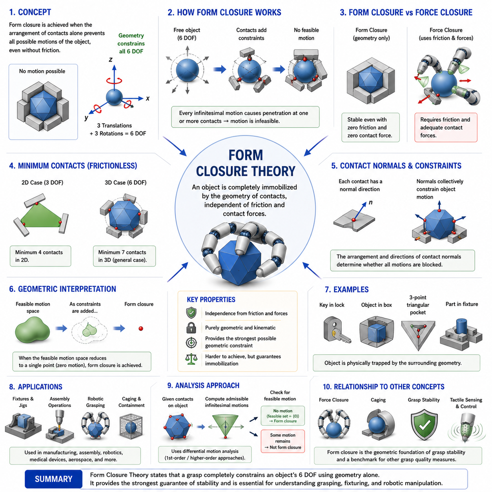{width="7.268055555555556in" height="7.268055555555556in"}

Form Closure Theory is one of the most fundamental concepts in robotic grasping, contact mechanics, dexterous manipulation, and grasp stability analysis. Together with Force Closure Theory, it forms the theoretical foundation upon which modern robotic grasp planning and manipulation systems are built. While force closure relies on the active generation of contact forces and friction to stabilize an object, form closure achieves stability through geometry alone. A grasp is said to possess form closure when the arrangement of contact points completely constrains all possible motions of the object, regardless of the magnitude of contact forces and even in the absence of friction. In essence, form closure represents the strongest possible geometric constraint that can be imposed on an object through contact.

The concept of form closure originates from the study of kinematic constraints in mechanical systems. When an object is surrounded by rigid boundaries or contact points in such a way that no infinitesimal motion is possible, the object is said to be geometrically locked. Unlike force closure, which depends on friction coefficients and force generation capabilities, form closure depends solely on the spatial arrangement of contacts. This distinction makes form closure one of the purest expressions of grasp stability because it derives entirely from geometry rather than from force interactions.

A useful way to understand form closure is to imagine a key inserted into a lock. The key is constrained by the surrounding surfaces of the lock. Even if friction were completely removed, the key would still be unable to move freely because its motion is physically restricted by geometry. Similarly, an object held in form closure cannot translate or rotate because every possible direction of motion is blocked by one or more contact constraints.

In robotic grasping, the fundamental objective of form closure analysis is to determine whether a given set of contacts completely constrains all degrees of freedom of the object. In three-dimensional space, a rigid object possesses six independent degrees of freedom. Three correspond to translational motion along the x, y, and z axes, while three correspond to rotational motion about those axes. To achieve form closure, the contact arrangement must eliminate all six degrees of freedom simultaneously.

The study of form closure begins with the concept of admissible motion. When an object contacts external surfaces, some motions remain possible while others become prohibited. Each contact introduces constraints that restrict movement in certain directions. The collective effect of all contacts determines the set of motions available to the object. Form closure exists when the only admissible motion remaining is zero motion. Under these conditions, the object becomes completely immobilized.

One of the most important characteristics of form closure is its independence from friction. Classical form closure theory assumes frictionless contacts. This assumption may initially seem unrealistic because most practical grasping systems rely on friction. However, the frictionless assumption provides a powerful theoretical framework because it isolates the contribution of geometry from the contribution of force generation. If an object can be immobilized without friction, then geometric constraints alone are sufficient to guarantee stability.

The distinction between form closure and force closure is central to grasp theory. Force closure concerns whether contact forces can be generated to counteract arbitrary external disturbances. Form closure concerns whether the object can move at all. Force closure is a dynamic concept involving force balance, while form closure is fundamentally a kinematic concept involving motion constraints. Because force closure typically requires friction and active force generation, it is generally easier to achieve than form closure. Conversely, form closure represents a stronger condition because it guarantees immobilization through geometry alone.

The mathematical foundation of form closure is based on differential motion analysis. Consider an infinitesimal displacement of an object. If the displacement causes penetration at one or more contact points, the motion is considered infeasible. By examining all possible infinitesimal motions, researchers can determine whether any feasible motion directions remain available. If every possible motion leads to penetration, then form closure has been achieved.

Contact normals play a critical role in form closure analysis. At each contact point, the surface normal defines the direction along which penetration is prohibited. These contact normals collectively describe the geometric constraints imposed on the object. The arrangement and orientation of the normals determine whether sufficient constraints exist to eliminate all object motions. Consequently, form closure analysis often focuses on the distribution of contact normals rather than on contact forces.

An intuitive example can be found in fixturing systems used in manufacturing. When a workpiece is placed inside a precisely designed fixture, the fixture geometry prevents motion in every direction. The workpiece remains fixed regardless of external disturbances because the fixture physically blocks all movement. Such systems are classic examples of form closure in industrial engineering.

The minimum number of contacts required for form closure depends on the dimensionality of the problem. In two-dimensional grasping scenarios, a rigid object possesses three degrees of freedom, consisting of two translational and one rotational degree. Under frictionless conditions, four appropriately placed contact points are generally required to achieve form closure. In three-dimensional space, where six degrees of freedom exist, the minimum number of frictionless contacts increases significantly. Classical grasp theory demonstrates that at least seven appropriately arranged frictionless contacts are typically required to achieve form closure for a general three-dimensional rigid object.

This requirement illustrates one reason why form closure is difficult to achieve in practice. Obtaining seven precisely positioned contact points can be challenging for robotic hands, particularly when grasping irregular objects in unstructured environments. Consequently, most practical robotic grasping systems rely on force closure rather than pure form closure.

Despite its practical limitations, form closure remains extremely valuable because it establishes theoretical limits on grasp stability. By understanding the conditions required for geometric immobilization, researchers gain deeper insight into the nature of contact constraints and object controllability. Form closure serves as a benchmark against which other grasping strategies can be evaluated.

The geometric interpretation of form closure is often described using convex analysis. Each contact generates a constraint on object motion, and the combination of these constraints defines a feasible motion space. Form closure occurs when the feasible motion space collapses to a single point corresponding to zero motion. In geometric terms, the contact constraints completely surround the object's motion space, leaving no available direction for movement.

The concept of first-order form closure provides a practical approximation used in robotic grasp analysis. Rather than considering finite object motions, first-order form closure examines only infinitesimal motions. This simplification allows researchers to analyze grasp stability using linear mathematical techniques. Most theoretical studies of form closure rely on first-order analysis because it provides a tractable framework for evaluating contact configurations.

Higher-order form closure extends the analysis beyond infinitesimal displacements. Some contact arrangements may permit no infinitesimal motion but still allow finite motions through nonlinear pathways. Higher-order analyses investigate these more complex situations and provide a deeper understanding of geometric constraint behavior. Although computationally more demanding, higher-order form closure analysis can reveal subtle stability properties that first-order methods may overlook.

Form closure is closely related to the concept of caging in robotic manipulation. A caged object is trapped within a geometric enclosure but may still possess limited motion inside the enclosure. Form closure represents the limiting case in which all motion has been eliminated. Consequently, form closure can be viewed as the strongest form of geometric caging.

Robotic assembly operations frequently exploit principles related to form closure. During insertion tasks, alignment fixtures and guiding surfaces are designed to constrain component motion progressively. As parts approach their final positions, geometric constraints increasingly restrict movement until complete assembly is achieved. Understanding form closure helps engineers design fixtures, jigs, and assembly mechanisms that achieve reliable positioning without requiring excessive force control.

Humanoid robotics also benefits from form closure principles. Human hands often combine force closure and partial form closure during manipulation. For example, when holding a pen between fingers, geometric constraints imposed by finger placement contribute to stability alongside frictional forces. Robotic hands can similarly exploit geometric features of objects to improve grasp robustness.

Soft robotic systems introduce interesting extensions to classical form closure theory. Because soft fingers deform during contact, the effective contact geometry changes dynamically. Compliance can create additional contact regions that enhance constraint generation. Although classical form closure assumes rigid bodies, modern research increasingly investigates how deformable contacts influence geometric stability.

The relationship between form closure and grasp planning is particularly important. Automated grasp planners often evaluate candidate grasps according to their ability to achieve force closure, form closure, or both. Form closure provides a highly conservative measure of grasp security. If form closure is achieved, stability is guaranteed independently of friction assumptions. As a result, form closure criteria are frequently used in safety-critical applications where maximum reliability is required.

Simulation environments and digital twins employ form closure analysis to evaluate grasp configurations before deployment. By identifying contact arrangements that satisfy form closure conditions, engineers can design more robust robotic systems and reduce the likelihood of manipulation failure. Simulation-based form closure analysis is particularly valuable when working with complex object geometries that are difficult to analyze analytically.

Recent advances in machine learning and data-driven manipulation have not diminished the importance of form closure theory. Instead, form closure increasingly serves as a source of physical priors and supervision signals for learning algorithms. Neural networks trained to predict grasp quality often incorporate form closure metrics as labels or evaluation criteria. Combining geometric grasp theory with learning-based approaches improves both interpretability and generalization.

In industrial automation, form closure principles appear in robotic fixtures, precision assembly systems, machine tools, and automated handling equipment. In warehouse logistics, geometric constraints are often used to stabilize packages during transport. In medical robotics, form closure concepts influence the design of surgical instrument holders and positioning devices. In aerospace manufacturing, complex fixturing systems rely heavily on form closure principles to ensure accurate component alignment.

The future of robotic manipulation is likely to involve increasingly sophisticated combinations of form closure, force closure, tactile sensing, and intelligent control. Rather than relying on a single stability mechanism, advanced robotic systems will integrate multiple complementary approaches. Form closure will continue to provide the geometric foundation upon which these systems are built.

Ultimately, Form Closure Theory represents the purest expression of geometric grasp stability. It demonstrates how the arrangement of contact points alone can completely immobilize an object without requiring friction or active force control. By focusing on motion constraints rather than force generation, form closure provides a powerful framework for understanding object immobilization, fixture design, assembly planning, and grasp stability.

Within the broader context of Contact Mechanics and Grasp Theory, Form Closure Theory serves as a critical foundation for force closure analysis, grasp quality evaluation, grasp planning, fixture design, caging theory, assembly robotics, dexterous manipulation, and autonomous robotic grasp synthesis. A deep understanding of form closure enables engineers and researchers to design robotic systems that achieve reliable object immobilization, robust manipulation, and high-precision interaction with the physical world, making it an essential topic in the development of next-generation robotic hands and intelligent Physical AI systems.

형상 폐쇄 이론(Form Closure Theory)은 로봇 파지(Grasping), 접촉 역학(Contact Mechanics), 정교 조작(Dexterous Manipulation), 그리고 파지 안정성 분석(Grasp Stability Analysis) 분야에서 가장 중요한 기초 이론 중 하나이다. 힘 폐쇄 이론(Force Closure Theory)과 함께 현대 로봇 파지 및 조작 기술의 이론적 기반을 형성한다. 힘 폐쇄가 마찰(Friction)과 접촉력(Contact Force)을 이용하여 물체를 안정화하는 방법이라면, 형상 폐쇄는 순수하게 기하학적 구조(Geometry)만으로 물체의 움직임을 완전히 제한하는 방법이다. 즉, 형상 폐쇄가 달성된 상태에서는 마찰이 전혀 없더라도 물체가 움직일 수 없다. 물체는 접촉점들의 배치에 의해 물리적으로 갇혀 있으며, 어떠한 방향으로도 이동하거나 회전할 수 없게 된다. 따라서 형상 폐쇄는 기하학적으로 달성할 수 있는 가장 강력한 안정성 조건이라고 할 수 있다.

형상 폐쇄의 개념은 기구학(Kinematics)과 운동 제약(Motion Constraint)의 연구에서 시작되었다. 물체가 여러 개의 접촉점이나 경계면에 의해 둘러싸여 있을 때, 특정 방향으로의 운동이 제한된다. 만약 모든 가능한 운동 방향이 차단된다면 물체는 완전히 고정된다. 이러한 상태가 바로 형상 폐쇄이다. 형상 폐쇄는 힘의 크기나 마찰 계수에 의존하지 않고 오직 접촉점의 위치와 방향에 의해 결정된다는 점에서 매우 독특하다.

형상 폐쇄를 이해하는 가장 쉬운 예는 자물쇠 안에 삽입된 열쇠이다. 열쇠는 자물쇠 내부의 형상에 의해 둘러싸여 있기 때문에 자유롭게 움직일 수 없다. 설령 마찰이 완전히 제거된다고 하더라도 열쇠는 자물쇠의 벽을 통과할 수 없으므로 움직임이 제한된다. 마찬가지로 형상 폐쇄 상태의 물체는 접촉점의 배치에 의해 모든 운동이 물리적으로 차단된다.

로봇 파지에서 형상 폐쇄의 목표는 물체의 모든 자유도(Degree of Freedom)를 제거하는 것이다. 3차원 공간의 강체(Rigid Body)는 총 6개의 자유도를 가진다. 세 개는 x, y, z 방향의 병진 운동(Translation)이고, 나머지 세 개는 각 축에 대한 회전 운동(Rotation)이다. 형상 폐쇄가 성립하기 위해서는 이 6개의 자유도가 모두 제거되어야 한다.

형상 폐쇄 분석은 허용 운동(Admissible Motion)의 개념에서 출발한다. 물체가 접촉점을 가지고 있을 때 일부 운동은 가능하고 일부 운동은 불가능하다. 각 접촉점은 특정 방향의 운동을 금지하는 제약 조건을 제공한다. 모든 접촉점이 함께 작용하여 가능한 운동 공간(Motion Space)을 결정하게 된다. 만약 남아 있는 허용 운동이 전혀 없다면 형상 폐쇄가 달성된 것이다.

형상 폐쇄의 가장 중요한 특징은 마찰에 의존하지 않는다는 점이다. 전통적인 형상 폐쇄 이론은 마찰이 없는 접촉(Frictionless Contact)을 가정한다. 이는 현실과 다소 다를 수 있지만 매우 중요한 의미를 가진다. 마찰 없이도 물체를 완전히 고정할 수 있다면 기하학적 구조만으로 충분한 안정성을 확보할 수 있다는 것을 의미하기 때문이다. 따라서 형상 폐쇄는 순수한 기하학적 안정성(Geometric Stability)을 분석하는 가장 강력한 도구가 된다.

형상 폐쇄와 힘 폐쇄는 자주 비교된다. 힘 폐쇄는 접촉력을 이용하여 외란을 상쇄하는 능력을 의미한다. 반면 형상 폐쇄는 물체가 애초에 움직일 수 없도록 만드는 개념이다. 힘 폐쇄는 힘의 평형(Force Balance)에 관한 동적 개념이고, 형상 폐쇄는 운동 제약(Motion Constraint)에 관한 기구학적 개념이다. 일반적으로 힘 폐쇄가 형상 폐쇄보다 달성하기 쉽다. 반면 형상 폐쇄는 더 강력한 조건으로 간주된다.

형상 폐쇄의 수학적 기반은 미소 운동(Infinitesimal Motion) 분석에 있다. 물체가 아주 작은 거리만큼 움직인다고 가정했을 때, 그 움직임이 접촉면 침투(Penetration)를 유발한다면 해당 운동은 허용되지 않는다. 가능한 모든 미소 운동을 조사하여 허용되는 방향이 하나도 남지 않으면 형상 폐쇄가 성립한다.

이 과정에서 접촉 법선(Contact Normal)은 매우 중요한 역할을 한다. 각 접촉점의 법선 벡터는 침투가 허용되지 않는 방향을 정의한다. 여러 접촉점의 법선들이 함께 작용하여 물체의 운동을 제한한다. 따라서 형상 폐쇄 분석은 접촉력보다 접촉 법선의 배치와 방향에 초점을 맞춘다.

산업 현장의 지그(Jig)와 고정구(Fixture)는 형상 폐쇄의 대표적인 사례이다. 가공 대상 부품이 정밀하게 설계된 고정구 안에 배치되면 모든 방향의 운동이 제한된다. 이 경우 부품은 외부 힘이 가해져도 움직일 수 없으며, 이는 전형적인 형상 폐쇄 상태이다.

형상 폐쇄를 달성하기 위해 필요한 최소 접촉점 수는 공간의 차원에 따라 달라진다. 2차원 공간에서는 물체가 세 개의 자유도(두 개의 병진 자유도와 한 개의 회전 자유도)를 가진다. 마찰이 없는 경우 일반적으로 네 개의 적절한 접촉점이 필요하다. 3차원 공간에서는 여섯 개의 자유도를 가지므로 더 많은 접촉점이 요구된다. 고전적인 파지 이론에 따르면 일반적인 3차원 강체에 대해 최소 일곱 개의 마찰 없는 접촉점이 필요하다.

이 사실은 형상 폐쇄가 실제 로봇 시스템에서 달성하기 어려운 이유 중 하나이다. 복잡한 물체에 대해 정확한 위치에 일곱 개 이상의 접촉점을 배치하는 것은 매우 어렵다. 특히 비정형 물체(Unstructured Object)를 다루는 경우에는 더욱 어렵다. 따라서 대부분의 실제 로봇은 형상 폐쇄 대신 힘 폐쇄를 활용한다.

그럼에도 불구하고 형상 폐쇄는 매우 중요한 의미를 가진다. 형상 폐쇄는 물체를 완전히 고정하기 위한 이론적 한계를 제시하기 때문이다. 연구자들은 형상 폐쇄 조건을 통해 접촉 제약과 물체 제어 가능성에 대한 깊은 통찰을 얻을 수 있다. 따라서 형상 폐쇄는 다른 모든 파지 전략을 평가하는 기준점 역할을 한다.

기하학적으로 형상 폐쇄는 볼록 해석(Convex Analysis)을 이용하여 설명할 수 있다. 각 접촉점은 물체 운동 공간에 제약을 추가한다. 모든 제약이 결합되면 가능한 운동 공간이 점점 줄어들게 된다. 형상 폐쇄가 달성되면 가능한 운동 공간은 오직 원점(Zero Motion)만 남게 된다. 즉, 물체는 어떠한 방향으로도 움직일 수 없게 된다.

실제 로봇공학에서는 1차 형상 폐쇄(First-Order Form Closure)가 널리 사용된다. 이는 유한한 운동(Finite Motion)이 아니라 무한히 작은 운동(Infinitesimal Motion)만을 분석하는 방법이다. 이러한 선형 근사는 계산을 단순화하면서도 대부분의 파지 문제에서 충분한 정확성을 제공한다.

보다 정교한 분석으로는 고차 형상 폐쇄(Higher-Order Form Closure)가 있다. 일부 접촉 구성은 미소 운동은 허용하지 않지만 특정한 비선형 경로를 통해 유한한 운동이 가능할 수도 있다. 고차 형상 폐쇄는 이러한 복잡한 상황까지 분석하며 보다 깊은 수준의 안정성 평가를 제공한다.

형상 폐쇄는 케이징(Caging) 이론과도 밀접한 관계를 가진다. 케이징은 물체가 특정 영역 안에 갇혀 있지만 제한적인 움직임은 허용되는 상태를 의미한다. 형상 폐쇄는 이러한 케이징의 극한 상태로 볼 수 있으며, 모든 운동이 완전히 제거된 경우를 의미한다.

조립 로봇(Assembly Robot)에서도 형상 폐쇄 원리는 자주 활용된다. 부품 삽입(Insertion) 작업에서는 가이드 면(Guiding Surface)과 정렬 구조가 부품의 움직임을 점진적으로 제한한다. 최종 위치에 가까워질수록 가능한 운동은 줄어들고, 결국 완전한 형상 폐쇄 상태가 형성되면서 정확한 조립이 이루어진다.

휴머노이드 로봇 역시 형상 폐쇄의 혜택을 받을 수 있다. 인간은 펜이나 공구를 잡을 때 단순히 마찰만 이용하는 것이 아니라 손가락 배치를 통해 부분적인 형상 폐쇄를 형성한다. 로봇 손도 이러한 기하학적 제약을 활용하면 더 안정적인 파지를 구현할 수 있다.

소프트 로보틱스(Soft Robotics)는 형상 폐쇄 개념을 더욱 확장한다. 부드러운 손가락은 접촉 과정에서 변형되기 때문에 유효 접촉 형상이 지속적으로 변화한다. 이러한 변형은 새로운 접촉 영역을 형성하여 추가적인 제약을 생성할 수 있다. 따라서 현대 연구에서는 변형체(Deformable Body)를 고려한 형상 폐쇄 이론도 활발히 연구되고 있다.

파지 계획(Grasp Planning)에서도 형상 폐쇄는 중요한 평가 기준이다. 자동 파지 계획 알고리즘은 후보 파지 자세들을 평가할 때 형상 폐쇄 가능성을 분석한다. 형상 폐쇄는 마찰과 무관하게 안정성을 보장하므로 매우 보수적이지만 신뢰성이 높은 기준으로 활용된다.

시뮬레이션과 디지털 트윈(Digital Twin) 환경에서도 형상 폐쇄 분석이 사용된다. 실제 로봇에 적용하기 전에 수많은 접촉 구성을 가상 환경에서 분석하여 형상 폐쇄 조건을 만족하는지 확인할 수 있다. 이를 통해 파지 실패 가능성을 줄이고 보다 안정적인 조작 전략을 설계할 수 있다.

최근 머신러닝 기반 조작 기술에서도 형상 폐쇄는 중요한 역할을 한다. 신경망은 형상 폐쇄 지표를 학습 데이터의 정답(Label)으로 사용할 수 있으며, 이를 통해 물리적으로 타당한 파지 전략을 학습하게 된다. 이론 기반 접근법과 데이터 기반 접근법을 결합함으로써 보다 강건하고 해석 가능한 파지 시스템을 구축할 수 있다.

산업 자동화에서는 형상 폐쇄 원리가 정밀 지그, 공작기계, 자동 조립 시스템, 부품 고정 장치 등에 널리 활용된다. 물류 시스템에서는 상자를 안정적으로 고정하기 위해 사용되며, 의료 로봇에서는 수술 기구의 위치를 정확하게 유지하기 위한 장치 설계에 활용된다. 항공우주 제조 분야에서도 고정구 설계의 핵심 원리로 사용된다.

미래의 로봇 조작 기술은 형상 폐쇄, 힘 폐쇄, 촉각 센싱, 지능형 제어를 통합하는 방향으로 발전할 것이다. 단일 안정화 기법에 의존하기보다 여러 기법을 결합하여 더욱 강건한 조작 능력을 구현하게 될 것이다. 이 과정에서 형상 폐쇄는 모든 안정성 분석의 기하학적 기반으로 계속 중요한 역할을 수행할 것이다.

결론적으로 형상 폐쇄 이론은 물체를 완전히 움직이지 못하게 만드는 순수한 기하학적 안정성 이론이다. 마찰이나 능동적인 힘 제어 없이도 접촉점의 배치만으로 물체를 완전히 고정할 수 있다는 사실을 보여준다. 따라서 형상 폐쇄는 접촉 역학, 파지 이론, 고정구 설계, 조립 공학, 로봇 조작 기술을 이해하기 위한 가장 근본적인 개념 중 하나이다.

따라서 **06_05 Form Closure Theory**는 이후에 등장하는 **Force Closure Analysis, Grasp Quality Evaluation, Fixture Design, Caging Theory, Assembly Robotics, Dexterous Manipulation, Autonomous Grasp Planning**을 이해하기 위한 핵심 기반 이론이다. 차세대 로봇 핸드, 휴머노이드 로봇, 산업용 조작 시스템, 그리고 미래의 Physical AI 플랫폼을 개발하는 연구자와 엔지니어라면 반드시 깊이 이해해야 할 중요한 주제라고 할 수 있다.

##  

## 06.06 Grasp Wrench Space

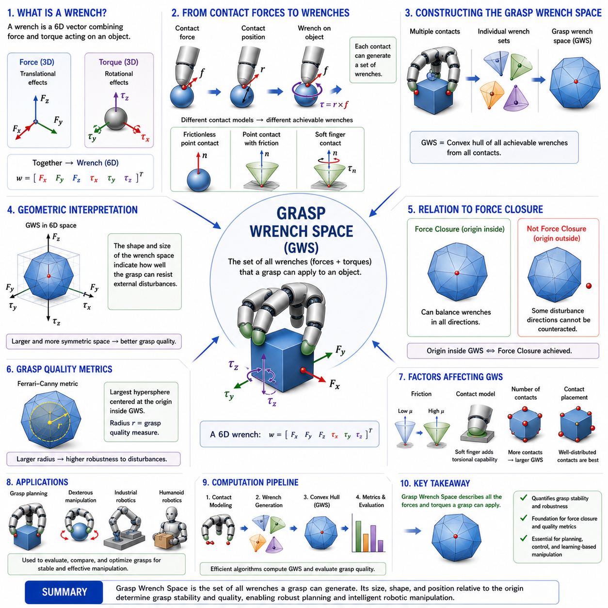{width="7.268055555555556in" height="7.268055555555556in"}

Grasp Wrench Space (GWS) is one of the most important concepts in robotic grasping, contact mechanics, dexterous manipulation, and robotic hand design. It provides a mathematical framework for describing and evaluating the complete set of forces and torques that a grasp can apply to an object. While concepts such as Point Contact, Soft Finger Contact, Force Closure, and Form Closure determine whether a grasp is theoretically stable, Grasp Wrench Space goes a step further by quantifying how stable the grasp is and how effectively it can resist external disturbances. As a result, Grasp Wrench Space serves as the foundation for grasp quality evaluation, grasp optimization, contact planning, and autonomous manipulation.

The concept of Grasp Wrench Space originates from the observation that every contact point between a robotic finger and an object can generate a limited set of forces. These forces depend on the contact model, friction conditions, finger geometry, actuator capabilities, and object surface characteristics. When these forces act at positions that are offset from the object's center of mass, they generate torques in addition to translational forces. The combination of forces and torques is referred to as a wrench. Therefore, every contact contributes a collection of possible wrenches, and the overall grasp produces a combined set of achievable wrenches. This combined set is known as the Grasp Wrench Space.

To understand Grasp Wrench Space, it is necessary to first understand the concept of a wrench. In rigid-body mechanics, a wrench is a six-dimensional vector that combines force and torque into a single mathematical representation. Three components represent translational forces acting along the x, y, and z directions, while the remaining three components represent torques around the x, y, and z axes. Since every object in three-dimensional space possesses six degrees of freedom, a wrench provides a complete description of how external interactions influence object motion.

Whenever a robotic finger applies force to an object, the contact force generates a corresponding wrench. If the force acts through the center of mass, only translational effects are produced. However, when the force acts away from the center of mass, a torque is generated according to the cross-product relationship between force and position. Consequently, even a simple contact force can produce a complex six-dimensional effect on object motion.

Each contact model defines a different set of allowable contact forces. A frictionless point contact can only generate force along the surface normal direction. A point contact with friction can additionally generate tangential forces within the limits of the friction cone. A soft-finger contact can further generate torsional moments around the contact normal. These different capabilities result in different wrench generation abilities and therefore different Grasp Wrench Spaces.

The construction of Grasp Wrench Space begins at the contact level. For each contact point, the set of allowable contact forces is determined. These forces are then transformed into object-level wrenches using the contact location and object geometry. The resulting set of wrenches represents all possible contributions that the contact can make to object control. When multiple contacts are present, their individual wrench sets are combined to form the overall Grasp Wrench Space.

Mathematically, Grasp Wrench Space is often represented as the convex hull of all achievable contact wrenches. A convex hull can be visualized as the smallest geometric region that contains all possible wrench vectors generated by the grasp. This geometric interpretation is extremely useful because many grasp quality metrics can be derived directly from the shape and size of the resulting wrench space.

The relationship between Grasp Wrench Space and Force Closure Theory is particularly important. A grasp achieves force closure when the origin of the wrench space lies strictly inside the convex hull of achievable wrenches. This means that the grasp can generate balancing wrenches in every possible direction. If the origin lies outside the wrench space, certain disturbance directions cannot be counteracted, indicating that force closure has not been achieved.

This geometric interpretation provides a powerful way to visualize grasp stability. Imagine the wrench space as a multidimensional volume surrounding the origin. The larger and more symmetric this volume becomes, the greater the ability of the grasp to resist disturbances from different directions. Small or highly elongated wrench spaces indicate that the grasp may be strong in some directions but weak in others.

The size of the Grasp Wrench Space is often used as a measure of grasp quality. A larger wrench space generally indicates that the grasp can resist larger disturbances before failure occurs. Consequently, many grasp quality metrics are based on measuring the distance between the origin and the nearest boundary of the wrench space. This distance represents the maximum disturbance that can be resisted uniformly in all directions.

One of the most widely used grasp quality measures is the Ferrari-Canny metric. This metric evaluates the radius of the largest hypersphere centered at the origin that can fit entirely within the Grasp Wrench Space. A larger radius corresponds to a higher-quality grasp because it indicates greater robustness against arbitrary disturbances. The Ferrari-Canny metric remains one of the most influential grasp evaluation methods in robotic manipulation research.

The shape of the Grasp Wrench Space provides valuable insights into grasp performance. A spherical wrench space indicates nearly uniform disturbance resistance in all directions. Such grasps are considered highly robust because they do not exhibit significant directional weaknesses. In contrast, elongated or skewed wrench spaces reveal directional bias, suggesting that the grasp may be vulnerable to disturbances along certain axes.

Friction plays a critical role in determining the structure of the Grasp Wrench Space. As the coefficient of friction increases, the corresponding friction cones widen, allowing contacts to generate a broader range of force directions. This expansion directly enlarges the achievable wrench space and improves grasp quality. Conversely, low-friction conditions produce smaller wrench spaces and reduce grasp robustness.

Soft-finger contacts further enhance Grasp Wrench Space by introducing torsional moment generation capabilities. The additional rotational constraints expand the achievable wrench set and improve the grasp's ability to resist twisting disturbances. Consequently, soft-finger grasps often exhibit significantly larger wrench spaces than equivalent point-contact grasps.

The number and placement of contact points strongly influence Grasp Wrench Space. Adding contact points generally increases the size of the wrench space because more force generation opportunities become available. However, contact placement is often more important than contact quantity. Poorly positioned contacts may contribute redundant wrenches, resulting in only marginal improvements. Strategically distributed contacts maximize wrench diversity and produce larger, more balanced wrench spaces.

Human grasping provides an excellent example of effective wrench-space optimization. Human fingers naturally position themselves to maximize force transmission and disturbance rejection. Through experience and sensory feedback, humans instinctively select contact configurations that generate large and well-balanced wrench spaces. Many robotic grasp planning algorithms attempt to replicate this capability through computational optimization.

The grasp matrix plays a central role in Grasp Wrench Space analysis. The grasp matrix maps contact forces into object-level wrenches. By combining the force-generating capabilities of all contacts, the grasp matrix defines the set of achievable wrenches. Many grasp analysis methods operate by examining the properties of this matrix and the resulting wrench space.

Computing Grasp Wrench Space can become challenging for complex robotic hands. As the number of contacts increases, the dimensionality of the problem grows rapidly. Efficient computational methods are therefore required to construct convex hulls, evaluate force closure, calculate quality metrics, and optimize grasp configurations. Advances in computational geometry and optimization have significantly improved the practicality of wrench-space analysis in modern robotic systems.

Grasp Wrench Space is particularly valuable in robotic grasp planning. Automated grasp planners generate large numbers of candidate grasps and evaluate them according to their wrench-space properties. Grasps that produce larger and more balanced wrench spaces are typically preferred because they offer greater robustness and manipulation capability. This process enables robots to select stable grasps autonomously without requiring extensive manual programming.

In dexterous manipulation tasks, Grasp Wrench Space provides insight into how effectively an object can be controlled after it has been grasped. A large wrench space not only improves stability but also increases manipulation authority. This allows the robot to reposition, rotate, tilt, or reorient objects while maintaining secure contact. Consequently, wrench-space analysis is important not only for grasp acquisition but also for subsequent manipulation planning.

Tactile sensing systems further enhance the practical usefulness of Grasp Wrench Space. Real-world contacts often differ from idealized models due to uncertainties in object geometry, material properties, and environmental conditions. Tactile sensors provide real-time information about contact forces, pressure distributions, and slip conditions. By incorporating tactile feedback, robotic systems can continuously estimate and update their effective wrench spaces during manipulation.

Simulation environments and digital twins frequently employ Grasp Wrench Space analysis as part of grasp evaluation pipelines. Thousands of candidate grasps can be assessed rapidly by computing wrench-space metrics. This capability enables efficient exploration of grasp strategies before deployment on physical hardware, reducing experimental costs and development time.

Machine learning and artificial intelligence have introduced new applications for Grasp Wrench Space. Learning-based grasp planners often use wrench-space metrics as training labels or reward functions. Reinforcement learning systems can optimize contact strategies by maximizing grasp quality measures derived from wrench-space analysis. Hybrid approaches combine analytical grasp mechanics with neural-network-based perception and decision-making systems.

In industrial robotics, Grasp Wrench Space analysis supports reliable handling of heavy components, fragile products, irregular objects, and precision assemblies. Warehouse robots use wrench-space-based evaluation to select secure grasps for packages of varying shapes and weights. Manufacturing robots rely on wrench-space optimization to ensure stability during assembly operations. Service robots and humanoid robots benefit from wrench-space analysis when interacting with diverse household and workplace environments.

The emergence of humanoid robotics and Physical AI systems has increased the importance of Grasp Wrench Space even further. Future robotic systems must manipulate a wide variety of objects under uncertain conditions while maintaining human-level dexterity and reliability. Achieving this capability requires sophisticated understanding of contact mechanics and wrench generation. Grasp Wrench Space provides the mathematical foundation for such understanding.

Modern research increasingly extends traditional wrench-space concepts to include deformable objects, soft robotic hands, dynamic contacts, and multi-arm manipulation systems. These developments reflect the growing complexity of robotic applications and the need for more comprehensive representations of grasp capability. Nevertheless, the fundamental principles remain rooted in the geometric interpretation of achievable contact wrenches.

Ultimately, Grasp Wrench Space transforms the abstract concept of grasp strength into a precise mathematical object that can be visualized, measured, compared, and optimized. It provides a unified framework for analyzing how contact forces combine to control object motion and resist disturbances. By describing the full range of achievable forces and torques, Grasp Wrench Space serves as a bridge between contact mechanics, grasp stability, manipulation planning, and robotic intelligence.

Within the broader context of Contact Mechanics and Grasp Theory, Grasp Wrench Space serves as the foundation for grasp quality metrics, force closure analysis, grasp optimization, dexterous manipulation planning, tactile grasp stabilization, robotic hand design, and learning-based grasp synthesis. A deep understanding of Grasp Wrench Space is therefore essential for engineers and researchers developing next-generation robotic hands, humanoid manipulators, intelligent grippers, and advanced Physical AI systems capable of robust interaction with the physical world.

그립 렌치 공간(Grasp Wrench Space, GWS)은 로봇 파지(Grasping), 접촉 역학(Contact Mechanics), 정교 조작(Dexterous Manipulation), 그리고 로봇 핸드 설계 분야에서 가장 중요한 개념 중 하나이다. 그립 렌치 공간은 특정 파지(Grasp)가 물체에 가할 수 있는 모든 힘(Force)과 토크(Torque)의 집합을 수학적으로 표현하는 방법이다. 점 접촉(Point Contact), 소프트 핑거 접촉(Soft Finger Contact), 힘 폐쇄(Force Closure), 형상 폐쇄(Form Closure)가 파지가 안정적인지 여부를 판단하는 이론이라면, 그립 렌치 공간은 한 단계 더 나아가 "얼마나 안정적인가?"를 정량적으로 평가하는 도구라고 할 수 있다. 따라서 그립 렌치 공간은 파지 품질 평가(Grasp Quality Evaluation), 파지 최적화(Grasp Optimization), 접촉 계획(Contact Planning), 자율 조작(Autonomous Manipulation)의 핵심 기반이 된다.

그립 렌치 공간의 개념은 로봇 손가락과 물체 사이의 접촉점이 생성할 수 있는 힘이 제한되어 있다는 사실에서 출발한다. 각 접촉점은 접촉 모델, 마찰 조건, 손가락 구조, 액추에이터 성능, 물체 표면 특성에 따라 생성 가능한 힘의 범위가 달라진다. 이러한 힘이 물체 중심에서 떨어진 위치에 작용하면 힘뿐만 아니라 토크도 생성된다. 힘과 토크를 결합한 개념을 렌치(Wrench)라고 부르며, 각 접촉점은 자신만의 렌치 집합을 생성한다. 여러 접촉점에서 생성된 렌치들을 모두 합친 공간이 바로 그립 렌치 공간이다.

그립 렌치 공간을 이해하기 위해서는 먼저 렌치(Wrench)의 개념을 이해해야 한다. 강체 역학(Rigid Body Mechanics)에서 렌치는 힘과 토크를 하나의 벡터로 통합한 표현 방식이다. 3차원 공간에서 힘은 x, y, z 방향의 세 성분을 가지며, 토크도 x, y, z 축에 대한 세 성분을 가진다. 따라서 하나의 렌치는 총 6개의 요소로 구성되는 6차원 벡터가 된다. 물체의 6자유도(6 Degrees of Freedom)를 완전히 설명할 수 있기 때문에 렌치는 접촉 역학에서 매우 중요한 표현 방식이다.

로봇 손가락이 물체를 누르면 접촉력이 발생하고, 이 힘은 물체에 렌치를 생성한다. 만약 힘이 물체의 질량 중심(Center of Mass)을 통과하면 순수한 병진 운동만 발생한다. 그러나 힘이 질량 중심에서 떨어진 위치에 작용하면 토크가 생성된다. 따라서 단순한 접촉력도 실제로는 힘과 토크를 동시에 발생시키는 복합적인 효과를 가진다.

접촉 모델에 따라 생성 가능한 렌치의 종류도 달라진다. 마찰이 없는 점 접촉(Frictionless Point Contact)은 법선 방향 힘만 생성할 수 있다. 마찰이 있는 점 접촉(Point Contact with Friction)은 접선 방향 힘도 생성할 수 있다. 소프트 핑거 접촉(Soft Finger Contact)은 여기에 비틀림 모멘트(Torsional Moment)까지 생성할 수 있다. 따라서 접촉 모델이 발전할수록 생성 가능한 렌치 공간도 더욱 커지게 된다.

그립 렌치 공간은 접촉 수준(Contact Level)에서부터 구성된다. 먼저 각 접촉점에서 생성 가능한 힘의 집합을 정의한다. 그런 다음 접촉 위치와 물체 형상을 이용하여 이러한 힘들을 물체 수준의 렌치로 변환한다. 각각의 접촉점이 생성하는 렌치 집합을 모두 결합하면 최종적인 그립 렌치 공간이 형성된다.

수학적으로 그립 렌치 공간은 일반적으로 볼록 껍질(Convex Hull)로 표현된다. 볼록 껍질은 가능한 모든 렌치를 포함하는 가장 작은 기하학적 영역이다. 이러한 기하학적 표현은 매우 유용한데, 그립 렌치 공간의 형태와 크기를 분석함으로써 파지 품질을 정량적으로 평가할 수 있기 때문이다.

그립 렌치 공간은 힘 폐쇄 이론과 매우 밀접한 관계를 가진다. 힘 폐쇄가 성립하려면 렌치 공간 내부에 원점(Origin)이 포함되어 있어야 한다. 이는 파지가 모든 방향의 외란에 대해 균형을 맞출 수 있는 렌치를 생성할 수 있다는 의미이다. 반대로 원점이 렌치 공간 밖에 존재한다면 특정 방향의 외란을 상쇄할 수 없으므로 힘 폐쇄가 성립하지 않는다.

이러한 기하학적 해석은 파지 안정성을 직관적으로 이해할 수 있게 해준다. 렌치 공간이 원점을 중심으로 크게 형성될수록 파지는 다양한 방향의 외란에 강해진다. 반면 렌치 공간이 작거나 특정 방향으로 길게 늘어난 형태라면, 그 방향에서는 강하지만 다른 방향에서는 약한 파지가 될 수 있다.

그립 렌치 공간의 크기는 파지 품질의 중요한 척도로 사용된다. 일반적으로 렌치 공간이 클수록 더 큰 외란을 견딜 수 있다. 따라서 많은 파지 품질 지표는 렌치 공간의 크기와 형태를 측정하는 방식으로 정의된다.

가장 널리 알려진 파지 품질 지표는 Ferrari-Canny Metric이다. 이 지표는 원점을 중심으로 하는 최대 초구(Hypersphere)가 그립 렌치 공간 내부에 얼마나 크게 포함될 수 있는지를 측정한다. 초구의 반지름이 클수록 파지는 모든 방향의 외란에 대해 더욱 강건하다는 의미가 된다. Ferrari-Canny Metric은 현재까지도 가장 영향력 있는 파지 평가 방법 중 하나이다.

그립 렌치 공간의 형태는 파지 성능에 대한 중요한 정보를 제공한다. 이상적인 경우 렌치 공간은 구(Spherical Shape)에 가까운 형태를 가진다. 이는 모든 방향의 외란에 대해 균일한 저항 능력을 가진다는 의미이다. 반면 길쭉하거나 비대칭적인 렌치 공간은 특정 방향의 외란에 취약할 수 있음을 나타낸다.

마찰(Friction)은 그립 렌치 공간을 결정하는 핵심 요소이다. 마찰 계수(Coefficient of Friction)가 증가하면 마찰 원뿔(Friction Cone)이 넓어지고, 접촉점이 생성할 수 있는 힘의 방향 범위도 증가한다. 이는 곧 렌치 공간의 확대를 의미하며, 결과적으로 파지 품질이 향상된다. 반대로 마찰 계수가 낮으면 렌치 공간이 작아지고 안정성도 감소한다.

소프트 핑거 접촉은 렌치 공간을 더욱 확장시킨다. 소프트 핑거는 비틀림 모멘트를 생성할 수 있기 때문에 기존 점 접촉보다 더 많은 렌치를 생성할 수 있다. 따라서 동일한 접촉 수를 사용하더라도 더 넓은 렌치 공간과 더 높은 파지 품질을 얻을 수 있다.

접촉점의 수와 위치는 그립 렌치 공간에 직접적인 영향을 미친다. 일반적으로 접촉점이 많아질수록 렌치 공간은 커진다. 하지만 단순히 접촉 수만 늘리는 것이 항상 좋은 것은 아니다. 서로 유사한 방향의 렌치만 생성하는 접촉점은 큰 효과를 제공하지 못한다. 반대로 다양한 방향에 분산된 접촉점은 렌치 공간을 크게 확장시킨다.

인간의 손은 렌치 공간 최적화의 좋은 사례이다. 인간은 물체를 잡을 때 자연스럽게 힘 전달이 효율적인 위치에 손가락을 배치한다. 이러한 배치는 큰 렌치 공간을 생성하며 높은 안정성과 조작 능력을 제공한다. 많은 로봇 파지 계획 알고리즘은 이러한 인간의 전략을 모방하고자 한다.

그립 매트릭스(Grasp Matrix)는 그립 렌치 공간 분석의 핵심 도구이다. 그립 매트릭스는 접촉력(Contact Force)을 물체 수준의 렌치로 변환하는 역할을 한다. 따라서 렌치 공간은 결국 그립 매트릭스의 특성에 의해 결정된다.

실제 로봇 핸드에서는 렌치 공간 계산이 매우 복잡해질 수 있다. 접촉점 수가 증가할수록 계산 차원이 급격히 증가하기 때문이다. 따라서 볼록 껍질 계산, 최적화 기법, 계산 기하학(Computational Geometry) 알고리즘이 널리 활용된다.

파지 계획(Grasp Planning)에서는 수많은 후보 파지를 생성한 후 각 파지의 렌치 공간을 계산한다. 렌치 공간이 크고 균형 잡힌 파지가 우선적으로 선택된다. 이를 통해 로봇은 사람의 개입 없이도 안정적인 파지를 스스로 선택할 수 있다.

정교 조작(Dexterous Manipulation)에서는 렌치 공간이 단순한 안정성 이상의 의미를 가진다. 큰 렌치 공간은 물체를 안정적으로 유지할 뿐만 아니라 회전, 기울임, 재배치(Reorientation) 등의 조작 작업도 가능하게 한다. 따라서 렌치 공간은 파지 이후의 조작 능력까지 평가하는 중요한 척도이다.

촉각 센서(Tactile Sensor)는 렌치 공간 분석을 더욱 현실적으로 만든다. 실제 환경에서는 물체 형상 오차, 재료 특성 변화, 환경 불확실성 등이 존재한다. 촉각 센서는 실시간 접촉 정보를 제공하며, 이를 통해 로봇은 현재의 유효 렌치 공간을 지속적으로 업데이트할 수 있다.

시뮬레이션과 디지털 트윈(Digital Twin) 환경에서도 그립 렌치 공간은 핵심적인 역할을 수행한다. 수천 개의 파지 후보를 빠르게 평가하고 최적의 파지를 선택할 수 있기 때문이다. 이는 개발 비용과 실험 시간을 크게 줄여준다.

최근 머신러닝(Machine Learning)과 인공지능(AI) 기반 파지 시스템에서도 그립 렌치 공간은 중요한 역할을 수행한다. 강화학습(Reinforcement Learning)은 렌치 공간 기반 품질 지표를 보상 함수(Reward Function)로 사용할 수 있으며, 신경망은 렌치 공간 특성을 학습하여 더욱 안정적인 파지를 생성할 수 있다.

산업용 로봇은 무거운 부품, 깨지기 쉬운 제품, 복잡한 형상의 물체를 다루기 위해 렌치 공간 분석을 활용한다. 물류 로봇은 상자를 안전하게 운반하기 위해 사용하고, 조립 로봇은 부품을 안정적으로 고정하기 위해 사용한다. 서비스 로봇과 휴머노이드 로봇 역시 다양한 환경에서 물체를 다루기 위해 렌치 공간 분석을 활용한다.

휴머노이드 로봇과 Physical AI의 발전은 그립 렌치 공간의 중요성을 더욱 높이고 있다. 미래의 로봇은 인간과 유사한 수준의 조작 능력을 요구받게 될 것이며, 이를 위해서는 접촉력을 어떻게 생성하고 활용할 것인지에 대한 정교한 이해가 필요하다. 그립 렌치 공간은 이러한 이해를 제공하는 핵심 수학적 도구이다.

최근 연구는 전통적인 렌치 공간 개념을 변형체(Deformable Object), 소프트 로봇 핸드, 동적 접촉(Dynamic Contact), 다중 로봇 협조 조작(Cooperative Manipulation) 분야까지 확장하고 있다. 응용 분야는 계속 확대되고 있지만, 그 핵심 원리는 여전히 접촉이 생성할 수 있는 렌치의 기하학적 분석에 기반하고 있다.

결론적으로 그립 렌치 공간은 파지 강도와 안정성을 정량적으로 표현하는 가장 강력한 수학적 도구 중 하나이다. 접촉점들이 생성할 수 있는 모든 힘과 토크의 범위를 하나의 공간으로 표현함으로써 파지를 분석하고 비교하며 최적화할 수 있게 해준다. 또한 접촉 역학, 파지 안정성, 조작 계획, 인공지능 기반 파지 기술을 연결하는 핵심 다리 역할을 수행한다.

따라서 **06_06 Grasp Wrench Space**는 **Grasp Quality Metrics, Force Closure Analysis, Grasp Optimization, Dexterous Manipulation Planning, Tactile Grasp Stabilization, Robotic Hand Design, Learning-Based Grasp Synthesis**의 핵심 기반 이론이다. 차세대 로봇 핸드, 휴머노이드 로봇, 지능형 그리퍼, 그리고 미래의 Physical AI 시스템을 개발하는 연구자와 엔지니어라면 반드시 깊이 이해해야 할 가장 중요한 개념 중 하나이다.

##  

## 06.07 Grasp Quality Metrics

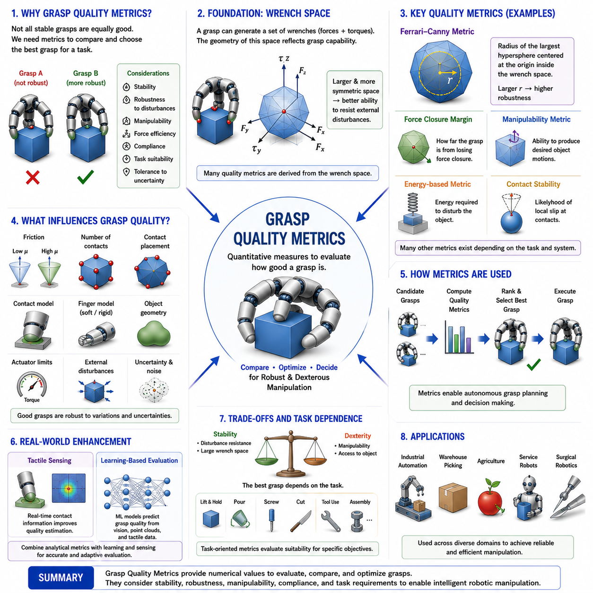{width="7.268055555555556in" height="7.268055555555556in"}

Grasp Quality Metrics are quantitative measures used to evaluate how effectively a robotic grasp can secure, stabilize, manipulate, and control an object. Within the field of robotic grasping, contact mechanics, dexterous manipulation, and robotic hand design, grasp quality metrics serve as the bridge between theoretical grasp stability and practical grasp performance. While concepts such as Force Closure, Form Closure, Contact Models, and Grasp Wrench Space determine whether a grasp is theoretically feasible, grasp quality metrics determine how good that grasp actually is. They provide numerical values that allow robotic systems to compare alternative grasp configurations, optimize contact locations, improve manipulation robustness, and make autonomous decisions during grasp planning. As a result, grasp quality metrics have become one of the most important tools in modern robotic manipulation research and industrial grasping applications. This topic occupies a central position within the Contact Mechanics and Grasp Theory section of the Robot Hand and Dexterous Grasping volume.

The need for grasp quality metrics arises from the observation that not all stable grasps are equally effective. Two different grasps may both satisfy force closure conditions, yet one may be significantly more robust against disturbances, require less actuator effort, provide better manipulation capability, or exhibit greater tolerance to uncertainty. Simply determining whether a grasp is stable is often insufficient for practical robotic systems. Engineers and researchers require methods to rank candidate grasps according to performance criteria. Grasp quality metrics provide this capability by transforming abstract concepts of stability and robustness into measurable quantities.

The development of grasp quality evaluation began with classical robotic grasp theory. Early researchers recognized that stable grasping depends on the ability of contact forces to resist external disturbances. This observation led to the development of mathematical frameworks based on contact mechanics, friction cones, grasp matrices, and wrench spaces. Over time, these frameworks evolved into increasingly sophisticated quality metrics capable of evaluating not only stability but also dexterity, robustness, manipulability, and task suitability.

One of the most fundamental principles underlying grasp quality evaluation is disturbance resistance. A high-quality grasp should be capable of resisting forces and torques applied from arbitrary directions. In real-world environments, objects are subjected to gravity, inertia, vibration, collisions, environmental contacts, and manipulation forces. The ability to maintain stability despite these disturbances is a primary indicator of grasp effectiveness. Consequently, many grasp quality metrics are directly related to the size and structure of the Grasp Wrench Space.

The Grasp Wrench Space provides the mathematical foundation for numerous grasp quality measures. As discussed in previous chapters, the Grasp Wrench Space represents the complete set of wrenches that a grasp can generate. The geometry of this space reveals the grasp\'s ability to resist external disturbances. Larger wrench spaces generally indicate stronger grasps because they allow larger balancing forces and torques to be generated. More symmetric wrench spaces indicate more uniform disturbance resistance across different directions.

Among all grasp quality metrics, the Ferrari-Canny metric is perhaps the most influential and widely used. Developed as a robust measure of grasp quality, the Ferrari-Canny metric evaluates the radius of the largest hypersphere centered at the origin that can fit entirely within the Grasp Wrench Space. This radius represents the magnitude of the largest disturbance that can be resisted equally in every direction. A larger radius corresponds to a higher-quality grasp because it indicates greater robustness against uncertainty and external perturbations.

The geometric interpretation of the Ferrari-Canny metric is particularly intuitive. Imagine placing a sphere at the center of the wrench space. If the wrench space is large and well balanced, a large sphere can fit inside it. If the wrench space is narrow or unevenly shaped, only a smaller sphere can be accommodated. The radius of this sphere therefore serves as a direct measure of grasp robustness.

Another important class of grasp quality metrics focuses on force closure margins. While force closure determines whether a grasp can theoretically resist arbitrary disturbances, force closure margins quantify how far the grasp is from losing force closure. Grasps with larger margins are generally preferred because they provide greater tolerance to modeling errors, sensor noise, and environmental uncertainties. These metrics are especially useful in practical robotic systems where perfect knowledge of object properties is rarely available.

Manipulability-based metrics evaluate the ability of a grasp to perform controlled object motions after grasp acquisition. A grasp may be extremely stable but provide poor manipulation capability. Conversely, a grasp that offers excellent manipulation flexibility may sacrifice some stability. Manipulability metrics attempt to capture this tradeoff by measuring how effectively contact forces can be transformed into desired object motions. Such metrics are particularly important for dexterous robotic hands and in-hand manipulation tasks.

Energy-based grasp quality measures evaluate the amount of mechanical work required to disturb or destabilize an object. These metrics often model the grasp as an elastic system and calculate the potential energy associated with object displacement. Grasps that require larger amounts of energy to disrupt are considered more stable. Energy-based approaches are especially relevant when compliant contacts and soft robotic fingers are involved.

Compliance-based metrics have become increasingly important with the rise of soft robotics and compliant grasping systems. Traditional rigid-body grasp metrics often fail to capture the benefits of compliant contact. Soft fingertips distribute contact forces across larger areas, absorb impacts, and adapt to object geometry. Compliance-based quality measures explicitly account for these characteristics, providing more realistic evaluations of grasp performance in deformable systems.

Contact stability is another major consideration in grasp quality evaluation. A grasp may satisfy force closure conditions but still be susceptible to local slip at individual contact points. Contact stability metrics analyze friction utilization, slip margins, and contact force distributions to estimate the likelihood of contact failure. These measures are particularly important when handling fragile objects, slippery surfaces, or objects with uncertain material properties.

Force distribution metrics focus on how contact forces are allocated among multiple fingers. Ideally, forces should be distributed efficiently and uniformly. Excessive loading on a single finger may lead to actuator saturation, increased wear, or local contact failure. Balanced force distributions generally improve robustness and prolong the operational lifetime of robotic hardware. Consequently, many grasp planners incorporate force distribution criteria during optimization.

Sensitivity analysis plays an important role in grasp quality assessment. Real-world robotic systems inevitably experience uncertainty in object geometry, contact locations, friction coefficients, and sensor measurements. Sensitivity-based metrics evaluate how strongly grasp performance changes in response to such uncertainties. A grasp that remains effective despite variations in contact conditions is generally considered superior to one that performs well only under ideal assumptions.

Task-oriented grasp quality metrics represent an important extension beyond purely geometric or mechanical evaluation. In many applications, the best grasp is not necessarily the most stable one. For example, a grasp intended for pouring, cutting, writing, or assembly may require specific object orientations or manipulation capabilities. Task-oriented metrics evaluate grasps according to their suitability for accomplishing particular objectives. These metrics are widely used in service robotics, industrial automation, surgical robotics, and tool-use applications.

Human grasping provides valuable inspiration for grasp quality evaluation. Human hands rarely select grasps based solely on stability. Instead, humans instinctively choose grasps that balance stability, comfort, dexterity, efficiency, and task requirements. Modern robotic systems increasingly attempt to replicate this behavior by combining multiple grasp quality metrics into unified evaluation frameworks.

The role of tactile sensing in grasp quality assessment continues to expand. Traditional metrics often rely on geometric models and estimated contact conditions. Tactile sensors provide direct measurements of pressure distributions, shear forces, contact areas, and slip indicators. These measurements enable real-time estimation of grasp quality during manipulation. Rather than relying solely on precomputed evaluations, robots can continuously update grasp quality estimates as conditions change.

Machine learning has introduced new approaches to grasp quality evaluation. Learning-based systems can infer grasp quality directly from visual observations, point clouds, tactile measurements, or multimodal sensory data. Rather than explicitly computing wrench spaces and force closure margins, neural networks learn quality predictors from large datasets of successful and unsuccessful grasps. These methods have demonstrated remarkable performance in complex environments where analytical models may be difficult to apply.

Despite the success of data-driven methods, analytical grasp quality metrics remain extremely valuable. They provide physical interpretability, mathematical rigor, and theoretical guarantees that purely learned approaches often lack. As a result, modern robotic systems increasingly employ hybrid approaches that combine analytical grasp quality measures with machine learning techniques. Such combinations leverage the strengths of both physical modeling and data-driven adaptation.

Simulation environments rely heavily on grasp quality metrics. Large numbers of candidate grasps can be generated automatically and ranked according to quality scores before deployment on physical robots. This capability significantly accelerates grasp planning and reduces experimental costs. Digital twins and virtual testing environments frequently use grasp quality metrics as core evaluation criteria during system development.

Industrial robotics represents one of the largest application domains for grasp quality metrics. Warehouse automation systems use grasp quality evaluation to select reliable pick points on packages and consumer products. Manufacturing robots employ quality metrics during assembly operations where stability and precision are critical. Agricultural robots evaluate grasp quality when handling delicate fruits and vegetables. Medical robots rely on grasp quality assessment when interacting with surgical tools and biological tissues.

Humanoid robotics further increases the importance of grasp quality metrics. Human-like manipulation requires not only stable grasps but also dexterous object control, tool use, and adaptive interaction with complex environments. Evaluating these capabilities requires comprehensive grasp quality frameworks capable of considering stability, dexterity, compliance, tactile feedback, and task requirements simultaneously.

The emergence of Foundation Models, Vision-Language-Action systems, and Physical AI has created new opportunities for grasp quality evaluation. Future robotic systems may use high-level semantic understanding to guide grasp selection while simultaneously relying on low-level grasp quality metrics to ensure physical feasibility. This integration of symbolic reasoning and physical interaction represents a promising direction for next-generation robotic manipulation.

Recent research increasingly focuses on dynamic grasp quality metrics. Traditional evaluations often assume static conditions. However, many real-world tasks involve moving objects, changing contacts, dynamic environments, and continuous manipulation. Dynamic quality measures attempt to capture these time-varying aspects of grasp performance, providing more realistic assessments of robotic capabilities.

Benchmarking has become another important application of grasp quality metrics. Standardized evaluation procedures allow researchers to compare robotic hands, grippers, control algorithms, and grasp planning systems objectively. Metrics derived from grasp quality theory are widely used in benchmarking datasets, competitions, and industrial performance evaluations.

Ultimately, Grasp Quality Metrics transform the qualitative notion of a "good grasp" into a rigorous quantitative framework. They provide the tools necessary to measure, compare, optimize, and improve robotic grasping performance. By evaluating stability, robustness, manipulability, compliance, disturbance resistance, and task suitability, grasp quality metrics enable robotic systems to make intelligent decisions about how objects should be grasped and manipulated.

Within the broader context of Contact Mechanics and Grasp Theory, Grasp Quality Metrics serve as the critical link between theoretical stability analysis and practical robotic performance. They connect Force Closure Theory, Form Closure Theory, Grasp Wrench Space, Contact Stability Analysis, Multi-Finger Coordination, Tactile Sensing, Learning-Based Grasping, and Dexterous Manipulation into a unified evaluation framework. A deep understanding of grasp quality metrics is therefore essential for engineers and researchers developing advanced robotic hands, intelligent grippers, humanoid manipulators, industrial automation systems, and future Physical AI platforms capable of reliable interaction with the physical world.

파지 품질 지표(Grasp Quality Metrics)는 로봇이 물체를 얼마나 효과적으로 파지하고, 안정적으로 유지하며, 조작하고, 제어할 수 있는지를 정량적으로 평가하기 위한 수치적 기준이다. 로봇 파지(Robotic Grasping), 접촉 역학(Contact Mechanics), 정교 조작(Dexterous Manipulation), 그리고 로봇 핸드 설계 분야에서 파지 품질 지표는 이론적인 안정성과 실제 성능을 연결하는 핵심 역할을 수행한다. 힘 폐쇄(Force Closure), 형상 폐쇄(Form Closure), 접촉 모델(Contact Model), 그립 렌치 공간(Grasp Wrench Space)과 같은 개념들이 파지가 가능한지를 판단하는 이론이라면, 파지 품질 지표는 그 파지가 얼마나 우수한지를 평가하는 도구라고 할 수 있다. 따라서 파지 품질 지표는 파지 계획(Grasp Planning), 파지 최적화(Grasp Optimization), 자율 조작(Autonomous Manipulation), 그리고 지능형 로봇 핸드 개발의 핵심 기반 기술로 자리 잡고 있다. 이는 Robot Hand and Dexterous Grasping 볼륨의 Contact Mechanics and Grasp Theory 파트에서 가장 중요한 응용 주제 중 하나이다.

파지 품질 지표가 필요한 이유는 모든 안정적인 파지가 동일한 성능을 가지는 것은 아니기 때문이다. 두 개의 파지가 모두 힘 폐쇄를 만족한다고 하더라도, 하나는 외란에 매우 강할 수 있고 다른 하나는 작은 충격에도 실패할 수 있다. 또한 어떤 파지는 적은 힘으로 안정성을 유지할 수 있는 반면, 다른 파지는 과도한 파지력을 요구할 수도 있다. 따라서 단순히 안정적인지 여부만 판단하는 것으로는 실제 로봇 시스템에 충분하지 않다. 엔지니어와 연구자들은 여러 후보 파지를 비교하고 순위를 매길 수 있는 방법이 필요하며, 이를 가능하게 하는 것이 파지 품질 지표이다.

파지 품질 평가의 역사는 고전적인 로봇 파지 이론에서 시작되었다. 초기 연구자들은 안정적인 파지가 외부 힘과 토크를 얼마나 효과적으로 상쇄할 수 있는지에 의해 결정된다는 사실을 발견하였다. 이러한 연구는 접촉 역학, 마찰 원뿔(Friction Cone), 그립 매트릭스(Grasp Matrix), 그리고 그립 렌치 공간 이론으로 발전하였다. 이후 이러한 이론들은 안정성뿐 아니라 조작성(Manipulability), 강건성(Robustness), 민감도(Sensitivity), 작업 적합성(Task Suitability)까지 평가할 수 있는 다양한 품질 지표로 확장되었다.

파지 품질 평가의 가장 기본적인 원리는 외란 저항 능력(Disturbance Resistance)이다. 우수한 파지는 어떠한 방향에서 힘과 토크가 가해지더라도 물체를 안정적으로 유지할 수 있어야 한다. 실제 환경에서 물체는 중력, 관성, 진동, 충돌, 환경 접촉, 작업 과정 중 발생하는 힘 등에 노출된다. 따라서 외란에 대한 저항 능력은 파지 품질의 가장 중요한 평가 기준 중 하나이며, 많은 품질 지표가 이를 기반으로 설계되어 있다.

그립 렌치 공간(Grasp Wrench Space)은 파지 품질 지표의 수학적 기반을 제공한다. 그립 렌치 공간은 파지가 생성할 수 있는 모든 힘과 토크의 집합을 의미한다. 일반적으로 렌치 공간이 클수록 더 강한 외란에 대응할 수 있으며, 대칭적인 형태일수록 모든 방향에 대해 균일한 안정성을 제공한다. 따라서 많은 파지 품질 지표는 렌치 공간의 크기와 형상을 분석하는 방식으로 정의된다.

가장 유명한 파지 품질 지표는 Ferrari-Canny Metric이다. Ferrari-Canny 지표는 원점을 중심으로 하는 최대 초구(Hypersphere)가 그립 렌치 공간 내부에 얼마나 크게 포함될 수 있는지를 계산한다. 이 초구의 반지름은 모든 방향의 외란에 대해 균일하게 저항할 수 있는 최대 능력을 의미한다. 반지름이 클수록 파지는 더욱 강건하며 안정적이다. Ferrari-Canny Metric은 현재까지도 가장 널리 사용되는 파지 품질 평가 방법 중 하나로 인정받고 있다.

Ferrari-Canny 지표의 기하학적 의미는 매우 직관적이다. 렌치 공간 내부에 가능한 한 큰 구를 삽입한다고 생각해보자. 렌치 공간이 크고 균형 잡혀 있을수록 더 큰 구가 들어갈 수 있다. 반대로 렌치 공간이 좁거나 특정 방향으로 치우쳐 있다면 작은 구밖에 들어갈 수 없다. 따라서 이 구의 반지름은 파지의 강건성을 나타내는 직접적인 척도가 된다.

또 다른 중요한 품질 지표는 힘 폐쇄 여유도(Force Closure Margin)이다. 힘 폐쇄는 파지가 이론적으로 모든 방향의 외란을 상쇄할 수 있는지를 판단하지만, 여유도는 얼마나 안정적으로 그 조건을 유지하는지를 나타낸다. 여유도가 큰 파지는 모델링 오차, 센서 노이즈, 환경 변화에 대해 더 강건하다. 실제 산업 환경에서는 완벽한 정보가 존재하지 않기 때문에 이러한 여유도 기반 평가가 매우 중요하다.

조작성 기반 지표(Manipulability Metrics)는 파지 이후 물체를 얼마나 효과적으로 움직일 수 있는지를 평가한다. 어떤 파지는 매우 안정적일 수 있지만 물체를 회전시키거나 방향을 변경하기 어렵다. 반대로 일부 파지는 조작이 용이하지만 안정성이 떨어질 수 있다. 조작성 지표는 이러한 안정성과 조작성 사이의 균형을 평가하는 데 사용된다. 특히 다지형 로봇 손(Multi-Finger Hand)과 인핸드 매니퓰레이션(In-Hand Manipulation)에서 중요한 역할을 한다.

에너지 기반 품질 지표(Energy-Based Metrics)는 물체를 불안정하게 만들기 위해 필요한 에너지의 양을 계산한다. 파지를 탄성 시스템으로 모델링하고 물체가 이동할 때 발생하는 잠재 에너지(Potential Energy)를 분석한다. 더 많은 에너지가 필요할수록 파지는 더욱 안정적이라고 평가된다. 이러한 접근법은 소프트 핑거(Soft Finger)와 순응성 접촉(Compliant Contact)을 포함하는 시스템에서 특히 유용하다.

최근에는 소프트 로보틱스(Soft Robotics)의 발전과 함께 순응성 기반 품질 지표(Compliance-Based Metrics)의 중요성이 커지고 있다. 기존의 강체 기반 지표는 소프트 그리퍼의 장점을 충분히 반영하지 못하는 경우가 많다. 부드러운 손가락은 충격을 흡수하고 물체 형상에 적응하며 넓은 접촉 면적을 형성한다. 순응성 기반 지표는 이러한 특성을 반영하여 보다 현실적인 평가를 가능하게 한다.

접촉 안정성(Contact Stability) 역시 중요한 평가 요소이다. 힘 폐쇄를 만족하는 파지라고 하더라도 개별 접촉점에서 미끄러짐(Slip)이 발생할 수 있다. 접촉 안정성 지표는 마찰 활용도, 미끄러짐 여유도, 접촉력 분포 등을 분석하여 접촉 실패 가능성을 평가한다. 깨지기 쉬운 물체나 표면 특성이 불확실한 물체를 다룰 때 특히 중요하다.

힘 분배 품질 지표(Force Distribution Metrics)는 여러 손가락 사이에 힘이 얼마나 균등하게 분배되는지를 평가한다. 특정 손가락에 힘이 집중되면 액추에이터 포화(Actuator Saturation), 접촉 손상, 기계적 마모가 발생할 수 있다. 반면 균형 잡힌 힘 분배는 안정성과 시스템 수명을 향상시킨다. 따라서 많은 파지 최적화 알고리즘은 힘 분배 특성을 고려한다.

민감도 분석(Sensitivity Analysis)은 파지 품질 평가에서 중요한 역할을 한다. 실제 환경에서는 물체 형상, 접촉 위치, 마찰 계수, 센서 측정값 등에 불확실성이 존재한다. 민감도 기반 지표는 이러한 변수들이 변할 때 파지 성능이 얼마나 영향을 받는지를 평가한다. 변화에 덜 민감한 파지가 일반적으로 더 우수한 파지로 간주된다.

작업 지향형 품질 지표(Task-Oriented Metrics)는 전통적인 안정성 중심 평가를 넘어 특정 작업의 성공 가능성을 평가한다. 예를 들어 컵을 들어 올리는 파지와 컵의 내용을 따르기 위한 파지는 요구 조건이 다르다. 나사를 조이기 위한 파지와 공구를 운반하기 위한 파지도 서로 다른 기준이 필요하다. 작업 지향형 지표는 이러한 실제 응용 목적을 고려하여 파지를 평가한다.

인간의 손은 파지 품질 평가에 대한 훌륭한 영감을 제공한다. 인간은 단순히 가장 안정적인 파지를 선택하지 않는다. 대신 안정성, 편안함, 효율성, 조작성, 작업 목적을 종합적으로 고려한다. 현대 로봇 시스템도 이러한 인간의 전략을 모방하기 위해 여러 품질 지표를 통합적으로 활용하고 있다.

촉각 센서(Tactile Sensor)의 발전은 파지 품질 평가 방식을 크게 변화시키고 있다. 기존 지표는 주로 기하학적 모델과 추정된 접촉 조건에 의존하였다. 그러나 촉각 센서는 압력 분포, 전단력(Shear Force), 접촉 면적, 미끄러짐 신호를 직접 측정할 수 있다. 이를 통해 로봇은 실시간으로 파지 품질을 평가하고 조정할 수 있다.

머신러닝(Machine Learning)은 새로운 형태의 파지 품질 평가를 가능하게 하였다. 신경망은 이미지, 포인트 클라우드(Point Cloud), 촉각 데이터 등을 입력으로 받아 파지 품질을 직접 예측할 수 있다. 이 경우 렌치 공간이나 힘 폐쇄를 명시적으로 계산하지 않더라도 대규모 데이터셋을 통해 성공 확률을 학습할 수 있다. 이러한 방법은 복잡한 환경에서 매우 높은 성능을 보여주고 있다.

그러나 분석적(Analytical) 품질 지표는 여전히 매우 중요하다. 분석적 방법은 물리적 의미와 수학적 해석 가능성을 제공하며, 이론적 보장을 제공할 수 있다. 따라서 최근의 연구는 머신러닝과 분석적 평가를 결합하는 하이브리드(Hybrid) 접근법으로 발전하고 있다.

시뮬레이션 환경과 디지털 트윈(Digital Twin)에서도 파지 품질 지표는 핵심 역할을 수행한다. 수천 개의 후보 파지를 자동으로 생성하고 품질 점수에 따라 순위를 매길 수 있다. 이를 통해 실제 하드웨어 실험 전에 최적의 파지 전략을 선택할 수 있으며, 개발 비용과 시간을 크게 절감할 수 있다.

산업용 로봇은 파지 품질 지표를 활용하여 상자, 전자부품, 자동차 부품, 식품, 의료 기기 등을 안정적으로 다룬다. 물류 로봇은 패키지의 파지 위치를 선택하기 위해 사용하며, 제조 로봇은 조립 작업의 안정성을 확보하기 위해 사용한다. 농업 로봇은 과일과 채소를 손상 없이 수확하기 위해 품질 지표를 활용한다.

휴머노이드 로봇은 파지 품질 지표의 중요성을 더욱 높이고 있다. 인간 수준의 조작 능력을 구현하기 위해서는 단순한 안정성뿐 아니라 정교한 조작, 공구 사용, 환경 적응 능력이 필요하다. 이를 위해서는 다양한 품질 지표를 통합적으로 활용하는 고급 평가 체계가 요구된다.

최근 등장한 Foundation Model, Vision-Language-Action(VLA), 그리고 Physical AI 시스템은 파지 품질 평가를 새로운 수준으로 확장하고 있다. 미래의 로봇은 언어 기반 명령과 시각적 이해를 통해 적절한 파지를 선택하면서도, 동시에 물리적 안정성을 보장하는 품질 지표를 활용하게 될 것이다.

또한 최근 연구는 정적 파지 품질 평가를 넘어 동적 파지 품질 평가(Dynamic Grasp Quality Metrics)로 확장되고 있다. 실제 작업 환경에서는 물체가 움직이고 접촉 상태가 변화하며 조작이 지속적으로 이루어진다. 따라서 시간에 따라 변화하는 품질 평가가 중요해지고 있다.

벤치마킹(Benchmarking) 역시 파지 품질 지표의 중요한 응용 분야이다. 표준화된 품질 지표를 사용하면 서로 다른 로봇 핸드, 제어 알고리즘, 파지 계획 시스템을 객관적으로 비교할 수 있다. 현재 다양한 로봇 벤치마크 데이터셋과 평가 시스템이 이러한 품질 지표를 활용하고 있다.

결론적으로 파지 품질 지표는 "좋은 파지"라는 직관적인 개념을 정량적이고 과학적인 평가 체계로 변환하는 핵심 도구이다. 안정성, 강건성, 조작성, 순응성, 외란 저항성, 작업 적합성을 종합적으로 평가함으로써 로봇이 더 지능적이고 효율적인 파지 결정을 내릴 수 있도록 지원한다.

따라서 **06_07 Grasp Quality Metrics**는 **Force Closure Theory, Form Closure Theory, Grasp Wrench Space, Grasp Stability Analysis, Multi-Finger Coordination, Tactile Sensing, Learning-Based Grasping, Dexterous Manipulation**을 연결하는 핵심 평가 프레임워크이다. 차세대 로봇 핸드, 휴머노이드 로봇, 산업용 그리퍼, 서비스 로봇, 그리고 미래의 Physical AI 시스템을 개발하는 연구자와 엔지니어라면 반드시 깊이 이해해야 할 중요한 주제라고 할 수 있다.

##  

## 06.08 Grasp Stability Analysis

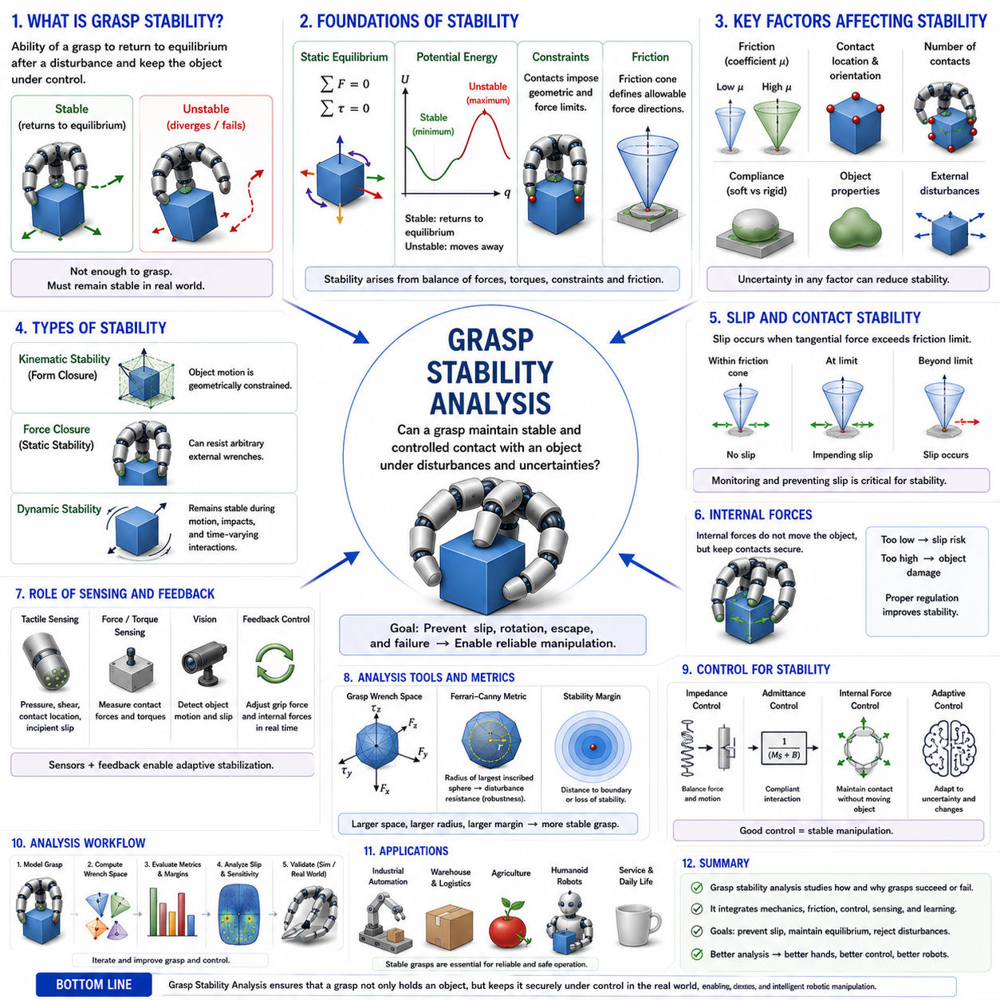{width="7.268055555555556in" height="7.268055555555556in"}

Grasp Stability Analysis is the discipline of evaluating whether a robotic grasp can maintain secure and controlled contact with an object under the influence of internal forces, external disturbances, dynamic interactions, environmental uncertainties, and task-related motions. Within the broader field of robotic grasping and contact mechanics, grasp stability analysis serves as the bridge between theoretical grasp models and practical manipulation performance. While concepts such as Contact Models, Force Closure, Form Closure, Grasp Wrench Space, and Grasp Quality Metrics provide mathematical foundations for grasp evaluation, grasp stability analysis investigates whether a grasp remains stable under realistic operating conditions. It is therefore one of the most important subjects in robotic manipulation because every successful manipulation task depends fundamentally on maintaining stable contact between the robot and the object.

The concept of grasp stability originates from the observation that achieving contact with an object is not sufficient to guarantee successful manipulation. A robotic hand may establish multiple contact points and even satisfy theoretical force closure conditions, yet the object may still slip, rotate unexpectedly, deform, oscillate, or escape from the grasp. Stability analysis seeks to understand why such failures occur and how they can be prevented. In essence, grasp stability analysis attempts to answer a simple but critical question: once an object has been grasped, will it remain under control despite disturbances and uncertainties?

In classical mechanics, stability refers to the tendency of a system to return to an equilibrium state after experiencing a disturbance. This concept carries directly into robotic grasping. If a grasp experiences a small perturbation and naturally returns to its original configuration, the grasp is considered stable. If the disturbance causes increasing motion, contact loss, or grasp failure, the grasp is considered unstable. This distinction forms the basis of nearly all grasp stability analyses.

The study of grasp stability involves both kinematic and dynamic considerations. Kinematic stability focuses on geometric constraints and admissible object motions. Dynamic stability considers forces, torques, inertia, contact compliance, and time-dependent behavior. While form closure primarily addresses kinematic stability and force closure addresses force-generating capability, grasp stability analysis integrates these concepts into a unified framework that accounts for real-world physical behavior.

One of the most important foundations of grasp stability analysis is equilibrium theory. For an object to remain stationary, the sum of all forces and torques acting on the object must equal zero. This condition is known as static equilibrium. Contact forces generated by robotic fingers must balance gravity, external disturbances, and any other loads acting on the object. If equilibrium conditions are violated, the object will accelerate and the grasp may become unstable.

Static equilibrium alone is not sufficient to guarantee stability. An object may satisfy equilibrium conditions while remaining highly sensitive to disturbances. A pencil balanced vertically on its tip represents a classic example. Although the pencil can theoretically satisfy equilibrium, any small disturbance causes it to fall. Similarly, robotic grasps require additional stability conditions beyond simple force balance.

Potential energy concepts provide a useful framework for understanding grasp stability. In many systems, stable equilibrium corresponds to a local minimum in potential energy. When the object is slightly displaced, restoring forces emerge that push it back toward equilibrium. Conversely, unstable equilibrium corresponds to a local maximum or saddle point in the energy landscape. Small disturbances then cause the object to move away from its original position. Energy-based stability analysis has become a powerful tool for evaluating robotic grasps, particularly when compliance and elastic deformation are involved.

Contact mechanics plays a central role in grasp stability analysis. Every contact point between a robotic finger and an object introduces constraints and force transmission capabilities. The stability of the grasp depends heavily on the properties of these contacts. Contact location, contact orientation, friction coefficient, material compliance, surface geometry, and pressure distribution all influence stability. Consequently, accurate contact modeling is essential for reliable grasp analysis.

Friction is one of the most influential factors affecting grasp stability. Friction enables tangential force transmission and prevents unwanted sliding motion. Without sufficient friction, even geometrically favorable grasps may fail. The friction cone provides a mathematical representation of the range of forces that can be transmitted without slip. Stability analysis often involves verifying that contact forces remain within their respective friction cones under expected operating conditions.

Slip analysis represents a major component of grasp stability evaluation. A grasp becomes unstable when one or more contacts exceed frictional limits and begin sliding. Once slip initiates, contact conditions change dramatically, often leading to cascading failures across multiple contacts. Predicting and preventing slip is therefore a central objective of grasp stability analysis. Many robotic systems actively monitor slip indicators using tactile sensors and adjust grasp forces in real time to maintain stability.

The distinction between local stability and global stability is important. Local stability concerns the response of the grasp to small perturbations near an equilibrium configuration. Global stability considers behavior under larger disturbances and broader operating conditions. A grasp may be locally stable but globally vulnerable if sufficiently large disturbances push the system beyond its stability region. Understanding both forms of stability is essential for robust robotic manipulation.

Compliance introduces additional complexity into grasp stability analysis. Real robotic fingertips, human fingers, and soft robotic grippers exhibit elastic deformation during contact. Compliance can improve stability by distributing contact forces, absorbing shocks, and increasing contact area. However, excessive compliance may also introduce oscillations, delayed responses, and control challenges. Modern stability analyses increasingly account for compliance effects to better represent real-world robotic systems.

Soft-finger contact models provide important tools for analyzing compliant grasp stability. Unlike rigid point contacts, soft contacts generate distributed pressure fields and resist torsional disturbances. These additional capabilities often improve stability margins and enhance disturbance rejection. Consequently, soft-finger contacts have become increasingly common in robotic hand design and manipulation research.

Dynamic grasp stability extends beyond static force balance and considers time-varying interactions. Many robotic tasks involve moving objects, changing contact conditions, impacts, and acceleration. Dynamic stability analysis examines how the grasp behaves during such motions. Inertia, momentum transfer, vibration, and transient force responses become important factors. Dynamic stability is particularly relevant for high-speed manipulation, industrial automation, and humanoid robotics.

The concept of internal forces plays a critical role in multi-finger grasp stability. Internal forces are contact forces that balance each other without affecting the object\'s overall motion. Although they do not contribute directly to external equilibrium, they help maintain stable contact and prevent slip. Effective regulation of internal forces is essential for dexterous robotic hands because insufficient internal force may allow contact loss while excessive force may damage the object.

Force Closure Theory provides an important prerequisite for many stability analyses. A grasp that lacks force closure cannot resist arbitrary disturbances and therefore possesses inherent stability limitations. However, force closure alone does not guarantee stability. Actual stability depends on the magnitude of available contact forces, friction constraints, actuator limits, and environmental conditions. Stability analysis therefore extends beyond force closure by considering practical implementation factors.

Grasp Wrench Space also contributes significantly to stability evaluation. The size and shape of the wrench space provide insight into the grasp\'s ability to resist disturbances. Larger wrench spaces generally correspond to greater stability because they allow stronger balancing forces and torques to be generated. Many stability metrics are derived directly from geometric properties of the wrench space.

The Ferrari-Canny grasp quality metric is frequently used as a stability indicator. By measuring the radius of the largest hypersphere contained within the Grasp Wrench Space, the metric provides a quantitative estimate of disturbance resistance. Although originally developed as a grasp quality measure, it is often interpreted as a practical stability metric because of its close relationship to robustness.

Tactile sensing has revolutionized grasp stability analysis. Traditional approaches rely heavily on geometric models and force estimations. Modern tactile sensors provide direct measurements of pressure distributions, shear forces, contact locations, and incipient slip conditions. These measurements allow robots to estimate stability in real time and react proactively to changing conditions. Tactile feedback has become a key component of adaptive grasp stabilization systems.

Human grasping offers valuable insights into stability mechanisms. Humans continuously adjust grip forces based on tactile feedback, visual information, and predictive models of object behavior. When an object begins to slip, reflexive increases in grip force occur within fractions of a second. Robotic systems increasingly attempt to replicate these biological stabilization strategies through sensor integration and adaptive control algorithms.

Control theory plays a fundamental role in grasp stability. Stable manipulation requires not only stable contact mechanics but also stable control systems. Feedback controllers regulate contact forces, maintain desired object positions, compensate for disturbances, and adapt to uncertainties. Poorly designed controllers can destabilize otherwise stable grasps, while advanced control strategies can significantly enhance robustness.

Impedance control and admittance control are widely used approaches for improving grasp stability. These methods regulate the dynamic relationship between force and motion, enabling compliant interaction with uncertain environments. Such control strategies are particularly effective in contact-rich manipulation tasks where rigid position control may lead to instability.

Machine learning has introduced new directions for grasp stability analysis. Data-driven models can learn stability predictors directly from large datasets of successful and unsuccessful grasps. Deep learning systems can estimate stability from visual observations, tactile measurements, point clouds, and multimodal sensory inputs. These approaches complement traditional analytical methods and often provide superior performance in complex environments.

Despite the success of learning-based methods, physics-based stability analysis remains indispensable. Analytical models provide interpretability, physical insight, and theoretical guarantees that purely data-driven methods often lack. Consequently, modern research increasingly focuses on hybrid approaches that combine physical models with machine learning techniques.

Simulation environments provide valuable platforms for grasp stability evaluation. Physics engines can model contact interactions, friction, compliance, and object dynamics under controlled conditions. Large-scale simulation enables researchers to explore stability properties across diverse objects and grasp configurations. Digital twins further extend this capability by creating virtual replicas of real robotic systems for stability assessment and optimization.

Industrial robotics depends heavily on grasp stability analysis. Manufacturing robots must maintain stable contact while assembling components, handling fragile parts, and performing precision operations. Warehouse robots require stable grasps to transport packages safely. Agricultural robots must handle delicate produce without causing damage. In each case, grasp stability directly influences task success and operational reliability.

Humanoid robots place particularly demanding requirements on grasp stability. Unlike structured industrial environments, humanoids operate in dynamic, unpredictable settings filled with uncertainty. They must grasp tools, household objects, clothing, containers, and many other items while interacting safely with humans. Achieving this level of versatility requires sophisticated stability analysis and adaptive stabilization strategies.

Soft robotics has expanded the scope of grasp stability research even further. Soft grippers exploit compliance and shape adaptation to achieve stable grasps on objects with highly variable geometries. Traditional rigid-body stability theories are often insufficient for such systems, motivating the development of new analytical frameworks that incorporate deformable contacts and continuum mechanics.

The emergence of Physical AI systems has created additional opportunities for stability-aware manipulation. Future robotic systems will likely combine perception, reasoning, planning, and physical interaction within unified architectures. Grasp stability analysis will remain a critical component of these architectures because stable physical interaction is essential for reliable task execution in the real world.

Recent research increasingly investigates probabilistic grasp stability. Rather than treating stability as a binary property, probabilistic approaches estimate the likelihood of successful grasp maintenance under uncertainty. Such methods are particularly valuable when object properties, contact conditions, and environmental disturbances cannot be known precisely.

Ultimately, Grasp Stability Analysis represents the comprehensive study of how and why robotic grasps succeed or fail. It integrates contact mechanics, friction theory, equilibrium analysis, compliance modeling, dynamic behavior, tactile sensing, control theory, machine learning, and robotic manipulation into a unified framework. By understanding the mechanisms that govern stability, engineers can design robotic hands and control systems capable of maintaining reliable contact under challenging real-world conditions.

Within the broader context of Contact Mechanics and Grasp Theory, Grasp Stability Analysis serves as the culmination of concepts introduced throughout the study of robotic grasping. It builds upon Contact Models, Point Contact Theory, Soft Finger Contact Models, Force Closure Theory, Form Closure Theory, Grasp Wrench Space, and Grasp Quality Metrics to provide a complete understanding of grasp behavior. A deep understanding of grasp stability analysis is therefore essential for researchers and engineers developing advanced robotic hands, dexterous manipulators, industrial automation systems, humanoid robots, soft robotic grippers, and future generations of intelligent Physical AI platforms.

파지 안정성 분석(Grasp Stability Analysis)은 로봇이 물체를 파지한 이후, 내부 힘(Internal Forces), 외부 외란(External Disturbances), 동적 상호작용(Dynamic Interactions), 환경 불확실성(Environmental Uncertainty), 그리고 작업 과정에서 발생하는 다양한 변화 속에서도 물체를 안정적으로 유지할 수 있는지를 평가하는 학문 분야이다. 로봇 파지와 접촉 역학(Contact Mechanics) 분야에서 파지 안정성 분석은 이론적 파지 모델과 실제 조작 성능 사이를 연결하는 핵심 역할을 수행한다. 접촉 모델(Contact Models), 힘 폐쇄(Force Closure), 형상 폐쇄(Form Closure), 그립 렌치 공간(Grasp Wrench Space), 파지 품질 지표(Grasp Quality Metrics) 등이 파지의 수학적 기반을 제공한다면, 파지 안정성 분석은 실제 환경에서 그 파지가 얼마나 안정적으로 유지될 수 있는지를 평가한다. 따라서 모든 로봇 조작 기술의 성공 여부는 결국 안정적인 파지 유지에 달려 있다고 할 수 있다.

파지 안정성이라는 개념은 단순히 물체를 잡는 것만으로는 성공적인 조작이 보장되지 않는다는 사실에서 출발한다. 로봇 손이 여러 개의 접촉점을 형성하고 힘 폐쇄 조건을 만족하더라도, 실제 환경에서는 물체가 미끄러지거나, 예기치 않게 회전하거나, 진동하거나, 심지어 손에서 빠져나갈 수 있다. 파지 안정성 분석은 이러한 실패가 왜 발생하는지를 이해하고 이를 방지하기 위한 방법을 연구한다. 즉, "물체를 잡은 이후에도 계속 제어 가능한 상태를 유지할 수 있는가?"라는 질문에 답하는 것이 파지 안정성 분석의 핵심 목적이다.

고전 역학(Classical Mechanics)에서 안정성(Stability)은 시스템이 외란을 받은 후 원래의 평형 상태(Equilibrium State)로 되돌아가려는 성질을 의미한다. 이 개념은 로봇 파지에도 그대로 적용된다. 만약 파지가 작은 외란을 받은 후 다시 원래 상태로 복귀한다면 안정적인 파지라고 한다. 반대로 작은 외란이 점점 증폭되어 물체가 움직이거나 접촉이 끊어진다면 불안정한 파지로 간주된다. 이러한 구분은 거의 모든 파지 안정성 분석의 출발점이 된다.

파지 안정성은 기구학적(Kinematic) 요소와 동역학적(Dynamic) 요소를 모두 포함한다. 기구학적 안정성은 접촉점이 제공하는 기하학적 제약 조건에 의해 결정되며, 형상 폐쇄(Form Closure)가 대표적인 예이다. 동역학적 안정성은 힘, 토크, 관성, 마찰, 순응성(Compliance) 등을 포함하는 보다 현실적인 개념이며, 힘 폐쇄(Force Closure)가 대표적인 예이다. 파지 안정성 분석은 이러한 요소들을 통합하여 실제 환경에서의 안정성을 평가한다.

안정성 분석의 가장 기본적인 토대는 평형 이론(Equilibrium Theory)이다. 물체가 정지 상태를 유지하려면 작용하는 모든 힘과 토크의 합이 0이 되어야 한다. 이를 정적 평형(Static Equilibrium)이라고 한다. 로봇 손가락이 생성하는 접촉력은 중력, 외란, 물체의 자중 등을 정확히 상쇄해야 한다. 만약 평형 조건이 만족되지 않으면 물체는 가속되기 시작하며 파지가 불안정해질 수 있다.

그러나 정적 평형만으로 안정성이 보장되는 것은 아니다. 대표적인 예가 연필을 뾰족한 끝으로 세워놓은 경우이다. 이론적으로는 평형 상태를 유지할 수 있지만, 아주 작은 외란에도 쉽게 넘어지게 된다. 마찬가지로 로봇 파지에서도 단순히 힘의 합이 0이라고 해서 반드시 안정적인 것은 아니다.

에너지 기반 분석(Energy-Based Analysis)은 안정성을 이해하는 또 다른 강력한 방법이다. 일반적으로 안정한 평형은 위치 에너지(Potential Energy)의 국소 최소점(Local Minimum)에 해당한다. 물체가 약간 이동하더라도 에너지가 증가하기 때문에 원래 위치로 되돌아가려는 힘이 발생한다. 반면 불안정한 평형은 에너지의 최대점이나 안장점(Saddle Point)에 해당하며, 작은 외란이 오히려 물체를 더 멀리 이동시키게 된다. 이러한 에너지 기반 접근법은 특히 순응성 접촉과 소프트 로봇 분야에서 널리 사용된다.

접촉 역학(Contact Mechanics)은 파지 안정성 분석의 핵심 요소이다. 손가락과 물체 사이의 모든 접촉점은 힘을 전달하고 운동을 제한하는 역할을 한다. 접촉 위치, 접촉 방향, 마찰 계수, 재료 특성, 표면 형상, 압력 분포 등은 모두 안정성에 직접적인 영향을 미친다. 따라서 현실적인 안정성 분석을 위해서는 정확한 접촉 모델이 필수적이다.

마찰(Friction)은 안정성을 결정하는 가장 중요한 요소 중 하나이다. 마찰은 접선 방향 힘을 전달하고 물체의 미끄러짐(Slip)을 방지한다. 마찰이 충분하지 않으면 아무리 좋은 기하학적 구조를 가진 파지라도 실패할 수 있다. 마찰 원뿔(Friction Cone)은 미끄러짐 없이 전달 가능한 힘의 범위를 나타내며, 안정성 분석에서는 접촉력이 마찰 원뿔 내부에 존재하는지를 지속적으로 확인한다.

미끄러짐 분석(Slip Analysis)은 파지 안정성 연구의 중요한 부분이다. 접촉력이 마찰 한계를 초과하면 접촉점에서 미끄러짐이 발생한다. 미끄러짐이 시작되면 접촉 조건이 급격히 변화하며, 이는 다른 접촉점에도 영향을 미쳐 연쇄적인 파지 실패를 유발할 수 있다. 따라서 미끄러짐을 예측하고 방지하는 것은 안정성 분석의 핵심 목표 중 하나이다.

안정성은 국부 안정성(Local Stability)과 전역 안정성(Global Stability)으로 구분된다. 국부 안정성은 작은 외란에 대한 반응을 의미한다. 전역 안정성은 큰 외란이나 넓은 동작 범위에서도 안정성을 유지할 수 있는지를 평가한다. 어떤 파지는 작은 외란에는 안정적일 수 있지만, 큰 외란에는 쉽게 실패할 수 있다. 따라서 실제 시스템에서는 두 가지 안정성을 모두 고려해야 한다.

순응성(Compliance)은 안정성 분석을 더욱 복잡하게 만든다. 실제 로봇 손가락과 인간 손가락은 접촉 시 변형된다. 이러한 순응성은 충격을 흡수하고 접촉 면적을 증가시키며 힘을 분산시켜 안정성을 향상시킬 수 있다. 반면 과도한 순응성은 진동(Oscillation)이나 제어 지연을 유발할 수 있다. 따라서 안정성 분석에서는 순응성의 긍정적 효과와 부정적 효과를 모두 고려해야 한다.

소프트 핑거 접촉 모델(Soft Finger Contact Model)은 순응성 접촉을 분석하는 중요한 도구이다. 소프트 핑거는 분산된 압력 분포와 비틀림 저항(Torsional Resistance)을 제공하기 때문에 점 접촉보다 더 높은 안정성을 제공하는 경우가 많다. 따라서 최근 로봇 핸드 설계에서는 소프트 핑거의 활용이 증가하고 있다.

동적 파지 안정성(Dynamic Grasp Stability)은 정적인 힘 균형을 넘어 시간에 따라 변화하는 상호작용을 분석한다. 실제 로봇 작업은 물체 이동, 접촉 변화, 충격, 가속, 감속 등을 포함한다. 이러한 환경에서는 관성(Inertia), 운동량(Momentum), 진동(Vibration), 과도 응답(Transient Response) 등이 중요한 역할을 한다. 고속 조작이나 산업용 자동화에서는 동적 안정성이 특히 중요하다.

내부 힘(Internal Force)은 다지형 로봇 손(Multi-Finger Hand)에서 중요한 개념이다. 내부 힘은 물체 전체 운동에는 영향을 주지 않지만 접촉을 유지하는 데 필요한 힘이다. 내부 힘이 부족하면 접촉이 끊어질 수 있고, 너무 크면 물체를 손상시킬 수 있다. 따라서 적절한 내부 힘 제어는 안정적인 파지의 핵심 요소이다.

힘 폐쇄 이론은 안정성 분석의 중요한 출발점이다. 힘 폐쇄가 성립하지 않으면 임의의 외란을 상쇄할 수 없기 때문에 안정성에 근본적인 한계가 존재한다. 그러나 힘 폐쇄만으로는 충분하지 않다. 실제 안정성은 액추에이터 출력, 마찰 조건, 환경 변화, 제어 성능 등에 의해 추가적으로 영향을 받는다.

그립 렌치 공간 역시 안정성 평가에 중요한 역할을 한다. 렌치 공간의 크기와 형태는 외란 저항 능력을 직접적으로 반영한다. 일반적으로 렌치 공간이 클수록 더 큰 외란을 견딜 수 있으며, 따라서 더 안정적인 파지로 평가된다.

Ferrari-Canny 지표는 안정성 평가에 자주 사용되는 대표적인 품질 지표이다. 이 지표는 그립 렌치 공간 내부에 포함될 수 있는 최대 초구(Hypersphere)의 반지름을 계산한다. 반지름이 클수록 외란 저항 능력이 높아지며, 결과적으로 안정성이 향상된다.

촉각 센서(Tactile Sensors)의 발전은 파지 안정성 분석을 혁신적으로 변화시키고 있다. 기존 방식은 기하학적 모델과 추정된 힘에 의존했지만, 현대의 촉각 센서는 압력 분포, 전단력(Shear Force), 접촉 위치, 초기 미끄러짐 신호를 직접 측정할 수 있다. 이를 통해 로봇은 실시간으로 안정성을 평가하고 적절한 파지력을 조절할 수 있다.

인간의 파지 행동 역시 중요한 참고 모델이다. 인간은 물체가 미끄러지기 시작하면 수십 밀리초 내에 파지력을 증가시킨다. 이러한 반사적 안정화 메커니즘은 현대 로봇 제어 알고리즘의 중요한 영감이 되고 있다.

제어 이론(Control Theory)은 파지 안정성의 또 다른 핵심 요소이다. 아무리 우수한 기계 구조와 접촉 조건을 갖더라도 제어기가 불안정하면 전체 시스템은 실패할 수 있다. 반대로 우수한 제어기는 안정성을 크게 향상시킬 수 있다.

임피던스 제어(Impedance Control)와 어드미턴스 제어(Admittance Control)는 안정성 향상을 위해 널리 사용된다. 이 방법들은 힘과 운동 사이의 관계를 조절하여 환경 변화에 유연하게 대응할 수 있도록 한다. 특히 접촉이 빈번하게 발생하는 작업에서 효과적이다.

머신러닝(Machine Learning)은 새로운 형태의 안정성 분석을 가능하게 하고 있다. 대규모 데이터셋을 이용하여 성공적인 파지와 실패한 파지를 학습함으로써 안정성을 예측할 수 있다. 이러한 방법은 복잡한 환경에서 기존 물리 모델보다 높은 성능을 보이는 경우도 있다.

그럼에도 불구하고 물리 기반 안정성 분석은 여전히 중요하다. 물리 모델은 해석 가능성과 이론적 보장을 제공하기 때문이다. 따라서 최근에는 물리 기반 모델과 머신러닝을 결합한 하이브리드 접근법이 활발히 연구되고 있다.

시뮬레이션과 디지털 트윈(Digital Twin)은 안정성 평가를 위한 강력한 도구이다. 물리 엔진을 이용하여 마찰, 접촉, 변형, 외란 등을 가상 환경에서 분석할 수 있으며, 실제 시스템 적용 전에 안정성을 검증할 수 있다.

산업용 로봇은 조립, 물류, 제조, 검사 작업에서 안정성 분석에 크게 의존한다. 안정적인 파지가 확보되지 않으면 제품 손상, 작업 실패, 생산성 저하가 발생할 수 있기 때문이다.

휴머노이드 로봇은 더욱 높은 수준의 안정성을 요구한다. 인간 환경은 매우 복잡하고 예측하기 어렵기 때문에 다양한 물체를 안정적으로 파지하고 조작할 수 있어야 한다. 이를 위해서는 고급 안정성 분석과 적응형 제어가 필수적이다.

소프트 로보틱스(Soft Robotics)는 안정성 분석의 영역을 더욱 확장하고 있다. 소프트 그리퍼는 형상 적응성과 순응성을 이용하여 다양한 물체를 안정적으로 잡을 수 있다. 그러나 이러한 시스템은 기존 강체 기반 이론만으로 설명하기 어려워 새로운 분석 방법이 필요하다.

최근 등장한 Physical AI는 인식, 추론, 계획, 물리적 상호작용을 하나의 통합 시스템으로 결합하고 있다. 이러한 시스템에서도 안정적인 물체 파지는 모든 작업 수행의 전제 조건이므로, 파지 안정성 분석은 여전히 핵심 기술로 남아 있다.

또한 최근 연구는 확률적 안정성 분석(Probabilistic Stability Analysis)으로 확장되고 있다. 안정성을 단순히 안정/불안정으로 구분하는 대신, 특정 조건에서 성공할 확률을 계산하는 방식이다. 이는 현실 세계의 불확실성을 보다 잘 반영한다.

결론적으로 **Grasp Stability Analysis**는 로봇 파지가 왜 성공하고 왜 실패하는지를 연구하는 종합적인 학문 분야이다. 접촉 역학, 마찰 이론, 평형 분석, 순응성 모델링, 동역학, 촉각 센싱, 제어 이론, 머신러닝, 로봇 조작 기술을 통합하여 실제 환경에서의 파지 성능을 이해하고 향상시키는 것을 목표로 한다.

따라서 **06_08 Grasp Stability Analysis**는 **Contact Models, Point Contact Theory, Soft Finger Contact Models, Force Closure Theory, Form Closure Theory, Grasp Wrench Space, Grasp Quality Metrics**를 종합하는 최종 응용 이론이라고 할 수 있다. 차세대 로봇 핸드, 정교 조작 시스템, 산업용 자동화 로봇, 휴머노이드 로봇, 소프트 그리퍼, 그리고 미래의 Physical AI 플랫폼을 개발하는 연구자와 엔지니어라면 반드시 깊이 이해해야 할 핵심 주제이다.

##  

## 06.09 Multi-Finger Contact Coordination

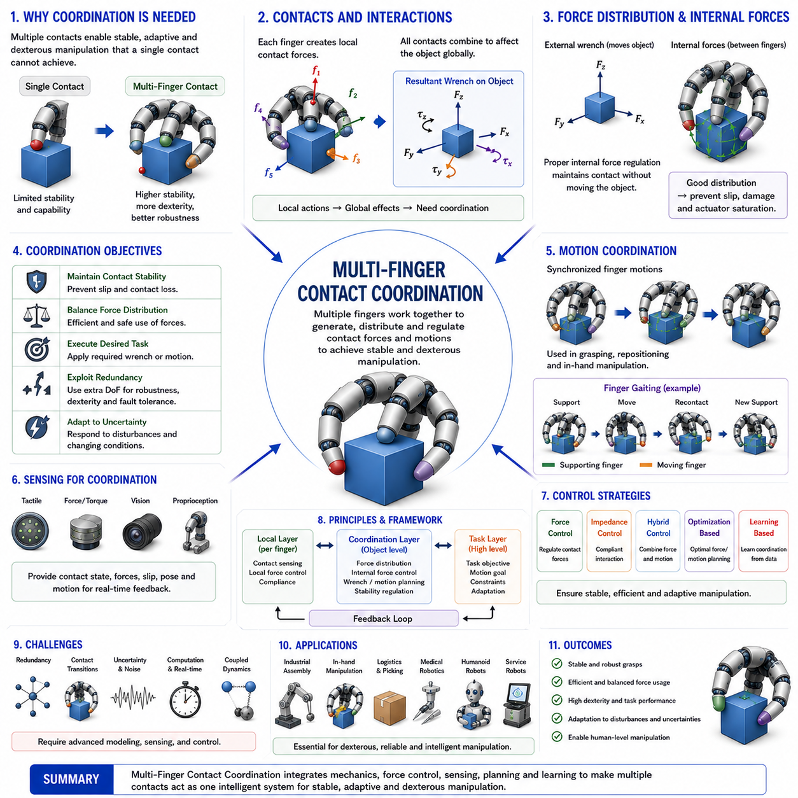{width="7.268055555555556in" height="7.268055555555556in"}

Multi-Finger Contact Coordination is one of the most advanced and important topics in robotic grasping, dexterous manipulation, robotic hand control, and physical interaction intelligence. It focuses on how multiple robotic fingers coordinate their contact forces, positions, motions, and sensory information to achieve stable, adaptive, and purposeful manipulation of objects. While earlier topics such as Contact Models, Force Closure Theory, Form Closure Theory, Grasp Wrench Space, Grasp Quality Metrics, and Grasp Stability Analysis explain the physical and mathematical foundations of grasping, Multi-Finger Contact Coordination addresses how these principles are actively implemented in real robotic systems. It represents the transition from understanding grasp mechanics to controlling complex multi-contact interactions in real time.

The significance of multi-finger coordination arises from the fact that most useful robotic manipulation tasks cannot be accomplished with a single contact point. Human hands achieve remarkable dexterity because multiple fingers work together as an integrated system. Each finger contributes forces, constraints, sensory feedback, and motion capabilities that collectively create manipulation behaviors far beyond the capabilities of any individual finger. Robotic hands seek to replicate this capability by coordinating multiple contact points simultaneously.

At the most fundamental level, multi-finger contact coordination involves controlling a collection of contacts that interact with a common object. Each finger establishes one or more contact points, and each contact generates forces and moments according to the local contact mechanics. Although individual contacts operate locally, their effects combine globally through the object. Consequently, every contact action influences the entire grasp system. A force generated by one finger affects the force requirements of other fingers, the object\'s equilibrium, the grasp wrench space, and the overall stability of the manipulation task.

This interconnected nature of multi-contact systems creates significant challenges. Unlike single-contact interactions, multi-finger grasps require simultaneous management of force distribution, contact stability, motion synchronization, collision avoidance, grasp robustness, and task execution. Successful coordination therefore demands a deep integration of mechanics, control theory, sensing, planning, and optimization.

One of the central concepts in multi-finger coordination is contact force distribution. When several fingers grasp an object, the total grasp force is distributed among multiple contact points. The manner in which these forces are allocated directly influences stability, efficiency, and object safety. Poor force distribution may overload certain contacts while leaving others underutilized. Excessive loading can cause actuator saturation, contact damage, or object deformation. Insufficient loading may lead to slipping or contact loss. Effective coordination seeks to achieve balanced and efficient force allocation across all contacts.

The concept of internal forces plays a critical role in this process. Internal forces are forces exchanged among fingers that do not contribute to the net external wrench acting on the object. Although they do not move the object directly, they are essential for maintaining stable contact. For example, when two opposing fingers squeeze an object, the opposing forces cancel each other at the object level, yet they generate the friction necessary to prevent slipping. Managing internal forces is therefore one of the most important objectives of multi-finger coordination.

Internal force regulation becomes increasingly complex as the number of fingers increases. In a two-finger grasp, internal force control is relatively straightforward. In a five-finger anthropomorphic hand, however, many redundant force distributions can achieve the same object-level wrench. This redundancy creates both opportunities and challenges. On one hand, redundancy improves robustness and adaptability. On the other hand, it requires sophisticated control algorithms to determine optimal force distributions.

Redundancy is a defining characteristic of multi-finger manipulation. Human hands possess more joints and actuators than are strictly required to control object motion. Robotic hands often exhibit similar redundancy. Multiple finger configurations may achieve identical grasp objectives. Multiple force distributions may produce identical object motions. Multi-finger coordination seeks to exploit this redundancy to improve stability, dexterity, energy efficiency, and fault tolerance.

The relationship between local contact behavior and global object behavior is another fundamental aspect of coordination. Each contact generates forces according to local friction conditions, contact geometry, and compliance properties. These local interactions collectively determine global grasp properties such as force closure, wrench generation capability, and manipulation authority. Effective coordination therefore requires simultaneous consideration of both local and global dynamics.

Grasp Wrench Space provides an important framework for understanding this relationship. Every contact contributes achievable wrench components. The combination of these contributions determines the overall wrench space of the grasp. Multi-finger coordination can be viewed as the process of selecting contact forces that generate desired object-level wrenches while maintaining contact stability and satisfying physical constraints.

Motion coordination represents another major component of multi-finger manipulation. During grasp acquisition, object repositioning, in-hand manipulation, and task execution, multiple fingers must move in a synchronized manner. Uncoordinated motion may lead to contact loss, excessive forces, object rotation, or grasp failure. Coordinated motion planning ensures that finger trajectories remain compatible with object constraints and manipulation objectives.

In-hand manipulation provides one of the most challenging examples of multi-finger coordination. In these tasks, an object is moved, rotated, translated, or reoriented within the robotic hand without releasing it. Such manipulation requires continuous adjustment of contact locations, force distributions, and finger trajectories. Every finger must adapt its behavior in response to changes initiated by other fingers. This dynamic coupling makes in-hand manipulation a highly demanding coordination problem.

Human grasping demonstrates extraordinary capabilities in this area. Humans routinely rotate pens, reposition tools, manipulate coins, and perform complex finger gaiting motions. These behaviors emerge from highly coordinated interactions among multiple fingers, sensory systems, and neural control mechanisms. Roboticists study these human strategies extensively because they provide valuable insights into multi-finger coordination principles.

Finger gaiting is a particularly important concept in dexterous manipulation. Similar to legged locomotion, finger gaiting involves sequentially repositioning contacts while maintaining overall grasp stability. Certain fingers temporarily release and relocate while other fingers maintain object support. This strategy allows robotic hands to manipulate objects across large ranges of motion without losing control.

Contact transitions introduce additional complexity into coordination. Real manipulation tasks often require contacts to be created, broken, or relocated. Every contact transition changes the grasp structure, force distribution, and stability properties of the system. Coordinating these transitions safely and efficiently remains a major research challenge in robotic manipulation.

Tactile sensing plays a fundamental role in multi-finger contact coordination. Contact forces cannot be managed effectively without accurate information regarding contact conditions. Modern tactile sensors provide measurements of pressure distributions, shear forces, contact locations, contact areas, and incipient slip events. This information allows robotic systems to estimate contact states and adjust coordination strategies in real time.

Slip prevention is one of the primary objectives of tactile-based coordination. When tactile sensors detect early signs of slipping, robotic controllers can increase internal forces, adjust finger positions, or modify grasp strategies before failure occurs. Such reactive stabilization mechanisms closely resemble human reflexive grasp adjustments.

Vision systems complement tactile sensing by providing global information about object geometry, pose, motion, and environmental context. While tactile sensing provides local contact information, vision provides a broader understanding of the manipulation scene. Multi-finger coordination often relies on the integration of vision and touch to achieve robust performance.

Compliance introduces additional opportunities and challenges. Compliant fingers can adapt to object geometry, distribute contact pressures, and absorb disturbances. These properties often improve grasp robustness and simplify contact acquisition. However, compliance also introduces additional dynamics, deformations, and control complexities that must be managed during coordination.

Soft robotic hands extend these ideas even further. Instead of coordinating rigid contacts, soft robotic systems coordinate continuously deformable contact regions. Contact locations, contact areas, and force distributions may change continuously during manipulation. Multi-finger coordination in soft robotics therefore requires new models and control approaches that account for continuum deformation.

Control theory provides the mathematical foundation for multi-finger coordination. Force control, position control, impedance control, admittance control, hybrid force-motion control, and model predictive control are all commonly employed. These control strategies regulate finger behavior while ensuring stable object interaction. Advanced coordination often requires simultaneous control of object motion and internal forces.

Impedance control is particularly important because it enables compliant interaction with uncertain environments. Rather than commanding exact positions or forces, impedance control regulates the dynamic relationship between motion and force. This flexibility improves robustness during contact-rich manipulation tasks.

Optimization methods are widely used in coordination planning. Many coordination problems can be formulated as optimization tasks involving objectives such as maximizing grasp quality, minimizing energy consumption, balancing contact forces, avoiding singularities, or preserving stability margins. Optimization-based approaches are particularly valuable for high-degree-of-freedom robotic hands.

Machine learning has emerged as a powerful tool for multi-finger coordination. Learning-based systems can acquire coordination strategies directly from data, simulation, demonstration, or reinforcement learning. Neural networks can learn complex relationships among contact states, force distributions, and manipulation outcomes that are difficult to model analytically.

Reinforcement learning has shown particular promise in dexterous manipulation tasks. By interacting with simulated environments, robotic hands can learn sophisticated coordination behaviors that would be difficult to program manually. These learned policies often discover unexpected yet effective manipulation strategies.

Despite these advances, analytical models remain essential. Contact mechanics, grasp theory, and dynamic modeling provide interpretability, safety guarantees, and physical understanding that purely data-driven approaches often lack. Consequently, many modern systems combine learning-based methods with analytical coordination frameworks.

Simulation environments have become indispensable for studying multi-finger coordination. High-fidelity simulators allow researchers to analyze complex contact interactions, evaluate control algorithms, and train learning systems at large scales. Digital twins further extend this capability by providing virtual representations of physical robotic systems.

Industrial applications increasingly require advanced multi-finger coordination. Assembly robots manipulate complex components requiring precise force control. Logistics robots handle objects with varying geometries and weights. Medical robots coordinate multiple contacts when interacting with surgical instruments and biological tissues. Service robots manipulate everyday objects in human environments. All of these applications benefit from sophisticated contact coordination capabilities.

Humanoid robotics represents perhaps the ultimate application domain. Human environments are designed for human hands. To achieve human-level manipulation capability, humanoid robots must coordinate many fingers simultaneously while adapting to uncertainty, variability, and task complexity. Multi-finger contact coordination therefore lies at the heart of humanoid dexterity.

The emergence of Physical AI further elevates the importance of this field. Future intelligent robots will not simply perceive and reason; they will interact physically with the world through complex contact networks. Multi-finger coordination serves as a foundational mechanism through which high-level intelligence is translated into effective physical action.

Recent research increasingly explores probabilistic coordination frameworks, where uncertainty in contact conditions, object properties, and sensory information is explicitly modeled. Such approaches aim to make robotic manipulation more robust under realistic operating conditions.

Researchers are also investigating shared autonomy systems in which human operators and robotic controllers collaborate during manipulation. In these systems, multi-finger coordination algorithms assist human users by stabilizing grasps, compensating for disturbances, and optimizing force distributions.

Ultimately, Multi-Finger Contact Coordination represents the comprehensive study of how multiple contacts cooperate to achieve stable, dexterous, adaptive, and intelligent manipulation. It integrates contact mechanics, force distribution, grasp stability, tactile sensing, motion planning, control theory, optimization, machine learning, and robotic intelligence into a unified framework.

Within the broader context of Contact Mechanics and Grasp Theory, Multi-Finger Contact Coordination serves as the practical implementation layer that transforms theoretical grasp principles into real manipulation capabilities. It builds directly upon Contact Models, Force Closure Theory, Form Closure Theory, Grasp Wrench Space, Grasp Quality Metrics, and Grasp Stability Analysis. A deep understanding of multi-finger contact coordination is therefore essential for researchers and engineers developing advanced robotic hands, anthropomorphic manipulators, dexterous industrial grippers, humanoid robots, soft robotic systems, and future generations of intelligent Physical AI platforms capable of human-level object interaction.

다지 손가락 접촉 협조 제어(Multi-Finger Contact Coordination)는 로봇 파지(Robotic Grasping), 정교 조작(Dexterous Manipulation), 로봇 핸드 제어(Robotic Hand Control), 그리고 물리적 상호작용 지능(Physical Interaction Intelligence) 분야에서 가장 고급이면서도 중요한 주제 중 하나이다. 이 분야는 여러 개의 로봇 손가락이 접촉력(Contact Force), 접촉 위치(Contact Position), 운동(Motion), 그리고 센서 정보를 어떻게 협조적으로 활용하여 물체를 안정적이고 적응적으로 조작하는지를 연구한다. 접촉 모델(Contact Models), 힘 폐쇄 이론(Force Closure Theory), 형상 폐쇄 이론(Form Closure Theory), 그립 렌치 공간(Grasp Wrench Space), 파지 품질 지표(Grasp Quality Metrics), 그리고 파지 안정성 분석(Grasp Stability Analysis)이 파지의 물리적·수학적 기초를 제공한다면, 다지 손가락 접촉 협조 제어는 이러한 이론을 실제 로봇 시스템에서 어떻게 구현할 것인지를 다룬다. 즉, 파지 역학을 이해하는 단계에서 실제 지능형 조작을 수행하는 단계로 넘어가는 핵심 연결고리라고 할 수 있다.

다지 손가락 협조 제어가 중요한 이유는 대부분의 실용적인 조작 작업이 단일 접촉점만으로는 수행될 수 없기 때문이다. 인간의 손이 뛰어난 조작 능력을 가지는 이유는 여러 손가락이 하나의 통합된 시스템처럼 작동하기 때문이다. 각 손가락은 힘, 제약 조건, 촉각 정보, 운동 능력을 제공하며, 이러한 요소들이 결합되어 개별 손가락의 능력을 훨씬 뛰어넘는 조작 능력을 만들어낸다. 로봇 손 역시 이러한 인간의 능력을 모방하기 위해 여러 접촉점을 동시에 조율하는 능력이 필요하다.

가장 기본적인 수준에서 다지 손가락 접촉 협조 제어는 하나의 물체와 상호작용하는 여러 접촉점을 제어하는 문제이다. 각 손가락은 하나 이상의 접촉점을 형성하고, 각 접촉점은 국부적인 접촉 역학에 따라 힘과 모멘트를 생성한다. 개별 접촉은 국소적으로 발생하지만, 그 영향은 물체를 통해 전체 시스템에 전달된다. 따라서 한 손가락이 생성한 힘은 다른 손가락의 힘 요구사항, 물체의 평형 상태, 그립 렌치 공간, 그리고 전체 파지 안정성에 영향을 미친다.

이러한 상호 의존성 때문에 다지 손가락 시스템은 매우 복잡한 제어 문제를 형성한다. 단일 접촉 시스템과 달리 다지 손가락 시스템은 힘 분배, 접촉 안정성, 운동 동기화, 충돌 회피, 파지 강건성, 그리고 작업 수행을 동시에 고려해야 한다. 따라서 성공적인 협조 제어는 역학, 제어 이론, 센싱, 계획, 최적화 기술의 통합을 요구한다.

다지 손가락 협조 제어의 핵심 개념 중 하나는 접촉력 분배(Contact Force Distribution)이다. 여러 손가락이 하나의 물체를 잡을 때 전체 파지력은 여러 접촉점에 분산된다. 이 힘이 어떻게 분배되는지는 안정성, 에너지 효율, 물체 안전성에 직접적인 영향을 미친다. 특정 접촉점에 과도한 힘이 집중되면 액추에이터 포화, 접촉면 손상, 물체 변형이 발생할 수 있다. 반대로 힘이 부족하면 미끄러짐이나 접촉 손실이 발생할 수 있다. 따라서 협조 제어의 중요한 목표는 모든 접촉점에 적절하고 균형 잡힌 힘을 분배하는 것이다.

이 과정에서 내부 힘(Internal Force)의 개념이 매우 중요하다. 내부 힘은 물체의 전체 운동에는 영향을 주지 않지만 접촉을 유지하기 위해 손가락들 사이에서 작용하는 힘이다. 예를 들어 두 손가락이 서로 반대 방향으로 물체를 누르고 있을 때, 두 힘은 물체 관점에서는 상쇄되지만 마찰력을 생성하여 물체가 미끄러지는 것을 방지한다. 따라서 내부 힘의 생성과 조절은 다지 손가락 협조 제어의 핵심 과제 중 하나이다.

손가락 수가 증가할수록 내부 힘 제어는 더욱 복잡해진다. 두 손가락 파지에서는 내부 힘 제어가 비교적 단순하지만, 다섯 손가락을 가진 인간형 로봇 손에서는 동일한 물체 수준의 렌치를 생성할 수 있는 수많은 힘 분배 방식이 존재한다. 이러한 중복성(Redundancy)은 강건성과 적응성을 향상시키는 장점이 있지만, 동시에 최적의 힘 분배를 결정해야 하는 어려움을 만든다.

중복성은 다지 손가락 조작의 대표적인 특징이다. 인간의 손은 물체를 제어하기 위해 필요한 것보다 더 많은 자유도(Degree of Freedom)를 가진다. 많은 로봇 핸드도 유사한 구조를 가진다. 여러 손가락 자세가 동일한 파지 목표를 달성할 수 있으며, 여러 힘 분배가 동일한 물체 운동을 생성할 수 있다. 협조 제어는 이러한 중복성을 활용하여 안정성, 조작성, 에너지 효율, 고장 허용성(Fault Tolerance)을 향상시킨다.

다지 손가락 협조 제어에서 또 다른 중요한 요소는 국부 접촉(Local Contact)과 전역 물체 거동(Global Object Behavior)의 관계이다. 각 접촉점은 마찰 조건, 접촉 형상, 순응성 특성에 따라 힘을 생성한다. 이러한 국부 상호작용이 결합되어 힘 폐쇄, 렌치 생성 능력, 조작 가능성 등 전역적인 파지 특성을 결정한다. 따라서 협조 제어는 항상 국부적 접촉 조건과 전역적 물체 거동을 동시에 고려해야 한다.

그립 렌치 공간은 이러한 관계를 이해하는 중요한 도구이다. 각 접촉점은 특정 렌치를 생성할 수 있으며, 이들의 조합이 전체 렌치 공간을 형성한다. 다지 손가락 협조 제어는 접촉 안정성을 유지하면서 원하는 물체 수준의 렌치를 생성하는 힘 조합을 찾는 과정으로 이해할 수 있다.

운동 협조(Motion Coordination) 역시 중요한 요소이다. 파지 획득(Grasp Acquisition), 물체 재배치(Object Repositioning), 인핸드 매니퓰레이션(In-Hand Manipulation), 그리고 작업 수행 과정에서 여러 손가락은 동기화된 방식으로 움직여야 한다. 만약 손가락 운동이 조화롭지 못하면 접촉이 끊어지거나 과도한 힘이 발생하거나 물체가 예기치 않게 회전할 수 있다. 따라서 협조 운동 계획은 손가락의 경로가 물체의 제약 조건과 작업 목표를 만족하도록 설계된다.

인핸드 매니퓰레이션은 다지 손가락 협조 제어의 가장 어려운 사례 중 하나이다. 물체를 손에서 놓지 않은 상태로 회전시키거나 위치를 바꾸는 작업은 지속적인 접촉 재배치와 힘 재분배를 요구한다. 한 손가락의 행동 변화는 다른 모든 손가락에 영향을 주기 때문에 높은 수준의 실시간 협조가 필요하다.

인간은 이러한 능력을 매우 자연스럽게 수행한다. 펜을 돌리거나 동전을 움직이거나 공구를 손 안에서 재배치하는 동작은 모두 다지 손가락 협조 제어의 결과이다. 로봇공학 연구자들은 이러한 인간의 조작 전략을 분석하여 로봇 시스템에 적용하려고 노력하고 있다.

핑거 게이팅(Finger Gaiting)은 대표적인 정교 조작 기법이다. 이는 보행 로봇의 걸음걸이와 유사한 개념으로, 일부 손가락이 물체를 유지하는 동안 다른 손가락이 새로운 위치로 이동하는 방식이다. 이를 통해 물체를 놓지 않고도 넓은 범위의 조작이 가능해진다.

접촉 전이(Contact Transition)는 또 다른 중요한 문제이다. 실제 조작 과정에서는 접촉이 생성되거나 해제되거나 이동된다. 이러한 변화는 파지 구조, 힘 분배, 안정성에 큰 영향을 미친다. 따라서 접촉 전이를 안전하고 효율적으로 수행하는 것은 협조 제어의 핵심 연구 주제이다.

촉각 센싱(Tactile Sensing)은 다지 손가락 협조 제어의 필수 요소이다. 접촉 상태를 정확히 알지 못하면 힘 분배를 적절히 수행할 수 없다. 최신 촉각 센서는 압력 분포, 전단력(Shear Force), 접촉 위치, 접촉 면적, 초기 미끄러짐 신호 등을 측정할 수 있다. 이를 통해 로봇은 실시간으로 접촉 상태를 추정하고 협조 전략을 조정할 수 있다.

특히 미끄러짐 방지(Slip Prevention)는 촉각 기반 협조 제어의 주요 목적이다. 촉각 센서가 미끄러짐의 초기 신호를 감지하면 제어기는 내부 힘을 증가시키거나 손가락 위치를 조정하여 파지 실패를 방지할 수 있다. 이러한 반응은 인간의 반사적 파지 조절과 매우 유사하다.

비전 시스템(Vision System)은 촉각 센싱을 보완한다. 촉각은 국소적인 접촉 정보를 제공하는 반면, 비전은 물체 형상, 자세, 움직임, 환경 정보를 제공한다. 현대의 다지 손가락 시스템은 시각과 촉각을 통합하여 보다 강건한 협조 제어를 수행한다.

순응성(Compliance)은 추가적인 기회와 도전을 제공한다. 순응성 손가락은 물체 형상에 적응하고 충격을 흡수하며 접촉 압력을 분산시킨다. 이는 안정성을 향상시키지만 동시에 변형과 추가 동역학을 유발한다. 따라서 순응성을 고려한 새로운 협조 제어 기법이 필요하다.

소프트 로봇 핸드(Soft Robotic Hand)는 이러한 문제를 더욱 확장한다. 소프트 핸드는 강체 접촉점이 아니라 변형 가능한 접촉 영역을 사용한다. 접촉 위치와 면적이 지속적으로 변화하기 때문에 전통적인 강체 기반 모델만으로는 충분하지 않다.

제어 이론(Control Theory)은 다지 손가락 협조 제어의 수학적 기반을 제공한다. 힘 제어(Force Control), 위치 제어(Position Control), 임피던스 제어(Impedance Control), 어드미턴스 제어(Admittance Control), 하이브리드 힘-운동 제어(Hybrid Force-Motion Control), 모델 예측 제어(Model Predictive Control) 등이 널리 사용된다.

특히 임피던스 제어는 환경 변화에 유연하게 대응할 수 있기 때문에 접촉 중심 작업에서 매우 유용하다. 이 방식은 힘과 운동 사이의 관계를 조절하여 강건한 상호작용을 가능하게 한다.

최적화 기법(Optimization Methods)도 널리 활용된다. 많은 협조 제어 문제는 파지 품질 최대화, 에너지 소비 최소화, 힘 분배 균형화, 특이점(Singularity) 회피, 안정성 여유 확보 등의 최적화 문제로 표현될 수 있다.

머신러닝(Machine Learning)은 다지 손가락 협조 제어에 새로운 가능성을 제공하고 있다. 데이터, 시뮬레이션, 인간 시연(Demonstration), 강화학습(Reinforcement Learning)을 통해 협조 전략을 학습할 수 있다. 특히 강화학습은 복잡한 정교 조작 행동을 스스로 학습하는 데 매우 유망한 결과를 보여주고 있다.

그럼에도 불구하고 분석적 모델은 여전히 중요하다. 접촉 역학, 파지 이론, 동역학 모델은 물리적 해석 가능성과 안전성을 제공한다. 따라서 현대 시스템은 머신러닝과 물리 기반 모델을 결합하는 방향으로 발전하고 있다.

시뮬레이션 환경과 디지털 트윈(Digital Twin)은 다지 손가락 협조 제어 연구의 핵심 도구이다. 복잡한 접촉 상호작용을 분석하고 제어 알고리즘을 검증하며 학습 데이터를 생성하는 데 활용된다.

산업용 로봇, 물류 로봇, 의료 로봇, 서비스 로봇은 모두 고급 다지 손가락 협조 제어를 필요로 한다. 특히 복잡한 부품 조립, 다양한 형상의 물체 처리, 의료 기구 조작 등은 정밀한 협조 제어 없이는 수행하기 어렵다.

휴머노이드 로봇은 이 분야의 궁극적인 응용 분야라고 할 수 있다. 인간 환경은 인간의 손을 기준으로 설계되어 있기 때문에 인간 수준의 조작 능력을 구현하려면 다지 손가락 협조 제어가 필수적이다.

Physical AI의 등장으로 이 분야의 중요성은 더욱 커지고 있다. 미래의 지능형 로봇은 단순히 인식하고 추론하는 것을 넘어 실제 물리 세계와 상호작용해야 한다. 다지 손가락 협조 제어는 이러한 지능을 실제 행동으로 변환하는 핵심 메커니즘이다.

최근 연구는 접촉 조건, 물체 특성, 센서 정보의 불확실성을 명시적으로 고려하는 확률적 협조 제어(Probabilistic Coordination)로 확장되고 있다. 또한 인간과 로봇이 함께 조작을 수행하는 공유 자율성(Shared Autonomy) 연구도 활발히 진행되고 있다.

결론적으로 **Multi-Finger Contact Coordination**은 여러 접촉점이 협력하여 안정적이고 정교하며 적응적인 조작을 수행하는 방법을 연구하는 종합 학문이다. 접촉 역학, 힘 분배, 파지 안정성, 촉각 센싱, 운동 계획, 제어 이론, 최적화, 머신러닝, 그리고 로봇 지능을 하나의 통합 프레임워크로 연결한다.

따라서 **06_09 Multi-Finger Contact Coordination**은 **Contact Models, Force Closure Theory, Form Closure Theory, Grasp Wrench Space, Grasp Quality Metrics, Grasp Stability Analysis**를 실제 조작 능력으로 구현하는 핵심 응용 이론이다. 차세대 로봇 핸드, 인간형 로봇, 정교 조작 시스템, 소프트 로봇, 산업용 그리퍼, 그리고 미래의 Physical AI 플랫폼을 개발하는 연구자와 엔지니어라면 반드시 깊이 이해해야 할 핵심 주제라고 할 수 있다.

##  

## 06.10 Object Deformation Effects

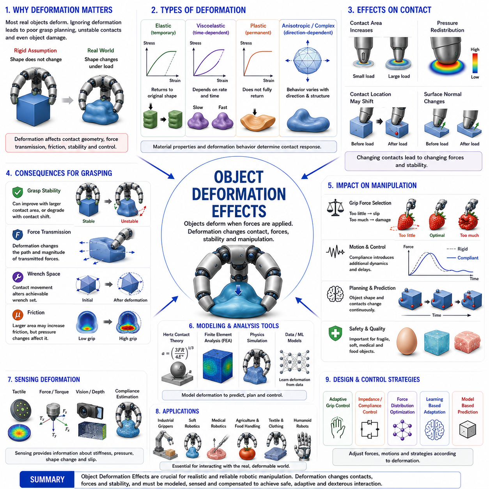{width="7.268055555555556in" height="7.268055555555556in"}

Object Deformation Effects refer to the influence of object shape changes, material compliance, elastic behavior, plastic deformation, and structural flexibility on robotic grasping, contact mechanics, manipulation stability, and force transmission. In classical robotic grasping theory, objects are often modeled as perfectly rigid bodies. This assumption greatly simplifies mathematical analysis because the object\'s geometry remains unchanged regardless of applied forces. However, real-world objects rarely behave as perfectly rigid bodies. Most objects deform to some extent when subjected to contact forces. Even materials commonly considered rigid, such as metals, plastics, wood, and glass, experience microscopic deformations under load. Softer materials such as rubber, foam, fabric, biological tissue, food products, and flexible polymers exhibit much larger deformations. Consequently, understanding object deformation effects is essential for developing robotic systems capable of reliable interaction with the physical world.

The importance of object deformation becomes immediately apparent when examining everyday human manipulation. Humans routinely grasp objects that vary dramatically in stiffness. A person can hold a steel wrench, squeeze a sponge, pick up a ripe strawberry, manipulate a piece of cloth, or handle delicate biological tissue. In each case, the interaction mechanics differ because the object responds differently to applied forces. The human nervous system continuously adapts grip forces, finger positions, and manipulation strategies according to the deformation characteristics of the object. Advanced robotic systems must achieve similar adaptability if they are to approach human-level dexterity.

Traditional rigid-body grasp theory provides an important foundation for robotic manipulation. Concepts such as Force Closure, Form Closure, Grasp Wrench Space, Grasp Quality Metrics, and Grasp Stability Analysis assume that object geometry remains fixed during interaction. Under these assumptions, contact locations, contact normals, and force transmission paths remain constant. However, when objects deform, these quantities become dynamic variables that evolve throughout the manipulation process. As a result, deformation introduces additional complexity into grasp analysis and control.

The most fundamental consequence of deformation is the modification of contact geometry. When a robotic finger presses against a deformable object, the contact area often expands. Instead of a single contact point, a distributed contact region may develop. This change affects pressure distribution, friction generation, force transmission, and stability characteristics. In many cases, increased contact area improves grasp robustness because forces are distributed more evenly across the surface.

Contact pressure distribution plays a central role in understanding deformation effects. For rigid contacts, pressure may be concentrated within a small region. For deformable contacts, the pressure spreads over a larger area. This redistribution reduces peak stresses and often improves contact stability. Human fingertips exploit this phenomenon extensively. Soft tissue deforms under load, creating large contact regions that enhance friction and manipulation performance.

The study of contact deformation is closely linked to Hertzian Contact Theory. Developed by the German physicist Heinrich Hertz, this theory describes how elastic bodies deform when pressed together. Hertzian contact analysis predicts contact area size, pressure distribution, stress fields, and deformation magnitude based on material properties and applied loads. Although originally developed for engineering applications such as bearings and gears, Hertzian theory remains highly relevant in robotic contact mechanics.

Elastic deformation represents the most commonly studied form of object deformation. Elastic materials return to their original shape after forces are removed. Springs, rubber components, and many structural materials exhibit elastic behavior within certain operating ranges. Elastic deformation introduces compliance into robotic interactions and can significantly influence grasp stability. Because elastic contacts store mechanical energy, they often provide natural restoring forces that help maintain stable grasps.

Potential energy concepts become particularly important when deformation is present. Elastic deformation stores strain energy within the object. When the object is displaced, restoring forces emerge that attempt to return the system to equilibrium. These restoring forces can improve grasp stability and disturbance rejection. Many stability analyses incorporate deformation energy to evaluate grasp robustness.

Compliance is one of the most significant consequences of deformation. Compliance refers to the ability of a system to deform under applied force. Highly compliant objects exhibit large deformations in response to relatively small loads. Compliance influences nearly every aspect of robotic manipulation, including contact formation, force control, grasp planning, motion execution, and object stability.

Compliant objects often simplify contact acquisition. Small positioning errors can be absorbed through deformation rather than causing immediate contact failure. This property explains why soft robotic grippers frequently outperform rigid grippers when handling objects with uncertain geometry. Compliance effectively increases tolerance to sensing and control inaccuracies.

However, compliance also introduces challenges. Deformation alters object geometry dynamically, making contact conditions more difficult to predict. As forces change, contact locations shift, surface normals rotate, and friction conditions evolve. Traditional rigid-body models often fail to capture these effects accurately. Consequently, manipulation of deformable objects requires more sophisticated modeling approaches.

Plastic deformation represents another important category of object behavior. Unlike elastic deformation, plastic deformation produces permanent shape changes. Once the applied stress exceeds a material\'s yield limit, the object does not fully recover its original shape. Metal forming, bending operations, and many manufacturing processes intentionally exploit plastic deformation. In robotic manipulation, plastic deformation may be either desirable or undesirable depending on the task.

Manufacturing robots frequently interact with plastically deformable materials. Sheet metal forming, forging, stamping, bending, and additive manufacturing processes all involve controlled deformation. In these applications, understanding deformation behavior is not merely beneficial but essential for achieving accurate process outcomes.

Biological materials exhibit particularly complex deformation characteristics. Human tissue, muscle, organs, skin, cartilage, and blood vessels display nonlinear, anisotropic, and viscoelastic behavior. Medical robots operating in surgical environments must account for these deformation effects to avoid tissue damage and ensure precise manipulation. As a result, deformation modeling has become a major area of research within medical robotics.

Viscoelasticity introduces additional complexity. Viscoelastic materials exhibit both elastic and viscous behavior simultaneously. Their response depends not only on the magnitude of applied forces but also on loading rate and time history. Materials such as soft polymers, biological tissues, gels, and foams often display viscoelastic properties. Robotic systems interacting with such materials must consider time-dependent deformation effects.

Rate-dependent behavior becomes especially important during dynamic manipulation. A viscoelastic object may respond differently when grasped slowly versus rapidly. Fast motions can generate higher reaction forces and different deformation patterns compared to slow interactions. Consequently, manipulation strategies must account for both force magnitude and motion speed.

Object deformation strongly influences friction generation. Classical Coulomb friction models assume rigid contacts with fixed contact areas. In deformable systems, contact area evolves dynamically. Larger contact regions often increase effective frictional resistance, improving grasp stability. However, deformation may also alter pressure distributions in ways that create unpredictable frictional behavior.

Grasp force selection becomes significantly more challenging when deformable objects are involved. Insufficient force may lead to slipping, while excessive force may damage the object. This tradeoff is particularly important when handling fragile items such as fruits, eggs, medical specimens, electronics, or soft consumer products. Robotic systems must therefore estimate object stiffness and adapt grip forces accordingly.

Object deformation also affects Grasp Wrench Space. In rigid-body models, contact locations remain fixed. In deformable systems, contact locations may move as the object deforms. Consequently, the achievable wrench set evolves dynamically throughout the manipulation process. Traditional wrench-space analysis must therefore be extended to account for changing contact conditions.

Similarly, Force Closure conditions may change during manipulation. A grasp that initially satisfies force closure may lose stability if deformation causes contact migration or reduces friction effectiveness. Conversely, deformation may improve stability by increasing contact area and frictional support. Understanding these dynamic effects is essential for robust manipulation.

Multi-finger contact coordination becomes more complex when objects deform. Each finger influences not only the object but also the contact conditions experienced by other fingers. Forces applied by one finger may reshape the object and alter contact geometry elsewhere. Effective coordination therefore requires continuous adaptation to evolving object states.

Soft robotic grippers exploit deformation effects intentionally. Rather than resisting deformation, soft grippers embrace it as a mechanism for achieving robust grasping. Flexible fingers conform to object geometry, creating large contact areas and distributing forces naturally. This approach has proven highly effective for handling irregular, fragile, and unknown objects.

Adaptive grasping systems frequently rely on deformation-aware control strategies. These systems estimate object stiffness, compliance, and deformation characteristics using tactile sensing, force sensing, vision systems, or learned models. Based on these estimates, grasp parameters are adjusted in real time to maximize stability while minimizing damage risk.

Tactile sensing is particularly valuable for understanding deformation effects. Tactile sensors provide information regarding pressure distributions, contact areas, local deformations, and slip conditions. These measurements enable robots to infer material properties and monitor object responses during manipulation. Advanced tactile sensing technologies increasingly play a central role in deformation-aware grasp control.

Vision-based approaches also contribute significantly. Modern computer vision systems can estimate object deformation from image sequences, depth maps, stereo reconstruction, and three-dimensional point clouds. Combining visual and tactile information often produces more accurate deformation estimates than either sensing modality alone.

Finite Element Analysis (FEA) has become one of the most important tools for studying deformation effects. FEA discretizes objects into large numbers of small elements and computes deformation behavior under applied loads. This approach enables highly accurate prediction of stress distributions, strain fields, contact mechanics, and structural responses. Many robotic simulation environments incorporate finite element methods to model deformable objects.

Physics simulation engines increasingly support deformable object modeling. Modern simulators can represent soft bodies, cloth, ropes, biological tissues, granular materials, and flexible structures. These capabilities allow researchers to develop and evaluate manipulation strategies before deployment on physical hardware.

Machine learning has introduced new approaches to deformation modeling. Rather than relying solely on physics-based simulations, learning-based systems can infer deformation behavior directly from data. Neural networks can predict object responses, estimate material properties, and generate control policies for deformable object manipulation. Such methods have shown impressive performance in complex scenarios where traditional modeling is difficult.

Despite recent advances in machine learning, physics-based models remain indispensable. Deformation behavior often depends on fundamental material properties and mechanical laws. Analytical models provide interpretability, reliability, and physical consistency that purely data-driven methods may lack. Consequently, many state-of-the-art systems combine physics-based and learning-based approaches.

Industrial applications involving deformation are widespread. Packaging robots handle flexible materials. Agricultural robots manipulate soft fruits and vegetables. Medical robots interact with deformable tissues. Textile robots process cloth and garments. Food-processing robots manage highly deformable products. In each case, successful operation depends on understanding and controlling deformation effects.

Humanoid robots face particularly demanding challenges because human environments contain countless deformable objects. Clothing, bags, cushions, food items, tools with compliant handles, paper products, and biological materials all require deformation-aware manipulation strategies. Human-level dexterity therefore depends heavily on understanding object deformation.

The emergence of Physical AI has further increased interest in deformation modeling. Future intelligent robots must not only perceive and reason about their environments but also interact physically with diverse materials. This requires integrated understanding of mechanics, sensing, learning, planning, and deformation behavior.

Recent research increasingly explores probabilistic deformation modeling. Material properties, environmental conditions, and contact interactions often contain significant uncertainty. Probabilistic methods attempt to predict deformation behavior while accounting for incomplete information and measurement noise. Such approaches improve robustness in real-world applications.

Researchers are also investigating foundation models for physical interaction that incorporate deformation understanding into large-scale learning architectures. These systems aim to generalize manipulation skills across diverse object categories while reasoning about material behavior and structural responses.

Ultimately, Object Deformation Effects represent a critical extension of classical grasp theory into the realities of physical interaction. They transform contact mechanics from a rigid geometric problem into a dynamic, material-dependent phenomenon involving compliance, elasticity, plasticity, friction, sensing, and control. Understanding deformation effects is therefore essential for creating robotic systems capable of interacting safely, intelligently, and effectively with the enormous diversity of objects found in the real world.

Within the broader framework of Contact Mechanics and Grasp Theory, Object Deformation Effects build directly upon Contact Models, Soft Finger Contact Theory, Force Closure, Form Closure, Grasp Wrench Space, Grasp Stability Analysis, and Multi-Finger Contact Coordination. A deep understanding of deformation effects is essential for researchers and engineers developing advanced robotic hands, soft robotic grippers, medical robots, humanoid manipulators, adaptive automation systems, and future Physical AI platforms designed for rich interaction with the physical environment.

물체 변형 효과(Object Deformation Effects)는 물체가 외부 힘을 받을 때 발생하는 형상 변화(Shape Change), 재료 순응성(Material Compliance), 탄성 거동(Elastic Behavior), 소성 변형(Plastic Deformation), 구조적 유연성(Structural Flexibility)이 로봇 파지(Robotic Grasping), 접촉 역학(Contact Mechanics), 조작 안정성(Manipulation Stability), 그리고 힘 전달(Force Transmission)에 미치는 영향을 의미한다. 전통적인 로봇 파지 이론에서는 대부분의 물체를 완전 강체(Perfectly Rigid Body)로 가정한다. 이러한 가정은 물체에 어떠한 힘이 가해져도 형상이 변하지 않는다고 가정하기 때문에 수학적 분석을 단순화할 수 있다. 그러나 실제 세계의 대부분의 물체는 완전한 강체가 아니다. 거의 모든 물체는 힘을 받으면 어느 정도 변형된다. 금속, 플라스틱, 목재, 유리와 같은 비교적 단단한 재료조차도 미세한 수준에서는 변형이 발생한다. 고무, 스펀지, 직물, 생체 조직, 식품, 연성 폴리머와 같은 재료는 훨씬 큰 변형을 보인다. 따라서 실제 환경에서 안정적으로 동작하는 로봇을 개발하기 위해서는 물체 변형 효과를 이해하는 것이 필수적이다.

물체 변형의 중요성은 인간의 일상적인 조작 행동만 보아도 쉽게 이해할 수 있다. 인간은 쇠망치를 잡을 수도 있고, 스펀지를 쥘 수도 있으며, 잘 익은 딸기를 집을 수도 있고, 천을 접거나 생체 조직을 다룰 수도 있다. 이러한 모든 작업은 물체의 변형 특성이 서로 다르기 때문에 서로 다른 접촉 역학을 가진다. 인간의 신경계는 물체의 강성(Stiffness), 탄성(Elasticity), 순응성(Compliance)에 따라 파지력과 손가락 자세를 지속적으로 조정한다. 인간 수준의 조작 능력을 목표로 하는 로봇 역시 이러한 적응 능력을 갖추어야 한다.

전통적인 강체 기반 파지 이론은 로봇 조작의 중요한 기초를 제공한다. 힘 폐쇄(Force Closure), 형상 폐쇄(Form Closure), 그립 렌치 공간(Grasp Wrench Space), 파지 품질 지표(Grasp Quality Metrics), 파지 안정성 분석(Grasp Stability Analysis) 등의 개념은 물체 형상이 변하지 않는다고 가정한다. 이 경우 접촉 위치, 접촉 법선(Contact Normal), 힘 전달 경로가 일정하게 유지된다. 그러나 물체가 변형되면 이러한 변수들은 시간에 따라 변화하게 되며, 결과적으로 조작 문제는 훨씬 복잡해진다.

변형이 가져오는 가장 기본적인 변화는 접촉 형상(Contact Geometry)의 변화이다. 로봇 손가락이 변형 가능한 물체를 누르면 접촉 영역이 확장되는 경우가 많다. 점 접촉(Point Contact)이 넓은 면 접촉(Area Contact)으로 변화할 수 있으며, 이는 압력 분포, 마찰 생성, 힘 전달, 안정성 특성에 큰 영향을 준다. 많은 경우 접촉 면적의 증가는 힘 분산을 유도하여 파지 안정성을 향상시킨다.

압력 분포(Contact Pressure Distribution)는 변형 효과를 이해하는 핵심 요소이다. 강체 접촉에서는 압력이 작은 영역에 집중되는 경향이 있다. 반면 변형 가능한 물체는 압력이 넓은 영역에 분산된다. 이러한 분산은 최대 응력을 감소시키고 접촉 안정성을 향상시킨다. 인간 손가락 끝 역시 부드러운 조직이 변형되면서 넓은 접촉 면적을 형성하여 높은 마찰력과 뛰어난 조작 능력을 제공한다.

접촉 변형 연구는 헤르츠 접촉 이론(Hertzian Contact Theory)과 밀접하게 연결되어 있다. 독일의 물리학자 하인리히 헤르츠(Heinrich Hertz)가 제안한 이 이론은 두 개의 탄성체가 접촉할 때 발생하는 변형을 설명한다. 헤르츠 이론은 접촉 면적의 크기, 압력 분포, 응력장(Stress Field), 변형량 등을 예측할 수 있으며, 오늘날에도 로봇 접촉 역학에서 중요한 역할을 하고 있다.

탄성 변형(Elastic Deformation)은 가장 일반적으로 연구되는 변형 형태이다. 탄성 재료는 외부 힘이 제거되면 원래 형상으로 복원된다. 스프링, 고무, 다양한 구조 재료들이 일정 범위 내에서 이러한 특성을 보인다. 탄성 변형은 접촉에 순응성을 제공하며 파지 안정성에 큰 영향을 미친다. 탄성체는 변형 과정에서 에너지를 저장하기 때문에 외란이 발생했을 때 복원력을 제공할 수 있다.

이때 위치 에너지(Potential Energy)의 개념이 중요해진다. 탄성 변형은 변형 에너지(Strain Energy)를 저장한다. 물체가 평형 상태에서 벗어나면 저장된 에너지가 복원력을 생성하여 원래 상태로 되돌리려 한다. 이러한 복원력은 파지 안정성을 향상시키고 외란 저항 능력을 높인다.

순응성(Compliance)은 변형의 가장 중요한 결과 중 하나이다. 순응성이란 힘이 가해졌을 때 얼마나 쉽게 변형되는지를 나타내는 특성이다. 순응성이 높은 물체는 작은 힘에도 크게 변형된다. 이러한 특성은 접촉 형성, 힘 제어, 파지 계획, 조작 수행, 안정성 평가 등 거의 모든 조작 과정에 영향을 미친다.

순응성은 접촉 형성을 쉽게 만들어 준다. 작은 위치 오차가 존재하더라도 변형이 이를 흡수할 수 있기 때문이다. 이러한 이유로 소프트 로봇 그리퍼(Soft Robotic Gripper)는 형상이 불확실한 물체를 다룰 때 강체 그리퍼보다 우수한 성능을 보이는 경우가 많다.

그러나 순응성은 동시에 새로운 문제를 만든다. 변형이 발생하면 물체 형상이 계속 변화하기 때문에 접촉 조건을 예측하기가 어려워진다. 힘이 변화함에 따라 접촉 위치가 이동하고, 표면 법선 방향이 변하며, 마찰 조건도 달라진다. 따라서 강체 기반 모델만으로는 이러한 현상을 정확하게 설명하기 어렵다.

소성 변형(Plastic Deformation)은 또 다른 중요한 변형 형태이다. 탄성 변형과 달리 소성 변형은 힘이 제거되어도 원래 형상으로 복원되지 않는다. 재료가 항복점(Yield Point)을 초과하면 영구적인 형상 변화가 발생한다. 금속 성형, 굽힘 공정, 프레스 작업 등은 이러한 소성 변형을 의도적으로 활용한다.

산업용 로봇은 소성 변형이 발생하는 공정에 자주 사용된다. 판금 가공(Sheet Metal Forming), 단조(Forging), 프레스(Stamping), 굽힘(Bending), 적층 제조(Additive Manufacturing) 등은 모두 변형 거동을 정확히 이해해야만 성공적으로 수행할 수 있는 작업들이다.

생체 재료(Biological Materials)는 더욱 복잡한 변형 특성을 가진다. 피부, 근육, 장기, 연골, 혈관 등은 비선형(Nonlinear), 이방성(Anisotropic), 점탄성(Viscoelastic) 특성을 동시에 가진다. 의료 로봇은 이러한 조직을 다룰 때 손상을 방지하고 정밀한 조작을 수행하기 위해 변형 효과를 고려해야 한다.

점탄성(Viscoelasticity)은 탄성과 점성(Viscosity)이 동시에 존재하는 특성이다. 점탄성 재료는 힘의 크기뿐 아니라 하중이 가해지는 속도와 시간에 따라 다른 반응을 보인다. 젤, 폼, 생체 조직, 연성 폴리머 등이 대표적인 예이다.

특히 동적 조작(Dynamic Manipulation)에서는 속도 의존성(Rate Dependency)이 중요하다. 같은 물체라도 천천히 잡을 때와 빠르게 잡을 때 반응이 달라질 수 있다. 빠른 움직임은 더 큰 반력을 유발하고 다른 변형 패턴을 만들어낼 수 있다. 따라서 조작 전략은 힘의 크기뿐 아니라 움직임 속도도 고려해야 한다.

물체 변형은 마찰(Friction)에도 직접적인 영향을 준다. 고전적인 쿨롱 마찰(Coulomb Friction)은 강체 접촉을 가정하지만, 변형 가능한 물체는 접촉 면적이 지속적으로 변화한다. 일반적으로 접촉 면적이 증가하면 마찰력이 향상되어 파지 안정성이 높아진다. 그러나 압력 분포의 변화는 예측하기 어려운 마찰 거동을 유발하기도 한다.

파지력 선택(Grip Force Selection)은 변형 가능한 물체를 다룰 때 매우 중요한 문제이다. 힘이 너무 작으면 물체가 미끄러질 수 있고, 힘이 너무 크면 물체가 손상될 수 있다. 과일, 계란, 의료 시료, 전자 부품 등은 이러한 문제를 대표적으로 보여준다. 따라서 로봇은 물체의 강성을 추정하고 적절한 파지력을 선택해야 한다.

물체 변형은 그립 렌치 공간에도 영향을 미친다. 강체 모델에서는 접촉 위치가 고정되어 있지만, 변형 가능한 물체에서는 접촉 위치가 이동할 수 있다. 결과적으로 생성 가능한 렌치의 범위도 시간에 따라 변화한다. 따라서 전통적인 렌치 공간 분석은 변형 효과를 고려하도록 확장될 필요가 있다.

마찬가지로 힘 폐쇄 조건도 조작 과정에서 변화할 수 있다. 초기에는 힘 폐쇄를 만족하더라도 변형으로 인해 접촉 위치가 이동하거나 마찰 특성이 변하면 안정성이 감소할 수 있다. 반대로 접촉 면적 증가가 안정성을 향상시키는 경우도 있다.

다지 손가락 협조 제어(Multi-Finger Contact Coordination)는 변형 가능한 물체에서 더욱 복잡해진다. 한 손가락이 가한 힘은 물체 형상을 변화시키고, 이는 다른 손가락의 접촉 조건에도 영향을 준다. 따라서 모든 손가락은 변화하는 물체 상태에 적응하며 협조적으로 동작해야 한다.

소프트 로봇 그리퍼는 이러한 변형 효과를 적극적으로 활용한다. 소프트 그리퍼는 변형을 억제하는 대신 이용한다. 유연한 손가락이 물체 형상에 적응하면서 넓은 접촉 영역을 형성하고 힘을 자연스럽게 분산시킨다. 이러한 특성 덕분에 다양한 형상과 재질의 물체를 안정적으로 파지할 수 있다.

적응형 파지 시스템(Adaptive Grasping Systems)은 물체의 강성, 순응성, 변형 특성을 실시간으로 추정하고 이에 따라 파지 전략을 조정한다. 이를 위해 촉각 센서(Tactile Sensors), 힘 센서(Force Sensors), 비전 시스템(Vision Systems), 그리고 학습 기반 모델들이 활용된다.

촉각 센싱은 변형 효과를 이해하는 데 매우 중요한 역할을 한다. 촉각 센서는 압력 분포, 접촉 면적, 국부 변형, 미끄러짐 정보를 제공한다. 이를 통해 로봇은 물체의 재료 특성과 변형 상태를 추정할 수 있다.

비전 기반 접근법도 중요한 역할을 한다. 카메라와 깊이 센서는 물체의 형상 변화를 직접 관찰할 수 있으며, 연속 영상과 3차원 포인트 클라우드(Point Cloud)를 통해 변형을 추정할 수 있다. 최근에는 시각 정보와 촉각 정보를 결합하는 방식이 널리 사용되고 있다.

유한요소해석(Finite Element Analysis, FEA)은 변형 연구의 핵심 도구이다. FEA는 물체를 수많은 작은 요소(Element)로 분할하고 각 요소의 변형을 계산한다. 이를 통해 응력 분포, 변형장, 접촉 역학을 매우 정확하게 예측할 수 있다.

최근의 물리 시뮬레이터는 천(Cloth), 로프(Rope), 생체 조직, 소프트 바디(Soft Body) 등 다양한 변형체를 모델링할 수 있다. 이를 통해 실제 실험 전에 조작 전략을 검증할 수 있다.

머신러닝(Machine Learning)은 변형 모델링에 새로운 가능성을 제공하고 있다. 신경망은 대규모 데이터를 이용하여 물체의 변형 거동을 학습하고, 재료 특성을 추정하며, 적절한 제어 정책을 생성할 수 있다.

그러나 물리 기반 모델은 여전히 필수적이다. 변형 거동은 재료 물성과 기계 법칙에 의해 결정되기 때문에 물리 모델은 해석 가능성과 신뢰성을 제공한다. 따라서 최신 연구는 물리 모델과 머신러닝을 결합하는 방향으로 발전하고 있다.

산업 현장에서는 포장 로봇, 농업 로봇, 의료 로봇, 섬유 로봇, 식품 가공 로봇 등이 모두 물체 변형 문제를 다루고 있다. 휴머노이드 로봇 역시 옷, 가방, 쿠션, 종이, 식품 등 수많은 변형 가능한 물체를 다루어야 하기 때문에 변형 효과를 이해하는 것이 필수적이다.

최근 등장한 Physical AI는 물체 변형 연구의 중요성을 더욱 높이고 있다. 미래의 로봇은 단순히 인식하고 계획하는 것을 넘어 다양한 재료와 안전하게 상호작용해야 한다. 이를 위해서는 역학, 센싱, 학습, 계획, 그리고 변형 거동에 대한 통합적 이해가 필요하다.

결론적으로 **Object Deformation Effects**는 전통적인 강체 기반 파지 이론을 실제 물리 세계로 확장하는 핵심 개념이다. 이는 접촉 역학을 단순한 기하학 문제에서 탄성, 소성, 순응성, 마찰, 센싱, 제어가 결합된 복합 물리 현상으로 확장시킨다. 따라서 실제 환경에서 안전하고 지능적이며 효과적으로 상호작용할 수 있는 로봇을 개발하기 위해 반드시 이해해야 하는 핵심 주제이다.

따라서 **06_10 Object Deformation Effects**는 **Contact Models, Soft Finger Contact Theory, Force Closure, Form Closure, Grasp Wrench Space, Grasp Stability Analysis, Multi-Finger Contact Coordination**을 현실 세계의 변형 가능한 물체로 확장하는 핵심 응용 이론이다. 차세대 로봇 핸드, 소프트 로봇 그리퍼, 의료 로봇, 휴머노이드 로봇, 적응형 자동화 시스템, 그리고 미래의 Physical AI 플랫폼을 개발하는 연구자와 엔지니어라면 반드시 깊이 이해해야 할 중요한 분야이다.

##  

## 06.11 Contact Simulation Methods

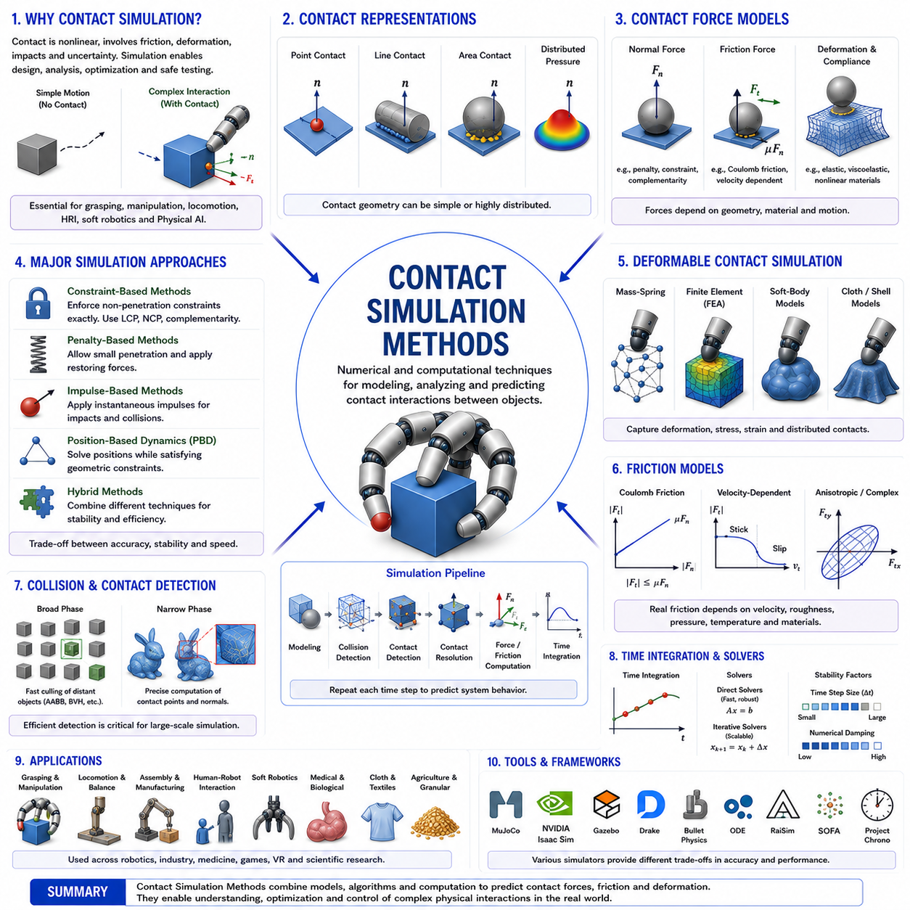{width="7.268055555555556in" height="7.268055555555556in"}

Contact Simulation Methods are the collection of mathematical models, numerical techniques, computational algorithms, and physics-based simulation approaches used to model, predict, analyze, and reproduce contact interactions between objects. Within robotics, contact simulation forms the foundation of grasping, manipulation, locomotion, assembly, human-robot interaction, soft robotics, and Physical AI systems. While Contact Models describe how forces arise when surfaces touch, Contact Simulation Methods provide the computational framework required to calculate and predict those interactions over time. They transform theoretical contact mechanics into practical simulation environments that enable researchers and engineers to design, test, optimize, and validate robotic systems before deployment in the physical world.

The importance of contact simulation arises from the fact that contact is one of the most challenging phenomena in robotics. Vision, localization, and path planning often operate in relatively predictable mathematical spaces. Contact interactions, however, involve nonlinear forces, friction, deformation, impacts, compliance, uncertainty, and discontinuous state transitions. A robot can move freely through space with relatively simple dynamics until it touches an object. At that moment, the complexity of the physical interaction increases dramatically. Accurate simulation of these interactions is therefore essential for creating reliable robotic systems.

Historically, robotics research relied heavily on rigid-body assumptions and simplified contact approximations. Early robotic systems focused primarily on industrial automation tasks where interactions were carefully controlled and predictable. As robots began entering unstructured environments, interacting with humans, manipulating deformable objects, and performing dexterous tasks, the limitations of simplistic contact models became increasingly apparent. This motivated the development of advanced contact simulation methods capable of representing realistic physical interactions.

At the most fundamental level, contact simulation seeks to answer several important questions. When two objects touch, where does contact occur? How large is the contact area? What forces are generated? How do friction and deformation influence behavior? Will slipping occur? Will the objects separate or remain in contact? How will the interaction evolve over time? Contact simulation methods provide numerical solutions to these questions.

One of the simplest approaches is rigid-body contact simulation. In rigid-body models, objects are assumed to be perfectly rigid, meaning that no deformation occurs during interaction. Contact is represented mathematically through constraints that prevent interpenetration. This assumption dramatically simplifies computation and remains widely used in robotics, computer graphics, gaming, and industrial simulation. Although rigid-body models cannot capture all real-world phenomena, they often provide sufficient accuracy for many applications.

Rigid-body contact simulation typically begins with collision detection. Collision detection algorithms determine whether two objects intersect and identify potential contact locations. Broad-phase collision detection rapidly eliminates objects that are far apart, while narrow-phase collision detection computes precise contact information for objects that may interact. Efficient collision detection is essential because modern robotic simulations often involve thousands of potential contact pairs.

Once contact is detected, contact resolution algorithms determine the forces required to satisfy physical constraints. One common approach is constraint-based simulation. In this framework, contact conditions are represented as mathematical constraints that prevent penetration between bodies. Solvers then compute forces or impulses that satisfy these constraints while maintaining physically plausible behavior.

Penalty-based methods provide an alternative approach. Instead of enforcing contact constraints exactly, penalty methods allow small amounts of interpenetration and generate restoring forces proportional to penetration depth. These methods are conceptually simple and computationally efficient. However, excessive penetration may reduce physical realism, while large penalty parameters can introduce numerical instability.

Constraint-based and penalty-based methods represent two of the most widely used categories of contact simulation. Modern simulators often combine aspects of both approaches to achieve favorable tradeoffs between stability, accuracy, and computational efficiency.

Friction modeling is another critical component of contact simulation. Without friction, many common robotic tasks become impossible. Grasping, walking, pushing, tool use, and object manipulation all depend on frictional interactions. Most simulations use Coulomb friction models, which approximate friction forces based on normal forces and friction coefficients. Despite its simplicity, Coulomb friction captures many essential characteristics of contact behavior.

However, real friction is often significantly more complex than classical Coulomb models suggest. Friction may depend on velocity, surface roughness, material properties, temperature, pressure distribution, lubrication, and wear. Advanced contact simulation methods increasingly incorporate these effects to improve realism and predictive accuracy.

Complementarity-based methods represent an important class of contact simulation techniques. These methods formulate contact interactions as mathematical complementarity problems. The central idea is that contact forces and penetration cannot occur simultaneously. Either objects are separated with zero contact force, or they are in contact with nonzero contact force. Complementarity formulations provide elegant mathematical descriptions of contact behavior and are widely used in robotics research.

Linear Complementarity Problems (LCPs) became particularly influential in rigid-body simulation. LCP-based solvers can efficiently compute contact forces while satisfying nonpenetration and friction constraints. Many classical robotics simulators rely on LCP formulations because they offer a principled framework for modeling contact interactions.

More advanced approaches use Nonlinear Complementarity Problems (NCPs) and Variational Inequalities. These methods extend contact simulation to more complex scenarios involving nonlinear friction models, deformable objects, and sophisticated contact mechanics. Although computationally more demanding, they often provide higher accuracy and better physical fidelity.

Impulse-based simulation methods are commonly used when modeling impacts and collisions. Instead of computing continuous contact forces, impulse methods apply instantaneous momentum changes during collisions. These approaches are particularly useful for modeling bouncing, striking, dropping, and other highly dynamic interactions.

Impact simulation introduces additional complexity because contact forces can become extremely large over very short time intervals. Accurate impact modeling requires careful treatment of momentum conservation, energy dissipation, restitution coefficients, and contact duration. Such considerations are critical in robotic manipulation, industrial automation, sports robotics, and human-robot interaction.

Deformable contact simulation extends beyond rigid-body assumptions by explicitly modeling object deformation. When contact occurs, objects change shape, creating distributed contact areas and complex pressure distributions. Deformable simulation methods are essential for modeling soft robotics, biological tissues, cloth manipulation, food handling, and compliant grasping.

Finite Element Analysis (FEA) is one of the most powerful tools for deformable contact simulation. FEA divides objects into large numbers of interconnected elements and computes stresses, strains, deformations, and contact forces throughout the structure. Although computationally intensive, FEA provides highly accurate predictions of contact behavior and is widely used in engineering and robotics.

Nonlinear finite element methods are particularly important because many contact interactions involve large deformations, nonlinear materials, and changing contact boundaries. Such methods allow simulation of highly complex phenomena that cannot be captured using linear approximations.

Mass-spring systems provide a computationally simpler alternative for deformable simulation. Objects are represented as networks of masses connected by springs. Although less accurate than finite element methods, mass-spring models often achieve sufficient realism for real-time applications and interactive simulations.

Position-Based Dynamics (PBD) has emerged as a popular approach in graphics and robotics. Rather than solving force equations directly, PBD updates object positions while enforcing geometric constraints. This method offers exceptional numerical stability and computational efficiency, making it attractive for real-time simulation of cloth, ropes, soft bodies, and deformable structures.

Soft-body simulation has become increasingly important with the rise of soft robotics. Soft robots rely on continuous deformation rather than rigid joints and links. Simulating such systems requires specialized methods capable of modeling large elastic deformations, material nonlinearities, and complex contact interactions.

Fluid-solid interaction simulation represents another important area. Many real-world robotic applications involve liquids, gels, slurries, biological materials, and other fluid-like substances. Modeling interactions between solid objects and deformable fluids requires sophisticated computational methods that combine contact mechanics with fluid dynamics.

Granular material simulation presents unique challenges. Sand, soil, grains, powders, and agricultural materials consist of large numbers of interacting particles. Discrete Element Methods (DEM) simulate individual particles and their contact interactions. DEM has become increasingly important for agricultural robotics, construction automation, mining systems, and planetary exploration robots.

Contact simulation also plays a central role in robotic grasping research. Contact models determine how forces are transmitted between fingers and objects. Simulations allow researchers to evaluate grasp stability, force closure conditions, grasp quality metrics, and manipulation strategies without risking damage to physical hardware.

Grasp Wrench Space analysis frequently relies on contact simulation. Simulated contact forces can be used to construct achievable wrench sets and evaluate grasp robustness under varying conditions. Such analyses provide valuable insight into robotic hand design and manipulation performance.

Tactile sensing research increasingly depends on contact simulation. Simulated pressure distributions, contact patches, and force transmission patterns help researchers develop tactile sensors and interpret tactile measurements. Digital tactile twins are becoming an active area of investigation within Physical AI.

Machine learning has significantly influenced contact simulation in recent years. Data-driven models can learn contact dynamics directly from experimental observations. Neural networks may approximate friction behavior, deformation responses, impact outcomes, or contact force distributions. Such learned models often achieve impressive computational efficiency while maintaining acceptable accuracy.

Physics-Informed Machine Learning combines physical laws with data-driven learning. Rather than replacing physics entirely, these methods integrate physical constraints into learning architectures. This hybrid approach often improves generalization and physical consistency while reducing data requirements.

Differentiable simulation represents one of the most exciting recent developments. Traditional simulators compute system behavior but do not provide gradients for optimization. Differentiable simulators allow gradients to propagate through contact interactions, enabling optimization, system identification, trajectory planning, and policy learning. This capability is becoming increasingly important in robotics and Physical AI research.

Simulation-to-Reality (Sim2Real) transfer depends heavily on accurate contact simulation. Many robotic policies are trained in simulation before deployment in physical environments. Contact modeling errors often represent one of the largest sources of Sim2Real performance degradation. Improving contact simulation fidelity is therefore essential for successful transfer learning.

Digital Twins further emphasize the importance of contact simulation. A digital twin seeks to create a virtual representation of a physical system that accurately reproduces real-world behavior. Contact interactions are often among the most difficult phenomena to model accurately within digital twins, particularly when uncertainty and environmental variability are present.

Modern robotics simulators such as MuJoCo, Isaac Sim, NVIDIA PhysX, Gazebo, Drake, Bullet Physics, ODE, RaiSim, SOFA, and Chrono incorporate sophisticated contact simulation frameworks. Each simulator employs different numerical methods and tradeoffs, reflecting the diverse requirements of robotics research and industrial applications.

Humanoid robotics places particularly demanding requirements on contact simulation. Walking, balancing, climbing, object manipulation, tool use, and human interaction all involve numerous simultaneous contacts. Accurate simulation of these interactions is critical for developing robust humanoid behaviors.

Physical AI systems further elevate the significance of contact simulation. Future intelligent robots must understand not only geometry and perception but also physical interaction. Contact simulation provides the computational foundation for this understanding by enabling robots to predict the consequences of actions before executing them in the real world.

Recent research increasingly focuses on uncertainty-aware contact simulation. Real contact interactions involve uncertain friction coefficients, material properties, geometric imperfections, sensor noise, and environmental variability. Probabilistic simulation methods attempt to capture these uncertainties and generate more robust predictions.

Large-scale foundation models for robotics may eventually incorporate contact simulation directly into their reasoning processes. Such systems could combine perception, language understanding, planning, and physical prediction within unified architectures capable of sophisticated interaction with the physical world.

Ultimately, Contact Simulation Methods transform theoretical contact mechanics into practical computational tools capable of predicting physical interaction. They provide the bridge between mathematical models and real-world robotic behavior. By integrating collision detection, contact resolution, friction modeling, deformation simulation, machine learning, optimization, and physical reasoning, contact simulation methods enable robots to interact safely, intelligently, and effectively with complex environments.

Within the broader framework of Contact Mechanics and Grasp Theory, Contact Simulation Methods unify Contact Models, Point Contact Theory, Soft Finger Contact Models, Force Closure Theory, Form Closure Theory, Grasp Wrench Space, Grasp Stability Analysis, Multi-Finger Contact Coordination, and Object Deformation Effects into a computationally executable framework. A deep understanding of contact simulation methods is therefore essential for researchers and engineers developing robotic hands, dexterous manipulators, soft robots, humanoid systems, digital twins, simulation environments, and future generations of Physical AI platforms.

접촉 시뮬레이션 방법(Contact Simulation Methods)은 물체 간의 접촉(Contact)을 모델링하고 예측하기 위해 사용되는 수학적 모델, 수치해석 기법, 계산 알고리즘, 그리고 물리 기반 시뮬레이션 기술의 집합이다. 로봇공학에서 접촉 시뮬레이션은 파지(Grasping), 조작(Manipulation), 보행(Locomotion), 조립(Assembly), 인간-로봇 상호작용(Human-Robot Interaction), 소프트 로보틱스(Soft Robotics), 그리고 Physical AI 시스템의 핵심 기반 기술이다. 접촉 모델(Contact Model)이 접촉 시 어떤 힘이 발생하는지를 설명하는 이론이라면, 접촉 시뮬레이션 방법은 이러한 접촉 현상을 실제 계산으로 구현하여 시간에 따라 어떻게 변화하는지를 예측하는 도구라고 할 수 있다. 즉, 이론적인 접촉 역학(Contact Mechanics)을 실제 시뮬레이션 환경에서 실행 가능한 형태로 변환하는 역할을 수행한다.

접촉 시뮬레이션이 중요한 이유는 접촉 자체가 로봇공학에서 가장 복잡한 현상 중 하나이기 때문이다. 비전(Vision), 위치 추정(Localization), 경로 계획(Path Planning)은 비교적 예측 가능한 수학적 공간에서 동작한다. 그러나 접촉은 비선형 힘(Nonlinear Force), 마찰(Friction), 변형(Deformation), 충돌(Impact), 순응성(Compliance), 불확실성(Uncertainty), 불연속 상태 변화(Discontinuous State Transition)를 포함한다. 로봇이 자유 공간에서 움직일 때는 비교적 단순한 동역학을 가지지만, 물체와 접촉하는 순간 시스템의 복잡도는 급격히 증가한다. 따라서 접촉 시뮬레이션은 신뢰성 있는 로봇 시스템 개발을 위해 반드시 필요하다.

초기의 로봇공학 연구는 대부분 강체(Rigid Body) 가정에 기반하였다. 당시의 산업용 로봇은 예측 가능한 환경에서 반복 작업을 수행했기 때문에 단순한 접촉 모델만으로도 충분하였다. 그러나 로봇이 비정형 환경(Unstructured Environment)으로 진출하고, 인간과 상호작용하며, 변형 가능한 물체를 다루고, 정교한 조작을 수행하게 되면서 단순 모델의 한계가 드러났다. 이에 따라 보다 현실적인 접촉 시뮬레이션 기술이 발전하게 되었다.

접촉 시뮬레이션은 기본적으로 몇 가지 중요한 질문에 답하고자 한다. 두 물체가 접촉하면 어디에서 접촉이 발생하는가? 접촉 면적은 얼마나 되는가? 어떤 힘이 발생하는가? 마찰과 변형은 어떤 영향을 미치는가? 미끄러짐은 발생하는가? 물체는 계속 접촉 상태를 유지하는가 아니면 분리되는가? 그리고 이러한 상태는 시간이 지남에 따라 어떻게 변화하는가? 접촉 시뮬레이션은 이러한 질문들을 계산적으로 해결한다.

가장 단순한 방법은 강체 기반 접촉 시뮬레이션(Rigid-Body Contact Simulation)이다. 강체 모델에서는 물체가 변형되지 않는다고 가정한다. 접촉은 물체 간 침투(Interpenetration)를 방지하는 제약 조건(Constraint)으로 표현된다. 이러한 가정은 계산량을 크게 줄일 수 있기 때문에 오늘날에도 로봇공학, 컴퓨터 그래픽스, 게임 엔진, 산업 시뮬레이션에서 널리 사용된다.

강체 기반 시뮬레이션은 일반적으로 충돌 검출(Collision Detection)에서 시작된다. 충돌 검출은 두 물체가 접촉했는지 여부를 판단하고 접촉 위치를 계산한다. 광역 충돌 검출(Broad Phase Collision Detection)은 서로 멀리 떨어진 물체를 빠르게 제외시키고, 협역 충돌 검출(Narrow Phase Collision Detection)은 실제 접촉 가능성이 있는 물체에 대해 정밀 계산을 수행한다. 현대 시뮬레이션에서는 수천 개 이상의 물체가 존재할 수 있기 때문에 효율적인 충돌 검출이 매우 중요하다.

접촉이 검출되면 접촉 해결(Contact Resolution) 과정이 수행된다. 이 과정에서는 침투를 방지하고 물리적으로 타당한 힘을 계산해야 한다. 가장 널리 사용되는 방식 중 하나는 제약 기반 시뮬레이션(Constraint-Based Simulation)이다. 이 방법은 접촉 조건을 수학적 제약으로 표현하고, 이를 만족하는 힘이나 충격량(Impulse)을 계산한다.

또 다른 접근법은 페널티 방법(Penalty Method)이다. 이 방법은 작은 침투를 허용한 후 침투 깊이에 비례하는 복원력을 생성한다. 구현이 간단하고 계산 속도가 빠르지만, 침투가 너무 커지면 물리적 정확성이 떨어질 수 있으며, 복원력 계수가 너무 크면 수치적 불안정성이 발생할 수 있다.

실제 시뮬레이터는 제약 기반 방법과 페널티 방법을 혼합하여 사용하는 경우가 많다. 이는 계산 효율성과 물리적 정확성 사이의 균형을 맞추기 위함이다.

마찰 모델(Friction Model)은 접촉 시뮬레이션의 핵심 요소이다. 마찰이 없다면 파지, 보행, 밀기, 공구 사용과 같은 대부분의 로봇 작업은 불가능하다. 가장 널리 사용되는 모델은 쿨롱 마찰 모델(Coulomb Friction Model)이다. 이 모델은 접촉력과 마찰 계수를 이용하여 마찰력을 계산한다. 비록 단순한 모델이지만 많은 실제 현상을 비교적 잘 설명할 수 있다.

그러나 실제 마찰은 훨씬 복잡하다. 마찰은 속도, 표면 거칠기, 재료 특성, 온도, 압력 분포, 윤활 상태 등에 따라 달라질 수 있다. 최근의 고정밀 접촉 시뮬레이션은 이러한 효과를 점차 포함하고 있다.

상보성 기반 방법(Complementarity-Based Methods)은 접촉 시뮬레이션에서 중요한 위치를 차지한다. 이 방법은 접촉 문제를 수학적 상보성 문제(Complementarity Problem)로 표현한다. 기본 개념은 접촉력과 침투가 동시에 존재할 수 없다는 것이다. 즉, 물체가 떨어져 있으면 접촉력은 0이고, 접촉력이 존재하면 침투는 없어야 한다.

특히 선형 상보성 문제(Linear Complementarity Problem, LCP)는 강체 접촉 시뮬레이션에서 널리 사용되었다. LCP 기반 해법은 비침투 조건과 마찰 조건을 동시에 만족하는 접촉력을 효율적으로 계산할 수 있다.

보다 복잡한 문제에서는 비선형 상보성 문제(Nonlinear Complementarity Problem, NCP)와 변분 부등식(Variational Inequality)이 사용된다. 이러한 방법은 비선형 마찰, 변형체, 복잡한 접촉 조건까지 표현할 수 있지만 계산 비용이 증가한다.

충돌(Impact)과 같은 빠른 상호작용은 충격량 기반 시뮬레이션(Impulse-Based Simulation)으로 처리된다. 이 방법은 매우 짧은 시간 동안 발생하는 큰 힘을 순간적인 운동량 변화로 표현한다. 공 튀기기, 물체 떨어뜨리기, 충돌 실험 등에서 널리 사용된다.

충격 시뮬레이션에서는 운동량 보존(Momentum Conservation), 에너지 손실(Energy Dissipation), 반발 계수(Coefficient of Restitution), 접촉 지속 시간(Contact Duration) 등을 고려해야 한다. 이는 스포츠 로봇, 산업 자동화, 인간-로봇 상호작용 분야에서 매우 중요하다.

변형체 접촉 시뮬레이션(Deformable Contact Simulation)은 강체 가정을 넘어서는 접근법이다. 접촉 시 물체가 변형되며 넓은 접촉 영역과 복잡한 압력 분포가 형성된다. 이러한 모델은 소프트 로봇, 생체 조직, 의류, 식품, 순응성 파지 시스템을 연구하는 데 필수적이다.

유한요소해석(Finite Element Analysis, FEA)은 변형체 시뮬레이션의 대표적인 방법이다. FEA는 물체를 수많은 작은 요소(Element)로 분할한 후 응력(Stress), 변형률(Strain), 변형량(Deformation)을 계산한다. 계산량은 많지만 매우 높은 정확도를 제공한다.

비선형 유한요소해석(Nonlinear FEA)은 대변형(Large Deformation), 비선형 재료, 변화하는 접촉 경계를 모델링할 수 있다. 이는 실제 로봇 조작 환경에서 매우 중요한 기능이다.

질량-스프링 모델(Mass-Spring Model)은 보다 단순한 변형체 모델이다. 물체를 질점(Mass)과 스프링(Spring)의 네트워크로 표현한다. 정확도는 FEA보다 낮지만 실시간 응용에는 충분한 경우가 많다.

위치 기반 동역학(Position-Based Dynamics, PBD)은 최근 인기를 얻고 있는 방법이다. 이 방법은 힘을 직접 계산하는 대신 위치를 업데이트하면서 기하학적 제약을 만족시킨다. 계산 안정성이 뛰어나며 천(Cloth), 로프(Rope), 소프트 바디(Soft Body) 시뮬레이션에 적합하다.

소프트 로보틱스의 발전은 접촉 시뮬레이션의 중요성을 더욱 높였다. 소프트 로봇은 강체 링크 대신 연속적인 변형을 이용하여 움직인다. 이를 시뮬레이션하기 위해서는 큰 탄성 변형, 재료 비선형성, 복잡한 접촉 상호작용을 모델링할 수 있는 특수 기법이 필요하다.

유체-고체 상호작용(Fluid-Solid Interaction)도 중요한 연구 분야이다. 로봇은 액체, 젤, 생체 조직, 슬러리와 같은 물질과 상호작용할 수 있다. 이러한 환경에서는 접촉 역학과 유체 역학을 동시에 고려해야 한다.

입자 기반 물질(Granular Material)의 시뮬레이션도 중요한 분야이다. 모래, 흙, 곡물, 분말과 같은 재료는 수많은 입자로 구성되어 있다. 이 경우 개별 입자의 접촉을 계산하는 이산요소법(Discrete Element Method, DEM)이 널리 사용된다. 농업 로봇, 건설 로봇, 광산 자동화, 행성 탐사 로봇에서 중요한 역할을 한다.

접촉 시뮬레이션은 로봇 파지 연구의 핵심 도구이기도 하다. 접촉 모델은 손가락과 물체 사이의 힘 전달을 결정하며, 시뮬레이션을 통해 파지 안정성, 힘 폐쇄 조건, 파지 품질, 조작 전략을 실제 하드웨어 손상 없이 평가할 수 있다.

그립 렌치 공간 분석 역시 접촉 시뮬레이션에 크게 의존한다. 시뮬레이션된 접촉력을 이용하여 생성 가능한 렌치 공간을 계산하고 파지 강건성을 평가할 수 있다.

촉각 센싱(Tactile Sensing) 연구에서도 접촉 시뮬레이션은 중요한 역할을 한다. 압력 분포, 접촉 패치(Contact Patch), 힘 전달 구조를 시뮬레이션하여 촉각 센서 설계와 데이터 해석에 활용할 수 있다.

최근 머신러닝(Machine Learning)은 접촉 시뮬레이션에 새로운 접근법을 제공하고 있다. 신경망은 접촉 동역학, 마찰 거동, 변형 응답, 충돌 결과 등을 데이터로부터 학습할 수 있다. 이러한 모델은 매우 빠른 계산 속도를 제공할 수 있다.

물리 정보 기반 머신러닝(Physics-Informed Machine Learning)은 물리 법칙과 데이터 기반 학습을 결합한다. 이는 일반화 성능과 물리적 일관성을 향상시키면서도 데이터 요구량을 줄여준다.

최근 가장 주목받는 분야 중 하나는 미분 가능 시뮬레이션(Differentiable Simulation)이다. 기존 시뮬레이터는 결과를 계산할 수 있지만 최적화를 위한 기울기(Gradient)를 제공하지 못한다. 반면 미분 가능 시뮬레이터는 접촉 과정을 포함한 전체 시스템에 대해 기울기를 계산할 수 있다. 이를 통해 최적화, 경로 계획, 시스템 식별(System Identification), 정책 학습(Policy Learning)이 가능해진다.

Sim2Real(Simulation-to-Reality) 기술 역시 접촉 시뮬레이션의 정확성에 크게 의존한다. 많은 로봇 정책은 시뮬레이션에서 학습된 후 실제 환경에 적용된다. 접촉 모델 오차는 Sim2Real 성능 저하의 가장 큰 원인 중 하나이다.

디지털 트윈(Digital Twin)에서도 접촉 시뮬레이션은 핵심 기술이다. 디지털 트윈은 실제 시스템을 가상 공간에서 재현하는 것을 목표로 한다. 그러나 접촉은 가장 모델링하기 어려운 현상 중 하나이며, 정확한 디지털 트윈 구축을 위해 반드시 해결해야 하는 문제이다.

현대 로봇 시뮬레이터인 MuJoCo, Isaac Sim, Gazebo, Drake, Bullet Physics, ODE, RaiSim, SOFA, Project Chrono 등은 각각 고유한 접촉 시뮬레이션 기법을 구현하고 있으며, 연구 목적에 따라 다양한 장단점을 가진다.

휴머노이드 로봇(Humanoid Robot)은 접촉 시뮬레이션에 가장 높은 수준의 요구사항을 제시한다. 보행, 균형 유지, 계단 오르기, 공구 사용, 물체 조작, 인간과의 상호작용 등은 수많은 동시 접촉을 포함한다. 이러한 상호작용을 정확하게 시뮬레이션하는 것은 인간 수준의 로봇 행동을 개발하기 위한 필수 조건이다.

Physical AI의 발전은 접촉 시뮬레이션의 중요성을 더욱 높이고 있다. 미래의 지능형 로봇은 단순히 사물을 인식하는 것이 아니라 물리 세계와 상호작용해야 한다. 접촉 시뮬레이션은 행동의 결과를 예측하고 계획할 수 있도록 하는 핵심 기술이다.

최근 연구는 불확실성을 고려한 접촉 시뮬레이션(Uncertainty-Aware Contact Simulation)으로 확장되고 있다. 실제 환경에서는 마찰 계수, 재료 물성, 형상 오차, 센서 노이즈 등이 모두 불확실하다. 확률 기반 시뮬레이션은 이러한 요소를 반영하여 더욱 강건한 예측을 제공한다.

또한 미래의 로봇 파운데이션 모델(Robotics Foundation Model)은 접촉 시뮬레이션을 내부 추론 과정에 통합할 가능성이 높다. 이러한 시스템은 언어, 비전, 계획, 물리 예측을 하나의 통합 구조 안에서 수행할 수 있을 것이다.

결론적으로 **Contact Simulation Methods**는 접촉 역학 이론을 실제 계산 가능한 형태로 변환하는 핵심 기술이다. 충돌 검출, 접촉 해결, 마찰 모델링, 변형체 시뮬레이션, 머신러닝, 최적화, 물리 추론을 통합함으로써 로봇이 복잡한 물리 환경과 안전하고 지능적으로 상호작용할 수 있도록 지원한다.

따라서 **06_11 Contact Simulation Methods**는 **Contact Models, Point Contact Theory, Soft Finger Contact Models, Force Closure Theory, Form Closure Theory, Grasp Wrench Space, Grasp Stability Analysis, Multi-Finger Contact Coordination, Object Deformation Effects**를 실제 계산 가능한 프레임워크로 통합하는 최종 실행 계층(Computational Execution Layer)이라고 할 수 있다. 차세대 로봇 핸드, 정교 조작 시스템, 소프트 로봇, 휴머노이드 로봇, 디지털 트윈, 시뮬레이션 플랫폼, 그리고 미래의 Physical AI를 개발하는 연구자와 엔지니어라면 반드시 깊이 이해해야 할 핵심 분야이다.
