**Volume 06 Robot Hands and Dexterous Grasping**

# 06. Contact Mechanics and Grasp Theory

## 06.01 Contact Models Overview

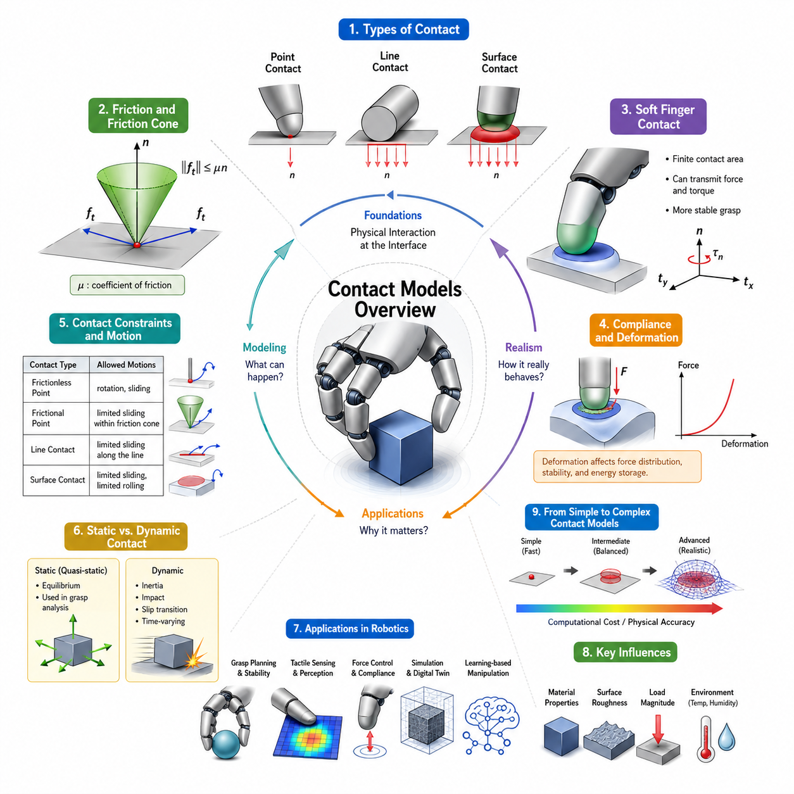{width="7.268055555555556in" height="7.268055555555556in"}

Contact models form the foundation of robotic grasping, dexterous manipulation, and physical interaction between a robot hand and an object. While robot kinematics describes how fingers move and control theory determines how actuators generate motion, contact mechanics explains what actually happens when a finger touches an object. Every successful grasp, manipulation task, assembly operation, or tool-use behavior ultimately depends on the physics of contact. For this reason, contact modeling occupies a central position in robotic hand design, grasp analysis, tactile sensing, force control, and learning-based manipulation systems. Within the broader framework of contact mechanics and grasp theory, contact models provide mathematical descriptions of how forces, moments, friction, deformation, and motion constraints are transmitted across interfaces where robot fingers and objects meet.

In robotics, contact is rarely a simple event. When a robot fingertip touches an object, multiple physical phenomena occur simultaneously. Forces are distributed over finite surface areas, microscopic surface roughness generates friction, materials deform elastically or plastically, and local pressure distributions evolve as grasp forces change. Contact models attempt to capture these phenomena with varying degrees of complexity. Some models prioritize computational efficiency for real-time control, while others prioritize physical realism for simulation and scientific analysis. The selection of a contact model directly influences grasp planning, force estimation, manipulation stability, and simulation accuracy.

The simplest interpretation of contact assumes that two bodies touch at a single infinitesimal point. This abstraction forms the basis of many classical grasp analysis methods because it significantly simplifies mathematical treatment. In reality, however, physical contact almost always occurs over finite areas rather than idealized points. Even apparently rigid objects experience small deformations under load, creating contact patches rather than mathematical points. The discrepancy between idealized models and physical reality motivates the development of increasingly sophisticated contact representations.

Contact models can generally be categorized according to the geometric characteristics of the interaction. Point contacts represent the most basic class, where contact is assumed to occur at a single location. Line contacts describe situations where elongated surfaces interact, such as cylindrical objects touching flat surfaces. Surface contacts represent distributed interactions across larger areas, such as the palm of a robotic hand holding an object. As the dimensionality of contact increases, the ability to transmit forces and moments also changes, leading to different grasping capabilities and stability characteristics.

One of the most important concepts in contact modeling is friction. Without friction, many grasping tasks become impossible because fingers would simply slide across object surfaces. Friction allows tangential forces to be transmitted between contacting bodies, enabling stable grasps and controlled manipulation. Classical robotic grasp theory often relies on the Coulomb friction model, which approximates the relationship between normal force and maximum tangential force. According to this model, frictional force is proportional to the normal contact force through a coefficient of friction. Although simple, the Coulomb model remains one of the most widely used contact representations in robotics due to its intuitive interpretation and computational efficiency.

The introduction of friction significantly expands the capabilities of contact models. A frictionless point contact can only transmit force along the surface normal direction. A point contact with friction can additionally resist tangential motion within limits defined by the friction cone. The friction cone is a geometric representation describing all allowable contact forces before slipping occurs. Understanding friction cones is essential for grasp planning, force closure analysis, and stability evaluation because they define the feasible force space available to each contact point.

Beyond simple point contacts, robotic manipulation often requires models capable of representing rotational constraints. This leads to the concept of soft-finger contacts. A soft-finger contact assumes that finite contact areas exist between deformable surfaces. Because contact occurs over an area rather than a point, the contact can transmit not only forces but also torsional moments around the surface normal. This additional capability provides enhanced grasp stability and more accurately reflects many real-world robotic fingertips that employ compliant materials such as rubber, silicone, polyurethane, or specialized tactile skins.

Compliance plays a fundamental role in modern contact modeling. In classical rigid-body analysis, objects are assumed to be perfectly rigid. While this assumption simplifies calculations, it often fails to capture important behaviors observed in practical robotic systems. Real materials deform under load, and these deformations influence force distribution, energy storage, impact absorption, and grasp stability. Compliance models introduce elastic behavior into contact representations, enabling more realistic predictions of contact forces and object interactions.

The study of compliant contacts frequently draws upon elasticity theory. Hertzian contact theory, for example, describes the deformation that occurs when elastic bodies are pressed together. This theory predicts contact area size, pressure distributions, and deformation magnitudes based on material properties and applied forces. Although originally developed for mechanical engineering applications, Hertzian contact principles have become increasingly relevant in robotic grasping, particularly for soft robotic hands and tactile sensing systems.

Contact modeling also involves understanding constraints imposed on motion. When two bodies touch, certain relative motions become restricted while others remain possible. These constraints determine the degrees of freedom available during manipulation. For example, a fingertip pressing against a flat surface restricts penetration but may still allow sliding and rolling. Different contact models encode different constraint sets, leading to varying predictions of object behavior. Motion constraints form the mathematical foundation for grasp closure analysis, manipulation planning, and contact-aware control algorithms.

An important distinction exists between static and dynamic contact models. Static contact models focus on equilibrium conditions where forces balance and motion is negligible. These models are commonly used in grasp quality analysis and force closure evaluation. Dynamic contact models incorporate inertia, impact effects, friction transitions, and time-dependent interactions. Dynamic models are essential for understanding manipulation tasks involving rapid motion, object reorientation, throwing, catching, or contact-rich assembly operations.

Contact transitions represent another major challenge in robotic systems. During manipulation, contact states continuously change as fingers touch, release, slide, roll, or reposition. Modeling these transitions accurately is difficult because contact conditions often exhibit discontinuities. For example, when slipping begins, the governing friction equations change abruptly. Similarly, impacts introduce instantaneous changes in velocity and force. Robust contact models must account for such hybrid behaviors while maintaining numerical stability and computational tractability.

The development of robotic tactile sensing has further increased the importance of contact modeling. Tactile sensors provide measurements of pressure distributions, contact locations, shear forces, and vibration patterns. Interpreting these measurements requires accurate physical models linking sensor outputs to underlying contact phenomena. Contact models therefore serve as bridges between raw tactile data and higher-level manipulation decisions. They enable robots to estimate object properties, detect slip, infer grasp stability, and adapt contact forces in real time.

Simulation environments rely heavily on contact models to reproduce realistic manipulation behavior. Physics engines such as those used in robotic simulators must compute contact forces thousands of times per second. Achieving both realism and computational efficiency presents a significant challenge. Simplified models may enable real-time performance but produce unrealistic grasp behavior, whereas highly detailed models may be computationally expensive. Consequently, simulation systems often employ approximations designed to balance physical accuracy and computational speed.

Modern soft robotics introduces additional complexities into contact modeling. Soft fingers deform substantially during interaction, causing contact geometries to evolve continuously. Traditional rigid-body assumptions become inadequate under such conditions. Advanced soft-contact models incorporate continuum mechanics, nonlinear material behavior, viscoelasticity, and large deformations. These models provide more accurate representations of how soft robotic grippers conform to object shapes and generate stable grasps through distributed contact forces.

Contact models are also central to grasp quality evaluation. The ability of a grasp to resist disturbances depends directly on the forces and moments that contact points can generate. Different contact assumptions lead to different grasp quality predictions. A grasp that appears stable under a soft-finger model may not achieve force closure under a frictionless point-contact model. Consequently, grasp evaluation metrics must always be interpreted within the context of the underlying contact representation.

In multi-finger robotic hands, contact interactions become highly coupled. Each finger generates forces that contribute to overall grasp stability while simultaneously affecting other contact locations. Contact models provide the mathematical framework necessary to analyze these interactions. Through concepts such as grasp matrices, wrench spaces, and force distributions, researchers can determine how individual contact forces combine to produce net object motions or resist external disturbances.

Recent advances in machine learning and foundation models have not eliminated the need for contact modeling. Instead, they have created new opportunities for integrating physics-based reasoning with data-driven approaches. Learning algorithms increasingly use contact models as priors, constraints, or simulation environments during training. Hybrid methods combine analytical contact mechanics with neural network predictions to achieve improved generalization, robustness, and sample efficiency. As robotic systems become more capable, the integration of contact theory and artificial intelligence is expected to play an increasingly important role in dexterous manipulation.

The study of contact models ultimately provides the essential language through which robots understand physical interaction. Every grasp, every manipulation action, every assembly operation, and every tactile perception event can be interpreted through the framework of contact mechanics. Contact models transform physical touch into mathematical representations that robots can analyze, predict, and control. They form the bridge between geometric planning and physical execution, connecting the abstract world of algorithms to the tangible world of objects and forces.

Within the context of robot hands and dexterous grasping, contact models serve as the foundation upon which subsequent topics are built. Point-contact theory, friction models, soft-finger contacts, force closure analysis, form closure analysis, grasp wrench spaces, grasp quality metrics, contact stability evaluation, multi-finger coordination, object deformation modeling, and contact simulation techniques all originate from the principles introduced in this chapter. A thorough understanding of contact models is therefore essential for anyone seeking to design, analyze, simulate, or control advanced robotic hands capable of robust and intelligent interaction with the physical world.

## 06.02 Point Contact and Friction Models

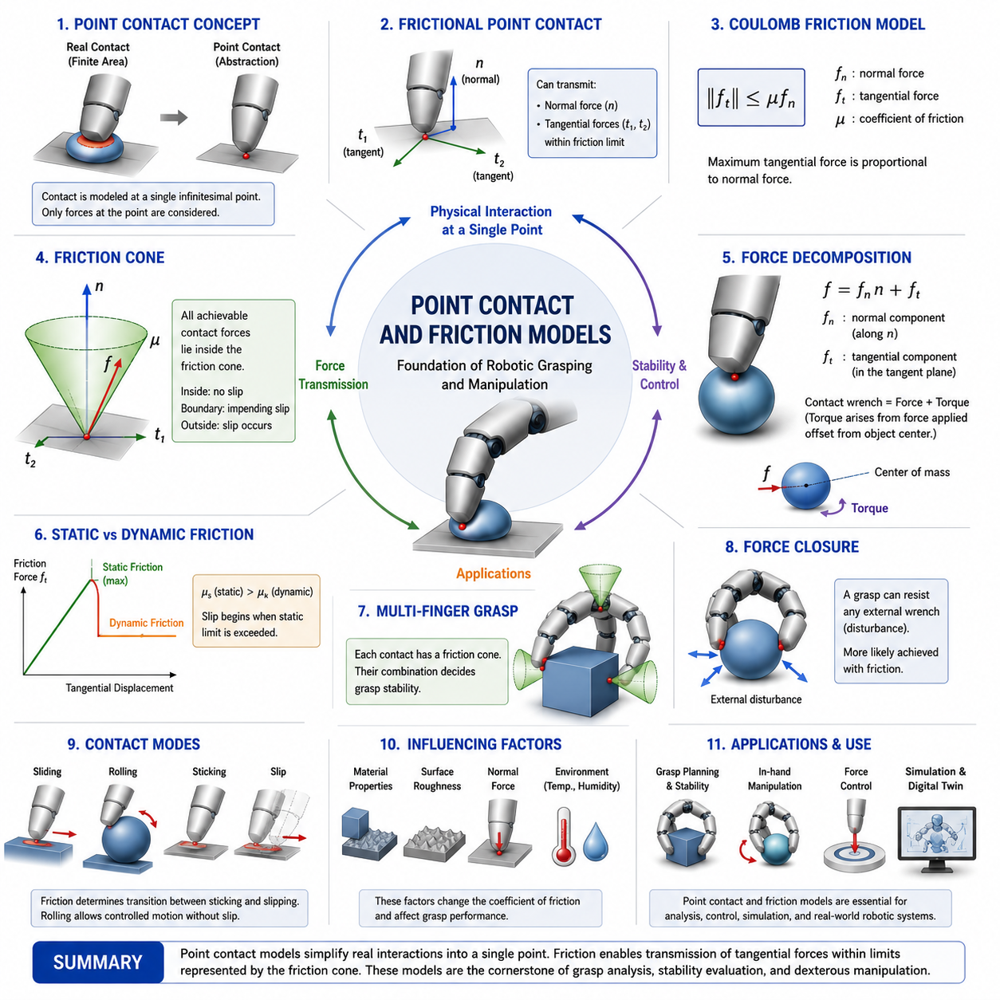{width="7.268055555555556in" height="7.268055555555556in"}

Point contact and friction models constitute the mathematical foundation of robotic grasp analysis, contact mechanics, force transmission, and dexterous manipulation. Whenever a robotic finger touches an object, the interaction between the contacting surfaces determines whether the object can be grasped, manipulated, stabilized, or moved. Although real-world contacts occur over finite surface areas and involve complex deformation phenomena, robotic grasp theory often begins with the abstraction of point contact because it provides a tractable and highly effective framework for analyzing physical interactions. Point contact models represent the first level of contact representation in robotic manipulation and serve as the basis upon which more advanced concepts such as soft-finger contacts, force closure, grasp wrench spaces, tactile control, and contact-rich manipulation are built. Within the broader field of contact mechanics and grasp theory, understanding point contacts and friction models is essential because they define the fundamental mechanisms through which forces are exchanged between robot fingers and objects.

The concept of point contact originates from the desire to simplify the physical complexity of contact into a mathematically manageable form. In a point contact model, the interaction between two bodies is assumed to occur at a single infinitesimal location. Rather than considering distributed pressure fields, elastic deformation, microscopic surface roughness, and material compliance, the entire interaction is represented by forces acting at a single point. This abstraction dramatically reduces the complexity of contact analysis while preserving many of the essential characteristics required for robotic grasp planning and stability evaluation.

Although physical contacts are never truly infinitesimal, the point contact assumption remains remarkably useful. In many robotic applications, the dimensions of the contact patch are extremely small relative to the overall size of the object. Under such circumstances, the detailed shape of the contact area contributes little to the overall grasp behavior, allowing engineers to approximate the interaction as a point contact without significant loss of accuracy. As a result, point contact models have become the dominant representation in classical robotic grasp theory.

The simplest point contact model is the frictionless point contact. In this representation, the contact point can only transmit force along the surface normal direction. No tangential forces can be generated, meaning that the contacting bodies can freely slide relative to each other along the contact surface. The only constraint imposed by the contact is the prevention of interpenetration. If the normal vector at the contact point is represented by n, then the contact force must act exclusively along this direction. Such a model is mathematically elegant and provides valuable theoretical insights into contact mechanics, but it rarely describes practical robotic grasping situations because friction is almost always present in physical systems.

Frictionless point contacts are nevertheless important because they represent the most restrictive contact condition. Many theoretical analyses begin with frictionless assumptions to establish lower bounds on grasp stability and closure properties. The study of frictionless contacts also reveals the fundamental geometric relationships between contact locations and object constraints. Concepts such as form closure often originate from analyses based on frictionless point contact models.

The introduction of friction transforms the capabilities of a contact point. A point contact with friction can transmit not only normal forces but also tangential forces that resist sliding motion. This additional capability dramatically increases the stability and versatility of robotic grasps. The resulting model, known as point contact with friction, is one of the most widely used representations in robotic manipulation research and industrial grasp planning systems.

The behavior of frictional contacts is commonly described using Coulomb friction theory. According to Coulomb's model, the maximum tangential force that can be transmitted before slipping occurs is proportional to the normal force acting at the contact. This relationship is expressed through the coefficient of friction, which characterizes the interaction between the contacting materials. Materials with high friction coefficients can resist larger tangential disturbances, while materials with low friction coefficients are more prone to slipping.

The coefficient of friction depends on numerous factors including material composition, surface roughness, temperature, humidity, contamination, wear, and contact pressure. Rubber surfaces typically exhibit higher friction coefficients than polished metal surfaces. Consequently, robotic fingertips often incorporate compliant rubber coatings to increase friction and improve grasp stability. Material selection therefore becomes an important aspect of robotic hand design because friction directly influences manipulation performance.

One of the most important geometric concepts associated with frictional contacts is the friction cone. The friction cone represents the set of all contact forces that can be sustained without causing slip. The apex of the cone is located at the contact point, and its central axis aligns with the surface normal. The opening angle of the cone depends on the coefficient of friction. Higher friction coefficients produce wider cones, allowing a larger range of force directions to be transmitted without slipping.

The friction cone provides a geometric interpretation of grasp stability. If the contact force vector remains inside the friction cone, the contact remains stable and no sliding occurs. If the force vector reaches the boundary of the cone, the contact is at the threshold of slipping. If the force vector moves outside the cone, slip becomes unavoidable. This simple geometric framework forms the basis of many grasp planning algorithms and stability analyses.

Because exact friction cones are continuous geometric objects, they are often approximated by polyhedral friction cones in computational robotics. A polyhedral friction cone replaces the smooth cone with a finite set of vectors forming a pyramid-like structure. This approximation enables efficient optimization and numerical computation while preserving the essential characteristics of frictional behavior. Most modern grasp planners and robotic simulators employ such approximations to achieve real-time performance.

Contact forces generated at frictional point contacts can be decomposed into normal and tangential components. The normal component prevents penetration between bodies, while the tangential component resists relative sliding motion. Together these components determine the overall contact wrench applied to the object. By combining multiple contact wrenches generated by different fingers, a robotic hand can stabilize and manipulate objects with remarkable precision.

The concept of contact wrench is fundamental in grasp analysis. A wrench consists of both force and torque contributions acting on an object. Even though a point contact itself cannot directly generate torsional moments around the contact normal, the force applied at an offset location from the object's center of mass naturally produces torques. These torques play a critical role in determining object motion and grasp stability.

Multi-finger grasping systems rely heavily on frictional point contact models. When several fingers simultaneously contact an object, each contact contributes a friction cone representing its force transmission capabilities. The combined effect of all friction cones determines whether the grasp can resist external disturbances. This collective force-generating capability ultimately leads to the concepts of force closure and grasp wrench spaces, which are central topics in robotic grasp theory.

Force closure refers to the ability of a grasp to resist arbitrary external disturbances through appropriate combinations of contact forces. Frictional contacts greatly increase the likelihood of achieving force closure because they expand the range of forces that can be applied at each contact point. Without friction, many stable grasps become impossible because contact forces are restricted to normal directions only.

Point contact models are also closely related to object manipulation strategies. During in-hand manipulation, robotic fingers intentionally generate controlled sliding, rolling, or pivoting motions. Predicting and controlling these motions requires accurate friction models because contact behavior determines how forces are converted into object motion. Small errors in friction estimation can lead to manipulation failures, making contact modeling a critical aspect of dexterous robotic control.

The distinction between static and dynamic friction further enriches contact modeling. Static friction describes the resistance to the initiation of motion, whereas dynamic friction describes resistance after sliding has already begun. In most material pairs, static friction exceeds dynamic friction. Consequently, once slipping begins, maintaining control becomes more challenging because the available frictional force decreases. Robotic grasp controllers often account for this phenomenon by maintaining safety margins that prevent contact forces from approaching friction cone boundaries.

Another important concept is stick-slip behavior. Stick-slip phenomena occur when contacts repeatedly alternate between sticking and sliding conditions. Such behavior is commonly observed during precision manipulation, insertion tasks, and contact-rich assembly operations. Stick-slip dynamics can generate vibrations, reduce positioning accuracy, and complicate force control. Advanced contact models incorporate these effects to improve prediction accuracy in complex manipulation scenarios.

Rolling contacts represent another form of interaction frequently encountered in robotic hands. Unlike sliding contacts, rolling contacts maintain local contact without relative tangential motion at the interface. Human fingers naturally exploit rolling contacts during dexterous manipulation because rolling preserves stability while allowing object repositioning. Modeling rolling contacts requires extensions to basic point-contact formulations, including additional kinematic and dynamic constraints.

Surface roughness significantly influences frictional behavior. At microscopic scales, contact occurs only at discrete asperities rather than across the entire apparent contact area. These microscopic interactions generate the frictional forces observed at macroscopic scales. Modern contact theories increasingly incorporate surface roughness effects to improve realism, particularly in tactile sensing applications and precision manipulation systems.

The rise of tactile sensing technologies has created new opportunities for contact-aware robotic control. Tactile sensors can estimate contact locations, pressure distributions, shear forces, and incipient slip conditions. By integrating tactile measurements with friction models, robotic systems can dynamically adjust grasp forces and maintain stable contact even under uncertain conditions. Such capabilities are essential for handling fragile, deformable, or irregularly shaped objects.

Physics-based simulation environments also depend heavily on point contact and friction models. Robotic simulators must continuously compute contact forces between fingers and objects during manipulation tasks. Accurate simulation requires realistic friction behavior, stable numerical integration, and efficient computational methods. Consequently, the development of robust contact models remains a major research area in robotics simulation and digital twin technologies.

Machine learning approaches to grasping increasingly incorporate friction models either explicitly or implicitly. Data-driven grasp planners often learn grasp strategies from large datasets, but their performance improves significantly when physical constraints such as friction cones and contact mechanics are integrated into the learning process. Hybrid approaches combining analytical contact models with neural networks offer promising pathways toward more reliable and physically grounded manipulation systems.

In soft robotic hands, friction modeling becomes even more complex because contact areas change dynamically as compliant materials deform. Contact forces become distributed across finite regions rather than concentrated at single points. Nevertheless, point contact models often remain useful approximations for high-level planning and analysis, demonstrating their enduring value across a wide range of robotic systems.

The study of point contact and friction models serves as the gateway to nearly every advanced topic in robotic grasping. Force closure theory, form closure theory, grasp wrench spaces, grasp quality metrics, contact stability analysis, tactile manipulation, force control, in-hand manipulation, and contact-rich assembly all depend upon the principles established by these models. They provide the mathematical language through which robots interpret and regulate physical interactions with the world.

Ultimately, point contact and friction models transform the abstract concept of touch into a rigorous analytical framework. They allow engineers to predict whether objects will slip, determine how forces should be distributed among fingers, evaluate grasp robustness, design stable manipulation strategies, and build robotic hands capable of interacting intelligently with complex physical environments. As robotic systems continue to advance toward human-level dexterity, the principles of point contact and friction modeling will remain among the most important foundations of robotic manipulation science.

## 06.03 Soft Finger Contact Models

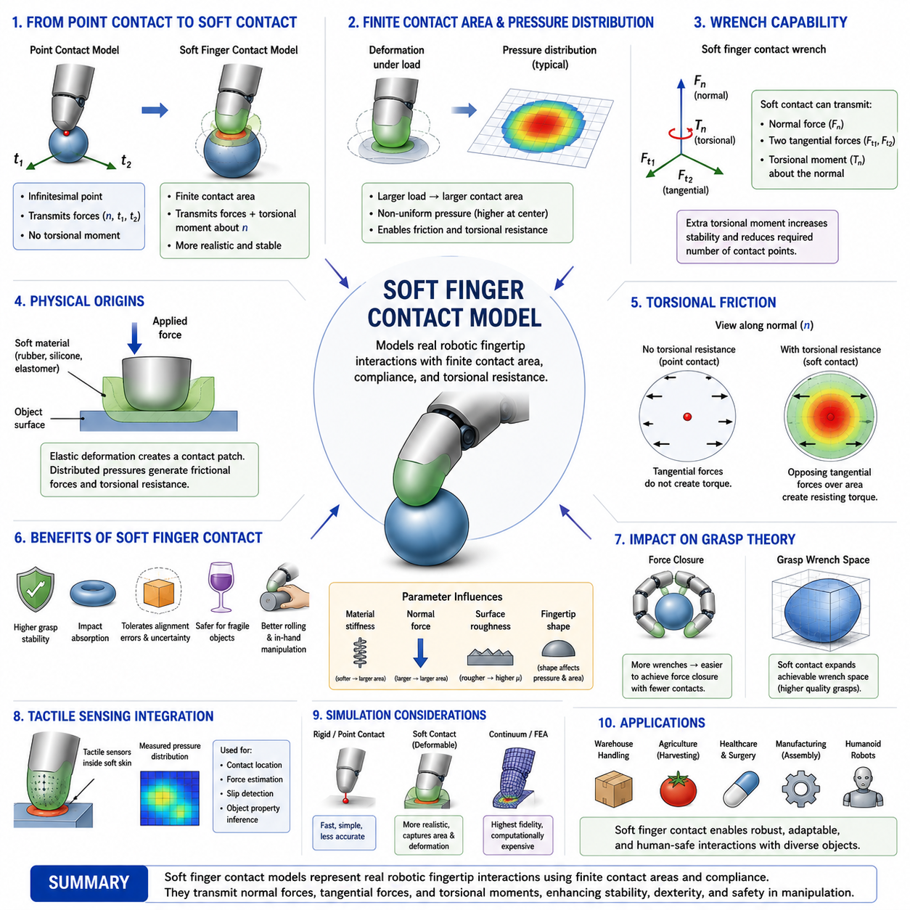{width="7.268055555555556in" height="7.268055555555556in"}

The Soft Finger Contact Model is one of the most important contact representations in robotic grasping and dexterous manipulation. While classical point-contact models provide a convenient mathematical abstraction for analyzing robotic grasps, they often fail to accurately represent the physical behavior of real robotic fingers. In practice, robotic fingertips are rarely perfectly rigid. Most robot hands employ compliant materials such as rubber, silicone, polyurethane, elastomers, or specialized tactile skins that deform under load and create finite contact areas. As a result, the interaction between a finger and an object cannot be adequately described by a single point force. The Soft Finger Contact Model was developed to bridge the gap between idealized contact theory and the physical reality of robotic manipulation. It extends traditional point-contact models by incorporating the effects of finite contact patches, compliance, and rotational force transmission, thereby providing a more realistic representation of grasp behavior.

The origins of the Soft Finger Contact Model can be traced to the limitations of the Point Contact with Friction model. In a conventional frictional point contact, the contact can transmit forces along the surface normal and within the tangential plane, but it cannot directly resist rotational motion around the normal axis. This assumption is often insufficient for practical robotic hands because real fingertips typically generate resistance to torsional rotation due to distributed pressure over a contact area. When a human finger presses against an object, the skin deforms and creates a contact patch that can resist twisting motions. The same phenomenon occurs in compliant robotic fingertips. The Soft Finger Contact Model captures this additional capability by allowing the transmission of torsional moments about the contact normal.

A defining characteristic of the Soft Finger Contact Model is the assumption that contact occurs over a finite area rather than an infinitesimal point. Although the contact area may be small compared to the dimensions of the object, it is sufficiently large to generate distributed pressure fields. These pressure distributions enable the contact to support not only translational forces but also rotational moments. Consequently, the contact gains an additional degree of constraint compared with traditional point-contact representations. This enhancement significantly improves grasp stability and expands the range of objects that can be manipulated effectively.

The physical basis of soft-finger contact behavior lies in material deformation. When a compliant fingertip presses against an object, elastic deformation occurs at the interface. The shape and size of the resulting contact patch depend on the applied load, material stiffness, surface geometry, and contact conditions. As contact force increases, the contact area generally expands, increasing frictional capability and rotational resistance. This relationship between force and contact area forms one of the fundamental mechanisms underlying stable robotic grasping.

Elasticity theory plays a central role in modeling soft-finger contacts. Classical Hertzian Contact Theory provides a foundation for understanding how elastic bodies deform under compressive loading. According to Hertzian theory, the contact area between two elastic bodies increases as normal force increases. The resulting pressure distribution is typically non-uniform, with higher pressures concentrated near the center of the contact region. These pressure distributions influence force transmission, friction generation, and torque resistance. Although Hertzian theory represents only an approximation, it provides valuable insights into the physical processes governing compliant contact behavior.

The Soft Finger Contact Model introduces the concept of torsional friction. In traditional friction models, friction is primarily associated with resistance to tangential sliding. However, finite contact areas also generate resistance to rotational motion about the contact normal. This resistance arises because different portions of the contact patch experience opposing tangential forces during attempted rotation. The aggregate effect of these distributed forces produces a resisting torque known as torsional friction. Torsional friction allows soft contacts to stabilize objects against rotational disturbances that would otherwise cause grasp failure.

Mathematically, the Soft Finger Contact Model extends the contact wrench representation used in grasp analysis. A frictionless point contact can transmit only one force component. A point contact with friction can transmit three force components. A soft-finger contact can additionally transmit a torsional moment about the contact normal. This extra degree of freedom significantly increases the contact\'s ability to constrain object motion. In many grasp configurations, the availability of torsional moments can reduce the number of required contact points while maintaining equivalent stability.

The contact wrench generated by a soft-finger contact consists of normal force, tangential force components, and a torsional moment. Together, these quantities define a higher-dimensional force transmission capability than that available in conventional point-contact models. The inclusion of torsional moments has important implications for grasp analysis because it alters the structure of grasp wrench spaces and expands the set of achievable object constraints.

Grasp stability benefits substantially from soft-finger contacts. In many robotic applications, objects are subjected to disturbances that include both forces and torques. A grasp composed entirely of frictional point contacts may be vulnerable to rotational disturbances around certain axes. Soft-finger contacts provide additional rotational resistance that improves robustness and reduces sensitivity to external perturbations. This capability is particularly valuable when manipulating cylindrical objects, spherical objects, tools, and other geometries prone to rotational slipping.

Human grasping provides an excellent example of the advantages of soft-finger contacts. Human fingertips contain soft tissue that deforms extensively during object interaction. These compliant structures generate large contact areas, distribute forces effectively, and provide substantial torsional resistance. As a result, humans can manipulate objects with extraordinary dexterity and stability. Many robotic hand designs seek to emulate these characteristics through compliant fingertip materials and soft-contact modeling approaches.

Compliance itself introduces several advantages beyond rotational stability. Compliant contacts naturally absorb impact energy, reducing peak contact forces during collisions. They accommodate geometric uncertainties and positioning errors, allowing robotic hands to grasp objects even when exact alignment is unavailable. Compliance also distributes pressure more evenly across contact surfaces, reducing the risk of damaging fragile objects. These properties make soft-finger contacts particularly attractive for service robotics, healthcare robotics, food handling, warehouse automation, and human-robot interaction applications.

The design of compliant fingertips requires careful consideration of material properties. Material stiffness strongly influences contact behavior. Softer materials generally produce larger contact areas and greater compliance but may sacrifice positional precision. Stiffer materials provide higher accuracy but reduced adaptability. Designers must balance these competing objectives according to application requirements. Material selection often involves evaluating elasticity, durability, wear resistance, temperature stability, chemical compatibility, and manufacturability.

Surface geometry also influences soft-finger contact behavior. Flat, spherical, hemispherical, and biomimetic fingertip shapes each produce distinct pressure distributions and contact mechanics. Spherical fingertips are particularly common because they provide predictable contact characteristics and facilitate rolling interactions. Biomimetic fingertips attempt to replicate human skin structures, incorporating features such as layered materials, fingerprints, and variable stiffness regions to enhance manipulation performance.

The relationship between contact force and contact area introduces nonlinear behavior into soft-finger systems. As grasp force increases, contact patches expand and frictional capabilities improve. However, excessive force may lead to material saturation, permanent deformation, or object damage. Consequently, grasp controllers must regulate contact forces carefully to achieve stable interactions without compromising safety or performance.

Soft-finger contact models are closely linked to tactile sensing technologies. Many modern robotic fingertips incorporate tactile sensors embedded within compliant materials. These sensors measure pressure distributions, shear stresses, contact locations, and incipient slip conditions. Because tactile signals depend heavily on contact mechanics, accurate soft-finger models are essential for interpreting sensor data and developing contact-aware manipulation strategies.

In robotic grasp analysis, soft-finger contacts significantly influence force closure conditions. Force closure refers to the ability of a grasp to resist arbitrary external disturbances. Because soft-finger contacts provide additional moment transmission capabilities, they often enable force closure with fewer contact points than would be required under point-contact assumptions. This property simplifies grasp planning and increases manipulation flexibility.

The concept of grasp wrench space is also affected by soft-finger contact modeling. Each contact contributes a set of achievable forces and moments. The additional torsional moment supported by soft-finger contacts expands the corresponding wrench space, increasing the set of external disturbances that can be resisted. Consequently, soft-finger contacts often produce higher grasp quality metrics than equivalent point-contact configurations.

Simulation of soft-finger contacts presents unique challenges. Traditional rigid-body simulators often assume point contacts and simplified friction models. Accurately simulating compliant contacts requires modeling deformation, pressure distributions, nonlinear material behavior, and dynamic contact transitions. Advanced simulation methods incorporate finite element analysis, continuum mechanics, and deformable body models to capture these effects. However, such approaches can be computationally expensive, motivating ongoing research into efficient soft-contact simulation techniques.

Soft robotics has further increased the importance of soft-finger contact modeling. Unlike conventional robotic hands, soft robotic grippers may undergo large-scale deformations during operation. Contact regions continuously evolve as the gripper conforms to object geometry. Under these conditions, traditional rigid-contact assumptions become inadequate. Soft-finger contact models provide a critical framework for understanding how deformable robotic structures interact with complex environments.

Machine learning and data-driven manipulation methods increasingly leverage soft-contact concepts. Learning algorithms trained in simulation must accurately represent contact behavior to achieve successful transfer to physical systems. Incorporating soft-finger contact models into training environments improves realism and reduces the sim-to-real gap. Additionally, tactile learning systems often rely on contact mechanics models to interpret sensor observations and infer object properties.

Applications of soft-finger contacts span a broad range of industries. In warehouse automation, compliant fingertips improve the handling of irregular packages and consumer products. In agriculture, they enable the harvesting of delicate fruits without causing damage. In healthcare, they facilitate safe interactions with patients and medical instruments. In manufacturing, they improve assembly performance when manipulating components with tight tolerances. In humanoid robotics, soft-finger contacts contribute directly to human-like dexterity and manipulation capability.

The development of future robotic hands is expected to increasingly emphasize compliance, adaptability, and tactile intelligence. Advances in soft materials, embedded sensing, variable stiffness mechanisms, and bioinspired designs will further expand the role of soft-finger contact models in robotic systems. As robots move beyond structured industrial environments and into human-centered settings, the ability to interact safely and robustly with diverse objects will become increasingly important.

Ultimately, the Soft Finger Contact Model represents a critical advancement in contact mechanics and grasp theory. By acknowledging that real contacts occur over finite areas and can transmit torsional moments, the model provides a more realistic and powerful framework for understanding robotic grasping. It bridges the gap between idealized mathematical abstractions and practical physical interactions, enabling more accurate grasp analysis, improved manipulation performance, enhanced simulation fidelity, and safer human-robot interaction.

Within the broader context of Contact Mechanics and Grasp Theory, the Soft Finger Contact Model serves as the foundation for advanced topics including force closure analysis, grasp quality evaluation, tactile sensing integration, compliant manipulation, in-hand object manipulation, soft robotics, and human-inspired robotic hands. A deep understanding of this model is therefore essential for engineers and researchers seeking to develop the next generation of intelligent, adaptive, and highly dexterous robotic manipulation systems.

## 06.04 Force Closure Theory

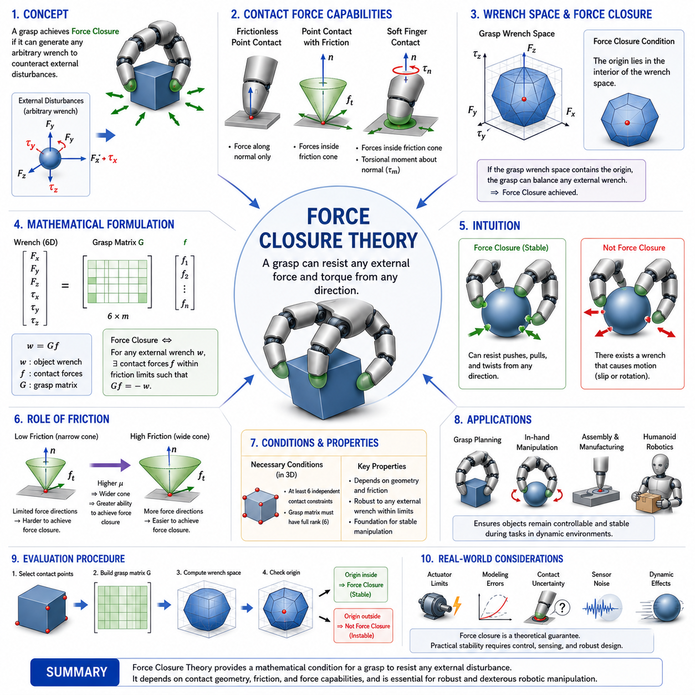{width="7.268055555555556in" height="7.268055555555556in"}

Force Closure Theory is one of the most fundamental concepts in robotic grasping, dexterous manipulation, contact mechanics, and robotic hand design. It provides a rigorous mathematical framework for determining whether a grasp is capable of resisting arbitrary external disturbances through the appropriate application of contact forces. In practical terms, force closure answers one of the most important questions in robotic manipulation: can a robot hold an object securely regardless of the direction from which external forces and torques are applied? If the answer is yes, the grasp is said to achieve force closure. Because grasp stability is a prerequisite for nearly every manipulation task, force closure has become a cornerstone of modern grasp analysis and robotic hand engineering.

The origins of force closure theory lie in the broader study of contact mechanics and constrained motion. When a robotic hand grasps an object, each contact point between the fingers and the object imposes constraints on possible object movements. The effectiveness of the grasp depends not only on the number of contacts but also on their locations, orientations, friction properties, and force-generating capabilities. Force closure theory provides a systematic method for evaluating whether these contacts collectively provide sufficient control authority to counteract any possible disturbance acting on the object.

To understand force closure, it is useful to begin with the concept of external disturbances. Any grasped object may experience forces and torques originating from gravity, inertia, environmental interactions, collisions, vibrations, assembly operations, or intentional manipulation tasks. These disturbances can occur in arbitrary directions and may vary in magnitude over time. A stable grasp must be capable of generating compensating contact forces that neutralize these disturbances and prevent object motion.

The mathematical language used to describe forces and torques acting on an object is known as wrench representation. A wrench combines translational forces and rotational torques into a unified vector representation. In three-dimensional space, an object can move in six independent degrees of freedom: three translational and three rotational. Consequently, the complete description of an external disturbance requires six-dimensional wrench vectors. Force closure is fundamentally concerned with determining whether the contact forces available to a grasp can generate wrench combinations that span the entire six-dimensional disturbance space.

Every contact point contributes a set of achievable contact forces. The nature of these forces depends on the contact model being used. A frictionless point contact can only generate force along the surface normal direction. A point contact with friction can additionally generate tangential forces within the limits imposed by the friction cone. A soft-finger contact can further generate torsional moments around the contact normal. These different contact models influence the wrench-generating capabilities of the grasp and therefore affect the conditions required for force closure.

The concept of the friction cone plays a central role in force closure analysis. At each contact point, friction limits the range of force directions that can be transmitted without slipping. The friction cone represents all admissible contact force vectors that satisfy friction constraints. When multiple fingers contact an object, each finger contributes its own friction cone. The combined set of all achievable contact forces determines the grasp's ability to resist external disturbances.

Force closure exists when the contact forces generated within the allowable friction cones can collectively produce any arbitrary wrench in six-dimensional space. In other words, for every possible external disturbance, there exists a combination of contact forces capable of exactly balancing that disturbance. Under these conditions, the object can theoretically remain stationary regardless of the direction of the applied force or torque.

An intuitive interpretation of force closure can be found in everyday human grasping. Consider holding a coffee mug between several fingers. If the mug can be pushed, pulled, twisted, or tilted in any direction without escaping the grasp, then the grasp achieves force closure. If there exists some disturbance direction that causes the mug to slip or rotate uncontrollably, force closure has not been achieved. The concept therefore captures the idea of complete grasp controllability.

One of the most important characteristics of force closure is that it depends on both geometry and friction. Contact locations alone do not guarantee force closure. Even if contact points are distributed around an object, insufficient friction may prevent the generation of the required balancing forces. Conversely, high friction coefficients can significantly improve grasp robustness and reduce the number of contacts needed to achieve force closure.

In frictionless contact systems, achieving force closure is relatively difficult. Because each contact can only push along its normal direction, many contact configurations lack sufficient force diversity to counteract arbitrary disturbances. Classical grasp theory demonstrates that, in three-dimensional space, frictionless force closure generally requires a larger number of carefully positioned contacts. This limitation motivates the use of frictional contact models in practical robotic systems.

When friction is present, the achievable force space expands considerably. Tangential force components allow each contact to contribute force vectors in multiple directions. As the coefficient of friction increases, the corresponding friction cone widens, increasing the range of achievable contact forces. Wider friction cones generally improve the likelihood of achieving force closure because they provide greater flexibility in balancing external disturbances.

The grasp matrix serves as a fundamental mathematical tool in force closure analysis. The grasp matrix describes how individual contact forces are transformed into object-level wrenches. Each column of the grasp matrix corresponds to a basis force generated at a contact point, while the resulting matrix maps contact forces into six-dimensional wrench space. By analyzing the properties of the grasp matrix, researchers can determine whether a grasp possesses sufficient wrench-generating capability to satisfy force closure conditions.

The rank of the grasp matrix provides important insights into grasp quality. A grasp matrix with insufficient rank cannot generate arbitrary object wrenches, indicating that certain disturbance directions cannot be resisted. Full rank is a necessary condition for force closure, although it is not always sufficient because friction constraints must also be satisfied. Consequently, force closure analysis requires consideration of both geometric coverage and frictional feasibility.

The grasp wrench space is another key concept closely related to force closure. The grasp wrench space represents the set of all wrenches that can be generated by the grasp. Each contact contributes allowable wrench components, and the combination of these contributions forms a multidimensional region in wrench space. Force closure is achieved when the origin lies strictly within the interior of this wrench space. Geometrically, this means that the grasp can generate balancing wrenches in every possible direction.

The geometric interpretation of force closure is particularly valuable because it provides intuitive insight into grasp design. If the achievable wrench space surrounds the origin, disturbances from any direction can be counteracted. If the origin lies outside the achievable wrench space, there exist disturbance directions that cannot be balanced, resulting in grasp instability.

Force closure is often contrasted with form closure. Although the two concepts are related, they describe different mechanisms for preventing object motion. Form closure relies entirely on geometric constraints imposed by contact locations and does not require friction. The object is physically trapped by the arrangement of contacts. Force closure, on the other hand, relies on actively generated contact forces and frictional interactions. Most practical robotic grasps achieve force closure rather than pure form closure because friction provides a more flexible and efficient mechanism for stabilization.

The relationship between force closure and grasp stability is profound. A grasp that satisfies force closure possesses the theoretical ability to resist arbitrary disturbances, but practical stability also depends on actuator limitations, sensor accuracy, control bandwidth, and modeling errors. Consequently, force closure should be viewed as a necessary foundation for robust manipulation rather than a complete guarantee of success.

Soft-finger contacts can significantly enhance force closure performance. Because soft contacts can transmit torsional moments in addition to forces, they contribute additional wrench components that expand the grasp wrench space. This expanded wrench space often allows force closure to be achieved with fewer contact points than would be required under conventional point-contact assumptions.

Multi-finger robotic hands depend heavily on force closure principles. During grasp planning, candidate contact locations are evaluated according to their ability to achieve force closure. Optimization algorithms search for finger placements that maximize grasp robustness while satisfying kinematic and force constraints. Modern grasp planners frequently incorporate force closure metrics as objective functions during contact selection.

Force closure analysis also plays an important role in in-hand manipulation. As an object moves within a robotic hand, contact configurations continuously change. Maintaining force closure throughout the manipulation sequence helps ensure that the object remains controllable and stable. Many dexterous manipulation strategies explicitly monitor force closure conditions during motion planning and execution.

The emergence of tactile sensing technologies has further strengthened the practical relevance of force closure theory. Tactile sensors provide real-time information about contact locations, pressure distributions, and slip conditions. By integrating tactile feedback with force closure analysis, robotic systems can dynamically adjust grasp forces to maintain stability even in the presence of uncertainty and external disturbances.

Simulation environments and digital twins frequently employ force closure analysis as part of grasp evaluation pipelines. Thousands of candidate grasps can be generated and evaluated automatically using force closure criteria before deployment on physical robots. This capability accelerates the development of robust manipulation strategies while reducing experimental costs and risks.

Machine learning approaches to grasping increasingly incorporate force closure concepts. Data-driven grasp planners often use force closure labels as training targets or evaluation metrics. Hybrid methods combine analytical force closure theory with neural network predictions, leveraging both physical principles and learned representations. This integration improves generalization, interpretability, and reliability in robotic grasping systems.

Industrial robotics provides numerous examples of force closure in practice. Warehouse picking robots rely on force closure to securely grasp packages with varying shapes and weights. Assembly robots use force closure to stabilize components during insertion operations. Surgical robots depend on force closure principles when manipulating delicate instruments and biological tissues. Humanoid robots employ force closure to interact with tools, household objects, and complex environments in a human-like manner.

The development of advanced robotic hands continues to increase the importance of force closure theory. As robotic systems become more dexterous, autonomous, and capable of operating in unstructured environments, the ability to reason about grasp stability becomes increasingly critical. Force closure provides a rigorous theoretical framework that supports this capability and serves as a bridge between contact mechanics, control theory, and manipulation planning.

Ultimately, Force Closure Theory represents one of the most powerful tools available for understanding robotic grasp stability. It transforms the intuitive concept of "holding an object securely" into a precise mathematical condition that can be analyzed, optimized, simulated, and implemented in robotic systems. By evaluating whether contact forces can generate arbitrary balancing wrenches, force closure provides a universal criterion for grasp effectiveness across a wide range of robotic applications.

Within the broader context of Contact Mechanics and Grasp Theory, Force Closure Theory serves as the foundation for grasp quality metrics, grasp wrench space analysis, multi-finger coordination, dexterous manipulation planning, tactile grasp stabilization, learning-based grasp evaluation, and autonomous robotic grasp synthesis. A deep understanding of force closure is therefore essential for researchers and engineers seeking to develop highly capable robotic hands, advanced manipulation systems, humanoid robots, and future generations of intelligent Physical AI platforms.

## 06.05 Form Closure Theory

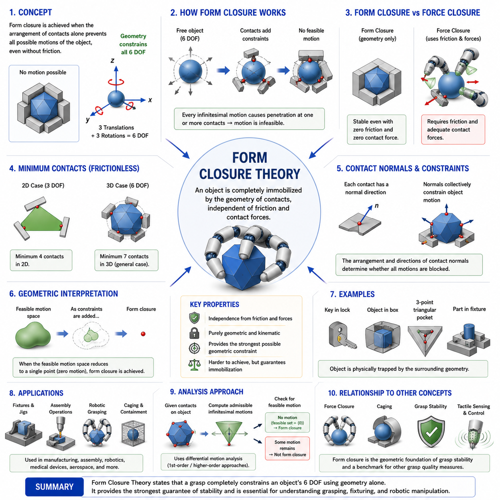{width="7.268055555555556in" height="7.268055555555556in"}

Form Closure Theory is one of the most fundamental concepts in robotic grasping, contact mechanics, dexterous manipulation, and grasp stability analysis. Together with Force Closure Theory, it forms the theoretical foundation upon which modern robotic grasp planning and manipulation systems are built. While force closure relies on the active generation of contact forces and friction to stabilize an object, form closure achieves stability through geometry alone. A grasp is said to possess form closure when the arrangement of contact points completely constrains all possible motions of the object, regardless of the magnitude of contact forces and even in the absence of friction. In essence, form closure represents the strongest possible geometric constraint that can be imposed on an object through contact.

The concept of form closure originates from the study of kinematic constraints in mechanical systems. When an object is surrounded by rigid boundaries or contact points in such a way that no infinitesimal motion is possible, the object is said to be geometrically locked. Unlike force closure, which depends on friction coefficients and force generation capabilities, form closure depends solely on the spatial arrangement of contacts. This distinction makes form closure one of the purest expressions of grasp stability because it derives entirely from geometry rather than from force interactions.

A useful way to understand form closure is to imagine a key inserted into a lock. The key is constrained by the surrounding surfaces of the lock. Even if friction were completely removed, the key would still be unable to move freely because its motion is physically restricted by geometry. Similarly, an object held in form closure cannot translate or rotate because every possible direction of motion is blocked by one or more contact constraints.

In robotic grasping, the fundamental objective of form closure analysis is to determine whether a given set of contacts completely constrains all degrees of freedom of the object. In three-dimensional space, a rigid object possesses six independent degrees of freedom. Three correspond to translational motion along the x, y, and z axes, while three correspond to rotational motion about those axes. To achieve form closure, the contact arrangement must eliminate all six degrees of freedom simultaneously.

The study of form closure begins with the concept of admissible motion. When an object contacts external surfaces, some motions remain possible while others become prohibited. Each contact introduces constraints that restrict movement in certain directions. The collective effect of all contacts determines the set of motions available to the object. Form closure exists when the only admissible motion remaining is zero motion. Under these conditions, the object becomes completely immobilized.

One of the most important characteristics of form closure is its independence from friction. Classical form closure theory assumes frictionless contacts. This assumption may initially seem unrealistic because most practical grasping systems rely on friction. However, the frictionless assumption provides a powerful theoretical framework because it isolates the contribution of geometry from the contribution of force generation. If an object can be immobilized without friction, then geometric constraints alone are sufficient to guarantee stability.

The distinction between form closure and force closure is central to grasp theory. Force closure concerns whether contact forces can be generated to counteract arbitrary external disturbances. Form closure concerns whether the object can move at all. Force closure is a dynamic concept involving force balance, while form closure is fundamentally a kinematic concept involving motion constraints. Because force closure typically requires friction and active force generation, it is generally easier to achieve than form closure. Conversely, form closure represents a stronger condition because it guarantees immobilization through geometry alone.

The mathematical foundation of form closure is based on differential motion analysis. Consider an infinitesimal displacement of an object. If the displacement causes penetration at one or more contact points, the motion is considered infeasible. By examining all possible infinitesimal motions, researchers can determine whether any feasible motion directions remain available. If every possible motion leads to penetration, then form closure has been achieved.

Contact normals play a critical role in form closure analysis. At each contact point, the surface normal defines the direction along which penetration is prohibited. These contact normals collectively describe the geometric constraints imposed on the object. The arrangement and orientation of the normals determine whether sufficient constraints exist to eliminate all object motions. Consequently, form closure analysis often focuses on the distribution of contact normals rather than on contact forces.

An intuitive example can be found in fixturing systems used in manufacturing. When a workpiece is placed inside a precisely designed fixture, the fixture geometry prevents motion in every direction. The workpiece remains fixed regardless of external disturbances because the fixture physically blocks all movement. Such systems are classic examples of form closure in industrial engineering.

The minimum number of contacts required for form closure depends on the dimensionality of the problem. In two-dimensional grasping scenarios, a rigid object possesses three degrees of freedom, consisting of two translational and one rotational degree. Under frictionless conditions, four appropriately placed contact points are generally required to achieve form closure. In three-dimensional space, where six degrees of freedom exist, the minimum number of frictionless contacts increases significantly. Classical grasp theory demonstrates that at least seven appropriately arranged frictionless contacts are typically required to achieve form closure for a general three-dimensional rigid object.

This requirement illustrates one reason why form closure is difficult to achieve in practice. Obtaining seven precisely positioned contact points can be challenging for robotic hands, particularly when grasping irregular objects in unstructured environments. Consequently, most practical robotic grasping systems rely on force closure rather than pure form closure.

Despite its practical limitations, form closure remains extremely valuable because it establishes theoretical limits on grasp stability. By understanding the conditions required for geometric immobilization, researchers gain deeper insight into the nature of contact constraints and object controllability. Form closure serves as a benchmark against which other grasping strategies can be evaluated.

The geometric interpretation of form closure is often described using convex analysis. Each contact generates a constraint on object motion, and the combination of these constraints defines a feasible motion space. Form closure occurs when the feasible motion space collapses to a single point corresponding to zero motion. In geometric terms, the contact constraints completely surround the object's motion space, leaving no available direction for movement.

The concept of first-order form closure provides a practical approximation used in robotic grasp analysis. Rather than considering finite object motions, first-order form closure examines only infinitesimal motions. This simplification allows researchers to analyze grasp stability using linear mathematical techniques. Most theoretical studies of form closure rely on first-order analysis because it provides a tractable framework for evaluating contact configurations.

Higher-order form closure extends the analysis beyond infinitesimal displacements. Some contact arrangements may permit no infinitesimal motion but still allow finite motions through nonlinear pathways. Higher-order analyses investigate these more complex situations and provide a deeper understanding of geometric constraint behavior. Although computationally more demanding, higher-order form closure analysis can reveal subtle stability properties that first-order methods may overlook.

Form closure is closely related to the concept of caging in robotic manipulation. A caged object is trapped within a geometric enclosure but may still possess limited motion inside the enclosure. Form closure represents the limiting case in which all motion has been eliminated. Consequently, form closure can be viewed as the strongest form of geometric caging.

Robotic assembly operations frequently exploit principles related to form closure. During insertion tasks, alignment fixtures and guiding surfaces are designed to constrain component motion progressively. As parts approach their final positions, geometric constraints increasingly restrict movement until complete assembly is achieved. Understanding form closure helps engineers design fixtures, jigs, and assembly mechanisms that achieve reliable positioning without requiring excessive force control.

Humanoid robotics also benefits from form closure principles. Human hands often combine force closure and partial form closure during manipulation. For example, when holding a pen between fingers, geometric constraints imposed by finger placement contribute to stability alongside frictional forces. Robotic hands can similarly exploit geometric features of objects to improve grasp robustness.

Soft robotic systems introduce interesting extensions to classical form closure theory. Because soft fingers deform during contact, the effective contact geometry changes dynamically. Compliance can create additional contact regions that enhance constraint generation. Although classical form closure assumes rigid bodies, modern research increasingly investigates how deformable contacts influence geometric stability.

The relationship between form closure and grasp planning is particularly important. Automated grasp planners often evaluate candidate grasps according to their ability to achieve force closure, form closure, or both. Form closure provides a highly conservative measure of grasp security. If form closure is achieved, stability is guaranteed independently of friction assumptions. As a result, form closure criteria are frequently used in safety-critical applications where maximum reliability is required.

Simulation environments and digital twins employ form closure analysis to evaluate grasp configurations before deployment. By identifying contact arrangements that satisfy form closure conditions, engineers can design more robust robotic systems and reduce the likelihood of manipulation failure. Simulation-based form closure analysis is particularly valuable when working with complex object geometries that are difficult to analyze analytically.

Recent advances in machine learning and data-driven manipulation have not diminished the importance of form closure theory. Instead, form closure increasingly serves as a source of physical priors and supervision signals for learning algorithms. Neural networks trained to predict grasp quality often incorporate form closure metrics as labels or evaluation criteria. Combining geometric grasp theory with learning-based approaches improves both interpretability and generalization.

In industrial automation, form closure principles appear in robotic fixtures, precision assembly systems, machine tools, and automated handling equipment. In warehouse logistics, geometric constraints are often used to stabilize packages during transport. In medical robotics, form closure concepts influence the design of surgical instrument holders and positioning devices. In aerospace manufacturing, complex fixturing systems rely heavily on form closure principles to ensure accurate component alignment.

The future of robotic manipulation is likely to involve increasingly sophisticated combinations of form closure, force closure, tactile sensing, and intelligent control. Rather than relying on a single stability mechanism, advanced robotic systems will integrate multiple complementary approaches. Form closure will continue to provide the geometric foundation upon which these systems are built.

Ultimately, Form Closure Theory represents the purest expression of geometric grasp stability. It demonstrates how the arrangement of contact points alone can completely immobilize an object without requiring friction or active force control. By focusing on motion constraints rather than force generation, form closure provides a powerful framework for understanding object immobilization, fixture design, assembly planning, and grasp stability.

Within the broader context of Contact Mechanics and Grasp Theory, Form Closure Theory serves as a critical foundation for force closure analysis, grasp quality evaluation, grasp planning, fixture design, caging theory, assembly robotics, dexterous manipulation, and autonomous robotic grasp synthesis. A deep understanding of form closure enables engineers and researchers to design robotic systems that achieve reliable object immobilization, robust manipulation, and high-precision interaction with the physical world, making it an essential topic in the development of next-generation robotic hands and intelligent Physical AI systems.

## 06.06 Grasp Wrench Space

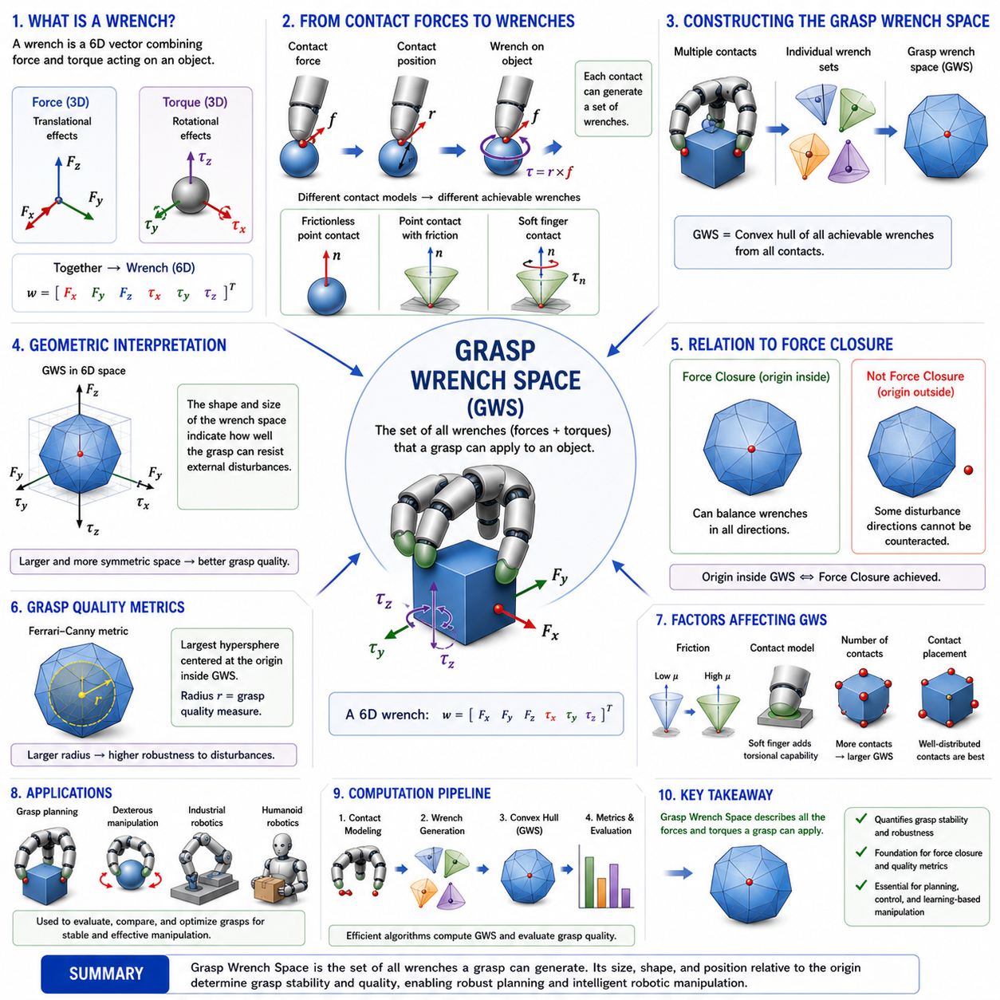{width="7.268055555555556in" height="7.268055555555556in"}

Grasp Wrench Space (GWS) is one of the most important concepts in robotic grasping, contact mechanics, dexterous manipulation, and robotic hand design. It provides a mathematical framework for describing and evaluating the complete set of forces and torques that a grasp can apply to an object. While concepts such as Point Contact, Soft Finger Contact, Force Closure, and Form Closure determine whether a grasp is theoretically stable, Grasp Wrench Space goes a step further by quantifying how stable the grasp is and how effectively it can resist external disturbances. As a result, Grasp Wrench Space serves as the foundation for grasp quality evaluation, grasp optimization, contact planning, and autonomous manipulation.

The concept of Grasp Wrench Space originates from the observation that every contact point between a robotic finger and an object can generate a limited set of forces. These forces depend on the contact model, friction conditions, finger geometry, actuator capabilities, and object surface characteristics. When these forces act at positions that are offset from the object's center of mass, they generate torques in addition to translational forces. The combination of forces and torques is referred to as a wrench. Therefore, every contact contributes a collection of possible wrenches, and the overall grasp produces a combined set of achievable wrenches. This combined set is known as the Grasp Wrench Space.

To understand Grasp Wrench Space, it is necessary to first understand the concept of a wrench. In rigid-body mechanics, a wrench is a six-dimensional vector that combines force and torque into a single mathematical representation. Three components represent translational forces acting along the x, y, and z directions, while the remaining three components represent torques around the x, y, and z axes. Since every object in three-dimensional space possesses six degrees of freedom, a wrench provides a complete description of how external interactions influence object motion.

Whenever a robotic finger applies force to an object, the contact force generates a corresponding wrench. If the force acts through the center of mass, only translational effects are produced. However, when the force acts away from the center of mass, a torque is generated according to the cross-product relationship between force and position. Consequently, even a simple contact force can produce a complex six-dimensional effect on object motion.

Each contact model defines a different set of allowable contact forces. A frictionless point contact can only generate force along the surface normal direction. A point contact with friction can additionally generate tangential forces within the limits of the friction cone. A soft-finger contact can further generate torsional moments around the contact normal. These different capabilities result in different wrench generation abilities and therefore different Grasp Wrench Spaces.

The construction of Grasp Wrench Space begins at the contact level. For each contact point, the set of allowable contact forces is determined. These forces are then transformed into object-level wrenches using the contact location and object geometry. The resulting set of wrenches represents all possible contributions that the contact can make to object control. When multiple contacts are present, their individual wrench sets are combined to form the overall Grasp Wrench Space.

Mathematically, Grasp Wrench Space is often represented as the convex hull of all achievable contact wrenches. A convex hull can be visualized as the smallest geometric region that contains all possible wrench vectors generated by the grasp. This geometric interpretation is extremely useful because many grasp quality metrics can be derived directly from the shape and size of the resulting wrench space.

The relationship between Grasp Wrench Space and Force Closure Theory is particularly important. A grasp achieves force closure when the origin of the wrench space lies strictly inside the convex hull of achievable wrenches. This means that the grasp can generate balancing wrenches in every possible direction. If the origin lies outside the wrench space, certain disturbance directions cannot be counteracted, indicating that force closure has not been achieved.

This geometric interpretation provides a powerful way to visualize grasp stability. Imagine the wrench space as a multidimensional volume surrounding the origin. The larger and more symmetric this volume becomes, the greater the ability of the grasp to resist disturbances from different directions. Small or highly elongated wrench spaces indicate that the grasp may be strong in some directions but weak in others.

The size of the Grasp Wrench Space is often used as a measure of grasp quality. A larger wrench space generally indicates that the grasp can resist larger disturbances before failure occurs. Consequently, many grasp quality metrics are based on measuring the distance between the origin and the nearest boundary of the wrench space. This distance represents the maximum disturbance that can be resisted uniformly in all directions.

One of the most widely used grasp quality measures is the Ferrari-Canny metric. This metric evaluates the radius of the largest hypersphere centered at the origin that can fit entirely within the Grasp Wrench Space. A larger radius corresponds to a higher-quality grasp because it indicates greater robustness against arbitrary disturbances. The Ferrari-Canny metric remains one of the most influential grasp evaluation methods in robotic manipulation research.

The shape of the Grasp Wrench Space provides valuable insights into grasp performance. A spherical wrench space indicates nearly uniform disturbance resistance in all directions. Such grasps are considered highly robust because they do not exhibit significant directional weaknesses. In contrast, elongated or skewed wrench spaces reveal directional bias, suggesting that the grasp may be vulnerable to disturbances along certain axes.

Friction plays a critical role in determining the structure of the Grasp Wrench Space. As the coefficient of friction increases, the corresponding friction cones widen, allowing contacts to generate a broader range of force directions. This expansion directly enlarges the achievable wrench space and improves grasp quality. Conversely, low-friction conditions produce smaller wrench spaces and reduce grasp robustness.

Soft-finger contacts further enhance Grasp Wrench Space by introducing torsional moment generation capabilities. The additional rotational constraints expand the achievable wrench set and improve the grasp's ability to resist twisting disturbances. Consequently, soft-finger grasps often exhibit significantly larger wrench spaces than equivalent point-contact grasps.

The number and placement of contact points strongly influence Grasp Wrench Space. Adding contact points generally increases the size of the wrench space because more force generation opportunities become available. However, contact placement is often more important than contact quantity. Poorly positioned contacts may contribute redundant wrenches, resulting in only marginal improvements. Strategically distributed contacts maximize wrench diversity and produce larger, more balanced wrench spaces.

Human grasping provides an excellent example of effective wrench-space optimization. Human fingers naturally position themselves to maximize force transmission and disturbance rejection. Through experience and sensory feedback, humans instinctively select contact configurations that generate large and well-balanced wrench spaces. Many robotic grasp planning algorithms attempt to replicate this capability through computational optimization.

The grasp matrix plays a central role in Grasp Wrench Space analysis. The grasp matrix maps contact forces into object-level wrenches. By combining the force-generating capabilities of all contacts, the grasp matrix defines the set of achievable wrenches. Many grasp analysis methods operate by examining the properties of this matrix and the resulting wrench space.

Computing Grasp Wrench Space can become challenging for complex robotic hands. As the number of contacts increases, the dimensionality of the problem grows rapidly. Efficient computational methods are therefore required to construct convex hulls, evaluate force closure, calculate quality metrics, and optimize grasp configurations. Advances in computational geometry and optimization have significantly improved the practicality of wrench-space analysis in modern robotic systems.

Grasp Wrench Space is particularly valuable in robotic grasp planning. Automated grasp planners generate large numbers of candidate grasps and evaluate them according to their wrench-space properties. Grasps that produce larger and more balanced wrench spaces are typically preferred because they offer greater robustness and manipulation capability. This process enables robots to select stable grasps autonomously without requiring extensive manual programming.

In dexterous manipulation tasks, Grasp Wrench Space provides insight into how effectively an object can be controlled after it has been grasped. A large wrench space not only improves stability but also increases manipulation authority. This allows the robot to reposition, rotate, tilt, or reorient objects while maintaining secure contact. Consequently, wrench-space analysis is important not only for grasp acquisition but also for subsequent manipulation planning.

Tactile sensing systems further enhance the practical usefulness of Grasp Wrench Space. Real-world contacts often differ from idealized models due to uncertainties in object geometry, material properties, and environmental conditions. Tactile sensors provide real-time information about contact forces, pressure distributions, and slip conditions. By incorporating tactile feedback, robotic systems can continuously estimate and update their effective wrench spaces during manipulation.

Simulation environments and digital twins frequently employ Grasp Wrench Space analysis as part of grasp evaluation pipelines. Thousands of candidate grasps can be assessed rapidly by computing wrench-space metrics. This capability enables efficient exploration of grasp strategies before deployment on physical hardware, reducing experimental costs and development time.

Machine learning and artificial intelligence have introduced new applications for Grasp Wrench Space. Learning-based grasp planners often use wrench-space metrics as training labels or reward functions. Reinforcement learning systems can optimize contact strategies by maximizing grasp quality measures derived from wrench-space analysis. Hybrid approaches combine analytical grasp mechanics with neural-network-based perception and decision-making systems.

In industrial robotics, Grasp Wrench Space analysis supports reliable handling of heavy components, fragile products, irregular objects, and precision assemblies. Warehouse robots use wrench-space-based evaluation to select secure grasps for packages of varying shapes and weights. Manufacturing robots rely on wrench-space optimization to ensure stability during assembly operations. Service robots and humanoid robots benefit from wrench-space analysis when interacting with diverse household and workplace environments.

The emergence of humanoid robotics and Physical AI systems has increased the importance of Grasp Wrench Space even further. Future robotic systems must manipulate a wide variety of objects under uncertain conditions while maintaining human-level dexterity and reliability. Achieving this capability requires sophisticated understanding of contact mechanics and wrench generation. Grasp Wrench Space provides the mathematical foundation for such understanding.

Modern research increasingly extends traditional wrench-space concepts to include deformable objects, soft robotic hands, dynamic contacts, and multi-arm manipulation systems. These developments reflect the growing complexity of robotic applications and the need for more comprehensive representations of grasp capability. Nevertheless, the fundamental principles remain rooted in the geometric interpretation of achievable contact wrenches.

Ultimately, Grasp Wrench Space transforms the abstract concept of grasp strength into a precise mathematical object that can be visualized, measured, compared, and optimized. It provides a unified framework for analyzing how contact forces combine to control object motion and resist disturbances. By describing the full range of achievable forces and torques, Grasp Wrench Space serves as a bridge between contact mechanics, grasp stability, manipulation planning, and robotic intelligence.

Within the broader context of Contact Mechanics and Grasp Theory, Grasp Wrench Space serves as the foundation for grasp quality metrics, force closure analysis, grasp optimization, dexterous manipulation planning, tactile grasp stabilization, robotic hand design, and learning-based grasp synthesis. A deep understanding of Grasp Wrench Space is therefore essential for engineers and researchers developing next-generation robotic hands, humanoid manipulators, intelligent grippers, and advanced Physical AI systems capable of robust interaction with the physical world.

## 06.07 Grasp Quality Metrics

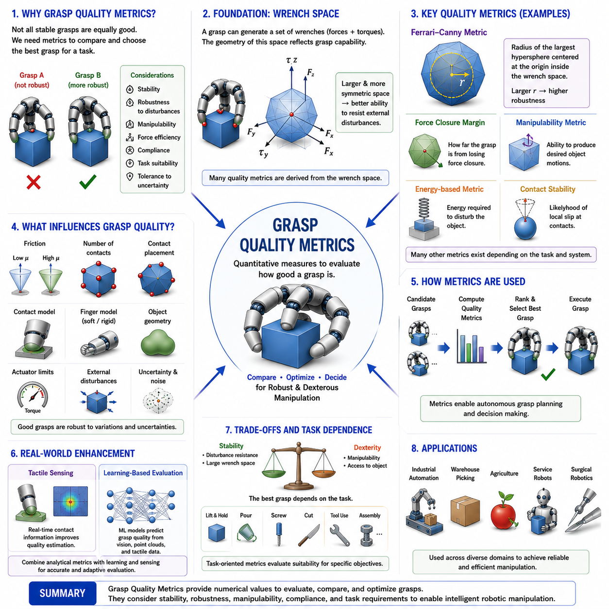{width="7.268055555555556in" height="7.268055555555556in"}

Grasp Quality Metrics are quantitative measures used to evaluate how effectively a robotic grasp can secure, stabilize, manipulate, and control an object. Within the field of robotic grasping, contact mechanics, dexterous manipulation, and robotic hand design, grasp quality metrics serve as the bridge between theoretical grasp stability and practical grasp performance. While concepts such as Force Closure, Form Closure, Contact Models, and Grasp Wrench Space determine whether a grasp is theoretically feasible, grasp quality metrics determine how good that grasp actually is. They provide numerical values that allow robotic systems to compare alternative grasp configurations, optimize contact locations, improve manipulation robustness, and make autonomous decisions during grasp planning. As a result, grasp quality metrics have become one of the most important tools in modern robotic manipulation research and industrial grasping applications. This topic occupies a central position within the Contact Mechanics and Grasp Theory section of the Robot Hand and Dexterous Grasping volume.

The need for grasp quality metrics arises from the observation that not all stable grasps are equally effective. Two different grasps may both satisfy force closure conditions, yet one may be significantly more robust against disturbances, require less actuator effort, provide better manipulation capability, or exhibit greater tolerance to uncertainty. Simply determining whether a grasp is stable is often insufficient for practical robotic systems. Engineers and researchers require methods to rank candidate grasps according to performance criteria. Grasp quality metrics provide this capability by transforming abstract concepts of stability and robustness into measurable quantities.

The development of grasp quality evaluation began with classical robotic grasp theory. Early researchers recognized that stable grasping depends on the ability of contact forces to resist external disturbances. This observation led to the development of mathematical frameworks based on contact mechanics, friction cones, grasp matrices, and wrench spaces. Over time, these frameworks evolved into increasingly sophisticated quality metrics capable of evaluating not only stability but also dexterity, robustness, manipulability, and task suitability.

One of the most fundamental principles underlying grasp quality evaluation is disturbance resistance. A high-quality grasp should be capable of resisting forces and torques applied from arbitrary directions. In real-world environments, objects are subjected to gravity, inertia, vibration, collisions, environmental contacts, and manipulation forces. The ability to maintain stability despite these disturbances is a primary indicator of grasp effectiveness. Consequently, many grasp quality metrics are directly related to the size and structure of the Grasp Wrench Space.

The Grasp Wrench Space provides the mathematical foundation for numerous grasp quality measures. As discussed in previous chapters, the Grasp Wrench Space represents the complete set of wrenches that a grasp can generate. The geometry of this space reveals the grasp\'s ability to resist external disturbances. Larger wrench spaces generally indicate stronger grasps because they allow larger balancing forces and torques to be generated. More symmetric wrench spaces indicate more uniform disturbance resistance across different directions.

Among all grasp quality metrics, the Ferrari-Canny metric is perhaps the most influential and widely used. Developed as a robust measure of grasp quality, the Ferrari-Canny metric evaluates the radius of the largest hypersphere centered at the origin that can fit entirely within the Grasp Wrench Space. This radius represents the magnitude of the largest disturbance that can be resisted equally in every direction. A larger radius corresponds to a higher-quality grasp because it indicates greater robustness against uncertainty and external perturbations.

The geometric interpretation of the Ferrari-Canny metric is particularly intuitive. Imagine placing a sphere at the center of the wrench space. If the wrench space is large and well balanced, a large sphere can fit inside it. If the wrench space is narrow or unevenly shaped, only a smaller sphere can be accommodated. The radius of this sphere therefore serves as a direct measure of grasp robustness.

Another important class of grasp quality metrics focuses on force closure margins. While force closure determines whether a grasp can theoretically resist arbitrary disturbances, force closure margins quantify how far the grasp is from losing force closure. Grasps with larger margins are generally preferred because they provide greater tolerance to modeling errors, sensor noise, and environmental uncertainties. These metrics are especially useful in practical robotic systems where perfect knowledge of object properties is rarely available.

Manipulability-based metrics evaluate the ability of a grasp to perform controlled object motions after grasp acquisition. A grasp may be extremely stable but provide poor manipulation capability. Conversely, a grasp that offers excellent manipulation flexibility may sacrifice some stability. Manipulability metrics attempt to capture this tradeoff by measuring how effectively contact forces can be transformed into desired object motions. Such metrics are particularly important for dexterous robotic hands and in-hand manipulation tasks.

Energy-based grasp quality measures evaluate the amount of mechanical work required to disturb or destabilize an object. These metrics often model the grasp as an elastic system and calculate the potential energy associated with object displacement. Grasps that require larger amounts of energy to disrupt are considered more stable. Energy-based approaches are especially relevant when compliant contacts and soft robotic fingers are involved.

Compliance-based metrics have become increasingly important with the rise of soft robotics and compliant grasping systems. Traditional rigid-body grasp metrics often fail to capture the benefits of compliant contact. Soft fingertips distribute contact forces across larger areas, absorb impacts, and adapt to object geometry. Compliance-based quality measures explicitly account for these characteristics, providing more realistic evaluations of grasp performance in deformable systems.

Contact stability is another major consideration in grasp quality evaluation. A grasp may satisfy force closure conditions but still be susceptible to local slip at individual contact points. Contact stability metrics analyze friction utilization, slip margins, and contact force distributions to estimate the likelihood of contact failure. These measures are particularly important when handling fragile objects, slippery surfaces, or objects with uncertain material properties.

Force distribution metrics focus on how contact forces are allocated among multiple fingers. Ideally, forces should be distributed efficiently and uniformly. Excessive loading on a single finger may lead to actuator saturation, increased wear, or local contact failure. Balanced force distributions generally improve robustness and prolong the operational lifetime of robotic hardware. Consequently, many grasp planners incorporate force distribution criteria during optimization.

Sensitivity analysis plays an important role in grasp quality assessment. Real-world robotic systems inevitably experience uncertainty in object geometry, contact locations, friction coefficients, and sensor measurements. Sensitivity-based metrics evaluate how strongly grasp performance changes in response to such uncertainties. A grasp that remains effective despite variations in contact conditions is generally considered superior to one that performs well only under ideal assumptions.

Task-oriented grasp quality metrics represent an important extension beyond purely geometric or mechanical evaluation. In many applications, the best grasp is not necessarily the most stable one. For example, a grasp intended for pouring, cutting, writing, or assembly may require specific object orientations or manipulation capabilities. Task-oriented metrics evaluate grasps according to their suitability for accomplishing particular objectives. These metrics are widely used in service robotics, industrial automation, surgical robotics, and tool-use applications.

Human grasping provides valuable inspiration for grasp quality evaluation. Human hands rarely select grasps based solely on stability. Instead, humans instinctively choose grasps that balance stability, comfort, dexterity, efficiency, and task requirements. Modern robotic systems increasingly attempt to replicate this behavior by combining multiple grasp quality metrics into unified evaluation frameworks.

The role of tactile sensing in grasp quality assessment continues to expand. Traditional metrics often rely on geometric models and estimated contact conditions. Tactile sensors provide direct measurements of pressure distributions, shear forces, contact areas, and slip indicators. These measurements enable real-time estimation of grasp quality during manipulation. Rather than relying solely on precomputed evaluations, robots can continuously update grasp quality estimates as conditions change.

Machine learning has introduced new approaches to grasp quality evaluation. Learning-based systems can infer grasp quality directly from visual observations, point clouds, tactile measurements, or multimodal sensory data. Rather than explicitly computing wrench spaces and force closure margins, neural networks learn quality predictors from large datasets of successful and unsuccessful grasps. These methods have demonstrated remarkable performance in complex environments where analytical models may be difficult to apply.

Despite the success of data-driven methods, analytical grasp quality metrics remain extremely valuable. They provide physical interpretability, mathematical rigor, and theoretical guarantees that purely learned approaches often lack. As a result, modern robotic systems increasingly employ hybrid approaches that combine analytical grasp quality measures with machine learning techniques. Such combinations leverage the strengths of both physical modeling and data-driven adaptation.

Simulation environments rely heavily on grasp quality metrics. Large numbers of candidate grasps can be generated automatically and ranked according to quality scores before deployment on physical robots. This capability significantly accelerates grasp planning and reduces experimental costs. Digital twins and virtual testing environments frequently use grasp quality metrics as core evaluation criteria during system development.

Industrial robotics represents one of the largest application domains for grasp quality metrics. Warehouse automation systems use grasp quality evaluation to select reliable pick points on packages and consumer products. Manufacturing robots employ quality metrics during assembly operations where stability and precision are critical. Agricultural robots evaluate grasp quality when handling delicate fruits and vegetables. Medical robots rely on grasp quality assessment when interacting with surgical tools and biological tissues.

Humanoid robotics further increases the importance of grasp quality metrics. Human-like manipulation requires not only stable grasps but also dexterous object control, tool use, and adaptive interaction with complex environments. Evaluating these capabilities requires comprehensive grasp quality frameworks capable of considering stability, dexterity, compliance, tactile feedback, and task requirements simultaneously.

The emergence of Foundation Models, Vision-Language-Action systems, and Physical AI has created new opportunities for grasp quality evaluation. Future robotic systems may use high-level semantic understanding to guide grasp selection while simultaneously relying on low-level grasp quality metrics to ensure physical feasibility. This integration of symbolic reasoning and physical interaction represents a promising direction for next-generation robotic manipulation.

Recent research increasingly focuses on dynamic grasp quality metrics. Traditional evaluations often assume static conditions. However, many real-world tasks involve moving objects, changing contacts, dynamic environments, and continuous manipulation. Dynamic quality measures attempt to capture these time-varying aspects of grasp performance, providing more realistic assessments of robotic capabilities.

Benchmarking has become another important application of grasp quality metrics. Standardized evaluation procedures allow researchers to compare robotic hands, grippers, control algorithms, and grasp planning systems objectively. Metrics derived from grasp quality theory are widely used in benchmarking datasets, competitions, and industrial performance evaluations.

Ultimately, Grasp Quality Metrics transform the qualitative notion of a "good grasp" into a rigorous quantitative framework. They provide the tools necessary to measure, compare, optimize, and improve robotic grasping performance. By evaluating stability, robustness, manipulability, compliance, disturbance resistance, and task suitability, grasp quality metrics enable robotic systems to make intelligent decisions about how objects should be grasped and manipulated.

Within the broader context of Contact Mechanics and Grasp Theory, Grasp Quality Metrics serve as the critical link between theoretical stability analysis and practical robotic performance. They connect Force Closure Theory, Form Closure Theory, Grasp Wrench Space, Contact Stability Analysis, Multi-Finger Coordination, Tactile Sensing, Learning-Based Grasping, and Dexterous Manipulation into a unified evaluation framework. A deep understanding of grasp quality metrics is therefore essential for engineers and researchers developing advanced robotic hands, intelligent grippers, humanoid manipulators, industrial automation systems, and future Physical AI platforms capable of reliable interaction with the physical world.

## 06.08 Grasp Stability Analysis

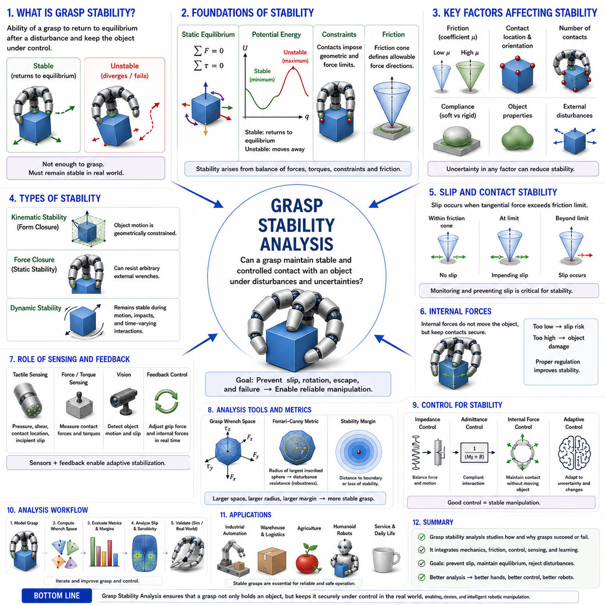{width="7.268055555555556in" height="7.268055555555556in"}

Grasp Stability Analysis is the discipline of evaluating whether a robotic grasp can maintain secure and controlled contact with an object under the influence of internal forces, external disturbances, dynamic interactions, environmental uncertainties, and task-related motions. Within the broader field of robotic grasping and contact mechanics, grasp stability analysis serves as the bridge between theoretical grasp models and practical manipulation performance. While concepts such as Contact Models, Force Closure, Form Closure, Grasp Wrench Space, and Grasp Quality Metrics provide mathematical foundations for grasp evaluation, grasp stability analysis investigates whether a grasp remains stable under realistic operating conditions. It is therefore one of the most important subjects in robotic manipulation because every successful manipulation task depends fundamentally on maintaining stable contact between the robot and the object.

The concept of grasp stability originates from the observation that achieving contact with an object is not sufficient to guarantee successful manipulation. A robotic hand may establish multiple contact points and even satisfy theoretical force closure conditions, yet the object may still slip, rotate unexpectedly, deform, oscillate, or escape from the grasp. Stability analysis seeks to understand why such failures occur and how they can be prevented. In essence, grasp stability analysis attempts to answer a simple but critical question: once an object has been grasped, will it remain under control despite disturbances and uncertainties?

In classical mechanics, stability refers to the tendency of a system to return to an equilibrium state after experiencing a disturbance. This concept carries directly into robotic grasping. If a grasp experiences a small perturbation and naturally returns to its original configuration, the grasp is considered stable. If the disturbance causes increasing motion, contact loss, or grasp failure, the grasp is considered unstable. This distinction forms the basis of nearly all grasp stability analyses.

The study of grasp stability involves both kinematic and dynamic considerations. Kinematic stability focuses on geometric constraints and admissible object motions. Dynamic stability considers forces, torques, inertia, contact compliance, and time-dependent behavior. While form closure primarily addresses kinematic stability and force closure addresses force-generating capability, grasp stability analysis integrates these concepts into a unified framework that accounts for real-world physical behavior.

One of the most important foundations of grasp stability analysis is equilibrium theory. For an object to remain stationary, the sum of all forces and torques acting on the object must equal zero. This condition is known as static equilibrium. Contact forces generated by robotic fingers must balance gravity, external disturbances, and any other loads acting on the object. If equilibrium conditions are violated, the object will accelerate and the grasp may become unstable.

Static equilibrium alone is not sufficient to guarantee stability. An object may satisfy equilibrium conditions while remaining highly sensitive to disturbances. A pencil balanced vertically on its tip represents a classic example. Although the pencil can theoretically satisfy equilibrium, any small disturbance causes it to fall. Similarly, robotic grasps require additional stability conditions beyond simple force balance.

Potential energy concepts provide a useful framework for understanding grasp stability. In many systems, stable equilibrium corresponds to a local minimum in potential energy. When the object is slightly displaced, restoring forces emerge that push it back toward equilibrium. Conversely, unstable equilibrium corresponds to a local maximum or saddle point in the energy landscape. Small disturbances then cause the object to move away from its original position. Energy-based stability analysis has become a powerful tool for evaluating robotic grasps, particularly when compliance and elastic deformation are involved.

Contact mechanics plays a central role in grasp stability analysis. Every contact point between a robotic finger and an object introduces constraints and force transmission capabilities. The stability of the grasp depends heavily on the properties of these contacts. Contact location, contact orientation, friction coefficient, material compliance, surface geometry, and pressure distribution all influence stability. Consequently, accurate contact modeling is essential for reliable grasp analysis.

Friction is one of the most influential factors affecting grasp stability. Friction enables tangential force transmission and prevents unwanted sliding motion. Without sufficient friction, even geometrically favorable grasps may fail. The friction cone provides a mathematical representation of the range of forces that can be transmitted without slip. Stability analysis often involves verifying that contact forces remain within their respective friction cones under expected operating conditions.

Slip analysis represents a major component of grasp stability evaluation. A grasp becomes unstable when one or more contacts exceed frictional limits and begin sliding. Once slip initiates, contact conditions change dramatically, often leading to cascading failures across multiple contacts. Predicting and preventing slip is therefore a central objective of grasp stability analysis. Many robotic systems actively monitor slip indicators using tactile sensors and adjust grasp forces in real time to maintain stability.

The distinction between local stability and global stability is important. Local stability concerns the response of the grasp to small perturbations near an equilibrium configuration. Global stability considers behavior under larger disturbances and broader operating conditions. A grasp may be locally stable but globally vulnerable if sufficiently large disturbances push the system beyond its stability region. Understanding both forms of stability is essential for robust robotic manipulation.

Compliance introduces additional complexity into grasp stability analysis. Real robotic fingertips, human fingers, and soft robotic grippers exhibit elastic deformation during contact. Compliance can improve stability by distributing contact forces, absorbing shocks, and increasing contact area. However, excessive compliance may also introduce oscillations, delayed responses, and control challenges. Modern stability analyses increasingly account for compliance effects to better represent real-world robotic systems.

Soft-finger contact models provide important tools for analyzing compliant grasp stability. Unlike rigid point contacts, soft contacts generate distributed pressure fields and resist torsional disturbances. These additional capabilities often improve stability margins and enhance disturbance rejection. Consequently, soft-finger contacts have become increasingly common in robotic hand design and manipulation research.

Dynamic grasp stability extends beyond static force balance and considers time-varying interactions. Many robotic tasks involve moving objects, changing contact conditions, impacts, and acceleration. Dynamic stability analysis examines how the grasp behaves during such motions. Inertia, momentum transfer, vibration, and transient force responses become important factors. Dynamic stability is particularly relevant for high-speed manipulation, industrial automation, and humanoid robotics.

The concept of internal forces plays a critical role in multi-finger grasp stability. Internal forces are contact forces that balance each other without affecting the object\'s overall motion. Although they do not contribute directly to external equilibrium, they help maintain stable contact and prevent slip. Effective regulation of internal forces is essential for dexterous robotic hands because insufficient internal force may allow contact loss while excessive force may damage the object.

Force Closure Theory provides an important prerequisite for many stability analyses. A grasp that lacks force closure cannot resist arbitrary disturbances and therefore possesses inherent stability limitations. However, force closure alone does not guarantee stability. Actual stability depends on the magnitude of available contact forces, friction constraints, actuator limits, and environmental conditions. Stability analysis therefore extends beyond force closure by considering practical implementation factors.

Grasp Wrench Space also contributes significantly to stability evaluation. The size and shape of the wrench space provide insight into the grasp\'s ability to resist disturbances. Larger wrench spaces generally correspond to greater stability because they allow stronger balancing forces and torques to be generated. Many stability metrics are derived directly from geometric properties of the wrench space.

The Ferrari-Canny grasp quality metric is frequently used as a stability indicator. By measuring the radius of the largest hypersphere contained within the Grasp Wrench Space, the metric provides a quantitative estimate of disturbance resistance. Although originally developed as a grasp quality measure, it is often interpreted as a practical stability metric because of its close relationship to robustness.

Tactile sensing has revolutionized grasp stability analysis. Traditional approaches rely heavily on geometric models and force estimations. Modern tactile sensors provide direct measurements of pressure distributions, shear forces, contact locations, and incipient slip conditions. These measurements allow robots to estimate stability in real time and react proactively to changing conditions. Tactile feedback has become a key component of adaptive grasp stabilization systems.

Human grasping offers valuable insights into stability mechanisms. Humans continuously adjust grip forces based on tactile feedback, visual information, and predictive models of object behavior. When an object begins to slip, reflexive increases in grip force occur within fractions of a second. Robotic systems increasingly attempt to replicate these biological stabilization strategies through sensor integration and adaptive control algorithms.

Control theory plays a fundamental role in grasp stability. Stable manipulation requires not only stable contact mechanics but also stable control systems. Feedback controllers regulate contact forces, maintain desired object positions, compensate for disturbances, and adapt to uncertainties. Poorly designed controllers can destabilize otherwise stable grasps, while advanced control strategies can significantly enhance robustness.

Impedance control and admittance control are widely used approaches for improving grasp stability. These methods regulate the dynamic relationship between force and motion, enabling compliant interaction with uncertain environments. Such control strategies are particularly effective in contact-rich manipulation tasks where rigid position control may lead to instability.

Machine learning has introduced new directions for grasp stability analysis. Data-driven models can learn stability predictors directly from large datasets of successful and unsuccessful grasps. Deep learning systems can estimate stability from visual observations, tactile measurements, point clouds, and multimodal sensory inputs. These approaches complement traditional analytical methods and often provide superior performance in complex environments.

Despite the success of learning-based methods, physics-based stability analysis remains indispensable. Analytical models provide interpretability, physical insight, and theoretical guarantees that purely data-driven methods often lack. Consequently, modern research increasingly focuses on hybrid approaches that combine physical models with machine learning techniques.

Simulation environments provide valuable platforms for grasp stability evaluation. Physics engines can model contact interactions, friction, compliance, and object dynamics under controlled conditions. Large-scale simulation enables researchers to explore stability properties across diverse objects and grasp configurations. Digital twins further extend this capability by creating virtual replicas of real robotic systems for stability assessment and optimization.

Industrial robotics depends heavily on grasp stability analysis. Manufacturing robots must maintain stable contact while assembling components, handling fragile parts, and performing precision operations. Warehouse robots require stable grasps to transport packages safely. Agricultural robots must handle delicate produce without causing damage. In each case, grasp stability directly influences task success and operational reliability.

Humanoid robots place particularly demanding requirements on grasp stability. Unlike structured industrial environments, humanoids operate in dynamic, unpredictable settings filled with uncertainty. They must grasp tools, household objects, clothing, containers, and many other items while interacting safely with humans. Achieving this level of versatility requires sophisticated stability analysis and adaptive stabilization strategies.

Soft robotics has expanded the scope of grasp stability research even further. Soft grippers exploit compliance and shape adaptation to achieve stable grasps on objects with highly variable geometries. Traditional rigid-body stability theories are often insufficient for such systems, motivating the development of new analytical frameworks that incorporate deformable contacts and continuum mechanics.

The emergence of Physical AI systems has created additional opportunities for stability-aware manipulation. Future robotic systems will likely combine perception, reasoning, planning, and physical interaction within unified architectures. Grasp stability analysis will remain a critical component of these architectures because stable physical interaction is essential for reliable task execution in the real world.

Recent research increasingly investigates probabilistic grasp stability. Rather than treating stability as a binary property, probabilistic approaches estimate the likelihood of successful grasp maintenance under uncertainty. Such methods are particularly valuable when object properties, contact conditions, and environmental disturbances cannot be known precisely.

Ultimately, Grasp Stability Analysis represents the comprehensive study of how and why robotic grasps succeed or fail. It integrates contact mechanics, friction theory, equilibrium analysis, compliance modeling, dynamic behavior, tactile sensing, control theory, machine learning, and robotic manipulation into a unified framework. By understanding the mechanisms that govern stability, engineers can design robotic hands and control systems capable of maintaining reliable contact under challenging real-world conditions.

Within the broader context of Contact Mechanics and Grasp Theory, Grasp Stability Analysis serves as the culmination of concepts introduced throughout the study of robotic grasping. It builds upon Contact Models, Point Contact Theory, Soft Finger Contact Models, Force Closure Theory, Form Closure Theory, Grasp Wrench Space, and Grasp Quality Metrics to provide a complete understanding of grasp behavior. A deep understanding of grasp stability analysis is therefore essential for researchers and engineers developing advanced robotic hands, dexterous manipulators, industrial automation systems, humanoid robots, soft robotic grippers, and future generations of intelligent Physical AI platforms.

## 06.09 Multi-Finger Contact Coordination

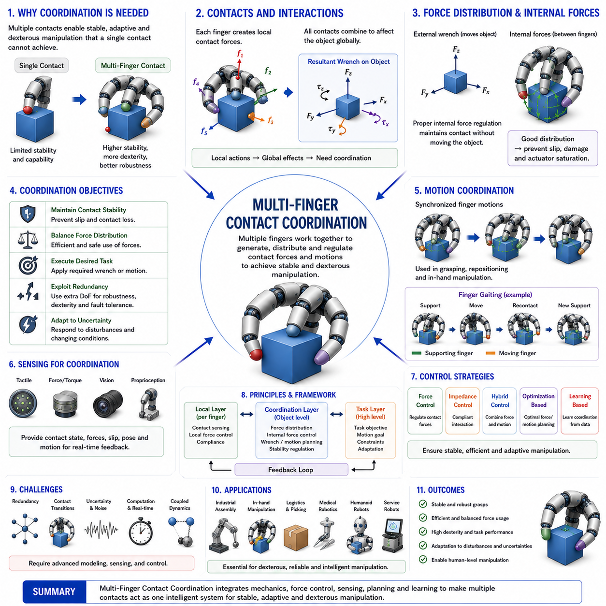{width="7.268055555555556in" height="7.268055555555556in"}

Multi-Finger Contact Coordination is one of the most advanced and important topics in robotic grasping, dexterous manipulation, robotic hand control, and physical interaction intelligence. It focuses on how multiple robotic fingers coordinate their contact forces, positions, motions, and sensory information to achieve stable, adaptive, and purposeful manipulation of objects. While earlier topics such as Contact Models, Force Closure Theory, Form Closure Theory, Grasp Wrench Space, Grasp Quality Metrics, and Grasp Stability Analysis explain the physical and mathematical foundations of grasping, Multi-Finger Contact Coordination addresses how these principles are actively implemented in real robotic systems. It represents the transition from understanding grasp mechanics to controlling complex multi-contact interactions in real time.

The significance of multi-finger coordination arises from the fact that most useful robotic manipulation tasks cannot be accomplished with a single contact point. Human hands achieve remarkable dexterity because multiple fingers work together as an integrated system. Each finger contributes forces, constraints, sensory feedback, and motion capabilities that collectively create manipulation behaviors far beyond the capabilities of any individual finger. Robotic hands seek to replicate this capability by coordinating multiple contact points simultaneously.

At the most fundamental level, multi-finger contact coordination involves controlling a collection of contacts that interact with a common object. Each finger establishes one or more contact points, and each contact generates forces and moments according to the local contact mechanics. Although individual contacts operate locally, their effects combine globally through the object. Consequently, every contact action influences the entire grasp system. A force generated by one finger affects the force requirements of other fingers, the object\'s equilibrium, the grasp wrench space, and the overall stability of the manipulation task.

This interconnected nature of multi-contact systems creates significant challenges. Unlike single-contact interactions, multi-finger grasps require simultaneous management of force distribution, contact stability, motion synchronization, collision avoidance, grasp robustness, and task execution. Successful coordination therefore demands a deep integration of mechanics, control theory, sensing, planning, and optimization.

One of the central concepts in multi-finger coordination is contact force distribution. When several fingers grasp an object, the total grasp force is distributed among multiple contact points. The manner in which these forces are allocated directly influences stability, efficiency, and object safety. Poor force distribution may overload certain contacts while leaving others underutilized. Excessive loading can cause actuator saturation, contact damage, or object deformation. Insufficient loading may lead to slipping or contact loss. Effective coordination seeks to achieve balanced and efficient force allocation across all contacts.

The concept of internal forces plays a critical role in this process. Internal forces are forces exchanged among fingers that do not contribute to the net external wrench acting on the object. Although they do not move the object directly, they are essential for maintaining stable contact. For example, when two opposing fingers squeeze an object, the opposing forces cancel each other at the object level, yet they generate the friction necessary to prevent slipping. Managing internal forces is therefore one of the most important objectives of multi-finger coordination.

Internal force regulation becomes increasingly complex as the number of fingers increases. In a two-finger grasp, internal force control is relatively straightforward. In a five-finger anthropomorphic hand, however, many redundant force distributions can achieve the same object-level wrench. This redundancy creates both opportunities and challenges. On one hand, redundancy improves robustness and adaptability. On the other hand, it requires sophisticated control algorithms to determine optimal force distributions.

Redundancy is a defining characteristic of multi-finger manipulation. Human hands possess more joints and actuators than are strictly required to control object motion. Robotic hands often exhibit similar redundancy. Multiple finger configurations may achieve identical grasp objectives. Multiple force distributions may produce identical object motions. Multi-finger coordination seeks to exploit this redundancy to improve stability, dexterity, energy efficiency, and fault tolerance.

The relationship between local contact behavior and global object behavior is another fundamental aspect of coordination. Each contact generates forces according to local friction conditions, contact geometry, and compliance properties. These local interactions collectively determine global grasp properties such as force closure, wrench generation capability, and manipulation authority. Effective coordination therefore requires simultaneous consideration of both local and global dynamics.

Grasp Wrench Space provides an important framework for understanding this relationship. Every contact contributes achievable wrench components. The combination of these contributions determines the overall wrench space of the grasp. Multi-finger coordination can be viewed as the process of selecting contact forces that generate desired object-level wrenches while maintaining contact stability and satisfying physical constraints.

Motion coordination represents another major component of multi-finger manipulation. During grasp acquisition, object repositioning, in-hand manipulation, and task execution, multiple fingers must move in a synchronized manner. Uncoordinated motion may lead to contact loss, excessive forces, object rotation, or grasp failure. Coordinated motion planning ensures that finger trajectories remain compatible with object constraints and manipulation objectives.

In-hand manipulation provides one of the most challenging examples of multi-finger coordination. In these tasks, an object is moved, rotated, translated, or reoriented within the robotic hand without releasing it. Such manipulation requires continuous adjustment of contact locations, force distributions, and finger trajectories. Every finger must adapt its behavior in response to changes initiated by other fingers. This dynamic coupling makes in-hand manipulation a highly demanding coordination problem.

Human grasping demonstrates extraordinary capabilities in this area. Humans routinely rotate pens, reposition tools, manipulate coins, and perform complex finger gaiting motions. These behaviors emerge from highly coordinated interactions among multiple fingers, sensory systems, and neural control mechanisms. Roboticists study these human strategies extensively because they provide valuable insights into multi-finger coordination principles.

Finger gaiting is a particularly important concept in dexterous manipulation. Similar to legged locomotion, finger gaiting involves sequentially repositioning contacts while maintaining overall grasp stability. Certain fingers temporarily release and relocate while other fingers maintain object support. This strategy allows robotic hands to manipulate objects across large ranges of motion without losing control.

Contact transitions introduce additional complexity into coordination. Real manipulation tasks often require contacts to be created, broken, or relocated. Every contact transition changes the grasp structure, force distribution, and stability properties of the system. Coordinating these transitions safely and efficiently remains a major research challenge in robotic manipulation.

Tactile sensing plays a fundamental role in multi-finger contact coordination. Contact forces cannot be managed effectively without accurate information regarding contact conditions. Modern tactile sensors provide measurements of pressure distributions, shear forces, contact locations, contact areas, and incipient slip events. This information allows robotic systems to estimate contact states and adjust coordination strategies in real time.

Slip prevention is one of the primary objectives of tactile-based coordination. When tactile sensors detect early signs of slipping, robotic controllers can increase internal forces, adjust finger positions, or modify grasp strategies before failure occurs. Such reactive stabilization mechanisms closely resemble human reflexive grasp adjustments.

Vision systems complement tactile sensing by providing global information about object geometry, pose, motion, and environmental context. While tactile sensing provides local contact information, vision provides a broader understanding of the manipulation scene. Multi-finger coordination often relies on the integration of vision and touch to achieve robust performance.

Compliance introduces additional opportunities and challenges. Compliant fingers can adapt to object geometry, distribute contact pressures, and absorb disturbances. These properties often improve grasp robustness and simplify contact acquisition. However, compliance also introduces additional dynamics, deformations, and control complexities that must be managed during coordination.

Soft robotic hands extend these ideas even further. Instead of coordinating rigid contacts, soft robotic systems coordinate continuously deformable contact regions. Contact locations, contact areas, and force distributions may change continuously during manipulation. Multi-finger coordination in soft robotics therefore requires new models and control approaches that account for continuum deformation.

Control theory provides the mathematical foundation for multi-finger coordination. Force control, position control, impedance control, admittance control, hybrid force-motion control, and model predictive control are all commonly employed. These control strategies regulate finger behavior while ensuring stable object interaction. Advanced coordination often requires simultaneous control of object motion and internal forces.

Impedance control is particularly important because it enables compliant interaction with uncertain environments. Rather than commanding exact positions or forces, impedance control regulates the dynamic relationship between motion and force. This flexibility improves robustness during contact-rich manipulation tasks.

Optimization methods are widely used in coordination planning. Many coordination problems can be formulated as optimization tasks involving objectives such as maximizing grasp quality, minimizing energy consumption, balancing contact forces, avoiding singularities, or preserving stability margins. Optimization-based approaches are particularly valuable for high-degree-of-freedom robotic hands.

Machine learning has emerged as a powerful tool for multi-finger coordination. Learning-based systems can acquire coordination strategies directly from data, simulation, demonstration, or reinforcement learning. Neural networks can learn complex relationships among contact states, force distributions, and manipulation outcomes that are difficult to model analytically.

Reinforcement learning has shown particular promise in dexterous manipulation tasks. By interacting with simulated environments, robotic hands can learn sophisticated coordination behaviors that would be difficult to program manually. These learned policies often discover unexpected yet effective manipulation strategies.

Despite these advances, analytical models remain essential. Contact mechanics, grasp theory, and dynamic modeling provide interpretability, safety guarantees, and physical understanding that purely data-driven approaches often lack. Consequently, many modern systems combine learning-based methods with analytical coordination frameworks.

Simulation environments have become indispensable for studying multi-finger coordination. High-fidelity simulators allow researchers to analyze complex contact interactions, evaluate control algorithms, and train learning systems at large scales. Digital twins further extend this capability by providing virtual representations of physical robotic systems.

Industrial applications increasingly require advanced multi-finger coordination. Assembly robots manipulate complex components requiring precise force control. Logistics robots handle objects with varying geometries and weights. Medical robots coordinate multiple contacts when interacting with surgical instruments and biological tissues. Service robots manipulate everyday objects in human environments. All of these applications benefit from sophisticated contact coordination capabilities.

Humanoid robotics represents perhaps the ultimate application domain. Human environments are designed for human hands. To achieve human-level manipulation capability, humanoid robots must coordinate many fingers simultaneously while adapting to uncertainty, variability, and task complexity. Multi-finger contact coordination therefore lies at the heart of humanoid dexterity.

The emergence of Physical AI further elevates the importance of this field. Future intelligent robots will not simply perceive and reason; they will interact physically with the world through complex contact networks. Multi-finger coordination serves as a foundational mechanism through which high-level intelligence is translated into effective physical action.

Recent research increasingly explores probabilistic coordination frameworks, where uncertainty in contact conditions, object properties, and sensory information is explicitly modeled. Such approaches aim to make robotic manipulation more robust under realistic operating conditions.

Researchers are also investigating shared autonomy systems in which human operators and robotic controllers collaborate during manipulation. In these systems, multi-finger coordination algorithms assist human users by stabilizing grasps, compensating for disturbances, and optimizing force distributions.

Ultimately, Multi-Finger Contact Coordination represents the comprehensive study of how multiple contacts cooperate to achieve stable, dexterous, adaptive, and intelligent manipulation. It integrates contact mechanics, force distribution, grasp stability, tactile sensing, motion planning, control theory, optimization, machine learning, and robotic intelligence into a unified framework.

Within the broader context of Contact Mechanics and Grasp Theory, Multi-Finger Contact Coordination serves as the practical implementation layer that transforms theoretical grasp principles into real manipulation capabilities. It builds directly upon Contact Models, Force Closure Theory, Form Closure Theory, Grasp Wrench Space, Grasp Quality Metrics, and Grasp Stability Analysis. A deep understanding of multi-finger contact coordination is therefore essential for researchers and engineers developing advanced robotic hands, anthropomorphic manipulators, dexterous industrial grippers, humanoid robots, soft robotic systems, and future generations of intelligent Physical AI platforms capable of human-level object interaction.

## 06.10 Object Deformation Effects

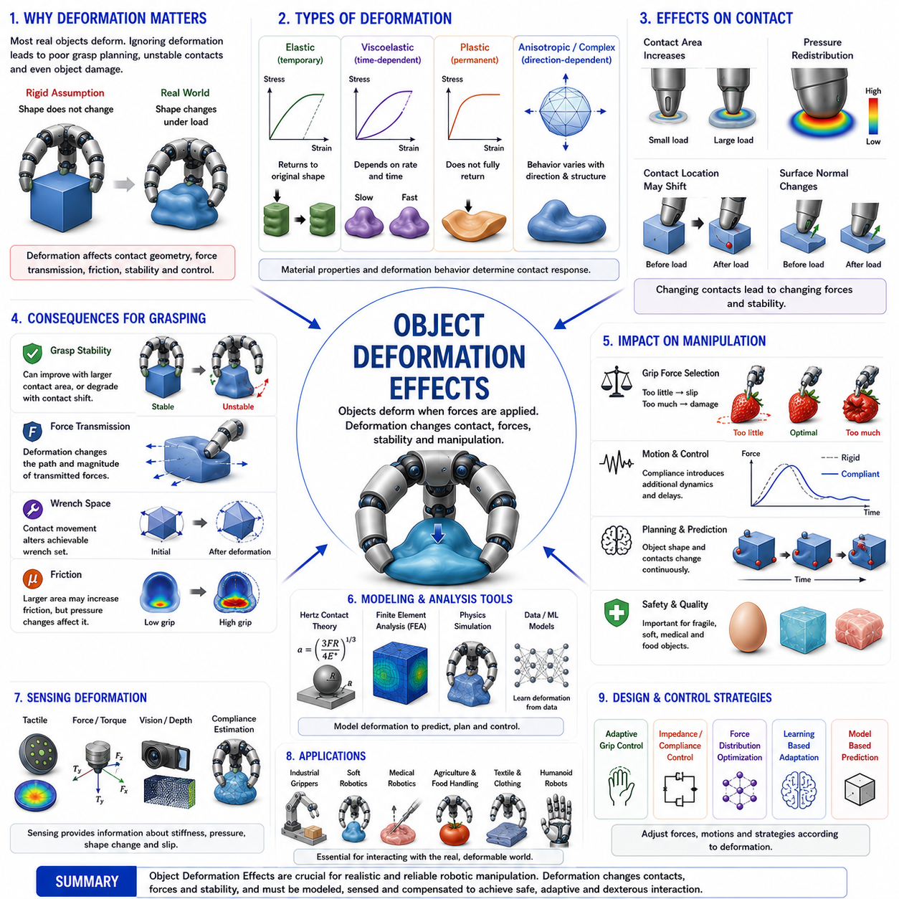{width="7.268055555555556in" height="7.268055555555556in"}

Object Deformation Effects refer to the influence of object shape changes, material compliance, elastic behavior, plastic deformation, and structural flexibility on robotic grasping, contact mechanics, manipulation stability, and force transmission. In classical robotic grasping theory, objects are often modeled as perfectly rigid bodies. This assumption greatly simplifies mathematical analysis because the object\'s geometry remains unchanged regardless of applied forces. However, real-world objects rarely behave as perfectly rigid bodies. Most objects deform to some extent when subjected to contact forces. Even materials commonly considered rigid, such as metals, plastics, wood, and glass, experience microscopic deformations under load. Softer materials such as rubber, foam, fabric, biological tissue, food products, and flexible polymers exhibit much larger deformations. Consequently, understanding object deformation effects is essential for developing robotic systems capable of reliable interaction with the physical world.

The importance of object deformation becomes immediately apparent when examining everyday human manipulation. Humans routinely grasp objects that vary dramatically in stiffness. A person can hold a steel wrench, squeeze a sponge, pick up a ripe strawberry, manipulate a piece of cloth, or handle delicate biological tissue. In each case, the interaction mechanics differ because the object responds differently to applied forces. The human nervous system continuously adapts grip forces, finger positions, and manipulation strategies according to the deformation characteristics of the object. Advanced robotic systems must achieve similar adaptability if they are to approach human-level dexterity.

Traditional rigid-body grasp theory provides an important foundation for robotic manipulation. Concepts such as Force Closure, Form Closure, Grasp Wrench Space, Grasp Quality Metrics, and Grasp Stability Analysis assume that object geometry remains fixed during interaction. Under these assumptions, contact locations, contact normals, and force transmission paths remain constant. However, when objects deform, these quantities become dynamic variables that evolve throughout the manipulation process. As a result, deformation introduces additional complexity into grasp analysis and control.

The most fundamental consequence of deformation is the modification of contact geometry. When a robotic finger presses against a deformable object, the contact area often expands. Instead of a single contact point, a distributed contact region may develop. This change affects pressure distribution, friction generation, force transmission, and stability characteristics. In many cases, increased contact area improves grasp robustness because forces are distributed more evenly across the surface.

Contact pressure distribution plays a central role in understanding deformation effects. For rigid contacts, pressure may be concentrated within a small region. For deformable contacts, the pressure spreads over a larger area. This redistribution reduces peak stresses and often improves contact stability. Human fingertips exploit this phenomenon extensively. Soft tissue deforms under load, creating large contact regions that enhance friction and manipulation performance.

The study of contact deformation is closely linked to Hertzian Contact Theory. Developed by the German physicist Heinrich Hertz, this theory describes how elastic bodies deform when pressed together. Hertzian contact analysis predicts contact area size, pressure distribution, stress fields, and deformation magnitude based on material properties and applied loads. Although originally developed for engineering applications such as bearings and gears, Hertzian theory remains highly relevant in robotic contact mechanics.

Elastic deformation represents the most commonly studied form of object deformation. Elastic materials return to their original shape after forces are removed. Springs, rubber components, and many structural materials exhibit elastic behavior within certain operating ranges. Elastic deformation introduces compliance into robotic interactions and can significantly influence grasp stability. Because elastic contacts store mechanical energy, they often provide natural restoring forces that help maintain stable grasps.

Potential energy concepts become particularly important when deformation is present. Elastic deformation stores strain energy within the object. When the object is displaced, restoring forces emerge that attempt to return the system to equilibrium. These restoring forces can improve grasp stability and disturbance rejection. Many stability analyses incorporate deformation energy to evaluate grasp robustness.

Compliance is one of the most significant consequences of deformation. Compliance refers to the ability of a system to deform under applied force. Highly compliant objects exhibit large deformations in response to relatively small loads. Compliance influences nearly every aspect of robotic manipulation, including contact formation, force control, grasp planning, motion execution, and object stability.

Compliant objects often simplify contact acquisition. Small positioning errors can be absorbed through deformation rather than causing immediate contact failure. This property explains why soft robotic grippers frequently outperform rigid grippers when handling objects with uncertain geometry. Compliance effectively increases tolerance to sensing and control inaccuracies.

However, compliance also introduces challenges. Deformation alters object geometry dynamically, making contact conditions more difficult to predict. As forces change, contact locations shift, surface normals rotate, and friction conditions evolve. Traditional rigid-body models often fail to capture these effects accurately. Consequently, manipulation of deformable objects requires more sophisticated modeling approaches.

Plastic deformation represents another important category of object behavior. Unlike elastic deformation, plastic deformation produces permanent shape changes. Once the applied stress exceeds a material\'s yield limit, the object does not fully recover its original shape. Metal forming, bending operations, and many manufacturing processes intentionally exploit plastic deformation. In robotic manipulation, plastic deformation may be either desirable or undesirable depending on the task.

Manufacturing robots frequently interact with plastically deformable materials. Sheet metal forming, forging, stamping, bending, and additive manufacturing processes all involve controlled deformation. In these applications, understanding deformation behavior is not merely beneficial but essential for achieving accurate process outcomes.

Biological materials exhibit particularly complex deformation characteristics. Human tissue, muscle, organs, skin, cartilage, and blood vessels display nonlinear, anisotropic, and viscoelastic behavior. Medical robots operating in surgical environments must account for these deformation effects to avoid tissue damage and ensure precise manipulation. As a result, deformation modeling has become a major area of research within medical robotics.

Viscoelasticity introduces additional complexity. Viscoelastic materials exhibit both elastic and viscous behavior simultaneously. Their response depends not only on the magnitude of applied forces but also on loading rate and time history. Materials such as soft polymers, biological tissues, gels, and foams often display viscoelastic properties. Robotic systems interacting with such materials must consider time-dependent deformation effects.

Rate-dependent behavior becomes especially important during dynamic manipulation. A viscoelastic object may respond differently when grasped slowly versus rapidly. Fast motions can generate higher reaction forces and different deformation patterns compared to slow interactions. Consequently, manipulation strategies must account for both force magnitude and motion speed.

Object deformation strongly influences friction generation. Classical Coulomb friction models assume rigid contacts with fixed contact areas. In deformable systems, contact area evolves dynamically. Larger contact regions often increase effective frictional resistance, improving grasp stability. However, deformation may also alter pressure distributions in ways that create unpredictable frictional behavior.

Grasp force selection becomes significantly more challenging when deformable objects are involved. Insufficient force may lead to slipping, while excessive force may damage the object. This tradeoff is particularly important when handling fragile items such as fruits, eggs, medical specimens, electronics, or soft consumer products. Robotic systems must therefore estimate object stiffness and adapt grip forces accordingly.

Object deformation also affects Grasp Wrench Space. In rigid-body models, contact locations remain fixed. In deformable systems, contact locations may move as the object deforms. Consequently, the achievable wrench set evolves dynamically throughout the manipulation process. Traditional wrench-space analysis must therefore be extended to account for changing contact conditions.

Similarly, Force Closure conditions may change during manipulation. A grasp that initially satisfies force closure may lose stability if deformation causes contact migration or reduces friction effectiveness. Conversely, deformation may improve stability by increasing contact area and frictional support. Understanding these dynamic effects is essential for robust manipulation.

Multi-finger contact coordination becomes more complex when objects deform. Each finger influences not only the object but also the contact conditions experienced by other fingers. Forces applied by one finger may reshape the object and alter contact geometry elsewhere. Effective coordination therefore requires continuous adaptation to evolving object states.

Soft robotic grippers exploit deformation effects intentionally. Rather than resisting deformation, soft grippers embrace it as a mechanism for achieving robust grasping. Flexible fingers conform to object geometry, creating large contact areas and distributing forces naturally. This approach has proven highly effective for handling irregular, fragile, and unknown objects.

Adaptive grasping systems frequently rely on deformation-aware control strategies. These systems estimate object stiffness, compliance, and deformation characteristics using tactile sensing, force sensing, vision systems, or learned models. Based on these estimates, grasp parameters are adjusted in real time to maximize stability while minimizing damage risk.

Tactile sensing is particularly valuable for understanding deformation effects. Tactile sensors provide information regarding pressure distributions, contact areas, local deformations, and slip conditions. These measurements enable robots to infer material properties and monitor object responses during manipulation. Advanced tactile sensing technologies increasingly play a central role in deformation-aware grasp control.

Vision-based approaches also contribute significantly. Modern computer vision systems can estimate object deformation from image sequences, depth maps, stereo reconstruction, and three-dimensional point clouds. Combining visual and tactile information often produces more accurate deformation estimates than either sensing modality alone.

Finite Element Analysis (FEA) has become one of the most important tools for studying deformation effects. FEA discretizes objects into large numbers of small elements and computes deformation behavior under applied loads. This approach enables highly accurate prediction of stress distributions, strain fields, contact mechanics, and structural responses. Many robotic simulation environments incorporate finite element methods to model deformable objects.

Physics simulation engines increasingly support deformable object modeling. Modern simulators can represent soft bodies, cloth, ropes, biological tissues, granular materials, and flexible structures. These capabilities allow researchers to develop and evaluate manipulation strategies before deployment on physical hardware.

Machine learning has introduced new approaches to deformation modeling. Rather than relying solely on physics-based simulations, learning-based systems can infer deformation behavior directly from data. Neural networks can predict object responses, estimate material properties, and generate control policies for deformable object manipulation. Such methods have shown impressive performance in complex scenarios where traditional modeling is difficult.

Despite recent advances in machine learning, physics-based models remain indispensable. Deformation behavior often depends on fundamental material properties and mechanical laws. Analytical models provide interpretability, reliability, and physical consistency that purely data-driven methods may lack. Consequently, many state-of-the-art systems combine physics-based and learning-based approaches.

Industrial applications involving deformation are widespread. Packaging robots handle flexible materials. Agricultural robots manipulate soft fruits and vegetables. Medical robots interact with deformable tissues. Textile robots process cloth and garments. Food-processing robots manage highly deformable products. In each case, successful operation depends on understanding and controlling deformation effects.

Humanoid robots face particularly demanding challenges because human environments contain countless deformable objects. Clothing, bags, cushions, food items, tools with compliant handles, paper products, and biological materials all require deformation-aware manipulation strategies. Human-level dexterity therefore depends heavily on understanding object deformation.

The emergence of Physical AI has further increased interest in deformation modeling. Future intelligent robots must not only perceive and reason about their environments but also interact physically with diverse materials. This requires integrated understanding of mechanics, sensing, learning, planning, and deformation behavior.

Recent research increasingly explores probabilistic deformation modeling. Material properties, environmental conditions, and contact interactions often contain significant uncertainty. Probabilistic methods attempt to predict deformation behavior while accounting for incomplete information and measurement noise. Such approaches improve robustness in real-world applications.

Researchers are also investigating foundation models for physical interaction that incorporate deformation understanding into large-scale learning architectures. These systems aim to generalize manipulation skills across diverse object categories while reasoning about material behavior and structural responses.

Ultimately, Object Deformation Effects represent a critical extension of classical grasp theory into the realities of physical interaction. They transform contact mechanics from a rigid geometric problem into a dynamic, material-dependent phenomenon involving compliance, elasticity, plasticity, friction, sensing, and control. Understanding deformation effects is therefore essential for creating robotic systems capable of interacting safely, intelligently, and effectively with the enormous diversity of objects found in the real world.

Within the broader framework of Contact Mechanics and Grasp Theory, Object Deformation Effects build directly upon Contact Models, Soft Finger Contact Theory, Force Closure, Form Closure, Grasp Wrench Space, Grasp Stability Analysis, and Multi-Finger Contact Coordination. A deep understanding of deformation effects is essential for researchers and engineers developing advanced robotic hands, soft robotic grippers, medical robots, humanoid manipulators, adaptive automation systems, and future Physical AI platforms designed for rich interaction with the physical environment.

## 06.11 Contact Simulation Methods

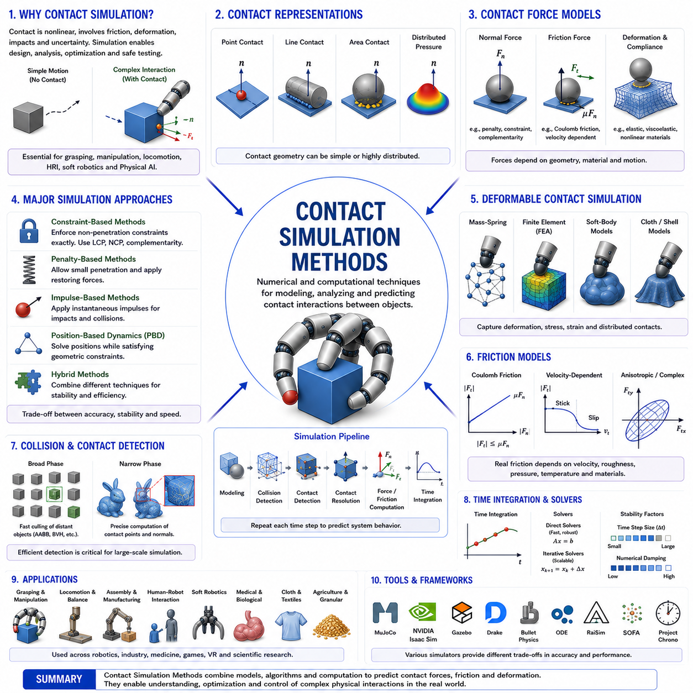{width="7.268055555555556in" height="7.268055555555556in"}

Contact Simulation Methods are the collection of mathematical models, numerical techniques, computational algorithms, and physics-based simulation approaches used to model, predict, analyze, and reproduce contact interactions between objects. Within robotics, contact simulation forms the foundation of grasping, manipulation, locomotion, assembly, human-robot interaction, soft robotics, and Physical AI systems. While Contact Models describe how forces arise when surfaces touch, Contact Simulation Methods provide the computational framework required to calculate and predict those interactions over time. They transform theoretical contact mechanics into practical simulation environments that enable researchers and engineers to design, test, optimize, and validate robotic systems before deployment in the physical world.

The importance of contact simulation arises from the fact that contact is one of the most challenging phenomena in robotics. Vision, localization, and path planning often operate in relatively predictable mathematical spaces. Contact interactions, however, involve nonlinear forces, friction, deformation, impacts, compliance, uncertainty, and discontinuous state transitions. A robot can move freely through space with relatively simple dynamics until it touches an object. At that moment, the complexity of the physical interaction increases dramatically. Accurate simulation of these interactions is therefore essential for creating reliable robotic systems.

Historically, robotics research relied heavily on rigid-body assumptions and simplified contact approximations. Early robotic systems focused primarily on industrial automation tasks where interactions were carefully controlled and predictable. As robots began entering unstructured environments, interacting with humans, manipulating deformable objects, and performing dexterous tasks, the limitations of simplistic contact models became increasingly apparent. This motivated the development of advanced contact simulation methods capable of representing realistic physical interactions.

At the most fundamental level, contact simulation seeks to answer several important questions. When two objects touch, where does contact occur? How large is the contact area? What forces are generated? How do friction and deformation influence behavior? Will slipping occur? Will the objects separate or remain in contact? How will the interaction evolve over time? Contact simulation methods provide numerical solutions to these questions.

One of the simplest approaches is rigid-body contact simulation. In rigid-body models, objects are assumed to be perfectly rigid, meaning that no deformation occurs during interaction. Contact is represented mathematically through constraints that prevent interpenetration. This assumption dramatically simplifies computation and remains widely used in robotics, computer graphics, gaming, and industrial simulation. Although rigid-body models cannot capture all real-world phenomena, they often provide sufficient accuracy for many applications.

Rigid-body contact simulation typically begins with collision detection. Collision detection algorithms determine whether two objects intersect and identify potential contact locations. Broad-phase collision detection rapidly eliminates objects that are far apart, while narrow-phase collision detection computes precise contact information for objects that may interact. Efficient collision detection is essential because modern robotic simulations often involve thousands of potential contact pairs.

Once contact is detected, contact resolution algorithms determine the forces required to satisfy physical constraints. One common approach is constraint-based simulation. In this framework, contact conditions are represented as mathematical constraints that prevent penetration between bodies. Solvers then compute forces or impulses that satisfy these constraints while maintaining physically plausible behavior.

Penalty-based methods provide an alternative approach. Instead of enforcing contact constraints exactly, penalty methods allow small amounts of interpenetration and generate restoring forces proportional to penetration depth. These methods are conceptually simple and computationally efficient. However, excessive penetration may reduce physical realism, while large penalty parameters can introduce numerical instability.

Constraint-based and penalty-based methods represent two of the most widely used categories of contact simulation. Modern simulators often combine aspects of both approaches to achieve favorable tradeoffs between stability, accuracy, and computational efficiency.

Friction modeling is another critical component of contact simulation. Without friction, many common robotic tasks become impossible. Grasping, walking, pushing, tool use, and object manipulation all depend on frictional interactions. Most simulations use Coulomb friction models, which approximate friction forces based on normal forces and friction coefficients. Despite its simplicity, Coulomb friction captures many essential characteristics of contact behavior.

However, real friction is often significantly more complex than classical Coulomb models suggest. Friction may depend on velocity, surface roughness, material properties, temperature, pressure distribution, lubrication, and wear. Advanced contact simulation methods increasingly incorporate these effects to improve realism and predictive accuracy.

Complementarity-based methods represent an important class of contact simulation techniques. These methods formulate contact interactions as mathematical complementarity problems. The central idea is that contact forces and penetration cannot occur simultaneously. Either objects are separated with zero contact force, or they are in contact with nonzero contact force. Complementarity formulations provide elegant mathematical descriptions of contact behavior and are widely used in robotics research.

Linear Complementarity Problems (LCPs) became particularly influential in rigid-body simulation. LCP-based solvers can efficiently compute contact forces while satisfying nonpenetration and friction constraints. Many classical robotics simulators rely on LCP formulations because they offer a principled framework for modeling contact interactions.

More advanced approaches use Nonlinear Complementarity Problems (NCPs) and Variational Inequalities. These methods extend contact simulation to more complex scenarios involving nonlinear friction models, deformable objects, and sophisticated contact mechanics. Although computationally more demanding, they often provide higher accuracy and better physical fidelity.

Impulse-based simulation methods are commonly used when modeling impacts and collisions. Instead of computing continuous contact forces, impulse methods apply instantaneous momentum changes during collisions. These approaches are particularly useful for modeling bouncing, striking, dropping, and other highly dynamic interactions.

Impact simulation introduces additional complexity because contact forces can become extremely large over very short time intervals. Accurate impact modeling requires careful treatment of momentum conservation, energy dissipation, restitution coefficients, and contact duration. Such considerations are critical in robotic manipulation, industrial automation, sports robotics, and human-robot interaction.

Deformable contact simulation extends beyond rigid-body assumptions by explicitly modeling object deformation. When contact occurs, objects change shape, creating distributed contact areas and complex pressure distributions. Deformable simulation methods are essential for modeling soft robotics, biological tissues, cloth manipulation, food handling, and compliant grasping.

Finite Element Analysis (FEA) is one of the most powerful tools for deformable contact simulation. FEA divides objects into large numbers of interconnected elements and computes stresses, strains, deformations, and contact forces throughout the structure. Although computationally intensive, FEA provides highly accurate predictions of contact behavior and is widely used in engineering and robotics.

Nonlinear finite element methods are particularly important because many contact interactions involve large deformations, nonlinear materials, and changing contact boundaries. Such methods allow simulation of highly complex phenomena that cannot be captured using linear approximations.

Mass-spring systems provide a computationally simpler alternative for deformable simulation. Objects are represented as networks of masses connected by springs. Although less accurate than finite element methods, mass-spring models often achieve sufficient realism for real-time applications and interactive simulations.

Position-Based Dynamics (PBD) has emerged as a popular approach in graphics and robotics. Rather than solving force equations directly, PBD updates object positions while enforcing geometric constraints. This method offers exceptional numerical stability and computational efficiency, making it attractive for real-time simulation of cloth, ropes, soft bodies, and deformable structures.

Soft-body simulation has become increasingly important with the rise of soft robotics. Soft robots rely on continuous deformation rather than rigid joints and links. Simulating such systems requires specialized methods capable of modeling large elastic deformations, material nonlinearities, and complex contact interactions.

Fluid-solid interaction simulation represents another important area. Many real-world robotic applications involve liquids, gels, slurries, biological materials, and other fluid-like substances. Modeling interactions between solid objects and deformable fluids requires sophisticated computational methods that combine contact mechanics with fluid dynamics.

Granular material simulation presents unique challenges. Sand, soil, grains, powders, and agricultural materials consist of large numbers of interacting particles. Discrete Element Methods (DEM) simulate individual particles and their contact interactions. DEM has become increasingly important for agricultural robotics, construction automation, mining systems, and planetary exploration robots.

Contact simulation also plays a central role in robotic grasping research. Contact models determine how forces are transmitted between fingers and objects. Simulations allow researchers to evaluate grasp stability, force closure conditions, grasp quality metrics, and manipulation strategies without risking damage to physical hardware.

Grasp Wrench Space analysis frequently relies on contact simulation. Simulated contact forces can be used to construct achievable wrench sets and evaluate grasp robustness under varying conditions. Such analyses provide valuable insight into robotic hand design and manipulation performance.

Tactile sensing research increasingly depends on contact simulation. Simulated pressure distributions, contact patches, and force transmission patterns help researchers develop tactile sensors and interpret tactile measurements. Digital tactile twins are becoming an active area of investigation within Physical AI.

Machine learning has significantly influenced contact simulation in recent years. Data-driven models can learn contact dynamics directly from experimental observations. Neural networks may approximate friction behavior, deformation responses, impact outcomes, or contact force distributions. Such learned models often achieve impressive computational efficiency while maintaining acceptable accuracy.

Physics-Informed Machine Learning combines physical laws with data-driven learning. Rather than replacing physics entirely, these methods integrate physical constraints into learning architectures. This hybrid approach often improves generalization and physical consistency while reducing data requirements.

Differentiable simulation represents one of the most exciting recent developments. Traditional simulators compute system behavior but do not provide gradients for optimization. Differentiable simulators allow gradients to propagate through contact interactions, enabling optimization, system identification, trajectory planning, and policy learning. This capability is becoming increasingly important in robotics and Physical AI research.

Simulation-to-Reality (Sim2Real) transfer depends heavily on accurate contact simulation. Many robotic policies are trained in simulation before deployment in physical environments. Contact modeling errors often represent one of the largest sources of Sim2Real performance degradation. Improving contact simulation fidelity is therefore essential for successful transfer learning.

Digital Twins further emphasize the importance of contact simulation. A digital twin seeks to create a virtual representation of a physical system that accurately reproduces real-world behavior. Contact interactions are often among the most difficult phenomena to model accurately within digital twins, particularly when uncertainty and environmental variability are present.

Modern robotics simulators such as MuJoCo, Isaac Sim, NVIDIA PhysX, Gazebo, Drake, Bullet Physics, ODE, RaiSim, SOFA, and Chrono incorporate sophisticated contact simulation frameworks. Each simulator employs different numerical methods and tradeoffs, reflecting the diverse requirements of robotics research and industrial applications.

Humanoid robotics places particularly demanding requirements on contact simulation. Walking, balancing, climbing, object manipulation, tool use, and human interaction all involve numerous simultaneous contacts. Accurate simulation of these interactions is critical for developing robust humanoid behaviors.

Physical AI systems further elevate the significance of contact simulation. Future intelligent robots must understand not only geometry and perception but also physical interaction. Contact simulation provides the computational foundation for this understanding by enabling robots to predict the consequences of actions before executing them in the real world.

Recent research increasingly focuses on uncertainty-aware contact simulation. Real contact interactions involve uncertain friction coefficients, material properties, geometric imperfections, sensor noise, and environmental variability. Probabilistic simulation methods attempt to capture these uncertainties and generate more robust predictions.

Large-scale foundation models for robotics may eventually incorporate contact simulation directly into their reasoning processes. Such systems could combine perception, language understanding, planning, and physical prediction within unified architectures capable of sophisticated interaction with the physical world.

Ultimately, Contact Simulation Methods transform theoretical contact mechanics into practical computational tools capable of predicting physical interaction. They provide the bridge between mathematical models and real-world robotic behavior. By integrating collision detection, contact resolution, friction modeling, deformation simulation, machine learning, optimization, and physical reasoning, contact simulation methods enable robots to interact safely, intelligently, and effectively with complex environments.

Within the broader framework of Contact Mechanics and Grasp Theory, Contact Simulation Methods unify Contact Models, Point Contact Theory, Soft Finger Contact Models, Force Closure Theory, Form Closure Theory, Grasp Wrench Space, Grasp Stability Analysis, Multi-Finger Contact Coordination, and Object Deformation Effects into a computationally executable framework. A deep understanding of contact simulation methods is therefore essential for researchers and engineers developing robotic hands, dexterous manipulators, soft robots, humanoid systems, digital twins, simulation environments, and future generations of Physical AI platforms.
