**Volume 06 Robot Hands and Dexterous Grasping**

# 07. Tactile Sensing

## 07.01 Introduction to Tactile Sensing

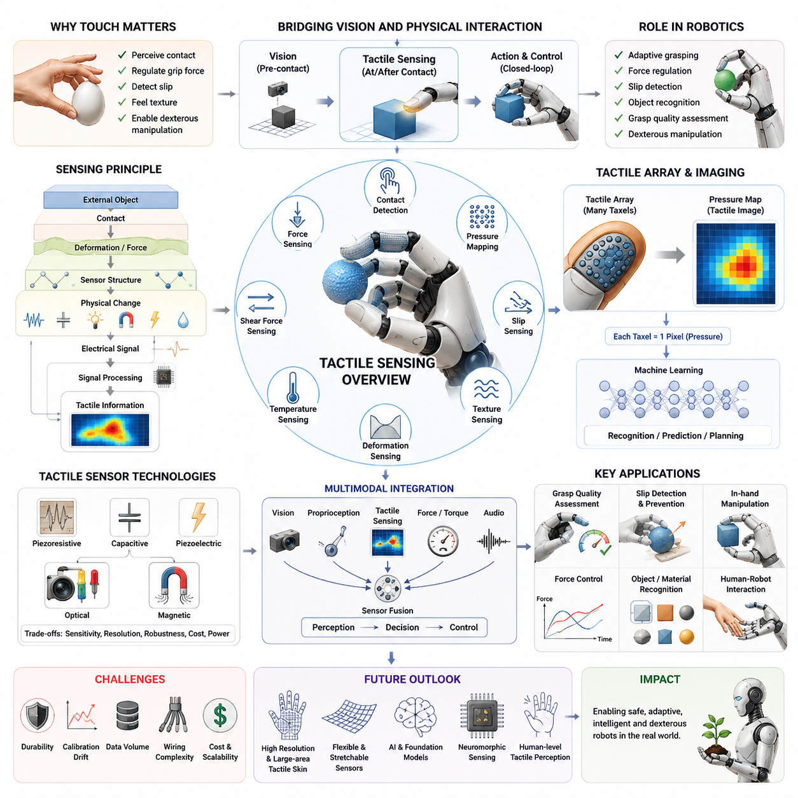{width="7.268055555555556in" height="7.268055555555556in"}

Tactile sensing is one of the most important technologies in robotic manipulation because it enables a robot to perceive physical interaction with the environment through direct contact. While vision systems provide information about object appearance, location, geometry, and motion before contact occurs, tactile sensing provides information during contact. This capability allows a robotic hand to understand how an object is actually being touched, grasped, compressed, slipped, or manipulated. For this reason, tactile sensing is often considered the robotic equivalent of the human sense of touch and represents a fundamental component in the development of dexterous robotic hands and advanced manipulation systems. The topic belongs to Chapter 07 of Volume 06, which focuses on tactile sensing technologies and their role in robotic hands and dexterous grasping systems.

Human manipulation relies heavily on tactile perception. When a person picks up a fragile object such as an egg, a wine glass, or a piece of fruit, the fingers continuously measure pressure, vibration, texture, temperature, and micro-slippage through thousands of sensory receptors embedded within the skin. These receptors allow humans to regulate grip force automatically and adapt grasp strategies in real time. Without tactile feedback, even simple manipulation tasks become significantly more difficult. Studies involving temporary sensory deprivation demonstrate that grasping becomes less stable, grip forces become excessive, and manipulation precision decreases dramatically. Robotic systems experience similar limitations when relying solely on visual sensing. A robot equipped only with cameras may know where an object is located, but it may not know whether the object is securely grasped, slipping, damaged, or deformed during manipulation.

The primary purpose of tactile sensing is to bridge this gap between visual perception and physical interaction. Tactile sensors provide information regarding contact occurrence, contact location, contact force magnitude, force distribution, pressure distribution, surface texture, vibration, deformation, and slip conditions. By integrating this information into the robot control system, robotic hands can achieve adaptive grasping, compliant interaction, object recognition, force regulation, and dexterous manipulation. Tactile sensing transforms robotic grasping from an open-loop process into a closed-loop control problem where continuous sensory feedback influences motor actions.

The concept of tactile sensing can be understood through the interaction between a sensorized surface and an external object. Whenever contact occurs, mechanical forces are transferred to the sensor structure. These forces produce measurable physical changes such as resistance variation, capacitance variation, optical deformation, magnetic field changes, piezoelectric charge generation, or fluid pressure variation. The tactile sensor converts these physical changes into electrical signals that can be processed by control algorithms. The resulting data provide a representation of the contact state between the robotic hand and the manipulated object.

Tactile sensing systems are generally categorized according to the physical quantity they measure. Force sensing measures overall interaction forces between the robot and the environment. Pressure sensing measures force per unit area and is commonly used in tactile arrays. Contact sensing detects whether contact exists at a particular location. Slip sensing identifies relative motion between the object and the finger surface. Texture sensing characterizes microscopic surface features. Deformation sensing measures geometric changes in soft materials or objects during manipulation. Temperature sensing can estimate thermal properties of contacted objects. Modern robotic tactile systems often combine several of these sensing modalities into a single integrated platform.

One of the most fundamental distinctions in tactile sensing is the difference between single-point sensors and tactile arrays. A single-point tactile sensor measures contact at a specific location, typically at the fingertip center. Such sensors are relatively simple and inexpensive but provide limited spatial information. In contrast, tactile arrays consist of multiple sensing elements distributed across a surface. Each sensing element, commonly called a taxel, functions similarly to a pixel in an image sensor. By combining measurements from hundreds or thousands of taxels, the system generates a pressure map that represents the spatial distribution of contact forces across the finger surface. This capability enables robots to detect object shape, contact geometry, and force distribution patterns.

The concept of a tactile image has become increasingly important in modern robotic manipulation. A tactile image is analogous to a visual image, except that each pixel corresponds to a local pressure measurement instead of light intensity. Machine learning algorithms can process tactile images in a manner similar to computer vision systems. Convolutional neural networks, transformers, and graph neural networks can extract meaningful features from tactile data and use them for object recognition, grasp assessment, and manipulation planning. The emergence of tactile imaging technologies has significantly expanded the capabilities of robotic perception.

Several sensing principles have been developed for tactile applications. Piezoresistive sensors operate by measuring resistance changes caused by mechanical deformation. These sensors are simple, compact, and relatively inexpensive, making them suitable for large-scale tactile arrays. Capacitive sensors measure changes in capacitance resulting from variations in electrode spacing or dielectric properties. They offer high sensitivity and low power consumption but may be susceptible to electromagnetic interference. Piezoelectric sensors generate electrical charges in response to dynamic mechanical loading and are particularly useful for detecting vibration and slip events. Optical tactile sensors use cameras and deformable surfaces to infer contact forces and pressure distributions through image analysis. Magnetic tactile sensors measure changes in magnetic fields caused by displacement of embedded magnetic elements. Each sensing technology offers unique advantages and tradeoffs in terms of sensitivity, robustness, spatial resolution, durability, and cost.

Optical tactile sensing has received significant attention in recent years due to its ability to capture rich contact information. In optical tactile sensors, a compliant elastomeric layer deforms when contact occurs. Cameras observe this deformation from within the sensor structure. Advanced image processing algorithms convert observed deformations into estimates of force, pressure, shear force, and contact geometry. Systems such as GelSight have demonstrated extremely high spatial resolution, allowing robots to perceive fine surface textures, microscopic geometric features, and subtle slip conditions. Optical tactile sensing has become a major research direction for dexterous robotic manipulation.

Another important aspect of tactile sensing is the distinction between normal forces and shear forces. Normal forces act perpendicular to the contact surface and indicate grasp strength. Shear forces act tangentially to the surface and are closely related to friction and slip behavior. Humans naturally sense both force components during manipulation. Similarly, advanced robotic tactile systems attempt to measure both normal and shear forces simultaneously. The ability to estimate shear forces is particularly important for detecting incipient slip, which refers to the initial stage of object motion before complete grasp failure occurs.

Slip detection represents one of the most valuable applications of tactile sensing. During grasping, objects may begin to slide due to insufficient friction or inadequate grip force. Visual systems often fail to detect slip quickly because object motion may be very small initially. Tactile sensors, however, can detect micro-vibrations, local force redistribution, and tangential force changes that occur during early slip stages. Once slip is detected, the robot can automatically increase grip force or modify finger positions to stabilize the grasp. This capability enables safe manipulation of fragile objects without requiring excessive force.

Tactile sensing also contributes significantly to grasp quality assessment. Traditional grasp planning methods rely primarily on geometric models and contact mechanics theory. However, real-world manipulation often involves uncertainty in object shape, material properties, friction coefficients, and positioning accuracy. Tactile feedback provides direct measurements of actual contact conditions. By analyzing contact patterns and force distributions, robotic systems can evaluate whether a grasp is stable, balanced, and suitable for the intended manipulation task. This information supports adaptive grasp refinement and improved manipulation reliability.

In robotic hands designed for dexterous manipulation, tactile sensing enables complex in-hand operations. Tasks such as object reorientation, finger gaiting, rolling, pivoting, and tool manipulation require continuous monitoring of contact states. Tactile information allows the controller to estimate object motion relative to the fingers and adjust grasp forces accordingly. Without tactile sensing, these operations often become unstable or require extensive environmental constraints. Consequently, tactile sensing is widely regarded as a critical technology for achieving human-like dexterity in robotic hands.

The integration of tactile sensing with force control systems further enhances manipulation performance. Force control algorithms regulate interaction forces based on sensor measurements. Tactile sensors provide localized contact information that complements measurements obtained from wrist-mounted force-torque sensors. While wrist sensors measure global interaction forces, tactile sensors reveal how these forces are distributed across individual fingers and contact regions. Combining both sensing modalities enables more precise force regulation and safer physical interaction.

Modern research increasingly focuses on multimodal perception, where tactile sensing is combined with vision, proprioception, force sensing, and auditory information. Vision provides global object information before contact, while tactile sensing provides local interaction information after contact. The fusion of these sensing modalities allows robots to maintain situational awareness throughout the entire manipulation process. For example, vision may identify an object and estimate its pose, while tactile sensing confirms successful grasp acquisition and monitors grasp stability during manipulation. Such multimodal systems represent a major direction in next-generation robotic manipulation research.

Machine learning has transformed the field of tactile sensing. Traditional tactile systems relied on handcrafted features and analytical models. Contemporary approaches utilize deep learning techniques to learn representations directly from tactile data. Neural networks can classify object properties, estimate grasp success probabilities, recognize materials, predict slip events, and infer contact geometries. Large-scale tactile datasets and self-supervised learning methods have accelerated progress in this area. Researchers are increasingly exploring tactile foundation models that learn generalized representations from diverse tactile experiences and transfer this knowledge across multiple manipulation tasks.

Soft robotics has also influenced tactile sensor development. Soft robotic hands require sensors that can deform together with compliant structures without restricting motion. Flexible tactile sensors based on stretchable electronics, conductive polymers, liquid metals, and nanomaterials have emerged as promising solutions. These sensors can conform to curved surfaces and withstand repeated deformation while maintaining sensing functionality. Flexible tactile skins enable large-area sensing coverage and facilitate whole-hand perception rather than isolated fingertip measurements.

Despite substantial progress, tactile sensing remains a challenging research area. Sensor durability, calibration stability, environmental robustness, wiring complexity, manufacturing scalability, and cost remain significant concerns. High-resolution tactile arrays may generate large amounts of data, creating computational challenges for real-time processing. Sensor drift, hysteresis, temperature sensitivity, and material aging can affect measurement accuracy over time. Furthermore, integrating tactile sensors into compact robotic fingers without compromising mechanical performance requires careful engineering design.

Future tactile sensing systems are expected to become more sensitive, robust, flexible, and intelligent. Advances in nanotechnology, flexible electronics, embedded AI, neuromorphic sensing, and soft materials will likely enable tactile sensors that approach or even exceed human tactile capabilities in certain domains. Large-scale tactile skins covering entire robotic hands and arms may provide comprehensive contact awareness. Tactile foundation models may allow robots to learn manipulation skills through touch in a manner analogous to how large language models learn from text. As robotic systems move toward increasingly complex real-world environments, tactile sensing will become an essential component of intelligent physical interaction.

In summary, tactile sensing forms the foundation of physical perception in robotic manipulation. It enables robots to detect contact, measure forces, assess grasp quality, identify slip, recognize object properties, and perform dexterous manipulation tasks. By providing direct information about physical interaction, tactile sensing complements visual perception and transforms robotic grasping into a closed-loop sensory-motor process. The development of advanced tactile sensing technologies represents a critical step toward achieving human-level dexterity, adaptability, and intelligence in future robotic hands and mobile manipulation systems. The chapter serves as the entry point for understanding the tactile sensing technologies explored throughout the remainder of Chapter 07, including piezoresistive sensors, capacitive sensors, optical tactile systems, tactile skins, sensor calibration methods, and commercial tactile sensing platforms.

## 07.02 Piezoresistive Sensors

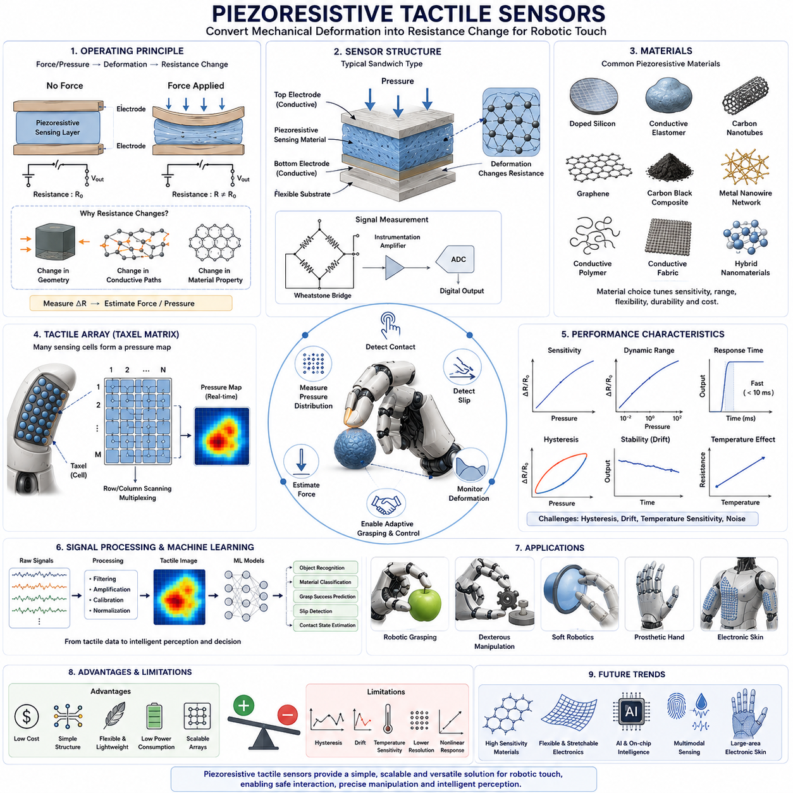{width="7.268055555555556in" height="7.268055555555556in"}

Piezoresistive tactile sensors are among the most widely used tactile sensing technologies in robotics because they offer a practical balance between sensitivity, simplicity, manufacturability, and cost. These sensors convert mechanical pressure, force, or deformation into measurable electrical resistance changes. Their relatively simple structure, low power requirements, compact form factor, and compatibility with flexible materials make them particularly attractive for robotic hands, tactile skins, grippers, prosthetics, wearable devices, and human-robot interaction systems. Within the broader field of tactile sensing, piezoresistive sensors represent one of the earliest and most mature approaches for implementing artificial touch, and they continue to play a significant role in modern dexterous manipulation systems. This chapter builds upon the tactile sensing foundations introduced in the previous section and examines the operating principles, materials, design methodologies, performance characteristics, advantages, limitations, and robotic applications of piezoresistive tactile sensing technologies.

The fundamental operating principle of a piezoresistive sensor is based on the relationship between mechanical deformation and electrical resistance. When a conductive or semiconductive material is compressed, stretched, bent, or otherwise deformed, its electrical resistance changes. By measuring this resistance variation, the sensor can estimate the magnitude and sometimes the distribution of applied forces. The underlying phenomenon originates from changes in material geometry, changes in conductive pathways, or changes in the intrinsic electrical properties of the sensing material. In practical tactile sensing applications, these resistance changes are continuously monitored and converted into force or pressure estimates through calibration models and signal processing algorithms.

The concept can be understood by considering the basic resistance equation. Electrical resistance depends on material resistivity, conductor length, and cross-sectional area. Mechanical deformation modifies one or more of these parameters. Compression may shorten conductive pathways and increase contact density between conductive particles, reducing resistance. Stretching may elongate pathways and decrease conductive connectivity, increasing resistance. Depending on the material system and sensor architecture, both positive and negative resistance changes may occur. These resistance variations provide the measurable signals used for tactile perception.

One of the main reasons for the popularity of piezoresistive tactile sensors is their structural simplicity. A typical piezoresistive sensor consists of a sensing layer placed between conductive electrodes. When external pressure is applied, the sensing layer deforms and alters its electrical resistance. The resulting current or voltage changes are measured using relatively simple electronic circuits. Unlike optical tactile sensors that require cameras and image processing systems, or capacitive sensors that require sophisticated capacitance measurement circuits, piezoresistive sensors can often be implemented using straightforward voltage divider configurations and analog-to-digital converters. This simplicity significantly reduces system cost and integration complexity.

The sensing materials used in piezoresistive tactile sensors vary widely depending on performance requirements. Traditional sensors often utilize doped silicon structures, which exhibit strong piezoresistive effects and high sensitivity. Silicon-based sensors have been extensively used in microelectromechanical systems because semiconductor fabrication techniques enable precise and repeatable manufacturing. However, silicon is relatively rigid and brittle, making it less suitable for highly compliant robotic skins and flexible tactile surfaces.

To address these limitations, researchers have developed flexible piezoresistive materials based on conductive polymers, elastomers, carbon composites, graphene structures, carbon nanotubes, conductive fabrics, metallic nanowires, and hybrid nanomaterial systems. Conductive elastomers are particularly popular because they can deform significantly while maintaining sensing functionality. These materials often consist of silicone or polyurethane matrices embedded with conductive fillers such as carbon black, carbon nanotubes, or graphene particles. When compressed, conductive pathways between particles become denser, producing measurable resistance changes.

Carbon-based materials have become especially important in recent years. Carbon nanotubes provide excellent electrical conductivity, flexibility, and durability. Graphene offers exceptional sensitivity due to its unique two-dimensional structure and high carrier mobility. Carbon black composites remain attractive because of their low cost and ease of manufacturing. By carefully controlling filler concentration, particle distribution, and material composition, engineers can tune sensor sensitivity, dynamic range, and mechanical robustness for specific robotic applications.

The structural design of piezoresistive tactile sensors can take many forms. One common architecture is the sandwich structure, where a piezoresistive layer is placed between two conductive electrodes. External pressure changes the resistance of the intermediate layer. Another popular design employs conductive foam materials whose resistance changes as the foam compresses. Flexible membrane structures are also widely used in robotic fingertips and tactile skins. Microstructured surfaces containing pyramids, domes, pillars, or porous architectures are often introduced to improve sensitivity and enhance pressure localization.

The concept of tactile arrays plays a crucial role in piezoresistive sensing systems. A single sensing element can only provide information about one location. In contrast, a tactile array consists of numerous sensing cells distributed across a surface. Each sensing element, known as a taxel, measures local pressure independently. By arranging hundreds or thousands of taxels into matrix configurations, engineers can generate spatial pressure maps that resemble visual images. These pressure distributions provide valuable information regarding contact location, contact shape, object geometry, and force distribution.

Matrix-based tactile arrays offer significant advantages in robotic manipulation. During grasping, force is rarely distributed uniformly across contact surfaces. Instead, pressure concentrates at specific regions depending on object geometry, material properties, and grasp configuration. Tactile arrays allow robotic systems to visualize these force distributions in real time. This capability enables improved grasp quality assessment, adaptive force control, and contact monitoring during manipulation tasks.

One of the key performance metrics of piezoresistive tactile sensors is sensitivity. Sensitivity describes how strongly sensor output changes in response to applied pressure or force. High sensitivity is particularly important for detecting light contacts and subtle tactile events. In robotic manipulation, the ability to detect initial contact before significant force develops helps prevent object damage and improves manipulation precision. Material selection, structural design, electrode geometry, and microstructural engineering all influence sensor sensitivity.

Another important parameter is spatial resolution. Spatial resolution determines how accurately the sensor can localize contact events. Higher taxel density produces more detailed pressure maps but also increases wiring complexity, electronic requirements, and data processing demands. Designers must balance resolution against system cost and computational complexity. Robotic fingertips used for precision manipulation often require much higher resolution than large-area tactile skins intended primarily for collision detection and safety monitoring.

Dynamic range is equally important. A tactile sensor must be capable of detecting both very small and relatively large forces. Industrial robotic grippers may need to handle delicate electronic components and heavy mechanical parts using the same sensing platform. Achieving a wide dynamic range without sacrificing sensitivity presents a significant engineering challenge. Multi-layer sensor structures and nonlinear sensing materials are frequently employed to address this requirement.

Response time is another critical characteristic. Robotic manipulation often involves rapid interactions where contact conditions change within milliseconds. The sensor must respond quickly enough to support real-time control decisions. Modern piezoresistive sensors can achieve response times suitable for high-speed grasping, slip detection, and force feedback applications. Fast response becomes especially important when robots manipulate moving objects or perform dynamic assembly operations.

Hysteresis is one of the primary challenges associated with piezoresistive sensing. Hysteresis occurs when sensor output depends not only on the current force but also on previous loading history. During loading and unloading cycles, the same force value may produce different resistance measurements. This phenomenon complicates calibration and reduces measurement accuracy. Material viscoelasticity, internal friction, and microstructural rearrangements contribute to hysteresis behavior. Considerable research focuses on developing materials and compensation algorithms that minimize hysteresis effects.

Sensor drift represents another significant challenge. Over time, environmental factors such as temperature changes, humidity variations, material aging, and repeated mechanical loading may alter sensor characteristics. These effects can gradually change the relationship between force and resistance, reducing long-term measurement reliability. Calibration procedures, compensation models, and robust material design are essential for maintaining stable performance in real-world robotic systems.

Temperature sensitivity can also influence piezoresistive measurements. Many conductive materials exhibit resistance changes due to temperature fluctuations independent of applied force. Without compensation, temperature variations may be incorrectly interpreted as contact events or force changes. Advanced tactile systems often incorporate temperature sensors or compensation algorithms to separate thermal effects from mechanical signals.

Signal conditioning plays an important role in practical sensor implementation. Because resistance changes are often relatively small, electronic circuits must amplify, filter, and digitize sensor outputs accurately. Wheatstone bridge configurations are commonly employed to improve sensitivity and noise rejection. Low-noise amplifiers, analog filtering circuits, and high-resolution analog-to-digital converters further enhance measurement quality. Modern tactile systems increasingly integrate signal processing electronics directly within sensor modules to reduce wiring complexity and improve scalability.

Machine learning has become an increasingly important tool for interpreting piezoresistive tactile data. Traditional systems relied primarily on analytical models and calibration curves. However, modern tactile arrays generate complex, high-dimensional datasets that contain rich information regarding contact states and object properties. Neural networks can learn relationships between tactile patterns and manipulation outcomes, enabling object classification, material recognition, grasp success prediction, slip detection, and contact state estimation. Deep learning approaches are particularly effective when tactile arrays produce image-like pressure maps.

Piezoresistive tactile sensors have numerous applications in robotic grasping. During grasp acquisition, sensors detect initial contact and prevent excessive gripping forces. During object lifting, they monitor pressure distributions and identify unstable contact conditions. During manipulation, they provide feedback regarding force regulation and object movement. During slip events, changes in pressure patterns and force distributions help trigger corrective actions. These capabilities significantly improve grasp reliability and reduce the likelihood of object damage.

In dexterous robotic hands, piezoresistive sensors are often integrated into fingertips, finger pads, palms, and even entire robotic skins. Fingertip sensors provide high-resolution local measurements essential for fine manipulation. Palm sensors help monitor large-area contact interactions during power grasps. Whole-hand tactile skins provide comprehensive awareness of environmental interactions and support safe physical collaboration between robots and humans.

The field of prosthetics has also benefited significantly from piezoresistive tactile sensing technology. Modern prosthetic hands increasingly incorporate tactile sensors to restore sensory feedback capabilities. By measuring contact forces and transmitting information to users through vibrotactile, electrotactile, or neural interfaces, these systems enhance object manipulation performance and improve user embodiment. Similar technologies are being explored for exoskeletons and wearable robotic systems.

Soft robotics represents another major application area. Soft robotic grippers rely on compliant structures that naturally conform to object shapes. Integrating flexible piezoresistive sensors into soft fingers enables simultaneous shape adaptation and tactile perception. These sensors allow soft robots to estimate contact forces, detect object presence, and monitor deformation states without sacrificing compliance. As soft robotics continues to expand into agriculture, healthcare, logistics, and service applications, flexible piezoresistive tactile sensing technologies are expected to become increasingly important.

Large-area electronic skins represent one of the most exciting future directions. Inspired by biological skin, electronic skins integrate thousands of tactile sensing elements across extensive flexible surfaces. Such systems enable robots to perceive contact over their entire bodies rather than only at fingertips. This capability supports safer human-robot interaction, improved environmental awareness, and more natural physical collaboration. Piezoresistive sensing remains one of the most promising technologies for realizing scalable electronic skin systems because of its simplicity and compatibility with flexible materials.

Future developments are likely to focus on improving sensitivity, reducing hysteresis, enhancing durability, increasing spatial resolution, and integrating artificial intelligence directly into sensing platforms. Advances in nanomaterials, flexible electronics, additive manufacturing, and self-healing materials will further expand the capabilities of piezoresistive tactile systems. Emerging research explores multimodal sensors that simultaneously measure pressure, shear force, temperature, vibration, and deformation using unified sensing architectures. These next-generation tactile systems will play a critical role in enabling robots to interact with the physical world with increasing levels of intelligence and dexterity.

In conclusion, piezoresistive tactile sensors provide one of the most practical and widely adopted approaches for robotic touch sensing. Their operating principle is based on the conversion of mechanical deformation into electrical resistance changes. Through careful material selection, structural design, signal processing, and calibration, these sensors can provide reliable measurements of contact forces, pressure distributions, and tactile interaction states. Their simplicity, flexibility, scalability, and compatibility with robotic hands, tactile skins, prosthetic devices, and soft robots ensure that they will remain a foundational technology in tactile sensing research and industrial deployment for many years to come.

## 07.03 Capacitive Sensors

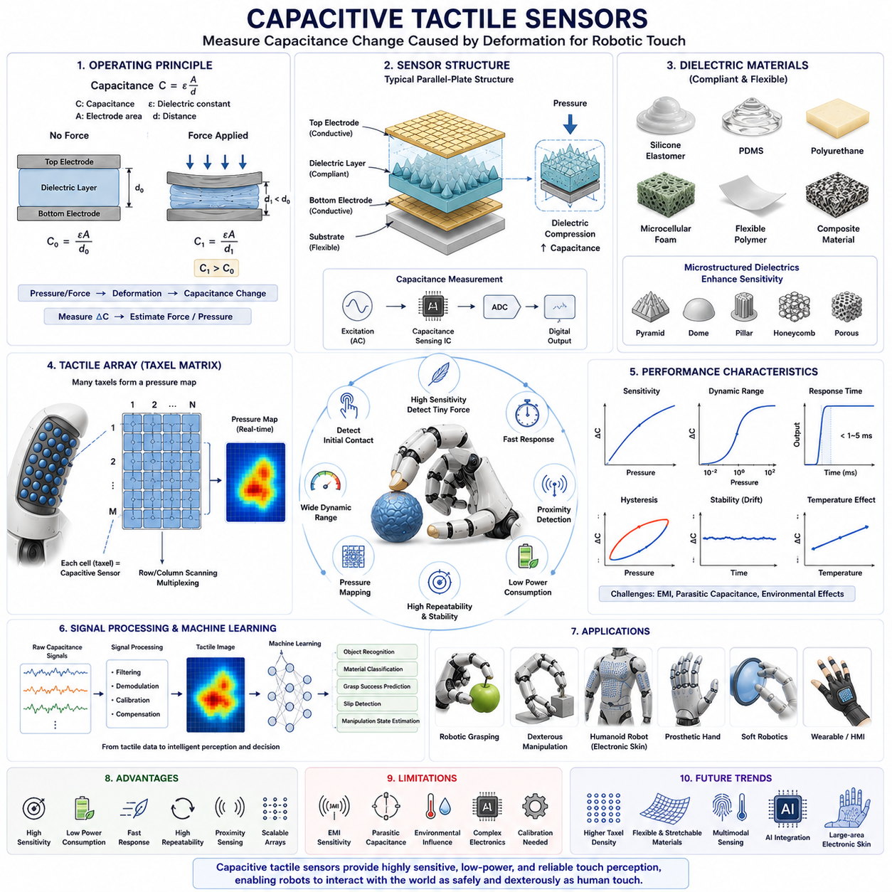{width="7.268055555555556in" height="7.268055555555556in"}

Capacitive tactile sensors represent one of the most important and widely adopted technologies in modern robotic touch sensing. They operate by measuring changes in electrical capacitance caused by mechanical deformation, pressure, force, or proximity. Due to their high sensitivity, low power consumption, excellent repeatability, and ability to detect very small contact forces, capacitive tactile sensors have become a key enabling technology in robotic hands, dexterous manipulators, humanoid robots, electronic skin systems, prosthetic devices, wearable robotics, and human-machine interfaces. Within the field of robotic tactile perception, capacitive sensing is often regarded as one of the closest technological analogs to the sensitivity and responsiveness of human skin. This chapter examines the operating principles, sensor architectures, materials, performance characteristics, signal processing methods, advantages, limitations, and practical applications of capacitive tactile sensing systems in robotic manipulation.

The fundamental operating principle of a capacitive tactile sensor is based on the concept of capacitance. A capacitor consists of two conductive electrodes separated by a dielectric material. The capacitance of the system depends on the area of overlap between the electrodes, the distance separating them, and the dielectric constant of the material located between them. When an external force is applied to the sensor, the geometry of the structure changes. This deformation alters one or more of these parameters and consequently changes the measured capacitance. By monitoring these capacitance variations, the sensor can estimate the magnitude and location of external contact forces.

The relationship governing capacitance can be expressed through the classical parallel-plate capacitor equation. Capacitance increases when electrode area increases, when electrode spacing decreases, or when the dielectric constant becomes larger. In tactile sensing applications, mechanical pressure commonly compresses the dielectric layer, reducing electrode separation and increasing capacitance. This capacitance change serves as the primary sensing signal used to infer contact conditions. Unlike piezoresistive sensors, which rely on resistance changes within conductive materials, capacitive sensors measure geometric and dielectric variations directly, often resulting in greater sensitivity and lower signal drift.

One of the most attractive characteristics of capacitive tactile sensors is their ability to detect extremely small forces. Even microscopic deformations can produce measurable capacitance variations. This capability allows robots to detect initial contact events before significant forces develop. Such sensitivity is particularly valuable when manipulating fragile objects such as electronic components, laboratory samples, medical instruments, food products, glass containers, or soft biological materials. Early contact detection helps reduce impact forces and minimizes the risk of damage during grasp acquisition.

The structure of a typical capacitive tactile sensor is relatively straightforward. Two conductive electrode layers are separated by a compliant dielectric layer. When external pressure is applied, the dielectric compresses and changes the electrode spacing. Capacitance measurement electronics continuously monitor this variation and convert it into force estimates. Although the basic principle appears simple, practical implementations often involve sophisticated microstructures and advanced fabrication techniques to optimize sensitivity, spatial resolution, dynamic range, and mechanical durability.

Capacitive tactile sensors may employ a variety of electrode configurations. Parallel-plate architectures represent the most common design due to their simplicity and high sensitivity. Interdigitated electrode structures are frequently used for flexible tactile skins because they can be fabricated on a single substrate layer. Some advanced designs utilize multilayer electrode arrangements that support three-dimensional force sensing and improved spatial localization. The selection of electrode geometry significantly influences sensor performance and manufacturing complexity.

The dielectric layer plays a crucial role in determining overall sensor behavior. Common dielectric materials include silicone elastomers, polyurethane films, polydimethylsiloxane (PDMS), flexible polymers, microcellular foams, and composite materials. The mechanical properties of the dielectric directly affect sensitivity, response speed, hysteresis, and durability. Softer dielectric materials typically provide higher sensitivity because they deform more easily under small loads. However, excessively soft materials may reduce dynamic range and increase susceptibility to mechanical wear.

Modern capacitive tactile sensors frequently incorporate microstructured dielectric layers to enhance performance. Microstructures such as pyramids, domes, pillars, cones, honeycomb patterns, and porous architectures concentrate mechanical deformation within specific regions. These engineered structures amplify capacitance changes and significantly improve sensitivity, especially in low-force operating ranges. Microstructured dielectrics have become a major research area because they allow substantial performance improvements without requiring fundamental changes to sensor electronics.

One of the most important advantages of capacitive sensing is its exceptionally low power consumption. Since the sensing mechanism involves measuring electrostatic properties rather than driving currents through resistive materials, energy requirements remain relatively small. This characteristic makes capacitive sensors particularly attractive for battery-powered robotic systems, wearable devices, prosthetic limbs, and distributed electronic skin applications where power efficiency is critical.

Another significant advantage is excellent repeatability. Capacitive sensors generally exhibit less long-term drift than many resistive sensing technologies because the sensing mechanism depends primarily on geometric changes rather than conductive network rearrangements. This stability contributes to consistent measurements over extended operating periods. As a result, capacitive tactile sensors are frequently selected for applications requiring high precision and reliable calibration.

Capacitive tactile sensing systems often employ tactile arrays to provide spatially distributed contact information. A tactile array consists of numerous sensing cells arranged across a surface. Each sensing element functions as an individual capacitor that independently measures local pressure. The resulting array generates a pressure map similar to an image, where each sensing cell corresponds to a taxel. High-density tactile arrays may contain hundreds or thousands of taxels, allowing robots to perceive detailed contact distributions and object geometries.

The concept of a tactile image has become increasingly important in modern robotic perception. Just as digital cameras generate images using arrays of pixels, tactile arrays generate pressure images using arrays of taxels. These tactile images contain valuable information regarding contact location, force distribution, object shape, edge features, texture patterns, and manipulation states. Advanced machine learning algorithms can process tactile images using techniques originally developed for computer vision, enabling sophisticated perception capabilities.

Spatial resolution is a key performance metric for capacitive tactile arrays. High-resolution arrays can localize contact events with greater precision and capture finer geometric details. However, increasing taxel density also increases electronic complexity, data bandwidth requirements, and computational demands. Engineers must carefully balance spatial resolution against practical implementation constraints. Robotic fingertips designed for dexterous manipulation often prioritize high resolution, whereas large-area safety skins may emphasize coverage and robustness instead.

Dynamic range is another important characteristic. A tactile sensor must respond effectively to both very small and relatively large forces. High sensitivity alone is insufficient if the sensor saturates under moderate loading conditions. Capacitive sensor designers often employ nonlinear mechanical structures, layered dielectrics, or adaptive sensing strategies to achieve broad operating ranges while maintaining sensitivity at low force levels.

Response time plays a critical role in robotic manipulation. Contact conditions can change rapidly during grasping, object transfer, assembly operations, and dynamic interactions. Capacitive tactile sensors generally exhibit fast response characteristics because capacitance changes occur almost instantaneously with mechanical deformation. This rapid response supports real-time control systems that require immediate feedback regarding contact events and force changes.

Capacitive sensors also possess the unique ability to detect proximity in addition to direct contact. Because electric fields extend beyond the physical sensor surface, nearby objects can influence capacitance measurements even before contact occurs. This capability allows certain capacitive tactile systems to function as both proximity sensors and contact sensors. Such dual functionality provides valuable information during grasp approach and collision avoidance tasks.

Despite their many advantages, capacitive tactile sensors also present several engineering challenges. One of the most significant issues is sensitivity to electromagnetic interference. External electric fields, nearby electronic components, and environmental noise sources can affect capacitance measurements. Careful shielding, grounding, circuit design, and signal processing techniques are required to maintain measurement accuracy in complex robotic environments.

Parasitic capacitance represents another challenge. In practical systems, wiring, connectors, circuit boards, and surrounding structures introduce unintended capacitance that may obscure the desired sensing signals. As tactile arrays become larger and more complex, managing parasitic effects becomes increasingly important. Advanced electronics and calibration procedures are often necessary to separate true tactile signals from background capacitance variations.

Environmental conditions can also influence capacitive sensor performance. Changes in humidity, temperature, contamination, and material aging may alter dielectric properties and affect measurement accuracy. Protective coatings, environmental compensation algorithms, and robust sensor packaging are commonly employed to address these issues. Industrial applications often require sensors capable of maintaining stable performance under challenging operating conditions.

Signal acquisition and processing play a central role in capacitive tactile sensing systems. Because capacitance changes are often extremely small, specialized measurement circuits are required. Techniques such as charge transfer sensing, capacitance-to-digital conversion, oscillation frequency measurement, and bridge-based detection are commonly used. High-resolution capacitance measurement integrated circuits have greatly simplified sensor implementation and enabled large-scale tactile arrays with thousands of sensing elements.

The integration of capacitive tactile sensing with machine learning has opened new possibilities for robotic perception. Deep neural networks can analyze tactile pressure maps to recognize object categories, estimate object poses, identify materials, predict grasp success, detect slip events, and infer manipulation states. The image-like nature of tactile array data makes it particularly suitable for convolutional neural networks and transformer architectures originally developed for computer vision applications.

Capacitive tactile sensors are widely used in robotic grasping systems. During grasp acquisition, they detect initial contact and help regulate gripping forces. During object manipulation, they provide information regarding force distribution and contact stability. During dexterous tasks, they support fine adjustments based on local pressure measurements. Their high sensitivity enables robots to handle delicate objects with greater confidence and precision.

In dexterous robotic hands, capacitive sensors are often embedded within fingertips, finger pads, palms, and compliant skin structures. Fingertip sensors provide detailed local contact information necessary for precision manipulation. Palm sensors contribute to large-area force distribution measurements during power grasps. Whole-hand tactile skins enable robots to perceive environmental interactions across broader surface areas and improve safety during physical collaboration with humans.

Humanoid robots increasingly rely on capacitive tactile sensing technologies to achieve human-like physical awareness. Human skin contains millions of mechanoreceptors distributed across the body, providing continuous feedback regarding contact and interaction forces. Capacitive electronic skins attempt to replicate this capability by distributing tactile sensors across robotic limbs, hands, torsos, and even facial structures. Such systems enhance safety, improve interaction quality, and support more natural human-robot collaboration.

The field of prosthetics has also benefited significantly from capacitive tactile sensing. Modern prosthetic hands incorporate tactile sensors to estimate contact forces and provide sensory feedback to users through vibrotactile, electrotactile, or neural stimulation interfaces. These systems improve manipulation performance and help restore a sense of embodiment by reconnecting users with physical interaction information that would otherwise be unavailable.

Flexible electronics have further expanded the potential of capacitive tactile sensors. Advances in stretchable conductors, flexible substrates, printed electronics, and soft materials enable the creation of highly deformable tactile skins. These systems conform to complex curved surfaces while maintaining sensing performance. Flexible capacitive sensors are becoming increasingly important for soft robotics, wearable devices, medical robotics, and next-generation humanoid systems.

Recent research explores multimodal capacitive sensing platforms capable of measuring multiple physical quantities simultaneously. By combining pressure sensing with temperature sensing, proximity sensing, vibration sensing, humidity sensing, or shear force sensing, researchers aim to create tactile systems that more closely resemble biological skin. Such multimodal sensors provide richer environmental information and improve robotic decision-making during complex manipulation tasks.

Future developments are expected to focus on higher taxel densities, improved flexibility, enhanced durability, reduced manufacturing costs, and tighter integration with artificial intelligence systems. Nanomaterials, microfabrication technologies, printed electronics, self-healing materials, and neuromorphic sensing architectures are likely to play important roles in next-generation capacitive tactile sensors. These advances may ultimately enable robotic systems to achieve levels of tactile perception approaching or even surpassing those of human touch in specific applications.

In conclusion, capacitive tactile sensors represent one of the most powerful and versatile technologies for robotic touch perception. Their operating principle is based on measuring capacitance changes caused by mechanical deformation, pressure, and contact events. Through appropriate material selection, sensor architecture design, signal processing, and machine learning integration, capacitive tactile systems can provide highly sensitive, repeatable, and energy-efficient tactile perception. Their widespread adoption in robotic hands, dexterous manipulators, electronic skins, prosthetic devices, humanoid robots, and wearable systems demonstrates their importance in the ongoing development of intelligent robotic interaction with the physical world. As tactile sensing technologies continue to evolve, capacitive sensors are expected to remain a cornerstone of advanced robotic touch systems and a critical component in the pursuit of human-level manipulation capabilities.

## 07.04 Barometric Pressure Sensors

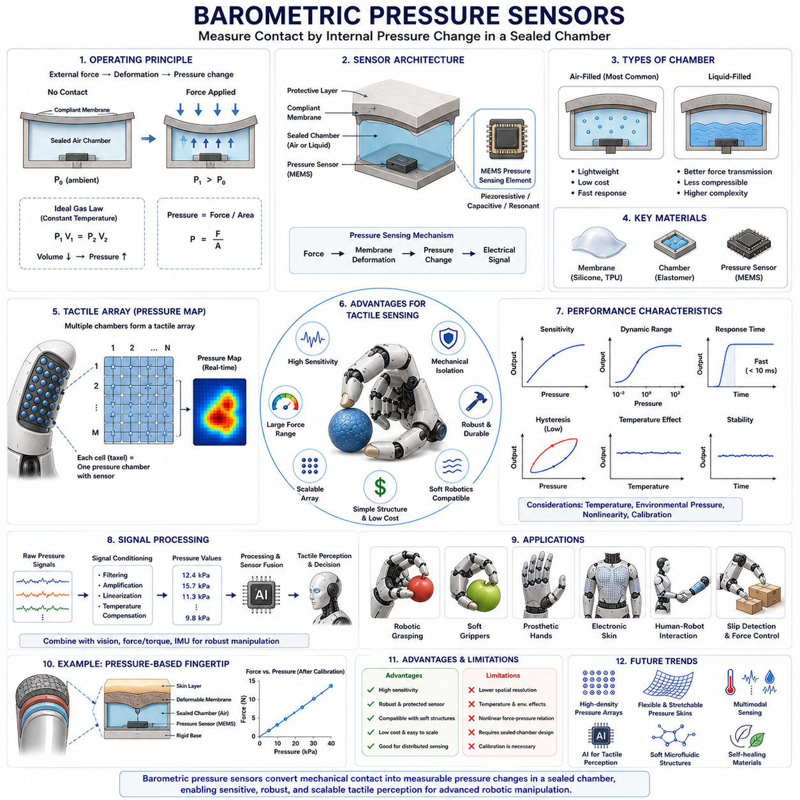{width="7.268055555555556in" height="7.268055555555556in"}

Barometric pressure sensors have emerged as an important sensing technology in robotic tactile perception because they provide a simple, compact, and highly sensitive method for measuring contact forces, pressure distributions, deformation, and interaction dynamics. Although barometric sensors were originally developed for atmospheric pressure measurement in meteorology, aviation, and consumer electronics, their integration into robotic tactile sensing systems has opened new possibilities for creating compliant, robust, and highly sensitive artificial touch sensors. In robotic hands, soft grippers, prosthetic devices, and electronic skin systems, barometric pressure sensors are increasingly used as embedded force-sensing elements that convert mechanical contact into measurable pressure variations within sealed air chambers or deformable structures. Their ability to measure subtle pressure changes while maintaining simple mechanical architectures makes them particularly attractive for robotic manipulation applications where cost, robustness, and scalability are important considerations. This chapter explores the operating principles, sensor architectures, materials, design methodologies, performance characteristics, signal processing techniques, advantages, limitations, and practical applications of barometric pressure sensors in tactile sensing systems.

The fundamental operating principle of a barometric pressure sensor is based on the measurement of pressure variations within a confined medium, typically air or another compressible fluid. In conventional atmospheric sensing applications, the sensor measures changes in ambient air pressure caused by weather conditions or altitude variations. In tactile sensing applications, however, the sensor is integrated into a sealed chamber or compliant structure such that external mechanical contact deforms the chamber and changes the internal pressure. These pressure variations are detected by the barometric sensing element and converted into electrical signals that represent contact forces and tactile interactions.

The concept can be understood by considering a simple sealed air cavity located beneath a compliant membrane. When an external force presses on the membrane, the cavity volume decreases. According to the ideal gas law, reducing the volume of a sealed gas chamber increases internal pressure. A pressure sensor located within or connected to the cavity measures this pressure increase. Because the pressure change is directly related to the applied force and deformation, the sensor can estimate contact conditions without requiring direct force measurement at the contact surface itself.

One of the primary advantages of barometric pressure sensing in tactile applications is that the sensing element can be physically isolated from the contact region. Unlike traditional force sensors that must directly experience mechanical loading, barometric sensors can be protected within enclosed structures. The contact force is transmitted through pressure changes in the enclosed medium rather than direct mechanical stress on sensitive electronic components. This architecture improves durability and simplifies sensor packaging.

Modern barometric pressure sensors are typically based on microelectromechanical systems (MEMS) technology. MEMS pressure sensors contain miniature diaphragms that deform under pressure changes. Integrated piezoresistive, capacitive, piezoelectric, or resonant sensing elements convert diaphragm deformation into measurable electrical signals. Advances in semiconductor manufacturing have enabled the production of highly accurate, compact, low-cost pressure sensors that can be integrated into robotic fingertips, soft robotic actuators, wearable systems, and electronic skins.

The sensing mechanism generally involves a flexible membrane, an enclosed pressure chamber, and a pressure transducer. External contact deforms the membrane, causing a pressure change inside the chamber. The pressure transducer measures this change and generates an output signal proportional to the applied force. Because pressure distributes uniformly throughout a confined fluid volume according to Pascal's Law, the sensing architecture naturally integrates forces across contact regions. This characteristic provides robust measurements even when contact occurs over irregular or distributed surfaces.

The relationship between force and pressure can be described through classical mechanics. Pressure is defined as force divided by area. When a force is applied to a compliant surface, the resulting deformation modifies the internal chamber volume and pressure. The exact relationship depends on chamber geometry, membrane stiffness, fluid properties, and structural compliance. Calibration procedures are typically used to establish accurate force-pressure mappings for specific sensor designs.

Barometric tactile sensors can employ either air-filled or liquid-filled chambers. Air-filled systems are lightweight, inexpensive, and highly responsive. They are commonly used in robotic grippers, soft robotic fingers, and electronic skin systems. Liquid-filled systems offer reduced compressibility and may provide improved force transmission characteristics, although they often introduce greater complexity and weight. The choice between air and liquid media depends on application requirements and design constraints.

One of the most attractive characteristics of barometric tactile sensing is compatibility with soft robotics. Soft robotic systems rely on compliant structures that deform significantly during interaction with objects. Traditional rigid force sensors can interfere with this compliance. Barometric sensors, however, can be embedded within soft materials while maintaining flexibility and adaptability. The sensing function is performed through internal pressure changes rather than rigid structural deformation, making these sensors particularly suitable for soft robotic manipulation.

Soft robotic grippers frequently incorporate pressure sensing chambers throughout their fingers. When the gripper contacts an object, local deformation changes internal chamber pressures. By monitoring these pressure variations, the robot can estimate grasp forces, detect object presence, evaluate grasp stability, and adjust gripping actions. This sensing strategy enables compliant manipulation while preserving the inherent flexibility of soft robotic structures.

Another significant advantage is the ability to measure distributed contact forces using relatively simple hardware. Multiple pressure chambers can be arranged throughout a tactile surface, creating a pressure sensing array. Each chamber functions as an individual sensing cell that measures local interactions. The resulting pressure distribution map provides information about contact location, contact geometry, object shape, and force distribution. These pressure maps are analogous to tactile images generated by capacitive or piezoresistive tactile arrays.

The concept of tactile imaging using barometric sensors has gained increasing attention in recent years. By arranging pressure chambers into matrix configurations, robotic systems can capture spatial patterns of contact pressure. Machine learning algorithms can analyze these pressure patterns to identify object characteristics, estimate grasp quality, recognize materials, and detect manipulation states. The combination of tactile imaging and artificial intelligence significantly expands the capabilities of barometric tactile sensing systems.

Sensitivity is one of the most important performance characteristics of barometric tactile sensors. Modern MEMS pressure sensors are capable of detecting extremely small pressure variations. Consequently, tactile systems based on barometric sensing can detect very light contacts and subtle interactions. Sensitivity depends on membrane design, chamber geometry, pressure sensor resolution, and fluid properties. Optimizing these parameters allows designers to tailor sensor performance for specific applications.

Dynamic range is equally important. Robotic manipulation tasks often involve both delicate and relatively large forces. A sensor must maintain adequate sensitivity while avoiding saturation under higher loads. Chamber volume, membrane stiffness, and sensor selection all influence dynamic range. Engineers frequently balance sensitivity and range according to application requirements.

Response time represents another critical performance metric. Contact conditions can change rapidly during robotic manipulation. The sensor must respond quickly enough to support real-time control. Air-filled chambers generally exhibit fast response characteristics due to the rapid propagation of pressure changes. However, chamber size, fluid dynamics, and sensor bandwidth influence overall system response. Proper design can achieve response times suitable for grasp control, slip detection, and dynamic interaction tasks.

Hysteresis is often lower in barometric sensing systems than in many polymer-based resistive tactile sensors because the sensing mechanism depends primarily on fluid pressure rather than material conductivity changes. Nevertheless, membrane materials may exhibit viscoelastic effects that introduce some hysteresis under repeated loading conditions. Careful material selection and structural design help minimize these effects.

Temperature sensitivity must also be considered. Pressure measurements are influenced by temperature because gas pressure depends on both volume and temperature. Changes in ambient temperature may alter baseline pressure readings even without external contact. Modern pressure sensors often include integrated temperature compensation mechanisms that improve measurement stability under varying environmental conditions.

Signal processing plays an essential role in extracting meaningful tactile information from barometric pressure sensors. Raw pressure measurements are typically filtered to remove noise and environmental disturbances. Calibration models convert pressure readings into force estimates. Sensor fusion techniques combine pressure measurements with information from vision systems, force-torque sensors, inertial sensors, and proprioceptive sensors to provide comprehensive representations of manipulation states.

Barometric pressure sensors are particularly effective in force estimation applications. During grasping operations, pressure measurements provide continuous information regarding grip strength. This feedback enables closed-loop force control, allowing robots to maintain secure grasps without applying excessive force. Such capabilities are essential when handling fragile objects such as fruits, laboratory samples, electronic components, medical devices, and consumer products.

Slip detection represents another important application area. As an object begins to slip, contact force distributions change. These changes often produce measurable pressure variations within tactile sensing chambers. By analyzing temporal pressure patterns, robotic systems can identify incipient slip conditions and adjust grip forces before complete grasp failure occurs. Early slip detection significantly improves grasp reliability and manipulation robustness.

Barometric tactile sensing is also widely used in prosthetic systems. Prosthetic hands equipped with pressure-based tactile sensors can estimate contact forces and object interactions. This information may be conveyed to users through vibrotactile feedback, electrotactile stimulation, or neural interfaces. Such sensory feedback enhances manipulation performance and improves the user's perception of interaction with the environment.

Electronic skin systems increasingly incorporate pressure-based sensing technologies. Large-area electronic skins containing distributed pressure chambers provide robots with body-wide tactile awareness. These systems enhance safety by enabling robots to detect unexpected contact events across their surfaces. Human-robot collaboration benefits significantly from such capabilities because tactile awareness allows robots to respond appropriately to physical interactions.

The integration of barometric pressure sensing with machine learning has further expanded its usefulness. Neural networks can analyze pressure distributions and temporal pressure sequences to classify objects, estimate contact locations, predict grasp success, identify materials, and recognize manipulation tasks. Deep learning methods are particularly effective when pressure sensors are arranged into high-density arrays that generate image-like tactile data.

Compared with capacitive and piezoresistive tactile sensors, barometric pressure sensors offer several unique advantages. They provide excellent mechanical isolation, robust packaging, compatibility with soft structures, relatively simple system architectures, and strong suitability for distributed sensing applications. However, they also have limitations. Spatial resolution may be lower than that of high-density tactile arrays. Chamber design introduces mechanical complexity. Environmental pressure changes may require compensation. Furthermore, the relationship between applied force and internal pressure can be nonlinear, requiring careful calibration and modeling.

Recent research explores advanced architectures involving microfluidic channels, distributed pressure networks, soft pneumatic skins, and flexible pressure sensing matrices. These systems aim to improve spatial resolution, sensitivity, and scalability while preserving the benefits of pressure-based sensing. The combination of soft materials, MEMS pressure sensors, and intelligent data processing is driving rapid progress in this field.

Future developments are expected to focus on miniaturization, flexible integration, multimodal sensing, self-healing materials, and AI-enabled perception systems. Researchers are investigating tactile skins that combine pressure sensing with temperature sensing, vibration sensing, proximity sensing, and shear force estimation. Such multimodal systems more closely resemble biological skin and provide richer information for robotic decision-making.

Advances in flexible electronics, additive manufacturing, microfluidics, and soft robotics will likely accelerate the adoption of barometric tactile sensing technologies. High-density pressure sensor arrays embedded within soft robotic hands may enable robots to achieve increasingly sophisticated manipulation capabilities. Pressure-based tactile perception may also become a critical component of future humanoid robots designed to operate safely and effectively in human-centered environments.

In conclusion, barometric pressure sensors provide a powerful and versatile approach to tactile sensing by converting mechanical contact into measurable pressure variations within enclosed chambers or compliant structures. Their compatibility with soft robotics, high sensitivity, robust mechanical isolation, and scalability make them particularly attractive for robotic hands, prosthetic devices, electronic skins, and advanced manipulation systems. Through continued advances in sensor technology, materials science, machine learning, and soft robotics, barometric tactile sensing is expected to play an increasingly important role in the development of intelligent robotic systems capable of interacting with the physical world through rich and reliable tactile perception.

## 07.05 Optical Tactile Sensors

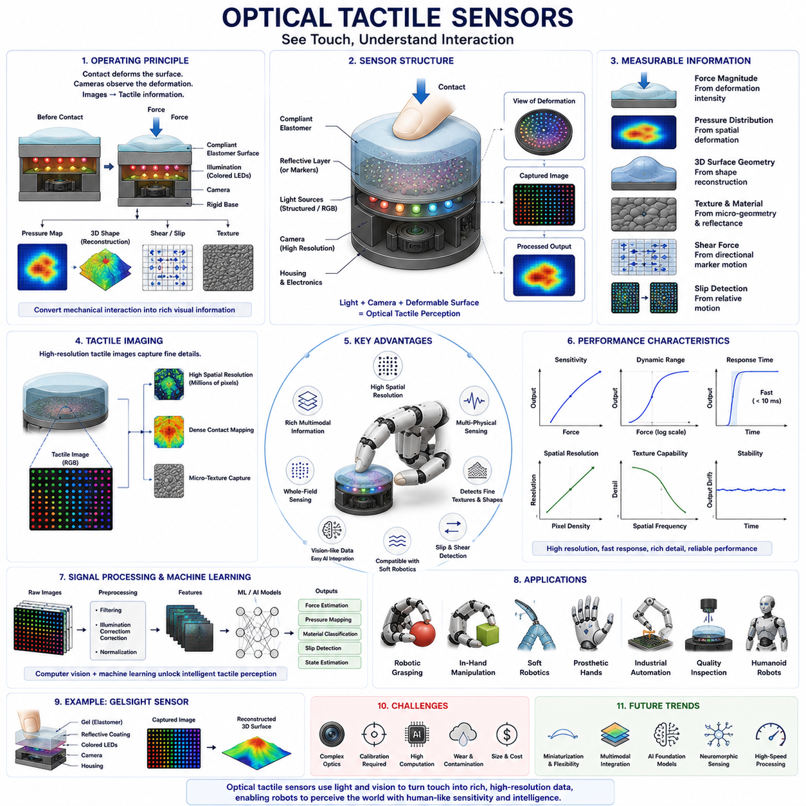{width="7.268055555555556in" height="7.268055555555556in"}

Optical tactile sensors represent one of the most advanced and rapidly evolving technologies in robotic touch sensing. Unlike traditional tactile sensors that rely on changes in resistance, capacitance, or pressure, optical tactile sensors use light, cameras, and image processing techniques to measure contact forces, pressure distributions, surface geometry, texture, deformation, and slip. By converting physical contact into visual information, these sensors provide extremely rich tactile data with high spatial resolution and excellent sensitivity. As a result, optical tactile sensing has become a key technology in robotic manipulation, dexterous robotic hands, soft robotics, prosthetic systems, humanoid robots, and physical artificial intelligence systems. Many researchers consider optical tactile sensing to be one of the most promising approaches for achieving human-level tactile perception because it combines the strengths of vision and touch within a unified sensing framework.

The fundamental concept behind optical tactile sensing is relatively straightforward. When an object comes into contact with a deformable surface, the surface changes shape. Instead of measuring electrical changes directly at the contact location, an optical tactile sensor observes the deformation using cameras, light sources, and image processing algorithms. The resulting images contain detailed information regarding the contact state. By analyzing these images, the system can estimate force magnitude, force direction, contact geometry, pressure distribution, object shape, texture, and dynamic interaction behavior.

A typical optical tactile sensor consists of several major components. The outer layer is usually a compliant elastomeric surface made from silicone, polyurethane, or other deformable materials. This surface acts as an artificial skin that deforms when contact occurs. Beneath the elastomer is an illumination system that provides controlled lighting conditions. A camera or image sensor is positioned inside the sensor structure and continuously observes the deformation of the elastomer. Image processing algorithms analyze the captured images and convert visual deformation patterns into tactile information. This architecture effectively transforms mechanical interaction into a computer vision problem.

The sensing process begins when an external object presses against the compliant sensing surface. The elastomer deforms according to the contact force and object geometry. This deformation modifies the visual appearance of the internal surface. Embedded cameras capture images of the changing surface, while image processing algorithms track deformation patterns. By comparing the current image with a reference image obtained before contact, the system can determine how the surface has changed and infer the physical properties of the interaction.

One of the most important advantages of optical tactile sensors is their exceptionally high spatial resolution. Traditional tactile arrays may contain hundreds or thousands of sensing elements, but modern cameras contain millions of pixels. Consequently, optical tactile sensors can provide detailed contact images with resolutions far exceeding those of many conventional tactile technologies. This high-resolution capability enables robots to perceive fine surface details, subtle contact patterns, and microscopic texture features that would otherwise be difficult to detect.

The concept of tactile imaging plays a central role in optical tactile sensing. A tactile image is analogous to a visual image, except that it represents contact information rather than reflected light from external scenes. Each pixel corresponds to a local deformation or pressure-related feature. These tactile images can be processed using many of the same computer vision techniques used for object recognition and scene understanding. The ability to treat tactile information as image data has greatly accelerated research in this field because it allows the use of mature machine learning and image analysis tools.

One of the most influential developments in optical tactile sensing is the GelSight sensor family. GelSight sensors utilize a soft transparent elastomer coated with a reflective membrane. Colored illumination sources project light onto the surface, and a camera observes how the reflected light changes during contact. Surface deformations alter the reflected light patterns, enabling highly accurate reconstruction of contact geometry and pressure distributions. GelSight sensors can resolve extremely fine surface details, including scratches, fingerprints, engraved markings, and microscopic textures. Their performance has demonstrated the tremendous potential of optical tactile sensing for robotic manipulation.

Optical tactile sensors can measure multiple physical quantities simultaneously. Contact force can be estimated by analyzing deformation magnitude. Pressure distribution can be inferred from spatial deformation patterns. Surface texture can be characterized by examining fine geometric details. Shear forces can be estimated by tracking lateral deformation movements. Slip can be detected by observing relative motion between the contact region and the sensor surface. This multimodal sensing capability is one of the key reasons optical tactile sensors have gained widespread attention.

Force estimation is a particularly important application. When an object presses against the sensor surface, larger forces generally produce greater deformations. Machine learning models or physics-based reconstruction algorithms can estimate force magnitude from observed deformation patterns. Some systems are capable of reconstructing full three-dimensional force vectors, including both normal and tangential components. This capability provides valuable information for grasp control and manipulation planning.

Pressure mapping is another significant strength of optical tactile sensors. Because the entire contact region is imaged simultaneously, the sensor can generate detailed pressure distribution maps. These maps reveal how forces are distributed across the contact surface. Pressure maps provide important information regarding grasp stability, contact quality, object geometry, and manipulation state. Robots can use this information to adjust grasp forces and improve handling performance.

Texture sensing represents one of the most impressive capabilities of optical tactile systems. Human fingertips can distinguish extremely fine texture variations, and advanced optical tactile sensors can approach similar performance levels. By capturing microscopic surface details through high-resolution imaging, robots can identify materials, classify objects, and recognize surface conditions. Texture information can assist in object recognition, material characterization, quality inspection, and manipulation planning.

Slip detection is another critical function. During grasping, objects may begin to move relative to the robot\'s fingers. Early detection of slip is essential for maintaining stable grasps. Optical tactile sensors can detect slip by tracking the movement of contact features across the sensor surface. Because image-based tracking is highly precise, even very small slip motions can be detected before complete grasp failure occurs. This allows robots to react quickly and increase grip force when necessary.

Shear force measurement further enhances manipulation capabilities. Shear forces occur when objects experience tangential forces along the contact surface. These forces play an important role in grasp stability, friction estimation, and object manipulation. Optical tactile sensors can estimate shear forces by analyzing directional deformation patterns and marker displacements embedded within the elastomer surface. Accurate shear force measurements contribute to more sophisticated manipulation strategies and improved dexterity.

Several design variations exist within the field of optical tactile sensing. Some systems use reflective surfaces and structured illumination. Others employ embedded markers within transparent elastomers. Marker-based systems track the movement of visual markers as the sensor deforms. The displacement field generated by marker motion provides information regarding force distributions and contact mechanics. Marker tracking techniques have become increasingly popular because they simplify deformation analysis and support real-time processing.

Three-dimensional surface reconstruction is another important capability. Advanced optical tactile sensors can reconstruct the geometry of contact surfaces by analyzing shading, illumination patterns, and deformation fields. This process transforms tactile sensing into a form of microscopic three-dimensional scanning. Robots can use reconstructed surface models to understand object shape, identify grasp locations, and perform detailed inspection tasks.

Machine learning has played a transformative role in the development of optical tactile sensing. Traditional tactile systems often relied on handcrafted models and calibration procedures. Modern optical tactile sensors generate rich image datasets that are highly compatible with deep learning methods. Convolutional neural networks, transformer architectures, and self-supervised learning approaches can extract meaningful features directly from tactile images. These models can recognize objects, estimate forces, classify materials, detect slip, infer contact states, and predict manipulation outcomes.

The integration of tactile perception and computer vision has created a powerful new research area known as visuotactile learning. In visuotactile systems, visual information from cameras observing the environment is combined with tactile information obtained through contact. Vision provides global information before contact occurs, while tactile sensing provides local information after contact. Together, these sensing modalities enable robots to perform more robust and intelligent manipulation. Many modern manipulation systems rely on visuotactile learning to improve grasp planning, object recognition, and dexterous control.

Optical tactile sensors have become increasingly important in robotic grasping research. During grasp acquisition, they provide detailed feedback regarding contact quality. During manipulation, they continuously monitor force distributions and contact states. During in-hand manipulation tasks, they track object motion relative to the fingers. These capabilities significantly improve manipulation reliability and reduce dependence on highly accurate object models.

Soft robotics has also benefited from optical tactile sensing technologies. Soft robotic systems require sensors that can deform together with compliant structures. Optical tactile sensors naturally accommodate large deformations because the sensing mechanism relies on imaging rather than rigid electrical components distributed throughout the contact surface. Flexible optical tactile sensors can therefore provide high-performance tactile perception while preserving mechanical compliance.

In industrial robotics, optical tactile sensors support precision assembly, quality inspection, and handling of delicate products. Manufacturing processes involving electronic components, medical devices, glass products, and precision mechanical parts often require highly sensitive force control. Optical tactile sensing provides detailed information that improves manipulation accuracy and reduces product damage.

Prosthetic devices represent another promising application area. Advanced prosthetic hands equipped with optical tactile sensors can provide rich contact information regarding force, texture, and object interaction. This information can be translated into feedback signals for users through haptic interfaces, improving dexterity and enhancing the sense of embodiment. Future prosthetic systems may use optical tactile sensing to restore aspects of touch perception that are currently unavailable in conventional devices.

Humanoid robots are expected to become major beneficiaries of optical tactile sensing technologies. Human hands possess extraordinary tactile capabilities that support complex manipulation tasks. Achieving comparable performance in humanoid robots requires sensors capable of measuring detailed contact information across multiple modalities. Optical tactile sensors offer one of the most promising pathways toward this goal because they provide high-resolution tactile perception while supporting sophisticated machine learning integration.

Despite their advantages, optical tactile sensors also present several challenges. The presence of cameras and illumination systems increases system complexity. Optical components require careful alignment and calibration. Internal lighting conditions must remain stable to ensure accurate measurements. Sensor size may be larger than that of some electrical tactile sensors. Computational requirements can also be substantial because image processing and machine learning algorithms must operate in real time. These factors may increase system cost and implementation complexity.

Durability is another consideration. The compliant elastomer surface experiences repeated mechanical loading and may degrade over time. Surface wear, contamination, scratches, and material aging can affect sensing performance. Researchers continue to develop more robust materials and protective coatings to improve long-term reliability.

Recent advances in embedded processing hardware have helped address computational challenges. Compact edge processors, AI accelerators, and efficient neural network architectures now enable real-time tactile image processing directly within robotic systems. This progress is accelerating the adoption of optical tactile sensing in practical robotic applications.

Future developments are expected to focus on miniaturization, improved durability, multimodal sensing integration, and AI-enhanced perception. Researchers are exploring optical tactile sensors capable of simultaneously measuring pressure, shear force, temperature, vibration, texture, and material properties. Integration with flexible electronics, soft materials, neuromorphic sensing systems, and foundation models may further expand their capabilities.

The emergence of tactile foundation models represents a particularly exciting direction. Large-scale tactile datasets collected from optical tactile sensors can be used to train general-purpose models that understand contact interactions across diverse objects and manipulation tasks. Such models may eventually provide robots with transferable tactile knowledge analogous to the role that large language models play in natural language understanding.

In conclusion, optical tactile sensors represent one of the most sophisticated and capable technologies available for robotic touch perception. By transforming mechanical contact into visual information, they provide exceptionally rich tactile data with high spatial resolution, multimodal sensing capability, and strong compatibility with machine learning methods. Their ability to measure force, pressure distribution, texture, shear force, slip, and contact geometry makes them invaluable for robotic manipulation, soft robotics, prosthetic systems, industrial automation, and humanoid robotics. As advances in computer vision, artificial intelligence, materials science, and sensor design continue to accelerate, optical tactile sensing is expected to become a foundational technology for future intelligent robots capable of interacting with the physical world with human-like dexterity and awareness.

## 07.06 Tactile Array Design

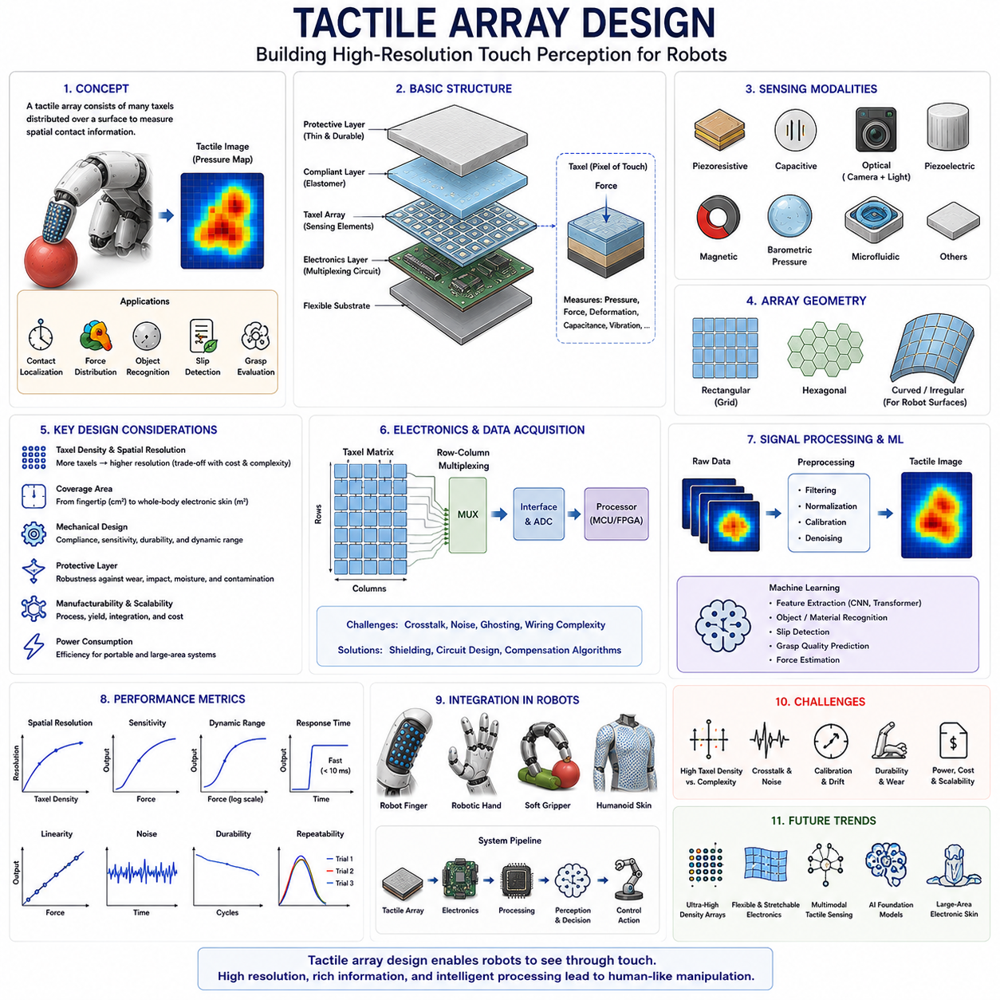{width="7.268055555555556in" height="7.268055555555556in"}

Tactile array design is one of the most important topics in robotic tactile sensing because it determines how effectively a robot can perceive contact information across a physical surface. While a single tactile sensor can only measure force or pressure at one location, a tactile array consists of many sensing elements distributed across a surface, allowing a robot to perceive the spatial characteristics of contact in a manner similar to human skin. Through the use of tactile arrays, robotic systems can identify contact locations, estimate force distributions, recognize object shapes, detect slip events, evaluate grasp quality, and perform dexterous manipulation tasks. As robotic systems continue to evolve toward human-level manipulation capabilities, tactile array design has become a critical area of research spanning sensor engineering, electronics, materials science, machine learning, signal processing, and robotic control.

Human skin provides a useful biological reference for understanding tactile arrays. The human hand contains thousands of mechanoreceptors distributed across the fingertips, palm, and fingers. These receptors continuously measure pressure, vibration, texture, stretch, and temperature over a large area. The brain combines information from these distributed sensors to construct a detailed representation of contact interactions. Tactile arrays attempt to replicate this distributed sensing architecture by embedding numerous sensing elements across robotic surfaces. Instead of relying on a single force measurement, the robot receives a spatial map of contact information that can be processed similarly to an image.

The fundamental building block of a tactile array is the tactile pixel, commonly referred to as a taxel. A taxel performs a role analogous to a pixel in a digital camera. Each taxel independently measures a local physical quantity such as pressure, force, capacitance, resistance, deformation, vibration, or proximity. When hundreds or thousands of taxels are arranged across a sensing surface, the resulting measurements form a tactile image that represents the contact state of the entire surface. The quality of the tactile image depends heavily on how the array is designed and implemented.

One of the first design considerations in tactile array development is sensing modality selection. Different sensing technologies can be used to construct tactile arrays, including piezoresistive sensors, capacitive sensors, optical tactile sensors, piezoelectric sensors, magnetic sensors, barometric pressure sensors, and microfluidic sensing systems. Each technology provides different tradeoffs in sensitivity, spatial resolution, durability, power consumption, cost, manufacturing complexity, and environmental robustness. The choice of sensing modality depends on application requirements and performance objectives.

Array geometry is another fundamental aspect of tactile array design. The arrangement of taxels across the sensing surface determines how contact information is represented and interpreted. Rectangular grid configurations are the most common because they simplify manufacturing and signal processing. In a rectangular grid, taxels are arranged in rows and columns similar to pixels in an image sensor. Hexagonal arrangements provide more uniform neighbor relationships and may improve spatial sampling efficiency. Curved and irregular geometries are often required when integrating tactile arrays into robotic fingers, palms, humanoid skins, or soft robotic structures.

Taxel density is one of the most important performance parameters. Taxel density refers to the number of sensing elements per unit area. Higher taxel density increases spatial resolution and enables more detailed contact perception. High-density arrays can capture fine geometric features, identify small contact regions, and distinguish subtle pressure variations. However, increasing taxel density also increases manufacturing complexity, wiring requirements, electronic overhead, computational burden, and system cost. Designers must carefully balance spatial resolution against practical implementation constraints.

Spatial resolution describes the smallest distinguishable contact feature that can be detected by the array. In general, spatial resolution depends on both taxel size and taxel spacing. Smaller taxels and closer spacing produce higher resolution tactile images. Fingertip tactile sensors used for dexterous manipulation often require very high spatial resolution because they must detect fine contact details and texture features. In contrast, large-area electronic skins designed primarily for collision detection may prioritize coverage and robustness over extremely high resolution.

Array coverage represents another important design consideration. Coverage refers to the physical area monitored by the tactile array. Robotic fingertips typically require only a few square centimeters of sensing area, while humanoid robots may require tactile sensing over entire hands, arms, torsos, and legs. Large-area coverage introduces significant engineering challenges related to scalability, wiring, communication, calibration, and power management. Researchers continue to explore methods for developing scalable tactile skins that maintain performance while covering large surfaces.

The mechanical design of the sensing surface strongly influences tactile array performance. Most tactile arrays employ compliant materials that deform under contact. These materials include silicone elastomers, polyurethane, rubber composites, flexible polymers, and soft engineered materials. Mechanical compliance allows the sensor surface to conform to object geometries and distribute contact forces more naturally. However, excessive compliance may reduce spatial accuracy and introduce nonlinear behavior. Mechanical design must therefore balance sensitivity, durability, and measurement precision.

Protective layers are frequently incorporated into tactile array designs. Because robotic tactile sensors experience repeated physical contact, protective layers help prevent damage caused by abrasion, impacts, contamination, and environmental exposure. These layers must be carefully engineered because excessive thickness can reduce sensitivity and spatial resolution. Advanced protective coatings often combine durability with high mechanical transparency, allowing forces to reach the sensing elements with minimal distortion.

Signal acquisition architecture plays a critical role in tactile array implementation. Each taxel generates sensor data that must be collected, processed, and transmitted to higher-level control systems. Directly wiring every taxel individually becomes impractical as array size increases. Large arrays may contain thousands of sensing elements, making conventional wiring approaches prohibitively complex. Consequently, tactile arrays often employ multiplexing architectures that reduce wiring requirements and simplify data acquisition.

Row-column scanning is one of the most common multiplexing techniques used in tactile arrays. In this approach, taxels are organized into matrix structures where rows and columns share electrical connections. By sequentially activating rows and reading columns, the system can acquire data from large arrays using relatively few electrical connections. Matrix addressing dramatically reduces hardware complexity and has become a standard design strategy for many tactile sensing technologies.

However, multiplexing introduces challenges such as signal crosstalk and ghosting effects. Crosstalk occurs when signals from one taxel influence measurements obtained from neighboring taxels. Ghosting refers to false activation patterns caused by shared electrical pathways. These effects can reduce measurement accuracy and complicate signal interpretation. Advanced circuit designs, compensation algorithms, and shielding techniques are often required to mitigate these problems.

Sampling rate is another important parameter. Robotic manipulation frequently involves rapidly changing contact conditions. Slip events, impact interactions, and dynamic object manipulations may occur within milliseconds. The tactile array must therefore sample sensor data quickly enough to capture these events. Higher sampling rates improve temporal resolution but increase data bandwidth requirements and computational demands. Designers must balance responsiveness against processing constraints.

Noise management represents a major challenge in tactile array systems. Electronic noise, thermal fluctuations, electromagnetic interference, mechanical vibrations, and material inconsistencies can affect sensor measurements. Signal filtering techniques are commonly employed to improve measurement quality. Low-pass filters, adaptive filtering methods, statistical smoothing algorithms, and machine learning approaches are frequently used to suppress noise while preserving meaningful tactile information.

Calibration is essential for accurate tactile sensing. Manufacturing variations, material inconsistencies, environmental conditions, and long-term aging can cause individual taxels to exhibit different response characteristics. Calibration procedures establish the relationship between sensor outputs and physical quantities such as force or pressure. Large tactile arrays may require automated calibration systems capable of characterizing thousands of sensing elements efficiently.

Data representation is another important aspect of tactile array design. The measurements obtained from taxels are often organized into image-like structures known as tactile images. Each taxel corresponds to a pixel-like element within the tactile image. This representation enables the application of computer vision algorithms to tactile perception tasks. Tactile images can be processed using edge detection, segmentation, feature extraction, pattern recognition, and deep learning techniques.

Machine learning has significantly influenced modern tactile array development. High-density tactile arrays generate large volumes of data that contain rich information regarding contact interactions. Deep neural networks can learn complex relationships between tactile patterns and manipulation outcomes. Convolutional neural networks are particularly effective because tactile arrays naturally produce image-like data structures. Researchers use machine learning models for object recognition, material classification, slip detection, grasp evaluation, contact localization, and manipulation planning.

Slip detection represents one of the most valuable applications of tactile arrays. When an object begins to move relative to the sensor surface, pressure distributions change dynamically. By monitoring temporal variations in tactile images, robots can detect incipient slip before grasp failure occurs. Early slip detection allows corrective actions such as grip force adjustment or finger repositioning, significantly improving manipulation reliability.

Grasp quality assessment also benefits greatly from tactile array sensing. Stable grasps typically produce characteristic pressure distributions across contact surfaces. Tactile arrays provide direct measurements of these distributions, allowing robots to evaluate grasp stability and identify potential failure conditions. This information supports adaptive manipulation strategies and improves performance in unstructured environments.

Texture recognition is another important capability enabled by tactile arrays. As a sensor moves across a surface, local pressure patterns vary according to surface microgeometry. High-resolution tactile arrays can capture these variations and enable robots to distinguish different materials and textures. Texture recognition has applications in manufacturing, inspection, object identification, and human-robot interaction.

The integration of tactile arrays into robotic hands presents unique challenges. Robotic fingers have curved surfaces, limited internal space, and complex mechanical structures. Flexible tactile arrays are often required to conform to these geometries while maintaining sensing performance. Advances in flexible electronics, stretchable conductors, printed electronics, and soft materials have enabled increasingly sophisticated tactile hand designs.

Electronic skin systems represent one of the most ambitious applications of tactile array technology. Electronic skin aims to provide robots with distributed tactile sensing over large portions of their bodies. Such systems support collision detection, environmental awareness, physical interaction monitoring, and safe human-robot collaboration. Achieving large-area tactile sensing requires scalable array architectures, efficient communication systems, robust materials, and intelligent data processing methods.

Soft robotics has introduced additional requirements for tactile array design. Soft robotic structures undergo substantial deformation during operation, requiring sensors that remain functional under large strains. Stretchable tactile arrays based on conductive elastomers, liquid metals, nanomaterials, and flexible electronics have emerged as promising solutions. These technologies allow tactile sensing to be integrated directly into compliant robotic structures.

Recent advances in microfabrication and additive manufacturing have expanded the design possibilities for tactile arrays. Three-dimensional printing technologies enable complex sensor geometries, customized layouts, embedded channels, and integrated electronics. Microfabrication techniques allow the production of high-density arrays with precise dimensions and repeatable performance. These manufacturing methods are accelerating the development of next-generation tactile sensing systems.

Future tactile array designs are expected to become increasingly dense, flexible, intelligent, and multimodal. Researchers are exploring arrays capable of simultaneously measuring pressure, shear force, vibration, temperature, humidity, and proximity. Multimodal tactile arrays more closely resemble biological skin and provide richer information regarding environmental interactions. Artificial intelligence will play an increasingly important role in interpreting these complex sensory datasets.

The emergence of foundation models for tactile perception represents another promising direction. Large-scale tactile datasets collected from diverse arrays may enable the training of general-purpose tactile models capable of transferring knowledge across tasks and environments. Such systems could provide robots with a more generalized understanding of physical interaction, similar to how large language models provide generalized understanding of textual information.

In conclusion, tactile array design forms the foundation of modern robotic touch sensing. By distributing large numbers of taxels across a sensing surface, tactile arrays enable robots to perceive contact information with spatial richness comparable to biological skin. Successful tactile array design requires careful consideration of sensing modality, geometry, taxel density, mechanical structure, electronics, calibration, signal processing, and machine learning integration. As robotic systems continue to advance toward increasingly sophisticated manipulation capabilities, tactile arrays will remain a critical technology for achieving robust, adaptive, and intelligent interaction with the physical world. Their ongoing development will play a central role in the future of robotic hands, electronic skin systems, soft robotics, humanoid robots, and physical artificial intelligence.

## 07.07 Tactile Sensor Skins

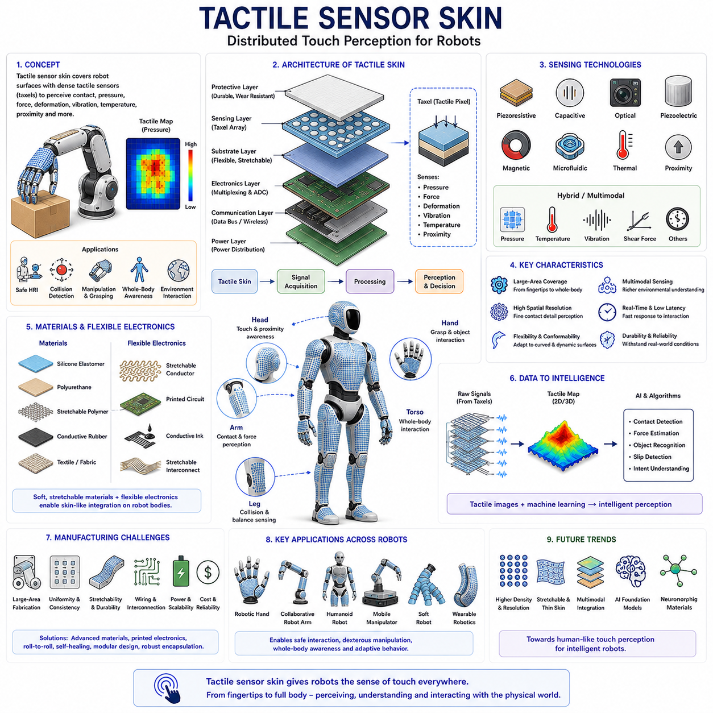{width="7.268055555555556in" height="7.268055555555556in"}

Tactile sensor skin represents one of the most important developments in modern robotics because it extends tactile perception beyond individual fingertips and enables robots to sense physical interaction across large portions of their bodies. While traditional tactile sensors are typically installed only at the fingertips of robotic grippers or hands, tactile sensor skin seeks to emulate the distributed sensing capabilities of biological skin by covering robotic surfaces with dense arrays of tactile sensing elements. This approach allows robots to perceive contact, pressure, force, deformation, vibration, temperature, proximity, and other environmental stimuli across large areas. As robots become increasingly integrated into human environments, tactile sensor skin is emerging as a foundational technology for safe human-robot interaction, dexterous manipulation, whole-body awareness, and intelligent physical interaction. Within the framework of robotic hands and dexterous grasping systems, tactile skin serves as a critical bridge between local contact sensing and global interaction perception.

Human skin provides the primary biological inspiration for tactile sensor skin design. Human skin is the largest sensory organ in the body and contains millions of receptors distributed throughout its surface. These receptors continuously detect pressure, vibration, stretch, temperature, pain, and texture information. Different receptor types specialize in different sensing functions, enabling the human nervous system to construct an extraordinarily rich representation of physical interactions. The distributed nature of biological skin provides not only localized touch information but also global awareness of body-environment interaction. Robotic tactile skin seeks to replicate this functionality by integrating large numbers of sensors across robot surfaces.

The transition from fingertip tactile sensing to full tactile skin represents a major shift in robotic perception. Fingertip sensors primarily support grasping and manipulation tasks. Tactile skin, however, provides continuous sensing across hands, fingers, arms, torso, legs, and even the entire robot body. This expanded sensing capability transforms the robot from a machine that only senses contact at designated locations into a system that possesses distributed physical awareness. Such awareness becomes increasingly important as robots operate in unstructured environments and interact directly with humans.

The fundamental architecture of tactile sensor skin consists of a sensing layer, a substrate layer, signal acquisition electronics, communication infrastructure, and higher-level perception software. The sensing layer contains distributed tactile sensing elements, often referred to as taxels. These taxels function similarly to pixels in an image sensor, except that they measure physical interaction rather than light intensity. Each taxel generates local information regarding pressure, force, deformation, temperature, vibration, proximity, or other physical quantities. Together, thousands of taxels form a tactile sensing network capable of generating detailed tactile maps.

The sensing technologies used in tactile skin vary significantly depending on application requirements. Piezoresistive tactile skins employ conductive materials whose resistance changes under mechanical deformation. Capacitive tactile skins measure changes in capacitance caused by pressure-induced geometric modifications. Optical tactile skins use cameras and deformable surfaces to capture contact information through image processing. Piezoelectric skins generate electrical charges when mechanically stressed. Magnetic tactile skins utilize magnetic field variations to detect deformation. Microfluidic skins employ fluid pressure changes within embedded channels. Hybrid approaches combine multiple sensing mechanisms to improve performance and functionality.

One of the defining characteristics of tactile sensor skin is large-area coverage. Unlike conventional tactile sensors that occupy only small regions, tactile skins may cover entire robotic hands, arms, torsos, or humanoid bodies. Achieving such coverage presents significant engineering challenges. Large sensor networks require scalable fabrication methods, efficient communication architectures, reliable power distribution systems, and advanced signal processing algorithms. Maintaining consistent sensing performance across large areas remains an active area of research.

Spatial resolution plays a crucial role in tactile skin performance. High-resolution tactile skins contain densely packed taxels capable of detecting fine contact details. Such systems can identify object contours, pressure distributions, and localized interactions with high precision. Lower-resolution tactile skins may sacrifice detailed perception in favor of reduced complexity, lower cost, and improved robustness. The appropriate resolution depends on the intended application. Dexterous robotic hands generally require high spatial resolution, whereas collision detection systems may prioritize coverage and durability over fine detail.

Mechanical compliance is another essential design consideration. Human skin is soft, flexible, and conformable. Robotic tactile skin should ideally exhibit similar properties. Flexible and stretchable substrates allow tactile skins to conform to curved surfaces and deform together with robotic structures. Mechanical compliance improves contact quality and enhances safety during physical interaction. Materials commonly used in tactile skin include silicone elastomers, polyurethane films, flexible polymers, conductive rubbers, textile-based materials, and stretchable composites.

Flexible electronics have become a key enabling technology for tactile skin development. Traditional rigid circuit boards are poorly suited for covering curved robotic surfaces. Flexible printed circuits, stretchable conductors, conductive inks, and printed electronics technologies enable electronic systems to bend and stretch while maintaining functionality. These technologies allow tactile skins to be integrated into complex robotic geometries without compromising sensor performance.

Electronic skin, often abbreviated as e-skin, represents one of the most advanced forms of tactile sensor skin. Electronic skin aims to replicate multiple functions of biological skin within an integrated artificial system. In addition to pressure sensing, e-skin systems often incorporate temperature sensors, humidity sensors, strain sensors, vibration sensors, proximity sensors, and chemical sensors. The result is a multimodal sensing platform capable of perceiving a wide range of environmental stimuli simultaneously.

Multimodal sensing is particularly important because real-world interactions involve more than simple contact pressure. When humans touch an object, they simultaneously perceive force, temperature, texture, compliance, and surface properties. Similarly, advanced tactile skins seek to combine multiple sensing modalities to provide richer environmental understanding. Integrating different sensor types within a unified tactile skin architecture presents significant challenges in materials science, electronics design, and signal processing.

Signal acquisition represents one of the most complex aspects of tactile skin implementation. A full-body tactile skin may contain thousands or even millions of sensing elements. Efficiently collecting, processing, and transmitting data from such large sensor networks requires sophisticated electronic architectures. Multiplexing techniques, distributed processing nodes, hierarchical communication systems, and edge computing approaches are commonly employed to manage data complexity.

Power consumption becomes increasingly important as tactile skin size increases. Large-area sensor networks can consume significant energy if each taxel requires continuous operation. Low-power sensor technologies, event-driven sensing architectures, energy-efficient communication protocols, and intelligent sampling strategies help reduce power requirements while maintaining sensing performance.

Tactile imaging is one of the most powerful concepts associated with tactile sensor skin. The distributed measurements generated by taxels can be organized into image-like representations known as tactile maps. These maps capture spatial distributions of pressure and contact across the robot surface. Tactile maps can be processed using computer vision algorithms, enabling feature extraction, segmentation, pattern recognition, object classification, and interaction analysis. The analogy between tactile images and visual images has accelerated the adoption of machine learning methods in tactile perception research.

Machine learning plays an increasingly important role in tactile skin systems. Deep neural networks can analyze tactile maps to recognize objects, classify materials, estimate forces, detect slip, identify contact locations, and predict interaction outcomes. Convolutional neural networks are particularly effective because tactile maps share many structural similarities with visual images. Recent research has also explored transformer-based architectures and foundation models for tactile perception.

Human-robot interaction represents one of the most important application areas for tactile sensor skin. Safe interaction requires robots to detect unintended contact events and respond appropriately. Tactile skin provides continuous monitoring of physical interactions across the robot body. If a person touches the robot unexpectedly, tactile sensors can immediately detect the contact and trigger safety responses. Such capabilities are essential for collaborative robots, service robots, healthcare robots, and humanoid systems operating in human environments.

Collision detection and avoidance constitute another major application. Traditional robots often rely on external sensors such as cameras and lidar systems to detect obstacles. However, external sensors may fail to identify certain contact situations. Tactile skin provides direct physical feedback when contact occurs. This feedback improves safety and enables rapid responses to unexpected collisions.

Robotic manipulation also benefits significantly from tactile skin integration. Tactile skins applied to robotic fingers and palms provide distributed contact information during grasping. Instead of relying solely on fingertip sensors, robots can perceive contact across larger areas of the hand. This expanded sensing capability improves grasp stability estimation, object recognition, force distribution analysis, and manipulation planning.

Humanoid robots are among the primary beneficiaries of tactile skin technology. Humans possess tactile sensitivity across nearly the entire body, enabling complex physical interactions with the environment. Humanoid robots intended to operate alongside humans require similar capabilities. Full-body tactile skin can provide awareness of contact events occurring anywhere on the robot surface, supporting navigation, manipulation, balance control, and social interaction.

Soft robotics has created additional demand for tactile skin technologies. Soft robots undergo large deformations during operation, making conventional rigid sensors unsuitable. Stretchable tactile skins integrated directly into soft structures provide a natural solution. These skins can deform together with the robot while continuously monitoring contact and deformation states. The combination of tactile skin and soft robotics is enabling new forms of adaptive and compliant robotic systems.

Manufacturing tactile skin presents numerous technical challenges. Large-area sensor fabrication requires scalable production methods capable of maintaining consistent performance across thousands of sensing elements. Flexible electronics manufacturing, roll-to-roll processing, screen printing, inkjet printing, microfabrication, and additive manufacturing techniques are being explored to address these challenges. Reducing production cost while maintaining performance remains a key objective.

Durability and reliability are critical concerns for tactile skin systems. Unlike laboratory sensors, practical tactile skins must withstand repeated physical contact, abrasion, impacts, moisture, dust, temperature variations, and long-term mechanical stress. Protective coatings, self-healing materials, robust encapsulation methods, and fault-tolerant architectures are being developed to improve durability and operational lifespan.

Self-healing tactile skin represents an exciting emerging research direction. Inspired by biological skin, self-healing materials can repair damage caused by cuts, scratches, or punctures. Such capabilities could significantly improve the reliability and longevity of tactile sensing systems operating in demanding environments. Researchers are exploring self-healing polymers, conductive composites, and adaptive materials that restore both mechanical integrity and sensing functionality after damage.

The integration of tactile skin with artificial intelligence is creating new opportunities for robotic perception. Rather than treating tactile sensing as a low-level measurement system, modern AI approaches view tactile data as a rich source of information for high-level reasoning and decision-making. Tactile foundation models trained on large-scale datasets may eventually enable robots to develop generalized tactile understanding across diverse environments and tasks.

Recent advances in neuromorphic sensing offer another promising direction. Biological nervous systems process sensory information using highly efficient event-driven architectures. Neuromorphic tactile skins seek to replicate these principles by generating events only when meaningful changes occur. Such systems can dramatically reduce power consumption and computational requirements while supporting real-time perception.

Future tactile skin systems are expected to become increasingly flexible, stretchable, intelligent, and multimodal. Researchers are investigating skins capable of simultaneously measuring pressure, shear force, temperature, vibration, humidity, proximity, and chemical properties. The convergence of flexible electronics, advanced materials, machine learning, and distributed sensing architectures will continue to expand the capabilities of tactile skin technologies.

In the context of robotic hands and dexterous grasping, tactile sensor skin represents the evolution from localized contact sensing toward whole-hand perception. Rather than sensing only at discrete fingertips, future robotic hands may possess continuous tactile awareness across every contact surface. This capability will support more natural manipulation, improved grasp stability, enhanced object recognition, safer interaction, and more adaptive behavior. As robotics advances toward human-level dexterity and physical intelligence, tactile sensor skin is expected to become a foundational technology that enables robots to understand and interact with the physical world through distributed touch perception comparable to biological skin.

## 07.08 Sensor Signal Processing

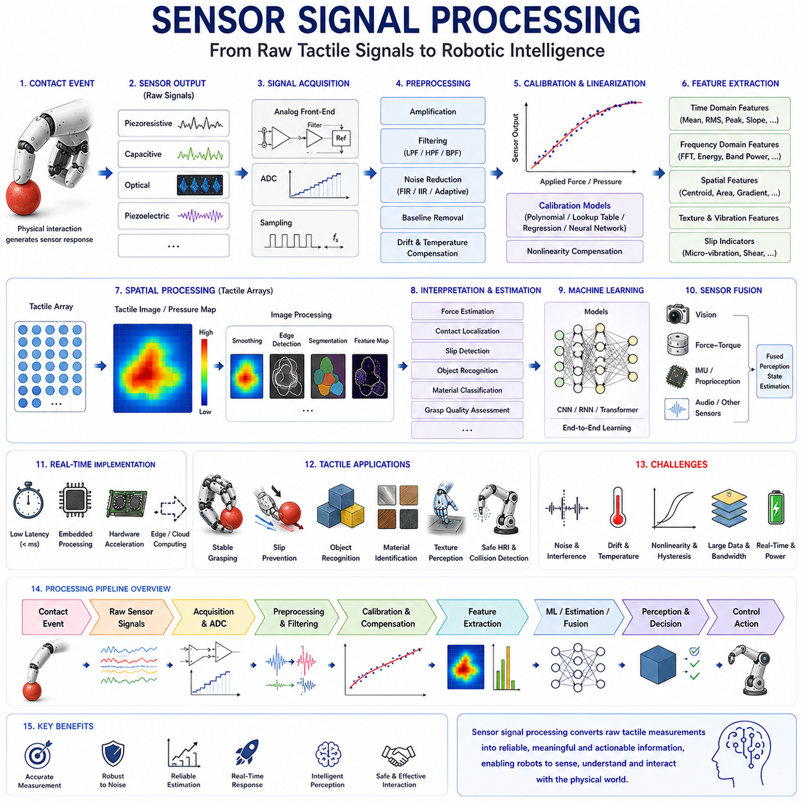{width="7.268055555555556in" height="7.268055555555556in"}

Sensor signal processing is one of the most critical components of a robotic tactile sensing system because it transforms raw sensor measurements into meaningful information that can be used for perception, decision-making, and control. Regardless of whether a tactile sensor is based on piezoresistive, capacitive, optical, piezoelectric, magnetic, barometric, or multimodal sensing principles, the sensor itself only produces electrical signals, images, pressure values, or other low-level measurements. These raw outputs are often noisy, incomplete, nonlinear, and difficult to interpret directly. Sensor signal processing serves as the bridge between physical contact and robotic intelligence by converting raw sensor data into accurate representations of contact forces, pressure distributions, object properties, grasp conditions, and manipulation states. In modern robotic systems, sensor signal processing is no longer viewed as a simple filtering operation but rather as a complete perception pipeline that integrates electronics, signal theory, machine learning, sensor fusion, and real-time control.

The signal processing chain begins immediately after physical interaction occurs between the robot and the environment. When an object contacts a tactile sensor, the sensing mechanism generates an electrical response. In a piezoresistive sensor, contact changes electrical resistance. In a capacitive sensor, contact changes capacitance. In an optical tactile sensor, contact modifies image patterns. In a piezoelectric sensor, contact generates electrical charges. Regardless of the sensing modality, the resulting measurements represent the earliest stage of information available to the robotic system. At this stage, the signal typically contains useful information mixed with noise, distortions, sensor imperfections, environmental influences, and measurement uncertainty.

One of the first tasks in sensor signal processing is signal acquisition. The analog outputs generated by tactile sensors must be captured and converted into digital representations that can be processed by computational systems. This process is typically performed using analog front-end electronics and analog-to-digital converters. The quality of signal acquisition directly affects the overall performance of the tactile sensing system. Poor acquisition quality can introduce quantization errors, timing inaccuracies, signal distortions, and information loss. Therefore, careful design of acquisition hardware is essential for achieving accurate tactile perception.

Analog conditioning is often performed before digitization. Many tactile sensors generate very small signals that require amplification. Instrumentation amplifiers increase signal magnitude while preserving signal integrity. Filtering circuits remove unwanted frequency components and reduce interference. Voltage references stabilize measurement conditions. Differential measurement architectures improve noise rejection. These analog processing stages ensure that the digitized signal accurately represents the underlying physical interaction.

Sampling is a fundamental concept in tactile signal processing. Once the signal is conditioned, it must be sampled at discrete time intervals. The sampling frequency determines how frequently sensor measurements are collected. If the sampling rate is too low, important information may be lost due to aliasing. If the sampling rate is excessively high, computational requirements and communication bandwidth increase unnecessarily. Selecting an appropriate sampling frequency requires understanding the dynamic characteristics of the manipulation task. High-speed slip detection may require kilohertz-level sampling rates, whereas static force monitoring can often be performed at much lower frequencies.

After digitization, noise reduction becomes one of the most important processing tasks. Noise originates from numerous sources including electronic components, electromagnetic interference, thermal fluctuations, mechanical vibrations, sensor imperfections, and environmental disturbances. Noise can significantly degrade tactile sensing performance if left untreated. Filtering techniques are therefore widely employed to improve signal quality. Low-pass filters remove high-frequency noise while preserving slowly varying contact information. High-pass filters isolate transient events such as impacts and vibrations. Band-pass filters focus on specific frequency ranges relevant to particular sensing tasks.

Digital filtering has become particularly important in modern tactile systems. Finite Impulse Response (FIR) filters provide stable and predictable filtering behavior. Infinite Impulse Response (IIR) filters achieve similar performance with reduced computational complexity. Adaptive filters dynamically adjust their parameters based on signal characteristics. Kalman filters combine noisy measurements with dynamic system models to estimate underlying states more accurately. Each filtering approach offers different advantages depending on application requirements.

Sensor calibration represents another critical stage in signal processing. Raw sensor outputs rarely correspond directly to physical quantities such as force or pressure. Calibration establishes mathematical relationships between sensor measurements and known reference values. During calibration, controlled forces, pressures, or deformations are applied to the sensor, and corresponding outputs are recorded. Regression models, lookup tables, polynomial approximations, neural networks, or physics-based models are then used to map sensor outputs to physical quantities. Calibration significantly improves measurement accuracy and consistency.

Nonlinearity is a common challenge in tactile sensing systems. Many sensors exhibit nonlinear relationships between input forces and output signals. Material properties, structural deformations, hysteresis effects, and sensing mechanisms contribute to nonlinear behavior. Signal processing algorithms often incorporate compensation models to linearize sensor responses and improve interpretability. Advanced calibration techniques may employ machine learning methods capable of modeling highly complex nonlinear relationships.

Drift compensation is another important processing task. Over time, sensor characteristics may change due to temperature variations, material aging, humidity effects, mechanical wear, or electronic instability. These changes cause baseline measurements to shift even when no contact is present. Drift compensation algorithms continuously monitor baseline conditions and adjust measurements accordingly. Such compensation is particularly important for long-duration robotic operations where stable performance is required.

Temperature compensation frequently accompanies drift correction. Many tactile sensing technologies are sensitive to temperature changes. Resistance, capacitance, pressure, and material properties may vary with environmental temperature. Without compensation, temperature fluctuations can be mistaken for contact events. Modern tactile systems often integrate temperature sensors and compensation models that separate thermal effects from actual tactile interactions.

Feature extraction represents one of the most significant transitions from low-level signal processing to high-level perception. Raw tactile signals contain large amounts of information, but only certain aspects are relevant for specific tasks. Feature extraction algorithms identify meaningful characteristics that describe contact conditions. Examples include force magnitude, contact area, pressure centroid, vibration frequency, slip indicators, deformation gradients, texture descriptors, and temporal dynamics. These features provide compact and informative representations of tactile interactions.

Temporal signal analysis plays an important role in tactile perception. Many tactile events evolve over time. Slip, impact, rolling contact, texture exploration, and object manipulation all produce characteristic temporal patterns. Time-domain analysis examines signal amplitude, duration, rate of change, and statistical properties. Frequency-domain analysis transforms signals into spectral representations using techniques such as the Fast Fourier Transform. Spectral analysis is particularly useful for texture recognition, vibration sensing, and slip detection.

Spatial signal processing becomes increasingly important when tactile arrays are used. A tactile array generates measurements from hundreds or thousands of taxels distributed across a sensing surface. These measurements form tactile images analogous to visual images. Spatial processing techniques analyze pressure distributions, contact patterns, shape features, and force maps. Image processing methods such as smoothing, edge detection, segmentation, clustering, and contour extraction can be directly applied to tactile data.

Tactile imaging has emerged as a major research area because it allows tactile perception to benefit from decades of computer vision research. Pressure maps generated by tactile arrays can be treated as grayscale images where pixel intensities correspond to force or pressure values. Convolutional operations, feature pyramids, image descriptors, and deep learning architectures originally developed for vision can therefore be adapted for tactile perception tasks.

Slip detection represents one of the most valuable applications of tactile signal processing. Slip occurs when an object begins to move relative to the sensor surface. Early slip detection is essential for maintaining stable grasps. Signal processing algorithms analyze temporal and spatial changes in tactile measurements to identify incipient slip conditions. Features such as micro-vibrations, pressure redistribution, shear force variations, and contact motion patterns are commonly used. Early detection allows robotic systems to increase grip force before complete grasp failure occurs.

Force estimation is another central application. Although tactile sensors measure electrical signals rather than forces directly, signal processing algorithms convert sensor outputs into force estimates. In advanced systems, both normal and tangential force components may be estimated. Accurate force estimation supports compliant manipulation, force-controlled grasping, and safe physical interaction.

Object recognition through tactile sensing has gained considerable attention in recent years. Different objects produce distinctive tactile signatures when touched. Signal processing algorithms extract features describing shape, compliance, texture, and contact geometry. Machine learning models then use these features to classify objects. Tactile object recognition is particularly valuable when visual information is unavailable or unreliable.

Material classification represents another important capability. Different materials exhibit different mechanical and surface properties. Metal, plastic, rubber, fabric, wood, and biological tissues produce distinct tactile responses. Signal processing techniques analyze force-displacement relationships, vibration characteristics, thermal properties, and texture patterns to infer material identity. Such capabilities enhance robotic interaction with unknown environments.

Machine learning has fundamentally transformed sensor signal processing. Traditional signal processing relied heavily on manually designed filters and handcrafted features. Modern machine learning approaches learn directly from data. Neural networks can automatically discover relevant representations and relationships within tactile measurements. Convolutional neural networks are particularly effective for tactile images, while recurrent neural networks and transformers excel at processing temporal tactile sequences.

Deep learning enables end-to-end tactile perception pipelines in which raw sensor measurements are transformed directly into task-relevant outputs. Such systems can perform force estimation, object recognition, slip detection, grasp assessment, and manipulation planning without requiring explicit feature engineering. The increasing availability of tactile datasets has accelerated progress in this area.

Sensor fusion represents another major trend in tactile signal processing. Tactile sensors rarely operate in isolation. Robotic systems typically combine tactile information with visual sensing, force-torque sensing, proprioception, inertial measurements, audio sensing, and environmental sensing. Sensor fusion algorithms integrate these information sources to create more robust and comprehensive representations of the environment. Vision provides information before contact occurs, while tactile sensing provides information after contact. Together, they enable more intelligent manipulation.

Real-time processing is essential for practical robotic applications. Tactile perception must often operate within tight control loops. Delays of even a few milliseconds can affect manipulation performance. Consequently, signal processing algorithms must balance computational complexity against responsiveness. Efficient implementations, hardware acceleration, edge computing platforms, and specialized AI processors are increasingly important for supporting real-time tactile perception.

Embedded processing has become a major focus of research. Rather than transmitting large volumes of raw sensor data to centralized processors, modern tactile systems increasingly perform local processing near the sensor. Embedded microcontrollers, field-programmable gate arrays, and AI accelerators can perform filtering, feature extraction, compression, and preliminary inference directly at the sensing node. This approach reduces communication requirements and improves system scalability.

Neuromorphic signal processing represents an emerging direction inspired by biological nervous systems. Human tactile perception relies on event-driven neural communication rather than continuous sampling. Neuromorphic tactile systems generate events only when significant changes occur. Such approaches dramatically reduce power consumption and computational load while preserving important information. Event-based tactile processing may play an important role in future robotic perception systems.

Foundation models are also beginning to influence tactile signal processing. Large-scale tactile datasets collected from diverse sensors, objects, and interactions can be used to train generalized tactile models. These models may eventually provide transferable tactile knowledge applicable across multiple tasks and environments. Just as large language models have transformed natural language processing, tactile foundation models may transform robotic touch perception.

Future sensor signal processing systems are expected to become increasingly intelligent, adaptive, and autonomous. Advances in artificial intelligence, edge computing, sensor fusion, neuromorphic engineering, and multimodal perception will enable robots to extract richer information from tactile interactions than ever before. Processing pipelines will move beyond simple measurement interpretation toward comprehensive physical understanding of contact events and manipulation dynamics.

In conclusion, sensor signal processing forms the computational backbone of tactile sensing systems. It transforms raw sensor outputs into meaningful information that supports perception, control, decision-making, and interaction. Through acquisition, filtering, calibration, compensation, feature extraction, machine learning, sensor fusion, and real-time inference, signal processing enables robots to convert physical contact into actionable knowledge. As tactile sensing technologies continue to evolve, advances in sensor signal processing will remain essential for achieving increasingly sophisticated robotic manipulation, human-robot interaction, and physical intelligence.

## 07.09 Contact Detection and Localization

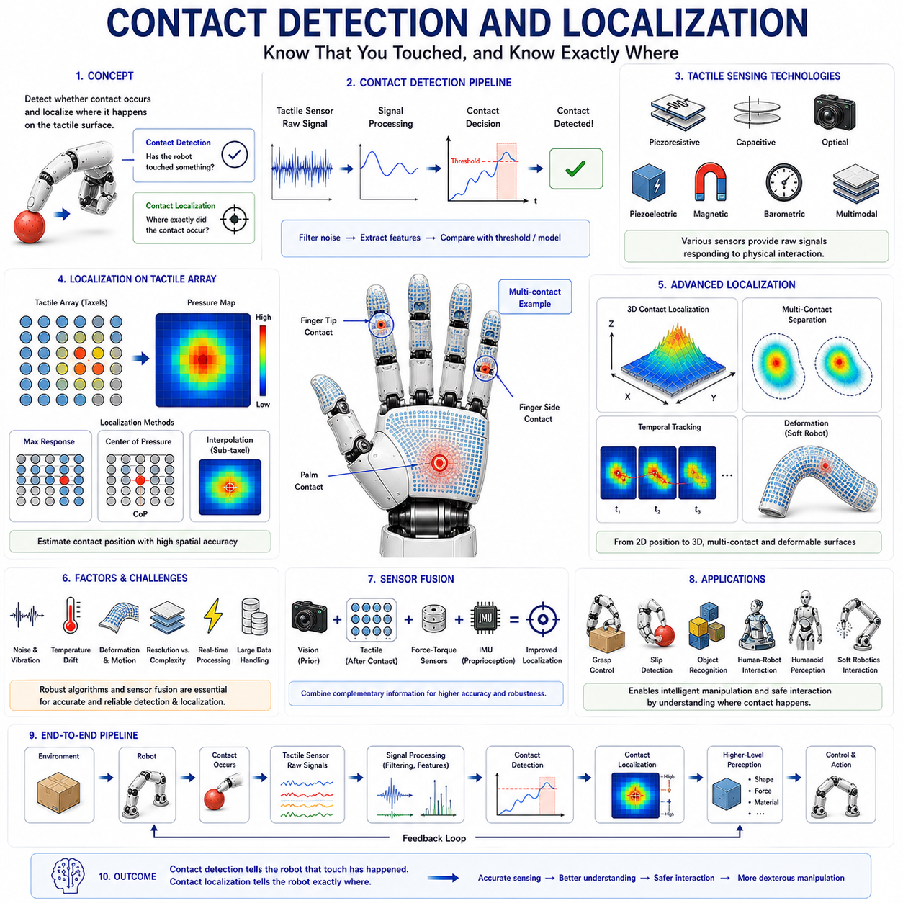{width="7.268055555555556in" height="7.268055555555556in"}

Contact detection and localization represent two of the most fundamental capabilities of tactile perception in robotic systems. Before a robot can manipulate an object, regulate grasp forces, estimate object properties, or perform dexterous interaction, it must first determine whether contact has occurred and identify where that contact has taken place. Contact detection answers the question, "Has the robot touched something?" while contact localization answers the question, "Where exactly did the contact occur?" Together, these capabilities form the foundation of tactile intelligence and serve as the first stage in virtually every tactile perception pipeline. In biological systems, humans continuously perform contact detection and localization through distributed mechanoreceptors embedded within the skin. These receptors allow the nervous system to rapidly identify touch events and precisely determine their locations. Robotic tactile systems seek to replicate this capability through various sensing technologies, signal processing methods, and machine learning algorithms.

In robotic manipulation, contact detection is often the earliest indication that an interaction with the environment has begun. Prior to contact, robots rely primarily on visual perception, motion planning, and position control. Once contact occurs, however, the interaction enters a new phase in which physical forces, friction, compliance, and tactile feedback become important. Detecting this transition accurately is essential because many manipulation strategies depend on immediate responses to contact events. Delayed or inaccurate contact detection can result in excessive impact forces, unstable grasps, object damage, or task failure.

The simplest form of contact detection involves binary sensing. In a binary system, the sensor determines only whether contact is present or absent. Such systems function similarly to switches. When contact force exceeds a predefined threshold, the sensor reports a contact event. Although simple, binary contact detection remains useful in many industrial applications where only the presence or absence of contact must be determined. Examples include assembly operations, collision detection systems, robotic safety mechanisms, and simple gripping tasks.

More advanced tactile systems perform continuous contact detection. Instead of producing binary outputs, these sensors generate continuous measurements related to force, pressure, deformation, capacitance, resistance, optical changes, or other physical variables. Contact is detected when the measured quantity deviates significantly from a baseline condition. Continuous sensing provides richer information regarding contact onset, force magnitude, and interaction dynamics, enabling more sophisticated robotic behaviors.

Thresholding is one of the most commonly used methods for contact detection. In threshold-based systems, a sensor signal is continuously monitored and compared against a predefined threshold value. When the signal exceeds the threshold, contact is declared. Selecting an appropriate threshold is critical. If the threshold is too low, noise may trigger false contact detections. If the threshold is too high, weak contacts may go undetected. Adaptive thresholding techniques dynamically adjust threshold values according to environmental conditions and sensor characteristics, improving reliability in real-world applications.

Noise management plays an important role in contact detection. Sensor measurements often contain noise arising from electronic interference, thermal fluctuations, mechanical vibrations, environmental disturbances, and sensor imperfections. Without proper filtering, noise can lead to false positives or missed contact events. Signal processing techniques such as low-pass filtering, moving averages, Kalman filtering, and adaptive filtering are commonly employed to improve detection reliability.

Contact detection becomes more challenging when robots operate in dynamic environments. During movement, sensors may experience vibrations, accelerations, and structural deformations unrelated to external contact. Distinguishing true contact events from motion-induced artifacts requires advanced processing methods. Sensor fusion approaches often combine tactile measurements with inertial sensing, force-torque sensing, and proprioceptive feedback to improve discrimination between actual contact and self-generated disturbances.

Contact localization extends beyond simply detecting touch. Once contact has been identified, the robot must determine its location on the sensing surface. Localization is essential because manipulation strategies depend heavily on where contact occurs. Contact location influences force distribution, grasp stability, object pose estimation, and manipulation planning. Humans possess remarkable localization abilities, often identifying touch locations with millimeter-scale precision. Achieving comparable performance remains a major objective in robotic tactile sensing.

The most straightforward localization approach involves tactile arrays. A tactile array consists of multiple sensing elements, or taxels, distributed across a sensing surface. When contact occurs, one or more taxels respond. The pattern of activated taxels reveals the contact location. In simple cases, localization can be achieved by identifying the taxel with the highest response. More advanced methods analyze spatial pressure distributions to estimate contact positions with sub-taxel accuracy.

Spatial resolution significantly influences localization performance. Higher taxel densities provide finer spatial discrimination and enable more precise localization. However, increasing taxel density also increases system complexity, data volume, and manufacturing costs. Engineers must therefore balance localization accuracy against practical implementation constraints.

Contact localization is often formulated as a spatial estimation problem. Instead of assigning contact to a single taxel, algorithms estimate the center of pressure within the activated region. The center of pressure represents the weighted average location of measured forces and provides a more accurate estimate of contact position than simple maximum-response methods. Center-of-pressure calculations are widely used in tactile sensing systems because they improve localization accuracy without requiring additional hardware.

Interpolation techniques can further enhance localization precision. Even when taxels are relatively large, interpolation algorithms estimate contact positions between neighboring sensing elements. Bilinear interpolation, spline interpolation, Gaussian fitting, and machine learning methods can achieve sub-taxel localization accuracy. Such techniques are particularly valuable in high-precision manipulation tasks where millimeter-scale accuracy is required.

Optical tactile sensors provide unique advantages for contact localization. Instead of relying on discrete taxels, optical systems often generate high-resolution images of contact regions. Image processing algorithms analyze deformation patterns, contact boundaries, and pressure distributions to estimate contact locations with extremely high precision. Because modern cameras contain millions of pixels, optical tactile systems can achieve localization resolutions far beyond those of many conventional tactile arrays.

Three-dimensional contact localization represents an even more advanced capability. In addition to determining contact position on a surface, some tactile systems estimate contact depth, force direction, and contact geometry. Such information is particularly important in complex manipulation tasks involving curved surfaces, deformable objects, or multi-contact interactions. Three-dimensional localization enables robots to better understand the physical structure of contact events.

Multi-contact localization presents additional challenges. In many manipulation scenarios, multiple contact points occur simultaneously. A robotic hand grasping an object may experience contact at several fingers, the palm, and multiple regions of each finger. Separating overlapping contact signals and identifying individual contact locations requires sophisticated algorithms. Clustering methods, segmentation techniques, probabilistic models, and machine learning approaches are commonly used to address this problem.

Machine learning has significantly advanced contact localization capabilities. Traditional localization methods often rely on geometric assumptions and analytical models. Modern machine learning approaches learn complex mappings directly from sensor data. Neural networks can estimate contact locations even in the presence of nonlinear sensor behavior, manufacturing variations, and environmental disturbances. Deep learning models are particularly effective when tactile data are represented as images or spatial maps.

Convolutional neural networks have become widely used for tactile localization because they excel at extracting spatial features from tactile images. These networks can learn contact patterns associated with different locations and achieve localization performance exceeding that of many handcrafted algorithms. More recently, transformer architectures have also been explored for tactile localization and contact interpretation tasks.

Contact detection and localization are closely linked to force estimation. Once a contact location is known, local force measurements can be associated with specific regions of the sensor surface. This association enables pressure mapping, grasp analysis, and interaction modeling. Accurate localization therefore improves the quality of higher-level tactile perception processes.

Slip detection also depends heavily on contact localization. When an object begins to slip, contact locations and pressure distributions shift over time. Tracking these changes enables robots to identify slip events before grasp failure occurs. Dynamic localization algorithms monitor contact motion across the sensor surface and provide early warning signals that allow corrective actions to be taken.

Object recognition can also benefit from contact localization. The spatial arrangement of contact points often contains information regarding object geometry. By analyzing contact locations obtained during exploration or manipulation, robots can infer object shape, orientation, and size. Combined with force and texture information, localization contributes to comprehensive tactile object recognition systems.

Human-robot interaction represents another important application area. When humans touch collaborative robots, tactile skins distributed across the robot body detect and localize contact events. Accurate localization allows the robot to determine which body region has been touched and respond appropriately. Such capabilities improve safety, communication, and interaction quality.

In humanoid robotics, full-body tactile localization becomes especially important. Humans rely on distributed tactile awareness for balance, posture control, and environmental interaction. Similarly, humanoid robots equipped with tactile skins can use contact localization information to support locomotion, obstacle avoidance, whole-body manipulation, and physical collaboration with humans.

Soft robotics introduces additional complexities because soft structures undergo large deformations. Contact locations may shift as the structure bends, stretches, or compresses. Localization algorithms for soft robots must therefore account for continuously changing sensor geometries. Flexible tactile arrays, stretchable electronics, and deformation-aware machine learning models are actively being developed to address these challenges.

Sensor fusion plays an increasingly important role in contact localization. Tactile sensing alone may not always provide sufficient information. Combining tactile measurements with vision, force-torque sensing, inertial sensing, proprioception, and depth sensing improves localization accuracy and robustness. For example, visual information can predict likely contact regions before contact occurs, while tactile sensing provides precise localization after contact has been established.

Probabilistic methods are often employed when uncertainty is significant. Bayesian estimation, particle filters, hidden Markov models, and probabilistic graphical models allow robots to represent uncertainty explicitly and make robust localization decisions despite noisy measurements. Such methods are particularly useful in unstructured environments where sensor data may be ambiguous or incomplete.

Real-time performance is essential for practical contact detection and localization systems. Contact events frequently occur within milliseconds, and manipulation controllers must respond rapidly. Efficient algorithms, embedded processing architectures, hardware acceleration, and edge computing platforms are increasingly used to achieve low-latency tactile perception. Advances in AI hardware have further enabled real-time localization using sophisticated machine learning models.

Neuromorphic approaches offer another promising direction. Biological nervous systems perform contact detection and localization through distributed event-driven processing. Neuromorphic tactile systems attempt to replicate these principles using event-based sensors and spiking neural networks. Such systems may provide highly efficient and low-latency tactile perception suitable for future robotic applications.

The emergence of tactile foundation models may further transform contact localization research. Large-scale tactile datasets containing diverse contact scenarios can be used to train generalized models capable of localizing contacts across different sensors, environments, and tasks. Such models may provide robust localization capabilities that generalize beyond specific sensor configurations.

Future contact detection and localization systems are expected to become increasingly accurate, adaptive, and intelligent. Advances in sensor technologies, tactile skins, machine learning, sensor fusion, soft robotics, and neuromorphic computing will continue to improve robotic tactile perception. Contact localization resolutions approaching or surpassing human tactile acuity may eventually become achievable in specialized applications.

In conclusion, contact detection and localization form the foundation of robotic tactile perception. Contact detection determines when physical interaction begins, while contact localization identifies where interaction occurs. Together, these capabilities enable force estimation, slip detection, grasp analysis, object recognition, manipulation planning, human-robot interaction, and whole-body tactile awareness. As robotic systems continue to evolve toward human-level dexterity and physical intelligence, advances in contact detection and localization will remain central to the development of sophisticated tactile sensing and manipulation technologies.

## 07.10 Sensor Calibration

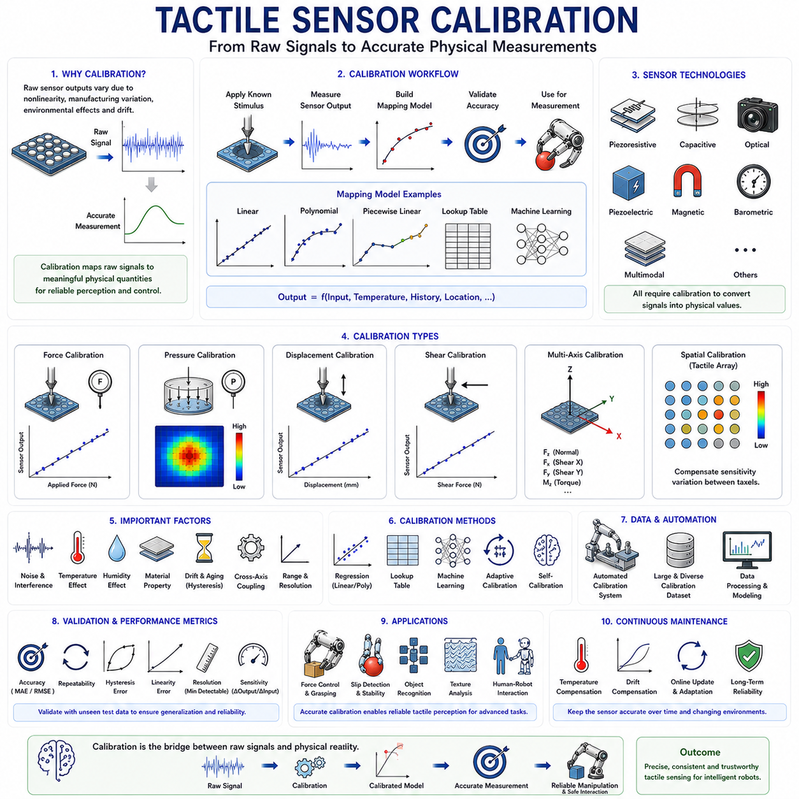{width="7.268055555555556in" height="7.268055555555556in"}

Tactile sensor calibration is a fundamental process in robotic tactile sensing that establishes the relationship between raw sensor outputs and meaningful physical quantities such as force, pressure, deformation, contact area, shear force, and torque. Regardless of the sensing technology used, including piezoresistive sensors, capacitive sensors, optical tactile sensors, piezoelectric sensors, magnetic sensors, barometric pressure sensors, or multimodal tactile systems, the sensor output alone has little practical value unless it can be accurately interpreted. Calibration transforms electrical signals, digital values, optical measurements, or pressure readings into physically meaningful information that can be used for perception, control, and decision-making. Without proper calibration, even the most sophisticated tactile sensor may provide inaccurate, inconsistent, or misleading information, leading to poor manipulation performance and unreliable robotic behavior.

In biological systems, tactile perception emerges through complex interactions between mechanoreceptors, neural pathways, and the brain. Although humans do not consciously calibrate their sensory systems, biological mechanisms continuously adapt and compensate for changes in sensitivity, environmental conditions, and physical characteristics. Robotic systems lack such natural adaptation and therefore require explicit calibration procedures to ensure accurate sensing performance. Calibration can be viewed as the process of teaching the robot how to interpret tactile sensor outputs correctly.

The need for calibration arises because most tactile sensors exhibit nonlinear, imperfect, and environment-dependent behavior. Manufacturing variations cause individual sensors to respond differently even when subjected to identical forces. Material properties may vary across sensor surfaces. Electronic components introduce offsets, gain errors, drift, and noise. Environmental conditions such as temperature, humidity, pressure, and mechanical wear further influence sensor performance. Calibration compensates for these factors and creates a reliable mapping between sensor measurements and physical reality.

At the most fundamental level, calibration establishes an input-output relationship. The input consists of known physical stimuli such as applied force, pressure, displacement, or deformation. The output consists of measured sensor signals such as voltage, current, resistance, capacitance, pixel intensity, or digital counts. By systematically applying known inputs and recording corresponding outputs, a mathematical model can be constructed that describes sensor behavior. This model enables future measurements to be converted into physically meaningful quantities.

Force calibration is one of the most common calibration procedures for tactile sensors. During force calibration, controlled forces are applied to the sensor using precision instruments such as load cells, force gauges, universal testing machines, robotic calibration platforms, or reference weights. The resulting sensor outputs are recorded over the desired operating range. Calibration data are then used to construct mathematical relationships between sensor signals and applied forces. These relationships may be linear, polynomial, piecewise linear, or based on machine learning models depending on sensor characteristics.

Pressure calibration follows a similar approach but focuses on distributed loading conditions. Uniform pressure sources such as pneumatic chambers, hydraulic systems, calibrated pressure plates, or controlled membrane systems are used to apply known pressures to the sensor surface. Pressure calibration is particularly important for tactile arrays and electronic skin systems because pressure distributions often represent the primary sensing quantity used in manipulation and interaction tasks.

Displacement calibration is commonly used for tactile sensors that measure deformation rather than force directly. In these systems, controlled mechanical displacements are applied to the sensor while outputs are recorded. Precision linear stages, micrometers, robotic actuators, and automated positioning systems are frequently employed. Displacement calibration is especially important for optical tactile sensors, flexible sensors, and soft robotic sensing systems where deformation is the primary sensing mechanism.

Shear force calibration represents a more challenging task because tangential forces must be applied accurately and repeatedly. Unlike normal force calibration, which involves loading perpendicular to the sensor surface, shear calibration requires controlled lateral loading. Specialized calibration fixtures are often designed to generate known shear forces while minimizing unintended normal forces. Accurate shear force calibration is essential for slip detection, grasp stability analysis, and dexterous manipulation.

Multi-axis calibration becomes necessary when sensors measure multiple force components simultaneously. Advanced tactile sensors may estimate normal force, shear force, torque, and contact location using a single sensing structure. In such cases, calibration must account for cross-axis coupling effects. Forces applied in one direction may influence sensor responses associated with other directions. Multi-dimensional calibration models are therefore required to separate different physical components accurately.

One of the simplest calibration models is linear calibration. Linear models assume a proportional relationship between sensor output and physical input. The relationship can be represented using a simple equation involving gain and offset parameters. Linear calibration is computationally efficient and easy to implement. Many industrial tactile sensors operate successfully using linear models within limited operating ranges. However, tactile sensors frequently exhibit nonlinear behavior that cannot be adequately described by linear equations alone.

Nonlinear calibration models are often necessary for high-performance tactile sensing. Sensor outputs may saturate at high loads, exhibit sensitivity variations across operating ranges, or respond differently during loading and unloading cycles. Polynomial regression, spline interpolation, lookup tables, neural networks, Gaussian processes, and other advanced modeling techniques are commonly used to capture these nonlinear effects. Nonlinear calibration generally improves accuracy but increases computational complexity.

Hysteresis represents a major challenge in tactile sensor calibration. Hysteresis occurs when sensor outputs depend not only on current inputs but also on previous loading history. During loading and unloading cycles, the sensor may follow different response curves. Hysteresis is particularly common in soft materials, elastomers, conductive polymers, and flexible sensor structures. Calibration procedures must either model hysteresis explicitly or employ compensation algorithms to minimize its effects.

Drift compensation is another important aspect of calibration. Sensor characteristics often change over time due to aging, material relaxation, mechanical wear, temperature fluctuations, humidity variations, and electronic instability. These changes cause baseline outputs to shift even when no physical stimulus is present. Drift compensation methods continuously update calibration parameters or baseline measurements to maintain long-term accuracy.

Temperature effects play a significant role in many tactile sensing technologies. Electrical resistance, capacitance, pressure measurements, optical properties, and material stiffness may vary with temperature. Consequently, calibration performed at one temperature may become inaccurate under different environmental conditions. Temperature compensation strategies often involve additional temperature sensors, environmental models, or multi-dimensional calibration tables that incorporate temperature as an explicit variable.

Spatial calibration is particularly important for tactile arrays and tactile skin systems. Large tactile arrays may contain hundreds or thousands of sensing elements known as taxels. Manufacturing variations often cause different taxels to exhibit different sensitivities and response characteristics. Spatial calibration identifies these variations and generates correction factors for individual sensing elements. Uniform calibration across the sensing surface improves pressure mapping accuracy and enhances tactile image quality.

Optical tactile sensors introduce unique calibration challenges. These sensors typically generate images rather than direct force measurements. Calibration procedures must establish relationships between image features and physical quantities. Surface deformations, marker displacements, shading patterns, optical flow fields, and geometric reconstructions may all serve as intermediate representations. Machine learning methods have become particularly effective for calibrating optical tactile systems because they can learn complex relationships directly from image data.

Machine learning is increasingly transforming tactile sensor calibration. Traditional calibration methods rely on manually designed mathematical models and regression techniques. Modern machine learning approaches use large calibration datasets to learn input-output relationships automatically. Neural networks can model highly nonlinear sensor behaviors, compensate for manufacturing variations, and adapt to complex environmental conditions. Deep learning is especially useful when sensor outputs contain rich spatial or temporal structures.

Data collection is a critical component of calibration. Calibration accuracy depends heavily on the quality and diversity of collected calibration data. The calibration dataset should span the full operating range of the sensor, including expected force levels, contact locations, environmental conditions, and interaction scenarios. Insufficient data coverage can result in poor generalization and inaccurate measurements during actual operation.

Automation has become increasingly important in tactile sensor calibration. Manual calibration procedures are often time-consuming, labor-intensive, and difficult to reproduce. Automated calibration systems employ robotic actuators, precision positioning devices, force sensors, and computer-controlled testing platforms to generate large calibration datasets efficiently. Automation improves consistency and enables calibration of large-scale tactile arrays containing thousands of sensing elements.

Calibration validation is necessary to verify calibration quality. Validation involves applying known test inputs that were not used during calibration and evaluating prediction accuracy. Common performance metrics include mean absolute error, root mean square error, linearity error, repeatability, hysteresis error, sensitivity, and resolution. Validation ensures that calibration models generalize beyond the training dataset and provide reliable measurements during real-world operation.

Repeatability is one of the most important indicators of calibration quality. A repeatable sensor produces consistent outputs when subjected to identical inputs. Poor repeatability limits the effectiveness of any calibration procedure because sensor behavior becomes inherently unpredictable. Repeatability testing typically involves repeated loading and unloading cycles under controlled conditions.

Resolution calibration determines the smallest measurable change in physical input that the sensor can reliably detect. High-resolution tactile sensors are capable of detecting very small forces and subtle contact variations. Calibration procedures quantify resolution limits and establish confidence bounds for sensor measurements.

Sensitivity calibration determines how strongly sensor outputs change in response to physical inputs. High sensitivity enables detection of weak contacts but may increase susceptibility to noise. Low sensitivity improves robustness but may reduce measurement precision. Calibration allows sensitivity characteristics to be quantified and optimized for specific applications.

In robotic manipulation, accurate calibration directly influences task performance. Force-controlled grasping, slip detection, contact localization, object recognition, texture analysis, and manipulation planning all depend on reliable tactile measurements. Poor calibration can lead to incorrect force estimates, unstable grasps, false slip detections, and degraded perception performance.

Human-robot interaction applications place particularly high demands on calibration accuracy. Collaborative robots operating near humans must detect contact forces reliably and respond appropriately. Safety standards often specify maximum allowable contact forces and pressure levels. Accurate calibration ensures compliance with these requirements and improves operational safety.

Electronic skin systems introduce additional calibration challenges due to their large scale. Full-body tactile skins may contain thousands or even millions of sensing elements distributed across complex geometries. Calibrating each sensing element individually becomes impractical. Researchers are therefore developing scalable calibration strategies involving hierarchical calibration models, self-calibration techniques, distributed processing, and machine learning-based compensation methods.

Self-calibration represents an emerging research direction inspired by biological adaptation. Rather than relying solely on external calibration procedures, self-calibrating tactile systems continuously update their internal models during operation. Online learning algorithms, adaptive filters, reinforcement learning methods, and probabilistic estimation techniques enable sensors to compensate for drift, wear, and environmental changes autonomously.

Sensor fusion can also improve calibration performance. Combining tactile measurements with force-torque sensors, vision systems, inertial sensors, and proprioceptive feedback provides additional information that can refine calibration models. Multi-sensor calibration approaches often achieve higher accuracy and robustness than tactile calibration alone.

Digital twins are increasingly being used in calibration workflows. Physics-based simulation models replicate sensor behavior under controlled virtual conditions. These simulations generate synthetic calibration datasets, evaluate calibration strategies, and optimize sensor designs before physical prototypes are built. Digital twin approaches reduce calibration costs and accelerate development cycles.

Future tactile sensor calibration systems are expected to become increasingly autonomous, adaptive, and intelligent. Advances in machine learning, edge computing, self-supervised learning, neuromorphic sensing, and tactile foundation models will enable calibration systems that continuously improve throughout the robot\'s operational lifetime. Calibration may evolve from a one-time engineering procedure into an ongoing learning process integrated directly into robotic perception systems.

In conclusion, tactile sensor calibration is the essential process that transforms raw sensor outputs into meaningful physical measurements. It establishes reliable relationships between sensor signals and quantities such as force, pressure, displacement, shear force, and contact location. Through force calibration, pressure calibration, spatial calibration, temperature compensation, drift correction, machine learning modeling, and validation procedures, calibration ensures that tactile sensing systems operate accurately and consistently. As robotic manipulation, electronic skin, humanoid robotics, and physical AI continue to advance, tactile sensor calibration will remain a foundational technology that enables reliable touch perception and intelligent interaction with the physical world.

## 07.11 Commercial Tactile Sensor Systems

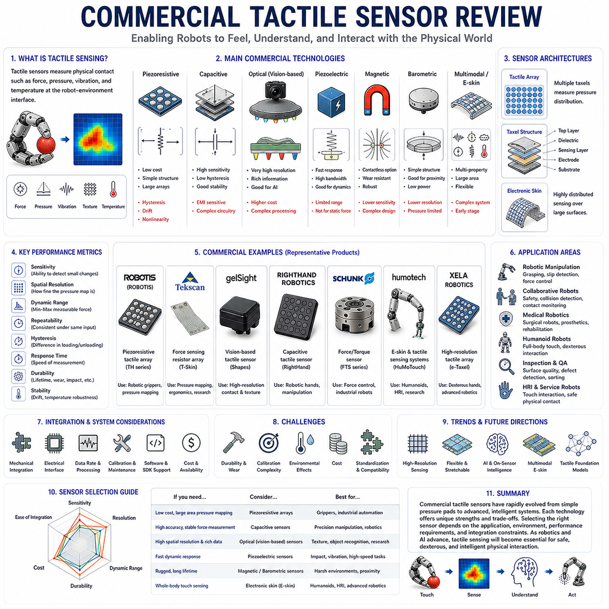{width="7.268055555555556in" height="7.268055555555556in"}

Commercial tactile sensors have become an increasingly important component of modern robotic systems as the demand for advanced manipulation, collaborative robotics, service robotics, medical robotics, humanoid robots, and physical AI continues to grow. While tactile sensing was once primarily a research topic confined to laboratories, significant advances in sensor technology, materials engineering, electronics, artificial intelligence, and manufacturing have enabled the commercialization of a wide variety of tactile sensing products. Today, numerous companies offer tactile sensors designed for industrial automation, robotic hands, force-controlled manipulation, human-robot interaction, quality inspection, medical applications, and academic research. Understanding the capabilities, limitations, architectures, and performance characteristics of commercially available tactile sensors is essential for engineers and researchers seeking to integrate touch perception into robotic systems.

The commercialization of tactile sensing has historically lagged behind vision sensing. Cameras became inexpensive, highly standardized, and widely available much earlier than tactile sensors. Vision systems benefited from the rapid growth of consumer electronics, particularly smartphones and digital cameras, which drove dramatic reductions in cost and increases in performance. Tactile sensing, by contrast, faces unique challenges involving physical contact, mechanical durability, calibration complexity, environmental robustness, and integration with robotic hardware. As a result, the tactile sensor market remains smaller and more specialized than the machine vision market. Nevertheless, recent developments in robotics and artificial intelligence have significantly accelerated commercial interest in tactile technologies.

One of the most important categories of commercial tactile sensors is force-sensitive tactile arrays. These sensors consist of multiple sensing elements distributed across a surface and are capable of measuring pressure distributions during contact. Such systems are commonly used in robotic grippers, prosthetic devices, pressure mapping systems, and human-machine interfaces. Tactile arrays provide spatial information that cannot be obtained from traditional force sensors alone. By measuring pressure distributions rather than single force values, tactile arrays enable robots to estimate contact locations, object shapes, grasp stability, and interaction dynamics.

Among the best-known commercial tactile sensing technologies are piezoresistive tactile sensors. These sensors utilize conductive materials whose electrical resistance changes when mechanical forces are applied. Piezoresistive sensors are attractive because they are relatively inexpensive, easy to manufacture, compact, and capable of measuring distributed pressure. Their simple construction makes them suitable for large tactile arrays and electronic skin applications. Many commercial pressure-mapping systems rely on piezoresistive sensing principles. However, these sensors often exhibit hysteresis, drift, temperature sensitivity, and nonlinear behavior, requiring careful calibration and signal processing.

Capacitive tactile sensors represent another major commercial category. These sensors detect changes in capacitance caused by mechanical deformation. Capacitive tactile sensors generally offer high sensitivity, low hysteresis, excellent repeatability, and good long-term stability. They are widely used in precision robotic applications where accurate force measurement is required. Capacitive sensors can achieve high spatial resolution and low power consumption, making them attractive for robotic hands and wearable systems. However, they are often more susceptible to electromagnetic interference and may require sophisticated electronic circuitry.

Optical tactile sensors have recently emerged as one of the most promising commercial technologies. Unlike conventional tactile sensors that directly measure electrical changes, optical tactile sensors use cameras and deformable surfaces to infer contact conditions. The sensor surface deforms when contact occurs, and the resulting deformation patterns are analyzed using computer vision techniques. Optical tactile sensors can provide extremely high spatial resolution, rich contact information, and detailed force distribution estimates. Advances in low-cost cameras, LEDs, embedded computing, and machine learning have significantly accelerated their commercialization.

One of the most influential developments in commercial tactile sensing has been the introduction of vision-based tactile sensors inspired by research systems such as GelSight. These sensors use elastomeric surfaces combined with cameras and structured illumination to capture high-resolution images of contact events. Commercial variants have demonstrated remarkable capabilities in texture recognition, force estimation, contact localization, slip detection, and object identification. The ability to transform tactile sensing into an image processing problem has enabled the application of advanced machine learning techniques originally developed for computer vision.

Commercial force-torque sensors are often discussed alongside tactile sensors because they provide complementary information. Force-torque sensors typically measure forces and torques at a single location, often mounted at the wrist of a robotic arm. While they do not provide distributed contact information, they offer highly accurate force measurements and are widely used in force-controlled manipulation. Many advanced robotic systems combine force-torque sensors with tactile sensors to achieve comprehensive physical interaction awareness.

Electronic skin, commonly known as e-skin, represents one of the most ambitious directions in commercial tactile sensing. Electronic skin systems aim to provide distributed tactile sensing across large robotic surfaces. These systems often incorporate pressure sensing, temperature sensing, proximity sensing, strain sensing, and vibration sensing within flexible and stretchable substrates. Although full-body electronic skin remains largely an emerging technology, several companies have begun offering commercial e-skin products for research and specialized robotic applications.

Robotic grippers constitute one of the largest markets for commercial tactile sensors. Modern robotic manipulation increasingly requires robots to handle fragile, deformable, and unpredictable objects. Traditional position-controlled gripping often struggles in such scenarios because it lacks direct information about contact conditions. Commercial tactile sensors integrated into robotic grippers provide real-time information regarding contact forces, pressure distributions, grasp quality, and slip events. This information enables adaptive gripping strategies that improve manipulation performance and reduce object damage.

Collaborative robots have further increased demand for tactile sensing technologies. Collaborative robots operate in close proximity to humans and therefore require enhanced safety capabilities. Tactile sensors provide direct information about physical contact between robots and people. By detecting contact forces and identifying contact locations, tactile sensing systems can support collision detection, force limitation, and responsive safety behaviors. As collaborative robotics continues to expand, tactile sensing is expected to become increasingly important for regulatory compliance and operational safety.

Medical robotics represents another significant application area for commercial tactile sensors. Surgical robots, rehabilitation devices, prosthetic limbs, and assistive systems all benefit from tactile feedback. In minimally invasive surgery, tactile sensors can provide force information that would otherwise be unavailable to surgeons. Prosthetic hands equipped with tactile sensors can improve object handling and potentially provide sensory feedback to users. Rehabilitation robots can monitor patient interactions and adjust assistance levels accordingly.

Humanoid robotics has recently emerged as a major driver of commercial tactile sensing innovation. Humanoid robots are expected to interact with the world in ways that resemble human behavior. Such interaction requires distributed tactile perception across hands, arms, feet, torso, and other body regions. Several companies developing humanoid robots have identified tactile sensing as a critical technology for achieving human-level manipulation and physical intelligence. This growing demand is expected to accelerate both research and commercialization efforts.

Performance evaluation is an essential aspect of commercial tactile sensor selection. Key performance metrics include sensitivity, resolution, spatial resolution, temporal resolution, dynamic range, repeatability, hysteresis, drift, durability, response time, calibration stability, and environmental robustness. Different applications prioritize different metrics. For example, surgical robotics may prioritize sensitivity and accuracy, whereas industrial automation may emphasize durability and reliability.

Durability remains one of the most important considerations in commercial tactile sensing. Unlike cameras and other non-contact sensors, tactile sensors experience repeated physical contact and mechanical stress. Commercial products must withstand millions of contact cycles, impacts, abrasions, temperature variations, humidity exposure, and contamination. Achieving long operational lifetimes while maintaining sensing performance remains a significant engineering challenge.

Calibration requirements also influence commercial adoption. Some tactile sensors require extensive calibration procedures to achieve accurate measurements. Calibration complexity increases installation costs and maintenance requirements. Manufacturers increasingly focus on developing sensors with simplified calibration procedures, automatic calibration capabilities, and long-term stability to reduce operational burdens.

Integration complexity represents another important factor. Commercial users often prefer sensors that can be easily integrated into existing robotic platforms. Standard communication interfaces such as Ethernet, USB, CAN, SPI, I2C, and ROS-compatible software drivers significantly simplify deployment. Sensors that provide comprehensive software development kits, APIs, visualization tools, and calibration utilities are generally easier to adopt.

Artificial intelligence has begun to reshape commercial tactile sensing products. Modern tactile sensors increasingly incorporate embedded processing capabilities that perform filtering, feature extraction, force estimation, and even machine learning inference directly on the sensor hardware. Such intelligent sensors reduce computational requirements on the host robot and simplify system integration.

Machine learning also enables new capabilities that extend beyond traditional tactile sensing. Commercial systems can now perform slip detection, object classification, material recognition, contact state estimation, and grasp quality assessment using learned models. These capabilities transform tactile sensors from simple measurement devices into intelligent perception systems capable of supporting high-level robotic decision-making.

Sensor fusion is becoming increasingly common in commercial robotic platforms. Rather than relying exclusively on tactile sensing, many systems combine tactile data with vision, force-torque sensing, inertial sensing, and proprioceptive measurements. Commercial sensor manufacturers increasingly provide software frameworks that facilitate multi-sensor integration and data synchronization.

Cost remains one of the primary barriers to widespread tactile sensor adoption. High-performance tactile sensors are often significantly more expensive than cameras or basic force sensors. Advanced tactile arrays, optical tactile systems, and electronic skin technologies may cost thousands or tens of thousands of dollars depending on their capabilities. Continued advances in manufacturing, materials science, and electronics are expected to reduce costs over time and expand accessibility.

Miniaturization represents another important trend. As robotic hands become more sophisticated, sensor systems must fit within increasingly compact structures. Advances in flexible electronics, MEMS fabrication, printed electronics, and nanomaterials are enabling smaller, lighter, and more capable tactile sensors suitable for integration into robotic fingers and wearable devices.

Recent developments in soft robotics have also influenced commercial tactile sensor design. Soft robotic systems require sensors that can deform substantially without losing functionality. Flexible, stretchable, and compliant tactile sensors are becoming increasingly available commercially, enabling tactile sensing in applications where traditional rigid sensors would be unsuitable.

The future commercial tactile sensor market is expected to be strongly influenced by the growth of physical AI. Physical AI systems require direct interaction with the physical world, making tactile perception as important as visual perception. As robots transition from structured industrial environments into homes, hospitals, warehouses, offices, and public spaces, tactile sensing will become essential for safe and intelligent interaction.

Emerging technologies such as self-healing materials, stretchable electronics, neuromorphic tactile sensing, multimodal electronic skin, and tactile foundation models are likely to shape the next generation of commercial products. Future tactile sensors may combine pressure sensing, temperature sensing, vibration sensing, proximity sensing, chemical sensing, and force estimation within unified sensing platforms.

In conclusion, commercial tactile sensors have evolved from specialized research instruments into increasingly practical technologies for modern robotics. Piezoresistive sensors, capacitive sensors, optical tactile sensors, force-torque sensors, tactile arrays, and electronic skin systems each offer unique advantages and limitations. Their adoption is being driven by advances in robotic manipulation, collaborative robotics, medical robotics, humanoid systems, and physical AI. Although challenges related to durability, calibration, cost, and integration remain, ongoing technological progress continues to improve performance and accessibility. As robots become more physically intelligent and interact more closely with humans and complex environments, commercial tactile sensing technologies will play a central role in enabling safe, adaptive, and dexterous robotic behavior.
