**Volume 06 Robot Hands and Dexterous Grasping**

# 07. Tactile Sensing

## 07.01 Introduction to Tactile Sensing

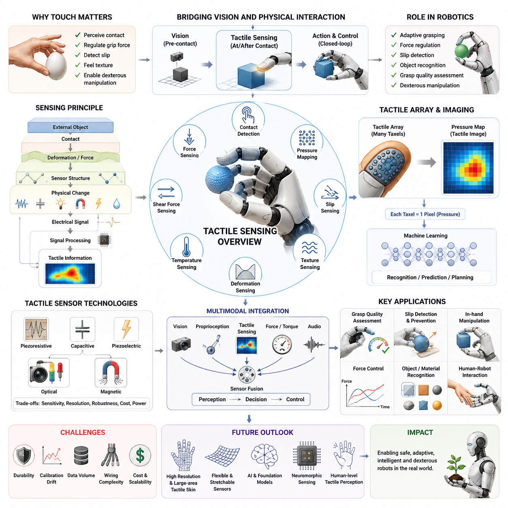{width="7.268055555555556in" height="7.268055555555556in"}

촉각 센싱(Tactile Sensing)은 로봇 조작(Robotic Manipulation) 분야에서 가장 중요한 기술 중 하나이다. 이는 로봇이 환경과의 직접적인 접촉(Contact)을 통해 물리적 상호작용을 인식할 수 있도록 해주기 때문이다. 비전 시스템(Vision System)이 물체와 접촉하기 전에 외형, 위치, 형상, 움직임에 대한 정보를 제공한다면, 촉각 센싱은 실제 접촉이 발생하는 순간과 그 이후의 정보를 제공한다. 이러한 능력 덕분에 로봇 핸드(Robot Hand)는 물체가 어떻게 만져지고 있는지, 얼마나 강하게 잡고 있는지, 물체가 미끄러지고 있는지, 변형되고 있는지, 또는 안정적으로 조작되고 있는지를 이해할 수 있다. 따라서 촉각 센싱은 흔히 인간의 촉각 감각을 로봇에서 구현한 기술로 간주되며, 정교한 로봇 손(Dexterous Hand)과 고급 조작 시스템을 구현하기 위한 핵심 요소로 평가된다.

인간의 물체 조작 능력은 촉각 정보에 크게 의존한다. 사람이 계란, 와인잔, 과일과 같은 깨지기 쉬운 물체를 집을 때 손가락은 피부 속에 분포된 수천 개의 감각 수용체를 통해 압력(Pressure), 진동(Vibration), 질감(Texture), 온도(Temperature), 미세한 미끄러짐(Micro-Slip) 등을 지속적으로 감지한다. 이러한 정보 덕분에 사람은 자동적으로 그립 힘(Grip Force)을 조절하고 실시간으로 파지 전략(Grasp Strategy)을 수정할 수 있다. 만약 촉각 정보를 제거하면 단순한 물체 조작조차 상당히 어려워진다. 실제 연구에서도 감각 피드백이 제한되면 파지 안정성이 떨어지고 불필요하게 큰 힘을 사용하게 되며 조작 정밀도가 급격히 감소하는 것으로 알려져 있다. 로봇도 마찬가지이다. 카메라만 장착된 로봇은 물체의 위치는 알 수 있지만, 물체를 안정적으로 잡고 있는지, 미끄러지고 있는지, 손상시키고 있는지는 알기 어렵다.

촉각 센싱의 가장 중요한 목적은 이러한 시각 인식과 물리적 상호작용 사이의 간극을 메우는 것이다. 촉각 센서는 접촉 여부, 접촉 위치, 힘의 크기, 압력 분포, 표면 질감, 진동, 변형 상태, 미끄러짐 여부 등에 대한 정보를 제공한다. 이러한 정보가 로봇 제어 시스템에 통합되면 적응형 파지(Adaptive Grasping), 순응 제어(Compliant Interaction), 물체 인식(Object Recognition), 힘 제어(Force Regulation), 정교한 조작(Dexterous Manipulation) 등이 가능해진다. 결과적으로 촉각 센싱은 개방 루프(Open Loop) 방식의 파지를 폐루프 제어(Closed Loop Control) 방식으로 전환시키는 핵심 역할을 수행한다.

촉각 센싱의 기본 원리는 센서 표면과 외부 물체 사이의 접촉에서 시작된다. 물체가 센서에 닿으면 기계적 힘(Mechanical Force)이 센서 구조로 전달된다. 이 힘은 저항 변화(Resistance Change), 정전용량 변화(Capacitance Change), 광학적 변형(Optical Deformation), 자기장 변화(Magnetic Field Variation), 압전 전하(Piezoelectric Charge), 유체 압력 변화(Fluid Pressure Variation) 등 다양한 물리적 변화를 유발한다. 촉각 센서는 이러한 변화를 전기 신호로 변환하며, 제어 시스템은 이를 해석하여 접촉 상태를 파악한다.

촉각 센싱 시스템은 측정 대상에 따라 여러 종류로 구분된다. 힘 센싱(Force Sensing)은 전체 상호작용 힘을 측정하고, 압력 센싱(Pressure Sensing)은 단위 면적당 힘을 측정한다. 접촉 센싱(Contact Sensing)은 특정 위치에서 접촉 발생 여부를 판단하며, 슬립 센싱(Slip Sensing)은 물체가 미끄러지는 현상을 감지한다. 질감 센싱(Texture Sensing)은 표면의 미세 구조를 분석하고, 변형 센싱(Deformation Sensing)은 물체나 센서 자체의 변형 정도를 측정한다. 온도 센싱(Temperature Sensing)은 접촉 물체의 열적 특성을 추정하는 데 사용된다. 최신 촉각 시스템은 이러한 여러 기능을 하나의 센서 플랫폼에 통합하는 방향으로 발전하고 있다.

촉각 센싱에서 중요한 구분 중 하나는 단일 지점 센서(Single-Point Sensor)와 촉각 배열(Tactile Array)의 차이이다. 단일 지점 센서는 한 지점에서만 힘이나 압력을 측정하므로 구조가 단순하지만 공간 정보를 제공하기 어렵다. 반면 촉각 배열은 수십 개에서 수천 개의 센싱 셀을 표면에 분산 배치한다. 각각의 센싱 셀은 택셀(Taxel)이라고 불리며, 카메라의 픽셀(Pixel)과 유사한 역할을 수행한다. 수많은 택셀의 측정값을 결합하면 손가락 표면 전체에 걸친 압력 분포 지도를 생성할 수 있다. 이를 통해 물체의 형상, 접촉 패턴, 힘의 분포 등을 정밀하게 분석할 수 있다.

이러한 촉각 배열은 촉각 이미지(Tactile Image)라는 개념을 가능하게 한다. 촉각 이미지는 카메라 이미지와 유사하지만 각 픽셀이 밝기가 아닌 압력 값을 나타낸다. 최근에는 컴퓨터 비전 분야에서 사용되는 딥러닝(Deep Learning) 기술이 촉각 이미지 분석에도 활용되고 있다. 합성곱 신경망(CNN), 트랜스포머(Transformer), 그래프 신경망(Graph Neural Network)은 촉각 데이터에서 의미 있는 특징을 추출하고 이를 이용하여 물체 인식, 파지 평가, 조작 계획 등을 수행할 수 있다.

촉각 센싱에는 다양한 센서 기술이 존재한다. 압저항 센서(Piezoresistive Sensor)는 변형에 따른 저항 변화를 이용하며 구조가 단순하고 가격이 저렴하다. 정전용량 센서(Capacitive Sensor)는 전극 간 간격 변화에 따른 정전용량 변화를 측정하며 높은 민감도를 제공한다. 압전 센서(Piezoelectric Sensor)는 동적 하중에 의해 발생하는 전하를 측정하며 진동 및 슬립 검출에 적합하다. 광학 촉각 센서(Optical Tactile Sensor)는 탄성체의 변형을 카메라로 관찰하여 힘과 압력 분포를 계산한다. 자기 기반 촉각 센서(Magnetic Tactile Sensor)는 자기장의 변화를 측정한다. 각각의 기술은 민감도, 공간 해상도, 내구성, 가격, 데이터 처리 복잡도 측면에서 서로 다른 특성을 가진다.

최근 가장 주목받는 기술 중 하나는 광학 촉각 센싱이다. 광학 촉각 센서는 탄성체 표면이 변형될 때 이를 내부 카메라로 촬영하고, 영상 처리 알고리즘을 통해 접촉 힘, 압력 분포, 전단력(Shear Force), 접촉 형상 등을 추정한다. 대표적인 예가 GelSight 계열 센서이다. 이러한 센서는 매우 높은 공간 해상도를 제공하며 표면의 미세한 질감이나 미세한 슬립 현상까지 감지할 수 있다.

촉각 센싱에서는 수직력(Normal Force)과 전단력(Shear Force)의 구분도 중요하다. 수직력은 접촉면에 수직으로 작용하며 파지 강도를 나타낸다. 전단력은 접촉면을 따라 작용하며 마찰과 슬립 현상과 밀접한 관계를 가진다. 인간은 두 종류의 힘을 동시에 감지할 수 있으며, 고급 로봇 촉각 센서 역시 이를 동시에 측정하는 방향으로 발전하고 있다. 특히 전단력 측정은 초기 슬립(Incipient Slip)을 감지하는 데 매우 중요하다.

슬립 검출(Slip Detection)은 촉각 센싱의 가장 가치 있는 응용 분야 중 하나이다. 물체가 충분한 마찰력을 확보하지 못하거나 파지력이 부족할 경우 물체는 미끄러지기 시작한다. 카메라 기반 시스템은 이러한 미세한 움직임을 즉시 감지하기 어렵지만, 촉각 센서는 접촉면에서 발생하는 미세 진동과 힘 분포 변화를 매우 빠르게 감지할 수 있다. 슬립이 감지되면 로봇은 자동으로 파지력을 증가시키거나 손가락 자세를 수정하여 물체를 안정화할 수 있다.

촉각 센싱은 파지 품질 평가(Grasp Quality Assessment)에도 중요한 역할을 수행한다. 이론적인 파지 계획은 접촉 모델(Contact Model)과 마찰 모델(Friction Model)을 기반으로 하지만 실제 환경에서는 물체 형상, 마찰계수, 재질 등이 불확실하다. 촉각 센서는 실제 접촉 상태를 직접 측정하므로 현재 파지가 얼마나 안정적인지 판단할 수 있다. 이를 통해 로봇은 스스로 파지 자세를 수정하고 성공률을 향상시킬 수 있다.

정교한 손 조작(In-Hand Manipulation)에서도 촉각 센싱은 필수적이다. 물체 회전(Object Reorientation), 핑거 게이팅(Finger Gaiting), 롤링(Rolling), 피보팅(Pivoting), 공구 사용(Tool Manipulation)과 같은 작업은 지속적인 접촉 상태 추적을 필요로 한다. 촉각 정보는 물체와 손가락 사이의 상대 운동을 추정하고 힘 분포를 조정하는 데 활용된다. 이러한 기능 없이는 인간 수준의 손재주를 구현하기 어렵다.

촉각 센싱은 힘 제어(Force Control)와 결합될 때 더욱 강력해진다. 손목에 장착된 힘-토크 센서(Force-Torque Sensor)는 전체적인 상호작용 힘을 측정하지만, 각 손가락 접촉면에서 어떤 힘이 발생하는지는 알려주지 못한다. 반면 촉각 센서는 국부적인 접촉 상태를 정밀하게 측정한다. 두 센서를 함께 사용하면 보다 정밀한 힘 제어와 안전한 물체 조작이 가능해진다.

최근 연구에서는 촉각 센싱을 비전(Vision), 고유감각(Proprioception), 힘 센싱, 음향 센싱과 통합하는 다중 모달 인식(Multimodal Perception)이 활발히 연구되고 있다. 비전은 접촉 전 정보를 제공하고 촉각은 접촉 후 정보를 제공한다. 두 정보를 융합하면 로봇은 물체를 인식하고 접근하며 파지하고 조작하는 전체 과정을 보다 안정적으로 수행할 수 있다.

머신러닝(Machine Learning)의 발전 역시 촉각 센싱 분야를 크게 변화시키고 있다. 과거에는 사람이 정의한 특징량을 사용했지만, 현재는 딥러닝 모델이 촉각 데이터로부터 직접 특징을 학습한다. 이를 통해 물체 재질 인식, 슬립 예측, 파지 성공률 예측, 접촉 형상 추정 등이 가능해지고 있다. 최근에는 다양한 촉각 경험을 학습하여 여러 작업에 적용할 수 있는 촉각 파운데이션 모델(Tactile Foundation Model)에 대한 연구도 시작되고 있다.

소프트 로보틱스(Soft Robotics)의 발전도 촉각 센서 기술을 변화시키고 있다. 유연한 전자소자(Flexible Electronics), 전도성 고분자(Conductive Polymer), 액체 금속(Liquid Metal), 나노소재(Nanomaterial)를 이용한 유연 촉각 센서는 손가락 전체를 감싸는 전자 피부(Electronic Skin) 형태로 구현될 수 있다. 이러한 기술은 인간 피부와 유사한 전신 촉각 인식(Whole-Hand Perception)을 가능하게 한다.

그러나 촉각 센싱에는 여전히 많은 기술적 과제가 존재한다. 센서 내구성(Durability), 장기 안정성(Stability), 환경 강건성(Robustness), 배선 복잡성(Wiring Complexity), 대량 생산성(Manufacturability), 비용(Cost) 문제가 대표적이다. 또한 고해상도 촉각 배열은 매우 많은 데이터를 생성하기 때문에 실시간 처리 성능도 중요한 문제로 남아 있다.

미래의 촉각 센싱 시스템은 더욱 민감하고, 유연하며, 지능적인 방향으로 발전할 것으로 예상된다. 나노기술(Nanotechnology), 뉴로모픽 센싱(Neuromorphic Sensing), 임베디드 AI(Embedded AI), 소프트 재료 기술의 발전은 인간 수준 또는 그 이상의 촉각 능력을 가진 로봇을 가능하게 할 것이다. 손가락뿐 아니라 팔 전체를 덮는 대면적 촉각 피부가 등장할 것이며, 촉각 파운데이션 모델은 로봇이 경험을 통해 스스로 조작 능력을 학습하도록 지원할 것이다.

결론적으로 촉각 센싱은 로봇 조작에서 물리적 인식(Physical Perception)의 핵심 기반 기술이다. 촉각 센싱은 접촉 감지, 힘 측정, 파지 품질 평가, 슬립 검출, 물체 특성 인식, 정교한 손 조작을 가능하게 한다. 또한 시각 인식을 보완하여 로봇 파지를 폐루프 감각-운동 시스템으로 전환시키며, 인간 수준의 손재주와 적응성을 구현하기 위한 필수 기술로 자리 잡고 있다. 본 장은 이후 다루게 될 압저항 센서(Piezoresistive Sensor), 정전용량 센서(Capacitive Sensor), 광학 촉각 센서(Optical Tactile Sensor), 촉각 피부(Tactile Skin), 센서 보정(Calibration), 상용 촉각 센서 플랫폼 등의 내용을 이해하기 위한 기초 개념을 제공한다.

## 07.02 Piezoresistive Sensors

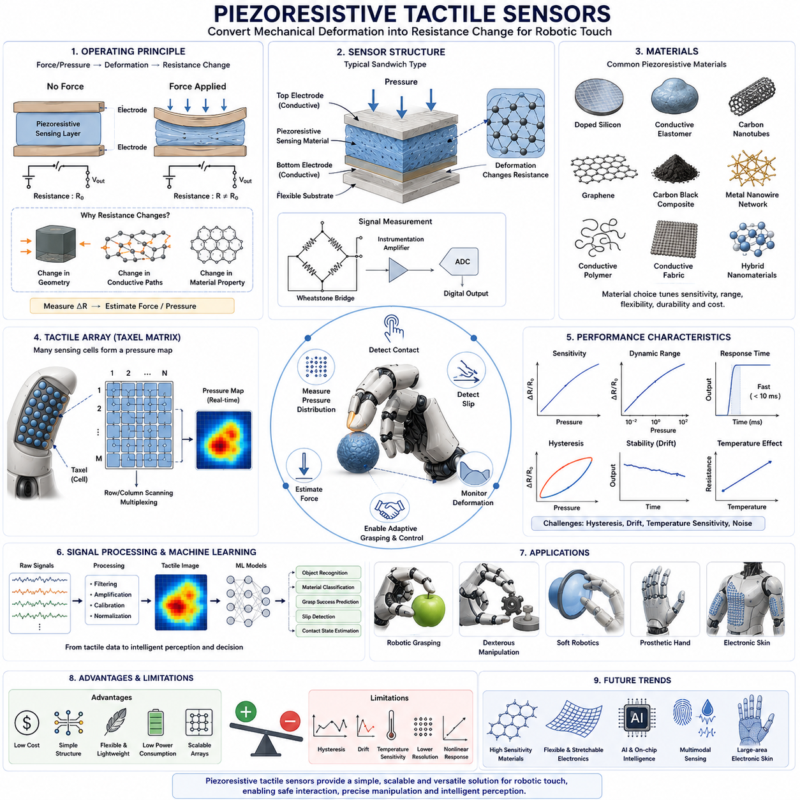{width="7.268055555555556in" height="7.268055555555556in"}

압저항 촉각 센서(Piezoresistive Tactile Sensor)는 로봇 촉각 센싱 분야에서 가장 널리 사용되는 기술 중 하나이다. 이는 높은 민감도(Sensitivity), 단순한 구조(Simple Structure), 우수한 제조성(Manufacturability), 그리고 낮은 비용(Cost)을 동시에 제공하기 때문이다. 압저항 센서는 외부에서 가해지는 압력(Pressure), 힘(Force), 변형(Deformation)을 전기 저항(Electrical Resistance)의 변화로 변환하여 측정한다. 구조가 비교적 간단하고 전력 소모가 적으며 유연한 재료와 쉽게 결합할 수 있기 때문에 로봇 핸드(Robot Hand), 전자 피부(Electronic Skin), 그리퍼(Gripper), 의수(Prosthetic Hand), 웨어러블 장치(Wearable Device), 인간-로봇 상호작용(Human-Robot Interaction) 시스템 등에 폭넓게 활용된다.

압저항 센서의 기본 원리는 기계적 변형과 전기 저항 사이의 관계에 기반한다. 특정 재료가 압축되거나 늘어나거나 굽혀질 경우 내부 전도 경로가 변화하면서 전기 저항이 달라진다. 센서는 이러한 저항 변화를 측정하여 외부에서 가해진 힘의 크기와 분포를 추정한다. 이러한 현상은 재료의 형상 변화, 전도 경로의 변화, 또는 재료 자체의 전기적 특성 변화로 인해 발생한다.

전기 저항은 재료의 고유 저항률(Resistivity), 길이(Length), 단면적(Cross-sectional Area)에 의해 결정된다. 압축이 발생하면 전도 입자 간 접촉 밀도가 증가하여 저항이 감소할 수 있으며, 반대로 인장 변형이 발생하면 전도 경로가 길어지고 연결성이 감소하여 저항이 증가할 수 있다. 센서 재료와 구조에 따라 저항 변화의 방향과 크기는 달라질 수 있지만, 이러한 변화를 측정함으로써 외부 힘을 추정하는 것이 압저항 센싱의 핵심이다.

압저항 센서가 널리 사용되는 가장 큰 이유는 구조가 매우 단순하기 때문이다. 일반적인 압저항 센서는 감지층(Sensing Layer)과 전극(Electrode)으로 구성된다. 외부 압력이 가해지면 감지층의 저항이 변하고, 이 저항 변화는 전압 또는 전류 변화로 측정된다. 광학 촉각 센서처럼 카메라와 영상처리가 필요하지 않으며, 정전용량 센서처럼 복잡한 측정 회로도 필요하지 않다. 단순한 전압 분배기(Voltage Divider)나 아날로그-디지털 변환기(ADC)만으로도 구현이 가능하기 때문에 비용과 시스템 복잡도를 크게 줄일 수 있다.

압저항 센서에 사용되는 재료는 매우 다양하다. 초기에는 반도체 기반의 도핑 실리콘(Doped Silicon)이 널리 사용되었다. 실리콘은 높은 민감도와 우수한 반복성을 제공하며 MEMS(Micro Electro Mechanical Systems) 제조 기술과도 잘 결합된다. 그러나 실리콘은 상대적으로 단단하고 깨지기 쉬워 유연성이 필요한 전자 피부나 소프트 로봇 응용에는 한계가 있다.

이러한 문제를 해결하기 위해 다양한 유연 재료(Flexible Materials)가 개발되었다. 대표적으로 전도성 고분자(Conductive Polymer), 전도성 엘라스토머(Conductive Elastomer), 탄소 나노튜브(Carbon Nanotube), 그래핀(Graphene), 전도성 섬유(Conductive Fabric), 금속 나노와이어(Metal Nanowire), 하이브리드 나노소재(Hybrid Nanomaterial) 등이 있다. 특히 실리콘이나 폴리우레탄 기반의 탄성체에 전도성 입자를 혼합한 전도성 엘라스토머는 높은 유연성과 내구성을 동시에 제공하여 로봇 손가락과 촉각 피부에 널리 사용된다.

탄소 기반 재료는 최근 가장 활발하게 연구되는 분야 중 하나이다. 탄소 나노튜브는 우수한 전기 전도성과 기계적 유연성을 제공하며, 그래핀은 매우 높은 민감도와 빠른 응답 특성을 가진다. 카본 블랙(Carbon Black)은 상대적으로 저렴한 비용으로 제조가 가능하여 산업용 센서에서 널리 사용된다. 엔지니어는 전도성 입자의 농도와 분포를 조절함으로써 센서의 민감도, 측정 범위, 내구성을 최적화할 수 있다.

압저항 센서는 다양한 구조로 설계될 수 있다. 가장 일반적인 형태는 샌드위치 구조(Sandwich Structure)로, 두 전극 사이에 압저항 재료를 배치하는 방식이다. 외부 압력이 가해지면 감지층의 저항이 변한다. 또 다른 방식으로는 전도성 폼(Conductive Foam)을 사용하는 구조가 있으며, 폼이 압축될 때 전도 경로가 변화하면서 저항이 변한다. 최근에는 피라미드(Pyramid), 돔(Dome), 기둥(Pillar), 다공성 구조(Porous Structure)와 같은 미세 구조를 적용하여 민감도를 향상시키는 연구도 활발히 진행되고 있다.

촉각 배열(Tactile Array)은 압저항 센서 기술에서 매우 중요한 개념이다. 단일 센서는 하나의 위치에서만 힘을 측정할 수 있지만, 촉각 배열은 수백에서 수천 개의 센서를 격자 형태로 배치하여 넓은 영역의 압력 분포를 측정한다. 각각의 센싱 셀은 택셀(Taxel)이라 불리며 카메라의 픽셀과 유사한 역할을 수행한다. 이러한 배열은 접촉 위치, 접촉 형상, 힘의 분포를 시각화할 수 있게 해준다.

로봇 파지 과정에서 힘은 일반적으로 균일하게 분포하지 않는다. 특정 지점에 집중되거나 비대칭적으로 분포하는 경우가 많다. 촉각 배열은 이러한 힘 분포를 실시간으로 측정할 수 있으며, 이를 통해 파지 안정성 평가, 접촉 상태 모니터링, 적응형 힘 제어가 가능해진다.

압저항 센서의 중요한 성능 지표 중 하나는 민감도이다. 민감도가 높을수록 작은 힘도 정확하게 감지할 수 있다. 특히 깨지기 쉬운 물체를 다루는 경우 초기 접촉을 빠르게 감지하는 능력이 매우 중요하다. 민감도는 재료 특성, 전극 구조, 미세 구조 설계 등에 의해 결정된다.

공간 해상도(Spatial Resolution) 역시 중요한 요소이다. 해상도가 높을수록 접촉 위치를 더 정확하게 추정할 수 있다. 그러나 택셀 수가 증가하면 배선 수가 증가하고 전자회로와 데이터 처리 부담도 커진다. 따라서 응용 목적에 따라 적절한 해상도를 선택해야 한다.

동적 범위(Dynamic Range)는 매우 작은 힘부터 큰 힘까지 측정 가능한 범위를 의미한다. 산업용 로봇은 전자 부품처럼 섬세한 물체와 금속 부품처럼 무거운 물체를 모두 다루어야 하기 때문에 넓은 측정 범위가 요구된다. 이를 위해 다층 구조(Multi-layer Structure)나 비선형 센서 설계가 활용된다.

응답 속도(Response Time)는 실시간 제어에서 매우 중요하다. 물체를 빠르게 집거나 이동시키는 과정에서 접촉 상태는 수 밀리초 단위로 변화할 수 있다. 최신 압저항 센서는 슬립 검출(Slip Detection), 실시간 힘 제어(Real-Time Force Control), 고속 파지(High-Speed Grasping)에 충분한 응답 속도를 제공한다.

압저항 센서의 가장 큰 문제 중 하나는 히스테리시스(Hysteresis)이다. 동일한 힘이 가해지더라도 힘을 증가시키는 과정과 감소시키는 과정에서 서로 다른 출력이 나타날 수 있다. 이는 재료의 점탄성(Viscoelasticity), 내부 마찰(Internal Friction), 미세 구조 변화 등에 의해 발생한다. 히스테리시스는 측정 정확도를 저하시키기 때문에 이를 최소화하기 위한 재료 개발과 보상 알고리즘 연구가 활발히 이루어지고 있다.

센서 드리프트(Sensor Drift) 역시 중요한 문제이다. 온도 변화, 습도 변화, 재료 노화, 반복 사용 등에 의해 센서 특성이 시간이 지남에 따라 변할 수 있다. 따라서 정기적인 보정(Calibration)과 보상 알고리즘이 필요하다.

온도 민감성(Temperature Sensitivity)도 고려해야 한다. 많은 전도성 재료는 힘과 무관하게 온도 변화만으로도 저항이 달라질 수 있다. 따라서 실제 힘 변화와 온도 영향을 구분하기 위해 온도 보상 기법이 적용된다.

신호 처리(Signal Conditioning)는 압저항 센서 시스템에서 중요한 역할을 수행한다. 저항 변화는 일반적으로 매우 작기 때문에 이를 정확히 측정하기 위한 증폭기(Amplifier), 필터(Filter), 고해상도 ADC가 필요하다. 휘트스톤 브리지(Wheatstone Bridge)는 민감도를 높이고 노이즈를 줄이기 위해 널리 사용된다.

최근에는 머신러닝(Machine Learning)이 압저항 촉각 센서 데이터 분석에 적극적으로 활용되고 있다. 촉각 배열은 매우 복잡한 압력 분포 데이터를 생성하기 때문에 딥러닝(Deep Learning)은 이러한 패턴을 분석하여 물체 인식(Object Recognition), 재질 분류(Material Classification), 파지 성공률 예측(Grasp Success Prediction), 슬립 검출, 접촉 상태 추정 등을 수행할 수 있다.

압저항 촉각 센서는 로봇 파지에서 매우 중요한 역할을 수행한다. 파지 시작 단계에서는 초기 접촉을 감지하고 과도한 힘을 방지한다. 물체를 들어 올리는 과정에서는 압력 분포를 모니터링하여 불안정한 접촉 상태를 탐지한다. 조작 과정에서는 힘 제어와 물체 이동 상태를 추적한다. 슬립이 발생하면 압력 패턴 변화로 이를 감지하여 즉각적인 보정 동작을 수행할 수 있다.

정교한 로봇 손에서는 손끝(Fingertip), 손가락 패드(Finger Pad), 손바닥(Palm), 전자 피부(Electronic Skin)에 압저항 센서가 통합된다. 손끝 센서는 고해상도 측정을 제공하고, 손바닥 센서는 넓은 면적의 접촉을 감지하며, 전자 피부는 전체 손의 접촉 상태를 인식할 수 있게 한다.

의수(Prosthetic Hand) 분야에서도 압저항 센서는 매우 중요하다. 최신 의수는 촉각 센서를 이용하여 사용자가 접촉 힘을 인지할 수 있도록 진동(Vibrotactile), 전기 자극(Electrotactile), 신경 인터페이스(Neural Interface)를 제공한다. 이를 통해 사용자는 보다 자연스럽게 물체를 조작할 수 있다.

소프트 로보틱스(Soft Robotics)는 압저항 센서의 또 다른 주요 응용 분야이다. 소프트 그리퍼는 물체 형상에 자연스럽게 적응할 수 있지만 접촉 상태를 파악하기 어렵다. 유연한 압저항 센서를 통합하면 물체 존재 여부, 접촉 힘, 변형 상태를 실시간으로 측정할 수 있으며, 순응성과 촉각 인식을 동시에 달성할 수 있다.

전자 피부(Electronic Skin)는 향후 가장 유망한 응용 분야 중 하나이다. 수천 개의 압저항 센서를 유연한 기판 위에 배치하여 로봇 몸 전체의 접촉을 감지할 수 있다. 이를 통해 안전한 인간-로봇 협업(Human-Robot Collaboration), 충돌 감지(Collision Detection), 환경 인식(Environmental Awareness)이 가능해진다.

미래의 압저항 촉각 센서는 더 높은 민감도, 더 낮은 히스테리시스, 더 우수한 내구성, 더 높은 해상도를 제공하는 방향으로 발전할 것이다. 나노소재(Nanomaterial), 유연 전자소자(Flexible Electronics), 3D 프린팅(Additive Manufacturing), 자가 치유 재료(Self-Healing Material) 기술이 이러한 발전을 가속화하고 있다. 또한 압력, 전단력, 온도, 진동을 동시에 측정하는 다중 모달 촉각 센서(Multimodal Tactile Sensor)도 활발히 연구되고 있다.

결론적으로 압저항 촉각 센서는 기계적 변형을 전기 저항 변화로 변환하는 가장 실용적이고 널리 사용되는 촉각 센싱 기술이다. 구조가 단순하고 비용이 낮으며 유연한 재료와 쉽게 통합될 수 있기 때문에 로봇 핸드, 전자 피부, 의수, 소프트 로봇 등 다양한 분야에서 핵심 역할을 수행하고 있다. 향후 인공지능과 신소재 기술의 발전과 함께 압저항 촉각 센서는 인간 수준의 촉각 인지를 구현하는 핵심 기술로 계속 발전할 것으로 기대된다.

## 07.03 Capacitive Sensors

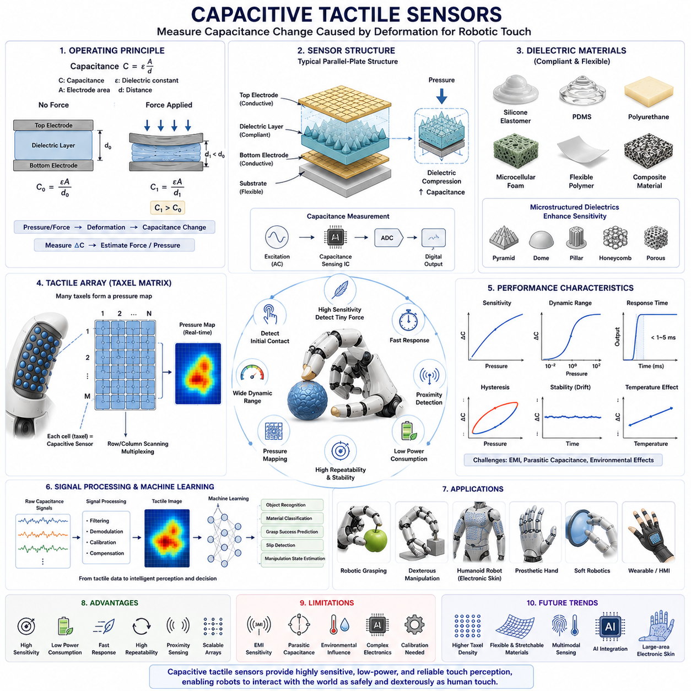{width="7.268055555555556in" height="7.268055555555556in"}

정전용량 촉각 센서(Capacitive Tactile Sensor)는 현대 로봇 촉각 센싱 분야에서 가장 중요하고 널리 사용되는 기술 중 하나이다. 이 센서는 기계적 변형(Mechanical Deformation), 압력(Pressure), 힘(Force), 또는 물체의 접근(Proximity)에 의해 발생하는 정전용량(Capacitance)의 변화를 측정하여 접촉 상태를 인식한다. 높은 민감도(Sensitivity), 낮은 전력 소비(Low Power Consumption), 우수한 반복성(Repeatability), 그리고 매우 작은 힘까지 감지할 수 있는 능력 덕분에 정전용량 센서는 로봇 핸드(Robot Hand), 정교한 조작기(Dexterous Manipulator), 휴머노이드 로봇(Humanoid Robot), 전자 피부(Electronic Skin), 의수(Prosthetic Device), 웨어러블 로봇(Wearable Robotics), 인간-기계 인터페이스(Human-Machine Interface) 등에 폭넓게 적용되고 있다. 로봇 촉각 인식 분야에서는 인간 피부의 민감성과 반응성을 가장 잘 모사할 수 있는 기술 중 하나로 평가된다.

정전용량 촉각 센서의 기본 원리는 정전용량의 변화에 기반한다. 정전용량은 두 개의 전도성 전극(Electrode)과 그 사이에 위치한 절연체(Dielectric Material)로 구성된 커패시터(Capacitor)에서 발생한다. 커패시턴스의 크기는 전극의 면적, 전극 사이의 거리, 그리고 절연체의 유전율(Dielectric Constant)에 의해 결정된다. 외부 힘이 센서에 가해지면 센서 구조가 변형되고, 이로 인해 전극 간 거리나 유효 면적, 또는 유전 특성이 변화한다. 이러한 변화는 곧 정전용량 변화로 나타나며, 센서는 이를 측정하여 접촉 상태와 힘의 크기를 추정한다.

가장 일반적인 구조는 평행판 커패시터(Parallel Plate Capacitor) 구조이다. 두 전극 사이에 유연한 절연층이 위치하며, 압력이 가해지면 절연층이 압축되어 전극 간 거리가 감소한다. 전극 간 거리가 줄어들수록 정전용량은 증가하게 된다. 따라서 측정된 정전용량 변화량을 이용하여 외부 압력을 계산할 수 있다. 압저항 센서(Piezoresistive Sensor)가 저항 변화를 측정하는 것과 달리, 정전용량 센서는 구조적 변화 자체를 직접 측정하기 때문에 일반적으로 더 높은 민감도와 더 낮은 드리프트(Drift)를 제공한다.

정전용량 센서의 가장 큰 장점 중 하나는 매우 작은 힘도 감지할 수 있다는 점이다. 극히 미세한 변형만 발생하더라도 정전용량 변화가 나타나므로, 로봇은 실제 큰 힘이 발생하기 전에 초기 접촉(Initial Contact)을 감지할 수 있다. 이러한 능력은 전자 부품, 의료 기기, 유리 제품, 식품, 생체 조직과 같이 손상되기 쉬운 물체를 다룰 때 매우 중요하다. 초기 접촉을 조기에 인식하면 충격을 최소화하고 보다 부드러운 파지가 가능해진다.

정전용량 촉각 센서의 구조는 비교적 단순하지만, 실제 성능은 전극 구조와 절연층 설계에 크게 영향을 받는다. 일반적으로 두 개의 전도성 전극과 그 사이의 유연한 절연층으로 구성된다. 외부 압력이 가해지면 절연층이 변형되면서 정전용량이 변하고, 측정 회로가 이를 감지하여 힘 정보로 변환한다. 기본 원리는 간단하지만, 높은 성능을 얻기 위해서는 다양한 미세 구조(Microstructure)와 정밀 제조 기술이 활용된다.

전극 설계 방식도 다양하다. 가장 일반적인 구조는 평행판 전극 구조이며 높은 민감도를 제공한다. 인터디지테이티드 전극(Interdigitated Electrode)은 유연한 전자 피부에 많이 사용된다. 일부 고급 센서는 다층 전극(Multi-layer Electrode)을 사용하여 3차원 힘 측정과 향상된 위치 추정을 수행한다. 전극의 형상과 배치는 센서의 민감도, 공간 해상도, 제조 난이도에 직접적인 영향을 준다.

절연층은 센서 성능을 결정하는 핵심 요소이다. 일반적으로 실리콘 엘라스토머(Silicone Elastomer), 폴리우레탄(Polyurethane), PDMS(Polydimethylsiloxane), 유연 고분자(Flexible Polymer), 폼(Foam) 등이 사용된다. 부드러운 절연체일수록 작은 힘에도 쉽게 변형되어 높은 민감도를 제공하지만, 지나치게 부드러우면 동적 범위(Dynamic Range)가 감소하고 내구성이 저하될 수 있다.

최근에는 미세 구조를 적용한 절연층이 널리 연구되고 있다. 피라미드(Pyramid), 돔(Dome), 기둥(Pillar), 벌집 구조(Honeycomb Structure), 다공성 구조(Porous Structure) 등이 대표적이다. 이러한 구조는 압력이 가해질 때 특정 영역에 변형을 집중시켜 정전용량 변화를 크게 만들고 결과적으로 민감도를 향상시킨다. 특히 낮은 힘 영역에서 성능 향상 효과가 크기 때문에 정밀 조작용 로봇 핸드에 많이 적용된다.

정전용량 촉각 센서는 촉각 배열(Tactile Array) 형태로 구현되는 경우가 많다. 하나의 센서는 한 지점만 측정할 수 있지만, 수백 또는 수천 개의 센서를 배열 형태로 배치하면 넓은 영역의 압력 분포를 측정할 수 있다. 각각의 센싱 셀은 택셀(Taxel)이라고 불리며, 카메라의 픽셀(Pixel)과 유사한 역할을 수행한다. 이러한 배열은 접촉 위치와 힘 분포를 시각적으로 표현할 수 있게 해준다.

촉각 배열이 생성하는 데이터는 촉각 이미지(Tactile Image)라고 불린다. 이는 카메라 이미지와 유사하게 각 택셀이 하나의 압력 값을 나타내는 형태이다. 촉각 이미지는 접촉 위치, 접촉 형상, 물체의 윤곽, 모서리 특징, 압력 분포, 조작 상태 등의 정보를 포함한다. 최근에는 컴퓨터 비전에서 사용되는 딥러닝 기술이 촉각 이미지 분석에도 활용되고 있다.

공간 해상도(Spatial Resolution)는 정전용량 센서의 중요한 성능 지표이다. 높은 해상도는 보다 세밀한 접촉 위치 추정을 가능하게 하지만, 동시에 데이터 처리량과 전자 회로 복잡성을 증가시킨다. 따라서 손가락 끝과 같이 정밀 조작이 필요한 영역은 높은 해상도를 사용하고, 전신 전자 피부와 같은 시스템은 넓은 면적과 강건성을 우선적으로 고려한다.

동적 범위는 센서가 측정할 수 있는 최소 힘과 최대 힘의 범위를 의미한다. 민감도가 높더라도 일정 수준 이상의 힘에서 포화(Saturation)가 발생하면 실제 응용에 제한이 생긴다. 따라서 정전용량 센서는 낮은 힘에서는 높은 민감도를 유지하면서도 높은 힘 영역까지 측정할 수 있도록 설계되어야 한다.

응답 속도(Response Time)는 로봇 제어에서 매우 중요하다. 파지, 조립, 물체 전달 과정에서는 접촉 상태가 수 밀리초 단위로 변화할 수 있다. 정전용량 센서는 구조 변형과 동시에 정전용량이 변화하기 때문에 매우 빠른 응답 특성을 제공하며, 실시간 힘 제어와 접촉 감지에 적합하다.

정전용량 센서의 독특한 특징 중 하나는 비접촉 근접 감지(Proximity Detection)가 가능하다는 점이다. 전기장은 센서 표면 밖으로도 형성되기 때문에 물체가 센서에 닿기 전에도 정전용량 변화가 발생할 수 있다. 따라서 일부 정전용량 센서는 접촉 센서이면서 동시에 근접 센서 역할도 수행할 수 있다. 이는 파지 접근 단계나 충돌 회피 과정에서 매우 유용하다.

하지만 정전용량 센서에도 한계는 존재한다. 가장 대표적인 문제는 전자기 간섭(Electromagnetic Interference)이다. 외부 전기장이나 전자 장치에서 발생하는 노이즈가 정전용량 측정에 영향을 줄 수 있다. 따라서 차폐(Shielding), 접지(Grounding), 필터링(Filtering) 기술이 중요하게 사용된다.

기생 정전용량(Parasitic Capacitance) 역시 주요 문제이다. 배선, 커넥터, PCB, 주변 구조물 등이 의도하지 않은 정전용량을 형성하여 실제 측정 신호를 왜곡할 수 있다. 촉각 배열 규모가 커질수록 이러한 문제가 더욱 심각해지므로 정교한 회로 설계와 보정 기법이 필요하다.

환경 변화도 성능에 영향을 미칠 수 있다. 온도, 습도, 오염 물질, 재료 노화는 절연층의 유전 특성을 변화시켜 측정 오차를 발생시킬 수 있다. 이를 해결하기 위해 보호 코팅, 환경 보상 알고리즘, 견고한 패키징 기술이 적용된다.

신호 처리(Signal Processing)는 정전용량 촉각 센서의 핵심 요소이다. 정전용량 변화는 매우 작기 때문에 이를 정확하게 측정하기 위한 특수 회로가 필요하다. 대표적인 방법으로는 전하 전달 방식(Charge Transfer), 정전용량-디지털 변환기(Capacitance-to-Digital Converter), 발진 주파수 측정(Oscillation Frequency Measurement) 등이 있다. 최근에는 고해상도 측정 IC의 발전으로 대규모 촉각 배열 구현이 쉬워지고 있다.

머신러닝(Machine Learning)은 정전용량 촉각 센싱의 활용 범위를 크게 확대하고 있다. 딥러닝 모델은 촉각 이미지를 분석하여 물체 인식(Object Recognition), 물체 자세 추정(Pose Estimation), 재질 분류(Material Classification), 파지 성공률 예측(Grasp Success Prediction), 슬립 검출(Slip Detection), 조작 상태 추정(Manipulation State Estimation)을 수행할 수 있다.

정전용량 센서는 로봇 파지 시스템에서 널리 사용된다. 파지 시작 단계에서는 초기 접촉을 감지하고 힘을 조절한다. 파지 이후에는 압력 분포를 모니터링하여 안정성을 평가한다. 정교한 조작 작업에서는 미세한 힘 변화를 실시간으로 측정하여 손가락 움직임을 보정한다. 이러한 특성 덕분에 섬세한 물체를 안정적으로 다룰 수 있다.

휴머노이드 로봇(Humanoid Robot)에서도 정전용량 센서는 중요한 역할을 한다. 인간 피부는 전신에 걸쳐 수많은 감각 수용체를 가지고 있으며 지속적으로 접촉 정보를 제공한다. 전자 피부는 이러한 기능을 모방하기 위해 수천 개의 정전용량 센서를 팔, 다리, 몸통, 얼굴 등에 배치한다. 이를 통해 안전성과 상호작용 품질을 향상시킬 수 있다.

의수(Prosthetic Hand) 분야에서도 정전용량 센서는 매우 중요하다. 센서를 통해 측정된 접촉 정보를 진동, 전기 자극 또는 신경 인터페이스를 통해 사용자에게 전달함으로써 실제 손과 유사한 촉각 피드백을 제공할 수 있다.

유연 전자소자(Flexible Electronics)의 발전은 정전용량 센서의 응용 범위를 더욱 확대하고 있다. 신축성 전도체(Stretchable Conductor), 인쇄 전자소자(Printed Electronics), 유연 기판(Flexible Substrate)을 이용하여 복잡한 곡면에도 부착 가능한 촉각 피부가 개발되고 있다. 이는 소프트 로봇, 웨어러블 기기, 의료 로봇, 차세대 휴머노이드 로봇에 매우 적합하다.

최근 연구에서는 압력뿐 아니라 온도(Temperature), 진동(Vibration), 습도(Humidity), 전단력(Shear Force), 근접(Proximity) 정보를 동시에 측정할 수 있는 다중 모달 촉각 센서(Multimodal Tactile Sensor)가 활발히 연구되고 있다. 이러한 시스템은 인간 피부와 더욱 유사한 촉각 인식을 제공한다.

미래의 정전용량 촉각 센서는 더 높은 해상도, 더 우수한 유연성, 더 높은 내구성, 더 낮은 제조 비용, 그리고 인공지능과의 긴밀한 통합 방향으로 발전할 것이다. 나노소재(Nanomaterial), 마이크로 제조 기술(Microfabrication), 인쇄 전자 기술, 자가 치유 재료(Self-Healing Material), 뉴로모픽 센싱(Neuromorphic Sensing)이 차세대 정전용량 촉각 센서의 핵심 기술이 될 것으로 예상된다.

결론적으로 정전용량 촉각 센서는 기계적 변형과 접촉에 의해 발생하는 정전용량 변화를 측정하는 고감도 촉각 센싱 기술이다. 높은 민감도, 우수한 반복성, 낮은 전력 소모, 빠른 응답 속도를 제공하며 로봇 핸드, 전자 피부, 휴머노이드 로봇, 의수, 웨어러블 시스템에서 핵심적인 역할을 수행하고 있다. 앞으로도 정전용량 센서는 인간 수준의 촉각 인지와 정교한 로봇 조작을 실현하기 위한 핵심 기술로 지속적으로 발전할 것으로 전망된다.

## 07.04 Barometric Pressure Sensors

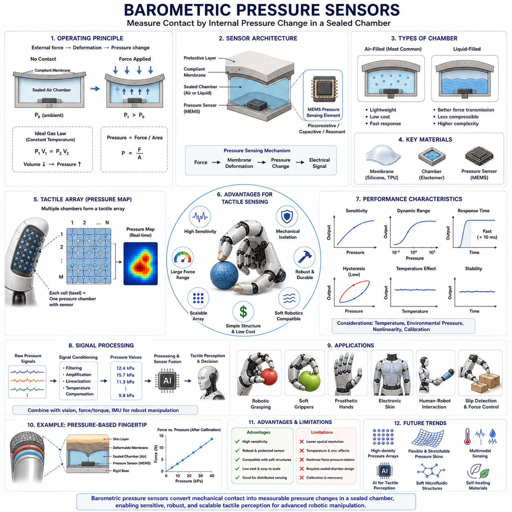{width="7.268055555555556in" height="7.268055555555556in"}

기압 기반 압력 센서(Barometric Pressure Sensor)는 로봇 촉각 인식(Tactile Perception) 분야에서 점점 더 중요한 기술로 자리 잡고 있다. 이 센서는 접촉 힘(Contact Force), 압력 분포(Pressure Distribution), 변형(Deformation), 그리고 물리적 상호작용(Interaction Dynamics)을 측정하기 위한 간단하면서도 매우 민감한 방법을 제공한다. 원래 기압 센서는 기상 관측(Meteorology), 항공(Aviation), 스마트폰과 같은 소비자 전자기기에서 대기압을 측정하기 위해 개발되었지만, 최근에는 로봇 촉각 센싱 시스템에 통합되면서 새로운 가능성을 열어가고 있다.

로봇 핸드(Robot Hand), 소프트 그리퍼(Soft Gripper), 의수(Prosthetic Device), 전자 피부(Electronic Skin)와 같은 시스템에서는 기압 센서를 밀폐된 공기 챔버(Sealed Air Chamber) 또는 변형 가능한 구조 내부에 배치하여 접촉에 의해 발생하는 압력 변화를 측정한다. 이러한 방식은 높은 민감도, 우수한 내구성, 낮은 비용, 그리고 뛰어난 확장성을 제공하므로 다양한 로봇 조작 시스템에 적합하다.

기압 센서의 기본 원리는 밀폐된 공간 내부의 압력 변화를 측정하는 것이다. 일반적인 기압 센서는 대기압 변화를 측정하지만, 촉각 센서에서는 외부 접촉으로 인해 내부 압력이 변화하도록 구조를 설계한다. 외부 물체가 센서 표면을 누르면 내부 챔버가 압축되고, 그 결과 내부 압력이 증가한다. 센서는 이러한 압력 변화를 측정하여 접촉 상태를 추정한다.

가장 단순한 예로 유연한 막(Flexible Membrane) 아래에 밀폐된 공기 챔버가 있다고 가정할 수 있다. 외부 힘이 막을 누르면 챔버 부피가 감소한다. 이상기체 법칙(Ideal Gas Law)에 따르면 밀폐된 기체의 부피가 감소하면 내부 압력이 증가한다. 센서는 이 압력 증가를 측정하고 이를 통해 외부에서 가해진 힘의 크기를 계산한다.

이러한 구조의 가장 큰 장점은 센서 소자가 직접 힘을 받지 않는다는 점이다. 기존의 힘 센서는 접촉면에서 발생하는 기계적 하중을 직접 견뎌야 하지만, 기압 센서는 압력 변화만 측정하면 된다. 따라서 민감한 전자 부품을 보호할 수 있으며 내구성이 향상된다.

현대의 기압 센서는 대부분 MEMS(Micro Electro Mechanical Systems) 기술을 기반으로 제작된다. MEMS 압력 센서는 매우 작은 다이어프램(Diaphragm)을 포함하며, 압력 변화에 의해 다이어프램이 변형된다. 이 변형은 압저항(Piezoresistive), 정전용량(Capacitive), 압전(Piezoelectric), 공진(Resonant) 방식의 센서를 통해 전기 신호로 변환된다. 반도체 제조 기술의 발전 덕분에 매우 작고 정확하며 저렴한 압력 센서 생산이 가능해졌다.

일반적인 촉각 센서는 유연한 막, 밀폐 챔버, 압력 변환기(Pressure Transducer)로 구성된다. 외부 접촉이 발생하면 막이 변형되고 챔버 내부 압력이 변화한다. 압력 변환기는 이를 측정하여 전기 신호로 변환한다. 파스칼의 법칙(Pascal\'s Law)에 따라 압력은 밀폐된 유체 내부에 균일하게 전달되므로, 접촉이 넓은 영역에서 발생하더라도 안정적인 측정이 가능하다.

압력은 단위 면적당 힘으로 정의된다. 따라서 외부 힘이 가해질 때 발생하는 압력 변화는 접촉 힘과 직접적인 관계를 가진다. 실제 센서에서는 챔버 형상, 막의 강성(Stiffness), 내부 유체 특성, 구조적 순응성(Compliance) 등에 따라 압력과 힘의 관계가 달라지므로 보정(Calibration) 과정이 필요하다.

기압 기반 촉각 센서는 공기(Air) 또는 액체(Liquid)를 내부 매체로 사용할 수 있다. 공기 기반 시스템은 가볍고 저렴하며 응답 속도가 빠르다. 따라서 로봇 손가락, 소프트 그리퍼, 전자 피부에 널리 사용된다. 액체 기반 시스템은 압력 전달 효율이 높지만 무게 증가와 구조 복잡성이라는 단점이 있다.

특히 소프트 로보틱스(Soft Robotics) 분야에서 기압 센서는 매우 유용하다. 소프트 로봇은 큰 변형을 허용하는 유연한 구조를 사용하기 때문에 기존의 강체 기반 힘 센서를 적용하기 어렵다. 그러나 기압 센서는 내부 압력 변화를 이용하므로 유연성을 유지하면서도 정확한 힘 측정이 가능하다.

많은 소프트 그리퍼는 손가락 내부에 여러 개의 압력 챔버를 내장하고 있다. 물체를 잡으면 손가락이 변형되면서 챔버 압력이 변화한다. 이를 통해 로봇은 파지력(Grip Force)을 추정하고, 물체 존재 여부를 확인하며, 파지 안정성을 평가할 수 있다.

기압 센서는 비교적 단순한 하드웨어만으로도 분산 접촉(Distributed Contact)을 측정할 수 있다. 여러 개의 압력 챔버를 배열 형태로 배치하면 압력 센싱 배열(Pressure Sensing Array)을 구성할 수 있다. 각 챔버는 개별 센싱 셀 역할을 하며, 전체 압력 분포를 시각화할 수 있다. 이러한 압력 분포는 접촉 위치, 물체 형상, 힘 분포를 추정하는 데 사용된다.

최근에는 이러한 압력 배열을 촉각 이미지(Tactile Image)로 활용하는 연구가 활발하다. 압력 분포 패턴을 딥러닝(Deep Learning)으로 분석하여 물체 인식(Object Recognition), 파지 품질 평가(Grasp Quality Assessment), 재질 인식(Material Recognition), 조작 상태 추정(Manipulation State Estimation) 등을 수행할 수 있다.

민감도(Sensitivity)는 기압 센서의 중요한 성능 지표이다. 최신 MEMS 압력 센서는 매우 작은 압력 변화도 감지할 수 있다. 따라서 매우 약한 접촉이나 미세한 힘도 측정 가능하다. 민감도는 막 구조, 챔버 형상, 압력 센서 해상도, 내부 유체 특성에 의해 결정된다.

동적 범위(Dynamic Range) 또한 중요하다. 로봇은 깨지기 쉬운 물체부터 상대적으로 무거운 물체까지 다양한 물체를 다뤄야 한다. 따라서 센서는 작은 힘과 큰 힘 모두를 정확하게 측정할 수 있어야 한다. 챔버 크기와 막 강성을 조정하여 적절한 측정 범위를 설계할 수 있다.

응답 속도(Response Time)는 실시간 제어에서 매우 중요하다. 접촉 상태는 순간적으로 변화할 수 있기 때문이다. 공기 기반 압력 센서는 압력 변화가 매우 빠르게 전달되므로 일반적으로 우수한 응답 특성을 가진다. 적절한 설계를 통해 슬립 검출(Slip Detection)이나 실시간 파지 제어에도 충분한 성능을 확보할 수 있다.

히스테리시스(Hysteresis)는 일반적으로 압저항 기반 고분자 센서보다 낮은 편이다. 압력 자체를 측정하기 때문에 재료 내부의 전도 경로 변화에 의존하지 않기 때문이다. 그러나 유연한 막의 점탄성 특성 때문에 일부 히스테리시스가 발생할 수 있다.

온도 영향도 고려해야 한다. 기체 압력은 온도에 따라 변화하기 때문에 주변 온도가 변하면 실제 접촉이 없어도 압력이 변화할 수 있다. 이를 해결하기 위해 최신 압력 센서는 온도 보상(Temperature Compensation) 기능을 내장하는 경우가 많다.

신호 처리(Signal Processing)는 기압 센서 시스템의 핵심 요소이다. 원시 압력 데이터에는 노이즈와 환경 변화 영향이 포함될 수 있으므로 필터링(Filter), 보정(Calibration), 정규화(Normalization)가 필요하다. 또한 비전 시스템(Vision System), 힘-토크 센서(Force-Torque Sensor), IMU 등과 결합하여 센서 융합(Sensor Fusion)을 수행할 수 있다.

기압 센서는 힘 추정(Force Estimation)에 매우 적합하다. 파지 과정에서 지속적으로 압력을 측정하여 로봇이 적절한 파지력을 유지하도록 지원한다. 이는 과도한 힘으로 인한 물체 손상을 방지하고 안정적인 파지를 가능하게 한다.

슬립 검출(Slip Detection) 또한 중요한 응용 분야이다. 물체가 미끄러지기 시작하면 접촉 압력 분포가 변화한다. 압력 패턴의 시간적 변화를 분석하면 초기 슬립을 감지할 수 있으며, 로봇은 파지력을 증가시켜 물체가 떨어지는 것을 방지할 수 있다.

의수 시스템에서도 기압 기반 촉각 센서는 널리 사용된다. 의수 손가락 내부의 압력 센서는 물체와의 접촉 상태를 측정하며, 이를 진동(Vibrotactile), 전기 자극(Electrotactile), 신경 인터페이스(Neural Interface)를 통해 사용자에게 전달할 수 있다. 이를 통해 보다 자연스러운 촉각 경험을 제공할 수 있다.

전자 피부(Electronic Skin) 분야에서도 기압 센서는 매우 유용하다. 몸 전체에 분산된 압력 챔버는 예상치 못한 접촉을 감지하고 안전한 인간-로봇 협업(Human-Robot Collaboration)을 지원한다. 이는 서비스 로봇과 휴머노이드 로봇에서 특히 중요하다.

머신러닝 기술은 기압 센서의 활용성을 더욱 확대하고 있다. 신경망은 압력 분포와 시간적 압력 변화를 분석하여 물체 분류, 재질 인식, 접촉 위치 추정, 파지 성공률 예측 등을 수행할 수 있다.

정전용량 센서(Capacitive Sensor)나 압저항 센서(Piezoresistive Sensor)와 비교할 때 기압 센서는 몇 가지 독특한 장점을 가진다. 우수한 기계적 보호, 소프트 구조와의 높은 호환성, 비교적 단순한 구조, 넓은 면적 적용 가능성이 대표적이다. 반면 공간 해상도가 상대적으로 낮을 수 있으며, 환경 압력 변화에 대한 보정이 필요하고 압력-힘 관계가 비선형적일 수 있다는 단점도 존재한다.

최근 연구는 마이크로유체 채널(Microfluidic Channel), 분산 압력 네트워크(Distributed Pressure Network), 소프트 공압 피부(Pneumatic Skin), 유연 압력 배열(Flexible Pressure Matrix) 등을 활용하여 공간 해상도와 민감도를 향상시키고 있다.

미래에는 소형화(Miniaturization), 유연 전자소자(Flexible Electronics), 다중 모달 센싱(Multimodal Sensing), 자가 치유 재료(Self-Healing Material), AI 기반 촉각 인식 기술이 결합된 형태로 발전할 것으로 예상된다. 압력뿐 아니라 온도, 진동, 전단력(Shear Force), 근접(Proximity)을 동시에 측정하는 시스템이 등장할 것이며, 이는 인간 피부와 더욱 유사한 촉각 능력을 제공할 것이다.

결론적으로 기압 기반 압력 센서는 밀폐된 챔버 내부의 압력 변화를 측정하여 접촉과 힘을 추정하는 강력한 촉각 센싱 기술이다. 높은 민감도, 뛰어난 내구성, 소프트 로보틱스와의 우수한 호환성, 그리고 확장성을 제공하기 때문에 로봇 핸드, 소프트 그리퍼, 전자 피부, 의수, 휴머노이드 로봇의 핵심 촉각 센서 기술로 자리 잡고 있다. 향후 MEMS 기술, AI, 소프트 로보틱스, 재료공학의 발전과 함께 기압 기반 촉각 센서는 더욱 정교한 로봇 촉각 인식을 구현하는 핵심 요소가 될 것으로 기대된다.

## 07.05 Optical Tactile Sensors

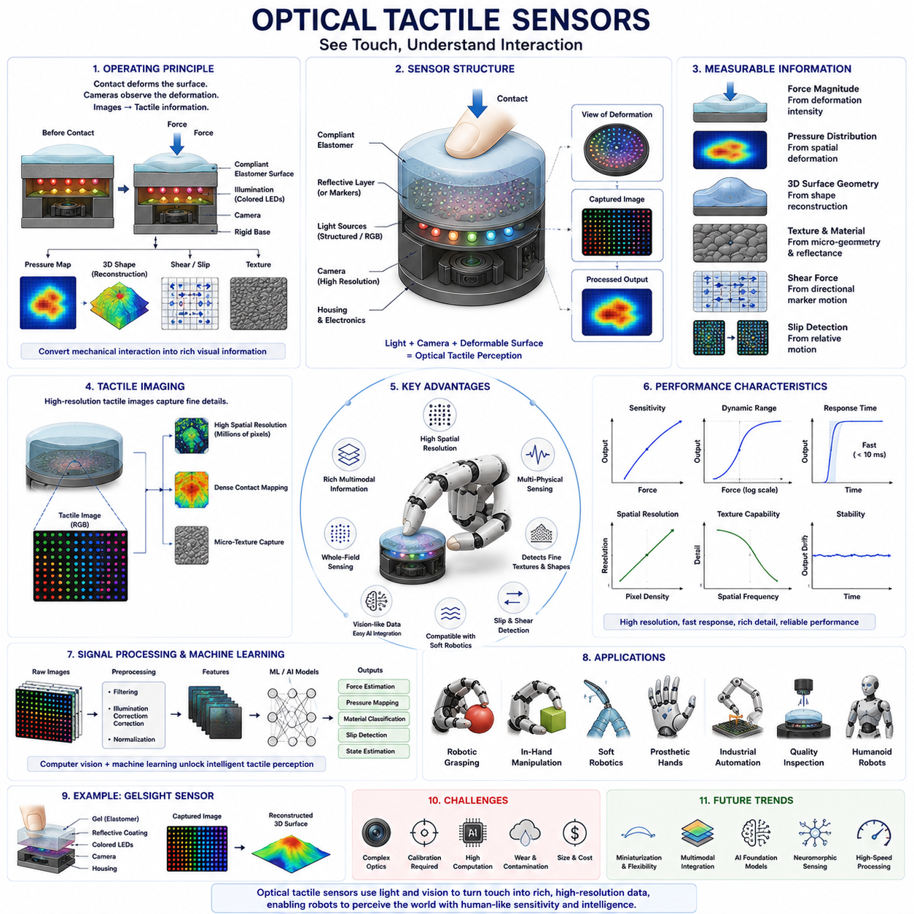{width="7.268055555555556in" height="7.268055555555556in"}

광학 촉각 센서(Optical Tactile Sensor)는 로봇 촉각 센싱 분야에서 가장 발전된 기술 중 하나이며, 현재도 매우 빠르게 발전하고 있는 연구 분야이다. 기존의 촉각 센서가 저항(Resistance), 정전용량(Capacitance), 압력(Pressure)의 변화를 측정하는 방식이라면, 광학 촉각 센서는 빛(Light), 카메라(Camera), 영상 처리(Image Processing)를 이용하여 접촉 힘(Contact Force), 압력 분포(Pressure Distribution), 표면 형상(Surface Geometry), 질감(Texture), 변형(Deformation), 슬립(Slip) 등을 측정한다. 즉, 물리적 접촉을 시각 정보(Visual Information)로 변환하여 분석하는 방식이다.

이러한 접근법은 매우 풍부한 촉각 정보를 제공하며, 높은 공간 해상도(Spatial Resolution)와 뛰어난 민감도(Sensitivity)를 동시에 달성할 수 있다. 따라서 광학 촉각 센서는 정교한 로봇 손(Dexterous Robotic Hand), 소프트 로보틱스(Soft Robotics), 의수(Prosthetic Device), 휴머노이드 로봇(Humanoid Robot), 그리고 피지컬 AI(Physical AI) 시스템에서 핵심 기술로 주목받고 있다. 많은 연구자들은 광학 촉각 센서가 인간 수준의 촉각 인지를 실현할 수 있는 가장 유망한 기술 중 하나라고 평가한다.

광학 촉각 센서의 기본 원리는 비교적 단순하다. 물체가 변형 가능한 표면에 접촉하면 표면 형상이 변한다. 기존 센서처럼 접촉 위치에서 직접 전기적 변화를 측정하는 대신, 광학 촉각 센서는 카메라를 이용하여 이러한 변형을 관찰한다. 이후 영상 처리 알고리즘이 변형 패턴을 분석하여 힘, 압력, 접촉 형상 등의 정보를 추정한다.

일반적인 광학 촉각 센서는 여러 요소로 구성된다. 가장 바깥쪽에는 실리콘(Silicone)이나 폴리우레탄(Polyurethane)과 같은 탄성체(Elastomer)가 위치한다. 이 층은 인공 피부(Artificial Skin)의 역할을 수행하며 접촉 시 변형된다. 내부에는 조명 시스템(Illumination System)이 설치되어 일정한 광원을 제공한다. 카메라는 내부에서 탄성체 표면을 지속적으로 관찰하며, 영상 처리 알고리즘은 변형 패턴을 분석하여 촉각 정보를 생성한다. 결과적으로 기계적 접촉이 컴퓨터 비전(Computer Vision) 문제로 변환된다.

센싱 과정은 외부 물체가 탄성체 표면을 누르는 순간 시작된다. 접촉 힘과 물체 형상에 따라 탄성체가 변형되고, 내부 표면의 시각적 패턴이 변화한다. 카메라는 이 변화를 촬영하고, 알고리즘은 접촉 전의 기준 영상과 현재 영상을 비교하여 변형 정도를 계산한다. 이를 통해 접촉 상태와 물체 특성을 추정할 수 있다.

광학 촉각 센서의 가장 큰 장점은 매우 높은 공간 해상도이다. 기존 촉각 배열(Tactile Array)은 수백 개 또는 수천 개의 센싱 셀(Taxel)로 구성되는 경우가 많지만, 현대 카메라는 수백만 개의 픽셀(Pixel)을 포함한다. 따라서 광학 촉각 센서는 훨씬 더 세밀한 접촉 이미지를 생성할 수 있으며, 미세한 표면 특징까지 인식할 수 있다.

광학 촉각 센싱에서 중요한 개념은 촉각 이미지(Tactile Image)이다. 촉각 이미지는 일반적인 카메라 이미지와 유사하지만 외부 장면이 아닌 접촉 상태를 표현한다. 각 픽셀은 표면 변형 또는 압력 관련 정보를 나타낸다. 이러한 데이터는 컴퓨터 비전에서 사용하는 다양한 알고리즘으로 처리할 수 있다. 따라서 객체 인식(Object Recognition), 특징 추출(Feature Extraction), 상태 추정(State Estimation) 기술을 그대로 활용할 수 있다.

광학 촉각 센서 분야에서 가장 유명한 기술 중 하나는 GelSight 센서이다. GelSight는 투명한 탄성체 위에 반사막(Reflective Membrane)을 형성하고, 다양한 색상의 조명을 비춘 후 카메라로 변화를 관찰한다. 접촉으로 인해 표면 형상이 변하면 반사광 패턴도 변화한다. 이를 분석하면 접촉 형상과 압력 분포를 매우 정밀하게 복원할 수 있다. GelSight는 지문(Fingerprint), 미세한 스크래치(Scratch), 표면 거칠기(Roughness), 각인(Engraving)까지 측정할 수 있을 정도로 높은 해상도를 제공한다.

광학 촉각 센서는 여러 물리량을 동시에 측정할 수 있다. 접촉 힘은 변형 크기에서 추정할 수 있고, 압력 분포는 공간적 변형 패턴을 통해 계산할 수 있다. 표면 질감은 미세 형상 분석을 통해 추정할 수 있으며, 전단력(Shear Force)은 측면 변형 패턴을 통해 계산할 수 있다. 또한 슬립(Slip)은 접촉 영역의 상대 운동을 추적하여 감지할 수 있다. 이러한 다중 모달 센싱(Multimodal Sensing) 능력은 광학 촉각 센서의 가장 큰 장점 중 하나이다.

힘 추정(Force Estimation)은 광학 촉각 센서의 핵심 응용 분야이다. 일반적으로 큰 힘은 더 큰 변형을 발생시키므로, 변형 정도를 분석하면 힘의 크기를 추정할 수 있다. 일부 시스템은 수직 방향 힘(Normal Force)뿐만 아니라 전단력까지 포함한 3차원 힘 벡터(3D Force Vector)를 복원할 수 있다. 이는 정교한 파지 제어와 조작 계획에 매우 유용하다.

압력 맵(Pressure Map) 생성도 중요한 기능이다. 전체 접촉 영역을 동시에 관찰하기 때문에 접촉면 전체의 압력 분포를 시각화할 수 있다. 압력 맵은 파지 안정성, 접촉 품질, 물체 형상, 조작 상태를 평가하는 데 사용된다.

질감 센싱(Texture Sensing)은 광학 촉각 센서가 가장 뛰어난 성능을 보이는 분야 중 하나이다. 인간 손가락이 미세한 질감 차이를 구분할 수 있는 것처럼, 광학 촉각 센서도 미세한 표면 형상을 측정하여 재질(Material)과 표면 상태를 구분할 수 있다. 이를 통해 물체 분류, 품질 검사, 재질 식별 등이 가능하다.

슬립 검출(Slip Detection)은 로봇 파지에서 매우 중요하다. 물체가 미끄러지기 시작하면 접촉 패턴이 변한다. 광학 촉각 센서는 접촉 특징점(Contact Feature)의 움직임을 추적하여 매우 초기 단계의 슬립까지 감지할 수 있다. 따라서 물체가 완전히 떨어지기 전에 파지력을 증가시켜 안정성을 확보할 수 있다.

전단력 측정(Shear Force Measurement) 역시 중요한 기능이다. 전단력은 접촉면을 따라 발생하는 힘이며, 마찰(Friction)과 파지 안정성에 큰 영향을 준다. 광학 촉각 센서는 탄성체 내부에 삽입된 마커(Marker)의 움직임을 추적하여 전단력을 추정할 수 있다. 이를 통해 더욱 정교한 조작 전략을 구현할 수 있다.

광학 촉각 센서에는 다양한 구조가 존재한다. 일부는 반사막과 조명을 사용하는 구조이며, 일부는 투명 탄성체 내부에 마커를 삽입하는 구조를 사용한다. 마커 기반 시스템은 마커의 이동량을 분석하여 변형장을 계산한다. 이러한 방식은 실시간 처리와 힘 분포 추정에 매우 효과적이다.

3차원 표면 복원(3D Surface Reconstruction)은 광학 촉각 센서의 또 다른 강점이다. 조명 패턴과 그림자 변화를 분석하여 접촉면의 형상을 복원할 수 있다. 이는 일종의 초근접 3D 스캐닝(Microscopic 3D Scanning) 기술이라고 볼 수 있다. 로봇은 이를 통해 물체 형상을 이해하고 최적의 파지 위치를 찾을 수 있다.

머신러닝(Machine Learning)은 광학 촉각 센싱 발전에 결정적인 역할을 하고 있다. 광학 촉각 센서는 대량의 이미지 데이터를 생성하므로 딥러닝(Deep Learning)과 매우 잘 결합된다. CNN(Convolutional Neural Network), Transformer, 자기지도학습(Self-Supervised Learning) 모델은 촉각 이미지에서 특징을 학습하여 물체 인식, 힘 추정, 재질 분류, 슬립 검출, 접촉 상태 분석 등을 수행할 수 있다.

최근에는 시각-촉각 학습(Visuotactile Learning)이라는 새로운 연구 분야가 등장하였다. 이는 외부 카메라의 시각 정보와 촉각 센서의 접촉 정보를 결합하는 방식이다. 시각은 접촉 이전의 정보를 제공하고, 촉각은 접촉 이후의 정보를 제공한다. 두 센서를 함께 사용하면 보다 강건한 파지 계획과 조작 제어가 가능해진다.

광학 촉각 센서는 로봇 파지 연구에서 매우 중요한 역할을 수행한다. 파지 과정에서는 접촉 품질을 평가하고, 조작 과정에서는 힘 분포를 모니터링하며, 인핸드 조작(In-Hand Manipulation)에서는 물체의 상대 운동을 추적한다. 이를 통해 조작 신뢰성을 크게 향상시킬 수 있다.

소프트 로보틱스에서도 광학 촉각 센서는 매우 적합하다. 센서가 카메라 기반으로 동작하기 때문에 구조 전체가 크게 변형되더라도 센싱 성능을 유지할 수 있다. 따라서 높은 순응성(Compliance)을 유지하면서도 정밀한 촉각 정보를 얻을 수 있다.

산업용 로봇 분야에서는 정밀 조립(Precision Assembly), 품질 검사(Quality Inspection), 전자 부품 취급(Electronics Handling)에 활용된다. 매우 민감한 힘 제어가 필요한 작업에서 광학 촉각 센서는 높은 정확도를 제공한다.

의수 시스템에서도 활용 가능성이 크다. 광학 촉각 센서는 힘, 질감, 접촉 상태에 대한 풍부한 정보를 제공할 수 있으며, 이를 햅틱 인터페이스(Haptic Interface)를 통해 사용자에게 전달하면 더욱 자연스러운 촉각 경험을 제공할 수 있다.

휴머노이드 로봇은 광학 촉각 센서의 가장 중요한 미래 응용 분야 중 하나이다. 인간 손은 매우 높은 촉각 능력을 가지고 있으며, 이를 구현하기 위해서는 고해상도 다중 모달 촉각 센서가 필요하다. 광학 촉각 센서는 이러한 요구를 충족할 수 있는 가장 유력한 후보 중 하나이다.

그러나 광학 촉각 센서에도 한계는 존재한다. 카메라와 조명 시스템이 필요하기 때문에 구조가 복잡해지고 비용이 증가한다. 광학 부품의 정렬과 보정도 필요하다. 또한 실시간 영상 처리에는 상당한 계산 자원이 요구된다. 따라서 센서 크기와 소비 전력이 증가할 수 있다.

내구성 또한 고려해야 한다. 탄성체 표면은 반복적인 접촉과 마찰에 노출되므로 시간이 지남에 따라 마모(Wear), 오염(Contamination), 스크래치, 재료 노화(Aging)가 발생할 수 있다. 이를 해결하기 위해 다양한 보호 코팅과 신소재가 연구되고 있다.

최근에는 엣지 AI 프로세서(Edge AI Processor)의 발전으로 실시간 촉각 영상 처리가 가능해지고 있다. 소형 AI 가속기와 경량 신경망 구조 덕분에 실제 로봇 시스템에서도 광학 촉각 센서의 활용성이 빠르게 증가하고 있다.

미래에는 소형화(Miniaturization), 내구성 향상, 다중 모달 센싱 통합, AI 기반 인지 기술이 핵심 발전 방향이 될 것이다. 압력, 전단력, 온도, 진동, 질감, 재질 정보를 동시에 측정하는 센서가 개발될 것으로 예상된다. 또한 파운데이션 모델(Foundation Model)과 결합하여 범용 촉각 인지 능력을 제공하는 연구도 활발히 진행되고 있다.

특히 촉각 파운데이션 모델(Tactile Foundation Model)은 매우 유망한 분야이다. 광학 촉각 센서로 수집된 대규모 데이터셋을 활용하여 다양한 물체와 조작 작업에 대한 일반화된 촉각 지식을 학습할 수 있다. 이는 자연어 처리에서 대규모 언어 모델이 수행하는 역할과 유사하다.

결론적으로 광학 촉각 센서는 기계적 접촉을 시각 정보로 변환하여 분석하는 가장 강력한 촉각 센싱 기술 중 하나이다. 매우 높은 공간 해상도, 다중 모달 센싱 능력, 머신러닝과의 뛰어난 호환성을 제공하며, 힘, 압력 분포, 질감, 전단력, 슬립, 접촉 형상을 동시에 측정할 수 있다. 이러한 특성 덕분에 광학 촉각 센서는 로봇 핸드, 소프트 로봇, 의수, 산업용 로봇, 휴머노이드 로봇, 그리고 미래의 피지컬 AI 시스템에서 핵심 촉각 기술로 자리 잡고 있으며, 인간 수준의 촉각 인지를 구현하기 위한 가장 유망한 기술 중 하나로 평가되고 있다.

## 07.06 Tactile Array Design

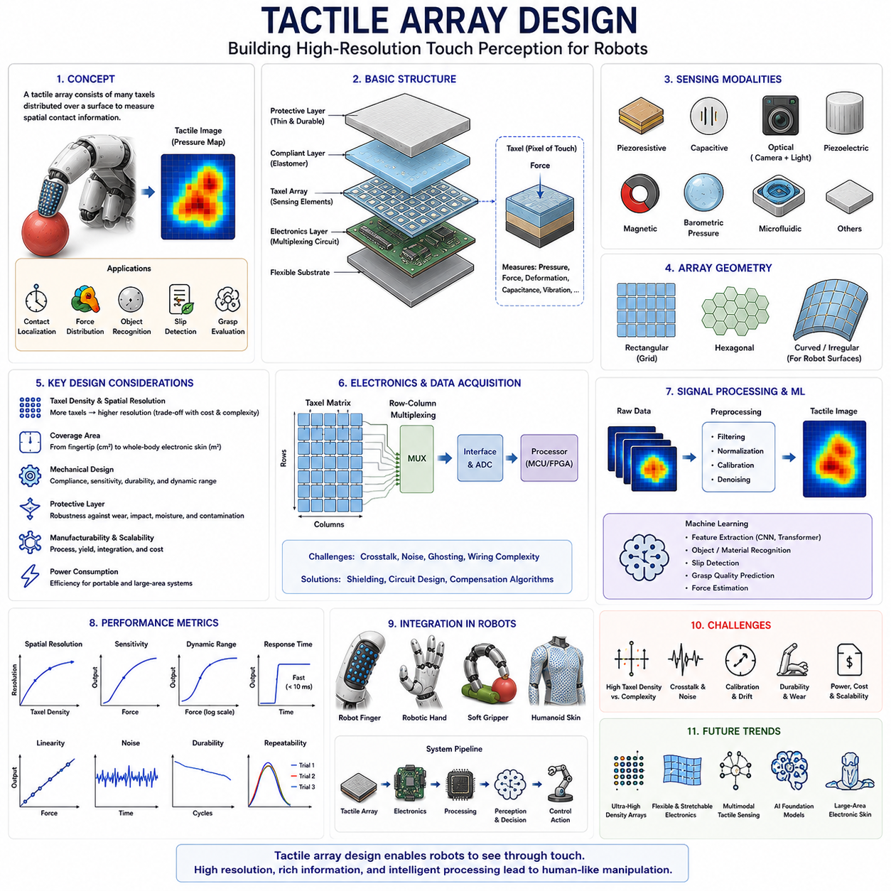{width="7.268055555555556in" height="7.268055555555556in"}

촉각 배열 설계(Tactile Array Design)는 로봇 촉각 센싱 분야에서 가장 중요한 주제 중 하나이다. 단일 촉각 센서(Single Tactile Sensor)는 하나의 위치에서만 힘이나 압력을 측정할 수 있지만, 촉각 배열은 다수의 센싱 요소를 표면 전체에 분산 배치하여 접촉 정보를 공간적으로 인식할 수 있도록 해준다. 이는 인간 피부(Human Skin)가 넓은 영역에 걸쳐 분포된 감각 수용체를 통해 접촉 상태를 인식하는 방식과 매우 유사하다. 촉각 배열을 통해 로봇은 접촉 위치(Contact Location), 힘 분포(Force Distribution), 물체 형상(Object Shape), 슬립(Slip), 파지 품질(Grasp Quality) 등을 파악할 수 있으며, 정교한 조작(Dexterous Manipulation)도 수행할 수 있다. 따라서 촉각 배열 설계는 센서 공학(Sensor Engineering), 전자공학(Electronics), 재료공학(Material Science), 신호 처리(Signal Processing), 머신러닝(Machine Learning), 로봇 제어(Robot Control)가 융합된 핵심 연구 분야로 발전하고 있다.

인간 피부는 촉각 배열 설계를 이해하기 위한 가장 좋은 생물학적 모델이다. 인간의 손가락과 손바닥에는 수천 개의 기계수용체(Mechanoreceptor)가 분포되어 있으며, 압력, 진동, 질감, 변형, 온도 등을 지속적으로 측정한다. 뇌는 이러한 분산된 센서 정보를 통합하여 접촉 상태를 이해한다. 촉각 배열 역시 다수의 센서를 로봇 표면에 배치하여 유사한 방식으로 접촉 정보를 수집한다.

촉각 배열의 기본 구성 요소는 택셀(Taxel)이다. 택셀은 카메라의 픽셀(Pixel)과 유사한 개념으로, 하나의 위치에서 압력, 힘, 정전용량, 저항, 변형, 진동, 근접 정보 등을 측정한다. 수백 개 또는 수천 개의 택셀이 배열되면 전체 접촉 상태를 나타내는 촉각 이미지(Tactile Image)가 생성된다. 촉각 이미지의 품질은 배열 구조와 설계 방식에 크게 의존한다.

촉각 배열 설계에서 가장 먼저 고려해야 할 요소는 센싱 방식(Sensing Modality)이다. 압저항 센서(Piezoresistive Sensor), 정전용량 센서(Capacitive Sensor), 광학 촉각 센서(Optical Tactile Sensor), 압전 센서(Piezoelectric Sensor), 자기 센서(Magnetic Sensor), 기압 센서(Barometric Pressure Sensor), 마이크로유체 센서(Microfluidic Sensor) 등 다양한 기술이 사용될 수 있다. 각각은 민감도, 해상도, 내구성, 전력 소모, 제조 비용 측면에서 서로 다른 특성을 가진다.

배열 기하구조(Array Geometry) 또한 매우 중요하다. 가장 일반적인 구조는 행(Row)과 열(Column)로 구성된 직사각형 격자(Rectangular Grid)이다. 이러한 구조는 제조가 쉽고 영상 처리와 유사한 데이터 처리가 가능하다. 육각형 배열(Hexagonal Array)은 보다 균일한 이웃 관계를 제공하며 공간 활용 효율이 높다. 반면 로봇 손가락이나 휴머노이드 피부처럼 곡면에 적용할 경우에는 곡면 배열(Curved Array)이나 비정형 배열(Irregular Array)이 필요할 수 있다.

택셀 밀도(Taxel Density)는 촉각 배열의 가장 중요한 성능 지표 중 하나이다. 단위 면적당 택셀 수가 많을수록 더 높은 공간 해상도(Spatial Resolution)를 제공할 수 있다. 높은 밀도는 미세한 형상과 작은 접촉 영역을 감지하는 데 유리하다. 하지만 밀도가 증가하면 제조 복잡성, 배선 수, 데이터 처리량, 비용도 함께 증가한다. 따라서 응용 목적에 맞는 적절한 밀도를 선택해야 한다.

공간 해상도는 센서가 구분할 수 있는 최소 접촉 특징의 크기를 의미한다. 일반적으로 택셀 크기가 작고 간격이 좁을수록 높은 해상도를 얻을 수 있다. 정교한 손 조작을 수행하는 로봇 손가락 끝은 매우 높은 해상도를 필요로 하지만, 충돌 감지를 위한 전자 피부는 상대적으로 낮은 해상도도 충분할 수 있다.

배열 커버리지(Array Coverage)는 센서가 감지할 수 있는 전체 면적을 의미한다. 로봇 손가락은 수 cm² 정도면 충분하지만, 휴머노이드 로봇은 손, 팔, 몸통, 다리 전체를 덮는 전자 피부가 필요할 수 있다. 넓은 면적을 커버할수록 배선, 통신, 전력 공급, 보정 등의 문제가 더욱 복잡해진다.

기계적 설계(Mechanical Design)는 촉각 배열 성능에 직접적인 영향을 미친다. 대부분의 촉각 배열은 실리콘, 폴리우레탄, 고무 복합재, 유연 고분자와 같은 순응성 재료(Compliant Material)를 사용한다. 이러한 재료는 물체 형상에 적응하고 자연스러운 접촉을 가능하게 한다. 그러나 지나치게 부드러우면 해상도와 측정 정확도가 떨어질 수 있다. 따라서 민감도와 정밀도 사이의 균형이 중요하다.

보호층(Protective Layer)은 촉각 배열의 내구성을 향상시키기 위해 사용된다. 로봇 센서는 반복적인 접촉과 마찰에 노출되므로 마모, 충격, 오염으로부터 보호되어야 한다. 그러나 보호층이 너무 두꺼우면 민감도와 해상도가 감소할 수 있다. 따라서 높은 기계적 투과성(Mechanical Transparency)을 가진 보호층 설계가 요구된다.

신호 획득 구조(Signal Acquisition Architecture)는 대규모 촉각 배열에서 핵심적인 요소이다. 수천 개의 택셀을 모두 개별 배선으로 연결하는 것은 현실적으로 어렵다. 따라서 멀티플렉싱(Multiplexing) 기술이 널리 사용된다.

가장 일반적인 방식은 행-열 스캔(Row-Column Scanning)이다. 택셀을 행과 열로 구성된 매트릭스 형태로 연결한 뒤 특정 행을 활성화하고 열 데이터를 읽는 방식이다. 이 구조는 배선 수를 크게 줄일 수 있기 때문에 대규모 촉각 배열에서 표준적으로 사용된다.

그러나 멀티플렉싱은 크로스토크(Crosstalk)와 고스팅(Ghosting) 문제를 발생시킬 수 있다. 크로스토크는 한 택셀의 신호가 인접 택셀에 영향을 미치는 현상이고, 고스팅은 실제 존재하지 않는 접촉이 감지되는 현상이다. 이를 해결하기 위해 차폐(Shielding), 보상 알고리즘(Compensation Algorithm), 회로 설계 최적화가 필요하다.

샘플링 속도(Sampling Rate)는 로봇 조작 성능에 큰 영향을 미친다. 슬립, 충돌, 물체 이동은 수 밀리초 단위로 발생할 수 있으므로 촉각 배열은 충분히 높은 주기로 데이터를 획득해야 한다. 높은 샘플링 속도는 더 나은 시간 해상도를 제공하지만 데이터 처리 부담도 증가시킨다.

노이즈 관리(Noise Management) 역시 중요한 문제이다. 전기적 노이즈, 열 잡음(Thermal Noise), 전자기 간섭(Electromagnetic Interference), 기계적 진동 등이 센서 측정값에 영향을 줄 수 있다. 저역 통과 필터(Low-Pass Filter), 적응형 필터(Adaptive Filter), 통계적 평활화(Statistical Smoothing), 머신러닝 기반 필터링 등이 활용된다.

보정(Calibration)은 정확한 측정을 위해 반드시 필요하다. 제조 공정의 오차, 재료 특성 차이, 환경 변화로 인해 택셀마다 응답 특성이 달라질 수 있다. 따라서 각 택셀의 출력과 실제 힘 또는 압력 사이의 관계를 설정하는 과정이 필요하다. 대규모 배열에서는 자동 보정 시스템이 요구된다.

촉각 배열 데이터는 일반적으로 촉각 이미지 형태로 표현된다. 각 택셀은 하나의 픽셀과 대응되며, 전체 배열은 압력 영상처럼 처리된다. 따라서 에지 검출(Edge Detection), 분할(Segmentation), 특징 추출(Feature Extraction), 패턴 인식(Pattern Recognition) 등의 컴퓨터 비전 기술을 적용할 수 있다.

머신러닝은 현대 촉각 배열 설계에 큰 영향을 미치고 있다. 고해상도 촉각 배열은 매우 많은 데이터를 생성하며, 딥러닝 모델은 이 데이터에서 접촉 패턴과 조작 상태를 학습할 수 있다. CNN(Convolutional Neural Network)은 촉각 이미지를 처리하는 데 매우 효과적이며, 물체 인식, 재질 분류, 슬립 검출, 파지 평가 등에 활용된다.

슬립 검출은 촉각 배열의 가장 중요한 응용 분야 중 하나이다. 물체가 미끄러지기 시작하면 압력 분포가 시간에 따라 변화한다. 촉각 배열은 이러한 변화를 감지하여 초기 슬립을 탐지할 수 있으며, 로봇은 즉시 파지력을 조절하여 물체가 떨어지는 것을 방지할 수 있다.

파지 품질 평가 또한 촉각 배열의 중요한 역할이다. 안정적인 파지는 특정 압력 분포 패턴을 나타낸다. 촉각 배열은 이러한 패턴을 직접 측정할 수 있기 때문에 현재 파지가 얼마나 안정적인지 평가할 수 있다.

질감 인식(Texture Recognition)은 고해상도 촉각 배열이 제공하는 또 다른 기능이다. 센서가 물체 표면을 따라 움직일 때 압력 패턴의 변화가 표면의 미세 구조를 반영한다. 이를 분석하면 재질과 표면 상태를 구분할 수 있다.

로봇 핸드에 촉각 배열을 통합하는 것은 상당한 도전 과제이다. 손가락은 곡면 구조를 가지고 있으며 내부 공간이 제한적이다. 따라서 유연 전자소자(Flexible Electronics), 신축성 전도체(Stretchable Conductor), 인쇄 전자기술(Printed Electronics)이 점점 더 중요해지고 있다.

전자 피부(Electronic Skin)는 촉각 배열 기술의 궁극적인 응용 분야 중 하나이다. 전자 피부는 로봇 전신에 촉각 인식을 제공하여 충돌 감지, 환경 인식, 인간-로봇 상호작용을 가능하게 한다. 이를 위해서는 대규모 배열, 효율적인 통신 구조, 고내구성 재료가 필요하다.

소프트 로보틱스는 촉각 배열 설계에 새로운 요구사항을 제시하고 있다. 소프트 로봇은 큰 변형을 경험하기 때문에 기존 센서 구조를 적용하기 어렵다. 이를 해결하기 위해 전도성 엘라스토머, 액체 금속(Liquid Metal), 나노소재(Nanomaterial)를 이용한 신축성 촉각 배열이 개발되고 있다.

최근에는 마이크로 제조(Microfabrication)와 3D 프린팅(Additive Manufacturing) 기술이 촉각 배열 설계에 적극 활용되고 있다. 이를 통해 복잡한 형상, 맞춤형 구조, 내장 배선, 고밀도 배열을 구현할 수 있게 되었다.

미래의 촉각 배열은 더욱 고밀도화되고, 유연해지며, 지능화될 것으로 예상된다. 압력뿐 아니라 전단력(Shear Force), 진동(Vibration), 온도(Temperature), 습도(Humidity), 근접(Proximity)을 동시에 측정하는 다중 모달 촉각 배열(Multimodal Tactile Array)이 등장할 것이다. 이는 인간 피부와 더욱 유사한 감각 능력을 제공할 것이다.

또한 촉각 파운데이션 모델(Tactile Foundation Model)의 등장도 중요한 미래 방향이다. 다양한 촉각 배열에서 수집된 대규모 데이터셋을 기반으로 범용 촉각 인공지능을 학습할 수 있으며, 이는 다양한 환경과 작업에 일반화된 촉각 이해 능력을 제공할 수 있다.

결론적으로 촉각 배열 설계는 현대 로봇 촉각 센싱의 핵심 기술이다. 수많은 택셀을 표면에 분산 배치함으로써 인간 피부와 유사한 공간적 접촉 인식을 제공할 수 있다. 성공적인 촉각 배열 설계를 위해서는 센싱 방식, 배열 구조, 밀도, 기계적 설계, 전자회로, 보정, 신호 처리, 머신러닝 통합을 종합적으로 고려해야 한다. 향후 로봇 핸드, 전자 피부, 소프트 로봇, 휴머노이드 로봇, 피지컬 AI의 발전과 함께 촉각 배열은 지능적인 물리적 상호작용을 가능하게 하는 핵심 기반 기술로 더욱 중요해질 것이다.

## 07.07 Tactile Sensor Skins

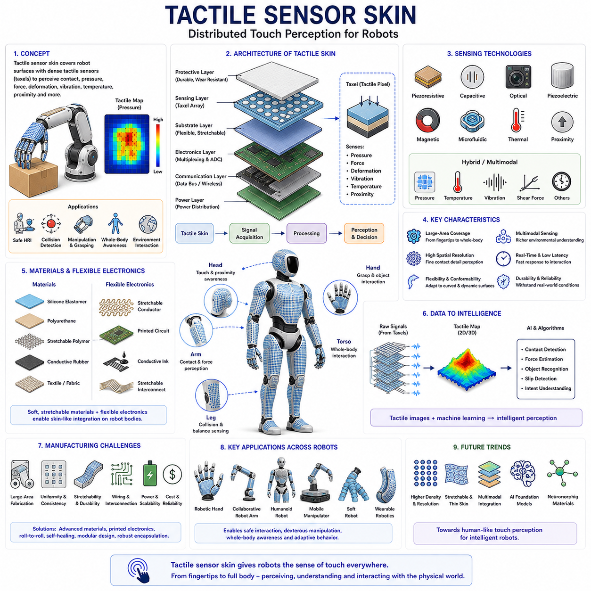{width="7.268055555555556in" height="7.268055555555556in"}

촉각 센서 피부(Tactile Sensor Skin)는 현대 로봇공학에서 가장 중요한 발전 중 하나로 평가된다. 이는 기존의 손가락 끝(Fingertip)에만 제한되어 있던 촉각 인식을 로봇의 넓은 신체 영역으로 확장시켜 주기 때문이다. 전통적인 촉각 센서는 주로 로봇 핸드나 그리퍼의 손끝에 설치되었지만, 촉각 센서 피부는 인간 피부처럼 넓은 표면 전체에 촉각 센서를 분산 배치하여 물리적 상호작용을 감지하는 것을 목표로 한다. 이러한 접근을 통해 로봇은 접촉(Contact), 압력(Pressure), 힘(Force), 변형(Deformation), 진동(Vibration), 온도(Temperature), 근접(Proximity) 등 다양한 환경 정보를 넓은 영역에서 인식할 수 있게 된다.

로봇이 인간 환경 속에서 활동하는 비중이 증가함에 따라 촉각 센서 피부는 안전한 인간-로봇 상호작용(Human-Robot Interaction), 정교한 조작(Dexterous Manipulation), 전신 인식(Whole-Body Awareness), 그리고 지능형 물리적 상호작용(Intelligent Physical Interaction)을 가능하게 하는 핵심 기술로 주목받고 있다. 특히 로봇 핸드와 정교한 파지(Dexterous Grasping) 분야에서는 손가락 끝의 국부적 촉각 인식과 손 전체의 전역적 상호작용 인식을 연결하는 중요한 역할을 수행한다.

인간 피부는 촉각 센서 피부 설계의 가장 중요한 생체 모방 모델이다. 인간 피부는 신체에서 가장 큰 감각 기관이며 수백만 개의 감각 수용체(Sensory Receptor)를 포함하고 있다. 이러한 수용체들은 압력, 진동, 신장(Stretch), 온도, 통증, 질감(Texture)을 지속적으로 감지한다. 각각의 수용체는 특정 기능에 특화되어 있으며, 인간의 신경계는 이들을 통합하여 매우 풍부한 물리적 상호작용 정보를 생성한다. 촉각 센서 피부는 이러한 분산 감각 구조를 인공적으로 구현하려는 시도라고 볼 수 있다.

손끝 촉각 센서에서 전신 촉각 피부로의 발전은 로봇 인식 기술의 중요한 전환점이다. 손끝 센서는 주로 파지와 조작을 지원하지만, 촉각 피부는 손, 손가락, 팔, 몸통, 다리, 심지어 로봇 전체에 걸쳐 접촉 정보를 제공한다. 이러한 확장은 특정 위치에서만 접촉을 감지하는 기계에서 벗어나, 전신의 물리적 상태를 이해하는 시스템으로 로봇을 발전시킨다.

촉각 센서 피부의 기본 구조는 센싱층(Sensing Layer), 기판층(Substrate Layer), 신호 획득 전자회로(Signal Acquisition Electronics), 통신 인프라(Communication Infrastructure), 그리고 상위 인식 소프트웨어(Perception Software)로 구성된다. 센싱층에는 수많은 촉각 센서 요소들이 분산 배치되며, 이를 택셀(Taxel)이라고 부른다. 택셀은 카메라의 픽셀(Pixel)과 유사한 역할을 수행하며, 각각이 압력, 힘, 온도, 진동, 변형 등의 정보를 측정한다. 수천 개 이상의 택셀이 결합되면 전체 표면의 접촉 상태를 나타내는 촉각 맵(Tactile Map)이 생성된다.

촉각 피부에 사용되는 센서 기술은 매우 다양하다. 압저항 방식(Piezoresistive Skin)은 기계적 변형에 따른 저항 변화를 측정한다. 정전용량 방식(Capacitive Skin)은 압력에 의해 발생하는 정전용량 변화를 이용한다. 광학 방식(Optical Skin)은 카메라와 영상 처리를 통해 접촉 상태를 분석한다. 압전 방식(Piezoelectric Skin)은 기계적 응력에 의해 발생하는 전하를 측정한다. 자기 방식(Magnetic Skin)은 자기장의 변화를 이용하며, 마이크로유체 방식(Microfluidic Skin)은 내부 유체 압력 변화를 측정한다. 최근에는 여러 기술을 결합한 하이브리드(Hybrid) 촉각 피부도 연구되고 있다.

촉각 센서 피부의 가장 큰 특징 중 하나는 넓은 영역을 덮을 수 있다는 점이다. 기존 촉각 센서가 수 cm² 정도의 작은 영역만 감지할 수 있었다면, 촉각 피부는 로봇 손 전체, 팔 전체, 몸통 전체, 심지어 휴머노이드 로봇의 전신을 덮을 수 있다. 이러한 대규모 센서 네트워크를 구현하기 위해서는 대량 생산 기술, 효율적인 통신 구조, 안정적인 전력 공급 체계가 필요하다.

공간 해상도(Spatial Resolution)는 촉각 피부 성능을 결정하는 중요한 요소이다. 높은 해상도를 가진 촉각 피부는 세밀한 접촉 형상과 압력 분포를 인식할 수 있다. 반면 낮은 해상도는 비용과 복잡성을 줄이는 대신 세부 정보를 희생한다. 정교한 조작을 수행하는 손가락 피부는 높은 해상도가 필요하지만, 충돌 감지용 전신 피부는 상대적으로 낮은 해상도로도 충분할 수 있다.

기계적 순응성(Mechanical Compliance) 역시 매우 중요하다. 인간 피부는 부드럽고 유연하며 곡면을 따라 변형될 수 있다. 따라서 로봇 촉각 피부도 유사한 특성을 가져야 한다. 실리콘 엘라스토머(Silicone Elastomer), 폴리우레탄 필름(Polyurethane Film), 유연 고분자(Flexible Polymer), 전도성 고무(Conductive Rubber), 직물 기반 재료(Textile-Based Material) 등이 널리 사용된다. 이러한 재료는 접촉 품질을 향상시키고 인간과의 상호작용 시 안전성을 높여준다.

유연 전자소자(Flexible Electronics)는 촉각 피부 기술을 가능하게 하는 핵심 요소이다. 기존의 강체 PCB는 곡면을 덮기에 적합하지 않다. 반면 유연 회로(Flexible Circuit), 신축성 전도체(Stretchable Conductor), 전도성 잉크(Conductive Ink), 인쇄 전자기술(Printed Electronics)은 휘어지거나 늘어나더라도 기능을 유지할 수 있다. 이를 통해 복잡한 로봇 형상에도 촉각 피부를 적용할 수 있게 되었다.

전자 피부(Electronic Skin, E-Skin)는 촉각 피부 기술의 가장 발전된 형태이다. 전자 피부는 단순한 압력 측정을 넘어 온도, 습도, 진동, 변형, 근접, 화학적 자극까지 동시에 감지할 수 있다. 즉, 하나의 통합 플랫폼에서 다양한 감각 기능을 수행하는 다중 모달 센싱(Multimodal Sensing) 시스템이다.

다중 모달 센싱은 매우 중요하다. 인간은 물체를 만질 때 압력뿐 아니라 온도, 질감, 재질, 탄성 등을 동시에 인식한다. 따라서 차세대 촉각 피부 역시 다양한 센서를 통합하여 보다 풍부한 환경 정보를 제공하려고 한다. 하지만 이러한 통합은 재료공학, 전자공학, 신호 처리 측면에서 상당한 도전 과제를 수반한다.

신호 획득은 촉각 피부 구현에서 가장 복잡한 부분 중 하나이다. 전신 촉각 피부는 수천 개에서 수백만 개의 센서를 포함할 수 있다. 이러한 데이터를 효율적으로 수집하고 처리하기 위해 멀티플렉싱(Multiplexing), 분산 처리(Distributed Processing), 계층적 통신(Hierarchical Communication), 엣지 컴퓨팅(Edge Computing)이 활용된다.

전력 소비(Power Consumption)는 대규모 촉각 피부 시스템에서 매우 중요한 문제이다. 수많은 센서를 지속적으로 동작시키면 많은 전력이 필요하다. 이를 해결하기 위해 저전력 센서 기술, 이벤트 기반 센싱(Event-Driven Sensing), 효율적인 통신 프로토콜, 지능형 샘플링 기법이 연구되고 있다.

촉각 피부가 생성하는 데이터는 촉각 이미지(Tactile Image) 또는 촉각 맵(Tactile Map) 형태로 표현된다. 각 택셀은 하나의 픽셀처럼 동작하며, 전체 배열은 압력 영상과 유사한 구조를 형성한다. 이러한 데이터는 컴퓨터 비전 기술을 활용하여 처리할 수 있으며, 특징 추출, 분할, 패턴 인식, 객체 분류에 활용된다.

머신러닝은 촉각 피부 연구를 크게 발전시키고 있다. 딥러닝 모델은 촉각 맵을 분석하여 물체 인식, 재질 분류, 힘 추정, 슬립 검출, 접촉 위치 추정, 조작 상태 예측 등을 수행할 수 있다. 특히 CNN(Convolutional Neural Network)은 촉각 이미지 처리에 매우 적합하다. 최근에는 Transformer와 촉각 파운데이션 모델(Tactile Foundation Model)에 대한 연구도 활발히 진행되고 있다.

인간-로봇 상호작용은 촉각 피부의 가장 중요한 응용 분야 중 하나이다. 인간이 로봇을 만지거나 예기치 않게 접촉할 경우, 촉각 피부는 이를 즉시 감지하고 안전 동작을 수행할 수 있다. 이는 협동로봇(Collaborative Robot), 서비스 로봇(Service Robot), 의료 로봇(Medical Robot), 휴머노이드 로봇(Humanoid Robot)에서 필수적인 기능이다.

충돌 감지(Collision Detection) 역시 중요한 응용 분야이다. 카메라나 LiDAR는 일부 상황에서 충돌을 놓칠 수 있지만, 촉각 피부는 실제 물리적 접촉이 발생하는 순간 이를 직접 감지할 수 있다. 따라서 보다 빠르고 정확한 안전 대응이 가능하다.

로봇 핸드에서도 촉각 피부는 큰 장점을 제공한다. 손가락 끝뿐 아니라 손바닥 전체에 촉각 피부를 적용하면 접촉 면적 전체에 대한 정보를 얻을 수 있다. 이를 통해 파지 안정성, 힘 분포, 물체 형상, 조작 상태를 더욱 정확하게 평가할 수 있다.

휴머노이드 로봇은 촉각 피부 기술의 가장 큰 수혜자가 될 것으로 예상된다. 인간은 전신에 촉각을 가지고 있기 때문에 다양한 환경과 자연스럽게 상호작용할 수 있다. 휴머노이드 로봇도 유사한 능력을 갖추기 위해서는 전신 촉각 피부가 필요하다.

소프트 로보틱스 분야 역시 촉각 피부 기술에 대한 수요가 매우 높다. 소프트 로봇은 크게 변형되기 때문에 강체 센서를 적용하기 어렵다. 신축성 촉각 피부는 이러한 문제를 해결하며, 구조 전체가 변형되더라도 지속적으로 접촉 정보를 제공할 수 있다.

촉각 피부의 제조는 여전히 큰 도전 과제이다. 대면적 센서를 생산하면서도 모든 택셀의 성능을 일정하게 유지해야 하기 때문이다. 이를 위해 롤투롤 제조(Roll-to-Roll Manufacturing), 스크린 프린팅(Screen Printing), 잉크젯 프린팅(Inkjet Printing), 마이크로 제작(Microfabrication), 3D 프린팅(Additive Manufacturing) 기술이 연구되고 있다.

내구성과 신뢰성 또한 중요한 요소이다. 실제 환경에서는 마찰, 충격, 습기, 먼지, 온도 변화가 지속적으로 발생한다. 따라서 보호 코팅(Protective Coating), 봉지 기술(Encapsulation), 결함 허용 설계(Fault-Tolerant Design)가 필요하다.

최근에는 자가 치유 촉각 피부(Self-Healing Tactile Skin)가 주목받고 있다. 생체 피부처럼 손상 후 스스로 복구할 수 있는 재료를 사용하여 센서의 수명을 크게 향상시키려는 연구가 진행 중이다.

인공지능과 촉각 피부의 결합은 새로운 가능성을 열고 있다. 촉각 정보를 단순한 측정 데이터가 아니라 고수준 인식과 의사결정의 입력으로 활용하는 것이다. 미래에는 대규모 촉각 데이터셋을 기반으로 학습한 촉각 파운데이션 모델이 등장하여 다양한 환경에서 일반화된 촉각 이해 능력을 제공할 것으로 기대된다.

뉴로모픽 센싱(Neuromorphic Sensing) 역시 유망한 방향이다. 이는 생물학적 신경계를 모방하여 변화가 발생할 때만 이벤트를 생성하는 방식이다. 이를 통해 전력 소모를 줄이고 실시간성을 향상시킬 수 있다.

미래의 촉각 피부는 더욱 유연하고, 신축성이 뛰어나며, 지능적이고, 다중 모달 특성을 갖게 될 것이다. 압력, 전단력(Shear Force), 온도, 진동, 습도, 근접, 화학적 특성을 동시에 측정하는 통합 감각 플랫폼으로 발전할 것으로 예상된다.

결론적으로 촉각 센서 피부는 로봇이 인간 피부와 유사한 분산 촉각 인식 능력을 갖도록 만드는 핵심 기술이다. 이는 손끝 중심의 국부적 촉각 인식에서 전신 수준의 물리적 인식으로 로봇을 발전시키며, 안전한 인간-로봇 상호작용, 정교한 조작, 환경 인식, 휴머노이드 로봇 구현을 가능하게 한다. 미래의 로봇이 인간 수준의 신체 지능(Physical Intelligence)과 조작 능력(Dexterity)을 달성하기 위해서는 촉각 센서 피부가 반드시 필요한 기반 기술이 될 것으로 전망된다.

## 07.08 Sensor Signal Processing

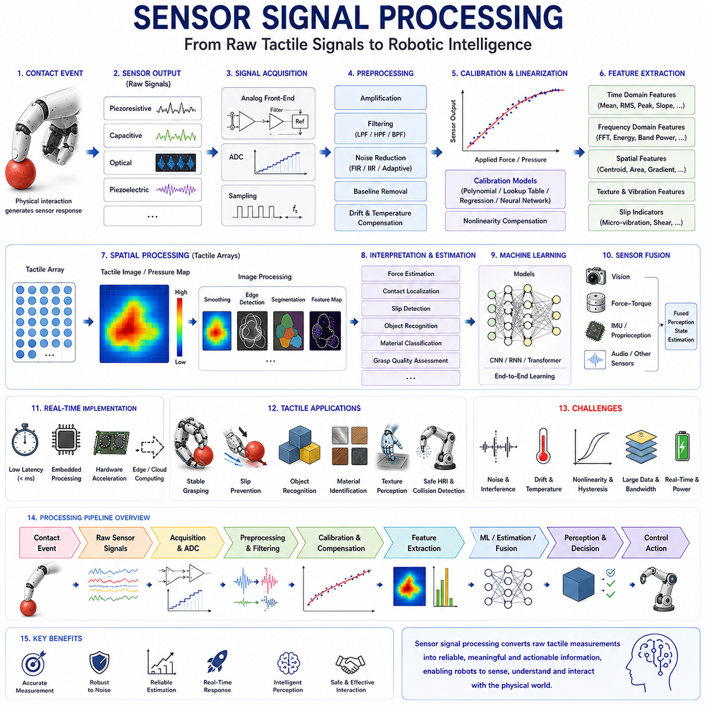{width="7.268055555555556in" height="7.268055555555556in"}

센서 신호 처리(Sensor Signal Processing)는 로봇 촉각 센싱 시스템에서 가장 중요한 구성 요소 중 하나이다. 그 이유는 센서가 생성하는 원시 데이터(Raw Data)를 로봇이 실제로 활용할 수 있는 의미 있는 정보로 변환하는 역할을 수행하기 때문이다. 압저항 센서(Piezoresistive Sensor), 정전용량 센서(Capacitive Sensor), 광학 촉각 센서(Optical Tactile Sensor), 압전 센서(Piezoelectric Sensor), 자기 센서(Magnetic Sensor), 기압 센서(Barometric Sensor), 다중 모달 센서(Multimodal Sensor) 등 어떤 종류의 센서를 사용하더라도 센서 자체는 단순히 전기 신호, 영상 데이터, 압력 값 또는 기타 저수준 측정값만을 생성한다.

이러한 원시 신호는 일반적으로 노이즈(Noise), 비선형성(Nonlinearity), 환경 영향(Environmental Effects), 측정 오차(Uncertainty), 센서 편차(Sensor Variations)를 포함하고 있기 때문에 직접 사용하기 어렵다. 센서 신호 처리는 물리적 접촉(Physical Contact)과 로봇 지능(Robotic Intelligence)을 연결하는 다리 역할을 수행하며, 접촉 힘(Contact Force), 압력 분포(Pressure Distribution), 물체 특성(Object Properties), 파지 상태(Grasp Condition), 조작 상태(Manipulation State) 등의 의미 있는 정보로 변환한다. 현대 로봇 시스템에서 센서 신호 처리는 단순한 필터링 작업이 아니라 전자공학, 신호 이론, 머신러닝, 센서 융합, 실시간 제어를 포함하는 완전한 인지 파이프라인(Perception Pipeline)으로 간주된다.

신호 처리 과정은 로봇과 환경 사이에서 물리적 접촉이 발생하는 순간부터 시작된다. 물체가 촉각 센서와 접촉하면 센서는 특정한 물리적 원리에 따라 반응한다. 압저항 센서는 저항 변화로 반응하고, 정전용량 센서는 정전용량 변화로 반응한다. 광학 촉각 센서는 영상 패턴의 변화로 반응하며, 압전 센서는 전하를 생성한다. 이 단계에서 생성되는 신호는 로봇이 얻을 수 있는 가장 초기의 정보이다. 하지만 이러한 신호에는 유용한 정보뿐 아니라 다양한 잡음과 왜곡이 포함되어 있다.

신호 처리의 첫 번째 단계는 신호 획득(Signal Acquisition)이다. 대부분의 촉각 센서는 아날로그 신호를 출력하기 때문에 이를 디지털 시스템에서 처리할 수 있도록 변환해야 한다. 이를 위해 아날로그 프론트엔드(Analog Front-End)와 ADC(Analog-to-Digital Converter)가 사용된다. 신호 획득 품질은 전체 촉각 인식 성능에 직접적인 영향을 미친다. 신호 획득이 부정확하면 양자화 오차(Quantization Error), 시간 오차(Timing Error), 왜곡(Distortion), 정보 손실이 발생할 수 있다.

디지털 변환 전에 아날로그 신호 조정(Analog Conditioning)이 수행된다. 많은 촉각 센서는 매우 작은 신호를 생성하기 때문에 증폭이 필요하다. 계측 증폭기(Instrumentation Amplifier)는 신호를 증폭하면서도 원래의 특성을 유지한다. 필터 회로(Filter Circuit)는 불필요한 주파수 성분을 제거하고 외부 간섭을 줄인다. 기준 전압(Voltage Reference)은 측정 환경을 안정화한다. 차동 측정(Differential Measurement)은 노이즈 제거에 효과적이다.

샘플링(Sampling)은 신호 처리의 핵심 개념이다. 아날로그 신호를 일정한 시간 간격으로 측정하여 디지털 데이터로 변환하는 과정이다. 샘플링 주파수(Sampling Frequency)는 데이터 수집 빈도를 결정한다. 샘플링 속도가 너무 낮으면 에일리어싱(Aliasing)이 발생하여 중요한 정보가 손실될 수 있다. 반대로 지나치게 높은 샘플링 속도는 계산량과 데이터 전송량을 증가시킨다. 예를 들어 슬립 검출(Slip Detection)과 같은 고속 작업은 kHz 수준의 샘플링이 필요하지만, 정적인 힘 측정은 훨씬 낮은 주파수로도 충분하다.

디지털화 이후 가장 중요한 단계 중 하나는 노이즈 제거(Noise Reduction)이다. 노이즈는 전자 회로, 전자기 간섭(Electromagnetic Interference), 열 변동(Thermal Fluctuation), 기계적 진동(Mechanical Vibration), 환경 변화 등 다양한 원인에 의해 발생한다. 노이즈를 제거하지 않으면 촉각 인식 성능이 크게 저하된다.

이를 위해 다양한 필터링 기법이 사용된다. 저역 통과 필터(Low-Pass Filter)는 고주파 노이즈를 제거하면서 접촉 정보를 유지한다. 고역 통과 필터(High-Pass Filter)는 충격이나 진동과 같은 빠른 변화를 추출한다. 대역 통과 필터(Band-Pass Filter)는 특정 주파수 영역만 선택적으로 분석할 수 있도록 한다.

디지털 필터(Digital Filter)는 현대 촉각 시스템에서 매우 중요하다. FIR(Finite Impulse Response) 필터는 안정성과 예측 가능성이 높다. IIR(Infinite Impulse Response) 필터는 적은 계산량으로 유사한 성능을 제공한다. 적응형 필터(Adaptive Filter)는 신호 특성에 따라 스스로 파라미터를 조정한다. 칼만 필터(Kalman Filter)는 센서 데이터와 시스템 모델을 결합하여 보다 정확한 상태 추정을 수행한다.

센서 보정(Calibration)은 정확한 측정을 위해 필수적이다. 센서 출력은 일반적으로 힘이나 압력과 직접적으로 대응되지 않는다. 따라서 알려진 힘이나 압력을 가한 후 센서 출력과 비교하여 변환 모델을 구축해야 한다. 회귀 모델(Regression Model), 룩업 테이블(Lookup Table), 다항식 모델(Polynomial Model), 신경망(Neural Network), 물리 기반 모델(Physics-Based Model) 등이 사용된다.

비선형성(Nonlinearity)은 많은 촉각 센서에서 나타나는 문제이다. 센서 출력과 입력 힘 사이의 관계가 직선적이지 않은 경우가 많다. 이는 재료 특성, 구조적 변형, 히스테리시스(Hysteresis) 등에 의해 발생한다. 신호 처리 알고리즘은 이러한 비선형성을 보상하여 센서 응답을 선형화한다.

드리프트 보상(Drift Compensation)도 중요하다. 시간이 지남에 따라 온도 변화, 습도 변화, 재료 노화, 기계적 마모 등으로 인해 센서 기준값이 변할 수 있다. 드리프트 보상 알고리즘은 이러한 변화를 지속적으로 추적하여 측정값을 수정한다.

온도 보상(Temperature Compensation)은 드리프트 보정과 함께 사용되는 경우가 많다. 많은 센서는 온도 변화에 민감하기 때문에 실제 접촉이 없어도 출력이 변할 수 있다. 이를 해결하기 위해 온도 센서를 추가하고 보정 모델을 적용한다.

특징 추출(Feature Extraction)은 저수준 신호 처리와 고수준 인지 사이를 연결하는 핵심 단계이다. 원시 신호에는 많은 정보가 포함되어 있지만 특정 작업에 필요한 정보만 추출해야 한다. 대표적인 특징으로는 힘 크기(Force Magnitude), 접촉 면적(Contact Area), 압력 중심(Pressure Centroid), 진동 주파수(Vibration Frequency), 슬립 지표(Slip Indicator), 변형 기울기(Deformation Gradient) 등이 있다.

시간 영역 분석(Time-Domain Analysis)은 신호의 크기, 지속 시간, 변화율 등을 분석한다. 주파수 영역 분석(Frequency-Domain Analysis)은 FFT(Fast Fourier Transform)를 이용하여 신호를 주파수 성분으로 변환한다. 주파수 분석은 질감 인식(Texture Recognition), 진동 분석(Vibration Analysis), 슬립 검출에 특히 유용하다.

촉각 배열(Tactile Array)이 사용되는 경우에는 공간 신호 처리(Spatial Signal Processing)가 중요해진다. 수백 개 또는 수천 개의 택셀(Taxel) 데이터는 촉각 이미지(Tactile Image)를 형성한다. 이러한 데이터는 영상 처리 기술을 이용하여 분석할 수 있다. 스무딩(Smoothing), 에지 검출(Edge Detection), 분할(Segmentation), 클러스터링(Clustering), 윤곽선 추출(Contour Extraction) 등이 활용된다.

촉각 이미지는 컴퓨터 비전과 매우 유사한 구조를 가진다. 각 택셀은 픽셀과 같은 역할을 수행하며, 압력 분포는 그레이스케일 이미지와 유사하게 표현된다. 따라서 컴퓨터 비전에서 개발된 CNN, 특징 피라미드(Feature Pyramid), 영상 분류 기법을 그대로 활용할 수 있다.

슬립 검출은 촉각 신호 처리의 대표적인 응용 분야이다. 물체가 손가락 위에서 미끄러지기 시작하면 압력 분포와 진동 패턴이 변화한다. 신호 처리 알고리즘은 이러한 변화를 감지하여 물체가 떨어지기 전에 파지력을 증가시킬 수 있다.

힘 추정(Force Estimation) 역시 중요한 응용이다. 촉각 센서는 직접 힘을 측정하지 않고 전기 신호를 측정하기 때문에, 신호 처리 알고리즘을 통해 힘을 추정해야 한다. 고급 시스템은 수직 힘(Normal Force)과 전단력(Shear Force)까지 추정할 수 있다.

물체 인식(Object Recognition)도 촉각 신호 처리의 중요한 활용 분야이다. 서로 다른 물체는 서로 다른 촉각 패턴을 생성한다. 신호 처리 알고리즘은 형상, 질감, 강성(Compliance), 접촉 형상을 특징으로 추출하고, 머신러닝 모델은 이를 이용하여 물체를 분류한다.

재질 분류(Material Classification) 또한 가능하다. 금속, 플라스틱, 고무, 직물, 목재는 각각 다른 기계적 특성과 표면 특성을 가진다. 촉각 신호 처리 알고리즘은 힘-변형 관계, 진동 특성, 열 특성 등을 분석하여 재질을 식별할 수 있다.

머신러닝은 센서 신호 처리 분야를 크게 변화시켰다. 과거에는 사람이 설계한 필터와 특징을 사용했지만, 현재는 딥러닝이 데이터에서 직접 특징을 학습한다. CNN은 촉각 이미지 처리에 적합하며, RNN(Recurrent Neural Network)과 Transformer는 시간에 따라 변화하는 촉각 신호 분석에 효과적이다.

딥러닝 기반의 엔드투엔드(End-to-End) 시스템은 원시 센서 데이터에서 직접 힘 추정, 물체 인식, 슬립 검출, 파지 평가, 조작 계획을 수행할 수 있다. 이는 복잡한 특징 설계를 줄이고 성능을 향상시킨다.

센서 융합(Sensor Fusion)은 또 다른 중요한 분야이다. 촉각 센서는 일반적으로 비전(Vision), 힘-토크 센서(Force-Torque Sensor), IMU, 오디오 센서 등과 함께 사용된다. 비전은 접촉 이전의 정보를 제공하고, 촉각은 접촉 이후의 정보를 제공한다. 두 센서를 결합하면 보다 강건한 조작이 가능하다.

실시간 처리(Real-Time Processing)는 실제 로봇 응용에서 필수적이다. 촉각 인식은 제어 루프(Control Loop) 내에서 동작해야 하므로 수 밀리초 이내에 결과를 제공해야 한다. 이를 위해 효율적인 알고리즘과 AI 가속기(AI Accelerator), 엣지 컴퓨팅(Edge Computing)이 활용된다.

최근에는 임베디드 처리(Embedded Processing)가 주목받고 있다. 모든 데이터를 중앙 컴퓨터로 보내지 않고 센서 근처의 마이크로컨트롤러(Microcontroller), FPGA(Field Programmable Gate Array), AI 프로세서에서 직접 처리하는 방식이다. 이는 통신 부담을 줄이고 시스템 확장성을 향상시킨다.

뉴로모픽 신호 처리(Neuromorphic Signal Processing)는 생물학적 신경계를 모방한 새로운 접근법이다. 인간은 모든 데이터를 지속적으로 처리하지 않고 변화가 발생할 때만 신호를 전달한다. 뉴로모픽 촉각 시스템도 이벤트 기반(Event-Based) 방식으로 동작하여 전력 소비를 크게 줄일 수 있다.

최근에는 촉각 파운데이션 모델(Tactile Foundation Model)에 대한 연구도 활발히 진행되고 있다. 대규모 촉각 데이터셋을 기반으로 학습된 범용 모델은 다양한 작업과 환경에서 활용될 수 있다. 이는 자연어 처리 분야의 대규모 언어 모델과 유사한 역할을 수행할 것으로 기대된다.

미래의 센서 신호 처리 시스템은 더욱 지능적이고 적응적이며 자율적으로 발전할 것이다. 인공지능, 엣지 컴퓨팅, 센서 융합, 뉴로모픽 공학, 다중 모달 인식 기술이 결합되면서 로봇은 접촉을 단순히 감지하는 수준을 넘어 물리적 상호작용을 깊이 이해할 수 있게 될 것이다.

결론적으로 센서 신호 처리는 촉각 센싱 시스템의 두뇌 역할을 수행한다. 신호 획득, 필터링, 보정, 드리프트 보상, 특징 추출, 머신러닝, 센서 융합, 실시간 추론 과정을 통해 원시 센서 데이터를 실제 행동에 활용 가능한 지식으로 변환한다. 향후 로봇 조작, 인간-로봇 상호작용, 피지컬 AI가 발전할수록 센서 신호 처리 기술의 중요성은 더욱 커질 것이며, 이는 로봇이 인간 수준의 촉각 지능(Tactile Intelligence)을 획득하는 핵심 기반 기술이 될 것이다.

## 07.09 Contact Detection and Localization

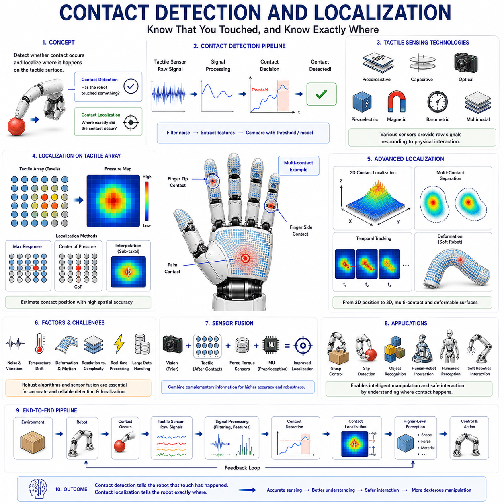{width="7.268055555555556in" height="7.268055555555556in"}

접촉 검출(Contact Detection)과 위치 추정(Localization)은 로봇 촉각 인식(Tactile Perception)의 가장 기본적이면서도 중요한 기능이다. 로봇이 물체를 조작하거나 파지력을 조절하고, 물체의 특성을 추정하며, 정교한 상호작용을 수행하기 위해서는 먼저 접촉이 발생했는지를 판단해야 하고, 그 접촉이 정확히 어디에서 발생했는지를 알아야 한다.

접촉 검출은 "로봇이 물체를 만졌는가?"라는 질문에 답하는 과정이며, 위치 추정은 "어디를 만졌는가?"라는 질문에 답하는 과정이다. 이 두 기능은 모든 촉각 인식 시스템의 출발점이며, 이후 수행되는 힘 추정, 물체 인식, 슬립 검출, 파지 안정성 평가 등의 기반이 된다. 인간 역시 피부 속에 분포된 기계수용체(Mechanoreceptor)를 통해 접촉 여부와 위치를 매우 빠르고 정확하게 인식한다. 로봇 촉각 시스템은 이러한 생물학적 기능을 인공적으로 구현하려는 시도라고 볼 수 있다.

로봇 조작에서 접촉 검출은 물리적 상호작용의 시작을 의미한다. 접촉 이전에는 비전(Vision), 경로 계획(Motion Planning), 위치 제어(Position Control)가 주로 사용된다. 그러나 접촉이 발생하는 순간부터는 힘(Force), 마찰(Friction), 순응성(Compliance), 촉각 피드백(Tactile Feedback)이 중요한 역할을 하게 된다. 따라서 접촉 발생 시점을 정확히 감지하는 것은 매우 중요하다. 만약 접촉 검출이 늦어지거나 부정확하면 과도한 충격력, 불안정한 파지, 물체 손상, 작업 실패 등이 발생할 수 있다.

가장 단순한 형태의 접촉 검출은 이진(Binary) 방식이다. 이 방식에서는 접촉이 있거나 없음을 단순히 판단한다. 센서 출력이 특정 임계값(Threshold)을 초과하면 접촉이 발생했다고 판단한다. 이러한 방식은 구조가 간단하고 구현이 쉬워 산업용 조립 공정, 충돌 감지, 안전 시스템, 단순 그리핑 작업 등에 널리 사용된다.

보다 발전된 시스템은 연속 접촉 검출(Continuous Contact Detection)을 수행한다. 이러한 센서는 압력, 힘, 정전용량, 저항, 변형량 등을 연속적으로 측정하며, 접촉이 시작되는 시점뿐 아니라 접촉 강도와 변화 과정까지 추적할 수 있다. 이를 통해 보다 정교한 조작과 힘 제어가 가능해진다.

임계값 기반 검출(Threshold-Based Detection)은 가장 널리 사용되는 방법이다. 센서 출력을 지속적으로 모니터링하다가 특정 기준값을 초과하면 접촉으로 판단한다. 하지만 임계값 설정은 매우 중요하다. 너무 낮으면 노이즈가 접촉으로 오인될 수 있고, 너무 높으면 약한 접촉을 놓칠 수 있다. 이를 해결하기 위해 환경 변화에 따라 임계값을 자동 조정하는 적응형 임계값(Adaptive Threshold) 기법이 사용된다.

노이즈 관리(Noise Management)는 접촉 검출의 핵심 요소이다. 센서 데이터에는 전자기 간섭(Electromagnetic Interference), 열 잡음(Thermal Noise), 기계적 진동(Mechanical Vibration), 환경 변화 등이 포함될 수 있다. 이러한 노이즈는 오검출(False Positive)이나 미검출(False Negative)을 유발할 수 있다. 따라서 저역 통과 필터(Low-Pass Filter), 이동 평균(Moving Average), 칼만 필터(Kalman Filter), 적응형 필터(Adaptive Filter) 등의 신호 처리 기법이 활용된다.

동적인 환경에서는 접촉 검출이 더욱 어려워진다. 로봇이 움직일 때 발생하는 진동, 가속도, 구조 변형은 실제 접촉이 아니더라도 센서 출력을 변화시킬 수 있다. 따라서 IMU(Inertial Measurement Unit), 힘-토크 센서(Force-Torque Sensor), 관절 센서(Proprioceptive Sensor)와의 센서 융합(Sensor Fusion)을 통해 실제 접촉과 자체 운동에 의한 영향을 구분해야 한다.

위치 추정은 단순히 접촉을 감지하는 것을 넘어 접촉 위치를 결정하는 과정이다. 접촉 위치는 파지 안정성, 힘 분포, 물체 자세 추정(Object Pose Estimation), 조작 계획(Manipulation Planning)에 직접적인 영향을 미친다. 인간은 수 mm 수준의 정확도로 접촉 위치를 인식할 수 있으며, 로봇도 이에 가까운 성능을 목표로 하고 있다.

가장 일반적인 위치 추정 방법은 촉각 배열(Tactile Array)을 사용하는 것이다. 촉각 배열은 다수의 택셀(Taxel)을 표면에 배치한 구조이다. 접촉이 발생하면 특정 택셀들이 활성화되고, 그 패턴을 분석하여 접촉 위치를 추정한다. 가장 단순한 방법은 가장 큰 출력을 가진 택셀을 접촉 위치로 간주하는 것이다. 하지만 실제로는 여러 택셀이 동시에 반응하기 때문에 보다 정교한 방법이 필요하다.

공간 해상도(Spatial Resolution)는 위치 추정 성능을 결정하는 중요한 요소이다. 택셀 밀도(Taxel Density)가 높을수록 보다 정확한 위치 추정이 가능하다. 그러나 밀도가 증가하면 제조 비용, 데이터 처리량, 전력 소비도 함께 증가한다. 따라서 응용 목적에 맞는 적절한 해상도를 선택해야 한다.

위치 추정은 종종 중심 압력(Center of Pressure, CoP) 계산으로 수행된다. 중심 압력은 접촉 영역 내에서 힘의 가중 평균 위치를 의미한다. 단순히 최대값을 사용하는 것보다 훨씬 정확한 위치 추정이 가능하며, 많은 촉각 시스템에서 표준적으로 사용된다.

보간법(Interpolation)은 위치 추정 정확도를 더욱 향상시킨다. 비록 택셀 간격이 크더라도 인접 센서의 값을 이용해 중간 위치를 계산할 수 있다. 선형 보간(Bilinear Interpolation), 스플라인 보간(Spline Interpolation), 가우시안 피팅(Gaussian Fitting), 머신러닝 기반 보간 등이 활용된다. 이를 통해 택셀 간격보다 더 높은 해상도의 위치 추정이 가능하다.

광학 촉각 센서(Optical Tactile Sensor)는 위치 추정에서 특별한 장점을 가진다. 카메라 기반 시스템은 수백만 개의 픽셀을 활용하여 접촉 영역을 직접 관찰할 수 있다. 따라서 기존 촉각 배열보다 훨씬 높은 공간 해상도를 제공하며, 접촉 위치를 매우 정밀하게 계산할 수 있다.

3차원 위치 추정(3D Contact Localization)은 더욱 발전된 형태이다. 단순히 표면상의 위치뿐 아니라 접촉 깊이(Contact Depth), 힘의 방향(Direction), 접촉 형상(Contact Geometry)까지 추정한다. 이는 곡면 물체, 변형 물체, 다중 접촉 상황에서 매우 중요하다.

다중 접촉(Multi-Contact) 상황은 더욱 복잡한 문제를 제시한다. 로봇 손이 물체를 잡을 때 여러 손가락과 손바닥이 동시에 접촉할 수 있다. 이 경우 서로 겹치는 접촉 패턴을 분리하고 각각의 위치를 식별해야 한다. 이를 위해 클러스터링(Clustering), 분할(Segmentation), 확률 모델(Probabilistic Model), 머신러닝 알고리즘이 사용된다.

머신러닝은 접촉 위치 추정 기술을 크게 발전시켰다. 기존 방식은 기하학적 모델과 수학적 계산에 의존했지만, 최근에는 신경망(Neural Network)이 센서 데이터로부터 직접 위치를 학습한다. 딥러닝은 비선형성, 제조 편차, 환경 변화가 존재하는 상황에서도 높은 정확도를 제공할 수 있다.

특히 CNN(Convolutional Neural Network)은 촉각 이미지를 처리하는 데 매우 효과적이다. CNN은 공간적 특징을 자동으로 추출하여 접촉 위치를 정확하게 추정할 수 있다. 최근에는 Transformer 기반 모델도 접촉 위치 추정에 적용되고 있다.

접촉 검출과 위치 추정은 힘 추정(Force Estimation)과 밀접하게 연관된다. 접촉 위치가 정확히 알려지면 해당 위치에서의 힘을 계산할 수 있고, 이를 통해 압력 분포와 상호작용 모델을 생성할 수 있다.

슬립 검출(Slip Detection) 역시 접촉 위치 추적에 크게 의존한다. 물체가 미끄러지기 시작하면 접촉 위치와 압력 분포가 시간에 따라 이동한다. 이러한 변화를 추적하면 물체가 떨어지기 전에 슬립을 감지하고 파지력을 조절할 수 있다.

물체 인식(Object Recognition)도 접촉 위치 정보를 활용한다. 물체를 만질 때 생성되는 접촉 패턴은 물체 형상에 대한 중요한 정보를 제공한다. 여러 위치에서 얻은 접촉 데이터를 결합하면 물체의 형태, 크기, 방향을 추정할 수 있다.

인간-로봇 상호작용(Human-Robot Interaction)에서는 전신 촉각 피부(Tactile Skin)를 이용한 접촉 위치 추정이 중요하다. 사람이 로봇의 특정 부위를 만졌을 때 로봇은 어느 부위가 접촉되었는지를 인식하고 적절한 반응을 수행할 수 있어야 한다.

휴머노이드 로봇(Humanoid Robot)은 특히 전신 접촉 위치 추정이 중요하다. 인간이 균형 유지, 자세 제어, 환경 인식에 촉각을 활용하는 것처럼, 휴머노이드도 전신 촉각 정보를 활용하여 보행, 장애물 회피, 협업 작업을 수행할 수 있다.

소프트 로보틱스(Soft Robotics)는 추가적인 도전 과제를 제공한다. 소프트 로봇은 크게 변형되므로 센서 위치 자체가 계속 변한다. 따라서 위치 추정 알고리즘은 구조 변형까지 고려해야 한다. 이를 위해 신축성 전자소자(Stretchable Electronics), 변형 보상 알고리즘(Deformation Compensation Algorithm), 머신러닝 모델이 활용된다.

센서 융합은 접촉 위치 추정의 정확도를 크게 향상시킨다. 비전 센서는 접촉 이전에 예상 접촉 위치를 제공할 수 있으며, 촉각 센서는 실제 접촉 이후의 정확한 위치를 제공한다. 두 정보를 결합하면 보다 강건한 위치 추정이 가능하다.

확률 기반 접근법(Probabilistic Methods)은 불확실성이 큰 환경에서 유용하다. 베이지안 추정(Bayesian Estimation), 파티클 필터(Particle Filter), 은닉 마르코프 모델(Hidden Markov Model) 등은 센서 노이즈와 불확실성을 고려한 위치 추정을 가능하게 한다.

실시간 처리(Real-Time Processing)는 매우 중요하다. 접촉 이벤트는 수 밀리초 단위로 발생하므로, 위치 추정 알고리즘도 매우 빠르게 동작해야 한다. 이를 위해 FPGA, GPU, AI 가속기(AI Accelerator), 엣지 컴퓨팅(Edge Computing)이 활용된다.

뉴로모픽 촉각 시스템(Neuromorphic Tactile System)은 생물학적 신경계를 모방한 새로운 접근법이다. 이벤트 기반(Event-Based) 방식으로 동작하여 매우 낮은 지연 시간과 높은 에너지 효율을 제공할 수 있다.

최근에는 촉각 파운데이션 모델(Tactile Foundation Model)에 대한 연구도 활발히 진행되고 있다. 대규모 촉각 데이터셋을 학습한 범용 모델은 다양한 센서와 환경에서 접촉 위치를 추정할 수 있는 일반화 능력을 제공할 것으로 기대된다.

결론적으로 접촉 검출과 위치 추정은 로봇 촉각 인식의 출발점이다. 접촉 검출은 물리적 상호작용이 언제 시작되는지를 판단하고, 위치 추정은 어디에서 상호작용이 발생했는지를 결정한다. 이 두 기능은 힘 추정, 슬립 검출, 파지 분석, 물체 인식, 조작 계획, 인간-로봇 상호작용, 전신 촉각 인식의 기반이 된다. 앞으로 센서 기술, 머신러닝, 센서 융합, 뉴로모픽 컴퓨팅이 발전함에 따라 로봇은 인간 수준에 가까운 접촉 인식 능력을 갖추게 될 것이며, 이는 피지컬 AI와 차세대 지능형 로봇의 핵심 기반 기술이 될 것이다.

## 07.10 Sensor Calibration

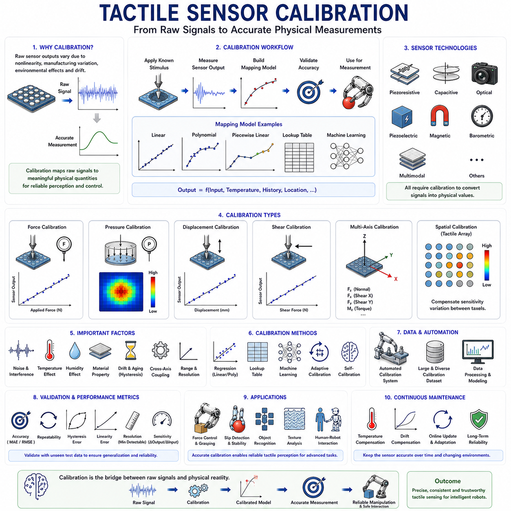{width="7.268055555555556in" height="7.268055555555556in"}

촉각 센서 보정(Tactile Sensor Calibration)은 로봇 촉각 센싱 시스템에서 가장 기본적이면서도 중요한 과정 중 하나이다. 보정의 목적은 센서가 생성하는 원시 출력값(Raw Sensor Output)과 실제 물리량(Physical Quantity) 사이의 관계를 정확하게 정의하는 것이다. 여기서 물리량은 힘(Force), 압력(Pressure), 변형(Deformation), 접촉 면적(Contact Area), 전단력(Shear Force), 토크(Torque) 등을 의미한다. 압저항 센서(Piezoresistive Sensor), 정전용량 센서(Capacitive Sensor), 광학 촉각 센서(Optical Tactile Sensor), 압전 센서(Piezoelectric Sensor), 자기 센서(Magnetic Sensor), 기압 센서(Barometric Sensor), 다중 모달 촉각 센서(Multimodal Tactile Sensor) 등 어떤 종류의 센서를 사용하더라도, 보정이 이루어지지 않은 센서 출력은 실제 환경에서 거의 활용하기 어렵다.

센서가 출력하는 전압(Voltage), 전류(Current), 저항(Resistance), 정전용량(Capacitance), 영상 데이터(Image Data), 압력 값(Pressure Value)은 그 자체로는 물리적 의미가 제한적이다. 보정은 이러한 데이터를 실제 힘과 압력으로 변환하여 로봇이 이해할 수 있도록 만든다. 따라서 보정은 촉각 센서와 로봇 인지 시스템을 연결하는 핵심 과정이라고 할 수 있다. 보정이 제대로 수행되지 않으면 힘 추정 오류, 잘못된 접촉 판단, 불안정한 파지, 조작 실패와 같은 문제가 발생할 수 있다.

생물학적 시스템에서는 인간의 피부와 신경계가 지속적으로 적응(Adaptation)하고 보상(Compensation)하면서 촉각 인식을 유지한다. 인간은 별도의 보정 과정을 의식적으로 수행하지 않지만, 신경계는 감각 민감도 변화와 환경 조건 변화에 자동으로 적응한다. 반면 로봇은 이러한 생물학적 적응 능력이 없기 때문에 명시적인 보정 절차가 반드시 필요하다. 따라서 촉각 센서 보정은 로봇에게 "이 신호가 실제로 무엇을 의미하는지"를 가르치는 과정이라고 볼 수 있다.

보정이 필요한 이유는 대부분의 촉각 센서가 비선형성(Nonlinearity), 제조 편차(Manufacturing Variation), 환경 의존성(Environmental Dependency)을 가지고 있기 때문이다. 동일한 설계로 제작된 센서라 하더라도 센서마다 응답 특성이 다를 수 있다. 또한 재료 특성(Material Property), 전자 회로(Electronics), 온도(Temperature), 습도(Humidity), 기계적 마모(Mechanical Wear) 등도 센서 출력에 영향을 미친다. 보정은 이러한 영향을 보상하여 센서 출력을 실제 물리량과 연결한다.

가장 기본적인 보정은 입력(Input)과 출력(Output) 사이의 관계를 정의하는 것이다. 입력은 알려진 힘, 압력, 변위, 변형과 같은 물리량이며, 출력은 센서가 측정한 전압, 전류, 저항, 정전용량, 픽셀 값, 디지털 데이터 등이다. 알려진 입력을 반복적으로 가하고 출력값을 기록함으로써 센서 모델을 구축할 수 있다.

힘 보정(Force Calibration)은 가장 널리 사용되는 보정 방식이다. 정밀 하중계(Load Cell), 힘 게이지(Force Gauge), 만능 재료 시험기(Universal Testing Machine), 로봇 기반 시험 장비 등을 이용하여 센서에 정확한 힘을 가한다. 센서 출력과 실제 힘을 비교하여 변환 모델을 생성한다. 이 모델은 이후 센서 출력으로부터 실제 힘을 계산하는 데 사용된다.

압력 보정(Pressure Calibration)은 압력 분포를 측정하는 센서에 중요하다. 공압 챔버(Pneumatic Chamber), 유압 시스템(Hydraulic System), 정밀 압력판(Calibrated Pressure Plate) 등을 이용하여 균일한 압력을 가한다. 특히 촉각 배열(Tactile Array)과 전자 피부(Electronic Skin)에서는 압력 보정이 매우 중요하다.

변위 보정(Displacement Calibration)은 센서가 힘 대신 변형이나 이동량을 측정하는 경우에 사용된다. 정밀 선형 스테이지(Linear Stage), 마이크로미터(Micrometer), 로봇 액추에이터(Robotic Actuator)를 사용하여 정확한 변위를 가하고 출력값을 기록한다. 광학 촉각 센서와 소프트 로봇 센서에서 자주 사용된다.

전단력 보정(Shear Force Calibration)은 보다 복잡한 과정이다. 전단력은 표면을 따라 작용하는 힘이므로 수직 힘 보정보다 어려운 경우가 많다. 이를 위해 특수한 시험 장비를 사용하여 일정한 전단력을 가하고 센서 응답을 측정한다. 전단력 보정은 슬립 검출(Slip Detection)과 파지 안정성 평가에 필수적이다.

다축 보정(Multi-Axis Calibration)은 여러 방향의 힘을 동시에 측정하는 센서에서 필요하다. 고급 촉각 센서는 수직 힘(Normal Force), 전단력(Shear Force), 토크(Torque), 접촉 위치(Contact Location)를 동시에 측정할 수 있다. 하지만 한 방향의 힘이 다른 방향의 측정값에 영향을 줄 수 있으므로 축 간 결합(Cross-Axis Coupling)을 고려한 보정이 필요하다.

가장 단순한 보정 모델은 선형 보정(Linear Calibration)이다. 선형 보정은 입력과 출력이 비례 관계에 있다고 가정한다. 계산이 간단하고 구현이 쉽기 때문에 산업용 센서에서 널리 사용된다. 그러나 실제 촉각 센서는 종종 비선형 응답을 보이므로 선형 모델만으로는 충분하지 않은 경우가 많다.

비선형 보정(Nonlinear Calibration)은 보다 높은 정확도를 제공한다. 다항식 회귀(Polynomial Regression), 스플라인 보간(Spline Interpolation), 룩업 테이블(Lookup Table), 신경망(Neural Network), 가우시안 프로세스(Gaussian Process) 등이 사용된다. 이러한 방법은 센서의 복잡한 특성을 보다 정확하게 모델링할 수 있다.

히스테리시스(Hysteresis)는 촉각 센서 보정에서 중요한 문제이다. 히스테리시스는 같은 힘이 가해져도 이전 상태에 따라 출력이 달라지는 현상이다. 특히 엘라스토머(Elastomer), 고분자 재료(Polymer Material), 유연 센서(Flexible Sensor)에서 자주 나타난다. 보정 과정에서는 히스테리시스를 모델링하거나 보상 알고리즘을 사용하여 영향을 줄인다.

드리프트(Drift)는 시간이 지남에 따라 센서 출력이 변화하는 현상이다. 재료 노화(Material Aging), 온도 변화, 습도 변화, 기계적 마모, 전자 회로 불안정성 등이 원인이 될 수 있다. 드리프트 보정(Drift Compensation)은 기준값을 지속적으로 업데이트하여 장기간 정확도를 유지하도록 한다.

온도 보상(Temperature Compensation)도 매우 중요하다. 저항, 정전용량, 압력, 재료 강성은 온도에 따라 변화할 수 있다. 따라서 하나의 온도에서 수행한 보정이 다른 온도에서는 부정확할 수 있다. 이를 해결하기 위해 온도 센서를 추가하거나 온도를 포함한 다차원 보정 모델을 구축한다.

공간 보정(Spatial Calibration)은 촉각 배열과 전자 피부에서 중요하다. 수백 개 또는 수천 개의 택셀(Taxel)은 각각 서로 다른 민감도를 가질 수 있다. 공간 보정은 각 택셀의 특성을 개별적으로 측정하고 보정 계수를 적용하여 전체 배열의 응답을 균일하게 만든다.

광학 촉각 센서의 보정은 다른 센서와 다소 다르다. 광학 센서는 힘 대신 이미지를 생성한다. 따라서 영상 특징(Image Feature), 마커 이동(Marker Displacement), 음영 변화(Shading Pattern), 광류(Optical Flow) 등을 실제 힘과 연결해야 한다. 최근에는 머신러닝을 이용한 보정 방법이 널리 사용되고 있다.

머신러닝(Machine Learning)은 촉각 센서 보정 분야를 크게 변화시키고 있다. 기존에는 사람이 직접 수학 모델을 설계했지만, 현재는 대규모 보정 데이터를 이용하여 신경망이 입력과 출력의 관계를 자동으로 학습할 수 있다. 딥러닝은 복잡한 비선형성, 제조 편차, 환경 변화까지 모델링할 수 있다.

보정 데이터 수집(Data Collection)은 매우 중요하다. 데이터가 부족하거나 특정 조건만 포함되어 있으면 실제 환경에서 오차가 증가한다. 따라서 보정 데이터는 전체 작동 범위와 다양한 환경 조건을 포함해야 한다.

자동화 보정(Automated Calibration)은 최근 중요한 연구 분야이다. 수천 개의 택셀을 수작업으로 보정하는 것은 사실상 불가능하다. 따라서 로봇 액추에이터, 정밀 위치 제어 장치, 자동 시험 장비를 이용하여 보정 과정을 자동화한다.

보정 검증(Calibration Validation)은 보정 모델의 성능을 확인하는 과정이다. 보정에 사용하지 않은 데이터로 테스트를 수행하여 정확도를 평가한다. 평균 절대 오차(Mean Absolute Error), RMS 오차(Root Mean Square Error), 선형성 오차(Linearity Error), 반복성(Repeatability), 히스테리시스 오차(Hysteresis Error) 등이 주요 평가 지표로 사용된다.

반복성(Repeatability)은 보정 품질의 핵심 요소이다. 동일한 힘을 여러 번 가했을 때 항상 동일한 출력을 제공해야 한다. 반복성이 낮으면 어떤 보정 모델도 높은 정확도를 유지하기 어렵다.

분해능(Resolution)은 센서가 감지할 수 있는 최소 입력 변화를 의미한다. 분해능 보정은 센서가 얼마나 작은 힘과 압력을 구분할 수 있는지를 평가한다.

민감도(Sensitivity)는 입력 변화에 대한 출력 변화의 크기를 의미한다. 높은 민감도는 미세한 접촉을 감지하는 데 유리하지만 노이즈에도 민감할 수 있다. 보정은 민감도를 정량적으로 평가하고 최적화하는 데 도움을 준다.

로봇 조작(Robotic Manipulation)에서는 보정 정확도가 직접적으로 성능을 결정한다. 힘 제어 파지(Force-Controlled Grasping), 슬립 검출, 접촉 위치 추정, 물체 인식, 질감 분석, 조작 계획은 모두 정확한 촉각 측정에 의존한다.

인간-로봇 상호작용(Human-Robot Interaction)에서는 더욱 높은 정확도가 요구된다. 협동로봇(Collaborative Robot)은 사람과 접촉할 때 안전 기준을 만족해야 하므로 정확한 힘 측정이 필수적이다.

전자 피부(Electronic Skin)는 수천 개 이상의 센서를 포함하기 때문에 보정이 매우 복잡하다. 모든 센서를 개별적으로 보정하는 것은 어렵기 때문에 계층적 보정(Hierarchical Calibration), 자기 보정(Self-Calibration), 머신러닝 기반 보정 기법이 연구되고 있다.

자기 보정(Self-Calibration)은 미래의 중요한 연구 방향이다. 인간처럼 센서가 스스로 학습하여 보정 모델을 업데이트하는 방식이다. 온라인 학습(Online Learning), 강화학습(Reinforcement Learning), 적응형 필터(Adaptive Filter)가 활용될 수 있다.

센서 융합(Sensor Fusion)은 보정 정확도를 향상시킨다. 촉각 센서와 힘-토크 센서, 비전 시스템, IMU 등을 함께 사용하면 보다 강건한 보정 모델을 구축할 수 있다.

최근에는 디지털 트윈(Digital Twin) 기술도 활용되고 있다. 물리 기반 시뮬레이션을 통해 가상 환경에서 보정 데이터를 생성하고, 실제 센서 보정 과정을 최적화할 수 있다.

미래의 촉각 센서 보정 시스템은 더욱 지능적이고 자율적으로 발전할 것이다. 머신러닝, 엣지 컴퓨팅, 자기지도학습(Self-Supervised Learning), 뉴로모픽 센싱(Neuromorphic Sensing), 촉각 파운데이션 모델(Tactile Foundation Model)의 발전과 함께 보정은 단순한 초기 설정 작업이 아니라 로봇이 평생 동안 지속적으로 학습하는 과정으로 발전할 가능성이 높다.

결론적으로 촉각 센서 보정은 센서 출력과 실제 물리량 사이의 정확한 관계를 구축하는 핵심 과정이다. 힘 보정, 압력 보정, 공간 보정, 온도 보상, 드리프트 보정, 머신러닝 기반 모델링, 검증 과정을 통해 촉각 센서의 정확성과 신뢰성을 확보할 수 있다. 향후 휴머노이드 로봇(Humanoid Robot), 전자 피부(Electronic Skin), 피지컬 AI(Physical AI), 정교한 로봇 핸드(Robotic Hand)가 발전할수록 촉각 센서 보정은 더욱 중요한 기반 기술로 자리 잡게 될 것이다.

## 07.11 Commercial Tactile Sensor Systems

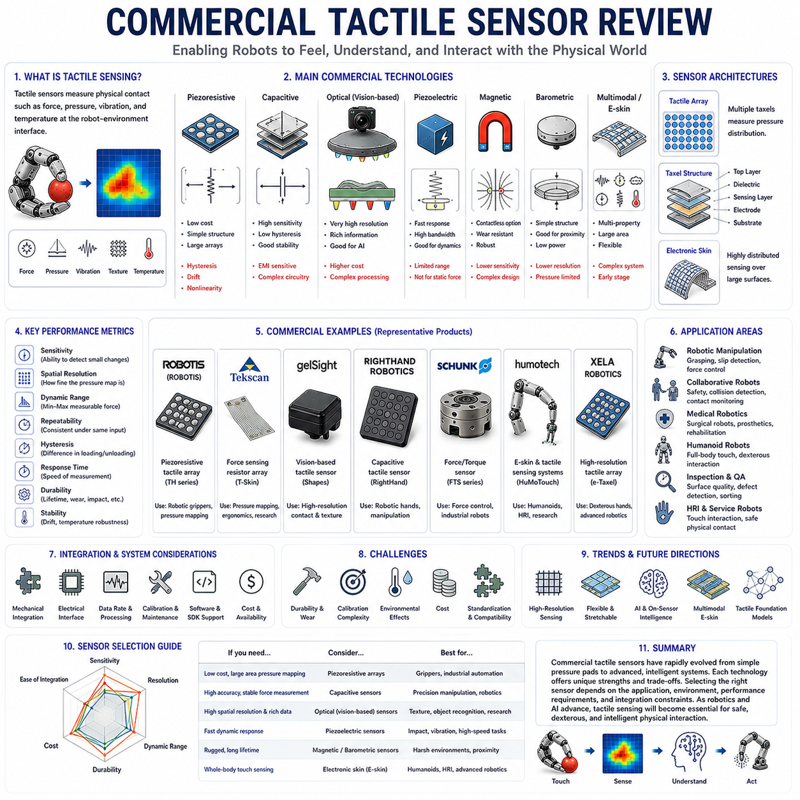{width="7.268055555555556in" height="7.268055555555556in"}

상용 촉각 센서(Commercial Tactile Sensor)는 최근 로봇공학 분야에서 매우 중요한 기술로 자리 잡고 있다. 협동로봇(Collaborative Robot), 서비스 로봇(Service Robot), 의료 로봇(Medical Robot), 휴머노이드 로봇(Humanoid Robot), 피지컬 AI(Physical AI), 그리고 정교한 로봇 핸드(Robotic Hand)에 대한 수요가 증가하면서 촉각 센서의 상용화도 빠르게 진행되고 있다. 과거에는 촉각 센서가 주로 연구실 수준의 기술로 여겨졌지만, 재료공학(Material Science), 전자공학(Electronics), 인공지능(AI), 제조 기술(Manufacturing Technology)의 발전에 힘입어 다양한 상용 제품이 등장하게 되었다.

오늘날 시장에는 산업 자동화(Industrial Automation), 로봇 조작(Robotic Manipulation), 인간-로봇 상호작용(Human-Robot Interaction), 품질 검사(Quality Inspection), 의료 응용(Medical Application), 연구 개발(Research and Development)을 위한 다양한 촉각 센서 제품들이 존재한다. 따라서 상용 촉각 센서의 구조, 성능, 장단점, 적용 분야를 이해하는 것은 실제 로봇 시스템 설계에서 매우 중요하다.

촉각 센서의 상용화는 머신 비전(Machine Vision)에 비해 상대적으로 늦게 진행되었다. 카메라는 스마트폰과 디지털 카메라 시장의 성장에 힘입어 빠르게 가격이 하락하고 성능이 향상되었다. 반면 촉각 센서는 실제 물리적 접촉을 다루기 때문에 내구성(Durability), 보정(Calibration), 환경 적응성(Environmental Robustness), 기계적 통합(Mechanical Integration) 등 해결해야 할 문제가 많았다. 그 결과 촉각 센서 시장은 아직 비전 시장에 비해 규모가 작지만, 최근 로봇 기술 발전과 함께 빠르게 성장하고 있다.

상용 촉각 센서 중 가장 널리 사용되는 분야는 힘 분포를 측정하는 촉각 배열(Tactile Array)이다. 이러한 센서는 다수의 센싱 요소를 표면에 배치하여 접촉 압력 분포를 측정한다. 이를 통해 로봇은 단순히 힘의 크기뿐 아니라 접촉 위치, 물체 형상, 파지 안정성, 접촉 상태 등을 파악할 수 있다. 이는 기존의 단일 힘 센서로는 얻기 어려운 정보이다.

압저항 촉각 센서(Piezoresistive Tactile Sensor)는 가장 오래되고 널리 상용화된 촉각 센서 기술 중 하나이다. 이 센서는 외력이 가해질 때 전기 저항이 변화하는 특성을 이용한다. 구조가 단순하고 제조 비용이 낮으며 대면적 배열 구현이 쉽기 때문에 다양한 압력 매핑(Pressure Mapping) 시스템과 전자 피부(Electronic Skin)에 사용된다. 그러나 히스테리시스(Hysteresis), 드리프트(Drift), 온도 의존성(Temperature Dependency), 비선형성(Nonlinearity) 등의 문제가 존재하며, 이를 보완하기 위해 정교한 보정과 신호 처리가 필요하다.

정전용량 촉각 센서(Capacitive Tactile Sensor)는 또 다른 주요 상용 기술이다. 외력이 가해질 때 정전용량 변화가 발생하는 원리를 이용한다. 일반적으로 높은 민감도(Sensitivity), 낮은 히스테리시스, 우수한 반복성(Repeatability), 장기 안정성(Long-Term Stability)을 제공한다. 특히 정밀한 힘 측정이 필요한 로봇 핸드와 웨어러블 시스템(Wearable System)에서 많이 사용된다. 다만 전자기 간섭(Electromagnetic Interference)에 민감할 수 있으며, 상대적으로 복잡한 전자 회로가 필요하다.

광학 촉각 센서(Optical Tactile Sensor)는 최근 가장 주목받고 있는 상용 촉각 센서 기술 중 하나이다. 이 센서는 카메라(Camera)와 변형 가능한 표면(Deformable Surface)을 이용하여 접촉 상태를 영상으로 분석한다. 표면이 변형되면 카메라가 이를 촬영하고 컴퓨터 비전(Computer Vision) 알고리즘이 접촉 정보를 추정한다. 광학 촉각 센서는 매우 높은 공간 해상도(Spatial Resolution)와 풍부한 접촉 정보를 제공할 수 있다.

특히 GelSight 계열의 비전 기반 촉각 센서(Vision-Based Tactile Sensor)는 상용 촉각 센서 시장에 큰 영향을 주었다. 이러한 센서는 탄성체(Elastomer), 조명(Illumination), 카메라를 이용하여 접촉 형상과 압력 분포를 고해상도로 측정한다. 질감 인식(Texture Recognition), 접촉 위치 추정(Contact Localization), 힘 추정(Force Estimation), 슬립 검출(Slip Detection), 물체 식별(Object Identification) 등의 작업에서 매우 우수한 성능을 보인다.

힘-토크 센서(Force-Torque Sensor)는 촉각 센서와 함께 자주 사용되는 장치이다. 일반적으로 로봇 팔 끝단에 장착되며 힘과 토크를 매우 정확하게 측정할 수 있다. 비록 압력 분포와 같은 공간 정보를 제공하지는 못하지만, 전체 힘 측정 정확도가 높기 때문에 촉각 센서와 함께 사용하면 더욱 강력한 물리적 상호작용 인식이 가능하다.

전자 피부(Electronic Skin, E-Skin)는 상용 촉각 센서 분야의 가장 도전적인 영역 중 하나이다. 전자 피부는 인간 피부처럼 넓은 표면 전체에 촉각 센서를 분산 배치하여 압력, 온도, 근접, 진동, 변형 등을 측정한다. 아직 완전한 전신 전자 피부는 연구 단계에 가까운 경우가 많지만, 일부 기업은 이미 상용 전자 피부 솔루션을 제공하고 있다.

로봇 그리퍼(Robotic Gripper)는 상용 촉각 센서의 가장 큰 시장 중 하나이다. 최근 물류, 제조, 서비스 로봇 분야에서는 깨지기 쉽거나 변형 가능한 물체를 다루는 작업이 증가하고 있다. 단순 위치 제어만으로는 이러한 작업을 안정적으로 수행하기 어렵기 때문에 촉각 센서를 통해 접촉 상태와 파지 품질을 실시간으로 모니터링하는 기술이 중요해지고 있다.

협동로봇 시장의 성장도 촉각 센서 수요 증가에 크게 기여하고 있다. 협동로봇은 인간과 가까운 거리에서 작업하기 때문에 안전성이 매우 중요하다. 촉각 센서는 사람과의 접촉을 감지하고 충돌 위치와 힘을 측정하여 안전 동작을 수행할 수 있도록 지원한다. 앞으로 협동로봇 시장이 확대될수록 촉각 센서의 중요성도 더욱 커질 것으로 예상된다.

의료 로봇 분야에서도 촉각 센서는 중요한 역할을 한다. 수술 로봇(Surgical Robot), 재활 로봇(Rehabilitation Robot), 의수(Prosthetic Hand), 보조 장치(Assistive Device)는 모두 촉각 정보를 필요로 한다. 특히 최소 침습 수술(Minimally Invasive Surgery)에서는 촉각 정보가 부족하기 때문에 촉각 센서를 이용하여 의사에게 힘 정보를 제공하려는 연구가 활발하게 진행되고 있다.

휴머노이드 로봇은 최근 상용 촉각 센서 기술 발전을 촉진하는 주요 요인 중 하나이다. 인간과 유사한 방식으로 환경과 상호작용하기 위해서는 손, 팔, 몸통, 다리 전체에 촉각 인식 능력이 필요하다. 여러 휴머노이드 개발 기업들은 촉각 센서를 인간 수준의 물리적 지능(Physical Intelligence)을 구현하기 위한 핵심 기술로 보고 있다.

상용 촉각 센서를 평가할 때는 다양한 성능 지표를 고려해야 한다. 대표적인 지표로는 민감도(Sensitivity), 분해능(Resolution), 공간 해상도(Spatial Resolution), 시간 해상도(Temporal Resolution), 동적 범위(Dynamic Range), 반복성(Repeatability), 히스테리시스(Hysteresis), 드리프트(Drift), 응답 속도(Response Time), 내구성(Durability), 환경 적응성(Environmental Robustness) 등이 있다.

내구성은 상용 촉각 센서에서 특히 중요한 요소이다. 촉각 센서는 반복적인 접촉, 충격, 마찰, 습도, 먼지, 온도 변화에 지속적으로 노출된다. 따라서 수백만 회 이상의 접촉에도 안정적으로 동작할 수 있어야 한다. 이는 비접촉 센서인 카메라와 비교했을 때 촉각 센서가 직면하는 가장 큰 기술적 과제 중 하나이다.

보정의 복잡성 역시 상용화에 큰 영향을 준다. 일부 고성능 촉각 센서는 정밀한 보정을 필요로 하며, 이는 설치 비용과 유지보수 비용을 증가시킨다. 따라서 최근 제조사들은 자동 보정(Auto Calibration)과 장기 안정성을 갖춘 제품 개발에 집중하고 있다.

통합의 용이성(Integration Simplicity)도 매우 중요하다. 실제 산업 현장에서는 기존 로봇 시스템에 쉽게 연결할 수 있는 센서가 선호된다. Ethernet, USB, CAN, SPI, I2C 등의 표준 인터페이스와 ROS(Robot Operating System) 드라이버를 제공하는 제품이 더욱 높은 경쟁력을 가진다.

인공지능은 상용 촉각 센서의 기능을 크게 향상시키고 있다. 최신 센서는 단순히 데이터를 출력하는 것이 아니라, 센서 내부에서 필터링, 특징 추출, 힘 추정, 슬립 검출, 물체 분류를 수행하는 경우도 많다. 이러한 지능형 센서(Intelligent Sensor)는 시스템 통합을 단순화하고 전체 계산 부담을 줄여준다.

머신러닝(Machine Learning)은 촉각 센서를 단순 측정 장치에서 고급 인지 장치로 변화시키고 있다. 상용 시스템은 이제 물체 인식(Object Recognition), 재질 분류(Material Classification), 파지 평가(Grasp Assessment), 접촉 상태 추정(Contact State Estimation)을 수행할 수 있다.

센서 융합(Sensor Fusion) 역시 중요한 추세이다. 많은 상용 로봇 시스템은 촉각 센서와 비전 센서, 힘-토크 센서, IMU를 함께 사용한다. 제조사들도 이러한 통합을 지원하는 소프트웨어 플랫폼을 제공하기 시작했다.

비용(Cost)은 여전히 촉각 센서 보급의 가장 큰 장애물 중 하나이다. 고성능 촉각 센서는 수천 달러에서 수만 달러에 이를 수 있으며, 이는 카메라보다 훨씬 비싼 경우가 많다. 그러나 제조 기술 발전에 따라 향후 비용은 지속적으로 감소할 것으로 예상된다.

소형화(Miniaturization) 또한 중요한 발전 방향이다. 로봇 손가락 내부에 센서를 통합하기 위해서는 매우 작은 크기와 낮은 무게가 필요하다. MEMS(Micro-Electro-Mechanical System), 유연 전자소자(Flexible Electronics), 인쇄 전자기술(Printed Electronics)이 이러한 발전을 가능하게 하고 있다.

소프트 로보틱스(Soft Robotics)의 성장도 상용 촉각 센서 시장에 영향을 미치고 있다. 기존 강체 센서는 큰 변형에 적합하지 않지만, 신축성 센서(Stretchable Sensor)와 유연 센서(Flexible Sensor)는 소프트 로봇과 잘 결합될 수 있다.

미래의 상용 촉각 센서 시장은 피지컬 AI의 발전과 함께 더욱 성장할 것으로 예상된다. 로봇이 공장 밖으로 나와 가정, 병원, 사무실, 물류창고, 공공장소에서 활동하기 위해서는 시각만큼 촉각도 중요해질 것이다.

향후에는 자가 치유 재료(Self-Healing Material), 신축성 전자소자(Stretchable Electronics), 뉴로모픽 촉각 센서(Neuromorphic Tactile Sensor), 다중 모달 전자 피부(Multimodal Electronic Skin), 촉각 파운데이션 모델(Tactile Foundation Model) 등이 차세대 상용 제품의 핵심 기술이 될 가능성이 높다.

결론적으로 상용 촉각 센서는 연구용 기술에서 실제 산업용 제품으로 빠르게 발전하고 있다. 압저항 센서, 정전용량 센서, 광학 촉각 센서, 힘-토크 센서, 촉각 배열, 전자 피부는 각각 고유한 장점과 한계를 가지고 있으며 다양한 응용 분야에 사용되고 있다. 로봇 조작, 협동로봇, 의료 로봇, 휴머노이드 로봇, 피지컬 AI의 발전과 함께 상용 촉각 센서는 더욱 중요한 기술로 자리 잡을 것이며, 미래 로봇이 인간 수준의 촉각 인식과 물리적 지능을 획득하는 데 핵심 역할을 수행하게 될 것이다.
