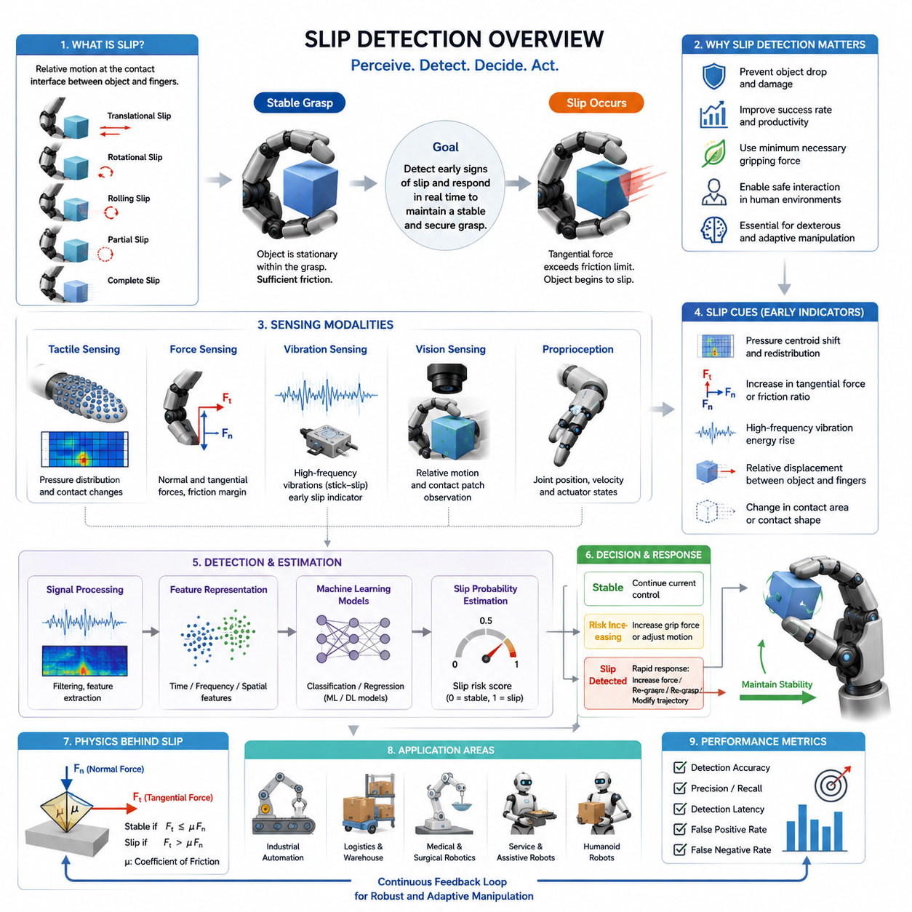
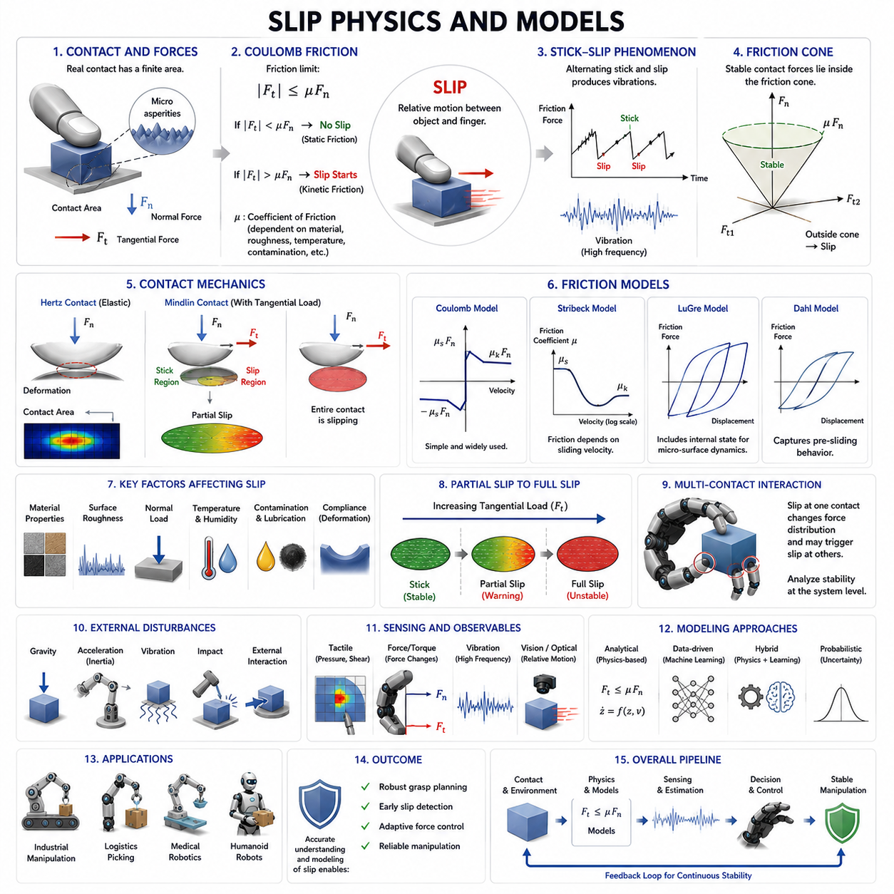
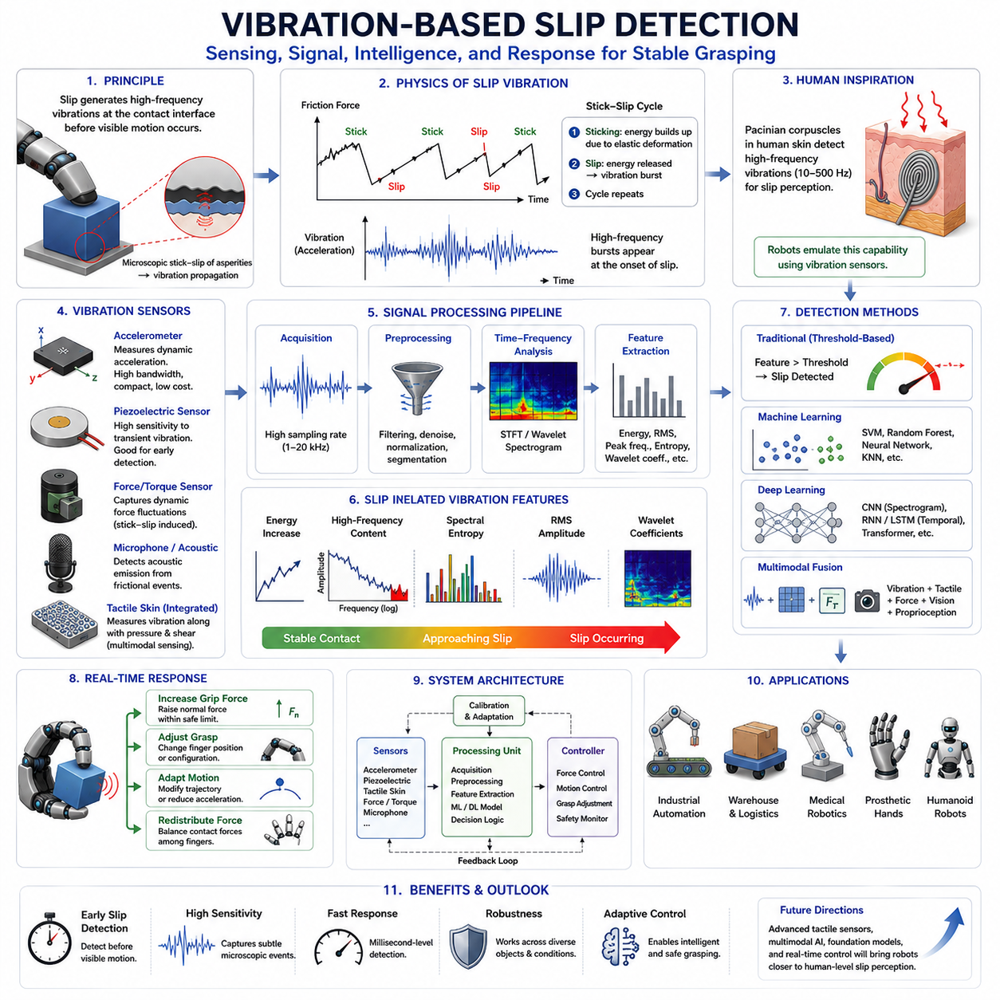
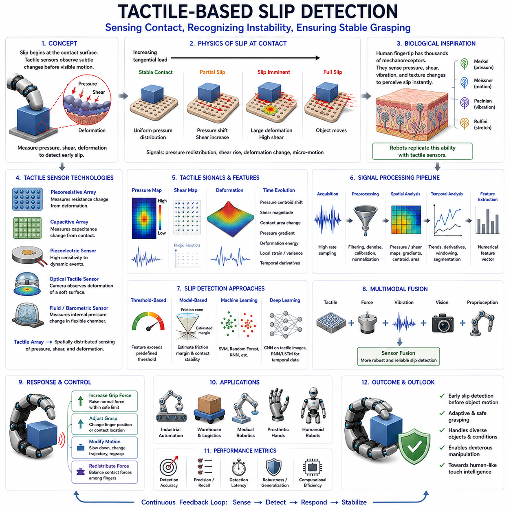
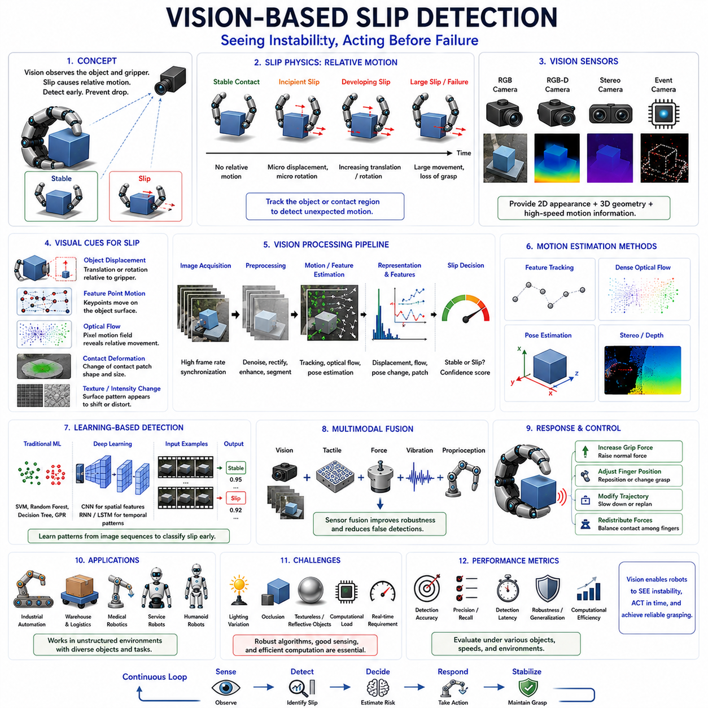
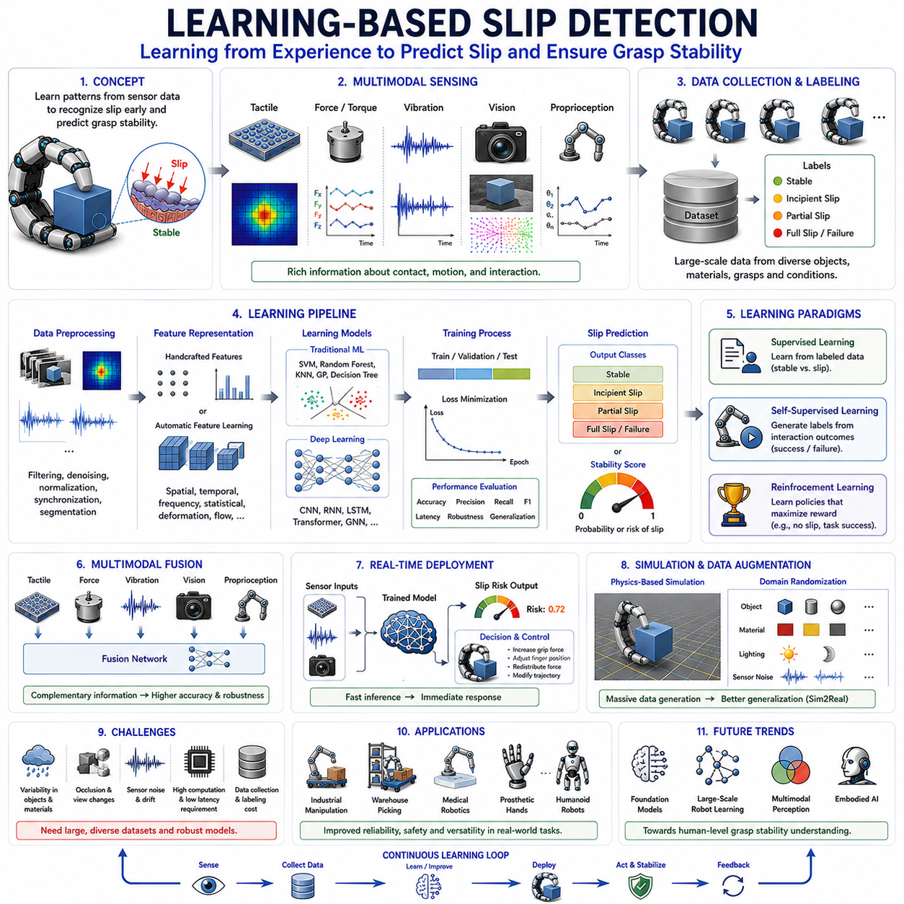
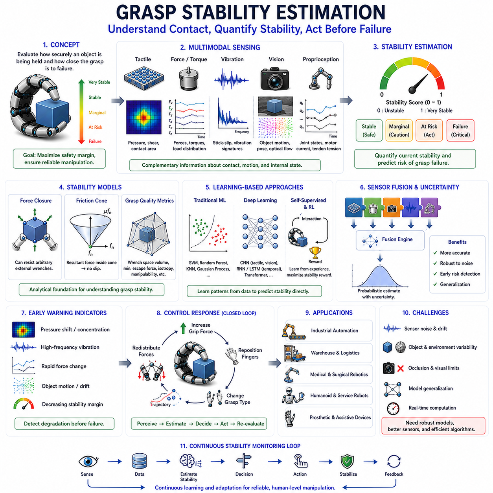
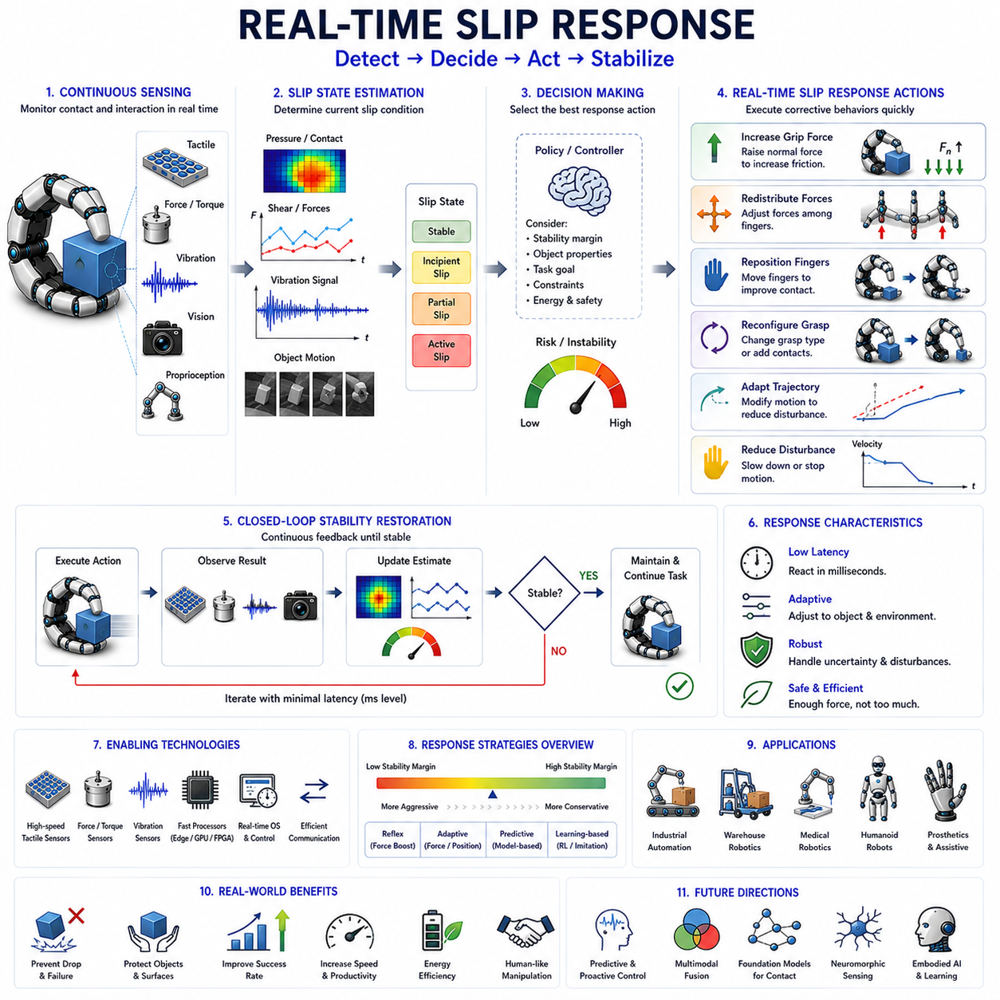
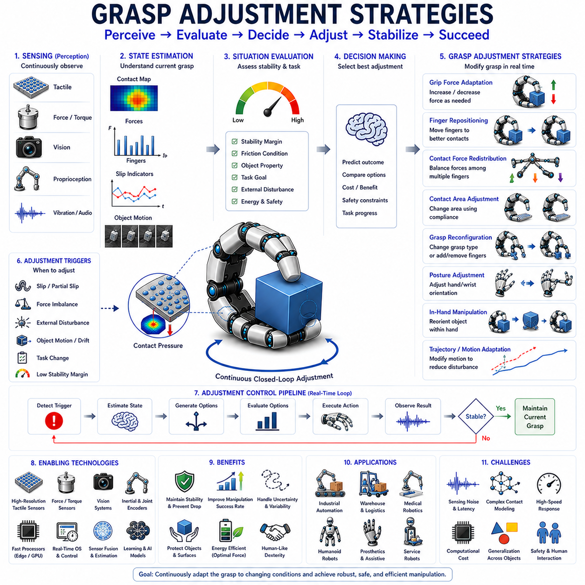
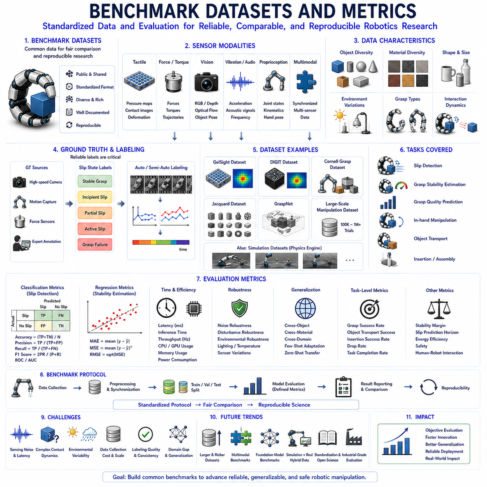

**Volume 06 Robot Hands and Dexterous Grasping**


# 08. Slip Detection and Grasp Stability

##  

## 08.01 Introduction to Slip Detection

{width="7.268055555555556in" height="7.268055555555556in"}

Slip detection is one of the most important capabilities in robotic grasping and dexterous manipulation. While a robot may successfully establish contact with an object and initially achieve a stable grasp, the object can still move relative to the fingers due to insufficient friction, unexpected disturbances, object weight variations, surface contamination, dynamic motion, or external forces. When such relative motion occurs, the object begins to slip. If the slip is not detected and corrected quickly, the grasp may fail, resulting in dropped objects, damaged products, interrupted manufacturing processes, safety hazards, or unsuccessful manipulation tasks. For this reason, slip detection serves as a critical component of grasp stability control and is considered one of the foundational sensing functions required for advanced robotic hands.

Humans perform slip detection naturally through the tactile sensing mechanisms embedded in the skin. When an object begins to move against the fingertip surface, mechanoreceptors detect microscopic vibrations, local skin deformation, and changes in contact force distribution. These sensory signals are processed almost instantaneously by the nervous system, which adjusts grip force before the object falls. Robotic systems attempt to replicate this capability through a combination of tactile sensors, force sensors, vision systems, vibration sensors, and machine learning algorithms. The ultimate objective is to create robotic hands capable of recognizing the earliest signs of slip and responding in real time to maintain stable object control.

From a robotics perspective, slip can be defined as a relative motion occurring at the contact interface between the object and the gripper. This motion may occur in several forms. Translational slip occurs when the object slides across the contact surface. Rotational slip occurs when the object rotates relative to the fingers. Rolling slip occurs when the contact point moves without complete loss of contact. Partial slip occurs when only a portion of the contact area experiences motion while the remainder remains stationary. Complete slip occurs when the entire contact region loses its static friction state and enters dynamic friction. Understanding these different slip modes is essential because each mode generates different sensory signatures and requires different detection approaches.

The physical origin of slip is closely related to friction mechanics. According to classical friction theory, a grasp remains stable as long as the tangential forces acting on the object remain below the maximum friction force available at the contact interface. This relationship is commonly expressed through Coulomb friction principles. When external disturbances increase tangential loading beyond the friction limit, the contact transitions from static friction to kinetic friction, causing slip to occur. Although this transition appears simple in theory, real-world contact conditions are significantly more complex due to surface roughness, material deformation, contact geometry, temperature variation, humidity effects, and object compliance.

One of the major challenges in robotic grasping is that friction coefficients are rarely known with certainty. The same object may exhibit different friction characteristics depending on environmental conditions, manufacturing tolerances, surface wear, contamination, or grasp location. As a result, robotic systems cannot rely solely on predefined friction models. Instead, they require continuous monitoring of contact conditions and real-time estimation of grasp stability. Slip detection therefore becomes an essential feedback mechanism for adaptive grasp control.

Slip detection can generally be divided into proactive and reactive approaches. Reactive slip detection identifies slip after it has already begun. The system detects evidence of object motion and subsequently increases grip force or modifies the grasp configuration. This approach is relatively straightforward but may be too slow for delicate or high-speed manipulation tasks. Proactive slip detection attempts to identify precursors of slip before significant object motion occurs. Such methods analyze subtle tactile signals, micro-vibrations, local force redistribution, and incipient contact changes that indicate an approaching loss of stability. Proactive detection enables earlier corrective actions and generally results in more robust grasp performance.

The earliest robotic slip detection systems relied primarily on force sensing. Researchers observed that changes in normal force and tangential force often precede grasp failure. By monitoring force ratios and estimating friction margins, robotic controllers could infer whether a grasp was approaching an unstable condition. While effective in controlled environments, force-based approaches often struggle with unknown objects and rapidly changing contact conditions because force measurements alone provide limited information about local contact behavior.

The development of tactile sensing technologies significantly advanced slip detection capabilities. Modern tactile sensors can measure distributed pressure patterns across the contact surface, allowing robotic systems to observe local contact dynamics in much greater detail. As an object begins to slip, pressure distributions often shift in characteristic ways. Contact centroids may move, pressure gradients may change, and localized stress concentrations may emerge. These signals provide valuable indicators of impending grasp instability.

Another important class of slip detection techniques relies on vibration analysis. During the transition from static friction to dynamic friction, microscopic stick-slip events generate high-frequency vibrations. These vibrations are similar to those detected by human tactile receptors during object handling. Accelerometers, piezoelectric sensors, microphones, and specialized tactile devices can capture these vibration signatures. Signal processing methods such as Fourier analysis, wavelet transforms, spectrogram analysis, and frequency-domain filtering are then used to identify characteristic slip-related patterns. Vibration-based methods are particularly attractive because they often provide very early warning signals before significant object displacement occurs.

Vision-based slip detection has emerged as another powerful approach. High-resolution cameras can observe object motion relative to the gripper, enabling direct measurement of slip. External cameras may track object position in the workspace, while fingertip-mounted cameras can monitor local contact regions. Optical tactile sensors such as GelSight-type systems further extend this capability by capturing detailed contact deformation patterns. Computer vision algorithms can estimate relative displacement, detect contact patch motion, and quantify grasp stability from image sequences. The rapid advancement of deep learning has significantly improved the robustness and accuracy of vision-based slip detection systems.

Machine learning has transformed the field by enabling data-driven slip detection. Traditional model-based approaches often require explicit friction models and carefully engineered thresholds. In contrast, learning-based methods automatically extract relevant features from sensor data. Neural networks, support vector machines, random forests, convolutional neural networks, recurrent neural networks, and transformer-based architectures have all been applied to slip detection problems. These systems learn to recognize complex relationships between sensory inputs and slip events, often achieving higher robustness across diverse object categories and environmental conditions.

The availability of multimodal sensing has further improved performance. Modern robotic hands increasingly combine tactile sensing, force sensing, proprioception, vision, and vibration sensing into integrated perception systems. Each sensing modality provides complementary information. Tactile sensors capture local contact changes. Force sensors measure global interaction forces. Vision systems observe object motion. Proprioceptive sensors monitor finger positions and actuator states. Vibration sensors detect high-frequency contact dynamics. By fusing these data streams, robotic systems can achieve more reliable and earlier slip detection than any single modality alone.

Slip detection is particularly important for dexterous manipulation tasks. In-hand manipulation frequently requires controlled object motion within the grasp. The robot must distinguish between intentional motion and unintended slip. This distinction can be challenging because both situations involve relative movement between the fingers and the object. Advanced manipulation systems therefore incorporate task context, motion planning objectives, and contact state estimation to differentiate desired object motion from grasp instability.

Industrial robotics presents unique slip detection requirements. In manufacturing environments, robots often handle objects with varying sizes, shapes, weights, and surface properties. Product damage can result from excessive gripping force, while insufficient force may lead to dropped parts. Slip detection enables adaptive force control, allowing robots to apply only the minimum force necessary for stable grasping. This capability improves product quality, reduces energy consumption, and extends gripper lifespan.

Warehouse automation also benefits significantly from slip detection technologies. Modern fulfillment centers process thousands of product types with highly variable packaging materials. Robotic picking systems must handle cardboard boxes, plastic containers, flexible packages, metallic objects, and fragile consumer products. Slip detection allows grasp controllers to adapt automatically to unknown objects, improving picking success rates and reducing operational errors.

Medical robotics represents another important application domain. Surgical robots, rehabilitation devices, prosthetic hands, and assistive manipulators often interact with delicate biological tissues and sensitive objects. Excessive gripping force can cause injury or discomfort, while insufficient force can result in unstable manipulation. Accurate slip detection enables safe and effective interaction by maintaining stable grasp conditions without excessive force application.

Humanoid robots require particularly advanced slip detection capabilities because they are expected to operate in unstructured human environments. Everyday activities such as opening doors, carrying tools, handling kitchen utensils, folding clothing, or manipulating electronic devices demand continuous monitoring of grasp stability. Human environments contain enormous variability in object properties, making adaptive slip detection essential for reliable operation.

Real-time performance remains one of the most critical requirements for slip detection systems. Once slip begins, corrective actions must occur rapidly to prevent grasp failure. Detection latency, communication delays, computational processing time, and actuator response speed all contribute to overall system performance. Modern robotic systems increasingly employ edge computing, high-speed sensor interfaces, and optimized machine learning models to achieve low-latency slip detection and response.

Evaluation of slip detection systems involves several performance metrics. Detection accuracy measures the percentage of correctly identified slip events. Precision quantifies the proportion of detected events that correspond to actual slip occurrences. Recall measures the percentage of true slip events successfully detected. Detection latency evaluates how quickly slip is recognized after onset. False positive rates measure unnecessary interventions, while false negative rates indicate missed slip events that may lead to grasp failure. Robust evaluation requires testing across diverse objects, materials, grasp configurations, and environmental conditions.

Benchmarking slip detection remains a challenging research problem. Different laboratories use different object sets, sensor technologies, evaluation protocols, and performance metrics. Standardized datasets and benchmarking procedures are increasingly being developed to facilitate objective comparison of slip detection algorithms. These benchmarks play a crucial role in accelerating technological progress and promoting reproducible research.

Recent advances in artificial intelligence and foundation models are beginning to influence slip detection research. Large-scale multimodal learning systems can potentially learn generalized representations of contact dynamics across many tasks and object categories. Such systems may eventually enable robots to transfer slip detection knowledge between different manipulation scenarios, reducing the need for extensive task-specific training.

Future robotic hands will likely incorporate dense tactile skins, high-resolution optical tactile sensors, distributed force sensing networks, and advanced multimodal perception architectures. Combined with increasingly powerful machine learning algorithms, these technologies will enable robotic systems to approach human-level grasp stability perception. Slip detection will evolve from a standalone sensing capability into a fully integrated component of intelligent manipulation systems that continuously monitor, predict, and optimize contact interactions.

Ultimately, slip detection serves as the bridge between sensing and action in robotic grasping. It transforms raw contact information into meaningful estimates of grasp stability and provides the feedback necessary for adaptive control. Without reliable slip detection, robotic hands cannot achieve the robustness, dexterity, and adaptability required for real-world manipulation. As robotic systems continue to expand into industrial automation, logistics, healthcare, service robotics, and humanoid applications, slip detection will remain one of the key enabling technologies for achieving safe, reliable, and human-like object manipulation.

미끄럼 감지(Slip Detection)는 로봇 파지(Robotic Grasping)와 정교 조작(Dexterous Manipulation)에서 가장 중요한 기능 중 하나이다. 로봇이 물체를 성공적으로 집고 초기에는 안정적인 파지를 형성하더라도, 마찰력 부족, 예기치 않은 외란, 물체 무게 변화, 표면 오염, 동적 움직임 또는 외부 힘 등의 영향으로 인해 물체와 손가락 사이에 상대 운동이 발생할 수 있다. 이러한 상대 운동이 시작되면 물체는 미끄러지기 시작한다. 만약 이를 신속하게 감지하고 대응하지 못하면 파지 실패로 이어져 물체 낙하, 제품 손상, 생산 공정 중단, 안전 문제 또는 작업 실패가 발생할 수 있다. 따라서 미끄럼 감지는 파지 안정성 제어(Grasp Stability Control)의 핵심 요소이며, 고급 로봇 핸드가 반드시 갖추어야 하는 기본 감지 기능으로 간주된다.

인간은 피부에 존재하는 촉각 감지 메커니즘을 통해 자연스럽게 미끄럼을 감지한다. 물체가 손가락 끝에서 미세하게 움직이기 시작하면 피부 속 기계수용기(Mechanoreceptor)가 미세 진동, 국부 변형, 접촉력 분포 변화를 감지한다. 이러한 신호는 신경계에 의해 거의 즉시 처리되며, 인간은 물체가 떨어지기 전에 자동으로 파지력을 증가시킨다. 로봇 시스템은 이러한 인간의 능력을 모방하기 위해 촉각 센서(Tactile Sensor), 힘 센서(Force Sensor), 비전 시스템(Vision System), 진동 센서(Vibration Sensor), 그리고 머신러닝(Machine Learning) 알고리즘을 활용한다. 궁극적인 목표는 미끄럼의 초기 징후를 인식하고 실시간으로 대응하여 안정적인 물체 제어를 수행하는 것이다.

로봇공학 관점에서 미끄럼은 물체와 그리퍼 접촉면 사이에서 발생하는 상대 운동으로 정의할 수 있다. 이 운동은 여러 형태로 나타난다. 병진 미끄럼(Translational Slip)은 물체가 접촉면을 따라 미끄러지는 현상이며, 회전 미끄럼(Rotational Slip)은 물체가 손가락에 대해 회전하는 경우를 의미한다. 구름 미끄럼(Rolling Slip)은 접촉을 유지한 상태에서 접촉점이 이동하는 현상이며, 부분 미끄럼(Partial Slip)은 접촉 영역의 일부만 움직이는 상태를 의미한다. 완전 미끄럼(Complete Slip)은 전체 접촉 영역이 정지 마찰 상태를 잃고 동마찰 상태로 전환되는 경우를 의미한다. 이러한 다양한 미끄럼 형태는 서로 다른 센서 신호를 생성하므로 각각에 대한 이해가 필요하다.

미끄럼의 물리적 원인은 마찰(Friction) 메커니즘과 밀접하게 관련된다. 고전적인 마찰 이론에 따르면 접촉면에서 발생하는 접선 방향 힘(Tangential Force)이 최대 마찰력보다 작을 경우 파지는 안정적으로 유지된다. 그러나 외부 힘이 증가하여 마찰 한계를 초과하면 접촉 상태는 정지 마찰(Static Friction)에서 동마찰(Kinetic Friction)로 전환되며 미끄럼이 발생한다. 이 과정은 이론적으로 단순해 보이지만 실제 환경에서는 표면 거칠기, 재료 특성, 접촉 형상, 온도, 습도, 탄성 변형 등의 영향으로 훨씬 복잡하게 나타난다.

로봇 파지에서 가장 어려운 문제 중 하나는 마찰계수(Friction Coefficient)를 정확히 알 수 없다는 점이다. 동일한 물체라도 환경 조건이나 표면 마모 상태에 따라 서로 다른 마찰 특성을 보일 수 있다. 따라서 로봇은 사전에 정의된 마찰 모델만으로 안정적인 파지를 보장할 수 없다. 대신 접촉 상태를 지속적으로 감시하고 실시간으로 안정성을 추정해야 하며, 이를 가능하게 하는 핵심 피드백 수단이 바로 미끄럼 감지이다.

미끄럼 감지는 크게 사후 감지(Reactive Detection)와 사전 감지(Proactive Detection)로 구분된다. 사후 감지는 실제 미끄럼이 발생한 이후에 이를 인식하고 파지력을 증가시키거나 자세를 수정하는 방식이다. 구현은 비교적 간단하지만 반응이 늦을 수 있다. 반면 사전 감지는 미끄럼이 본격적으로 발생하기 전에 나타나는 미세 진동, 접촉 압력 변화, 힘 분포 변화 등을 분석하여 잠재적인 불안정 상태를 예측한다. 이러한 방식은 더 빠른 대응이 가능하며 일반적으로 높은 안정성을 제공한다.

초기의 미끄럼 감지 시스템은 주로 힘 센서 기반이었다. 연구자들은 수직 힘(Normal Force)과 접선 힘(Tangential Force)의 비율 변화가 파지 실패를 예고한다는 사실을 발견하였다. 이를 통해 마찰 여유(Friction Margin)를 계산하고 파지 안정성을 추정할 수 있었다. 그러나 이러한 방식은 힘 정보만으로는 접촉 상태를 충분히 설명할 수 없기 때문에 복잡한 환경에서는 한계가 존재하였다.

촉각 센서 기술의 발전은 미끄럼 감지 성능을 크게 향상시켰다. 현대의 촉각 센서는 접촉면 전체에 걸쳐 압력 분포를 측정할 수 있으며, 이를 통해 물체가 미끄러질 때 나타나는 압력 중심 이동, 응력 분포 변화, 국부 압력 집중 현상을 감지할 수 있다. 이러한 정보는 미끄럼 발생 이전의 불안정 상태를 조기에 식별하는 데 매우 유용하다.

진동 기반 미끄럼 감지는 또 다른 중요한 접근 방법이다. 정지 마찰에서 동마찰로 전환되는 과정에서는 미세한 스틱-슬립(Stick-Slip) 현상이 발생하며, 이는 고주파 진동을 생성한다. 인간 역시 이러한 진동을 촉각 수용기를 통해 감지한다. 로봇에서는 가속도 센서(Accelerometer), 압전 센서(Piezoelectric Sensor), 마이크로폰(Microphone) 등을 이용하여 이러한 진동을 측정한다. 이후 푸리에 변환(Fourier Transform), 웨이블릿 변환(Wavelet Transform), 스펙트럼 분석(Spectral Analysis) 등을 통해 미끄럼 특유의 신호 패턴을 추출한다. 진동 기반 방식은 실제 물체 이동이 발생하기 전에 경고 신호를 제공할 수 있다는 장점이 있다.

비전 기반 미끄럼 감지 역시 최근 활발히 연구되고 있다. 카메라를 이용하여 물체와 그리퍼 사이의 상대 운동을 직접 측정하는 방식이다. 외부 카메라는 작업 공간 내 물체 위치 변화를 추적할 수 있으며, 손가락 끝에 장착된 카메라는 접촉 영역 자체를 관찰할 수 있다. 특히 GelSight와 같은 광학 촉각 센서는 접촉면의 미세 변형을 시각적으로 측정하여 매우 정밀한 미끄럼 감지를 가능하게 한다. 최근에는 딥러닝 기반 영상 분석 기술이 적용되면서 비전 기반 방식의 정확성과 강인성이 크게 향상되고 있다.

머신러닝 기술은 미끄럼 감지 분야에 큰 변화를 가져왔다. 전통적인 방법이 물리 모델과 경험적 임계값에 의존했다면, 머신러닝 기반 접근법은 센서 데이터로부터 자동으로 특징을 학습한다. 신경망(Neural Network), 서포트 벡터 머신(SVM), 랜덤 포레스트(Random Forest), CNN, RNN, Transformer 모델 등이 활용되고 있으며, 다양한 물체와 환경 조건에 대해 높은 일반화 성능을 보이고 있다.

최근에는 다중 센서 융합(Multimodal Sensor Fusion)이 중요한 연구 방향으로 자리 잡고 있다. 촉각 센서는 국부 접촉 정보를 제공하고, 힘 센서는 전체 상호작용 힘을 측정하며, 비전 시스템은 물체의 실제 움직임을 관찰한다. 또한 관절 위치 센서(Proprioceptive Sensor)는 손가락 상태를 추적하고, 진동 센서는 마찰 전이 현상을 감지한다. 이러한 정보를 통합함으로써 단일 센서보다 훨씬 높은 신뢰성과 정확도를 확보할 수 있다.

미끄럼 감지는 정교 조작(In-Hand Manipulation)에서 특히 중요하다. 손 안에서 물체를 회전시키거나 위치를 변경하는 과정에서는 의도된 움직임과 원하지 않는 미끄럼을 구분해야 한다. 두 경우 모두 상대 운동이 발생하기 때문에 이를 구별하는 것은 쉽지 않다. 따라서 고급 조작 시스템은 작업 목표, 접촉 상태 추정, 운동 계획 정보를 함께 활용하여 의도된 조작과 파지 실패를 구분한다.

산업용 로봇에서는 미끄럼 감지가 제품 품질과 생산성을 향상시키는 역할을 한다. 물체마다 재질과 표면 상태가 다르기 때문에 고정된 파지력만으로는 최적의 작업을 수행하기 어렵다. 미끄럼 감지를 활용하면 필요한 최소한의 힘만으로 안정적인 파지를 유지할 수 있어 제품 손상을 줄이고 에너지 소비를 절감할 수 있다.

물류 자동화 환경에서도 그 중요성은 매우 크다. 현대 물류창고는 수천 종의 서로 다른 상품을 처리한다. 종이 상자, 플라스틱 용기, 금속 부품, 비닐 포장 제품 등 다양한 재질을 다루어야 하기 때문에 마찰 특성이 지속적으로 변한다. 미끄럼 감지는 이러한 환경에서 자동 적응형 파지 제어를 가능하게 하여 피킹 성공률을 높이고 오류를 줄인다.

의료 로봇 분야에서도 미끄럼 감지는 필수적이다. 수술 로봇, 재활 로봇, 의수(Prosthetic Hand), 보조 로봇은 인체 조직이나 민감한 물체를 다루기 때문에 과도한 힘을 사용할 수 없다. 정확한 미끄럼 감지는 최소한의 힘으로도 안정적인 조작을 가능하게 하여 안전성과 사용성을 향상시킨다.

휴머노이드 로봇은 인간 환경에서 다양한 물체를 다루어야 하기 때문에 더욱 고도화된 미끄럼 감지 기능이 필요하다. 문 손잡이 조작, 공구 사용, 주방 작업, 의류 정리, 전자기기 취급 등 대부분의 일상 작업은 안정적인 파지 유지 능력을 요구한다. 따라서 인간 수준의 조작 능력을 구현하기 위해서는 매우 정교한 미끄럼 감지 기술이 필수적이다.

실시간 성능은 미끄럼 감지 시스템의 핵심 요구사항이다. 미끄럼이 시작된 후 대응이 늦으면 파지 실패를 막을 수 없다. 따라서 센서 응답 시간, 데이터 전송 지연, 알고리즘 처리 시간, 액추에이터 반응 속도 모두가 중요하다. 최근에는 엣지 컴퓨팅(Edge Computing)과 고속 AI 추론 기술을 활용하여 밀리초 단위의 실시간 미끄럼 감지가 가능해지고 있다.

미끄럼 감지 시스템의 성능 평가는 정확도(Accuracy), 정밀도(Precision), 재현율(Recall), 탐지 지연시간(Detection Latency), 오탐률(False Positive Rate), 미탐률(False Negative Rate) 등을 기준으로 수행된다. 또한 다양한 물체, 표면 재질, 파지 방식, 환경 조건에서의 성능을 종합적으로 평가해야 한다.

현재 연구자들은 표준화된 벤치마크 데이터셋과 평가 프로토콜을 개발하여 객관적인 성능 비교를 가능하게 하고 있다. 이는 기술 발전을 가속화하고 연구 결과의 재현성을 높이는 데 중요한 역할을 한다.

최근에는 대규모 AI 모델과 파운데이션 모델(Foundation Model)이 미끄럼 감지 연구에도 적용되기 시작하였다. 이러한 모델은 다양한 물체와 작업에서 학습된 접촉 지식을 활용하여 새로운 환경에서도 높은 일반화 성능을 제공할 가능성을 보여주고 있다.

미래의 로봇 핸드는 고해상도 촉각 피부(Tactile Skin), 광학 촉각 센서, 분산형 힘 센서 네트워크, 고성능 AI 기반 다중 센서 융합 시스템을 갖추게 될 것이다. 이러한 기술들이 결합되면 로봇은 인간 수준에 가까운 접촉 인지 능력과 파지 안정성 판단 능력을 획득할 수 있을 것으로 기대된다.

결국 미끄럼 감지는 감지(Sensing)와 행동(Action)을 연결하는 핵심 기술이다. 접촉 정보를 파지 안정성에 대한 의미 있는 판단으로 변환하고, 적응형 제어를 위한 피드백을 제공한다. 신뢰성 있는 미끄럼 감지 없이는 로봇 핸드가 실제 환경에서 요구되는 강인성(Robustness), 정교함(Dexterity), 적응성(Adaptability)을 달성하기 어렵다. 따라서 산업 자동화, 물류, 의료, 서비스 로봇, 휴머노이드 로봇이 발전할수록 미끄럼 감지 기술의 중요성은 더욱 커질 것이다.

##  

## 08.02 Physics of Slip

{width="7.268055555555556in" height="7.268055555555556in"}

Slip is one of the most fundamental phenomena encountered in robotic grasping and manipulation. Whenever a robotic hand interacts with an object, the stability of the grasp depends on the ability of the contact surfaces to resist relative motion. As long as the frictional forces generated at the contact interface are sufficient to counteract external disturbances, the object remains securely held. However, when these frictional forces become inadequate, relative motion develops between the object and the contacting fingers, resulting in slip. Understanding the physics of slip is therefore essential for designing stable grasping systems, developing tactile sensing algorithms, implementing force control strategies, and achieving reliable dexterous manipulation.

The study of slip begins with the mechanics of contact. Whenever two bodies touch each other, forces are exchanged through a finite contact region. Contrary to idealized models that represent contact as a mathematical point, real contacts possess measurable areas determined by material properties, geometry, and applied loads. Within this contact region, normal forces act perpendicular to the surface while tangential forces act parallel to the surface. The interaction between these force components determines whether the contact remains stable or transitions into slip.

One of the earliest and most widely used descriptions of slip originates from Coulomb friction theory. According to this classical model, the maximum tangential force that can be sustained without slip is proportional to the normal force acting at the contact interface. The proportionality constant is known as the coefficient of friction. If the applied tangential force remains below this friction limit, the contact remains in a static state. Once the tangential force exceeds the limit, the contact transitions into a sliding state and slip occurs.

Although Coulomb friction provides an intuitive framework for understanding slip, real robotic manipulation scenarios are considerably more complex. Actual contact surfaces exhibit roughness at microscopic scales. When two surfaces come into contact, only a small fraction of their apparent contact area is truly in contact. These microscopic contact points, known as asperities, carry the majority of the load. Friction emerges from the collective interaction of countless asperities undergoing deformation, adhesion, and rupture. As a result, friction and slip are inherently multiscale phenomena involving both macroscopic and microscopic processes.

The transition from static friction to dynamic friction is one of the most important aspects of slip physics. Static friction represents the resistance to the initiation of motion, while dynamic friction characterizes the resistance after motion has begun. In many materials, static friction is greater than dynamic friction. Consequently, once slip starts, less force is required to maintain motion than was necessary to initiate it. This difference often explains why grasp failures can accelerate rapidly once slipping begins.

An important phenomenon associated with slip is stick-slip behavior. During stick-slip motion, the contact alternates between periods of sticking and sliding. Energy accumulates while the surfaces remain temporarily locked together and is then suddenly released when sliding occurs. This cycle repeats continuously, producing characteristic vibrations. Stick-slip behavior is responsible for many tactile signatures used in robotic slip detection. The high-frequency vibrations generated during these events often provide some of the earliest indicators of impending grasp failure.

The coefficient of friction plays a central role in slip modeling. However, friction coefficients are not fixed values. They depend on numerous factors including material composition, surface roughness, temperature, humidity, contamination, lubrication, and contact pressure. A metal object may exhibit significantly different friction characteristics depending on whether its surface is clean, oily, dusty, or wet. Similarly, soft materials such as rubber often display nonlinear friction behavior that changes with deformation and loading conditions. These variations make slip prediction challenging in real-world environments.

Surface roughness contributes significantly to slip behavior. Rough surfaces typically provide increased friction because their asperities interlock more effectively. However, excessive roughness may reduce actual contact area and introduce unpredictable contact dynamics. Smooth surfaces generally provide lower mechanical interlocking but may exhibit stronger adhesive effects. The balance between these mechanisms influences overall grasp stability and slip resistance.

Material compliance also affects slip dynamics. Rigid contacts tend to exhibit abrupt transitions between sticking and sliding states. In contrast, compliant materials deform under load, distributing forces over larger areas and often delaying the onset of slip. Soft robotic grippers exploit this property by increasing contact area and reducing localized stress concentrations. As a result, compliant grasping systems often achieve greater robustness against slip compared to purely rigid grippers.

Contact mechanics provides a more detailed framework for analyzing slip. Hertzian contact theory describes how elastic bodies deform under normal loading and predicts contact area size, pressure distribution, and deformation characteristics. Although Hertzian models assume frictionless contact, they establish a foundation for understanding force transmission. Extensions such as Mindlin contact theory incorporate tangential loading and provide insight into partial slip behavior within elastic contacts.

Partial slip represents a particularly important phenomenon in robotic manipulation. Before complete sliding occurs, localized regions of the contact interface may begin slipping while other regions remain stationary. These localized slip zones often originate near contact boundaries where stress concentrations are highest. As tangential loading increases, the slipping region expands until the entire contact area transitions into full slip. Detecting partial slip is highly valuable because it provides an opportunity for corrective action before grasp failure occurs.

The concept of the friction cone is fundamental in robotic grasp analysis. At any contact point, the set of tangential forces that can be supported without slip forms a conical region in force space. If the resultant contact force remains inside the friction cone, the contact is stable. If the force reaches the boundary of the cone, the contact approaches a critical condition. Once the force moves outside the cone, slip becomes unavoidable. Friction cones provide a geometric interpretation of grasp stability and serve as a cornerstone of grasp planning algorithms.

In multi-finger robotic hands, slip behavior becomes significantly more complex because multiple contacts interact simultaneously. Each contact possesses its own friction characteristics, force distributions, and stability margins. Slip at one finger may redistribute forces throughout the grasp, potentially triggering cascading instabilities at other contacts. Consequently, grasp stability must often be analyzed at the system level rather than at individual contact points.

Object geometry strongly influences slip dynamics. Cylindrical objects, spherical objects, flat objects, and irregularly shaped objects exhibit different contact configurations and force distributions. Curved surfaces may generate rolling behavior in addition to sliding. Complex geometries can create multiple contact modes that evolve during manipulation. Accurate slip modeling therefore requires consideration of object shape as well as material properties.

External disturbances frequently contribute to slip initiation. Gravity, inertial forces, environmental vibrations, impacts, and unexpected interactions can all alter contact loading conditions. During dynamic manipulation tasks, accelerations may significantly increase tangential forces acting on the object. A grasp that is stable under static conditions may become unstable when the robot moves rapidly or encounters external disturbances. This distinction between static and dynamic stability is crucial for practical robotic applications.

Dynamic friction models extend classical Coulomb theory by incorporating velocity-dependent effects. Experimental observations reveal that friction often varies with sliding speed. Some materials exhibit decreasing friction as velocity increases, while others display more complex relationships. Models such as the Stribeck friction model capture these effects by describing transitions between static friction, boundary lubrication, mixed lubrication, and hydrodynamic lubrication regimes.

The LuGre friction model represents another important advancement in slip modeling. Rather than treating friction as a simple force law, the LuGre model incorporates internal state variables that represent microscopic surface interactions. This approach captures hysteresis, presliding displacement, and stick-slip behavior more accurately than traditional models. As a result, LuGre-based formulations are widely used in robotic simulation and control research.

Another influential framework is the Dahl friction model, which focuses on presliding behavior. Before macroscopic slip becomes visible, microscopic deformations occur within the contact interface. These deformations store elastic energy and generate measurable force responses. Modeling these effects improves the ability to predict slip onset and supports the development of proactive slip detection algorithms.

Probabilistic approaches have become increasingly important because real-world friction parameters are often uncertain. Instead of assuming fixed friction coefficients, probabilistic models represent friction as a distribution of possible values. Bayesian estimation methods, particle filters, and stochastic contact models can then update stability predictions as new sensory information becomes available. This approach is particularly valuable in unstructured environments where object properties are not known in advance.

The rise of tactile sensing has transformed slip modeling. Modern tactile sensors provide spatially distributed measurements of pressure, shear force, deformation, and vibration. These measurements reveal contact dynamics that cannot be captured by traditional force sensors alone. Data-driven models can learn relationships between tactile patterns and slip events, enabling accurate prediction even when physical parameters are uncertain.

Machine learning has further expanded the capabilities of slip modeling. Instead of explicitly modeling friction physics, neural networks can learn complex mappings between sensor observations and slip states. Deep learning approaches have demonstrated impressive performance across diverse object categories and manipulation tasks. Nevertheless, purely data-driven methods often benefit from incorporating physical insights, leading to hybrid approaches that combine analytical models with learned representations.

Vision-based slip modeling has also gained attention. Cameras can directly observe object motion relative to the gripper and estimate displacement fields over time. Optical tactile sensors provide even richer information by visualizing contact deformation patterns. These technologies enable direct observation of slip phenomena and provide valuable data for validating theoretical models.

Simulation plays a critical role in the study of slip physics. Modern robotic simulators incorporate increasingly sophisticated friction and contact models. Physics engines attempt to reproduce real-world contact behavior while maintaining computational efficiency. However, accurately simulating friction remains one of the most challenging problems in robotics because contact dynamics are highly nonlinear and sensitive to small variations in surface properties.

In robotic grasp planning, slip models are often integrated into stability analysis frameworks. Grasp planners evaluate candidate grasps by estimating friction margins, force closure conditions, and slip probabilities. These evaluations guide the selection of grasp configurations that maximize robustness against disturbances. As robotic hands become more dexterous, accurate slip modeling becomes increasingly important for enabling reliable manipulation.

Industrial applications place particularly stringent demands on slip modeling. Manufacturing robots must handle objects with varying materials, coatings, and surface conditions while maintaining consistent performance. Logistics robots encounter an enormous diversity of packages and products. Medical robots interact with biological tissues that exhibit highly nonlinear contact behavior. In each case, understanding slip physics is essential for achieving safe and reliable operation.

Humanoid robots introduce additional challenges because they operate in environments designed for humans. Everyday objects often have unknown friction properties and complex geometries. Successful manipulation therefore requires continuous estimation of contact conditions and adaptive responses to changing slip risks. Future humanoid systems will likely rely heavily on integrated slip models that combine tactile sensing, force feedback, visual perception, and learned experience.

The future of slip physics research is moving toward unified contact intelligence frameworks. Rather than treating slip as an isolated phenomenon, researchers increasingly view it as part of a broader contact interaction process that includes force regulation, tactile perception, grasp adaptation, and manipulation planning. Advances in high-resolution tactile sensing, multimodal sensor fusion, foundation models, and real-time physics simulation are expected to significantly improve our ability to model and predict slip behavior.

Ultimately, slip physics provides the scientific foundation upon which grasp stability is built. Every successful robotic grasp depends on the ability to understand, predict, detect, and control the transition between stable contact and relative motion. By combining classical friction theory, modern contact mechanics, probabilistic reasoning, tactile sensing, and machine learning, robotic systems are gradually approaching the remarkable slip-handling capabilities that humans perform effortlessly in everyday life.

미끄럼(Slip)은 로봇 파지(Robotic Grasping)와 조작(Manipulation) 과정에서 발생하는 가장 기본적이면서도 중요한 물리 현상 중 하나이다. 로봇 핸드가 물체를 잡을 때 파지의 안정성은 접촉면이 상대 운동(Relative Motion)을 얼마나 효과적으로 억제할 수 있는지에 의해 결정된다. 접촉면에서 생성되는 마찰력(Friction Force)이 외부 힘을 충분히 견딜 수 있는 경우 물체는 안정적으로 유지된다. 그러나 마찰력이 부족해지면 물체와 손가락 사이에 상대 운동이 발생하게 되며, 이것이 바로 미끄럼이다. 따라서 미끄럼의 물리적 원리를 이해하는 것은 안정적인 파지 시스템 설계, 촉각 센서 개발, 힘 제어 알고리즘 구현, 그리고 정교 조작 기술 개발의 핵심 기반이 된다.

미끄럼을 이해하기 위해서는 먼저 접촉 역학(Contact Mechanics)을 이해해야 한다. 두 물체가 접촉할 때 힘은 접촉 영역(Contact Region)을 통해 전달된다. 이상적인 수학적 모델에서는 접촉이 하나의 점으로 표현되지만 실제 환경에서는 재료 특성, 형상, 하중 조건에 의해 결정되는 유한한 면적을 가진다. 이 접촉 영역에서는 표면에 수직한 방향으로 작용하는 수직 힘(Normal Force)과 표면에 평행하게 작용하는 접선 힘(Tangential Force)이 동시에 존재한다. 이러한 힘들의 상호작용이 접촉의 안정성 여부와 미끄럼 발생 여부를 결정한다.

미끄럼을 설명하는 가장 대표적인 이론은 쿨롱 마찰 이론(Coulomb Friction Theory)이다. 이 이론에 따르면 접촉면이 미끄러지지 않고 견딜 수 있는 최대 접선 힘은 수직 힘에 비례한다. 이때 비례 상수를 마찰계수(Coefficient of Friction)라고 한다. 접선 힘이 이 한계보다 작으면 접촉은 정지 상태를 유지하며, 이를 정지 마찰(Static Friction) 상태라고 한다. 반대로 접선 힘이 한계를 초과하면 접촉은 움직이기 시작하며 동마찰(Kinetic Friction) 상태로 전환된다.

하지만 실제 로봇 조작 환경은 쿨롱 마찰 모델보다 훨씬 복잡하다. 실제 표면은 현미경 수준에서 매우 거칠며 수많은 미세 돌기(Aspersity)로 구성되어 있다. 두 표면이 접촉하더라도 눈에 보이는 전체 면적이 실제로 접촉하는 것은 아니다. 대부분의 하중은 이러한 미세 돌기들이 담당한다. 따라서 마찰은 수많은 미세 접촉점에서 발생하는 변형, 접착, 파괴 현상의 집합적 결과로 나타난다. 다시 말해 미끄럼은 거시적(Macroscopic) 현상인 동시에 미시적(Microscopic) 현상이기도 하다.

정지 마찰에서 동마찰로 전환되는 과정은 미끄럼 물리학의 핵심이다. 일반적으로 정지 마찰력은 동마찰력보다 크다. 따라서 물체를 움직이기 시작시키는 데 필요한 힘이 움직이는 상태를 유지하는 데 필요한 힘보다 크다. 이 특성 때문에 파지가 한 번 불안정해지기 시작하면 미끄럼이 급격히 진행되는 경우가 많다.

이 과정에서 중요한 현상이 스틱-슬립(Stick-Slip) 현상이다. 스틱-슬립은 접촉면이 순간적으로 붙었다가(Stick) 다시 미끄러지는(Slip) 과정을 반복하는 현상이다. 접촉면이 붙어 있는 동안 에너지가 축적되고, 미끄러지는 순간 에너지가 방출된다. 이 과정이 반복되면서 특징적인 진동이 발생한다. 인간의 손가락 역시 이러한 진동을 감지하여 미끄럼을 인식한다. 로봇에서도 이러한 진동은 가장 중요한 미끄럼 감지 신호 중 하나로 활용된다.

마찰계수는 미끄럼 모델에서 매우 중요한 변수이지만 실제 환경에서는 일정한 값이 아니다. 마찰계수는 재료 종류, 표면 거칠기, 온도, 습도, 오염 상태, 윤활 상태, 접촉 압력 등 다양한 요인의 영향을 받는다. 예를 들어 금속 표면은 깨끗한 상태와 기름이 묻은 상태에서 전혀 다른 마찰 특성을 나타낸다. 고무와 같은 연성 재료는 변형 정도에 따라 마찰 특성이 비선형적으로 변화하기도 한다. 이러한 특성 때문에 실제 환경에서 미끄럼을 예측하는 것은 매우 어려운 문제이다.

표면 거칠기(Surface Roughness)는 마찰과 미끄럼 특성에 큰 영향을 미친다. 적절한 거칠기는 표면 사이의 기계적 맞물림(Mechanical Interlocking)을 증가시켜 마찰력을 향상시킨다. 그러나 지나치게 거친 표면은 실제 접촉 면적을 감소시키고 예측하기 어려운 접촉 특성을 만들 수 있다. 반대로 매우 매끄러운 표면은 기계적 맞물림은 감소하지만 접착력(Adhesion)이 증가할 수 있다. 결국 전체 마찰 특성은 이러한 여러 메커니즘의 균형에 의해 결정된다.

재료의 순응성(Compliance) 또한 미끄럼에 중요한 영향을 미친다. 강체 접촉(Rigid Contact)은 정지 상태에서 미끄럼 상태로 갑작스럽게 전환되는 경향이 있다. 반면 연성 재료는 접촉 시 변형이 발생하여 힘을 넓은 영역으로 분산시킨다. 이러한 특성은 국부적인 응력 집중을 줄이고 미끄럼 발생을 지연시키는 효과를 가진다. 소프트 로봇 그리퍼가 우수한 파지 성능을 보이는 이유 중 하나도 바로 이러한 순응성 때문이다.

접촉 역학 분야에서는 헤르츠 접촉 이론(Hertz Contact Theory)을 사용하여 접촉 면적, 압력 분포, 변형 특성을 분석한다. 헤르츠 이론은 주로 수직 하중에 의한 탄성 변형을 설명하지만, 접촉 현상을 이해하는 기본 틀을 제공한다. 이후 확장된 마인들린 접촉 이론(Mindlin Contact Theory)은 접선 하중까지 고려하여 부분 미끄럼(Partial Slip)을 설명한다.

부분 미끄럼은 실제 로봇 조작에서 매우 중요한 현상이다. 완전한 미끄럼이 발생하기 전에 접촉 영역의 일부에서만 국부적인 미끄럼이 먼저 시작된다. 일반적으로 응력이 집중되는 경계 영역에서 부분 미끄럼이 발생하며, 접선 힘이 증가함에 따라 미끄럼 영역이 점차 확장된다. 결국 전체 접촉면이 미끄러지는 완전 미끄럼 상태로 전환된다. 부분 미끄럼을 조기에 감지할 수 있다면 물체가 떨어지기 전에 적절한 제어를 수행할 수 있다.

마찰 콘(Friction Cone)은 로봇 파지 이론에서 매우 중요한 개념이다. 특정 접촉점에서 미끄럼 없이 유지될 수 있는 모든 접촉 힘은 원뿔 형태의 공간으로 표현된다. 접촉 힘이 이 원뿔 내부에 존재하면 안정적인 상태이며, 원뿔 경계에 가까워질수록 미끄럼 위험이 증가한다. 힘이 원뿔 밖으로 벗어나면 미끄럼은 불가피하게 발생한다. 마찰 콘은 파지 안정성을 기하학적으로 해석하는 강력한 도구이다.

다지형 로봇 핸드(Multi-Finger Hand)에서는 미끄럼 현상이 더욱 복잡해진다. 각각의 손가락은 서로 다른 접촉 조건과 마찰 특성을 가진다. 한 손가락에서 발생한 미끄럼은 전체 힘 분포를 변화시키고 다른 접촉점의 안정성에도 영향을 준다. 따라서 다지형 파지에서는 개별 접촉이 아닌 전체 시스템 수준에서 안정성을 분석해야 한다.

물체 형상 역시 중요한 변수이다. 원통형, 구형, 평판형, 비정형 물체는 각각 다른 접촉 구조와 힘 분포를 형성한다. 곡면 물체의 경우 단순한 미끄럼뿐 아니라 굴림(Rolling) 현상도 함께 발생할 수 있다. 따라서 정확한 미끄럼 모델을 구축하기 위해서는 재료 특성뿐 아니라 물체 형상까지 고려해야 한다.

외란(Disturbance)은 미끄럼 발생의 주요 원인 중 하나이다. 중력, 관성력, 진동, 충격, 외부 접촉 등은 모두 접촉 상태를 변화시킬 수 있다. 특히 동적 조작 과정에서는 가속도에 의해 접선 힘이 크게 증가할 수 있다. 정적 상태에서는 안정적인 파지도 빠른 움직임 중에는 불안정해질 수 있다. 따라서 정적 안정성과 동적 안정성을 구분하여 분석하는 것이 중요하다.

이러한 한계를 극복하기 위해 다양한 동적 마찰 모델이 개발되었다. 대표적인 모델 중 하나가 스트리벡(Stribeck) 마찰 모델이다. 이 모델은 마찰력이 속도에 따라 변화하는 현상을 설명한다. 실제로 많은 재료는 속도가 증가함에 따라 마찰력이 감소하거나 비선형적으로 변화하는 특성을 보인다.

루그레(LuGre) 마찰 모델은 더욱 발전된 접근법이다. 이 모델은 마찰을 단순한 힘으로 보지 않고 접촉면 내부 상태를 나타내는 변수(State Variable)를 도입한다. 이를 통해 히스테리시스(Hysteresis), 사전 미끄럼(Presliding), 스틱-슬립 현상 등을 보다 정확하게 표현할 수 있다. 따라서 로봇 시뮬레이션과 제어 연구에서 널리 활용되고 있다.

달(Dahl) 마찰 모델은 사전 미끄럼 영역에 초점을 맞춘다. 실제로 눈에 보이는 미끄럼이 발생하기 전에도 접촉면 내부에서는 미세 변형이 발생하며 탄성 에너지가 저장된다. 이러한 현상을 모델링함으로써 미끄럼 발생 시점을 보다 정확하게 예측할 수 있다.

최근에는 확률론적(Probabilistic) 접근 방식이 주목받고 있다. 실제 환경에서는 마찰계수를 정확히 알 수 없기 때문에 하나의 값이 아닌 확률 분포로 표현하는 것이 더 현실적이다. 베이지안 추정(Bayesian Estimation), 파티클 필터(Particle Filter), 확률적 접촉 모델(Stochastic Contact Model) 등을 이용하여 센서 정보에 따라 실시간으로 안정성을 업데이트할 수 있다.

촉각 센서 기술의 발전은 미끄럼 모델링 분야에도 큰 변화를 가져왔다. 현대 촉각 센서는 압력 분포, 전단력(Shear Force), 변형, 진동 등을 공간적으로 측정할 수 있다. 이러한 정보는 기존 힘 센서만으로는 얻을 수 없는 풍부한 접촉 정보를 제공한다. 이를 기반으로 한 데이터 기반 모델은 복잡한 물리적 파라미터를 정확히 알지 못하더라도 높은 예측 성능을 달성할 수 있다.

머신러닝 역시 미끄럼 모델링에 새로운 가능성을 제공하고 있다. 신경망은 센서 데이터와 미끄럼 상태 사이의 복잡한 관계를 자동으로 학습할 수 있다. 딥러닝 기반 모델은 다양한 물체와 환경에서 높은 성능을 보이고 있으며, 최근에는 물리 기반 모델과 학습 기반 모델을 결합한 하이브리드 접근법이 활발히 연구되고 있다.

비전 기반 미끄럼 모델도 중요한 연구 분야이다. 카메라는 물체와 그리퍼 사이의 상대 운동을 직접 관찰할 수 있으며, 광학 촉각 센서는 접촉면 변형을 시각적으로 측정할 수 있다. 이러한 정보는 이론 모델을 검증하고 개선하는 데 매우 유용하다.

시뮬레이션은 미끄럼 물리학 연구에서 필수적인 도구이다. 현대 물리 엔진은 점점 더 정교한 마찰 모델과 접촉 모델을 포함하고 있다. 하지만 실제 마찰 현상은 매우 비선형적이고 작은 변수에도 민감하기 때문에 현실을 완벽하게 재현하는 것은 여전히 어려운 문제이다.

로봇 파지 계획(Grasp Planning)에서는 미끄럼 모델이 안정성 평가에 직접 활용된다. 파지 후보를 평가할 때 마찰 여유(Friction Margin), 힘 폐쇄(Force Closure), 미끄럼 확률 등을 계산하여 가장 안정적인 파지 자세를 선택한다.

산업용 로봇, 물류 로봇, 의료 로봇, 휴머노이드 로봇 모두 다양한 물체와 환경을 다루어야 한다. 따라서 미끄럼 물리학에 대한 정확한 이해는 안전성, 신뢰성, 작업 성공률 향상의 핵심 요소가 된다.

최근 연구는 미끄럼을 단순한 현상이 아닌 전체 접촉 지능(Contact Intelligence)의 일부로 바라보고 있다. 힘 제어, 촉각 인지, 파지 적응, 조작 계획을 통합적으로 고려하는 방향으로 발전하고 있으며, 고해상도 촉각 센서, 다중 센서 융합, 파운데이션 모델(Foundation Model), 실시간 물리 시뮬레이션 기술이 이러한 발전을 가속화하고 있다.

결국 미끄럼 물리학은 파지 안정성의 과학적 기반이다. 모든 성공적인 로봇 파지는 안정적인 접촉 상태와 상대 운동 발생 조건을 정확히 이해하고 예측할 수 있어야 한다. 고전적인 마찰 이론, 현대 접촉 역학, 확률론적 추론, 촉각 센서 기술, 머신러닝 기술이 결합되면서 로봇은 인간이 일상적으로 수행하는 수준에 가까운 미끄럼 대응 능력을 점차 획득해 가고 있다.

##  

## 08.03 Vibration-Based Slip Detection

{width="7.268055555555556in" height="7.268055555555556in"}

Vibration-based slip detection is one of the most effective and biologically inspired approaches for identifying slip events in robotic grasping. When humans hold an object, they rarely rely solely on force perception to determine whether the object is secure. Instead, the human tactile system continuously monitors microscopic vibrations generated at the contact interface. Specialized mechanoreceptors embedded within the skin are highly sensitive to high-frequency signals associated with incipient slip. These receptors allow humans to detect the earliest stages of object motion and automatically increase grip force before a grasp failure occurs. Vibration-based slip detection in robotics attempts to replicate this capability by sensing and analyzing dynamic contact vibrations generated during object manipulation. Within the broader framework of grasp stability, vibration sensing serves as an early warning mechanism that can identify slip before significant object displacement becomes visible, making it a critical component of advanced robotic hands and dexterous manipulation systems.

The fundamental principle behind vibration-based slip detection is rooted in frictional contact mechanics. When two surfaces remain stationary relative to one another, contact forces are primarily static. However, as tangential loading approaches the friction limit, microscopic regions of the contact interface begin to experience local instability. Small contact asperities deform, detach, and reattach repeatedly, generating oscillatory force fluctuations. These fluctuations propagate through the object, the gripper structure, and the sensing elements as mechanical vibrations. Even before macroscopic sliding becomes observable, these microscopic events create measurable dynamic signatures that indicate the onset of slip.

One of the most important physical mechanisms responsible for vibration generation is the stick-slip phenomenon. During stick-slip motion, portions of the contact interface alternate between sticking and slipping states. While surfaces remain temporarily locked together, elastic energy accumulates within the contact region. Once the local friction threshold is exceeded, the stored energy is suddenly released as sliding occurs. This process generates transient vibration bursts that are often rich in high-frequency components. The cycle then repeats continuously, producing characteristic vibration patterns that can be detected by appropriate sensors.

The sensitivity of vibration-based methods is particularly attractive because slip-related vibrations often appear before significant object movement occurs. Traditional force-based systems may only recognize instability once contact forces have already changed substantially. Vision-based approaches may require measurable object displacement before slip can be observed. In contrast, vibration sensing can detect microscopic contact changes occurring at the earliest stages of frictional failure. This enables proactive grasp stabilization rather than reactive recovery.

Human tactile sensing provides an important biological reference for understanding vibration-based slip detection. Within the fingertip, rapidly adapting mechanoreceptors known as Pacinian corpuscles exhibit exceptional sensitivity to high-frequency vibrations. These receptors can detect frequencies ranging from tens to hundreds of hertz and play a central role in human slip perception. Robotic researchers frequently draw inspiration from this biological mechanism when designing artificial tactile systems capable of recognizing contact vibrations associated with grasp instability.

The frequency characteristics of slip-induced vibrations vary depending on material properties, surface roughness, contact geometry, normal force, and relative velocity. Smooth surfaces often generate different vibration spectra compared to rough surfaces. Hard materials such as metal typically produce sharper and higher-frequency signals than compliant materials such as rubber or foam. Likewise, increasing normal force can alter vibration amplitude and frequency content by changing contact stiffness and frictional interactions. Understanding these relationships is important for designing robust detection algorithms.

Various sensing technologies can be used to measure slip-related vibrations. Accelerometers are among the most common solutions due to their high sensitivity, compact size, and ease of integration. Accelerometers mounted within robotic fingertips, gripper structures, or wrist assemblies can directly measure dynamic accelerations generated by contact events. Modern MEMS accelerometers provide sufficient bandwidth and sensitivity for many robotic applications while maintaining low cost and low power consumption.

Piezoelectric sensors represent another widely used technology. Piezoelectric materials generate electrical signals when subjected to mechanical deformation. Because they respond strongly to dynamic loading and vibration, piezoelectric sensors are particularly well suited for detecting transient slip events. Their high sensitivity to small mechanical disturbances makes them valuable for early slip detection systems, especially in high-performance robotic hands.

Force-torque sensors can also contribute to vibration analysis. Although force-torque sensors are primarily designed for measuring static and low-frequency interaction forces, high-bandwidth devices can capture dynamic force fluctuations associated with stick-slip transitions. When combined with dedicated signal processing techniques, these measurements can provide useful indicators of contact instability.

Microphones and acoustic sensors have also been explored for slip detection. Frictional interactions often generate audible and ultrasonic acoustic emissions. By analyzing these acoustic signals, robotic systems can infer contact conditions and identify slip events. Acoustic sensing offers the advantage of being non-contact in certain configurations, although it may be more susceptible to environmental noise.

Advanced tactile sensors frequently incorporate vibration sensing capabilities directly within the contact surface. High-resolution tactile skins, piezoresistive arrays, capacitive tactile sensors, and optical tactile systems can capture local vibration patterns while simultaneously measuring pressure distributions and shear forces. Such multimodal sensing architectures provide richer information than vibration measurements alone and improve detection robustness.

Signal acquisition is a critical component of vibration-based slip detection. Slip-related signals often contain high-frequency components that require appropriate sampling rates and sensor bandwidths. If the sampling frequency is too low, important vibration information may be lost due to aliasing effects. Consequently, many slip detection systems employ sampling rates ranging from several kilohertz to tens of kilohertz to ensure accurate capture of dynamic contact phenomena.

Raw vibration signals are typically contaminated by noise originating from actuators, structural resonances, environmental disturbances, and sensor electronics. Signal preprocessing therefore plays a crucial role in extracting meaningful information. Common preprocessing techniques include low-pass filtering, high-pass filtering, band-pass filtering, noise suppression, normalization, and signal segmentation. These operations improve signal quality and enhance the visibility of slip-related features.

Frequency-domain analysis is one of the most widely used approaches for vibration-based slip detection. By transforming time-domain signals into the frequency domain using the Fourier Transform, researchers can identify characteristic spectral components associated with slip events. Many studies have demonstrated that slipping contacts generate distinctive frequency signatures that differ significantly from stable grasp conditions. Spectral analysis therefore provides a powerful tool for detecting and classifying contact states.

Short-Time Fourier Transform methods extend this approach by providing time-frequency representations. Because slip events often evolve dynamically over time, analyzing how frequency content changes during manipulation can reveal important information about contact transitions. Spectrograms generated using Short-Time Fourier Transform techniques are commonly used to visualize and analyze slip-related vibration patterns.

Wavelet analysis has become increasingly popular because it provides superior localization of transient events. Unlike Fourier-based methods, which represent signals using infinite sinusoidal functions, wavelets can capture short-duration phenomena more effectively. Since slip-related vibrations often occur as transient bursts, wavelet transforms are particularly well suited for detecting incipient slip and identifying subtle contact changes.

Feature extraction converts raw vibration signals into compact representations suitable for classification and decision making. Common features include signal energy, root mean square amplitude, peak frequency, spectral entropy, zero-crossing rate, kurtosis, skewness, frequency centroid, and wavelet coefficients. These features capture different aspects of vibration behavior and can be combined to improve detection accuracy.

Threshold-based detection methods represent the simplest approach to vibration-based slip identification. In these systems, specific vibration features are compared against predefined thresholds. If measured values exceed the threshold, slip is declared. Although straightforward to implement, threshold-based approaches often struggle to generalize across different objects, materials, and environmental conditions.

Machine learning techniques have significantly improved vibration-based slip detection performance. Supervised learning algorithms such as Support Vector Machines, Random Forests, Decision Trees, and Artificial Neural Networks can learn complex relationships between vibration features and slip states. By training on labeled datasets, these algorithms can automatically adapt to variations in contact conditions and achieve higher detection accuracy than manually designed thresholds.

Deep learning has further expanded the capabilities of vibration analysis. Convolutional Neural Networks can process spectrograms and frequency-domain representations directly, automatically learning discriminative features from raw data. Recurrent Neural Networks and Long Short-Term Memory networks can model temporal dependencies within vibration signals, improving the recognition of evolving slip events. More recently, transformer architectures have demonstrated promise for analyzing sequential tactile and vibration data.

Multimodal fusion represents a major trend in modern slip detection research. Vibration sensing alone provides valuable information, but combining it with tactile sensing, force sensing, vision, and proprioception yields significantly greater robustness. For example, vibration signals may indicate incipient slip while tactile sensors simultaneously reveal pressure redistribution and force sensors measure changing tangential loads. Integrating these complementary observations enables more reliable grasp stability estimation.

Real-time operation is essential for practical deployment. Slip detection is only useful if corrective actions can be applied before grasp failure occurs. Consequently, vibration-based systems must achieve low-latency sensing, processing, and decision making. Modern embedded processors, edge AI accelerators, and optimized signal processing pipelines enable detection times measured in milliseconds, allowing robotic hands to respond rapidly to instability.

Once slip is detected, the robotic controller must determine an appropriate response. The most common strategy is grip force adjustment. By increasing normal force, the system raises the available friction limit and restores stability. However, excessive force may damage fragile objects or waste energy. More sophisticated controllers therefore estimate the minimum force increase required to prevent further slip while maintaining safe object handling.

Beyond force adjustment, robots may modify finger positions, alter grasp configurations, change manipulation trajectories, or redistribute contact forces among multiple fingers. These actions transform slip detection from a passive sensing function into an active component of adaptive grasp control.

Industrial automation provides numerous applications for vibration-based slip detection. Assembly operations often involve handling components with varying surface finishes and tolerances. Vibration sensing enables robots to adapt to these variations and maintain reliable grasping performance. Warehouse automation systems benefit similarly when manipulating packages with diverse materials and packaging conditions.

Medical robotics presents another important application domain. Surgical instruments frequently interact with soft biological tissues that are highly sensitive to excessive force. Vibration-based slip detection allows robotic systems to maintain secure contact while minimizing tissue damage. Prosthetic hands also benefit from vibration sensing because it provides users with improved control and object security.

Humanoid robots and service robots operating in unstructured environments require robust slip detection capabilities to handle everyday objects. Household items exhibit enormous diversity in shape, weight, material, and surface characteristics. Vibration sensing provides an efficient and biologically inspired mechanism for adapting to this variability.

Benchmarking vibration-based slip detection systems typically involves evaluating detection accuracy, precision, recall, latency, robustness, and computational efficiency. Standardized datasets and testing protocols are increasingly important for comparing algorithms objectively and advancing the state of the art.

Future developments in vibration-based slip detection are expected to benefit from advances in tactile electronics, flexible sensor materials, multimodal sensing platforms, and foundation models for manipulation. High-resolution tactile skins capable of measuring pressure, shear, temperature, and vibration simultaneously will provide unprecedented insight into contact dynamics. Combined with powerful machine learning models and real-time control architectures, these technologies will enable robotic hands to approach the remarkable slip perception capabilities of the human tactile system.

Ultimately, vibration-based slip detection occupies a unique position within robotic manipulation. It bridges the gap between contact physics and adaptive control by transforming microscopic frictional events into actionable information. Because slip-related vibrations often emerge before visible motion occurs, vibration sensing provides one of the earliest and most reliable indicators of grasp instability. As robotic systems continue to advance toward human-level dexterity, vibration-based slip detection will remain a foundational technology for achieving robust, adaptive, and intelligent grasping.

진동 기반 미끄럼 감지(Vibration-Based Slip Detection)는 로봇 파지(Robotic Grasping)에서 미끄럼(Slip)을 식별하기 위한 가장 효과적이며 생물학적으로 영감을 받은 방법 중 하나이다. 인간은 물체를 잡을 때 단순히 힘만 느끼는 것이 아니라 접촉면에서 발생하는 미세한 진동을 지속적으로 감지한다. 손가락 피부 내부에 존재하는 특수 기계수용기(Mechanoreceptor)는 미끄럼이 시작될 때 발생하는 고주파 진동에 매우 민감하게 반응한다. 이러한 감각 시스템 덕분에 인간은 물체가 실제로 떨어지기 전에 미끄럼의 초기 징후를 감지하고 자동으로 파지력을 증가시킨다. 로봇 분야의 진동 기반 미끄럼 감지는 이러한 인간의 능력을 모방하여 접촉면에서 발생하는 동적 진동(Dynamic Vibration)을 측정하고 분석함으로써 미끄럼을 조기에 감지하는 기술이다. 파지 안정성(Grasp Stability) 관점에서 볼 때 진동 센싱은 물체가 눈에 띄게 움직이기 전에 위험을 알려주는 조기 경고 시스템(Early Warning System) 역할을 수행한다.

진동 기반 미끄럼 감지의 기본 원리는 마찰 접촉 역학(Frictional Contact Mechanics)에 기반한다. 두 표면이 서로 상대 운동 없이 접촉하고 있을 때는 접촉력이 비교적 안정적인 상태를 유지한다. 그러나 접선 방향 하중(Tangential Load)이 마찰 한계(Friction Limit)에 가까워지면 접촉면 내부의 미세 영역에서 국부적인 불안정성이 발생하기 시작한다. 미세 돌기(Aspersity)들은 반복적으로 변형되고 분리되며 다시 접촉하는 과정을 거치게 된다. 이러한 과정에서 힘의 진동이 발생하며, 이 진동은 물체와 그리퍼 구조를 따라 전파된다. 비록 물체가 아직 눈에 띄게 움직이지 않더라도 이러한 미세한 동적 변화는 측정 가능한 진동 신호를 생성한다.

진동 발생의 가장 중요한 원인 중 하나는 스틱-슬립(Stick-Slip) 현상이다. 스틱-슬립은 접촉면이 순간적으로 붙어 있다가(Stick) 다시 미끄러지는(Slip) 상태를 반복하는 현상이다. 접촉면이 고정된 상태에서는 탄성 에너지가 축적되고, 마찰 한계가 초과되는 순간 저장된 에너지가 급격히 방출되면서 미끄럼이 발생한다. 이 과정에서 순간적인 진동이 생성되며, 이러한 사이클이 반복되면서 특징적인 고주파 진동 패턴이 형성된다. 진동 기반 미끄럼 감지는 바로 이러한 패턴을 분석하여 미끄럼을 판단한다.

진동 기반 접근법의 가장 큰 장점은 매우 높은 민감도(Sensitivity)에 있다. 힘 기반 시스템은 접촉력이 충분히 변해야만 불안정 상태를 인식할 수 있으며, 비전 기반 시스템은 물체가 실제로 이동해야만 미끄럼을 확인할 수 있다. 반면 진동 센서는 미세한 접촉 변화만으로도 미끄럼 위험을 감지할 수 있다. 따라서 실제 미끄럼이 발생하기 전에 파지력을 조정할 수 있으며, 이는 사후 대응(Reactive Control)이 아닌 사전 대응(Proactive Control)을 가능하게 한다.

인간의 촉각 시스템은 진동 기반 미끄럼 감지 연구의 중요한 참고 모델이다. 인간 손가락 끝에는 파치니 소체(Pacinian Corpuscle)라고 불리는 기계수용기가 존재한다. 이 수용기는 수십 헤르츠에서 수백 헤르츠에 이르는 고주파 진동을 매우 민감하게 감지할 수 있으며, 인간의 미끄럼 인지 능력에 핵심적인 역할을 수행한다. 많은 로봇 촉각 센서 연구는 이러한 생물학적 구조를 모방하여 설계된다.

미끄럼에 의해 생성되는 진동의 주파수 특성(Frequency Characteristics)은 재료 특성, 표면 거칠기, 접촉 형상, 수직 힘, 상대 속도 등에 따라 달라진다. 거친 표면은 매끄러운 표면과 다른 스펙트럼을 생성하며, 금속과 같은 강체 재료는 고무와 같은 연성 재료보다 더욱 높은 주파수 성분을 생성하는 경향이 있다. 또한 수직 힘이 증가하면 접촉 강성(Contact Stiffness)이 변화하면서 진동의 크기와 주파수 특성도 달라진다. 따라서 다양한 환경에서 안정적인 감지를 위해서는 이러한 변수들을 고려해야 한다.

진동 측정을 위해 다양한 센서 기술이 사용된다. 가장 널리 사용되는 센서는 가속도 센서(Accelerometer)이다. 가속도 센서는 크기가 작고 민감도가 높으며 통합이 용이하기 때문에 로봇 손가락, 그리퍼 구조물, 손목부 등에 쉽게 장착할 수 있다. 특히 MEMS 기반 가속도 센서는 저비용, 저전력, 고대역폭 특성을 제공하여 많은 로봇 시스템에서 활용된다.

압전 센서(Piezoelectric Sensor)도 매우 중요한 기술이다. 압전 재료는 기계적 변형을 전기 신호로 변환하는 특성을 가진다. 이러한 센서는 동적 하중과 진동에 매우 민감하게 반응하므로 초기 미끄럼 감지에 적합하다. 특히 미세한 진동 신호까지 측정할 수 있어 고성능 로봇 핸드에서 자주 사용된다.

힘-토크 센서(Force-Torque Sensor)도 진동 분석에 활용될 수 있다. 본래는 정적 힘 측정을 목적으로 설계되었지만 충분한 대역폭을 가진 센서는 스틱-슬립 과정에서 발생하는 동적 힘 변화를 측정할 수 있다. 적절한 신호 처리 기법과 결합하면 미끄럼의 중요한 지표를 제공할 수 있다.

마이크로폰(Microphone)이나 음향 센서(Acoustic Sensor)를 이용하는 방법도 연구되고 있다. 마찰 과정에서는 가청 주파수 또는 초음파 대역의 음향 방출(Acoustic Emission)이 발생한다. 이를 분석하면 접촉 상태와 미끄럼 여부를 추정할 수 있다. 다만 주변 소음의 영향을 받기 쉽다는 단점이 있다.

최근의 고급 촉각 센서는 진동 감지 기능을 직접 포함하고 있다. 압력 분포, 전단력(Shear Force), 진동을 동시에 측정할 수 있는 촉각 피부(Tactile Skin)와 광학 촉각 센서(Optical Tactile Sensor)가 대표적인 예이다. 이러한 다중 센서 구조는 단일 진동 센서보다 훨씬 풍부한 정보를 제공한다.

진동 신호를 정확히 측정하기 위해서는 적절한 샘플링 속도(Sampling Rate)가 필요하다. 미끄럼과 관련된 진동은 주로 고주파 대역에 존재하기 때문에 센서의 대역폭(Bandwidth)이 충분해야 한다. 샘플링 속도가 너무 낮으면 중요한 정보가 손실될 수 있으므로 일반적으로 수 kHz에서 수십 kHz 수준의 샘플링 주파수가 사용된다.

원시 진동 신호(Raw Signal)는 모터, 기어박스, 구조 공진, 전자 회로 등 다양한 원인에 의해 노이즈가 포함된다. 따라서 전처리(Preprocessing)가 필수적이다. 저역 통과 필터(Low-Pass Filter), 고역 통과 필터(High-Pass Filter), 대역 통과 필터(Band-Pass Filter), 정규화(Normalization), 잡음 제거(Noise Reduction) 등의 기법이 사용된다. 이러한 과정을 통해 미끄럼과 관련된 신호를 더욱 명확하게 추출할 수 있다.

주파수 영역(Frequency Domain) 분석은 진동 기반 미끄럼 감지에서 가장 널리 사용되는 방법이다. 푸리에 변환(Fourier Transform)을 이용하면 시간 영역(Time Domain)의 신호를 주파수 영역으로 변환할 수 있다. 연구 결과에 따르면 미끄럼이 발생할 때는 특정 주파수 대역에서 에너지가 증가하는 특징이 나타난다. 따라서 스펙트럼 분석은 미끄럼 상태를 판별하는 강력한 도구가 된다.

단시간 푸리에 변환(STFT, Short-Time Fourier Transform)은 시간에 따른 주파수 변화까지 분석할 수 있게 해준다. 이를 통해 생성된 스펙트로그램(Spectrogram)은 미끄럼 발생 과정에서 주파수 성분이 어떻게 변화하는지 시각적으로 보여준다.

웨이블릿 변환(Wavelet Transform)은 순간적인 진동 이벤트를 분석하는 데 매우 유용하다. 푸리에 변환이 전체 신호를 정현파로 분해하는 반면, 웨이블릿은 짧은 시간 동안 발생하는 신호 변화를 효과적으로 표현할 수 있다. 미끄럼 초기 단계에서 발생하는 순간적인 진동 신호를 검출하는 데 특히 적합하다.

특징 추출(Feature Extraction)은 원시 진동 데이터를 분류 가능한 형태로 변환하는 과정이다. RMS(Root Mean Square), 신호 에너지, 최대 주파수, 스펙트럼 엔트로피(Spectral Entropy), 왜도(Skewness), 첨도(Kurtosis), 웨이블릿 계수(Wavelet Coefficient) 등이 대표적인 특징으로 사용된다.

가장 단순한 방식은 임계값 기반(Threshold-Based) 감지이다. 특정 특징값이 미리 정의된 기준을 초과하면 미끄럼으로 판단한다. 구현이 쉽지만 다양한 물체와 환경에 일반화하기 어렵다는 한계가 있다.

머신러닝(Machine Learning)은 이러한 문제를 크게 개선하였다. SVM(Support Vector Machine), 랜덤 포레스트(Random Forest), 의사결정트리(Decision Tree), 인공신경망(Artificial Neural Network) 등의 알고리즘은 진동 특징과 미끄럼 상태 사이의 복잡한 관계를 학습할 수 있다. 이를 통해 다양한 환경에서도 높은 정확도를 달성할 수 있다.

딥러닝(Deep Learning)은 더욱 발전된 성능을 제공한다. CNN(Convolutional Neural Network)은 스펙트로그램 이미지를 직접 분석할 수 있으며, RNN(Recurrent Neural Network)과 LSTM(Long Short-Term Memory)은 시간에 따른 신호 변화를 효과적으로 모델링할 수 있다. 최근에는 Transformer 기반 모델도 촉각 및 진동 데이터 분석에 적용되고 있다.

현대의 연구는 다중 센서 융합(Multimodal Fusion) 방향으로 발전하고 있다. 진동 센서, 촉각 센서, 힘 센서, 비전 센서, 관절 센서(Proprioception)를 함께 사용하면 훨씬 높은 신뢰성을 확보할 수 있다. 예를 들어 진동 센서는 미끄럼 초기 신호를 감지하고, 촉각 센서는 압력 분포 변화를 측정하며, 힘 센서는 접선 하중 증가를 확인할 수 있다.

실시간 처리(Real-Time Processing)는 매우 중요하다. 미끄럼을 감지하더라도 대응이 늦으면 물체는 이미 떨어질 수 있다. 따라서 센싱, 신호 처리, 의사결정, 제어까지 전체 과정이 수 밀리초(ms) 수준에서 수행되어야 한다. 최신 엣지 AI 프로세서와 고속 DSP 기술은 이러한 요구사항을 충족시키고 있다.

미끄럼이 감지되면 로봇은 적절한 대응을 수행해야 한다. 가장 일반적인 방법은 파지력(Grip Force)을 증가시키는 것이다. 수직 힘을 증가시키면 마찰 한계도 함께 증가하여 안정성을 회복할 수 있다. 그러나 지나친 힘은 물체 손상을 유발할 수 있으므로 최소한의 힘만 증가시키는 것이 바람직하다.

더 발전된 시스템은 손가락 위치를 조정하거나 파지 자세를 변경하고, 여러 손가락 사이의 힘 분포를 재조정하며, 조작 경로를 수정하기도 한다. 이처럼 진동 기반 미끄럼 감지는 단순한 감지 기능을 넘어 적응형 파지 제어(Adaptive Grasp Control)의 핵심 요소로 발전하고 있다.

산업 자동화에서는 다양한 표면 상태와 재질을 가진 부품을 안정적으로 다루기 위해 진동 기반 미끄럼 감지가 활용된다. 물류 로봇은 수많은 포장재와 제품을 처리해야 하므로 이러한 기술의 이점이 매우 크다.

의료 로봇 분야에서는 연조직(Soft Tissue)을 다루는 과정에서 과도한 힘을 방지하면서도 안정적인 접촉을 유지해야 한다. 또한 의수(Prosthetic Hand)는 진동 감지를 통해 사용자에게 보다 자연스러운 물체 조작 능력을 제공할 수 있다.

휴머노이드 로봇과 서비스 로봇은 일상 환경의 수많은 물체를 다루어야 한다. 물체의 재질, 무게, 형상은 매우 다양하며 사전에 알려지지 않은 경우가 많다. 진동 기반 미끄럼 감지는 이러한 불확실성을 극복하기 위한 효율적이고 생체 모방적인 해결책을 제공한다.

결국 진동 기반 미끄럼 감지는 접촉 물리(Contact Physics)와 적응형 제어(Adaptive Control)를 연결하는 핵심 기술이다. 접촉면에서 발생하는 미세한 마찰 현상을 실시간으로 감지하여 로봇이 적절한 행동을 수행하도록 만든다. 특히 진동은 실제 물체 이동보다 먼저 발생하기 때문에 파지 불안정성을 가장 빠르게 알려주는 신호 중 하나이다. 따라서 인간 수준의 정교한 파지 능력을 구현하기 위해서는 진동 기반 미끄럼 감지가 필수적인 기술로 자리 잡고 있으며, 앞으로도 촉각 센서, AI, 다중 센서 융합 기술과 함께 지속적으로 발전할 것으로 예상된다.

##  

## 08.04 Tactile-Based Slip Detection

{width="7.268055555555556in" height="7.268055555555556in"}

Tactile-based slip detection is one of the most important sensing capabilities in modern robotic grasping systems. While force sensing can estimate global interaction forces and vision systems can observe object motion from an external perspective, tactile sensing provides direct access to the physical interaction occurring at the contact interface between a robotic finger and an object. Because slip originates within this contact region, tactile sensors are uniquely positioned to observe the earliest signs of instability before significant object motion occurs. As robotic hands evolve toward human-like dexterity, tactile-based slip detection has become a fundamental technology for achieving reliable grasping, adaptive manipulation, and robust interaction with uncertain environments.

Human manipulation provides the primary biological inspiration for tactile-based slip detection. The human fingertip contains thousands of mechanoreceptors distributed throughout the skin. These receptors continuously monitor pressure distributions, local deformation, shear stress, vibration, texture, and contact transitions. When an object begins to slip, subtle changes occur in the skin deformation pattern. The nervous system recognizes these changes almost immediately and automatically adjusts grip force to restore stability. Humans rarely need conscious attention to perform this task because tactile feedback operates continuously and efficiently. Robotic tactile sensing seeks to replicate this remarkable capability through artificial sensors, signal processing algorithms, and intelligent control systems.

The fundamental concept behind tactile-based slip detection is that slip is not merely a motion event but also a contact event. Before an object visibly moves relative to a finger, the contact conditions begin to change. Pressure distributions shift, shear forces increase, contact areas deform, and microscopic motion develops within the contact region. These changes create measurable tactile signatures that indicate an approaching loss of stability. By monitoring these tactile signatures, robotic systems can identify slip at its earliest stages and initiate corrective actions before grasp failure occurs.

The physics of tactile slip detection is closely related to contact mechanics and friction behavior. When a stable grasp exists, contact forces remain within the friction limits of the interface. Pressure distributions are relatively stable, and deformation patterns remain consistent. As tangential loading increases and the friction margin decreases, local contact regions begin experiencing partial slip. During this phase, some portions of the contact area remain stationary while others start moving. This partial slip phenomenon often precedes complete sliding and provides one of the most valuable indicators for tactile slip detection systems.

One of the most important tactile signatures associated with slip is pressure redistribution. In a stable grasp, contact pressure is typically distributed according to object geometry, material properties, and applied forces. As slip develops, the pressure centroid may shift across the contact surface. Regions experiencing increased stress may emerge while other regions lose contact pressure. Tracking these changes enables robotic systems to estimate the evolution of grasp stability over time.

Shear force sensing plays an equally important role. While normal pressure measurements indicate how strongly an object is being grasped, shear measurements reveal tangential forces acting parallel to the contact surface. Slip is fundamentally driven by excessive tangential loading relative to available friction. Consequently, changes in shear force distribution often provide highly informative indicators of impending slip. Many advanced tactile sensors are specifically designed to measure both normal and shear components simultaneously.

Tactile deformation patterns provide another powerful source of information. When a compliant tactile surface contacts an object, the sensor deforms according to local force distributions. As slip develops, deformation fields change in characteristic ways. Contact patches may stretch, compress, rotate, or shift. High-resolution tactile sensors can capture these spatial deformation patterns and use them to infer contact state transitions. Such observations are particularly valuable because they directly reflect the mechanics occurring at the contact interface.

Modern tactile sensing technologies support a wide range of slip detection approaches. Piezoresistive tactile sensors are among the most widely used solutions. These devices measure resistance changes caused by mechanical deformation. Because they can be fabricated into dense sensor arrays, they provide spatial pressure maps that reveal evolving contact conditions. Their relatively low cost and straightforward integration make them attractive for many robotic applications.

Capacitive tactile sensors represent another important technology. These sensors measure changes in capacitance resulting from contact-induced deformation. Capacitive systems often offer high sensitivity, low hysteresis, and excellent spatial resolution. Their ability to detect subtle pressure changes makes them particularly useful for observing early slip indicators and partial contact transitions.

Piezoelectric tactile sensors are especially effective for dynamic event detection. Since piezoelectric materials respond strongly to changing mechanical loads, they are well suited for capturing transient signals associated with slip initiation. Although they are less effective for measuring static contact conditions, their sensitivity to dynamic deformation complements other tactile sensing modalities.

Optical tactile sensors have become increasingly influential in recent years. Systems such as GelSight-inspired sensors use cameras to observe deformation of a compliant optical surface. These sensors can generate extremely detailed maps of contact geometry, pressure distribution, shear deformation, and micro-texture. Because optical tactile sensors provide image-like representations of contact interactions, they enable sophisticated computer vision and machine learning techniques to be applied directly to slip detection problems.

Barometric and fluid-based tactile sensors offer alternative approaches. By measuring pressure changes within enclosed chambers or flexible membranes, these sensors can infer contact forces and deformation patterns. Their inherent compliance often makes them suitable for handling delicate objects and soft materials.

Tactile arrays play a particularly important role in slip detection. Unlike single-point sensors, tactile arrays provide spatially distributed measurements across the contact surface. Each sensing element contributes information about local pressure or deformation. The resulting tactile image can be analyzed to identify pressure gradients, contact boundaries, shear distributions, and deformation trajectories. These spatial patterns contain rich information about grasp stability that would be impossible to obtain from a single measurement point.

Signal processing forms the bridge between raw tactile measurements and slip detection decisions. Raw sensor outputs frequently contain noise, drift, hysteresis effects, temperature dependencies, and measurement uncertainty. Preprocessing operations such as filtering, normalization, calibration, and compensation are therefore necessary before higher-level analysis can be performed.

Temporal analysis is particularly important because slip is inherently a dynamic phenomenon. Rather than examining individual sensor measurements in isolation, tactile slip detection systems often analyze how signals evolve over time. Temporal derivatives, rate-of-change measures, and motion trajectories can reveal subtle trends that indicate approaching instability. Continuous monitoring enables early recognition of contact state transitions before catastrophic failure occurs.

Spatial analysis complements temporal processing. Pressure maps, deformation fields, and shear distributions can be treated as images and analyzed using image processing techniques. Contact centroids, pressure gradients, contact area changes, and deformation vectors provide valuable descriptors of grasp evolution. These spatial features often serve as inputs to higher-level classification and estimation algorithms.

Feature extraction converts tactile measurements into compact representations suitable for decision making. Common tactile features include pressure variance, centroid displacement, contact area evolution, shear magnitude, pressure gradient distributions, deformation energy, local strain patterns, and contact boundary motion. These features summarize complex tactile information while preserving critical indicators of slip behavior.

Threshold-based approaches represent the simplest tactile slip detection methods. In these systems, predefined limits are established for selected tactile features. When observed values exceed their thresholds, slip is declared. Such methods are computationally efficient and easy to implement. However, their performance often degrades when operating conditions vary significantly across objects, materials, and environments.

Model-based approaches incorporate physical understanding of contact mechanics. By estimating friction margins, contact stability conditions, and force distributions, these methods attempt to predict slip based on analytical models. Such approaches often provide valuable interpretability but may struggle when physical parameters are uncertain or difficult to estimate accurately.

Machine learning has become one of the most influential developments in tactile-based slip detection. Supervised learning algorithms can learn relationships between tactile observations and slip states directly from experimental data. Support Vector Machines, Random Forests, Decision Trees, Gaussian Processes, and Neural Networks have all demonstrated success in tactile classification tasks. These algorithms often outperform manually designed rules because they can capture complex nonlinear relationships present in tactile data.

Deep learning has further expanded the capabilities of tactile sensing systems. Convolutional Neural Networks can process tactile images directly, automatically learning spatial features associated with slip. Recurrent Neural Networks and Long Short-Term Memory architectures can model temporal dynamics and identify evolving contact transitions. More recently, transformer-based models have shown promise for processing sequential tactile observations and integrating information across multiple sensing modalities.

Multimodal fusion has become a major research direction because tactile sensing alone, while powerful, may not always provide complete information. Combining tactile measurements with force sensing, vibration sensing, vision, and proprioception yields more comprehensive representations of grasp stability. For example, tactile sensors may detect pressure redistribution while vibration sensors capture stick-slip events and force sensors measure changing tangential loads. The integration of these complementary observations significantly improves detection reliability.

Real-time performance remains a critical requirement. Slip detection is only valuable if corrective actions occur before grasp failure. Consequently, tactile sensing systems must operate with low latency, high sampling rates, and efficient processing pipelines. Advances in embedded computing, edge AI processors, and optimized neural network architectures have enabled real-time tactile perception systems capable of responding within milliseconds.

Once slip is detected, the robotic controller must determine how to restore stability. The most common strategy involves increasing grip force. By raising the normal force, the system increases available friction and prevents further sliding. However, excessive force can damage fragile objects, deform soft materials, or waste energy. Therefore, intelligent controllers seek to identify the minimum force adjustment necessary to restore stability while preserving object integrity.

More advanced systems employ adaptive grasp modification strategies. These may include repositioning fingers, changing contact locations, adjusting grasp geometry, modifying manipulation trajectories, or redistributing forces among multiple fingers. Such actions transform tactile slip detection into an active component of dexterous manipulation rather than a passive monitoring function.

Industrial automation provides numerous practical applications for tactile-based slip detection. Assembly tasks often involve components with varying surface finishes, coatings, and manufacturing tolerances. Tactile sensing allows robotic systems to adapt to these variations automatically and maintain reliable grasp stability. Packaging operations, material handling systems, and precision manufacturing processes similarly benefit from improved contact awareness.

Warehouse automation presents additional challenges because robots must handle thousands of different products with widely varying material properties. Cardboard boxes, plastic containers, metallic components, flexible packages, and fragile consumer goods all require different grasping strategies. Tactile slip detection enables adaptive handling without requiring precise prior knowledge of object friction characteristics.

Medical robotics represents another important application area. Surgical robots frequently manipulate delicate tissues and instruments under highly constrained conditions. Excessive force can cause injury, while insufficient force may compromise task execution. Tactile sensing provides direct feedback about contact conditions, enabling safer and more precise manipulation. Prosthetic hands similarly benefit from tactile slip detection because it improves object security and enhances user confidence.

Humanoid robots require particularly sophisticated tactile capabilities because they must operate in highly unstructured environments. Everyday tasks such as opening containers, carrying objects, using tools, folding clothes, and preparing food involve constant adaptation to changing contact conditions. Tactile slip detection provides a critical foundation for achieving the robust manipulation performance expected from future humanoid systems.

Benchmarking tactile-based slip detection systems typically involves evaluating detection accuracy, precision, recall, latency, robustness, generalization capability, and computational efficiency. Standardized object sets, manipulation tasks, and evaluation protocols are increasingly important for comparing competing approaches objectively and accelerating progress within the field.

Future developments in tactile-based slip detection are likely to be driven by advances in flexible electronics, artificial skin technologies, optical sensing systems, high-density tactile arrays, and multimodal foundation models. Emerging tactile skins may contain thousands of sensing elements distributed across robotic fingers and palms, providing unprecedented spatial resolution and contact awareness. Combined with powerful machine learning algorithms, these technologies will enable robotic systems to achieve increasingly human-like manipulation capabilities.

Ultimately, tactile-based slip detection represents one of the closest analogs to human touch currently available in robotics. By directly observing contact mechanics at the interface between the robot and the object, tactile sensors provide uniquely rich information about grasp stability. As robotic hands continue to evolve toward higher levels of dexterity, adaptability, and intelligence, tactile-based slip detection will remain a cornerstone technology for reliable manipulation in real-world environments.

촉각 기반 미끄럼 감지(Tactile-Based Slip Detection)는 현대 로봇 파지 시스템에서 가장 중요한 감지 기능 중 하나이다. 힘 센서(Force Sensor)가 전체적인 상호작용 힘을 측정하고 비전 시스템(Vision System)이 외부에서 물체의 움직임을 관찰하는 반면, 촉각 센서(Tactile Sensor)는 로봇 손가락과 물체 사이의 실제 접촉면(Contact Interface)에서 발생하는 물리적 상호작용을 직접 측정할 수 있다. 미끄럼은 바로 이 접촉 영역에서 시작되기 때문에 촉각 센서는 물체가 눈에 띄게 움직이기 전에 발생하는 초기 불안정성 신호를 감지할 수 있다. 따라서 인간 수준의 정교한 조작 능력을 목표로 하는 로봇 핸드에서 촉각 기반 미끄럼 감지는 안정적인 파지, 적응형 조작, 그리고 불확실한 환경에서의 강인한 작업 수행을 가능하게 하는 핵심 기술로 자리 잡고 있다.

인간의 물체 조작 능력은 촉각 기반 미끄럼 감지의 가장 중요한 생물학적 모델이다. 인간의 손가락 끝에는 수천 개의 기계수용기(Mechanoreceptor)가 분포되어 있으며, 이들은 압력 분포, 국부 변형, 전단 응력(Shear Stress), 진동(Vibration), 표면 질감(Texture), 접촉 변화(Contact Transition) 등을 지속적으로 감지한다. 물체가 미끄러지기 시작하면 피부 변형 패턴이 미세하게 변화하고, 신경계는 이를 거의 즉시 인식하여 자동으로 파지력을 증가시킨다. 대부분의 경우 인간은 이러한 과정을 의식하지 못할 정도로 자연스럽게 수행한다. 로봇 촉각 시스템은 인공 센서와 신호 처리 알고리즘, 그리고 지능형 제어기를 통해 이러한 인간의 능력을 모방하고자 한다.

촉각 기반 미끄럼 감지의 핵심 개념은 미끄럼이 단순한 운동(Motion) 현상이 아니라 접촉(Contact) 현상이라는 점이다. 물체가 실제로 이동하기 전에 접촉 조건은 먼저 변화하기 시작한다. 압력 분포가 이동하고, 전단력이 증가하며, 접촉 영역이 변형되고, 미세한 상대 운동이 발생한다. 이러한 변화는 촉각 신호에 특징적인 패턴으로 나타나며, 이를 분석함으로써 로봇은 미끄럼을 조기에 감지할 수 있다.

촉각 기반 미끄럼 감지의 물리적 배경은 접촉 역학(Contact Mechanics)과 마찰 이론(Friction Theory)에 기반한다. 안정적인 파지 상태에서는 접촉력이 마찰 한계(Friction Limit) 내부에 존재하며 압력 분포와 변형 패턴이 비교적 일정하게 유지된다. 그러나 접선 방향 하중(Tangential Load)이 증가하면서 마찰 여유(Friction Margin)가 감소하면 접촉면 일부에서 부분 미끄럼(Partial Slip)이 발생하기 시작한다. 이 상태에서는 일부 영역은 여전히 고정되어 있지만 다른 영역은 미세하게 움직인다. 이러한 부분 미끄럼은 완전 미끄럼 이전에 나타나는 매우 중요한 전조 현상이며, 촉각 센서를 통해 감지할 수 있는 가장 가치 있는 정보 중 하나이다.

미끄럼과 관련된 가장 중요한 촉각 신호 중 하나는 압력 재분포(Pressure Redistribution)이다. 안정적인 파지에서는 압력이 물체 형상과 접촉 조건에 따라 일정한 패턴으로 분포한다. 그러나 미끄럼이 발생하기 시작하면 압력 중심(Pressure Centroid)이 이동하고, 특정 영역에는 응력이 집중되며, 다른 영역에서는 압력이 감소한다. 이러한 변화를 추적하면 파지 안정성이 어떻게 변화하고 있는지를 실시간으로 추정할 수 있다.

전단력(Shear Force) 측정 또한 매우 중요하다. 수직 압력(Normal Pressure)은 물체를 얼마나 강하게 잡고 있는지를 나타내지만, 전단력은 접촉면을 따라 작용하는 힘을 나타낸다. 미끄럼은 본질적으로 과도한 전단 하중에 의해 발생하므로 전단력 분포 변화는 미끄럼 위험을 나타내는 매우 강력한 지표가 된다. 최근의 고급 촉각 센서는 수직 힘과 전단력을 동시에 측정할 수 있도록 설계되고 있다.

촉각 변형 패턴(Tactile Deformation Pattern) 역시 중요한 정보원이다. 순응성(Compliance)을 가진 촉각 센서 표면은 물체와 접촉하면 힘 분포에 따라 변형된다. 미끄럼이 발생하면 이러한 변형 패턴도 함께 변화한다. 접촉 영역이 늘어나거나 줄어들고, 회전하거나 이동하는 현상이 나타난다. 고해상도 촉각 센서는 이러한 공간적 변형 패턴을 측정하여 접촉 상태 변화를 추정할 수 있다.

현대의 촉각 센서 기술은 다양한 방식으로 미끄럼 감지를 지원한다. 압저항형 촉각 센서(Piezoresistive Tactile Sensor)는 가장 널리 사용되는 방식 중 하나이다. 압력에 의해 저항값이 변화하는 원리를 이용하며, 고밀도 배열(Array) 구조로 제작할 수 있어 압력 분포를 시각적으로 표현할 수 있다. 가격이 비교적 저렴하고 통합이 쉬워 다양한 로봇 시스템에 적용된다.

정전용량형 촉각 센서(Capacitive Tactile Sensor)는 접촉에 의한 정전용량 변화량을 측정한다. 높은 감도와 낮은 히스테리시스(Hysteresis), 우수한 공간 해상도를 제공하기 때문에 초기 미끄럼 감지에 적합하다.

압전형 촉각 센서(Piezoelectric Tactile Sensor)는 동적 이벤트 감지에 강점을 가진다. 압전 재료는 변화하는 하중에 민감하게 반응하기 때문에 미끄럼 시작 시 발생하는 순간적인 접촉 변화를 효과적으로 측정할 수 있다. 정적인 압력 측정에는 한계가 있지만 동적 감지 성능은 매우 우수하다.

광학 촉각 센서(Optical Tactile Sensor)는 최근 가장 주목받는 기술 중 하나이다. GelSight 계열 센서는 카메라를 이용하여 투명 탄성체의 변형을 관찰한다. 이를 통해 접촉 형상, 압력 분포, 전단 변형, 미세 표면 형상까지 매우 높은 해상도로 측정할 수 있다. 이러한 촉각 이미지는 컴퓨터 비전(Computer Vision) 및 딥러닝(Deep Learning) 기술과 결합되어 강력한 미끄럼 감지 성능을 제공한다.

압력 챔버(Pressure Chamber)나 유체(Flexible Fluid) 기반 센서는 밀폐된 공간 내부의 압력 변화를 측정하여 접촉 상태를 추정한다. 이러한 방식은 본질적으로 순응성이 높기 때문에 연약한 물체를 다루는 데 적합하다.

촉각 배열(Tactile Array)은 미끄럼 감지에서 매우 중요한 역할을 수행한다. 단일 센서는 한 지점의 정보만 제공하지만 촉각 배열은 접촉면 전체의 정보를 동시에 수집할 수 있다. 각 센서 셀은 국부 압력과 변형 정보를 제공하며, 전체적으로는 하나의 촉각 이미지(Tactile Image)를 형성한다. 이 이미지를 분석하면 압력 기울기(Pressure Gradient), 접촉 경계(Contact Boundary), 전단 분포, 변형 방향 등을 추출할 수 있으며, 이는 파지 안정성 판단에 매우 중요한 정보를 제공한다.

촉각 신호를 실제 미끄럼 감지에 활용하기 위해서는 신호 처리(Signal Processing)가 필요하다. 원시 센서 데이터는 잡음(Noise), 드리프트(Drift), 히스테리시스, 온도 변화 등의 영향을 받는다. 따라서 필터링(Filter), 정규화(Normalization), 보정(Calibration), 온도 보상(Temperature Compensation) 등의 전처리 과정이 필수적이다.

시간적 분석(Temporal Analysis)은 미끄럼이 본질적으로 동적 현상이라는 점에서 매우 중요하다. 개별 센서 값만 보는 것이 아니라 시간이 흐르면서 신호가 어떻게 변화하는지를 분석해야 한다. 변화율(Rate of Change), 이동 궤적(Motion Trajectory), 시간 미분(Time Derivative) 등을 통해 불안정성의 초기 징후를 발견할 수 있다.

공간적 분석(Spatial Analysis)은 촉각 배열의 강점을 활용한다. 압력 지도(Pressure Map), 변형장(Deformation Field), 전단력 분포(Shear Distribution)를 이미지처럼 처리하여 압력 중심 이동, 접촉 면적 변화, 변형 벡터 등을 계산할 수 있다. 이러한 특징들은 미끄럼 감지 알고리즘의 핵심 입력으로 사용된다.

특징 추출(Feature Extraction)은 복잡한 촉각 데이터를 분석 가능한 형태로 변환하는 과정이다. 압력 분산(Pressure Variance), 압력 중심 이동(Centroid Displacement), 접촉 면적(Contact Area), 전단력 크기(Shear Magnitude), 변형 에너지(Deformation Energy), 국부 변형률(Local Strain Pattern) 등이 대표적인 특징값으로 사용된다.

가장 단순한 방식은 임계값 기반(Threshold-Based) 접근법이다. 특정 특징값이 사전에 정의된 한계를 초과하면 미끄럼으로 판단한다. 계산량이 적고 구현이 쉽지만 다양한 환경에서 일반화 성능이 떨어지는 단점이 있다.

모델 기반(Model-Based) 접근법은 접촉 역학과 마찰 모델을 활용한다. 마찰 여유와 접촉 안정성을 계산하여 미끄럼 발생 가능성을 추정한다. 해석 가능성이 높지만 실제 환경의 복잡성을 모두 반영하기 어렵다.

머신러닝(Machine Learning)은 촉각 기반 미끄럼 감지의 성능을 크게 향상시켰다. SVM(Support Vector Machine), 랜덤 포레스트(Random Forest), 가우시안 프로세스(Gaussian Process), 인공신경망(Artificial Neural Network) 등은 촉각 데이터와 미끄럼 상태 사이의 관계를 자동으로 학습할 수 있다.

딥러닝(Deep Learning)은 더욱 강력한 접근법을 제공한다. CNN(Convolutional Neural Network)은 촉각 이미지를 직접 분석하여 공간적 특징을 학습할 수 있으며, RNN(Recurrent Neural Network)과 LSTM(Long Short-Term Memory)은 시간에 따른 접촉 변화를 모델링할 수 있다. 최근에는 Transformer 기반 모델이 촉각 데이터 분석에도 적용되고 있다.

최근 연구의 주요 방향은 다중 센서 융합(Multimodal Fusion)이다. 촉각 센서만으로도 강력한 정보를 제공하지만 힘 센서, 진동 센서, 비전 센서, 관절 센서(Proprioception)와 결합하면 더욱 높은 신뢰성을 얻을 수 있다. 예를 들어 촉각 센서는 압력 이동을 감지하고, 진동 센서는 스틱-슬립 현상을 감지하며, 힘 센서는 전단 하중 증가를 측정할 수 있다.

실시간 성능(Real-Time Performance)은 매우 중요하다. 미끄럼을 감지하더라도 대응이 늦으면 물체는 이미 떨어질 수 있다. 따라서 촉각 센싱, 신호 처리, 의사결정, 제어까지 전체 과정은 수 밀리초(ms) 단위로 수행되어야 한다. 최근의 엣지 AI 프로세서와 최적화된 신경망 기술은 이러한 요구사항을 충족시키고 있다.

미끄럼이 감지되면 로봇은 안정성을 회복하기 위한 행동을 수행해야 한다. 가장 일반적인 방법은 파지력 증가이다. 수직 힘을 증가시키면 마찰력이 증가하여 미끄럼을 방지할 수 있다. 그러나 과도한 힘은 물체를 손상시킬 수 있으므로 최소한의 힘 증가가 바람직하다.

더 발전된 시스템은 손가락 위치를 변경하거나, 접촉 위치를 재배치하고, 파지 형상을 수정하며, 여러 손가락 사이의 힘을 재분배하기도 한다. 이처럼 촉각 기반 미끄럼 감지는 단순한 감지 기능을 넘어 적응형 조작(Adaptive Manipulation)의 핵심 요소로 발전하고 있다.

산업 자동화에서는 조립(Assembly), 포장(Packaging), 정밀 제조(Precision Manufacturing) 등 다양한 작업에서 활용된다. 물류 로봇은 수천 종의 서로 다른 제품을 다루어야 하므로 촉각 기반 적응형 파지가 특히 중요하다.

의료 로봇은 연조직(Soft Tissue)과 수술 기구를 안전하게 다루기 위해 촉각 기반 미끄럼 감지를 활용한다. 또한 의수(Prosthetic Hand)는 촉각 피드백을 통해 사용자의 물체 조작 능력을 크게 향상시킬 수 있다.

휴머노이드 로봇은 인간 환경에서 다양한 물체를 다루어야 하므로 가장 높은 수준의 촉각 인지 능력이 요구된다. 병 뚜껑 열기, 도구 사용, 옷 접기, 요리하기 등의 일상 작업은 모두 정교한 촉각 기반 미끄럼 감지 능력을 필요로 한다.

미래에는 유연 전자소자(Flexible Electronics), 인공 피부(Artificial Skin), 고해상도 촉각 배열(High-Density Tactile Array), 그리고 파운데이션 모델(Foundation Model) 기술이 결합되면서 수천 개 이상의 센서 셀을 가진 촉각 피부가 등장할 것으로 예상된다. 이러한 시스템은 인간 피부에 가까운 수준의 접촉 인지 능력을 제공할 것이다.

결국 촉각 기반 미끄럼 감지는 현재 로봇 기술이 인간의 촉각 능력에 가장 근접하게 접근한 분야 중 하나이다. 촉각 센서는 로봇과 물체 사이의 접촉면에서 발생하는 물리 현상을 직접 관찰할 수 있으며, 이를 통해 파지 안정성에 대한 풍부한 정보를 제공한다. 앞으로 로봇 핸드가 더욱 높은 수준의 정교함(Dexterity), 적응성(Adaptability), 지능(Intelligence)을 갖추게 될수록 촉각 기반 미끄럼 감지는 핵심 기술로서 그 중요성이 더욱 커질 것이다.

##  

## 08.05 Vision-Based Slip Detection

{width="7.268055555555556in" height="7.268055555555556in"}

Vision-based slip detection is an approach to grasp stability monitoring that utilizes visual information to identify relative motion between a grasped object and a robotic gripper. Unlike force-based or tactile-based methods that measure physical interactions directly at the contact interface, vision-based systems observe the external consequences of contact changes through cameras and image processing algorithms. By analyzing object motion, contact deformation, feature displacement, optical flow, and visual texture changes, robotic systems can detect slip events and estimate grasp stability. As computer vision, deep learning, and optical sensing technologies continue to advance, vision-based slip detection has become an increasingly important component of modern robotic manipulation systems, particularly in applications requiring high spatial awareness, rich environmental understanding, and non-contact observation capabilities.

Human beings rely heavily on vision when manipulating objects. Although tactile sensing provides immediate feedback about local contact conditions, vision offers a broader perspective of object behavior. When holding a cup, carrying a tool, or manipulating a delicate object, humans continuously monitor subtle visual cues such as object displacement, orientation changes, rotational motion, and contact conditions. The visual system complements tactile perception by providing information that extends beyond the contact region. Vision-based slip detection in robotics seeks to emulate this capability by allowing robots to observe and interpret visual indicators of grasp instability.

The fundamental principle of vision-based slip detection is based on the observation that slip produces relative motion between the object and the gripper. If a grasp is perfectly stable, the relative pose between the object and the fingers remains constant. When slip begins, this relationship changes. The object may translate, rotate, tilt, roll, or shift relative to the grasping surface. By tracking these motions over time, a robotic system can determine whether a grasp remains stable or is approaching failure.

Slip is inherently a dynamic process. Before complete grasp failure occurs, small displacements often emerge within the contact region. These motions may initially be microscopic and difficult to observe. As instability progresses, larger relative movements become visible. Vision-based methods therefore focus on detecting motion patterns at various scales, ranging from sub-millimeter feature displacements to large-scale object movement. The ability to recognize these changes accurately and quickly is essential for effective grasp stabilization.

One of the earliest approaches to vision-based slip detection involved direct object tracking. Cameras observe the object while computer vision algorithms estimate its position and orientation. By comparing the object\'s pose across successive frames, the system can detect unexpected motion relative to the gripper. If the object begins moving in a manner inconsistent with the intended manipulation trajectory, slip is inferred. This approach is conceptually straightforward and remains widely used in industrial and research applications.

Feature tracking represents a more sophisticated technique. Instead of tracking the entire object as a rigid body, the system identifies distinctive visual features such as corners, edges, texture patterns, or keypoints. Algorithms then monitor how these features move over time. Relative displacement between tracked features and reference grasp locations provides valuable information regarding slip behavior. Classical feature detectors such as Harris corners, SIFT, SURF, and ORB have been extensively applied to slip detection tasks.

Optical flow analysis has become one of the most influential techniques in vision-based slip detection. Optical flow estimates the apparent motion of image pixels between consecutive frames. When an object remains stationary relative to the gripper, optical flow patterns remain consistent with expected motion models. As slip develops, characteristic optical flow patterns emerge near contact regions and object surfaces. These patterns provide direct evidence of relative movement and can often be detected before significant object displacement occurs.

Dense optical flow methods estimate motion vectors for every pixel in an image, providing detailed motion fields that reveal local deformation and movement patterns. Sparse optical flow methods track selected feature points and offer lower computational complexity. Both approaches have been successfully applied to robotic grasp monitoring, depending on system requirements and computational constraints.

Pose estimation plays a crucial role in many vision-based slip detection systems. Modern computer vision algorithms can estimate the six-degree-of-freedom pose of an object using RGB images, depth images, or combined RGB-D data. By continuously monitoring object pose relative to the gripper, the system can identify translational and rotational deviations that indicate slip. Advances in deep learning have significantly improved pose estimation accuracy, enabling more reliable slip detection even in cluttered and unstructured environments.

Depth sensing technologies further enhance visual slip detection capabilities. RGB cameras provide appearance information, but depth sensors add three-dimensional geometric information about object position and surface structure. Structured-light cameras, time-of-flight sensors, stereo vision systems, and LiDAR-based approaches can all contribute to slip monitoring. Depth measurements enable more accurate estimation of object displacement and orientation changes, particularly when visual textures are limited.

Stereo vision provides another valuable approach. By observing the scene from two viewpoints, stereo systems reconstruct three-dimensional object geometry and motion. This capability allows robotic systems to detect subtle object movements that may not be visible in a single image stream. Stereo-based methods are particularly useful for grasp monitoring in complex manipulation tasks involving significant depth variation.

The emergence of optical tactile sensors has created an important bridge between vision and tactile sensing. Systems such as GelSight, DIGIT, FingerVision, and other optical tactile sensors use embedded cameras to observe deformation of a compliant contact surface. These devices effectively transform contact mechanics into visual information. Instead of measuring pressure directly, the system observes deformation patterns, marker movements, and surface geometry changes. Because slip originates at the contact interface, optical tactile sensors provide exceptionally rich visual representations of grasp dynamics.

Marker-based optical tactile systems are particularly effective for slip detection. Small visual markers embedded within a deformable surface move as forces are applied. By tracking marker displacement, the system can estimate local shear forces, contact deformation, and incipient slip conditions. Marker motion patterns often provide highly sensitive indicators of grasp instability and can reveal slip before external object movement becomes visible.

Contact patch analysis represents another important area of research. When an object touches a compliant surface, a contact region forms. The size, shape, orientation, and deformation of this contact patch evolve during manipulation. Vision-based systems can analyze contact patch characteristics to infer grasp quality and detect emerging instability. Changes in contact area distribution often provide early warning signals of impending slip.

Image processing plays a fundamental role in converting raw visual observations into useful information. Noise reduction, image enhancement, segmentation, feature extraction, and geometric transformation are commonly used preprocessing steps. These operations improve the reliability of motion estimation and facilitate robust slip detection under varying lighting and environmental conditions.

Machine learning has transformed vision-based slip detection in recent years. Traditional approaches relied heavily on manually designed features and geometric models. While effective in controlled environments, these methods often struggled with complex object appearances and environmental variability. Machine learning algorithms overcome many of these limitations by learning relevant visual representations directly from data.

Support Vector Machines, Random Forests, Decision Trees, and Gaussian Process models have all been applied to slip classification tasks. These algorithms analyze visual features extracted from image sequences and determine whether slip is occurring. They often outperform threshold-based approaches because they can capture nonlinear relationships between visual observations and contact states.

Deep learning has further expanded the capabilities of visual slip detection. Convolutional Neural Networks can learn discriminative visual features directly from images without requiring handcrafted feature engineering. CNNs have demonstrated remarkable performance in object tracking, motion estimation, contact analysis, and slip classification. By learning hierarchical visual representations, these models can generalize across diverse objects and manipulation scenarios.

Recurrent Neural Networks and Long Short-Term Memory architectures are particularly useful because slip is a temporal phenomenon. These models process sequences of images and learn dynamic patterns associated with evolving contact conditions. Temporal modeling allows systems to recognize subtle trends that may indicate future instability before significant motion occurs.

Transformer-based architectures represent a more recent development. Originally designed for natural language processing, transformers have demonstrated strong performance in computer vision tasks. Their ability to model long-range dependencies and integrate information across entire image sequences makes them attractive for slip detection applications involving complex temporal dynamics.

Vision-language and vision-action models are beginning to influence slip detection research as well. Foundation models trained on large-scale visual datasets can provide contextual understanding of object properties, manipulation tasks, and environmental conditions. Such knowledge may enable more generalized and adaptive slip detection systems capable of transferring experience across diverse scenarios.

One of the greatest strengths of vision-based slip detection is its ability to provide global scene awareness. Tactile sensors are limited to local contact regions, whereas cameras can observe the entire object, gripper, and surrounding environment simultaneously. This broader perspective enables detection of object rotations, large-scale displacements, environmental interactions, and task-level failures that may not be visible through contact sensing alone.

However, vision-based approaches also face significant challenges. Lighting variability can dramatically affect image quality and feature visibility. Shadows, reflections, glare, and changing illumination conditions may degrade performance. Transparent, reflective, or textureless objects can be particularly difficult to track accurately. Occlusions present another major challenge because portions of the object may become hidden by the gripper or surrounding structures during manipulation.

Computational requirements also represent an important consideration. High-resolution cameras, complex image processing pipelines, optical flow estimation, and deep neural network inference can impose significant processing demands. Real-time operation often requires specialized hardware accelerators, edge computing platforms, or optimized algorithms to achieve sufficiently low latency.

Multimodal sensor fusion has emerged as an effective solution to many of these limitations. Combining vision with tactile sensing, force sensing, vibration sensing, and proprioception significantly improves robustness. For example, vision can monitor global object motion while tactile sensors observe local contact changes. Force sensors estimate interaction loads, and vibration sensors detect stick-slip phenomena. Together, these complementary modalities provide a more complete understanding of grasp stability than any single sensor alone.

Real-time response remains essential. Once slip is detected, the robotic controller must act quickly to prevent grasp failure. Common responses include increasing grip force, adjusting finger positions, modifying manipulation trajectories, changing contact configurations, or redistributing forces among multiple fingers. The effectiveness of these actions depends heavily on detection speed and reliability.

Industrial automation provides numerous applications for vision-based slip detection. Assembly systems often manipulate components requiring precise positioning and stable handling. Visual monitoring enables robots to identify instability before parts become misaligned or damaged. Packaging operations, material handling systems, and precision manufacturing processes similarly benefit from enhanced grasp awareness.

Warehouse robotics represents another important application domain. Robotic picking systems must handle products with widely varying shapes, textures, and materials. Vision-based slip detection allows adaptive handling strategies that improve pick success rates and reduce object drops. The ability to observe entire objects rather than only local contact regions is particularly valuable in these environments.

Medical robotics also benefits from visual slip monitoring. Surgical robots manipulate delicate instruments and tissues under highly constrained conditions. Vision provides non-contact observation capabilities that complement force and tactile sensing, improving safety and precision. Rehabilitation devices and prosthetic systems may similarly use visual information to enhance manipulation performance.

Humanoid robots require advanced vision-based slip detection because they operate in dynamic, unstructured environments. Everyday activities such as carrying objects, opening containers, using tools, preparing food, and performing household tasks involve constant monitoring of grasp stability. Vision provides the contextual understanding necessary to support these complex interactions.

Benchmarking vision-based slip detection systems typically involves evaluating detection accuracy, precision, recall, latency, robustness, generalization capability, computational efficiency, and performance under varying environmental conditions. Standardized datasets and evaluation protocols are becoming increasingly important for enabling objective comparisons between competing approaches.

Future developments are likely to be driven by advances in high-speed imaging, event cameras, optical tactile sensors, multimodal foundation models, and real-time AI systems. Event-based vision sensors, which capture only changes in brightness rather than complete image frames, offer particularly exciting opportunities because they naturally emphasize motion information while reducing computational requirements. Combined with tactile sensing and intelligent control, such technologies may enable robotic systems to achieve unprecedented levels of grasp awareness and manipulation dexterity.

Ultimately, vision-based slip detection provides a powerful and complementary perspective on grasp stability. By observing object motion, contact deformation, and visual interaction patterns, cameras enable robotic systems to recognize instability and adapt their behavior accordingly. As robotic manipulation continues to advance toward human-level capability, vision-based slip detection will remain a critical technology for achieving robust, adaptive, and intelligent grasp control in real-world environments.

비전 기반 미끄럼 감지(Vision-Based Slip Detection)는 카메라와 영상 처리 기술을 이용하여 파지된 물체와 로봇 그리퍼 사이의 상대 운동을 감지하는 방법이다. 힘 기반 미끄럼 감지(Force-Based Slip Detection)나 촉각 기반 미끄럼 감지(Tactile-Based Slip Detection)가 접촉면에서 발생하는 물리적 상호작용을 직접 측정하는 반면, 비전 기반 방식은 접촉 변화로 인해 나타나는 외부적인 결과를 시각적으로 관찰한다. 물체의 이동(Object Motion), 접촉 변형(Contact Deformation), 특징점 이동(Feature Displacement), 광류(Optical Flow), 그리고 표면 텍스처 변화(Texture Change)를 분석함으로써 미끄럼을 감지하고 파지 안정성을 추정할 수 있다. 컴퓨터 비전(Computer Vision), 딥러닝(Deep Learning), 광학 센서(Optical Sensor) 기술이 발전함에 따라 비전 기반 미끄럼 감지는 현대 로봇 조작 시스템의 중요한 구성 요소로 자리 잡고 있으며, 특히 높은 공간 인지 능력과 풍부한 환경 정보를 요구하는 작업에서 큰 가치를 제공하고 있다.

인간 역시 물체를 조작할 때 시각 정보에 크게 의존한다. 촉각은 접촉면의 상태를 알려주지만, 시각은 물체 전체의 움직임과 환경적 상황을 파악하게 해준다. 사람이 컵을 들거나 공구를 사용할 때는 물체의 위치 변화, 자세 변화, 회전 운동, 접촉 상태 등을 지속적으로 관찰한다. 비전 기반 미끄럼 감지는 이러한 인간의 시각적 감시 능력을 모방하여 로봇이 물체의 움직임을 스스로 관찰하고 해석하도록 만든 기술이라고 볼 수 있다.

비전 기반 미끄럼 감지의 핵심 원리는 물체와 그리퍼 사이의 상대 자세(Relative Pose)가 변화하는지를 관찰하는 것이다. 안정적인 파지 상태에서는 물체와 손가락 사이의 상대 위치 및 자세가 일정하게 유지된다. 그러나 미끄럼이 시작되면 물체는 미세하게 이동하거나 회전하며, 이러한 변화가 영상 데이터에 나타난다. 시스템은 이러한 움직임을 분석하여 파지 안정성을 평가한다.

미끄럼은 본질적으로 동적인 과정이다. 완전한 파지 실패 이전에는 매우 작은 변위가 먼저 발생한다. 초기 단계에서는 이러한 움직임이 수 밀리미터 이하일 수도 있으며 육안으로는 거의 보이지 않는다. 그러나 비전 시스템은 이러한 미세한 변화를 정량적으로 측정할 수 있다. 따라서 비전 기반 방법은 미세 변위부터 큰 이동까지 다양한 규모의 움직임을 감지할 수 있어야 한다.

가장 초기의 비전 기반 미끄럼 감지 방법은 직접적인 물체 추적(Object Tracking)이었다. 카메라가 물체를 관찰하고 영상 처리 알고리즘이 물체의 위치와 자세를 계산한다. 이후 연속 프레임 간의 변화를 비교하여 물체가 의도하지 않게 이동하는 경우 이를 미끄럼으로 판단한다. 이 방법은 개념적으로 단순하며 현재도 산업용 시스템과 연구용 플랫폼에서 널리 사용된다.

특징점 추적(Feature Tracking)은 보다 발전된 방법이다. 전체 물체를 하나의 강체로 추적하는 대신 모서리(Corner), 에지(Edge), 텍스처(Texture), 키포인트(Keypoint)와 같은 특징점을 추출하고 이를 추적한다. 특징점의 이동량과 방향을 분석하면 물체가 손가락에 대해 상대적으로 움직이는지 여부를 판단할 수 있다. Harris Corner, SIFT, SURF, ORB와 같은 전통적인 특징점 추출 기법이 많이 사용되어 왔다.

광류(Optical Flow) 분석은 비전 기반 미끄럼 감지에서 가장 영향력 있는 기술 중 하나이다. 광류는 연속된 영상 프레임 사이에서 픽셀이 어떻게 이동하는지를 추정하는 기술이다. 물체가 안정적으로 유지되면 광류 패턴은 일정하게 유지되지만, 미끄럼이 발생하면 접촉 영역과 물체 표면에서 특징적인 광류 패턴이 나타난다. 이러한 패턴은 상대 운동의 직접적인 증거가 되며, 비교적 초기 단계에서도 감지할 수 있다.

밀집 광류(Dense Optical Flow)는 모든 픽셀에 대해 운동 벡터를 계산하여 매우 상세한 운동장을 생성한다. 반면 희소 광류(Sparse Optical Flow)는 특정 특징점만 추적하여 계산량을 줄인다. 두 방법 모두 로봇 파지 안정성 평가에 널리 사용되고 있다.

자세 추정(Pose Estimation) 또한 중요한 역할을 수행한다. 현대 비전 알고리즘은 RGB 영상, 깊이 영상(Depth Image), RGB-D 데이터를 이용하여 물체의 6자유도 자세(6-DOF Pose)를 계산할 수 있다. 물체의 자세가 시간에 따라 어떻게 변하는지를 추적하면 미끄럼에 의해 발생하는 병진 이동(Translation)과 회전(Rotation)을 정확하게 감지할 수 있다. 최근 딥러닝 기반 자세 추정 기술의 발전은 비전 기반 미끄럼 감지의 성능을 크게 향상시켰다.

깊이 센서(Depth Sensor)는 비전 기반 접근법을 더욱 강력하게 만든다. 일반 RGB 카메라는 색상 정보만 제공하지만, 깊이 센서는 3차원 공간상의 위치 정보를 함께 제공한다. 구조광 카메라(Structured Light Camera), 비행시간 센서(Time-of-Flight Sensor), 스테레오 비전(Stereo Vision), LiDAR 기반 시스템 등이 활용된다. 이러한 센서는 물체의 3차원 이동을 보다 정확하게 측정할 수 있게 해준다.

스테레오 비전은 두 대의 카메라를 사용하여 물체의 3차원 구조를 복원한다. 이를 통해 단일 카메라로는 감지하기 어려운 깊이 방향의 미세 움직임까지 추적할 수 있다. 특히 복잡한 조작 작업에서 유용하게 사용된다.

최근에는 광학 촉각 센서(Optical Tactile Sensor)가 비전과 촉각을 연결하는 중요한 기술로 떠오르고 있다. GelSight, DIGIT, FingerVision과 같은 센서는 카메라를 이용하여 탄성체 표면의 변형을 관찰한다. 즉, 접촉 역학(Contact Mechanics)을 시각 정보로 변환하는 것이다. 이러한 센서는 압력을 직접 측정하는 대신 변형 패턴을 시각적으로 관찰하여 미끄럼을 감지한다.

마커 기반 광학 촉각 센서는 특히 효과적이다. 탄성체 내부에 작은 마커를 배치하고 카메라로 관찰하여 마커의 이동을 추적한다. 이를 통해 전단력, 접촉 변형, 부분 미끄럼 상태를 매우 정밀하게 추정할 수 있다.

접촉 패치(Contact Patch) 분석 역시 중요한 연구 분야이다. 물체가 촉각 표면과 접촉하면 특정한 접촉 영역이 형성된다. 접촉 영역의 크기, 형상, 방향, 변형 정도가 시간에 따라 어떻게 변하는지를 분석하면 파지 안정성을 추정할 수 있다. 접촉 영역의 변화는 종종 미끄럼의 초기 징후를 제공한다.

영상 처리는 원시 이미지 데이터를 유용한 정보로 변환하는 핵심 과정이다. 노이즈 제거(Noise Reduction), 이미지 향상(Image Enhancement), 분할(Segmentation), 특징 추출(Feature Extraction), 기하학적 변환(Geometric Transformation) 등이 사용된다. 이러한 전처리 과정은 다양한 조명 환경과 복잡한 작업 조건에서도 안정적인 성능을 유지하는 데 필수적이다.

머신러닝(Machine Learning)은 비전 기반 미끄럼 감지의 발전을 크게 가속화하였다. 전통적인 방식은 사람이 정의한 특징에 의존했지만, 머신러닝은 데이터로부터 직접 패턴을 학습한다. SVM(Support Vector Machine), 랜덤 포레스트(Random Forest), 의사결정트리(Decision Tree), 가우시안 프로세스(Gaussian Process) 등이 활용되며, 복잡한 환경에서도 우수한 성능을 보여준다.

딥러닝(Deep Learning)은 더욱 강력한 접근법을 제공한다. CNN(Convolutional Neural Network)은 이미지에서 자동으로 특징을 학습할 수 있으며, 객체 추적(Object Tracking), 운동 추정(Motion Estimation), 접촉 분석(Contact Analysis), 미끄럼 분류(Slip Classification) 등 다양한 작업에 활용된다.

RNN(Recurrent Neural Network)과 LSTM(Long Short-Term Memory)은 시간에 따른 영상 변화를 모델링하는 데 적합하다. 미끄럼은 시간적 변화가 중요한 현상이므로 이러한 네트워크는 초기 미끄럼 패턴을 효과적으로 학습할 수 있다.

최근에는 Transformer 기반 구조도 주목받고 있다. 원래 자연어 처리(NLP)를 위해 개발되었지만 컴퓨터 비전 분야에서도 뛰어난 성능을 보이고 있다. 긴 시퀀스에서 장기적인 의존성을 모델링할 수 있기 때문에 복잡한 미끄럼 패턴 분석에 유리하다.

비전-언어 모델(Vision-Language Model)과 비전-행동 모델(Vision-Action Model) 또한 미래의 미끄럼 감지 연구에 영향을 미치고 있다. 대규모 파운데이션 모델(Foundation Model)은 물체 특성, 조작 작업, 환경 정보를 함께 이해할 수 있으며, 보다 일반화된 미끄럼 감지를 가능하게 할 것으로 기대된다.

비전 기반 접근법의 가장 큰 장점은 전역 환경 인지(Global Scene Awareness)이다. 촉각 센서는 접촉 영역만 관찰할 수 있지만, 카메라는 물체 전체와 주변 환경을 동시에 관찰할 수 있다. 따라서 물체 회전, 큰 이동, 환경과의 충돌, 작업 실패 등을 포괄적으로 감지할 수 있다.

그러나 비전 기반 방식에는 여러 한계도 존재한다. 조명 변화는 성능에 큰 영향을 준다. 그림자, 반사광, 눈부심, 조도 변화는 특징점 검출과 추적을 어렵게 만든다. 또한 투명 물체, 반사체, 무늬가 거의 없는 물체(Textureless Object)는 추적이 어렵다. 물체가 손가락에 가려지는 가림(Occlusion) 문제도 중요한 도전 과제이다.

계산량 역시 중요한 문제이다. 고해상도 영상 처리, 광류 계산, 딥러닝 추론은 상당한 연산 자원을 요구한다. 따라서 실시간 성능을 확보하기 위해서는 GPU, 엣지 AI 프로세서, 최적화된 알고리즘이 필요하다.

이러한 한계를 극복하기 위해 최근에는 다중 센서 융합(Multimodal Sensor Fusion)이 활발히 연구되고 있다. 비전, 촉각, 힘, 진동, 관절 센서를 함께 사용하면 훨씬 높은 신뢰성을 얻을 수 있다. 예를 들어 비전은 물체 전체의 움직임을 관찰하고, 촉각은 접촉 상태를 측정하며, 진동 센서는 스틱-슬립 현상을 감지한다. 이러한 정보가 결합되면 단일 센서보다 훨씬 강력한 미끄럼 감지 시스템을 구축할 수 있다.

실시간 대응(Real-Time Response)은 매우 중요하다. 미끄럼이 감지되면 로봇은 즉시 행동해야 한다. 일반적으로 파지력을 증가시키거나, 손가락 위치를 조정하거나, 조작 경로를 변경하거나, 힘 분포를 재배치하는 방식으로 안정성을 회복한다.

산업 자동화에서는 조립, 포장, 정밀 제조 과정에서 비전 기반 미끄럼 감지가 널리 활용된다. 물류 로봇은 수천 종류의 상품을 다루기 때문에 다양한 물체에 적응할 수 있는 비전 기반 기술이 특히 유용하다.

의료 로봇 역시 비전 기반 감지 기술의 혜택을 받는다. 수술 로봇은 정밀한 작업을 수행해야 하므로 비전 정보와 힘 센서, 촉각 센서를 함께 사용하여 안전성과 정확성을 향상시킨다.

휴머노이드 로봇은 인간 환경에서 활동하기 때문에 더욱 높은 수준의 비전 기반 미끄럼 감지가 필요하다. 물건 운반, 도구 사용, 요리, 청소 등 대부분의 일상 작업은 안정적인 파지 유지 능력을 요구한다.

향후에는 고속 카메라(High-Speed Camera), 이벤트 카메라(Event Camera), 광학 촉각 센서, 다중 모달 파운데이션 모델, 실시간 AI 기술이 발전하면서 비전 기반 미끄럼 감지 성능이 더욱 향상될 것으로 예상된다. 특히 이벤트 카메라는 밝기 변화만을 기록하기 때문에 움직임에 매우 민감하며, 적은 계산량으로 빠른 미끄럼 감지가 가능하다.

결국 비전 기반 미끄럼 감지는 파지 안정성을 바라보는 강력한 시각적 관점을 제공한다. 카메라는 물체 움직임, 접촉 변형, 시각적 상호작용 패턴을 관찰하여 파지 불안정성을 인식하고 로봇이 적절한 행동을 수행할 수 있도록 지원한다. 로봇 조작 기술이 인간 수준의 정교함을 향해 발전함에 따라 비전 기반 미끄럼 감지는 강인하고 적응적이며 지능적인 파지 제어를 실현하는 핵심 기술 중 하나로 계속 발전할 것이다.

##  

## 08.06 Learning-Based Slip Detection

{width="7.268055555555556in" height="7.268055555555556in"}

Learning-based slip detection represents a major evolution in robotic grasp stability estimation, moving beyond manually designed rules and physics-based thresholds toward data-driven perception systems that learn slip characteristics directly from experience. Traditional slip detection methods often rely on handcrafted features, predefined friction models, or carefully tuned thresholds derived from human expertise. While these approaches can perform well in controlled environments, they frequently struggle when confronted with the enormous variability encountered in real-world manipulation. Objects differ in shape, size, material, surface roughness, mass distribution, compliance, and environmental interaction conditions. Learning-based approaches address this challenge by allowing robotic systems to discover complex relationships between sensor observations and slip events automatically. As artificial intelligence, machine learning, deep learning, and foundation models continue to advance, learning-based slip detection has emerged as one of the most promising directions for achieving human-level grasp stability awareness in robotic hands and dexterous manipulation systems. This topic occupies a central position within Slip Detection and Grasp Stability research and serves as a bridge between tactile sensing, perception, machine learning, and adaptive control.

The motivation for learning-based slip detection originates from the limitations of analytical approaches. Slip is influenced by numerous interacting factors including friction coefficients, contact geometry, pressure distributions, object compliance, finger compliance, environmental disturbances, grasp strategies, and sensor noise. Constructing explicit mathematical models that accurately describe all possible scenarios is extremely difficult. Even when accurate models exist, obtaining the parameters necessary for real-time prediction may be impractical. Learning-based methods circumvent this challenge by allowing robots to observe examples of stable and unstable grasps and learn predictive patterns directly from data.

Human manipulation provides a powerful biological analogy. Humans do not explicitly calculate friction cones, contact wrench spaces, or force closure conditions during everyday object handling. Instead, the nervous system develops internal representations through years of interaction experience. These representations enable rapid recognition of grasp instability and appropriate corrective responses. Learning-based robotic systems seek to emulate this capability by building statistical or neural representations of slip behavior from large-scale sensor observations.

At its core, learning-based slip detection can be formulated as a pattern recognition problem. The robot receives sensor data from tactile arrays, force sensors, accelerometers, cameras, optical tactile sensors, joint encoders, or multimodal sensing systems. The objective is to determine whether the current grasp state corresponds to stable contact, incipient slip, partial slip, or complete slip. Rather than relying on predefined rules, the system learns a mapping between sensory observations and slip labels through training procedures.

Data plays a fundamental role in all learning-based approaches. A slip detection model is only as effective as the data used to train it. Consequently, dataset design has become a major research topic. Typical datasets contain sensor recordings collected during grasping experiments involving diverse objects, materials, grasp forces, manipulation motions, and environmental conditions. Each data sample is associated with labels describing the corresponding contact state. These labels may indicate stable grasp, impending slip, active slip, or grasp failure. High-quality labeling is essential because inaccurate labels can significantly degrade model performance.

Data collection procedures vary widely depending on sensor modalities. Tactile datasets often contain pressure maps, shear force distributions, deformation fields, and contact images recorded from robotic fingertips. Force-based datasets may include normal forces, tangential forces, torque measurements, and derived stability metrics. Vision-based datasets typically contain RGB images, depth maps, optical flow fields, and object pose trajectories. Vibration-based datasets include accelerometer signals, acoustic emissions, and frequency-domain representations. Increasingly, researchers collect multimodal datasets that combine multiple sensing modalities simultaneously.

Feature engineering was historically the first stage of learning-based slip detection development. In traditional machine learning pipelines, raw sensor signals are transformed into informative descriptors before classification. Tactile features may include pressure centroids, contact area evolution, pressure gradients, shear distributions, strain measurements, and deformation energy. Vibration features often include spectral peaks, wavelet coefficients, signal energy, entropy measures, and frequency centroids. Visual features may include optical flow statistics, pose deviations, feature point trajectories, and contact patch descriptors. These engineered features reduce data dimensionality while preserving information relevant to slip prediction.

Classical machine learning algorithms form the foundation of early learning-based slip detection systems. Support Vector Machines have been widely used due to their strong classification performance and ability to handle high-dimensional feature spaces. By identifying optimal decision boundaries between stable and slipping states, SVM-based systems often achieve reliable performance in structured environments. Random Forest classifiers offer another attractive option because they combine multiple decision trees to improve robustness and reduce overfitting. Their interpretability and ability to handle heterogeneous feature sets make them popular in robotic applications.

Decision Trees provide transparent decision-making processes that can be easily analyzed and understood. Although individual trees may suffer from limited generalization capability, ensemble approaches often achieve strong performance. K-Nearest Neighbor methods have also been applied to slip detection by classifying new observations according to similarity with previously observed examples. Gaussian Process models provide probabilistic predictions and uncertainty estimates, which can be valuable when making safety-critical grasping decisions.

The emergence of deep learning transformed slip detection by reducing dependence on handcrafted features. Instead of manually defining descriptors, deep neural networks learn hierarchical feature representations directly from raw sensor data. This capability allows models to discover subtle patterns that may be difficult for human engineers to identify explicitly. Deep learning systems have demonstrated substantial improvements in generalization, robustness, and adaptability across diverse manipulation tasks.

Convolutional Neural Networks are particularly effective for tactile and visual slip detection. Tactile arrays generate pressure maps that resemble grayscale images, while optical tactile sensors produce rich visual representations of contact interactions. CNNs automatically learn spatial features such as pressure gradients, deformation patterns, contact boundaries, and shear distributions. In vision-based systems, CNNs can analyze object appearance, optical flow fields, and contact region dynamics to detect slip-related motion patterns.

Temporal modeling is essential because slip is inherently a dynamic process. Recurrent Neural Networks were among the first architectures used to capture temporal dependencies in sensor data. Long Short-Term Memory networks further improved temporal learning by addressing gradient propagation challenges and enabling long-range sequence modeling. LSTM-based slip detection systems can analyze evolving tactile signals, force trajectories, vibration patterns, and visual motion sequences to identify emerging instability before complete slip occurs.

Gated Recurrent Units provide similar capabilities with reduced computational complexity. These architectures are often deployed in embedded robotic systems where computational resources are limited. By maintaining internal memory states, recurrent networks can recognize trends and temporal signatures that static classifiers cannot capture effectively.

Transformer architectures have recently become increasingly important in robotic perception. Originally developed for natural language processing, transformers excel at modeling long-range dependencies and integrating information across large sequences. In slip detection applications, transformers can analyze extended tactile histories, multimodal sensor streams, and complex manipulation sequences. Their self-attention mechanisms enable adaptive weighting of relevant observations, often leading to improved performance compared to traditional recurrent architectures.

Self-supervised learning represents another major development. Collecting manually labeled slip datasets can be expensive and time-consuming. Self-supervised methods address this challenge by generating supervisory signals automatically from interaction experiences. For example, a robot may perform thousands of grasping trials and use object motion measurements to determine whether slip occurred. These outcomes serve as labels without requiring human annotation. Through large-scale autonomous exploration, robots can accumulate vast quantities of training data and continuously improve their slip prediction capabilities.

Reinforcement learning introduces a different perspective. Rather than merely classifying slip events, reinforcement learning agents learn policies that maximize grasp stability and task success. Slip detection emerges as part of a broader decision-making framework. The robot learns how sensor observations relate to future rewards and develops strategies that proactively prevent grasp failure. Such systems often integrate perception and control into a unified learning architecture.

Model-based reinforcement learning offers additional advantages by incorporating predictive representations of contact dynamics. These systems learn internal world models that estimate future states based on current observations and actions. By predicting how grasp conditions may evolve, the robot can identify potential slip events before they occur and adjust its behavior proactively.

Multimodal learning has become one of the most important trends in learning-based slip detection. Individual sensing modalities provide only partial information about grasp stability. Tactile sensors reveal local contact conditions, force sensors measure interaction loads, vibration sensors detect frictional transitions, and cameras observe global object motion. Learning algorithms can fuse these diverse information sources into unified representations that offer significantly improved performance.

Multimodal neural networks often contain separate processing branches for each sensor modality. Tactile images may be analyzed by convolutional networks, vibration signals by temporal networks, and visual observations by vision transformers. The resulting feature representations are then fused through attention mechanisms, feature concatenation, or learned integration layers. Such architectures frequently outperform single-modality systems, particularly in complex and uncertain environments.

Optical tactile sensing has become especially influential in learning-based slip detection. Sensors such as GelSight and DIGIT generate high-resolution visual representations of contact interactions. These images contain rich information about pressure distributions, shear deformation, texture patterns, and contact evolution. Deep learning models can analyze these representations directly, often achieving remarkable sensitivity to incipient slip events.

Generalization remains a major research challenge. A model trained on one set of objects may not automatically perform well on unseen objects with different material properties or geometries. Domain adaptation techniques seek to address this issue by enabling models to transfer knowledge across environments. Sim2Real methodologies further support generalization by training models in simulation and transferring them to physical robotic platforms.

Simulation has become an essential component of learning-based slip detection research. High-fidelity simulators can generate large quantities of synthetic data without requiring expensive physical experiments. Advances in tactile simulation, contact mechanics modeling, and physics-based rendering have improved the realism of synthetic training datasets. Domain randomization techniques introduce variations in object properties, sensor characteristics, lighting conditions, and environmental parameters to encourage robust learning.

Real-time deployment introduces additional constraints. Deep learning models must process sensor data rapidly enough to support immediate corrective actions. Latency is particularly important because slip often develops within milliseconds. Consequently, researchers frequently optimize network architectures for deployment on embedded processors, edge AI accelerators, and robotic control platforms. Model compression, pruning, quantization, and knowledge distillation techniques are commonly used to reduce computational requirements while maintaining performance.

Once a learning-based system detects slip, it must support effective control responses. Classification outputs may indicate stable contact, incipient slip, active slip, or failure risk levels. These predictions are then integrated into grasp controllers that adjust grip force, modify finger positions, redistribute loads among fingers, or alter manipulation trajectories. In advanced systems, learning-based perception and control operate within a closed-loop architecture that continuously adapts to changing contact conditions.

Industrial automation provides numerous applications for learning-based slip detection. Manufacturing environments often involve significant variability in object properties, packaging materials, and handling conditions. Learning-based systems can adapt to these variations more effectively than manually tuned algorithms. Warehouse automation similarly benefits because robots must manipulate thousands of different products with minimal prior knowledge.

Medical robotics represents another important application area. Surgical manipulation requires precise control of contact forces and highly reliable slip prediction. Learning-based methods can analyze subtle sensor patterns associated with tissue interaction and improve safety during delicate procedures. Prosthetic hands also benefit from adaptive slip detection capabilities because they enhance user confidence and object security.

Humanoid robots represent perhaps the most demanding application domain. Everyday manipulation tasks involve tremendous variability in objects, environments, and interaction conditions. Learning-based approaches provide the flexibility necessary to handle this complexity. By accumulating experience across diverse scenarios, humanoid systems can develop increasingly sophisticated representations of grasp stability and contact behavior.

Benchmarking learning-based slip detection systems typically involves evaluating classification accuracy, precision, recall, F1 score, latency, robustness, computational efficiency, and generalization performance. Cross-object testing, cross-material testing, and cross-domain evaluation have become increasingly important because they assess a model\'s ability to handle previously unseen situations. Standardized datasets and evaluation protocols are essential for enabling meaningful comparisons among competing approaches.

Future developments are likely to be driven by foundation models, large-scale robot learning, multimodal representation learning, and embodied AI. Foundation models trained on massive tactile, visual, force, and manipulation datasets may develop generalized representations of contact dynamics applicable across a wide range of robotic platforms. Vision-language-action models could incorporate semantic understanding of manipulation tasks while simultaneously monitoring grasp stability. Tactile-visual foundation models may enable robots to reason about slip, contact, friction, and manipulation objectives using unified sensor representations.

Ultimately, learning-based slip detection represents a shift from explicitly programmed grasp stability estimation toward experience-driven perception. By learning directly from interaction data, robotic systems can capture complex relationships that are difficult to describe analytically. As datasets grow larger, sensors become more sophisticated, and machine learning models continue to advance, learning-based slip detection will play a central role in enabling robotic hands to achieve the adaptability, robustness, and dexterity necessary for reliable operation in real-world environments.

학습 기반 미끄럼 감지(Learning-Based Slip Detection)는 로봇 파지 안정성(Grasp Stability) 추정 기술의 중요한 진화 방향을 의미한다. 기존의 미끄럼 감지 기술이 물리 모델(Physics-Based Model), 마찰 이론(Friction Theory), 또는 사람이 설계한 임계값(Threshold)에 의존했다면, 학습 기반 접근법은 데이터(Data)와 경험(Experience)을 활용하여 미끄럼의 특성을 스스로 학습한다. 전통적인 방법은 통제된 환경에서는 높은 성능을 보일 수 있지만, 실제 환경에서 나타나는 다양한 물체 형상, 재질, 표면 거칠기, 무게 분포, 변형 특성, 환경 조건을 모두 반영하기 어렵다. 반면 학습 기반 시스템은 수많은 파지 경험을 통해 안정적인 접촉과 불안정한 접촉의 차이를 학습하고, 복잡한 상황에서도 미끄럼을 예측할 수 있다. 인공지능(AI), 머신러닝(Machine Learning), 딥러닝(Deep Learning), 그리고 파운데이션 모델(Foundation Model)의 발전과 함께 학습 기반 미끄럼 감지는 인간 수준의 파지 안정성 인지를 실현하기 위한 핵심 기술로 자리 잡고 있다. 이는 촉각 센싱(Tactile Sensing), 비전(Computer Vision), 접촉 역학(Contact Mechanics), 적응형 제어(Adaptive Control)를 연결하는 중요한 연구 분야이다.

학습 기반 미끄럼 감지가 등장한 배경에는 해석적 접근법의 한계가 존재한다. 실제 미끄럼은 마찰계수(Friction Coefficient), 접촉 형상(Contact Geometry), 압력 분포(Pressure Distribution), 물체 변형(Object Deformation), 손가락 순응성(Finger Compliance), 외란(Disturbance), 센서 노이즈(Sensor Noise) 등 매우 많은 요소의 영향을 받는다. 이러한 모든 요소를 정확한 수학적 모델로 표현하는 것은 매우 어렵다. 또한 설령 정확한 모델이 존재하더라도 실시간으로 필요한 파라미터를 측정하는 것은 현실적으로 쉽지 않다. 학습 기반 접근법은 이러한 문제를 데이터 기반 학습으로 해결하고자 한다.

인간의 파지 능력은 좋은 비유가 된다. 인간은 컵을 잡거나 공구를 사용할 때 마찰 콘(Friction Cone)이나 힘 폐쇄(Force Closure)를 계산하지 않는다. 대신 수년간의 경험을 통해 접촉 상태와 미끄럼 위험을 직관적으로 인식한다. 학습 기반 로봇 역시 수많은 접촉 경험을 통해 미끄럼에 대한 내부 표현(Internal Representation)을 학습하고 이를 활용하여 파지 안정성을 판단한다.

본질적으로 학습 기반 미끄럼 감지는 패턴 인식(Pattern Recognition) 문제로 볼 수 있다. 로봇은 촉각 센서, 힘 센서, 진동 센서, 카메라, 광학 촉각 센서, 관절 엔코더 등의 데이터를 입력으로 받는다. 그리고 현재 상태가 안정적인 파지인지, 부분 미끄럼(Partial Slip)인지, 초기 미끄럼(Incipient Slip)인지, 또는 완전 미끄럼(Full Slip)인지를 분류한다. 중요한 점은 이러한 분류 규칙을 사람이 직접 정의하는 것이 아니라 데이터로부터 자동으로 학습한다는 것이다.

데이터는 학습 기반 시스템의 핵심이다. 학습 모델의 성능은 데이터의 품질에 크게 의존한다. 따라서 데이터셋 설계(Dataset Design)는 매우 중요한 연구 분야가 되었다. 일반적으로 다양한 물체, 다양한 재질, 다양한 파지력, 다양한 조작 조건에서 센서 데이터를 수집한다. 각 데이터에는 안정 상태, 초기 미끄럼 상태, 미끄럼 발생 상태, 파지 실패 상태와 같은 라벨(Label)이 부여된다. 정확한 라벨링은 모델 성능에 직접적인 영향을 미친다.

데이터 수집 방식은 센서 종류에 따라 달라진다. 촉각 데이터셋은 압력 맵(Pressure Map), 전단력 분포(Shear Distribution), 접촉 변형(Contact Deformation), 촉각 이미지(Tactile Image)를 포함할 수 있다. 힘 센서 데이터셋은 수직 힘(Normal Force), 접선 힘(Tangential Force), 토크(Torque) 정보를 포함한다. 비전 데이터셋은 RGB 이미지, 깊이 영상(Depth Image), 광류(Optical Flow), 물체 자세(Object Pose) 정보를 포함한다. 최근에는 이러한 정보를 모두 결합한 다중 모달 데이터셋(Multimodal Dataset)이 널리 사용되고 있다.

초기 학습 기반 시스템은 특징 공학(Feature Engineering)에 의존하였다. 원시 센서 데이터를 그대로 사용하지 않고 의미 있는 특징값(Feature)을 추출하여 머신러닝 모델에 입력하였다. 촉각 데이터에서는 압력 중심(Pressure Centroid), 접촉 면적(Contact Area), 압력 기울기(Pressure Gradient), 변형 에너지(Deformation Energy) 등이 사용되었다. 진동 데이터에서는 주파수 스펙트럼(Frequency Spectrum), 웨이블릿 계수(Wavelet Coefficient), 신호 에너지(Signal Energy), 엔트로피(Entropy)가 활용되었다. 비전 데이터에서는 광류 특성, 특징점 이동량, 자세 변화량 등이 대표적인 특징으로 사용되었다.

전통적인 머신러닝(Machine Learning) 알고리즘은 학습 기반 미끄럼 감지의 출발점이었다. SVM(Support Vector Machine)은 가장 널리 사용된 분류기 중 하나로, 안정 상태와 미끄럼 상태를 구분하는 최적의 경계를 학습한다. 랜덤 포레스트(Random Forest)는 여러 개의 의사결정트리(Decision Tree)를 결합하여 높은 강건성을 제공한다. KNN(K-Nearest Neighbor)은 과거 데이터와의 유사성을 기반으로 상태를 분류한다. 가우시안 프로세스(Gaussian Process)는 불확실성까지 함께 추정할 수 있어 안전성이 중요한 로봇 응용에 활용된다.

딥러닝(Deep Learning)의 등장으로 학습 기반 미끄럼 감지는 새로운 단계에 진입하였다. 딥러닝은 사람이 특징을 설계할 필요 없이 원시 데이터로부터 특징을 자동으로 학습할 수 있다. 이를 통해 기존 방법이 발견하기 어려웠던 복잡한 패턴까지 학습할 수 있게 되었다.

CNN(Convolutional Neural Network)은 촉각 이미지와 비전 데이터를 처리하는 데 매우 효과적이다. 촉각 배열(Tactile Array)은 압력 분포를 이미지처럼 표현할 수 있으며, CNN은 이러한 데이터에서 압력 기울기, 변형 패턴, 접촉 경계 등을 자동으로 학습할 수 있다. 비전 기반 미끄럼 감지에서도 CNN은 물체 이동, 광류 패턴, 접촉 변화 등을 효과적으로 인식한다.

미끄럼은 시간에 따라 변화하는 동적 현상이기 때문에 시간 정보(Temporal Information)를 처리하는 것이 중요하다. 이를 위해 RNN(Recurrent Neural Network)이 사용되었으며, 이후 LSTM(Long Short-Term Memory)이 등장하면서 장기적인 시간 의존성(Long-Term Dependency)을 효과적으로 학습할 수 있게 되었다. LSTM은 촉각 신호, 힘 변화, 진동 패턴, 비전 시퀀스를 분석하여 미끄럼 발생 이전의 초기 징후를 인식할 수 있다.

GRU(Gated Recurrent Unit)는 LSTM과 유사한 성능을 제공하면서 계산량을 줄인 구조이다. 따라서 임베디드 시스템이나 엣지 컴퓨팅 환경에서 많이 사용된다.

최근에는 Transformer 아키텍처가 큰 주목을 받고 있다. 원래 자연어 처리(NLP)를 위해 개발되었지만, 긴 시퀀스 데이터를 처리하는 능력이 뛰어나기 때문에 미끄럼 감지에도 적용되고 있다. Self-Attention 메커니즘을 통해 긴 시간 동안의 접촉 변화를 효과적으로 분석할 수 있다.

자기 지도 학습(Self-Supervised Learning)은 최근 가장 중요한 연구 방향 중 하나이다. 대규모 데이터에 라벨을 붙이는 작업은 매우 비용이 많이 든다. 자기 지도 학습은 로봇이 스스로 수천 번의 파지 실험을 수행하면서 성공과 실패를 자동으로 기록하고 학습하는 방식이다. 이를 통해 사람의 개입 없이도 대규모 학습 데이터 구축이 가능해진다.

강화학습(Reinforcement Learning)은 또 다른 관점을 제공한다. 강화학습에서는 단순히 미끄럼을 감지하는 것이 아니라, 미끄럼을 방지하는 행동까지 함께 학습한다. 로봇은 보상(Reward)을 최대화하도록 학습하며, 자연스럽게 안정적인 파지를 유지하는 정책(Policy)을 획득하게 된다.

모델 기반 강화학습(Model-Based Reinforcement Learning)은 접촉 역학을 예측하는 내부 세계 모델(World Model)을 학습한다. 이를 통해 현재 상태뿐 아니라 미래의 접촉 상태까지 예측할 수 있으며, 미끄럼이 발생하기 전에 선제적으로 대응할 수 있다.

다중 모달 학습(Multimodal Learning)은 현대 학습 기반 미끄럼 감지의 핵심 트렌드이다. 촉각 센서는 접촉 정보를 제공하고, 힘 센서는 하중 정보를 제공하며, 진동 센서는 마찰 변화를 감지하고, 카메라는 물체 전체 움직임을 관찰한다. 각각의 센서는 부분적인 정보만 제공하지만 이를 통합하면 훨씬 정확한 미끄럼 감지가 가능해진다.

다중 모달 신경망(Multimodal Neural Network)은 센서 종류별로 별도의 처리 경로를 가진다. 촉각 데이터는 CNN, 진동 데이터는 시계열 네트워크, 비전 데이터는 비전 트랜스포머(Vision Transformer)로 처리한 뒤 최종적으로 통합한다. 이러한 구조는 단일 센서보다 훨씬 높은 성능을 제공한다.

광학 촉각 센서(Optical Tactile Sensor)는 학습 기반 접근법과 매우 잘 결합된다. GelSight나 DIGIT 센서는 접촉 변형을 고해상도 이미지로 제공하며, 딥러닝 모델은 이러한 이미지에서 미끄럼과 관련된 패턴을 매우 정확하게 학습할 수 있다.

일반화(Generalization)는 여전히 중요한 연구 과제이다. 특정 물체로 학습한 모델이 새로운 물체에서도 동일하게 동작해야 한다. 이를 위해 도메인 적응(Domain Adaptation) 기술과 Sim2Real 기술이 연구되고 있다.

시뮬레이션(Simulation)은 대규모 데이터 생성의 핵심 도구가 되었다. 고정밀 물리 엔진과 촉각 시뮬레이션을 이용하여 수백만 개의 학습 데이터를 생성할 수 있다. 도메인 랜덤화(Domain Randomization)는 물체 특성, 센서 특성, 조명 조건 등을 무작위로 변경하여 강건한 모델 학습을 가능하게 한다.

실시간 배치(Real-Time Deployment)는 매우 중요하다. 미끄럼은 수 밀리초(ms) 단위로 발생할 수 있기 때문에 학습 모델 역시 매우 빠르게 동작해야 한다. 이를 위해 모델 압축(Model Compression), 프루닝(Pruning), 양자화(Quantization), 지식 증류(Knowledge Distillation) 등의 기술이 활용된다.

미끄럼이 감지되면 제어기(Control System)는 적절한 대응을 수행해야 한다. 파지력을 증가시키거나, 손가락 위치를 조정하거나, 힘 분포를 변경하거나, 조작 경로를 수정할 수 있다. 최신 시스템에서는 감지와 제어가 하나의 폐루프(Closed Loop) 구조로 통합되어 지속적으로 파지 상태를 최적화한다.

산업 자동화에서는 다양한 제품을 다루기 위해 학습 기반 미끄럼 감지가 활용되고 있다. 물류 로봇은 수천 종의 상품을 처리해야 하므로 데이터 기반 적응 능력이 매우 중요하다.

의료 로봇에서는 미세한 조직 조작 과정에서 접촉 상태를 정밀하게 추정해야 한다. 학습 기반 방법은 복잡한 조직 특성을 학습하여 보다 안전한 수술을 가능하게 한다. 의수(Prosthetic Hand) 역시 사용자의 파지 안정성을 향상시키기 위해 이러한 기술을 활용한다.

휴머노이드 로봇은 학습 기반 미끄럼 감지의 가장 중요한 응용 분야 중 하나이다. 인간 환경에서 활동하는 로봇은 수많은 물체와 다양한 상황을 경험하게 된다. 경험 기반 학습은 이러한 복잡성을 효과적으로 처리할 수 있는 유일한 방법 중 하나이다.

향후에는 파운데이션 모델(Foundation Model), 대규모 로봇 학습(Large-Scale Robot Learning), 체화 인공지능(Embodied AI), 그리고 비전-언어-행동 모델(Vision-Language-Action Model)이 학습 기반 미끄럼 감지를 더욱 발전시킬 것으로 예상된다. 촉각, 비전, 힘, 진동 데이터를 동시에 학습하는 대규모 모델은 접촉과 마찰에 대한 일반화된 지식을 획득할 수 있을 것이다.

결국 학습 기반 미끄럼 감지는 사람이 직접 규칙을 작성하는 방식에서 경험을 통해 스스로 학습하는 방식으로의 패러다임 전환을 의미한다. 로봇은 반복적인 상호작용을 통해 미끄럼의 원인과 결과를 학습하고, 이를 바탕으로 더욱 안정적이고 적응적인 파지 전략을 구축한다. 센서 기술, 데이터셋 규모, 인공지능 모델이 지속적으로 발전함에 따라 학습 기반 미끄럼 감지는 미래의 로봇 핸드와 휴머노이드 로봇이 인간 수준의 정교한 조작 능력을 획득하는 데 핵심적인 역할을 수행하게 될 것이다.

##  

## 08.07 Grasp Stability Estimation

{width="7.268055555555556in" height="7.268055555555556in"}

Grasp Stability Estimation is one of the central problems in robotic manipulation and dexterous grasping. Whenever a robotic hand, gripper, or manipulator interacts with an object, the system must continuously evaluate whether the object is being held securely or whether the grasp is approaching failure. This evaluation process is known as grasp stability estimation. It serves as the foundation for adaptive grasp control, slip prevention, force regulation, object manipulation, and autonomous decision-making. Without reliable stability estimation, a robot cannot determine whether it should maintain its current grip, increase grasp force, reposition its fingers, modify its manipulation strategy, or release the object. As robotic systems increasingly move from structured industrial environments into unstructured human-centered environments, grasp stability estimation has become one of the most important enabling technologies for robust and intelligent manipulation.

Human beings perform grasp stability estimation continuously and almost unconsciously. When holding a glass, carrying a bag, turning a screwdriver, or manipulating a delicate object, the human nervous system constantly evaluates the quality of contact between the hand and the object. This evaluation relies on information from tactile receptors, muscle sensors, vision, proprioception, and previous experience. If instability is detected, corrective actions occur automatically. Grip force may increase, finger positions may change, or hand posture may be adjusted. Humans rarely calculate these adjustments explicitly. Instead, grasp stability estimation emerges naturally from integrated sensory perception and motor control processes. Robotic systems seek to replicate this capability through sensing technologies, mathematical models, machine learning algorithms, and control architectures.

The concept of grasp stability originates from contact mechanics and force equilibrium. A grasp is considered stable when the forces and moments generated at the contact points can resist external disturbances without causing object motion. In practical terms, a stable grasp prevents slipping, rolling, tilting, or loss of contact. However, stability is not simply a binary condition. Rather than being either stable or unstable, most grasps exist along a continuum of stability. Some grasps possess large safety margins and can tolerate substantial disturbances. Others operate near critical limits where even small perturbations may lead to failure. Grasp stability estimation therefore aims not only to determine whether a grasp is currently stable but also to quantify how stable it is.

One of the earliest approaches to grasp stability estimation is based on force closure theory. Force closure describes the ability of a set of contact forces to generate arbitrary wrenches on an object. If the contact configuration allows the robot to counteract any external force and torque within a given range, the grasp is considered force closure. This concept provides a rigorous mathematical framework for evaluating grasp quality and has become a cornerstone of robotic grasp analysis. Although force closure offers valuable theoretical insight, real-world applications often require additional considerations because contact conditions are rarely ideal.

Friction plays a central role in grasp stability estimation. Contact forces alone are insufficient to guarantee grasp security if frictional interactions cannot support the required tangential loads. Friction cone analysis is therefore commonly used to evaluate stability margins. At each contact point, the allowable range of tangential forces forms a friction cone. As long as the resultant contact force remains inside the cone, slip does not occur. When forces approach the cone boundary, the risk of slip increases. By estimating the distance between current contact forces and friction limits, robotic systems can quantify grasp stability and predict potential failures.

The concept of grasp quality metrics emerged as a practical extension of force closure analysis. Rather than providing only a binary classification, grasp quality metrics assign numerical values that reflect the robustness of a grasp. Numerous quality measures have been proposed. Some evaluate the size of the wrench space that can be resisted by the grasp. Others estimate minimum disturbance forces required to cause failure. Additional metrics consider isotropy, force distribution, contact efficiency, energy consumption, or manipulability. These quantitative measures allow robotic systems to compare alternative grasp configurations and select the most reliable option.

Contact mechanics provides a deeper understanding of stability estimation. Real contacts involve finite contact areas rather than idealized points. Pressure distributions, contact deformation, material compliance, and surface roughness all influence grasp behavior. Hertzian contact theory, elastic contact models, and soft-finger contact formulations provide frameworks for incorporating these factors into stability analysis. Such models are particularly important when manipulating compliant objects, soft materials, or biological tissues.

Partial slip represents a critical phenomenon in grasp stability estimation. Before complete grasp failure occurs, local regions of the contact interface often begin slipping while other regions remain stationary. This partial slip state serves as an early warning indicator of decreasing stability. By detecting and modeling partial slip, robotic systems can estimate how close a grasp is to failure and initiate corrective actions before complete loss of control occurs.

Force sensing has historically been one of the primary methods for grasp stability estimation. Force-torque sensors measure interaction forces between the robot and the object. By analyzing normal forces, tangential forces, and torques, controllers can estimate friction margins and contact stability. Force-based approaches are relatively straightforward and computationally efficient. However, they often provide only global information and may not capture localized contact phenomena occurring at individual fingers.

Tactile sensing significantly enhances grasp stability estimation by providing direct access to contact conditions. Tactile sensors measure pressure distributions, shear forces, deformation patterns, and contact geometry. These measurements reveal how forces are distributed across contact surfaces and how contact conditions evolve over time. Because slip and instability originate within the contact interface, tactile sensing often provides earlier and more informative indicators of grasp degradation than force measurements alone.

Vision-based approaches contribute a complementary perspective. Cameras observe object position, orientation, motion, and environmental interactions. Visual monitoring can detect object displacement, rotational drift, and unexpected movement patterns that indicate declining grasp stability. Vision is particularly valuable because it provides global information about the object and surrounding environment rather than only local contact conditions.

Vibration sensing offers another powerful source of information. As grasp stability decreases, microscopic stick-slip events often generate characteristic vibration signatures. Accelerometers, piezoelectric sensors, and acoustic sensors can detect these signals before significant object motion occurs. Consequently, vibration analysis frequently serves as an early warning mechanism within grasp stability estimation systems.

Proprioceptive sensing further contributes to stability assessment. Joint encoders, motor current sensors, tendon tension sensors, and actuator feedback systems provide information about finger positions, internal forces, and grasp dynamics. Changes in these signals may reveal evolving contact conditions and emerging instability.

Modern robotic systems increasingly rely on multimodal sensing. Individual sensing modalities each provide only partial information about grasp conditions. Force sensing reveals interaction loads. Tactile sensing captures contact mechanics. Vision observes global object behavior. Vibration sensing detects friction transitions. Proprioception monitors internal system states. By integrating these information sources, robots can develop more accurate and robust estimates of grasp stability.

Sensor fusion techniques play a critical role in combining multimodal information. Classical fusion methods include Kalman filtering, Bayesian estimation, particle filtering, and probabilistic graphical models. These techniques account for sensor uncertainty while integrating observations from multiple sources. More recently, machine learning-based fusion approaches have become increasingly popular because they can learn complex relationships among heterogeneous data streams.

Probabilistic grasp stability estimation acknowledges the inherent uncertainty present in robotic manipulation. Friction coefficients, object properties, sensor measurements, and environmental conditions are often imperfectly known. Instead of producing deterministic predictions, probabilistic approaches estimate distributions over possible grasp states. Bayesian frameworks, stochastic contact models, and uncertainty-aware learning algorithms enable robots to reason about confidence levels and risk during manipulation tasks.

Dynamic stability estimation extends traditional static analysis by considering time-varying conditions. Many manipulation tasks involve acceleration, deceleration, impacts, and changing contact configurations. A grasp that appears stable under static conditions may become unstable during rapid motion. Dynamic models incorporate inertial effects, transient forces, and temporal evolution to provide more realistic stability predictions.

Machine learning has dramatically transformed grasp stability estimation. Rather than relying exclusively on analytical models, learning-based systems infer stability directly from sensor data. Supervised learning approaches train classifiers or regressors using examples of successful and failed grasps. By learning statistical relationships between sensory observations and grasp outcomes, these models can capture complex phenomena that are difficult to represent analytically.

Support Vector Machines, Random Forests, Gaussian Processes, and Neural Networks have all been applied successfully to grasp stability estimation. These methods analyze features extracted from tactile, force, visual, or multimodal sensor data and predict stability measures. Learning-based systems often outperform manually designed models in complex and uncertain environments because they can adapt to diverse object categories and contact conditions.

Deep learning has expanded these capabilities significantly. Convolutional Neural Networks process tactile images, contact maps, and visual observations to extract rich spatial features. Recurrent Neural Networks and Long Short-Term Memory architectures capture temporal evolution of contact conditions. Transformer-based models integrate long-range dependencies across multimodal sensor streams and manipulation sequences. Together, these architectures enable highly sophisticated stability estimation systems capable of operating in real time.

Self-supervised learning and reinforcement learning represent particularly promising directions. Instead of relying solely on manually labeled datasets, robots can learn stability representations through autonomous interaction. By performing thousands of grasp attempts and observing outcomes, robots develop increasingly accurate internal models of grasp quality. Reinforcement learning further integrates perception and control by optimizing manipulation policies based on stability-related rewards.

Foundation models and embodied AI are beginning to influence grasp stability research. Large-scale models trained across diverse manipulation tasks may learn generalized representations of contact dynamics, object behavior, and grasp quality. Such systems could potentially transfer stability knowledge between different objects, robots, and environments, reducing the need for task-specific training.

Simulation plays a crucial role in grasp stability estimation research. Physics engines provide controlled environments for evaluating grasp models, generating synthetic datasets, and testing control strategies. Advances in contact simulation, tactile simulation, and differentiable physics have improved the realism of simulated grasp interactions. Sim2Real techniques enable knowledge learned in simulation to transfer effectively to physical robotic systems.

Real-time performance remains a critical requirement. Stability estimation is only useful if corrective actions can occur before failure. Consequently, estimation algorithms must operate with low latency while maintaining sufficient accuracy. Advances in embedded computing, GPU acceleration, edge AI hardware, and optimized neural network architectures have made real-time grasp stability estimation increasingly practical.

Once stability estimates become available, they must be integrated into control systems. Stability-aware controllers adjust grip forces, reposition fingers, modify grasp configurations, alter manipulation trajectories, and redistribute contact forces. Closed-loop control architectures continuously monitor stability estimates and adapt behavior accordingly. This integration transforms stability estimation from a passive monitoring function into an active component of intelligent manipulation.

Industrial automation relies heavily on grasp stability estimation. Manufacturing systems handle components with varying geometries, materials, and tolerances. Accurate stability assessment improves reliability, reduces product damage, and increases productivity. Warehouse automation similarly benefits because robotic pickers must manipulate thousands of object types with limited prior information.

Medical robotics presents unique challenges because biological tissues often exhibit highly nonlinear and uncertain contact behavior. Surgical systems require precise stability estimation to maintain secure yet gentle interactions. Prosthetic hands similarly depend on accurate stability awareness to provide users with reliable object control.

Humanoid robots represent one of the most demanding application domains. Everyday activities such as carrying groceries, opening containers, using tools, folding clothing, and preparing food require continuous assessment of grasp quality under highly variable conditions. Human-like manipulation therefore depends heavily on robust grasp stability estimation capabilities.

Future developments are likely to focus on dense tactile skins, multimodal foundation models, self-supervised robot learning, differentiable contact simulation, and embodied intelligence frameworks. These technologies will allow robotic systems to develop richer representations of contact interactions and achieve increasingly human-like manipulation performance.

Ultimately, grasp stability estimation serves as the cognitive foundation of robotic grasping. It transforms raw sensory observations into meaningful assessments of contact security and manipulation reliability. By integrating principles from contact mechanics, friction theory, sensor fusion, machine learning, and adaptive control, grasp stability estimation enables robots to move beyond simple object holding toward truly intelligent and dexterous manipulation. As robotic systems continue expanding into manufacturing, logistics, healthcare, service robotics, and humanoid applications, accurate and robust grasp stability estimation will remain one of the most essential technologies for achieving safe, reliable, and human-level manipulation performance.

파지 안정성 추정(Grasp Stability Estimation)은 로봇 조작(Robotic Manipulation)과 정교 파지(Dexterous Grasping) 분야에서 가장 핵심적인 문제 중 하나이다. 로봇 핸드, 그리퍼(Gripper), 또는 조작기(Manipulator)가 물체를 잡고 있을 때 시스템은 지속적으로 현재의 파지가 안전한지, 아니면 파지 실패에 가까워지고 있는지를 평가해야 한다. 이러한 평가 과정을 파지 안정성 추정이라고 한다. 이는 적응형 파지 제어(Adaptive Grasp Control), 미끄럼 방지(Slip Prevention), 힘 조절(Force Regulation), 물체 조작(Object Manipulation), 자율 의사결정(Autonomous Decision Making)의 기반이 된다. 안정성 추정이 없다면 로봇은 현재의 파지 상태를 유지해야 하는지, 파지력을 증가시켜야 하는지, 손가락 위치를 변경해야 하는지, 조작 전략을 수정해야 하는지, 또는 물체를 놓아야 하는지를 판단할 수 없다. 특히 로봇이 구조화된 산업 환경을 넘어 인간 중심의 비정형 환경으로 진출하면서 파지 안정성 추정의 중요성은 더욱 커지고 있다.

인간은 이러한 파지 안정성 추정을 거의 무의식적으로 수행한다. 컵을 들거나, 가방을 운반하거나, 드라이버를 사용하거나, 깨지기 쉬운 물체를 조작할 때 인간의 신경계는 손과 물체 사이의 접촉 상태를 지속적으로 평가한다. 이 과정에서는 촉각(Tactile Sense), 근육 감각(Muscle Sense), 시각(Vision), 고유수용감각(Proprioception), 그리고 과거 경험이 함께 활용된다. 만약 불안정성이 감지되면 손가락 힘이 증가하거나 손의 자세가 조정되는 등의 보정 행동이 자동으로 수행된다. 인간은 이러한 계산을 의식적으로 수행하지 않지만, 로봇은 센서와 알고리즘을 이용하여 이를 구현해야 한다.

파지 안정성의 개념은 접촉 역학(Contact Mechanics)과 힘 평형(Force Equilibrium)에서 시작된다. 파지가 안정적이라는 것은 접촉점에서 발생하는 힘과 모멘트(Moment)가 외부 교란(External Disturbance)을 견딜 수 있어 물체가 움직이지 않는 상태를 의미한다. 실질적으로는 미끄럼(Slip), 굴림(Rolling), 기울어짐(Tilting), 접촉 손실(Contact Loss)이 발생하지 않는 상태이다. 하지만 안정성은 단순히 안정 또는 불안정으로 구분되는 이진적인 개념이 아니다. 대부분의 파지는 일정한 안정성 수준을 가지며, 어떤 파지는 큰 안전 여유(Safety Margin)를 갖고 있고, 어떤 파지는 실패 직전의 상태에 놓여 있을 수 있다. 따라서 파지 안정성 추정은 현재의 상태를 평가하는 것뿐만 아니라 얼마나 안정적인지를 정량적으로 측정하는 과정이라고 볼 수 있다.

초기의 파지 안정성 연구는 힘 폐쇄(Force Closure) 이론을 중심으로 발전하였다. 힘 폐쇄란 접촉점에서 생성되는 힘들이 물체에 작용하는 모든 외력과 토크를 상쇄할 수 있는 능력을 의미한다. 만약 접촉 구조가 충분한 자유도를 제공하여 어떠한 방향의 외력도 저항할 수 있다면 해당 파지는 힘 폐쇄 상태라고 한다. 이는 파지 안정성을 평가하기 위한 가장 중요한 수학적 개념 중 하나이다. 그러나 실제 환경에서는 접촉 조건이 이상적이지 않기 때문에 힘 폐쇄만으로는 충분하지 않은 경우가 많다.

마찰(Friction)은 파지 안정성의 핵심 요소이다. 접촉력이 존재하더라도 마찰이 부족하면 물체는 쉽게 미끄러질 수 있다. 이를 분석하기 위해 마찰 콘(Friction Cone) 개념이 사용된다. 각 접촉점에서 미끄럼 없이 유지될 수 있는 접촉력의 범위는 원뿔 형태로 표현된다. 접촉력이 마찰 콘 내부에 존재하면 안정적이지만, 경계에 가까워질수록 미끄럼 위험이 증가한다. 따라서 현재 접촉력이 마찰 한계와 얼마나 떨어져 있는지를 계산하면 안정성 여유를 추정할 수 있다.

파지 품질 지표(Grasp Quality Metric)는 이러한 이론을 실제 응용에 적용하기 위해 개발되었다. 파지 품질 지표는 파지의 우수성을 수치로 표현한다. 일부 지표는 외부 교란에 저항할 수 있는 힘 공간(Wrench Space)의 크기를 평가하며, 다른 지표는 파지를 실패시키기 위해 필요한 최소 외력을 계산한다. 또 다른 지표는 힘 분포의 균형, 에너지 효율, 조작성(Manipulability) 등을 고려한다. 이러한 수치는 다양한 파지 후보 중 가장 안정적인 파지를 선택하는 데 사용된다.

접촉 역학은 보다 현실적인 안정성 분석을 제공한다. 실제 접촉은 점(Point)이 아니라 유한한 접촉 면적(Contact Area)을 가진다. 압력 분포(Pressure Distribution), 접촉 변형(Contact Deformation), 재료의 순응성(Material Compliance), 표면 거칠기(Surface Roughness)는 모두 안정성에 영향을 미친다. 헤르츠 접촉 이론(Hertz Contact Theory), 탄성 접촉 모델(Elastic Contact Model), 소프트 핑거 모델(Soft Finger Model) 등은 이러한 요소를 고려하여 안정성을 분석한다.

부분 미끄럼(Partial Slip)은 안정성 추정에서 매우 중요한 현상이다. 완전한 미끄럼이 발생하기 전에 접촉면의 일부 영역만 먼저 미끄러지기 시작하는 경우가 많다. 이러한 부분 미끄럼은 파지 실패가 가까워지고 있음을 알려주는 조기 경고 신호 역할을 한다. 따라서 부분 미끄럼을 감지하고 분석하는 것은 파지 안정성 추정의 중요한 연구 주제이다.

힘 센서(Force Sensor)는 오랫동안 파지 안정성 추정의 핵심 도구로 사용되어 왔다. 힘-토크 센서(Force-Torque Sensor)는 접촉 힘과 토크를 측정하며, 이를 통해 마찰 여유와 안정성을 추정할 수 있다. 힘 기반 접근법은 계산이 간단하고 실시간 구현이 쉽지만, 접촉면 내부에서 발생하는 국부적인 현상을 정확히 파악하기 어렵다는 한계가 있다.

촉각 센서(Tactile Sensor)는 이러한 한계를 보완한다. 촉각 센서는 압력 분포, 전단력(Shear Force), 접촉 변형, 접촉 형상 등을 측정한다. 이러한 정보는 힘 센서보다 훨씬 풍부한 접촉 정보를 제공하며, 미끄럼과 같은 접촉 불안정성을 보다 조기에 감지할 수 있다.

비전 기반 접근법(Vision-Based Approach)은 또 다른 중요한 관점을 제공한다. 카메라는 물체의 위치, 자세, 이동, 회전, 환경과의 상호작용을 관찰할 수 있다. 물체가 손가락에 대해 상대적으로 이동하거나 예상치 못한 움직임을 보이는 경우 이는 파지 안정성이 감소하고 있음을 나타낸다. 비전은 접촉면이 아닌 물체 전체를 관찰할 수 있다는 장점이 있다.

진동 센싱(Vibration Sensing)도 매우 유용하다. 안정성이 감소하면 스틱-슬립(Stick-Slip) 현상에 의해 특징적인 진동이 발생한다. 가속도 센서(Accelerometer), 압전 센서(Piezoelectric Sensor), 음향 센서(Acoustic Sensor)는 이러한 진동을 감지할 수 있다. 특히 진동은 실제 물체 이동보다 먼저 발생하기 때문에 매우 효과적인 조기 경고 신호가 된다.

고유수용감각(Proprioception) 역시 안정성 평가에 활용된다. 관절 엔코더(Joint Encoder), 모터 전류 센서(Motor Current Sensor), 텐던 장력 센서(Tendon Tension Sensor)는 손가락의 위치, 내부 힘, 동적 상태를 측정한다. 이러한 정보는 접촉 상태 변화를 추정하는 데 도움을 준다.

현대의 로봇 시스템은 다중 센서 융합(Multimodal Sensing)을 활용한다. 힘 센서는 하중 정보를 제공하고, 촉각 센서는 접촉 상태를 측정하며, 비전은 물체 전체를 관찰하고, 진동 센서는 마찰 변화를 감지한다. 이러한 정보를 결합하면 훨씬 정확하고 강인한 안정성 추정이 가능해진다.

센서 융합(Sensor Fusion)은 이를 실현하는 핵심 기술이다. 칼만 필터(Kalman Filter), 베이지안 추정(Bayesian Estimation), 파티클 필터(Particle Filter), 확률 그래프 모델(Probabilistic Graphical Model) 등이 사용된다. 최근에는 머신러닝 기반 융합 기술이 널리 활용되고 있으며, 서로 다른 센서 간의 복잡한 관계를 학습할 수 있다.

확률론적 안정성 추정(Probabilistic Stability Estimation)은 현실 세계의 불확실성을 고려한다. 실제 환경에서는 마찰계수, 물체 특성, 센서 측정값이 정확하지 않다. 따라서 하나의 결정적인 값 대신 확률 분포를 사용하여 안정성을 표현한다. 이를 통해 로봇은 자신의 판단에 대한 신뢰도까지 함께 추정할 수 있다.

동적 안정성 추정(Dynamic Stability Estimation)은 시간에 따라 변화하는 조건을 고려한다. 많은 조작 작업은 가속, 감속, 충돌, 접촉 변화 등을 포함한다. 정적 상태에서는 안정적인 파지도 빠른 움직임 중에는 불안정해질 수 있다. 따라서 동적 모델은 보다 현실적인 안정성 평가를 가능하게 한다.

머신러닝(Machine Learning)은 파지 안정성 추정에 혁신을 가져왔다. 기존의 물리 모델 기반 접근법 대신 센서 데이터와 파지 성공 여부 사이의 관계를 직접 학습한다. SVM(Support Vector Machine), 랜덤 포레스트(Random Forest), 가우시안 프로세스(Gaussian Process), 신경망(Neural Network) 등이 사용되며, 복잡한 환경에서 높은 성능을 보여준다.

딥러닝(Deep Learning)은 이러한 능력을 더욱 확장하였다. CNN(Convolutional Neural Network)은 촉각 이미지와 비전 데이터를 처리할 수 있으며, LSTM(Long Short-Term Memory)과 Transformer는 시간에 따른 접촉 상태 변화를 학습할 수 있다. 이를 통해 로봇은 미끄럼과 파지 실패의 초기 징후를 조기에 인식할 수 있다.

자기 지도 학습(Self-Supervised Learning)과 강화학습(Reinforcement Learning)은 미래의 중요한 방향이다. 로봇은 수천 번의 파지 시도를 통해 성공과 실패를 스스로 경험하며 안정성에 대한 내부 모델을 구축할 수 있다. 강화학습은 안정적인 파지를 유지하는 행동 정책까지 함께 학습한다.

파운데이션 모델(Foundation Model)과 체화 인공지능(Embodied AI)은 최근 큰 관심을 받고 있다. 대규모 조작 데이터로 학습된 모델은 접촉 역학과 물체 거동에 대한 일반화된 표현을 학습할 수 있으며, 이를 통해 다양한 환경에 빠르게 적응할 수 있다.

시뮬레이션(Simulation)은 파지 안정성 연구의 중요한 도구이다. 물리 엔진은 대규모 데이터 생성과 알고리즘 검증을 가능하게 한다. 최근에는 촉각 시뮬레이션(Tactile Simulation), 미분 가능 물리 엔진(Differentiable Physics) 등이 발전하면서 현실과 유사한 접촉 모델링이 가능해지고 있다.

실시간 처리(Real-Time Processing)는 매우 중요하다. 안정성 추정은 파지 실패 이전에 수행되어야 의미가 있다. 따라서 알고리즘은 낮은 지연 시간(Low Latency)과 높은 정확도를 동시에 만족해야 한다. GPU, 엣지 AI 프로세서, 최적화된 신경망 기술은 이러한 요구사항을 충족시키고 있다.

안정성 추정 결과는 제어기와 직접 연결된다. 제어기는 파지력 조절, 손가락 위치 변경, 접촉력 재분배, 조작 경로 수정 등을 수행한다. 이러한 폐루프 제어(Closed-Loop Control)는 파지 안정성을 지속적으로 유지하도록 돕는다.

산업 자동화에서는 다양한 부품을 안정적으로 다루기 위해 안정성 추정이 필수적이다. 물류 로봇은 수많은 물체를 다루어야 하므로 안정성 추정이 작업 성공률을 크게 향상시킨다. 의료 로봇은 연조직과 수술 기구를 안전하게 조작하기 위해 정밀한 안정성 추정이 요구된다. 의수(Prosthetic Hand)는 사용자의 물체 조작 능력을 향상시키기 위해 안정성 추정 기술을 활용한다.

휴머노이드 로봇은 가장 높은 수준의 안정성 추정 능력을 요구한다. 장바구니 운반, 병 열기, 도구 사용, 옷 접기, 요리하기와 같은 일상 작업은 모두 안정적인 파지를 전제로 한다. 따라서 인간 수준의 조작 능력을 구현하기 위해서는 고성능 파지 안정성 추정이 필수적이다.

결국 파지 안정성 추정은 로봇 파지의 인지적 기반(Cognitive Foundation)이라고 할 수 있다. 센서 데이터로부터 현재의 접촉 상태와 파지 품질을 이해하고, 미래의 실패 가능성을 예측하며, 적절한 행동을 선택하도록 돕는다. 접촉 역학, 마찰 이론, 센서 융합, 머신러닝, 적응형 제어가 결합된 이 기술은 로봇이 단순히 물체를 잡는 수준을 넘어 인간과 유사한 지능적 조작 능력을 수행할 수 있도록 만드는 핵심 요소이다. 미래의 제조, 물류, 의료, 서비스 로봇, 그리고 휴머노이드 로봇 시대에서 파지 안정성 추정은 가장 중요한 기반 기술 중 하나로 계속 발전해 나갈 것이다.

##  

## 08.08 Real-Time Slip Response

{width="7.268055555555556in" height="7.268055555555556in"}

Real-time slip response is the active control process that follows slip detection in robotic grasping systems. While slip detection determines whether a grasp is becoming unstable, real-time slip response determines how the robot should react to restore stability before grasp failure occurs. In practical manipulation tasks, detecting slip alone is insufficient. A robot that recognizes a slipping object but cannot respond quickly enough will still lose the object. Therefore, real-time slip response represents the critical bridge between perception and action, transforming sensory observations into corrective control behaviors. As robotic systems become increasingly autonomous and operate in complex human environments, real-time slip response has emerged as one of the most important capabilities for achieving reliable, adaptive, and human-like manipulation.

Human beings demonstrate extraordinary real-time slip response abilities during everyday activities. When holding a glass, carrying a smartphone, turning a tool, or manipulating fragile objects, the human nervous system continuously monitors contact conditions. If a slight slip begins to occur, grip force is automatically adjusted within tens of milliseconds. These corrections often happen before conscious awareness. The combination of tactile sensing, motor control, reflex mechanisms, and learned experience allows humans to maintain stable grasps under highly variable conditions. Robotic real-time slip response systems seek to replicate this capability through sensing, estimation, decision-making, and control architectures.

The necessity of real-time response arises from the dynamic nature of grasp failure. Slip is not typically an instantaneous event. Instead, grasp failure usually develops progressively. Small contact changes lead to partial slip, partial slip evolves into larger relative motion, and eventually complete grasp loss occurs. This progression creates a narrow time window during which corrective action can prevent failure. The effectiveness of a robotic manipulation system therefore depends not only on its ability to detect slip but also on how rapidly and appropriately it can respond.

A fundamental characteristic of real-time slip response is latency. Latency refers to the delay between slip occurrence and corrective action. This delay includes sensor acquisition time, signal processing time, state estimation time, decision-making time, communication delays, controller execution time, and actuator response time. Even small delays can significantly impact grasp performance. If corrective actions occur too late, the object may already have moved beyond recoverable limits. Consequently, minimizing latency is one of the primary design goals of real-time slip response systems.

The response pipeline typically begins with sensory observation. Tactile sensors, force sensors, vibration sensors, optical tactile sensors, cameras, and proprioceptive sensors continuously monitor grasp conditions. These sensors generate streams of data describing contact forces, pressure distributions, deformation patterns, object motion, and frictional interactions. The quality and speed of sensory measurements strongly influence overall response performance.

Once sensor data becomes available, the system performs slip state estimation. This stage determines whether the grasp is stable, approaching instability, experiencing partial slip, or undergoing active slip. Depending on the implementation, estimation may rely on analytical models, threshold-based methods, probabilistic reasoning, machine learning algorithms, or deep neural networks. Accurate state estimation is essential because inappropriate responses may either fail to prevent slip or apply unnecessary forces that damage the object.

Decision-making represents the next stage in the response process. The controller must determine which corrective action is most appropriate for the current situation. This decision depends on object properties, manipulation goals, grasp configuration, environmental constraints, and estimated failure risk. Different slip conditions may require fundamentally different responses. Minor instability may only require a small force adjustment, whereas severe instability may necessitate complete grasp reconfiguration.

Grip force adjustment is the most common and widely studied slip response strategy. When slip is detected, the robot increases normal force at the contact interface. Because frictional resistance is generally proportional to normal force, increasing grip force raises the available friction margin and reduces slip risk. Human grasping frequently relies on this mechanism. Robotic systems often implement similar reflex-like responses that rapidly increase grip force whenever instability indicators exceed predefined thresholds.

Despite its effectiveness, grip force increase is not always the optimal solution. Excessive force can damage fragile objects, deform soft materials, increase energy consumption, and reduce manipulation efficiency. Therefore, advanced controllers seek to determine the minimum force adjustment required to restore stability. This concept is often referred to as adaptive grip force control. Rather than applying large safety margins, the robot continuously estimates required force levels and adjusts its grasp accordingly.

Contact force redistribution provides an alternative strategy. In multi-finger robotic hands, individual fingers contribute differently to overall grasp stability. If slip develops at one contact point, forces can be redistributed among multiple fingers to restore equilibrium. This approach often achieves greater stability improvements than uniform force increases because it directly addresses localized instability sources.

Finger repositioning represents another important response mechanism. In some situations, instability arises because contact locations are poorly positioned relative to object geometry. By adjusting finger placement, the robot can establish more favorable contact conditions. Repositioning may increase contact area, improve force distribution, enhance friction utilization, or create more stable grasp configurations.

Grasp reconfiguration extends this concept further. Instead of making minor adjustments, the robot changes its overall grasp strategy. Additional fingers may be recruited, contact orientations may be modified, or entirely different grasp types may be selected. Such responses are particularly important when manipulating complex objects or performing dynamic tasks that significantly alter contact conditions.

Trajectory adaptation provides another powerful response option. During manipulation tasks, slip may occur because planned motions generate excessive inertial forces. By modifying movement trajectories, reducing acceleration, slowing velocity, or altering motion direction, the robot can reduce destabilizing loads and restore grasp stability. This approach integrates manipulation planning with slip response, enabling more sophisticated behavior than force adjustment alone.

The distinction between reactive and predictive response strategies is particularly important. Reactive controllers respond after slip indicators have already appeared. While effective, reactive approaches inherently involve delays because corrective actions occur only after instability becomes observable. Predictive approaches attempt to anticipate future slip events before they occur. By estimating stability margins, monitoring partial slip indicators, and forecasting contact evolution, predictive systems can initiate corrective actions proactively.

Model-based predictive control has become increasingly influential in this context. These controllers utilize mathematical models of contact dynamics to predict future system behavior. By optimizing control actions over a future time horizon, the controller can prevent instability rather than merely reacting to it. Such approaches are particularly valuable for dynamic manipulation tasks involving rapid motion and changing contact conditions.

Machine learning has introduced new possibilities for real-time slip response. Instead of relying solely on manually designed control laws, learning-based systems can acquire response strategies directly from experience. Supervised learning approaches learn mappings between sensory observations and corrective actions. Reinforcement learning systems learn control policies that maximize grasp stability and task success through repeated interaction.

Reinforcement learning is particularly attractive because slip response is fundamentally a sequential decision-making problem. The robot must determine not only whether to act but also how much force to apply, which fingers to move, and when to stop adjusting. Through trial-and-error learning, reinforcement learning agents can discover complex response strategies that outperform manually designed controllers in certain scenarios.

Imitation learning offers another promising direction. Human demonstrations provide examples of effective slip response behavior. By observing how humans adjust grip forces, reposition fingers, and stabilize objects, robotic systems can learn response policies that mimic human expertise. This approach combines biological inspiration with data-driven learning techniques.

Multimodal sensing significantly improves response quality. Tactile sensors provide detailed contact information, force sensors measure interaction loads, vibration sensors detect friction transitions, and cameras observe object motion. Integrating these sensory streams allows controllers to develop richer situational awareness and select more appropriate corrective actions. Multimodal systems often respond more reliably because they can distinguish between different causes of instability.

Sensor fusion plays a critical role in this process. Bayesian estimation, Kalman filtering, particle filtering, and neural sensor fusion architectures combine observations from multiple modalities into unified state representations. These representations reduce uncertainty and improve decision quality. In real-time applications, efficient fusion algorithms are particularly important because computational delays directly affect response performance.

Control architecture design strongly influences real-time response capabilities. Hierarchical architectures separate high-level planning from low-level reflexive control. Low-level controllers operate at high frequencies and provide immediate responses to slip events. High-level planners manage broader manipulation objectives and long-term task execution. This hierarchical structure mirrors biological motor control systems, where spinal reflexes provide rapid responses while higher brain regions handle strategic decision-making.

Reflex-based control has become a widely used design paradigm. Inspired by human reflexes, robotic reflex controllers bypass complex reasoning processes and directly couple sensory events to corrective actions. When slip indicators exceed predefined thresholds, predefined control responses are triggered automatically. Reflex-based systems offer extremely low latency and often serve as the first line of defense against grasp failure.

Soft robotics introduces additional considerations. Soft grippers possess inherent compliance that naturally absorbs disturbances and accommodates contact variations. Consequently, slip response in soft robotic systems often relies on deformation control, pressure regulation, and compliance modulation rather than purely rigid-body force control. These mechanisms can improve robustness while reducing control complexity.

Real-time operating systems and embedded computing platforms play an important role in practical deployment. Achieving millisecond-level response times requires efficient software architectures, deterministic scheduling, high-speed communication protocols, and optimized control loops. Edge AI processors, FPGA accelerators, real-time Linux systems, and dedicated microcontrollers are increasingly used to support these requirements.

Industrial automation provides numerous applications for real-time slip response. Assembly robots must handle components with varying tolerances and surface properties. Packaging systems manipulate products with diverse geometries and materials. Warehouse robots pick and transport thousands of object types. In all these scenarios, rapid and reliable slip response improves productivity, reduces failures, and enhances operational robustness.

Medical robotics presents particularly demanding requirements. Surgical systems manipulate delicate tissues and instruments where excessive force may cause injury. Real-time slip response enables secure grasp maintenance while minimizing unnecessary force application. Prosthetic hands similarly benefit because responsive slip correction significantly improves user confidence and object security.

Humanoid robots require highly sophisticated slip response capabilities. Everyday tasks such as carrying groceries, opening containers, using tools, folding clothing, preparing food, and interacting with household objects involve continuous adaptation to changing contact conditions. Human-level manipulation performance depends not only on accurate slip detection but also on rapid and intelligent corrective responses.

Evaluation of real-time slip response systems typically considers response latency, stabilization success rate, force efficiency, object safety, robustness, computational cost, and adaptability. Successful systems must restore stability quickly while avoiding excessive force and unnecessary motion. Benchmarking procedures increasingly emphasize performance across diverse object categories and environmental conditions.

Future developments are expected to focus on predictive control, foundation models, multimodal robot learning, tactile foundation models, neuromorphic sensing, event-based processing, and embodied AI. These technologies will enable robotic systems to develop richer internal representations of contact dynamics and respond more intelligently to evolving grasp conditions. High-speed tactile skins, self-supervised learning frameworks, and large-scale manipulation datasets are likely to play major roles in advancing response capabilities.

Ultimately, real-time slip response represents the action-oriented counterpart to slip detection and grasp stability estimation. While sensing and estimation determine what is happening at the contact interface, response mechanisms determine what the robot should do about it. The ability to perceive instability, make rapid decisions, and execute effective corrective actions is essential for reliable robotic manipulation. As robots increasingly operate in human environments and perform complex physical tasks, real-time slip response will remain a foundational capability enabling safe, adaptive, and human-like interaction with the physical world.

실시간 미끄럼 대응(Real-Time Slip Response)은 로봇 파지 시스템에서 미끄럼이 감지된 이후 수행되는 능동적 제어 과정이다. 미끄럼 감지(Slip Detection)가 파지 상태가 불안정해지고 있는지를 판단하는 역할이라면, 실시간 미끄럼 대응은 물체가 실제로 떨어지기 전에 안정성을 회복하기 위해 어떤 행동을 수행해야 하는지를 결정하는 과정이다. 실제 조작 작업에서는 미끄럼을 감지하는 것만으로는 충분하지 않다. 로봇이 물체가 미끄러지고 있다는 사실을 알더라도 적절한 시간 안에 대응하지 못한다면 결국 물체를 놓치게 된다. 따라서 실시간 미끄럼 대응은 인지(Perception)와 행동(Action)을 연결하는 핵심 기술이며, 감지된 정보를 실제 제어 명령으로 변환하는 역할을 수행한다. 로봇이 복잡한 환경에서 자율적으로 작업하기 위해서는 반드시 필요한 기능 중 하나이다.

인간은 일상생활에서 매우 뛰어난 실시간 미끄럼 대응 능력을 보여준다. 컵을 들고 있거나 스마트폰을 잡고 있을 때, 또는 공구를 사용하는 동안 물체가 조금이라도 미끄러지기 시작하면 손가락의 힘이 수십 밀리초(ms) 이내에 자동으로 증가한다. 이러한 반응은 대부분 의식적인 판단 없이 이루어진다. 촉각 센서 역할을 하는 피부, 신경계, 근육 제어 시스템, 그리고 오랜 경험이 결합되어 이러한 능력을 만들어낸다. 로봇의 실시간 미끄럼 대응 기술은 이러한 인간의 능력을 센서, 알고리즘, 제어기, 액추에이터를 통해 구현하려는 시도라고 할 수 있다.

실시간 대응이 필요한 이유는 파지 실패가 대부분 점진적으로 발생하기 때문이다. 일반적으로 물체는 갑자기 떨어지지 않는다. 먼저 접촉 조건이 변화하고, 부분 미끄럼(Partial Slip)이 발생하며, 이후 상대 운동(Relative Motion)이 증가하고, 결국 완전한 파지 실패로 이어진다. 이 과정 사이에는 매우 짧지만 중요한 시간적 여유가 존재한다. 실시간 미끄럼 대응의 목적은 바로 이 짧은 시간 안에 적절한 조치를 취하여 파지 실패를 방지하는 것이다.

실시간 대응 시스템에서 가장 중요한 요소 중 하나는 지연 시간(Latency)이다. 지연 시간은 미끄럼이 발생한 순간부터 실제 제어 명령이 적용될 때까지 걸리는 시간을 의미한다. 여기에는 센서 데이터 수집 시간, 신호 처리 시간, 상태 추정 시간, 의사결정 시간, 통신 지연, 제어기 실행 시간, 액추에이터 응답 시간이 모두 포함된다. 지연 시간이 길어질수록 물체는 더 많이 이동하게 되며 복구 가능성이 감소한다. 따라서 실시간 미끄럼 대응 시스템은 가능한 한 낮은 지연 시간을 달성해야 한다.

실시간 대응 과정은 일반적으로 센서 관측으로 시작된다. 촉각 센서(Tactile Sensor), 힘 센서(Force Sensor), 진동 센서(Vibration Sensor), 광학 촉각 센서(Optical Tactile Sensor), 카메라(Camera), 그리고 고유수용감각(Proprioception) 센서들이 접촉 상태를 지속적으로 모니터링한다. 이러한 센서들은 압력 분포, 접촉 변형, 전단력(Shear Force), 물체 위치 변화, 마찰 상태 등에 대한 정보를 제공한다.

수집된 데이터는 미끄럼 상태 추정(Slip State Estimation) 단계로 전달된다. 이 과정에서는 현재 파지가 안정 상태인지, 부분 미끄럼 상태인지, 초기 미끄럼(Incipient Slip) 상태인지, 또는 실제 미끄럼이 진행 중인지를 판단한다. 상태 추정은 물리 모델, 임계값 기반 알고리즘, 확률론적 모델, 머신러닝, 딥러닝 등을 이용하여 수행될 수 있다. 정확한 상태 추정은 매우 중요하다. 잘못된 판단은 필요 이상의 힘을 가하게 하거나 반대로 미끄럼을 방지하지 못하게 만들 수 있기 때문이다.

다음 단계는 의사결정(Decision Making)이다. 시스템은 현재 상황에서 어떤 대응이 가장 적절한지를 판단해야 한다. 이 과정은 물체 특성, 파지 형태, 작업 목표, 환경 조건, 예상 실패 위험 등을 고려하여 수행된다. 작은 불안정성은 단순한 힘 증가만으로 해결될 수 있지만, 심각한 불안정성은 손가락 위치 변경이나 파지 재구성이 필요할 수도 있다.

가장 일반적인 대응 방법은 파지력 증가(Grip Force Adjustment)이다. 미끄럼이 감지되면 손가락의 수직 힘(Normal Force)을 증가시켜 마찰력을 높인다. 마찰력은 일반적으로 수직 힘에 비례하기 때문에 파지력을 증가시키면 미끄럼 가능성이 감소한다. 인간도 대부분 이 방식을 사용한다. 로봇 역시 유사한 반사 행동(Reflex Action)을 구현하여 미끄럼 발생 시 즉시 파지력을 증가시킨다.

그러나 무조건 힘을 증가시키는 것이 항상 좋은 것은 아니다. 과도한 힘은 깨지기 쉬운 물체를 손상시키거나 연성 재료를 변형시킬 수 있다. 또한 불필요한 에너지 소비를 유발한다. 따라서 최신 시스템은 최소한의 힘 증가만으로 안정성을 회복하는 적응형 파지력 제어(Adaptive Grip Force Control)를 목표로 한다.

접촉력 재분배(Contact Force Redistribution)는 또 다른 중요한 대응 전략이다. 다지형 로봇 핸드(Multi-Finger Robotic Hand)에서는 각각의 손가락이 서로 다른 방식으로 안정성에 기여한다. 특정 손가락에서 미끄럼이 발생하면 다른 손가락으로 힘을 재분배하여 전체 파지를 안정화할 수 있다. 이러한 방식은 단순한 힘 증가보다 효율적일 수 있다.

손가락 재배치(Finger Repositioning)는 접촉 위치 자체를 변경하는 전략이다. 미끄럼의 원인이 접촉 위치의 부적절함에 있다면 손가락 위치를 조정함으로써 접촉 면적을 증가시키고 보다 안정적인 파지를 형성할 수 있다.

파지 재구성(Grasp Reconfiguration)은 더욱 적극적인 대응 방식이다. 단순한 위치 조정보다 더 큰 변화를 수행하며, 손가락의 개수를 늘리거나 접촉 방향을 변경하거나 새로운 파지 형태를 형성한다. 복잡한 물체를 다루는 작업에서는 이러한 전략이 필요할 수 있다.

경로 수정(Trajectory Adaptation)은 조작 과정 자체를 변경하는 방식이다. 때로는 미끄럼이 물체의 무게 때문이 아니라 과도한 가속도나 급격한 움직임 때문에 발생한다. 이 경우 로봇은 이동 속도를 줄이고 가속도를 감소시키며 보다 부드러운 경로를 선택하여 안정성을 회복할 수 있다.

실시간 대응 시스템은 반응형(Reactive) 방식과 예측형(Predictive) 방식으로 구분할 수 있다. 반응형 방식은 실제 미끄럼 징후가 나타난 이후에 대응한다. 구현이 단순하지만 항상 약간의 지연이 존재한다. 반면 예측형 방식은 안정성 여유(Stability Margin), 부분 미끄럼, 접촉 변화 등을 분석하여 미래의 미끄럼 가능성을 예측하고 사전에 대응한다. 이러한 방식은 더욱 높은 안정성을 제공한다.

모델 예측 제어(Model Predictive Control, MPC)는 대표적인 예측형 접근법이다. 접촉 역학 모델을 사용하여 미래 상태를 예측하고 최적의 제어 입력을 계산한다. 이를 통해 미끄럼이 발생하기 전에 필요한 조치를 미리 수행할 수 있다.

머신러닝(Machine Learning)은 실시간 미끄럼 대응 분야에도 큰 변화를 가져왔다. 기존의 제어기는 사람이 직접 설계한 규칙을 사용했지만, 학습 기반 시스템은 데이터를 통해 적절한 대응 전략을 학습한다. 감독학습(Supervised Learning)은 센서 입력과 대응 행동 사이의 관계를 학습하며, 강화학습(Reinforcement Learning)은 반복적인 시도를 통해 최적의 대응 정책을 스스로 발견한다.

강화학습은 특히 유용하다. 실시간 대응은 단순한 분류 문제가 아니라 연속적인 의사결정 문제이기 때문이다. 로봇은 얼마나 힘을 증가시켜야 하는지, 어느 손가락을 움직여야 하는지, 언제 행동을 멈춰야 하는지를 학습할 수 있다.

모방학습(Imitation Learning)은 인간의 대응 행동을 관찰하여 학습하는 방법이다. 인간이 물체를 안정화하는 과정을 데이터로 수집하고 이를 로봇이 학습함으로써 보다 자연스러운 대응 전략을 획득할 수 있다.

다중 센서 융합(Multimodal Sensor Fusion)은 대응 성능을 크게 향상시킨다. 촉각 센서는 접촉 정보를 제공하고, 힘 센서는 하중 정보를 제공하며, 진동 센서는 마찰 변화를 감지하고, 카메라는 물체 전체 움직임을 관찰한다. 이러한 정보가 통합되면 시스템은 훨씬 정확한 상황 인식을 수행할 수 있다.

센서 융합은 베이지안 추정(Bayesian Estimation), 칼만 필터(Kalman Filter), 파티클 필터(Particle Filter), 그리고 신경망 기반 융합 모델을 통해 구현될 수 있다. 이러한 기술은 불확실성을 줄이고 더 신뢰성 있는 제어 결정을 가능하게 한다.

제어 구조(Control Architecture)는 실시간 대응 능력에 큰 영향을 미친다. 일반적으로 계층형 구조(Hierarchical Architecture)가 사용된다. 저수준 제어기(Low-Level Controller)는 매우 빠른 반사 행동을 수행하며, 고수준 제어기(High-Level Controller)는 전체 작업 목표를 관리한다. 이러한 구조는 인간의 척수 반사와 뇌의 고차원 의사결정 구조와 유사하다.

반사 제어(Reflex Control)는 특히 중요한 개념이다. 인간의 반사 신경처럼 특정 센서 이벤트가 발생하면 즉시 대응 행동을 수행한다. 이러한 방식은 매우 낮은 지연 시간을 제공하며 파지 실패를 막기 위한 첫 번째 방어선 역할을 한다.

소프트 로봇(Soft Robot)에서는 대응 방식이 다소 다르다. 연성 구조는 외란을 자연스럽게 흡수할 수 있기 때문에 강체 기반 로봇보다 더 높은 안정성을 가진다. 따라서 힘 제어뿐 아니라 내부 압력 조절, 순응성 제어(Compliance Control), 변형 제어(Deformation Control)가 중요한 역할을 한다.

실시간 운영체제(Real-Time Operating System)와 임베디드 컴퓨팅(Embedded Computing)은 실제 구현에서 매우 중요하다. 밀리초 수준의 반응 시간을 달성하기 위해서는 결정론적 스케줄링, 고속 통신 프로토콜, FPGA, 엣지 AI 프로세서, 실시간 리눅스 등이 활용된다.

산업 자동화에서는 조립, 포장, 물류 작업에서 실시간 미끄럼 대응이 널리 사용된다. 의료 로봇은 연약한 조직을 안전하게 다루기 위해 이 기술을 활용하며, 의수(Prosthetic Hand)는 사용자에게 보다 안정적인 물체 조작 능력을 제공한다.

휴머노이드 로봇은 실시간 미끄럼 대응이 가장 중요한 응용 분야 중 하나이다. 장바구니 운반, 병 열기, 공구 사용, 요리, 청소 등 대부분의 일상 작업은 지속적인 접촉 상태 변화에 대응해야 한다. 인간 수준의 조작 능력을 실현하기 위해서는 매우 빠르고 지능적인 대응 능력이 필요하다.

미래에는 예측 제어(Predictive Control), 촉각 파운데이션 모델(Tactile Foundation Model), 뉴로모픽 센서(Neuromorphic Sensor), 이벤트 기반 처리(Event-Based Processing), 체화 인공지능(Embodied AI) 등이 실시간 미끄럼 대응 기술을 더욱 발전시킬 것으로 예상된다. 초고속 촉각 피부, 자기 지도 학습(Self-Supervised Learning), 대규모 조작 데이터셋은 로봇이 인간 수준에 가까운 대응 능력을 갖추는 데 중요한 역할을 할 것이다.

결국 실시간 미끄럼 대응은 미끄럼 감지와 파지 안정성 추정의 행동 실행 단계라고 할 수 있다. 센서가 현재 상태를 인식하고 안정성을 평가한다면, 실시간 대응은 그 정보를 바탕으로 실제 행동을 수행한다. 불안정성을 감지하고, 적절한 결정을 내리고, 신속한 제어를 수행하는 능력은 신뢰성 있는 로봇 조작의 핵심이다. 앞으로 로봇이 인간 환경에서 더욱 복잡한 작업을 수행하게 될수록 실시간 미끄럼 대응 기술의 중요성은 더욱 커질 것이다.

##  

## 08.09 Grasp Adjustment Strategies

{width="7.268055555555556in" height="7.268055555555556in"}

Grasp Adjustment Strategies refer to the collection of methods and control techniques that enable a robotic system to modify its grasp configuration in response to changing contact conditions, object behavior, task requirements, and environmental uncertainties. While grasp planning focuses on selecting an initial grasp configuration before contact occurs, grasp adjustment deals with the continuous adaptation of that grasp after interaction has already begun. In real-world environments, objects rarely behave exactly as expected. Variations in friction, weight distribution, surface geometry, compliance, external disturbances, and manipulation dynamics can all alter grasp stability over time. Consequently, a robotic system must be capable not only of grasping an object successfully but also of continuously refining and optimizing its grasp throughout the manipulation process. Grasp adjustment strategies provide the mechanisms necessary to maintain stability, improve manipulation performance, prevent slip, accommodate uncertainty, and achieve human-like dexterity.

Human manipulation offers an excellent example of grasp adjustment in action. When holding a cup of coffee, carrying a shopping bag, using a screwdriver, or picking up a delicate object, humans continuously modify finger positions, grip forces, hand posture, and contact distributions without conscious effort. These adjustments occur in response to sensory information obtained from touch, vision, proprioception, and motor feedback. A slight slip may trigger increased grip force. A change in object orientation may cause finger repositioning. Unexpected external forces may lead to hand posture modifications. These adaptive behaviors enable humans to manipulate an extraordinary variety of objects under highly uncertain conditions. Robotic grasp adjustment seeks to replicate this adaptive capability through sensing, estimation, decision-making, and control.

The need for grasp adjustment arises because grasping is fundamentally a dynamic process rather than a static event. Traditional robotic systems often treated grasping as a sequence consisting of object detection, grasp planning, grasp execution, and task completion. Modern robotics recognizes that grasp quality evolves continuously throughout manipulation. Contact forces change, friction conditions vary, object dynamics shift, and environmental interactions introduce uncertainty. A grasp that is initially stable may become unstable later. Therefore, maintaining grasp performance requires ongoing adjustment rather than a one-time action.

One of the simplest and most widely used adjustment strategies involves grip force adaptation. The amount of normal force applied by the fingers directly influences frictional stability. If the applied force is too low, slip may occur. If the force is too high, the object may be damaged, deformed, or unnecessarily compressed. Adaptive grip force control seeks to maintain the minimum force necessary for stable manipulation. This approach improves energy efficiency, reduces mechanical stress, and enhances safety when handling fragile objects.

Grip force adaptation often relies on feedback from tactile sensors, force sensors, or slip detection systems. When instability indicators increase, the controller gradually increases force. When stability margins improve, force may be reduced to prevent excessive loading. This continuous regulation process resembles human grasp behavior and represents one of the most fundamental forms of grasp adjustment.

Finger position adjustment provides another important strategy. Contact locations strongly influence grasp stability and manipulation capability. Small changes in finger placement can dramatically alter force distributions, friction utilization, and resistance to external disturbances. When instability develops, robotic systems may reposition one or more fingers to establish more advantageous contact configurations. Such adjustments can increase contact area, improve leverage, and enhance force closure properties.

Finger repositioning may occur either while maintaining contact or through temporary release and re-contact. Maintaining contact allows continuous object support but often limits adjustment flexibility. Releasing and re-establishing contact enables larger configuration changes but introduces temporary stability risks. Selecting between these approaches depends on task requirements and available sensing capabilities.

Contact area adjustment is particularly important when manipulating soft or compliant objects. Increasing contact area generally improves force distribution and reduces localized stress concentrations. Robotic hands equipped with compliant fingers, soft materials, or adaptive surfaces can actively modify contact geometry to enhance grasp stability. Such capabilities are increasingly important in service robotics, food handling, agricultural automation, and medical applications.

Contact force redistribution represents a powerful strategy for multi-finger robotic hands. In many grasp configurations, instability originates from uneven force distributions rather than insufficient total force. By redistributing forces among multiple contact points, the system can restore stability without increasing overall grip force. This approach often improves efficiency while minimizing unnecessary loading of individual contacts.

Force redistribution requires accurate estimation of contact conditions. Tactile sensing, force-torque measurements, and contact modeling provide the information necessary to determine how forces should be allocated among fingers. Optimization algorithms are frequently employed to identify force distributions that maximize stability while satisfying physical constraints.

Grasp reconfiguration extends beyond simple force and position adjustments. In grasp reconfiguration, the overall grasp structure is modified to achieve improved performance. Additional fingers may be engaged, contact orientations may be altered, or entirely different grasp types may be adopted. Such changes are particularly valuable when task requirements evolve during manipulation.

For example, a robotic hand may initially use a power grasp to secure a heavy object and later transition to a precision grasp for fine manipulation. Similarly, a robot carrying an object may adjust its grasp configuration when preparing to insert the object into a constrained space. These transitions require coordinated grasp adjustment strategies that maintain stability throughout the process.

Posture adjustment involves modifying the configuration of the entire hand rather than individual contacts. Changes in wrist orientation, palm position, finger spread, and joint configurations can significantly affect grasp quality. By adjusting hand posture, robots can improve access to desired contact regions, avoid collisions, accommodate object geometry, and enhance manipulation effectiveness.

In-hand manipulation represents one of the most advanced forms of grasp adjustment. Rather than simply maintaining object stability, the robot intentionally changes object position and orientation within the hand. This capability enables tasks such as object reorientation, tool alignment, precision insertion, and dexterous manipulation. In-hand manipulation requires continuous adjustment of contact forces, finger positions, and grasp configurations while maintaining secure object control.

Slip-driven adjustment strategies have received considerable attention in recent years. Slip serves as a direct indicator of declining grasp stability. Once slip is detected, the system can initiate corrective actions including force increases, contact repositioning, force redistribution, or trajectory modification. Because slip often occurs before complete grasp failure, slip-based adjustment provides an effective mechanism for maintaining stability under uncertain conditions.

Partial slip is particularly useful as an adjustment trigger. Partial slip occurs when only portions of the contact interface begin moving while other regions remain stationary. Detecting partial slip allows robotic systems to respond before significant object displacement occurs. This early intervention capability greatly improves manipulation robustness.

Vision-based grasp adjustment leverages visual information to guide corrective actions. Cameras provide global observations of object position, orientation, motion, and environmental context. By monitoring visual changes, robots can detect grasp degradation and modify grasp configurations accordingly. Vision is especially valuable because it can observe object behavior beyond local contact regions.

Depth cameras and RGB-D sensors enhance visual adjustment capabilities by providing three-dimensional geometric information. Object pose estimation algorithms continuously track object motion relative to the hand. Deviations from expected trajectories may trigger grasp modifications designed to restore control.

Tactile-based adjustment strategies rely on direct observations of contact conditions. Tactile sensors provide detailed information regarding pressure distributions, shear forces, deformation patterns, and contact geometry. Because instability originates within the contact interface, tactile sensing often enables earlier and more precise adjustments than vision-based approaches.

Optical tactile sensors have become particularly influential in this area. Systems such as GelSight and DIGIT generate high-resolution contact images that reveal detailed contact mechanics. These sensors support sophisticated adjustment strategies capable of responding to subtle changes in pressure distributions and contact conditions.

Predictive adjustment strategies attempt to anticipate future instability before it occurs. Rather than waiting for slip or instability indicators to appear, predictive systems estimate future grasp states based on current observations and manipulation plans. Model Predictive Control (MPC) represents one of the most widely used approaches. MPC predicts future system behavior over a finite horizon and selects control actions that maximize stability while satisfying task objectives.

Predictive adjustment is especially valuable during dynamic manipulation tasks involving acceleration, impacts, and rapidly changing contact conditions. By anticipating future disturbances, the robot can prepare appropriate responses before stability margins become critically low.

Learning-based grasp adjustment has emerged as a major research direction. Traditional adjustment strategies often rely on manually designed rules and analytical models. While effective in structured environments, such approaches may struggle under highly variable conditions. Learning-based systems acquire adjustment policies directly from experience.

Supervised learning approaches train models using examples of successful and unsuccessful adjustments. The system learns relationships between sensory observations and effective corrective actions. Once trained, these models can generalize adjustment behavior across diverse objects and environments.

Reinforcement learning provides an even more powerful framework. Instead of learning from labeled examples, the robot learns through trial and error. Successful adjustments are rewarded, while failures receive penalties. Over time, the system develops policies that maximize long-term manipulation performance. Reinforcement learning has demonstrated impressive results in grasp adaptation, dexterous manipulation, and contact-rich tasks.

Imitation learning offers another promising approach. Human demonstrations provide examples of effective grasp adjustment behavior. By observing expert manipulation strategies, robotic systems can learn adjustment policies that emulate human dexterity. This approach combines biological inspiration with data-driven learning methods.

Multimodal adjustment systems integrate information from multiple sensing modalities simultaneously. Tactile sensing provides local contact information. Vision supplies global object observations. Force sensing measures interaction loads. Proprioception reveals internal hand states. Combining these information sources produces richer representations of grasp conditions and supports more informed adjustment decisions.

Sensor fusion plays a critical role in multimodal systems. Bayesian estimation methods, Kalman filters, probabilistic graphical models, and neural fusion architectures integrate observations while accounting for uncertainty. These techniques improve adjustment reliability and robustness under complex operating conditions.

Soft robotic hands introduce unique opportunities for grasp adjustment. Their inherent compliance allows passive adaptation to object geometry and external disturbances. Rather than relying solely on active control, soft systems exploit material properties to achieve automatic adjustment. Variable stiffness mechanisms further enhance adaptability by allowing robots to modify mechanical properties according to task requirements.

Industrial automation increasingly relies on grasp adjustment strategies. Manufacturing systems must handle components with varying tolerances, surface finishes, and assembly conditions. Adaptive grasping improves reliability and reduces failure rates. Warehouse robots similarly benefit because they must manipulate thousands of object types with minimal prior information.

Medical robotics presents particularly demanding requirements. Surgical systems must maintain secure yet gentle contact with tissues and instruments. Prosthetic hands require adaptive adjustment capabilities to provide users with natural and reliable object control. Assistive robots interacting with humans also benefit from responsive and safe grasp adaptation.

Humanoid robots represent one of the most challenging application domains. Everyday activities involve constant changes in object properties, manipulation goals, and environmental conditions. Carrying groceries, opening containers, folding clothing, preparing food, and using tools all require continuous grasp adjustment. Human-level dexterity is fundamentally dependent on the ability to modify grasps dynamically and intelligently.

Evaluation of grasp adjustment strategies typically considers stability improvement, response speed, energy efficiency, object safety, manipulation success rate, adaptability, and computational cost. Effective systems must balance stability maintenance with task performance while avoiding excessive force application and unnecessary motion.

Future developments are likely to be driven by tactile foundation models, multimodal robot learning, self-supervised manipulation, differentiable contact simulation, embodied AI, and large-scale robotic datasets. These technologies will enable robotic systems to develop richer representations of contact dynamics and more sophisticated adjustment capabilities. Dense tactile skins, high-speed sensing, predictive control frameworks, and advanced learning architectures will further improve the ability of robots to adapt their grasps under uncertainty.

Ultimately, grasp adjustment strategies transform grasping from a static operation into a continuous adaptive process. They allow robotic systems to respond intelligently to changing conditions, maintain stability under uncertainty, and achieve levels of dexterity approaching those of human hands. As robots increasingly operate in dynamic real-world environments, grasp adjustment will remain a fundamental capability underlying reliable manipulation, advanced autonomy, and intelligent physical interaction.

파지 조정 전략(Grasp Adjustment Strategies)은 로봇이 물체를 잡은 이후 접촉 상태, 물체의 거동, 작업 요구사항, 그리고 환경 변화에 따라 파지 상태를 지속적으로 수정하고 최적화하는 방법들을 의미한다. 초기 파지 계획(Grasp Planning)이 접촉 이전에 적절한 파지 자세를 선택하는 과정이라면, 파지 조정은 접촉 이후에 발생하는 다양한 변화에 대응하여 현재의 파지를 유지하고 개선하는 과정이다. 실제 환경에서는 물체의 형상, 재질, 마찰 특성, 무게 중심, 변형 특성, 외부 충격 등이 항상 일정하지 않다. 따라서 로봇은 단순히 물체를 잡는 것만으로는 충분하지 않으며, 조작 과정 전체에서 파지를 지속적으로 조정할 수 있어야 한다. 이러한 능력은 안정성 유지, 미끄럼 방지, 조작 성능 향상, 환경 적응, 그리고 인간 수준의 정교한 조작 능력을 구현하는 데 필수적이다.

인간은 일상생활에서 끊임없이 파지를 조정한다. 커피잔을 들고 있을 때, 무거운 가방을 옮길 때, 드라이버를 사용할 때, 또는 깨지기 쉬운 물체를 다룰 때 손가락의 위치와 힘은 계속해서 변화한다. 이러한 조정은 촉각, 시각, 고유수용감각(Proprioception), 근육 피드백(Muscle Feedback)에 의해 이루어진다. 미세한 미끄럼이 발생하면 파지력이 증가하고, 물체의 방향이 바뀌면 손가락 위치가 조정된다. 로봇 파지 조정 전략은 이러한 인간의 적응 능력을 구현하기 위한 기술이라고 볼 수 있다.

파지 조정이 필요한 이유는 파지가 정적인 상태가 아니라 지속적으로 변화하는 동적인 과정이기 때문이다. 초기 파지 시점에서는 안정적이었던 접촉 상태가 시간이 지나면서 변화할 수 있다. 마찰 조건이 바뀌거나, 물체가 회전하거나, 외부 충격이 가해질 수도 있다. 따라서 현대 로봇 시스템은 파지를 단순한 이벤트(Event)가 아니라 지속적으로 관리해야 하는 과정(Process)으로 인식한다.

가장 기본적인 파지 조정 전략은 파지력 조절(Grip Force Adaptation)이다. 손가락이 가하는 수직 힘(Normal Force)은 마찰력을 결정하는 중요한 요소이다. 힘이 너무 작으면 미끄럼이 발생하고, 너무 크면 물체가 손상되거나 변형될 수 있다. 적응형 파지력 제어(Adaptive Grip Force Control)는 물체를 안정적으로 유지할 수 있는 최소한의 힘을 유지하는 것을 목표로 한다. 이를 통해 에너지 소비를 줄이고 물체 손상을 방지할 수 있다.

파지력 조절은 일반적으로 촉각 센서, 힘 센서, 미끄럼 감지 시스템의 피드백을 이용한다. 불안정성이 증가하면 힘을 증가시키고, 안정성이 확보되면 힘을 감소시키는 방식으로 동작한다. 이는 인간의 파지 행동과 매우 유사하다.

손가락 위치 조정(Finger Position Adjustment)은 또 다른 중요한 전략이다. 접촉 위치는 파지 안정성에 큰 영향을 미친다. 손가락 위치가 조금만 바뀌어도 힘 분포, 마찰 활용도, 외란 저항 능력이 크게 달라질 수 있다. 따라서 불안정성이 감지되면 손가락을 이동하여 보다 유리한 접촉 조건을 형성할 수 있다.

손가락 재배치(Finger Repositioning)는 접촉을 유지한 상태에서 수행될 수도 있고, 일시적으로 접촉을 해제한 뒤 새로운 위치에서 다시 접촉하는 방식으로 수행될 수도 있다. 접촉을 유지하는 방식은 안정성이 높지만 이동 범위가 제한된다. 반대로 접촉을 해제하는 방식은 더 큰 조정이 가능하지만 일시적으로 안정성이 감소할 수 있다.

접촉 면적 조정(Contact Area Adjustment)은 특히 연성 물체(Soft Object)를 다룰 때 중요하다. 접촉 면적이 증가하면 압력이 넓게 분산되어 국부 응력 집중을 줄일 수 있다. 순응성(Compliance)을 가진 손가락이나 소프트 그리퍼는 접촉 형상을 능동적으로 변화시켜 안정성을 향상시킬 수 있다.

접촉력 재분배(Contact Force Redistribution)는 다지형 로봇 핸드(Multi-Finger Robotic Hand)에서 매우 효과적인 전략이다. 불안정성이 반드시 힘 부족 때문에 발생하는 것은 아니다. 종종 특정 손가락에 힘이 과도하게 집중되어 있기 때문에 문제가 발생한다. 이 경우 전체 힘을 증가시키는 대신 여러 손가락 사이에서 힘을 재분배하면 안정성을 회복할 수 있다.

이러한 전략을 구현하기 위해서는 접촉 상태를 정확히 추정해야 한다. 촉각 센서, 힘-토크 센서(Force-Torque Sensor), 접촉 모델(Contact Model) 등이 활용되며, 최적화 알고리즘을 이용하여 가장 적절한 힘 분배를 계산한다.

파지 재구성(Grasp Reconfiguration)은 단순한 힘 조정이나 위치 변경보다 더 큰 수준의 변화를 의미한다. 추가 손가락을 사용하거나, 접촉 방향을 변경하거나, 새로운 파지 형태를 형성하는 것이 이에 해당한다. 예를 들어 무거운 물체를 운반할 때는 파워 그립(Power Grasp)을 사용하고, 정밀한 조작을 수행할 때는 정밀 그립(Precision Grasp)으로 전환할 수 있다.

손 자세 조정(Posture Adjustment)은 개별 손가락뿐만 아니라 손 전체의 자세를 변경하는 전략이다. 손목 각도(Wrist Orientation), 손바닥 위치(Palm Position), 손가락 간격(Finger Spread), 관절 구성(Joint Configuration)을 조정함으로써 더 나은 접촉 조건을 확보할 수 있다.

인핸드 조작(In-Hand Manipulation)은 가장 고급 수준의 파지 조정 전략 중 하나이다. 이는 물체를 놓지 않은 상태에서 손 안에서 위치와 자세를 변경하는 기술이다. 물체 방향 전환, 공구 정렬, 정밀 삽입 작업 등이 대표적인 응용 사례이다. 이러한 작업은 지속적인 힘 조정과 접촉 상태 관리가 필요하다.

미끄럼 기반 조정(Slip-Driven Adjustment)은 최근 매우 활발히 연구되는 분야이다. 미끄럼은 안정성 감소를 직접적으로 나타내는 신호이므로, 미끄럼이 감지되면 파지력 증가, 접촉 위치 변경, 힘 재분배, 경로 수정 등의 조치를 즉시 수행할 수 있다.

부분 미끄럼(Partial Slip)은 특히 중요한 신호이다. 전체 접촉면이 아니라 일부 영역만 미끄러지는 현상으로, 완전한 파지 실패 이전에 나타나는 조기 경고 신호 역할을 한다. 이를 감지하면 물체가 크게 움직이기 전에 대응할 수 있다.

비전 기반 파지 조정(Vision-Based Grasp Adjustment)은 카메라를 이용하여 물체의 위치와 자세를 추적한다. 물체가 예상 경로에서 벗어나거나 상대 운동이 발생하면 이를 바탕으로 파지를 수정한다. 비전은 접촉면뿐 아니라 물체 전체를 관찰할 수 있다는 장점이 있다.

깊이 카메라(Depth Camera)와 RGB-D 센서는 3차원 정보를 제공하기 때문에 보다 정밀한 파지 조정을 가능하게 한다. 자세 추정(Object Pose Estimation)을 통해 물체의 실제 상태를 지속적으로 추적할 수 있다.

촉각 기반 파지 조정(Tactile-Based Grasp Adjustment)은 접촉면의 압력 분포, 전단력, 변형 패턴을 직접 측정한다. 접촉 불안정성은 접촉면에서 시작되기 때문에 촉각 기반 접근법은 비전 기반 방식보다 더 빠르게 대응할 수 있다.

광학 촉각 센서(Optical Tactile Sensor)는 최근 가장 주목받는 기술 중 하나이다. GelSight와 DIGIT 같은 센서는 접촉면의 고해상도 이미지를 제공하며, 이를 통해 압력 분포와 변형 상태를 매우 정밀하게 분석할 수 있다.

예측 기반 조정(Predictive Adjustment Strategy)은 미래의 불안정성을 미리 예측하여 대응하는 방식이다. 단순히 현재 상태에 반응하는 것이 아니라, 앞으로 발생할 가능성이 있는 미끄럼과 불안정성을 예측한다. 모델 예측 제어(Model Predictive Control, MPC)는 대표적인 예측 기반 방법으로, 미래 상태를 계산하여 최적의 제어 입력을 선택한다.

예측 기반 접근법은 빠른 움직임, 충돌, 복잡한 조작 작업에서 특히 유용하다. 미래의 외란을 예측하고 사전에 대응할 수 있기 때문이다.

학습 기반 파지 조정(Learning-Based Grasp Adjustment)은 최근 가장 빠르게 발전하는 분야이다. 기존 방식이 물리 모델과 규칙 기반 제어에 의존했다면, 학습 기반 방법은 데이터를 통해 적절한 조정 전략을 학습한다.

감독학습(Supervised Learning)은 성공적인 조정 사례와 실패 사례를 학습하여 적절한 행동을 예측한다. 강화학습(Reinforcement Learning)은 반복적인 시행착오를 통해 최적의 조정 정책을 스스로 학습한다. 이러한 접근법은 복잡한 환경에서도 높은 적응성을 제공한다.

모방학습(Imitation Learning)은 인간 전문가의 조작 데이터를 학습하는 방식이다. 인간이 수행하는 파지 조정 행동을 관찰하고 이를 모방함으로써 보다 자연스러운 조정 전략을 획득할 수 있다.

다중 모달 파지 조정(Multimodal Grasp Adjustment)은 촉각, 비전, 힘 센서, 고유수용감각을 동시에 활용한다. 촉각은 접촉 정보를 제공하고, 비전은 물체 전체 상태를 관찰하며, 힘 센서는 하중을 측정한다. 이러한 정보를 결합하면 훨씬 정확한 파지 상태 추정과 조정이 가능하다.

센서 융합(Sensor Fusion)은 이러한 정보를 통합하는 핵심 기술이다. 칼만 필터(Kalman Filter), 베이지안 추정(Bayesian Estimation), 확률 그래프 모델(Probabilistic Graphical Model), 그리고 신경망 기반 융합 모델이 널리 사용된다.

소프트 로봇 핸드(Soft Robotic Hand)는 파지 조정에 새로운 가능성을 제공한다. 연성 재료는 물체 형상에 자연스럽게 적응할 수 있으며 외란을 흡수할 수 있다. 따라서 강체 기반 시스템보다 적은 제어 노력으로도 안정적인 파지를 유지할 수 있다.

산업 자동화에서는 다양한 제품과 부품을 다루기 위해 파지 조정 전략이 필수적이다. 물류 로봇은 수천 종의 물체를 처리해야 하므로 적응형 파지 능력이 매우 중요하다. 의료 로봇은 연조직과 수술 기구를 안전하게 다루기 위해 정교한 파지 조정을 수행해야 한다. 의수(Prosthetic Hand)는 사용자가 물체를 안정적으로 조작할 수 있도록 지속적인 파지 조정 기능을 제공한다.

휴머노이드 로봇은 파지 조정 전략이 가장 중요한 응용 분야 중 하나이다. 장보기, 병 열기, 요리, 청소, 도구 사용과 같은 일상 작업은 모두 지속적인 파지 조정을 필요로 한다. 인간 수준의 조작 능력을 달성하기 위해서는 이러한 적응 능력이 필수적이다.

미래에는 촉각 파운데이션 모델(Tactile Foundation Model), 다중 모달 로봇 학습(Multimodal Robot Learning), 자기 지도 학습(Self-Supervised Learning), 미분 가능 물리 시뮬레이션(Differentiable Physics Simulation), 체화 인공지능(Embodied AI)이 파지 조정 기술을 더욱 발전시킬 것으로 예상된다. 고밀도 촉각 피부(Dense Tactile Skin), 초고속 센서, 예측 제어, 대규모 조작 데이터셋은 로봇이 인간 수준에 가까운 적응형 파지 능력을 획득하는 데 중요한 역할을 할 것이다.

결국 파지 조정 전략은 파지를 단순한 고정 상태가 아니라 지속적으로 변화하고 적응하는 과정으로 전환시키는 기술이다. 이를 통해 로봇은 변화하는 환경에 대응하고, 불확실성을 극복하며, 안정성을 유지하고, 인간과 유사한 수준의 정교한 조작 능력을 구현할 수 있다. 미래의 서비스 로봇, 산업용 로봇, 의료 로봇, 그리고 휴머노이드 로봇에서 파지 조정 전략은 가장 핵심적인 기술 중 하나로 자리 잡게 될 것이다.

##  

## 08.10 Benchmark Datasets and Metrics

{width="7.268055555555556in" height="7.268055555555556in"}

Benchmark Datasets and Metrics form the foundation of scientific evaluation in robotic slip detection, grasp stability estimation, tactile perception, and dexterous manipulation research. As robotic manipulation systems become increasingly complex and data-driven, researchers require standardized methods for measuring performance, comparing algorithms, reproducing experiments, and demonstrating progress. Without benchmark datasets and evaluation metrics, it would be impossible to determine whether a newly developed slip detection algorithm is genuinely superior to existing methods or whether improvements result merely from differences in experimental conditions. Benchmarking therefore provides the common language through which the robotics community evaluates scientific contributions, validates technological advancements, and establishes objective performance standards.

The importance of benchmarking can be understood by considering the challenges associated with robotic manipulation. Unlike many traditional engineering problems, robotic grasping involves complex interactions among sensors, actuators, objects, contact mechanics, environmental uncertainty, and control systems. The performance of a slip detection system may depend on object material, grasp force, lighting conditions, tactile sensor characteristics, manipulation speed, and countless other factors. Consequently, fair comparison requires carefully designed datasets and well-defined metrics that capture relevant aspects of system performance.

A benchmark dataset is a standardized collection of data used to train, validate, and evaluate algorithms. In slip detection and grasp stability research, benchmark datasets typically contain sensor recordings collected during grasping experiments involving various objects, materials, contact conditions, and manipulation tasks. These datasets provide common reference points that enable different research groups to evaluate their methods under identical conditions. By using shared datasets, researchers can directly compare results and identify strengths and weaknesses of competing approaches.

Benchmark datasets may contain data from a wide range of sensing modalities. Tactile datasets often include pressure maps, force distributions, contact images, deformation fields, and shear measurements obtained from tactile sensors. Force-based datasets contain normal forces, tangential forces, torques, and force trajectories recorded during manipulation. Vision-based datasets include RGB images, depth maps, optical flow fields, object pose information, and motion trajectories. Vibration datasets contain accelerometer measurements, acoustic emissions, frequency spectra, and friction-induced oscillation patterns. Increasingly, modern datasets integrate multiple sensing modalities simultaneously, reflecting the growing importance of multimodal perception in robotic manipulation.

One of the most fundamental characteristics of a benchmark dataset is diversity. A dataset that contains only a small number of object types may fail to represent real-world manipulation challenges. Consequently, high-quality benchmark datasets typically include objects with varying geometries, masses, materials, textures, stiffness properties, and friction characteristics. Cylindrical objects, spherical objects, deformable materials, rigid tools, household items, industrial components, and irregularly shaped objects are commonly included to ensure broad coverage of manipulation scenarios.

Object material diversity is particularly important in slip detection research. Frictional behavior differs significantly between metal, plastic, wood, glass, rubber, fabric, paper, and biological materials. Algorithms trained exclusively on one material category may perform poorly when exposed to unfamiliar surfaces. Therefore, benchmark datasets often include extensive material variation to evaluate generalization capabilities.

Environmental diversity also plays a critical role. Lighting conditions influence vision-based methods. Temperature affects material properties and sensor performance. Humidity can alter friction coefficients. External disturbances introduce additional uncertainty. Robust benchmark datasets incorporate such variations whenever possible to better reflect realistic operating conditions.

Ground truth labeling represents one of the most challenging aspects of benchmark dataset construction. In supervised learning systems, each data sample must be associated with accurate labels describing the underlying state of the system. For slip detection datasets, labels may indicate stable grasp, incipient slip, partial slip, active slip, or grasp failure. Determining these labels reliably often requires specialized measurement equipment, high-speed cameras, motion capture systems, force sensors, or expert annotation procedures.

Ground truth quality directly influences benchmark reliability. Incorrect labels can distort evaluation results and lead to misleading conclusions. Consequently, substantial effort is devoted to developing robust labeling methodologies. Automated labeling systems have become increasingly popular because they reduce human subjectivity and improve consistency across large datasets.

Temporal information is another important consideration. Slip is inherently a dynamic phenomenon that evolves over time. Many benchmark datasets therefore provide synchronized time-series data rather than isolated measurements. These sequences allow researchers to evaluate algorithms that exploit temporal patterns and predict future instability. Time synchronization becomes especially important when multiple sensor modalities are recorded simultaneously.

Several influential benchmark datasets have shaped research in tactile perception and robotic manipulation. The GelSight tactile dataset introduced high-resolution optical tactile sensing data and enabled extensive research on contact mechanics, surface geometry estimation, and slip detection. DIGIT-based datasets further expanded optical tactile benchmarking by providing compact and affordable tactile imaging platforms. Vision-based grasping datasets such as Cornell Grasp Dataset, Jacquard Dataset, and GraspNet have also influenced grasp quality estimation and manipulation research.

Large-scale manipulation datasets have become increasingly important as machine learning and deep learning methods continue to dominate the field. These datasets often contain hundreds of thousands or even millions of grasping trials recorded across diverse objects and environments. Such large-scale collections enable the training of complex neural networks and foundation models capable of learning generalized representations of contact dynamics and grasp stability.

Simulation-generated datasets provide another important resource. Collecting physical robotic data can be expensive, time-consuming, and difficult to scale. Physics simulators enable researchers to generate vast amounts of synthetic data under controlled conditions. Advances in tactile simulation, contact modeling, friction modeling, and differentiable physics have improved the realism of simulated datasets. Domain randomization techniques further enhance generalization by introducing variations in object properties, sensor characteristics, and environmental parameters.

While datasets provide evaluation inputs, metrics provide evaluation outputs. Metrics quantify system performance and enable objective comparison between methods. Selecting appropriate metrics is essential because different metrics capture different aspects of algorithm behavior. No single metric fully characterizes performance across all manipulation scenarios.

Classification accuracy is one of the most widely used metrics in slip detection research. Accuracy measures the proportion of correctly classified samples relative to the total number of samples. Although simple and intuitive, accuracy may be misleading when datasets contain imbalanced class distributions. For example, if stable grasp samples vastly outnumber slip samples, a classifier may achieve high accuracy while performing poorly on actual slip detection.

Precision addresses this limitation by measuring the proportion of predicted slip events that are truly slip events. High precision indicates a low false-positive rate. In robotic manipulation, excessive false positives may cause unnecessary grasp adjustments, increased energy consumption, and reduced efficiency.

Recall measures the proportion of actual slip events that are successfully detected. High recall is critical because missed slip events can result in grasp failure and object loss. In many applications, recall may be more important than precision because failing to detect a slip can have serious consequences.

The F1 Score combines precision and recall into a single metric by calculating their harmonic mean. This metric provides a balanced measure of classification performance and is widely used when evaluating slip detection algorithms.

Receiver Operating Characteristic (ROC) curves and Area Under the Curve (AUC) metrics provide additional insight into classifier behavior. These metrics evaluate performance across varying decision thresholds and quantify the tradeoff between true-positive and false-positive rates.

For regression-based grasp stability estimation systems, Mean Absolute Error (MAE), Mean Squared Error (MSE), and Root Mean Squared Error (RMSE) are commonly used. These metrics measure differences between predicted stability values and ground truth stability measurements. Lower error values indicate more accurate predictions.

Latency is one of the most important metrics for real-time robotic systems. Even highly accurate algorithms may be impractical if they require excessive computation time. Latency measures the delay between sensor observation and algorithm output. In slip detection applications, response times often need to remain below tens of milliseconds to enable effective corrective actions.

Computational efficiency metrics evaluate resource requirements such as processor utilization, memory consumption, power usage, and inference speed. These metrics are particularly important for embedded robotic systems operating on resource-constrained hardware platforms.

Robustness metrics assess algorithm performance under challenging conditions. Noise robustness evaluates resistance to sensor noise. Disturbance robustness measures performance under external perturbations. Environmental robustness examines sensitivity to changing operating conditions. These metrics provide insight into real-world applicability beyond ideal laboratory settings.

Generalization metrics have become increasingly important in machine learning research. Cross-object evaluation measures performance on previously unseen objects. Cross-material evaluation tests adaptation to unfamiliar surface properties. Cross-domain evaluation examines transfer across different environments, sensors, or robotic platforms. Strong generalization performance indicates that a system has learned meaningful underlying principles rather than merely memorizing training examples.

Success rate represents a high-level task-oriented metric frequently used in robotic manipulation. Rather than evaluating intermediate predictions, success rate measures whether the robot successfully completes a manipulation task. Examples include grasp retention rate, object transport success rate, insertion success rate, or task completion percentage. Such metrics often provide the most practical assessment of real-world system effectiveness.

Stability margin metrics directly quantify grasp robustness. These measures estimate how much disturbance a grasp can tolerate before failure occurs. Larger stability margins generally indicate more reliable manipulation performance. Stability-based metrics are especially useful when evaluating grasp quality estimation algorithms.

Slip prediction horizon is an emerging metric for predictive systems. Rather than merely detecting current slip, advanced algorithms attempt to forecast future instability. Prediction horizon measures how far in advance a system can reliably predict slip events. Longer prediction horizons enable more proactive corrective actions and improved manipulation robustness.

Benchmark protocols are equally important as datasets and metrics. A benchmark protocol specifies how data should be divided into training, validation, and testing subsets. It defines evaluation procedures, performance reporting requirements, and comparison standards. Standardized protocols ensure fairness and reproducibility across research studies.

Reproducibility has become a major concern in robotics and machine learning research. Public benchmark datasets, open-source evaluation code, standardized metrics, and transparent experimental procedures all contribute to reproducible science. Reproducibility enables independent verification of results and accelerates scientific progress by allowing researchers to build upon previous work reliably.

The rise of deep learning and foundation models has increased the importance of large-scale benchmarking initiatives. Modern robotic systems often contain millions or billions of parameters and require extensive evaluation across diverse tasks. Comprehensive benchmark suites increasingly include multiple datasets, multiple sensor modalities, multiple manipulation tasks, and multiple evaluation metrics. These benchmark ecosystems provide richer assessments than individual datasets alone.

Multimodal benchmarks represent a particularly important emerging trend. Future robotic systems will integrate tactile sensing, vision, force sensing, proprioception, audio sensing, and environmental perception simultaneously. Benchmark datasets must therefore capture interactions among multiple sensory channels. Multimodal evaluation metrics similarly need to assess the effectiveness of sensor fusion and integrated perception architectures.

Foundation model benchmarks are also beginning to emerge. Rather than evaluating task-specific models, these benchmarks assess generalized manipulation capabilities across diverse tasks and environments. Such benchmarks may ultimately serve as the equivalent of ImageNet for robotic manipulation and contact intelligence.

Industrial adoption introduces additional benchmarking requirements. Industrial users often prioritize reliability, safety, maintainability, scalability, and cost-effectiveness. Consequently, future benchmarks are likely to incorporate operational metrics alongside traditional scientific performance measures.

Looking forward, benchmark datasets and metrics will continue evolving alongside advances in tactile sensing, dexterous manipulation, embodied AI, and robot learning. Larger datasets, richer sensor modalities, more realistic simulation environments, improved labeling methods, and increasingly sophisticated evaluation frameworks will support the development of next-generation manipulation systems. As robotic hands become more capable of human-like interaction with physical objects, benchmark datasets and metrics will remain essential tools for measuring progress, validating innovation, and guiding the future direction of robotic manipulation research.

벤치마크 데이터셋(Benchmark Dataset)과 평가 지표(Metric)는 로봇 미끄럼 감지(Slip Detection), 파지 안정성 추정(Grasp Stability Estimation), 촉각 인지(Tactile Perception), 그리고 정교 조작(Dexterous Manipulation) 연구에서 과학적 평가의 기반이 되는 요소이다. 로봇 조작 기술이 점점 복잡해지고 데이터 기반으로 발전함에 따라 연구자들은 알고리즘 성능을 객관적으로 비교하고 실험 결과를 재현하며 기술 발전 수준을 측정할 수 있는 표준화된 기준이 필요하게 되었다. 만약 공통 데이터셋과 평가 지표가 없다면 새로운 알고리즘이 실제로 기존 방법보다 우수한 것인지, 아니면 단순히 다른 실험 조건에서 평가된 것인지를 판단할 수 없다. 따라서 벤치마킹(Benchmarking)은 로봇공학 분야에서 연구 성과를 검증하고 기술 발전을 측정하는 공통 언어 역할을 한다.

로봇 조작 분야에서 벤치마킹이 중요한 이유는 문제 자체가 매우 복잡하기 때문이다. 로봇 파지는 센서, 액추에이터, 물체, 접촉 역학, 환경 변화, 제어 알고리즘 등이 서로 영향을 주고받는 다중 요소 시스템이다. 미끄럼 감지 성능은 물체 재질, 파지력, 조명 조건, 촉각 센서 특성, 조작 속도 등에 따라 달라질 수 있다. 따라서 공정한 비교를 위해서는 동일한 데이터와 동일한 평가 기준이 반드시 필요하다.

벤치마크 데이터셋은 알고리즘을 학습시키고 평가하기 위해 사용되는 표준화된 데이터 모음이다. 미끄럼 감지 및 파지 안정성 연구에서는 다양한 물체, 재질, 접촉 조건, 조작 시나리오에서 수집된 센서 데이터를 포함한다. 이러한 데이터셋은 서로 다른 연구 그룹이 동일한 조건에서 알고리즘을 평가할 수 있도록 해준다.

벤치마크 데이터셋에는 다양한 종류의 센서 데이터가 포함될 수 있다. 촉각 데이터셋은 압력 맵(Pressure Map), 힘 분포(Force Distribution), 접촉 이미지(Contact Image), 변형장(Deformation Field), 전단력(Shear Force) 정보를 포함한다. 힘 기반 데이터셋은 수직 힘(Normal Force), 접선 힘(Tangential Force), 토크(Torque) 데이터를 포함한다. 비전 기반 데이터셋은 RGB 이미지, 깊이 영상(Depth Image), 광류(Optical Flow), 물체 자세(Object Pose) 정보를 포함한다. 진동 데이터셋은 가속도 신호(Acceleration Signal), 음향 신호(Acoustic Signal), 주파수 스펙트럼(Frequency Spectrum) 등을 제공한다. 최근에는 이러한 여러 센서를 동시에 사용하는 다중 모달 데이터셋(Multimodal Dataset)이 주류가 되고 있다.

좋은 벤치마크 데이터셋의 가장 중요한 특징 중 하나는 다양성(Diversity)이다. 특정 몇 개의 물체만 포함된 데이터셋은 실제 환경을 충분히 반영하지 못한다. 따라서 우수한 데이터셋은 다양한 형상, 크기, 질량, 재질, 표면 거칠기, 탄성 특성을 가진 물체들을 포함한다. 원통형 물체, 구형 물체, 연성 물체, 강체 공구, 생활용품, 산업 부품, 불규칙 형상 물체 등이 일반적으로 포함된다.

재질 다양성(Material Diversity)은 특히 중요하다. 금속, 플라스틱, 목재, 유리, 고무, 직물, 종이, 생체 재료는 서로 다른 마찰 특성을 가진다. 특정 재질만 학습한 모델은 새로운 재질에서 성능이 급격히 저하될 수 있다. 따라서 데이터셋은 가능한 한 다양한 재질을 포함해야 한다.

환경 다양성(Environmental Diversity)도 중요한 요소이다. 조명 변화는 비전 기반 시스템에 영향을 미치고, 온도와 습도는 마찰 특성과 센서 성능에 영향을 줄 수 있다. 외부 충격이나 진동 역시 파지 안정성에 영향을 미친다. 따라서 현실적인 데이터셋은 다양한 환경 조건을 포함하여 실제 응용 환경을 반영하려고 노력한다.

정답 데이터(Ground Truth Label)는 데이터셋 구축에서 가장 어려운 요소 중 하나이다. 학습 데이터의 각 샘플에는 정확한 상태 정보가 포함되어야 한다. 미끄럼 감지에서는 안정 상태(Stable Grasp), 초기 미끄럼(Incipient Slip), 부분 미끄럼(Partial Slip), 활성 미끄럼(Active Slip), 파지 실패(Grasp Failure) 등의 라벨이 사용된다. 이러한 라벨을 생성하기 위해서는 고속 카메라, 모션 캡처 시스템(Motion Capture System), 힘 센서, 또는 전문가 분석이 활용된다.

정답 데이터의 품질은 벤치마크의 신뢰성을 결정한다. 잘못된 라벨은 평가 결과를 왜곡할 수 있다. 따라서 최근에는 자동 라벨링 시스템(Automatic Labeling System)이 많이 사용되고 있으며, 인간의 주관성을 줄이고 데이터 일관성을 높이고 있다.

시간 정보(Temporal Information)는 미끄럼 연구에서 매우 중요하다. 미끄럼은 시간에 따라 발생하는 동적 현상이기 때문이다. 따라서 많은 데이터셋은 단일 측정값이 아니라 시간 순서가 있는 시계열 데이터(Time-Series Data)를 제공한다. 이는 알고리즘이 시간적 패턴을 활용하여 미래의 불안정성을 예측할 수 있도록 해준다.

촉각 인지 분야에서는 GelSight 데이터셋이 대표적인 벤치마크로 활용되어 왔다. GelSight는 고해상도 광학 촉각 센서를 기반으로 하며 접촉 역학과 미끄럼 감지 연구에 큰 영향을 미쳤다. DIGIT 데이터셋 역시 광학 촉각 연구를 촉진하는 데 중요한 역할을 하였다. 비전 기반 파지 연구에서는 Cornell Grasp Dataset, Jacquard Dataset, GraspNet 등이 널리 사용되고 있다.

최근에는 대규모 조작 데이터셋(Large-Scale Manipulation Dataset)이 중요해지고 있다. 딥러닝과 파운데이션 모델은 수십만\~수백만 개의 파지 사례를 필요로 한다. 이러한 데이터셋은 다양한 물체와 환경에서 수집된 대규모 조작 데이터를 제공하여 일반화 성능을 향상시킨다.

시뮬레이션 기반 데이터셋(Simulation Dataset)도 중요한 역할을 한다. 실제 데이터를 수집하는 것은 비용과 시간이 많이 들기 때문이다. 물리 시뮬레이터는 대량의 데이터를 저비용으로 생성할 수 있다. 최근에는 촉각 시뮬레이션, 마찰 모델링, 접촉 역학 모델링이 발전하면서 시뮬레이션 데이터의 현실성이 크게 향상되었다.

데이터셋이 평가 입력이라면 평가 지표(Metric)는 평가 결과를 정량화하는 도구이다. 적절한 지표를 선택하는 것은 매우 중요하다. 하나의 지표만으로는 알고리즘 성능을 완전히 설명할 수 없기 때문이다.

정확도(Accuracy)는 가장 널리 사용되는 지표이다. 전체 샘플 중에서 올바르게 분류한 비율을 의미한다. 하지만 클래스 불균형(Class Imbalance)이 존재할 경우 정확도만으로는 성능을 제대로 평가하기 어렵다. 예를 들어 안정 상태 데이터가 대부분인 경우 모든 샘플을 안정 상태로 예측해도 높은 정확도가 나올 수 있다.

정밀도(Precision)는 미끄럼이라고 예측한 샘플 중 실제로 미끄럼인 비율을 의미한다. 높은 정밀도는 오탐(False Positive)이 적다는 것을 의미한다. 로봇에서는 불필요한 파지 조정을 줄이는 데 중요하다.

재현율(Recall)은 실제 미끄럼 중에서 얼마나 많이 검출했는지를 나타낸다. 높은 재현율은 미끄럼을 놓치지 않는다는 의미이다. 물체 낙하 위험이 큰 응용에서는 정밀도보다 재현율이 더 중요할 수 있다.

F1 점수(F1 Score)는 정밀도와 재현율을 동시에 고려하는 지표이다. 두 값의 조화 평균(Harmonic Mean)을 사용하며 균형 잡힌 성능 평가에 널리 활용된다.

ROC 곡선(Receiver Operating Characteristic Curve)과 AUC(Area Under Curve)는 다양한 임계값에서의 분류 성능을 평가한다. 이는 알고리즘의 전체적인 분류 능력을 보여주는 대표적인 지표이다.

파지 안정성을 연속값으로 예측하는 경우에는 회귀 지표(Regression Metric)가 사용된다. MAE(Mean Absolute Error), MSE(Mean Squared Error), RMSE(Root Mean Squared Error)는 예측값과 실제값의 차이를 측정한다. 값이 작을수록 예측 성능이 우수함을 의미한다.

지연 시간(Latency)은 실시간 시스템에서 매우 중요한 지표이다. 아무리 정확한 알고리즘이라도 계산 시간이 너무 길다면 실제 로봇에서 사용할 수 없다. 미끄럼 감지 시스템은 일반적으로 수십 밀리초 이내에 결과를 제공해야 한다.

계산 효율성(Computational Efficiency)은 CPU 사용률, GPU 사용률, 메모리 사용량, 전력 소비량, 추론 속도(Inference Speed)를 포함한다. 특히 임베디드 시스템과 엣지 AI 환경에서는 매우 중요한 평가 요소이다.

강건성(Robustness)은 어려운 환경에서도 성능을 유지하는 능력을 평가한다. 노이즈 강건성(Noise Robustness), 외란 강건성(Disturbance Robustness), 환경 변화 강건성(Environmental Robustness) 등이 대표적이다.

일반화 성능(Generalization Performance)은 최근 가장 중요하게 평가되는 요소 중 하나이다. 교차 물체 평가(Cross-Object Evaluation)는 학습에 사용되지 않은 새로운 물체에서의 성능을 평가한다. 교차 재질 평가(Cross-Material Evaluation)는 새로운 재질에 대한 적응 능력을 측정한다. 교차 도메인 평가(Cross-Domain Evaluation)는 서로 다른 환경과 센서 시스템 사이의 전이 성능을 평가한다.

성공률(Success Rate)은 실제 응용 관점에서 가장 중요한 지표 중 하나이다. 물체를 떨어뜨리지 않고 운반했는지, 삽입 작업을 성공적으로 수행했는지, 전체 작업을 완료했는지 등을 측정한다. 이는 실제 로봇의 유용성을 가장 직접적으로 나타낸다.

안정성 여유(Stability Margin)는 파지가 얼마나 강인한지를 나타내는 지표이다. 외부 교란이 얼마나 가해져야 파지가 실패하는지를 측정하며, 값이 클수록 안정성이 높다.

미끄럼 예측 시간(Slip Prediction Horizon)은 최근 등장한 지표이다. 단순히 현재의 미끄럼을 감지하는 것이 아니라, 앞으로 얼마나 일찍 미끄럼을 예측할 수 있는지를 평가한다. 예측 시간이 길수록 로봇은 더 선제적으로 대응할 수 있다.

벤치마크 프로토콜(Benchmark Protocol)은 데이터셋과 지표만큼 중요하다. 학습 데이터, 검증 데이터, 테스트 데이터의 분할 방법과 평가 절차를 정의한다. 표준화된 프로토콜은 연구 결과의 공정성과 재현성을 보장한다.

재현성(Reproducibility)은 현대 로봇공학에서 매우 중요한 가치이다. 공개 데이터셋, 공개 평가 코드, 표준화된 지표는 연구 결과를 독립적으로 검증할 수 있도록 해준다. 이는 과학적 발전을 가속화하는 핵심 요소이다.

최근 딥러닝과 파운데이션 모델의 발전으로 대규모 벤치마크 생태계(Benchmark Ecosystem)가 등장하고 있다. 하나의 데이터셋이 아니라 여러 데이터셋과 여러 작업을 동시에 평가하는 방식이 주목받고 있다.

다중 모달 벤치마크(Multimodal Benchmark)는 미래의 중요한 방향이다. 촉각, 비전, 힘 센서, 음향 센서, 고유수용감각 정보를 동시에 활용하는 로봇 시스템이 증가하고 있기 때문이다. 따라서 벤치마크 역시 여러 센서의 융합 능력을 평가할 수 있어야 한다.

파운데이션 모델 벤치마크(Foundation Model Benchmark)도 등장하고 있다. 이는 특정 작업이 아니라 다양한 조작 작업 전반에서의 일반화 능력을 평가한다. 미래에는 로봇 조작 분야의 ImageNet과 같은 역할을 하는 벤치마크가 등장할 가능성이 높다.

산업 현장에서는 신뢰성(Reliability), 안전성(Safety), 유지보수성(Maintainability), 확장성(Scalability), 비용 효율성(Cost Effectiveness)도 중요한 평가 요소가 되고 있다. 따라서 미래의 벤치마크는 단순한 학술적 성능뿐 아니라 산업적 활용 가능성까지 평가하게 될 것이다.

결국 벤치마크 데이터셋과 평가 지표는 로봇 조작 연구의 나침반과 같은 역할을 한다. 이들은 기술 발전을 측정하고, 새로운 알고리즘의 우수성을 검증하며, 연구 방향을 제시하는 기준이 된다. 촉각 센싱, 미끄럼 감지, 파지 안정성 추정, 정교 조작, 체화 인공지능이 발전할수록 벤치마크 시스템 역시 더욱 대규모화되고 정교해질 것이며, 차세대 로봇 조작 기술 발전의 핵심 기반으로 계속 활용될 것이다.
