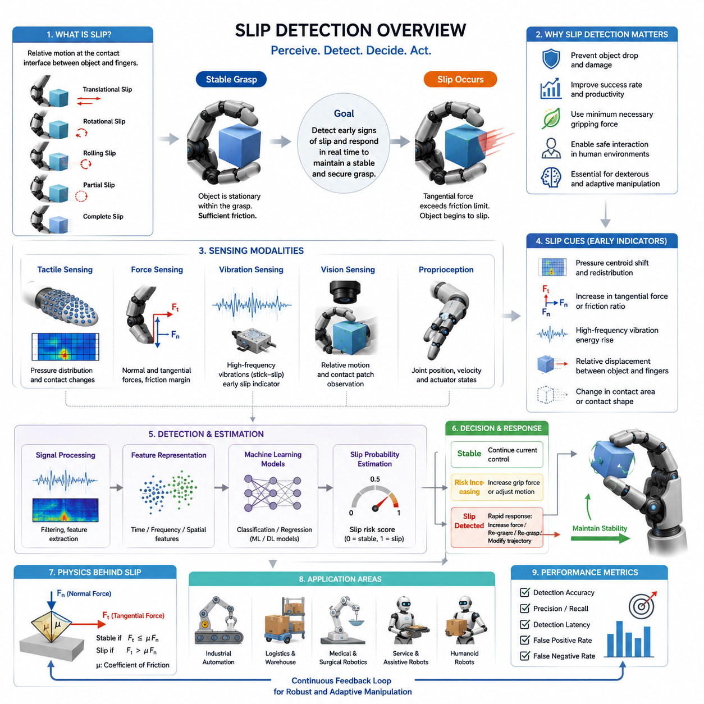
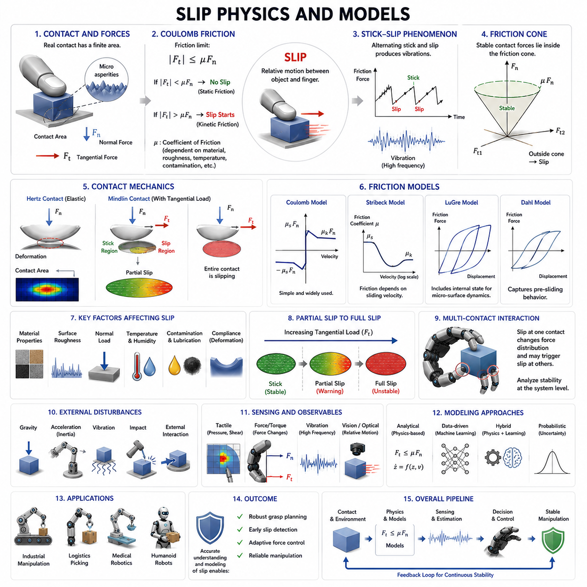
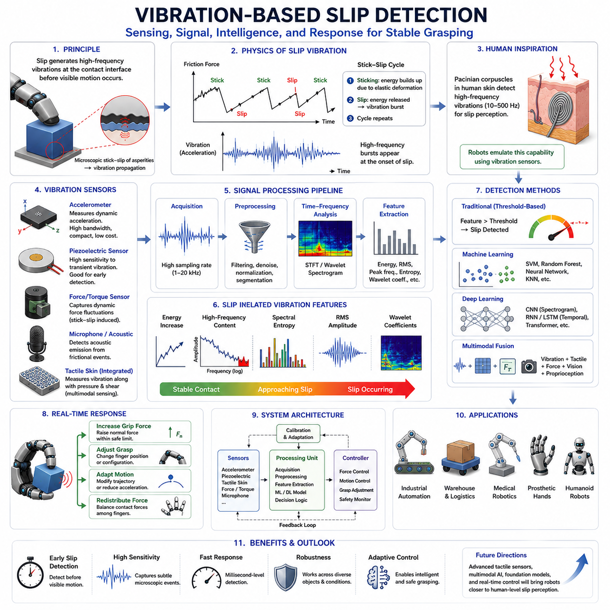
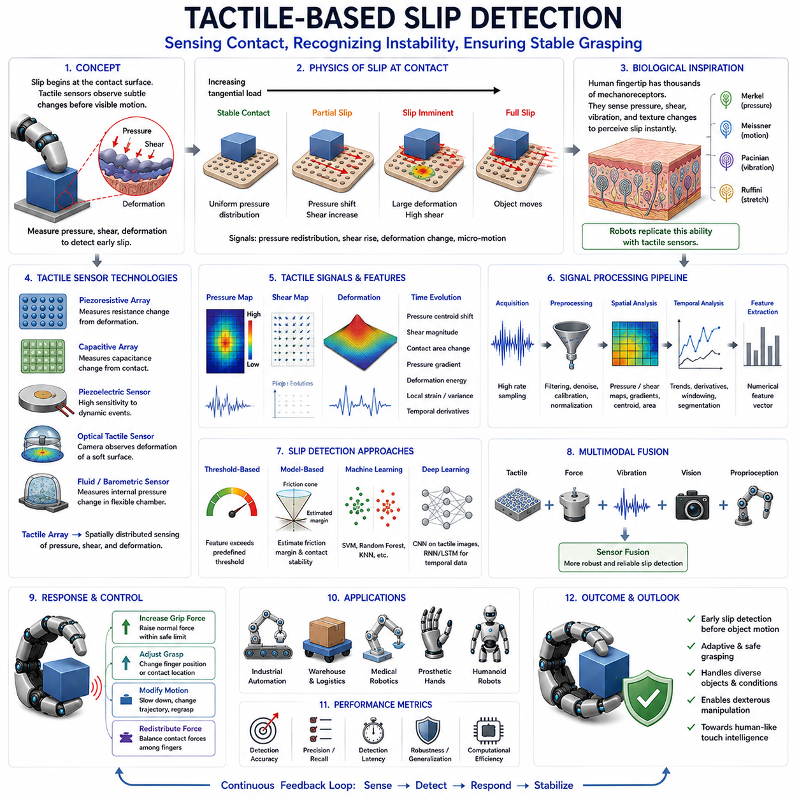
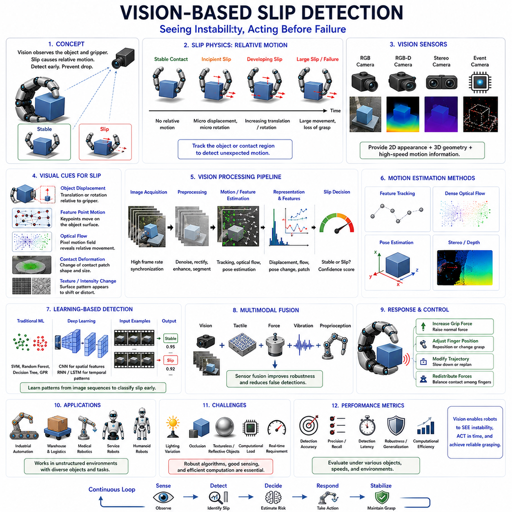
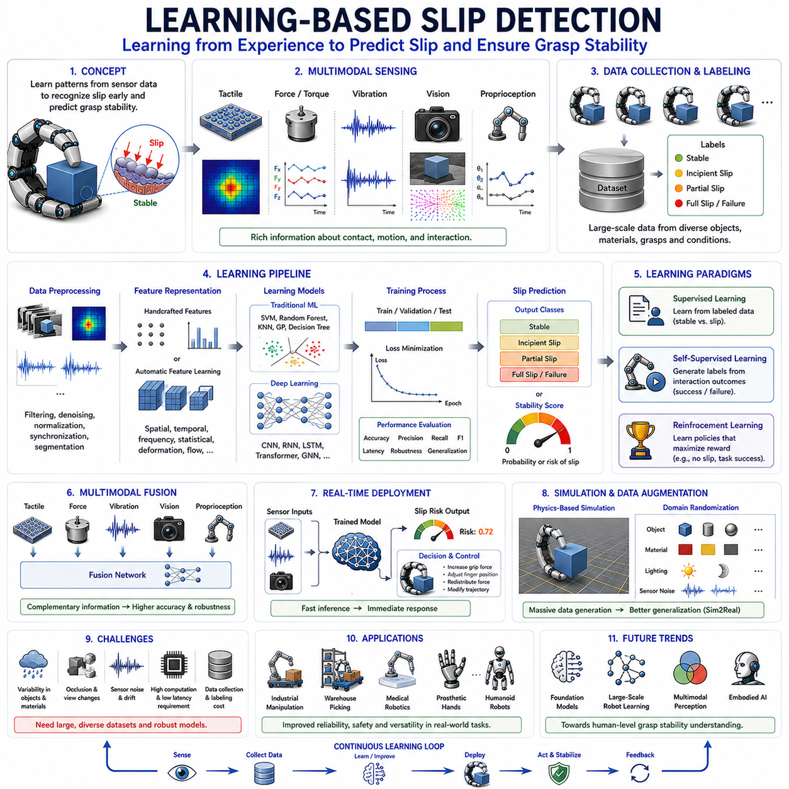
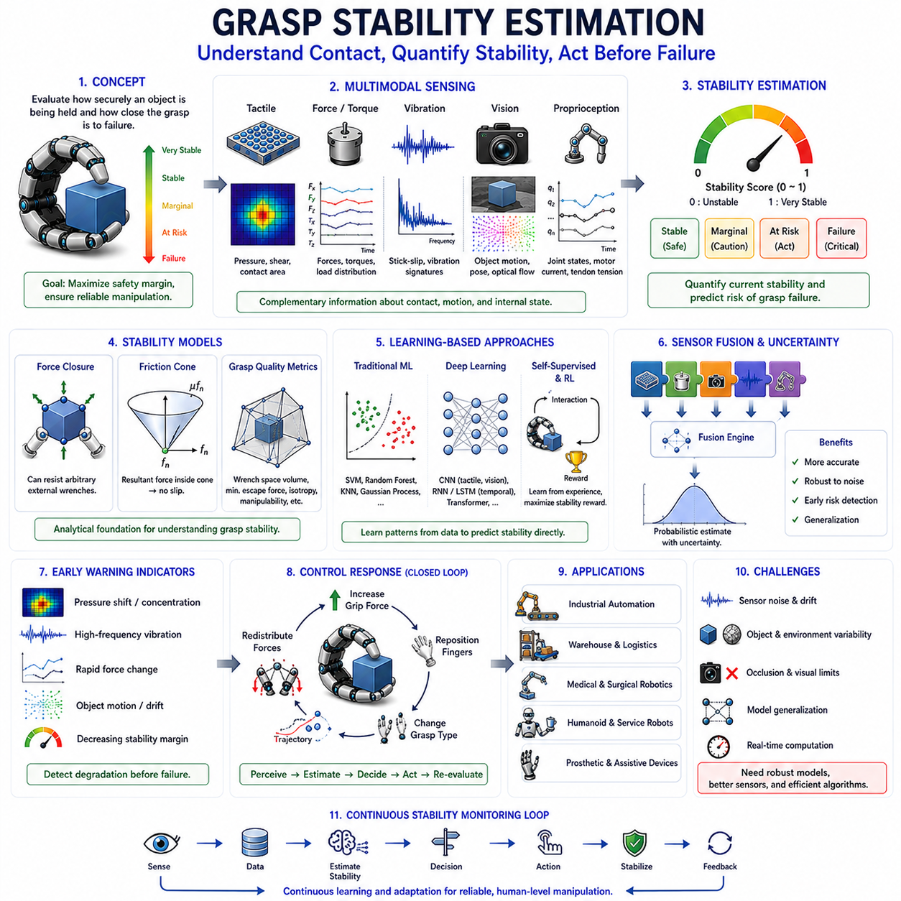
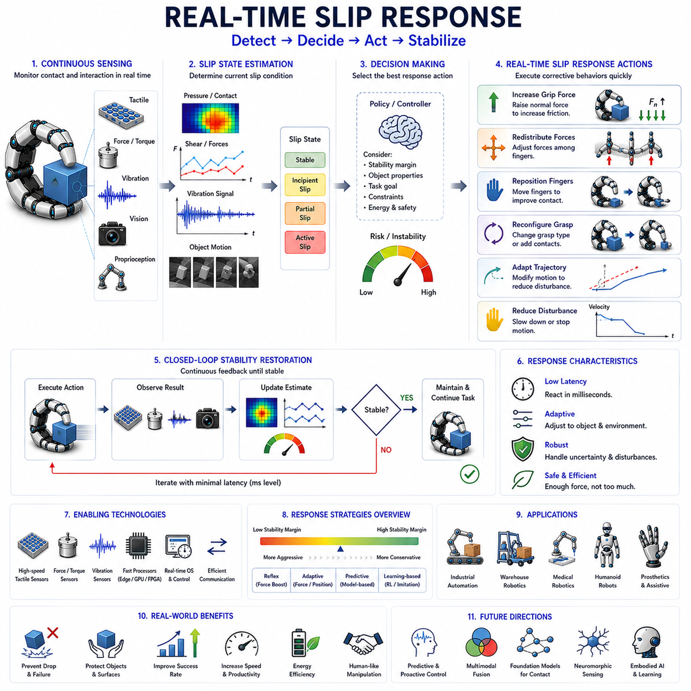
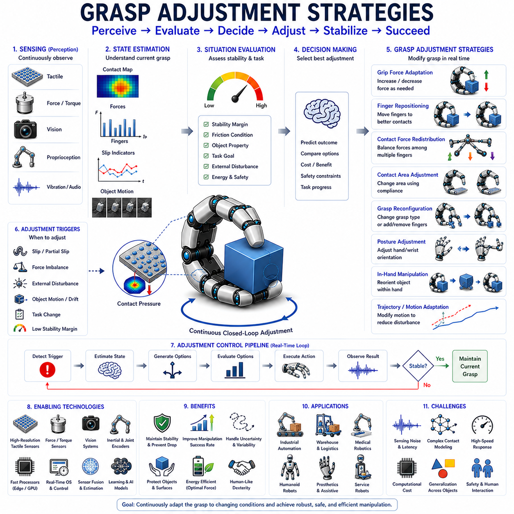
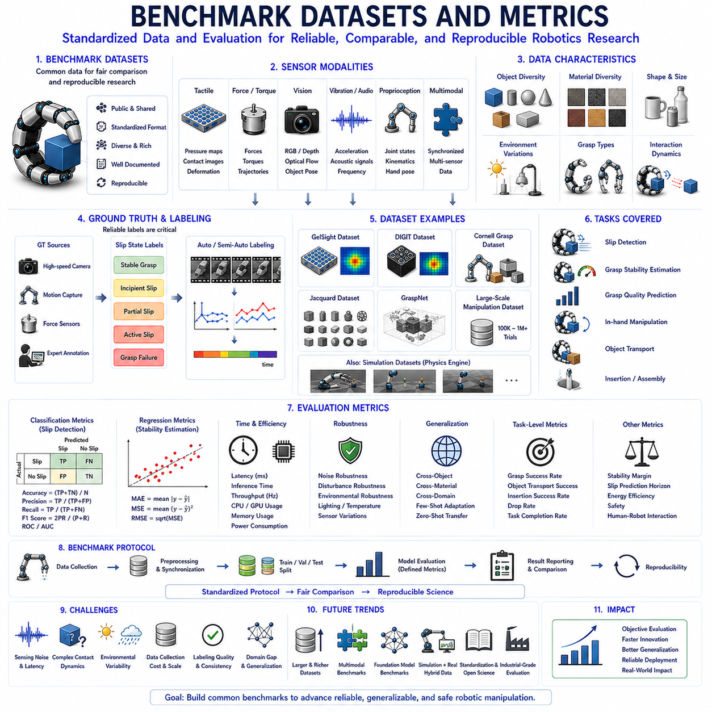

**Volume 06 Robot Hands and Dexterous Grasping**

# 08. Slip Detection and Grasp Stability

## 08.01 Introduction to Slip Detection

{width="7.268055555555556in" height="7.268055555555556in"}

Slip detection is one of the most important capabilities in robotic grasping and dexterous manipulation. While a robot may successfully establish contact with an object and initially achieve a stable grasp, the object can still move relative to the fingers due to insufficient friction, unexpected disturbances, object weight variations, surface contamination, dynamic motion, or external forces. When such relative motion occurs, the object begins to slip. If the slip is not detected and corrected quickly, the grasp may fail, resulting in dropped objects, damaged products, interrupted manufacturing processes, safety hazards, or unsuccessful manipulation tasks. For this reason, slip detection serves as a critical component of grasp stability control and is considered one of the foundational sensing functions required for advanced robotic hands.

Humans perform slip detection naturally through the tactile sensing mechanisms embedded in the skin. When an object begins to move against the fingertip surface, mechanoreceptors detect microscopic vibrations, local skin deformation, and changes in contact force distribution. These sensory signals are processed almost instantaneously by the nervous system, which adjusts grip force before the object falls. Robotic systems attempt to replicate this capability through a combination of tactile sensors, force sensors, vision systems, vibration sensors, and machine learning algorithms. The ultimate objective is to create robotic hands capable of recognizing the earliest signs of slip and responding in real time to maintain stable object control.

From a robotics perspective, slip can be defined as a relative motion occurring at the contact interface between the object and the gripper. This motion may occur in several forms. Translational slip occurs when the object slides across the contact surface. Rotational slip occurs when the object rotates relative to the fingers. Rolling slip occurs when the contact point moves without complete loss of contact. Partial slip occurs when only a portion of the contact area experiences motion while the remainder remains stationary. Complete slip occurs when the entire contact region loses its static friction state and enters dynamic friction. Understanding these different slip modes is essential because each mode generates different sensory signatures and requires different detection approaches.

The physical origin of slip is closely related to friction mechanics. According to classical friction theory, a grasp remains stable as long as the tangential forces acting on the object remain below the maximum friction force available at the contact interface. This relationship is commonly expressed through Coulomb friction principles. When external disturbances increase tangential loading beyond the friction limit, the contact transitions from static friction to kinetic friction, causing slip to occur. Although this transition appears simple in theory, real-world contact conditions are significantly more complex due to surface roughness, material deformation, contact geometry, temperature variation, humidity effects, and object compliance.

One of the major challenges in robotic grasping is that friction coefficients are rarely known with certainty. The same object may exhibit different friction characteristics depending on environmental conditions, manufacturing tolerances, surface wear, contamination, or grasp location. As a result, robotic systems cannot rely solely on predefined friction models. Instead, they require continuous monitoring of contact conditions and real-time estimation of grasp stability. Slip detection therefore becomes an essential feedback mechanism for adaptive grasp control.

Slip detection can generally be divided into proactive and reactive approaches. Reactive slip detection identifies slip after it has already begun. The system detects evidence of object motion and subsequently increases grip force or modifies the grasp configuration. This approach is relatively straightforward but may be too slow for delicate or high-speed manipulation tasks. Proactive slip detection attempts to identify precursors of slip before significant object motion occurs. Such methods analyze subtle tactile signals, micro-vibrations, local force redistribution, and incipient contact changes that indicate an approaching loss of stability. Proactive detection enables earlier corrective actions and generally results in more robust grasp performance.

The earliest robotic slip detection systems relied primarily on force sensing. Researchers observed that changes in normal force and tangential force often precede grasp failure. By monitoring force ratios and estimating friction margins, robotic controllers could infer whether a grasp was approaching an unstable condition. While effective in controlled environments, force-based approaches often struggle with unknown objects and rapidly changing contact conditions because force measurements alone provide limited information about local contact behavior.

The development of tactile sensing technologies significantly advanced slip detection capabilities. Modern tactile sensors can measure distributed pressure patterns across the contact surface, allowing robotic systems to observe local contact dynamics in much greater detail. As an object begins to slip, pressure distributions often shift in characteristic ways. Contact centroids may move, pressure gradients may change, and localized stress concentrations may emerge. These signals provide valuable indicators of impending grasp instability.

Another important class of slip detection techniques relies on vibration analysis. During the transition from static friction to dynamic friction, microscopic stick-slip events generate high-frequency vibrations. These vibrations are similar to those detected by human tactile receptors during object handling. Accelerometers, piezoelectric sensors, microphones, and specialized tactile devices can capture these vibration signatures. Signal processing methods such as Fourier analysis, wavelet transforms, spectrogram analysis, and frequency-domain filtering are then used to identify characteristic slip-related patterns. Vibration-based methods are particularly attractive because they often provide very early warning signals before significant object displacement occurs.

Vision-based slip detection has emerged as another powerful approach. High-resolution cameras can observe object motion relative to the gripper, enabling direct measurement of slip. External cameras may track object position in the workspace, while fingertip-mounted cameras can monitor local contact regions. Optical tactile sensors such as GelSight-type systems further extend this capability by capturing detailed contact deformation patterns. Computer vision algorithms can estimate relative displacement, detect contact patch motion, and quantify grasp stability from image sequences. The rapid advancement of deep learning has significantly improved the robustness and accuracy of vision-based slip detection systems.

Machine learning has transformed the field by enabling data-driven slip detection. Traditional model-based approaches often require explicit friction models and carefully engineered thresholds. In contrast, learning-based methods automatically extract relevant features from sensor data. Neural networks, support vector machines, random forests, convolutional neural networks, recurrent neural networks, and transformer-based architectures have all been applied to slip detection problems. These systems learn to recognize complex relationships between sensory inputs and slip events, often achieving higher robustness across diverse object categories and environmental conditions.

The availability of multimodal sensing has further improved performance. Modern robotic hands increasingly combine tactile sensing, force sensing, proprioception, vision, and vibration sensing into integrated perception systems. Each sensing modality provides complementary information. Tactile sensors capture local contact changes. Force sensors measure global interaction forces. Vision systems observe object motion. Proprioceptive sensors monitor finger positions and actuator states. Vibration sensors detect high-frequency contact dynamics. By fusing these data streams, robotic systems can achieve more reliable and earlier slip detection than any single modality alone.

Slip detection is particularly important for dexterous manipulation tasks. In-hand manipulation frequently requires controlled object motion within the grasp. The robot must distinguish between intentional motion and unintended slip. This distinction can be challenging because both situations involve relative movement between the fingers and the object. Advanced manipulation systems therefore incorporate task context, motion planning objectives, and contact state estimation to differentiate desired object motion from grasp instability.

Industrial robotics presents unique slip detection requirements. In manufacturing environments, robots often handle objects with varying sizes, shapes, weights, and surface properties. Product damage can result from excessive gripping force, while insufficient force may lead to dropped parts. Slip detection enables adaptive force control, allowing robots to apply only the minimum force necessary for stable grasping. This capability improves product quality, reduces energy consumption, and extends gripper lifespan.

Warehouse automation also benefits significantly from slip detection technologies. Modern fulfillment centers process thousands of product types with highly variable packaging materials. Robotic picking systems must handle cardboard boxes, plastic containers, flexible packages, metallic objects, and fragile consumer products. Slip detection allows grasp controllers to adapt automatically to unknown objects, improving picking success rates and reducing operational errors.

Medical robotics represents another important application domain. Surgical robots, rehabilitation devices, prosthetic hands, and assistive manipulators often interact with delicate biological tissues and sensitive objects. Excessive gripping force can cause injury or discomfort, while insufficient force can result in unstable manipulation. Accurate slip detection enables safe and effective interaction by maintaining stable grasp conditions without excessive force application.

Humanoid robots require particularly advanced slip detection capabilities because they are expected to operate in unstructured human environments. Everyday activities such as opening doors, carrying tools, handling kitchen utensils, folding clothing, or manipulating electronic devices demand continuous monitoring of grasp stability. Human environments contain enormous variability in object properties, making adaptive slip detection essential for reliable operation.

Real-time performance remains one of the most critical requirements for slip detection systems. Once slip begins, corrective actions must occur rapidly to prevent grasp failure. Detection latency, communication delays, computational processing time, and actuator response speed all contribute to overall system performance. Modern robotic systems increasingly employ edge computing, high-speed sensor interfaces, and optimized machine learning models to achieve low-latency slip detection and response.

Evaluation of slip detection systems involves several performance metrics. Detection accuracy measures the percentage of correctly identified slip events. Precision quantifies the proportion of detected events that correspond to actual slip occurrences. Recall measures the percentage of true slip events successfully detected. Detection latency evaluates how quickly slip is recognized after onset. False positive rates measure unnecessary interventions, while false negative rates indicate missed slip events that may lead to grasp failure. Robust evaluation requires testing across diverse objects, materials, grasp configurations, and environmental conditions.

Benchmarking slip detection remains a challenging research problem. Different laboratories use different object sets, sensor technologies, evaluation protocols, and performance metrics. Standardized datasets and benchmarking procedures are increasingly being developed to facilitate objective comparison of slip detection algorithms. These benchmarks play a crucial role in accelerating technological progress and promoting reproducible research.

Recent advances in artificial intelligence and foundation models are beginning to influence slip detection research. Large-scale multimodal learning systems can potentially learn generalized representations of contact dynamics across many tasks and object categories. Such systems may eventually enable robots to transfer slip detection knowledge between different manipulation scenarios, reducing the need for extensive task-specific training.

Future robotic hands will likely incorporate dense tactile skins, high-resolution optical tactile sensors, distributed force sensing networks, and advanced multimodal perception architectures. Combined with increasingly powerful machine learning algorithms, these technologies will enable robotic systems to approach human-level grasp stability perception. Slip detection will evolve from a standalone sensing capability into a fully integrated component of intelligent manipulation systems that continuously monitor, predict, and optimize contact interactions.

Ultimately, slip detection serves as the bridge between sensing and action in robotic grasping. It transforms raw contact information into meaningful estimates of grasp stability and provides the feedback necessary for adaptive control. Without reliable slip detection, robotic hands cannot achieve the robustness, dexterity, and adaptability required for real-world manipulation. As robotic systems continue to expand into industrial automation, logistics, healthcare, service robotics, and humanoid applications, slip detection will remain one of the key enabling technologies for achieving safe, reliable, and human-like object manipulation.

## 08.02 Physics of Slip

{width="7.268055555555556in" height="7.268055555555556in"}

Slip is one of the most fundamental phenomena encountered in robotic grasping and manipulation. Whenever a robotic hand interacts with an object, the stability of the grasp depends on the ability of the contact surfaces to resist relative motion. As long as the frictional forces generated at the contact interface are sufficient to counteract external disturbances, the object remains securely held. However, when these frictional forces become inadequate, relative motion develops between the object and the contacting fingers, resulting in slip. Understanding the physics of slip is therefore essential for designing stable grasping systems, developing tactile sensing algorithms, implementing force control strategies, and achieving reliable dexterous manipulation.

The study of slip begins with the mechanics of contact. Whenever two bodies touch each other, forces are exchanged through a finite contact region. Contrary to idealized models that represent contact as a mathematical point, real contacts possess measurable areas determined by material properties, geometry, and applied loads. Within this contact region, normal forces act perpendicular to the surface while tangential forces act parallel to the surface. The interaction between these force components determines whether the contact remains stable or transitions into slip.

One of the earliest and most widely used descriptions of slip originates from Coulomb friction theory. According to this classical model, the maximum tangential force that can be sustained without slip is proportional to the normal force acting at the contact interface. The proportionality constant is known as the coefficient of friction. If the applied tangential force remains below this friction limit, the contact remains in a static state. Once the tangential force exceeds the limit, the contact transitions into a sliding state and slip occurs.

Although Coulomb friction provides an intuitive framework for understanding slip, real robotic manipulation scenarios are considerably more complex. Actual contact surfaces exhibit roughness at microscopic scales. When two surfaces come into contact, only a small fraction of their apparent contact area is truly in contact. These microscopic contact points, known as asperities, carry the majority of the load. Friction emerges from the collective interaction of countless asperities undergoing deformation, adhesion, and rupture. As a result, friction and slip are inherently multiscale phenomena involving both macroscopic and microscopic processes.

The transition from static friction to dynamic friction is one of the most important aspects of slip physics. Static friction represents the resistance to the initiation of motion, while dynamic friction characterizes the resistance after motion has begun. In many materials, static friction is greater than dynamic friction. Consequently, once slip starts, less force is required to maintain motion than was necessary to initiate it. This difference often explains why grasp failures can accelerate rapidly once slipping begins.

An important phenomenon associated with slip is stick-slip behavior. During stick-slip motion, the contact alternates between periods of sticking and sliding. Energy accumulates while the surfaces remain temporarily locked together and is then suddenly released when sliding occurs. This cycle repeats continuously, producing characteristic vibrations. Stick-slip behavior is responsible for many tactile signatures used in robotic slip detection. The high-frequency vibrations generated during these events often provide some of the earliest indicators of impending grasp failure.

The coefficient of friction plays a central role in slip modeling. However, friction coefficients are not fixed values. They depend on numerous factors including material composition, surface roughness, temperature, humidity, contamination, lubrication, and contact pressure. A metal object may exhibit significantly different friction characteristics depending on whether its surface is clean, oily, dusty, or wet. Similarly, soft materials such as rubber often display nonlinear friction behavior that changes with deformation and loading conditions. These variations make slip prediction challenging in real-world environments.

Surface roughness contributes significantly to slip behavior. Rough surfaces typically provide increased friction because their asperities interlock more effectively. However, excessive roughness may reduce actual contact area and introduce unpredictable contact dynamics. Smooth surfaces generally provide lower mechanical interlocking but may exhibit stronger adhesive effects. The balance between these mechanisms influences overall grasp stability and slip resistance.

Material compliance also affects slip dynamics. Rigid contacts tend to exhibit abrupt transitions between sticking and sliding states. In contrast, compliant materials deform under load, distributing forces over larger areas and often delaying the onset of slip. Soft robotic grippers exploit this property by increasing contact area and reducing localized stress concentrations. As a result, compliant grasping systems often achieve greater robustness against slip compared to purely rigid grippers.

Contact mechanics provides a more detailed framework for analyzing slip. Hertzian contact theory describes how elastic bodies deform under normal loading and predicts contact area size, pressure distribution, and deformation characteristics. Although Hertzian models assume frictionless contact, they establish a foundation for understanding force transmission. Extensions such as Mindlin contact theory incorporate tangential loading and provide insight into partial slip behavior within elastic contacts.

Partial slip represents a particularly important phenomenon in robotic manipulation. Before complete sliding occurs, localized regions of the contact interface may begin slipping while other regions remain stationary. These localized slip zones often originate near contact boundaries where stress concentrations are highest. As tangential loading increases, the slipping region expands until the entire contact area transitions into full slip. Detecting partial slip is highly valuable because it provides an opportunity for corrective action before grasp failure occurs.

The concept of the friction cone is fundamental in robotic grasp analysis. At any contact point, the set of tangential forces that can be supported without slip forms a conical region in force space. If the resultant contact force remains inside the friction cone, the contact is stable. If the force reaches the boundary of the cone, the contact approaches a critical condition. Once the force moves outside the cone, slip becomes unavoidable. Friction cones provide a geometric interpretation of grasp stability and serve as a cornerstone of grasp planning algorithms.

In multi-finger robotic hands, slip behavior becomes significantly more complex because multiple contacts interact simultaneously. Each contact possesses its own friction characteristics, force distributions, and stability margins. Slip at one finger may redistribute forces throughout the grasp, potentially triggering cascading instabilities at other contacts. Consequently, grasp stability must often be analyzed at the system level rather than at individual contact points.

Object geometry strongly influences slip dynamics. Cylindrical objects, spherical objects, flat objects, and irregularly shaped objects exhibit different contact configurations and force distributions. Curved surfaces may generate rolling behavior in addition to sliding. Complex geometries can create multiple contact modes that evolve during manipulation. Accurate slip modeling therefore requires consideration of object shape as well as material properties.

External disturbances frequently contribute to slip initiation. Gravity, inertial forces, environmental vibrations, impacts, and unexpected interactions can all alter contact loading conditions. During dynamic manipulation tasks, accelerations may significantly increase tangential forces acting on the object. A grasp that is stable under static conditions may become unstable when the robot moves rapidly or encounters external disturbances. This distinction between static and dynamic stability is crucial for practical robotic applications.

Dynamic friction models extend classical Coulomb theory by incorporating velocity-dependent effects. Experimental observations reveal that friction often varies with sliding speed. Some materials exhibit decreasing friction as velocity increases, while others display more complex relationships. Models such as the Stribeck friction model capture these effects by describing transitions between static friction, boundary lubrication, mixed lubrication, and hydrodynamic lubrication regimes.

The LuGre friction model represents another important advancement in slip modeling. Rather than treating friction as a simple force law, the LuGre model incorporates internal state variables that represent microscopic surface interactions. This approach captures hysteresis, presliding displacement, and stick-slip behavior more accurately than traditional models. As a result, LuGre-based formulations are widely used in robotic simulation and control research.

Another influential framework is the Dahl friction model, which focuses on presliding behavior. Before macroscopic slip becomes visible, microscopic deformations occur within the contact interface. These deformations store elastic energy and generate measurable force responses. Modeling these effects improves the ability to predict slip onset and supports the development of proactive slip detection algorithms.

Probabilistic approaches have become increasingly important because real-world friction parameters are often uncertain. Instead of assuming fixed friction coefficients, probabilistic models represent friction as a distribution of possible values. Bayesian estimation methods, particle filters, and stochastic contact models can then update stability predictions as new sensory information becomes available. This approach is particularly valuable in unstructured environments where object properties are not known in advance.

The rise of tactile sensing has transformed slip modeling. Modern tactile sensors provide spatially distributed measurements of pressure, shear force, deformation, and vibration. These measurements reveal contact dynamics that cannot be captured by traditional force sensors alone. Data-driven models can learn relationships between tactile patterns and slip events, enabling accurate prediction even when physical parameters are uncertain.

Machine learning has further expanded the capabilities of slip modeling. Instead of explicitly modeling friction physics, neural networks can learn complex mappings between sensor observations and slip states. Deep learning approaches have demonstrated impressive performance across diverse object categories and manipulation tasks. Nevertheless, purely data-driven methods often benefit from incorporating physical insights, leading to hybrid approaches that combine analytical models with learned representations.

Vision-based slip modeling has also gained attention. Cameras can directly observe object motion relative to the gripper and estimate displacement fields over time. Optical tactile sensors provide even richer information by visualizing contact deformation patterns. These technologies enable direct observation of slip phenomena and provide valuable data for validating theoretical models.

Simulation plays a critical role in the study of slip physics. Modern robotic simulators incorporate increasingly sophisticated friction and contact models. Physics engines attempt to reproduce real-world contact behavior while maintaining computational efficiency. However, accurately simulating friction remains one of the most challenging problems in robotics because contact dynamics are highly nonlinear and sensitive to small variations in surface properties.

In robotic grasp planning, slip models are often integrated into stability analysis frameworks. Grasp planners evaluate candidate grasps by estimating friction margins, force closure conditions, and slip probabilities. These evaluations guide the selection of grasp configurations that maximize robustness against disturbances. As robotic hands become more dexterous, accurate slip modeling becomes increasingly important for enabling reliable manipulation.

Industrial applications place particularly stringent demands on slip modeling. Manufacturing robots must handle objects with varying materials, coatings, and surface conditions while maintaining consistent performance. Logistics robots encounter an enormous diversity of packages and products. Medical robots interact with biological tissues that exhibit highly nonlinear contact behavior. In each case, understanding slip physics is essential for achieving safe and reliable operation.

Humanoid robots introduce additional challenges because they operate in environments designed for humans. Everyday objects often have unknown friction properties and complex geometries. Successful manipulation therefore requires continuous estimation of contact conditions and adaptive responses to changing slip risks. Future humanoid systems will likely rely heavily on integrated slip models that combine tactile sensing, force feedback, visual perception, and learned experience.

The future of slip physics research is moving toward unified contact intelligence frameworks. Rather than treating slip as an isolated phenomenon, researchers increasingly view it as part of a broader contact interaction process that includes force regulation, tactile perception, grasp adaptation, and manipulation planning. Advances in high-resolution tactile sensing, multimodal sensor fusion, foundation models, and real-time physics simulation are expected to significantly improve our ability to model and predict slip behavior.

Ultimately, slip physics provides the scientific foundation upon which grasp stability is built. Every successful robotic grasp depends on the ability to understand, predict, detect, and control the transition between stable contact and relative motion. By combining classical friction theory, modern contact mechanics, probabilistic reasoning, tactile sensing, and machine learning, robotic systems are gradually approaching the remarkable slip-handling capabilities that humans perform effortlessly in everyday life.

## 08.03 Vibration-Based Slip Detection

{width="7.268055555555556in" height="7.268055555555556in"}

Vibration-based slip detection is one of the most effective and biologically inspired approaches for identifying slip events in robotic grasping. When humans hold an object, they rarely rely solely on force perception to determine whether the object is secure. Instead, the human tactile system continuously monitors microscopic vibrations generated at the contact interface. Specialized mechanoreceptors embedded within the skin are highly sensitive to high-frequency signals associated with incipient slip. These receptors allow humans to detect the earliest stages of object motion and automatically increase grip force before a grasp failure occurs. Vibration-based slip detection in robotics attempts to replicate this capability by sensing and analyzing dynamic contact vibrations generated during object manipulation. Within the broader framework of grasp stability, vibration sensing serves as an early warning mechanism that can identify slip before significant object displacement becomes visible, making it a critical component of advanced robotic hands and dexterous manipulation systems.

The fundamental principle behind vibration-based slip detection is rooted in frictional contact mechanics. When two surfaces remain stationary relative to one another, contact forces are primarily static. However, as tangential loading approaches the friction limit, microscopic regions of the contact interface begin to experience local instability. Small contact asperities deform, detach, and reattach repeatedly, generating oscillatory force fluctuations. These fluctuations propagate through the object, the gripper structure, and the sensing elements as mechanical vibrations. Even before macroscopic sliding becomes observable, these microscopic events create measurable dynamic signatures that indicate the onset of slip.

One of the most important physical mechanisms responsible for vibration generation is the stick-slip phenomenon. During stick-slip motion, portions of the contact interface alternate between sticking and slipping states. While surfaces remain temporarily locked together, elastic energy accumulates within the contact region. Once the local friction threshold is exceeded, the stored energy is suddenly released as sliding occurs. This process generates transient vibration bursts that are often rich in high-frequency components. The cycle then repeats continuously, producing characteristic vibration patterns that can be detected by appropriate sensors.

The sensitivity of vibration-based methods is particularly attractive because slip-related vibrations often appear before significant object movement occurs. Traditional force-based systems may only recognize instability once contact forces have already changed substantially. Vision-based approaches may require measurable object displacement before slip can be observed. In contrast, vibration sensing can detect microscopic contact changes occurring at the earliest stages of frictional failure. This enables proactive grasp stabilization rather than reactive recovery.

Human tactile sensing provides an important biological reference for understanding vibration-based slip detection. Within the fingertip, rapidly adapting mechanoreceptors known as Pacinian corpuscles exhibit exceptional sensitivity to high-frequency vibrations. These receptors can detect frequencies ranging from tens to hundreds of hertz and play a central role in human slip perception. Robotic researchers frequently draw inspiration from this biological mechanism when designing artificial tactile systems capable of recognizing contact vibrations associated with grasp instability.

The frequency characteristics of slip-induced vibrations vary depending on material properties, surface roughness, contact geometry, normal force, and relative velocity. Smooth surfaces often generate different vibration spectra compared to rough surfaces. Hard materials such as metal typically produce sharper and higher-frequency signals than compliant materials such as rubber or foam. Likewise, increasing normal force can alter vibration amplitude and frequency content by changing contact stiffness and frictional interactions. Understanding these relationships is important for designing robust detection algorithms.

Various sensing technologies can be used to measure slip-related vibrations. Accelerometers are among the most common solutions due to their high sensitivity, compact size, and ease of integration. Accelerometers mounted within robotic fingertips, gripper structures, or wrist assemblies can directly measure dynamic accelerations generated by contact events. Modern MEMS accelerometers provide sufficient bandwidth and sensitivity for many robotic applications while maintaining low cost and low power consumption.

Piezoelectric sensors represent another widely used technology. Piezoelectric materials generate electrical signals when subjected to mechanical deformation. Because they respond strongly to dynamic loading and vibration, piezoelectric sensors are particularly well suited for detecting transient slip events. Their high sensitivity to small mechanical disturbances makes them valuable for early slip detection systems, especially in high-performance robotic hands.

Force-torque sensors can also contribute to vibration analysis. Although force-torque sensors are primarily designed for measuring static and low-frequency interaction forces, high-bandwidth devices can capture dynamic force fluctuations associated with stick-slip transitions. When combined with dedicated signal processing techniques, these measurements can provide useful indicators of contact instability.

Microphones and acoustic sensors have also been explored for slip detection. Frictional interactions often generate audible and ultrasonic acoustic emissions. By analyzing these acoustic signals, robotic systems can infer contact conditions and identify slip events. Acoustic sensing offers the advantage of being non-contact in certain configurations, although it may be more susceptible to environmental noise.

Advanced tactile sensors frequently incorporate vibration sensing capabilities directly within the contact surface. High-resolution tactile skins, piezoresistive arrays, capacitive tactile sensors, and optical tactile systems can capture local vibration patterns while simultaneously measuring pressure distributions and shear forces. Such multimodal sensing architectures provide richer information than vibration measurements alone and improve detection robustness.

Signal acquisition is a critical component of vibration-based slip detection. Slip-related signals often contain high-frequency components that require appropriate sampling rates and sensor bandwidths. If the sampling frequency is too low, important vibration information may be lost due to aliasing effects. Consequently, many slip detection systems employ sampling rates ranging from several kilohertz to tens of kilohertz to ensure accurate capture of dynamic contact phenomena.

Raw vibration signals are typically contaminated by noise originating from actuators, structural resonances, environmental disturbances, and sensor electronics. Signal preprocessing therefore plays a crucial role in extracting meaningful information. Common preprocessing techniques include low-pass filtering, high-pass filtering, band-pass filtering, noise suppression, normalization, and signal segmentation. These operations improve signal quality and enhance the visibility of slip-related features.

Frequency-domain analysis is one of the most widely used approaches for vibration-based slip detection. By transforming time-domain signals into the frequency domain using the Fourier Transform, researchers can identify characteristic spectral components associated with slip events. Many studies have demonstrated that slipping contacts generate distinctive frequency signatures that differ significantly from stable grasp conditions. Spectral analysis therefore provides a powerful tool for detecting and classifying contact states.

Short-Time Fourier Transform methods extend this approach by providing time-frequency representations. Because slip events often evolve dynamically over time, analyzing how frequency content changes during manipulation can reveal important information about contact transitions. Spectrograms generated using Short-Time Fourier Transform techniques are commonly used to visualize and analyze slip-related vibration patterns.

Wavelet analysis has become increasingly popular because it provides superior localization of transient events. Unlike Fourier-based methods, which represent signals using infinite sinusoidal functions, wavelets can capture short-duration phenomena more effectively. Since slip-related vibrations often occur as transient bursts, wavelet transforms are particularly well suited for detecting incipient slip and identifying subtle contact changes.

Feature extraction converts raw vibration signals into compact representations suitable for classification and decision making. Common features include signal energy, root mean square amplitude, peak frequency, spectral entropy, zero-crossing rate, kurtosis, skewness, frequency centroid, and wavelet coefficients. These features capture different aspects of vibration behavior and can be combined to improve detection accuracy.

Threshold-based detection methods represent the simplest approach to vibration-based slip identification. In these systems, specific vibration features are compared against predefined thresholds. If measured values exceed the threshold, slip is declared. Although straightforward to implement, threshold-based approaches often struggle to generalize across different objects, materials, and environmental conditions.

Machine learning techniques have significantly improved vibration-based slip detection performance. Supervised learning algorithms such as Support Vector Machines, Random Forests, Decision Trees, and Artificial Neural Networks can learn complex relationships between vibration features and slip states. By training on labeled datasets, these algorithms can automatically adapt to variations in contact conditions and achieve higher detection accuracy than manually designed thresholds.

Deep learning has further expanded the capabilities of vibration analysis. Convolutional Neural Networks can process spectrograms and frequency-domain representations directly, automatically learning discriminative features from raw data. Recurrent Neural Networks and Long Short-Term Memory networks can model temporal dependencies within vibration signals, improving the recognition of evolving slip events. More recently, transformer architectures have demonstrated promise for analyzing sequential tactile and vibration data.

Multimodal fusion represents a major trend in modern slip detection research. Vibration sensing alone provides valuable information, but combining it with tactile sensing, force sensing, vision, and proprioception yields significantly greater robustness. For example, vibration signals may indicate incipient slip while tactile sensors simultaneously reveal pressure redistribution and force sensors measure changing tangential loads. Integrating these complementary observations enables more reliable grasp stability estimation.

Real-time operation is essential for practical deployment. Slip detection is only useful if corrective actions can be applied before grasp failure occurs. Consequently, vibration-based systems must achieve low-latency sensing, processing, and decision making. Modern embedded processors, edge AI accelerators, and optimized signal processing pipelines enable detection times measured in milliseconds, allowing robotic hands to respond rapidly to instability.

Once slip is detected, the robotic controller must determine an appropriate response. The most common strategy is grip force adjustment. By increasing normal force, the system raises the available friction limit and restores stability. However, excessive force may damage fragile objects or waste energy. More sophisticated controllers therefore estimate the minimum force increase required to prevent further slip while maintaining safe object handling.

Beyond force adjustment, robots may modify finger positions, alter grasp configurations, change manipulation trajectories, or redistribute contact forces among multiple fingers. These actions transform slip detection from a passive sensing function into an active component of adaptive grasp control.

Industrial automation provides numerous applications for vibration-based slip detection. Assembly operations often involve handling components with varying surface finishes and tolerances. Vibration sensing enables robots to adapt to these variations and maintain reliable grasping performance. Warehouse automation systems benefit similarly when manipulating packages with diverse materials and packaging conditions.

Medical robotics presents another important application domain. Surgical instruments frequently interact with soft biological tissues that are highly sensitive to excessive force. Vibration-based slip detection allows robotic systems to maintain secure contact while minimizing tissue damage. Prosthetic hands also benefit from vibration sensing because it provides users with improved control and object security.

Humanoid robots and service robots operating in unstructured environments require robust slip detection capabilities to handle everyday objects. Household items exhibit enormous diversity in shape, weight, material, and surface characteristics. Vibration sensing provides an efficient and biologically inspired mechanism for adapting to this variability.

Benchmarking vibration-based slip detection systems typically involves evaluating detection accuracy, precision, recall, latency, robustness, and computational efficiency. Standardized datasets and testing protocols are increasingly important for comparing algorithms objectively and advancing the state of the art.

Future developments in vibration-based slip detection are expected to benefit from advances in tactile electronics, flexible sensor materials, multimodal sensing platforms, and foundation models for manipulation. High-resolution tactile skins capable of measuring pressure, shear, temperature, and vibration simultaneously will provide unprecedented insight into contact dynamics. Combined with powerful machine learning models and real-time control architectures, these technologies will enable robotic hands to approach the remarkable slip perception capabilities of the human tactile system.

Ultimately, vibration-based slip detection occupies a unique position within robotic manipulation. It bridges the gap between contact physics and adaptive control by transforming microscopic frictional events into actionable information. Because slip-related vibrations often emerge before visible motion occurs, vibration sensing provides one of the earliest and most reliable indicators of grasp instability. As robotic systems continue to advance toward human-level dexterity, vibration-based slip detection will remain a foundational technology for achieving robust, adaptive, and intelligent grasping.

## 08.04 Tactile-Based Slip Detection

{width="7.268055555555556in" height="7.268055555555556in"}

Tactile-based slip detection is one of the most important sensing capabilities in modern robotic grasping systems. While force sensing can estimate global interaction forces and vision systems can observe object motion from an external perspective, tactile sensing provides direct access to the physical interaction occurring at the contact interface between a robotic finger and an object. Because slip originates within this contact region, tactile sensors are uniquely positioned to observe the earliest signs of instability before significant object motion occurs. As robotic hands evolve toward human-like dexterity, tactile-based slip detection has become a fundamental technology for achieving reliable grasping, adaptive manipulation, and robust interaction with uncertain environments.

Human manipulation provides the primary biological inspiration for tactile-based slip detection. The human fingertip contains thousands of mechanoreceptors distributed throughout the skin. These receptors continuously monitor pressure distributions, local deformation, shear stress, vibration, texture, and contact transitions. When an object begins to slip, subtle changes occur in the skin deformation pattern. The nervous system recognizes these changes almost immediately and automatically adjusts grip force to restore stability. Humans rarely need conscious attention to perform this task because tactile feedback operates continuously and efficiently. Robotic tactile sensing seeks to replicate this remarkable capability through artificial sensors, signal processing algorithms, and intelligent control systems.

The fundamental concept behind tactile-based slip detection is that slip is not merely a motion event but also a contact event. Before an object visibly moves relative to a finger, the contact conditions begin to change. Pressure distributions shift, shear forces increase, contact areas deform, and microscopic motion develops within the contact region. These changes create measurable tactile signatures that indicate an approaching loss of stability. By monitoring these tactile signatures, robotic systems can identify slip at its earliest stages and initiate corrective actions before grasp failure occurs.

The physics of tactile slip detection is closely related to contact mechanics and friction behavior. When a stable grasp exists, contact forces remain within the friction limits of the interface. Pressure distributions are relatively stable, and deformation patterns remain consistent. As tangential loading increases and the friction margin decreases, local contact regions begin experiencing partial slip. During this phase, some portions of the contact area remain stationary while others start moving. This partial slip phenomenon often precedes complete sliding and provides one of the most valuable indicators for tactile slip detection systems.

One of the most important tactile signatures associated with slip is pressure redistribution. In a stable grasp, contact pressure is typically distributed according to object geometry, material properties, and applied forces. As slip develops, the pressure centroid may shift across the contact surface. Regions experiencing increased stress may emerge while other regions lose contact pressure. Tracking these changes enables robotic systems to estimate the evolution of grasp stability over time.

Shear force sensing plays an equally important role. While normal pressure measurements indicate how strongly an object is being grasped, shear measurements reveal tangential forces acting parallel to the contact surface. Slip is fundamentally driven by excessive tangential loading relative to available friction. Consequently, changes in shear force distribution often provide highly informative indicators of impending slip. Many advanced tactile sensors are specifically designed to measure both normal and shear components simultaneously.

Tactile deformation patterns provide another powerful source of information. When a compliant tactile surface contacts an object, the sensor deforms according to local force distributions. As slip develops, deformation fields change in characteristic ways. Contact patches may stretch, compress, rotate, or shift. High-resolution tactile sensors can capture these spatial deformation patterns and use them to infer contact state transitions. Such observations are particularly valuable because they directly reflect the mechanics occurring at the contact interface.

Modern tactile sensing technologies support a wide range of slip detection approaches. Piezoresistive tactile sensors are among the most widely used solutions. These devices measure resistance changes caused by mechanical deformation. Because they can be fabricated into dense sensor arrays, they provide spatial pressure maps that reveal evolving contact conditions. Their relatively low cost and straightforward integration make them attractive for many robotic applications.

Capacitive tactile sensors represent another important technology. These sensors measure changes in capacitance resulting from contact-induced deformation. Capacitive systems often offer high sensitivity, low hysteresis, and excellent spatial resolution. Their ability to detect subtle pressure changes makes them particularly useful for observing early slip indicators and partial contact transitions.

Piezoelectric tactile sensors are especially effective for dynamic event detection. Since piezoelectric materials respond strongly to changing mechanical loads, they are well suited for capturing transient signals associated with slip initiation. Although they are less effective for measuring static contact conditions, their sensitivity to dynamic deformation complements other tactile sensing modalities.

Optical tactile sensors have become increasingly influential in recent years. Systems such as GelSight-inspired sensors use cameras to observe deformation of a compliant optical surface. These sensors can generate extremely detailed maps of contact geometry, pressure distribution, shear deformation, and micro-texture. Because optical tactile sensors provide image-like representations of contact interactions, they enable sophisticated computer vision and machine learning techniques to be applied directly to slip detection problems.

Barometric and fluid-based tactile sensors offer alternative approaches. By measuring pressure changes within enclosed chambers or flexible membranes, these sensors can infer contact forces and deformation patterns. Their inherent compliance often makes them suitable for handling delicate objects and soft materials.

Tactile arrays play a particularly important role in slip detection. Unlike single-point sensors, tactile arrays provide spatially distributed measurements across the contact surface. Each sensing element contributes information about local pressure or deformation. The resulting tactile image can be analyzed to identify pressure gradients, contact boundaries, shear distributions, and deformation trajectories. These spatial patterns contain rich information about grasp stability that would be impossible to obtain from a single measurement point.

Signal processing forms the bridge between raw tactile measurements and slip detection decisions. Raw sensor outputs frequently contain noise, drift, hysteresis effects, temperature dependencies, and measurement uncertainty. Preprocessing operations such as filtering, normalization, calibration, and compensation are therefore necessary before higher-level analysis can be performed.

Temporal analysis is particularly important because slip is inherently a dynamic phenomenon. Rather than examining individual sensor measurements in isolation, tactile slip detection systems often analyze how signals evolve over time. Temporal derivatives, rate-of-change measures, and motion trajectories can reveal subtle trends that indicate approaching instability. Continuous monitoring enables early recognition of contact state transitions before catastrophic failure occurs.

Spatial analysis complements temporal processing. Pressure maps, deformation fields, and shear distributions can be treated as images and analyzed using image processing techniques. Contact centroids, pressure gradients, contact area changes, and deformation vectors provide valuable descriptors of grasp evolution. These spatial features often serve as inputs to higher-level classification and estimation algorithms.

Feature extraction converts tactile measurements into compact representations suitable for decision making. Common tactile features include pressure variance, centroid displacement, contact area evolution, shear magnitude, pressure gradient distributions, deformation energy, local strain patterns, and contact boundary motion. These features summarize complex tactile information while preserving critical indicators of slip behavior.

Threshold-based approaches represent the simplest tactile slip detection methods. In these systems, predefined limits are established for selected tactile features. When observed values exceed their thresholds, slip is declared. Such methods are computationally efficient and easy to implement. However, their performance often degrades when operating conditions vary significantly across objects, materials, and environments.

Model-based approaches incorporate physical understanding of contact mechanics. By estimating friction margins, contact stability conditions, and force distributions, these methods attempt to predict slip based on analytical models. Such approaches often provide valuable interpretability but may struggle when physical parameters are uncertain or difficult to estimate accurately.

Machine learning has become one of the most influential developments in tactile-based slip detection. Supervised learning algorithms can learn relationships between tactile observations and slip states directly from experimental data. Support Vector Machines, Random Forests, Decision Trees, Gaussian Processes, and Neural Networks have all demonstrated success in tactile classification tasks. These algorithms often outperform manually designed rules because they can capture complex nonlinear relationships present in tactile data.

Deep learning has further expanded the capabilities of tactile sensing systems. Convolutional Neural Networks can process tactile images directly, automatically learning spatial features associated with slip. Recurrent Neural Networks and Long Short-Term Memory architectures can model temporal dynamics and identify evolving contact transitions. More recently, transformer-based models have shown promise for processing sequential tactile observations and integrating information across multiple sensing modalities.

Multimodal fusion has become a major research direction because tactile sensing alone, while powerful, may not always provide complete information. Combining tactile measurements with force sensing, vibration sensing, vision, and proprioception yields more comprehensive representations of grasp stability. For example, tactile sensors may detect pressure redistribution while vibration sensors capture stick-slip events and force sensors measure changing tangential loads. The integration of these complementary observations significantly improves detection reliability.

Real-time performance remains a critical requirement. Slip detection is only valuable if corrective actions occur before grasp failure. Consequently, tactile sensing systems must operate with low latency, high sampling rates, and efficient processing pipelines. Advances in embedded computing, edge AI processors, and optimized neural network architectures have enabled real-time tactile perception systems capable of responding within milliseconds.

Once slip is detected, the robotic controller must determine how to restore stability. The most common strategy involves increasing grip force. By raising the normal force, the system increases available friction and prevents further sliding. However, excessive force can damage fragile objects, deform soft materials, or waste energy. Therefore, intelligent controllers seek to identify the minimum force adjustment necessary to restore stability while preserving object integrity.

More advanced systems employ adaptive grasp modification strategies. These may include repositioning fingers, changing contact locations, adjusting grasp geometry, modifying manipulation trajectories, or redistributing forces among multiple fingers. Such actions transform tactile slip detection into an active component of dexterous manipulation rather than a passive monitoring function.

Industrial automation provides numerous practical applications for tactile-based slip detection. Assembly tasks often involve components with varying surface finishes, coatings, and manufacturing tolerances. Tactile sensing allows robotic systems to adapt to these variations automatically and maintain reliable grasp stability. Packaging operations, material handling systems, and precision manufacturing processes similarly benefit from improved contact awareness.

Warehouse automation presents additional challenges because robots must handle thousands of different products with widely varying material properties. Cardboard boxes, plastic containers, metallic components, flexible packages, and fragile consumer goods all require different grasping strategies. Tactile slip detection enables adaptive handling without requiring precise prior knowledge of object friction characteristics.

Medical robotics represents another important application area. Surgical robots frequently manipulate delicate tissues and instruments under highly constrained conditions. Excessive force can cause injury, while insufficient force may compromise task execution. Tactile sensing provides direct feedback about contact conditions, enabling safer and more precise manipulation. Prosthetic hands similarly benefit from tactile slip detection because it improves object security and enhances user confidence.

Humanoid robots require particularly sophisticated tactile capabilities because they must operate in highly unstructured environments. Everyday tasks such as opening containers, carrying objects, using tools, folding clothes, and preparing food involve constant adaptation to changing contact conditions. Tactile slip detection provides a critical foundation for achieving the robust manipulation performance expected from future humanoid systems.

Benchmarking tactile-based slip detection systems typically involves evaluating detection accuracy, precision, recall, latency, robustness, generalization capability, and computational efficiency. Standardized object sets, manipulation tasks, and evaluation protocols are increasingly important for comparing competing approaches objectively and accelerating progress within the field.

Future developments in tactile-based slip detection are likely to be driven by advances in flexible electronics, artificial skin technologies, optical sensing systems, high-density tactile arrays, and multimodal foundation models. Emerging tactile skins may contain thousands of sensing elements distributed across robotic fingers and palms, providing unprecedented spatial resolution and contact awareness. Combined with powerful machine learning algorithms, these technologies will enable robotic systems to achieve increasingly human-like manipulation capabilities.

Ultimately, tactile-based slip detection represents one of the closest analogs to human touch currently available in robotics. By directly observing contact mechanics at the interface between the robot and the object, tactile sensors provide uniquely rich information about grasp stability. As robotic hands continue to evolve toward higher levels of dexterity, adaptability, and intelligence, tactile-based slip detection will remain a cornerstone technology for reliable manipulation in real-world environments.

## 08.05 Vision-Based Slip Detection

{width="7.268055555555556in" height="7.268055555555556in"}

Vision-based slip detection is an approach to grasp stability monitoring that utilizes visual information to identify relative motion between a grasped object and a robotic gripper. Unlike force-based or tactile-based methods that measure physical interactions directly at the contact interface, vision-based systems observe the external consequences of contact changes through cameras and image processing algorithms. By analyzing object motion, contact deformation, feature displacement, optical flow, and visual texture changes, robotic systems can detect slip events and estimate grasp stability. As computer vision, deep learning, and optical sensing technologies continue to advance, vision-based slip detection has become an increasingly important component of modern robotic manipulation systems, particularly in applications requiring high spatial awareness, rich environmental understanding, and non-contact observation capabilities.

Human beings rely heavily on vision when manipulating objects. Although tactile sensing provides immediate feedback about local contact conditions, vision offers a broader perspective of object behavior. When holding a cup, carrying a tool, or manipulating a delicate object, humans continuously monitor subtle visual cues such as object displacement, orientation changes, rotational motion, and contact conditions. The visual system complements tactile perception by providing information that extends beyond the contact region. Vision-based slip detection in robotics seeks to emulate this capability by allowing robots to observe and interpret visual indicators of grasp instability.

The fundamental principle of vision-based slip detection is based on the observation that slip produces relative motion between the object and the gripper. If a grasp is perfectly stable, the relative pose between the object and the fingers remains constant. When slip begins, this relationship changes. The object may translate, rotate, tilt, roll, or shift relative to the grasping surface. By tracking these motions over time, a robotic system can determine whether a grasp remains stable or is approaching failure.

Slip is inherently a dynamic process. Before complete grasp failure occurs, small displacements often emerge within the contact region. These motions may initially be microscopic and difficult to observe. As instability progresses, larger relative movements become visible. Vision-based methods therefore focus on detecting motion patterns at various scales, ranging from sub-millimeter feature displacements to large-scale object movement. The ability to recognize these changes accurately and quickly is essential for effective grasp stabilization.

One of the earliest approaches to vision-based slip detection involved direct object tracking. Cameras observe the object while computer vision algorithms estimate its position and orientation. By comparing the object\'s pose across successive frames, the system can detect unexpected motion relative to the gripper. If the object begins moving in a manner inconsistent with the intended manipulation trajectory, slip is inferred. This approach is conceptually straightforward and remains widely used in industrial and research applications.

Feature tracking represents a more sophisticated technique. Instead of tracking the entire object as a rigid body, the system identifies distinctive visual features such as corners, edges, texture patterns, or keypoints. Algorithms then monitor how these features move over time. Relative displacement between tracked features and reference grasp locations provides valuable information regarding slip behavior. Classical feature detectors such as Harris corners, SIFT, SURF, and ORB have been extensively applied to slip detection tasks.

Optical flow analysis has become one of the most influential techniques in vision-based slip detection. Optical flow estimates the apparent motion of image pixels between consecutive frames. When an object remains stationary relative to the gripper, optical flow patterns remain consistent with expected motion models. As slip develops, characteristic optical flow patterns emerge near contact regions and object surfaces. These patterns provide direct evidence of relative movement and can often be detected before significant object displacement occurs.

Dense optical flow methods estimate motion vectors for every pixel in an image, providing detailed motion fields that reveal local deformation and movement patterns. Sparse optical flow methods track selected feature points and offer lower computational complexity. Both approaches have been successfully applied to robotic grasp monitoring, depending on system requirements and computational constraints.

Pose estimation plays a crucial role in many vision-based slip detection systems. Modern computer vision algorithms can estimate the six-degree-of-freedom pose of an object using RGB images, depth images, or combined RGB-D data. By continuously monitoring object pose relative to the gripper, the system can identify translational and rotational deviations that indicate slip. Advances in deep learning have significantly improved pose estimation accuracy, enabling more reliable slip detection even in cluttered and unstructured environments.

Depth sensing technologies further enhance visual slip detection capabilities. RGB cameras provide appearance information, but depth sensors add three-dimensional geometric information about object position and surface structure. Structured-light cameras, time-of-flight sensors, stereo vision systems, and LiDAR-based approaches can all contribute to slip monitoring. Depth measurements enable more accurate estimation of object displacement and orientation changes, particularly when visual textures are limited.

Stereo vision provides another valuable approach. By observing the scene from two viewpoints, stereo systems reconstruct three-dimensional object geometry and motion. This capability allows robotic systems to detect subtle object movements that may not be visible in a single image stream. Stereo-based methods are particularly useful for grasp monitoring in complex manipulation tasks involving significant depth variation.

The emergence of optical tactile sensors has created an important bridge between vision and tactile sensing. Systems such as GelSight, DIGIT, FingerVision, and other optical tactile sensors use embedded cameras to observe deformation of a compliant contact surface. These devices effectively transform contact mechanics into visual information. Instead of measuring pressure directly, the system observes deformation patterns, marker movements, and surface geometry changes. Because slip originates at the contact interface, optical tactile sensors provide exceptionally rich visual representations of grasp dynamics.

Marker-based optical tactile systems are particularly effective for slip detection. Small visual markers embedded within a deformable surface move as forces are applied. By tracking marker displacement, the system can estimate local shear forces, contact deformation, and incipient slip conditions. Marker motion patterns often provide highly sensitive indicators of grasp instability and can reveal slip before external object movement becomes visible.

Contact patch analysis represents another important area of research. When an object touches a compliant surface, a contact region forms. The size, shape, orientation, and deformation of this contact patch evolve during manipulation. Vision-based systems can analyze contact patch characteristics to infer grasp quality and detect emerging instability. Changes in contact area distribution often provide early warning signals of impending slip.

Image processing plays a fundamental role in converting raw visual observations into useful information. Noise reduction, image enhancement, segmentation, feature extraction, and geometric transformation are commonly used preprocessing steps. These operations improve the reliability of motion estimation and facilitate robust slip detection under varying lighting and environmental conditions.

Machine learning has transformed vision-based slip detection in recent years. Traditional approaches relied heavily on manually designed features and geometric models. While effective in controlled environments, these methods often struggled with complex object appearances and environmental variability. Machine learning algorithms overcome many of these limitations by learning relevant visual representations directly from data.

Support Vector Machines, Random Forests, Decision Trees, and Gaussian Process models have all been applied to slip classification tasks. These algorithms analyze visual features extracted from image sequences and determine whether slip is occurring. They often outperform threshold-based approaches because they can capture nonlinear relationships between visual observations and contact states.

Deep learning has further expanded the capabilities of visual slip detection. Convolutional Neural Networks can learn discriminative visual features directly from images without requiring handcrafted feature engineering. CNNs have demonstrated remarkable performance in object tracking, motion estimation, contact analysis, and slip classification. By learning hierarchical visual representations, these models can generalize across diverse objects and manipulation scenarios.

Recurrent Neural Networks and Long Short-Term Memory architectures are particularly useful because slip is a temporal phenomenon. These models process sequences of images and learn dynamic patterns associated with evolving contact conditions. Temporal modeling allows systems to recognize subtle trends that may indicate future instability before significant motion occurs.

Transformer-based architectures represent a more recent development. Originally designed for natural language processing, transformers have demonstrated strong performance in computer vision tasks. Their ability to model long-range dependencies and integrate information across entire image sequences makes them attractive for slip detection applications involving complex temporal dynamics.

Vision-language and vision-action models are beginning to influence slip detection research as well. Foundation models trained on large-scale visual datasets can provide contextual understanding of object properties, manipulation tasks, and environmental conditions. Such knowledge may enable more generalized and adaptive slip detection systems capable of transferring experience across diverse scenarios.

One of the greatest strengths of vision-based slip detection is its ability to provide global scene awareness. Tactile sensors are limited to local contact regions, whereas cameras can observe the entire object, gripper, and surrounding environment simultaneously. This broader perspective enables detection of object rotations, large-scale displacements, environmental interactions, and task-level failures that may not be visible through contact sensing alone.

However, vision-based approaches also face significant challenges. Lighting variability can dramatically affect image quality and feature visibility. Shadows, reflections, glare, and changing illumination conditions may degrade performance. Transparent, reflective, or textureless objects can be particularly difficult to track accurately. Occlusions present another major challenge because portions of the object may become hidden by the gripper or surrounding structures during manipulation.

Computational requirements also represent an important consideration. High-resolution cameras, complex image processing pipelines, optical flow estimation, and deep neural network inference can impose significant processing demands. Real-time operation often requires specialized hardware accelerators, edge computing platforms, or optimized algorithms to achieve sufficiently low latency.

Multimodal sensor fusion has emerged as an effective solution to many of these limitations. Combining vision with tactile sensing, force sensing, vibration sensing, and proprioception significantly improves robustness. For example, vision can monitor global object motion while tactile sensors observe local contact changes. Force sensors estimate interaction loads, and vibration sensors detect stick-slip phenomena. Together, these complementary modalities provide a more complete understanding of grasp stability than any single sensor alone.

Real-time response remains essential. Once slip is detected, the robotic controller must act quickly to prevent grasp failure. Common responses include increasing grip force, adjusting finger positions, modifying manipulation trajectories, changing contact configurations, or redistributing forces among multiple fingers. The effectiveness of these actions depends heavily on detection speed and reliability.

Industrial automation provides numerous applications for vision-based slip detection. Assembly systems often manipulate components requiring precise positioning and stable handling. Visual monitoring enables robots to identify instability before parts become misaligned or damaged. Packaging operations, material handling systems, and precision manufacturing processes similarly benefit from enhanced grasp awareness.

Warehouse robotics represents another important application domain. Robotic picking systems must handle products with widely varying shapes, textures, and materials. Vision-based slip detection allows adaptive handling strategies that improve pick success rates and reduce object drops. The ability to observe entire objects rather than only local contact regions is particularly valuable in these environments.

Medical robotics also benefits from visual slip monitoring. Surgical robots manipulate delicate instruments and tissues under highly constrained conditions. Vision provides non-contact observation capabilities that complement force and tactile sensing, improving safety and precision. Rehabilitation devices and prosthetic systems may similarly use visual information to enhance manipulation performance.

Humanoid robots require advanced vision-based slip detection because they operate in dynamic, unstructured environments. Everyday activities such as carrying objects, opening containers, using tools, preparing food, and performing household tasks involve constant monitoring of grasp stability. Vision provides the contextual understanding necessary to support these complex interactions.

Benchmarking vision-based slip detection systems typically involves evaluating detection accuracy, precision, recall, latency, robustness, generalization capability, computational efficiency, and performance under varying environmental conditions. Standardized datasets and evaluation protocols are becoming increasingly important for enabling objective comparisons between competing approaches.

Future developments are likely to be driven by advances in high-speed imaging, event cameras, optical tactile sensors, multimodal foundation models, and real-time AI systems. Event-based vision sensors, which capture only changes in brightness rather than complete image frames, offer particularly exciting opportunities because they naturally emphasize motion information while reducing computational requirements. Combined with tactile sensing and intelligent control, such technologies may enable robotic systems to achieve unprecedented levels of grasp awareness and manipulation dexterity.

Ultimately, vision-based slip detection provides a powerful and complementary perspective on grasp stability. By observing object motion, contact deformation, and visual interaction patterns, cameras enable robotic systems to recognize instability and adapt their behavior accordingly. As robotic manipulation continues to advance toward human-level capability, vision-based slip detection will remain a critical technology for achieving robust, adaptive, and intelligent grasp control in real-world environments.

## 08.06 Learning-Based Slip Detection

{width="7.268055555555556in" height="7.268055555555556in"}

Learning-based slip detection represents a major evolution in robotic grasp stability estimation, moving beyond manually designed rules and physics-based thresholds toward data-driven perception systems that learn slip characteristics directly from experience. Traditional slip detection methods often rely on handcrafted features, predefined friction models, or carefully tuned thresholds derived from human expertise. While these approaches can perform well in controlled environments, they frequently struggle when confronted with the enormous variability encountered in real-world manipulation. Objects differ in shape, size, material, surface roughness, mass distribution, compliance, and environmental interaction conditions. Learning-based approaches address this challenge by allowing robotic systems to discover complex relationships between sensor observations and slip events automatically. As artificial intelligence, machine learning, deep learning, and foundation models continue to advance, learning-based slip detection has emerged as one of the most promising directions for achieving human-level grasp stability awareness in robotic hands and dexterous manipulation systems. This topic occupies a central position within Slip Detection and Grasp Stability research and serves as a bridge between tactile sensing, perception, machine learning, and adaptive control.

The motivation for learning-based slip detection originates from the limitations of analytical approaches. Slip is influenced by numerous interacting factors including friction coefficients, contact geometry, pressure distributions, object compliance, finger compliance, environmental disturbances, grasp strategies, and sensor noise. Constructing explicit mathematical models that accurately describe all possible scenarios is extremely difficult. Even when accurate models exist, obtaining the parameters necessary for real-time prediction may be impractical. Learning-based methods circumvent this challenge by allowing robots to observe examples of stable and unstable grasps and learn predictive patterns directly from data.

Human manipulation provides a powerful biological analogy. Humans do not explicitly calculate friction cones, contact wrench spaces, or force closure conditions during everyday object handling. Instead, the nervous system develops internal representations through years of interaction experience. These representations enable rapid recognition of grasp instability and appropriate corrective responses. Learning-based robotic systems seek to emulate this capability by building statistical or neural representations of slip behavior from large-scale sensor observations.

At its core, learning-based slip detection can be formulated as a pattern recognition problem. The robot receives sensor data from tactile arrays, force sensors, accelerometers, cameras, optical tactile sensors, joint encoders, or multimodal sensing systems. The objective is to determine whether the current grasp state corresponds to stable contact, incipient slip, partial slip, or complete slip. Rather than relying on predefined rules, the system learns a mapping between sensory observations and slip labels through training procedures.

Data plays a fundamental role in all learning-based approaches. A slip detection model is only as effective as the data used to train it. Consequently, dataset design has become a major research topic. Typical datasets contain sensor recordings collected during grasping experiments involving diverse objects, materials, grasp forces, manipulation motions, and environmental conditions. Each data sample is associated with labels describing the corresponding contact state. These labels may indicate stable grasp, impending slip, active slip, or grasp failure. High-quality labeling is essential because inaccurate labels can significantly degrade model performance.

Data collection procedures vary widely depending on sensor modalities. Tactile datasets often contain pressure maps, shear force distributions, deformation fields, and contact images recorded from robotic fingertips. Force-based datasets may include normal forces, tangential forces, torque measurements, and derived stability metrics. Vision-based datasets typically contain RGB images, depth maps, optical flow fields, and object pose trajectories. Vibration-based datasets include accelerometer signals, acoustic emissions, and frequency-domain representations. Increasingly, researchers collect multimodal datasets that combine multiple sensing modalities simultaneously.

Feature engineering was historically the first stage of learning-based slip detection development. In traditional machine learning pipelines, raw sensor signals are transformed into informative descriptors before classification. Tactile features may include pressure centroids, contact area evolution, pressure gradients, shear distributions, strain measurements, and deformation energy. Vibration features often include spectral peaks, wavelet coefficients, signal energy, entropy measures, and frequency centroids. Visual features may include optical flow statistics, pose deviations, feature point trajectories, and contact patch descriptors. These engineered features reduce data dimensionality while preserving information relevant to slip prediction.

Classical machine learning algorithms form the foundation of early learning-based slip detection systems. Support Vector Machines have been widely used due to their strong classification performance and ability to handle high-dimensional feature spaces. By identifying optimal decision boundaries between stable and slipping states, SVM-based systems often achieve reliable performance in structured environments. Random Forest classifiers offer another attractive option because they combine multiple decision trees to improve robustness and reduce overfitting. Their interpretability and ability to handle heterogeneous feature sets make them popular in robotic applications.

Decision Trees provide transparent decision-making processes that can be easily analyzed and understood. Although individual trees may suffer from limited generalization capability, ensemble approaches often achieve strong performance. K-Nearest Neighbor methods have also been applied to slip detection by classifying new observations according to similarity with previously observed examples. Gaussian Process models provide probabilistic predictions and uncertainty estimates, which can be valuable when making safety-critical grasping decisions.

The emergence of deep learning transformed slip detection by reducing dependence on handcrafted features. Instead of manually defining descriptors, deep neural networks learn hierarchical feature representations directly from raw sensor data. This capability allows models to discover subtle patterns that may be difficult for human engineers to identify explicitly. Deep learning systems have demonstrated substantial improvements in generalization, robustness, and adaptability across diverse manipulation tasks.

Convolutional Neural Networks are particularly effective for tactile and visual slip detection. Tactile arrays generate pressure maps that resemble grayscale images, while optical tactile sensors produce rich visual representations of contact interactions. CNNs automatically learn spatial features such as pressure gradients, deformation patterns, contact boundaries, and shear distributions. In vision-based systems, CNNs can analyze object appearance, optical flow fields, and contact region dynamics to detect slip-related motion patterns.

Temporal modeling is essential because slip is inherently a dynamic process. Recurrent Neural Networks were among the first architectures used to capture temporal dependencies in sensor data. Long Short-Term Memory networks further improved temporal learning by addressing gradient propagation challenges and enabling long-range sequence modeling. LSTM-based slip detection systems can analyze evolving tactile signals, force trajectories, vibration patterns, and visual motion sequences to identify emerging instability before complete slip occurs.

Gated Recurrent Units provide similar capabilities with reduced computational complexity. These architectures are often deployed in embedded robotic systems where computational resources are limited. By maintaining internal memory states, recurrent networks can recognize trends and temporal signatures that static classifiers cannot capture effectively.

Transformer architectures have recently become increasingly important in robotic perception. Originally developed for natural language processing, transformers excel at modeling long-range dependencies and integrating information across large sequences. In slip detection applications, transformers can analyze extended tactile histories, multimodal sensor streams, and complex manipulation sequences. Their self-attention mechanisms enable adaptive weighting of relevant observations, often leading to improved performance compared to traditional recurrent architectures.

Self-supervised learning represents another major development. Collecting manually labeled slip datasets can be expensive and time-consuming. Self-supervised methods address this challenge by generating supervisory signals automatically from interaction experiences. For example, a robot may perform thousands of grasping trials and use object motion measurements to determine whether slip occurred. These outcomes serve as labels without requiring human annotation. Through large-scale autonomous exploration, robots can accumulate vast quantities of training data and continuously improve their slip prediction capabilities.

Reinforcement learning introduces a different perspective. Rather than merely classifying slip events, reinforcement learning agents learn policies that maximize grasp stability and task success. Slip detection emerges as part of a broader decision-making framework. The robot learns how sensor observations relate to future rewards and develops strategies that proactively prevent grasp failure. Such systems often integrate perception and control into a unified learning architecture.

Model-based reinforcement learning offers additional advantages by incorporating predictive representations of contact dynamics. These systems learn internal world models that estimate future states based on current observations and actions. By predicting how grasp conditions may evolve, the robot can identify potential slip events before they occur and adjust its behavior proactively.

Multimodal learning has become one of the most important trends in learning-based slip detection. Individual sensing modalities provide only partial information about grasp stability. Tactile sensors reveal local contact conditions, force sensors measure interaction loads, vibration sensors detect frictional transitions, and cameras observe global object motion. Learning algorithms can fuse these diverse information sources into unified representations that offer significantly improved performance.

Multimodal neural networks often contain separate processing branches for each sensor modality. Tactile images may be analyzed by convolutional networks, vibration signals by temporal networks, and visual observations by vision transformers. The resulting feature representations are then fused through attention mechanisms, feature concatenation, or learned integration layers. Such architectures frequently outperform single-modality systems, particularly in complex and uncertain environments.

Optical tactile sensing has become especially influential in learning-based slip detection. Sensors such as GelSight and DIGIT generate high-resolution visual representations of contact interactions. These images contain rich information about pressure distributions, shear deformation, texture patterns, and contact evolution. Deep learning models can analyze these representations directly, often achieving remarkable sensitivity to incipient slip events.

Generalization remains a major research challenge. A model trained on one set of objects may not automatically perform well on unseen objects with different material properties or geometries. Domain adaptation techniques seek to address this issue by enabling models to transfer knowledge across environments. Sim2Real methodologies further support generalization by training models in simulation and transferring them to physical robotic platforms.

Simulation has become an essential component of learning-based slip detection research. High-fidelity simulators can generate large quantities of synthetic data without requiring expensive physical experiments. Advances in tactile simulation, contact mechanics modeling, and physics-based rendering have improved the realism of synthetic training datasets. Domain randomization techniques introduce variations in object properties, sensor characteristics, lighting conditions, and environmental parameters to encourage robust learning.

Real-time deployment introduces additional constraints. Deep learning models must process sensor data rapidly enough to support immediate corrective actions. Latency is particularly important because slip often develops within milliseconds. Consequently, researchers frequently optimize network architectures for deployment on embedded processors, edge AI accelerators, and robotic control platforms. Model compression, pruning, quantization, and knowledge distillation techniques are commonly used to reduce computational requirements while maintaining performance.

Once a learning-based system detects slip, it must support effective control responses. Classification outputs may indicate stable contact, incipient slip, active slip, or failure risk levels. These predictions are then integrated into grasp controllers that adjust grip force, modify finger positions, redistribute loads among fingers, or alter manipulation trajectories. In advanced systems, learning-based perception and control operate within a closed-loop architecture that continuously adapts to changing contact conditions.

Industrial automation provides numerous applications for learning-based slip detection. Manufacturing environments often involve significant variability in object properties, packaging materials, and handling conditions. Learning-based systems can adapt to these variations more effectively than manually tuned algorithms. Warehouse automation similarly benefits because robots must manipulate thousands of different products with minimal prior knowledge.

Medical robotics represents another important application area. Surgical manipulation requires precise control of contact forces and highly reliable slip prediction. Learning-based methods can analyze subtle sensor patterns associated with tissue interaction and improve safety during delicate procedures. Prosthetic hands also benefit from adaptive slip detection capabilities because they enhance user confidence and object security.

Humanoid robots represent perhaps the most demanding application domain. Everyday manipulation tasks involve tremendous variability in objects, environments, and interaction conditions. Learning-based approaches provide the flexibility necessary to handle this complexity. By accumulating experience across diverse scenarios, humanoid systems can develop increasingly sophisticated representations of grasp stability and contact behavior.

Benchmarking learning-based slip detection systems typically involves evaluating classification accuracy, precision, recall, F1 score, latency, robustness, computational efficiency, and generalization performance. Cross-object testing, cross-material testing, and cross-domain evaluation have become increasingly important because they assess a model\'s ability to handle previously unseen situations. Standardized datasets and evaluation protocols are essential for enabling meaningful comparisons among competing approaches.

Future developments are likely to be driven by foundation models, large-scale robot learning, multimodal representation learning, and embodied AI. Foundation models trained on massive tactile, visual, force, and manipulation datasets may develop generalized representations of contact dynamics applicable across a wide range of robotic platforms. Vision-language-action models could incorporate semantic understanding of manipulation tasks while simultaneously monitoring grasp stability. Tactile-visual foundation models may enable robots to reason about slip, contact, friction, and manipulation objectives using unified sensor representations.

Ultimately, learning-based slip detection represents a shift from explicitly programmed grasp stability estimation toward experience-driven perception. By learning directly from interaction data, robotic systems can capture complex relationships that are difficult to describe analytically. As datasets grow larger, sensors become more sophisticated, and machine learning models continue to advance, learning-based slip detection will play a central role in enabling robotic hands to achieve the adaptability, robustness, and dexterity necessary for reliable operation in real-world environments.

## 08.07 Grasp Stability Estimation

{width="7.268055555555556in" height="7.268055555555556in"}

Grasp Stability Estimation is one of the central problems in robotic manipulation and dexterous grasping. Whenever a robotic hand, gripper, or manipulator interacts with an object, the system must continuously evaluate whether the object is being held securely or whether the grasp is approaching failure. This evaluation process is known as grasp stability estimation. It serves as the foundation for adaptive grasp control, slip prevention, force regulation, object manipulation, and autonomous decision-making. Without reliable stability estimation, a robot cannot determine whether it should maintain its current grip, increase grasp force, reposition its fingers, modify its manipulation strategy, or release the object. As robotic systems increasingly move from structured industrial environments into unstructured human-centered environments, grasp stability estimation has become one of the most important enabling technologies for robust and intelligent manipulation.

Human beings perform grasp stability estimation continuously and almost unconsciously. When holding a glass, carrying a bag, turning a screwdriver, or manipulating a delicate object, the human nervous system constantly evaluates the quality of contact between the hand and the object. This evaluation relies on information from tactile receptors, muscle sensors, vision, proprioception, and previous experience. If instability is detected, corrective actions occur automatically. Grip force may increase, finger positions may change, or hand posture may be adjusted. Humans rarely calculate these adjustments explicitly. Instead, grasp stability estimation emerges naturally from integrated sensory perception and motor control processes. Robotic systems seek to replicate this capability through sensing technologies, mathematical models, machine learning algorithms, and control architectures.

The concept of grasp stability originates from contact mechanics and force equilibrium. A grasp is considered stable when the forces and moments generated at the contact points can resist external disturbances without causing object motion. In practical terms, a stable grasp prevents slipping, rolling, tilting, or loss of contact. However, stability is not simply a binary condition. Rather than being either stable or unstable, most grasps exist along a continuum of stability. Some grasps possess large safety margins and can tolerate substantial disturbances. Others operate near critical limits where even small perturbations may lead to failure. Grasp stability estimation therefore aims not only to determine whether a grasp is currently stable but also to quantify how stable it is.

One of the earliest approaches to grasp stability estimation is based on force closure theory. Force closure describes the ability of a set of contact forces to generate arbitrary wrenches on an object. If the contact configuration allows the robot to counteract any external force and torque within a given range, the grasp is considered force closure. This concept provides a rigorous mathematical framework for evaluating grasp quality and has become a cornerstone of robotic grasp analysis. Although force closure offers valuable theoretical insight, real-world applications often require additional considerations because contact conditions are rarely ideal.

Friction plays a central role in grasp stability estimation. Contact forces alone are insufficient to guarantee grasp security if frictional interactions cannot support the required tangential loads. Friction cone analysis is therefore commonly used to evaluate stability margins. At each contact point, the allowable range of tangential forces forms a friction cone. As long as the resultant contact force remains inside the cone, slip does not occur. When forces approach the cone boundary, the risk of slip increases. By estimating the distance between current contact forces and friction limits, robotic systems can quantify grasp stability and predict potential failures.

The concept of grasp quality metrics emerged as a practical extension of force closure analysis. Rather than providing only a binary classification, grasp quality metrics assign numerical values that reflect the robustness of a grasp. Numerous quality measures have been proposed. Some evaluate the size of the wrench space that can be resisted by the grasp. Others estimate minimum disturbance forces required to cause failure. Additional metrics consider isotropy, force distribution, contact efficiency, energy consumption, or manipulability. These quantitative measures allow robotic systems to compare alternative grasp configurations and select the most reliable option.

Contact mechanics provides a deeper understanding of stability estimation. Real contacts involve finite contact areas rather than idealized points. Pressure distributions, contact deformation, material compliance, and surface roughness all influence grasp behavior. Hertzian contact theory, elastic contact models, and soft-finger contact formulations provide frameworks for incorporating these factors into stability analysis. Such models are particularly important when manipulating compliant objects, soft materials, or biological tissues.

Partial slip represents a critical phenomenon in grasp stability estimation. Before complete grasp failure occurs, local regions of the contact interface often begin slipping while other regions remain stationary. This partial slip state serves as an early warning indicator of decreasing stability. By detecting and modeling partial slip, robotic systems can estimate how close a grasp is to failure and initiate corrective actions before complete loss of control occurs.

Force sensing has historically been one of the primary methods for grasp stability estimation. Force-torque sensors measure interaction forces between the robot and the object. By analyzing normal forces, tangential forces, and torques, controllers can estimate friction margins and contact stability. Force-based approaches are relatively straightforward and computationally efficient. However, they often provide only global information and may not capture localized contact phenomena occurring at individual fingers.

Tactile sensing significantly enhances grasp stability estimation by providing direct access to contact conditions. Tactile sensors measure pressure distributions, shear forces, deformation patterns, and contact geometry. These measurements reveal how forces are distributed across contact surfaces and how contact conditions evolve over time. Because slip and instability originate within the contact interface, tactile sensing often provides earlier and more informative indicators of grasp degradation than force measurements alone.

Vision-based approaches contribute a complementary perspective. Cameras observe object position, orientation, motion, and environmental interactions. Visual monitoring can detect object displacement, rotational drift, and unexpected movement patterns that indicate declining grasp stability. Vision is particularly valuable because it provides global information about the object and surrounding environment rather than only local contact conditions.

Vibration sensing offers another powerful source of information. As grasp stability decreases, microscopic stick-slip events often generate characteristic vibration signatures. Accelerometers, piezoelectric sensors, and acoustic sensors can detect these signals before significant object motion occurs. Consequently, vibration analysis frequently serves as an early warning mechanism within grasp stability estimation systems.

Proprioceptive sensing further contributes to stability assessment. Joint encoders, motor current sensors, tendon tension sensors, and actuator feedback systems provide information about finger positions, internal forces, and grasp dynamics. Changes in these signals may reveal evolving contact conditions and emerging instability.

Modern robotic systems increasingly rely on multimodal sensing. Individual sensing modalities each provide only partial information about grasp conditions. Force sensing reveals interaction loads. Tactile sensing captures contact mechanics. Vision observes global object behavior. Vibration sensing detects friction transitions. Proprioception monitors internal system states. By integrating these information sources, robots can develop more accurate and robust estimates of grasp stability.

Sensor fusion techniques play a critical role in combining multimodal information. Classical fusion methods include Kalman filtering, Bayesian estimation, particle filtering, and probabilistic graphical models. These techniques account for sensor uncertainty while integrating observations from multiple sources. More recently, machine learning-based fusion approaches have become increasingly popular because they can learn complex relationships among heterogeneous data streams.

Probabilistic grasp stability estimation acknowledges the inherent uncertainty present in robotic manipulation. Friction coefficients, object properties, sensor measurements, and environmental conditions are often imperfectly known. Instead of producing deterministic predictions, probabilistic approaches estimate distributions over possible grasp states. Bayesian frameworks, stochastic contact models, and uncertainty-aware learning algorithms enable robots to reason about confidence levels and risk during manipulation tasks.

Dynamic stability estimation extends traditional static analysis by considering time-varying conditions. Many manipulation tasks involve acceleration, deceleration, impacts, and changing contact configurations. A grasp that appears stable under static conditions may become unstable during rapid motion. Dynamic models incorporate inertial effects, transient forces, and temporal evolution to provide more realistic stability predictions.

Machine learning has dramatically transformed grasp stability estimation. Rather than relying exclusively on analytical models, learning-based systems infer stability directly from sensor data. Supervised learning approaches train classifiers or regressors using examples of successful and failed grasps. By learning statistical relationships between sensory observations and grasp outcomes, these models can capture complex phenomena that are difficult to represent analytically.

Support Vector Machines, Random Forests, Gaussian Processes, and Neural Networks have all been applied successfully to grasp stability estimation. These methods analyze features extracted from tactile, force, visual, or multimodal sensor data and predict stability measures. Learning-based systems often outperform manually designed models in complex and uncertain environments because they can adapt to diverse object categories and contact conditions.

Deep learning has expanded these capabilities significantly. Convolutional Neural Networks process tactile images, contact maps, and visual observations to extract rich spatial features. Recurrent Neural Networks and Long Short-Term Memory architectures capture temporal evolution of contact conditions. Transformer-based models integrate long-range dependencies across multimodal sensor streams and manipulation sequences. Together, these architectures enable highly sophisticated stability estimation systems capable of operating in real time.

Self-supervised learning and reinforcement learning represent particularly promising directions. Instead of relying solely on manually labeled datasets, robots can learn stability representations through autonomous interaction. By performing thousands of grasp attempts and observing outcomes, robots develop increasingly accurate internal models of grasp quality. Reinforcement learning further integrates perception and control by optimizing manipulation policies based on stability-related rewards.

Foundation models and embodied AI are beginning to influence grasp stability research. Large-scale models trained across diverse manipulation tasks may learn generalized representations of contact dynamics, object behavior, and grasp quality. Such systems could potentially transfer stability knowledge between different objects, robots, and environments, reducing the need for task-specific training.

Simulation plays a crucial role in grasp stability estimation research. Physics engines provide controlled environments for evaluating grasp models, generating synthetic datasets, and testing control strategies. Advances in contact simulation, tactile simulation, and differentiable physics have improved the realism of simulated grasp interactions. Sim2Real techniques enable knowledge learned in simulation to transfer effectively to physical robotic systems.

Real-time performance remains a critical requirement. Stability estimation is only useful if corrective actions can occur before failure. Consequently, estimation algorithms must operate with low latency while maintaining sufficient accuracy. Advances in embedded computing, GPU acceleration, edge AI hardware, and optimized neural network architectures have made real-time grasp stability estimation increasingly practical.

Once stability estimates become available, they must be integrated into control systems. Stability-aware controllers adjust grip forces, reposition fingers, modify grasp configurations, alter manipulation trajectories, and redistribute contact forces. Closed-loop control architectures continuously monitor stability estimates and adapt behavior accordingly. This integration transforms stability estimation from a passive monitoring function into an active component of intelligent manipulation.

Industrial automation relies heavily on grasp stability estimation. Manufacturing systems handle components with varying geometries, materials, and tolerances. Accurate stability assessment improves reliability, reduces product damage, and increases productivity. Warehouse automation similarly benefits because robotic pickers must manipulate thousands of object types with limited prior information.

Medical robotics presents unique challenges because biological tissues often exhibit highly nonlinear and uncertain contact behavior. Surgical systems require precise stability estimation to maintain secure yet gentle interactions. Prosthetic hands similarly depend on accurate stability awareness to provide users with reliable object control.

Humanoid robots represent one of the most demanding application domains. Everyday activities such as carrying groceries, opening containers, using tools, folding clothing, and preparing food require continuous assessment of grasp quality under highly variable conditions. Human-like manipulation therefore depends heavily on robust grasp stability estimation capabilities.

Future developments are likely to focus on dense tactile skins, multimodal foundation models, self-supervised robot learning, differentiable contact simulation, and embodied intelligence frameworks. These technologies will allow robotic systems to develop richer representations of contact interactions and achieve increasingly human-like manipulation performance.

Ultimately, grasp stability estimation serves as the cognitive foundation of robotic grasping. It transforms raw sensory observations into meaningful assessments of contact security and manipulation reliability. By integrating principles from contact mechanics, friction theory, sensor fusion, machine learning, and adaptive control, grasp stability estimation enables robots to move beyond simple object holding toward truly intelligent and dexterous manipulation. As robotic systems continue expanding into manufacturing, logistics, healthcare, service robotics, and humanoid applications, accurate and robust grasp stability estimation will remain one of the most essential technologies for achieving safe, reliable, and human-level manipulation performance.

## 08.08 Real-Time Slip Response

{width="7.268055555555556in" height="7.268055555555556in"}

Real-time slip response is the active control process that follows slip detection in robotic grasping systems. While slip detection determines whether a grasp is becoming unstable, real-time slip response determines how the robot should react to restore stability before grasp failure occurs. In practical manipulation tasks, detecting slip alone is insufficient. A robot that recognizes a slipping object but cannot respond quickly enough will still lose the object. Therefore, real-time slip response represents the critical bridge between perception and action, transforming sensory observations into corrective control behaviors. As robotic systems become increasingly autonomous and operate in complex human environments, real-time slip response has emerged as one of the most important capabilities for achieving reliable, adaptive, and human-like manipulation.

Human beings demonstrate extraordinary real-time slip response abilities during everyday activities. When holding a glass, carrying a smartphone, turning a tool, or manipulating fragile objects, the human nervous system continuously monitors contact conditions. If a slight slip begins to occur, grip force is automatically adjusted within tens of milliseconds. These corrections often happen before conscious awareness. The combination of tactile sensing, motor control, reflex mechanisms, and learned experience allows humans to maintain stable grasps under highly variable conditions. Robotic real-time slip response systems seek to replicate this capability through sensing, estimation, decision-making, and control architectures.

The necessity of real-time response arises from the dynamic nature of grasp failure. Slip is not typically an instantaneous event. Instead, grasp failure usually develops progressively. Small contact changes lead to partial slip, partial slip evolves into larger relative motion, and eventually complete grasp loss occurs. This progression creates a narrow time window during which corrective action can prevent failure. The effectiveness of a robotic manipulation system therefore depends not only on its ability to detect slip but also on how rapidly and appropriately it can respond.

A fundamental characteristic of real-time slip response is latency. Latency refers to the delay between slip occurrence and corrective action. This delay includes sensor acquisition time, signal processing time, state estimation time, decision-making time, communication delays, controller execution time, and actuator response time. Even small delays can significantly impact grasp performance. If corrective actions occur too late, the object may already have moved beyond recoverable limits. Consequently, minimizing latency is one of the primary design goals of real-time slip response systems.

The response pipeline typically begins with sensory observation. Tactile sensors, force sensors, vibration sensors, optical tactile sensors, cameras, and proprioceptive sensors continuously monitor grasp conditions. These sensors generate streams of data describing contact forces, pressure distributions, deformation patterns, object motion, and frictional interactions. The quality and speed of sensory measurements strongly influence overall response performance.

Once sensor data becomes available, the system performs slip state estimation. This stage determines whether the grasp is stable, approaching instability, experiencing partial slip, or undergoing active slip. Depending on the implementation, estimation may rely on analytical models, threshold-based methods, probabilistic reasoning, machine learning algorithms, or deep neural networks. Accurate state estimation is essential because inappropriate responses may either fail to prevent slip or apply unnecessary forces that damage the object.

Decision-making represents the next stage in the response process. The controller must determine which corrective action is most appropriate for the current situation. This decision depends on object properties, manipulation goals, grasp configuration, environmental constraints, and estimated failure risk. Different slip conditions may require fundamentally different responses. Minor instability may only require a small force adjustment, whereas severe instability may necessitate complete grasp reconfiguration.

Grip force adjustment is the most common and widely studied slip response strategy. When slip is detected, the robot increases normal force at the contact interface. Because frictional resistance is generally proportional to normal force, increasing grip force raises the available friction margin and reduces slip risk. Human grasping frequently relies on this mechanism. Robotic systems often implement similar reflex-like responses that rapidly increase grip force whenever instability indicators exceed predefined thresholds.

Despite its effectiveness, grip force increase is not always the optimal solution. Excessive force can damage fragile objects, deform soft materials, increase energy consumption, and reduce manipulation efficiency. Therefore, advanced controllers seek to determine the minimum force adjustment required to restore stability. This concept is often referred to as adaptive grip force control. Rather than applying large safety margins, the robot continuously estimates required force levels and adjusts its grasp accordingly.

Contact force redistribution provides an alternative strategy. In multi-finger robotic hands, individual fingers contribute differently to overall grasp stability. If slip develops at one contact point, forces can be redistributed among multiple fingers to restore equilibrium. This approach often achieves greater stability improvements than uniform force increases because it directly addresses localized instability sources.

Finger repositioning represents another important response mechanism. In some situations, instability arises because contact locations are poorly positioned relative to object geometry. By adjusting finger placement, the robot can establish more favorable contact conditions. Repositioning may increase contact area, improve force distribution, enhance friction utilization, or create more stable grasp configurations.

Grasp reconfiguration extends this concept further. Instead of making minor adjustments, the robot changes its overall grasp strategy. Additional fingers may be recruited, contact orientations may be modified, or entirely different grasp types may be selected. Such responses are particularly important when manipulating complex objects or performing dynamic tasks that significantly alter contact conditions.

Trajectory adaptation provides another powerful response option. During manipulation tasks, slip may occur because planned motions generate excessive inertial forces. By modifying movement trajectories, reducing acceleration, slowing velocity, or altering motion direction, the robot can reduce destabilizing loads and restore grasp stability. This approach integrates manipulation planning with slip response, enabling more sophisticated behavior than force adjustment alone.

The distinction between reactive and predictive response strategies is particularly important. Reactive controllers respond after slip indicators have already appeared. While effective, reactive approaches inherently involve delays because corrective actions occur only after instability becomes observable. Predictive approaches attempt to anticipate future slip events before they occur. By estimating stability margins, monitoring partial slip indicators, and forecasting contact evolution, predictive systems can initiate corrective actions proactively.

Model-based predictive control has become increasingly influential in this context. These controllers utilize mathematical models of contact dynamics to predict future system behavior. By optimizing control actions over a future time horizon, the controller can prevent instability rather than merely reacting to it. Such approaches are particularly valuable for dynamic manipulation tasks involving rapid motion and changing contact conditions.

Machine learning has introduced new possibilities for real-time slip response. Instead of relying solely on manually designed control laws, learning-based systems can acquire response strategies directly from experience. Supervised learning approaches learn mappings between sensory observations and corrective actions. Reinforcement learning systems learn control policies that maximize grasp stability and task success through repeated interaction.

Reinforcement learning is particularly attractive because slip response is fundamentally a sequential decision-making problem. The robot must determine not only whether to act but also how much force to apply, which fingers to move, and when to stop adjusting. Through trial-and-error learning, reinforcement learning agents can discover complex response strategies that outperform manually designed controllers in certain scenarios.

Imitation learning offers another promising direction. Human demonstrations provide examples of effective slip response behavior. By observing how humans adjust grip forces, reposition fingers, and stabilize objects, robotic systems can learn response policies that mimic human expertise. This approach combines biological inspiration with data-driven learning techniques.

Multimodal sensing significantly improves response quality. Tactile sensors provide detailed contact information, force sensors measure interaction loads, vibration sensors detect friction transitions, and cameras observe object motion. Integrating these sensory streams allows controllers to develop richer situational awareness and select more appropriate corrective actions. Multimodal systems often respond more reliably because they can distinguish between different causes of instability.

Sensor fusion plays a critical role in this process. Bayesian estimation, Kalman filtering, particle filtering, and neural sensor fusion architectures combine observations from multiple modalities into unified state representations. These representations reduce uncertainty and improve decision quality. In real-time applications, efficient fusion algorithms are particularly important because computational delays directly affect response performance.

Control architecture design strongly influences real-time response capabilities. Hierarchical architectures separate high-level planning from low-level reflexive control. Low-level controllers operate at high frequencies and provide immediate responses to slip events. High-level planners manage broader manipulation objectives and long-term task execution. This hierarchical structure mirrors biological motor control systems, where spinal reflexes provide rapid responses while higher brain regions handle strategic decision-making.

Reflex-based control has become a widely used design paradigm. Inspired by human reflexes, robotic reflex controllers bypass complex reasoning processes and directly couple sensory events to corrective actions. When slip indicators exceed predefined thresholds, predefined control responses are triggered automatically. Reflex-based systems offer extremely low latency and often serve as the first line of defense against grasp failure.

Soft robotics introduces additional considerations. Soft grippers possess inherent compliance that naturally absorbs disturbances and accommodates contact variations. Consequently, slip response in soft robotic systems often relies on deformation control, pressure regulation, and compliance modulation rather than purely rigid-body force control. These mechanisms can improve robustness while reducing control complexity.

Real-time operating systems and embedded computing platforms play an important role in practical deployment. Achieving millisecond-level response times requires efficient software architectures, deterministic scheduling, high-speed communication protocols, and optimized control loops. Edge AI processors, FPGA accelerators, real-time Linux systems, and dedicated microcontrollers are increasingly used to support these requirements.

Industrial automation provides numerous applications for real-time slip response. Assembly robots must handle components with varying tolerances and surface properties. Packaging systems manipulate products with diverse geometries and materials. Warehouse robots pick and transport thousands of object types. In all these scenarios, rapid and reliable slip response improves productivity, reduces failures, and enhances operational robustness.

Medical robotics presents particularly demanding requirements. Surgical systems manipulate delicate tissues and instruments where excessive force may cause injury. Real-time slip response enables secure grasp maintenance while minimizing unnecessary force application. Prosthetic hands similarly benefit because responsive slip correction significantly improves user confidence and object security.

Humanoid robots require highly sophisticated slip response capabilities. Everyday tasks such as carrying groceries, opening containers, using tools, folding clothing, preparing food, and interacting with household objects involve continuous adaptation to changing contact conditions. Human-level manipulation performance depends not only on accurate slip detection but also on rapid and intelligent corrective responses.

Evaluation of real-time slip response systems typically considers response latency, stabilization success rate, force efficiency, object safety, robustness, computational cost, and adaptability. Successful systems must restore stability quickly while avoiding excessive force and unnecessary motion. Benchmarking procedures increasingly emphasize performance across diverse object categories and environmental conditions.

Future developments are expected to focus on predictive control, foundation models, multimodal robot learning, tactile foundation models, neuromorphic sensing, event-based processing, and embodied AI. These technologies will enable robotic systems to develop richer internal representations of contact dynamics and respond more intelligently to evolving grasp conditions. High-speed tactile skins, self-supervised learning frameworks, and large-scale manipulation datasets are likely to play major roles in advancing response capabilities.

Ultimately, real-time slip response represents the action-oriented counterpart to slip detection and grasp stability estimation. While sensing and estimation determine what is happening at the contact interface, response mechanisms determine what the robot should do about it. The ability to perceive instability, make rapid decisions, and execute effective corrective actions is essential for reliable robotic manipulation. As robots increasingly operate in human environments and perform complex physical tasks, real-time slip response will remain a foundational capability enabling safe, adaptive, and human-like interaction with the physical world.

## 08.09 Grasp Adjustment Strategies

{width="7.268055555555556in" height="7.268055555555556in"}

Grasp Adjustment Strategies refer to the collection of methods and control techniques that enable a robotic system to modify its grasp configuration in response to changing contact conditions, object behavior, task requirements, and environmental uncertainties. While grasp planning focuses on selecting an initial grasp configuration before contact occurs, grasp adjustment deals with the continuous adaptation of that grasp after interaction has already begun. In real-world environments, objects rarely behave exactly as expected. Variations in friction, weight distribution, surface geometry, compliance, external disturbances, and manipulation dynamics can all alter grasp stability over time. Consequently, a robotic system must be capable not only of grasping an object successfully but also of continuously refining and optimizing its grasp throughout the manipulation process. Grasp adjustment strategies provide the mechanisms necessary to maintain stability, improve manipulation performance, prevent slip, accommodate uncertainty, and achieve human-like dexterity.

Human manipulation offers an excellent example of grasp adjustment in action. When holding a cup of coffee, carrying a shopping bag, using a screwdriver, or picking up a delicate object, humans continuously modify finger positions, grip forces, hand posture, and contact distributions without conscious effort. These adjustments occur in response to sensory information obtained from touch, vision, proprioception, and motor feedback. A slight slip may trigger increased grip force. A change in object orientation may cause finger repositioning. Unexpected external forces may lead to hand posture modifications. These adaptive behaviors enable humans to manipulate an extraordinary variety of objects under highly uncertain conditions. Robotic grasp adjustment seeks to replicate this adaptive capability through sensing, estimation, decision-making, and control.

The need for grasp adjustment arises because grasping is fundamentally a dynamic process rather than a static event. Traditional robotic systems often treated grasping as a sequence consisting of object detection, grasp planning, grasp execution, and task completion. Modern robotics recognizes that grasp quality evolves continuously throughout manipulation. Contact forces change, friction conditions vary, object dynamics shift, and environmental interactions introduce uncertainty. A grasp that is initially stable may become unstable later. Therefore, maintaining grasp performance requires ongoing adjustment rather than a one-time action.

One of the simplest and most widely used adjustment strategies involves grip force adaptation. The amount of normal force applied by the fingers directly influences frictional stability. If the applied force is too low, slip may occur. If the force is too high, the object may be damaged, deformed, or unnecessarily compressed. Adaptive grip force control seeks to maintain the minimum force necessary for stable manipulation. This approach improves energy efficiency, reduces mechanical stress, and enhances safety when handling fragile objects.

Grip force adaptation often relies on feedback from tactile sensors, force sensors, or slip detection systems. When instability indicators increase, the controller gradually increases force. When stability margins improve, force may be reduced to prevent excessive loading. This continuous regulation process resembles human grasp behavior and represents one of the most fundamental forms of grasp adjustment.

Finger position adjustment provides another important strategy. Contact locations strongly influence grasp stability and manipulation capability. Small changes in finger placement can dramatically alter force distributions, friction utilization, and resistance to external disturbances. When instability develops, robotic systems may reposition one or more fingers to establish more advantageous contact configurations. Such adjustments can increase contact area, improve leverage, and enhance force closure properties.

Finger repositioning may occur either while maintaining contact or through temporary release and re-contact. Maintaining contact allows continuous object support but often limits adjustment flexibility. Releasing and re-establishing contact enables larger configuration changes but introduces temporary stability risks. Selecting between these approaches depends on task requirements and available sensing capabilities.

Contact area adjustment is particularly important when manipulating soft or compliant objects. Increasing contact area generally improves force distribution and reduces localized stress concentrations. Robotic hands equipped with compliant fingers, soft materials, or adaptive surfaces can actively modify contact geometry to enhance grasp stability. Such capabilities are increasingly important in service robotics, food handling, agricultural automation, and medical applications.

Contact force redistribution represents a powerful strategy for multi-finger robotic hands. In many grasp configurations, instability originates from uneven force distributions rather than insufficient total force. By redistributing forces among multiple contact points, the system can restore stability without increasing overall grip force. This approach often improves efficiency while minimizing unnecessary loading of individual contacts.

Force redistribution requires accurate estimation of contact conditions. Tactile sensing, force-torque measurements, and contact modeling provide the information necessary to determine how forces should be allocated among fingers. Optimization algorithms are frequently employed to identify force distributions that maximize stability while satisfying physical constraints.

Grasp reconfiguration extends beyond simple force and position adjustments. In grasp reconfiguration, the overall grasp structure is modified to achieve improved performance. Additional fingers may be engaged, contact orientations may be altered, or entirely different grasp types may be adopted. Such changes are particularly valuable when task requirements evolve during manipulation.

For example, a robotic hand may initially use a power grasp to secure a heavy object and later transition to a precision grasp for fine manipulation. Similarly, a robot carrying an object may adjust its grasp configuration when preparing to insert the object into a constrained space. These transitions require coordinated grasp adjustment strategies that maintain stability throughout the process.

Posture adjustment involves modifying the configuration of the entire hand rather than individual contacts. Changes in wrist orientation, palm position, finger spread, and joint configurations can significantly affect grasp quality. By adjusting hand posture, robots can improve access to desired contact regions, avoid collisions, accommodate object geometry, and enhance manipulation effectiveness.

In-hand manipulation represents one of the most advanced forms of grasp adjustment. Rather than simply maintaining object stability, the robot intentionally changes object position and orientation within the hand. This capability enables tasks such as object reorientation, tool alignment, precision insertion, and dexterous manipulation. In-hand manipulation requires continuous adjustment of contact forces, finger positions, and grasp configurations while maintaining secure object control.

Slip-driven adjustment strategies have received considerable attention in recent years. Slip serves as a direct indicator of declining grasp stability. Once slip is detected, the system can initiate corrective actions including force increases, contact repositioning, force redistribution, or trajectory modification. Because slip often occurs before complete grasp failure, slip-based adjustment provides an effective mechanism for maintaining stability under uncertain conditions.

Partial slip is particularly useful as an adjustment trigger. Partial slip occurs when only portions of the contact interface begin moving while other regions remain stationary. Detecting partial slip allows robotic systems to respond before significant object displacement occurs. This early intervention capability greatly improves manipulation robustness.

Vision-based grasp adjustment leverages visual information to guide corrective actions. Cameras provide global observations of object position, orientation, motion, and environmental context. By monitoring visual changes, robots can detect grasp degradation and modify grasp configurations accordingly. Vision is especially valuable because it can observe object behavior beyond local contact regions.

Depth cameras and RGB-D sensors enhance visual adjustment capabilities by providing three-dimensional geometric information. Object pose estimation algorithms continuously track object motion relative to the hand. Deviations from expected trajectories may trigger grasp modifications designed to restore control.

Tactile-based adjustment strategies rely on direct observations of contact conditions. Tactile sensors provide detailed information regarding pressure distributions, shear forces, deformation patterns, and contact geometry. Because instability originates within the contact interface, tactile sensing often enables earlier and more precise adjustments than vision-based approaches.

Optical tactile sensors have become particularly influential in this area. Systems such as GelSight and DIGIT generate high-resolution contact images that reveal detailed contact mechanics. These sensors support sophisticated adjustment strategies capable of responding to subtle changes in pressure distributions and contact conditions.

Predictive adjustment strategies attempt to anticipate future instability before it occurs. Rather than waiting for slip or instability indicators to appear, predictive systems estimate future grasp states based on current observations and manipulation plans. Model Predictive Control (MPC) represents one of the most widely used approaches. MPC predicts future system behavior over a finite horizon and selects control actions that maximize stability while satisfying task objectives.

Predictive adjustment is especially valuable during dynamic manipulation tasks involving acceleration, impacts, and rapidly changing contact conditions. By anticipating future disturbances, the robot can prepare appropriate responses before stability margins become critically low.

Learning-based grasp adjustment has emerged as a major research direction. Traditional adjustment strategies often rely on manually designed rules and analytical models. While effective in structured environments, such approaches may struggle under highly variable conditions. Learning-based systems acquire adjustment policies directly from experience.

Supervised learning approaches train models using examples of successful and unsuccessful adjustments. The system learns relationships between sensory observations and effective corrective actions. Once trained, these models can generalize adjustment behavior across diverse objects and environments.

Reinforcement learning provides an even more powerful framework. Instead of learning from labeled examples, the robot learns through trial and error. Successful adjustments are rewarded, while failures receive penalties. Over time, the system develops policies that maximize long-term manipulation performance. Reinforcement learning has demonstrated impressive results in grasp adaptation, dexterous manipulation, and contact-rich tasks.

Imitation learning offers another promising approach. Human demonstrations provide examples of effective grasp adjustment behavior. By observing expert manipulation strategies, robotic systems can learn adjustment policies that emulate human dexterity. This approach combines biological inspiration with data-driven learning methods.

Multimodal adjustment systems integrate information from multiple sensing modalities simultaneously. Tactile sensing provides local contact information. Vision supplies global object observations. Force sensing measures interaction loads. Proprioception reveals internal hand states. Combining these information sources produces richer representations of grasp conditions and supports more informed adjustment decisions.

Sensor fusion plays a critical role in multimodal systems. Bayesian estimation methods, Kalman filters, probabilistic graphical models, and neural fusion architectures integrate observations while accounting for uncertainty. These techniques improve adjustment reliability and robustness under complex operating conditions.

Soft robotic hands introduce unique opportunities for grasp adjustment. Their inherent compliance allows passive adaptation to object geometry and external disturbances. Rather than relying solely on active control, soft systems exploit material properties to achieve automatic adjustment. Variable stiffness mechanisms further enhance adaptability by allowing robots to modify mechanical properties according to task requirements.

Industrial automation increasingly relies on grasp adjustment strategies. Manufacturing systems must handle components with varying tolerances, surface finishes, and assembly conditions. Adaptive grasping improves reliability and reduces failure rates. Warehouse robots similarly benefit because they must manipulate thousands of object types with minimal prior information.

Medical robotics presents particularly demanding requirements. Surgical systems must maintain secure yet gentle contact with tissues and instruments. Prosthetic hands require adaptive adjustment capabilities to provide users with natural and reliable object control. Assistive robots interacting with humans also benefit from responsive and safe grasp adaptation.

Humanoid robots represent one of the most challenging application domains. Everyday activities involve constant changes in object properties, manipulation goals, and environmental conditions. Carrying groceries, opening containers, folding clothing, preparing food, and using tools all require continuous grasp adjustment. Human-level dexterity is fundamentally dependent on the ability to modify grasps dynamically and intelligently.

Evaluation of grasp adjustment strategies typically considers stability improvement, response speed, energy efficiency, object safety, manipulation success rate, adaptability, and computational cost. Effective systems must balance stability maintenance with task performance while avoiding excessive force application and unnecessary motion.

Future developments are likely to be driven by tactile foundation models, multimodal robot learning, self-supervised manipulation, differentiable contact simulation, embodied AI, and large-scale robotic datasets. These technologies will enable robotic systems to develop richer representations of contact dynamics and more sophisticated adjustment capabilities. Dense tactile skins, high-speed sensing, predictive control frameworks, and advanced learning architectures will further improve the ability of robots to adapt their grasps under uncertainty.

Ultimately, grasp adjustment strategies transform grasping from a static operation into a continuous adaptive process. They allow robotic systems to respond intelligently to changing conditions, maintain stability under uncertainty, and achieve levels of dexterity approaching those of human hands. As robots increasingly operate in dynamic real-world environments, grasp adjustment will remain a fundamental capability underlying reliable manipulation, advanced autonomy, and intelligent physical interaction.

## 08.10 Benchmark Datasets and Metrics

{width="7.268055555555556in" height="7.268055555555556in"}

Benchmark Datasets and Metrics form the foundation of scientific evaluation in robotic slip detection, grasp stability estimation, tactile perception, and dexterous manipulation research. As robotic manipulation systems become increasingly complex and data-driven, researchers require standardized methods for measuring performance, comparing algorithms, reproducing experiments, and demonstrating progress. Without benchmark datasets and evaluation metrics, it would be impossible to determine whether a newly developed slip detection algorithm is genuinely superior to existing methods or whether improvements result merely from differences in experimental conditions. Benchmarking therefore provides the common language through which the robotics community evaluates scientific contributions, validates technological advancements, and establishes objective performance standards.

The importance of benchmarking can be understood by considering the challenges associated with robotic manipulation. Unlike many traditional engineering problems, robotic grasping involves complex interactions among sensors, actuators, objects, contact mechanics, environmental uncertainty, and control systems. The performance of a slip detection system may depend on object material, grasp force, lighting conditions, tactile sensor characteristics, manipulation speed, and countless other factors. Consequently, fair comparison requires carefully designed datasets and well-defined metrics that capture relevant aspects of system performance.

A benchmark dataset is a standardized collection of data used to train, validate, and evaluate algorithms. In slip detection and grasp stability research, benchmark datasets typically contain sensor recordings collected during grasping experiments involving various objects, materials, contact conditions, and manipulation tasks. These datasets provide common reference points that enable different research groups to evaluate their methods under identical conditions. By using shared datasets, researchers can directly compare results and identify strengths and weaknesses of competing approaches.

Benchmark datasets may contain data from a wide range of sensing modalities. Tactile datasets often include pressure maps, force distributions, contact images, deformation fields, and shear measurements obtained from tactile sensors. Force-based datasets contain normal forces, tangential forces, torques, and force trajectories recorded during manipulation. Vision-based datasets include RGB images, depth maps, optical flow fields, object pose information, and motion trajectories. Vibration datasets contain accelerometer measurements, acoustic emissions, frequency spectra, and friction-induced oscillation patterns. Increasingly, modern datasets integrate multiple sensing modalities simultaneously, reflecting the growing importance of multimodal perception in robotic manipulation.

One of the most fundamental characteristics of a benchmark dataset is diversity. A dataset that contains only a small number of object types may fail to represent real-world manipulation challenges. Consequently, high-quality benchmark datasets typically include objects with varying geometries, masses, materials, textures, stiffness properties, and friction characteristics. Cylindrical objects, spherical objects, deformable materials, rigid tools, household items, industrial components, and irregularly shaped objects are commonly included to ensure broad coverage of manipulation scenarios.

Object material diversity is particularly important in slip detection research. Frictional behavior differs significantly between metal, plastic, wood, glass, rubber, fabric, paper, and biological materials. Algorithms trained exclusively on one material category may perform poorly when exposed to unfamiliar surfaces. Therefore, benchmark datasets often include extensive material variation to evaluate generalization capabilities.

Environmental diversity also plays a critical role. Lighting conditions influence vision-based methods. Temperature affects material properties and sensor performance. Humidity can alter friction coefficients. External disturbances introduce additional uncertainty. Robust benchmark datasets incorporate such variations whenever possible to better reflect realistic operating conditions.

Ground truth labeling represents one of the most challenging aspects of benchmark dataset construction. In supervised learning systems, each data sample must be associated with accurate labels describing the underlying state of the system. For slip detection datasets, labels may indicate stable grasp, incipient slip, partial slip, active slip, or grasp failure. Determining these labels reliably often requires specialized measurement equipment, high-speed cameras, motion capture systems, force sensors, or expert annotation procedures.

Ground truth quality directly influences benchmark reliability. Incorrect labels can distort evaluation results and lead to misleading conclusions. Consequently, substantial effort is devoted to developing robust labeling methodologies. Automated labeling systems have become increasingly popular because they reduce human subjectivity and improve consistency across large datasets.

Temporal information is another important consideration. Slip is inherently a dynamic phenomenon that evolves over time. Many benchmark datasets therefore provide synchronized time-series data rather than isolated measurements. These sequences allow researchers to evaluate algorithms that exploit temporal patterns and predict future instability. Time synchronization becomes especially important when multiple sensor modalities are recorded simultaneously.

Several influential benchmark datasets have shaped research in tactile perception and robotic manipulation. The GelSight tactile dataset introduced high-resolution optical tactile sensing data and enabled extensive research on contact mechanics, surface geometry estimation, and slip detection. DIGIT-based datasets further expanded optical tactile benchmarking by providing compact and affordable tactile imaging platforms. Vision-based grasping datasets such as Cornell Grasp Dataset, Jacquard Dataset, and GraspNet have also influenced grasp quality estimation and manipulation research.

Large-scale manipulation datasets have become increasingly important as machine learning and deep learning methods continue to dominate the field. These datasets often contain hundreds of thousands or even millions of grasping trials recorded across diverse objects and environments. Such large-scale collections enable the training of complex neural networks and foundation models capable of learning generalized representations of contact dynamics and grasp stability.

Simulation-generated datasets provide another important resource. Collecting physical robotic data can be expensive, time-consuming, and difficult to scale. Physics simulators enable researchers to generate vast amounts of synthetic data under controlled conditions. Advances in tactile simulation, contact modeling, friction modeling, and differentiable physics have improved the realism of simulated datasets. Domain randomization techniques further enhance generalization by introducing variations in object properties, sensor characteristics, and environmental parameters.

While datasets provide evaluation inputs, metrics provide evaluation outputs. Metrics quantify system performance and enable objective comparison between methods. Selecting appropriate metrics is essential because different metrics capture different aspects of algorithm behavior. No single metric fully characterizes performance across all manipulation scenarios.

Classification accuracy is one of the most widely used metrics in slip detection research. Accuracy measures the proportion of correctly classified samples relative to the total number of samples. Although simple and intuitive, accuracy may be misleading when datasets contain imbalanced class distributions. For example, if stable grasp samples vastly outnumber slip samples, a classifier may achieve high accuracy while performing poorly on actual slip detection.

Precision addresses this limitation by measuring the proportion of predicted slip events that are truly slip events. High precision indicates a low false-positive rate. In robotic manipulation, excessive false positives may cause unnecessary grasp adjustments, increased energy consumption, and reduced efficiency.

Recall measures the proportion of actual slip events that are successfully detected. High recall is critical because missed slip events can result in grasp failure and object loss. In many applications, recall may be more important than precision because failing to detect a slip can have serious consequences.

The F1 Score combines precision and recall into a single metric by calculating their harmonic mean. This metric provides a balanced measure of classification performance and is widely used when evaluating slip detection algorithms.

Receiver Operating Characteristic (ROC) curves and Area Under the Curve (AUC) metrics provide additional insight into classifier behavior. These metrics evaluate performance across varying decision thresholds and quantify the tradeoff between true-positive and false-positive rates.

For regression-based grasp stability estimation systems, Mean Absolute Error (MAE), Mean Squared Error (MSE), and Root Mean Squared Error (RMSE) are commonly used. These metrics measure differences between predicted stability values and ground truth stability measurements. Lower error values indicate more accurate predictions.

Latency is one of the most important metrics for real-time robotic systems. Even highly accurate algorithms may be impractical if they require excessive computation time. Latency measures the delay between sensor observation and algorithm output. In slip detection applications, response times often need to remain below tens of milliseconds to enable effective corrective actions.

Computational efficiency metrics evaluate resource requirements such as processor utilization, memory consumption, power usage, and inference speed. These metrics are particularly important for embedded robotic systems operating on resource-constrained hardware platforms.

Robustness metrics assess algorithm performance under challenging conditions. Noise robustness evaluates resistance to sensor noise. Disturbance robustness measures performance under external perturbations. Environmental robustness examines sensitivity to changing operating conditions. These metrics provide insight into real-world applicability beyond ideal laboratory settings.

Generalization metrics have become increasingly important in machine learning research. Cross-object evaluation measures performance on previously unseen objects. Cross-material evaluation tests adaptation to unfamiliar surface properties. Cross-domain evaluation examines transfer across different environments, sensors, or robotic platforms. Strong generalization performance indicates that a system has learned meaningful underlying principles rather than merely memorizing training examples.

Success rate represents a high-level task-oriented metric frequently used in robotic manipulation. Rather than evaluating intermediate predictions, success rate measures whether the robot successfully completes a manipulation task. Examples include grasp retention rate, object transport success rate, insertion success rate, or task completion percentage. Such metrics often provide the most practical assessment of real-world system effectiveness.

Stability margin metrics directly quantify grasp robustness. These measures estimate how much disturbance a grasp can tolerate before failure occurs. Larger stability margins generally indicate more reliable manipulation performance. Stability-based metrics are especially useful when evaluating grasp quality estimation algorithms.

Slip prediction horizon is an emerging metric for predictive systems. Rather than merely detecting current slip, advanced algorithms attempt to forecast future instability. Prediction horizon measures how far in advance a system can reliably predict slip events. Longer prediction horizons enable more proactive corrective actions and improved manipulation robustness.

Benchmark protocols are equally important as datasets and metrics. A benchmark protocol specifies how data should be divided into training, validation, and testing subsets. It defines evaluation procedures, performance reporting requirements, and comparison standards. Standardized protocols ensure fairness and reproducibility across research studies.

Reproducibility has become a major concern in robotics and machine learning research. Public benchmark datasets, open-source evaluation code, standardized metrics, and transparent experimental procedures all contribute to reproducible science. Reproducibility enables independent verification of results and accelerates scientific progress by allowing researchers to build upon previous work reliably.

The rise of deep learning and foundation models has increased the importance of large-scale benchmarking initiatives. Modern robotic systems often contain millions or billions of parameters and require extensive evaluation across diverse tasks. Comprehensive benchmark suites increasingly include multiple datasets, multiple sensor modalities, multiple manipulation tasks, and multiple evaluation metrics. These benchmark ecosystems provide richer assessments than individual datasets alone.

Multimodal benchmarks represent a particularly important emerging trend. Future robotic systems will integrate tactile sensing, vision, force sensing, proprioception, audio sensing, and environmental perception simultaneously. Benchmark datasets must therefore capture interactions among multiple sensory channels. Multimodal evaluation metrics similarly need to assess the effectiveness of sensor fusion and integrated perception architectures.

Foundation model benchmarks are also beginning to emerge. Rather than evaluating task-specific models, these benchmarks assess generalized manipulation capabilities across diverse tasks and environments. Such benchmarks may ultimately serve as the equivalent of ImageNet for robotic manipulation and contact intelligence.

Industrial adoption introduces additional benchmarking requirements. Industrial users often prioritize reliability, safety, maintainability, scalability, and cost-effectiveness. Consequently, future benchmarks are likely to incorporate operational metrics alongside traditional scientific performance measures.

Looking forward, benchmark datasets and metrics will continue evolving alongside advances in tactile sensing, dexterous manipulation, embodied AI, and robot learning. Larger datasets, richer sensor modalities, more realistic simulation environments, improved labeling methods, and increasingly sophisticated evaluation frameworks will support the development of next-generation manipulation systems. As robotic hands become more capable of human-like interaction with physical objects, benchmark datasets and metrics will remain essential tools for measuring progress, validating innovation, and guiding the future direction of robotic manipulation research.
