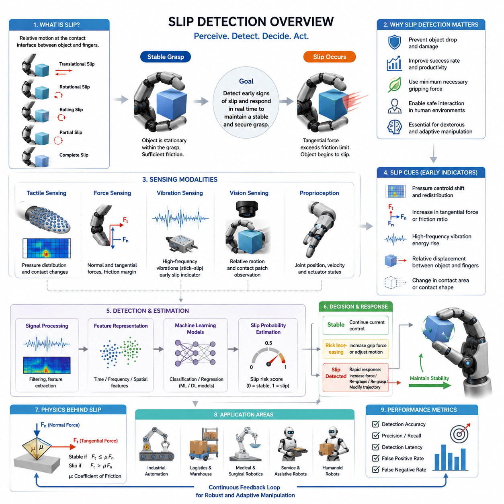
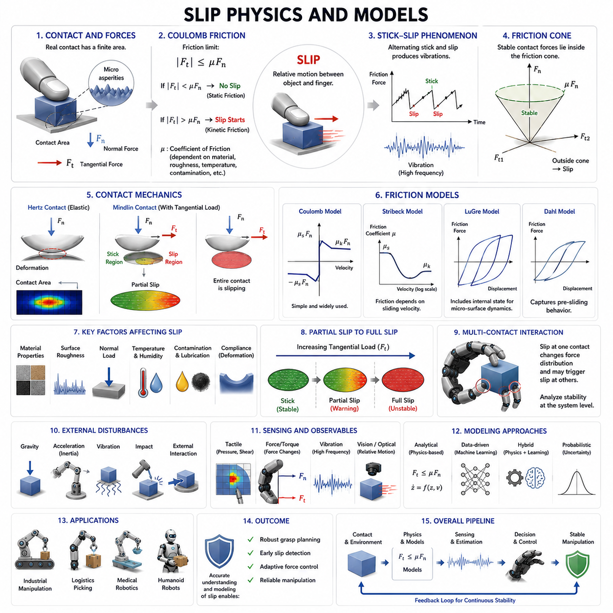
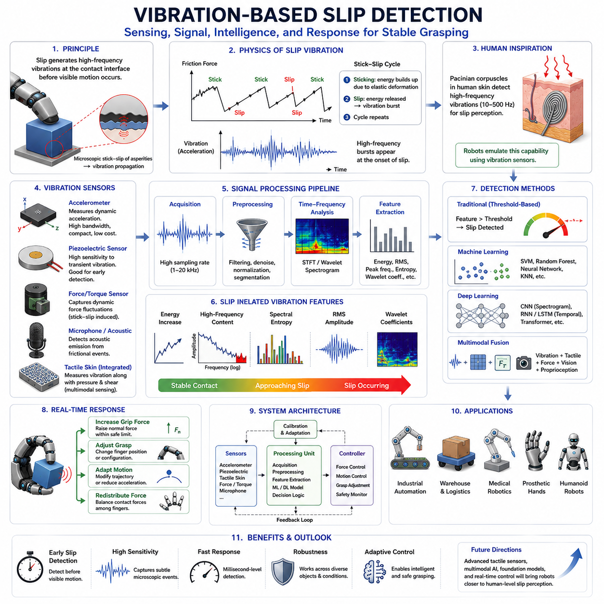
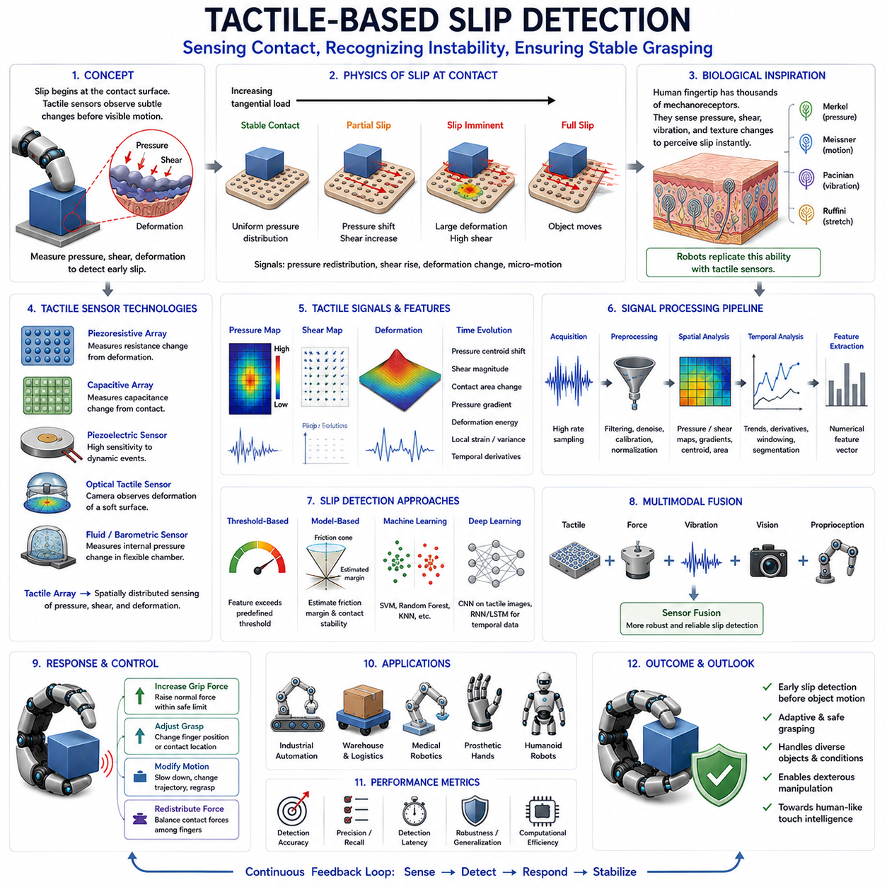
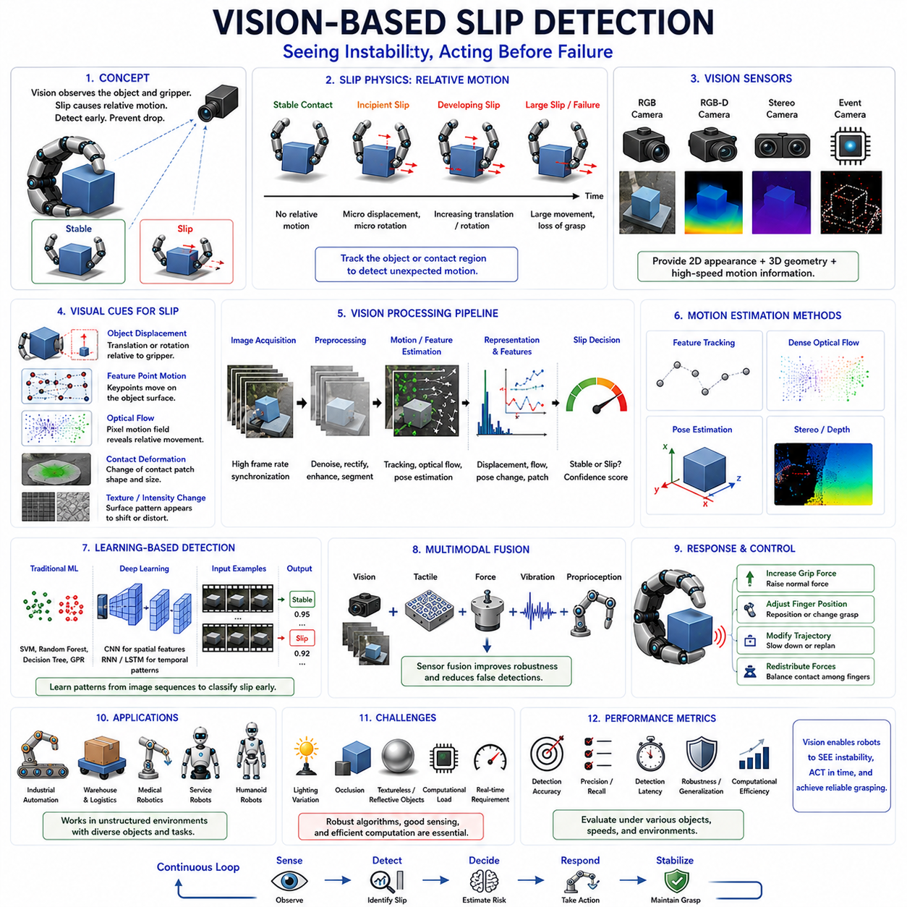
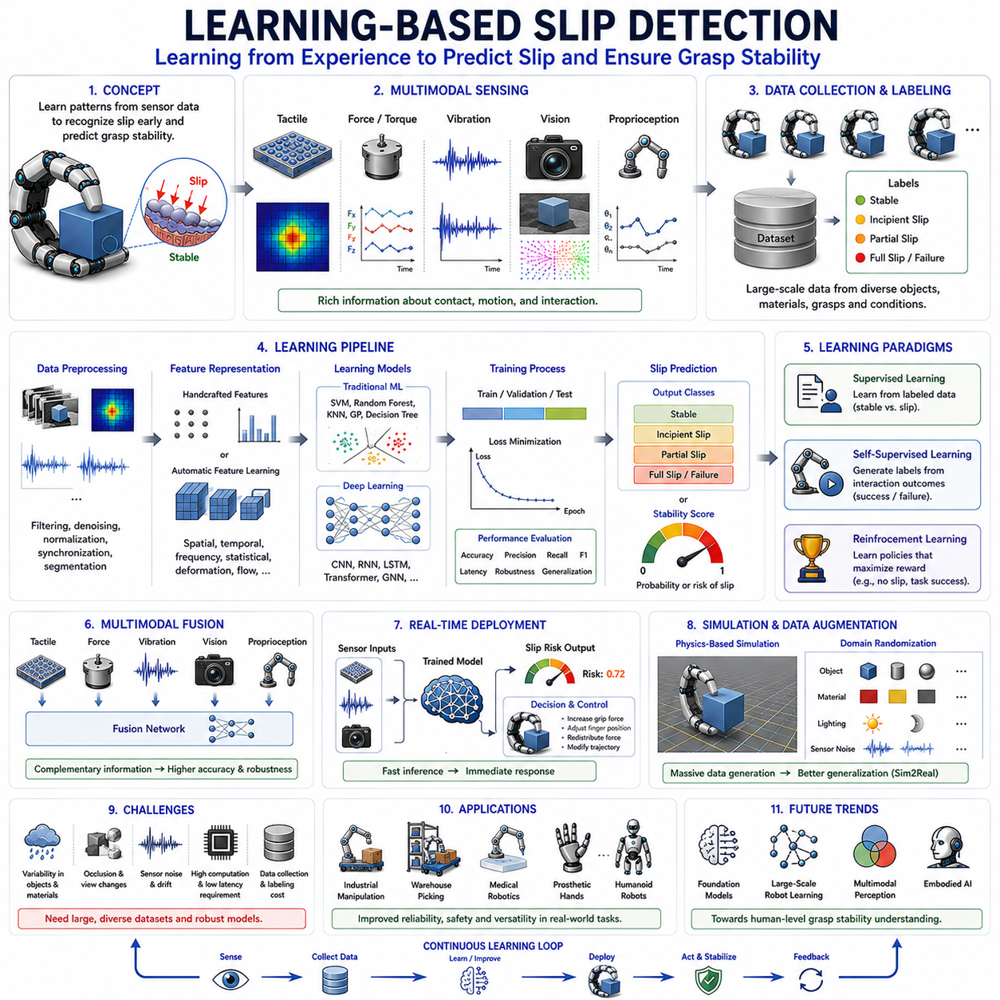
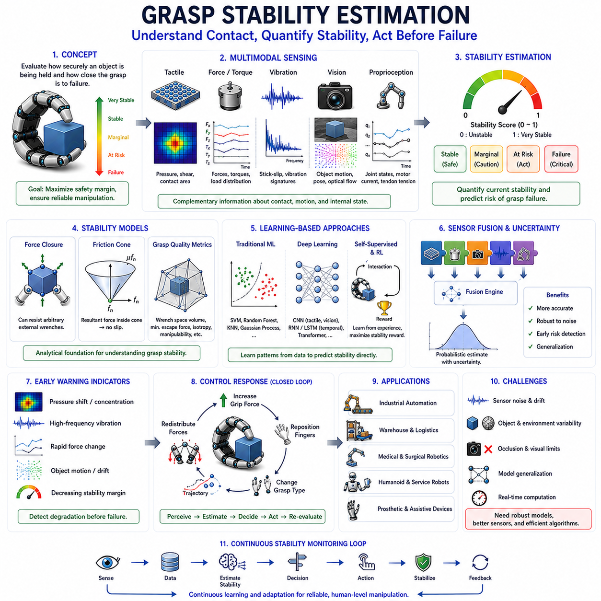
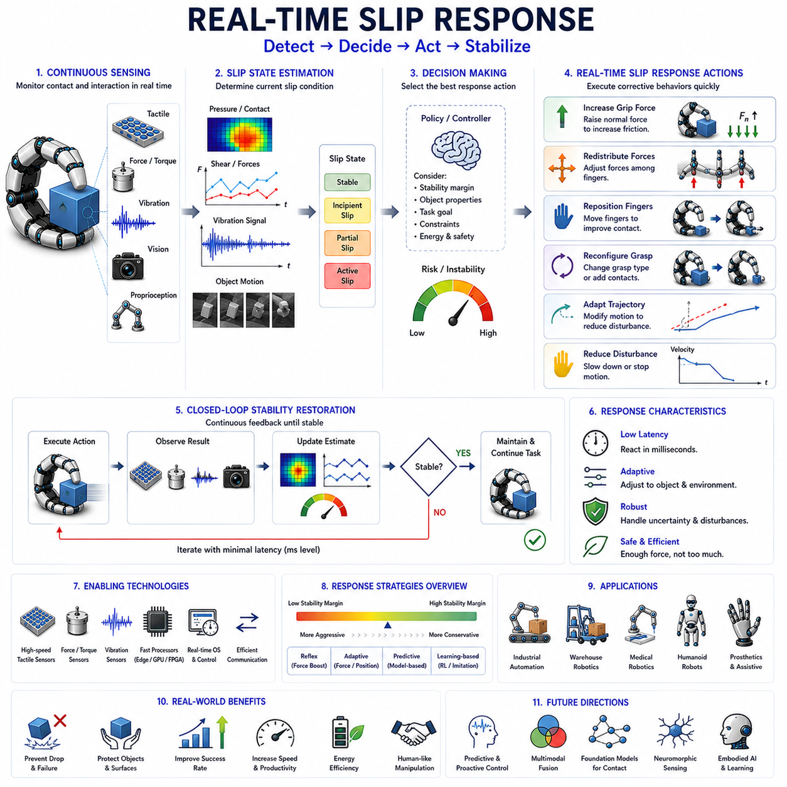
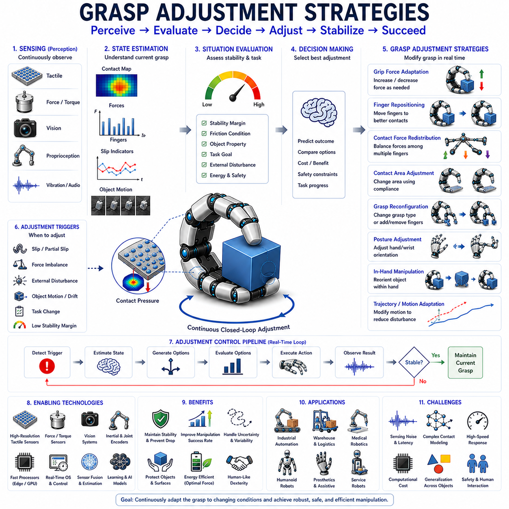
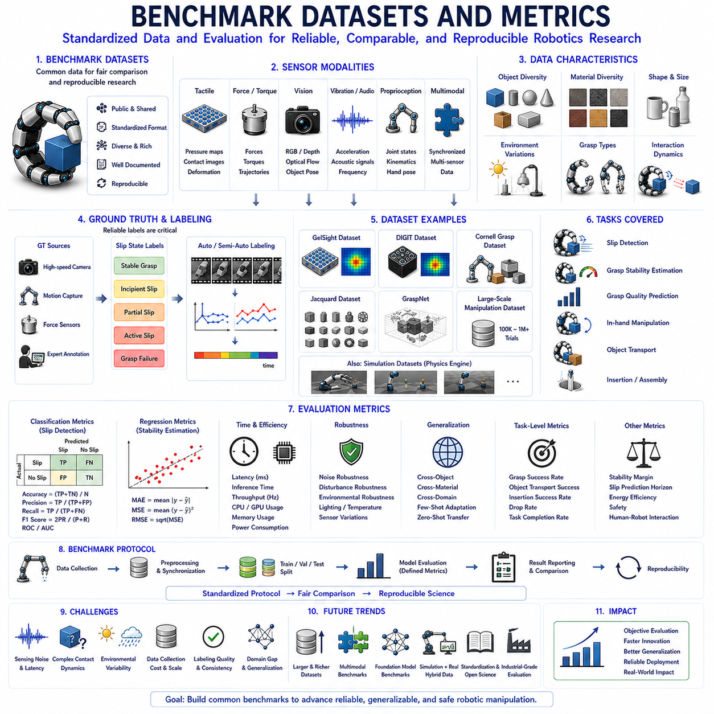

**Volume 06 Robot Hands and Dexterous Grasping**

# 08. Slip Detection and Grasp Stability

## 08.01 Introduction to Slip Detection

{width="7.268055555555556in" height="7.268055555555556in"}

미끄럼 감지(Slip Detection)는 로봇 파지(Robotic Grasping)와 정교 조작(Dexterous Manipulation)에서 가장 중요한 기능 중 하나이다. 로봇이 물체를 성공적으로 집고 초기에는 안정적인 파지를 형성하더라도, 마찰력 부족, 예기치 않은 외란, 물체 무게 변화, 표면 오염, 동적 움직임 또는 외부 힘 등의 영향으로 인해 물체와 손가락 사이에 상대 운동이 발생할 수 있다. 이러한 상대 운동이 시작되면 물체는 미끄러지기 시작한다. 만약 이를 신속하게 감지하고 대응하지 못하면 파지 실패로 이어져 물체 낙하, 제품 손상, 생산 공정 중단, 안전 문제 또는 작업 실패가 발생할 수 있다. 따라서 미끄럼 감지는 파지 안정성 제어(Grasp Stability Control)의 핵심 요소이며, 고급 로봇 핸드가 반드시 갖추어야 하는 기본 감지 기능으로 간주된다.

인간은 피부에 존재하는 촉각 감지 메커니즘을 통해 자연스럽게 미끄럼을 감지한다. 물체가 손가락 끝에서 미세하게 움직이기 시작하면 피부 속 기계수용기(Mechanoreceptor)가 미세 진동, 국부 변형, 접촉력 분포 변화를 감지한다. 이러한 신호는 신경계에 의해 거의 즉시 처리되며, 인간은 물체가 떨어지기 전에 자동으로 파지력을 증가시킨다. 로봇 시스템은 이러한 인간의 능력을 모방하기 위해 촉각 센서(Tactile Sensor), 힘 센서(Force Sensor), 비전 시스템(Vision System), 진동 센서(Vibration Sensor), 그리고 머신러닝(Machine Learning) 알고리즘을 활용한다. 궁극적인 목표는 미끄럼의 초기 징후를 인식하고 실시간으로 대응하여 안정적인 물체 제어를 수행하는 것이다.

로봇공학 관점에서 미끄럼은 물체와 그리퍼 접촉면 사이에서 발생하는 상대 운동으로 정의할 수 있다. 이 운동은 여러 형태로 나타난다. 병진 미끄럼(Translational Slip)은 물체가 접촉면을 따라 미끄러지는 현상이며, 회전 미끄럼(Rotational Slip)은 물체가 손가락에 대해 회전하는 경우를 의미한다. 구름 미끄럼(Rolling Slip)은 접촉을 유지한 상태에서 접촉점이 이동하는 현상이며, 부분 미끄럼(Partial Slip)은 접촉 영역의 일부만 움직이는 상태를 의미한다. 완전 미끄럼(Complete Slip)은 전체 접촉 영역이 정지 마찰 상태를 잃고 동마찰 상태로 전환되는 경우를 의미한다. 이러한 다양한 미끄럼 형태는 서로 다른 센서 신호를 생성하므로 각각에 대한 이해가 필요하다.

미끄럼의 물리적 원인은 마찰(Friction) 메커니즘과 밀접하게 관련된다. 고전적인 마찰 이론에 따르면 접촉면에서 발생하는 접선 방향 힘(Tangential Force)이 최대 마찰력보다 작을 경우 파지는 안정적으로 유지된다. 그러나 외부 힘이 증가하여 마찰 한계를 초과하면 접촉 상태는 정지 마찰(Static Friction)에서 동마찰(Kinetic Friction)로 전환되며 미끄럼이 발생한다. 이 과정은 이론적으로 단순해 보이지만 실제 환경에서는 표면 거칠기, 재료 특성, 접촉 형상, 온도, 습도, 탄성 변형 등의 영향으로 훨씬 복잡하게 나타난다.

로봇 파지에서 가장 어려운 문제 중 하나는 마찰계수(Friction Coefficient)를 정확히 알 수 없다는 점이다. 동일한 물체라도 환경 조건이나 표면 마모 상태에 따라 서로 다른 마찰 특성을 보일 수 있다. 따라서 로봇은 사전에 정의된 마찰 모델만으로 안정적인 파지를 보장할 수 없다. 대신 접촉 상태를 지속적으로 감시하고 실시간으로 안정성을 추정해야 하며, 이를 가능하게 하는 핵심 피드백 수단이 바로 미끄럼 감지이다.

미끄럼 감지는 크게 사후 감지(Reactive Detection)와 사전 감지(Proactive Detection)로 구분된다. 사후 감지는 실제 미끄럼이 발생한 이후에 이를 인식하고 파지력을 증가시키거나 자세를 수정하는 방식이다. 구현은 비교적 간단하지만 반응이 늦을 수 있다. 반면 사전 감지는 미끄럼이 본격적으로 발생하기 전에 나타나는 미세 진동, 접촉 압력 변화, 힘 분포 변화 등을 분석하여 잠재적인 불안정 상태를 예측한다. 이러한 방식은 더 빠른 대응이 가능하며 일반적으로 높은 안정성을 제공한다.

초기의 미끄럼 감지 시스템은 주로 힘 센서 기반이었다. 연구자들은 수직 힘(Normal Force)과 접선 힘(Tangential Force)의 비율 변화가 파지 실패를 예고한다는 사실을 발견하였다. 이를 통해 마찰 여유(Friction Margin)를 계산하고 파지 안정성을 추정할 수 있었다. 그러나 이러한 방식은 힘 정보만으로는 접촉 상태를 충분히 설명할 수 없기 때문에 복잡한 환경에서는 한계가 존재하였다.

촉각 센서 기술의 발전은 미끄럼 감지 성능을 크게 향상시켰다. 현대의 촉각 센서는 접촉면 전체에 걸쳐 압력 분포를 측정할 수 있으며, 이를 통해 물체가 미끄러질 때 나타나는 압력 중심 이동, 응력 분포 변화, 국부 압력 집중 현상을 감지할 수 있다. 이러한 정보는 미끄럼 발생 이전의 불안정 상태를 조기에 식별하는 데 매우 유용하다.

진동 기반 미끄럼 감지는 또 다른 중요한 접근 방법이다. 정지 마찰에서 동마찰로 전환되는 과정에서는 미세한 스틱-슬립(Stick-Slip) 현상이 발생하며, 이는 고주파 진동을 생성한다. 인간 역시 이러한 진동을 촉각 수용기를 통해 감지한다. 로봇에서는 가속도 센서(Accelerometer), 압전 센서(Piezoelectric Sensor), 마이크로폰(Microphone) 등을 이용하여 이러한 진동을 측정한다. 이후 푸리에 변환(Fourier Transform), 웨이블릿 변환(Wavelet Transform), 스펙트럼 분석(Spectral Analysis) 등을 통해 미끄럼 특유의 신호 패턴을 추출한다. 진동 기반 방식은 실제 물체 이동이 발생하기 전에 경고 신호를 제공할 수 있다는 장점이 있다.

비전 기반 미끄럼 감지 역시 최근 활발히 연구되고 있다. 카메라를 이용하여 물체와 그리퍼 사이의 상대 운동을 직접 측정하는 방식이다. 외부 카메라는 작업 공간 내 물체 위치 변화를 추적할 수 있으며, 손가락 끝에 장착된 카메라는 접촉 영역 자체를 관찰할 수 있다. 특히 GelSight와 같은 광학 촉각 센서는 접촉면의 미세 변형을 시각적으로 측정하여 매우 정밀한 미끄럼 감지를 가능하게 한다. 최근에는 딥러닝 기반 영상 분석 기술이 적용되면서 비전 기반 방식의 정확성과 강인성이 크게 향상되고 있다.

머신러닝 기술은 미끄럼 감지 분야에 큰 변화를 가져왔다. 전통적인 방법이 물리 모델과 경험적 임계값에 의존했다면, 머신러닝 기반 접근법은 센서 데이터로부터 자동으로 특징을 학습한다. 신경망(Neural Network), 서포트 벡터 머신(SVM), 랜덤 포레스트(Random Forest), CNN, RNN, Transformer 모델 등이 활용되고 있으며, 다양한 물체와 환경 조건에 대해 높은 일반화 성능을 보이고 있다.

최근에는 다중 센서 융합(Multimodal Sensor Fusion)이 중요한 연구 방향으로 자리 잡고 있다. 촉각 센서는 국부 접촉 정보를 제공하고, 힘 센서는 전체 상호작용 힘을 측정하며, 비전 시스템은 물체의 실제 움직임을 관찰한다. 또한 관절 위치 센서(Proprioceptive Sensor)는 손가락 상태를 추적하고, 진동 센서는 마찰 전이 현상을 감지한다. 이러한 정보를 통합함으로써 단일 센서보다 훨씬 높은 신뢰성과 정확도를 확보할 수 있다.

미끄럼 감지는 정교 조작(In-Hand Manipulation)에서 특히 중요하다. 손 안에서 물체를 회전시키거나 위치를 변경하는 과정에서는 의도된 움직임과 원하지 않는 미끄럼을 구분해야 한다. 두 경우 모두 상대 운동이 발생하기 때문에 이를 구별하는 것은 쉽지 않다. 따라서 고급 조작 시스템은 작업 목표, 접촉 상태 추정, 운동 계획 정보를 함께 활용하여 의도된 조작과 파지 실패를 구분한다.

산업용 로봇에서는 미끄럼 감지가 제품 품질과 생산성을 향상시키는 역할을 한다. 물체마다 재질과 표면 상태가 다르기 때문에 고정된 파지력만으로는 최적의 작업을 수행하기 어렵다. 미끄럼 감지를 활용하면 필요한 최소한의 힘만으로 안정적인 파지를 유지할 수 있어 제품 손상을 줄이고 에너지 소비를 절감할 수 있다.

물류 자동화 환경에서도 그 중요성은 매우 크다. 현대 물류창고는 수천 종의 서로 다른 상품을 처리한다. 종이 상자, 플라스틱 용기, 금속 부품, 비닐 포장 제품 등 다양한 재질을 다루어야 하기 때문에 마찰 특성이 지속적으로 변한다. 미끄럼 감지는 이러한 환경에서 자동 적응형 파지 제어를 가능하게 하여 피킹 성공률을 높이고 오류를 줄인다.

의료 로봇 분야에서도 미끄럼 감지는 필수적이다. 수술 로봇, 재활 로봇, 의수(Prosthetic Hand), 보조 로봇은 인체 조직이나 민감한 물체를 다루기 때문에 과도한 힘을 사용할 수 없다. 정확한 미끄럼 감지는 최소한의 힘으로도 안정적인 조작을 가능하게 하여 안전성과 사용성을 향상시킨다.

휴머노이드 로봇은 인간 환경에서 다양한 물체를 다루어야 하기 때문에 더욱 고도화된 미끄럼 감지 기능이 필요하다. 문 손잡이 조작, 공구 사용, 주방 작업, 의류 정리, 전자기기 취급 등 대부분의 일상 작업은 안정적인 파지 유지 능력을 요구한다. 따라서 인간 수준의 조작 능력을 구현하기 위해서는 매우 정교한 미끄럼 감지 기술이 필수적이다.

실시간 성능은 미끄럼 감지 시스템의 핵심 요구사항이다. 미끄럼이 시작된 후 대응이 늦으면 파지 실패를 막을 수 없다. 따라서 센서 응답 시간, 데이터 전송 지연, 알고리즘 처리 시간, 액추에이터 반응 속도 모두가 중요하다. 최근에는 엣지 컴퓨팅(Edge Computing)과 고속 AI 추론 기술을 활용하여 밀리초 단위의 실시간 미끄럼 감지가 가능해지고 있다.

미끄럼 감지 시스템의 성능 평가는 정확도(Accuracy), 정밀도(Precision), 재현율(Recall), 탐지 지연시간(Detection Latency), 오탐률(False Positive Rate), 미탐률(False Negative Rate) 등을 기준으로 수행된다. 또한 다양한 물체, 표면 재질, 파지 방식, 환경 조건에서의 성능을 종합적으로 평가해야 한다.

현재 연구자들은 표준화된 벤치마크 데이터셋과 평가 프로토콜을 개발하여 객관적인 성능 비교를 가능하게 하고 있다. 이는 기술 발전을 가속화하고 연구 결과의 재현성을 높이는 데 중요한 역할을 한다.

최근에는 대규모 AI 모델과 파운데이션 모델(Foundation Model)이 미끄럼 감지 연구에도 적용되기 시작하였다. 이러한 모델은 다양한 물체와 작업에서 학습된 접촉 지식을 활용하여 새로운 환경에서도 높은 일반화 성능을 제공할 가능성을 보여주고 있다.

미래의 로봇 핸드는 고해상도 촉각 피부(Tactile Skin), 광학 촉각 센서, 분산형 힘 센서 네트워크, 고성능 AI 기반 다중 센서 융합 시스템을 갖추게 될 것이다. 이러한 기술들이 결합되면 로봇은 인간 수준에 가까운 접촉 인지 능력과 파지 안정성 판단 능력을 획득할 수 있을 것으로 기대된다.

결국 미끄럼 감지는 감지(Sensing)와 행동(Action)을 연결하는 핵심 기술이다. 접촉 정보를 파지 안정성에 대한 의미 있는 판단으로 변환하고, 적응형 제어를 위한 피드백을 제공한다. 신뢰성 있는 미끄럼 감지 없이는 로봇 핸드가 실제 환경에서 요구되는 강인성(Robustness), 정교함(Dexterity), 적응성(Adaptability)을 달성하기 어렵다. 따라서 산업 자동화, 물류, 의료, 서비스 로봇, 휴머노이드 로봇이 발전할수록 미끄럼 감지 기술의 중요성은 더욱 커질 것이다.

## 08.02 Physics of Slip

{width="7.268055555555556in" height="7.268055555555556in"}

미끄럼(Slip)은 로봇 파지(Robotic Grasping)와 조작(Manipulation) 과정에서 발생하는 가장 기본적이면서도 중요한 물리 현상 중 하나이다. 로봇 핸드가 물체를 잡을 때 파지의 안정성은 접촉면이 상대 운동(Relative Motion)을 얼마나 효과적으로 억제할 수 있는지에 의해 결정된다. 접촉면에서 생성되는 마찰력(Friction Force)이 외부 힘을 충분히 견딜 수 있는 경우 물체는 안정적으로 유지된다. 그러나 마찰력이 부족해지면 물체와 손가락 사이에 상대 운동이 발생하게 되며, 이것이 바로 미끄럼이다. 따라서 미끄럼의 물리적 원리를 이해하는 것은 안정적인 파지 시스템 설계, 촉각 센서 개발, 힘 제어 알고리즘 구현, 그리고 정교 조작 기술 개발의 핵심 기반이 된다.

미끄럼을 이해하기 위해서는 먼저 접촉 역학(Contact Mechanics)을 이해해야 한다. 두 물체가 접촉할 때 힘은 접촉 영역(Contact Region)을 통해 전달된다. 이상적인 수학적 모델에서는 접촉이 하나의 점으로 표현되지만 실제 환경에서는 재료 특성, 형상, 하중 조건에 의해 결정되는 유한한 면적을 가진다. 이 접촉 영역에서는 표면에 수직한 방향으로 작용하는 수직 힘(Normal Force)과 표면에 평행하게 작용하는 접선 힘(Tangential Force)이 동시에 존재한다. 이러한 힘들의 상호작용이 접촉의 안정성 여부와 미끄럼 발생 여부를 결정한다.

미끄럼을 설명하는 가장 대표적인 이론은 쿨롱 마찰 이론(Coulomb Friction Theory)이다. 이 이론에 따르면 접촉면이 미끄러지지 않고 견딜 수 있는 최대 접선 힘은 수직 힘에 비례한다. 이때 비례 상수를 마찰계수(Coefficient of Friction)라고 한다. 접선 힘이 이 한계보다 작으면 접촉은 정지 상태를 유지하며, 이를 정지 마찰(Static Friction) 상태라고 한다. 반대로 접선 힘이 한계를 초과하면 접촉은 움직이기 시작하며 동마찰(Kinetic Friction) 상태로 전환된다.

하지만 실제 로봇 조작 환경은 쿨롱 마찰 모델보다 훨씬 복잡하다. 실제 표면은 현미경 수준에서 매우 거칠며 수많은 미세 돌기(Aspersity)로 구성되어 있다. 두 표면이 접촉하더라도 눈에 보이는 전체 면적이 실제로 접촉하는 것은 아니다. 대부분의 하중은 이러한 미세 돌기들이 담당한다. 따라서 마찰은 수많은 미세 접촉점에서 발생하는 변형, 접착, 파괴 현상의 집합적 결과로 나타난다. 다시 말해 미끄럼은 거시적(Macroscopic) 현상인 동시에 미시적(Microscopic) 현상이기도 하다.

정지 마찰에서 동마찰로 전환되는 과정은 미끄럼 물리학의 핵심이다. 일반적으로 정지 마찰력은 동마찰력보다 크다. 따라서 물체를 움직이기 시작시키는 데 필요한 힘이 움직이는 상태를 유지하는 데 필요한 힘보다 크다. 이 특성 때문에 파지가 한 번 불안정해지기 시작하면 미끄럼이 급격히 진행되는 경우가 많다.

이 과정에서 중요한 현상이 스틱-슬립(Stick-Slip) 현상이다. 스틱-슬립은 접촉면이 순간적으로 붙었다가(Stick) 다시 미끄러지는(Slip) 과정을 반복하는 현상이다. 접촉면이 붙어 있는 동안 에너지가 축적되고, 미끄러지는 순간 에너지가 방출된다. 이 과정이 반복되면서 특징적인 진동이 발생한다. 인간의 손가락 역시 이러한 진동을 감지하여 미끄럼을 인식한다. 로봇에서도 이러한 진동은 가장 중요한 미끄럼 감지 신호 중 하나로 활용된다.

마찰계수는 미끄럼 모델에서 매우 중요한 변수이지만 실제 환경에서는 일정한 값이 아니다. 마찰계수는 재료 종류, 표면 거칠기, 온도, 습도, 오염 상태, 윤활 상태, 접촉 압력 등 다양한 요인의 영향을 받는다. 예를 들어 금속 표면은 깨끗한 상태와 기름이 묻은 상태에서 전혀 다른 마찰 특성을 나타낸다. 고무와 같은 연성 재료는 변형 정도에 따라 마찰 특성이 비선형적으로 변화하기도 한다. 이러한 특성 때문에 실제 환경에서 미끄럼을 예측하는 것은 매우 어려운 문제이다.

표면 거칠기(Surface Roughness)는 마찰과 미끄럼 특성에 큰 영향을 미친다. 적절한 거칠기는 표면 사이의 기계적 맞물림(Mechanical Interlocking)을 증가시켜 마찰력을 향상시킨다. 그러나 지나치게 거친 표면은 실제 접촉 면적을 감소시키고 예측하기 어려운 접촉 특성을 만들 수 있다. 반대로 매우 매끄러운 표면은 기계적 맞물림은 감소하지만 접착력(Adhesion)이 증가할 수 있다. 결국 전체 마찰 특성은 이러한 여러 메커니즘의 균형에 의해 결정된다.

재료의 순응성(Compliance) 또한 미끄럼에 중요한 영향을 미친다. 강체 접촉(Rigid Contact)은 정지 상태에서 미끄럼 상태로 갑작스럽게 전환되는 경향이 있다. 반면 연성 재료는 접촉 시 변형이 발생하여 힘을 넓은 영역으로 분산시킨다. 이러한 특성은 국부적인 응력 집중을 줄이고 미끄럼 발생을 지연시키는 효과를 가진다. 소프트 로봇 그리퍼가 우수한 파지 성능을 보이는 이유 중 하나도 바로 이러한 순응성 때문이다.

접촉 역학 분야에서는 헤르츠 접촉 이론(Hertz Contact Theory)을 사용하여 접촉 면적, 압력 분포, 변형 특성을 분석한다. 헤르츠 이론은 주로 수직 하중에 의한 탄성 변형을 설명하지만, 접촉 현상을 이해하는 기본 틀을 제공한다. 이후 확장된 마인들린 접촉 이론(Mindlin Contact Theory)은 접선 하중까지 고려하여 부분 미끄럼(Partial Slip)을 설명한다.

부분 미끄럼은 실제 로봇 조작에서 매우 중요한 현상이다. 완전한 미끄럼이 발생하기 전에 접촉 영역의 일부에서만 국부적인 미끄럼이 먼저 시작된다. 일반적으로 응력이 집중되는 경계 영역에서 부분 미끄럼이 발생하며, 접선 힘이 증가함에 따라 미끄럼 영역이 점차 확장된다. 결국 전체 접촉면이 미끄러지는 완전 미끄럼 상태로 전환된다. 부분 미끄럼을 조기에 감지할 수 있다면 물체가 떨어지기 전에 적절한 제어를 수행할 수 있다.

마찰 콘(Friction Cone)은 로봇 파지 이론에서 매우 중요한 개념이다. 특정 접촉점에서 미끄럼 없이 유지될 수 있는 모든 접촉 힘은 원뿔 형태의 공간으로 표현된다. 접촉 힘이 이 원뿔 내부에 존재하면 안정적인 상태이며, 원뿔 경계에 가까워질수록 미끄럼 위험이 증가한다. 힘이 원뿔 밖으로 벗어나면 미끄럼은 불가피하게 발생한다. 마찰 콘은 파지 안정성을 기하학적으로 해석하는 강력한 도구이다.

다지형 로봇 핸드(Multi-Finger Hand)에서는 미끄럼 현상이 더욱 복잡해진다. 각각의 손가락은 서로 다른 접촉 조건과 마찰 특성을 가진다. 한 손가락에서 발생한 미끄럼은 전체 힘 분포를 변화시키고 다른 접촉점의 안정성에도 영향을 준다. 따라서 다지형 파지에서는 개별 접촉이 아닌 전체 시스템 수준에서 안정성을 분석해야 한다.

물체 형상 역시 중요한 변수이다. 원통형, 구형, 평판형, 비정형 물체는 각각 다른 접촉 구조와 힘 분포를 형성한다. 곡면 물체의 경우 단순한 미끄럼뿐 아니라 굴림(Rolling) 현상도 함께 발생할 수 있다. 따라서 정확한 미끄럼 모델을 구축하기 위해서는 재료 특성뿐 아니라 물체 형상까지 고려해야 한다.

외란(Disturbance)은 미끄럼 발생의 주요 원인 중 하나이다. 중력, 관성력, 진동, 충격, 외부 접촉 등은 모두 접촉 상태를 변화시킬 수 있다. 특히 동적 조작 과정에서는 가속도에 의해 접선 힘이 크게 증가할 수 있다. 정적 상태에서는 안정적인 파지도 빠른 움직임 중에는 불안정해질 수 있다. 따라서 정적 안정성과 동적 안정성을 구분하여 분석하는 것이 중요하다.

이러한 한계를 극복하기 위해 다양한 동적 마찰 모델이 개발되었다. 대표적인 모델 중 하나가 스트리벡(Stribeck) 마찰 모델이다. 이 모델은 마찰력이 속도에 따라 변화하는 현상을 설명한다. 실제로 많은 재료는 속도가 증가함에 따라 마찰력이 감소하거나 비선형적으로 변화하는 특성을 보인다.

루그레(LuGre) 마찰 모델은 더욱 발전된 접근법이다. 이 모델은 마찰을 단순한 힘으로 보지 않고 접촉면 내부 상태를 나타내는 변수(State Variable)를 도입한다. 이를 통해 히스테리시스(Hysteresis), 사전 미끄럼(Presliding), 스틱-슬립 현상 등을 보다 정확하게 표현할 수 있다. 따라서 로봇 시뮬레이션과 제어 연구에서 널리 활용되고 있다.

달(Dahl) 마찰 모델은 사전 미끄럼 영역에 초점을 맞춘다. 실제로 눈에 보이는 미끄럼이 발생하기 전에도 접촉면 내부에서는 미세 변형이 발생하며 탄성 에너지가 저장된다. 이러한 현상을 모델링함으로써 미끄럼 발생 시점을 보다 정확하게 예측할 수 있다.

최근에는 확률론적(Probabilistic) 접근 방식이 주목받고 있다. 실제 환경에서는 마찰계수를 정확히 알 수 없기 때문에 하나의 값이 아닌 확률 분포로 표현하는 것이 더 현실적이다. 베이지안 추정(Bayesian Estimation), 파티클 필터(Particle Filter), 확률적 접촉 모델(Stochastic Contact Model) 등을 이용하여 센서 정보에 따라 실시간으로 안정성을 업데이트할 수 있다.

촉각 센서 기술의 발전은 미끄럼 모델링 분야에도 큰 변화를 가져왔다. 현대 촉각 센서는 압력 분포, 전단력(Shear Force), 변형, 진동 등을 공간적으로 측정할 수 있다. 이러한 정보는 기존 힘 센서만으로는 얻을 수 없는 풍부한 접촉 정보를 제공한다. 이를 기반으로 한 데이터 기반 모델은 복잡한 물리적 파라미터를 정확히 알지 못하더라도 높은 예측 성능을 달성할 수 있다.

머신러닝 역시 미끄럼 모델링에 새로운 가능성을 제공하고 있다. 신경망은 센서 데이터와 미끄럼 상태 사이의 복잡한 관계를 자동으로 학습할 수 있다. 딥러닝 기반 모델은 다양한 물체와 환경에서 높은 성능을 보이고 있으며, 최근에는 물리 기반 모델과 학습 기반 모델을 결합한 하이브리드 접근법이 활발히 연구되고 있다.

비전 기반 미끄럼 모델도 중요한 연구 분야이다. 카메라는 물체와 그리퍼 사이의 상대 운동을 직접 관찰할 수 있으며, 광학 촉각 센서는 접촉면 변형을 시각적으로 측정할 수 있다. 이러한 정보는 이론 모델을 검증하고 개선하는 데 매우 유용하다.

시뮬레이션은 미끄럼 물리학 연구에서 필수적인 도구이다. 현대 물리 엔진은 점점 더 정교한 마찰 모델과 접촉 모델을 포함하고 있다. 하지만 실제 마찰 현상은 매우 비선형적이고 작은 변수에도 민감하기 때문에 현실을 완벽하게 재현하는 것은 여전히 어려운 문제이다.

로봇 파지 계획(Grasp Planning)에서는 미끄럼 모델이 안정성 평가에 직접 활용된다. 파지 후보를 평가할 때 마찰 여유(Friction Margin), 힘 폐쇄(Force Closure), 미끄럼 확률 등을 계산하여 가장 안정적인 파지 자세를 선택한다.

산업용 로봇, 물류 로봇, 의료 로봇, 휴머노이드 로봇 모두 다양한 물체와 환경을 다루어야 한다. 따라서 미끄럼 물리학에 대한 정확한 이해는 안전성, 신뢰성, 작업 성공률 향상의 핵심 요소가 된다.

최근 연구는 미끄럼을 단순한 현상이 아닌 전체 접촉 지능(Contact Intelligence)의 일부로 바라보고 있다. 힘 제어, 촉각 인지, 파지 적응, 조작 계획을 통합적으로 고려하는 방향으로 발전하고 있으며, 고해상도 촉각 센서, 다중 센서 융합, 파운데이션 모델(Foundation Model), 실시간 물리 시뮬레이션 기술이 이러한 발전을 가속화하고 있다.

결국 미끄럼 물리학은 파지 안정성의 과학적 기반이다. 모든 성공적인 로봇 파지는 안정적인 접촉 상태와 상대 운동 발생 조건을 정확히 이해하고 예측할 수 있어야 한다. 고전적인 마찰 이론, 현대 접촉 역학, 확률론적 추론, 촉각 센서 기술, 머신러닝 기술이 결합되면서 로봇은 인간이 일상적으로 수행하는 수준에 가까운 미끄럼 대응 능력을 점차 획득해 가고 있다.

## 08.03 Vibration-Based Slip Detection

{width="7.268055555555556in" height="7.268055555555556in"}

진동 기반 미끄럼 감지(Vibration-Based Slip Detection)는 로봇 파지(Robotic Grasping)에서 미끄럼(Slip)을 식별하기 위한 가장 효과적이며 생물학적으로 영감을 받은 방법 중 하나이다. 인간은 물체를 잡을 때 단순히 힘만 느끼는 것이 아니라 접촉면에서 발생하는 미세한 진동을 지속적으로 감지한다. 손가락 피부 내부에 존재하는 특수 기계수용기(Mechanoreceptor)는 미끄럼이 시작될 때 발생하는 고주파 진동에 매우 민감하게 반응한다. 이러한 감각 시스템 덕분에 인간은 물체가 실제로 떨어지기 전에 미끄럼의 초기 징후를 감지하고 자동으로 파지력을 증가시킨다. 로봇 분야의 진동 기반 미끄럼 감지는 이러한 인간의 능력을 모방하여 접촉면에서 발생하는 동적 진동(Dynamic Vibration)을 측정하고 분석함으로써 미끄럼을 조기에 감지하는 기술이다. 파지 안정성(Grasp Stability) 관점에서 볼 때 진동 센싱은 물체가 눈에 띄게 움직이기 전에 위험을 알려주는 조기 경고 시스템(Early Warning System) 역할을 수행한다.

진동 기반 미끄럼 감지의 기본 원리는 마찰 접촉 역학(Frictional Contact Mechanics)에 기반한다. 두 표면이 서로 상대 운동 없이 접촉하고 있을 때는 접촉력이 비교적 안정적인 상태를 유지한다. 그러나 접선 방향 하중(Tangential Load)이 마찰 한계(Friction Limit)에 가까워지면 접촉면 내부의 미세 영역에서 국부적인 불안정성이 발생하기 시작한다. 미세 돌기(Aspersity)들은 반복적으로 변형되고 분리되며 다시 접촉하는 과정을 거치게 된다. 이러한 과정에서 힘의 진동이 발생하며, 이 진동은 물체와 그리퍼 구조를 따라 전파된다. 비록 물체가 아직 눈에 띄게 움직이지 않더라도 이러한 미세한 동적 변화는 측정 가능한 진동 신호를 생성한다.

진동 발생의 가장 중요한 원인 중 하나는 스틱-슬립(Stick-Slip) 현상이다. 스틱-슬립은 접촉면이 순간적으로 붙어 있다가(Stick) 다시 미끄러지는(Slip) 상태를 반복하는 현상이다. 접촉면이 고정된 상태에서는 탄성 에너지가 축적되고, 마찰 한계가 초과되는 순간 저장된 에너지가 급격히 방출되면서 미끄럼이 발생한다. 이 과정에서 순간적인 진동이 생성되며, 이러한 사이클이 반복되면서 특징적인 고주파 진동 패턴이 형성된다. 진동 기반 미끄럼 감지는 바로 이러한 패턴을 분석하여 미끄럼을 판단한다.

진동 기반 접근법의 가장 큰 장점은 매우 높은 민감도(Sensitivity)에 있다. 힘 기반 시스템은 접촉력이 충분히 변해야만 불안정 상태를 인식할 수 있으며, 비전 기반 시스템은 물체가 실제로 이동해야만 미끄럼을 확인할 수 있다. 반면 진동 센서는 미세한 접촉 변화만으로도 미끄럼 위험을 감지할 수 있다. 따라서 실제 미끄럼이 발생하기 전에 파지력을 조정할 수 있으며, 이는 사후 대응(Reactive Control)이 아닌 사전 대응(Proactive Control)을 가능하게 한다.

인간의 촉각 시스템은 진동 기반 미끄럼 감지 연구의 중요한 참고 모델이다. 인간 손가락 끝에는 파치니 소체(Pacinian Corpuscle)라고 불리는 기계수용기가 존재한다. 이 수용기는 수십 헤르츠에서 수백 헤르츠에 이르는 고주파 진동을 매우 민감하게 감지할 수 있으며, 인간의 미끄럼 인지 능력에 핵심적인 역할을 수행한다. 많은 로봇 촉각 센서 연구는 이러한 생물학적 구조를 모방하여 설계된다.

미끄럼에 의해 생성되는 진동의 주파수 특성(Frequency Characteristics)은 재료 특성, 표면 거칠기, 접촉 형상, 수직 힘, 상대 속도 등에 따라 달라진다. 거친 표면은 매끄러운 표면과 다른 스펙트럼을 생성하며, 금속과 같은 강체 재료는 고무와 같은 연성 재료보다 더욱 높은 주파수 성분을 생성하는 경향이 있다. 또한 수직 힘이 증가하면 접촉 강성(Contact Stiffness)이 변화하면서 진동의 크기와 주파수 특성도 달라진다. 따라서 다양한 환경에서 안정적인 감지를 위해서는 이러한 변수들을 고려해야 한다.

진동 측정을 위해 다양한 센서 기술이 사용된다. 가장 널리 사용되는 센서는 가속도 센서(Accelerometer)이다. 가속도 센서는 크기가 작고 민감도가 높으며 통합이 용이하기 때문에 로봇 손가락, 그리퍼 구조물, 손목부 등에 쉽게 장착할 수 있다. 특히 MEMS 기반 가속도 센서는 저비용, 저전력, 고대역폭 특성을 제공하여 많은 로봇 시스템에서 활용된다.

압전 센서(Piezoelectric Sensor)도 매우 중요한 기술이다. 압전 재료는 기계적 변형을 전기 신호로 변환하는 특성을 가진다. 이러한 센서는 동적 하중과 진동에 매우 민감하게 반응하므로 초기 미끄럼 감지에 적합하다. 특히 미세한 진동 신호까지 측정할 수 있어 고성능 로봇 핸드에서 자주 사용된다.

힘-토크 센서(Force-Torque Sensor)도 진동 분석에 활용될 수 있다. 본래는 정적 힘 측정을 목적으로 설계되었지만 충분한 대역폭을 가진 센서는 스틱-슬립 과정에서 발생하는 동적 힘 변화를 측정할 수 있다. 적절한 신호 처리 기법과 결합하면 미끄럼의 중요한 지표를 제공할 수 있다.

마이크로폰(Microphone)이나 음향 센서(Acoustic Sensor)를 이용하는 방법도 연구되고 있다. 마찰 과정에서는 가청 주파수 또는 초음파 대역의 음향 방출(Acoustic Emission)이 발생한다. 이를 분석하면 접촉 상태와 미끄럼 여부를 추정할 수 있다. 다만 주변 소음의 영향을 받기 쉽다는 단점이 있다.

최근의 고급 촉각 센서는 진동 감지 기능을 직접 포함하고 있다. 압력 분포, 전단력(Shear Force), 진동을 동시에 측정할 수 있는 촉각 피부(Tactile Skin)와 광학 촉각 센서(Optical Tactile Sensor)가 대표적인 예이다. 이러한 다중 센서 구조는 단일 진동 센서보다 훨씬 풍부한 정보를 제공한다.

진동 신호를 정확히 측정하기 위해서는 적절한 샘플링 속도(Sampling Rate)가 필요하다. 미끄럼과 관련된 진동은 주로 고주파 대역에 존재하기 때문에 센서의 대역폭(Bandwidth)이 충분해야 한다. 샘플링 속도가 너무 낮으면 중요한 정보가 손실될 수 있으므로 일반적으로 수 kHz에서 수십 kHz 수준의 샘플링 주파수가 사용된다.

원시 진동 신호(Raw Signal)는 모터, 기어박스, 구조 공진, 전자 회로 등 다양한 원인에 의해 노이즈가 포함된다. 따라서 전처리(Preprocessing)가 필수적이다. 저역 통과 필터(Low-Pass Filter), 고역 통과 필터(High-Pass Filter), 대역 통과 필터(Band-Pass Filter), 정규화(Normalization), 잡음 제거(Noise Reduction) 등의 기법이 사용된다. 이러한 과정을 통해 미끄럼과 관련된 신호를 더욱 명확하게 추출할 수 있다.

주파수 영역(Frequency Domain) 분석은 진동 기반 미끄럼 감지에서 가장 널리 사용되는 방법이다. 푸리에 변환(Fourier Transform)을 이용하면 시간 영역(Time Domain)의 신호를 주파수 영역으로 변환할 수 있다. 연구 결과에 따르면 미끄럼이 발생할 때는 특정 주파수 대역에서 에너지가 증가하는 특징이 나타난다. 따라서 스펙트럼 분석은 미끄럼 상태를 판별하는 강력한 도구가 된다.

단시간 푸리에 변환(STFT, Short-Time Fourier Transform)은 시간에 따른 주파수 변화까지 분석할 수 있게 해준다. 이를 통해 생성된 스펙트로그램(Spectrogram)은 미끄럼 발생 과정에서 주파수 성분이 어떻게 변화하는지 시각적으로 보여준다.

웨이블릿 변환(Wavelet Transform)은 순간적인 진동 이벤트를 분석하는 데 매우 유용하다. 푸리에 변환이 전체 신호를 정현파로 분해하는 반면, 웨이블릿은 짧은 시간 동안 발생하는 신호 변화를 효과적으로 표현할 수 있다. 미끄럼 초기 단계에서 발생하는 순간적인 진동 신호를 검출하는 데 특히 적합하다.

특징 추출(Feature Extraction)은 원시 진동 데이터를 분류 가능한 형태로 변환하는 과정이다. RMS(Root Mean Square), 신호 에너지, 최대 주파수, 스펙트럼 엔트로피(Spectral Entropy), 왜도(Skewness), 첨도(Kurtosis), 웨이블릿 계수(Wavelet Coefficient) 등이 대표적인 특징으로 사용된다.

가장 단순한 방식은 임계값 기반(Threshold-Based) 감지이다. 특정 특징값이 미리 정의된 기준을 초과하면 미끄럼으로 판단한다. 구현이 쉽지만 다양한 물체와 환경에 일반화하기 어렵다는 한계가 있다.

머신러닝(Machine Learning)은 이러한 문제를 크게 개선하였다. SVM(Support Vector Machine), 랜덤 포레스트(Random Forest), 의사결정트리(Decision Tree), 인공신경망(Artificial Neural Network) 등의 알고리즘은 진동 특징과 미끄럼 상태 사이의 복잡한 관계를 학습할 수 있다. 이를 통해 다양한 환경에서도 높은 정확도를 달성할 수 있다.

딥러닝(Deep Learning)은 더욱 발전된 성능을 제공한다. CNN(Convolutional Neural Network)은 스펙트로그램 이미지를 직접 분석할 수 있으며, RNN(Recurrent Neural Network)과 LSTM(Long Short-Term Memory)은 시간에 따른 신호 변화를 효과적으로 모델링할 수 있다. 최근에는 Transformer 기반 모델도 촉각 및 진동 데이터 분석에 적용되고 있다.

현대의 연구는 다중 센서 융합(Multimodal Fusion) 방향으로 발전하고 있다. 진동 센서, 촉각 센서, 힘 센서, 비전 센서, 관절 센서(Proprioception)를 함께 사용하면 훨씬 높은 신뢰성을 확보할 수 있다. 예를 들어 진동 센서는 미끄럼 초기 신호를 감지하고, 촉각 센서는 압력 분포 변화를 측정하며, 힘 센서는 접선 하중 증가를 확인할 수 있다.

실시간 처리(Real-Time Processing)는 매우 중요하다. 미끄럼을 감지하더라도 대응이 늦으면 물체는 이미 떨어질 수 있다. 따라서 센싱, 신호 처리, 의사결정, 제어까지 전체 과정이 수 밀리초(ms) 수준에서 수행되어야 한다. 최신 엣지 AI 프로세서와 고속 DSP 기술은 이러한 요구사항을 충족시키고 있다.

미끄럼이 감지되면 로봇은 적절한 대응을 수행해야 한다. 가장 일반적인 방법은 파지력(Grip Force)을 증가시키는 것이다. 수직 힘을 증가시키면 마찰 한계도 함께 증가하여 안정성을 회복할 수 있다. 그러나 지나친 힘은 물체 손상을 유발할 수 있으므로 최소한의 힘만 증가시키는 것이 바람직하다.

더 발전된 시스템은 손가락 위치를 조정하거나 파지 자세를 변경하고, 여러 손가락 사이의 힘 분포를 재조정하며, 조작 경로를 수정하기도 한다. 이처럼 진동 기반 미끄럼 감지는 단순한 감지 기능을 넘어 적응형 파지 제어(Adaptive Grasp Control)의 핵심 요소로 발전하고 있다.

산업 자동화에서는 다양한 표면 상태와 재질을 가진 부품을 안정적으로 다루기 위해 진동 기반 미끄럼 감지가 활용된다. 물류 로봇은 수많은 포장재와 제품을 처리해야 하므로 이러한 기술의 이점이 매우 크다.

의료 로봇 분야에서는 연조직(Soft Tissue)을 다루는 과정에서 과도한 힘을 방지하면서도 안정적인 접촉을 유지해야 한다. 또한 의수(Prosthetic Hand)는 진동 감지를 통해 사용자에게 보다 자연스러운 물체 조작 능력을 제공할 수 있다.

휴머노이드 로봇과 서비스 로봇은 일상 환경의 수많은 물체를 다루어야 한다. 물체의 재질, 무게, 형상은 매우 다양하며 사전에 알려지지 않은 경우가 많다. 진동 기반 미끄럼 감지는 이러한 불확실성을 극복하기 위한 효율적이고 생체 모방적인 해결책을 제공한다.

결국 진동 기반 미끄럼 감지는 접촉 물리(Contact Physics)와 적응형 제어(Adaptive Control)를 연결하는 핵심 기술이다. 접촉면에서 발생하는 미세한 마찰 현상을 실시간으로 감지하여 로봇이 적절한 행동을 수행하도록 만든다. 특히 진동은 실제 물체 이동보다 먼저 발생하기 때문에 파지 불안정성을 가장 빠르게 알려주는 신호 중 하나이다. 따라서 인간 수준의 정교한 파지 능력을 구현하기 위해서는 진동 기반 미끄럼 감지가 필수적인 기술로 자리 잡고 있으며, 앞으로도 촉각 센서, AI, 다중 센서 융합 기술과 함께 지속적으로 발전할 것으로 예상된다.

## 08.04 Tactile-Based Slip Detection

{width="7.268055555555556in" height="7.268055555555556in"}

촉각 기반 미끄럼 감지(Tactile-Based Slip Detection)는 현대 로봇 파지 시스템에서 가장 중요한 감지 기능 중 하나이다. 힘 센서(Force Sensor)가 전체적인 상호작용 힘을 측정하고 비전 시스템(Vision System)이 외부에서 물체의 움직임을 관찰하는 반면, 촉각 센서(Tactile Sensor)는 로봇 손가락과 물체 사이의 실제 접촉면(Contact Interface)에서 발생하는 물리적 상호작용을 직접 측정할 수 있다. 미끄럼은 바로 이 접촉 영역에서 시작되기 때문에 촉각 센서는 물체가 눈에 띄게 움직이기 전에 발생하는 초기 불안정성 신호를 감지할 수 있다. 따라서 인간 수준의 정교한 조작 능력을 목표로 하는 로봇 핸드에서 촉각 기반 미끄럼 감지는 안정적인 파지, 적응형 조작, 그리고 불확실한 환경에서의 강인한 작업 수행을 가능하게 하는 핵심 기술로 자리 잡고 있다.

인간의 물체 조작 능력은 촉각 기반 미끄럼 감지의 가장 중요한 생물학적 모델이다. 인간의 손가락 끝에는 수천 개의 기계수용기(Mechanoreceptor)가 분포되어 있으며, 이들은 압력 분포, 국부 변형, 전단 응력(Shear Stress), 진동(Vibration), 표면 질감(Texture), 접촉 변화(Contact Transition) 등을 지속적으로 감지한다. 물체가 미끄러지기 시작하면 피부 변형 패턴이 미세하게 변화하고, 신경계는 이를 거의 즉시 인식하여 자동으로 파지력을 증가시킨다. 대부분의 경우 인간은 이러한 과정을 의식하지 못할 정도로 자연스럽게 수행한다. 로봇 촉각 시스템은 인공 센서와 신호 처리 알고리즘, 그리고 지능형 제어기를 통해 이러한 인간의 능력을 모방하고자 한다.

촉각 기반 미끄럼 감지의 핵심 개념은 미끄럼이 단순한 운동(Motion) 현상이 아니라 접촉(Contact) 현상이라는 점이다. 물체가 실제로 이동하기 전에 접촉 조건은 먼저 변화하기 시작한다. 압력 분포가 이동하고, 전단력이 증가하며, 접촉 영역이 변형되고, 미세한 상대 운동이 발생한다. 이러한 변화는 촉각 신호에 특징적인 패턴으로 나타나며, 이를 분석함으로써 로봇은 미끄럼을 조기에 감지할 수 있다.

촉각 기반 미끄럼 감지의 물리적 배경은 접촉 역학(Contact Mechanics)과 마찰 이론(Friction Theory)에 기반한다. 안정적인 파지 상태에서는 접촉력이 마찰 한계(Friction Limit) 내부에 존재하며 압력 분포와 변형 패턴이 비교적 일정하게 유지된다. 그러나 접선 방향 하중(Tangential Load)이 증가하면서 마찰 여유(Friction Margin)가 감소하면 접촉면 일부에서 부분 미끄럼(Partial Slip)이 발생하기 시작한다. 이 상태에서는 일부 영역은 여전히 고정되어 있지만 다른 영역은 미세하게 움직인다. 이러한 부분 미끄럼은 완전 미끄럼 이전에 나타나는 매우 중요한 전조 현상이며, 촉각 센서를 통해 감지할 수 있는 가장 가치 있는 정보 중 하나이다.

미끄럼과 관련된 가장 중요한 촉각 신호 중 하나는 압력 재분포(Pressure Redistribution)이다. 안정적인 파지에서는 압력이 물체 형상과 접촉 조건에 따라 일정한 패턴으로 분포한다. 그러나 미끄럼이 발생하기 시작하면 압력 중심(Pressure Centroid)이 이동하고, 특정 영역에는 응력이 집중되며, 다른 영역에서는 압력이 감소한다. 이러한 변화를 추적하면 파지 안정성이 어떻게 변화하고 있는지를 실시간으로 추정할 수 있다.

전단력(Shear Force) 측정 또한 매우 중요하다. 수직 압력(Normal Pressure)은 물체를 얼마나 강하게 잡고 있는지를 나타내지만, 전단력은 접촉면을 따라 작용하는 힘을 나타낸다. 미끄럼은 본질적으로 과도한 전단 하중에 의해 발생하므로 전단력 분포 변화는 미끄럼 위험을 나타내는 매우 강력한 지표가 된다. 최근의 고급 촉각 센서는 수직 힘과 전단력을 동시에 측정할 수 있도록 설계되고 있다.

촉각 변형 패턴(Tactile Deformation Pattern) 역시 중요한 정보원이다. 순응성(Compliance)을 가진 촉각 센서 표면은 물체와 접촉하면 힘 분포에 따라 변형된다. 미끄럼이 발생하면 이러한 변형 패턴도 함께 변화한다. 접촉 영역이 늘어나거나 줄어들고, 회전하거나 이동하는 현상이 나타난다. 고해상도 촉각 센서는 이러한 공간적 변형 패턴을 측정하여 접촉 상태 변화를 추정할 수 있다.

현대의 촉각 센서 기술은 다양한 방식으로 미끄럼 감지를 지원한다. 압저항형 촉각 센서(Piezoresistive Tactile Sensor)는 가장 널리 사용되는 방식 중 하나이다. 압력에 의해 저항값이 변화하는 원리를 이용하며, 고밀도 배열(Array) 구조로 제작할 수 있어 압력 분포를 시각적으로 표현할 수 있다. 가격이 비교적 저렴하고 통합이 쉬워 다양한 로봇 시스템에 적용된다.

정전용량형 촉각 센서(Capacitive Tactile Sensor)는 접촉에 의한 정전용량 변화량을 측정한다. 높은 감도와 낮은 히스테리시스(Hysteresis), 우수한 공간 해상도를 제공하기 때문에 초기 미끄럼 감지에 적합하다.

압전형 촉각 센서(Piezoelectric Tactile Sensor)는 동적 이벤트 감지에 강점을 가진다. 압전 재료는 변화하는 하중에 민감하게 반응하기 때문에 미끄럼 시작 시 발생하는 순간적인 접촉 변화를 효과적으로 측정할 수 있다. 정적인 압력 측정에는 한계가 있지만 동적 감지 성능은 매우 우수하다.

광학 촉각 센서(Optical Tactile Sensor)는 최근 가장 주목받는 기술 중 하나이다. GelSight 계열 센서는 카메라를 이용하여 투명 탄성체의 변형을 관찰한다. 이를 통해 접촉 형상, 압력 분포, 전단 변형, 미세 표면 형상까지 매우 높은 해상도로 측정할 수 있다. 이러한 촉각 이미지는 컴퓨터 비전(Computer Vision) 및 딥러닝(Deep Learning) 기술과 결합되어 강력한 미끄럼 감지 성능을 제공한다.

압력 챔버(Pressure Chamber)나 유체(Flexible Fluid) 기반 센서는 밀폐된 공간 내부의 압력 변화를 측정하여 접촉 상태를 추정한다. 이러한 방식은 본질적으로 순응성이 높기 때문에 연약한 물체를 다루는 데 적합하다.

촉각 배열(Tactile Array)은 미끄럼 감지에서 매우 중요한 역할을 수행한다. 단일 센서는 한 지점의 정보만 제공하지만 촉각 배열은 접촉면 전체의 정보를 동시에 수집할 수 있다. 각 센서 셀은 국부 압력과 변형 정보를 제공하며, 전체적으로는 하나의 촉각 이미지(Tactile Image)를 형성한다. 이 이미지를 분석하면 압력 기울기(Pressure Gradient), 접촉 경계(Contact Boundary), 전단 분포, 변형 방향 등을 추출할 수 있으며, 이는 파지 안정성 판단에 매우 중요한 정보를 제공한다.

촉각 신호를 실제 미끄럼 감지에 활용하기 위해서는 신호 처리(Signal Processing)가 필요하다. 원시 센서 데이터는 잡음(Noise), 드리프트(Drift), 히스테리시스, 온도 변화 등의 영향을 받는다. 따라서 필터링(Filter), 정규화(Normalization), 보정(Calibration), 온도 보상(Temperature Compensation) 등의 전처리 과정이 필수적이다.

시간적 분석(Temporal Analysis)은 미끄럼이 본질적으로 동적 현상이라는 점에서 매우 중요하다. 개별 센서 값만 보는 것이 아니라 시간이 흐르면서 신호가 어떻게 변화하는지를 분석해야 한다. 변화율(Rate of Change), 이동 궤적(Motion Trajectory), 시간 미분(Time Derivative) 등을 통해 불안정성의 초기 징후를 발견할 수 있다.

공간적 분석(Spatial Analysis)은 촉각 배열의 강점을 활용한다. 압력 지도(Pressure Map), 변형장(Deformation Field), 전단력 분포(Shear Distribution)를 이미지처럼 처리하여 압력 중심 이동, 접촉 면적 변화, 변형 벡터 등을 계산할 수 있다. 이러한 특징들은 미끄럼 감지 알고리즘의 핵심 입력으로 사용된다.

특징 추출(Feature Extraction)은 복잡한 촉각 데이터를 분석 가능한 형태로 변환하는 과정이다. 압력 분산(Pressure Variance), 압력 중심 이동(Centroid Displacement), 접촉 면적(Contact Area), 전단력 크기(Shear Magnitude), 변형 에너지(Deformation Energy), 국부 변형률(Local Strain Pattern) 등이 대표적인 특징값으로 사용된다.

가장 단순한 방식은 임계값 기반(Threshold-Based) 접근법이다. 특정 특징값이 사전에 정의된 한계를 초과하면 미끄럼으로 판단한다. 계산량이 적고 구현이 쉽지만 다양한 환경에서 일반화 성능이 떨어지는 단점이 있다.

모델 기반(Model-Based) 접근법은 접촉 역학과 마찰 모델을 활용한다. 마찰 여유와 접촉 안정성을 계산하여 미끄럼 발생 가능성을 추정한다. 해석 가능성이 높지만 실제 환경의 복잡성을 모두 반영하기 어렵다.

머신러닝(Machine Learning)은 촉각 기반 미끄럼 감지의 성능을 크게 향상시켰다. SVM(Support Vector Machine), 랜덤 포레스트(Random Forest), 가우시안 프로세스(Gaussian Process), 인공신경망(Artificial Neural Network) 등은 촉각 데이터와 미끄럼 상태 사이의 관계를 자동으로 학습할 수 있다.

딥러닝(Deep Learning)은 더욱 강력한 접근법을 제공한다. CNN(Convolutional Neural Network)은 촉각 이미지를 직접 분석하여 공간적 특징을 학습할 수 있으며, RNN(Recurrent Neural Network)과 LSTM(Long Short-Term Memory)은 시간에 따른 접촉 변화를 모델링할 수 있다. 최근에는 Transformer 기반 모델이 촉각 데이터 분석에도 적용되고 있다.

최근 연구의 주요 방향은 다중 센서 융합(Multimodal Fusion)이다. 촉각 센서만으로도 강력한 정보를 제공하지만 힘 센서, 진동 센서, 비전 센서, 관절 센서(Proprioception)와 결합하면 더욱 높은 신뢰성을 얻을 수 있다. 예를 들어 촉각 센서는 압력 이동을 감지하고, 진동 센서는 스틱-슬립 현상을 감지하며, 힘 센서는 전단 하중 증가를 측정할 수 있다.

실시간 성능(Real-Time Performance)은 매우 중요하다. 미끄럼을 감지하더라도 대응이 늦으면 물체는 이미 떨어질 수 있다. 따라서 촉각 센싱, 신호 처리, 의사결정, 제어까지 전체 과정은 수 밀리초(ms) 단위로 수행되어야 한다. 최근의 엣지 AI 프로세서와 최적화된 신경망 기술은 이러한 요구사항을 충족시키고 있다.

미끄럼이 감지되면 로봇은 안정성을 회복하기 위한 행동을 수행해야 한다. 가장 일반적인 방법은 파지력 증가이다. 수직 힘을 증가시키면 마찰력이 증가하여 미끄럼을 방지할 수 있다. 그러나 과도한 힘은 물체를 손상시킬 수 있으므로 최소한의 힘 증가가 바람직하다.

더 발전된 시스템은 손가락 위치를 변경하거나, 접촉 위치를 재배치하고, 파지 형상을 수정하며, 여러 손가락 사이의 힘을 재분배하기도 한다. 이처럼 촉각 기반 미끄럼 감지는 단순한 감지 기능을 넘어 적응형 조작(Adaptive Manipulation)의 핵심 요소로 발전하고 있다.

산업 자동화에서는 조립(Assembly), 포장(Packaging), 정밀 제조(Precision Manufacturing) 등 다양한 작업에서 활용된다. 물류 로봇은 수천 종의 서로 다른 제품을 다루어야 하므로 촉각 기반 적응형 파지가 특히 중요하다.

의료 로봇은 연조직(Soft Tissue)과 수술 기구를 안전하게 다루기 위해 촉각 기반 미끄럼 감지를 활용한다. 또한 의수(Prosthetic Hand)는 촉각 피드백을 통해 사용자의 물체 조작 능력을 크게 향상시킬 수 있다.

휴머노이드 로봇은 인간 환경에서 다양한 물체를 다루어야 하므로 가장 높은 수준의 촉각 인지 능력이 요구된다. 병 뚜껑 열기, 도구 사용, 옷 접기, 요리하기 등의 일상 작업은 모두 정교한 촉각 기반 미끄럼 감지 능력을 필요로 한다.

미래에는 유연 전자소자(Flexible Electronics), 인공 피부(Artificial Skin), 고해상도 촉각 배열(High-Density Tactile Array), 그리고 파운데이션 모델(Foundation Model) 기술이 결합되면서 수천 개 이상의 센서 셀을 가진 촉각 피부가 등장할 것으로 예상된다. 이러한 시스템은 인간 피부에 가까운 수준의 접촉 인지 능력을 제공할 것이다.

결국 촉각 기반 미끄럼 감지는 현재 로봇 기술이 인간의 촉각 능력에 가장 근접하게 접근한 분야 중 하나이다. 촉각 센서는 로봇과 물체 사이의 접촉면에서 발생하는 물리 현상을 직접 관찰할 수 있으며, 이를 통해 파지 안정성에 대한 풍부한 정보를 제공한다. 앞으로 로봇 핸드가 더욱 높은 수준의 정교함(Dexterity), 적응성(Adaptability), 지능(Intelligence)을 갖추게 될수록 촉각 기반 미끄럼 감지는 핵심 기술로서 그 중요성이 더욱 커질 것이다.

## 08.05 Vision-Based Slip Detection

{width="7.268055555555556in" height="7.268055555555556in"}

비전 기반 미끄럼 감지(Vision-Based Slip Detection)는 카메라와 영상 처리 기술을 이용하여 파지된 물체와 로봇 그리퍼 사이의 상대 운동을 감지하는 방법이다. 힘 기반 미끄럼 감지(Force-Based Slip Detection)나 촉각 기반 미끄럼 감지(Tactile-Based Slip Detection)가 접촉면에서 발생하는 물리적 상호작용을 직접 측정하는 반면, 비전 기반 방식은 접촉 변화로 인해 나타나는 외부적인 결과를 시각적으로 관찰한다. 물체의 이동(Object Motion), 접촉 변형(Contact Deformation), 특징점 이동(Feature Displacement), 광류(Optical Flow), 그리고 표면 텍스처 변화(Texture Change)를 분석함으로써 미끄럼을 감지하고 파지 안정성을 추정할 수 있다. 컴퓨터 비전(Computer Vision), 딥러닝(Deep Learning), 광학 센서(Optical Sensor) 기술이 발전함에 따라 비전 기반 미끄럼 감지는 현대 로봇 조작 시스템의 중요한 구성 요소로 자리 잡고 있으며, 특히 높은 공간 인지 능력과 풍부한 환경 정보를 요구하는 작업에서 큰 가치를 제공하고 있다.

인간 역시 물체를 조작할 때 시각 정보에 크게 의존한다. 촉각은 접촉면의 상태를 알려주지만, 시각은 물체 전체의 움직임과 환경적 상황을 파악하게 해준다. 사람이 컵을 들거나 공구를 사용할 때는 물체의 위치 변화, 자세 변화, 회전 운동, 접촉 상태 등을 지속적으로 관찰한다. 비전 기반 미끄럼 감지는 이러한 인간의 시각적 감시 능력을 모방하여 로봇이 물체의 움직임을 스스로 관찰하고 해석하도록 만든 기술이라고 볼 수 있다.

비전 기반 미끄럼 감지의 핵심 원리는 물체와 그리퍼 사이의 상대 자세(Relative Pose)가 변화하는지를 관찰하는 것이다. 안정적인 파지 상태에서는 물체와 손가락 사이의 상대 위치 및 자세가 일정하게 유지된다. 그러나 미끄럼이 시작되면 물체는 미세하게 이동하거나 회전하며, 이러한 변화가 영상 데이터에 나타난다. 시스템은 이러한 움직임을 분석하여 파지 안정성을 평가한다.

미끄럼은 본질적으로 동적인 과정이다. 완전한 파지 실패 이전에는 매우 작은 변위가 먼저 발생한다. 초기 단계에서는 이러한 움직임이 수 밀리미터 이하일 수도 있으며 육안으로는 거의 보이지 않는다. 그러나 비전 시스템은 이러한 미세한 변화를 정량적으로 측정할 수 있다. 따라서 비전 기반 방법은 미세 변위부터 큰 이동까지 다양한 규모의 움직임을 감지할 수 있어야 한다.

가장 초기의 비전 기반 미끄럼 감지 방법은 직접적인 물체 추적(Object Tracking)이었다. 카메라가 물체를 관찰하고 영상 처리 알고리즘이 물체의 위치와 자세를 계산한다. 이후 연속 프레임 간의 변화를 비교하여 물체가 의도하지 않게 이동하는 경우 이를 미끄럼으로 판단한다. 이 방법은 개념적으로 단순하며 현재도 산업용 시스템과 연구용 플랫폼에서 널리 사용된다.

특징점 추적(Feature Tracking)은 보다 발전된 방법이다. 전체 물체를 하나의 강체로 추적하는 대신 모서리(Corner), 에지(Edge), 텍스처(Texture), 키포인트(Keypoint)와 같은 특징점을 추출하고 이를 추적한다. 특징점의 이동량과 방향을 분석하면 물체가 손가락에 대해 상대적으로 움직이는지 여부를 판단할 수 있다. Harris Corner, SIFT, SURF, ORB와 같은 전통적인 특징점 추출 기법이 많이 사용되어 왔다.

광류(Optical Flow) 분석은 비전 기반 미끄럼 감지에서 가장 영향력 있는 기술 중 하나이다. 광류는 연속된 영상 프레임 사이에서 픽셀이 어떻게 이동하는지를 추정하는 기술이다. 물체가 안정적으로 유지되면 광류 패턴은 일정하게 유지되지만, 미끄럼이 발생하면 접촉 영역과 물체 표면에서 특징적인 광류 패턴이 나타난다. 이러한 패턴은 상대 운동의 직접적인 증거가 되며, 비교적 초기 단계에서도 감지할 수 있다.

밀집 광류(Dense Optical Flow)는 모든 픽셀에 대해 운동 벡터를 계산하여 매우 상세한 운동장을 생성한다. 반면 희소 광류(Sparse Optical Flow)는 특정 특징점만 추적하여 계산량을 줄인다. 두 방법 모두 로봇 파지 안정성 평가에 널리 사용되고 있다.

자세 추정(Pose Estimation) 또한 중요한 역할을 수행한다. 현대 비전 알고리즘은 RGB 영상, 깊이 영상(Depth Image), RGB-D 데이터를 이용하여 물체의 6자유도 자세(6-DOF Pose)를 계산할 수 있다. 물체의 자세가 시간에 따라 어떻게 변하는지를 추적하면 미끄럼에 의해 발생하는 병진 이동(Translation)과 회전(Rotation)을 정확하게 감지할 수 있다. 최근 딥러닝 기반 자세 추정 기술의 발전은 비전 기반 미끄럼 감지의 성능을 크게 향상시켰다.

깊이 센서(Depth Sensor)는 비전 기반 접근법을 더욱 강력하게 만든다. 일반 RGB 카메라는 색상 정보만 제공하지만, 깊이 센서는 3차원 공간상의 위치 정보를 함께 제공한다. 구조광 카메라(Structured Light Camera), 비행시간 센서(Time-of-Flight Sensor), 스테레오 비전(Stereo Vision), LiDAR 기반 시스템 등이 활용된다. 이러한 센서는 물체의 3차원 이동을 보다 정확하게 측정할 수 있게 해준다.

스테레오 비전은 두 대의 카메라를 사용하여 물체의 3차원 구조를 복원한다. 이를 통해 단일 카메라로는 감지하기 어려운 깊이 방향의 미세 움직임까지 추적할 수 있다. 특히 복잡한 조작 작업에서 유용하게 사용된다.

최근에는 광학 촉각 센서(Optical Tactile Sensor)가 비전과 촉각을 연결하는 중요한 기술로 떠오르고 있다. GelSight, DIGIT, FingerVision과 같은 센서는 카메라를 이용하여 탄성체 표면의 변형을 관찰한다. 즉, 접촉 역학(Contact Mechanics)을 시각 정보로 변환하는 것이다. 이러한 센서는 압력을 직접 측정하는 대신 변형 패턴을 시각적으로 관찰하여 미끄럼을 감지한다.

마커 기반 광학 촉각 센서는 특히 효과적이다. 탄성체 내부에 작은 마커를 배치하고 카메라로 관찰하여 마커의 이동을 추적한다. 이를 통해 전단력, 접촉 변형, 부분 미끄럼 상태를 매우 정밀하게 추정할 수 있다.

접촉 패치(Contact Patch) 분석 역시 중요한 연구 분야이다. 물체가 촉각 표면과 접촉하면 특정한 접촉 영역이 형성된다. 접촉 영역의 크기, 형상, 방향, 변형 정도가 시간에 따라 어떻게 변하는지를 분석하면 파지 안정성을 추정할 수 있다. 접촉 영역의 변화는 종종 미끄럼의 초기 징후를 제공한다.

영상 처리는 원시 이미지 데이터를 유용한 정보로 변환하는 핵심 과정이다. 노이즈 제거(Noise Reduction), 이미지 향상(Image Enhancement), 분할(Segmentation), 특징 추출(Feature Extraction), 기하학적 변환(Geometric Transformation) 등이 사용된다. 이러한 전처리 과정은 다양한 조명 환경과 복잡한 작업 조건에서도 안정적인 성능을 유지하는 데 필수적이다.

머신러닝(Machine Learning)은 비전 기반 미끄럼 감지의 발전을 크게 가속화하였다. 전통적인 방식은 사람이 정의한 특징에 의존했지만, 머신러닝은 데이터로부터 직접 패턴을 학습한다. SVM(Support Vector Machine), 랜덤 포레스트(Random Forest), 의사결정트리(Decision Tree), 가우시안 프로세스(Gaussian Process) 등이 활용되며, 복잡한 환경에서도 우수한 성능을 보여준다.

딥러닝(Deep Learning)은 더욱 강력한 접근법을 제공한다. CNN(Convolutional Neural Network)은 이미지에서 자동으로 특징을 학습할 수 있으며, 객체 추적(Object Tracking), 운동 추정(Motion Estimation), 접촉 분석(Contact Analysis), 미끄럼 분류(Slip Classification) 등 다양한 작업에 활용된다.

RNN(Recurrent Neural Network)과 LSTM(Long Short-Term Memory)은 시간에 따른 영상 변화를 모델링하는 데 적합하다. 미끄럼은 시간적 변화가 중요한 현상이므로 이러한 네트워크는 초기 미끄럼 패턴을 효과적으로 학습할 수 있다.

최근에는 Transformer 기반 구조도 주목받고 있다. 원래 자연어 처리(NLP)를 위해 개발되었지만 컴퓨터 비전 분야에서도 뛰어난 성능을 보이고 있다. 긴 시퀀스에서 장기적인 의존성을 모델링할 수 있기 때문에 복잡한 미끄럼 패턴 분석에 유리하다.

비전-언어 모델(Vision-Language Model)과 비전-행동 모델(Vision-Action Model) 또한 미래의 미끄럼 감지 연구에 영향을 미치고 있다. 대규모 파운데이션 모델(Foundation Model)은 물체 특성, 조작 작업, 환경 정보를 함께 이해할 수 있으며, 보다 일반화된 미끄럼 감지를 가능하게 할 것으로 기대된다.

비전 기반 접근법의 가장 큰 장점은 전역 환경 인지(Global Scene Awareness)이다. 촉각 센서는 접촉 영역만 관찰할 수 있지만, 카메라는 물체 전체와 주변 환경을 동시에 관찰할 수 있다. 따라서 물체 회전, 큰 이동, 환경과의 충돌, 작업 실패 등을 포괄적으로 감지할 수 있다.

그러나 비전 기반 방식에는 여러 한계도 존재한다. 조명 변화는 성능에 큰 영향을 준다. 그림자, 반사광, 눈부심, 조도 변화는 특징점 검출과 추적을 어렵게 만든다. 또한 투명 물체, 반사체, 무늬가 거의 없는 물체(Textureless Object)는 추적이 어렵다. 물체가 손가락에 가려지는 가림(Occlusion) 문제도 중요한 도전 과제이다.

계산량 역시 중요한 문제이다. 고해상도 영상 처리, 광류 계산, 딥러닝 추론은 상당한 연산 자원을 요구한다. 따라서 실시간 성능을 확보하기 위해서는 GPU, 엣지 AI 프로세서, 최적화된 알고리즘이 필요하다.

이러한 한계를 극복하기 위해 최근에는 다중 센서 융합(Multimodal Sensor Fusion)이 활발히 연구되고 있다. 비전, 촉각, 힘, 진동, 관절 센서를 함께 사용하면 훨씬 높은 신뢰성을 얻을 수 있다. 예를 들어 비전은 물체 전체의 움직임을 관찰하고, 촉각은 접촉 상태를 측정하며, 진동 센서는 스틱-슬립 현상을 감지한다. 이러한 정보가 결합되면 단일 센서보다 훨씬 강력한 미끄럼 감지 시스템을 구축할 수 있다.

실시간 대응(Real-Time Response)은 매우 중요하다. 미끄럼이 감지되면 로봇은 즉시 행동해야 한다. 일반적으로 파지력을 증가시키거나, 손가락 위치를 조정하거나, 조작 경로를 변경하거나, 힘 분포를 재배치하는 방식으로 안정성을 회복한다.

산업 자동화에서는 조립, 포장, 정밀 제조 과정에서 비전 기반 미끄럼 감지가 널리 활용된다. 물류 로봇은 수천 종류의 상품을 다루기 때문에 다양한 물체에 적응할 수 있는 비전 기반 기술이 특히 유용하다.

의료 로봇 역시 비전 기반 감지 기술의 혜택을 받는다. 수술 로봇은 정밀한 작업을 수행해야 하므로 비전 정보와 힘 센서, 촉각 센서를 함께 사용하여 안전성과 정확성을 향상시킨다.

휴머노이드 로봇은 인간 환경에서 활동하기 때문에 더욱 높은 수준의 비전 기반 미끄럼 감지가 필요하다. 물건 운반, 도구 사용, 요리, 청소 등 대부분의 일상 작업은 안정적인 파지 유지 능력을 요구한다.

향후에는 고속 카메라(High-Speed Camera), 이벤트 카메라(Event Camera), 광학 촉각 센서, 다중 모달 파운데이션 모델, 실시간 AI 기술이 발전하면서 비전 기반 미끄럼 감지 성능이 더욱 향상될 것으로 예상된다. 특히 이벤트 카메라는 밝기 변화만을 기록하기 때문에 움직임에 매우 민감하며, 적은 계산량으로 빠른 미끄럼 감지가 가능하다.

결국 비전 기반 미끄럼 감지는 파지 안정성을 바라보는 강력한 시각적 관점을 제공한다. 카메라는 물체 움직임, 접촉 변형, 시각적 상호작용 패턴을 관찰하여 파지 불안정성을 인식하고 로봇이 적절한 행동을 수행할 수 있도록 지원한다. 로봇 조작 기술이 인간 수준의 정교함을 향해 발전함에 따라 비전 기반 미끄럼 감지는 강인하고 적응적이며 지능적인 파지 제어를 실현하는 핵심 기술 중 하나로 계속 발전할 것이다.

## 08.06 Learning-Based Slip Detection

{width="7.268055555555556in" height="7.268055555555556in"}

학습 기반 미끄럼 감지(Learning-Based Slip Detection)는 로봇 파지 안정성(Grasp Stability) 추정 기술의 중요한 진화 방향을 의미한다. 기존의 미끄럼 감지 기술이 물리 모델(Physics-Based Model), 마찰 이론(Friction Theory), 또는 사람이 설계한 임계값(Threshold)에 의존했다면, 학습 기반 접근법은 데이터(Data)와 경험(Experience)을 활용하여 미끄럼의 특성을 스스로 학습한다. 전통적인 방법은 통제된 환경에서는 높은 성능을 보일 수 있지만, 실제 환경에서 나타나는 다양한 물체 형상, 재질, 표면 거칠기, 무게 분포, 변형 특성, 환경 조건을 모두 반영하기 어렵다. 반면 학습 기반 시스템은 수많은 파지 경험을 통해 안정적인 접촉과 불안정한 접촉의 차이를 학습하고, 복잡한 상황에서도 미끄럼을 예측할 수 있다. 인공지능(AI), 머신러닝(Machine Learning), 딥러닝(Deep Learning), 그리고 파운데이션 모델(Foundation Model)의 발전과 함께 학습 기반 미끄럼 감지는 인간 수준의 파지 안정성 인지를 실현하기 위한 핵심 기술로 자리 잡고 있다. 이는 촉각 센싱(Tactile Sensing), 비전(Computer Vision), 접촉 역학(Contact Mechanics), 적응형 제어(Adaptive Control)를 연결하는 중요한 연구 분야이다.

학습 기반 미끄럼 감지가 등장한 배경에는 해석적 접근법의 한계가 존재한다. 실제 미끄럼은 마찰계수(Friction Coefficient), 접촉 형상(Contact Geometry), 압력 분포(Pressure Distribution), 물체 변형(Object Deformation), 손가락 순응성(Finger Compliance), 외란(Disturbance), 센서 노이즈(Sensor Noise) 등 매우 많은 요소의 영향을 받는다. 이러한 모든 요소를 정확한 수학적 모델로 표현하는 것은 매우 어렵다. 또한 설령 정확한 모델이 존재하더라도 실시간으로 필요한 파라미터를 측정하는 것은 현실적으로 쉽지 않다. 학습 기반 접근법은 이러한 문제를 데이터 기반 학습으로 해결하고자 한다.

인간의 파지 능력은 좋은 비유가 된다. 인간은 컵을 잡거나 공구를 사용할 때 마찰 콘(Friction Cone)이나 힘 폐쇄(Force Closure)를 계산하지 않는다. 대신 수년간의 경험을 통해 접촉 상태와 미끄럼 위험을 직관적으로 인식한다. 학습 기반 로봇 역시 수많은 접촉 경험을 통해 미끄럼에 대한 내부 표현(Internal Representation)을 학습하고 이를 활용하여 파지 안정성을 판단한다.

본질적으로 학습 기반 미끄럼 감지는 패턴 인식(Pattern Recognition) 문제로 볼 수 있다. 로봇은 촉각 센서, 힘 센서, 진동 센서, 카메라, 광학 촉각 센서, 관절 엔코더 등의 데이터를 입력으로 받는다. 그리고 현재 상태가 안정적인 파지인지, 부분 미끄럼(Partial Slip)인지, 초기 미끄럼(Incipient Slip)인지, 또는 완전 미끄럼(Full Slip)인지를 분류한다. 중요한 점은 이러한 분류 규칙을 사람이 직접 정의하는 것이 아니라 데이터로부터 자동으로 학습한다는 것이다.

데이터는 학습 기반 시스템의 핵심이다. 학습 모델의 성능은 데이터의 품질에 크게 의존한다. 따라서 데이터셋 설계(Dataset Design)는 매우 중요한 연구 분야가 되었다. 일반적으로 다양한 물체, 다양한 재질, 다양한 파지력, 다양한 조작 조건에서 센서 데이터를 수집한다. 각 데이터에는 안정 상태, 초기 미끄럼 상태, 미끄럼 발생 상태, 파지 실패 상태와 같은 라벨(Label)이 부여된다. 정확한 라벨링은 모델 성능에 직접적인 영향을 미친다.

데이터 수집 방식은 센서 종류에 따라 달라진다. 촉각 데이터셋은 압력 맵(Pressure Map), 전단력 분포(Shear Distribution), 접촉 변형(Contact Deformation), 촉각 이미지(Tactile Image)를 포함할 수 있다. 힘 센서 데이터셋은 수직 힘(Normal Force), 접선 힘(Tangential Force), 토크(Torque) 정보를 포함한다. 비전 데이터셋은 RGB 이미지, 깊이 영상(Depth Image), 광류(Optical Flow), 물체 자세(Object Pose) 정보를 포함한다. 최근에는 이러한 정보를 모두 결합한 다중 모달 데이터셋(Multimodal Dataset)이 널리 사용되고 있다.

초기 학습 기반 시스템은 특징 공학(Feature Engineering)에 의존하였다. 원시 센서 데이터를 그대로 사용하지 않고 의미 있는 특징값(Feature)을 추출하여 머신러닝 모델에 입력하였다. 촉각 데이터에서는 압력 중심(Pressure Centroid), 접촉 면적(Contact Area), 압력 기울기(Pressure Gradient), 변형 에너지(Deformation Energy) 등이 사용되었다. 진동 데이터에서는 주파수 스펙트럼(Frequency Spectrum), 웨이블릿 계수(Wavelet Coefficient), 신호 에너지(Signal Energy), 엔트로피(Entropy)가 활용되었다. 비전 데이터에서는 광류 특성, 특징점 이동량, 자세 변화량 등이 대표적인 특징으로 사용되었다.

전통적인 머신러닝(Machine Learning) 알고리즘은 학습 기반 미끄럼 감지의 출발점이었다. SVM(Support Vector Machine)은 가장 널리 사용된 분류기 중 하나로, 안정 상태와 미끄럼 상태를 구분하는 최적의 경계를 학습한다. 랜덤 포레스트(Random Forest)는 여러 개의 의사결정트리(Decision Tree)를 결합하여 높은 강건성을 제공한다. KNN(K-Nearest Neighbor)은 과거 데이터와의 유사성을 기반으로 상태를 분류한다. 가우시안 프로세스(Gaussian Process)는 불확실성까지 함께 추정할 수 있어 안전성이 중요한 로봇 응용에 활용된다.

딥러닝(Deep Learning)의 등장으로 학습 기반 미끄럼 감지는 새로운 단계에 진입하였다. 딥러닝은 사람이 특징을 설계할 필요 없이 원시 데이터로부터 특징을 자동으로 학습할 수 있다. 이를 통해 기존 방법이 발견하기 어려웠던 복잡한 패턴까지 학습할 수 있게 되었다.

CNN(Convolutional Neural Network)은 촉각 이미지와 비전 데이터를 처리하는 데 매우 효과적이다. 촉각 배열(Tactile Array)은 압력 분포를 이미지처럼 표현할 수 있으며, CNN은 이러한 데이터에서 압력 기울기, 변형 패턴, 접촉 경계 등을 자동으로 학습할 수 있다. 비전 기반 미끄럼 감지에서도 CNN은 물체 이동, 광류 패턴, 접촉 변화 등을 효과적으로 인식한다.

미끄럼은 시간에 따라 변화하는 동적 현상이기 때문에 시간 정보(Temporal Information)를 처리하는 것이 중요하다. 이를 위해 RNN(Recurrent Neural Network)이 사용되었으며, 이후 LSTM(Long Short-Term Memory)이 등장하면서 장기적인 시간 의존성(Long-Term Dependency)을 효과적으로 학습할 수 있게 되었다. LSTM은 촉각 신호, 힘 변화, 진동 패턴, 비전 시퀀스를 분석하여 미끄럼 발생 이전의 초기 징후를 인식할 수 있다.

GRU(Gated Recurrent Unit)는 LSTM과 유사한 성능을 제공하면서 계산량을 줄인 구조이다. 따라서 임베디드 시스템이나 엣지 컴퓨팅 환경에서 많이 사용된다.

최근에는 Transformer 아키텍처가 큰 주목을 받고 있다. 원래 자연어 처리(NLP)를 위해 개발되었지만, 긴 시퀀스 데이터를 처리하는 능력이 뛰어나기 때문에 미끄럼 감지에도 적용되고 있다. Self-Attention 메커니즘을 통해 긴 시간 동안의 접촉 변화를 효과적으로 분석할 수 있다.

자기 지도 학습(Self-Supervised Learning)은 최근 가장 중요한 연구 방향 중 하나이다. 대규모 데이터에 라벨을 붙이는 작업은 매우 비용이 많이 든다. 자기 지도 학습은 로봇이 스스로 수천 번의 파지 실험을 수행하면서 성공과 실패를 자동으로 기록하고 학습하는 방식이다. 이를 통해 사람의 개입 없이도 대규모 학습 데이터 구축이 가능해진다.

강화학습(Reinforcement Learning)은 또 다른 관점을 제공한다. 강화학습에서는 단순히 미끄럼을 감지하는 것이 아니라, 미끄럼을 방지하는 행동까지 함께 학습한다. 로봇은 보상(Reward)을 최대화하도록 학습하며, 자연스럽게 안정적인 파지를 유지하는 정책(Policy)을 획득하게 된다.

모델 기반 강화학습(Model-Based Reinforcement Learning)은 접촉 역학을 예측하는 내부 세계 모델(World Model)을 학습한다. 이를 통해 현재 상태뿐 아니라 미래의 접촉 상태까지 예측할 수 있으며, 미끄럼이 발생하기 전에 선제적으로 대응할 수 있다.

다중 모달 학습(Multimodal Learning)은 현대 학습 기반 미끄럼 감지의 핵심 트렌드이다. 촉각 센서는 접촉 정보를 제공하고, 힘 센서는 하중 정보를 제공하며, 진동 센서는 마찰 변화를 감지하고, 카메라는 물체 전체 움직임을 관찰한다. 각각의 센서는 부분적인 정보만 제공하지만 이를 통합하면 훨씬 정확한 미끄럼 감지가 가능해진다.

다중 모달 신경망(Multimodal Neural Network)은 센서 종류별로 별도의 처리 경로를 가진다. 촉각 데이터는 CNN, 진동 데이터는 시계열 네트워크, 비전 데이터는 비전 트랜스포머(Vision Transformer)로 처리한 뒤 최종적으로 통합한다. 이러한 구조는 단일 센서보다 훨씬 높은 성능을 제공한다.

광학 촉각 센서(Optical Tactile Sensor)는 학습 기반 접근법과 매우 잘 결합된다. GelSight나 DIGIT 센서는 접촉 변형을 고해상도 이미지로 제공하며, 딥러닝 모델은 이러한 이미지에서 미끄럼과 관련된 패턴을 매우 정확하게 학습할 수 있다.

일반화(Generalization)는 여전히 중요한 연구 과제이다. 특정 물체로 학습한 모델이 새로운 물체에서도 동일하게 동작해야 한다. 이를 위해 도메인 적응(Domain Adaptation) 기술과 Sim2Real 기술이 연구되고 있다.

시뮬레이션(Simulation)은 대규모 데이터 생성의 핵심 도구가 되었다. 고정밀 물리 엔진과 촉각 시뮬레이션을 이용하여 수백만 개의 학습 데이터를 생성할 수 있다. 도메인 랜덤화(Domain Randomization)는 물체 특성, 센서 특성, 조명 조건 등을 무작위로 변경하여 강건한 모델 학습을 가능하게 한다.

실시간 배치(Real-Time Deployment)는 매우 중요하다. 미끄럼은 수 밀리초(ms) 단위로 발생할 수 있기 때문에 학습 모델 역시 매우 빠르게 동작해야 한다. 이를 위해 모델 압축(Model Compression), 프루닝(Pruning), 양자화(Quantization), 지식 증류(Knowledge Distillation) 등의 기술이 활용된다.

미끄럼이 감지되면 제어기(Control System)는 적절한 대응을 수행해야 한다. 파지력을 증가시키거나, 손가락 위치를 조정하거나, 힘 분포를 변경하거나, 조작 경로를 수정할 수 있다. 최신 시스템에서는 감지와 제어가 하나의 폐루프(Closed Loop) 구조로 통합되어 지속적으로 파지 상태를 최적화한다.

산업 자동화에서는 다양한 제품을 다루기 위해 학습 기반 미끄럼 감지가 활용되고 있다. 물류 로봇은 수천 종의 상품을 처리해야 하므로 데이터 기반 적응 능력이 매우 중요하다.

의료 로봇에서는 미세한 조직 조작 과정에서 접촉 상태를 정밀하게 추정해야 한다. 학습 기반 방법은 복잡한 조직 특성을 학습하여 보다 안전한 수술을 가능하게 한다. 의수(Prosthetic Hand) 역시 사용자의 파지 안정성을 향상시키기 위해 이러한 기술을 활용한다.

휴머노이드 로봇은 학습 기반 미끄럼 감지의 가장 중요한 응용 분야 중 하나이다. 인간 환경에서 활동하는 로봇은 수많은 물체와 다양한 상황을 경험하게 된다. 경험 기반 학습은 이러한 복잡성을 효과적으로 처리할 수 있는 유일한 방법 중 하나이다.

향후에는 파운데이션 모델(Foundation Model), 대규모 로봇 학습(Large-Scale Robot Learning), 체화 인공지능(Embodied AI), 그리고 비전-언어-행동 모델(Vision-Language-Action Model)이 학습 기반 미끄럼 감지를 더욱 발전시킬 것으로 예상된다. 촉각, 비전, 힘, 진동 데이터를 동시에 학습하는 대규모 모델은 접촉과 마찰에 대한 일반화된 지식을 획득할 수 있을 것이다.

결국 학습 기반 미끄럼 감지는 사람이 직접 규칙을 작성하는 방식에서 경험을 통해 스스로 학습하는 방식으로의 패러다임 전환을 의미한다. 로봇은 반복적인 상호작용을 통해 미끄럼의 원인과 결과를 학습하고, 이를 바탕으로 더욱 안정적이고 적응적인 파지 전략을 구축한다. 센서 기술, 데이터셋 규모, 인공지능 모델이 지속적으로 발전함에 따라 학습 기반 미끄럼 감지는 미래의 로봇 핸드와 휴머노이드 로봇이 인간 수준의 정교한 조작 능력을 획득하는 데 핵심적인 역할을 수행하게 될 것이다.

## 08.07 Grasp Stability Estimation

{width="7.268055555555556in" height="7.268055555555556in"}

파지 안정성 추정(Grasp Stability Estimation)은 로봇 조작(Robotic Manipulation)과 정교 파지(Dexterous Grasping) 분야에서 가장 핵심적인 문제 중 하나이다. 로봇 핸드, 그리퍼(Gripper), 또는 조작기(Manipulator)가 물체를 잡고 있을 때 시스템은 지속적으로 현재의 파지가 안전한지, 아니면 파지 실패에 가까워지고 있는지를 평가해야 한다. 이러한 평가 과정을 파지 안정성 추정이라고 한다. 이는 적응형 파지 제어(Adaptive Grasp Control), 미끄럼 방지(Slip Prevention), 힘 조절(Force Regulation), 물체 조작(Object Manipulation), 자율 의사결정(Autonomous Decision Making)의 기반이 된다. 안정성 추정이 없다면 로봇은 현재의 파지 상태를 유지해야 하는지, 파지력을 증가시켜야 하는지, 손가락 위치를 변경해야 하는지, 조작 전략을 수정해야 하는지, 또는 물체를 놓아야 하는지를 판단할 수 없다. 특히 로봇이 구조화된 산업 환경을 넘어 인간 중심의 비정형 환경으로 진출하면서 파지 안정성 추정의 중요성은 더욱 커지고 있다.

인간은 이러한 파지 안정성 추정을 거의 무의식적으로 수행한다. 컵을 들거나, 가방을 운반하거나, 드라이버를 사용하거나, 깨지기 쉬운 물체를 조작할 때 인간의 신경계는 손과 물체 사이의 접촉 상태를 지속적으로 평가한다. 이 과정에서는 촉각(Tactile Sense), 근육 감각(Muscle Sense), 시각(Vision), 고유수용감각(Proprioception), 그리고 과거 경험이 함께 활용된다. 만약 불안정성이 감지되면 손가락 힘이 증가하거나 손의 자세가 조정되는 등의 보정 행동이 자동으로 수행된다. 인간은 이러한 계산을 의식적으로 수행하지 않지만, 로봇은 센서와 알고리즘을 이용하여 이를 구현해야 한다.

파지 안정성의 개념은 접촉 역학(Contact Mechanics)과 힘 평형(Force Equilibrium)에서 시작된다. 파지가 안정적이라는 것은 접촉점에서 발생하는 힘과 모멘트(Moment)가 외부 교란(External Disturbance)을 견딜 수 있어 물체가 움직이지 않는 상태를 의미한다. 실질적으로는 미끄럼(Slip), 굴림(Rolling), 기울어짐(Tilting), 접촉 손실(Contact Loss)이 발생하지 않는 상태이다. 하지만 안정성은 단순히 안정 또는 불안정으로 구분되는 이진적인 개념이 아니다. 대부분의 파지는 일정한 안정성 수준을 가지며, 어떤 파지는 큰 안전 여유(Safety Margin)를 갖고 있고, 어떤 파지는 실패 직전의 상태에 놓여 있을 수 있다. 따라서 파지 안정성 추정은 현재의 상태를 평가하는 것뿐만 아니라 얼마나 안정적인지를 정량적으로 측정하는 과정이라고 볼 수 있다.

초기의 파지 안정성 연구는 힘 폐쇄(Force Closure) 이론을 중심으로 발전하였다. 힘 폐쇄란 접촉점에서 생성되는 힘들이 물체에 작용하는 모든 외력과 토크를 상쇄할 수 있는 능력을 의미한다. 만약 접촉 구조가 충분한 자유도를 제공하여 어떠한 방향의 외력도 저항할 수 있다면 해당 파지는 힘 폐쇄 상태라고 한다. 이는 파지 안정성을 평가하기 위한 가장 중요한 수학적 개념 중 하나이다. 그러나 실제 환경에서는 접촉 조건이 이상적이지 않기 때문에 힘 폐쇄만으로는 충분하지 않은 경우가 많다.

마찰(Friction)은 파지 안정성의 핵심 요소이다. 접촉력이 존재하더라도 마찰이 부족하면 물체는 쉽게 미끄러질 수 있다. 이를 분석하기 위해 마찰 콘(Friction Cone) 개념이 사용된다. 각 접촉점에서 미끄럼 없이 유지될 수 있는 접촉력의 범위는 원뿔 형태로 표현된다. 접촉력이 마찰 콘 내부에 존재하면 안정적이지만, 경계에 가까워질수록 미끄럼 위험이 증가한다. 따라서 현재 접촉력이 마찰 한계와 얼마나 떨어져 있는지를 계산하면 안정성 여유를 추정할 수 있다.

파지 품질 지표(Grasp Quality Metric)는 이러한 이론을 실제 응용에 적용하기 위해 개발되었다. 파지 품질 지표는 파지의 우수성을 수치로 표현한다. 일부 지표는 외부 교란에 저항할 수 있는 힘 공간(Wrench Space)의 크기를 평가하며, 다른 지표는 파지를 실패시키기 위해 필요한 최소 외력을 계산한다. 또 다른 지표는 힘 분포의 균형, 에너지 효율, 조작성(Manipulability) 등을 고려한다. 이러한 수치는 다양한 파지 후보 중 가장 안정적인 파지를 선택하는 데 사용된다.

접촉 역학은 보다 현실적인 안정성 분석을 제공한다. 실제 접촉은 점(Point)이 아니라 유한한 접촉 면적(Contact Area)을 가진다. 압력 분포(Pressure Distribution), 접촉 변형(Contact Deformation), 재료의 순응성(Material Compliance), 표면 거칠기(Surface Roughness)는 모두 안정성에 영향을 미친다. 헤르츠 접촉 이론(Hertz Contact Theory), 탄성 접촉 모델(Elastic Contact Model), 소프트 핑거 모델(Soft Finger Model) 등은 이러한 요소를 고려하여 안정성을 분석한다.

부분 미끄럼(Partial Slip)은 안정성 추정에서 매우 중요한 현상이다. 완전한 미끄럼이 발생하기 전에 접촉면의 일부 영역만 먼저 미끄러지기 시작하는 경우가 많다. 이러한 부분 미끄럼은 파지 실패가 가까워지고 있음을 알려주는 조기 경고 신호 역할을 한다. 따라서 부분 미끄럼을 감지하고 분석하는 것은 파지 안정성 추정의 중요한 연구 주제이다.

힘 센서(Force Sensor)는 오랫동안 파지 안정성 추정의 핵심 도구로 사용되어 왔다. 힘-토크 센서(Force-Torque Sensor)는 접촉 힘과 토크를 측정하며, 이를 통해 마찰 여유와 안정성을 추정할 수 있다. 힘 기반 접근법은 계산이 간단하고 실시간 구현이 쉽지만, 접촉면 내부에서 발생하는 국부적인 현상을 정확히 파악하기 어렵다는 한계가 있다.

촉각 센서(Tactile Sensor)는 이러한 한계를 보완한다. 촉각 센서는 압력 분포, 전단력(Shear Force), 접촉 변형, 접촉 형상 등을 측정한다. 이러한 정보는 힘 센서보다 훨씬 풍부한 접촉 정보를 제공하며, 미끄럼과 같은 접촉 불안정성을 보다 조기에 감지할 수 있다.

비전 기반 접근법(Vision-Based Approach)은 또 다른 중요한 관점을 제공한다. 카메라는 물체의 위치, 자세, 이동, 회전, 환경과의 상호작용을 관찰할 수 있다. 물체가 손가락에 대해 상대적으로 이동하거나 예상치 못한 움직임을 보이는 경우 이는 파지 안정성이 감소하고 있음을 나타낸다. 비전은 접촉면이 아닌 물체 전체를 관찰할 수 있다는 장점이 있다.

진동 센싱(Vibration Sensing)도 매우 유용하다. 안정성이 감소하면 스틱-슬립(Stick-Slip) 현상에 의해 특징적인 진동이 발생한다. 가속도 센서(Accelerometer), 압전 센서(Piezoelectric Sensor), 음향 센서(Acoustic Sensor)는 이러한 진동을 감지할 수 있다. 특히 진동은 실제 물체 이동보다 먼저 발생하기 때문에 매우 효과적인 조기 경고 신호가 된다.

고유수용감각(Proprioception) 역시 안정성 평가에 활용된다. 관절 엔코더(Joint Encoder), 모터 전류 센서(Motor Current Sensor), 텐던 장력 센서(Tendon Tension Sensor)는 손가락의 위치, 내부 힘, 동적 상태를 측정한다. 이러한 정보는 접촉 상태 변화를 추정하는 데 도움을 준다.

현대의 로봇 시스템은 다중 센서 융합(Multimodal Sensing)을 활용한다. 힘 센서는 하중 정보를 제공하고, 촉각 센서는 접촉 상태를 측정하며, 비전은 물체 전체를 관찰하고, 진동 센서는 마찰 변화를 감지한다. 이러한 정보를 결합하면 훨씬 정확하고 강인한 안정성 추정이 가능해진다.

센서 융합(Sensor Fusion)은 이를 실현하는 핵심 기술이다. 칼만 필터(Kalman Filter), 베이지안 추정(Bayesian Estimation), 파티클 필터(Particle Filter), 확률 그래프 모델(Probabilistic Graphical Model) 등이 사용된다. 최근에는 머신러닝 기반 융합 기술이 널리 활용되고 있으며, 서로 다른 센서 간의 복잡한 관계를 학습할 수 있다.

확률론적 안정성 추정(Probabilistic Stability Estimation)은 현실 세계의 불확실성을 고려한다. 실제 환경에서는 마찰계수, 물체 특성, 센서 측정값이 정확하지 않다. 따라서 하나의 결정적인 값 대신 확률 분포를 사용하여 안정성을 표현한다. 이를 통해 로봇은 자신의 판단에 대한 신뢰도까지 함께 추정할 수 있다.

동적 안정성 추정(Dynamic Stability Estimation)은 시간에 따라 변화하는 조건을 고려한다. 많은 조작 작업은 가속, 감속, 충돌, 접촉 변화 등을 포함한다. 정적 상태에서는 안정적인 파지도 빠른 움직임 중에는 불안정해질 수 있다. 따라서 동적 모델은 보다 현실적인 안정성 평가를 가능하게 한다.

머신러닝(Machine Learning)은 파지 안정성 추정에 혁신을 가져왔다. 기존의 물리 모델 기반 접근법 대신 센서 데이터와 파지 성공 여부 사이의 관계를 직접 학습한다. SVM(Support Vector Machine), 랜덤 포레스트(Random Forest), 가우시안 프로세스(Gaussian Process), 신경망(Neural Network) 등이 사용되며, 복잡한 환경에서 높은 성능을 보여준다.

딥러닝(Deep Learning)은 이러한 능력을 더욱 확장하였다. CNN(Convolutional Neural Network)은 촉각 이미지와 비전 데이터를 처리할 수 있으며, LSTM(Long Short-Term Memory)과 Transformer는 시간에 따른 접촉 상태 변화를 학습할 수 있다. 이를 통해 로봇은 미끄럼과 파지 실패의 초기 징후를 조기에 인식할 수 있다.

자기 지도 학습(Self-Supervised Learning)과 강화학습(Reinforcement Learning)은 미래의 중요한 방향이다. 로봇은 수천 번의 파지 시도를 통해 성공과 실패를 스스로 경험하며 안정성에 대한 내부 모델을 구축할 수 있다. 강화학습은 안정적인 파지를 유지하는 행동 정책까지 함께 학습한다.

파운데이션 모델(Foundation Model)과 체화 인공지능(Embodied AI)은 최근 큰 관심을 받고 있다. 대규모 조작 데이터로 학습된 모델은 접촉 역학과 물체 거동에 대한 일반화된 표현을 학습할 수 있으며, 이를 통해 다양한 환경에 빠르게 적응할 수 있다.

시뮬레이션(Simulation)은 파지 안정성 연구의 중요한 도구이다. 물리 엔진은 대규모 데이터 생성과 알고리즘 검증을 가능하게 한다. 최근에는 촉각 시뮬레이션(Tactile Simulation), 미분 가능 물리 엔진(Differentiable Physics) 등이 발전하면서 현실과 유사한 접촉 모델링이 가능해지고 있다.

실시간 처리(Real-Time Processing)는 매우 중요하다. 안정성 추정은 파지 실패 이전에 수행되어야 의미가 있다. 따라서 알고리즘은 낮은 지연 시간(Low Latency)과 높은 정확도를 동시에 만족해야 한다. GPU, 엣지 AI 프로세서, 최적화된 신경망 기술은 이러한 요구사항을 충족시키고 있다.

안정성 추정 결과는 제어기와 직접 연결된다. 제어기는 파지력 조절, 손가락 위치 변경, 접촉력 재분배, 조작 경로 수정 등을 수행한다. 이러한 폐루프 제어(Closed-Loop Control)는 파지 안정성을 지속적으로 유지하도록 돕는다.

산업 자동화에서는 다양한 부품을 안정적으로 다루기 위해 안정성 추정이 필수적이다. 물류 로봇은 수많은 물체를 다루어야 하므로 안정성 추정이 작업 성공률을 크게 향상시킨다. 의료 로봇은 연조직과 수술 기구를 안전하게 조작하기 위해 정밀한 안정성 추정이 요구된다. 의수(Prosthetic Hand)는 사용자의 물체 조작 능력을 향상시키기 위해 안정성 추정 기술을 활용한다.

휴머노이드 로봇은 가장 높은 수준의 안정성 추정 능력을 요구한다. 장바구니 운반, 병 열기, 도구 사용, 옷 접기, 요리하기와 같은 일상 작업은 모두 안정적인 파지를 전제로 한다. 따라서 인간 수준의 조작 능력을 구현하기 위해서는 고성능 파지 안정성 추정이 필수적이다.

결국 파지 안정성 추정은 로봇 파지의 인지적 기반(Cognitive Foundation)이라고 할 수 있다. 센서 데이터로부터 현재의 접촉 상태와 파지 품질을 이해하고, 미래의 실패 가능성을 예측하며, 적절한 행동을 선택하도록 돕는다. 접촉 역학, 마찰 이론, 센서 융합, 머신러닝, 적응형 제어가 결합된 이 기술은 로봇이 단순히 물체를 잡는 수준을 넘어 인간과 유사한 지능적 조작 능력을 수행할 수 있도록 만드는 핵심 요소이다. 미래의 제조, 물류, 의료, 서비스 로봇, 그리고 휴머노이드 로봇 시대에서 파지 안정성 추정은 가장 중요한 기반 기술 중 하나로 계속 발전해 나갈 것이다.

## 08.08 Real-Time Slip Response

{width="7.268055555555556in" height="7.268055555555556in"}

실시간 미끄럼 대응(Real-Time Slip Response)은 로봇 파지 시스템에서 미끄럼이 감지된 이후 수행되는 능동적 제어 과정이다. 미끄럼 감지(Slip Detection)가 파지 상태가 불안정해지고 있는지를 판단하는 역할이라면, 실시간 미끄럼 대응은 물체가 실제로 떨어지기 전에 안정성을 회복하기 위해 어떤 행동을 수행해야 하는지를 결정하는 과정이다. 실제 조작 작업에서는 미끄럼을 감지하는 것만으로는 충분하지 않다. 로봇이 물체가 미끄러지고 있다는 사실을 알더라도 적절한 시간 안에 대응하지 못한다면 결국 물체를 놓치게 된다. 따라서 실시간 미끄럼 대응은 인지(Perception)와 행동(Action)을 연결하는 핵심 기술이며, 감지된 정보를 실제 제어 명령으로 변환하는 역할을 수행한다. 로봇이 복잡한 환경에서 자율적으로 작업하기 위해서는 반드시 필요한 기능 중 하나이다.

인간은 일상생활에서 매우 뛰어난 실시간 미끄럼 대응 능력을 보여준다. 컵을 들고 있거나 스마트폰을 잡고 있을 때, 또는 공구를 사용하는 동안 물체가 조금이라도 미끄러지기 시작하면 손가락의 힘이 수십 밀리초(ms) 이내에 자동으로 증가한다. 이러한 반응은 대부분 의식적인 판단 없이 이루어진다. 촉각 센서 역할을 하는 피부, 신경계, 근육 제어 시스템, 그리고 오랜 경험이 결합되어 이러한 능력을 만들어낸다. 로봇의 실시간 미끄럼 대응 기술은 이러한 인간의 능력을 센서, 알고리즘, 제어기, 액추에이터를 통해 구현하려는 시도라고 할 수 있다.

실시간 대응이 필요한 이유는 파지 실패가 대부분 점진적으로 발생하기 때문이다. 일반적으로 물체는 갑자기 떨어지지 않는다. 먼저 접촉 조건이 변화하고, 부분 미끄럼(Partial Slip)이 발생하며, 이후 상대 운동(Relative Motion)이 증가하고, 결국 완전한 파지 실패로 이어진다. 이 과정 사이에는 매우 짧지만 중요한 시간적 여유가 존재한다. 실시간 미끄럼 대응의 목적은 바로 이 짧은 시간 안에 적절한 조치를 취하여 파지 실패를 방지하는 것이다.

실시간 대응 시스템에서 가장 중요한 요소 중 하나는 지연 시간(Latency)이다. 지연 시간은 미끄럼이 발생한 순간부터 실제 제어 명령이 적용될 때까지 걸리는 시간을 의미한다. 여기에는 센서 데이터 수집 시간, 신호 처리 시간, 상태 추정 시간, 의사결정 시간, 통신 지연, 제어기 실행 시간, 액추에이터 응답 시간이 모두 포함된다. 지연 시간이 길어질수록 물체는 더 많이 이동하게 되며 복구 가능성이 감소한다. 따라서 실시간 미끄럼 대응 시스템은 가능한 한 낮은 지연 시간을 달성해야 한다.

실시간 대응 과정은 일반적으로 센서 관측으로 시작된다. 촉각 센서(Tactile Sensor), 힘 센서(Force Sensor), 진동 센서(Vibration Sensor), 광학 촉각 센서(Optical Tactile Sensor), 카메라(Camera), 그리고 고유수용감각(Proprioception) 센서들이 접촉 상태를 지속적으로 모니터링한다. 이러한 센서들은 압력 분포, 접촉 변형, 전단력(Shear Force), 물체 위치 변화, 마찰 상태 등에 대한 정보를 제공한다.

수집된 데이터는 미끄럼 상태 추정(Slip State Estimation) 단계로 전달된다. 이 과정에서는 현재 파지가 안정 상태인지, 부분 미끄럼 상태인지, 초기 미끄럼(Incipient Slip) 상태인지, 또는 실제 미끄럼이 진행 중인지를 판단한다. 상태 추정은 물리 모델, 임계값 기반 알고리즘, 확률론적 모델, 머신러닝, 딥러닝 등을 이용하여 수행될 수 있다. 정확한 상태 추정은 매우 중요하다. 잘못된 판단은 필요 이상의 힘을 가하게 하거나 반대로 미끄럼을 방지하지 못하게 만들 수 있기 때문이다.

다음 단계는 의사결정(Decision Making)이다. 시스템은 현재 상황에서 어떤 대응이 가장 적절한지를 판단해야 한다. 이 과정은 물체 특성, 파지 형태, 작업 목표, 환경 조건, 예상 실패 위험 등을 고려하여 수행된다. 작은 불안정성은 단순한 힘 증가만으로 해결될 수 있지만, 심각한 불안정성은 손가락 위치 변경이나 파지 재구성이 필요할 수도 있다.

가장 일반적인 대응 방법은 파지력 증가(Grip Force Adjustment)이다. 미끄럼이 감지되면 손가락의 수직 힘(Normal Force)을 증가시켜 마찰력을 높인다. 마찰력은 일반적으로 수직 힘에 비례하기 때문에 파지력을 증가시키면 미끄럼 가능성이 감소한다. 인간도 대부분 이 방식을 사용한다. 로봇 역시 유사한 반사 행동(Reflex Action)을 구현하여 미끄럼 발생 시 즉시 파지력을 증가시킨다.

그러나 무조건 힘을 증가시키는 것이 항상 좋은 것은 아니다. 과도한 힘은 깨지기 쉬운 물체를 손상시키거나 연성 재료를 변형시킬 수 있다. 또한 불필요한 에너지 소비를 유발한다. 따라서 최신 시스템은 최소한의 힘 증가만으로 안정성을 회복하는 적응형 파지력 제어(Adaptive Grip Force Control)를 목표로 한다.

접촉력 재분배(Contact Force Redistribution)는 또 다른 중요한 대응 전략이다. 다지형 로봇 핸드(Multi-Finger Robotic Hand)에서는 각각의 손가락이 서로 다른 방식으로 안정성에 기여한다. 특정 손가락에서 미끄럼이 발생하면 다른 손가락으로 힘을 재분배하여 전체 파지를 안정화할 수 있다. 이러한 방식은 단순한 힘 증가보다 효율적일 수 있다.

손가락 재배치(Finger Repositioning)는 접촉 위치 자체를 변경하는 전략이다. 미끄럼의 원인이 접촉 위치의 부적절함에 있다면 손가락 위치를 조정함으로써 접촉 면적을 증가시키고 보다 안정적인 파지를 형성할 수 있다.

파지 재구성(Grasp Reconfiguration)은 더욱 적극적인 대응 방식이다. 단순한 위치 조정보다 더 큰 변화를 수행하며, 손가락의 개수를 늘리거나 접촉 방향을 변경하거나 새로운 파지 형태를 형성한다. 복잡한 물체를 다루는 작업에서는 이러한 전략이 필요할 수 있다.

경로 수정(Trajectory Adaptation)은 조작 과정 자체를 변경하는 방식이다. 때로는 미끄럼이 물체의 무게 때문이 아니라 과도한 가속도나 급격한 움직임 때문에 발생한다. 이 경우 로봇은 이동 속도를 줄이고 가속도를 감소시키며 보다 부드러운 경로를 선택하여 안정성을 회복할 수 있다.

실시간 대응 시스템은 반응형(Reactive) 방식과 예측형(Predictive) 방식으로 구분할 수 있다. 반응형 방식은 실제 미끄럼 징후가 나타난 이후에 대응한다. 구현이 단순하지만 항상 약간의 지연이 존재한다. 반면 예측형 방식은 안정성 여유(Stability Margin), 부분 미끄럼, 접촉 변화 등을 분석하여 미래의 미끄럼 가능성을 예측하고 사전에 대응한다. 이러한 방식은 더욱 높은 안정성을 제공한다.

모델 예측 제어(Model Predictive Control, MPC)는 대표적인 예측형 접근법이다. 접촉 역학 모델을 사용하여 미래 상태를 예측하고 최적의 제어 입력을 계산한다. 이를 통해 미끄럼이 발생하기 전에 필요한 조치를 미리 수행할 수 있다.

머신러닝(Machine Learning)은 실시간 미끄럼 대응 분야에도 큰 변화를 가져왔다. 기존의 제어기는 사람이 직접 설계한 규칙을 사용했지만, 학습 기반 시스템은 데이터를 통해 적절한 대응 전략을 학습한다. 감독학습(Supervised Learning)은 센서 입력과 대응 행동 사이의 관계를 학습하며, 강화학습(Reinforcement Learning)은 반복적인 시도를 통해 최적의 대응 정책을 스스로 발견한다.

강화학습은 특히 유용하다. 실시간 대응은 단순한 분류 문제가 아니라 연속적인 의사결정 문제이기 때문이다. 로봇은 얼마나 힘을 증가시켜야 하는지, 어느 손가락을 움직여야 하는지, 언제 행동을 멈춰야 하는지를 학습할 수 있다.

모방학습(Imitation Learning)은 인간의 대응 행동을 관찰하여 학습하는 방법이다. 인간이 물체를 안정화하는 과정을 데이터로 수집하고 이를 로봇이 학습함으로써 보다 자연스러운 대응 전략을 획득할 수 있다.

다중 센서 융합(Multimodal Sensor Fusion)은 대응 성능을 크게 향상시킨다. 촉각 센서는 접촉 정보를 제공하고, 힘 센서는 하중 정보를 제공하며, 진동 센서는 마찰 변화를 감지하고, 카메라는 물체 전체 움직임을 관찰한다. 이러한 정보가 통합되면 시스템은 훨씬 정확한 상황 인식을 수행할 수 있다.

센서 융합은 베이지안 추정(Bayesian Estimation), 칼만 필터(Kalman Filter), 파티클 필터(Particle Filter), 그리고 신경망 기반 융합 모델을 통해 구현될 수 있다. 이러한 기술은 불확실성을 줄이고 더 신뢰성 있는 제어 결정을 가능하게 한다.

제어 구조(Control Architecture)는 실시간 대응 능력에 큰 영향을 미친다. 일반적으로 계층형 구조(Hierarchical Architecture)가 사용된다. 저수준 제어기(Low-Level Controller)는 매우 빠른 반사 행동을 수행하며, 고수준 제어기(High-Level Controller)는 전체 작업 목표를 관리한다. 이러한 구조는 인간의 척수 반사와 뇌의 고차원 의사결정 구조와 유사하다.

반사 제어(Reflex Control)는 특히 중요한 개념이다. 인간의 반사 신경처럼 특정 센서 이벤트가 발생하면 즉시 대응 행동을 수행한다. 이러한 방식은 매우 낮은 지연 시간을 제공하며 파지 실패를 막기 위한 첫 번째 방어선 역할을 한다.

소프트 로봇(Soft Robot)에서는 대응 방식이 다소 다르다. 연성 구조는 외란을 자연스럽게 흡수할 수 있기 때문에 강체 기반 로봇보다 더 높은 안정성을 가진다. 따라서 힘 제어뿐 아니라 내부 압력 조절, 순응성 제어(Compliance Control), 변형 제어(Deformation Control)가 중요한 역할을 한다.

실시간 운영체제(Real-Time Operating System)와 임베디드 컴퓨팅(Embedded Computing)은 실제 구현에서 매우 중요하다. 밀리초 수준의 반응 시간을 달성하기 위해서는 결정론적 스케줄링, 고속 통신 프로토콜, FPGA, 엣지 AI 프로세서, 실시간 리눅스 등이 활용된다.

산업 자동화에서는 조립, 포장, 물류 작업에서 실시간 미끄럼 대응이 널리 사용된다. 의료 로봇은 연약한 조직을 안전하게 다루기 위해 이 기술을 활용하며, 의수(Prosthetic Hand)는 사용자에게 보다 안정적인 물체 조작 능력을 제공한다.

휴머노이드 로봇은 실시간 미끄럼 대응이 가장 중요한 응용 분야 중 하나이다. 장바구니 운반, 병 열기, 공구 사용, 요리, 청소 등 대부분의 일상 작업은 지속적인 접촉 상태 변화에 대응해야 한다. 인간 수준의 조작 능력을 실현하기 위해서는 매우 빠르고 지능적인 대응 능력이 필요하다.

미래에는 예측 제어(Predictive Control), 촉각 파운데이션 모델(Tactile Foundation Model), 뉴로모픽 센서(Neuromorphic Sensor), 이벤트 기반 처리(Event-Based Processing), 체화 인공지능(Embodied AI) 등이 실시간 미끄럼 대응 기술을 더욱 발전시킬 것으로 예상된다. 초고속 촉각 피부, 자기 지도 학습(Self-Supervised Learning), 대규모 조작 데이터셋은 로봇이 인간 수준에 가까운 대응 능력을 갖추는 데 중요한 역할을 할 것이다.

결국 실시간 미끄럼 대응은 미끄럼 감지와 파지 안정성 추정의 행동 실행 단계라고 할 수 있다. 센서가 현재 상태를 인식하고 안정성을 평가한다면, 실시간 대응은 그 정보를 바탕으로 실제 행동을 수행한다. 불안정성을 감지하고, 적절한 결정을 내리고, 신속한 제어를 수행하는 능력은 신뢰성 있는 로봇 조작의 핵심이다. 앞으로 로봇이 인간 환경에서 더욱 복잡한 작업을 수행하게 될수록 실시간 미끄럼 대응 기술의 중요성은 더욱 커질 것이다.

## 08.09 Grasp Adjustment Strategies

{width="7.268055555555556in" height="7.268055555555556in"}

파지 조정 전략(Grasp Adjustment Strategies)은 로봇이 물체를 잡은 이후 접촉 상태, 물체의 거동, 작업 요구사항, 그리고 환경 변화에 따라 파지 상태를 지속적으로 수정하고 최적화하는 방법들을 의미한다. 초기 파지 계획(Grasp Planning)이 접촉 이전에 적절한 파지 자세를 선택하는 과정이라면, 파지 조정은 접촉 이후에 발생하는 다양한 변화에 대응하여 현재의 파지를 유지하고 개선하는 과정이다. 실제 환경에서는 물체의 형상, 재질, 마찰 특성, 무게 중심, 변형 특성, 외부 충격 등이 항상 일정하지 않다. 따라서 로봇은 단순히 물체를 잡는 것만으로는 충분하지 않으며, 조작 과정 전체에서 파지를 지속적으로 조정할 수 있어야 한다. 이러한 능력은 안정성 유지, 미끄럼 방지, 조작 성능 향상, 환경 적응, 그리고 인간 수준의 정교한 조작 능력을 구현하는 데 필수적이다.

인간은 일상생활에서 끊임없이 파지를 조정한다. 커피잔을 들고 있을 때, 무거운 가방을 옮길 때, 드라이버를 사용할 때, 또는 깨지기 쉬운 물체를 다룰 때 손가락의 위치와 힘은 계속해서 변화한다. 이러한 조정은 촉각, 시각, 고유수용감각(Proprioception), 근육 피드백(Muscle Feedback)에 의해 이루어진다. 미세한 미끄럼이 발생하면 파지력이 증가하고, 물체의 방향이 바뀌면 손가락 위치가 조정된다. 로봇 파지 조정 전략은 이러한 인간의 적응 능력을 구현하기 위한 기술이라고 볼 수 있다.

파지 조정이 필요한 이유는 파지가 정적인 상태가 아니라 지속적으로 변화하는 동적인 과정이기 때문이다. 초기 파지 시점에서는 안정적이었던 접촉 상태가 시간이 지나면서 변화할 수 있다. 마찰 조건이 바뀌거나, 물체가 회전하거나, 외부 충격이 가해질 수도 있다. 따라서 현대 로봇 시스템은 파지를 단순한 이벤트(Event)가 아니라 지속적으로 관리해야 하는 과정(Process)으로 인식한다.

가장 기본적인 파지 조정 전략은 파지력 조절(Grip Force Adaptation)이다. 손가락이 가하는 수직 힘(Normal Force)은 마찰력을 결정하는 중요한 요소이다. 힘이 너무 작으면 미끄럼이 발생하고, 너무 크면 물체가 손상되거나 변형될 수 있다. 적응형 파지력 제어(Adaptive Grip Force Control)는 물체를 안정적으로 유지할 수 있는 최소한의 힘을 유지하는 것을 목표로 한다. 이를 통해 에너지 소비를 줄이고 물체 손상을 방지할 수 있다.

파지력 조절은 일반적으로 촉각 센서, 힘 센서, 미끄럼 감지 시스템의 피드백을 이용한다. 불안정성이 증가하면 힘을 증가시키고, 안정성이 확보되면 힘을 감소시키는 방식으로 동작한다. 이는 인간의 파지 행동과 매우 유사하다.

손가락 위치 조정(Finger Position Adjustment)은 또 다른 중요한 전략이다. 접촉 위치는 파지 안정성에 큰 영향을 미친다. 손가락 위치가 조금만 바뀌어도 힘 분포, 마찰 활용도, 외란 저항 능력이 크게 달라질 수 있다. 따라서 불안정성이 감지되면 손가락을 이동하여 보다 유리한 접촉 조건을 형성할 수 있다.

손가락 재배치(Finger Repositioning)는 접촉을 유지한 상태에서 수행될 수도 있고, 일시적으로 접촉을 해제한 뒤 새로운 위치에서 다시 접촉하는 방식으로 수행될 수도 있다. 접촉을 유지하는 방식은 안정성이 높지만 이동 범위가 제한된다. 반대로 접촉을 해제하는 방식은 더 큰 조정이 가능하지만 일시적으로 안정성이 감소할 수 있다.

접촉 면적 조정(Contact Area Adjustment)은 특히 연성 물체(Soft Object)를 다룰 때 중요하다. 접촉 면적이 증가하면 압력이 넓게 분산되어 국부 응력 집중을 줄일 수 있다. 순응성(Compliance)을 가진 손가락이나 소프트 그리퍼는 접촉 형상을 능동적으로 변화시켜 안정성을 향상시킬 수 있다.

접촉력 재분배(Contact Force Redistribution)는 다지형 로봇 핸드(Multi-Finger Robotic Hand)에서 매우 효과적인 전략이다. 불안정성이 반드시 힘 부족 때문에 발생하는 것은 아니다. 종종 특정 손가락에 힘이 과도하게 집중되어 있기 때문에 문제가 발생한다. 이 경우 전체 힘을 증가시키는 대신 여러 손가락 사이에서 힘을 재분배하면 안정성을 회복할 수 있다.

이러한 전략을 구현하기 위해서는 접촉 상태를 정확히 추정해야 한다. 촉각 센서, 힘-토크 센서(Force-Torque Sensor), 접촉 모델(Contact Model) 등이 활용되며, 최적화 알고리즘을 이용하여 가장 적절한 힘 분배를 계산한다.

파지 재구성(Grasp Reconfiguration)은 단순한 힘 조정이나 위치 변경보다 더 큰 수준의 변화를 의미한다. 추가 손가락을 사용하거나, 접촉 방향을 변경하거나, 새로운 파지 형태를 형성하는 것이 이에 해당한다. 예를 들어 무거운 물체를 운반할 때는 파워 그립(Power Grasp)을 사용하고, 정밀한 조작을 수행할 때는 정밀 그립(Precision Grasp)으로 전환할 수 있다.

손 자세 조정(Posture Adjustment)은 개별 손가락뿐만 아니라 손 전체의 자세를 변경하는 전략이다. 손목 각도(Wrist Orientation), 손바닥 위치(Palm Position), 손가락 간격(Finger Spread), 관절 구성(Joint Configuration)을 조정함으로써 더 나은 접촉 조건을 확보할 수 있다.

인핸드 조작(In-Hand Manipulation)은 가장 고급 수준의 파지 조정 전략 중 하나이다. 이는 물체를 놓지 않은 상태에서 손 안에서 위치와 자세를 변경하는 기술이다. 물체 방향 전환, 공구 정렬, 정밀 삽입 작업 등이 대표적인 응용 사례이다. 이러한 작업은 지속적인 힘 조정과 접촉 상태 관리가 필요하다.

미끄럼 기반 조정(Slip-Driven Adjustment)은 최근 매우 활발히 연구되는 분야이다. 미끄럼은 안정성 감소를 직접적으로 나타내는 신호이므로, 미끄럼이 감지되면 파지력 증가, 접촉 위치 변경, 힘 재분배, 경로 수정 등의 조치를 즉시 수행할 수 있다.

부분 미끄럼(Partial Slip)은 특히 중요한 신호이다. 전체 접촉면이 아니라 일부 영역만 미끄러지는 현상으로, 완전한 파지 실패 이전에 나타나는 조기 경고 신호 역할을 한다. 이를 감지하면 물체가 크게 움직이기 전에 대응할 수 있다.

비전 기반 파지 조정(Vision-Based Grasp Adjustment)은 카메라를 이용하여 물체의 위치와 자세를 추적한다. 물체가 예상 경로에서 벗어나거나 상대 운동이 발생하면 이를 바탕으로 파지를 수정한다. 비전은 접촉면뿐 아니라 물체 전체를 관찰할 수 있다는 장점이 있다.

깊이 카메라(Depth Camera)와 RGB-D 센서는 3차원 정보를 제공하기 때문에 보다 정밀한 파지 조정을 가능하게 한다. 자세 추정(Object Pose Estimation)을 통해 물체의 실제 상태를 지속적으로 추적할 수 있다.

촉각 기반 파지 조정(Tactile-Based Grasp Adjustment)은 접촉면의 압력 분포, 전단력, 변형 패턴을 직접 측정한다. 접촉 불안정성은 접촉면에서 시작되기 때문에 촉각 기반 접근법은 비전 기반 방식보다 더 빠르게 대응할 수 있다.

광학 촉각 센서(Optical Tactile Sensor)는 최근 가장 주목받는 기술 중 하나이다. GelSight와 DIGIT 같은 센서는 접촉면의 고해상도 이미지를 제공하며, 이를 통해 압력 분포와 변형 상태를 매우 정밀하게 분석할 수 있다.

예측 기반 조정(Predictive Adjustment Strategy)은 미래의 불안정성을 미리 예측하여 대응하는 방식이다. 단순히 현재 상태에 반응하는 것이 아니라, 앞으로 발생할 가능성이 있는 미끄럼과 불안정성을 예측한다. 모델 예측 제어(Model Predictive Control, MPC)는 대표적인 예측 기반 방법으로, 미래 상태를 계산하여 최적의 제어 입력을 선택한다.

예측 기반 접근법은 빠른 움직임, 충돌, 복잡한 조작 작업에서 특히 유용하다. 미래의 외란을 예측하고 사전에 대응할 수 있기 때문이다.

학습 기반 파지 조정(Learning-Based Grasp Adjustment)은 최근 가장 빠르게 발전하는 분야이다. 기존 방식이 물리 모델과 규칙 기반 제어에 의존했다면, 학습 기반 방법은 데이터를 통해 적절한 조정 전략을 학습한다.

감독학습(Supervised Learning)은 성공적인 조정 사례와 실패 사례를 학습하여 적절한 행동을 예측한다. 강화학습(Reinforcement Learning)은 반복적인 시행착오를 통해 최적의 조정 정책을 스스로 학습한다. 이러한 접근법은 복잡한 환경에서도 높은 적응성을 제공한다.

모방학습(Imitation Learning)은 인간 전문가의 조작 데이터를 학습하는 방식이다. 인간이 수행하는 파지 조정 행동을 관찰하고 이를 모방함으로써 보다 자연스러운 조정 전략을 획득할 수 있다.

다중 모달 파지 조정(Multimodal Grasp Adjustment)은 촉각, 비전, 힘 센서, 고유수용감각을 동시에 활용한다. 촉각은 접촉 정보를 제공하고, 비전은 물체 전체 상태를 관찰하며, 힘 센서는 하중을 측정한다. 이러한 정보를 결합하면 훨씬 정확한 파지 상태 추정과 조정이 가능하다.

센서 융합(Sensor Fusion)은 이러한 정보를 통합하는 핵심 기술이다. 칼만 필터(Kalman Filter), 베이지안 추정(Bayesian Estimation), 확률 그래프 모델(Probabilistic Graphical Model), 그리고 신경망 기반 융합 모델이 널리 사용된다.

소프트 로봇 핸드(Soft Robotic Hand)는 파지 조정에 새로운 가능성을 제공한다. 연성 재료는 물체 형상에 자연스럽게 적응할 수 있으며 외란을 흡수할 수 있다. 따라서 강체 기반 시스템보다 적은 제어 노력으로도 안정적인 파지를 유지할 수 있다.

산업 자동화에서는 다양한 제품과 부품을 다루기 위해 파지 조정 전략이 필수적이다. 물류 로봇은 수천 종의 물체를 처리해야 하므로 적응형 파지 능력이 매우 중요하다. 의료 로봇은 연조직과 수술 기구를 안전하게 다루기 위해 정교한 파지 조정을 수행해야 한다. 의수(Prosthetic Hand)는 사용자가 물체를 안정적으로 조작할 수 있도록 지속적인 파지 조정 기능을 제공한다.

휴머노이드 로봇은 파지 조정 전략이 가장 중요한 응용 분야 중 하나이다. 장보기, 병 열기, 요리, 청소, 도구 사용과 같은 일상 작업은 모두 지속적인 파지 조정을 필요로 한다. 인간 수준의 조작 능력을 달성하기 위해서는 이러한 적응 능력이 필수적이다.

미래에는 촉각 파운데이션 모델(Tactile Foundation Model), 다중 모달 로봇 학습(Multimodal Robot Learning), 자기 지도 학습(Self-Supervised Learning), 미분 가능 물리 시뮬레이션(Differentiable Physics Simulation), 체화 인공지능(Embodied AI)이 파지 조정 기술을 더욱 발전시킬 것으로 예상된다. 고밀도 촉각 피부(Dense Tactile Skin), 초고속 센서, 예측 제어, 대규모 조작 데이터셋은 로봇이 인간 수준에 가까운 적응형 파지 능력을 획득하는 데 중요한 역할을 할 것이다.

결국 파지 조정 전략은 파지를 단순한 고정 상태가 아니라 지속적으로 변화하고 적응하는 과정으로 전환시키는 기술이다. 이를 통해 로봇은 변화하는 환경에 대응하고, 불확실성을 극복하며, 안정성을 유지하고, 인간과 유사한 수준의 정교한 조작 능력을 구현할 수 있다. 미래의 서비스 로봇, 산업용 로봇, 의료 로봇, 그리고 휴머노이드 로봇에서 파지 조정 전략은 가장 핵심적인 기술 중 하나로 자리 잡게 될 것이다.

## 08.10 Benchmark Datasets and Metrics

{width="7.268055555555556in" height="7.268055555555556in"}

벤치마크 데이터셋(Benchmark Dataset)과 평가 지표(Metric)는 로봇 미끄럼 감지(Slip Detection), 파지 안정성 추정(Grasp Stability Estimation), 촉각 인지(Tactile Perception), 그리고 정교 조작(Dexterous Manipulation) 연구에서 과학적 평가의 기반이 되는 요소이다. 로봇 조작 기술이 점점 복잡해지고 데이터 기반으로 발전함에 따라 연구자들은 알고리즘 성능을 객관적으로 비교하고 실험 결과를 재현하며 기술 발전 수준을 측정할 수 있는 표준화된 기준이 필요하게 되었다. 만약 공통 데이터셋과 평가 지표가 없다면 새로운 알고리즘이 실제로 기존 방법보다 우수한 것인지, 아니면 단순히 다른 실험 조건에서 평가된 것인지를 판단할 수 없다. 따라서 벤치마킹(Benchmarking)은 로봇공학 분야에서 연구 성과를 검증하고 기술 발전을 측정하는 공통 언어 역할을 한다.

로봇 조작 분야에서 벤치마킹이 중요한 이유는 문제 자체가 매우 복잡하기 때문이다. 로봇 파지는 센서, 액추에이터, 물체, 접촉 역학, 환경 변화, 제어 알고리즘 등이 서로 영향을 주고받는 다중 요소 시스템이다. 미끄럼 감지 성능은 물체 재질, 파지력, 조명 조건, 촉각 센서 특성, 조작 속도 등에 따라 달라질 수 있다. 따라서 공정한 비교를 위해서는 동일한 데이터와 동일한 평가 기준이 반드시 필요하다.

벤치마크 데이터셋은 알고리즘을 학습시키고 평가하기 위해 사용되는 표준화된 데이터 모음이다. 미끄럼 감지 및 파지 안정성 연구에서는 다양한 물체, 재질, 접촉 조건, 조작 시나리오에서 수집된 센서 데이터를 포함한다. 이러한 데이터셋은 서로 다른 연구 그룹이 동일한 조건에서 알고리즘을 평가할 수 있도록 해준다.

벤치마크 데이터셋에는 다양한 종류의 센서 데이터가 포함될 수 있다. 촉각 데이터셋은 압력 맵(Pressure Map), 힘 분포(Force Distribution), 접촉 이미지(Contact Image), 변형장(Deformation Field), 전단력(Shear Force) 정보를 포함한다. 힘 기반 데이터셋은 수직 힘(Normal Force), 접선 힘(Tangential Force), 토크(Torque) 데이터를 포함한다. 비전 기반 데이터셋은 RGB 이미지, 깊이 영상(Depth Image), 광류(Optical Flow), 물체 자세(Object Pose) 정보를 포함한다. 진동 데이터셋은 가속도 신호(Acceleration Signal), 음향 신호(Acoustic Signal), 주파수 스펙트럼(Frequency Spectrum) 등을 제공한다. 최근에는 이러한 여러 센서를 동시에 사용하는 다중 모달 데이터셋(Multimodal Dataset)이 주류가 되고 있다.

좋은 벤치마크 데이터셋의 가장 중요한 특징 중 하나는 다양성(Diversity)이다. 특정 몇 개의 물체만 포함된 데이터셋은 실제 환경을 충분히 반영하지 못한다. 따라서 우수한 데이터셋은 다양한 형상, 크기, 질량, 재질, 표면 거칠기, 탄성 특성을 가진 물체들을 포함한다. 원통형 물체, 구형 물체, 연성 물체, 강체 공구, 생활용품, 산업 부품, 불규칙 형상 물체 등이 일반적으로 포함된다.

재질 다양성(Material Diversity)은 특히 중요하다. 금속, 플라스틱, 목재, 유리, 고무, 직물, 종이, 생체 재료는 서로 다른 마찰 특성을 가진다. 특정 재질만 학습한 모델은 새로운 재질에서 성능이 급격히 저하될 수 있다. 따라서 데이터셋은 가능한 한 다양한 재질을 포함해야 한다.

환경 다양성(Environmental Diversity)도 중요한 요소이다. 조명 변화는 비전 기반 시스템에 영향을 미치고, 온도와 습도는 마찰 특성과 센서 성능에 영향을 줄 수 있다. 외부 충격이나 진동 역시 파지 안정성에 영향을 미친다. 따라서 현실적인 데이터셋은 다양한 환경 조건을 포함하여 실제 응용 환경을 반영하려고 노력한다.

정답 데이터(Ground Truth Label)는 데이터셋 구축에서 가장 어려운 요소 중 하나이다. 학습 데이터의 각 샘플에는 정확한 상태 정보가 포함되어야 한다. 미끄럼 감지에서는 안정 상태(Stable Grasp), 초기 미끄럼(Incipient Slip), 부분 미끄럼(Partial Slip), 활성 미끄럼(Active Slip), 파지 실패(Grasp Failure) 등의 라벨이 사용된다. 이러한 라벨을 생성하기 위해서는 고속 카메라, 모션 캡처 시스템(Motion Capture System), 힘 센서, 또는 전문가 분석이 활용된다.

정답 데이터의 품질은 벤치마크의 신뢰성을 결정한다. 잘못된 라벨은 평가 결과를 왜곡할 수 있다. 따라서 최근에는 자동 라벨링 시스템(Automatic Labeling System)이 많이 사용되고 있으며, 인간의 주관성을 줄이고 데이터 일관성을 높이고 있다.

시간 정보(Temporal Information)는 미끄럼 연구에서 매우 중요하다. 미끄럼은 시간에 따라 발생하는 동적 현상이기 때문이다. 따라서 많은 데이터셋은 단일 측정값이 아니라 시간 순서가 있는 시계열 데이터(Time-Series Data)를 제공한다. 이는 알고리즘이 시간적 패턴을 활용하여 미래의 불안정성을 예측할 수 있도록 해준다.

촉각 인지 분야에서는 GelSight 데이터셋이 대표적인 벤치마크로 활용되어 왔다. GelSight는 고해상도 광학 촉각 센서를 기반으로 하며 접촉 역학과 미끄럼 감지 연구에 큰 영향을 미쳤다. DIGIT 데이터셋 역시 광학 촉각 연구를 촉진하는 데 중요한 역할을 하였다. 비전 기반 파지 연구에서는 Cornell Grasp Dataset, Jacquard Dataset, GraspNet 등이 널리 사용되고 있다.

최근에는 대규모 조작 데이터셋(Large-Scale Manipulation Dataset)이 중요해지고 있다. 딥러닝과 파운데이션 모델은 수십만\~수백만 개의 파지 사례를 필요로 한다. 이러한 데이터셋은 다양한 물체와 환경에서 수집된 대규모 조작 데이터를 제공하여 일반화 성능을 향상시킨다.

시뮬레이션 기반 데이터셋(Simulation Dataset)도 중요한 역할을 한다. 실제 데이터를 수집하는 것은 비용과 시간이 많이 들기 때문이다. 물리 시뮬레이터는 대량의 데이터를 저비용으로 생성할 수 있다. 최근에는 촉각 시뮬레이션, 마찰 모델링, 접촉 역학 모델링이 발전하면서 시뮬레이션 데이터의 현실성이 크게 향상되었다.

데이터셋이 평가 입력이라면 평가 지표(Metric)는 평가 결과를 정량화하는 도구이다. 적절한 지표를 선택하는 것은 매우 중요하다. 하나의 지표만으로는 알고리즘 성능을 완전히 설명할 수 없기 때문이다.

정확도(Accuracy)는 가장 널리 사용되는 지표이다. 전체 샘플 중에서 올바르게 분류한 비율을 의미한다. 하지만 클래스 불균형(Class Imbalance)이 존재할 경우 정확도만으로는 성능을 제대로 평가하기 어렵다. 예를 들어 안정 상태 데이터가 대부분인 경우 모든 샘플을 안정 상태로 예측해도 높은 정확도가 나올 수 있다.

정밀도(Precision)는 미끄럼이라고 예측한 샘플 중 실제로 미끄럼인 비율을 의미한다. 높은 정밀도는 오탐(False Positive)이 적다는 것을 의미한다. 로봇에서는 불필요한 파지 조정을 줄이는 데 중요하다.

재현율(Recall)은 실제 미끄럼 중에서 얼마나 많이 검출했는지를 나타낸다. 높은 재현율은 미끄럼을 놓치지 않는다는 의미이다. 물체 낙하 위험이 큰 응용에서는 정밀도보다 재현율이 더 중요할 수 있다.

F1 점수(F1 Score)는 정밀도와 재현율을 동시에 고려하는 지표이다. 두 값의 조화 평균(Harmonic Mean)을 사용하며 균형 잡힌 성능 평가에 널리 활용된다.

ROC 곡선(Receiver Operating Characteristic Curve)과 AUC(Area Under Curve)는 다양한 임계값에서의 분류 성능을 평가한다. 이는 알고리즘의 전체적인 분류 능력을 보여주는 대표적인 지표이다.

파지 안정성을 연속값으로 예측하는 경우에는 회귀 지표(Regression Metric)가 사용된다. MAE(Mean Absolute Error), MSE(Mean Squared Error), RMSE(Root Mean Squared Error)는 예측값과 실제값의 차이를 측정한다. 값이 작을수록 예측 성능이 우수함을 의미한다.

지연 시간(Latency)은 실시간 시스템에서 매우 중요한 지표이다. 아무리 정확한 알고리즘이라도 계산 시간이 너무 길다면 실제 로봇에서 사용할 수 없다. 미끄럼 감지 시스템은 일반적으로 수십 밀리초 이내에 결과를 제공해야 한다.

계산 효율성(Computational Efficiency)은 CPU 사용률, GPU 사용률, 메모리 사용량, 전력 소비량, 추론 속도(Inference Speed)를 포함한다. 특히 임베디드 시스템과 엣지 AI 환경에서는 매우 중요한 평가 요소이다.

강건성(Robustness)은 어려운 환경에서도 성능을 유지하는 능력을 평가한다. 노이즈 강건성(Noise Robustness), 외란 강건성(Disturbance Robustness), 환경 변화 강건성(Environmental Robustness) 등이 대표적이다.

일반화 성능(Generalization Performance)은 최근 가장 중요하게 평가되는 요소 중 하나이다. 교차 물체 평가(Cross-Object Evaluation)는 학습에 사용되지 않은 새로운 물체에서의 성능을 평가한다. 교차 재질 평가(Cross-Material Evaluation)는 새로운 재질에 대한 적응 능력을 측정한다. 교차 도메인 평가(Cross-Domain Evaluation)는 서로 다른 환경과 센서 시스템 사이의 전이 성능을 평가한다.

성공률(Success Rate)은 실제 응용 관점에서 가장 중요한 지표 중 하나이다. 물체를 떨어뜨리지 않고 운반했는지, 삽입 작업을 성공적으로 수행했는지, 전체 작업을 완료했는지 등을 측정한다. 이는 실제 로봇의 유용성을 가장 직접적으로 나타낸다.

안정성 여유(Stability Margin)는 파지가 얼마나 강인한지를 나타내는 지표이다. 외부 교란이 얼마나 가해져야 파지가 실패하는지를 측정하며, 값이 클수록 안정성이 높다.

미끄럼 예측 시간(Slip Prediction Horizon)은 최근 등장한 지표이다. 단순히 현재의 미끄럼을 감지하는 것이 아니라, 앞으로 얼마나 일찍 미끄럼을 예측할 수 있는지를 평가한다. 예측 시간이 길수록 로봇은 더 선제적으로 대응할 수 있다.

벤치마크 프로토콜(Benchmark Protocol)은 데이터셋과 지표만큼 중요하다. 학습 데이터, 검증 데이터, 테스트 데이터의 분할 방법과 평가 절차를 정의한다. 표준화된 프로토콜은 연구 결과의 공정성과 재현성을 보장한다.

재현성(Reproducibility)은 현대 로봇공학에서 매우 중요한 가치이다. 공개 데이터셋, 공개 평가 코드, 표준화된 지표는 연구 결과를 독립적으로 검증할 수 있도록 해준다. 이는 과학적 발전을 가속화하는 핵심 요소이다.

최근 딥러닝과 파운데이션 모델의 발전으로 대규모 벤치마크 생태계(Benchmark Ecosystem)가 등장하고 있다. 하나의 데이터셋이 아니라 여러 데이터셋과 여러 작업을 동시에 평가하는 방식이 주목받고 있다.

다중 모달 벤치마크(Multimodal Benchmark)는 미래의 중요한 방향이다. 촉각, 비전, 힘 센서, 음향 센서, 고유수용감각 정보를 동시에 활용하는 로봇 시스템이 증가하고 있기 때문이다. 따라서 벤치마크 역시 여러 센서의 융합 능력을 평가할 수 있어야 한다.

파운데이션 모델 벤치마크(Foundation Model Benchmark)도 등장하고 있다. 이는 특정 작업이 아니라 다양한 조작 작업 전반에서의 일반화 능력을 평가한다. 미래에는 로봇 조작 분야의 ImageNet과 같은 역할을 하는 벤치마크가 등장할 가능성이 높다.

산업 현장에서는 신뢰성(Reliability), 안전성(Safety), 유지보수성(Maintainability), 확장성(Scalability), 비용 효율성(Cost Effectiveness)도 중요한 평가 요소가 되고 있다. 따라서 미래의 벤치마크는 단순한 학술적 성능뿐 아니라 산업적 활용 가능성까지 평가하게 될 것이다.

결국 벤치마크 데이터셋과 평가 지표는 로봇 조작 연구의 나침반과 같은 역할을 한다. 이들은 기술 발전을 측정하고, 새로운 알고리즘의 우수성을 검증하며, 연구 방향을 제시하는 기준이 된다. 촉각 센싱, 미끄럼 감지, 파지 안정성 추정, 정교 조작, 체화 인공지능이 발전할수록 벤치마크 시스템 역시 더욱 대규모화되고 정교해질 것이며, 차세대 로봇 조작 기술 발전의 핵심 기반으로 계속 활용될 것이다.
