**Volume 06 Robot Hands and Dexterous Grasping**

# 09. Force and Torque Control for Robot Hands

## 09.01 Force Control Fundamentals

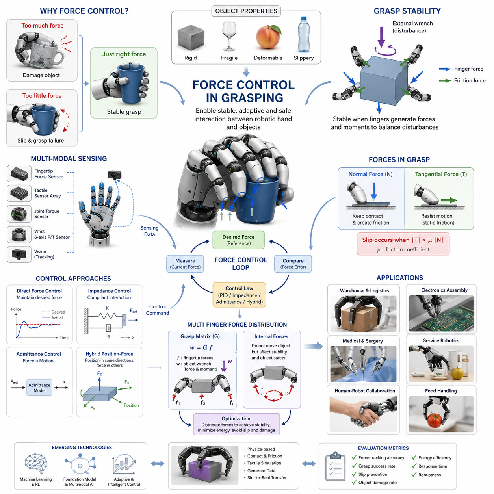{width="7.268055555555556in" height="7.268055555555556in"}

Force Control in Grasping is one of the most fundamental technologies in dexterous manipulation because grasping success depends not only on where the fingers are placed but also on how much force is applied to the object. A robot hand that can accurately position its fingers but cannot regulate contact force is unable to reliably handle real-world objects. Excessive force may damage fragile items, while insufficient force may result in slip, instability, or complete grasp failure. Consequently, modern robotic hands require force control capabilities that allow them to continuously regulate interaction forces between the fingers and the environment. This topic forms the foundation of advanced grasp stability, tactile manipulation, compliant interaction, and human-level dexterity. It serves as the first step toward enabling robots to manipulate objects with the same adaptability and reliability as human hands. The chapter belongs to the Force and Torque Control for Hands section of Volume 06 and serves as the entry point to grasp force regulation, internal force control, compliant grasping, and multi-finger force distribution.

Traditional industrial robots were primarily designed around position control. In a position-controlled system, the controller attempts to move each joint to a predefined location regardless of contact conditions. This approach works well in structured environments where object locations are accurately known and interactions are predictable. However, grasping is fundamentally a contact-rich task. Once a finger touches an object, the interaction dynamics become highly nonlinear. Contact forces, friction, compliance, deformation, and uncertainty all influence the outcome of the grasp. Pure position control often leads to excessive contact forces because the controller continues to reduce position error even after contact has been established. Force control addresses this limitation by explicitly regulating the interaction force rather than solely focusing on position accuracy.

Human grasping provides an excellent reference model for understanding force control. Humans continuously modulate grip force according to object weight, surface friction, shape, and expected motion. When holding a paper cup, only a small amount of force is applied. When lifting a heavy suitcase, grip force increases automatically. When carrying a slippery bottle, additional force is generated to compensate for reduced friction. These adjustments occur continuously and often subconsciously through the integration of tactile sensing, proprioception, visual feedback, and motor control. Robotic force control aims to reproduce similar adaptive behavior through sensors, actuators, and control algorithms.

The fundamental objective of force control is to achieve a desired interaction force between the robotic fingers and the object. Instead of commanding a target position alone, the controller generates motor commands that produce a specified force profile. This force may be constant, time-varying, adaptive, or dependent on task requirements. The controller continuously measures actual force values through sensors and compares them with desired force references. The resulting error is used to adjust actuator commands, creating a closed-loop control system. The quality of force control depends on sensing accuracy, actuator responsiveness, controller stability, and mechanical compliance.

Contact force in robotic grasping can be divided into normal force and tangential force. Normal force acts perpendicular to the contact surface and is primarily responsible for maintaining contact between the finger and the object. Tangential force acts parallel to the contact surface and is closely related to frictional interactions. Effective grasping requires sufficient normal force to generate friction that prevents object slip. The relationship between these forces is governed by friction laws, particularly Coulomb friction theory. If tangential force exceeds the maximum friction force available at the contact interface, slipping occurs. Force control therefore plays a critical role in maintaining the balance between gripping force and external disturbances.

A key concept in force-controlled grasping is grasp stability. A stable grasp is achieved when all external forces and moments acting on the object can be balanced by forces generated by the fingers. The controller must continuously adjust finger forces to compensate for disturbances such as object motion, gravity, acceleration, or environmental interactions. If the controller responds too slowly, slip may occur before corrective action can be taken. If the controller responds too aggressively, oscillations and instability may result. Designing controllers that maintain stability while remaining responsive is one of the central challenges of robotic grasping.

Force sensing is an essential component of force control systems. Without force measurements, the controller cannot accurately estimate contact conditions. Several sensing technologies are commonly used. Fingertip force sensors directly measure local contact forces at the contact interface. Six-axis force-torque sensors mounted at the wrist measure aggregate forces and moments applied to the hand. Tactile sensor arrays provide distributed pressure information across the finger surface. Joint torque sensors estimate interaction forces indirectly through actuator loads. Each sensing approach offers different advantages in terms of resolution, cost, bandwidth, and robustness.

Modern robotic hands frequently combine multiple sensing modalities. Fingertip sensors provide localized force information while tactile arrays detect pressure distribution and contact location. Joint torque sensors contribute information about internal hand dynamics, and vision systems monitor object motion. Sensor fusion enables more accurate estimation of grasp state and contact conditions. This multimodal approach improves force control performance, especially in uncertain environments where a single sensing modality may be insufficient.

The simplest force control architecture is direct force control. In this approach, the controller measures contact force and adjusts actuator commands to maintain a desired force level. A proportional-integral-derivative controller is often used to minimize force error. Although conceptually straightforward, direct force control can become unstable when interacting with stiff environments because small position changes may generate large force variations. Consequently, controller tuning and system compliance become critical factors in achieving stable operation.

Hybrid position-force control extends basic force control by simultaneously regulating position in some directions and force in others. This approach is particularly useful for grasping tasks where the robot must maintain object position while controlling contact force. For example, during insertion or assembly operations, the robot may control position along unconstrained axes while controlling force along constrained contact directions. Hybrid control enables robots to interact effectively with complex environments without sacrificing positional accuracy.

Impedance control represents one of the most influential approaches to force-controlled manipulation. Instead of directly controlling force, the controller regulates the dynamic relationship between force and motion. Desired mechanical behavior is represented through virtual stiffness, damping, and inertia parameters. When external forces are applied, the robot responds according to this virtual impedance model. Impedance control provides compliant behavior that resembles human muscle dynamics and has become a standard method for dexterous grasping applications.

Admittance control provides a complementary strategy. While impedance control converts motion commands into force responses, admittance control converts force measurements into motion commands. This approach is particularly useful for robots with stiff actuators that cannot easily implement compliant behavior through torque control alone. By adjusting robot motion based on measured forces, admittance control enables safe and adaptive interaction with grasped objects.

One of the most important applications of force control is slip prevention. Object slip occurs when available friction is insufficient to resist tangential disturbances. Humans instinctively increase grip force when slip is detected. Robotic systems attempt to replicate this behavior through tactile sensing and slip detection algorithms. When early signs of slip are observed, the controller increases normal force until stability is restored. This adaptive regulation minimizes both grasp failure and excessive force application.

Force control becomes significantly more challenging in multi-finger hands. Multiple contact points create a complex force distribution problem. Different combinations of fingertip forces may generate identical net object forces while producing different internal force patterns. Internal forces are forces that exist between fingers without affecting object motion. Proper regulation of internal forces is essential because excessive internal forces may damage objects while insufficient internal forces may reduce grasp stability.

The grasp matrix provides a mathematical framework for analyzing force transmission in multi-finger systems. It describes how fingertip forces are transformed into object-level forces and moments. By using grasp matrices, controllers can determine how individual finger forces contribute to overall grasp behavior. Optimization algorithms can then distribute forces among fingers while satisfying stability, friction, and actuator constraints.

Redundant robotic hands introduce additional opportunities and challenges. A hand with more controllable degrees of freedom than strictly required for grasping possesses kinematic redundancy. Redundancy enables optimization of force distribution, energy consumption, dexterity, and robustness. However, it also increases controller complexity because multiple valid solutions may exist for a given grasp task. Advanced optimization-based force control methods are often employed to exploit redundancy effectively.

Object properties significantly influence force control strategies. Rigid objects generally tolerate higher force levels and exhibit predictable contact behavior. Fragile objects require strict force limits to prevent damage. Deformable objects introduce additional complexities because contact geometry changes as force is applied. Soft fruits, food products, medical tissues, and flexible materials require highly adaptive force control algorithms capable of balancing stability and safety.

Industrial applications increasingly rely on force-controlled grasping. In warehouse automation, robots must handle packages with varying sizes, weights, and surface properties. In electronics manufacturing, delicate components require precise force regulation to avoid damage. Medical robots must interact safely with biological tissues. Service robots operating in homes encounter a wide range of objects that differ substantially in material properties and handling requirements. Across all these domains, force control serves as a critical enabling technology.

Recent advances in machine learning have transformed force control research. Data-driven methods can learn force control policies directly from demonstrations or interaction data. Reinforcement learning algorithms optimize force regulation strategies through trial-and-error experiences in simulation. Deep neural networks estimate grasp stability, predict slip events, and generate adaptive force commands. Learning-based approaches complement traditional control theory by improving performance in uncertain and unstructured environments.

Foundation models and multimodal AI systems are expected to further enhance force control capabilities. Future robotic hands may combine language instructions, visual perception, tactile sensing, and force feedback within unified decision-making architectures. Such systems could infer appropriate force levels based on semantic understanding of tasks and objects. A robot instructed to "carefully pick up the fragile glass" could automatically adjust grasp force according to learned object properties and contextual information.

Simulation plays a critical role in force control development. Physics-based simulators enable researchers to test controllers under diverse conditions without risking hardware damage. Contact models, friction models, compliance models, and tactile simulation frameworks provide valuable tools for evaluating control algorithms. However, accurately modeling contact dynamics remains challenging, creating a persistent sim-to-real gap. Bridging this gap remains an active area of research.

Validation of force control systems requires comprehensive benchmarking. Performance metrics typically include force tracking accuracy, grasp success rate, slip prevention effectiveness, object damage rate, energy efficiency, response time, and robustness to disturbances. Experimental evaluation often involves standardized object sets such as the YCB benchmark and diverse task scenarios representing real-world applications. Rigorous validation ensures that force control systems can operate reliably outside laboratory environments.

As robotic manipulation advances toward human-level dexterity, force control is becoming increasingly important. Future robot hands will need to perform complex tasks such as assembling miniature components, manipulating deformable materials, handling fragile medical instruments, and collaborating safely with humans. Achieving these capabilities requires seamless integration of force sensing, tactile perception, compliant actuation, adaptive control, and machine learning. Force control in grasping therefore represents not merely a low-level control problem but a central pillar of intelligent physical interaction. It connects contact mechanics, grasp theory, tactile sensing, slip detection, dexterous manipulation, and embodied intelligence into a unified framework that enables robots to interact with the physical world safely, effectively, and autonomously. The development of robust force control systems will continue to play a defining role in the evolution of next-generation robotic hands and dexterous manipulation platforms.

## 09.02 Fingertip Force Sensors

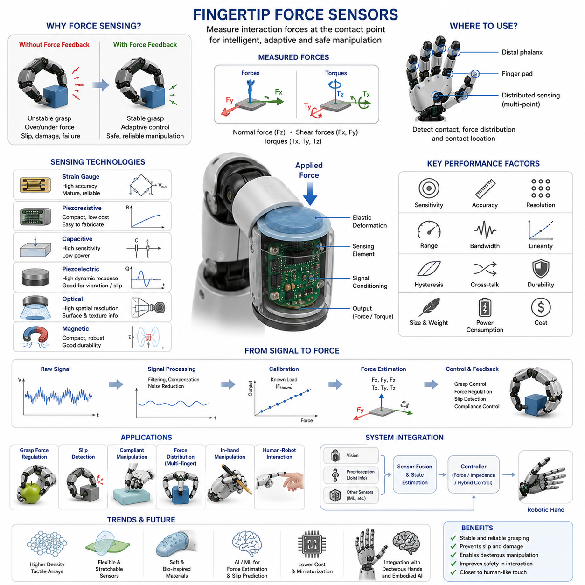{width="7.268055555555556in" height="7.268055555555556in"}

Fingertip Force Sensors are among the most important sensing components in robotic hands because they provide direct measurements of interaction forces between the robotic fingers and the grasped object. While vision systems can estimate object pose and motion, and joint encoders can measure finger positions, only force sensors can directly reveal how strongly a robot is contacting an object. Human manipulation relies heavily on tactile and force feedback from the fingertips. When a person picks up a glass, inserts a connector, tightens a screw, or manipulates a fragile object, the fingertips continuously sense contact pressure and force distribution. This sensory feedback allows the nervous system to adjust grip force in real time. Fingertip force sensors attempt to replicate this capability in robotic systems, enabling adaptive grasping, slip prevention, compliant interaction, and dexterous manipulation. Within the overall architecture of robotic hands, fingertip force sensors form the primary interface between the control system and the physical world, making them a foundational technology for force-controlled grasping and intelligent manipulation.

The primary purpose of a fingertip force sensor is to measure forces acting at the contact point between a finger and an object. These measurements provide essential information regarding grasp quality, object stability, contact conditions, and environmental interactions. Without direct force feedback, robotic hands operate largely in an open-loop manner and must rely on estimated contact models. Such approaches often lead to unstable grasps, excessive gripping force, or accidental object release. Force sensing transforms grasping from a purely geometric problem into a closed-loop interaction process where the robot can continuously monitor and regulate contact forces.

In robotic manipulation, forces applied at the fingertip are typically decomposed into multiple components. The most basic measurement is the normal force, which acts perpendicular to the contact surface. Normal force largely determines grasp strength and contributes directly to friction generation. Tangential forces act parallel to the contact surface and indicate sliding tendencies, frictional interactions, and external disturbances. More advanced sensors may also measure moments and torques generated by off-center contact forces. Together, these measurements provide a comprehensive understanding of contact mechanics during manipulation tasks.

The simplest fingertip force sensors measure only a single force axis. These sensors are often used in industrial grippers where grasping tasks are repetitive and predictable. A one-dimensional sensor can detect whether contact has occurred and estimate gripping force along the primary contact direction. Such sensors are relatively inexpensive, robust, and easy to integrate. However, they provide limited information regarding object motion, shear forces, and complex contact interactions. As robotic manipulation becomes increasingly sophisticated, multi-axis sensing solutions are becoming more common.

Two-axis force sensors measure forces in both normal and tangential directions. These sensors can detect not only the magnitude of gripping force but also the onset of slip and lateral disturbances. Three-axis force sensors further extend capability by measuring forces along three orthogonal directions. Such sensors are particularly valuable for dexterous hands performing complex manipulation tasks where contact conditions continuously evolve. By observing changes in force vectors, the robot can infer object movement, contact transitions, and environmental constraints.

The most advanced fingertip sensing systems incorporate six-axis force-torque measurement. These sensors measure three translational force components and three rotational torque components simultaneously. Six-axis sensing provides complete characterization of contact interactions and supports highly sophisticated manipulation behaviors. Although wrist-mounted six-axis sensors are common in industrial robotics, miniaturized fingertip versions present significant engineering challenges due to size, weight, durability, and integration constraints.

Several sensing principles are used in fingertip force sensor design. Strain-gauge-based sensors represent one of the most mature and widely adopted technologies. A strain gauge changes its electrical resistance when mechanically deformed. By attaching strain gauges to flexible structures within the fingertip, applied forces can be estimated from measured strain values. These sensors offer high accuracy, excellent linearity, and proven industrial reliability. However, they often require careful calibration and signal conditioning to compensate for temperature variations and noise.

Piezoresistive force sensors are another common technology. These sensors utilize materials whose electrical resistance changes under applied pressure. Piezoresistive sensors are compact, lightweight, and relatively inexpensive. They are widely used in tactile sensing applications because they can be fabricated into arrays and integrated into flexible sensor skins. Their simplicity makes them attractive for robotic fingertips, although long-term drift and hysteresis may affect measurement accuracy.

Capacitive force sensors operate by measuring changes in capacitance caused by deformation of an elastic dielectric layer. When force is applied, the distance between conductive plates changes, altering capacitance values. Capacitive sensors provide high sensitivity, low power consumption, and excellent repeatability. They are particularly suitable for detecting small contact forces and subtle pressure variations. Many modern robotic fingertips use capacitive sensing technology to achieve human-like tactile sensitivity.

Piezoelectric sensors generate electrical charge when subjected to mechanical stress. These sensors excel at measuring dynamic force changes and high-frequency vibration signals. Consequently, they are often used for slip detection and impact monitoring. However, piezoelectric sensors are less suitable for measuring static forces because their output gradually decays over time. They are therefore frequently combined with other sensing modalities to provide comprehensive force feedback.

Optical force sensing has emerged as an increasingly important research area. Optical sensors use cameras, photodiodes, fiber optics, or structured illumination to observe deformation within a compliant sensing layer. By analyzing deformation patterns, contact forces can be estimated with high spatial resolution. Optical tactile sensors such as GelSight-like systems provide not only force magnitude information but also detailed surface geometry and contact texture. These capabilities make optical sensing particularly attractive for advanced dexterous manipulation research.

Magnetic sensing approaches use embedded magnets and magnetic field sensors to estimate deformation-induced displacement. As force deforms the sensing structure, magnetic field distributions change, allowing force estimation through calibration models. Magnetic sensors offer compact size, good robustness, and relatively simple integration. They have become increasingly popular in robotic fingertip sensor development.

The mechanical structure of a fingertip force sensor is just as important as the sensing principle itself. Sensor performance depends heavily on how forces are transmitted through the fingertip structure. Designers must carefully balance sensitivity and robustness. Highly compliant structures provide greater force sensitivity but may reduce durability and positional accuracy. Stiffer structures improve robustness but often sacrifice measurement resolution. The optimal design depends on application requirements and expected contact conditions.

Sensor placement significantly affects performance. Fingertip sensors are typically positioned at locations where contact is most likely to occur. In parallel grippers, sensors are often mounted on the inner surfaces of gripper jaws. In anthropomorphic hands, sensors may be integrated into distal phalanges, finger pads, or distributed throughout the entire finger surface. Distributed sensing enables measurement of contact location, pressure distribution, and multi-point interactions, providing richer information than single-point force measurements.

Calibration is a critical aspect of force sensor deployment. Raw sensor outputs rarely correspond directly to physical force values. Calibration establishes mathematical relationships between sensor signals and actual forces. This process often involves applying known loads under controlled conditions and constructing calibration models. Multi-axis sensors require more complex calibration procedures because forces along different axes may influence one another. Accurate calibration is essential for reliable force control and quantitative manipulation tasks.

Signal processing plays a central role in transforming raw measurements into useful information. Force sensor signals are often affected by electrical noise, mechanical vibrations, temperature drift, and nonlinear sensor characteristics. Digital filtering techniques such as low-pass filters, Kalman filters, moving averages, and adaptive filters are commonly used to improve signal quality. Advanced processing methods may incorporate machine learning techniques to compensate for nonlinearities and estimate unobservable contact properties.

One of the most important applications of fingertip force sensors is grasp force regulation. During grasping, the robot continuously monitors contact forces and adjusts grip strength to maintain stability. If measured forces fall below safe thresholds, additional force can be applied. If forces exceed allowable limits, grip strength can be reduced to prevent object damage. This feedback mechanism enables safe handling of delicate objects such as fruits, laboratory samples, electronic components, and medical instruments.

Slip detection represents another critical application. Slip often begins as small tangential force fluctuations before visible object motion occurs. Fingertip force sensors can detect these early warning signs and trigger corrective actions. The controller may increase grip force, adjust finger positions, or modify manipulation strategies to prevent grasp failure. Human hands naturally perform similar adjustments through tactile reflexes, making slip-responsive force control a major step toward human-like manipulation capabilities.

Fingertip force sensors are also essential for compliant manipulation. Compliance refers to the ability of a robotic system to adapt to contact conditions rather than rigidly enforcing predefined trajectories. During assembly tasks, insertion operations, or human-robot interaction, compliance improves safety and robustness. Force measurements allow controllers to adapt motion commands according to contact conditions, reducing collision forces and improving task success rates.

Multi-finger robotic hands rely heavily on fingertip force sensing for force distribution control. When multiple fingers simultaneously contact an object, forces must be coordinated to maintain stable grasp conditions. Uneven force distribution may cause object rotation, instability, or excessive internal forces. By monitoring forces at each fingertip, the controller can optimize force allocation among fingers while satisfying friction and stability constraints.

In-hand manipulation tasks place even greater demands on fingertip sensing systems. During rolling, pivoting, regrasping, and object reorientation, contact locations and force distributions change continuously. Accurate force measurements enable controllers to track contact states and adjust manipulation strategies in real time. Without fingertip force sensing, many dexterous manipulation behaviors become extremely difficult to achieve reliably.

The emergence of tactile intelligence has expanded the role of fingertip force sensors beyond simple force measurement. Modern robotic systems increasingly combine force sensing with tactile sensing, vision, and machine learning. Sensor fusion enables estimation of object properties such as stiffness, texture, weight, friction coefficient, and deformation behavior. These capabilities allow robots to reason about physical interactions rather than merely reacting to measured forces.

Machine learning is increasingly being applied to fingertip force sensing. Neural networks can estimate contact states, predict slip events, classify objects, and infer manipulation outcomes directly from force sensor data. Reinforcement learning systems frequently use fingertip force measurements as part of their observation space, enabling the development of robust manipulation policies through large-scale simulation and real-world training.

Simulation environments have become important tools for fingertip sensor development. Modern robotic simulators increasingly incorporate realistic contact models, force estimation modules, and tactile simulation frameworks. These tools allow researchers to evaluate sensor designs and control strategies before physical deployment. Nevertheless, accurately modeling real-world contact interactions remains a major challenge due to complex material properties, friction effects, and sensor nonlinearities.

Several commercial robotic systems already incorporate advanced fingertip force sensing technologies. High-end research platforms such as dexterous robotic hands often include multi-axis force sensors combined with tactile arrays. Industrial grippers increasingly integrate force sensing to improve reliability and product quality. Humanoid robots designed for household and service applications are expected to rely heavily on fingertip sensing as they encounter highly diverse and unpredictable objects.

Future developments will likely focus on increasing sensing density, reducing size, lowering cost, and improving durability. Flexible electronics, stretchable sensors, printed sensor arrays, soft robotic materials, and bio-inspired tactile skins are expected to play major roles in next-generation fingertip sensing technologies. Integration with artificial intelligence systems will enable robots not only to measure forces but also to understand their meaning within broader task contexts.

Ultimately, fingertip force sensors serve as the robotic equivalent of mechanoreceptors in the human skin. They provide the essential feedback required for grasp stability, force regulation, slip prevention, compliant interaction, and dexterous manipulation. As robotic systems continue moving toward human-level physical intelligence, fingertip force sensing will remain one of the most critical enabling technologies. The ability to accurately perceive and regulate contact forces is fundamental to safe, adaptive, and intelligent interaction with the physical world, making fingertip force sensors a cornerstone of modern robotic hand design and a key building block for the future of embodied AI and advanced manipulation systems.

## 09.03 Wrist Force-Torque Sensors

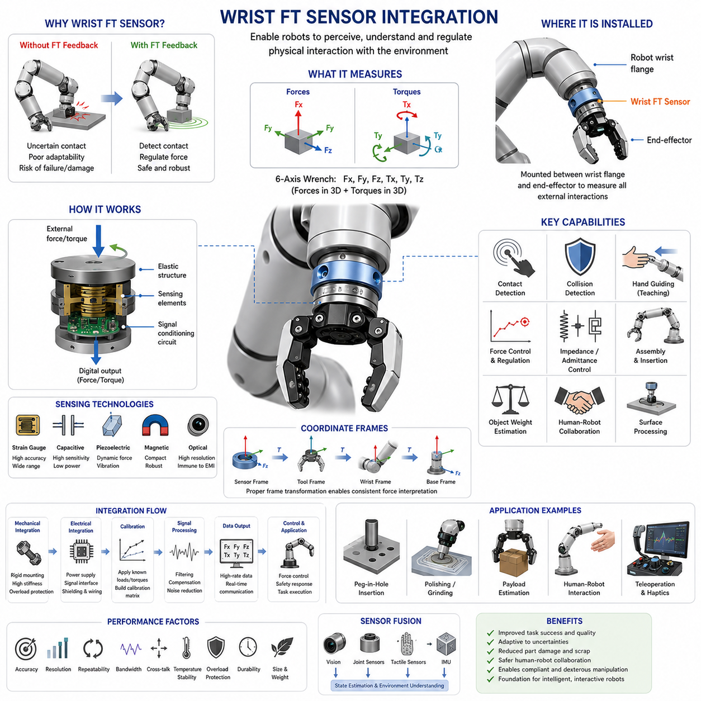{width="7.268055555555556in" height="7.268055555555556in"}

Wrist Force-Torque Sensor Integration is one of the most important technologies in robotic manipulation because it enables a robot to perceive and regulate physical interactions occurring between the manipulator and the environment. While fingertip force sensors measure localized contact forces at specific contact points, wrist-mounted force-torque sensors provide a global view of all external forces and moments acting on the robotic hand and end-effector. This capability allows robots to detect contact events, estimate interaction forces, regulate grasping behavior, perform compliant motion, and safely interact with humans and uncertain environments. In modern robotic systems, wrist force-torque sensing serves as a bridge between perception and physical interaction, transforming robots from purely position-controlled machines into adaptive systems capable of understanding and responding to the physical world.

A wrist force-torque sensor is typically installed between the robot wrist flange and the end-effector. This location enables the sensor to measure forces and torques transmitted through the entire manipulation chain. Unlike fingertip sensors that only observe local contact conditions, a wrist sensor captures the cumulative effect of all external interactions. Whether the robot is grasping an object, pushing a door, inserting a connector, tightening a bolt, or collaborating with a human operator, the resulting interaction forces propagate through the wrist and become measurable by the force-torque sensor. This unique position provides valuable information about overall task execution and environmental interaction.

The term force-torque sensor generally refers to a six-axis measurement system capable of simultaneously measuring three orthogonal force components and three orthogonal torque components. The force components correspond to translational forces along the X, Y, and Z axes, while the torque components represent rotational moments about those same axes. Together, these six measurements completely describe the external wrench acting on the robotic wrist. In robotic manipulation theory, a wrench represents the combination of forces and moments acting on a rigid body. Accurate measurement of this wrench is essential for advanced force control and interaction-aware manipulation.

The origins of wrist force-torque sensing can be traced to industrial assembly automation. Early robotic systems relied exclusively on position control and struggled when confronted with uncertainties in object placement, fixture alignment, or part tolerances. Even small positional errors could result in excessive contact forces, causing jamming, damage, or task failure. Engineers recognized that successful assembly required not only positional information but also force feedback. The introduction of wrist force-torque sensors enabled robots to detect contact conditions and adapt their behavior accordingly, significantly improving assembly robustness and task success rates.

A typical wrist force-torque sensor consists of an elastic mechanical structure instrumented with sensing elements. When external forces or torques are applied, the structure deforms slightly. This deformation is measured using various sensing technologies and converted into force and torque estimates through calibration models. The mechanical design must achieve an appropriate balance between stiffness and sensitivity. Excessive stiffness reduces measurement resolution, while excessive compliance may compromise structural integrity and positional accuracy.

Strain-gauge-based technology remains the most widely adopted approach for industrial force-torque sensors. Strain gauges are attached to carefully designed flexure structures that deform under applied loads. Changes in electrical resistance are measured through Wheatstone bridge circuits and converted into force estimates. Strain-gauge sensors offer high accuracy, excellent repeatability, wide dynamic range, and long-term reliability. These characteristics have made them the standard choice for industrial automation, research robotics, aerospace systems, and precision manufacturing applications.

Alternative sensing technologies continue to emerge. Capacitive force-torque sensors utilize changes in capacitance caused by structural deformation. Optical sensors measure displacement through photonic techniques and can provide high sensitivity while minimizing electromagnetic interference. Piezoelectric sensing elements are effective for dynamic force measurement and impact detection. Magnetic sensing approaches estimate forces through changes in magnetic field distributions caused by structural displacement. Each technology presents different trade-offs in terms of sensitivity, cost, durability, bandwidth, and environmental robustness.

Mechanical integration of a wrist force-torque sensor requires careful consideration of structural loads and operational requirements. The sensor must withstand expected forces, torques, shocks, and vibrations while maintaining sufficient measurement resolution. Mounting interfaces must ensure rigid mechanical coupling between the robot flange, sensor body, and end-effector. Improper mounting can introduce measurement errors, reduce structural stiffness, and degrade overall system performance. Consequently, mechanical integration is often treated as a critical engineering task during robot development.

Electrical integration is equally important. Force-torque sensors typically generate low-level signals that require amplification, filtering, digitization, and communication with the robot controller. Modern sensors often include embedded signal processing electronics that provide calibrated digital outputs through industrial communication protocols such as EtherCAT, CAN, Ethernet, RS-485, or USB. The choice of communication interface depends on latency requirements, bandwidth demands, and system architecture considerations.

Calibration represents one of the most critical aspects of wrist sensor deployment. Raw sensor outputs do not directly correspond to physical force values. Calibration procedures establish mathematical relationships between sensor measurements and actual forces. Because six-axis sensors exhibit cross-axis coupling effects, calibration typically involves applying known forces and torques across multiple directions and constructing a calibration matrix. High-quality calibration significantly improves measurement accuracy and ensures reliable operation during force-sensitive tasks.

Coordinate frame definition is another essential aspect of sensor integration. Force and torque measurements are always expressed relative to a reference coordinate system. In robotic applications, force data may need to be transformed between sensor coordinates, tool coordinates, wrist coordinates, robot base coordinates, and world coordinates. Accurate coordinate transformation enables consistent interpretation of force information regardless of robot orientation or tool configuration. This capability is particularly important for force control algorithms operating in Cartesian space.

One of the most immediate benefits of wrist force-torque sensing is contact detection. Traditional position-controlled robots often struggle to identify precisely when contact occurs. A force-torque sensor can detect even small interaction forces, allowing the robot to recognize contact events immediately. This capability enables safer operation, improved process control, and more robust task execution. Contact detection serves as the foundation for numerous advanced manipulation strategies.

Collision detection is closely related to contact sensing. Unexpected collisions may occur due to environmental uncertainties, sensor errors, or human intervention. Wrist force-torque sensors provide a direct method for detecting abnormal interaction forces and triggering protective responses. The robot can reduce speed, stop motion, retract from the collision, or enter a safe mode. Such capabilities are particularly important in collaborative robotics, where safe human-robot interaction is a primary design requirement.

Force-controlled manipulation relies heavily on wrist force-torque sensing. In force control, the robot attempts to maintain a desired interaction force rather than simply following a positional trajectory. Force measurements provide feedback that allows the controller to adjust motion commands and maintain target force levels. This capability is essential for tasks such as polishing, grinding, deburring, surface finishing, and assembly operations where force consistency directly affects process quality.

Impedance control represents one of the most widely used control strategies enabled by wrist force-torque sensing. Rather than directly regulating force, impedance control defines a dynamic relationship between motion and force. The robot behaves like a virtual mechanical system characterized by stiffness, damping, and inertia parameters. Force measurements allow the controller to adjust robot motion according to environmental interactions. This approach produces compliant behavior and significantly improves robustness when operating in uncertain environments.

Admittance control offers a complementary framework. In admittance control, measured forces are converted into desired motion commands. This approach is particularly useful for industrial robots with high mechanical stiffness. By using force measurements as inputs to a virtual dynamic model, the robot can respond naturally to external interactions while maintaining overall stability and control performance.

Assembly automation remains one of the most important applications of wrist force-torque sensors. Tasks such as peg-in-hole insertion, connector mating, gear assembly, bearing installation, and fastener insertion often involve small positional uncertainties. Pure position control may lead to jamming or excessive force accumulation. Force-torque sensing enables robots to detect contact conditions, adjust insertion trajectories, and maintain appropriate interaction forces throughout the assembly process. This capability dramatically increases assembly success rates and reduces component damage.

Surface processing operations also benefit significantly from wrist sensing. Polishing, sanding, grinding, and deburring require consistent contact forces across complex geometries. Variations in force can lead to uneven material removal, reduced surface quality, and increased tool wear. Force-torque feedback enables adaptive regulation of contact forces, improving process consistency and product quality.

In robotic grasping applications, wrist force-torque sensors complement fingertip force sensors. While fingertip sensors provide detailed local contact information, wrist sensors estimate the overall external wrench acting on the grasped object. Together, these sensing modalities provide a comprehensive understanding of grasp conditions. The combined information can be used for grasp force regulation, object weight estimation, slip detection, manipulation planning, and stability analysis.

Object weight estimation represents a particularly valuable capability. By measuring gravitational forces acting on a grasped object, the robot can estimate object mass and center-of-mass characteristics. These estimates improve manipulation planning, motion control, and grasp stability. Weight estimation is especially useful when handling previously unseen objects whose physical properties are not known in advance.

Human-robot collaboration relies extensively on wrist force-torque sensing. Collaborative robots frequently operate in close proximity to human workers and must respond safely to physical interaction. Force measurements allow robots to detect human contact, interpret user intentions, and adjust behavior accordingly. Hand-guiding applications, for example, allow human operators to physically guide robot motion through direct interaction forces. This capability greatly simplifies robot programming and improves usability.

Teleoperation systems also benefit from wrist force sensing. In teleoperated robotics, force measurements can be transmitted back to the human operator through haptic feedback devices. This enables operators to feel remote interactions and perform delicate tasks more effectively. Applications include surgical robotics, hazardous environment operation, underwater exploration, and space robotics.

Modern artificial intelligence systems increasingly incorporate force-torque data as part of multimodal perception frameworks. Machine learning algorithms can use force information to classify contact states, recognize manipulation phases, estimate object properties, and predict task outcomes. Deep neural networks trained on force-torque data often achieve superior performance in manipulation tasks compared to vision-only systems because force information directly captures physical interaction dynamics.

Sensor fusion represents a growing area of research and development. Wrist force-torque measurements are often combined with vision systems, tactile sensors, joint torque sensors, inertial measurement units, and environmental sensors. This multimodal approach provides richer situational awareness and enables more robust decision-making. Fusion of force and vision data is particularly effective because the two sensing modalities provide complementary information about the environment.

Simulation environments have become increasingly sophisticated in modeling force-torque interactions. Modern physics engines can simulate contact dynamics, friction effects, compliance behavior, and sensor measurements. These capabilities enable virtual testing of force-control algorithms before deployment on physical hardware. However, accurately reproducing real-world contact dynamics remains challenging, and simulation-to-reality transfer continues to be an active area of research.

Performance evaluation of wrist force-torque sensors typically involves metrics such as measurement accuracy, resolution, repeatability, linearity, hysteresis, cross-talk, bandwidth, noise level, overload protection, and durability. Application-specific requirements determine which metrics are most important. High-speed manipulation may prioritize bandwidth, while precision assembly may emphasize accuracy and repeatability.

Recent advances in miniaturization, embedded processing, and sensor materials are driving the development of next-generation force-torque sensing systems. Future sensors are expected to become smaller, lighter, more accurate, and more cost-effective. Integration with soft robotics, tactile skins, and intelligent sensing architectures will further enhance robotic interaction capabilities. Flexible sensor materials and distributed force sensing structures may eventually blur the distinction between wrist sensing and tactile sensing, creating unified perception systems capable of monitoring interaction forces across entire robotic limbs.

As robotic systems move toward human-level dexterity and embodied intelligence, wrist force-torque sensor integration will remain a cornerstone technology. Physical interaction is fundamentally different from visual perception because it requires understanding not only where objects are located but also how forces are exchanged between the robot and its environment. Wrist force-torque sensors provide this essential physical awareness. They enable robots to detect contact, regulate force, adapt to uncertainty, collaborate safely with humans, and perform complex manipulation tasks with reliability and precision. In many ways, wrist force-torque sensing serves as the robotic equivalent of proprioceptive and kinesthetic perception in humans, making it an indispensable component of advanced manipulation systems and future intelligent robots.

## 09.04 Grasp Force Regulation

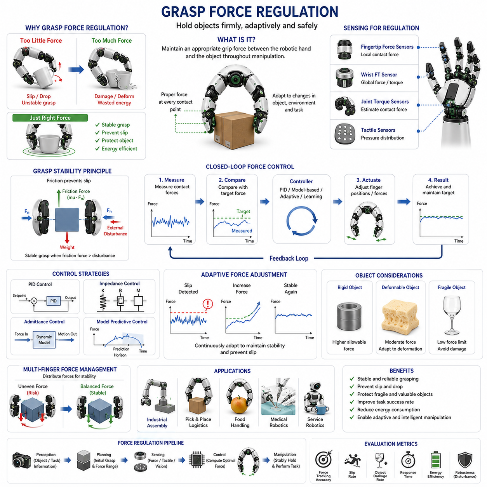{width="7.268055555555556in" height="7.268055555555556in"}

Grasp Force Regulation is one of the most fundamental capabilities required for stable and intelligent robotic manipulation. The primary objective of grasp force regulation is to maintain an appropriate level of gripping force between a robotic hand and an object throughout the entire manipulation process. A successful grasp requires a delicate balance. If the applied force is too low, the object may slip, rotate unexpectedly, or fall from the robot's grasp. If the applied force is too high, the object may become damaged, deformed, crushed, or otherwise compromised. Human hands naturally regulate grasp force through continuous sensory feedback from mechanoreceptors embedded in the skin and muscles. Humans unconsciously adjust grip strength according to object weight, texture, fragility, and intended motion. Robotic systems must achieve a similar capability through the integration of force sensors, tactile sensors, control algorithms, and intelligent decision-making frameworks. As robotic manipulation moves toward human-level dexterity, grasp force regulation becomes one of the most important foundations for safe, adaptive, and reliable interaction with the physical world.

The concept of grasp force regulation originates from grasp stability theory. A grasp remains stable when contact forces generated by the robotic fingers are sufficient to counteract external disturbances acting on the object. These disturbances may arise from gravity, acceleration, collisions, environmental interactions, or intentional manipulation actions. The grasp force must generate enough friction to prevent slip while avoiding excessive compression of the object. This requirement creates an optimization problem in which the robot seeks the minimum force necessary to achieve stable grasping under uncertain conditions.

The relationship between grasp force and friction is central to understanding grasp regulation. According to Coulomb friction theory, the maximum friction force that can be generated at a contact interface is proportional to the product of the normal force and the coefficient of friction. Increasing grip force increases available friction and improves resistance to slip. However, indiscriminately increasing force is not a practical solution because many objects are sensitive to excessive loading. Effective grasp force regulation therefore requires continuous estimation of friction conditions and dynamic adjustment of force levels.

Human grasping provides a useful biological reference model. When a person lifts a paper cup, only a small amount of force is applied. When lifting a heavy toolbox, grip force automatically increases. If the surface of an object becomes slippery due to water, oil, or dust, additional grip force is generated almost instantaneously. These adjustments occur through closed-loop sensorimotor control involving tactile feedback, proprioception, visual perception, and learned experience. Robotic grasp force regulation attempts to replicate this adaptive behavior through engineering systems.

The simplest form of grasp force regulation is open-loop force application. In an open-loop system, the robot applies a predetermined force level based on prior assumptions about the object. Although this approach is simple and computationally efficient, it performs poorly when object properties vary or environmental uncertainties are present. Changes in object weight, friction coefficient, surface geometry, or external disturbances can easily lead to grasp failure because the robot lacks feedback regarding actual contact conditions.

Closed-loop grasp force regulation addresses these limitations by continuously measuring contact forces and adjusting actuator commands accordingly. Sensors provide real-time feedback regarding the actual interaction forces between the robotic fingers and the object. The controller compares measured forces with desired force values and generates corrective actions to reduce force error. This feedback loop allows the robot to maintain stable grasp conditions despite disturbances and uncertainties.

Force sensing plays a critical role in grasp force regulation. Fingertip force sensors provide direct measurements of local contact forces. Wrist-mounted force-torque sensors measure global interaction forces acting on the hand. Joint torque sensors estimate contact forces indirectly through actuator loads. Tactile sensor arrays provide distributed pressure information across contact surfaces. By combining multiple sensing modalities, robotic systems obtain a more comprehensive understanding of grasp conditions and can regulate forces with greater accuracy.

Normal force regulation represents the most common approach to grasp force control. The controller maintains a target normal force at each contact point. This target force may be determined based on object weight, estimated friction coefficient, grasp geometry, or task requirements. Maintaining sufficient normal force ensures adequate friction generation and reduces the likelihood of object slip. However, determining the optimal force level remains a significant challenge because many object properties are unknown prior to grasping.

Adaptive grasp force regulation addresses this challenge by continuously modifying force levels according to observed contact conditions. Rather than maintaining a fixed force setpoint, adaptive controllers increase or decrease grip force as conditions change. For example, if slip indicators begin to appear, grip force is increased. If contact forces exceed safe limits for a fragile object, grip force is reduced. This adaptive behavior improves both grasp stability and object safety.

Slip prevention is one of the most important motivations for grasp force regulation. Slip occurs when frictional forces become insufficient to resist tangential disturbances. Early slip detection allows corrective action before complete grasp failure occurs. Tactile sensors can detect micro-vibrations, pressure redistribution, and tangential force fluctuations associated with incipient slip. Once slip is detected, the controller can rapidly increase grip force to restore stability. This reactive strategy closely resembles human grip adjustment mechanisms.

Many grasp force regulation systems employ proportional-integral-derivative control. In a PID-based framework, force error is continuously monitored and actuator commands are adjusted according to proportional, integral, and derivative components. Proportional control provides immediate response to force deviations. Integral control eliminates steady-state error. Derivative control improves system damping and stability. Proper tuning of controller gains is essential because excessive gains may cause oscillations while insufficient gains may lead to slow responses and reduced grasp stability.

More advanced systems employ model-based control approaches. These methods incorporate mathematical models of contact mechanics, friction behavior, object dynamics, and actuator characteristics. By predicting future system behavior, model-based controllers can generate more accurate force regulation commands. Such approaches are particularly beneficial for high-speed manipulation tasks and contact-rich operations where rapid force adaptation is required.

Impedance control has become one of the most widely used frameworks for grasp force regulation. Instead of directly controlling force values, impedance control regulates the dynamic relationship between force and motion. The robotic hand behaves like a virtual spring-damper system with adjustable stiffness and damping parameters. When external disturbances occur, the hand responds naturally while maintaining grasp stability. This approach improves robustness and enables safer interaction with uncertain environments.

Admittance control provides a complementary strategy. In admittance-based systems, measured contact forces are converted into desired motion commands. This approach is particularly useful for robotic hands driven by position-controlled actuators. By modifying motion trajectories according to force feedback, the system achieves compliant grasp behavior while preserving control stability.

Object characteristics strongly influence grasp force regulation strategies. Rigid objects generally tolerate higher force levels and require relatively straightforward control policies. Fragile objects such as glassware, fruits, electronic components, pharmaceutical products, and biological tissues require much more sophisticated regulation. In these cases, excessive force can cause irreversible damage. Controllers must therefore balance grasp stability and object preservation simultaneously.

Deformable objects introduce additional complexity. Unlike rigid objects, deformable materials change shape under applied forces. The relationship between force and deformation may be nonlinear, time-dependent, and difficult to predict. Grasp force regulation for deformable objects often requires continuous estimation of material properties and adaptive adjustment of force levels. Applications include food handling, textile manipulation, agricultural harvesting, and medical robotics.

Multi-finger robotic hands create additional force regulation challenges. When multiple fingers contact an object simultaneously, forces must be coordinated across all contact points. Uneven force distribution may cause object rotation, instability, or excessive local pressure. Controllers must determine how total grasp force should be distributed among individual fingers while satisfying friction constraints and stability requirements.

Internal force regulation becomes particularly important in multi-finger systems. Internal forces are forces exchanged among fingers that do not contribute directly to object motion. Proper management of internal forces improves grasp stability while preventing unnecessary stress on the object. Excessive internal forces increase energy consumption and may damage fragile objects. Insufficient internal forces reduce grasp robustness and increase slip risk.

Optimization-based force distribution methods are frequently used in dexterous robotic hands. These methods formulate force allocation as a constrained optimization problem. The controller seeks force distributions that maximize stability, minimize energy consumption, reduce actuator effort, and satisfy friction cone constraints simultaneously. Modern optimization algorithms allow real-time implementation of such strategies even in highly complex manipulation tasks.

Machine learning is increasingly transforming grasp force regulation. Traditional controllers rely on explicit mathematical models and manually designed control laws. Learning-based systems instead acquire force regulation strategies directly from data. Through supervised learning, reinforcement learning, or imitation learning, robots can learn how humans regulate grasp forces and develop adaptive policies that generalize across diverse objects and environments.

Reinforcement learning has shown particular promise in grasp force regulation. By interacting with simulated environments, robots can discover force control policies that maximize grasp success rates while minimizing object damage. Large-scale simulation allows millions of training interactions without risking hardware failures. The resulting policies can often adapt to previously unseen objects and conditions.

Tactile intelligence represents another emerging area of research. Modern tactile sensors provide much richer information than simple force measurements. High-resolution tactile arrays can estimate contact location, pressure distribution, surface texture, object curvature, and slip dynamics. Integrating tactile perception into grasp force regulation allows more nuanced control decisions and improved manipulation performance.

Vision-based force estimation is also becoming increasingly relevant. Although cameras cannot directly measure contact forces, machine learning models can infer force-related information from visual observations. Deformation patterns, object motion, finger displacement, and contact geometry provide valuable clues regarding interaction forces. Combining visual and force sensing creates more robust and informative grasp regulation systems.

Industrial automation increasingly depends on reliable grasp force regulation. Warehouse robots must handle packages of varying sizes, weights, and materials. Electronics assembly systems manipulate delicate components requiring precise force limits. Pharmaceutical automation must safely transport fragile containers. Food-processing robots handle deformable products with strict quality requirements. In each case, effective grasp force regulation directly influences productivity, product quality, and operational safety.

Service robotics introduces additional challenges because household environments contain highly diverse objects with unpredictable properties. A domestic service robot may need to handle dishes, clothing, books, tools, beverages, and electronic devices within a single task sequence. Such diversity requires highly adaptive grasp force regulation capabilities capable of generalizing across numerous object categories.

Medical robotics represents one of the most demanding application domains. Surgical instruments interact with delicate biological tissues where force control errors can have serious consequences. Medical manipulation tasks require extremely accurate force regulation, low latency sensing, and highly reliable control algorithms. Advances in grasp force regulation continue to improve safety and effectiveness in robotic-assisted surgery and rehabilitation systems.

Evaluation of grasp force regulation systems typically involves multiple performance metrics. Force tracking accuracy measures the ability to maintain desired force levels. Slip prevention effectiveness evaluates resistance to grasp failure. Object damage rates assess handling safety. Response time quantifies controller responsiveness. Energy efficiency measures actuator utilization. Robustness evaluates performance under disturbances and environmental uncertainty. Together, these metrics provide a comprehensive assessment of grasp regulation quality.

Simulation environments have become essential tools for developing grasp force regulation algorithms. Physics engines model contact dynamics, friction behavior, object deformation, and sensor measurements. These environments enable rapid testing of control strategies under diverse conditions. However, accurately reproducing real-world contact interactions remains challenging, making sim-to-real transfer an active area of research.

Future developments in grasp force regulation will likely integrate tactile sensing, force sensing, vision systems, foundation models, and embodied artificial intelligence into unified manipulation frameworks. Rather than simply maintaining force levels, future robotic hands may understand the semantic context of manipulation tasks. A robot instructed to "carefully pick up the fragile crystal glass" could automatically infer appropriate force limits, monitor contact conditions, predict slip risks, and adapt grasp behavior accordingly.

As robotic manipulation advances toward human-level dexterity, grasp force regulation will remain one of the most critical enabling technologies. Stable grasping depends not merely on mechanical design or sensor quality but on the ability to continuously regulate interaction forces in response to changing conditions. By combining force sensing, tactile perception, adaptive control, optimization, and machine learning, modern grasp force regulation systems provide the foundation for reliable, safe, and intelligent manipulation. These capabilities are essential for future industrial robots, service robots, humanoid systems, medical devices, and embodied AI platforms that must interact skillfully with the complex physical world.

## 09.05 Internal Force Control

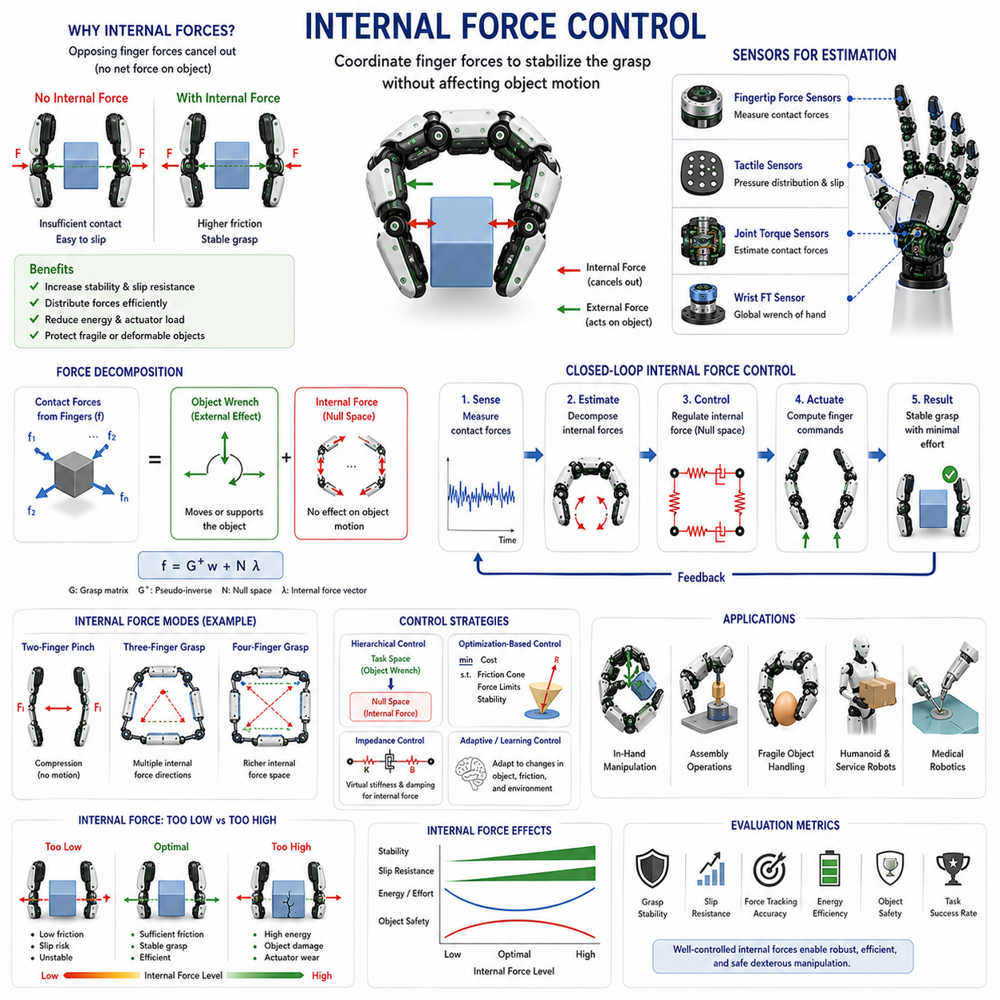{width="7.268055555555556in" height="7.268055555555556in"}

Internal Force Control is one of the most advanced and important concepts in dexterous robotic grasping because it addresses how multiple fingers cooperate to maintain a stable grasp without unnecessarily increasing forces acting on the object. While grasp force regulation focuses on generating sufficient contact force to prevent slip and maintain object stability, internal force control focuses on managing the forces exchanged among the fingers themselves. These forces may not contribute directly to moving or supporting the object, yet they play a crucial role in grasp robustness, manipulation accuracy, contact stability, and object safety. In multi-finger robotic hands, proper regulation of internal forces is essential for achieving human-like dexterity and reliable manipulation performance. Internal force control forms a critical bridge between grasp mechanics, force distribution, contact stability, and dexterous manipulation.

To understand internal force control, it is first necessary to distinguish between external forces and internal forces. External forces are forces that influence the motion of the object. These include gravitational forces, inertial forces, environmental contact forces, and the net forces generated by the robotic fingers to move or support the object. Internal forces, in contrast, are forces that exist within the grasp structure itself. They are generated by opposing finger contacts and cancel each other out so that they produce no net force or torque on the object. Although internal forces do not directly affect object motion, they strongly influence grasp stability and contact reliability.

A simple example can be observed in a two-finger pinch grasp. When a robotic gripper holds an object between two opposing fingers, each finger applies a normal force toward the object. The forces are equal in magnitude and opposite in direction. As a result, the object experiences no net horizontal force. However, the contact pressure generated between the fingers and the object creates friction that prevents slipping. These opposing forces are internal forces. They do not move the object, but without them the grasp would immediately fail.

Humans continuously regulate internal forces without conscious awareness. When holding a cup, a smartphone, or a tool, the fingers apply sufficient compression to maintain contact while minimizing discomfort and energy expenditure. If the object becomes heavier or more slippery, internal forces increase. If the object is fragile, internal forces decrease to prevent damage. The human nervous system uses tactile feedback, proprioception, and motor coordination to continuously optimize these forces. Robotic internal force control seeks to replicate this capability through sensing, control theory, and computational optimization.

The concept of internal force arises naturally from grasp theory. In multi-finger grasping, each contact point generates forces that can be represented mathematically within the grasp wrench framework. The grasp matrix describes how individual contact forces contribute to the overall wrench acting on the object. Certain combinations of finger forces produce object motion, while other combinations produce no net motion at all. The latter combinations correspond to internal force modes. These force modes exist entirely within the grasp structure and therefore must be controlled separately from object-level force commands.

The mathematical foundation of internal force control is closely related to the null space of the grasp matrix. The null space contains all force vectors that generate zero net wrench on the object. Any force vector belonging to this null space corresponds to a pure internal force. By decomposing contact forces into object-manipulating components and internal force components, robotic controllers can independently regulate both aspects of grasp behavior.

In robotic manipulation, internal forces are necessary because stable grasping requires sufficient contact pressure. Frictional forces can only be generated when normal contact forces exist. Without internal forces, friction cones collapse and the object becomes vulnerable to slipping under even small disturbances. Consequently, internal force generation is essential for maintaining force closure grasps and ensuring robust contact conditions.

However, excessive internal forces create their own problems. High internal forces increase actuator loads, raise energy consumption, accelerate mechanical wear, and may damage fragile objects. In addition, excessive contact pressure can deform compliant objects, alter object geometry, and reduce manipulation precision. Effective internal force control therefore requires balancing grasp stability against mechanical efficiency and object safety.

One of the primary objectives of internal force control is grasp stabilization. When external disturbances act on an object, internal forces help maintain stable contact conditions. For example, if a robot carries an object while moving, inertial forces generated during acceleration may threaten grasp stability. Properly regulated internal forces provide sufficient friction margins to resist these disturbances without requiring excessive gripping forces.

Multi-finger robotic hands introduce significant complexity into internal force regulation. Unlike parallel grippers, dexterous hands may contain three, four, five, or even more fingers. Each finger can apply forces along multiple directions. The resulting force distribution problem becomes highly redundant because numerous combinations of finger forces can produce identical object-level behavior. Internal force control provides a framework for selecting appropriate force distributions among these many possible solutions.

Redundancy is both an opportunity and a challenge. Additional fingers increase grasp robustness and dexterity but also create more internal force modes that must be managed. Poorly coordinated force distributions may lead to instability, unnecessary stress concentrations, or inefficient operation. Advanced controllers exploit redundancy to optimize force allocation while satisfying stability and safety requirements.

Force closure theory provides an important theoretical foundation for internal force control. A grasp achieves force closure when the fingers can generate arbitrary external wrenches on the object through appropriate combinations of contact forces. Internal forces play a central role in establishing and maintaining force closure conditions because they ensure that sufficient contact pressure exists across all grasp points.

The friction cone concept is also closely related to internal force control. At each contact point, feasible contact forces are constrained by friction limits. Internal force regulation must ensure that all contact forces remain inside their respective friction cones. If contact forces approach friction cone boundaries, the risk of slip increases significantly. Maintaining appropriate internal force levels helps preserve safe margins and improve grasp robustness.

Sensor feedback is essential for effective internal force regulation. Fingertip force sensors provide direct measurements of contact forces at individual contact points. Tactile sensor arrays offer detailed pressure distributions across finger surfaces. Joint torque sensors estimate contact loads through actuator measurements. Wrist force-torque sensors provide information regarding overall interaction forces. By combining these sensing modalities, controllers can estimate internal force states and monitor grasp quality in real time.

Force estimation algorithms are frequently required because internal forces cannot always be measured directly. Instead, controllers infer internal force values from contact measurements, grasp geometry, and dynamic models. State estimation techniques such as Kalman filtering, observer design, and optimization-based estimation are commonly used to reconstruct internal force distributions from available sensor data.

One of the most common approaches to internal force control is hierarchical control. In a hierarchical framework, object-level force control and internal force control are treated as separate objectives. The primary controller ensures that desired object motions and interaction forces are achieved. A secondary controller regulates internal force distributions within the null space of the grasp matrix. This separation simplifies controller design and enables independent tuning of object manipulation and grasp stabilization behaviors.

Optimization-based control has become increasingly popular in dexterous robotic hands. Internal force regulation can be formulated as a constrained optimization problem. The controller seeks force distributions that satisfy friction constraints, maintain grasp stability, minimize actuator effort, reduce energy consumption, and protect fragile objects. Modern quadratic programming and convex optimization methods enable real-time implementation of such controllers even in complex multi-finger systems.

Impedance control can also be extended to internal force regulation. In this approach, virtual stiffness and damping properties are defined for internal force modes. The robotic hand behaves as though connected by virtual springs that regulate force distributions among the fingers. This method provides compliant behavior and improves robustness under uncertain contact conditions.

Adaptive internal force control addresses situations where object properties are unknown or changing. Friction coefficients, object weight, surface geometry, and material stiffness may vary significantly between tasks. Adaptive controllers continuously estimate these properties and adjust internal force levels accordingly. Such systems are particularly useful in service robotics, warehouse automation, and unstructured environments.

Machine learning is beginning to play a significant role in internal force control. Traditional approaches rely heavily on analytical models and predefined control laws. Learning-based systems instead learn force distribution strategies directly from data. Neural networks can predict optimal internal force patterns based on tactile feedback, visual observations, and task context. Reinforcement learning algorithms can discover grasp stabilization strategies through extensive interaction experiences.

Reinforcement learning is especially attractive because internal force control often involves complex trade-offs that are difficult to model analytically. Through repeated trial-and-error interactions in simulation, robots can learn how to balance stability, energy efficiency, and object safety. Learned policies frequently outperform manually designed controllers in highly complex manipulation tasks.

Tactile intelligence further enhances internal force regulation capabilities. High-resolution tactile sensors provide detailed information regarding contact area, pressure distribution, local slip, and surface texture. These signals enable more precise estimation of contact conditions and allow controllers to make informed adjustments to internal force levels. Tactile-driven control strategies increasingly resemble human grasp regulation mechanisms.

In-hand manipulation represents one of the most demanding applications of internal force control. Tasks such as rolling, pivoting, finger gaiting, regrasping, and object reorientation require continuous modification of contact forces while maintaining overall grasp stability. Internal force distributions must adapt dynamically as contact locations change and manipulation objectives evolve. Without sophisticated internal force control, many advanced dexterous manipulation behaviors become impossible.

Assembly operations provide another important application domain. During precision assembly tasks, robotic fingers must maintain stable grasps while simultaneously exerting controlled interaction forces on external components. Internal force regulation ensures that grasp stability is preserved even as external contact conditions change. This capability is essential for insertion tasks, fastening operations, connector assembly, and precision manufacturing processes.

Humanoid robotics presents additional challenges for internal force control. Human-like hands contain many degrees of freedom and operate in highly unstructured environments. Objects vary widely in shape, weight, friction, and fragility. Effective internal force regulation allows humanoid robots to handle delicate household objects, tools, consumer products, and everyday items with greater reliability and safety.

Medical robotics demands extremely precise internal force management. Surgical instruments frequently interact with delicate biological tissues where excessive forces may cause irreversible damage. Multi-finger robotic manipulators used in minimally invasive procedures require accurate regulation of both external forces and internal contact forces. Advances in internal force control continue to improve surgical precision and patient safety.

Evaluation of internal force control systems involves multiple performance metrics. Grasp stability measures the ability to maintain secure contact under disturbances. Slip resistance quantifies robustness against frictional failures. Force tracking accuracy evaluates controller precision. Energy efficiency measures actuator utilization. Object safety assesses damage prevention capabilities. Manipulation success rate reflects overall task effectiveness. Together, these metrics provide a comprehensive assessment of controller performance.

Simulation environments play a critical role in internal force control research. Modern physics engines model contact dynamics, friction behavior, force distributions, and object interactions with increasing realism. Simulation enables safe exploration of control strategies before deployment on physical hardware. However, accurately reproducing contact mechanics remains challenging, and simulation-to-reality transfer continues to be an active research area.

Future developments in internal force control are expected to integrate tactile sensing, vision systems, force sensing, foundation models, and embodied artificial intelligence into unified manipulation architectures. Rather than simply regulating forces according to predefined rules, future robotic systems may reason about object properties, task objectives, and manipulation context at a semantic level. A robot instructed to "hold the fragile glass securely but gently" could automatically determine appropriate internal force distributions based on learned knowledge and real-time sensory feedback.

As robotic manipulation progresses toward human-level dexterity, internal force control will become increasingly important. Stable grasping requires more than generating sufficient contact force; it requires intelligent coordination of force distributions among multiple fingers. Internal force control provides the mechanisms necessary for achieving this coordination. By combining grasp theory, contact mechanics, optimization, force sensing, tactile intelligence, and machine learning, modern internal force control systems establish the foundation for robust, adaptive, and highly dexterous robotic manipulation. These capabilities are essential for the future of industrial automation, service robotics, humanoid systems, medical devices, and embodied AI platforms operating in complex physical environments.

## 09.06 Impedance Control for Fingers

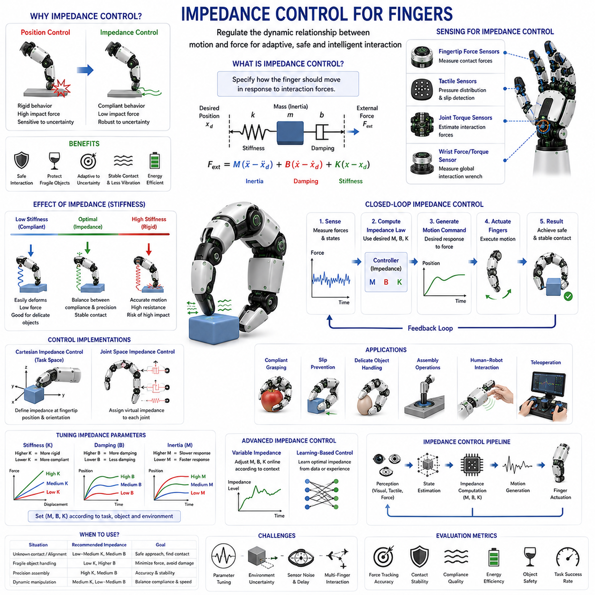{width="7.268055555555556in" height="7.268055555555556in"}

Impedance Control for Fingers is one of the most influential control methodologies in modern robotic manipulation because it enables robotic fingers to interact safely, adaptively, and intelligently with objects and environments. Traditional robotic systems were primarily designed around position control, where actuators attempt to move joints to predefined locations regardless of external interactions. While such approaches work well in structured industrial settings, they often fail when robots must interact with uncertain, dynamic, or contact-rich environments. Human fingers, in contrast, naturally exhibit compliant behavior. When touching an object, pushing against a surface, or grasping a fragile item, the human hand does not behave as a perfectly rigid mechanism. Instead, it adapts continuously through a combination of muscle elasticity, tendon compliance, neural feedback, and sensory perception. Impedance control was developed to emulate this behavior by regulating the dynamic relationship between motion and force rather than controlling either quantity independently. In robotic fingers, impedance control provides the foundation for compliant grasping, dexterous manipulation, safe human interaction, and adaptive contact management.

The concept of mechanical impedance originates from classical mechanics and system dynamics. In physics, impedance describes how a system resists motion when subjected to external forces. A mechanical system can be characterized by its inertia, damping, and stiffness. Inertia determines resistance to acceleration, damping governs energy dissipation, and stiffness defines resistance to displacement. Together, these properties determine how a system responds to external disturbances. Human fingers naturally possess all three characteristics. Muscles and tendons create variable stiffness, biological tissues provide damping, and the mass of the finger contributes inertia. Impedance control attempts to reproduce these behaviors artificially within robotic systems.

Unlike direct force control, which explicitly commands interaction forces, impedance control defines a desired dynamic relationship between force and motion. Instead of telling a robotic finger exactly how much force to apply, the controller specifies how the finger should move in response to applied forces. This distinction is crucial because many real-world interactions involve uncertainty. Contact locations, object properties, friction conditions, and environmental constraints are often unknown in advance. By regulating dynamic behavior rather than force values directly, impedance control achieves greater robustness under uncertain conditions.

The fundamental impedance control equation resembles the dynamics of a mass-spring-damper system. External forces acting on the robotic finger generate motion according to specified virtual inertia, damping, and stiffness parameters. These parameters are not necessarily physical properties of the hardware itself. Instead, they represent desired dynamic characteristics implemented through software control. As a result, a rigid robotic finger can be made to behave like a soft spring, while a compliant mechanism can be controlled to exhibit much higher apparent stiffness.

One of the primary advantages of impedance control is safe contact interaction. Consider a robotic finger approaching an object whose exact position is unknown. Under pure position control, unexpected contact may generate large impact forces because the controller continues pursuing the desired position. In contrast, an impedance-controlled finger responds compliantly. The virtual spring behavior absorbs contact energy and limits impact forces. This capability significantly reduces the risk of object damage, mechanical wear, and unsafe interactions.

Human finger behavior provides an intuitive example of impedance control principles. When gently touching a fragile object such as a soap bubble, humans naturally reduce finger stiffness and apply minimal force. When grasping a heavy tool, stiffness increases to provide stability and control. During activities such as writing, typing, or assembling small components, finger impedance is continuously adjusted according to task requirements. This dynamic modulation of mechanical properties represents one of the key reasons for the extraordinary dexterity of the human hand.

Robotic impedance control attempts to reproduce this adaptability. The controller adjusts virtual stiffness, damping, and inertia parameters according to task demands. Low stiffness may be selected for delicate manipulation tasks involving fragile objects. High stiffness may be required for precision assembly operations where accurate positioning is essential. Intermediate stiffness values are often used when balancing compliance and precision simultaneously.

Stiffness regulation represents the most visible aspect of impedance control. Virtual stiffness determines how strongly the robotic finger resists displacement from its desired position. High stiffness creates rigid behavior similar to industrial position-controlled robots. Low stiffness creates compliant behavior that allows the finger to yield under external forces. Variable stiffness control extends this concept further by allowing stiffness values to change dynamically during task execution.

Damping regulation is equally important. Damping controls how rapidly motion energy is dissipated. Insufficient damping may result in oscillations and instability. Excessive damping may produce sluggish responses and reduced manipulation performance. Proper damping selection improves stability, reduces vibrations, and enables smooth interactions with objects and environments.

Virtual inertia provides another important degree of freedom. By modifying apparent inertia, controllers influence how aggressively the robotic finger accelerates in response to external forces. Lower virtual inertia improves responsiveness, while higher virtual inertia increases stability and disturbance rejection. Together, stiffness, damping, and inertia form the core parameters of impedance-controlled systems.

One of the most common implementations of impedance control is Cartesian impedance control. In this approach, impedance behavior is defined in task space rather than joint space. Desired forces and motions are expressed relative to the fingertip position and orientation. Cartesian impedance control allows intuitive specification of contact behaviors and is particularly useful for grasping and manipulation tasks involving external objects.

Joint-space impedance control provides an alternative approach. Instead of regulating fingertip behavior directly, impedance characteristics are assigned to individual joints. Each joint behaves like a virtual spring-damper system. Joint-space control is often simpler to implement and computationally efficient. However, its behavior may be less intuitive for complex manipulation tasks involving multiple simultaneous contacts.

Finger impedance control plays a central role in robotic grasping. During grasp acquisition, compliant finger behavior accommodates uncertainties in object position and geometry. During grasp maintenance, impedance control stabilizes contact conditions and absorbs disturbances. During object manipulation, impedance control allows controlled adjustments of contact forces while preserving overall grasp stability.

Compliant grasping represents one of the most important applications of finger impedance control. Traditional rigid grasping strategies often require highly accurate object models and precise positioning. Impedance-controlled fingers adapt naturally to object shape variations and positioning errors. This adaptability improves grasp success rates and reduces sensitivity to environmental uncertainty.

Slip prevention benefits significantly from impedance regulation. When an object begins to slip, contact conditions change rapidly. Impedance-controlled fingers respond dynamically to these changes, adjusting contact forces while maintaining stable interactions. Combined with tactile sensing and force feedback, impedance control provides a powerful framework for adaptive grasp stabilization.

Delicate object handling is another major application area. Objects such as fruits, eggs, medical samples, laboratory equipment, and consumer electronics require careful force management. Excessive gripping forces can cause irreversible damage. Impedance-controlled fingers provide compliant interactions that protect fragile objects while maintaining sufficient grasp stability.

Multi-finger robotic hands introduce additional complexity. Multiple fingers simultaneously interact with the object, generating coupled force distributions and internal force dynamics. Impedance control provides a natural framework for coordinating these interactions. Each finger can maintain local compliance while contributing to overall grasp stability. This distributed control strategy improves robustness and manipulation flexibility.

Internal force regulation and impedance control are closely related. Internal forces arise from opposing finger contacts that do not directly influence object motion. By assigning appropriate impedance properties to internal force modes, controllers can regulate force distributions among fingers while maintaining desired object-level behaviors. This capability is particularly important in dexterous manipulation tasks.

Assembly operations frequently rely on impedance-controlled fingers. Tasks such as peg insertion, connector mating, fastener installation, and component alignment involve uncertain contact conditions. Pure position control often causes jamming or excessive contact forces. Impedance control enables compliant exploration of contact constraints, improving task success rates and reducing component damage.

Human-robot interaction is one of the most important motivations for impedance control. Robots operating alongside humans must respond safely to unexpected contact. High-stiffness systems may pose safety risks because they resist external disturbances aggressively. Impedance-controlled fingers yield naturally under human interaction forces, reducing injury risk and improving collaboration safety.

Teleoperation systems also benefit from impedance control. Remote operators frequently manipulate objects through robotic hands. Impedance regulation improves contact stability and provides more natural interaction behavior. When combined with force feedback devices, impedance-controlled systems create more intuitive and effective teleoperation experiences.

The rise of soft robotics has further increased the importance of impedance control. Soft robotic fingers inherently possess mechanical compliance due to their material properties. However, passive compliance alone is often insufficient for complex manipulation tasks. Impedance control complements mechanical softness by providing active regulation of interaction dynamics. Together, these approaches enable highly adaptive and robust manipulation capabilities.

Variable impedance control represents an important evolution beyond fixed impedance systems. Human fingers continuously modify stiffness and damping according to task requirements. Variable impedance controllers seek to replicate this behavior. Instead of maintaining constant parameters, the controller adjusts impedance values dynamically in response to sensory feedback, task objectives, and environmental conditions.

Learning-based impedance control has emerged as a major research direction. Traditional impedance controllers rely on manually selected parameters. Determining optimal impedance settings for diverse tasks can be challenging and time-consuming. Machine learning algorithms enable robots to learn impedance strategies directly from experience. By observing successful manipulation behaviors, robots can automatically discover effective impedance profiles.

Reinforcement learning is particularly promising for impedance optimization. During training, robotic fingers interact with simulated environments and receive rewards based on task performance. Through repeated trial and error, the system learns how impedance parameters influence grasp stability, manipulation success, energy consumption, and object safety. The resulting policies often outperform manually tuned controllers in complex environments.

Imitation learning provides another powerful approach. Human demonstrations contain valuable information regarding natural impedance modulation strategies. By observing human manipulation behaviors, robotic systems can learn task-specific impedance profiles and reproduce human-like interaction characteristics.

Tactile sensing significantly enhances impedance control performance. Fingertip tactile sensors provide detailed information regarding contact location, pressure distribution, slip conditions, and surface texture. These measurements allow impedance controllers to adapt continuously to changing contact conditions. The integration of tactile feedback and impedance control closely resembles human sensorimotor control mechanisms.

Vision systems further extend impedance regulation capabilities. Cameras provide information regarding object pose, geometry, deformation, and environmental context. By combining visual perception with force and tactile sensing, robots gain a richer understanding of interaction conditions and can adjust impedance properties more effectively.

Simulation environments play a critical role in impedance control research. Physics-based simulators allow researchers to evaluate control strategies under diverse contact conditions without risking hardware damage. Modern simulation platforms increasingly support realistic contact dynamics, deformable objects, tactile sensing, and force feedback. These capabilities accelerate algorithm development and facilitate large-scale training of learning-based controllers.

Performance evaluation of finger impedance control systems typically includes metrics such as contact force regulation accuracy, grasp stability, manipulation success rate, response time, compliance quality, energy efficiency, disturbance rejection, and object safety. Application-specific requirements determine which metrics are most important. Surgical manipulation may prioritize precision and safety, while industrial assembly may emphasize speed and robustness.

Future developments in impedance control are expected to integrate force sensing, tactile perception, vision systems, foundation models, and embodied artificial intelligence into unified manipulation architectures. Rather than relying solely on predefined control laws, future robots may reason about task objectives, object properties, and environmental context before selecting appropriate impedance behaviors. A robot instructed to "carefully handle the fragile glass while placing it precisely on the shelf" could automatically adjust stiffness, damping, and force regulation strategies according to the semantic meaning of the task.

As robotic manipulation advances toward human-level dexterity, impedance control for fingers will remain one of the most important enabling technologies. The ability to regulate dynamic interactions rather than merely controlling positions or forces provides robots with a level of adaptability that is essential for operating in complex, uncertain, and contact-rich environments. By combining principles from mechanics, control theory, force sensing, tactile intelligence, machine learning, and embodied AI, impedance control establishes the foundation for safe, compliant, and highly dexterous robotic manipulation. These capabilities will continue to play a central role in future industrial automation systems, service robots, humanoid platforms, medical devices, and intelligent physical AI systems that must interact skillfully with the real world.

## 09.07 Compliant Grasping

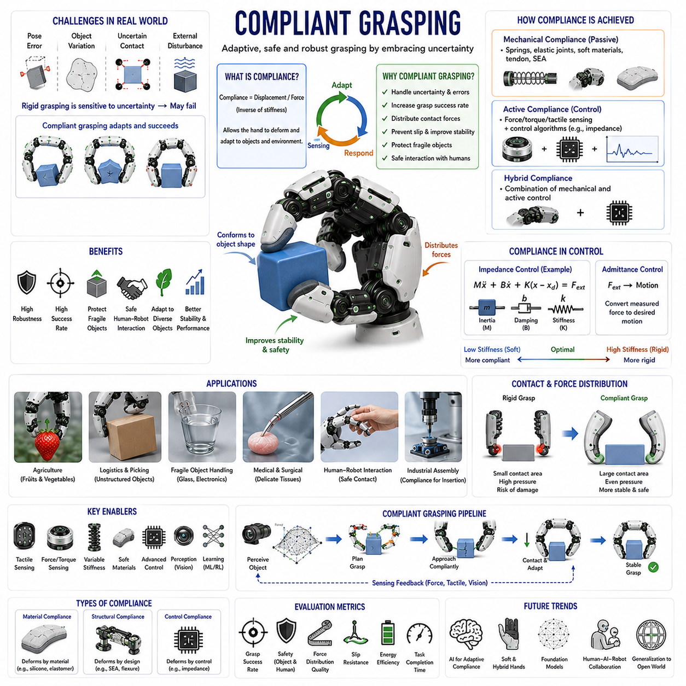{width="7.268055555555556in" height="7.268055555555556in"}

Compliant Grasping is a fundamental concept in modern robotic manipulation that focuses on enabling robotic hands and grippers to adapt naturally to uncertainties during physical interaction with objects. Traditional robotic grasping systems were largely developed around rigid-body assumptions, where the robot hand, object, and environment were considered geometrically precise and mechanically stiff. Under such assumptions, successful grasping depended heavily on accurate perception, precise positioning, and exact object models. However, the real world rarely satisfies these conditions. Objects vary in shape, weight, texture, friction, stiffness, and deformation characteristics. Position estimation errors are unavoidable, and environmental uncertainties continuously influence manipulation outcomes. Compliant grasping addresses these challenges by introducing controlled flexibility, adaptability, and force accommodation into the grasping process. Rather than attempting to eliminate uncertainty, compliant grasping embraces uncertainty and allows the robotic system to adapt dynamically during contact interactions. As a result, compliant grasping has become one of the most important enabling technologies for service robots, industrial manipulators, medical robots, agricultural robots, warehouse automation systems, and future humanoid robots.

The concept of compliance originates from mechanics. Compliance refers to the tendency of a system to deform or yield when subjected to external forces. It is mathematically defined as the inverse of stiffness. A highly compliant system exhibits significant displacement under applied force, while a highly stiff system resists deformation. Human hands naturally exhibit compliance through muscles, tendons, ligaments, skin, and soft tissue structures. When a person grasps an object, the fingers deform slightly to conform to the object\'s shape. This compliance distributes contact forces over larger areas, reduces peak pressure, improves grasp stability, and increases robustness against positioning errors. Robotic compliant grasping seeks to reproduce these biological advantages through mechanical design, sensing systems, and control algorithms.

One of the primary motivations for compliant grasping is uncertainty management. In practical robotic applications, perfect knowledge of object geometry and pose is rarely available. Even advanced vision systems produce estimation errors. Small positioning inaccuracies may cause rigid grasping systems to fail completely. A rigid finger approaching an object at an incorrect location may collide, miss the object, or apply excessive force. In contrast, a compliant finger can accommodate minor alignment errors by deforming during contact. This flexibility dramatically increases grasp success rates and reduces sensitivity to perception inaccuracies.

Compliance may be introduced mechanically, actively through control systems, or through a combination of both approaches. Mechanical compliance relies on elastic structures, soft materials, springs, flexible joints, tendon-driven mechanisms, and deformable finger pads. Active compliance relies on sensing and control algorithms that adjust finger motion according to measured interaction forces. Hybrid approaches combine passive mechanical compliance with active force regulation to achieve superior performance across diverse manipulation tasks.

Mechanical compliance provides several unique advantages. Because compliance is embedded directly within the hardware, it reacts instantaneously to contact events without requiring sensor processing or control computations. This characteristic improves safety and robustness while reducing control complexity. Series Elastic Actuators (SEAs) represent one of the most widely used examples of mechanically compliant actuation. In these systems, elastic elements are inserted between motors and loads, allowing controlled deformation during force transmission. The resulting compliance improves force control, shock absorption, and interaction safety.

Soft robotic fingers represent another major approach to compliant grasping. Unlike traditional rigid fingers, soft robotic fingers are constructed from elastomers, silicones, textiles, and other deformable materials. When contacting an object, the finger naturally conforms to the object\'s shape. This shape adaptation increases contact area and distributes forces more evenly across the grasp surface. Soft robotic grippers have demonstrated exceptional performance when handling fruits, vegetables, food products, biological materials, laboratory samples, and other delicate objects that are difficult to manipulate using rigid grippers.

Adaptive fingers further extend compliant grasping capabilities. Adaptive finger mechanisms are often underactuated, meaning that a single actuator controls multiple joints. As contact occurs, the finger automatically adjusts its configuration according to object geometry. This behavior allows passive adaptation to a wide range of shapes without requiring complex motion planning. Adaptive fingers are particularly useful in warehouse picking, logistics handling, and industrial automation where object diversity is high.

While mechanical compliance provides passive adaptability, active compliance introduces intelligent behavior through control algorithms. Active compliance is typically implemented using force sensing, torque sensing, tactile sensing, and impedance control. The controller continuously monitors interaction forces and modifies actuator commands accordingly. Rather than rigidly following a predefined trajectory, the robotic fingers respond dynamically to contact conditions. This capability enables more sophisticated interaction strategies and improves performance in highly variable environments.

Impedance control is one of the most important control frameworks for compliant grasping. In impedance control, the robot behaves like a virtual mass-spring-damper system. External forces generate corresponding motions according to predefined dynamic relationships. By adjusting virtual stiffness, damping, and inertia parameters, the robot can exhibit varying levels of compliance. Low stiffness produces highly compliant behavior suitable for delicate object handling, while higher stiffness supports precision manipulation tasks requiring greater positional accuracy. Impedance control allows robotic fingers to combine compliance and control precision within a unified framework.

Admittance control provides a complementary approach. In admittance-controlled systems, measured forces are converted into desired motions. This method is particularly useful for robotic hands driven by position-controlled actuators. By responding to force measurements with controlled motion adjustments, the robot achieves compliant behavior even when the underlying hardware remains mechanically rigid.

Contact mechanics plays a central role in compliant grasping. When a compliant finger contacts an object, the resulting contact geometry differs significantly from that of a rigid finger. Instead of point contacts, compliant fingers often create distributed contact regions. Distributed contact improves load sharing, increases frictional stability, and reduces stress concentrations. These benefits enhance grasp robustness and decrease the likelihood of object damage. Understanding contact mechanics is therefore essential for designing effective compliant grasping systems.

Grasp stability is often improved through compliance. In rigid grasping systems, small disturbances may rapidly destabilize contact conditions. Compliant fingers absorb disturbances by deforming and redistributing contact forces. This behavior increases tolerance to external perturbations such as vibrations, impacts, accelerations, and environmental interactions. As a result, compliant grasping often achieves higher success rates in real-world applications than purely rigid approaches.

Slip prevention represents another major advantage of compliant grasping. Slippage occurs when frictional forces become insufficient to resist external disturbances. Compliant fingers improve friction generation by increasing contact area and maintaining more uniform pressure distributions. Furthermore, compliant structures often provide passive adaptation to changing contact conditions, reducing slip probability even without active sensing. When combined with tactile sensors and force feedback systems, compliant grasping becomes highly effective at maintaining stable object retention.

Fragile object handling is one of the most important applications of compliant grasping. Many real-world objects cannot tolerate high contact pressures. Examples include fruits, eggs, glassware, medical instruments, electronic components, pharmaceutical products, and biological tissues. Rigid grasping systems often require precise force regulation to avoid damage. Compliant fingers inherently distribute forces more evenly and reduce pressure peaks, making them particularly well suited for delicate manipulation tasks.

Agricultural robotics has become one of the most successful application areas for compliant grasping. Fruits and vegetables exhibit significant variability in shape, size, orientation, and mechanical properties. Traditional rigid grippers often bruise produce or fail to achieve reliable grasps. Soft and compliant grippers have demonstrated superior performance in harvesting strawberries, tomatoes, cucumbers, peppers, apples, and many other crops. Their ability to conform to natural shapes while minimizing damage makes them highly attractive for agricultural automation.

Medical robotics similarly benefits from compliance. Surgical instruments frequently interact with delicate biological tissues whose mechanical properties vary significantly. Excessive contact forces may cause tissue damage, while insufficient forces reduce manipulation effectiveness. Compliant grasping provides safer interactions and improves control during minimally invasive procedures, rehabilitation systems, prosthetics, and assistive robotic devices.

Human-robot interaction is another area where compliant grasping is essential. Robots operating alongside humans must respond safely to unexpected contact. Compliance reduces collision forces and improves interaction safety. Human hands naturally rely on compliance during cooperative tasks, and robotic systems must exhibit similar characteristics to achieve intuitive collaboration. Compliant grasping therefore plays an important role in collaborative robotics and service robot applications.

Multi-finger robotic hands present unique opportunities for compliant grasping. Each finger may possess independent compliance characteristics, allowing distributed adaptation across multiple contact points. By coordinating compliant behaviors among fingers, the robotic hand can achieve stable grasps under highly uncertain conditions. Internal force regulation, impedance control, and tactile feedback become particularly important in such systems.

Tactile sensing significantly enhances compliant grasping performance. High-resolution tactile sensors provide information regarding contact location, pressure distribution, surface texture, and local slip conditions. This information allows controllers to adapt compliance levels according to real-time contact states. Human grasping relies heavily on tactile feedback, and robotic systems increasingly follow similar strategies.

Vision systems further contribute to compliant grasping by providing contextual information about object properties and environmental conditions. Visual perception can estimate object size, shape, orientation, material category, and potential fragility. Combining visual perception with compliant control enables predictive adaptation before contact occurs. For example, a robot may reduce stiffness when approaching a fragile glass object and increase stiffness when manipulating a rigid tool.

Learning-based methods are rapidly transforming compliant grasping research. Traditional compliant grasping strategies often rely on manually designed control laws and analytical models. However, real-world contact interactions are highly complex and difficult to model accurately. Machine learning approaches allow robots to learn compliant behaviors directly from data. Neural networks can predict grasp strategies, compliance parameters, and force distributions based on sensory observations and task requirements.

Reinforcement learning has demonstrated particularly strong potential. Through repeated interactions in simulation environments, robots learn how compliance influences grasp success, stability, safety, and efficiency. Learned policies often discover sophisticated manipulation strategies that would be difficult to design manually. As simulation technology improves, reinforcement learning is expected to play an increasingly important role in compliant grasping systems.

Imitation learning provides another valuable approach. Human demonstrations contain rich examples of compliant manipulation behaviors. By observing how humans adjust grasp stiffness, contact forces, and finger motions, robots can acquire natural and effective manipulation strategies. These approaches bring robotic behavior closer to human dexterity and adaptability.

Simulation environments have become essential tools for studying compliant grasping. Modern physics engines support deformable objects, soft materials, contact dynamics, friction models, and tactile sensing simulations. These capabilities enable researchers to evaluate compliant grasping algorithms under diverse conditions before deploying them on physical hardware. Nevertheless, accurately modeling soft materials and contact interactions remains challenging, making simulation-to-reality transfer an active area of research.

Performance evaluation of compliant grasping systems typically includes grasp success rate, object damage rate, contact force distribution quality, adaptability to object variation, slip resistance, energy efficiency, manipulation accuracy, and task completion time. These metrics help quantify the trade-offs between compliance, stability, precision, and efficiency.

Future developments in compliant grasping are expected to integrate soft robotics, tactile intelligence, force sensing, vision systems, foundation models, and embodied AI into unified manipulation architectures. Rather than simply reacting to contact events, future robots may reason about object properties, task goals, environmental context, and safety requirements before selecting appropriate compliance strategies. A robot instructed to "carefully pick up the ripe strawberry and place it into the container without bruising it" could automatically determine suitable compliance levels, grasp forces, finger configurations, and manipulation trajectories.

As robotics advances toward human-level dexterity, compliant grasping will remain a cornerstone technology. The ability to adapt safely and intelligently to uncertainty is one of the defining characteristics of biological manipulation systems. By combining mechanical compliance, active control, tactile perception, force regulation, machine learning, and embodied intelligence, compliant grasping provides robots with the adaptability necessary to operate successfully in complex real-world environments. These capabilities will continue to play a central role in future industrial automation systems, service robots, agricultural platforms, medical devices, humanoid robots, and advanced physical AI systems.

## 09.08 Variable Stiffness Control

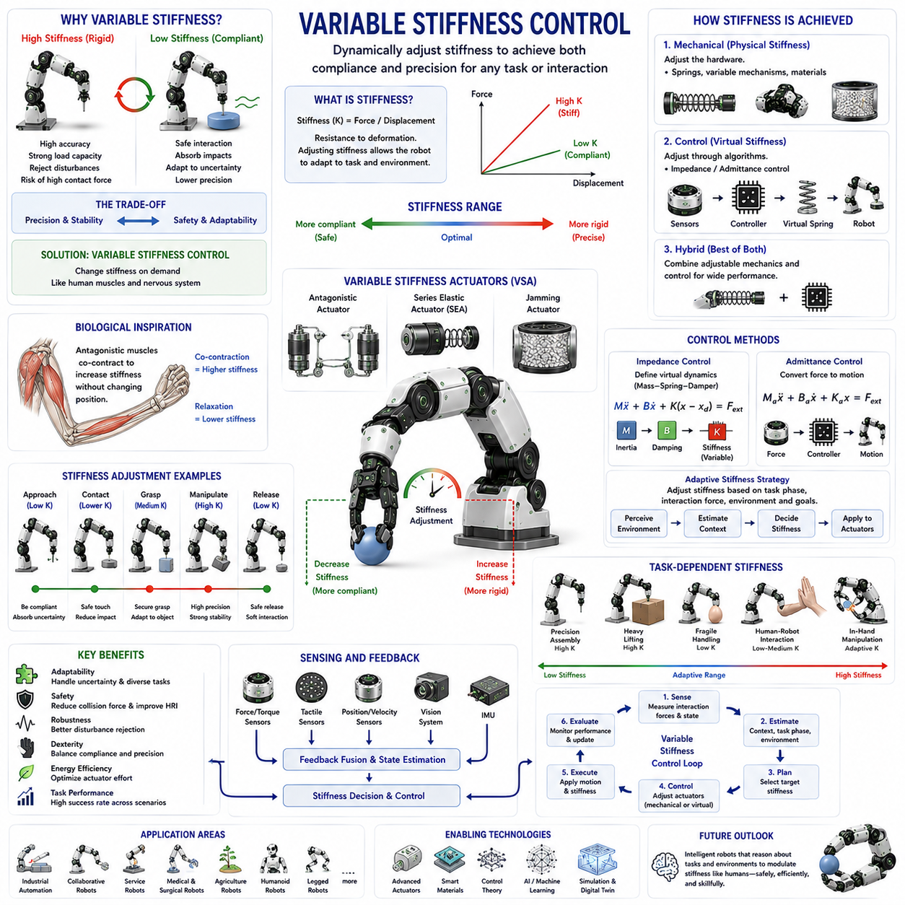{width="7.268055555555556in" height="7.268055555555556in"}

Variable Stiffness Control is one of the most important technologies in advanced robotic manipulation because it allows a robotic system to dynamically adjust its mechanical stiffness according to task requirements, environmental conditions, and interaction forces. Traditional robotic systems are generally designed with fixed mechanical properties. Once a robot is built, its stiffness characteristics remain largely constant, and control algorithms compensate for different operating conditions through force regulation or position control. Human beings, however, continuously vary the stiffness of their muscles and joints. When lifting a heavy object, muscle stiffness increases to improve stability and precision. When handling a fragile object, stiffness decreases to allow compliant and safe interaction. During activities such as writing, grasping, catching a ball, shaking hands, or manipulating delicate tools, the nervous system constantly adjusts stiffness levels to optimize performance. Variable Stiffness Control seeks to replicate this biological capability in robotic systems, enabling robots to achieve higher levels of adaptability, safety, robustness, and dexterity. As robotic manipulation evolves toward human-like performance, variable stiffness is increasingly recognized as a fundamental component of embodied intelligence and advanced physical interaction.

The concept of stiffness originates from mechanics and describes the relationship between force and displacement. A stiff system exhibits small displacements when subjected to external forces, while a compliant system exhibits larger displacements under the same loading conditions. Stiffness can be viewed as a measure of resistance to deformation. High stiffness improves positional accuracy and disturbance rejection, whereas low stiffness enhances compliance and safety during interaction. These two objectives often conflict with one another. Precision tasks generally benefit from high stiffness, while safe physical interaction often requires lower stiffness. Variable stiffness control addresses this trade-off by allowing stiffness to change dynamically according to operational demands.

Human motor control provides the primary inspiration for variable stiffness systems. Biological muscles do not simply generate force. Through co-contraction of antagonistic muscle groups, humans can actively regulate joint stiffness. For example, when holding a fragile wine glass, stiffness remains relatively low to avoid excessive contact forces. When carrying a heavy suitcase, stiffness increases to improve stability and reduce unintended motion. Athletes often increase stiffness before impact events to absorb shocks more effectively, while musicians frequently decrease stiffness to achieve smooth and precise movements. This ability to modulate stiffness plays a major role in human dexterity and adaptability.

In robotics, stiffness regulation can be achieved through mechanical design, actuator architecture, control algorithms, or combinations of these approaches. Some systems physically modify mechanical stiffness through adjustable elastic elements, while others generate apparent stiffness changes through software control. Both approaches have advantages and limitations, and modern robotic systems increasingly combine them to achieve optimal performance.

Traditional position-controlled robots effectively operate with very high stiffness. The controller continuously attempts to eliminate positional errors, making the robot behave as if its joints were rigidly locked to desired trajectories. While this behavior enables high precision in structured environments, it can become problematic during contact interactions. Unexpected collisions may generate large forces, potentially damaging objects, harming humans, or causing mechanical failures. Variable stiffness control mitigates these risks by reducing stiffness when compliance is needed and increasing stiffness when precision becomes important.

One of the most important distinctions in variable stiffness systems is the difference between physical stiffness and virtual stiffness. Physical stiffness is determined by the actual mechanical properties of the robot, including springs, elastic components, materials, and structural geometry. Virtual stiffness, in contrast, is generated through control algorithms that create the appearance of stiffness without physically changing the hardware. Both forms contribute to the overall behavior of the robotic system.

Variable Stiffness Actuators (VSAs) represent one of the most influential hardware technologies for stiffness modulation. Unlike conventional actuators, VSAs contain mechanisms that allow the stiffness of the actuator output to be adjusted independently of position. These mechanisms often use adjustable springs, antagonistic drive systems, nonlinear elastic elements, or reconfigurable transmission structures. By changing the configuration of these components, the actuator can alter its stiffness while maintaining the desired joint position.

The biological inspiration behind VSAs is often derived from antagonistic muscle arrangements. Human joints are typically controlled by opposing muscle groups. By simultaneously activating both muscles, stiffness increases without necessarily changing joint position. Robotic antagonistic actuators mimic this principle using dual motors, dual tendons, or dual elastic mechanisms. The resulting systems can independently regulate both torque output and stiffness characteristics.

Series Elastic Actuators (SEAs) represent another important technology related to stiffness control. In an SEA, an elastic element is inserted between the motor and the load. While conventional SEAs generally possess fixed stiffness characteristics, advanced versions incorporate adjustable elasticity mechanisms that support variable stiffness operation. These systems improve force control accuracy, impact tolerance, and interaction safety.

Nonlinear elastic mechanisms are frequently used in variable stiffness designs. Biological muscles exhibit nonlinear force-displacement relationships that change according to activation levels. Robotic systems can reproduce similar behaviors using specially designed springs, cams, tendon routing mechanisms, and elastic structures. Nonlinear stiffness profiles often provide superior performance across a wide range of operating conditions compared with simple linear spring systems.

Control-based variable stiffness represents an alternative approach that does not require specialized hardware. Through impedance control and admittance control frameworks, robots can modify their apparent stiffness by adjusting controller parameters. In impedance control, stiffness appears as a virtual spring constant governing the relationship between force and displacement. By changing this parameter dynamically, the robot can exhibit different compliance characteristics without altering its physical structure.

Impedance control serves as one of the primary foundations for variable stiffness control. A virtual mass-spring-damper model defines the robot\'s response to external forces. By increasing virtual stiffness, the robot behaves more rigidly. By decreasing virtual stiffness, the robot becomes more compliant. This flexibility allows the system to adapt continuously to changing task requirements and environmental conditions.

Admittance control provides a complementary strategy. Instead of defining force responses through virtual stiffness directly, measured forces are converted into desired motions. Appropriate tuning of admittance parameters enables variable compliance behavior similar to stiffness modulation. Admittance control is particularly useful in systems driven by highly accurate position-controlled actuators.

Task-dependent stiffness regulation is one of the most important applications of variable stiffness control. Different manipulation tasks require different stiffness profiles. Assembly operations often demand high stiffness for precise positioning. Delicate object handling benefits from low stiffness to reduce contact forces. During grasp acquisition, low stiffness improves adaptability to object shape and positioning uncertainty. Once a stable grasp is achieved, stiffness may increase to enhance manipulation accuracy.

Human-robot interaction provides another major motivation for variable stiffness systems. Robots operating alongside humans must balance performance and safety. Excessively stiff robots may pose collision risks, while overly compliant robots may struggle to perform useful work. Variable stiffness allows robots to operate with low stiffness during collaborative interactions and automatically increase stiffness when higher precision or load-bearing capacity is required.

Impact absorption represents a particularly valuable capability of variable stiffness systems. During unexpected collisions, compliant behavior reduces peak contact forces and protects both the robot and its environment. This capability is especially important in service robotics, healthcare applications, collaborative manufacturing, and mobile manipulation systems operating in unstructured environments.

Robotic grasping benefits significantly from variable stiffness control. During initial contact with an object, low stiffness helps accommodate positioning errors and uncertain geometries. As the grasp becomes established, stiffness can gradually increase to improve stability and manipulation performance. This dynamic adaptation allows robots to achieve both robustness and precision within the same task sequence.

Fragile object manipulation provides an important application example. Objects such as fruits, eggs, laboratory samples, pharmaceutical containers, glassware, and electronic components require careful force management. High stiffness may result in excessive contact forces and object damage. Low stiffness provides safer interactions while still maintaining sufficient grasp stability. Variable stiffness allows the robot to continuously optimize its behavior according to object characteristics.

In-hand manipulation tasks place particularly demanding requirements on stiffness regulation. Rolling, pivoting, finger gaiting, regrasping, and object reorientation require continuous adaptation of contact conditions. Variable stiffness allows robotic fingers to transition smoothly between compliant exploration and precise control as manipulation progresses.

Locomotion and legged robotics have also embraced variable stiffness principles. Human legs naturally adjust stiffness during walking, running, jumping, and balancing. Robotic legs equipped with variable stiffness mechanisms achieve improved energy efficiency, shock absorption, terrain adaptability, and stability. Similar principles apply to robotic arms and hands interacting with dynamic environments.

Soft robotics has further expanded interest in variable stiffness technologies. Soft robots provide excellent compliance and adaptability but often lack precision and load-bearing capacity. Variable stiffness mechanisms address this limitation by allowing soft structures to transition between flexible and rigid states. Such systems combine the safety of soft robotics with the performance capabilities of conventional rigid robots.

Material science plays an increasingly important role in variable stiffness research. Smart materials capable of changing stiffness in response to electrical, thermal, magnetic, or chemical stimuli offer new opportunities for adaptive robotic systems. Shape-memory alloys, electroactive polymers, magnetorheological fluids, and jamming-based materials represent promising approaches for future stiffness modulation technologies.

Granular jamming systems have attracted significant attention in recent years. These systems contain granular particles enclosed within flexible membranes. Applying vacuum pressure increases particle friction and dramatically increases stiffness. Releasing the vacuum restores compliance. Jamming technologies provide a simple and effective mechanism for achieving large stiffness variations with relatively simple hardware.

Machine learning is becoming increasingly important in variable stiffness control. Determining optimal stiffness profiles for complex tasks can be challenging using manually designed rules alone. Learning-based systems can infer appropriate stiffness values from sensory information, task context, and previous experience. These approaches allow robots to adapt more effectively to unfamiliar situations.

Reinforcement learning has shown particularly strong potential for stiffness optimization. By interacting with simulated environments, robots learn how stiffness influences stability, manipulation success, safety, and energy efficiency. Learned policies often discover sophisticated stiffness modulation strategies that outperform manually designed approaches.

Imitation learning offers another valuable pathway. Human demonstrations naturally contain information about stiffness modulation behavior. By observing human movement patterns, muscle activation signals, and manipulation strategies, robots can learn biologically inspired stiffness regulation policies that improve dexterity and adaptability.

Tactile sensing and force sensing provide critical information for variable stiffness control. Contact forces, pressure distributions, slip indicators, and interaction dynamics all contribute to stiffness adjustment decisions. Rich sensory feedback enables robots to modify stiffness continuously according to real-time environmental conditions.

Vision systems further enhance stiffness regulation capabilities. Visual perception provides information regarding object geometry, material properties, fragility, motion, and environmental context. Combining vision with tactile sensing and force feedback creates a comprehensive sensory framework for intelligent stiffness adaptation.

The evaluation of variable stiffness systems typically involves multiple performance metrics. Positional accuracy measures precision during manipulation tasks. Compliance quality evaluates safe interaction behavior. Impact mitigation performance quantifies shock absorption capability. Energy efficiency measures actuator utilization. Grasp stability assesses manipulation robustness. Adaptability evaluates performance across diverse tasks and environments. Together, these metrics provide a comprehensive understanding of system effectiveness.

Simulation environments play a vital role in variable stiffness research. Modern physics engines increasingly support compliant dynamics, elastic actuators, deformable materials, and contact-rich interactions. These capabilities enable researchers to develop and evaluate stiffness control strategies before deploying them on physical hardware. Simulation-based learning is also accelerating progress in adaptive stiffness optimization.

Future developments in variable stiffness control are expected to integrate advanced actuators, soft robotics, tactile intelligence, force sensing, vision systems, foundation models, and embodied AI into unified architectures. Rather than relying on predefined stiffness schedules, future robots may reason about task objectives and environmental conditions at a semantic level. A robot instructed to "carefully move the fragile glass across the crowded table" could automatically determine appropriate stiffness profiles for grasping, transportation, obstacle avoidance, and placement.

As robotics advances toward human-level dexterity and physical intelligence, variable stiffness control will become increasingly essential. The ability to adjust mechanical behavior dynamically according to context is one of the defining features of biological systems. By combining actuator design, control theory, sensing technologies, machine learning, and embodied intelligence, variable stiffness control provides robots with the flexibility required to operate safely and effectively in complex real-world environments. These capabilities will play a central role in future industrial robots, service robots, humanoid systems, medical devices, collaborative robots, and advanced Physical AI platforms that must interact skillfully with the physical world.

## 09.09 Manipulation of Fragile Objects

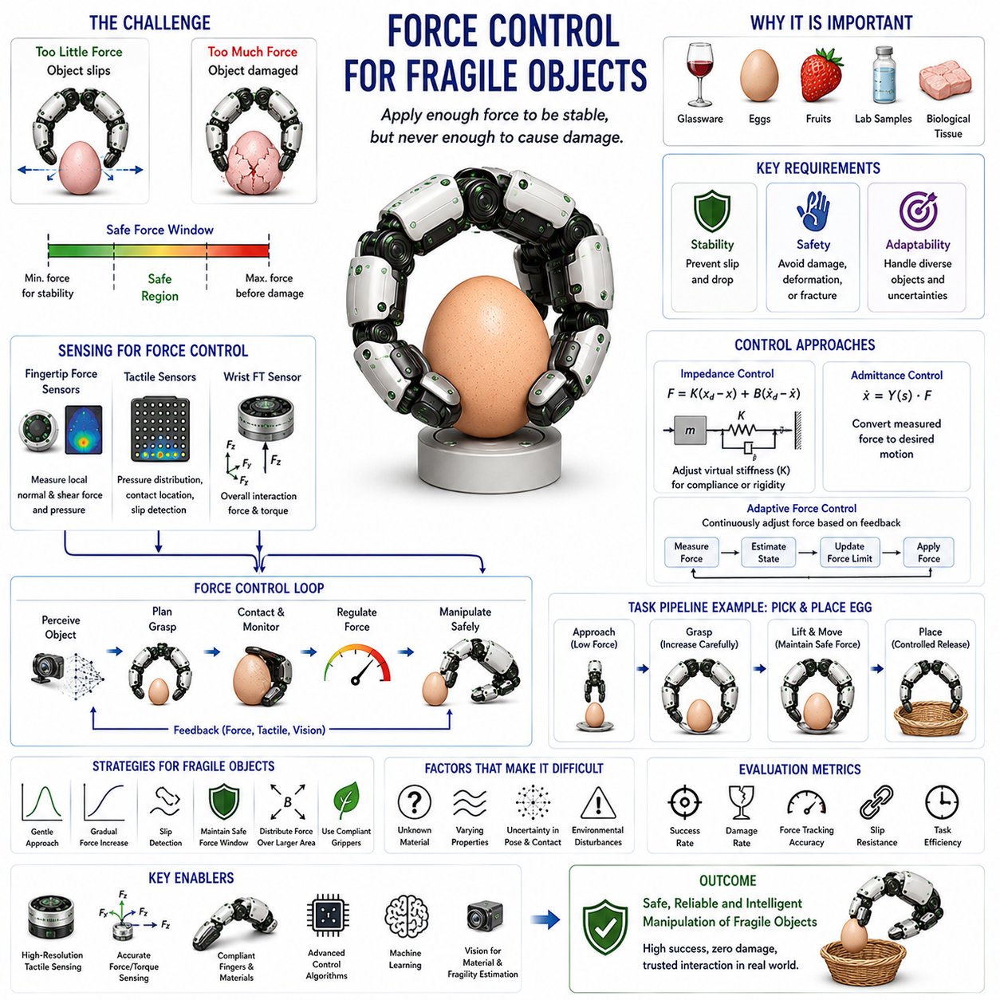{width="7.268055555555556in" height="7.268055555555556in"}

Force Control for Fragile Objects is one of the most critical challenges in robotic manipulation because it requires a robot to apply sufficient force to securely grasp and manipulate an object while simultaneously avoiding any force that could damage, deform, crush, scratch, fracture, or otherwise compromise the object. Unlike rigid industrial components that can tolerate relatively large contact forces, fragile objects possess narrow safety margins between stable grasping and structural failure. Human beings perform this task naturally and continuously. When holding an egg, a ripe strawberry, a laboratory sample, a wine glass, or a medical instrument, the human hand instinctively regulates force according to the object\'s properties. Replicating this capability in robotic systems requires the integration of force sensing, tactile perception, compliant control, grasp planning, material estimation, and intelligent decision-making. As robots increasingly move beyond structured industrial environments and begin interacting with delicate objects in homes, hospitals, laboratories, agricultural fields, and service environments, force control for fragile objects has become a foundational technology for safe and intelligent physical interaction.

The fundamental challenge arises from the existence of two opposing requirements. On one hand, the robot must generate sufficient force to maintain grasp stability and prevent slipping. On the other hand, excessive force can damage the object. These two constraints create a relatively narrow operational region in which successful manipulation is possible. If the applied force falls below the minimum stability threshold, the object slips or falls. If the applied force exceeds the maximum allowable threshold, the object may be damaged. The controller must therefore continuously operate within this safe force window while accounting for uncertainties in object properties and environmental conditions.

The concept of fragility varies significantly across applications. Some objects are fragile because of their mechanical structure. Examples include eggshells, glass containers, ceramic products, thin plastic components, semiconductor wafers, and laboratory vials. Other objects are fragile because they are easily deformed. Fruits, vegetables, baked goods, textiles, soft packaging materials, and biological tissues may not fracture immediately, but excessive forces can permanently alter their shape or reduce their quality. In medical applications, living tissues are considered fragile because even small force errors can cause injury. Understanding the specific nature of fragility is therefore essential for designing effective force control strategies.

Human manipulation provides an important biological reference. When a person picks up an egg, the fingers initially apply a very small force and gradually increase it until a stable grasp is achieved. Throughout the manipulation process, tactile receptors continuously monitor pressure distributions, micro-slips, and contact conditions. If slipping begins, grip force increases slightly. If excessive compression is detected, force is reduced. This closed-loop sensorimotor process allows humans to maintain stable grasps with remarkable precision despite uncertainty regarding object properties.

In robotics, force control for fragile objects generally relies on continuous feedback. Unlike open-loop grasping, where a predetermined force is applied regardless of actual contact conditions, closed-loop force control continuously measures interaction forces and adjusts actuator commands accordingly. This feedback enables the robot to respond to disturbances, object movements, and changing contact conditions while remaining within safe force limits.

Force sensing serves as the primary information source for fragile object manipulation. Fingertip force sensors provide direct measurements of contact forces at grasp locations. Multi-axis force sensors can measure normal and tangential force components simultaneously. Wrist-mounted force-torque sensors provide information about overall interaction forces acting on the robotic hand. Joint torque sensors estimate contact forces indirectly through actuator measurements. These sensing technologies provide the data required for accurate force regulation.

Tactile sensing extends force control beyond simple force magnitude measurements. Modern tactile sensors provide spatial pressure distributions across the contact surface. This information allows the robot to determine not only how much force is being applied, but also where the force is concentrated. Excessive local pressure may damage an object even when total force remains within acceptable limits. Tactile sensing therefore enables more sophisticated force management strategies and improves object safety.

Pressure distribution is particularly important for fragile object handling. Human fingertips naturally distribute forces across soft skin surfaces, reducing peak pressures. Robotic systems often achieve similar behavior using compliant materials, soft finger pads, adaptive contact surfaces, and tactile feedback control. By increasing contact area, pressure concentrations decrease, allowing the robot to apply sufficient grasping force without damaging the object.

Compliance plays a major role in force control for fragile objects. A highly rigid robotic finger may generate large impact forces during contact. Compliant fingers absorb contact energy and adapt to object geometry. Mechanical compliance may be achieved through soft materials, elastic structures, underactuated mechanisms, or compliant joints. Active compliance may be implemented through impedance control or admittance control algorithms. Both approaches improve safety during fragile object interactions.

Impedance control is particularly valuable because it regulates the dynamic relationship between force and motion. Rather than commanding exact positions regardless of contact conditions, the robotic finger behaves like a virtual spring-damper system. When unexpected contact occurs, the finger yields naturally, reducing impact forces and minimizing damage risk. By adjusting virtual stiffness levels, the robot can transition between highly compliant and more rigid behaviors depending on task requirements.

Admittance control provides an alternative framework. In admittance-controlled systems, measured forces generate corresponding motion adjustments. This approach is particularly effective when using position-controlled actuators. By modifying motion according to interaction forces, the robot maintains safe contact conditions while preserving manipulation performance.

One of the most important challenges in fragile object manipulation is determining the appropriate force threshold. Unfortunately, many object properties are unknown before contact occurs. Material stiffness, structural strength, surface friction, and deformation limits may vary significantly among objects. Consequently, robots must estimate these properties during interaction. This estimation process often relies on tactile sensing, force measurements, visual perception, and learning-based prediction methods.

Material property estimation has become an active research area. By analyzing force-displacement relationships during initial contact, robots can estimate object stiffness and infer fragility characteristics. Soft objects deform significantly under small forces, whereas rigid objects exhibit smaller deformations. These observations allow controllers to adjust force limits dynamically according to estimated material properties.

Visual perception contributes valuable information before physical contact occurs. Cameras can identify object categories, estimate dimensions, recognize packaging labels, and infer material properties. A robot that visually identifies a wine glass, egg carton, or laboratory vial can immediately adopt conservative force control policies before contact begins. Combining vision with force sensing significantly improves manipulation safety.

Slip prevention represents another critical requirement. Fragile object handling cannot simply minimize force indefinitely because insufficient force leads to grasp failure. The controller must maintain enough normal force to generate adequate friction while remaining below damage thresholds. This balance often requires continuous monitoring of slip indicators. Tactile sensors can detect micro-slip events, pressure redistribution, and vibration signatures associated with incipient slip. Once slip is detected, force is increased slightly until stability is restored.

Adaptive force control addresses the challenge of varying object properties. Rather than maintaining fixed force levels, adaptive controllers continuously modify force commands according to sensory feedback. If an object begins slipping, force increases. If excessive deformation is observed, force decreases. This dynamic adaptation allows the robot to handle a wide range of fragile objects without requiring precise prior knowledge of their properties.

Machine learning has significantly advanced fragile object manipulation capabilities. Traditional force control methods often depend on analytical models and manually defined rules. However, real-world objects exhibit complex behaviors that are difficult to model accurately. Learning-based systems acquire force control strategies directly from experience. Through large datasets and repeated interactions, robots learn how different objects respond to contact forces and how grasping forces should be adjusted accordingly.

Reinforcement learning has shown particularly strong promise. In simulated environments, robots can interact with thousands of virtual objects while receiving rewards based on successful manipulation and damage avoidance. Over time, the system learns force control policies that balance grasp stability and object safety. These learned policies often outperform manually engineered approaches when operating under uncertainty.

Imitation learning provides another effective strategy. Human demonstrations contain valuable examples of successful fragile object handling. By observing human grasping behavior, robots can learn force modulation strategies that reflect natural manipulation patterns. Such approaches bring robotic force control closer to human performance levels.

Agricultural robotics represents one of the most demanding application domains for fragile object force control. Fruits and vegetables vary widely in size, shape, maturity, stiffness, and surface characteristics. Excessive forces cause bruising, while insufficient forces lead to grasp failure. Robotic harvesters must therefore regulate contact forces carefully while operating efficiently in highly variable environments. Advances in force control have enabled increasingly reliable harvesting of strawberries, tomatoes, apples, cucumbers, and many other crops.

Food handling systems face similar challenges. Bakery products, packaged foods, seafood, confectionery items, and processed food products often require delicate handling. Maintaining product quality while achieving high throughput demands sophisticated force control strategies. Compliant grippers, tactile sensing, and adaptive control algorithms have become essential technologies in food automation.

Medical robotics presents even stricter requirements. Surgical instruments frequently interact with soft tissues, blood vessels, organs, and biological structures that can be damaged by relatively small forces. Force control systems provide surgeons with enhanced safety and precision by limiting interaction forces and detecting hazardous contact conditions. Minimally invasive surgery, robotic rehabilitation, and assistive medical devices all depend heavily on accurate force regulation.

Laboratory automation increasingly relies on fragile object force control as well. Test tubes, petri dishes, microfluidic devices, biological samples, and pharmaceutical containers often require careful manipulation. Automated systems must maintain high reliability while minimizing contamination and breakage risks. Force-controlled robotic handling improves both safety and productivity in these environments.

Warehouse and service robots also encounter fragile objects frequently. Consumer products, electronics, household goods, glass containers, and personal belongings all require varying levels of care. Unlike industrial automation, service environments contain highly diverse object categories. Consequently, robots must generalize force control strategies across many different manipulation scenarios.

Multi-finger robotic hands offer unique advantages for fragile object handling. By distributing forces across multiple contact points, pressure concentrations can be reduced while maintaining overall grasp stability. Internal force control becomes particularly important because excessive internal forces may damage the object even when external manipulation forces remain small. Coordinated multi-finger force regulation therefore improves both safety and dexterity.

Performance evaluation of force control systems for fragile objects typically includes multiple metrics. Grasp success rate measures the ability to maintain stable grasps. Damage rate quantifies object safety. Force tracking accuracy evaluates control precision. Slip prevention effectiveness assesses grasp robustness. Manipulation efficiency measures task completion performance. Together, these metrics provide a comprehensive assessment of system capabilities.

Simulation environments play a growing role in developing fragile object manipulation systems. Advanced physics engines increasingly support deformable objects, contact mechanics, material models, and tactile sensing simulation. These capabilities enable large-scale training and testing without risking damage to real objects. Nevertheless, accurately modeling fragile materials remains a challenging research problem, and simulation-to-reality transfer continues to receive significant attention.

Future developments in force control for fragile objects are expected to integrate tactile intelligence, vision-language models, foundation models, soft robotics, and embodied AI into unified manipulation systems. Rather than simply reacting to force measurements, future robots may reason about object properties, task goals, environmental context, and potential risks before making force control decisions. A robot instructed to "carefully place the ripe strawberry into the container without bruising it" could understand the semantic meaning of the task, estimate object fragility, plan an appropriate grasp strategy, monitor contact conditions, and continuously regulate forces throughout the manipulation process.

As robots become increasingly integrated into everyday environments, the ability to handle fragile objects safely and reliably will become a defining capability of intelligent manipulation systems. Force control for fragile objects combines sensing, control theory, contact mechanics, machine learning, tactile perception, and embodied intelligence into a unified framework for safe physical interaction. These technologies will remain essential for future service robots, agricultural systems, medical devices, industrial automation platforms, humanoid robots, and advanced Physical AI systems that must operate effectively within the delicate and highly variable conditions of the real world.

## 09.10 Multi-Finger Force Distribution

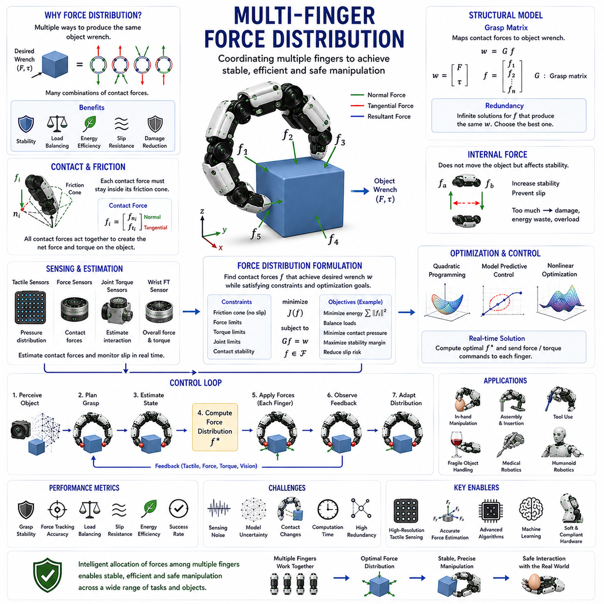{width="7.268055555555556in" height="7.268055555555556in"}

Multi-Finger Force Distribution is a fundamental concept in robotic grasping and dexterous manipulation that focuses on how forces are allocated among multiple fingers during object interaction. While a simple two-finger gripper can often achieve stable grasping through symmetric force application, advanced robotic hands containing three, four, five, or even more fingers introduce a much richer and more complex force control problem. Each finger contributes independently to object stability, manipulation capability, disturbance rejection, and contact safety. The manner in which these forces are distributed determines whether a grasp remains stable, whether an object can be manipulated accurately, whether excessive stresses develop at contact points, and whether fragile objects can be handled without damage. Consequently, multi-finger force distribution serves as a critical bridge connecting grasp mechanics, force control, contact modeling, tactile sensing, dexterous manipulation, and embodied intelligence.

The need for force distribution arises naturally from the redundancy present in multi-finger robotic hands. When several fingers simultaneously contact an object, there are usually many different combinations of contact forces that can produce the same net force and torque on the object. This means that object-level motion does not uniquely determine individual finger forces. The robotic controller must therefore decide how forces should be shared among the fingers. This decision significantly affects grasp quality, energy efficiency, safety, and manipulation performance.

Human hands provide an excellent example of sophisticated force distribution. When holding a cup, lifting a toolbox, turning a screwdriver, or carrying a delicate glass, humans continuously redistribute forces among fingers according to task requirements. The thumb often plays a dominant stabilizing role, while the index and middle fingers contribute to precision control. The ring finger and little finger provide additional support and balance. The nervous system coordinates these force patterns automatically using tactile feedback, proprioception, and motor control strategies developed through years of experience. Robotic multi-finger force distribution attempts to reproduce similar capabilities through sensing, modeling, optimization, and control algorithms.

The foundation of force distribution begins with contact mechanics. Each fingertip applies a contact force to the object. Depending on the contact model, this force may include normal components, tangential frictional components, and in some cases contact moments. Collectively, these contact forces interact to produce net forces and torques acting on the object. The challenge lies in determining which combination of individual contact forces should be generated to achieve a desired manipulation objective.

The grasp matrix plays a central role in force distribution analysis. The grasp matrix mathematically maps contact forces into object-level wrenches consisting of forces and torques. Through this mapping, the controller can determine how individual finger forces contribute to object motion and stability. The grasp matrix also reveals the existence of multiple valid force distributions capable of producing identical object-level effects. This redundancy creates opportunities for optimization but also introduces additional control complexity.

Force closure theory provides an important theoretical framework. A grasp achieves force closure when the fingers can collectively generate forces and torques in any direction required to resist external disturbances. Force closure depends not only on contact locations and friction conditions but also on how forces are distributed among the fingers. Poor force distribution may result in unstable grasps even when sufficient contacts exist. Effective force distribution strategies therefore seek to maintain force closure while satisfying various physical constraints.

One of the primary objectives of multi-finger force distribution is grasp stability. During object manipulation, external disturbances such as gravity, inertia, environmental contact, and unexpected impacts continuously challenge grasp integrity. Proper force distribution ensures that sufficient contact forces are maintained to prevent slip, rotation, or loss of object control. Stability requirements often dominate force distribution decisions, particularly during dynamic manipulation tasks.

Friction plays a critical role in determining feasible force distributions. Each contact point possesses a friction cone that defines the range of allowable contact force directions. If a contact force moves outside its friction cone, slipping occurs. Force distribution algorithms must therefore ensure that all contact forces remain within friction limits while simultaneously satisfying manipulation objectives. This requirement transforms force distribution into a constrained optimization problem.

Internal force distribution represents one of the most distinctive aspects of multi-finger grasping. Internal forces are force components that do not contribute directly to object motion. Instead, they exist solely within the grasp structure. For example, two opposing fingers may increase compression forces against each other without affecting the object\'s overall movement. Although internal forces do not generate object motion, they play a crucial role in maintaining grasp stability and preventing slip.

Internal force regulation requires careful management. Insufficient internal force may lead to grasp instability, while excessive internal force may damage the object, increase energy consumption, and overload actuators. Effective force distribution algorithms continuously adjust internal force levels according to task requirements, object properties, and environmental conditions.

The concept of redundancy is central to multi-finger force distribution. Robotic hands often possess more force-generating capabilities than are strictly necessary to control object motion. This redundancy creates multiple valid solutions for any given manipulation task. Optimization techniques are therefore commonly employed to identify the most desirable force distribution according to specified criteria.

Energy efficiency represents a common optimization objective. Among all possible force distributions capable of maintaining grasp stability, some require less actuator effort than others. Minimizing total force magnitudes or actuator torques reduces power consumption, decreases heat generation, and extends system longevity. Energy-efficient force distributions are particularly important for mobile robots, humanoids, and battery-powered systems.

Load balancing provides another important objective. Uneven force distributions may concentrate loads on specific fingers, increasing mechanical stress and reducing system reliability. Balanced force distributions spread loads more uniformly across available contacts. This approach improves hardware durability and often enhances grasp robustness.

Fragile object manipulation introduces additional constraints. Delicate objects such as fruits, eggs, laboratory samples, glassware, biological tissues, and electronic components cannot tolerate excessive local forces. Multi-finger force distribution allows contact loads to be distributed across multiple fingers and larger contact areas. By reducing peak contact pressures, the risk of object damage decreases significantly.

Compliance further influences force distribution behavior. Compliant fingers deform under load, altering contact geometry and force transmission characteristics. As compliance increases, force distribution becomes dependent not only on controller commands but also on mechanical deformation properties. Understanding this interaction is essential for achieving predictable manipulation performance.

Tactile sensing greatly enhances force distribution capabilities. High-resolution tactile sensors provide information about contact locations, pressure distributions, contact areas, and incipient slip events. These measurements allow controllers to estimate actual force distributions and adjust commands accordingly. Human grasping relies heavily on tactile feedback, and robotic systems increasingly adopt similar strategies.

Force sensors and torque sensors provide complementary information. Fingertip force sensors directly measure local contact forces, while joint torque sensors estimate interaction loads through actuator dynamics. Wrist-mounted force-torque sensors measure overall external disturbances acting on the hand. Combining these sensing modalities enables more accurate force distribution estimation and control.

Real-time force distribution becomes particularly important during dynamic manipulation tasks. Object motion continuously changes contact conditions, requiring force distributions to adapt accordingly. Tasks such as object rotation, rolling, finger gaiting, regrasping, tool use, and in-hand manipulation involve rapidly evolving contact configurations. Effective force distribution algorithms must respond quickly while maintaining stability and control.

Optimization-based force distribution has become one of the dominant approaches in modern robotics. The force allocation problem is formulated as a mathematical optimization task subject to physical constraints. Objectives may include minimizing energy consumption, maximizing stability margins, minimizing contact pressures, balancing loads, or reducing slip risk. Techniques such as quadratic programming, convex optimization, nonlinear programming, and model predictive control are widely used.

Quadratic programming is particularly popular because many force distribution problems can be expressed as quadratic cost functions with linear constraints. Efficient solvers enable real-time computation even for complex multi-finger systems. As computational capabilities continue to improve, increasingly sophisticated optimization strategies become feasible for practical robotic applications.

Model predictive control extends force distribution into the future. Rather than optimizing only the current force allocation, predictive controllers anticipate future object motions, contact changes, and disturbances. This foresight enables smoother force transitions and improved manipulation performance during dynamic tasks.

Learning-based force distribution represents a rapidly growing research area. Traditional methods rely heavily on analytical models that may not capture the full complexity of real-world interactions. Machine learning approaches allow robots to learn force distribution strategies directly from experience. By observing successful manipulation behaviors, robotic systems can discover effective force allocation patterns that may be difficult to derive analytically.

Reinforcement learning has shown particular promise in this area. Through repeated interaction with simulated environments, robotic hands learn how force distributions influence grasp stability, manipulation success, energy efficiency, and object safety. The resulting policies often develop sophisticated strategies for coordinating multiple fingers under uncertain conditions.

Imitation learning offers another valuable approach. Human demonstrations contain rich information about natural force coordination patterns. By observing human grasping and manipulation behaviors, robots can learn biologically inspired force distribution strategies that improve dexterity and adaptability.

Multi-finger force distribution plays a central role in in-hand manipulation. Tasks such as object rotation, repositioning, rolling, pivoting, and finger gaiting require precise coordination of multiple contact forces. Each finger must contribute appropriately to object motion while maintaining overall grasp stability. Small force distribution errors may lead to object slip or manipulation failure. Consequently, advanced force distribution algorithms are essential for achieving human-like dexterity.

Humanoid robotics represents one of the most demanding application areas. Human-like robotic hands often contain numerous joints and contact points, creating extremely high-dimensional force distribution problems. Effective control requires integration of force sensing, tactile perception, optimization algorithms, and intelligent planning. Achieving human-level manipulation capabilities depends heavily on solving these force allocation challenges.

Medical robotics also benefits from advanced force distribution techniques. Surgical manipulation often involves delicate tissues requiring careful load management. Multiple contact points may be used to distribute forces safely while maintaining precise control. Accurate force allocation reduces tissue damage and improves procedural outcomes.

Industrial assembly applications frequently rely on multi-finger force distribution as well. Assembly tasks require stable object handling while interacting with fixtures, tools, and mating components. Proper force allocation improves insertion success rates, reduces jamming, and enhances manipulation precision.

Performance evaluation of force distribution systems typically includes grasp stability, force tracking accuracy, load balancing quality, slip resistance, energy efficiency, contact pressure distribution, manipulation success rate, and computational efficiency. These metrics provide quantitative measures of system effectiveness and guide controller development.

Simulation environments have become indispensable tools for studying force distribution. Modern physics simulators can model contact mechanics, friction, compliance, tactile sensing, and multi-body dynamics with increasing realism. Researchers use these environments to evaluate force allocation algorithms under diverse conditions before deploying them on physical hardware. However, accurately modeling real-world contact interactions remains an ongoing challenge.

Future developments in multi-finger force distribution are expected to integrate tactile intelligence, high-resolution force sensing, soft robotics, foundation models, and embodied AI into unified manipulation architectures. Rather than merely calculating force allocations mathematically, future robots may understand object properties, task objectives, environmental context, and semantic instructions. A robot instructed to "carefully rotate the fragile laboratory vial while avoiding excessive pressure on the cap" could automatically determine optimal force distributions, contact strategies, and manipulation sequences based on its understanding of the task.

As robotic manipulation continues advancing toward human-level dexterity, multi-finger force distribution will remain a cornerstone technology. The ability to coordinate forces among multiple fingers efficiently, safely, and intelligently underlies nearly every advanced manipulation capability. By combining contact mechanics, grasp theory, optimization, sensing technologies, machine learning, and embodied intelligence, multi-finger force distribution provides the foundation for future industrial robots, service robots, medical systems, humanoids, and Physical AI platforms capable of sophisticated interaction with the complex physical world.

## 09.11 Force Control Validation

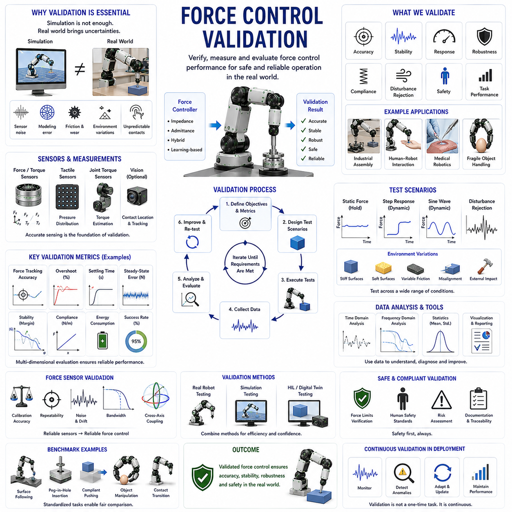{width="7.268055555555556in" height="7.268055555555556in"}

Force Control Validation is the systematic process of verifying, measuring, and evaluating whether a robotic force control system performs according to its intended design objectives under realistic operating conditions. In robotic manipulation, force control algorithms are responsible for regulating interaction forces between the robot and its environment, objects, tools, humans, or other robots. While theoretical control models may demonstrate excellent performance in simulation or mathematical analysis, practical deployment requires rigorous validation to ensure that force regulation remains accurate, stable, robust, safe, and reliable under real-world uncertainties. Force control validation therefore serves as the final bridge between controller design and operational deployment. Without comprehensive validation, even sophisticated force control algorithms may fail when confronted with sensor noise, modeling errors, mechanical imperfections, environmental variability, or unexpected contact conditions.

The importance of force control validation has increased significantly as robots have expanded beyond traditional industrial automation. Early industrial robots primarily operated in structured environments where physical interaction was minimized. Most motions were position-controlled, and contact with external objects occurred only during carefully planned manufacturing operations. Modern robots, however, increasingly perform tasks involving continuous physical interaction. Service robots manipulate household objects, agricultural robots harvest delicate crops, medical robots interact with biological tissues, collaborative robots share workspaces with humans, and humanoid robots operate in unstructured environments. In all of these applications, force control performance directly affects safety, effectiveness, and reliability. Consequently, validation has become an essential component of robotic system development.

The primary goal of force control validation is to determine whether actual system behavior matches expected behavior. A force controller is designed to regulate interaction forces according to predefined objectives. Validation evaluates whether these objectives are achieved under realistic operating conditions. This process includes measuring force tracking accuracy, disturbance rejection capability, compliance characteristics, stability margins, transient response behavior, robustness to uncertainty, and overall task performance.

Force tracking accuracy is one of the most fundamental validation metrics. In force control applications, the robot is typically commanded to generate a desired force profile. Validation measures how closely the actual force follows the reference force. Tracking errors may arise from sensor inaccuracies, actuator limitations, friction effects, communication delays, structural flexibility, or controller tuning issues. High-quality force control systems minimize tracking errors across a wide range of operating conditions.

Static force validation evaluates performance under steady-state conditions. During these tests, the robot applies constant forces to calibrated surfaces or measurement devices. The resulting force measurements are compared with commanded values to determine accuracy, repeatability, and calibration quality. Static validation is often the first stage of force control evaluation because it isolates fundamental system performance before introducing dynamic effects.

Dynamic force validation focuses on time-varying force regulation. Real-world tasks rarely involve constant forces. Instead, forces continuously change as objects move, contacts evolve, and environmental conditions vary. Dynamic validation examines how quickly and accurately the controller responds to changing force commands. Step responses, sinusoidal force trajectories, frequency sweeps, and transient events are commonly used to evaluate dynamic behavior.

Response time represents a critical performance characteristic. When contact conditions change, the controller must adjust force outputs rapidly enough to maintain stability and task effectiveness. Slow responses may result in excessive contact forces, object damage, instability, or grasp failure. Validation therefore measures rise time, settling time, delay characteristics, and overall responsiveness.

Overshoot analysis is particularly important in force control systems. Excessive overshoot occurs when actual force temporarily exceeds desired force levels during transitions. In applications involving fragile objects, medical procedures, or human interaction, even brief force overshoots may cause unacceptable consequences. Validation tests therefore evaluate both steady-state accuracy and transient force behavior.

Stability assessment represents one of the most important aspects of force control validation. Contact interactions introduce complex dynamic relationships between the robot and its environment. Under certain conditions, force control systems may become unstable, generating oscillations, vibrations, or uncontrolled behaviors. Validation procedures examine system stability across a range of environmental stiffness values, contact conditions, and operational scenarios.

Environmental uncertainty plays a major role in force control performance. Real environments rarely behave exactly as assumed by mathematical models. Surface stiffness, damping, friction, geometry, and contact properties may vary significantly. Effective validation therefore includes testing across diverse environmental conditions. Controllers that perform well only under idealized assumptions often fail during practical deployment.

Compliance validation evaluates how effectively the robot accommodates external forces and positional uncertainties. Compliance is particularly important in collaborative robotics, fragile object manipulation, and contact-rich assembly tasks. Validation measures how the system responds to unexpected contacts, disturbances, and environmental constraints. Desired compliance behavior should balance flexibility and control precision.

Impedance control validation requires specialized evaluation procedures. Impedance controllers regulate dynamic relationships between force and motion through virtual stiffness, damping, and inertia parameters. Validation verifies whether the realized system behavior matches the desired virtual mechanical properties. Experimental measurements are often compared with theoretical impedance models to quantify performance.

Admittance control validation follows similar principles but focuses on the conversion of measured forces into motion responses. Validation evaluates whether motion generation accurately reflects intended admittance dynamics. Since admittance controllers often operate on position-controlled robots, testing must account for actuator dynamics and communication delays.

Force sensor validation forms an essential prerequisite for force control validation. Since force controllers rely heavily on sensor feedback, sensor accuracy directly influences controller performance. Validation procedures examine calibration accuracy, measurement repeatability, noise characteristics, drift behavior, sensitivity, bandwidth, hysteresis, and long-term stability. Even highly sophisticated control algorithms cannot compensate for severely degraded sensor performance.

Multi-axis force-torque sensors require particularly comprehensive validation. These sensors measure forces and moments simultaneously across multiple dimensions. Cross-axis coupling, calibration errors, and nonlinear effects can introduce significant measurement inaccuracies. Validation ensures that measured force vectors accurately represent actual interaction forces.

Tactile sensor validation has become increasingly important in advanced manipulation systems. Tactile sensors provide information regarding pressure distributions, contact locations, contact areas, and slip conditions. Validation evaluates spatial resolution, sensitivity, response speed, durability, calibration quality, and robustness to environmental conditions. Accurate tactile information significantly improves force control performance during grasping and manipulation.

Contact force validation is particularly relevant in robotic grasping applications. During grasping, force controllers regulate contact forces between robotic fingers and objects. Validation examines whether force distributions remain within desired limits while maintaining grasp stability. Slip prevention, pressure distribution quality, object protection, and force coordination are commonly evaluated.

Fragile object handling provides a demanding validation scenario. Delicate objects such as eggs, fruits, laboratory samples, glassware, and medical devices require precise force regulation. Validation tests determine whether the controller can maintain stable grasps without causing damage. Success rates, damage rates, force margins, and adaptation capabilities are commonly measured.

Human-robot interaction introduces additional validation requirements. Collaborative robots must regulate contact forces safely during interactions with people. Validation procedures assess collision response behavior, impact force limitation, contact safety, compliance performance, and adherence to safety standards. Human safety represents one of the most critical validation objectives in collaborative robotics.

Medical robotics demands exceptionally rigorous force control validation. Surgical systems often interact with highly sensitive biological tissues. Validation evaluates force accuracy, force limits, tissue protection performance, motion-force coordination, and procedural safety. Regulatory approval processes typically require extensive experimental evidence demonstrating safe operation.

Industrial assembly applications present another important validation domain. Force-controlled insertion tasks rely on accurate contact force regulation to avoid jamming, misalignment, and component damage. Validation examines insertion success rates, force profiles, alignment accuracy, and robustness to part variability. Contact-rich assembly operations frequently serve as benchmark tasks for evaluating force control performance.

Disturbance rejection testing evaluates how effectively the controller maintains desired force behavior when external disturbances occur. Disturbances may originate from environmental interactions, unexpected contacts, sensor noise, actuator uncertainties, or external forces. Validation measures recovery speed, stability preservation, and force regulation accuracy under disturbed conditions.

Robustness validation examines controller performance across variations in system parameters and operating conditions. Real robotic systems inevitably experience parameter uncertainty, wear, temperature variation, payload changes, and environmental variability. Robust force controllers maintain acceptable performance despite these uncertainties. Validation therefore includes testing across a wide range of conditions rather than relying on a single nominal configuration.

Frequency-domain validation provides valuable insights into dynamic performance. By analyzing system behavior across different frequencies, engineers can characterize bandwidth, stability margins, resonance behavior, and disturbance rejection capabilities. Frequency response analysis is widely used in advanced force control research and development.

Simulation-based validation has become an increasingly important component of force control evaluation. Modern simulation environments support realistic contact dynamics, sensor models, actuator behavior, friction effects, and deformable materials. Simulation enables large-scale testing across diverse conditions before physical deployment. However, simulation alone is insufficient because modeling inaccuracies inevitably exist. Experimental validation remains essential.

Hardware-in-the-loop validation combines simulation and physical hardware components. This approach enables realistic testing while maintaining flexibility and safety. Hardware-in-the-loop systems are particularly useful for validating controllers before deployment on expensive or safety-critical robotic platforms.

Digital twin technologies further enhance force control validation. A digital twin continuously synchronizes virtual and physical system states, enabling ongoing performance monitoring and predictive validation. By comparing predicted and measured behaviors, engineers can identify emerging performance degradation before failures occur.

Machine learning introduces new challenges for force control validation. Traditional controllers often possess mathematically predictable behaviors, whereas learning-based systems may exhibit complex and difficult-to-analyze dynamics. Validation must therefore address generalization performance, robustness to unseen conditions, explainability, safety guarantees, and adaptation behavior.

Reinforcement learning-based force controllers require extensive validation because learned policies may exploit simulation artifacts or develop unexpected behaviors. Validation procedures evaluate performance across diverse environments, object types, contact conditions, and disturbance scenarios. Simulation-to-reality transfer becomes a particularly important consideration.

Benchmarking plays an important role in force control validation. Standardized benchmark tasks allow researchers and engineers to compare different control approaches objectively. Common benchmarks include force tracking tasks, surface following, insertion operations, compliant motion tasks, object manipulation scenarios, and contact transition tests. Benchmarking accelerates technological progress by providing consistent evaluation frameworks.

Performance metrics used in force control validation are typically multidimensional. Accuracy measures force tracking quality. Stability evaluates resistance to oscillation and instability. Robustness quantifies performance under uncertainty. Responsiveness characterizes dynamic behavior. Safety assesses interaction risk. Energy efficiency measures resource utilization. Task success rates evaluate practical effectiveness. Together, these metrics provide a comprehensive assessment of controller quality.

Future developments in force control validation are expected to integrate high-resolution sensing, digital twins, foundation models, embodied AI, automated testing frameworks, and large-scale simulation environments. Validation systems may become increasingly autonomous, continuously monitoring robot performance during deployment and adapting evaluation procedures according to operational experience. Rather than validating only isolated force control modules, future frameworks may assess entire manipulation systems as integrated physical intelligence platforms.

As robotics continues moving toward widespread deployment in homes, hospitals, factories, laboratories, agricultural environments, and public spaces, force control validation will remain a cornerstone of robotic system engineering. Reliable force regulation is essential for safe physical interaction, and validation provides the evidence required to trust robotic behavior under real-world conditions. By combining measurement science, control theory, sensing technologies, experimental methodologies, simulation tools, machine learning evaluation, and safety engineering, force control validation ensures that robotic systems can interact effectively, safely, and intelligently with the physical world. It represents not merely a testing procedure but a foundational discipline supporting the development of advanced manipulation systems, collaborative robots, humanoids, medical robots, service robots, and future Physical AI platforms.
