**Volume 06 Robot Hands and Dexterous Grasping**

# 09. Force and Torque Control for Robot Hands

## 09.01 Force Control Fundamentals

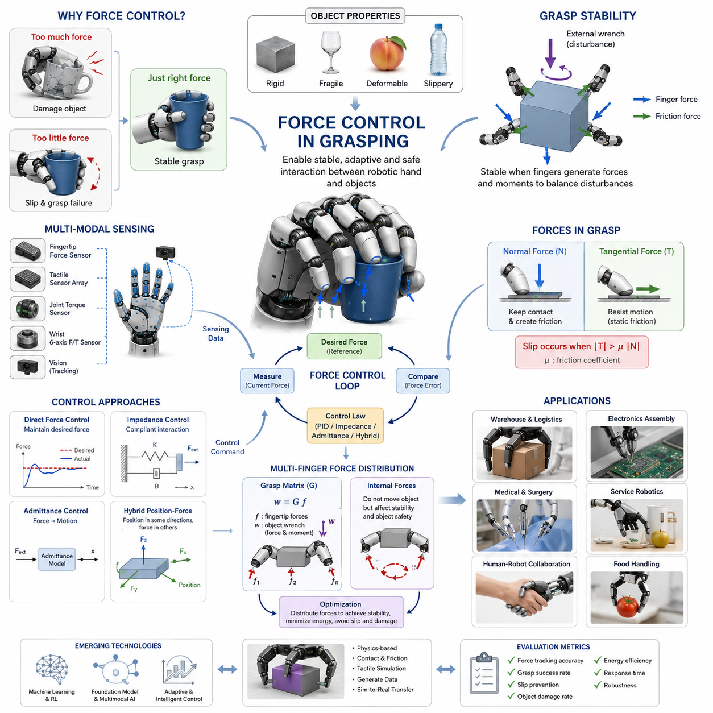{width="7.268055555555556in" height="7.268055555555556in"}

파지에서의 힘 제어(Force Control in Grasping)는 정교한 조작(Dexterous Manipulation)을 가능하게 하는 가장 핵심적인 기술 중 하나이다. 성공적인 파지는 단순히 손가락을 정확한 위치에 배치하는 것만으로 결정되지 않으며, 물체에 얼마나 적절한 힘을 가하는지가 매우 중요하다. 로봇 핸드가 정밀한 위치 제어 능력을 갖추고 있더라도 접촉력을 조절할 수 없다면 실제 환경에서 다양한 물체를 안정적으로 다룰 수 없다. 과도한 힘은 깨지기 쉬운 물체를 손상시키고, 부족한 힘은 미끄러짐(Slip), 불안정성, 혹은 파지 실패를 초래한다. 따라서 현대의 로봇 핸드는 물체와 손가락 사이의 상호작용 힘을 지속적으로 조절할 수 있는 힘 제어 기능을 필수적으로 갖추어야 한다. 이러한 기술은 파지 안정성(Grasp Stability), 촉각 기반 조작(Tactile Manipulation), 순응 제어(Compliant Interaction), 인간 수준의 손재주(Dexterity)를 실현하기 위한 기반이 된다.

전통적인 산업용 로봇은 대부분 위치 제어(Position Control)를 중심으로 설계되었다. 위치 제어 시스템에서는 각 관절을 목표 위치로 이동시키는 것이 주요 목적이며, 접촉 상태는 상대적으로 고려되지 않는다. 이러한 방식은 구조화된 환경에서는 매우 효과적이지만, 파지와 같이 접촉이 필수적인 작업에서는 한계를 가진다. 손가락이 물체와 접촉한 이후에는 접촉력, 마찰, 순응성(Compliance), 물체 변형, 환경 불확실성 등이 모두 시스템의 동작에 영향을 미친다. 순수한 위치 제어만 사용할 경우 제어기는 위치 오차를 줄이기 위해 계속 움직이려고 하며, 그 결과 과도한 힘이 발생할 수 있다. 힘 제어는 이러한 문제를 해결하기 위해 접촉력을 직접 제어 대상으로 설정한다.

인간의 손은 힘 제어의 가장 훌륭한 참고 모델이다. 사람은 물체의 무게, 표면 마찰계수, 형상, 예상 동작에 따라 파지력을 지속적으로 조절한다. 종이컵을 들 때는 매우 작은 힘만 사용하지만, 무거운 가방을 들 때는 훨씬 큰 힘을 사용한다. 미끄러운 병을 잡을 때는 자동적으로 파지력을 증가시켜 미끄러짐을 방지한다. 이러한 동작은 촉각(Tactile Sense), 고유수용감각(Proprioception), 시각 정보, 운동 제어가 통합되어 실시간으로 수행된다. 로봇의 힘 제어 기술은 이러한 인간의 적응적 행동을 센서, 액추에이터, 제어 알고리즘으로 구현하려는 시도라고 볼 수 있다.

힘 제어의 기본 목적은 로봇 손가락과 물체 사이에 원하는 접촉력을 유지하는 것이다. 이를 위해 제어기는 목표 힘(Desired Force)과 실제 측정된 힘을 비교하고, 그 차이를 줄이기 위해 액추에이터 명령을 조정한다. 이러한 폐루프 제어(Closed-Loop Control)를 통해 안정적인 힘 조절이 가능해진다. 힘 제어 성능은 센서의 정확도, 액추에이터 응답 속도, 제어기 안정성, 기계적 순응성 등에 의해 결정된다.

파지 시 발생하는 힘은 크게 법선력(Normal Force)과 접선력(Tangential Force)으로 구분된다. 법선력은 접촉면에 수직으로 작용하며 물체를 잡아두는 역할을 한다. 접선력은 접촉면을 따라 작용하며 마찰과 직접적으로 관련된다. 안정적인 파지를 위해서는 충분한 법선력이 제공되어야 하며, 이를 통해 미끄러짐을 방지할 수 있는 마찰력이 생성된다. 만약 접선력이 마찰 한계를 초과하면 물체는 미끄러지기 시작한다. 따라서 힘 제어는 파지력과 외란 사이의 균형을 유지하는 역할을 수행한다.

파지 안정성은 힘 제어의 핵심 개념 중 하나이다. 안정적인 파지란 물체에 작용하는 외력과 모멘트를 손가락들이 생성하는 힘으로 균형 있게 상쇄할 수 있는 상태를 의미한다. 제어기는 중력, 가속도, 물체 이동, 환경 접촉 등 다양한 외란에 대응하여 손가락 힘을 지속적으로 조절해야 한다. 반응이 너무 느리면 물체가 미끄러질 수 있으며, 반대로 지나치게 공격적인 제어는 진동과 불안정을 유발할 수 있다.

힘 제어 시스템의 핵심 구성 요소는 힘 센서(Force Sensor)이다. 힘 정보를 측정할 수 없다면 제어기는 접촉 상태를 정확히 파악할 수 없다. 손가락 끝(Fingertip)에 장착되는 힘 센서는 국부적인 접촉력을 측정한다. 손목(Wrist)에 장착되는 6축 힘/토크 센서는 전체 손에 작용하는 힘과 모멘트를 측정한다. 촉각 센서 배열(Tactile Array)은 압력 분포를 제공하며, 관절 토크 센서는 액추에이터 부하를 통해 간접적으로 접촉력을 추정한다. 각 방식은 해상도, 비용, 대역폭, 내구성 측면에서 서로 다른 장단점을 가진다.

최신 로봇 핸드는 일반적으로 여러 센서를 동시에 활용한다. 손끝 힘 센서는 접촉력을 측정하고, 촉각 센서는 접촉 위치와 압력 분포를 제공한다. 관절 토크 센서는 내부 동역학 정보를 제공하며, 비전 센서는 물체 움직임을 추적한다. 이러한 센서 융합(Sensor Fusion)은 단일 센서보다 더욱 정확한 파지 상태 추정을 가능하게 한다.

가장 기본적인 힘 제어 방식은 직접 힘 제어(Direct Force Control)이다. 이 방식에서는 측정된 힘과 목표 힘의 차이를 줄이기 위해 제어기가 모터 명령을 수정한다. 일반적으로 PID 제어기가 사용된다. 그러나 강성이 높은 환경에서는 작은 위치 변화만으로도 큰 힘 변화가 발생하기 때문에 안정성 문제가 나타날 수 있다. 따라서 적절한 제어기 튜닝과 기계적 순응성이 중요하다.

하이브리드 위치-힘 제어(Hybrid Position-Force Control)는 특정 방향에서는 위치를 제어하고 다른 방향에서는 힘을 제어하는 방식이다. 예를 들어 조립 작업이나 삽입 작업에서는 일부 축은 정확한 위치 제어가 필요하고, 접촉 방향은 힘 제어가 필요하다. 이러한 접근법은 복잡한 환경과 상호작용하는 데 매우 효과적이다.

임피던스 제어(Impedance Control)는 힘 제어 분야에서 가장 영향력이 큰 기술 중 하나이다. 이 방식은 힘을 직접 제어하기보다는 힘과 운동 사이의 동적 관계를 제어한다. 시스템은 가상의 강성(Stiffness), 감쇠(Damping), 관성(Inertia)을 가지는 기계 시스템처럼 동작하도록 설계된다. 외력이 가해지면 로봇은 설정된 임피던스 특성에 따라 자연스럽게 반응한다. 이러한 방식은 인간 근육의 특성과 유사한 순응적 행동을 제공한다.

어드미턴스 제어(Admittance Control)는 임피던스 제어와 반대 개념으로 이해할 수 있다. 측정된 힘을 입력으로 사용하여 목표 운동을 생성한다. 강성이 높은 산업용 로봇 시스템에서 특히 유용하며, 힘에 따라 움직임을 조절함으로써 유연한 상호작용을 가능하게 한다.

힘 제어의 가장 중요한 응용 중 하나는 미끄러짐 방지(Slip Prevention)이다. 물체가 미끄러지는 이유는 접촉면에서 발생 가능한 최대 마찰력이 외력을 견디기에 부족하기 때문이다. 인간은 미끄러짐이 감지되면 즉시 파지력을 증가시킨다. 로봇 역시 촉각 센서와 미끄러짐 검출 알고리즘을 이용하여 초기 미끄러짐 징후를 감지하고 파지력을 자동으로 증가시킨다. 이를 통해 불필요하게 큰 힘을 사용하지 않으면서도 안정적인 파지를 유지할 수 있다.

다지형(Multi-Finger) 로봇 핸드에서는 힘 제어가 더욱 복잡해진다. 여러 손가락이 동시에 물체를 접촉하기 때문에 힘 분배 문제가 발생한다. 동일한 물체 힘을 생성하더라도 손가락별 힘 분포는 다양하게 존재할 수 있다. 특히 내부력(Internal Force)은 물체의 움직임에는 영향을 주지 않지만 손가락 사이에 존재하는 힘이다. 내부력이 지나치게 크면 물체가 손상될 수 있고, 너무 작으면 파지 안정성이 감소한다.

이러한 문제를 해결하기 위해 파지 행렬(Grasp Matrix)이 사용된다. 파지 행렬은 손가락 끝 힘이 물체 전체에 어떤 힘과 모멘트를 생성하는지를 수학적으로 표현한다. 이를 기반으로 최적화 알고리즘은 안정성을 유지하면서도 에너지 소비를 최소화하거나 물체 손상을 방지하는 힘 분배를 계산할 수 있다.

중복 자유도(Redundancy)를 가진 로봇 핸드는 더욱 다양한 힘 제어 전략을 사용할 수 있다. 여분의 자유도를 활용하여 에너지 절약, 힘 최적화, 조작성 향상, 장애물 회피 등을 동시에 수행할 수 있다. 하지만 가능한 해가 많아지기 때문에 제어 알고리즘의 복잡성도 증가한다.

물체의 특성은 힘 제어 전략에 큰 영향을 미친다. 금속 블록과 같은 강체(Rigid Object)는 비교적 높은 힘을 견딜 수 있지만, 유리컵이나 전자부품은 매우 정밀한 힘 조절이 필요하다. 과일, 식품, 의료 조직과 같은 변형 가능한 물체는 힘에 따라 형태가 변화하므로 더욱 정교한 제어가 요구된다. 이러한 응용 분야에서는 안정성과 안전성을 동시에 고려해야 한다.

산업 현장에서 힘 제어는 점점 더 중요한 역할을 하고 있다. 물류 창고에서는 크기와 무게가 다양한 박스를 다루어야 하고, 전자 제조 공정에서는 미세 부품을 손상 없이 조립해야 한다. 의료 로봇은 인체 조직과 안전하게 상호작용해야 하며, 서비스 로봇은 가정 환경에서 수많은 종류의 물체를 다루어야 한다. 이러한 모든 응용에서 힘 제어는 필수 기술로 자리 잡고 있다.

최근에는 머신러닝과 강화학습(Reinforcement Learning)이 힘 제어 분야에 적극적으로 도입되고 있다. 데이터 기반 학습을 통해 최적의 힘 제어 정책을 학습하고, 시뮬레이션 환경에서 수많은 시행착오를 거쳐 실제 환경에서도 강인하게 동작하는 제어기를 개발할 수 있다. 딥러닝 모델은 파지 안정성을 예측하고, 미끄러짐 발생 가능성을 사전에 추정하며, 상황에 맞는 힘 조절 전략을 생성할 수 있다.

향후에는 파운데이션 모델(Foundation Model)과 멀티모달 AI가 힘 제어와 결합될 것으로 예상된다. 로봇은 언어 명령, 시각 정보, 촉각 데이터, 힘 데이터를 통합적으로 이해하여 적절한 파지 전략을 선택할 수 있게 될 것이다. 예를 들어 "깨지기 쉬운 유리잔을 조심스럽게 집어라"라는 명령을 이해하고, 적절한 힘 수준을 자동으로 결정하는 것이 가능해질 것이다.

시뮬레이션은 힘 제어 연구에서 매우 중요한 역할을 한다. 물리 기반 시뮬레이터는 실제 하드웨어를 손상시키지 않고 다양한 조건에서 제어기를 검증할 수 있도록 해준다. 접촉 모델, 마찰 모델, 순응 모델, 촉각 시뮬레이션은 힘 제어 연구의 핵심 도구이다. 다만 실제 접촉 현상을 완벽하게 모델링하는 것은 매우 어렵기 때문에 Sim-to-Real 문제는 여전히 중요한 연구 과제로 남아 있다.

힘 제어 시스템의 성능은 힘 추종 오차(Force Tracking Error), 파지 성공률(Grasp Success Rate), 미끄러짐 방지 성능, 물체 손상률, 에너지 효율, 응답 시간, 외란 강인성 등의 지표를 통해 평가된다. YCB Object Set과 같은 표준 벤치마크가 널리 사용되며, 다양한 환경에서 반복적인 실험을 통해 신뢰성을 검증한다.

인간 수준의 손재주를 가진 로봇을 구현하기 위해서는 힘 제어가 반드시 필요하다. 미래의 로봇 핸드는 초소형 부품 조립, 유연 물체 조작, 의료 기구 취급, 인간과의 협업 등 더욱 복잡한 작업을 수행해야 한다. 이를 위해서는 힘 센서, 촉각 센서, 순응 액추에이터, 적응형 제어기, 학습 기반 알고리즘이 긴밀하게 통합되어야 한다. 결국 파지에서의 힘 제어는 단순한 저수준 제어 기술이 아니라 접촉역학(Contact Mechanics), 파지 이론(Grasp Theory), 촉각 인지(Tactile Perception), 미끄러짐 검출(Slip Detection), 정교 조작(Dexterous Manipulation), 그리고 체화지능(Embodied Intelligence)을 연결하는 핵심 기술이라 할 수 있다. 앞으로의 로봇 핸드와 차세대 Physical AI 시스템의 발전에서 힘 제어는 가장 중요한 기반 기술 중 하나로 계속 발전할 것이다.

## 09.02 Fingertip Force Sensors

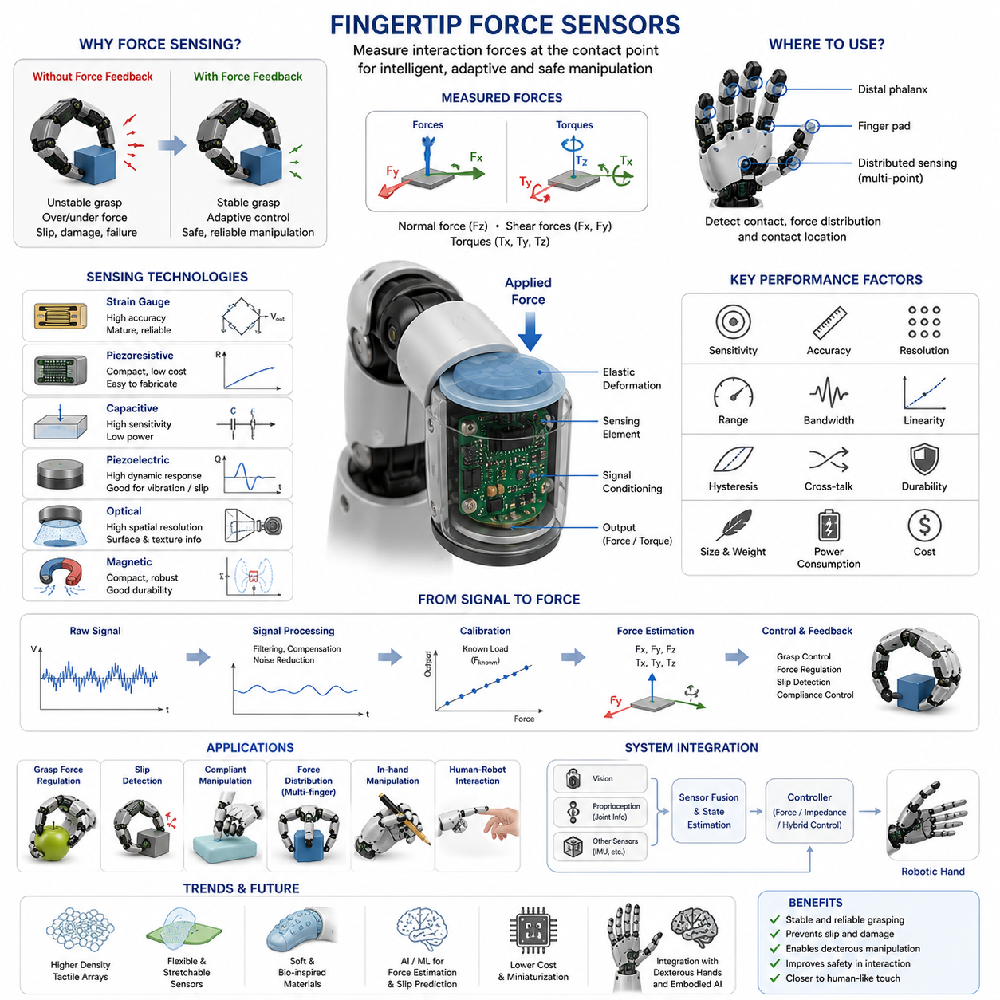{width="7.268055555555556in" height="7.268055555555556in"}

손끝 힘 센서(Fingertip Force Sensors)는 로봇 핸드에서 가장 중요한 센서 중 하나로, 로봇 손가락과 물체 사이에 발생하는 상호작용 힘을 직접 측정하는 역할을 수행한다. 비전 시스템은 물체의 위치와 자세를 추정할 수 있고, 관절 엔코더는 손가락의 위치를 측정할 수 있지만, 실제로 물체를 얼마나 강하게 누르고 있는지 알려주는 것은 힘 센서뿐이다. 인간 역시 물체를 잡거나 조작할 때 손끝에서 전달되는 힘과 압력 정보를 지속적으로 활용한다. 컵을 집거나, 나사를 조이거나, 깨지기 쉬운 물체를 다룰 때 손끝은 접촉 압력과 힘 분포를 실시간으로 감지하며, 뇌는 이를 기반으로 파지력을 조절한다. 손끝 힘 센서는 이러한 인간의 감각 기능을 로봇에 구현하기 위한 기술로서, 적응형 파지(Adaptive Grasping), 미끄러짐 방지(Slip Prevention), 순응 제어(Compliance Control), 정교 조작(Dexterous Manipulation)을 가능하게 한다. 따라서 손끝 힘 센서는 로봇 제어 시스템과 물리 세계를 연결하는 핵심 인터페이스라 할 수 있다.

손끝 힘 센서의 가장 기본적인 목적은 손가락과 물체가 접촉하는 지점에서 발생하는 힘을 측정하는 것이다. 이러한 측정값은 파지 품질, 물체 안정성, 접촉 상태, 외란 여부 등을 판단하는 데 사용된다. 힘 정보를 얻지 못하는 로봇은 단순히 위치 정보만으로 작업을 수행해야 하므로 대부분 개방 루프(Open-Loop) 방식에 의존하게 된다. 이러한 방식은 과도한 파지력, 물체 손상, 예기치 않은 미끄러짐 등의 문제를 유발할 수 있다. 반면 힘 센서를 활용하면 로봇은 접촉 상태를 실시간으로 모니터링하면서 폐루프(Closed-Loop) 제어를 수행할 수 있다.

파지 과정에서 발생하는 힘은 일반적으로 여러 성분으로 나누어 분석된다. 가장 기본적인 것은 법선력(Normal Force)이다. 법선력은 접촉면에 수직으로 작용하며 파지력을 결정하는 가장 중요한 요소이다. 접선력(Tangential Force)은 접촉면과 평행하게 작용하며 마찰력과 직접적인 관련이 있다. 또한 고급 센서는 회전 모멘트(Moment)와 토크(Torque)까지 측정할 수 있어 더욱 정교한 접촉 상태 분석이 가능하다. 이러한 힘 정보들은 로봇이 현재 물체를 안정적으로 잡고 있는지 판단하는 데 사용된다.

가장 단순한 손끝 힘 센서는 단일 축(1-Axis) 힘만 측정한다. 이러한 센서는 산업용 그리퍼에서 흔히 사용되며, 접촉 여부와 파지력 크기를 확인하는 데 충분한 경우가 많다. 구조가 단순하고 비용이 저렴하며 내구성이 높다는 장점이 있지만, 미끄러짐이나 측면 힘과 같은 복잡한 접촉 상태를 파악하기 어렵다.

보다 발전된 형태는 2축 또는 3축 힘 센서이다. 2축 센서는 법선력과 접선력을 동시에 측정할 수 있어 미끄러짐 감지에 유리하다. 3축 센서는 공간상의 세 방향 힘을 모두 측정할 수 있어 보다 복잡한 조작 작업에 적합하다. 손가락 끝에서 발생하는 힘 벡터의 변화를 분석함으로써 물체 움직임, 접촉 변화, 외란 발생 여부를 파악할 수 있다.

최첨단 손끝 센서는 6축 힘-토크 센서(6-Axis Force-Torque Sensor)를 사용한다. 이러한 센서는 세 개의 힘 성분과 세 개의 토크 성분을 동시에 측정한다. 결과적으로 접촉 상태를 완전하게 분석할 수 있으며, 고난도의 정교 조작 작업을 수행할 수 있다. 다만 센서 크기, 무게, 비용, 내구성 문제로 인해 손가락 끝에 직접 통합하는 것은 여전히 어려운 기술적 과제로 남아 있다.

손끝 힘 센서에는 다양한 측정 원리가 사용된다. 가장 널리 사용되는 방식 중 하나는 스트레인 게이지(Strain Gauge) 기반 센서이다. 스트레인 게이지는 변형이 발생하면 전기 저항이 변화하는 특성을 이용한다. 손끝 구조물에 스트레인 게이지를 부착하면 힘에 의해 발생하는 변형을 측정하고 이를 힘 값으로 변환할 수 있다. 높은 정확도와 선형성을 제공하며 산업 현장에서 오랫동안 검증된 기술이다.

압저항(Piezoresistive) 센서는 압력이 가해질 때 전기 저항이 변하는 재료를 사용한다. 구조가 간단하고 크기가 작으며 비용이 저렴하다. 또한 배열 형태로 제작하기 쉬워 촉각 센서(Tactile Sensor)와 함께 사용되는 경우가 많다. 그러나 장기 사용 시 드리프트(Drift)와 히스테리시스(Hysteresis)가 발생할 수 있다는 단점이 있다.

정전용량(Capacitive) 센서는 탄성층이 변형되면서 두 전극 사이의 거리가 변화하는 원리를 이용한다. 높은 민감도와 반복성을 제공하며 작은 힘 변화도 정밀하게 측정할 수 있다. 따라서 인간 손끝에 가까운 감도를 구현하는 데 적합하다.

압전(Piezoelectric) 센서는 기계적 응력이 가해질 때 전하를 생성하는 재료를 이용한다. 특히 빠르게 변화하는 힘과 진동 측정에 뛰어난 성능을 보인다. 따라서 미끄러짐 감지나 충격 감지에 자주 사용된다. 다만 정적인 힘 측정에는 적합하지 않아 다른 센서와 함께 사용하는 경우가 많다.

최근에는 광학(Optical) 기반 힘 센서가 크게 주목받고 있다. 광학 센서는 카메라와 변형 가능한 탄성층을 이용하여 접촉 시 발생하는 변형 패턴을 관찰한다. 이를 통해 힘뿐 아니라 물체 표면 형상, 질감(Texture), 접촉 면적까지 측정할 수 있다. 대표적으로 GelSight 계열 센서가 있으며, 인간 수준의 촉각 인지를 구현하기 위한 연구에 활발히 사용되고 있다.

자기장(Magnetic) 기반 센서는 자석과 자기장 센서를 이용하여 변형량을 측정한다. 접촉으로 인해 내부 구조가 변형되면 자기장 분포가 변화하고, 이를 통해 힘을 추정한다. 크기가 작고 내구성이 높아 최근 로봇 핸드 연구에서 활용이 증가하고 있다.

센서의 기계적 구조 또한 매우 중요하다. 높은 민감도를 얻기 위해서는 손끝 구조가 어느 정도 유연해야 하지만, 지나치게 유연하면 강도가 낮아지고 위치 정확도가 떨어질 수 있다. 반대로 너무 단단한 구조는 내구성은 좋지만 작은 힘을 감지하기 어렵다. 따라서 설계자는 감도와 강성 사이에서 적절한 균형을 찾아야 한다.

센서의 위치 또한 성능에 큰 영향을 준다. 평행 그리퍼에서는 일반적으로 접촉이 발생하는 조 내부에 센서를 배치한다. 인간형 로봇 핸드에서는 손가락 끝, 손가락 패드, 또는 손가락 전체에 분산 배치하기도 한다. 분산형 센서는 단순한 힘 크기뿐 아니라 접촉 위치와 압력 분포까지 측정할 수 있다.

정확한 힘 측정을 위해서는 교정(Calibration)이 필수적이다. 센서가 출력하는 전기 신호는 직접적인 힘 값이 아니므로, 알려진 하중을 가하면서 센서 출력을 측정하여 힘과 신호 사이의 관계를 정의해야 한다. 특히 다축 센서는 각 축이 서로 영향을 미칠 수 있기 때문에 보다 복잡한 교정 과정이 필요하다.

신호 처리(Signal Processing) 역시 중요한 요소이다. 힘 센서 데이터에는 전기적 노이즈, 진동, 온도 변화 등의 영향이 포함된다. 따라서 저역통과 필터(Low-Pass Filter), 칼만 필터(Kalman Filter), 이동 평균(Moving Average) 등의 기법을 사용하여 신호 품질을 향상시킨다. 최근에는 머신러닝을 이용하여 비선형성을 보정하고 힘 추정 정확도를 향상시키는 연구도 진행되고 있다.

손끝 힘 센서의 가장 대표적인 응용은 파지력 제어(Grasp Force Regulation)이다. 로봇은 센서를 통해 현재 파지력을 측정하고, 필요한 경우 힘을 증가시키거나 감소시킬 수 있다. 이를 통해 과일, 유리컵, 전자부품, 의료 샘플과 같은 민감한 물체를 안전하게 다룰 수 있다.

또한 미끄러짐 감지(Slip Detection)에서도 핵심적인 역할을 한다. 미끄러짐은 일반적으로 작은 접선력 변화로 시작된다. 손끝 힘 센서는 이러한 초기 징후를 감지하여 제어기에 전달하고, 제어기는 즉시 파지력을 증가시키거나 손가락 위치를 조정하여 파지 실패를 방지할 수 있다.

순응 조작(Compliant Manipulation)에서도 손끝 힘 센서는 필수적이다. 조립 작업이나 삽입 작업에서는 물체와 환경이 지속적으로 접촉하기 때문에 힘 정보를 활용하여 로봇이 충돌을 줄이고 자연스럽게 적응하도록 만들어야 한다. 힘 기반 피드백은 작업 성공률을 크게 향상시킨다.

다지형 로봇 핸드에서는 힘 분배(Force Distribution) 제어가 중요하다. 여러 손가락이 동시에 물체를 잡을 경우 특정 손가락에 과도한 힘이 집중되면 물체가 회전하거나 손상될 수 있다. 손끝 힘 센서는 각 손가락의 힘을 측정하여 최적의 힘 분배를 가능하게 한다.

손안 조작(In-Hand Manipulation)에서는 더욱 높은 수준의 힘 인지가 요구된다. 물체를 굴리거나(Rolling), 회전시키거나(Pivoting), 재파지(Regrasping)할 때 접촉 위치와 힘 분포는 지속적으로 변화한다. 이러한 작업은 정밀한 힘 측정 없이는 안정적으로 수행하기 어렵다.

최근에는 촉각 센서, 비전 센서, 머신러닝과 결합된 촉각 지능(Tactile Intelligence)이 주목받고 있다. 힘 데이터와 시각 정보를 융합하면 물체의 강성, 마찰계수, 질감, 무게, 변형 특성까지 추정할 수 있다. 이는 단순한 힘 측정을 넘어 물리적 상호작용 자체를 이해하는 단계로 발전하고 있다.

머신러닝 기술 역시 손끝 힘 센서 분야에 빠르게 적용되고 있다. 신경망은 힘 데이터를 이용하여 접촉 상태를 분류하고, 미끄러짐을 예측하며, 최적의 조작 전략을 생성할 수 있다. 강화학습 기반 로봇은 힘 센서 데이터를 관측값으로 활용하여 더욱 강인한 조작 정책을 학습한다.

시뮬레이션 환경에서도 손끝 힘 센서는 중요한 연구 대상이다. 최신 물리 시뮬레이터는 접촉 모델과 촉각 모델을 제공하여 실제 하드웨어 없이도 센서 설계와 제어 알고리즘을 검증할 수 있도록 지원한다. 그러나 실제 재료 특성과 마찰 현상을 완벽하게 재현하는 것은 여전히 어려운 과제로 남아 있다.

현재 다양한 상용 로봇 핸드가 손끝 힘 센서를 탑재하고 있으며, 연구용 다지형 핸드에서는 다축 힘 센서와 촉각 배열 센서를 함께 사용하는 경우가 많다. 앞으로 가정용 서비스 로봇과 휴머노이드 로봇이 보편화될수록 손끝 힘 센서의 중요성은 더욱 커질 것이다.

미래의 손끝 힘 센서는 더욱 높은 해상도, 더 작은 크기, 더 낮은 비용, 더 높은 내구성을 목표로 발전할 것으로 예상된다. 플렉서블 전자소자(Flexible Electronics), 신축성 센서(Stretchable Sensors), 인쇄형 센서(Printed Sensors), 소프트 로봇 재료(Soft Robotic Materials), 생체모사 촉각 피부(Bio-Inspired Tactile Skin)가 이러한 발전을 이끌 핵심 기술로 평가된다.

결국 손끝 힘 센서는 인간 피부의 기계수용기(Mechanoreceptor)에 해당하는 역할을 수행한다. 파지 안정성, 힘 제어, 미끄러짐 방지, 순응 상호작용, 정교 조작을 가능하게 하는 핵심 정보원을 제공한다. 로봇이 인간 수준의 Physical AI와 체화지능(Embodied Intelligence)으로 발전하기 위해서는 외부 세계와의 접촉을 정확히 이해해야 하며, 그 출발점이 바로 손끝 힘 센서이다. 따라서 손끝 힘 센서는 미래 로봇 핸드 설계와 지능형 조작 시스템의 가장 중요한 핵심 기술 중 하나로 계속 발전할 것이다.

## 09.03 Wrist Force-Torque Sensors

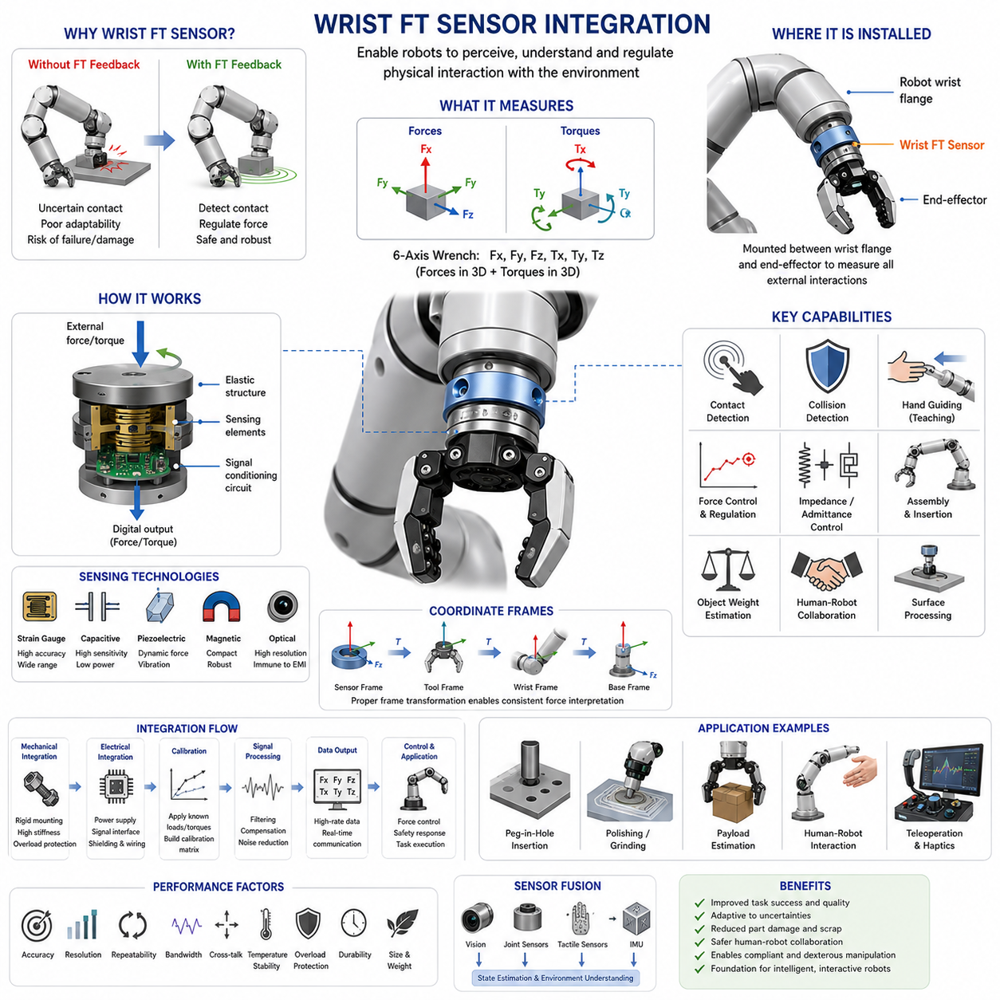{width="7.268055555555556in" height="7.268055555555556in"}

손목 힘·토크 센서 통합(Wrist Force-Torque Sensor Integration)은 로봇 조작 기술에서 가장 중요한 요소 중 하나이다. 이는 로봇이 자신과 환경 사이에서 발생하는 물리적 상호작용을 직접 인지할 수 있도록 해주기 때문이다. 손끝 힘 센서(Fingertip Force Sensor)가 개별 접촉점에서 발생하는 국부적인 힘을 측정하는 반면, 손목에 장착되는 힘·토크 센서(Force-Torque Sensor)는 로봇 핸드와 엔드이펙터 전체에 작용하는 외부 힘과 모멘트를 종합적으로 측정한다. 이를 통해 로봇은 접촉 감지(Contact Detection), 힘 제어(Force Control), 파지 안정화(Grasp Stabilization), 순응 동작(Compliant Motion), 인간-로봇 협업(Human-Robot Collaboration) 등을 수행할 수 있다. 현대 로봇 시스템에서 손목 힘·토크 센서는 인지(Perception)와 물리적 상호작용(Physical Interaction)을 연결하는 핵심 기술로 자리 잡고 있다.

손목 힘·토크 센서는 일반적으로 로봇의 손목 플랜지(Wrist Flange)와 엔드이펙터(End Effector) 사이에 설치된다. 이 위치는 로봇이 수행하는 모든 물리적 상호작용이 통과하는 지점이기 때문에 매우 중요하다. 손끝 센서가 특정 접촉점의 힘만 측정하는 반면, 손목 센서는 전체 시스템에 작용하는 외력을 하나의 통합된 정보로 제공한다. 물체를 집거나, 문을 밀거나, 커넥터를 삽입하거나, 나사를 조이거나, 사람과 접촉하는 경우 모두 그 힘은 손목을 통해 전달되므로 센서에서 측정할 수 있다.

힘·토크 센서는 일반적으로 6축(6-Axis) 측정을 수행한다. 세 개의 직교 방향 힘(Fx, Fy, Fz)과 세 개의 회전 토크(Tx, Ty, Tz)를 동시에 측정한다. 이 여섯 개의 값은 로봇 손목에 작용하는 외부 렌치(Wrench)를 완전히 표현한다. 렌치는 강체에 작용하는 힘과 모멘트의 조합을 의미하며, 로봇 조작 이론에서 매우 중요한 개념이다.

손목 힘·토크 센서의 역사는 산업용 조립 자동화에서 시작되었다. 초기 산업용 로봇은 위치 제어만 수행했기 때문에 부품 위치 오차나 공차(Tolerance)가 존재할 경우 조립 실패가 자주 발생했다. 작은 위치 오차만 있어도 과도한 힘이 발생하여 부품이 손상되거나 작업이 중단되었다. 이러한 문제를 해결하기 위해 힘 정보를 이용한 조립 기술이 개발되었고, 그 결과 손목 힘·토크 센서가 도입되었다. 이후 이 기술은 조립뿐만 아니라 서비스 로봇, 의료 로봇, 협동 로봇, 휴머노이드 로봇으로 확장되었다.

일반적인 손목 힘·토크 센서는 탄성 구조물(Flexure Structure)과 측정 요소(Sensing Element)로 구성된다. 외력이 가해지면 구조물이 미세하게 변형되고, 센서는 이 변형량을 측정하여 힘과 토크를 계산한다. 구조 설계에서는 강성(Stiffness)과 민감도(Sensitivity)의 균형이 중요하다. 지나치게 강성이 높으면 작은 힘을 감지하기 어렵고, 반대로 지나치게 유연하면 내구성과 위치 정확도가 저하된다.

가장 널리 사용되는 방식은 스트레인 게이지(Strain Gauge) 기반 센서이다. 스트레인 게이지는 변형에 따라 저항값이 변하는 특성을 이용한다. 구조물의 변형량을 측정하고 이를 힘과 토크 값으로 변환한다. 높은 정확도, 우수한 선형성, 긴 수명, 산업 현장에서 검증된 신뢰성 때문에 현재도 가장 많이 사용되는 방식이다.

최근에는 정전용량(Capacitive), 광학(Optical), 압전(Piezoelectric), 자기장(Magnetic) 기반 기술도 개발되고 있다. 정전용량 방식은 높은 감도를 제공하며, 광학 방식은 전자기 간섭에 강하다. 압전 방식은 충격과 동적 힘 측정에 적합하며, 자기장 기반 방식은 소형화와 내구성 측면에서 장점이 있다. 각각의 기술은 정확도, 비용, 대역폭, 내구성, 환경 적응성 측면에서 서로 다른 특성을 가진다.

기계적 통합(Mechanical Integration)은 센서 성능에 큰 영향을 미친다. 센서는 예상되는 힘과 토크를 충분히 견딜 수 있어야 하며, 충격과 진동에도 안정적으로 동작해야 한다. 또한 로봇 플랜지와 엔드이펙터 사이에 견고하게 장착되어야 한다. 잘못된 장착은 측정 오차를 유발하고 전체 시스템 강성을 감소시킬 수 있다.

전기적 통합(Electrical Integration)도 중요하다. 힘·토크 센서는 매우 작은 신호를 출력하므로 증폭, 필터링, 디지털 변환 과정이 필요하다. 최신 센서들은 내부에 신호 처리 회로를 포함하고 있으며 EtherCAT, CAN, Ethernet, RS-485, USB 등의 통신 프로토콜을 통해 제어기와 연결된다. 어떤 인터페이스를 사용할지는 응답 속도와 시스템 구조에 따라 결정된다.

교정(Calibration)은 힘·토크 센서의 성능을 결정하는 핵심 과정이다. 센서의 원시 출력값(Raw Data)은 실제 힘 값과 직접적인 관계가 없기 때문에 알려진 힘과 토크를 가하면서 센서 응답을 측정해야 한다. 이를 통해 교정 행렬(Calibration Matrix)을 생성한다. 특히 6축 센서는 축 간 간섭(Cross-Talk)이 존재하기 때문에 정밀한 교정이 필수적이다.

좌표계(Coordinate Frame) 정의도 매우 중요하다. 측정된 힘과 토크는 특정 좌표계 기준으로 표현된다. 실제 응용에서는 센서 좌표계, 툴 좌표계, 손목 좌표계, 로봇 기준 좌표계, 월드 좌표계 사이의 변환이 필요하다. 올바른 좌표 변환은 로봇 자세가 바뀌어도 일관된 힘 해석을 가능하게 한다.

손목 힘·토크 센서의 가장 기본적인 활용은 접촉 감지(Contact Detection)이다. 위치 제어 기반 로봇은 언제 물체와 접촉했는지 정확히 알기 어렵다. 반면 힘·토크 센서는 아주 작은 접촉력도 감지할 수 있다. 이를 통해 로봇은 접촉 순간을 즉시 인식하고 다음 동작으로 전환할 수 있다.

충돌 감지(Collision Detection)는 또 다른 중요한 응용이다. 예기치 않은 장애물이나 사람과의 접촉이 발생하면 센서는 비정상적인 힘을 감지한다. 제어기는 이를 기반으로 속도를 줄이거나 정지하거나 안전 모드로 전환할 수 있다. 협동 로봇(Cobot)에서는 이러한 기능이 필수적이다.

힘 제어 기반 조작(Force-Controlled Manipulation)은 손목 힘·토크 센서의 대표적인 활용 분야이다. 힘 제어에서는 위치가 아니라 목표 힘을 유지하는 것이 목적이다. 센서는 현재 힘을 측정하고, 제어기는 목표 힘과 비교하여 로봇의 움직임을 수정한다. 연마(Polishing), 디버링(Deburring), 그라인딩(Grinding), 표면 가공(Surface Finishing) 작업에서 매우 중요하다.

임피던스 제어(Impedance Control)는 힘·토크 센서가 가장 많이 사용되는 제어 방식 중 하나이다. 로봇이 가상의 스프링과 댐퍼처럼 행동하도록 만드는 기술이다. 외력이 가해지면 로봇은 이를 흡수하며 자연스럽게 반응한다. 이는 불확실한 환경에서도 안정적인 작업을 가능하게 한다.

어드미턴스 제어(Admittance Control)는 측정된 힘을 입력으로 사용하여 원하는 움직임을 생성한다. 특히 강성이 높은 산업용 로봇에서 많이 사용되며, 힘 기반 상호작용을 보다 자연스럽게 만든다.

조립 자동화(Assembly Automation)는 손목 힘·토크 센서의 가장 대표적인 응용 분야이다. Peg-in-Hole 삽입, 커넥터 체결, 기어 조립, 베어링 삽입, 볼트 체결과 같은 작업은 미세한 위치 오차에 매우 민감하다. 힘 센서는 접촉 상태를 감지하고 삽입 방향을 수정하여 조립 성공률을 크게 향상시킨다.

연마, 샌딩, 디버링과 같은 표면 가공 작업도 힘·토크 센서의 도움을 받는다. 일정한 접촉력을 유지해야 균일한 품질을 얻을 수 있기 때문이다. 힘 피드백은 공정 품질을 높이고 공구 마모를 줄여준다.

파지 작업에서는 손목 힘·토크 센서가 손끝 힘 센서를 보완한다. 손끝 센서는 접촉 지점의 상세 정보를 제공하고, 손목 센서는 전체 외력을 측정한다. 두 센서를 함께 사용하면 물체의 무게, 안정성, 미끄러짐 가능성을 더욱 정확하게 추정할 수 있다.

특히 물체 무게 추정(Object Weight Estimation)은 매우 유용한 기능이다. 로봇이 물체를 들어 올릴 때 중력에 의한 힘을 측정하면 물체 질량과 무게 중심(Center of Mass)을 추정할 수 있다. 이는 경로 계획과 파지 안정성 향상에 도움을 준다.

인간-로봇 협업(Human-Robot Collaboration)에서도 손목 힘·토크 센서는 핵심 기술이다. 사람과 가까이에서 작업하는 협동 로봇은 인간의 접촉을 감지하고 의도를 이해해야 한다. 예를 들어 핸드 가이딩(Hand Guiding) 기능에서는 사용자가 로봇을 손으로 밀거나 당기면 힘 센서가 이를 감지하여 자연스럽게 따라 움직인다.

원격 조작(Teleoperation) 시스템에서는 측정된 힘 정보를 사용자에게 햅틱 피드백(Haptic Feedback)으로 전달할 수 있다. 이를 통해 사용자는 원격 환경에서 실제 물체를 만지는 것과 유사한 경험을 할 수 있다. 의료 로봇, 우주 로봇, 수중 로봇 등에서 중요한 기술이다.

최근에는 인공지능과 머신러닝이 힘·토크 데이터 활용을 크게 확대하고 있다. 힘 데이터는 접촉 상태 분류, 물체 특성 추정, 작업 단계 인식, 성공 여부 예측 등에 사용된다. 특히 비전 정보와 결합될 경우 더욱 강력한 조작 능력을 제공한다.

센서 융합(Sensor Fusion)은 앞으로 더욱 중요해질 분야이다. 힘·토크 센서는 카메라, 촉각 센서, 관절 토크 센서, IMU와 함께 사용되며, 이를 통해 보다 풍부한 환경 인지가 가능해진다. 비전은 "어디에 있는가"를 알려주고, 힘 센서는 "어떻게 상호작용하고 있는가"를 알려준다.

현대 시뮬레이터는 힘·토크 센서를 포함한 물리 상호작용을 정밀하게 모델링할 수 있다. 이를 통해 실제 하드웨어를 사용하기 전에 힘 제어 알고리즘을 검증할 수 있다. 그러나 실제 세계의 복잡한 접촉 현상을 완벽하게 재현하는 것은 여전히 어려운 과제로 남아 있다.

손목 힘·토크 센서의 주요 성능 지표는 정확도(Accuracy), 해상도(Resolution), 반복성(Repeatability), 선형성(Linearity), 히스테리시스(Hysteresis), 축간 간섭(Cross-Talk), 대역폭(Bandwidth), 노이즈 수준, 과부하 보호 능력, 내구성 등이다. 응용 분야에 따라 중요도가 달라질 수 있다.

최근에는 센서 소형화와 내장형 신호 처리 기술이 빠르게 발전하고 있다. 미래의 힘·토크 센서는 더 작고, 더 가볍고, 더 저렴하면서도 더 높은 성능을 제공하게 될 것이다. 또한 소프트 로보틱스, 촉각 피부(Tactile Skin), 분산형 힘 센싱 기술과 통합되어 로봇 전체가 힘을 감지할 수 있는 방향으로 발전할 것으로 예상된다.

결국 손목 힘·토크 센서는 인간의 고유감각(Proprioception)과 운동감각(Kinesthetic Sense)에 해당하는 역할을 수행한다. 비전이 물체의 위치를 알려준다면, 힘·토크 센서는 로봇이 물리 세계와 어떻게 상호작용하고 있는지를 알려준다. 접촉 감지, 힘 제어, 불확실성 대응, 인간과의 안전한 협업, 정교한 조작 작업을 가능하게 하는 핵심 기술이며, 미래의 휴머노이드 로봇과 Physical AI 시스템에서 필수적인 구성 요소로 계속 발전할 것이다.

## 09.04 Grasp Force Regulation

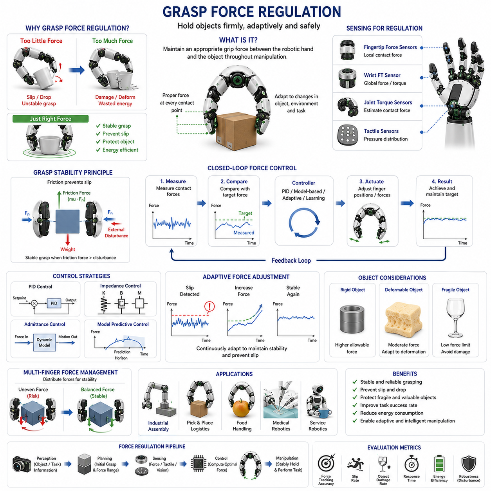{width="7.268055555555556in" height="7.268055555555556in"}

파지력 조절(Grasp Force Regulation)은 안정적이고 지능적인 로봇 조작을 구현하기 위해 반드시 필요한 핵심 기술이다. 파지력 조절의 기본 목적은 로봇 핸드와 물체 사이에 적절한 수준의 파지력을 지속적으로 유지하는 것이다. 성공적인 파지는 매우 섬세한 균형을 요구한다. 힘이 너무 작으면 물체가 미끄러지거나 회전하거나 손에서 떨어질 수 있으며, 반대로 힘이 너무 크면 물체가 변형되거나 파손되거나 기능이 손상될 수 있다. 인간의 손은 피부와 근육에 존재하는 기계수용기(Mechanoreceptor)를 통해 지속적으로 감각 정보를 수집하고, 물체의 무게, 표면 상태, 취약성, 작업 목적에 따라 파지력을 자동으로 조절한다. 로봇 역시 힘 센서, 촉각 센서, 제어 알고리즘, 그리고 지능형 의사결정 시스템을 통합하여 이러한 능력을 구현해야 한다. 로봇이 인간 수준의 정교한 조작 능력(Dexterity)을 갖추기 위해서는 파지력 조절이 필수적인 기반 기술이 된다.

파지력 조절의 개념은 파지 안정성 이론(Grasp Stability Theory)에서 출발한다. 파지가 안정적이라는 것은 손가락이 생성하는 접촉력이 물체에 작용하는 외부 힘과 모멘트를 충분히 상쇄할 수 있는 상태를 의미한다. 외력은 중력, 가속도, 충격, 환경과의 접촉, 또는 조작 과정에서 발생하는 다양한 요인으로부터 발생할 수 있다. 파지력은 이러한 외란을 견딜 수 있을 만큼 충분해야 하지만, 동시에 물체를 손상시키지 않을 정도로 제한되어야 한다. 따라서 파지력 조절은 안정성과 안전성 사이의 최적 균형을 찾는 문제라고 할 수 있다.

파지력과 마찰력(Friction)의 관계는 파지력 조절을 이해하는 핵심 요소이다. 쿨롱 마찰 법칙(Coulomb Friction Theory)에 따르면 접촉면에서 발생할 수 있는 최대 마찰력은 법선력(Normal Force)과 마찰계수(Coefficient of Friction)의 곱에 비례한다. 즉, 파지력을 증가시키면 더 큰 마찰력을 생성할 수 있어 미끄러짐을 방지하기 쉬워진다. 그러나 무조건 큰 힘을 사용하는 것은 좋은 해결책이 아니다. 유리컵, 과일, 전자부품과 같은 물체는 과도한 힘에 의해 쉽게 손상될 수 있기 때문이다. 따라서 효과적인 파지력 조절은 현재의 마찰 조건을 추정하고 이에 맞게 힘을 동적으로 조정하는 과정을 포함한다.

인간의 파지 행동은 매우 좋은 참고 모델이 된다. 사람이 종이컵을 집을 때는 아주 작은 힘만 사용하지만, 무거운 공구 상자를 들 때는 자연스럽게 더 큰 힘을 사용한다. 또한 물체 표면이 물이나 기름 때문에 미끄러워지면 본능적으로 파지력을 증가시킨다. 이러한 조절은 촉각 정보, 고유감각(Proprioception), 시각 정보, 경험 기반 학습이 결합된 폐루프 제어 시스템에 의해 이루어진다. 로봇의 파지력 조절 역시 이러한 인간의 행동을 모방하는 방향으로 발전하고 있다.

가장 단순한 방식은 개방 루프(Open-Loop) 파지력 제어이다. 이 방법에서는 로봇이 미리 정해진 힘을 적용한다. 시스템이 단순하고 계산량이 적다는 장점이 있지만, 물체 특성이 변하거나 환경 조건이 달라질 경우 쉽게 실패할 수 있다. 무게, 마찰계수, 표면 형상 등이 예상과 다르면 물체가 떨어지거나 손상될 가능성이 높다.

이러한 한계를 해결하기 위해 폐루프(Closed-Loop) 파지력 조절이 사용된다. 센서를 이용해 실제 접촉력을 지속적으로 측정하고, 목표 힘과 비교하여 오차를 계산한 후 이를 줄이기 위한 제어 명령을 생성한다. 이러한 피드백 구조는 외란과 불확실성이 존재하는 환경에서도 안정적인 파지를 가능하게 한다.

힘 센서는 파지력 조절 시스템의 핵심 구성 요소이다. 손끝 힘 센서는 접촉점의 힘을 직접 측정하며, 손목 힘·토크 센서는 전체적인 외력을 측정한다. 관절 토크 센서는 액추에이터 부하를 통해 힘을 간접적으로 추정할 수 있다. 또한 촉각 센서는 접촉 압력 분포를 제공한다. 여러 센서를 함께 사용하면 보다 정확한 파지 상태 인식이 가능해진다.

가장 일반적인 파지력 제어 방식은 법선력 조절(Normal Force Regulation)이다. 제어기는 각 접촉점에서 일정한 목표 법선력을 유지하도록 설계된다. 목표 힘은 물체 무게, 예상 마찰계수, 파지 형상, 작업 요구사항 등을 고려하여 결정된다. 충분한 법선력을 유지하면 마찰력이 확보되어 미끄러짐 가능성이 줄어든다. 하지만 최적의 힘을 결정하는 것은 여전히 어려운 문제이다.

적응형 파지력 조절(Adaptive Grasp Force Regulation)은 이러한 문제를 해결하기 위해 개발되었다. 적응형 시스템은 고정된 힘을 유지하는 대신 현재의 접촉 상태에 따라 힘을 증가시키거나 감소시킨다. 예를 들어 미끄러짐이 감지되면 파지력을 증가시키고, 깨지기 쉬운 물체에 과도한 힘이 가해지면 힘을 줄인다. 이러한 적응적 행동은 안정성과 안전성을 동시에 향상시킨다.

미끄러짐 방지(Slip Prevention)는 파지력 조절의 가장 중요한 목적 중 하나이다. 미끄러짐은 접촉면의 마찰력이 외란을 견디기에 부족할 때 발생한다. 촉각 센서는 미세한 진동, 압력 변화, 접선력 변화를 감지하여 미끄러짐의 초기 징후를 발견할 수 있다. 이후 제어기는 즉시 파지력을 증가시켜 안정성을 회복한다. 이러한 과정은 인간의 반사적 파지 조절과 매우 유사하다.

많은 시스템은 PID 제어기를 이용한다. PID 제어에서는 힘 오차를 기반으로 비례(Proportional), 적분(Integral), 미분(Derivative) 제어를 수행한다. 비례 제어는 즉각적인 반응을 제공하고, 적분 제어는 장기적인 오차를 제거하며, 미분 제어는 진동을 줄여 안정성을 높인다. 적절한 게인 조정은 매우 중요하며, 지나치게 큰 게인은 진동을 유발하고 너무 작은 게인은 응답성을 떨어뜨린다.

보다 발전된 방식으로는 모델 기반 제어(Model-Based Control)가 있다. 이 방법은 접촉역학, 마찰 모델, 물체 동역학, 액추에이터 특성 등을 수학적으로 모델링하여 미래의 상태를 예측한다. 이를 통해 더욱 정확한 힘 조절이 가능하며, 고속 조작 작업이나 복잡한 접촉 작업에서 큰 장점을 제공한다.

임피던스 제어(Impedance Control)는 파지력 조절에서 가장 널리 사용되는 기법 중 하나이다. 이 방법은 힘 자체를 직접 제어하기보다는 힘과 움직임 사이의 관계를 제어한다. 로봇 손은 가상의 스프링과 댐퍼를 가진 기계 시스템처럼 동작하며, 외란이 발생해도 자연스럽게 반응하면서 안정성을 유지한다.

어드미턴스 제어(Admittance Control)는 힘을 입력으로 사용하여 움직임을 생성한다. 특히 위치 제어 기반 액추에이터를 사용하는 로봇에서 유용하다. 힘에 따라 움직임을 조정함으로써 보다 순응적인 파지 행동을 구현할 수 있다.

물체의 특성은 파지력 조절 전략에 큰 영향을 준다. 금속 블록과 같은 강체(Rigid Object)는 상대적으로 높은 힘을 견딜 수 있지만, 유리잔, 과일, 전자부품, 의약품 용기, 생체 조직 등은 훨씬 정교한 힘 조절이 필요하다. 이러한 물체는 작은 힘 변화에도 손상될 수 있기 때문에 안정성과 안전성의 균형이 매우 중요하다.

변형 가능한 물체(Deformable Object)는 더욱 복잡한 문제를 제기한다. 힘이 가해질수록 형상이 변하고, 힘과 변형의 관계가 비선형적일 수 있기 때문이다. 식품 가공, 섬유 조작, 농업 수확, 의료 로봇 분야에서는 이러한 물체를 안전하게 다루기 위한 고급 파지력 조절 기술이 요구된다.

다지형(Multi-Finger) 로봇 핸드에서는 여러 손가락이 동시에 물체를 잡기 때문에 힘 분배 문제가 발생한다. 힘이 특정 손가락에 집중되면 물체가 회전하거나 손상될 수 있다. 따라서 전체 파지력을 각 손가락에 적절히 분배하는 것이 중요하다.

내부력(Internal Force) 제어는 다지형 파지에서 매우 중요한 개념이다. 내부력은 물체를 움직이지 않지만 손가락들 사이에 존재하는 힘이다. 적절한 내부력은 파지 안정성을 높여주지만, 과도하면 물체 손상과 에너지 낭비를 초래한다. 따라서 내부력을 적절히 유지하는 것이 중요하다.

최적화 기반 힘 분배(Optimization-Based Force Distribution)는 이러한 문제를 해결하기 위해 사용된다. 제어기는 안정성을 최대화하고, 에너지 소비를 최소화하며, 마찰 조건을 만족하는 힘 분배를 실시간으로 계산한다.

최근에는 머신러닝이 파지력 조절 분야를 크게 변화시키고 있다. 전통적인 방식이 수학 모델에 의존했다면, 학습 기반 시스템은 데이터를 통해 힘 조절 전략을 학습한다. 감독학습, 강화학습, 모방학습 등을 통해 인간의 파지 행동을 학습하고 다양한 환경에 적응할 수 있다.

특히 강화학습(Reinforcement Learning)은 큰 가능성을 보여주고 있다. 로봇은 시뮬레이션 환경에서 수백만 번의 파지 경험을 통해 최적의 힘 조절 정책을 학습할 수 있다. 이러한 정책은 새로운 물체나 환경에서도 높은 일반화 성능을 보인다.

촉각 지능(Tactile Intelligence) 역시 중요한 연구 분야이다. 최신 촉각 센서는 단순한 힘 값뿐 아니라 접촉 위치, 압력 분포, 표면 질감, 곡률, 미끄러짐 상태까지 제공한다. 이러한 정보를 활용하면 훨씬 정교한 파지력 조절이 가능해진다.

비전 기반 힘 추정(Visual Force Estimation)도 점차 발전하고 있다. 카메라는 힘을 직접 측정할 수는 없지만, 물체 변형, 손가락 움직임, 접촉 형상 등을 통해 힘과 관련된 정보를 추정할 수 있다. 비전과 힘 센서를 결합하면 더욱 강력한 파지 제어 시스템을 구축할 수 있다.

산업 자동화에서는 파지력 조절이 매우 중요하다. 물류 로봇은 다양한 크기와 무게의 상자를 다루어야 하며, 전자 조립 로봇은 민감한 부품을 손상 없이 조작해야 한다. 식품 산업에서는 변형 가능한 식품을 품질 저하 없이 취급해야 한다. 이러한 모든 분야에서 파지력 조절은 생산성과 품질을 결정하는 핵심 요소이다.

서비스 로봇은 더욱 다양한 물체를 다루어야 한다. 가정용 로봇은 접시, 옷, 책, 공구, 음료수, 전자기기 등 매우 다양한 물체를 처리해야 한다. 따라서 높은 적응성과 일반화 능력을 가진 파지력 조절 기술이 필요하다.

의료 로봇은 가장 까다로운 응용 분야 중 하나이다. 수술 도구가 인체 조직과 상호작용할 때 작은 힘 오차도 심각한 결과를 초래할 수 있다. 따라서 매우 높은 정확도와 낮은 지연 시간, 높은 신뢰성을 갖춘 힘 조절 시스템이 요구된다.

파지력 조절 시스템의 성능은 힘 추종 정확도(Force Tracking Accuracy), 미끄러짐 방지 성능, 물체 손상률, 응답 시간, 에너지 효율, 외란에 대한 강인성 등을 통해 평가된다. 이러한 지표들은 시스템의 실용성을 판단하는 중요한 기준이 된다.

시뮬레이션 환경은 파지력 조절 알고리즘 개발에 필수적인 도구가 되었다. 물리 엔진은 접촉, 마찰, 변형, 센서 모델을 제공하여 다양한 알고리즘을 안전하게 테스트할 수 있도록 지원한다. 그러나 실제 환경과의 차이(Sim-to-Real Gap)를 줄이는 것은 여전히 중요한 연구 과제이다.

미래의 파지력 조절 기술은 촉각 센서, 힘 센서, 비전 시스템, 파운데이션 모델(Foundation Model), 체화 인공지능(Embodied AI)을 통합하는 방향으로 발전할 것이다. 미래의 로봇은 단순히 힘을 유지하는 것이 아니라 작업의 의미를 이해할 수 있게 될 것이다. 예를 들어 "깨지기 쉬운 크리스털 잔을 조심스럽게 들어라"라는 명령을 이해하고, 적절한 힘을 자동으로 결정하며, 미끄러짐 위험을 예측하고, 상황에 따라 파지 전략을 수정할 수 있게 될 것이다.

결론적으로 파지력 조절은 인간 수준의 정교 조작을 구현하기 위한 핵심 기술이다. 안정적인 파지는 단순히 기계 구조나 센서 성능만으로 이루어지지 않는다. 변화하는 환경 속에서 접촉력을 지속적으로 조절할 수 있어야 한다. 힘 센서, 촉각 인지, 적응 제어, 최적화 기법, 머신러닝을 결합한 현대의 파지력 조절 기술은 안전하고 지능적인 조작의 기반을 제공하며, 미래의 산업용 로봇, 서비스 로봇, 휴머노이드, 의료 로봇, 그리고 Physical AI 시스템의 핵심 요소로 자리 잡게 될 것이다.

## 09.05 Internal Force Control

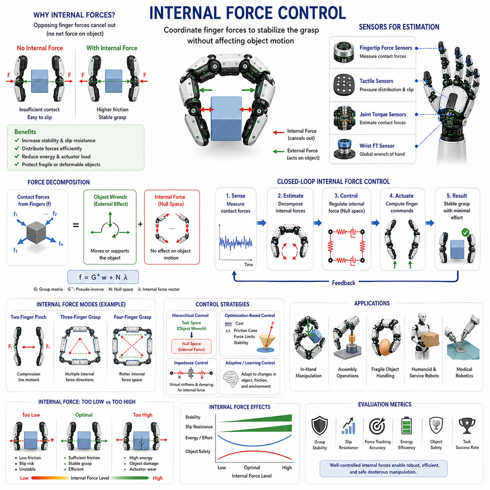{width="7.268055555555556in" height="7.268055555555556in"}

내부력 제어(Internal Force Control)는 다지형(Multi-Finger) 로봇 핸드에서 가장 중요한 고급 기술 중 하나이다. 이는 여러 손가락이 협력하여 물체를 안정적으로 잡는 과정에서, 물체를 움직이는 데 직접 기여하지 않는 힘들을 어떻게 효율적으로 관리할 것인가를 다루기 때문이다. 파지력 조절(Grasp Force Regulation)이 물체를 안정적으로 잡기 위한 전체적인 힘의 크기를 관리하는 기술이라면, 내부력 제어는 여러 손가락 사이에 분배되는 힘의 균형과 협력을 관리하는 기술이라고 할 수 있다. 내부력은 물체를 움직이지 않지만 파지 안정성, 조작 정확도, 접촉 신뢰성, 물체 보호에 결정적인 영향을 미친다. 따라서 내부력 제어는 파지 역학(Grasp Mechanics), 힘 분배(Force Distribution), 접촉 안정성(Contact Stability), 정교 조작(Dexterous Manipulation)을 연결하는 핵심 기술이다.

내부력 제어를 이해하기 위해서는 먼저 외력(External Force)과 내부력(Internal Force)을 구분해야 한다. 외력은 물체의 움직임에 직접 영향을 미치는 힘이다. 여기에는 중력, 관성력, 환경과의 접촉력, 그리고 로봇 손가락이 물체를 이동시키기 위해 생성하는 힘이 포함된다. 반면 내부력은 물체를 움직이지 않으면서 파지 구조 내부에서만 존재하는 힘이다. 이러한 힘은 서로 반대 방향으로 작용하여 물체에 대한 순힘(Net Force)이나 순토크(Net Torque)를 발생시키지 않는다. 그러나 파지 안정성을 유지하는 데 필수적이다.

가장 단순한 예는 두 손가락 핀치 그립(Pinch Grasp)이다. 두 손가락이 물체를 양쪽에서 누르고 있다고 가정하자. 왼쪽 손가락은 오른쪽 방향으로 힘을 가하고, 오른쪽 손가락은 왼쪽 방향으로 동일한 크기의 힘을 가한다. 결과적으로 물체는 수평 방향으로 움직이지 않는다. 그러나 두 손가락 사이에 압력이 형성되면서 마찰력이 생성되고, 이 마찰력이 물체가 미끄러지는 것을 방지한다. 이때 발생하는 압축력이 바로 내부력이다. 물체를 움직이지는 않지만, 내부력이 없다면 파지는 즉시 실패하게 된다.

인간은 내부력을 거의 무의식적으로 조절한다. 컵을 잡을 때, 스마트폰을 들고 있을 때, 공구를 사용할 때 손가락들은 적절한 압력을 유지하면서도 불필요한 힘을 최소화한다. 물체가 무거워지거나 미끄러워지면 내부력이 증가하고, 깨지기 쉬운 물체라면 내부력이 감소한다. 인간의 신경계는 촉각 정보, 고유감각(Proprioception), 근육 협응을 이용하여 이러한 힘을 지속적으로 최적화한다. 로봇의 내부력 제어는 이러한 인간의 능력을 수학적 모델과 제어 알고리즘으로 구현하려는 시도이다.

내부력이라는 개념은 파지 이론(Grasp Theory)에서 자연스럽게 등장한다. 다지형 파지에서는 각 접촉점에서 힘이 발생하며, 이러한 힘들은 파지 행렬(Grasp Matrix)을 통해 물체 수준의 힘과 토크로 변환된다. 일부 힘 조합은 물체를 실제로 움직이는 힘을 생성하지만, 다른 조합은 물체를 전혀 움직이지 않는다. 이러한 후자의 힘 조합이 내부력 모드(Internal Force Mode)에 해당한다. 따라서 내부력은 물체 운동과 독립적으로 제어될 수 있다.

수학적으로 내부력은 파지 행렬의 영공간(Null Space)과 밀접한 관련이 있다. 영공간에 속하는 힘 벡터는 물체에 대해 순힘과 순토크를 생성하지 않는다. 즉, 영공간의 힘들은 모두 순수한 내부력이다. 따라서 접촉력을 물체 조작을 위한 힘과 내부력으로 분리하면, 두 요소를 독립적으로 제어할 수 있다.

내부력이 필요한 가장 중요한 이유는 마찰력 생성 때문이다. 접촉면에서 마찰력이 발생하려면 반드시 법선력(Normal Force)이 존재해야 한다. 내부력이 없다면 충분한 법선력이 생성되지 못하고, 결과적으로 물체는 작은 외란에도 쉽게 미끄러질 수 있다. 따라서 내부력은 힘 폐쇄(Force Closure)를 유지하기 위한 필수 조건이다.

하지만 내부력이 지나치게 크면 여러 문제가 발생한다. 액추에이터 부하가 증가하고, 에너지 소비가 커지며, 기계적 마모가 빨라진다. 또한 유리잔, 과일, 전자부품과 같은 취약한 물체는 과도한 내부력으로 인해 손상될 수 있다. 변형 가능한 물체의 경우 형상이 변형되어 조작 정확도까지 떨어질 수 있다. 따라서 내부력 제어는 안정성과 효율성, 그리고 안전성 사이의 균형을 찾는 문제이다.

내부력 제어의 가장 중요한 목적 중 하나는 파지 안정화(Grasp Stabilization)이다. 로봇이 물체를 들고 이동할 때 가속도와 감속도로 인해 관성력이 발생한다. 이러한 외란은 파지 안정성을 위협할 수 있다. 적절한 내부력은 충분한 마찰 여유(Friction Margin)를 제공하여 외란에 대응할 수 있도록 해준다.

다지형 로봇 핸드에서는 내부력 제어가 더욱 복잡해진다. 세 손가락, 네 손가락, 다섯 손가락 이상의 로봇 핸드는 각 손가락이 다양한 방향으로 힘을 생성할 수 있다. 동일한 물체 동작을 만들더라도 손가락별 힘 분배 방식은 무수히 많다. 이러한 중복성(Redundancy)은 유연성을 제공하지만 동시에 힘 분배 문제를 어렵게 만든다.

중복성은 기회이자 도전이다. 더 많은 손가락은 안정성과 조작 능력을 향상시키지만, 관리해야 할 내부력 모드 역시 증가한다. 잘못된 힘 분배는 불필요한 응력 집중, 에너지 낭비, 불안정성을 초래할 수 있다. 따라서 고급 제어기는 중복성을 활용하여 최적의 힘 분배를 수행한다.

힘 폐쇄 이론(Force Closure Theory)은 내부력 제어의 중요한 이론적 기반이다. 힘 폐쇄가 성립한다는 것은 손가락들이 적절한 힘 조합을 통해 물체에 어떤 방향의 힘과 토크도 생성할 수 있음을 의미한다. 내부력은 이러한 힘 폐쇄 상태를 유지하는 핵심 요소이다.

마찰 콘(Friction Cone) 개념 역시 중요하다. 각 접촉점의 힘은 마찰 한계에 의해 제한된다. 내부력 제어는 모든 접촉력이 마찰 콘 내부에 유지되도록 해야 한다. 만약 접촉력이 마찰 콘 경계에 가까워지면 미끄러짐 위험이 크게 증가한다. 적절한 내부력은 이러한 위험을 줄이고 안정성을 향상시킨다.

센서 피드백은 내부력 제어에서 매우 중요하다. 손끝 힘 센서는 개별 접촉점의 힘을 직접 측정한다. 촉각 센서는 압력 분포를 제공하며, 관절 토크 센서는 액추에이터 부하를 통해 접촉력을 추정한다. 손목 힘·토크 센서는 전체 외력을 측정한다. 이러한 정보를 결합하면 실시간으로 내부력 상태를 추정할 수 있다.

실제 시스템에서는 내부력을 직접 측정하기 어려운 경우가 많다. 따라서 힘 추정 알고리즘이 사용된다. 칼만 필터(Kalman Filter), 상태 관측기(State Observer), 최적화 기반 추정 기법 등을 활용하여 센서 데이터로부터 내부력을 계산한다.

가장 일반적인 내부력 제어 방법은 계층형 제어(Hierarchical Control)이다. 상위 제어기는 물체 움직임과 외부 힘을 제어하고, 하위 제어기는 파지 행렬의 영공간에서 내부력을 조절한다. 이렇게 두 문제를 분리하면 제어기 설계가 단순해지고 성능도 향상된다.

최적화 기반 제어(Optimization-Based Control)는 최근 가장 널리 사용되는 방법 중 하나이다. 내부력 제어를 제약 조건을 가진 최적화 문제로 정의하고, 안정성 유지, 에너지 최소화, 마찰 조건 만족, 물체 보호를 동시에 만족하는 힘 분배를 계산한다. 현대의 이차 계획법(Quadratic Programming)과 볼록 최적화(Convex Optimization)는 이를 실시간으로 수행할 수 있다.

임피던스 제어(Impedance Control) 역시 내부력 제어에 적용될 수 있다. 이 경우 내부력 모드에 대해 가상의 스프링과 댐퍼를 정의한다. 손가락들은 마치 탄성 구조로 연결된 것처럼 동작하며 자연스럽게 힘을 분배한다. 이는 불확실한 환경에서도 안정적인 성능을 제공한다.

적응형 내부력 제어(Adaptive Internal Force Control)는 물체 특성이 알려지지 않은 상황에서 유용하다. 마찰계수, 무게, 형상, 강성 등이 변할 수 있기 때문에 제어기는 이러한 특성을 지속적으로 추정하고 내부력을 조정한다. 서비스 로봇, 물류 로봇, 비정형 환경에서 특히 중요하다.

최근에는 머신러닝과 인공지능이 내부력 제어에도 활용되고 있다. 기존 방식이 수학 모델에 의존했다면, 학습 기반 시스템은 데이터를 통해 최적의 힘 분배 전략을 학습한다. 신경망은 촉각 데이터, 시각 정보, 작업 맥락을 입력으로 받아 적절한 내부력 패턴을 예측할 수 있다.

강화학습(Reinforcement Learning)은 특히 유망한 접근법이다. 내부력 제어는 안정성, 에너지 효율, 물체 보호 사이의 복잡한 균형을 요구하기 때문에 수학적 모델만으로 해결하기 어렵다. 강화학습은 시뮬레이션 환경에서 반복적인 시행착오를 통해 최적 정책을 학습할 수 있다.

촉각 지능(Tactile Intelligence)은 내부력 제어를 더욱 향상시킨다. 고해상도 촉각 센서는 접촉 면적, 압력 분포, 국부 미끄러짐, 표면 질감 등을 제공한다. 이러한 정보는 인간이 물체를 다룰 때 사용하는 감각과 유사하며, 보다 정교한 내부력 조절을 가능하게 한다.

손안 조작(In-Hand Manipulation)은 내부력 제어가 가장 중요한 응용 분야 중 하나이다. 물체를 굴리거나, 회전시키거나, 재파지(Regrasping)하는 과정에서는 접촉 위치와 힘 분포가 지속적으로 변화한다. 내부력은 이러한 변화 속에서도 안정성을 유지해야 한다. 내부력 제어 없이는 고급 정교 조작은 사실상 불가능하다.

정밀 조립 작업에서도 내부력 제어는 매우 중요하다. 물체를 안정적으로 잡은 상태에서 외부 부품과 상호작용해야 하기 때문이다. 커넥터 삽입, 나사 체결, 부품 조립과 같은 작업에서는 내부력과 외부 힘을 동시에 제어해야 한다.

휴머노이드 로봇은 내부력 제어가 특히 어려운 분야이다. 인간 손과 유사한 많은 자유도를 가지며, 매우 다양한 물체를 다루어야 한다. 효과적인 내부력 제어는 일상 물체를 보다 안전하고 안정적으로 다룰 수 있게 해준다.

의료 로봇에서는 내부력 관리가 더욱 중요하다. 수술 기구가 연약한 생체 조직과 접촉할 경우 작은 힘 오차도 조직 손상을 유발할 수 있다. 따라서 매우 정밀한 내부력 제어가 요구된다.

내부력 제어 성능은 파지 안정성, 미끄러짐 저항성, 힘 추종 정확도, 에너지 효율, 물체 손상 방지 능력, 조작 성공률 등을 통해 평가된다. 이러한 지표들은 제어기의 실제 성능을 정량적으로 평가하는 기준이 된다.

현대 시뮬레이터는 접촉 역학, 마찰, 힘 분배, 물체 상호작용을 매우 정밀하게 모델링할 수 있다. 이를 통해 실제 하드웨어를 사용하기 전에 내부력 제어 알고리즘을 검증할 수 있다. 다만 실제 환경의 복잡한 접촉 현상을 완벽히 재현하는 것은 여전히 어려운 과제로 남아 있다.

미래의 내부력 제어는 촉각 센서, 비전 시스템, 힘 센서, 파운데이션 모델(Foundation Model), 체화 인공지능(Embodied AI)을 통합하는 방향으로 발전할 것이다. 미래의 로봇은 단순히 힘을 조절하는 것이 아니라 물체의 특성과 작업 목적을 이해하고 적절한 내부력을 스스로 결정할 수 있게 될 것이다. 예를 들어 "깨지기 쉬운 유리잔을 안전하게 잡아라"라는 명령을 이해하고, 실시간 감각 정보를 활용하여 최적의 내부력을 자동으로 생성할 수 있을 것이다.

결론적으로 내부력 제어는 다지형 로봇 핸드에서 인간 수준의 정교함을 구현하기 위한 핵심 기술이다. 안정적인 파지는 단순히 충분한 힘을 생성하는 것이 아니라 여러 손가락이 적절한 힘 분배를 통해 협력하는 것을 의미한다. 내부력 제어는 이러한 협력을 가능하게 하며, 파지 이론, 접촉역학, 최적화, 힘 센싱, 촉각 지능, 머신러닝을 통합하여 미래의 산업용 로봇, 서비스 로봇, 휴머노이드, 의료 로봇, Physical AI 시스템의 핵심 기반 기술로 자리 잡을 것이다.

## 09.06 Impedance Control for Fingers

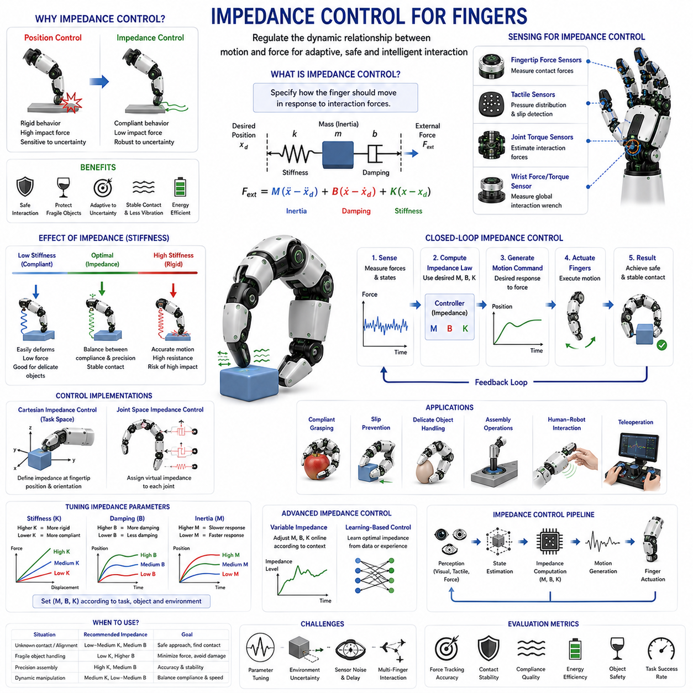{width="7.268055555555556in" height="7.268055555555556in"}

손가락을 위한 임피던스 제어(Impedance Control for Fingers)는 현대 로봇 조작 기술에서 가장 영향력 있는 제어 방법 중 하나이다. 이는 로봇 손가락이 물체 및 환경과 안전하고 유연하며 지능적으로 상호작용할 수 있도록 해주기 때문이다. 전통적인 로봇은 대부분 위치 제어(Position Control)를 기반으로 설계되었다. 위치 제어에서는 외부 환경과의 상호작용 여부와 관계없이 목표 위치를 정확히 추종하는 것이 목적이다. 이러한 방식은 구조화된 산업 환경에서는 효과적이지만, 실제 환경처럼 불확실성과 접촉이 많은 상황에서는 한계를 가진다. 반면 인간의 손가락은 본질적으로 순응적(Compliant)이다. 물체를 만지거나 누르거나 잡을 때 손가락은 완전히 강체처럼 움직이지 않고 근육, 힘줄, 조직, 신경계의 협력을 통해 자연스럽게 적응한다. 임피던스 제어는 이러한 인간의 특성을 모방하여 힘과 위치를 개별적으로 제어하는 대신, 힘과 운동 사이의 동적 관계를 제어하는 방법이다. 따라서 임피던스 제어는 순응 파지(Compliant Grasping), 정교 조작(Dexterous Manipulation), 인간-로봇 협업(Human-Robot Interaction), 적응형 접촉 제어의 핵심 기술이 된다.

임피던스라는 개념은 고전 역학(Classical Mechanics)과 시스템 동역학(System Dynamics)에서 유래하였다. 물리학에서 임피던스는 외력이 가해졌을 때 시스템이 운동에 얼마나 저항하는지를 나타낸다. 기계 시스템은 일반적으로 관성(Inertia), 감쇠(Damping), 강성(Stiffness)이라는 세 가지 요소로 설명할 수 있다. 관성은 가속도 변화에 대한 저항을 의미하며, 감쇠는 에너지를 소산시키는 특성을 나타내고, 강성은 변형에 대한 저항을 의미한다. 인간 손가락은 이 세 가지 특성을 모두 자연스럽게 가지고 있다. 근육과 힘줄은 강성을 조절하며, 생체 조직은 감쇠 역할을 수행하고, 손가락 자체의 질량은 관성을 제공한다. 임피던스 제어는 이러한 인간의 특성을 로봇에서 인공적으로 구현하는 방법이다.

직접 힘 제어(Direct Force Control)가 목표 힘을 명시적으로 제어하는 방식이라면, 임피던스 제어는 힘과 운동 사이의 관계를 정의한다. 즉, "얼마의 힘을 가할 것인가"가 아니라 "어떤 힘이 가해졌을 때 어떻게 움직일 것인가"를 결정한다. 이는 실제 환경에서 매우 중요하다. 물체의 위치, 형상, 마찰 상태, 환경 조건은 항상 정확히 알 수 없기 때문이다. 임피던스 제어는 이러한 불확실성에 대해 보다 강인한(Robust) 성능을 제공한다.

임피던스 제어의 기본 수식은 질량-스프링-댐퍼(Mass-Spring-Damper) 시스템과 동일한 형태를 가진다. 외력이 작용하면 로봇 손가락은 가상의 관성, 감쇠, 강성 값에 따라 반응한다. 이 값들은 실제 하드웨어의 물리적 특성이 아니라 소프트웨어로 구현되는 가상의 동적 특성이다. 따라서 강체 로봇도 매우 부드러운 스프링처럼 동작할 수 있으며, 반대로 순응적인 구조를 가진 로봇도 높은 강성을 가진 것처럼 동작할 수 있다.

임피던스 제어의 가장 큰 장점 중 하나는 안전한 접촉(Safe Contact Interaction)이다. 예를 들어 로봇 손가락이 물체의 위치를 정확히 모르는 상태에서 접근한다고 가정하자. 위치 제어 방식에서는 예상보다 일찍 접촉이 발생하면 큰 충돌력이 발생할 수 있다. 그러나 임피던스 제어에서는 가상의 스프링 효과로 인해 접촉 에너지가 흡수되고 충격력이 제한된다. 결과적으로 물체 손상, 기계적 마모, 안전 문제를 크게 줄일 수 있다.

인간 손가락의 동작은 임피던스 제어를 이해하는 데 좋은 예가 된다. 사람이 비눗방울을 만질 때는 강성을 매우 낮게 유지한다. 반대로 무거운 공구를 사용할 때는 강성을 높여 안정성을 확보한다. 글쓰기, 키보드 입력, 정밀 조립과 같은 작업에서는 상황에 따라 강성이 지속적으로 변화한다. 이러한 강성 조절 능력은 인간 손의 뛰어난 조작 능력을 가능하게 하는 핵심 요소이다.

로봇의 임피던스 제어 역시 작업에 따라 가상의 강성, 감쇠, 관성 값을 조절한다. 깨지기 쉬운 물체를 다룰 때는 낮은 강성을 사용하고, 정밀 조립에서는 높은 강성을 사용한다. 대부분의 실제 작업에서는 안정성과 유연성 사이의 균형을 위해 중간 수준의 강성이 사용된다.

강성 조절(Stiffness Regulation)은 임피던스 제어에서 가장 중요한 요소이다. 강성은 목표 위치에서 벗어났을 때 얼마나 강하게 원래 위치로 되돌아가려 하는지를 결정한다. 높은 강성은 전통적인 산업용 로봇과 유사한 강체 거동을 제공하며, 낮은 강성은 외부 힘에 쉽게 순응하는 부드러운 거동을 제공한다.

감쇠(Damping) 또한 매우 중요하다. 감쇠가 부족하면 진동과 불안정성이 발생할 수 있고, 감쇠가 너무 크면 반응 속도가 느려진다. 적절한 감쇠는 안정성을 높이고 진동을 줄이며 부드러운 접촉을 가능하게 한다.

가상 관성(Virtual Inertia)은 외력에 대한 가속 반응을 결정한다. 낮은 관성은 빠른 응답성을 제공하고, 높은 관성은 안정성과 외란 저항성을 높여준다. 이 세 요소가 함께 임피던스 제어의 핵심을 구성한다.

카르테시안 임피던스 제어(Cartesian Impedance Control)는 작업 공간(Task Space)에서 임피던스를 정의하는 방식이다. 힘과 운동 관계를 손끝의 위치와 자세 기준으로 표현한다. 따라서 파지나 조작 작업에서 매우 직관적이다.

반면 관절 공간 임피던스 제어(Joint-Space Impedance Control)는 각 관절에 스프링-댐퍼 특성을 부여한다. 구현이 간단하고 계산 효율성이 높지만, 복잡한 다중 접촉 작업에서는 직관성이 떨어질 수 있다.

파지 과정에서 임피던스 제어는 매우 중요한 역할을 한다. 물체를 잡을 때는 위치 오차와 형상 불확실성을 흡수하고, 파지를 유지할 때는 외란을 완화하며, 조작 중에는 접촉력을 안정적으로 조절한다.

순응 파지(Compliant Grasping)는 임피던스 제어의 대표적인 응용 분야이다. 기존의 강체 기반 파지는 정밀한 물체 모델과 정확한 위치 정보를 필요로 하지만, 임피던스 제어를 사용하는 손가락은 물체 형상과 위치 오차에 자연스럽게 적응할 수 있다. 결과적으로 파지 성공률이 향상된다.

미끄러짐 방지(Slip Prevention)에서도 임피던스 제어는 큰 역할을 한다. 물체가 미끄러지기 시작하면 접촉 상태가 급격히 변한다. 임피던스 제어는 이러한 변화에 동적으로 반응하여 접촉력을 조절하고 안정성을 유지한다. 촉각 센서와 결합될 경우 더욱 강력한 성능을 제공한다.

깨지기 쉬운 물체(Fragile Object) 처리 역시 중요한 응용 분야이다. 과일, 달걀, 의료 샘플, 전자부품 등은 과도한 힘에 의해 쉽게 손상될 수 있다. 임피던스 제어는 순응적인 접촉을 제공하여 이러한 물체를 안전하게 다룰 수 있게 해준다.

다지형 로봇 핸드에서는 여러 손가락이 동시에 물체와 상호작용한다. 이 과정에서 힘 분배와 내부력(Internal Force) 문제가 발생한다. 임피던스 제어는 각 손가락이 독립적으로 순응성을 유지하면서도 전체 파지 안정성을 확보할 수 있도록 해준다.

내부력 제어와 임피던스 제어는 밀접한 관계를 가진다. 내부력은 물체를 움직이지 않는 손가락 간의 힘이다. 임피던스 제어를 내부력 모드에 적용하면 손가락 간 힘 분배를 자연스럽게 조절하면서도 물체 수준의 동작은 유지할 수 있다.

조립 작업(Assembly Operations)은 임피던스 제어가 가장 널리 사용되는 산업 분야 중 하나이다. 핀 삽입(Peg-In-Hole), 커넥터 결합, 나사 체결 등의 작업에서는 위치 오차가 존재한다. 위치 제어만 사용할 경우 걸림(Jamming) 현상이 발생할 수 있지만, 임피던스 제어는 접촉을 이용해 자연스럽게 정렬을 수행한다.

인간-로봇 상호작용(Human-Robot Interaction)은 임피던스 제어가 중요한 또 다른 이유이다. 사람과 함께 작업하는 로봇은 충돌 시 안전해야 한다. 높은 강성을 가진 시스템은 위험할 수 있지만, 임피던스 제어는 외력에 순응하여 충격을 완화한다. 따라서 협동 로봇(Cobot)의 핵심 기술로 사용된다.

원격 조작(Teleoperation) 시스템에서도 임피던스 제어는 중요한 역할을 한다. 원격 조작자는 로봇 손을 통해 물체를 다루게 되는데, 임피던스 제어는 보다 자연스러운 접촉 특성을 제공한다. 햅틱 피드백(Haptic Feedback)과 결합하면 더욱 현실적인 조작 경험을 제공할 수 있다.

소프트 로보틱스(Soft Robotics)의 발전은 임피던스 제어의 중요성을 더욱 높이고 있다. 소프트 로봇은 재료 자체가 순응성을 가지지만, 수동적 순응성만으로는 복잡한 작업을 수행하기 어렵다. 임피던스 제어는 능동적인 순응성을 제공하여 보다 정교한 조작을 가능하게 한다.

가변 임피던스 제어(Variable Impedance Control)는 고정 임피던스보다 한 단계 발전한 개념이다. 인간 손처럼 상황에 따라 강성과 감쇠를 동적으로 변경한다. 이를 통해 더욱 자연스럽고 효율적인 조작이 가능해진다.

최근에는 머신러닝 기반 임피던스 제어가 활발히 연구되고 있다. 기존 방식은 사람이 직접 파라미터를 설정해야 했지만, 학습 기반 시스템은 경험을 통해 최적의 임피던스를 자동으로 학습한다.

강화학습(Reinforcement Learning)은 특히 유망한 방법이다. 로봇은 시뮬레이션에서 수많은 시행착오를 경험하면서 임피던스가 안정성, 에너지 효율, 물체 보호에 미치는 영향을 학습한다. 이를 통해 사람이 설계한 제어기보다 우수한 성능을 보이는 경우도 있다.

모방학습(Imitation Learning)은 인간의 조작 행동을 관찰하여 임피던스 조절 전략을 학습하는 방식이다. 인간이 사용하는 자연스러운 강성 조절 패턴을 그대로 학습할 수 있다는 장점이 있다.

촉각 센서(Tactile Sensor)는 임피던스 제어 성능을 크게 향상시킨다. 접촉 위치, 압력 분포, 미끄러짐 상태, 표면 질감 등을 측정할 수 있으며, 이를 통해 제어기는 실시간으로 임피던스를 조정할 수 있다.

비전 시스템(Vision System) 역시 중요한 역할을 한다. 카메라는 물체의 위치, 형상, 변형 상태를 제공한다. 힘 센서와 촉각 센서 정보를 함께 사용하면 보다 지능적인 임피던스 조절이 가능하다.

시뮬레이션 환경은 임피던스 제어 연구에 필수적이다. 물리 기반 시뮬레이터는 접촉, 변형, 마찰, 힘 피드백을 모델링하여 알고리즘을 검증할 수 있게 해준다. 또한 대규모 학습 기반 제어기 개발을 가능하게 한다.

임피던스 제어의 성능은 힘 추종 정확도, 파지 안정성, 조작 성공률, 응답 속도, 순응성 품질, 에너지 효율, 외란 억제 성능, 물체 안전성 등의 지표로 평가된다.

미래에는 힘 센서, 촉각 센서, 비전 시스템, 파운데이션 모델(Foundation Model), 체화 인공지능(Embodied AI)이 결합된 통합 임피던스 제어 시스템이 등장할 것으로 예상된다. 미래의 로봇은 단순히 강성을 조절하는 것이 아니라 작업의 의미를 이해하고 적절한 임피던스를 선택하게 될 것이다. 예를 들어 "깨지기 쉬운 유리잔을 조심스럽게 집어 선반 위에 정확히 놓아라"라는 명령을 이해하고, 자동으로 강성, 감쇠, 힘 제어 전략을 결정할 수 있을 것이다.

결론적으로 손가락을 위한 임피던스 제어는 인간 수준의 조작 능력을 구현하는 핵심 기술이다. 위치나 힘을 개별적으로 제어하는 것이 아니라 힘과 운동의 관계를 제어함으로써 로봇은 불확실하고 접촉이 많은 실제 환경에서 더욱 유연하고 안전하게 동작할 수 있다. 임피던스 제어는 역학, 제어 이론, 힘 센싱, 촉각 지능, 머신러닝, 체화 인공지능을 연결하는 핵심 기술이며, 미래의 산업용 로봇, 서비스 로봇, 휴머노이드, 의료 로봇, 그리고 Physical AI 시스템의 기반 기술로 지속적으로 발전할 것이다.

## 09.07 Compliant Grasping

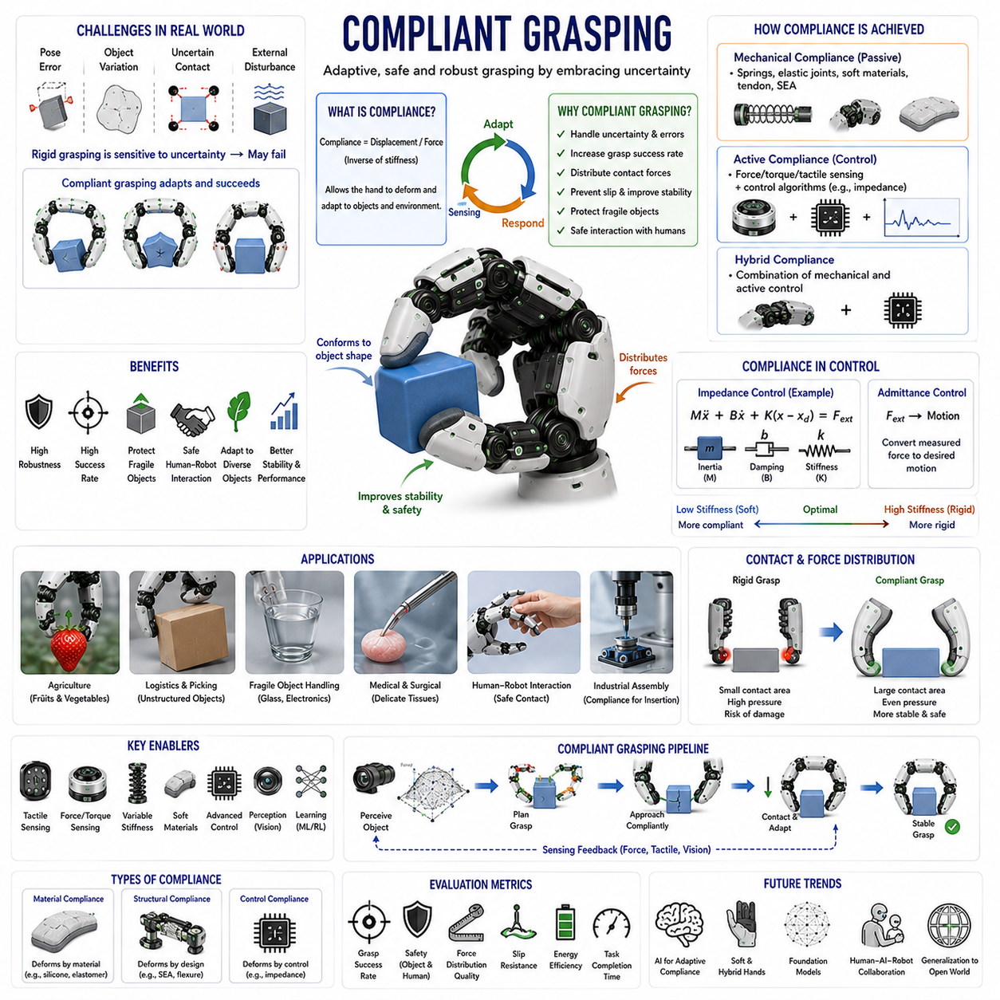{width="7.268055555555556in" height="7.268055555555556in"}

순응 파지(Compliant Grasping)는 현대 로봇 조작 기술에서 매우 중요한 개념으로, 로봇 핸드와 그리퍼가 물체와 상호작용하는 과정에서 발생하는 다양한 불확실성에 자연스럽게 적응할 수 있도록 하는 기술이다. 전통적인 로봇 파지 시스템은 대부분 강체(Rigid Body) 가정을 기반으로 개발되었다. 이러한 시스템에서는 로봇 손, 물체, 환경이 모두 정확한 기하학적 형상과 높은 강성을 가진다고 가정한다. 따라서 성공적인 파지를 위해서는 정확한 위치 인식, 정밀한 경로 계획, 정확한 물체 모델이 필요하다. 그러나 실제 환경에서는 이러한 이상적인 조건이 거의 존재하지 않는다. 물체는 형태, 무게, 표면 재질, 마찰 특성, 강성, 변형 특성이 모두 다르며, 센서 오차와 환경 변화도 지속적으로 발생한다. 순응 파지는 이러한 현실적인 문제를 해결하기 위해 유연성(Flexibility), 적응성(Adaptability), 힘 흡수 능력(Force Accommodation)을 파지 과정에 도입한다. 즉, 순응 파지는 불확실성을 제거하려는 것이 아니라 불확실성을 받아들이고 적응하는 방식이다. 이러한 특성 때문에 순응 파지는 서비스 로봇, 산업용 로봇, 의료 로봇, 농업 로봇, 물류 자동화 시스템, 그리고 미래 휴머노이드 로봇의 핵심 기술로 자리 잡고 있다.

순응성(Compliance)이라는 개념은 역학(Mechanics)에서 유래한다. 순응성은 외력이 가해졌을 때 시스템이 얼마나 쉽게 변형되거나 움직이는지를 나타내며, 수학적으로는 강성(Stiffness)의 역수로 정의된다. 순응성이 높은 시스템은 작은 힘에도 쉽게 변형되며, 순응성이 낮은 시스템은 강체처럼 동작한다. 인간의 손은 근육, 힘줄, 인대, 피부, 연부조직으로 구성되어 있기 때문에 매우 높은 순응성을 가진다. 사람이 물체를 잡을 때 손가락은 물체 형상에 따라 자연스럽게 변형되며, 접촉 면적을 넓히고 압력을 분산시킨다. 이러한 특성은 파지 안정성을 높이고 위치 오차에 대한 허용 범위를 크게 증가시킨다. 순응 파지는 이러한 인간 손의 장점을 로봇 시스템에서 구현하는 기술이다.

순응 파지가 중요한 가장 큰 이유 중 하나는 불확실성 관리(Uncertainty Management)이다. 실제 환경에서는 물체의 정확한 위치와 자세를 완벽하게 알 수 없다. 최신 비전 시스템도 일정 수준의 오차를 가진다. 강체 기반 파지에서는 작은 위치 오차만 발생해도 파지 실패로 이어질 수 있다. 예를 들어 손가락이 예상보다 약간 다른 위치에서 물체와 접촉하면 충돌이 발생하거나 물체를 놓칠 수 있다. 반면 순응적인 손가락은 접촉 순간 약간 변형되면서 오차를 흡수한다. 이러한 특성은 파지 성공률을 크게 향상시키고 환경 변화에 대한 강인성을 높여준다.

순응성은 기계적 방법(Mechanical Compliance), 능동적 방법(Active Compliance), 그리고 두 가지를 결합한 하이브리드 방식으로 구현될 수 있다. 기계적 순응성은 탄성 구조, 스프링, 유연한 관절, 힘줄 구동 메커니즘, 연성 재료 등을 이용한다. 능동적 순응성은 센서와 제어 알고리즘을 사용하여 외력을 측정하고 이에 따라 움직임을 조정한다. 하이브리드 방식은 두 방법의 장점을 결합하여 높은 적응성과 제어 성능을 동시에 제공한다.

기계적 순응성은 매우 중요한 장점을 가진다. 순응성이 하드웨어에 내장되어 있기 때문에 센서 처리나 제어 연산 없이도 즉각적으로 반응할 수 있다. 이는 충격 흡수, 안전성 향상, 제어 복잡도 감소에 큰 도움이 된다. 대표적인 예가 직렬 탄성 액추에이터(Series Elastic Actuator, SEA)이다. SEA는 모터와 부하 사이에 탄성 요소를 삽입하여 힘 전달 과정에서 변형이 발생하도록 한다. 이를 통해 충격 흡수, 힘 제어 성능 향상, 안전한 상호작용이 가능해진다.

소프트 로봇 핑거(Soft Robotic Finger)는 순응 파지의 또 다른 대표적인 구현 방식이다. 소프트 핑거는 실리콘, 엘라스토머, 섬유 재료와 같은 유연한 재료로 제작된다. 물체와 접촉하면 손가락이 물체 형상에 맞게 변형되면서 넓은 접촉 면적을 형성한다. 이러한 특성은 압력을 균일하게 분산시키고 물체 손상을 줄여준다. 소프트 그리퍼는 과일, 채소, 식품, 의료 샘플, 생체 조직 등 취급이 어려운 물체를 다루는 데 매우 효과적이다.

적응형 핑거(Adaptive Finger)는 순응 파지를 더욱 발전시킨 개념이다. 적응형 핑거는 일반적으로 언더액추에이티드(Underactuated) 구조를 사용한다. 하나의 액추에이터가 여러 관절을 구동하며, 접촉이 발생하면 손가락이 물체 형상에 맞게 자동으로 자세를 조정한다. 따라서 복잡한 제어 없이도 다양한 물체를 안정적으로 파지할 수 있다. 물류 자동화와 창고 피킹 분야에서 특히 유용하다.

기계적 순응성이 수동적 적응 능력을 제공한다면, 능동적 순응성은 센서와 제어기를 통해 지능적인 적응을 제공한다. 힘 센서, 토크 센서, 촉각 센서가 접촉 상태를 측정하면 제어기는 이에 맞게 손가락의 움직임을 조절한다. 따라서 로봇은 단순히 예정된 경로를 따라 움직이는 것이 아니라 실제 접촉 상황에 따라 동적으로 반응할 수 있다.

임피던스 제어(Impedance Control)는 능동적 순응성을 구현하는 가장 대표적인 방법이다. 임피던스 제어에서는 로봇이 가상의 질량-스프링-댐퍼 시스템처럼 동작한다. 외력이 가해지면 가상 강성, 감쇠, 관성 값에 따라 움직임이 결정된다. 낮은 강성은 부드러운 순응성을 제공하며, 높은 강성은 정밀 작업에 적합하다. 이를 통해 유연성과 정확성을 동시에 확보할 수 있다.

어드미턴스 제어(Admittance Control)는 측정된 힘을 기반으로 움직임을 생성하는 방식이다. 특히 위치 제어 기반 액추에이터를 사용하는 로봇에서 많이 사용된다. 힘에 따라 움직임을 조절함으로써 순응적인 거동을 구현할 수 있다.

접촉역학(Contact Mechanics)은 순응 파지의 핵심 이론 중 하나이다. 강체 손가락은 일반적으로 점 접촉(Point Contact)을 형성하지만, 순응적인 손가락은 면 접촉(Distributed Contact)을 형성한다. 넓은 접촉 영역은 하중을 분산시키고 마찰력을 증가시키며 응력 집중을 감소시킨다. 결과적으로 파지 안정성과 물체 보호 능력이 향상된다.

순응 파지는 파지 안정성(Grasp Stability)을 크게 향상시킨다. 강체 파지에서는 작은 외란도 접촉 상태를 급격히 변화시킬 수 있지만, 순응적인 구조는 변형을 통해 외란을 흡수한다. 진동, 충격, 가속도 변화, 환경 접촉 등에 대한 내성이 높아지며 실제 환경에서 더욱 높은 성공률을 제공한다.

미끄러짐 방지(Slip Prevention) 역시 순응 파지의 중요한 장점이다. 순응적인 손가락은 접촉 면적을 넓히고 압력 분포를 균일하게 유지하여 더 큰 마찰력을 생성한다. 또한 접촉 상태 변화에 수동적으로 적응할 수 있기 때문에 미끄러짐 발생 가능성이 감소한다. 여기에 촉각 센서와 힘 센서를 결합하면 더욱 안정적인 파지가 가능하다.

깨지기 쉬운 물체(Fragile Object) 취급은 순응 파지가 가장 빛을 발하는 분야 중 하나이다. 과일, 달걀, 유리 제품, 의료 샘플, 전자부품, 의약품 용기 등은 과도한 힘에 의해 쉽게 손상될 수 있다. 순응적인 손가락은 압력을 넓은 면적으로 분산시키므로 국부적인 응력 집중을 줄이고 물체 손상을 방지한다.

농업 로봇은 순응 파지가 가장 성공적으로 적용된 분야 중 하나이다. 농산물은 크기, 형상, 강성, 표면 상태가 매우 다양하다. 기존 강체 그리퍼는 과일에 상처를 내거나 파지를 실패하는 경우가 많았다. 반면 소프트 그리퍼와 순응형 그리퍼는 딸기, 토마토, 오이, 사과, 고추와 같은 농산물을 손상 없이 수확할 수 있다.

의료 로봇 역시 순응 파지의 중요한 응용 분야이다. 수술 도구는 매우 연약한 생체 조직과 상호작용한다. 힘이 너무 크면 조직 손상이 발생하고, 너무 작으면 작업 수행이 어렵다. 순응 파지는 이러한 문제를 해결하여 보다 안전한 의료 작업을 가능하게 한다.

인간-로봇 협업(Human-Robot Interaction)에서도 순응성은 필수적이다. 사람과 함께 작업하는 로봇은 예기치 않은 접촉에 안전하게 대응해야 한다. 순응성은 충돌력을 감소시키고 협업의 안전성을 향상시킨다. 인간의 손 역시 협업 과정에서 자연스럽게 순응성을 활용하므로, 로봇도 유사한 특성을 가져야 한다.

다지형 로봇 핸드(Multi-Finger Hand)는 순응 파지의 가능성을 더욱 확장시킨다. 각 손가락이 독립적인 순응성을 가질 수 있으며, 여러 접촉점을 통해 분산된 적응이 가능하다. 내부력 제어, 임피던스 제어, 촉각 피드백과 결합되면 매우 높은 수준의 파지 안정성과 조작 능력을 구현할 수 있다.

촉각 센서(Tactile Sensor)는 순응 파지 성능을 크게 향상시킨다. 촉각 센서는 접촉 위치, 압력 분포, 표면 질감, 미끄러짐 상태를 제공한다. 이를 통해 제어기는 실시간으로 순응성을 조절할 수 있으며, 인간 손의 촉각 기능과 유사한 능력을 구현할 수 있다.

비전 시스템(Vision System)은 순응 파지의 또 다른 중요한 정보원이다. 카메라는 물체의 형상, 위치, 자세, 재질 특성을 추정할 수 있다. 시각 정보와 힘 센서, 촉각 센서 정보를 결합하면 접촉 이전부터 적절한 순응 전략을 계획할 수 있다. 예를 들어 유리컵을 인식하면 강성을 낮추고, 금속 공구를 인식하면 강성을 높이는 것이 가능하다.

최근에는 머신러닝 기반 순응 파지가 빠르게 발전하고 있다. 전통적인 방식은 수학 모델과 규칙 기반 제어에 의존했지만, 실제 접촉 현상은 매우 복잡하여 완벽한 모델링이 어렵다. 머신러닝은 데이터를 통해 직접 순응 전략을 학습할 수 있다.

강화학습(Reinforcement Learning)은 특히 유망한 방법이다. 로봇은 시뮬레이션 환경에서 수많은 시행착오를 반복하면서 순응성이 파지 안정성, 안전성, 효율성에 미치는 영향을 학습한다. 이를 통해 인간이 설계하기 어려운 고급 조작 전략을 스스로 발견할 수 있다.

모방학습(Imitation Learning)은 인간의 조작 행동을 관찰하여 순응 전략을 학습하는 방법이다. 인간이 어떻게 강성을 조절하고 힘을 분배하는지를 학습함으로써 보다 자연스러운 조작 능력을 획득할 수 있다.

시뮬레이션 환경은 순응 파지 연구에 매우 중요하다. 최신 물리 엔진은 연성 물체, 접촉역학, 마찰 모델, 촉각 센서를 지원한다. 이를 통해 다양한 알고리즘을 실제 하드웨어 없이 검증할 수 있다. 다만 연성 재료와 복잡한 접촉 현상을 완벽하게 재현하는 것은 여전히 어려운 연구 과제이다.

순응 파지 시스템의 성능은 파지 성공률, 물체 손상률, 접촉력 분포 품질, 적응성, 미끄러짐 저항성, 에너지 효율, 조작 정확도, 작업 완료 시간 등을 기준으로 평가된다.

미래의 순응 파지 기술은 소프트 로보틱스, 촉각 지능(Tactile Intelligence), 힘 센싱, 비전 시스템, 파운데이션 모델(Foundation Model), 체화 인공지능(Embodied AI)을 통합하는 방향으로 발전할 것이다. 미래의 로봇은 단순히 접촉에 반응하는 수준을 넘어 물체의 특성과 작업 목표를 이해하고 최적의 순응 전략을 스스로 결정할 수 있을 것이다. 예를 들어 "잘 익은 딸기를 멍들지 않게 집어서 바구니에 넣어라"라는 명령을 이해하고, 적절한 순응성, 파지력, 손가락 형상, 이동 경로를 자동으로 결정할 수 있게 될 것이다.

결론적으로 순응 파지는 인간 수준의 조작 능력을 구현하기 위한 핵심 기술이다. 인간 손의 가장 중요한 특징 중 하나는 불확실성에 적응하는 능력이며, 순응 파지는 이러한 능력을 로봇에 부여한다. 기계적 순응성, 능동 제어, 촉각 인지, 힘 제어, 머신러닝, 체화 인공지능이 결합된 순응 파지 기술은 복잡한 현실 세계에서 로봇이 안정적이고 안전하게 작업할 수 있도록 하는 기반 기술이며, 미래의 산업용 로봇, 서비스 로봇, 농업 로봇, 의료 로봇, 휴머노이드, 그리고 Physical AI 시스템의 핵심 요소로 계속 발전할 것이다.

## 09.08 Variable Stiffness Control

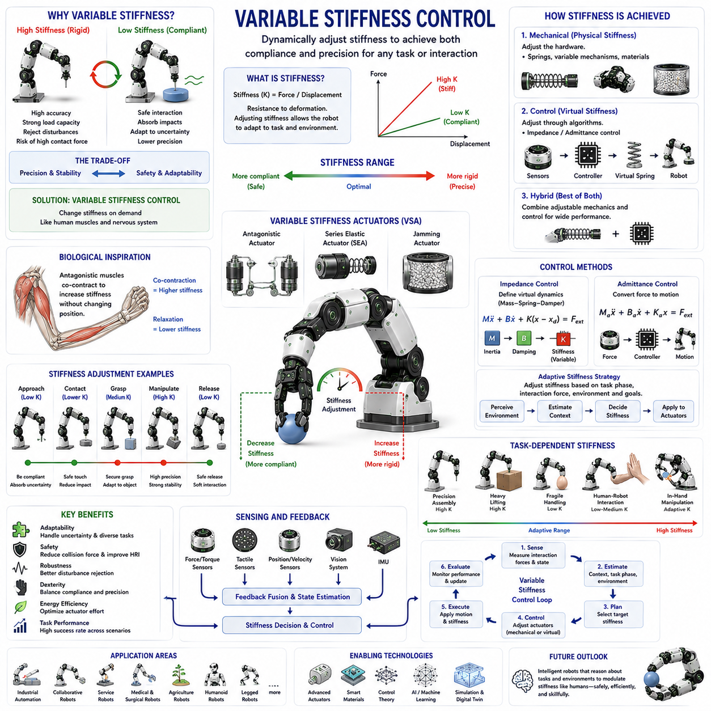{width="7.268055555555556in" height="7.268055555555556in"}

가변 강성 제어(Variable Stiffness Control)는 로봇이 작업의 목적, 환경 조건, 접촉 상태에 따라 자신의 강성(Stiffness)을 동적으로 변화시킬 수 있도록 하는 기술이다. 이는 고급 로봇 조작 분야에서 가장 중요한 기술 중 하나로 평가받고 있다. 전통적인 로봇은 일반적으로 고정된 기계적 특성을 갖는다. 한 번 설계된 로봇은 강성이 거의 변하지 않으며, 다양한 상황에 대응하기 위해 위치 제어(Position Control)나 힘 제어(Force Control)를 사용한다. 그러나 인간은 근육과 관절의 강성을 지속적으로 변화시키면서 환경에 적응한다. 무거운 물체를 들 때는 강성을 높여 안정성을 확보하고, 깨지기 쉬운 물체를 다룰 때는 강성을 낮춰 부드럽게 상호작용한다. 글쓰기, 악기 연주, 공 잡기, 악수하기, 정밀 작업 수행 등 거의 모든 행동에서 인간은 강성을 실시간으로 조절한다. 가변 강성 제어는 이러한 인간의 능력을 로봇에서 구현하기 위한 기술이며, 적응성(Adaptability), 안전성(Safety), 강인성(Robustness), 정교성(Dexterity)을 향상시키는 핵심 수단이 된다. 미래의 체화지능(Embodied Intelligence)과 Physical AI에서 가변 강성은 필수적인 구성 요소로 인식되고 있다.

강성은 역학(Mechanics)에서 힘과 변위 사이의 관계를 나타내는 개념이다. 높은 강성을 가진 시스템은 외력이 가해져도 거의 변형되지 않으며, 낮은 강성을 가진 시스템은 같은 힘에 대해 더 큰 변형을 보인다. 즉 강성은 변형에 대한 저항 정도를 의미한다. 높은 강성은 위치 정확도와 외란 저항성을 향상시키지만, 접촉 시 충격력이 커지고 안전성이 낮아질 수 있다. 반대로 낮은 강성은 순응성(Compliance)과 안전성을 향상시키지만 정밀도가 떨어질 수 있다. 가변 강성 제어는 이러한 상충 관계를 해결하기 위해 상황에 따라 강성을 변화시킨다.

인간의 운동 제어는 가변 강성 시스템의 가장 중요한 생물학적 모델이다. 인간의 근육은 단순히 힘을 생성하는 장치가 아니다. 길항근(Antagonistic Muscles)의 동시 수축(Co-Contraction)을 통해 관절 강성을 조절할 수 있다. 예를 들어 와인잔을 들 때는 강성을 낮게 유지하여 과도한 힘이 가해지지 않도록 한다. 반면 무거운 여행 가방을 들 때는 강성을 높여 흔들림을 줄이고 안정성을 확보한다. 운동선수는 충돌 전에 강성을 증가시켜 충격을 흡수하며, 피아니스트는 정교한 움직임을 위해 강성을 낮춘다. 이러한 강성 조절 능력이 인간의 뛰어난 적응성과 조작 능력을 가능하게 한다.

로봇에서 강성 조절은 기계 설계, 액추에이터 구조, 제어 알고리즘, 또는 이들의 조합을 통해 구현된다. 일부 시스템은 실제 기계적 강성을 변화시키고, 다른 시스템은 소프트웨어를 통해 가상의 강성(Virtual Stiffness)을 생성한다. 현대의 고급 로봇은 이 두 방식을 결합하여 사용한다.

전통적인 위치 제어 로봇은 매우 높은 강성을 가진 시스템으로 볼 수 있다. 제어기는 위치 오차를 제거하기 위해 지속적으로 힘을 생성하므로 로봇은 사실상 강체처럼 동작한다. 이러한 특성은 정밀한 산업 작업에서는 유리하지만, 사람이나 환경과 접촉할 경우 큰 충돌력을 발생시킬 수 있다. 가변 강성 제어는 필요할 때 강성을 낮추어 이러한 문제를 해결한다.

가변 강성 시스템에서는 물리적 강성(Physical Stiffness)과 가상 강성(Virtual Stiffness)을 구분해야 한다. 물리적 강성은 실제 스프링, 탄성 구조, 재료 특성에 의해 결정된다. 반면 가상 강성은 제어 알고리즘을 통해 생성되는 동적 특성이다. 두 요소가 결합되어 최종적인 로봇 거동을 결정한다.

가변 강성 액추에이터(Variable Stiffness Actuator, VSA)는 이러한 기술을 구현하기 위한 대표적인 하드웨어이다. VSA는 위치 제어와 강성 제어를 독립적으로 수행할 수 있는 액추에이터이다. 일반적으로 조절 가능한 스프링, 길항 구동 구조, 비선형 탄성 요소 등을 포함한다. 이를 통해 동일한 위치를 유지하면서도 강성을 자유롭게 변경할 수 있다.

VSA의 설계는 인간의 근육 구조에서 영감을 받는다. 인간의 관절은 서로 반대 방향으로 작용하는 근육에 의해 제어된다. 두 근육을 동시에 활성화하면 위치는 변하지 않지만 강성이 증가한다. 로봇에서는 두 개의 모터, 두 개의 텐던, 또는 두 개의 탄성 요소를 이용하여 이러한 원리를 구현한다. 결과적으로 토크와 강성을 독립적으로 제어할 수 있게 된다.

직렬 탄성 액추에이터(Series Elastic Actuator, SEA)는 가변 강성과 밀접한 관련이 있는 기술이다. SEA는 모터와 부하 사이에 스프링을 삽입하여 힘 제어 성능과 충격 흡수 능력을 향상시킨다. 전통적인 SEA는 고정 강성을 가지지만, 최신 SEA는 조절 가능한 탄성 요소를 포함하여 가변 강성을 지원한다.

비선형 탄성 메커니즘(Nonlinear Elastic Mechanism) 역시 중요한 역할을 한다. 인간 근육은 비선형적인 힘-변위 특성을 가지며, 활성화 수준에 따라 강성이 달라진다. 이를 모방하기 위해 특수 스프링, 캠(Cam), 텐던 경로 설계, 탄성 구조물이 사용된다. 비선형 강성은 다양한 작업 조건에서 더 우수한 성능을 제공할 수 있다.

하드웨어 변경 없이도 강성을 조절할 수 있는 방법이 존재한다. 대표적인 것이 임피던스 제어(Impedance Control)이다. 임피던스 제어에서는 로봇이 가상의 질량-스프링-댐퍼 시스템처럼 동작한다. 가상의 강성 값을 높이면 로봇은 단단하게 동작하고, 낮추면 부드럽게 동작한다. 이를 통해 실제 기계 구조를 변경하지 않고도 강성을 조절할 수 있다.

어드미턴스 제어(Admittance Control)는 측정된 힘을 원하는 움직임으로 변환하는 방식이다. 적절한 파라미터 조정을 통해 강성 변화와 유사한 효과를 얻을 수 있으며, 특히 위치 제어 기반 산업용 로봇에서 자주 사용된다.

작업 의존적 강성 조절(Task-Dependent Stiffness Regulation)은 가변 강성 제어의 핵심 응용 분야이다. 조립 작업은 높은 위치 정확도가 필요하므로 강성이 높아야 한다. 반면 깨지기 쉬운 물체를 다룰 때는 낮은 강성이 요구된다. 물체를 처음 파지할 때는 강성을 낮게 유지하여 위치 오차를 흡수하고, 안정적으로 파지한 이후에는 강성을 높여 조작 정확도를 향상시키는 것이 일반적이다.

인간-로봇 협업(Human-Robot Interaction)에서도 가변 강성은 매우 중요하다. 협동 로봇(Cobot)은 사람과 함께 작업하기 때문에 안전성이 필수적이다. 강성이 지나치게 높으면 충돌 시 위험하며, 너무 낮으면 작업 성능이 떨어진다. 가변 강성은 작업 중에는 높은 성능을 유지하면서도 인간과 접촉 시에는 안전한 순응성을 제공할 수 있다.

충격 흡수(Impact Absorption)는 가변 강성의 또 다른 중요한 장점이다. 예기치 않은 충돌이 발생하면 강성을 낮춰 충격력을 감소시킬 수 있다. 이는 서비스 로봇, 의료 로봇, 협업 로봇, 이동 로봇에서 특히 중요하다.

파지 작업에서도 가변 강성은 큰 역할을 한다. 물체와 처음 접촉할 때는 낮은 강성을 사용하여 위치 오차를 허용하고, 안정적인 파지가 이루어진 이후에는 강성을 높여 조작 성능을 향상시킨다. 이를 통해 안정성과 정밀성을 동시에 확보할 수 있다.

깨지기 쉬운 물체 조작은 가변 강성이 특히 중요한 분야이다. 과일, 달걀, 유리 제품, 의료 샘플, 전자부품, 의약품 용기 등은 과도한 힘에 의해 손상될 수 있다. 가변 강성은 접촉 초기에는 낮은 강성을 유지하여 안전성을 확보하고, 필요할 때만 강성을 높여 안정적인 조작을 가능하게 한다.

손안 조작(In-Hand Manipulation)에서는 더욱 복잡한 강성 변화가 요구된다. 물체를 굴리거나 회전시키거나 재파지할 때 접촉 상태가 지속적으로 변하기 때문이다. 가변 강성은 이러한 변화에 맞추어 접촉 안정성과 조작 정확도를 동시에 유지할 수 있게 해준다.

보행 로봇과 다리 로봇(Legged Robots)에서도 가변 강성은 중요한 역할을 한다. 인간은 걷기, 뛰기, 점프하기, 균형 잡기 과정에서 다리 강성을 지속적으로 조절한다. 가변 강성 다리 로봇은 충격 흡수, 에너지 효율, 지형 적응성, 안정성을 크게 향상시킬 수 있다.

소프트 로보틱스(Soft Robotics)는 가변 강성 연구를 더욱 활성화시켰다. 소프트 로봇은 높은 순응성을 가지지만 정밀도와 하중 지지 능력이 부족할 수 있다. 가변 강성 기술은 필요할 때 구조를 단단하게 만들 수 있어 이러한 한계를 극복할 수 있다.

재료 과학(Material Science) 역시 가변 강성 분야에서 중요한 역할을 한다. 형상기억합금(Shape Memory Alloy), 전기활성 고분자(Electroactive Polymer), 자기유변유체(Magnetorheological Fluid), 재밍(Jamming) 재료와 같은 스마트 소재는 외부 자극에 따라 강성을 변화시킬 수 있다.

특히 입자 재밍(Granular Jamming)은 최근 큰 관심을 받고 있다. 작은 입자를 유연한 막 안에 넣고 진공을 걸면 입자 간 마찰이 증가하여 강성이 급격히 증가한다. 진공을 해제하면 다시 부드러워진다. 이 방식은 단순하면서도 큰 강성 변화 범위를 제공한다.

머신러닝(Machine Learning)은 가변 강성 제어의 새로운 방향을 제시하고 있다. 복잡한 환경에서 최적의 강성을 결정하는 것은 쉽지 않다. 학습 기반 시스템은 센서 정보, 작업 맥락, 과거 경험을 이용하여 적절한 강성을 자동으로 선택할 수 있다.

강화학습(Reinforcement Learning)은 특히 유망하다. 로봇은 시뮬레이션 환경에서 반복적인 경험을 통해 강성이 안정성, 효율성, 안전성에 미치는 영향을 학습한다. 이를 통해 인간이 설계하기 어려운 최적의 강성 전략을 발견할 수 있다.

모방학습(Imitation Learning)은 인간의 움직임을 관찰하여 강성 조절 전략을 학습하는 방식이다. 인간의 근전도 신호, 동작 패턴, 조작 전략을 분석하여 보다 자연스러운 강성 제어를 구현할 수 있다.

촉각 센서와 힘 센서는 가변 강성 제어의 중요한 정보원이다. 접촉력, 압력 분포, 미끄러짐 정보는 강성 조절의 핵심 입력이 된다. 풍부한 감각 정보는 보다 정교한 강성 조절을 가능하게 한다.

비전 시스템은 물체의 형상, 재질, 취약성, 움직임을 파악하여 강성 조절을 지원한다. 시각 정보와 촉각 정보를 결합하면 로봇은 접촉 이전부터 적절한 강성을 계획할 수 있다.

가변 강성 시스템의 성능은 위치 정확도, 순응성 품질, 충격 흡수 능력, 에너지 효율, 파지 안정성, 적응성 등의 지표를 통해 평가된다. 이러한 지표들은 시스템이 얼마나 효과적으로 작업과 안전성을 동시에 달성하는지를 보여준다.

현대 시뮬레이션 환경은 탄성 액추에이터, 연성 재료, 접촉역학을 정밀하게 모델링할 수 있다. 이를 통해 실제 하드웨어 없이도 다양한 강성 제어 전략을 검증할 수 있으며, 학습 기반 시스템 개발도 가능하다.

미래의 가변 강성 제어는 고급 액추에이터, 소프트 로보틱스, 촉각 지능(Tactile Intelligence), 힘 센서, 비전 시스템, 파운데이션 모델(Foundation Model), 체화 인공지능(Embodied AI)을 통합하는 방향으로 발전할 것이다. 미래의 로봇은 미리 정의된 강성 값을 사용하는 것이 아니라 작업의 의미를 이해하고 상황에 맞는 강성을 스스로 선택할 수 있게 될 것이다. 예를 들어 "붐비는 식탁 위에서 깨지기 쉬운 유리잔을 안전하게 옮겨라"라는 명령을 이해하고, 파지, 이동, 장애물 회피, 배치 과정마다 적절한 강성을 자동으로 설정할 수 있을 것이다.

결론적으로 가변 강성 제어는 인간 수준의 적응성과 정교함을 구현하기 위한 핵심 기술이다. 인간이 환경에 따라 근육 강성을 조절하는 것처럼, 로봇 역시 상황에 따라 자신의 기계적 특성을 변화시킬 수 있어야 한다. 가변 강성 제어는 액추에이터 설계, 제어 이론, 센서 기술, 머신러닝, 체화 인공지능을 연결하는 핵심 기술이며, 미래의 산업용 로봇, 서비스 로봇, 휴머노이드, 의료 로봇, 협동 로봇, 그리고 Physical AI 플랫폼의 필수 요소로 발전해 나갈 것이다.

## 09.09 Manipulation of Fragile Objects

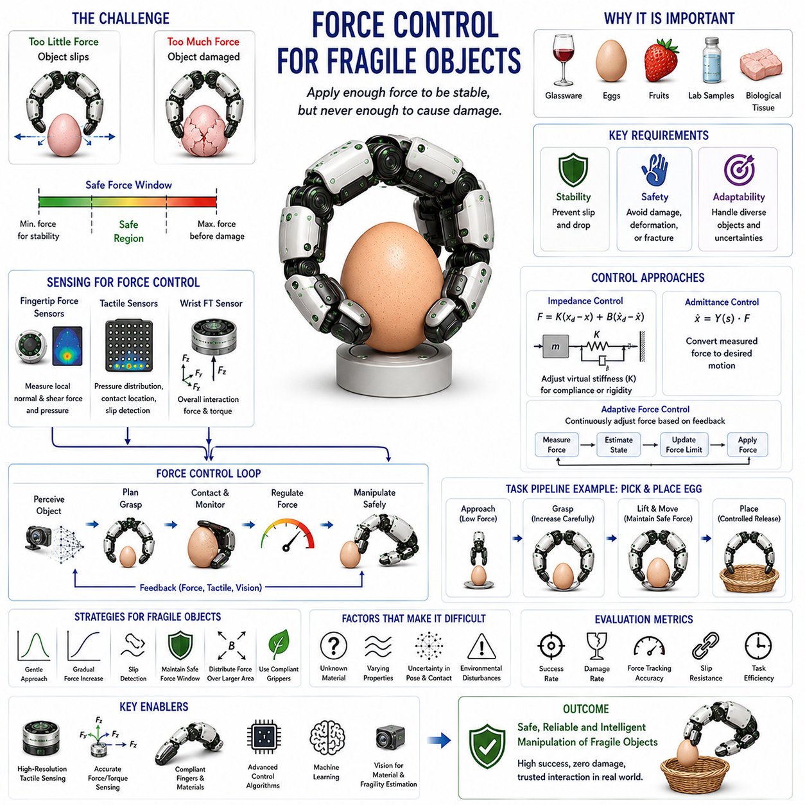{width="7.268055555555556in" height="7.268055555555556in"}

깨지기 쉬운 물체를 위한 힘 제어(Force Control for Fragile Objects)는 로봇 조작 분야에서 가장 어려우면서도 중요한 문제 중 하나이다. 로봇은 물체를 안정적으로 잡고 조작할 수 있을 만큼 충분한 힘을 가해야 하지만, 동시에 물체를 변형시키거나 부수거나 긁거나 손상시키지 않아야 한다. 일반적인 산업용 부품은 비교적 큰 힘을 견딜 수 있지만, 깨지기 쉬운 물체는 안정적인 파지에 필요한 최소 힘과 손상이 발생하는 최대 힘 사이의 차이가 매우 작다. 인간은 달걀, 딸기, 와인잔, 의료 샘플, 정밀 기구 등을 자연스럽게 다루지만, 로봇이 동일한 수준의 능력을 갖추기 위해서는 힘 센서, 촉각 센서, 순응 제어(Compliant Control), 재질 추정(Material Estimation), 파지 계획(Grasp Planning), 그리고 지능형 의사결정 시스템이 필요하다. 서비스 로봇, 의료 로봇, 농업 로봇, 물류 로봇, 휴머노이드 로봇이 현실 세계로 확대될수록 깨지기 쉬운 물체를 안전하게 다루는 능력은 필수적인 기술이 되고 있다.

이 문제의 핵심은 서로 상충되는 두 가지 요구사항에 있다. 로봇은 물체가 미끄러지지 않도록 충분한 힘을 가해야 하지만, 동시에 과도한 힘으로 물체를 손상시키지 않아야 한다. 힘이 너무 작으면 물체가 떨어지고, 너무 크면 물체가 파손된다. 따라서 제어기는 항상 이 두 한계 사이의 매우 좁은 안전 영역(Safe Force Window) 안에서 동작해야 한다.

취약성(Fragility)의 의미는 응용 분야에 따라 다르다. 어떤 물체는 구조적으로 약하다. 달걀껍질, 유리컵, 세라믹 제품, 반도체 웨이퍼, 실험용 바이알 등이 이에 해당한다. 또 다른 물체는 쉽게 변형된다는 의미에서 취약하다. 과일, 채소, 빵, 섬유, 연성 포장재, 생체 조직 등은 즉시 파손되지는 않지만 품질이 저하될 수 있다. 의료 분야에서는 살아있는 조직 자체가 매우 취약한 대상이 된다. 따라서 힘 제어를 설계하기 위해서는 물체가 왜 취약한지 먼저 이해해야 한다.

인간의 조작 능력은 좋은 참고 모델이 된다. 사람이 달걀을 집을 때는 처음에는 매우 작은 힘을 가하고, 안정적인 접촉이 형성되면 조금씩 힘을 증가시킨다. 촉각 수용기(Tactile Receptor)는 압력 분포, 미세한 미끄러짐, 접촉 상태를 지속적으로 감시한다. 만약 미끄러짐이 발생하면 파지력이 약간 증가하고, 압력이 너무 커지면 힘을 줄인다. 이러한 폐루프(Closed-Loop) 감각-운동 제어가 인간의 뛰어난 조작 능력을 가능하게 한다.

로봇에서도 깨지기 쉬운 물체를 다루기 위해서는 폐루프 힘 제어가 필수적이다. 개방 루프(Open-Loop) 방식처럼 미리 정해진 힘만 적용하는 방식은 실제 환경의 변화에 대응할 수 없다. 반면 폐루프 시스템은 접촉력을 지속적으로 측정하고, 이를 바탕으로 힘을 조정하여 안전한 범위를 유지한다.

힘 센서(Force Sensor)는 이러한 제어의 핵심 정보원이다. 손끝 힘 센서는 접촉점의 힘을 직접 측정하며, 다축 힘 센서는 법선력과 접선력을 동시에 측정할 수 있다. 손목 힘·토크 센서는 전체 상호작용 힘을 제공하고, 관절 토크 센서는 액추에이터 부하를 통해 접촉력을 추정한다. 이러한 센서들이 힘 제어를 가능하게 한다.

촉각 센서(Tactile Sensor)는 단순한 힘 측정을 넘어 더욱 풍부한 정보를 제공한다. 촉각 센서는 압력 분포(Pressure Distribution)를 측정할 수 있으며, 이를 통해 힘이 어디에 집중되는지 알 수 있다. 전체 힘이 안전 범위 안에 있더라도 특정 영역에 압력이 집중되면 물체가 손상될 수 있다. 따라서 촉각 정보는 깨지기 쉬운 물체를 다루는 데 매우 중요하다.

압력 분포는 특히 중요한 개념이다. 인간의 손가락은 피부가 부드럽기 때문에 힘이 넓은 영역에 분산된다. 로봇도 연성 패드(Soft Pad), 순응형 접촉면, 소프트 재료를 사용하여 접촉 면적을 넓힐 수 있다. 동일한 힘이라도 접촉 면적이 넓으면 압력이 감소하므로 물체 손상을 줄일 수 있다.

순응성(Compliance)은 깨지기 쉬운 물체를 위한 힘 제어에서 매우 중요한 요소이다. 강체 손가락은 접촉 순간 큰 충격력을 발생시킬 수 있다. 반면 순응형 손가락은 접촉 에너지를 흡수하고 물체 형상에 적응한다. 순응성은 연성 재료, 탄성 구조, 언더액추에이티드 메커니즘, 순응 관절 등을 통해 구현될 수 있다. 또한 임피던스 제어(Impedance Control)와 어드미턴스 제어(Admittance Control)를 이용한 능동적 순응성도 가능하다.

임피던스 제어는 특히 유용하다. 임피던스 제어에서는 로봇이 가상의 스프링-댐퍼 시스템처럼 동작한다. 예상치 못한 접촉이 발생하면 손가락이 자연스럽게 물러나면서 충격력을 줄인다. 가상 강성(Stiffness)을 낮추면 더욱 부드럽게 상호작용할 수 있고, 강성을 높이면 정밀한 작업이 가능하다.

어드미턴스 제어는 측정된 힘을 움직임으로 변환하는 방식이다. 특히 위치 제어 기반 로봇에서 효과적이며, 힘에 따라 움직임을 조절함으로써 안전한 접촉을 유지할 수 있다.

깨지기 쉬운 물체를 다루는 데 가장 어려운 문제 중 하나는 적절한 힘 한계를 결정하는 것이다. 실제 환경에서는 물체의 강성, 구조 강도, 마찰 특성, 변형 한계를 사전에 알 수 없는 경우가 많다. 따라서 로봇은 접촉 과정에서 이러한 특성을 추정해야 한다.

재질 특성 추정(Material Property Estimation)은 현재 활발히 연구되는 분야이다. 로봇은 접촉 초기의 힘-변위 관계를 분석하여 물체의 강성을 추정할 수 있다. 연성 물체는 작은 힘에도 크게 변형되고, 강체 물체는 거의 변형되지 않는다. 이러한 정보를 활용하여 힘 한계를 동적으로 조정할 수 있다.

비전 시스템(Vision System)도 중요한 역할을 한다. 카메라는 물체를 인식하고 크기, 형태, 재질, 라벨 정보를 분석할 수 있다. 예를 들어 유리잔, 달걀, 실험용 바이알을 인식하면 로봇은 접촉 이전부터 보수적인 힘 제어 전략을 사용할 수 있다. 시각 정보와 힘 센서를 결합하면 더욱 안전한 조작이 가능하다.

미끄러짐 방지(Slip Prevention)는 또 다른 중요한 과제이다. 힘을 지나치게 줄이면 물체가 미끄러질 수 있다. 따라서 로봇은 충분한 마찰력을 생성할 정도의 힘을 유지해야 한다. 촉각 센서는 미세한 미끄러짐(Micro-Slip), 압력 변화, 진동 패턴을 감지할 수 있다. 미끄러짐이 감지되면 제어기는 힘을 약간 증가시켜 안정성을 회복한다.

적응형 힘 제어(Adaptive Force Control)는 물체 특성이 계속 변할 수 있는 상황에 적합하다. 고정된 힘을 사용하는 대신 센서 정보를 기반으로 힘을 지속적으로 증가 또는 감소시킨다. 물체가 미끄러지면 힘을 증가시키고, 변형이 심해지면 힘을 감소시킨다. 이를 통해 다양한 물체를 안전하게 다룰 수 있다.

머신러닝(Machine Learning)은 깨지기 쉬운 물체 조작 분야를 크게 발전시키고 있다. 전통적인 방법은 수학 모델과 규칙 기반 제어에 의존했지만, 실제 환경은 매우 복잡하다. 학습 기반 시스템은 데이터를 통해 물체가 힘에 어떻게 반응하는지를 학습하고 최적의 힘 조절 전략을 습득한다.

강화학습(Reinforcement Learning)은 특히 유망한 방법이다. 로봇은 시뮬레이션 환경에서 수천 개의 가상 물체를 다루면서 안정적인 파지와 손상 방지를 동시에 달성하는 정책을 학습한다. 이러한 정책은 불확실성이 큰 환경에서도 높은 성능을 보여준다.

모방학습(Imitation Learning)은 인간의 조작 행동을 관찰하여 힘 조절 전략을 학습한다. 인간이 어떻게 힘을 증가시키고 감소시키는지를 학습함으로써 보다 자연스러운 조작 능력을 구현할 수 있다.

농업 로봇은 깨지기 쉬운 물체 힘 제어가 가장 중요한 분야 중 하나이다. 과일과 채소는 크기, 형태, 성숙도, 강성이 모두 다르다. 힘이 너무 크면 멍이 들고, 너무 작으면 떨어진다. 딸기, 토마토, 사과, 오이와 같은 농산물을 안정적으로 수확하기 위해서는 정교한 힘 제어가 필요하다.

식품 산업에서도 동일한 문제가 존재한다. 빵, 과자, 해산물, 포장 식품 등은 매우 섬세한 취급이 요구된다. 높은 생산성을 유지하면서 품질을 보존하기 위해서는 순응형 그리퍼와 적응형 힘 제어가 필수적이다.

의료 로봇은 더욱 엄격한 요구사항을 가진다. 수술 기구는 혈관, 장기, 조직과 같은 매우 민감한 구조와 상호작용한다. 작은 힘 오차도 조직 손상을 초래할 수 있다. 따라서 정밀한 힘 제어는 수술 로봇과 재활 로봇의 핵심 기술이다.

실험실 자동화에서도 힘 제어는 중요하다. 시험관, 페트리 접시, 바이알, 생물학적 샘플, 의약품 용기는 매우 깨지기 쉽다. 힘 제어는 파손 위험을 줄이고 실험의 신뢰성을 향상시킨다.

서비스 로봇과 물류 로봇도 다양한 취약 물체를 다루어야 한다. 전자제품, 유리 제품, 소비재, 생활용품 등은 모두 서로 다른 힘 제어 전략을 요구한다. 따라서 높은 일반화 능력이 필요하다.

다지형(Multi-Finger) 로봇 핸드는 힘을 여러 접촉점에 분산시킬 수 있기 때문에 깨지기 쉬운 물체 조작에 유리하다. 힘이 특정 지점에 집중되지 않도록 하면서도 안정적인 파지를 유지할 수 있다. 이 과정에서 내부력 제어(Internal Force Control)가 매우 중요하다.

깨지기 쉬운 물체를 위한 힘 제어 시스템은 일반적으로 파지 성공률, 물체 손상률, 힘 추종 정확도, 미끄러짐 방지 성능, 작업 효율성 등의 지표로 평가된다. 이러한 지표들은 안정성과 안전성을 동시에 측정하는 기준이 된다.

현대 시뮬레이션 환경은 변형 가능한 물체, 접촉역학, 재질 모델, 촉각 센서를 지원한다. 이를 통해 실제 물체를 손상시키지 않고도 다양한 힘 제어 전략을 학습하고 검증할 수 있다. 다만 연성 물체와 취약 물체의 거동을 완벽히 재현하는 것은 여전히 어려운 연구 과제이다.

미래의 힘 제어 기술은 촉각 지능(Tactile Intelligence), 비전-언어 모델(Vision-Language Model), 파운데이션 모델(Foundation Model), 소프트 로보틱스, 체화 인공지능(Embodied AI)을 통합하는 방향으로 발전할 것이다. 미래의 로봇은 단순히 힘을 측정하는 것이 아니라 물체의 의미와 작업 목적을 이해하게 될 것이다. 예를 들어 "잘 익은 딸기를 멍들지 않게 집어서 바구니에 넣어라"라는 명령을 이해하고, 적절한 파지 전략과 힘 한계를 스스로 결정하며 실시간으로 조절할 수 있게 될 것이다.

결론적으로 깨지기 쉬운 물체를 위한 힘 제어는 센서 기술, 접촉역학, 제어 이론, 촉각 인지, 머신러닝, 체화 인공지능이 융합된 핵심 기술이다. 이는 안정적인 파지와 물체 보호라는 상충되는 목표를 동시에 달성하기 위한 기술이며, 미래의 서비스 로봇, 농업 로봇, 의료 로봇, 산업용 로봇, 휴머노이드, 그리고 Physical AI 시스템이 현실 세계의 다양한 취약 물체를 안전하게 다루기 위해 반드시 갖추어야 할 핵심 역량이 될 것이다.

## 09.10 Multi-Finger Force Distribution

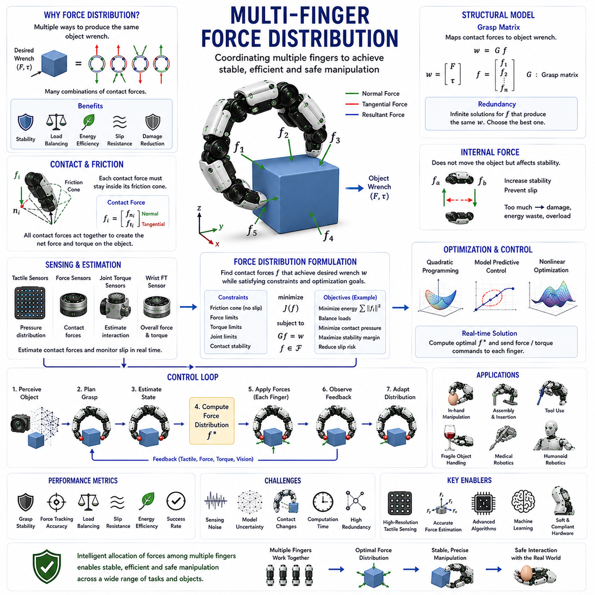{width="7.268055555555556in" height="7.268055555555556in"}

다지형 힘 분배(Multi-Finger Force Distribution)는 로봇 파지(Robotic Grasping)와 정교 조작(Dexterous Manipulation)에서 가장 중요한 개념 중 하나로, 여러 손가락이 동시에 물체와 접촉할 때 각 손가락에 힘을 어떻게 배분할 것인가를 다룬다. 두 손가락 그리퍼는 대칭적인 힘을 가하는 것만으로도 비교적 안정적인 파지가 가능하지만, 세 개 이상의 손가락을 가진 로봇 핸드에서는 문제가 훨씬 복잡해진다. 각 손가락은 물체 안정성, 조작 능력, 외란 대응, 접촉 안전성에 서로 다른 방식으로 기여한다. 힘이 어떻게 분배되는가에 따라 물체가 안정적으로 유지될 수도 있고, 미끄러지거나 회전하거나 손상될 수도 있다. 따라서 다지형 힘 분배는 파지 역학(Grasp Mechanics), 힘 제어(Force Control), 접촉 모델(Contact Modeling), 촉각 센싱(Tactile Sensing), 정교 조작(Dexterous Manipulation), 체화 지능(Embodied Intelligence)을 연결하는 핵심 기술이다.

힘 분배 문제가 발생하는 가장 큰 이유는 다지형 로봇 핸드의 중복성(Redundancy) 때문이다. 여러 손가락이 동시에 물체를 잡고 있을 때 동일한 물체 수준의 힘과 토크(Object-Level Force and Torque)를 생성하는 방법은 하나가 아니라 매우 많다. 즉, 물체를 움직이는 데 필요한 힘은 정해져 있지만, 각 손가락이 얼마나 부담할지는 여러 가지 해답이 존재한다. 로봇은 이 중에서 가장 적절한 힘 분배를 선택해야 하며, 이 선택은 안정성, 효율성, 안전성, 조작 성능에 직접적인 영향을 미친다.

인간의 손은 매우 뛰어난 힘 분배 능력을 보여준다. 컵을 들거나, 드라이버를 돌리거나, 무거운 상자를 옮기거나, 깨지기 쉬운 유리잔을 잡을 때 손가락들은 역할을 나누어 힘을 배분한다. 엄지손가락은 주로 안정성을 제공하고, 검지와 중지는 정밀한 제어를 담당하며, 약지와 새끼손가락은 추가적인 지지와 균형을 제공한다. 인간의 신경계는 촉각 정보와 고유감각(Proprioception)을 이용하여 이러한 힘 분배를 실시간으로 조정한다. 로봇의 다지형 힘 분배 기술은 이러한 인간의 능력을 수학적 모델과 제어 알고리즘으로 구현하려는 시도라고 볼 수 있다.

힘 분배의 기본은 접촉역학(Contact Mechanics)에서 시작된다. 각 손가락은 접촉점을 통해 물체에 힘을 가한다. 이 힘은 법선력(Normal Force), 마찰력(Friction Force), 경우에 따라서는 접촉 모멘트(Contact Moment)를 포함한다. 이러한 힘들이 결합되어 물체 수준의 힘과 토크를 생성한다. 문제는 원하는 물체 동작을 만들기 위해 각 손가락이 얼마만큼의 힘을 부담해야 하는가를 결정하는 것이다.

이를 분석하기 위해 사용되는 핵심 수학적 도구가 파지 행렬(Grasp Matrix)이다. 파지 행렬은 손가락 접촉력을 물체 수준의 힘과 토크로 변환하는 역할을 한다. 이를 통해 각 손가락의 힘이 물체 운동에 어떻게 기여하는지 분석할 수 있다. 또한 파지 행렬은 동일한 물체 운동을 생성하는 여러 힘 분배 조합이 존재함을 보여준다. 이러한 중복성은 최적화의 기회를 제공하지만 동시에 제어 문제를 복잡하게 만든다.

힘 폐쇄 이론(Force Closure Theory)은 다지형 힘 분배의 중요한 이론적 기반이다. 힘 폐쇄란 손가락들이 협력하여 모든 방향의 외란을 상쇄할 수 있는 상태를 의미한다. 힘 폐쇄는 단순히 접촉 위치만으로 결정되는 것이 아니라 실제로 힘이 어떻게 분배되는가에 의해 좌우된다. 따라서 적절한 힘 분배가 이루어지지 않으면 충분한 접촉점이 있어도 안정적인 파지를 유지할 수 없다.

다지형 힘 분배의 가장 중요한 목적은 파지 안정성(Grasp Stability) 확보이다. 물체를 이동하거나 조작하는 과정에서는 중력, 관성력, 환경 접촉, 외부 충격과 같은 다양한 외란이 발생한다. 적절한 힘 분배는 이러한 외란을 상쇄하고 물체가 미끄러지거나 회전하지 않도록 한다. 특히 동적 조작(Dynamic Manipulation)에서는 안정성이 최우선 고려 사항이 된다.

마찰(Friction)은 힘 분배를 결정하는 또 다른 핵심 요소이다. 각 접촉점은 마찰 콘(Friction Cone)이라는 제한 조건을 가진다. 접촉력이 마찰 콘 밖으로 벗어나면 미끄러짐이 발생한다. 따라서 힘 분배 알고리즘은 모든 접촉력이 마찰 콘 내부에 유지되도록 해야 하며, 동시에 원하는 조작 작업도 수행해야 한다. 이 때문에 힘 분배 문제는 일반적으로 제약 조건을 가진 최적화 문제로 표현된다.

내부력(Internal Force)은 다지형 파지에서 매우 중요한 개념이다. 내부력은 물체를 움직이지 않는 힘이다. 예를 들어 두 손가락이 서로 더 강하게 누르더라도 물체는 움직이지 않을 수 있다. 이러한 힘은 물체 운동에는 기여하지 않지만 파지 안정성을 유지하는 데 필수적이다.

내부력은 적절하게 조절되어야 한다. 내부력이 너무 작으면 물체가 미끄러질 수 있고, 너무 크면 에너지 소비가 증가하거나 물체가 손상될 수 있다. 따라서 힘 분배 알고리즘은 작업 목적과 물체 특성에 따라 내부력을 지속적으로 조정해야 한다.

중복성(Redundancy)은 다지형 힘 분배의 핵심 특징이다. 로봇 핸드는 일반적으로 물체를 제어하는 데 필요한 것보다 더 많은 자유도를 가진다. 따라서 하나의 작업에 대해 여러 개의 힘 분배 해답이 존재한다. 이 때문에 최적화 기법이 널리 사용된다.

에너지 효율(Energy Efficiency)은 대표적인 최적화 목표이다. 동일한 안정성을 유지할 수 있는 힘 분배 중에서도 더 적은 힘을 사용하는 해를 선택하면 전력 소비를 줄일 수 있다. 이는 배터리 기반 로봇이나 휴머노이드 로봇에서 특히 중요하다.

부하 균형(Load Balancing) 역시 중요한 목표이다. 특정 손가락에 힘이 집중되면 기계적 스트레스가 증가하고 내구성이 감소한다. 균형 잡힌 힘 분배는 각 손가락이 비슷한 수준의 하중을 부담하도록 하여 시스템 수명을 연장한다.

깨지기 쉬운 물체(Fragile Object)를 다룰 때는 더욱 세심한 힘 분배가 필요하다. 과일, 달걀, 의료 샘플, 유리 제품, 전자부품과 같은 물체는 특정 접촉점에 힘이 집중되면 손상될 수 있다. 다지형 힘 분배는 여러 손가락에 힘을 분산시켜 접촉 압력을 낮추고 물체 손상을 방지한다.

순응성(Compliance)은 힘 분배에 큰 영향을 미친다. 순응형 손가락은 하중에 따라 변형되므로 접촉 면적과 힘 전달 방식이 달라진다. 따라서 실제 힘 분배는 제어 명령뿐 아니라 기계적 변형 특성에도 영향을 받는다.

촉각 센서(Tactile Sensor)는 힘 분배 성능을 크게 향상시킨다. 고해상도 촉각 센서는 접촉 위치, 압력 분포, 접촉 면적, 미끄러짐 정보를 제공한다. 이를 통해 제어기는 실제 힘 분포를 추정하고 필요에 따라 힘을 재분배할 수 있다.

힘 센서와 토크 센서 역시 중요한 정보원이다. 손끝 힘 센서는 접촉력을 직접 측정하며, 관절 토크 센서는 액추에이터 부하를 통해 힘을 추정한다. 손목 힘·토크 센서는 외부에서 작용하는 전체 힘을 측정한다. 이러한 센서들을 결합하면 보다 정확한 힘 분배가 가능해진다.

실시간 힘 분배(Real-Time Force Distribution)는 동적 조작에서 필수적이다. 물체가 움직이면 접촉 조건도 계속 변하기 때문이다. 회전, 굴리기(Rolling), 핑거 게이팅(Finger Gaiting), 재파지(Regrasping), 공구 사용과 같은 작업에서는 힘 분배가 지속적으로 조정되어야 한다.

최적화 기반 힘 분배(Optimization-Based Force Distribution)는 현재 가장 널리 사용되는 접근법이다. 힘 분배 문제를 수학적 최적화 문제로 정의하고, 안정성 유지, 에너지 최소화, 압력 최소화, 하중 균형 등의 목적을 동시에 만족하는 해를 찾는다. 이차 계획법(Quadratic Programming), 볼록 최적화(Convex Optimization), 비선형 최적화(Nonlinear Optimization), 모델 예측 제어(Model Predictive Control)가 주로 사용된다.

특히 이차 계획법은 실시간 계산이 가능하기 때문에 다지형 로봇 핸드에서 매우 널리 활용된다. 최근 컴퓨팅 성능의 향상으로 더욱 복잡한 최적화 문제도 실시간으로 해결할 수 있게 되었다.

모델 예측 제어(MPC)는 현재 상태뿐 아니라 미래의 물체 움직임과 접촉 변화를 예측하여 힘 분배를 수행한다. 이를 통해 더욱 부드럽고 안정적인 조작이 가능하다.

머신러닝(Machine Learning)은 힘 분배 분야에서도 빠르게 성장하고 있다. 기존 방법이 수학 모델에 의존했다면, 학습 기반 접근법은 데이터를 통해 직접 힘 분배 전략을 학습한다.

강화학습(Reinforcement Learning)은 특히 유망하다. 로봇은 시뮬레이션에서 반복적인 경험을 통해 어떤 힘 분배가 안정성, 에너지 효율, 안전성에 가장 효과적인지 학습할 수 있다.

모방학습(Imitation Learning)은 인간의 조작 행동을 관찰하여 자연스러운 힘 분배 전략을 학습한다. 이를 통해 인간과 유사한 손가락 협응 능력을 구현할 수 있다.

손안 조작(In-Hand Manipulation)은 다지형 힘 분배가 가장 중요한 응용 분야 중 하나이다. 물체를 회전시키거나 위치를 바꾸거나 굴리는 과정에서는 여러 손가락이 매우 정밀하게 협력해야 한다. 작은 힘 분배 오류도 미끄러짐이나 조작 실패를 초래할 수 있다.

휴머노이드 로봇은 가장 복잡한 힘 분배 문제를 가진다. 인간과 유사한 다수의 관절과 접촉점을 가지기 때문에 매우 높은 차원의 힘 분배 문제를 해결해야 한다. 인간 수준의 조작 능력을 구현하기 위해서는 촉각 센서, 힘 센서, 최적화 기법, 지능형 제어가 모두 필요하다.

의료 로봇에서도 힘 분배는 중요하다. 수술 과정에서는 연약한 조직에 힘을 분산시켜야 하며, 이를 통해 조직 손상을 줄이고 정밀성을 향상시킬 수 있다.

산업용 조립 작업에서도 다지형 힘 분배는 중요한 역할을 한다. 부품 삽입, 커넥터 결합, 공구 사용 과정에서 적절한 힘 분배는 성공률을 높이고 걸림(Jamming)을 줄인다.

다지형 힘 분배 시스템의 성능은 파지 안정성, 힘 추종 정확도, 하중 균형 품질, 미끄러짐 저항성, 에너지 효율, 접촉 압력 분포, 조작 성공률, 계산 효율성 등의 지표로 평가된다.

현대 시뮬레이터는 접촉역학, 마찰, 순응성, 촉각 센서, 다물체 동역학을 현실적으로 모델링할 수 있다. 이를 통해 다양한 힘 분배 알고리즘을 실제 하드웨어 적용 전에 검증할 수 있다. 그러나 실제 접촉 현상을 완벽히 재현하는 것은 여전히 어려운 연구 과제이다.

미래의 다지형 힘 분배 기술은 촉각 지능(Tactile Intelligence), 고해상도 힘 센싱, 소프트 로보틱스, 파운데이션 모델(Foundation Model), 체화 인공지능(Embodied AI)을 통합하는 방향으로 발전할 것이다. 미래의 로봇은 단순히 힘을 계산하는 것이 아니라 물체의 특성, 작업 목적, 환경 조건을 이해하고 최적의 힘 분배 전략을 스스로 결정할 수 있게 될 것이다. 예를 들어 "실험용 유리 바이알을 조심스럽게 회전시키되 뚜껑에는 과도한 압력을 가하지 말라"는 명령을 이해하고, 적절한 접촉 전략과 힘 분배를 자동으로 생성할 수 있을 것이다.

결론적으로 다지형 힘 분배는 인간 수준의 정교 조작을 실현하기 위한 핵심 기술이다. 여러 손가락이 협력하여 힘을 효율적이고 안전하게 분배하는 능력은 거의 모든 고급 조작 기술의 기반이 된다. 접촉역학, 파지 이론, 최적화, 센서 기술, 머신러닝, 체화 인공지능이 결합된 다지형 힘 분배 기술은 미래의 산업용 로봇, 서비스 로봇, 의료 로봇, 휴머노이드, 그리고 Physical AI 시스템이 복잡한 현실 세계와 상호작용하는 데 필수적인 핵심 기술로 자리 잡을 것이다.

## 09.11 Force Control Validation

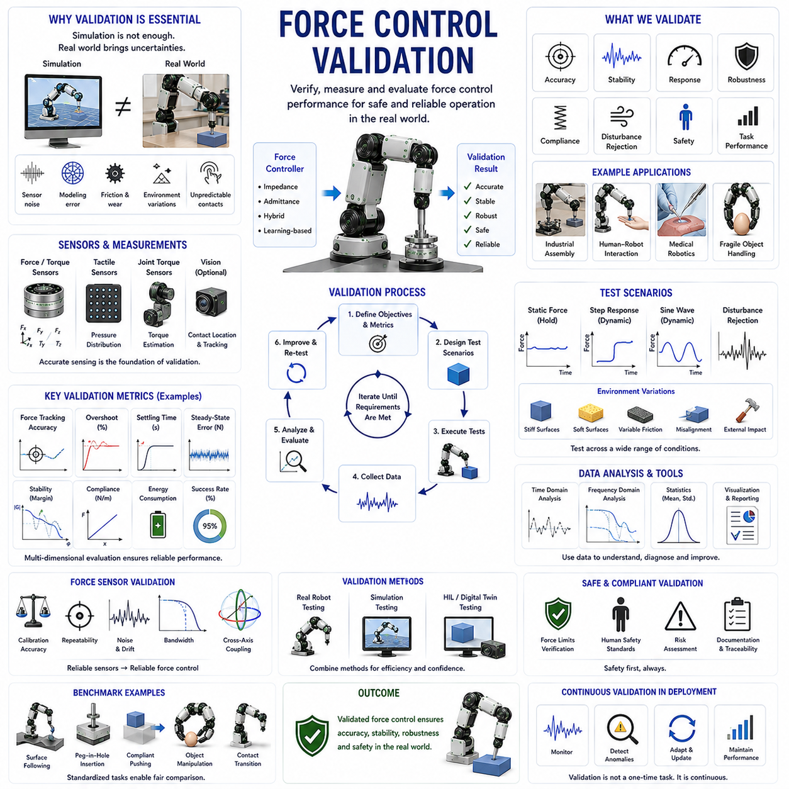{width="7.268055555555556in" height="7.268055555555556in"}

힘 제어 검증(Force Control Validation)은 로봇의 힘 제어 시스템이 설계 목표에 따라 실제 환경에서 정확하게 동작하는지를 체계적으로 확인하고 평가하는 과정이다. 로봇 조작 분야에서 힘 제어 알고리즘은 로봇과 환경, 물체, 공구, 사람 또는 다른 로봇 간의 상호작용 힘을 조절하는 역할을 담당한다. 수학적 모델이나 시뮬레이션에서는 우수한 성능을 보이는 제어기라도 실제 환경에서는 센서 노이즈, 모델링 오차, 기계적 오차, 환경 변화, 예기치 않은 접촉 조건 등으로 인해 성능이 저하될 수 있다. 따라서 힘 제어 검증은 단순한 테스트가 아니라 설계된 제어기를 실제 시스템에 적용하기 전 반드시 거쳐야 하는 핵심 과정이다.

과거의 산업용 로봇은 대부분 구조화된 환경에서 동작했으며 물리적 접촉이 최소화되었다. 주된 제어 방식은 위치 제어였으며 접촉은 계획된 공정 내에서만 발생하였다. 그러나 최근의 로봇은 서비스 로봇, 농업 로봇, 의료 로봇, 협동 로봇, 휴머노이드 로봇과 같이 지속적인 물리적 상호작용을 수행한다. 이러한 환경에서는 힘 제어 성능이 곧 안전성, 신뢰성, 작업 성능을 결정하므로 검증의 중요성이 크게 증가하였다.

힘 제어 검증의 가장 기본적인 목적은 실제 시스템의 동작이 설계 의도와 일치하는지를 확인하는 것이다. 이를 위해 힘 추종 정확도(Force Tracking Accuracy), 외란 억제 능력(Disturbance Rejection), 순응성(Compliance), 안정성(Stability), 과도 응답(Transient Response), 강인성(Robustness), 작업 수행 능력(Task Performance) 등을 평가한다.

힘 추종 정확도는 가장 기본적인 검증 항목이다. 힘 제어 시스템은 일반적으로 목표 힘(Reference Force)을 따라가도록 설계된다. 검증 과정에서는 실제 힘이 목표 힘을 얼마나 정확하게 추종하는지를 측정한다. 추종 오차는 센서 정확도, 액추에이터 성능, 마찰, 통신 지연, 구조적 유연성, 제어기 설정 등에 의해 발생할 수 있다. 우수한 힘 제어 시스템은 다양한 조건에서도 오차를 최소화해야 한다.

정적 힘 검증(Static Force Validation)은 일정한 힘을 유지하는 상황에서 수행된다. 로봇은 보정된 표면이나 측정 장비에 일정한 힘을 가하며, 실제 측정값과 명령값을 비교하여 정확도와 반복성을 평가한다. 정적 검증은 동적 요소를 제거하고 기본적인 시스템 성능을 확인하는 첫 단계로 사용된다.

동적 힘 검증(Dynamic Force Validation)은 시간에 따라 변화하는 힘을 대상으로 한다. 실제 작업에서는 힘이 지속적으로 변화하므로, 제어기가 얼마나 빠르고 정확하게 힘 변화에 대응하는지가 중요하다. 계단 입력(Step Input), 사인파 입력(Sinusoidal Input), 주파수 스윕(Frequency Sweep), 충격 입력 등을 이용하여 시스템의 동적 특성을 평가한다.

응답 속도(Response Time)는 중요한 성능 지표이다. 접촉 조건이 변할 때 제어기가 충분히 빠르게 반응하지 못하면 물체 손상, 파지 실패, 불안정성 등이 발생할 수 있다. 따라서 상승 시간(Rise Time), 정착 시간(Settling Time), 지연 시간(Delay Time)을 측정하여 성능을 평가한다.

오버슈트(Overshoot) 분석도 매우 중요하다. 오버슈트는 힘이 목표값을 일시적으로 초과하는 현상이다. 깨지기 쉬운 물체나 의료 환경에서는 짧은 순간의 과도한 힘도 심각한 문제를 일으킬 수 있다. 따라서 힘 제어 검증에서는 정상 상태 오차뿐 아니라 과도 상태에서의 힘 변화도 세밀하게 분석한다.

안정성(Stability)은 힘 제어 검증에서 가장 중요한 요소 중 하나이다. 접촉 작업에서는 로봇과 환경이 서로 영향을 주기 때문에 복잡한 동역학이 형성된다. 특정 조건에서는 진동(Oscillation)이나 불안정한 거동이 발생할 수 있다. 따라서 다양한 환경 강성(Stiffness), 감쇠(Damping), 마찰 조건에서 시스템 안정성을 평가해야 한다.

실제 환경은 모델과 다르게 동작하기 때문에 환경 불확실성(Environmental Uncertainty)에 대한 검증도 중요하다. 표면 강성, 마찰 계수, 형상, 접촉 특성은 계속 변화한다. 따라서 이상적인 조건뿐 아니라 다양한 환경에서 테스트하여 제어기의 실제 성능을 확인해야 한다.

순응성 검증(Compliance Validation)은 외부 힘이나 위치 오차에 대해 시스템이 얼마나 유연하게 반응하는지를 평가한다. 협동 로봇, 취약 물체 조작, 접촉 기반 조립 작업에서는 순응성이 매우 중요하다. 검증 과정에서는 예상치 못한 충돌이나 외란이 발생했을 때 시스템이 어떻게 대응하는지를 측정한다.

임피던스 제어(Impedance Control)의 검증은 더욱 전문적인 절차를 필요로 한다. 임피던스 제어는 가상 강성, 감쇠, 관성을 통해 힘과 움직임의 관계를 정의한다. 검증에서는 실제 로봇이 설계된 가상 기계 특성을 얼마나 정확하게 구현하는지를 평가한다.

어드미턴스 제어(Admittance Control) 역시 검증이 필요하다. 어드미턴스 제어는 측정된 힘을 움직임으로 변환하는 방식이므로, 힘 입력에 대한 위치 및 속도 응답이 설계 의도와 일치하는지를 분석한다.

힘 센서 검증(Force Sensor Validation)은 힘 제어 검증의 전제 조건이다. 힘 센서가 정확하지 않으면 아무리 좋은 제어기도 올바르게 동작할 수 없다. 따라서 보정 정확도(Calibration Accuracy), 반복성(Repeatability), 노이즈 특성, 드리프트(Drift), 민감도(Sensitivity), 대역폭(Bandwidth), 히스테리시스(Hysteresis) 등을 평가한다.

다축 힘·토크 센서(Multi-Axis Force-Torque Sensor)는 여러 방향의 힘과 토크를 동시에 측정하기 때문에 더욱 철저한 검증이 필요하다. 축 간 간섭(Cross-Axis Coupling), 비선형성, 보정 오차 등을 평가하여 실제 힘 벡터를 정확히 측정할 수 있는지 확인해야 한다.

촉각 센서(Tactile Sensor)의 검증도 점점 중요해지고 있다. 촉각 센서는 압력 분포, 접촉 위치, 접촉 면적, 미끄러짐 정보를 제공한다. 검증에서는 공간 해상도, 응답 속도, 민감도, 내구성, 환경 변화에 대한 강인성을 평가한다.

파지 작업에서는 접촉력 검증(Contact Force Validation)이 중요하다. 손가락이 물체에 가하는 힘이 목표 범위 안에 유지되는지, 미끄러짐을 방지하면서도 물체를 손상시키지 않는지를 평가한다. 압력 분포와 힘 분배 품질도 주요 평가 항목이다.

취약 물체(Fragile Object)를 이용한 검증은 매우 까다로운 시험이다. 달걀, 과일, 유리 제품, 실험용 샘플 등을 사용하여 물체 손상 없이 안정적으로 파지할 수 있는지 평가한다. 성공률, 손상률, 힘 여유도(Force Margin), 적응 능력 등이 측정된다.

인간-로봇 상호작용(Human-Robot Interaction)에서는 안전성이 최우선이다. 협동 로봇은 충돌 시 힘을 제한해야 하며, 접촉 안전성을 보장해야 한다. 검증 과정에서는 충돌 응답, 접촉력 제한, 안전 규격 준수 여부를 평가한다.

의료 로봇은 더욱 엄격한 검증이 요구된다. 수술 로봇은 연약한 생체 조직과 상호작용하기 때문에 힘 정확도, 힘 제한 성능, 조직 보호 능력, 절차적 안전성을 매우 높은 수준으로 검증해야 한다. 실제로 의료기기 인증 과정에서는 광범위한 검증 데이터가 요구된다.

산업용 조립 작업도 중요한 검증 분야이다. 삽입(Insertion), 체결(Fastening), 정렬(Alignment) 작업에서는 접촉력이 적절하게 제어되지 않으면 걸림(Jamming)이나 부품 손상이 발생한다. 따라서 삽입 성공률, 정렬 정확도, 힘 프로파일 등을 평가한다.

외란 억제 성능(Disturbance Rejection) 검증은 외부 충격, 환경 변화, 센서 노이즈, 액추에이터 오차가 발생했을 때 시스템이 얼마나 잘 대응하는지를 평가한다. 복구 시간과 안정성 유지 능력이 중요한 지표가 된다.

강인성 검증(Robustness Validation)은 시스템 파라미터가 변해도 성능이 유지되는지를 확인하는 과정이다. 실제 로봇은 마모, 온도 변화, 하중 변화, 환경 변화 등을 겪기 때문에 다양한 조건에서 테스트해야 한다.

주파수 영역 검증(Frequency-Domain Validation)은 대역폭(Bandwidth), 공진(Resonance), 안정성 여유(Stability Margin), 외란 억제 능력을 분석한다. 이는 고성능 힘 제어기 개발에 널리 사용된다.

시뮬레이션 기반 검증(Simulation-Based Validation)은 실제 하드웨어 적용 전 대규모 테스트를 가능하게 한다. 최신 시뮬레이터는 접촉역학, 마찰, 변형 가능한 물체, 센서 모델을 지원한다. 하지만 시뮬레이션만으로는 충분하지 않으며 실제 실험 검증이 반드시 필요하다.

하드웨어 인 더 루프(Hardware-in-the-Loop, HIL) 검증은 실제 하드웨어와 시뮬레이션을 결합한 방식이다. 이는 비용이 비싸거나 위험한 시스템을 안전하게 검증하는 데 유용하다.

디지털 트윈(Digital Twin)은 힘 제어 검증의 새로운 방향이다. 가상 시스템과 실제 시스템을 실시간으로 동기화하여 성능을 지속적으로 모니터링한다. 이를 통해 성능 저하를 조기에 발견할 수 있다.

머신러닝 기반 힘 제어는 새로운 검증 과제를 제시한다. 전통적인 제어기는 수학적으로 분석 가능하지만, 학습 기반 시스템은 복잡한 내부 구조를 가진다. 따라서 일반화 성능, 설명 가능성, 안전성, 미지 환경 적응 능력 등을 추가적으로 평가해야 한다.

강화학습 기반 힘 제어기는 시뮬레이션에서 우수한 성능을 보여도 실제 환경에서는 다른 결과를 낼 수 있다. 따라서 다양한 물체, 환경, 접촉 조건에서 광범위한 검증이 필요하다.

벤치마크(Benchmark)는 서로 다른 힘 제어 기법을 객관적으로 비교하기 위한 표준화된 평가 방법이다. 힘 추종, 표면 추종, 삽입 작업, 순응 동작, 접촉 전환 등의 과제가 대표적인 벤치마크로 사용된다.

힘 제어 검증의 성능 지표는 다차원적이다. 정확도는 힘 추종 품질을 평가하고, 안정성은 진동과 불안정성에 대한 저항성을 나타낸다. 강인성은 불확실성에 대한 성능 유지 능력을 의미하며, 응답성은 동적 특성을 나타낸다. 안전성은 인간 및 환경과의 상호작용 위험을 평가하고, 에너지 효율은 자원 활용도를 평가한다. 작업 성공률은 실제 적용 가능성을 보여준다.

미래의 힘 제어 검증은 고해상도 센서, 디지털 트윈, 파운데이션 모델(Foundation Model), 체화 인공지능(Embodied AI), 자동화된 테스트 프레임워크, 대규모 시뮬레이션을 통합하는 방향으로 발전할 것이다. 미래의 검증 시스템은 단순한 시험 단계를 넘어 로봇 운영 중에도 지속적으로 성능을 감시하고 평가하는 형태가 될 것이다.

결론적으로 힘 제어 검증은 로봇이 실제 세계에서 안전하고 신뢰성 있게 동작하기 위한 필수 과정이다. 이는 단순한 테스트 절차가 아니라 측정 공학, 제어 이론, 센서 기술, 실험 방법론, 시뮬레이션, 머신러닝 평가, 안전 공학이 융합된 독립적인 기술 분야이다. 힘 제어 검증은 미래의 산업용 로봇, 협동 로봇, 의료 로봇, 서비스 로봇, 휴머노이드, 그리고 Physical AI 시스템이 현실 세계와 안전하고 지능적으로 상호작용할 수 있도록 보장하는 핵심 기반 기술이 될 것이다.
