**Volume 06 Robot Hands and Dexterous Grasping**

# 10. In-Hand Manipulation

## 10.01 Introduction to In-Hand Manipulation

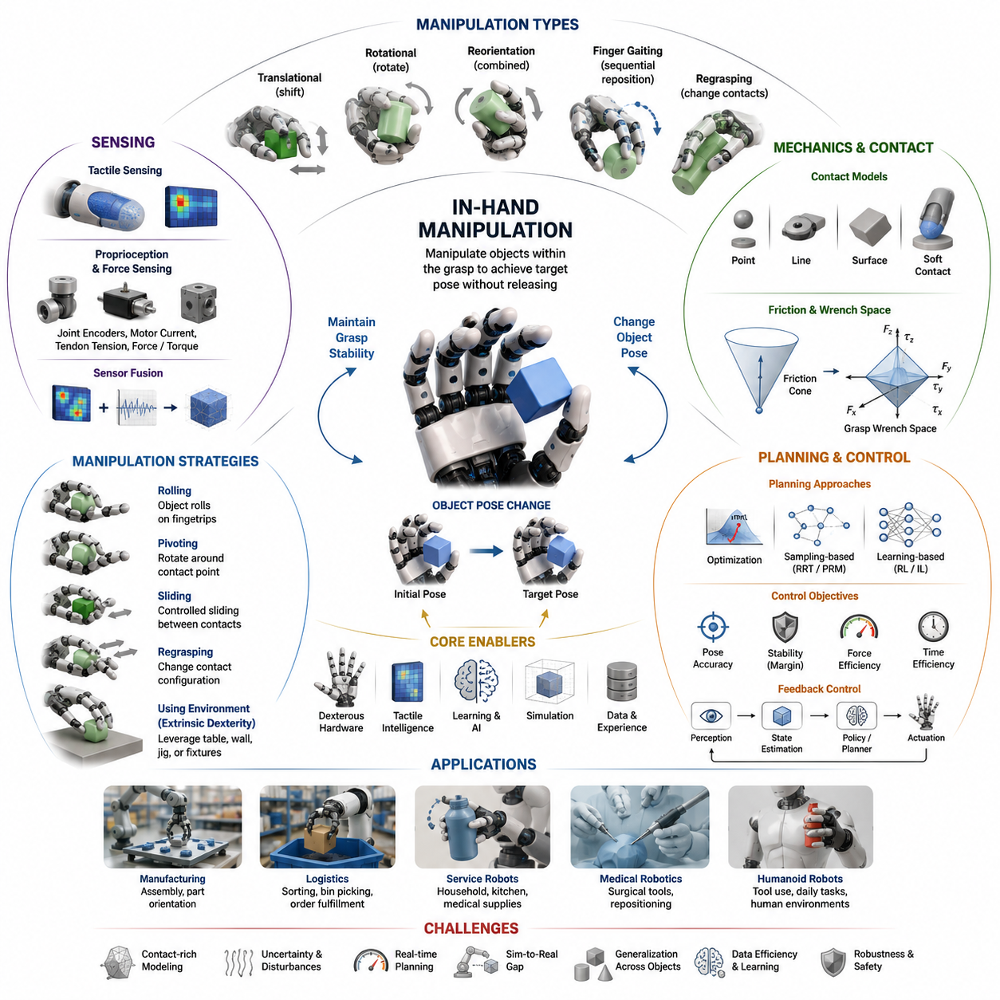{width="7.268055555555556in" height="7.268055555555556in"}

In-hand manipulation is one of the most advanced and challenging capabilities in robotic grasping and dexterous manipulation. While traditional robotic grasping focuses on acquiring and holding an object securely, in-hand manipulation extends this capability by enabling a robot to change the position, orientation, or configuration of an object while it remains within the robot's grasp. This capability is fundamental for achieving human-like dexterity and represents a major step toward general-purpose robotic manipulation. Within the context of dexterous robot hands, in-hand manipulation serves as a bridge between grasping and full task execution, allowing robots to perform complex operations without repeatedly placing and regrasping objects. It occupies a central role in advanced manufacturing, service robotics, medical robotics, logistics automation, and future humanoid systems. The topic forms a major component of Volume 06, Chapter 10 of the Robot Hand and Dexterous Grasping series.

Humans perform in-hand manipulation continuously in everyday life. Activities such as rotating a pen between fingers, adjusting a screwdriver before tightening a screw, repositioning a key before inserting it into a lock, or changing the orientation of a smartphone all rely on sophisticated in-hand manipulation skills. These actions appear effortless because the human hand integrates tactile sensing, proprioception, force control, compliance, and motor planning into a highly coordinated system. Replicating these capabilities in robotic systems requires solving numerous challenges involving mechanics, sensing, planning, control, and artificial intelligence.

The primary objective of in-hand manipulation is to transform an object\'s pose relative to the hand without losing grasp stability. Unlike pick-and-place operations where the object is transported as a rigidly held item, in-hand manipulation intentionally introduces controlled motion between the fingers and the object. This motion may involve rolling contact, sliding contact, pivoting, finger gaiting, regrasping, or coordinated multi-finger motion. During the process, the robot must continuously maintain sufficient grasp forces to prevent accidental object drops while simultaneously allowing controlled object movement.

In-hand manipulation can be broadly categorized into several classes. Translational manipulation changes the position of the object within the hand while maintaining its orientation. Rotational manipulation changes the object\'s orientation while keeping its center of mass approximately fixed. Reorientation tasks involve combined translational and rotational movements to achieve a target pose. Finger gaiting strategies sequentially reposition fingers around the object to expand the reachable manipulation workspace. Regrasping methods intentionally modify contact configurations to achieve otherwise unreachable object poses. Each category requires different planning and control techniques but shares the common goal of maintaining grasp stability throughout the manipulation process.

The mechanics of in-hand manipulation are fundamentally governed by contact interactions between the fingers and the object. These contacts generate forces and moments that determine how the object moves within the grasp. Depending on the contact model, interactions may be represented as point contacts, soft-finger contacts, line contacts, or surface contacts. Friction plays a critical role because it determines whether contacts remain stable, slide intentionally, or experience uncontrolled slip. Accurate modeling of friction cones, contact constraints, and grasp wrench spaces is therefore essential for understanding and controlling in-hand manipulation behavior.

One of the most important concepts in dexterous manipulation is the distinction between intrinsic and extrinsic dexterity. Intrinsic dexterity refers to object manipulation achieved solely through motions of the fingers and joints. The object remains suspended within the hand while the fingers coordinate to move it. Extrinsic dexterity, in contrast, utilizes environmental interactions to assist manipulation. The robot may push the object against a table, wall, fixture, or external surface to achieve reorientation. Extrinsic dexterity often simplifies manipulation tasks because the environment provides additional constraints and support forces that reduce the burden on finger coordination.

Finger gaiting represents one of the most powerful approaches for achieving large object reconfigurations. Inspired by human finger movements, finger gaiting involves temporarily releasing one finger while maintaining object stability with the remaining fingers. The released finger moves to a new contact location and re-establishes contact before another finger begins moving. Through repeated sequences of finger gaiting, a robot can gradually reposition its grasp and manipulate objects far beyond the limits of individual finger motion ranges. This technique greatly expands the effective manipulation workspace of dexterous hands.

Rolling manipulation is another common strategy. During rolling, the object rotates relative to the fingertip while maintaining continuous contact. Rolling minimizes energy loss because it avoids large sliding friction forces. Human fingertips naturally exploit rolling contacts during many everyday manipulation tasks. Robotic implementations require precise control of contact forces and fingertip trajectories to ensure stable rolling motion. Successful rolling manipulation enables smooth object reorientation and often improves manipulation efficiency.

Pivoting manipulation involves rotating an object around one or more contact points. For example, a robotic hand may pivot a screwdriver into a preferred orientation before inserting it into a fastener. Pivoting tasks require accurate estimation of object mass distribution, contact geometry, and gravitational effects. Controlled pivoting often leverages gravity to reduce actuator effort and simplify planning.

Regrasping strategies play a crucial role when desired object poses cannot be reached through continuous contact motions alone. During regrasping, the robot intentionally modifies the grasp configuration by changing contact locations. Regrasp planning involves determining safe intermediate grasps that maintain object security while enabling progression toward the target pose. This process introduces combinatorial complexity because many possible contact sequences may exist. Advanced planning algorithms therefore use optimization techniques, search methods, or learning-based approaches to identify efficient regrasp sequences.

The kinematics of in-hand manipulation differ significantly from conventional robotic arm kinematics. Instead of controlling a single end-effector pose, the system must simultaneously manage multiple finger contacts and object states. The object effectively becomes part of a coupled kinematic system involving the hand and the manipulated object. The resulting configuration space can be extremely high-dimensional, especially for multifinger hands with many degrees of freedom. Planning algorithms must therefore account for both finger joint configurations and object pose variables.

Dynamics further increase the complexity of the problem. In dynamic manipulation tasks, inertial forces influence object behavior. Fast rotations, sudden accelerations, and impact interactions introduce nonlinear effects that must be modeled accurately. Dynamic in-hand manipulation can exploit these effects advantageously. For example, humans often use inertia to flip objects rapidly rather than relying solely on slow, controlled finger movements. Robotic systems are increasingly exploring similar strategies to improve efficiency and speed.

Tactile sensing is a key enabling technology for robust in-hand manipulation. Visual sensing alone often cannot provide sufficient information because contact states are frequently occluded by the fingers themselves. Tactile sensors supply direct measurements of contact pressure distributions, force magnitudes, slip events, and local surface geometries. These measurements allow robots to estimate object motion relative to the fingers and adjust grasp forces accordingly. Advanced tactile sensing systems can detect subtle contact changes that are critical for successful manipulation.

Proprioceptive sensing also contributes significantly to manipulation performance. Joint encoders, motor current sensors, tendon tension sensors, and force-torque sensors provide information about finger configurations and interaction forces. By combining tactile and proprioceptive data, robots can build more accurate internal representations of object states during manipulation. Sensor fusion approaches integrate these multiple modalities to improve robustness under uncertainty.

Planning for in-hand manipulation presents substantial computational challenges. The planner must determine how finger contacts should move, what forces should be applied, and how grasp stability should be maintained throughout the manipulation sequence. Classical planning approaches rely on geometric models and optimization techniques. These methods often formulate manipulation as a constrained optimization problem that minimizes task errors while satisfying friction, force, and kinematic constraints.

Sampling-based planners extend concepts from motion planning to manipulation planning. Methods such as Rapidly Exploring Random Trees and Probabilistic Roadmaps can be adapted to explore object pose spaces and contact transition spaces. These approaches are particularly useful when analytical solutions are difficult to derive due to complex object geometries or contact interactions.

Optimization-based manipulation planning has gained considerable attention in recent years. Such methods formulate manipulation objectives as mathematical optimization problems. Cost functions may include target pose errors, energy consumption, manipulation time, contact stability margins, or force minimization objectives. Modern solvers can compute feasible manipulation trajectories while satisfying complex physical constraints.

Machine learning has emerged as a transformative technology for in-hand manipulation. Reinforcement learning, imitation learning, behavior cloning, and self-supervised learning have demonstrated remarkable capabilities in discovering manipulation strategies that would be difficult to engineer manually. Learning-based methods can automatically identify efficient finger coordination patterns, adaptive force control policies, and robust manipulation strategies from large-scale experience.

One of the most influential demonstrations of learning-based dexterity was the development of robotic systems capable of solving object reorientation tasks using multifinger hands. By training in simulation and transferring policies to physical hardware, researchers showed that robots could learn complex manipulation skills involving dynamic finger coordination, object rotations, and recovery from disturbances. These achievements highlighted the potential of combining dexterous hardware with large-scale machine learning.

Simulation plays an essential role in modern manipulation research because collecting physical training data is often expensive and time-consuming. Physics simulators provide environments for testing manipulation algorithms under controlled conditions. However, accurately simulating contact-rich interactions remains challenging. Small modeling inaccuracies can significantly affect manipulation outcomes. Consequently, sim-to-real transfer techniques, domain randomization, and system identification methods are commonly employed to bridge the gap between simulation and reality.

Benchmarking is critical for evaluating manipulation performance. Researchers measure task success rates, object pose accuracy, manipulation speed, force efficiency, robustness to disturbances, and generalization across object categories. Standardized benchmark datasets and object sets enable meaningful comparisons between different algorithms and hardware platforms. In-hand manipulation benchmarks increasingly focus on real-world tasks that require practical dexterity rather than simplified laboratory demonstrations.

Industrial applications of in-hand manipulation are expanding rapidly. Manufacturing environments benefit from the ability to orient parts without requiring dedicated fixtures. Assembly operations often involve complex object alignment tasks that can be simplified through dexterous manipulation. Electronics manufacturing, automotive assembly, aerospace production, and medical device fabrication all present opportunities for advanced in-hand manipulation systems.

In logistics and warehouse automation, dexterous manipulation enables robots to handle a wider variety of objects with fewer grasping failures. Rather than relying on repeated pick-and-place operations, robots can adjust object poses directly within the grasp, improving efficiency and reducing cycle times. Service robots similarly benefit from dexterous manipulation when handling household objects, kitchen utensils, medical supplies, or consumer products.

Humanoid robots represent perhaps the most demanding application domain for in-hand manipulation. To operate effectively in human-designed environments, humanoids must manipulate objects using capabilities similar to those of human hands. Tasks such as opening containers, using tools, assembling products, operating equipment, and interacting with consumer devices all require sophisticated in-hand manipulation skills. Consequently, dexterous manipulation remains a major research focus for next-generation humanoid systems.

Despite substantial progress, significant challenges remain. Robust manipulation under uncertainty, efficient learning from limited data, reliable tactile perception, real-time planning, and generalization across diverse object categories continue to be active research areas. Future systems will likely integrate foundation models, multimodal perception, tactile intelligence, world models, and large-scale reinforcement learning to achieve higher levels of dexterity.

Ultimately, in-hand manipulation represents one of the defining capabilities that separates simple robotic grippers from truly dexterous robotic hands. It transforms grasping from a static holding operation into a dynamic process of object control and reconfiguration. As sensing technologies, actuation systems, control methods, and artificial intelligence continue to advance, in-hand manipulation will become a foundational capability for autonomous robots operating in complex real-world environments. Its successful realization is essential for achieving human-level manipulation performance and enabling the next generation of intelligent robotic systems.

## 10.02 Finger Gaiting

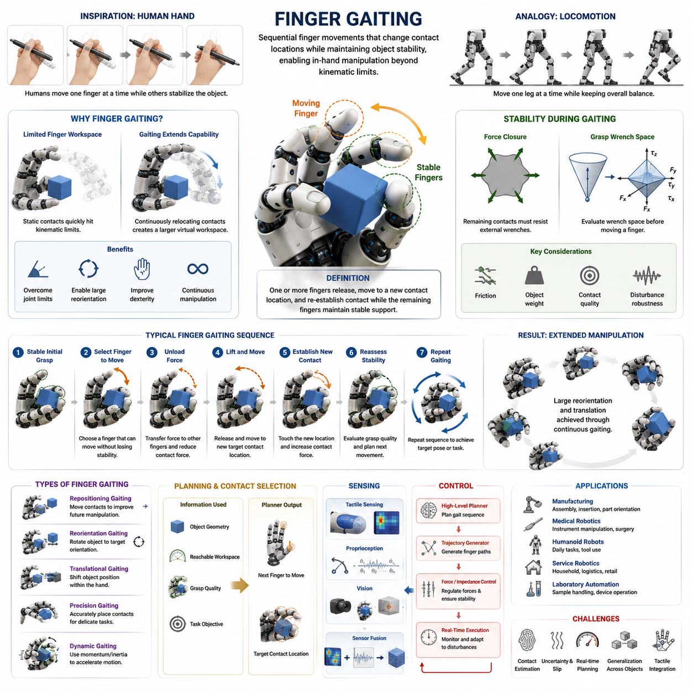{width="7.268055555555556in" height="7.268055555555556in"}

Finger gaiting is one of the most important and distinctive mechanisms in dexterous robotic manipulation. It enables a robot hand to change grasp configurations, reposition contact points, and manipulate objects within the hand without releasing them entirely. The concept is inspired directly by human hand behavior. When humans rotate a pen, adjust a screwdriver, reposition a key, or manipulate a small object with their fingertips, they rarely maintain fixed contact locations. Instead, individual fingers sequentially release, move, and re-establish contact while the remaining fingers continue to stabilize the object. This coordinated sequence of contact transitions is known as finger gaiting. In robotic hands, finger gaiting provides a fundamental method for extending manipulation capabilities beyond the physical limitations of finger joint ranges and static grasp configurations. It serves as one of the core techniques that enable true in-hand manipulation and advanced dexterity within multifinger robotic systems.

The term "gaiting" originates from locomotion research. Just as a walking robot moves one leg at a time while maintaining overall balance, a dexterous robotic hand moves one finger at a time while maintaining overall grasp stability. During finger gaiting, one or more fingers temporarily disengage from the object and move to new contact locations. The remaining fingers continue to provide sufficient support forces to prevent the object from slipping or falling. Once the moving finger establishes a new contact, another finger may begin repositioning. Through repeated cycles of these coordinated movements, the hand can gradually alter its grasp configuration and manipulate the object into otherwise unreachable poses.

The necessity of finger gaiting arises from the limited workspace of individual fingers. Every finger possesses finite joint ranges, limited reachability, and constrained contact surfaces. If a robot attempts to manipulate an object using fixed contact locations only, the achievable object motions become severely restricted. Eventually, one or more fingers reach their kinematic limits, preventing further manipulation. Finger gaiting overcomes this limitation by continuously relocating contact points, effectively creating a larger virtual workspace. This capability allows robotic hands to perform extensive object rotations, translations, and reorientations that would be impossible with static grasps.

From a geometric perspective, finger gaiting can be viewed as a process of changing contact topology while preserving grasp stability. A grasp is defined by the set of contact points between the fingers and the object. Each contact point contributes constraints and force transmission capabilities. When a finger changes its contact location, the overall grasp topology changes. The challenge is to ensure that the remaining contacts continue to satisfy stability requirements throughout the transition. Consequently, finger gaiting is fundamentally a problem of coordinated contact management.

A typical finger gaiting sequence consists of several phases. The process begins with a stable initial grasp configuration. A planning algorithm identifies a finger that can be moved without compromising grasp security. The selected finger is then unloaded by gradually transferring its contact force to other fingers. Once the force approaches zero, the finger disengages from the object and moves toward a new target contact location. During this movement phase, the remaining fingers maintain force closure and object stability. After reaching the new location, the finger re-establishes contact and gradually increases its grasp force. The system then reassesses grasp quality and prepares for the next gaiting step.

Force closure plays a critical role during finger gaiting. A robotic hand must ensure that the remaining contacts can resist external disturbances while one finger is moving. If the contact configuration loses force closure, the object may become unstable and slip. Therefore, gait planning algorithms often evaluate grasp wrench spaces and contact constraints before selecting which finger to move. Stability analysis becomes particularly important when manipulating heavy objects, asymmetric objects, or objects with low-friction surfaces.

The effectiveness of finger gaiting depends strongly on the number of available fingers. Three-finger hands can perform basic gaiting operations, but their manipulation flexibility is limited because removing one finger leaves only two active contacts. Four-finger hands provide significantly greater robustness because three contacts remain available during finger relocation. Five-finger anthropomorphic hands offer even greater flexibility, allowing multiple alternative gait sequences and more sophisticated manipulation strategies. As the number of fingers increases, the redundancy of the system grows, enabling more robust planning and control.

Finger gaiting can be classified into several categories based on manipulation objectives. Repositioning gaiting focuses on moving contact points to improve future manipulation opportunities. Reorientation gaiting aims to rotate an object toward a target orientation. Translational gaiting changes the object\'s position within the hand. Precision gaiting emphasizes accurate placement of contact points for delicate tasks. Dynamic gaiting incorporates momentum and inertial effects to accelerate manipulation. Each category places different demands on sensing, planning, and control systems.

One of the most challenging aspects of finger gaiting is contact planning. Determining where a finger should move requires understanding object geometry, grasp quality, reachable workspaces, and future task requirements. The planner must evaluate candidate contact locations and predict their impact on manipulation performance. Poor contact choices can lead to dead-end configurations where further manipulation becomes impossible. Consequently, contact planning is often formulated as an optimization problem involving grasp stability, reachability, dexterity, and task progress.

Kinematic analysis forms the foundation of finger gait planning. Each finger has a reachable workspace defined by its joint limits and mechanical structure. The planner must ensure that target contact points lie within reachable regions while avoiding singularities and collisions. In multifinger hands, kinematic coupling between fingers further complicates the problem because the motion of one finger may affect the available workspace of neighboring fingers. Advanced planners therefore consider the entire hand-object system rather than individual fingers in isolation.

Finger gaiting is closely related to regrasping, but the two concepts are not identical. Regrasping generally refers to changing grasp configurations through any sequence of contact modifications. Finger gaiting represents a specific form of regrasping in which fingers move sequentially while maintaining continuous object support. Traditional regrasping may involve placing an object on a table and acquiring a completely new grasp. Finger gaiting avoids this interruption by preserving object control throughout the process. As a result, it is particularly valuable for tasks requiring continuous manipulation.

The mechanics of finger gaiting depend heavily on friction. During contact transitions, frictional forces help stabilize the object while fingers move. High-friction contacts provide larger stability margins and simplify planning. Low-friction environments increase the risk of slip and often require more conservative force control strategies. Some robotic systems actively adjust grasp forces during gaiting to compensate for varying friction conditions. Others employ tactile sensing to detect incipient slip and adapt accordingly.

Tactile sensing provides essential information for successful finger gaiting. During contact transitions, the robot must know precisely when a finger loses contact and when a new contact is established. Tactile arrays can detect pressure distributions, contact locations, and micro-slip events. This information allows the controller to regulate forces more accurately and reduce uncertainty. Advanced tactile systems can even estimate local object geometry, helping the planner select better contact locations during gaiting operations.

Vision systems complement tactile sensing by providing global information about object pose and hand configuration. Cameras can track object orientation, estimate contact locations, and monitor manipulation progress. However, visual sensing alone is often insufficient because many contacts are occluded by the fingers themselves. Therefore, modern dexterous manipulation systems frequently combine visual perception with tactile sensing and proprioceptive feedback to achieve robust finger gaiting performance.

Control strategies for finger gaiting must coordinate multiple objectives simultaneously. The controller must maintain object stability, execute finger trajectories, regulate grasp forces, avoid collisions, and compensate for disturbances. This multi-objective nature makes the control problem highly complex. Hierarchical control architectures are commonly employed, where high-level planners determine gait sequences while low-level controllers manage force regulation and motion execution.

Optimization-based control methods have become increasingly popular for finger gaiting. These methods formulate manipulation as a constrained optimization problem that balances task objectives against physical constraints. Constraints may include friction cone limits, joint limits, collision avoidance requirements, and force closure conditions. By solving optimization problems in real time, robotic systems can generate adaptive gaiting behaviors that respond to changing environments and object properties.

Learning-based approaches have significantly advanced the state of the art in finger gaiting. Reinforcement learning allows robots to discover effective gaiting strategies through trial-and-error interactions. Instead of relying entirely on analytical models, the robot learns policies that maximize manipulation success rates. Such methods are particularly valuable when dealing with complex contact dynamics that are difficult to model accurately. Simulation environments enable millions of training episodes, allowing robots to acquire sophisticated manipulation skills before deployment on physical hardware.

Behavior cloning and imitation learning provide alternative approaches. Human demonstrations of finger gaiting can be recorded using motion capture systems, data gloves, or teleoperation interfaces. Learning algorithms then extract manipulation policies from these demonstrations. Because humans naturally perform efficient gaiting motions, demonstration-based learning often provides strong initial performance and reduces training time compared to purely reinforcement-based methods.

One of the most influential research directions involves combining reinforcement learning with domain randomization. By exposing simulated robots to a wide range of object shapes, friction coefficients, masses, and contact conditions, learned policies become more robust and transferable to real-world systems. Such approaches have enabled robotic hands to perform impressive finger gaiting tasks, including object rotations, cube reorientation, tool manipulation, and continuous in-hand repositioning.

Finger gaiting is especially important for humanoid robots. Human environments contain countless objects that require continuous adjustment during manipulation. Opening bottles, using tools, operating machinery, assembling products, and handling consumer devices all involve frequent contact reconfiguration. Without finger gaiting, robotic hands would require repeated pick-and-place operations that significantly reduce efficiency. Finger gaiting therefore represents a critical capability for achieving human-like manipulation performance.

Industrial applications of finger gaiting are emerging in advanced manufacturing environments. Assembly operations often require precise orientation adjustments before insertion or fastening. Traditional robotic systems rely on external fixtures to perform these adjustments. Dexterous hands equipped with finger gaiting capabilities can accomplish the same tasks internally, reducing fixture complexity and increasing operational flexibility. This capability is particularly valuable in high-mix, low-volume manufacturing environments where product variations are frequent.

Medical robotics also benefits from finger gaiting. Surgical instruments, catheters, needles, and delicate medical devices often require precise in-hand adjustments. Finger gaiting enables fine manipulations while maintaining stable control of sensitive tools. Similar advantages apply to laboratory automation, pharmaceutical handling, and biomedical assembly tasks.

Performance evaluation of finger gaiting systems involves multiple metrics. Researchers measure grasp stability, manipulation success rate, contact transition efficiency, trajectory accuracy, cycle time, force utilization, and robustness against disturbances. Additional metrics may evaluate energy consumption, computational complexity, and adaptability to novel objects. Standardized benchmark tasks increasingly include finger gaiting challenges because they provide meaningful measures of dexterous manipulation capability.

Despite significant progress, finger gaiting remains an active research area. Challenges include robust contact estimation, real-time planning, uncertainty management, tactile integration, and generalization across diverse object categories. Complex objects with irregular geometries, deformable surfaces, or dynamic behaviors continue to present difficulties. Future research is expected to leverage foundation models, world models, multimodal learning, and advanced tactile intelligence to overcome these limitations.

Ultimately, finger gaiting represents one of the defining characteristics of dexterous robotic hands. It transforms a static grasp into a dynamic and adaptable manipulation system capable of continuously modifying contact configurations. By allowing fingers to reposition themselves while maintaining object stability, finger gaiting dramatically expands the capabilities of robotic hands and brings robotic manipulation closer to the remarkable dexterity exhibited by human hands. As robotic hardware, sensing technologies, and artificial intelligence continue to evolve, finger gaiting will remain a foundational technique for achieving advanced in-hand manipulation and human-level robotic dexterity.

## 10.03 Rolling and Pivoting

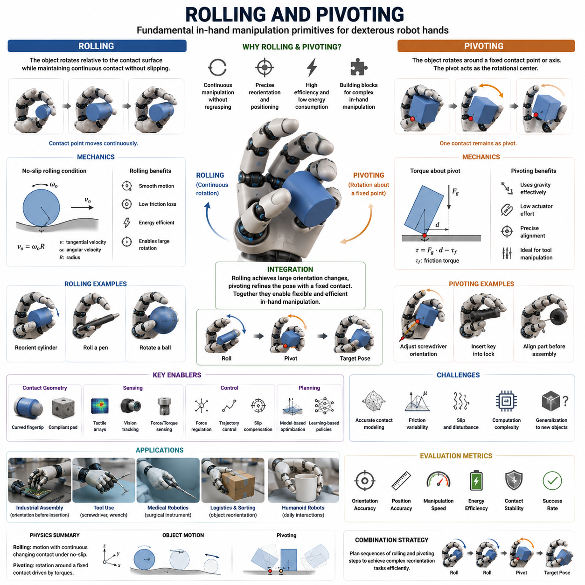{width="7.268055555555556in" height="7.268055555555556in"}

Rolling and pivoting are two of the most fundamental object manipulation strategies used in dexterous robotic hands for achieving in-hand manipulation. While grasping focuses on establishing and maintaining stable contact with an object, rolling and pivoting enable controlled motion of the object relative to the fingers without completely releasing it. These manipulation modes are widely observed in human hands and play a critical role in tasks such as object reorientation, precision positioning, tool usage, assembly operations, and everyday object handling. In robotic systems, rolling and pivoting serve as essential mechanisms for transforming a static grasp into a dynamic manipulation process. They provide efficient alternatives to repeated pick-and-place actions and form important building blocks for advanced dexterous manipulation capabilities. Within the framework of in-hand manipulation, rolling and pivoting are often considered intermediate manipulation primitives that connect simple grasp maintenance with complex object reconfiguration.

Humans continuously use rolling and pivoting during daily activities. When rotating a pen between fingers, turning a key before insertion, adjusting a screwdriver orientation, repositioning a coin, or manipulating a smartphone, the fingers rarely maintain rigid contact. Instead, controlled rolling and pivoting motions occur at the contact interfaces. These motions allow large changes in object pose while minimizing the need for grasp release and reacquisition. The remarkable dexterity of the human hand is partly attributable to its ability to exploit such contact mechanics efficiently. Robotic manipulation research seeks to replicate these capabilities by developing algorithms, sensors, and control systems capable of managing rolling and pivoting interactions.

Rolling manipulation refers to a motion in which an object rotates relative to a contact surface while maintaining continuous contact without significant sliding. The contact point on the object changes continuously, and the corresponding contact point on the finger surface also changes. Ideally, rolling occurs under a no-slip condition where relative tangential velocity at the contact interface remains close to zero. Because rolling minimizes frictional losses and reduces wear, it is generally considered an efficient and stable manipulation strategy.

In a rolling contact, the object effectively moves through a sequence of infinitesimally changing contact locations. This creates a smooth trajectory that can be exploited to reorient or reposition the object. Rolling can occur between a fingertip and an object, between multiple fingers and an object, or between the object and an environmental surface. The geometry of the contact surfaces strongly influences the resulting motion. Curved fingertips, compliant surfaces, and rounded object geometries often facilitate rolling interactions.

The mechanics of rolling can be understood through contact kinematics. At the contact interface, the instantaneous velocity of the object relative to the finger must satisfy rolling constraints. These constraints establish relationships between object motion and finger motion. Rolling contact generates coupled rotational and translational behavior that can be modeled using differential geometry and rigid body kinematics. Accurate modeling is important because even small deviations from ideal rolling can accumulate and significantly affect manipulation outcomes.

One major advantage of rolling manipulation is its ability to generate large object rotations while maintaining stable contact. Instead of repeatedly changing grasp configurations, the robot can exploit rolling motions to gradually achieve a desired orientation. This reduces manipulation complexity and often improves task efficiency. Rolling is particularly useful for cylindrical objects, spherical objects, rounded tools, and many consumer products that naturally support smooth contact transitions.

Another advantage of rolling is force efficiency. Because rolling minimizes sliding friction, less energy is dissipated during manipulation. Lower frictional losses reduce actuator effort and heat generation while improving overall control stability. In robotic hands where power consumption and actuator capacity are constrained, rolling-based manipulation strategies can provide significant operational benefits.

Despite its advantages, rolling manipulation presents several challenges. The contact geometry must be estimated accurately. Small errors in object shape models can lead to incorrect motion predictions. Rolling contacts are also highly sensitive to friction conditions. Excessive friction may prevent rolling and induce sticking behavior, while insufficient friction may cause uncontrolled slip. Furthermore, rolling motions often exhibit nonlinear behavior that complicates planning and control.

Tactile sensing plays a crucial role in rolling manipulation. Tactile arrays can detect contact locations, pressure distributions, and local deformation patterns. By monitoring these signals, the robotic system can estimate whether rolling is occurring as intended or whether slip has begun to develop. Advanced tactile sensors can even reconstruct contact geometry, providing valuable information for manipulation planning.

Visual sensing complements tactile feedback by tracking object pose during rolling operations. Cameras provide global information about object orientation and position. Sensor fusion techniques combine tactile and visual information to improve estimation accuracy. This multimodal perception approach has become increasingly important for robust rolling manipulation in unstructured environments.

Pivoting manipulation differs from rolling in both mechanics and objectives. In pivoting, the object rotates around a relatively fixed contact point or axis. Rather than continuously changing contact locations as in rolling, pivoting maintains one dominant contact region that serves as a rotational center. The object effectively swings or rotates around this pivot while other contacts provide support and control forces.

Pivoting frequently exploits gravity as an active manipulation resource. Consider a robotic hand holding a screwdriver vertically. By slightly relaxing certain grasp forces, the object can pivot under gravitational influence until it reaches a desired orientation. The robot then stabilizes the new pose by adjusting contact forces. Such gravity-assisted pivoting can achieve efficient object reorientation with minimal actuator effort.

The physics of pivoting are governed by torque balance around the pivot point. Gravitational forces, contact forces, inertial effects, and frictional moments collectively determine object motion. Successful pivoting requires maintaining a delicate balance between stability and mobility. Excessive grasp force may prevent motion entirely, while insufficient force may result in object loss. Consequently, force regulation is one of the most critical aspects of pivoting control.

Pivoting is widely used in industrial assembly tasks. Components often need precise orientation adjustments before insertion into fixtures or mating parts. Rather than releasing and regrasping the component, a dexterous robotic hand can pivot the object into alignment. This approach reduces cycle time, improves efficiency, and minimizes the risk of dropping sensitive components.

Many tool-use applications rely heavily on pivoting. Wrenches, screwdrivers, scalpels, surgical instruments, and inspection probes frequently require orientation changes during operation. Human users naturally perform these adjustments through subtle pivoting motions. Replicating such capabilities in robotic systems significantly expands the range of achievable tasks.

Rolling and pivoting are often combined during complex manipulation sequences. A robot may initially roll an object to achieve coarse orientation changes and subsequently employ pivoting for fine adjustments. Conversely, pivoting may position the object into a configuration that facilitates rolling. The integration of these manipulation primitives enables highly flexible object reconfiguration strategies.

The concept of manipulation primitives is central to understanding rolling and pivoting. Rather than treating every manipulation task as a unique problem, researchers decompose complex behaviors into reusable primitive actions. Rolling, pivoting, sliding, finger gaiting, and regrasping represent a set of fundamental primitives that can be combined to achieve sophisticated manipulation objectives. This modular perspective simplifies planning and facilitates skill transfer across tasks.

Planning rolling and pivoting motions presents significant computational challenges. The planner must consider contact geometry, friction constraints, object dynamics, force closure requirements, and task objectives simultaneously. Because contact-rich interactions are inherently nonlinear, many planning algorithms rely on optimization techniques or sampling-based approaches.

Optimization-based planning formulates manipulation as a constrained mathematical problem. The objective may involve minimizing pose error, manipulation time, energy consumption, or force requirements. Constraints enforce contact stability, collision avoidance, and kinematic feasibility. Modern optimization frameworks can generate manipulation trajectories that satisfy complex physical requirements while achieving desired task outcomes.

Sampling-based planning methods explore large configuration spaces by generating candidate motion sequences. Techniques such as Rapidly Exploring Random Trees and Probabilistic Roadmaps have been adapted for manipulation planning. These approaches are particularly useful when analytical models are difficult to construct or when object geometries are highly complex.

Learning-based approaches have emerged as powerful alternatives for rolling and pivoting manipulation. Reinforcement learning enables robotic systems to discover manipulation strategies through repeated interaction with simulated or physical environments. Instead of relying entirely on explicit physical models, the system learns policies that maximize task success. This capability is especially valuable when dealing with uncertain contact conditions and complex object geometries.

Large-scale simulation has accelerated progress in learning-based manipulation. Physics simulators allow robots to practice millions of rolling and pivoting episodes across diverse object categories. Domain randomization techniques expose policies to variations in mass, friction, geometry, and sensor noise. As a result, learned policies become more robust and transferable to real-world hardware.

Imitation learning provides another promising pathway. Human demonstrations captured through teleoperation systems or motion capture devices can reveal effective rolling and pivoting strategies. Learning algorithms extract patterns from these demonstrations and transform them into robotic control policies. Because humans naturally exploit contact mechanics efficiently, demonstration-based learning often accelerates skill acquisition.

The effectiveness of rolling and pivoting depends heavily on hand design. Fingertip geometry influences contact stability and motion controllability. Rounded fingertips generally support smoother rolling interactions, while compliant fingertips improve adaptability to object variations. Soft robotic fingers can conform to object surfaces, increasing contact area and enhancing manipulation robustness. Conversely, rigid fingertips may provide greater positional precision for certain tasks.

Actuation systems also affect manipulation performance. Fully actuated fingers provide independent control over each joint, enabling precise motion generation. Underactuated fingers rely more heavily on passive adaptation mechanisms but may simplify mechanical design. Tendon-driven hands, direct-drive systems, and variable stiffness actuators each offer different advantages for rolling and pivoting applications.

Force and torque sensing are essential for reliable execution. Fingertip force sensors, wrist force-torque sensors, tendon tension measurements, and motor current monitoring all contribute to contact state estimation. Accurate force information allows the controller to maintain stable contact conditions while enabling desired object motion. Without adequate force sensing, rolling and pivoting become significantly more difficult to control.

Benchmarking rolling and pivoting performance requires specialized evaluation metrics. Researchers commonly measure object orientation accuracy, position accuracy, manipulation speed, force efficiency, contact stability, and success rate. Additional metrics may quantify slip occurrence, energy consumption, robustness against disturbances, and adaptability to novel objects. Standardized benchmark tasks facilitate comparison between different robotic hands and control algorithms.

Industrial applications of rolling and pivoting continue to expand. Electronics assembly frequently requires component orientation before insertion. Automotive manufacturing involves manipulating connectors, fasteners, and tools. Aerospace assembly demands precise handling of complex parts. Warehouse automation benefits from object reorientation during sorting and packaging operations. In each of these domains, rolling and pivoting reduce reliance on specialized fixtures and increase system flexibility.

Medical robotics represents another important application area. Surgical instruments often require precise orientation adjustments during procedures. Catheter manipulation, needle insertion, endoscopic tool positioning, and microsurgical operations all involve controlled rolling and pivoting motions. The ability to perform such manipulations safely and accurately can significantly enhance robotic surgical capabilities.

Humanoid robots rely heavily on rolling and pivoting for everyday object interactions. Human environments are designed around the dexterity of human hands, making these manipulation strategies essential for effective operation. Opening containers, operating switches, using tools, handling household objects, and interacting with consumer electronics all involve rolling and pivoting behaviors. Consequently, these manipulation primitives are fundamental building blocks for achieving human-level dexterity.

Despite substantial progress, numerous research challenges remain. Contact modeling inaccuracies, sensor uncertainty, dynamic disturbances, computational complexity, and limited generalization continue to restrict performance. Future developments are expected to integrate tactile intelligence, foundation models, world models, multimodal perception, and large-scale learning frameworks to address these limitations.

Ultimately, rolling and pivoting represent two of the most important contact-based manipulation strategies in dexterous robotics. They enable continuous object reconfiguration without requiring complete grasp release, thereby increasing efficiency, flexibility, and task capability. By exploiting contact mechanics intelligently, robotic systems can perform sophisticated manipulation tasks that more closely resemble human hand behavior. As robotic hardware, sensing technologies, and artificial intelligence continue to advance, rolling and pivoting will remain foundational elements of next-generation in-hand manipulation systems and a critical pathway toward achieving truly human-like robotic dexterity.

## 10.04 Regrasping Strategies

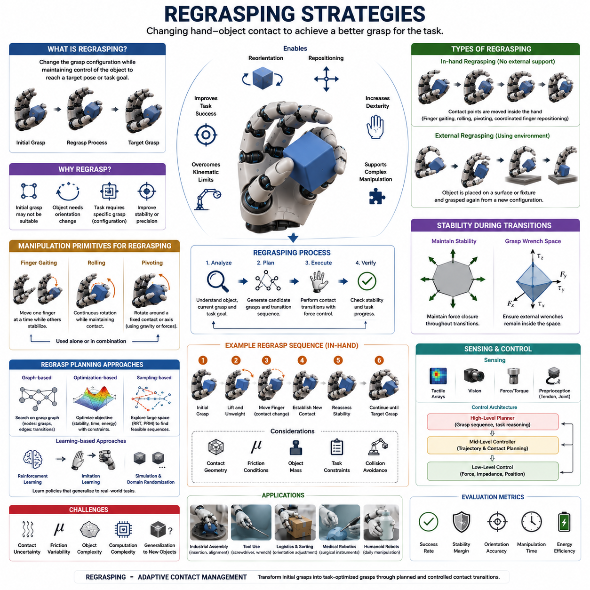{width="7.268055555555556in" height="7.268055555555556in"}

Regrasping is one of the most important manipulation capabilities in dexterous robotics and serves as a critical bridge between grasp acquisition and advanced in-hand manipulation. While a robot may initially establish a stable grasp on an object, that initial grasp is often not suitable for completing the final task. Objects frequently need to be reoriented, repositioned, or transferred into more advantageous configurations before assembly, insertion, tool use, packaging, or interaction with the environment can occur. Regrasping strategies provide systematic methods for changing the contact configuration between the robotic hand and the object in order to achieve these objectives. Unlike simple grasp maintenance, regrasping intentionally modifies the grasp state while preserving control over the object. It is therefore considered one of the foundational technologies underlying dexterous manipulation, in-hand manipulation, and autonomous robotic task execution. Within the framework of robot hands and dexterous grasping, regrasping occupies a central position because it enables robots to overcome limitations imposed by fixed grasp configurations and restricted finger workspaces.

Human beings perform regrasping continuously and often unconsciously. When a person picks up a screwdriver from a table, the initial grasp is rarely the same grasp used for driving a screw. The fingers first acquire the tool, then gradually adjust their contact positions until the screwdriver reaches a suitable operational orientation. Similar behaviors occur when opening a bottle, inserting a key into a lock, manipulating a smartphone, using a surgical instrument, or assembling a mechanical component. These everyday examples demonstrate that grasp acquisition is only the beginning of a manipulation task. Effective task execution often requires multiple grasp transitions before the desired object pose is achieved.

The primary objective of regrasping is to transform an object from an initial grasp configuration into a target grasp configuration that better supports task execution. In many situations, the target grasp cannot be achieved directly because of geometric constraints, limited finger reachability, joint limits, collision restrictions, or stability requirements. Regrasping therefore introduces intermediate grasp states that gradually guide the object toward its final configuration. These intermediate states form a sequence of grasp transitions known as a regrasp plan.

From a mathematical perspective, a grasp can be represented as a collection of contact points, contact forces, and object constraints. Each grasp configuration defines a specific state in grasp space. Regrasping corresponds to movement through this grasp space from one configuration to another. The challenge lies in finding feasible transitions that preserve object stability while progressing toward the goal. Because the number of possible contact combinations can be extremely large, regrasp planning often becomes a complex search and optimization problem.

One of the most fundamental distinctions in regrasping research is the difference between in-hand regrasping and external regrasping. In-hand regrasping occurs entirely within the robotic hand. The object remains continuously controlled while contact locations change through finger motions, finger gaiting, rolling, pivoting, or coordinated finger repositioning. External regrasping utilizes environmental support surfaces such as tables, walls, fixtures, trays, or specialized workholding devices. The robot may temporarily place the object on a surface and then acquire a new grasp from a different orientation. Both approaches have advantages and limitations, and many practical systems combine them to maximize flexibility.

In-hand regrasping is often considered the more sophisticated form of manipulation because it does not require external support. The robot maintains complete control over the object throughout the process. This capability is especially important for tasks involving fragile objects, moving platforms, confined workspaces, or environments where support surfaces are unavailable. However, in-hand regrasping is mechanically and computationally challenging because stability must be maintained while contact points are continuously changing.

External regrasping is generally easier to implement because environmental constraints assist the manipulation process. A table can support the object while the robot changes its grasp configuration. Industrial robots frequently rely on external regrasping because it simplifies planning and improves reliability. Nevertheless, dependence on environmental fixtures reduces flexibility and may limit operation in unstructured environments.

The effectiveness of any regrasp strategy depends heavily on grasp stability. During a grasp transition, the robot must ensure that the object remains securely controlled. Stability is typically evaluated using concepts such as force closure, form closure, grasp wrench space analysis, and contact quality metrics. If stability is compromised during a transition, the object may slip, rotate unexpectedly, or be dropped entirely. Consequently, stability evaluation forms a central component of all regrasp planning algorithms.

Regrasping can also be categorized according to the manipulation objective. Orientation regrasping focuses on changing the rotational pose of the object. Positional regrasping aims to shift the object\'s location within the hand. Functional regrasping seeks to establish a grasp configuration optimized for a specific task such as tool use, insertion, cutting, or assembly. Precision regrasping emphasizes accurate placement of contact points, while robust regrasping prioritizes stability under uncertain conditions. Different task requirements often lead to different regrasp strategies and planning methodologies.

Contact transitions represent the core mechanism underlying regrasping. During a transition, one or more contact points are removed, moved, and re-established elsewhere on the object. These transitions must be coordinated carefully because every contact contributes to grasp stability. Removing a critical contact may destabilize the entire grasp. Therefore, regrasp planners must determine not only where contacts should move but also when they should move and in what sequence.

Finger gaiting is one of the most widely studied approaches for in-hand regrasping. In finger gaiting, individual fingers move sequentially while the remaining fingers continue to support the object. This process allows gradual repositioning of contact points without completely releasing the object. Finger gaiting effectively increases the reachable manipulation workspace and enables substantial object reorientation within the hand. Many advanced dexterous hands rely heavily on finger gaiting as a primary regrasping mechanism.

Rolling and pivoting provide additional mechanisms for achieving regrasping objectives. Rolling allows contact points to migrate continuously across object surfaces while maintaining contact. Pivoting enables rotation around fixed contact locations. These manipulation primitives can be combined with finger gaiting to create highly flexible regrasping behaviors. For example, a robot may roll an object to improve orientation and then perform finger gaiting to establish a new grasp configuration.

The geometry of the object strongly influences regrasp complexity. Simple geometric objects such as cubes, cylinders, and spheres often allow predictable contact transitions. Complex industrial components, tools, deformable objects, and irregular consumer products present much greater challenges. Surface curvature, edge features, mass distribution, and friction characteristics all affect the feasibility of candidate regrasp actions. As object complexity increases, planning becomes significantly more difficult.

Task constraints further complicate regrasp planning. A grasp that is mechanically stable may not be functionally useful. For example, a screwdriver grasp that blocks the handle cannot support screw-driving operations. Similarly, a grasp used for transporting a component may be unsuitable for insertion into an assembly. Therefore, regrasp planners must consider both physical feasibility and task-specific requirements.

Planning algorithms for regrasping have evolved significantly over the past two decades. Early approaches relied heavily on geometric reasoning and predefined grasp libraries. Candidate grasps were generated offline and connected through transition graphs. The planner searched this graph to identify feasible regrasp sequences. Although effective in structured environments, these methods often struggled with novel objects and dynamic conditions.

Graph-based regrasp planning remains an important research area. In such approaches, nodes represent grasp configurations and edges represent feasible transitions. The planner searches for a path from the initial grasp to the target grasp. Graph search algorithms such as Dijkstra\'s algorithm, A\*, and probabilistic search methods are frequently used to identify efficient solutions. The quality of the resulting plan depends heavily on the completeness and accuracy of the grasp graph.

Optimization-based methods provide a more flexible alternative. These approaches formulate regrasp planning as a constrained optimization problem. Objectives may include minimizing manipulation time, reducing energy consumption, maximizing stability margins, or minimizing the number of grasp transitions. Constraints enforce contact stability, collision avoidance, joint limits, and task requirements. Advances in nonlinear optimization have significantly improved the practicality of these techniques.

Sampling-based planning methods are particularly useful in high-dimensional manipulation spaces. Techniques derived from motion planning, including Rapidly Exploring Random Trees and Probabilistic Roadmaps, have been adapted to regrasp planning. These methods explore large configuration spaces efficiently and can identify solutions in situations where analytical approaches become intractable.

Machine learning has introduced transformative capabilities to regrasp planning. Reinforcement learning enables robotic systems to discover effective regrasping strategies through experience. Instead of explicitly modeling every aspect of contact mechanics, the robot learns policies that maximize task success. This approach is particularly valuable for complex contact-rich interactions where analytical models may be incomplete or inaccurate.

Imitation learning provides another promising direction. Human demonstrations can reveal effective regrasp strategies that are difficult to derive mathematically. Teleoperation systems, motion capture devices, and data gloves enable the collection of demonstration data. Learning algorithms then extract reusable manipulation policies from these examples. Because humans naturally exploit efficient contact transitions, demonstration-based approaches often produce highly practical behaviors.

Large-scale simulation has become an indispensable tool for learning-based regrasping. Modern physics simulators allow robots to practice millions of manipulation episodes involving diverse objects, friction conditions, and contact scenarios. Domain randomization exposes learning algorithms to wide variations in physical parameters, improving robustness and sim-to-real transfer performance. As simulation fidelity continues to improve, learning-based regrasping is becoming increasingly effective.

Tactile sensing plays a crucial role in practical regrasp execution. Visual sensing alone often cannot determine whether a contact transition has succeeded because many contacts are occluded. Tactile sensors provide direct measurements of contact pressure, force distribution, micro-slip events, and local surface geometry. These signals enable the robot to verify successful contact establishment and detect instability before object failure occurs.

Force and torque sensing provide additional information about manipulation quality. Fingertip force sensors, wrist force-torque sensors, tendon tension sensors, and motor current measurements contribute to accurate state estimation. These sensing modalities allow controllers to regulate contact forces dynamically during regrasp transitions and compensate for uncertainties in object properties.

Control architectures for regrasping typically operate hierarchically. High-level planners determine desired grasp sequences and manipulation objectives. Mid-level controllers generate contact transition trajectories. Low-level controllers regulate joint positions, contact forces, and impedance characteristics. This hierarchical organization simplifies system design and supports real-time operation in complex environments.

The role of compliance is particularly important during regrasping. Perfectly rigid manipulation often leads to excessive sensitivity to modeling errors and positioning inaccuracies. Compliant control strategies allow the hand to adapt naturally to small geometric uncertainties. Variable stiffness actuators, soft robotic fingers, and impedance control techniques all contribute to improved regrasp robustness.

Industrial applications of regrasping continue to expand rapidly. Assembly automation frequently requires components to be reoriented before insertion. Logistics systems benefit from regrasping when sorting objects into specific orientations for packaging. Manufacturing robots use regrasping to position tools and workpieces appropriately for machining and inspection operations. By reducing dependence on dedicated fixtures, regrasping increases system flexibility and lowers infrastructure costs.

Medical robotics presents another important application domain. Surgical instruments often require continuous orientation adjustments during procedures. Catheters, endoscopes, needles, and minimally invasive tools frequently undergo regrasp transitions as tasks evolve. Effective regrasping enables greater dexterity and improves procedural precision.

Humanoid robots rely heavily on regrasping capabilities because human environments are inherently designed for dexterous hands. Activities such as opening containers, operating machinery, using household tools, folding clothing, preparing food, and assembling objects all require frequent grasp transitions. Without robust regrasping, humanoid manipulation capabilities remain severely limited.

Benchmarking regrasping systems requires comprehensive evaluation metrics. Researchers commonly measure task success rate, grasp stability, transition efficiency, orientation accuracy, manipulation speed, robustness to disturbances, and adaptability across object categories. Additional metrics may assess computational efficiency, energy consumption, and generalization performance. Standardized benchmarks are increasingly important for comparing different regrasping approaches objectively.

Despite significant advances, numerous challenges remain. Real-world contact mechanics remain difficult to model accurately. Sensor uncertainty, friction variability, object deformation, dynamic disturbances, and computational complexity continue to limit performance. Future research is expected to integrate foundation models, tactile intelligence, world models, multimodal perception, and large-scale robotic learning frameworks to address these challenges.

Ultimately, regrasping strategies represent one of the defining capabilities that distinguish truly dexterous robotic systems from simple pick-and-place machines. They enable robots to transform initial grasps into task-optimized grasps, expand manipulation flexibility, and perform sophisticated object handling behaviors that resemble those of human hands. As robotic hardware, sensing technologies, planning algorithms, and artificial intelligence continue to advance, regrasping will remain a fundamental component of in-hand manipulation and a critical pathway toward achieving human-level robotic dexterity.

## 10.05 Object Reorientation

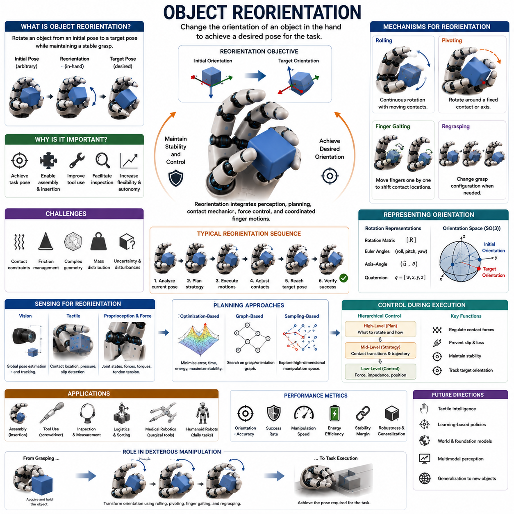{width="7.268055555555556in" height="7.268055555555556in"}

Object reorientation is one of the most important capabilities in dexterous robotic manipulation and represents a core objective of in-hand manipulation systems. While grasping enables a robot to acquire and hold an object securely, object reorientation allows the robot to modify the object\'s orientation so that it can be used, assembled, inserted, inspected, or manipulated more effectively. In practical applications, the initial pose of an object is rarely identical to the pose required for task execution. Consequently, robotic systems must possess the ability to transform an object\'s orientation from an arbitrary initial state to a desired target state while maintaining stability, control, and efficiency throughout the process. Object reorientation therefore serves as a critical bridge between object acquisition and task completion, making it one of the defining capabilities of advanced robot hands and dexterous manipulation systems. Within the broader field of robotic grasping, object reorientation is often considered one of the highest-level manipulation skills because it requires the integration of perception, planning, contact mechanics, force control, and coordinated finger motion.

Humans perform object reorientation continuously in everyday life. When a person picks up a pen from a desk and rotates it into a writing position, adjusts a screwdriver before tightening a screw, turns a key to match the orientation of a lock, or repositions a smartphone for viewing, object reorientation is taking place. These actions appear effortless because the human hand possesses extraordinary dexterity, tactile sensing capabilities, and motor coordination. Human fingers continuously adjust contact locations, regulate grasp forces, and exploit frictional interactions to achieve the desired orientation. Replicating these capabilities in robotic systems has become one of the central goals of modern manipulation research.

The primary objective of object reorientation is to change the rotational pose of an object relative to the robotic hand. Unlike translational manipulation, which focuses on changing position, reorientation emphasizes angular transformations around one or more axes. These transformations may involve small adjustments of a few degrees or large rotations exceeding one hundred and eighty degrees. Depending on task requirements, reorientation may occur around a single axis, multiple axes, or through arbitrary three-dimensional rotational motions. The complexity of the problem increases significantly as the number of required rotational degrees of freedom increases.

Object reorientation can be classified into several categories. Simple reorientation tasks involve rotating an object around a single axis while maintaining stable contact conditions. Compound reorientation tasks require simultaneous rotations around multiple axes. Fine reorientation focuses on high-precision angular adjustments, often required in assembly and insertion operations. Large-angle reorientation involves substantial orientation changes that frequently require contact transitions and regrasping. Dynamic reorientation utilizes inertial effects and rapid motions to achieve significant orientation changes efficiently. Each category presents unique challenges and demands different planning and control strategies.

From a geometric perspective, object reorientation can be described as a transformation between two orientations in rotational space. Orientation is commonly represented using rotation matrices, Euler angles, axis-angle representations, or quaternions. The planner must compute a sequence of object motions that transforms the initial orientation into the target orientation while satisfying physical constraints. Because rotational spaces exhibit nonlinear properties and singularities, orientation planning often requires sophisticated mathematical tools.

The difficulty of object reorientation arises primarily from contact constraints. Unlike free-space rotational motion, in-hand reorientation occurs while the object remains in contact with one or more fingers. These contacts restrict possible object motions and create complex interactions between object dynamics and hand kinematics. The robot must carefully coordinate finger movements and contact forces to achieve the desired rotation without compromising grasp stability. As a result, object reorientation is fundamentally a contact-rich manipulation problem.

One of the most important concepts in object reorientation is grasp stability. During rotation, the object experiences changing force distributions, shifting contact locations, and varying torque requirements. If grasp forces are insufficient, the object may slip or fall. If forces are excessive, unwanted friction may inhibit motion. Maintaining an appropriate balance between stability and mobility is therefore a central challenge. Many control algorithms explicitly regulate contact forces to preserve stability while enabling rotational motion.

Friction plays a crucial role in reorientation tasks. Contact friction determines whether a contact point remains fixed, rolls, slides, or transitions between these modes. High-friction contacts provide stability but may limit mobility. Low-friction contacts facilitate movement but increase the risk of object loss. Effective reorientation strategies exploit friction intelligently, allowing controlled motion while maintaining sufficient resistance to disturbances. Understanding friction cones and contact mechanics is therefore essential for successful reorientation planning.

Rolling manipulation represents one of the most common mechanisms used for object reorientation. During rolling, the object rotates relative to the fingertips while maintaining continuous contact. Contact points move smoothly across object surfaces, allowing gradual orientation changes without repeated grasp release. Rolling-based reorientation often provides high efficiency and low energy consumption because it minimizes frictional losses. Many dexterous robotic hands employ rolling as a primary method for achieving orientation changes.

Pivoting provides another powerful mechanism for object reorientation. In pivoting, the object rotates around a fixed contact point or axis. The robot can exploit gravity, contact forces, or inertial effects to drive the rotation. Pivoting is particularly useful for achieving large angular changes with minimal actuator effort. Industrial assembly operations frequently utilize pivoting strategies when orienting components prior to insertion or fastening.

Finger gaiting is closely related to object reorientation. When finger workspaces become constrained during rotation, individual fingers may need to reposition themselves to maintain effective contact. Finger gaiting enables the robotic hand to change contact locations sequentially while preserving object control. By combining finger gaiting with rolling and pivoting, robots can achieve orientation changes far beyond the limits imposed by fixed grasp configurations.

Regrasping serves as another important strategy for object reorientation. In many situations, the desired target orientation cannot be reached through continuous contact motions alone. The robot must therefore modify its grasp configuration by changing contact locations or establishing entirely new grasps. Regrasp planning determines a sequence of intermediate grasp states that gradually guide the object toward the target orientation. Although regrasping introduces additional complexity, it greatly expands the achievable manipulation workspace.

Object geometry significantly influences reorientation difficulty. Simple objects such as cubes, cylinders, and spheres often allow predictable rotational behaviors. Irregular industrial parts, tools, deformable materials, and asymmetrical consumer products introduce additional challenges. Surface curvature, edge features, mass distribution, and contact accessibility all affect the feasibility of candidate reorientation actions. Robust manipulation systems must account for these geometric factors during planning and execution.

Mass distribution also plays an important role. Objects with centralized mass distributions tend to exhibit predictable rotational dynamics. Objects with eccentric centers of mass may generate unexpected torques during manipulation. Heavy objects require larger contact forces and more precise control, while lightweight objects may be more sensitive to disturbances. Consequently, accurate estimation of mass properties improves reorientation performance significantly.

Perception forms the foundation of successful object reorientation. The robot must estimate both the current object orientation and the desired target orientation accurately. Vision systems typically provide global pose information using cameras, depth sensors, structured light systems, or stereo vision. These sensors allow the robot to track orientation changes throughout the manipulation process. However, visual sensing alone may be insufficient when contacts are occluded or when precise local information is required.

Tactile sensing complements visual perception by providing direct measurements of contact interactions. Tactile arrays can detect pressure distributions, contact locations, local surface geometry, and slip events. This information enables the robot to estimate object motion relative to the fingers and adjust control actions accordingly. Tactile feedback becomes particularly valuable during contact transitions, rolling interactions, and high-precision orientation adjustments.

Proprioceptive sensing provides another critical source of information. Joint encoders, motor current sensors, tendon tension sensors, and force-torque sensors allow the robot to estimate hand configuration and interaction forces. By combining visual, tactile, and proprioceptive sensing, robotic systems can construct comprehensive state estimates that support robust reorientation control.

Planning object reorientation presents substantial computational challenges. The planner must determine how contact locations should evolve, what forces should be applied, and how object motion should progress toward the target orientation. Classical planning approaches often formulate reorientation as a constrained optimization problem. The objective may involve minimizing orientation error, reducing manipulation time, maximizing stability margins, or minimizing energy consumption. Constraints enforce contact stability, collision avoidance, and kinematic feasibility.

Graph-based planning methods represent another important class of approaches. In these methods, nodes correspond to grasp configurations or object orientations, while edges represent feasible transitions. Search algorithms identify paths connecting the initial orientation to the target orientation. Such approaches are particularly useful when manipulation involves multiple regrasp actions or complex contact transitions.

Sampling-based planning techniques have also been widely applied. Methods such as Rapidly Exploring Random Trees and Probabilistic Roadmaps explore large manipulation spaces efficiently. These techniques are especially valuable for high-dimensional problems where analytical solutions are difficult to obtain. By sampling candidate motions and evaluating feasibility, planners can discover effective reorientation strategies even in highly constrained environments.

Optimization-based control plays a central role during execution. The controller must simultaneously regulate object motion, maintain grasp stability, avoid collisions, and compensate for disturbances. Real-time optimization frameworks compute control commands that satisfy these competing objectives while respecting physical constraints. Recent advances in computational hardware and optimization algorithms have significantly improved the practicality of such methods.

Machine learning has transformed object reorientation research in recent years. Reinforcement learning allows robots to discover effective reorientation policies through repeated interaction with simulated or physical environments. Instead of relying entirely on analytical models, the robot learns strategies that maximize task success rates. Learning-based methods are particularly effective when contact dynamics are complex or difficult to model accurately.

One of the most influential demonstrations of learning-based dexterity involved robotic hands performing object reorientation tasks with remarkable agility. Through large-scale reinforcement learning in simulation, robotic systems learned to rotate cubes, manipulate tools, and recover from disturbances. These achievements demonstrated that sophisticated reorientation behaviors could emerge from experience-driven learning processes.

Imitation learning provides another promising approach. Human demonstrations captured through teleoperation systems, data gloves, or motion capture devices can reveal efficient reorientation strategies. Learning algorithms extract policies from these demonstrations and generalize them to new situations. Because humans naturally exploit effective manipulation techniques, imitation learning often accelerates skill acquisition.

Simulation plays an indispensable role in modern reorientation research. Collecting large amounts of physical manipulation data is expensive and time-consuming. Physics simulators provide environments where robots can practice millions of manipulation episodes. Domain randomization techniques introduce variations in object geometry, friction coefficients, mass properties, and sensor noise. These variations improve policy robustness and facilitate transfer from simulation to real hardware.

Object reorientation has numerous industrial applications. Assembly automation often requires components to be oriented precisely before insertion. Electronics manufacturing involves aligning connectors, circuit boards, and mechanical parts. Automotive and aerospace production require accurate orientation of complex components. Reorientation capabilities reduce dependence on dedicated fixtures and increase manufacturing flexibility.

Logistics and warehouse automation also benefit from object reorientation. Packages frequently arrive in arbitrary orientations that must be corrected before sorting, packaging, or palletizing. Dexterous robotic systems can reorient objects directly within the grasp, reducing handling time and improving operational efficiency.

Medical robotics represents another important application domain. Surgical instruments often require continuous orientation adjustments during procedures. Endoscopic tools, catheters, needles, and robotic surgical manipulators all benefit from advanced reorientation capabilities. Accurate orientation control enhances precision, safety, and procedural effectiveness.

Humanoid robots depend heavily on object reorientation. Human environments are designed around the dexterity of human hands, making orientation adjustment essential for successful interaction. Tasks such as opening containers, operating machinery, using tools, preparing food, folding clothing, and handling consumer products all require sophisticated reorientation skills. Consequently, object reorientation is considered a fundamental requirement for achieving human-level robotic manipulation.

Performance evaluation of reorientation systems involves multiple metrics. Researchers commonly measure orientation accuracy, task success rate, manipulation speed, energy efficiency, grasp stability, robustness to disturbances, and adaptability to novel objects. Additional metrics may evaluate computational efficiency, contact quality, and generalization performance. Standardized benchmarks facilitate objective comparison between different manipulation approaches.

Despite substantial progress, object reorientation remains a challenging research problem. Accurate contact modeling, robust perception, uncertainty management, real-time planning, and generalization across diverse object categories continue to present difficulties. Future research is expected to integrate tactile intelligence, foundation models, world models, multimodal perception, and large-scale robotic learning frameworks to address these challenges.

Ultimately, object reorientation represents one of the defining capabilities of dexterous robotic manipulation. It transforms robotic grasping from a static holding function into a dynamic process of object control and adaptation. By enabling robots to change object orientations intelligently and efficiently, reorientation expands the range of achievable tasks and brings robotic manipulation closer to the versatility exhibited by human hands. As robotic hardware, sensing technologies, planning algorithms, and artificial intelligence continue to evolve, object reorientation will remain a central component of next-generation in-hand manipulation systems and a critical pathway toward truly human-like robotic dexterity.

## 10.06 Extrinsic Dexterity

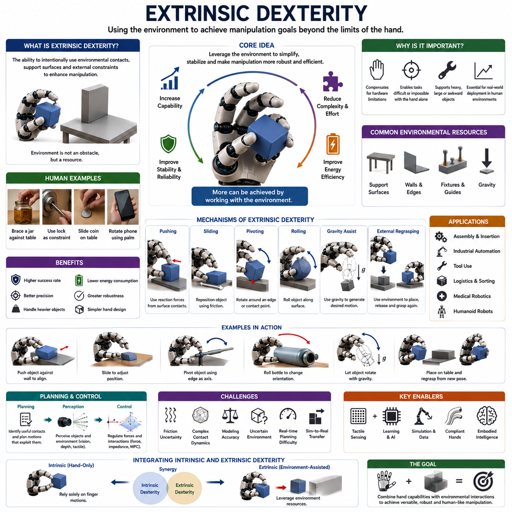{width="7.268055555555556in" height="7.268055555555556in"}

Extrinsic dexterity is one of the most important concepts in modern robotic manipulation and represents a fundamental strategy for overcoming the physical limitations of robotic hands. Traditional studies of dexterous manipulation often focus on intrinsic dexterity, which refers to the ability of a robotic hand to manipulate objects solely through the coordinated motion of its fingers and joints. However, many real-world manipulation tasks cannot be accomplished efficiently through finger motion alone. Humans frequently exploit environmental features such as tables, walls, shelves, containers, workbenches, and even gravity to assist manipulation. This ability to use external resources to enhance manipulation performance is known as extrinsic dexterity. In robotics, extrinsic dexterity describes the capability of a robot to intentionally utilize environmental contacts, support surfaces, external constraints, and physical interactions outside the hand itself to achieve manipulation objectives. Rather than treating the environment as an obstacle to avoid, extrinsic dexterity treats the environment as an active participant in the manipulation process. This paradigm significantly expands the range of achievable tasks and provides practical solutions to challenges that may be difficult or impossible using intrinsic dexterity alone.

The concept of extrinsic dexterity originates from observations of human behavior. Human hands are remarkably dexterous, yet people rarely rely exclusively on finger motions when manipulating objects. When opening a bottle, a person may brace it against a table. When turning a key, the surrounding lock structure provides constraints that guide motion. When aligning a tool, the edge of a workbench may be used as a reference surface. Coins are often repositioned by sliding them against a table before grasping them again. A smartphone may be rotated within the hand by leveraging contact with the palm or external surfaces. These examples demonstrate that dexterity emerges not only from the capabilities of the hand but also from intelligent exploitation of the environment. Robotic manipulation research increasingly recognizes that achieving human-like performance requires similar integration of environmental interactions.

Extrinsic dexterity differs fundamentally from intrinsic dexterity. Intrinsic dexterity relies exclusively on the robot hand's internal degrees of freedom, contact forces, and finger coordination. All object motions are generated through actions performed by the hand itself. In contrast, extrinsic dexterity intentionally introduces environmental contacts that provide additional constraints, force pathways, support mechanisms, and motion guidance. These external interactions effectively increase the manipulation capabilities of the system without requiring additional mechanical complexity in the hand.

One of the primary motivations for extrinsic dexterity is the limited capability of robotic hands compared with human hands. Even advanced dexterous hands possess fewer sensing capabilities, lower compliance, reduced tactile resolution, and more restricted actuation compared to biological hands. Building robotic hands with human-level dexterity remains extremely challenging and expensive. Extrinsic dexterity offers an alternative strategy. Instead of attempting to solve every manipulation problem through increasingly complex hardware, robots can leverage environmental resources to simplify manipulation tasks. This approach often improves reliability while reducing system complexity.

From a robotics perspective, extrinsic dexterity can be viewed as the deliberate exploitation of external constraints. Constraints are typically considered limitations because they restrict motion. However, properly utilized constraints can guide object behavior in useful ways. For example, a wall can constrain rotational motion, a table can support object weight, and a fixture can define precise alignment conditions. By exploiting these constraints, robots can achieve more accurate and robust manipulation than would be possible through free-space control alone.

One of the most common forms of extrinsic dexterity involves environmental pushing. Instead of relying solely on grasping, a robot can push an object against a surface to change its orientation or position. The environmental contact provides predictable reaction forces that facilitate object motion. Such strategies are frequently used in industrial automation where objects are aligned against guide rails, fixtures, or reference surfaces before assembly.

Environmental sliding represents another important mechanism. By intentionally sliding an object along a table or wall, the robot can reposition it without requiring complex finger motions. Friction between the object and the environment becomes an active component of the manipulation process. Sliding can be particularly useful when handling thin, flat, or difficult-to-grasp objects.

Pivoting against environmental contacts is a powerful example of extrinsic dexterity. Consider a robot holding a tool that must be rotated into a new orientation. Instead of performing a complex in-hand manipulation sequence, the robot can place one part of the object against a surface and use that contact as a pivot point. The environment provides a stable rotational axis that greatly simplifies control. Similar strategies are commonly observed in human manipulation.

Environmental rolling extends this concept further. Objects may be rolled along surfaces to achieve orientation changes, positional adjustments, or controlled motion trajectories. Rolling interactions often reduce energy consumption because they minimize frictional losses compared with sliding. Many robotic systems exploit rolling contacts when manipulating cylindrical objects, wheels, pipes, and containers.

Gravity itself can be considered a component of extrinsic dexterity. Humans frequently exploit gravity to reposition objects. A person may loosen their grip slightly to allow an object to rotate naturally under its own weight. Robotic systems can use similar strategies. By controlling contact forces carefully, robots can harness gravitational torques to achieve desired object motions with minimal actuator effort. Gravity-assisted manipulation has become an important research area because it offers significant improvements in energy efficiency.

The role of support surfaces is central to extrinsic dexterity. Tables, shelves, trays, conveyors, and workbenches provide stable platforms that simplify manipulation. Support surfaces can temporarily bear object weight, reducing the force requirements placed on robotic hands. This allows robots to manipulate heavier objects than would otherwise be possible. Support surfaces also provide reference frames that improve positional accuracy during alignment and assembly tasks.

Extrinsic dexterity is particularly valuable in regrasping operations. In-hand regrasping often requires complex finger coordination and advanced tactile feedback. By contrast, external regrasping can leverage environmental support. A robot may place an object on a table, release its grasp, and then establish a new grasp from a different orientation. Although this approach may require additional steps, it often increases reliability and reduces computational complexity.

Assembly operations represent one of the most important application domains for extrinsic dexterity. Manufacturing environments naturally contain numerous environmental features that can be exploited. Parts can be aligned against fixtures, guided by channels, inserted through constrained pathways, and stabilized by support structures. Rather than avoiding these contacts, advanced robotic systems intentionally utilize them to improve task success rates.

Insertion tasks provide particularly compelling examples. Peg-in-hole assembly, connector insertion, bolt installation, and component mating operations often rely on environmental constraints for successful execution. Small positioning errors can be corrected through contact interactions with guiding surfaces. Extrinsic dexterity enables robots to exploit these interactions rather than attempting to eliminate them entirely.

Tool use also benefits significantly from extrinsic dexterity. Many tools are designed with the expectation that environmental contacts will occur. Screwdrivers interact with screws, wrenches engage fasteners, and cutting tools contact workpieces. Successful robotic tool use therefore requires understanding how environmental interactions contribute to task execution. Extrinsic dexterity provides a framework for modeling and controlling these interactions.

Medical robotics offers another important application area. Surgical procedures often involve constrained interactions between instruments and anatomical structures. Catheters follow vascular pathways, endoscopes navigate constrained passages, and surgical tools interact with tissue surfaces. These environmental contacts are not merely unavoidable---they are essential components of task execution. Understanding and exploiting such interactions is critical for advanced medical manipulation.

Humanoid robots rely heavily on extrinsic dexterity because human environments are inherently structured around environmental interactions. Opening doors, using appliances, folding clothing, preparing food, and organizing objects frequently involve support surfaces and environmental constraints. A humanoid robot that ignores these resources would struggle to achieve human-level performance. Consequently, extrinsic dexterity is increasingly viewed as a prerequisite for practical household robotics.

From a planning perspective, extrinsic dexterity introduces both opportunities and challenges. Traditional manipulation planners often assume that environmental contacts should be minimized or avoided. Extrinsic dexterity requires planners to identify beneficial contacts and incorporate them into manipulation strategies. This transforms planning from a collision-avoidance problem into a contact-utilization problem. The planner must determine not only how the robot should move but also which environmental interactions should be exploited.

Contact-rich planning is therefore a major research topic. The planner must reason about friction, contact stability, force transmission, object dynamics, and environmental geometry simultaneously. Because contact interactions are highly nonlinear, planning algorithms often rely on optimization methods, sampling-based approaches, or learning-based techniques.

Optimization-based planning methods formulate manipulation as a constrained optimization problem. Objectives may include minimizing energy consumption, reducing manipulation time, maximizing robustness, or improving accuracy. Constraints capture contact mechanics, collision avoidance, kinematic limitations, and environmental interactions. Advances in computational optimization have significantly improved the practicality of these approaches.

Machine learning has become increasingly important for extrinsic dexterity. Reinforcement learning enables robots to discover effective environmental interaction strategies through experience. Instead of explicitly programming every contact behavior, the robot learns policies that exploit environmental resources automatically. Such approaches are particularly valuable because contact-rich interactions are often difficult to model analytically.

Simulation environments have played a major role in this progress. Physics-based simulators allow robots to practice millions of manipulation episodes involving pushing, sliding, pivoting, rolling, and regrasping. Domain randomization exposes policies to diverse environmental conditions, improving robustness and facilitating transfer to real-world systems. As simulation fidelity improves, learning-based approaches continue to become more effective.

Perception is a critical component of extrinsic dexterity. The robot must understand not only the object but also the surrounding environment. Cameras, depth sensors, LiDAR systems, and tactile sensors provide information about environmental geometry and contact conditions. Accurate perception allows the robot to identify useful support surfaces, predict contact outcomes, and select appropriate manipulation strategies.

Tactile sensing becomes particularly important during environmental interactions. Contact forces, pressure distributions, and slip events provide direct information about manipulation success. Tactile feedback enables robots to adapt to uncertainty and compensate for modeling errors. As tactile sensing technology advances, the effectiveness of extrinsic dexterity strategies is expected to improve substantially.

Control systems for extrinsic dexterity must regulate interactions between the robot, object, and environment simultaneously. Impedance control, force control, hybrid position-force control, and model predictive control are commonly employed. These methods allow the robot to maintain stable contacts while achieving desired object motions. Robust control becomes especially important because environmental uncertainties can significantly influence manipulation outcomes.

The mechanical design of robotic hands also affects extrinsic dexterity performance. Compliant fingers can accommodate environmental contacts more effectively than rigid structures. Soft robotic hands naturally adapt to surface irregularities and distribute contact forces more evenly. Variable stiffness actuators provide additional flexibility by allowing robots to adjust their mechanical behavior according to task requirements.

Performance evaluation of extrinsic dexterity systems typically considers task success rate, manipulation efficiency, contact stability, energy consumption, robustness, and adaptability. Researchers often compare intrinsic-only strategies against approaches that exploit environmental interactions. In many cases, extrinsic dexterity significantly improves performance while reducing control complexity.

Recent advances in foundation models and embodied artificial intelligence have further increased interest in extrinsic dexterity. Large-scale robotic learning systems increasingly recognize that environmental interactions are fundamental components of intelligent behavior. Future robots are expected to learn not only how to manipulate objects directly but also how to exploit environmental structures strategically. This shift represents a major departure from traditional manipulation paradigms.

The relationship between intrinsic and extrinsic dexterity should not be viewed as competitive. Instead, they are complementary capabilities. Highly dexterous robots will likely combine sophisticated finger manipulation with intelligent environmental interaction. The most effective manipulation systems will dynamically select the appropriate balance between intrinsic and extrinsic strategies depending on task requirements, environmental conditions, and object properties.

Ultimately, extrinsic dexterity represents a powerful and practical approach to robotic manipulation. By treating the environment as an active resource rather than a passive obstacle, robots can achieve manipulation capabilities that extend far beyond the limitations of their hardware. Environmental contacts, support surfaces, gravity, friction, and external constraints become valuable tools for accomplishing complex tasks. As robotics continues to move toward real-world deployment in factories, hospitals, warehouses, and homes, extrinsic dexterity will play an increasingly central role in enabling robust, efficient, and human-like manipulation behavior. It stands as one of the key principles guiding the future development of dexterous robotic systems and embodied intelligence.

## 10.07 Gravity-Assisted Manipulation

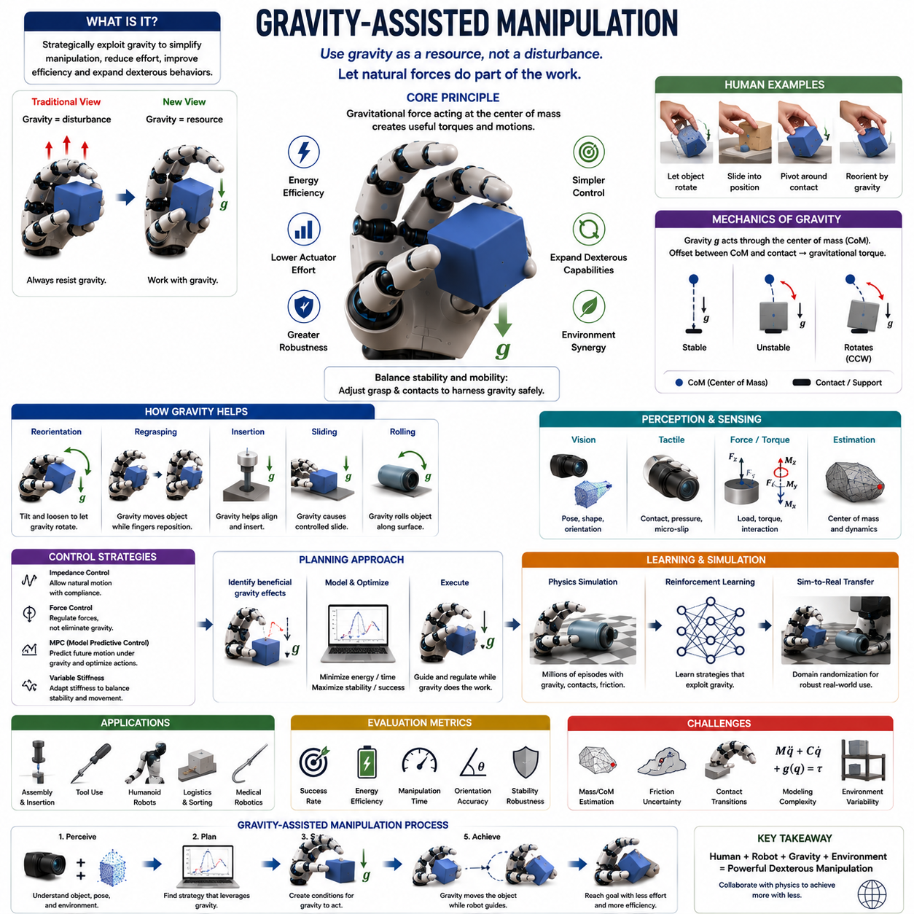{width="7.268055555555556in" height="7.268055555555556in"}

Gravity-Assisted Manipulation is a specialized branch of dexterous robotic manipulation that intentionally exploits gravitational forces to simplify object handling, reduce actuator effort, improve manipulation efficiency, and expand the range of achievable in-hand manipulation behaviors. Traditional robotic manipulation often treats gravity as a disturbance that must be compensated through control algorithms, force regulation, and precise actuation. In contrast, gravity-assisted manipulation views gravity as a valuable resource that can contribute positively to manipulation tasks. Rather than continuously resisting gravitational forces, the robot strategically leverages them to generate object motion, facilitate reorientation, assist regrasping, and reduce control complexity. This approach reflects a broader trend in robotics toward exploiting natural environmental dynamics rather than attempting to eliminate them. Within the field of dexterous manipulation, gravity-assisted manipulation is closely related to extrinsic dexterity, contact-rich manipulation, dynamic manipulation, and embodied intelligence because it demonstrates how physical interactions can become active components of intelligent behavior rather than obstacles to overcome. The topic appears within the In-Hand Manipulation chapter structure as a key manipulation primitive that complements finger gaiting, rolling, pivoting, object reorientation, and extrinsic dexterity.

Human beings utilize gravity constantly during object manipulation, often without conscious awareness. When a person loosens their grip slightly to allow a pen to slide into a writing position, gravity is assisting the manipulation process. When a chef rotates a knife into a preferred grasp configuration, when a worker aligns a tool before assembly, or when someone flips a smartphone into a more comfortable viewing orientation, gravitational forces frequently contribute to the motion. Human dexterity emerges not only from muscular control but also from an intuitive understanding of how environmental forces influence object behavior. The human nervous system continuously predicts and exploits these forces, minimizing effort while maximizing efficiency. Replicating this capability in robotic systems represents a significant step toward achieving human-like manipulation.

The fundamental principle of gravity-assisted manipulation is simple. Every object experiences a gravitational force acting through its center of mass. This force generates predictable torques and motion tendencies depending on the object\'s geometry, orientation, support conditions, and contact configuration. Rather than counteracting these tendencies entirely, a robot can modify its grasp, orientation, or environmental interactions to allow gravity to produce useful motion. By doing so, the robot effectively delegates part of the manipulation task to the physical world itself.

From a mechanics perspective, gravity creates a force vector directed toward the center of the Earth. The location of the object\'s center of mass relative to its contact points determines the resulting gravitational torque. If the center of mass lies directly beneath a support point, the object remains stable. If it is displaced from the support point, gravity generates rotational tendencies that can be exploited to produce controlled motion. Understanding these relationships is fundamental to gravity-assisted manipulation planning.

One of the primary advantages of gravity-assisted manipulation is energy efficiency. Conventional manipulation often requires continuous actuator effort to generate object motion. Gravity-assisted strategies reduce this burden by allowing natural forces to contribute to movement. The robot only needs to guide or regulate the process rather than generating all required motion independently. This reduction in actuator workload can significantly decrease power consumption, which is particularly important for mobile robots, humanoids, and battery-powered systems.

Gravity-assisted manipulation can be categorized into several forms. Gravity-assisted reorientation uses gravity to rotate objects into desired orientations. Gravity-assisted regrasping exploits object motion caused by gravity to establish new grasp configurations. Gravity-assisted insertion uses gravitational alignment to facilitate assembly tasks. Gravity-assisted sliding allows objects to move along surfaces under controlled gravitational influence. Dynamic gravity-assisted manipulation combines gravitational forces with inertial effects to achieve rapid object motion. Each category utilizes the same physical principle but applies it to different manipulation objectives.

Object reorientation represents one of the most common applications. Many objects naturally rotate when their center of mass is displaced relative to a support point. By adjusting grasp forces appropriately, the robot can permit controlled rotational motion driven by gravity. For example, a robotic hand holding a screwdriver may slightly loosen its grip and tilt the object so that gravity causes the handle to rotate into a preferred orientation. This strategy can eliminate the need for complex finger repositioning sequences.

Gravity-assisted regrasping provides another powerful capability. During regrasping, the robot often needs to move contact points without losing control of the object. Gravity can facilitate these transitions by causing predictable object movements while fingers reposition themselves. Instead of actively moving the object into a new configuration, the robot creates conditions that allow gravity to guide the transition. Such strategies frequently reduce manipulation complexity and improve robustness.

Environmental interactions play an important role in gravity-assisted manipulation. Tables, walls, fixtures, shelves, and support surfaces often work together with gravity to produce desired object motions. For example, an object may pivot around a table edge under the influence of gravity. A container may rotate against a wall while gravitational torque guides its motion. These interactions illustrate the close relationship between gravity-assisted manipulation and extrinsic dexterity.

Pivoting is one of the most frequently studied gravity-assisted manipulation primitives. In gravity-assisted pivoting, the object rotates around a contact point while gravity provides the driving torque. The robot regulates contact forces and motion constraints but allows gravity to generate most of the rotational energy. This technique is widely used in industrial assembly, tool handling, and dexterous manipulation research because it enables large orientation changes with relatively little actuator effort.

Rolling manipulation can also benefit from gravity. When an object is placed on a sloped surface or positioned such that gravitational forces encourage rolling, the robot can exploit this motion to achieve orientation changes. Cylindrical objects, spherical objects, bottles, pipes, and containers are particularly suitable for gravity-assisted rolling strategies. These methods often produce smooth and energy-efficient motion trajectories.

Sliding is another important mechanism. If frictional conditions are appropriate, gravity can cause an object to slide along a surface in a controlled manner. By adjusting surface orientation and contact conditions, robots can use gravity-assisted sliding to reposition objects without requiring extensive finger motion. This approach is particularly useful for flat objects, thin components, and objects that are difficult to grasp directly.

The center of mass plays a central role in gravity-assisted manipulation. Accurate estimation of mass distribution is essential because gravitational behavior depends directly on the relationship between the center of mass and the contact geometry. Objects with centrally located mass distributions tend to behave predictably, while objects with asymmetric mass distributions may generate unexpected torques. Consequently, many gravity-assisted manipulation systems incorporate center-of-mass estimation as a core component of their perception pipeline.

Perception is critical for successful gravity-assisted manipulation. The robot must estimate object pose, geometry, orientation, contact conditions, and mass properties accurately. Vision systems provide global pose information using RGB cameras, depth sensors, stereo vision systems, and structured light scanners. These sensors allow the robot to understand how gravity will influence object motion under different configurations.

Tactile sensing complements visual perception by providing local information about contact conditions. Pressure distributions, micro-slip events, force vectors, and contact locations allow the robot to determine whether gravitational motion is proceeding as expected. Tactile feedback becomes particularly important when objects are partially occluded or when visual information alone is insufficient to estimate contact states accurately.

Force and torque sensing provide additional information about gravitational interactions. Wrist force-torque sensors can measure the effects of object weight directly. Fingertip force sensors can detect changes in load distribution as objects rotate or slide. These measurements enable real-time adjustment of manipulation strategies and improve robustness under uncertainty.

Control strategies for gravity-assisted manipulation differ from traditional force-control approaches. Instead of attempting to eliminate gravitational effects, controllers must regulate them. This often involves balancing object stability against desired motion. Excessive grip forces may prevent useful gravitational movement, while insufficient forces may cause uncontrolled slips or object loss. Successful controllers dynamically adjust grasp forces to maintain an optimal balance between control and mobility.

Impedance control is particularly well suited to gravity-assisted manipulation. By regulating mechanical compliance rather than enforcing rigid trajectories, impedance controllers allow objects to respond naturally to gravitational forces. The robot guides object behavior while remaining adaptable to uncertainties and variations in contact conditions. This flexibility is crucial because gravity-assisted manipulation inherently relies on physical interactions that are difficult to model perfectly.

Model Predictive Control has also become increasingly popular in this area. MPC frameworks predict future object behavior under gravitational influence and optimize control actions accordingly. By considering future states explicitly, MPC can generate manipulation strategies that exploit gravity more effectively than purely reactive controllers.

Planning gravity-assisted manipulation presents unique challenges. The planner must identify opportunities where gravity can contribute positively to task execution. This requires reasoning about object geometry, contact configurations, environmental structures, and future object trajectories. Unlike traditional planning approaches that seek to minimize environmental interactions, gravity-assisted planners actively search for beneficial dynamic effects.

Optimization-based planning methods are widely used for this purpose. The planner may seek to minimize energy consumption, reduce manipulation time, maximize stability, or minimize actuator effort. Constraints capture contact mechanics, collision avoidance requirements, kinematic limitations, and task objectives. The resulting optimization problem determines how gravity should be exploited throughout the manipulation sequence.

Learning-based approaches have emerged as powerful alternatives. Reinforcement learning allows robots to discover gravity-assisted strategies through experience rather than relying entirely on analytical models. By interacting with simulated environments, robots can learn how different object properties, contact conditions, and environmental configurations influence gravitational behavior. These learned policies often uncover highly efficient manipulation strategies that may not be obvious to human designers.

Large-scale simulation has played a critical role in advancing gravity-assisted manipulation research. Modern physics simulators can accurately model gravitational effects, contact interactions, frictional behavior, and object dynamics. Robots can practice millions of manipulation episodes involving diverse objects and environmental conditions. Domain randomization further improves robustness by exposing policies to variations in mass properties, friction coefficients, sensor noise, and geometric uncertainties.

Humanoid robots particularly benefit from gravity-assisted manipulation. Human environments are filled with opportunities to exploit gravity. Opening doors, pouring liquids, using tools, handling clothing, organizing household objects, and preparing food all involve gravitational interactions. A humanoid robot that understands how to leverage gravity effectively can perform these tasks more naturally and efficiently than one that relies solely on direct actuation.

Industrial applications are equally significant. Assembly operations frequently involve gravitational alignment. Components may naturally settle into correct positions under their own weight. Gravity-assisted insertion can reduce positioning requirements and improve assembly success rates. Manufacturing systems often exploit gravitational effects implicitly, and advanced robotic systems can formalize and optimize these strategies.

Warehouse automation provides additional examples. Packages, containers, and consumer products often need to be reoriented before sorting, packaging, or shipment. Gravity-assisted manipulation can reduce cycle times by allowing objects to rotate or slide naturally into desired configurations. Such strategies improve throughput while reducing energy consumption.

Medical robotics also presents opportunities. Surgical instruments, catheters, and assistive devices interact with gravity in complex ways. Understanding these effects can improve manipulation precision and reduce control effort. Gravity-assisted strategies may be particularly valuable in minimally invasive procedures where workspace constraints limit available manipulation options.

Benchmarking gravity-assisted manipulation requires metrics that capture both efficiency and effectiveness. Researchers commonly evaluate task success rate, energy consumption, manipulation speed, orientation accuracy, grasp stability, robustness to disturbances, and computational efficiency. Comparisons with purely actuation-driven methods often reveal significant advantages in energy efficiency and manipulation simplicity.

Despite its advantages, gravity-assisted manipulation presents several challenges. Accurate estimation of mass properties remains difficult. Friction uncertainty can alter object behavior significantly. Contact transitions introduce nonlinear dynamics that are difficult to predict. Environmental variations may affect manipulation outcomes. Robustly exploiting gravity therefore requires sophisticated perception, planning, and control capabilities.

Future developments are expected to integrate gravity-assisted manipulation with foundation models, world models, tactile intelligence, multimodal perception systems, and embodied AI frameworks. Rather than treating gravity as a low-level physical phenomenon, future robots may reason about gravitational effects at a semantic level, predicting how objects will behave and planning accordingly. Such capabilities will move robotic manipulation closer to the intuitive physical reasoning demonstrated by humans.

Ultimately, gravity-assisted manipulation represents a paradigm shift in robotic dexterity. Instead of fighting against gravity, robots learn to collaborate with it. By leveraging natural physical forces, robotic systems can achieve greater efficiency, improved robustness, reduced energy consumption, and more human-like manipulation behavior. As dexterous hands, tactile sensing systems, learning algorithms, and embodied intelligence continue to advance, gravity-assisted manipulation will become an increasingly important component of in-hand manipulation and one of the key enabling technologies for next-generation robotic dexterity.

## 10.08 Manipulation Planning

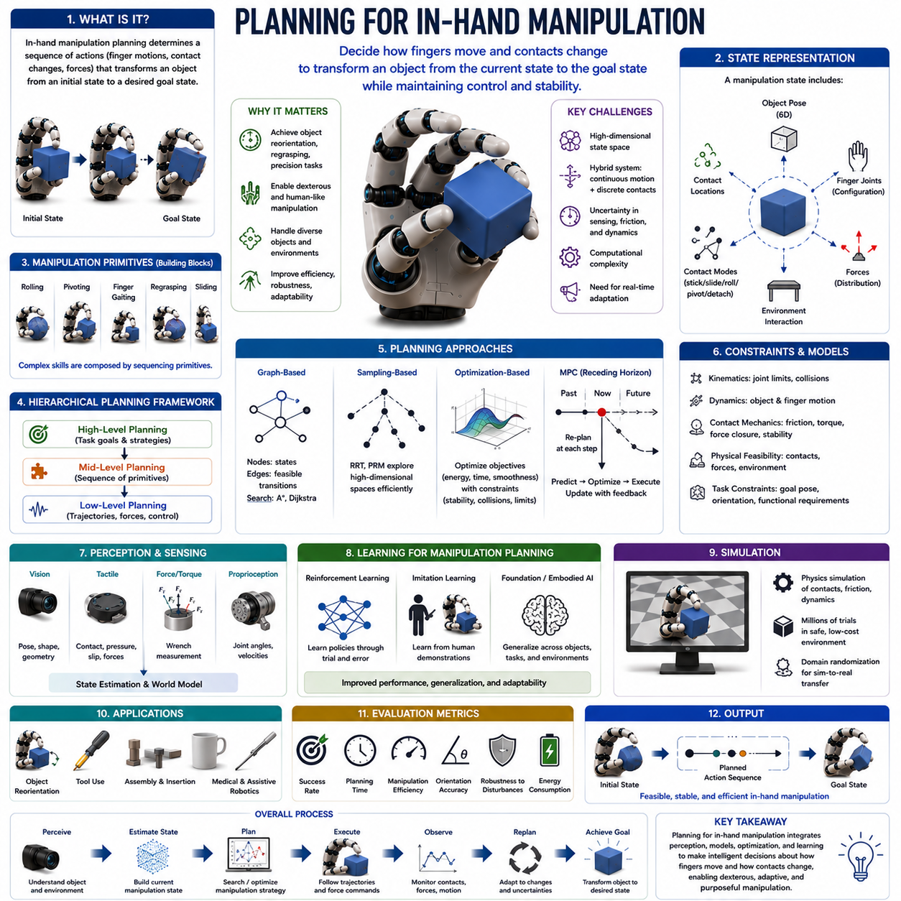{width="7.268055555555556in" height="7.268055555555556in"}

Planning for In-Hand Manipulation is one of the most sophisticated and intellectually demanding areas of robotic manipulation. While grasping focuses on establishing stable contact with an object and maintaining control, in-hand manipulation planning addresses a far more complex objective: determining how a robotic hand should move, reposition contacts, regulate forces, and coordinate multiple fingers so that an object can be transformed from an initial state to a desired target state while remaining under continuous control. This process requires the integration of kinematics, dynamics, contact mechanics, perception, control theory, optimization, and artificial intelligence. In many ways, planning for in-hand manipulation represents the decision-making layer that connects low-level motor actions with high-level manipulation goals. It transforms dexterous hardware into an intelligent manipulation system capable of executing purposeful object transformations. Within the broader framework of robot hands and dexterous grasping, manipulation planning serves as the central mechanism that coordinates finger gaiting, rolling, pivoting, regrasping, object reorientation, extrinsic dexterity, and gravity-assisted manipulation into coherent task-oriented behavior.

Humans perform in-hand manipulation planning continuously without conscious effort. When a person picks up a coin and rotates it between the fingers, adjusts a pen into a writing position, flips a screwdriver into an operational grasp, or repositions a key before inserting it into a lock, the nervous system is solving a complex planning problem. The brain must determine which fingers should move, which contacts should remain stable, how much force should be applied, and how object motion should progress toward the goal. Although these actions appear natural and effortless, they involve highly sophisticated planning processes developed through years of experience and sensorimotor learning.

The fundamental objective of in-hand manipulation planning is to generate a sequence of actions that transforms an object from an initial pose to a target pose while satisfying physical and task-related constraints. The object may need to be translated, rotated, reoriented, regrasped, or repositioned within the hand. During this process, the planner must ensure stability, avoid collisions, respect joint limits, maintain feasible contact conditions, and satisfy task requirements. Unlike conventional robot motion planning, where objects are typically assumed to be rigidly attached to an end-effector, in-hand manipulation planning must account for continuous relative motion between the object and the fingers.

At the core of the planning problem lies the concept of state representation. A manipulation state generally includes the object pose, finger joint configurations, contact locations, contact modes, force distributions, and environmental interactions. Together, these variables define the current condition of the manipulation system. The planner seeks a path through this high-dimensional state space that connects the initial state to the goal state. Because the dimensionality of this space can be extremely large, planning becomes computationally challenging.

Object pose represents one of the most important state variables. In three-dimensional space, object pose consists of both position and orientation. Position describes translational displacement along the x, y, and z axes, while orientation describes rotational configuration. Many manipulation tasks require precise control of both components. For example, inserting a connector into a socket requires not only correct positioning but also precise angular alignment. Consequently, manipulation planning must account for full six-degree-of-freedom object motion.

Finger configuration forms another critical component of the state representation. Each finger may possess multiple joints, resulting in a large number of possible configurations. Multi-fingered robotic hands often have twenty or more controllable joints. The planner must determine how these joints should move over time to produce the desired object motion while preserving stability. Because multiple finger configurations may achieve the same object pose, planning frequently involves redundancy resolution and optimization.

Contact representation is equally important. Contact points define where the fingers interact with the object. Contact modes characterize the nature of those interactions. Contacts may be sticking, sliding, rolling, pivoting, or detached. Each mode imposes different constraints on object motion. The planner must reason about these contact transitions explicitly because manipulation often depends on changing contact conditions over time.

One of the primary challenges of in-hand manipulation planning arises from the hybrid nature of the problem. Manipulation systems combine continuous dynamics with discrete contact transitions. Object motion evolves continuously according to physical laws, while contact states may change abruptly when fingers move, detach, or establish new contacts. This combination of continuous and discrete behavior creates a hybrid system that is significantly more difficult to plan than conventional robotic motion problems.

Manipulation planning can be divided into several levels of abstraction. High-level planning focuses on task objectives and manipulation strategies. Mid-level planning determines sequences of manipulation primitives such as rolling, pivoting, finger gaiting, and regrasping. Low-level planning generates detailed trajectories, force profiles, and control commands. This hierarchical organization simplifies problem decomposition and improves computational tractability.

Manipulation primitives serve as fundamental building blocks of planning. Much like words combine to form sentences, manipulation primitives combine to create complex manipulation behaviors. Rolling allows gradual contact migration across object surfaces. Pivoting enables controlled rotation around contact points. Finger gaiting repositions fingers while maintaining object control. Regrasping changes grasp configurations. Sliding permits controlled relative motion between contacts. The planner selects and sequences these primitives to achieve the desired task outcome.

Task planning introduces another layer of complexity. Different tasks impose different manipulation requirements. A screwdriver must be oriented appropriately before use. A component must be aligned before insertion. A package must be positioned correctly before placement. The planner must understand task objectives and generate manipulation sequences that satisfy functional requirements rather than merely achieving arbitrary object motions.

The manipulation planning problem is often formulated as a search problem. Each possible manipulation state corresponds to a node within a large state space, and transitions between states correspond to feasible actions. The planner searches for a sequence of actions connecting the initial state to the goal state. However, the enormous size of manipulation state spaces makes exhaustive search impractical. Consequently, specialized planning algorithms are required.

Graph-based planning represents one of the earliest approaches. In graph-based methods, nodes correspond to grasp states, object poses, or contact configurations. Edges represent feasible manipulation transitions. Search algorithms such as Dijkstra's algorithm, A\*, and heuristic graph search methods identify paths through the graph. Although effective for structured environments, graph-based approaches often struggle with high-dimensional continuous spaces.

Sampling-based planning techniques address some of these limitations. Methods such as Rapidly Exploring Random Trees and Probabilistic Roadmaps explore state spaces by generating random samples and connecting feasible configurations. Sampling-based planners can handle high-dimensional spaces more effectively than exhaustive search methods. They have therefore become popular tools for manipulation planning involving complex hand-object interactions.

Optimization-based planning has emerged as one of the most powerful approaches for in-hand manipulation. Rather than explicitly searching through all possible states, the planner formulates manipulation as an optimization problem. Objective functions may minimize energy consumption, manipulation time, contact force variation, or trajectory length. Constraints enforce physical feasibility, stability, collision avoidance, and task requirements. Modern optimization algorithms can solve highly complex manipulation problems that were previously intractable.

Trajectory optimization is particularly important in this context. The planner seeks smooth object and finger trajectories that achieve task objectives while satisfying dynamic constraints. Because manipulation involves continuous contact interactions, trajectory optimization often produces more natural and efficient solutions than purely discrete planning methods.

Model Predictive Control has become increasingly influential in manipulation planning. MPC repeatedly solves optimization problems over a finite prediction horizon and updates plans in real time based on sensor feedback. This capability is particularly valuable because manipulation tasks frequently involve uncertainty and disturbances. MPC enables the robot to adapt continuously as conditions change.

Contact mechanics plays a central role in planning. Contact interactions determine how forces are transmitted between the fingers and the object. Friction cones define allowable force directions. Contact constraints restrict object motion. Stability conditions determine whether manipulation actions are feasible. Accurate modeling of contact mechanics significantly improves planning quality, although it also increases computational complexity.

Force closure and form closure concepts frequently appear in planning algorithms. Force closure ensures that contact forces can resist arbitrary disturbances, while form closure relies on geometric constraints to prevent object motion. These concepts help planners evaluate grasp quality and determine whether proposed manipulation states are stable.

Manipulation planning must also account for uncertainty. Real-world environments contain numerous sources of unpredictability, including sensor noise, friction variability, object deformation, modeling errors, and external disturbances. Deterministic planning approaches often perform poorly under such conditions. Robust planning methods explicitly consider uncertainty and seek solutions that remain effective despite variations in system behavior.

Probabilistic planning frameworks provide one approach to uncertainty management. Instead of representing states as exact values, probabilistic methods represent them as probability distributions. The planner reasons about likely future outcomes and selects actions that maximize expected success. Bayesian inference, particle filtering, and belief-space planning are frequently employed in these contexts.

Perception is deeply integrated into manipulation planning. Accurate planning requires accurate knowledge of object pose, geometry, contact conditions, and environmental structure. Visual perception systems provide object recognition and pose estimation. Depth sensors supply geometric information. Tactile sensors reveal contact conditions and force distributions. Proprioceptive sensors provide joint state information. Together, these sensing modalities support state estimation and planning.

Tactile sensing is particularly important for in-hand manipulation because many critical interactions occur within the hand and are not visible to external cameras. Tactile feedback allows the planner to detect slip, verify contact formation, estimate local geometry, and monitor force distribution. As tactile sensing technology advances, manipulation planning systems become increasingly capable of adapting to complex contact conditions.

Machine learning has dramatically transformed manipulation planning in recent years. Traditional planning approaches rely heavily on analytical models and hand-crafted algorithms. Learning-based methods instead acquire manipulation knowledge from experience. Reinforcement learning enables robots to discover manipulation policies through trial and error. The robot learns which actions lead to successful outcomes and gradually improves performance over time.

Large-scale reinforcement learning has demonstrated remarkable success in dexterous manipulation. Robotic hands have learned to rotate objects, solve manipulation puzzles, perform reorientation tasks, and recover from disturbances through extensive simulation training. These results suggest that many planning problems may be solved more effectively through learning than through explicit programming.

Imitation learning provides an alternative learning paradigm. Human demonstrations captured through teleoperation systems, motion capture devices, and data gloves serve as training data. Learning algorithms extract manipulation strategies from these demonstrations and generalize them to new situations. Because humans naturally perform dexterous manipulation efficiently, imitation learning often accelerates skill acquisition significantly.

Foundation models and large-scale embodied AI systems are creating new opportunities for manipulation planning. Rather than learning individual tasks separately, future robots may develop generalized manipulation knowledge applicable across many tasks and object categories. Such systems could reason about object affordances, predict physical outcomes, and generate manipulation plans using broad prior knowledge acquired from large datasets.

Simulation has become indispensable for manipulation planning research. Collecting real-world manipulation data is expensive and time-consuming. Physics simulators allow robots to practice millions of manipulation episodes involving diverse objects, contact conditions, and environmental configurations. Domain randomization improves robustness by exposing policies to wide variations in physical parameters. As simulation fidelity improves, sim-to-real transfer performance continues to increase.

Humanoid robotics represents one of the strongest motivations for advancing manipulation planning. Human environments are designed around dexterous hands and complex object interactions. Activities such as dressing, cooking, cleaning, tool use, assembly, maintenance, and healthcare assistance all require sophisticated in-hand manipulation capabilities. Effective planning is therefore essential for achieving practical humanoid robotics.

Industrial automation also benefits significantly from advanced manipulation planning. Manufacturing systems increasingly handle diverse products rather than fixed components. Flexible automation requires robots capable of adapting manipulation strategies to new objects and tasks. Manipulation planning enables such adaptability by providing decision-making capabilities beyond simple motion execution.

Medical robotics presents additional challenges and opportunities. Surgical tools frequently require precise orientation control, contact management, and manipulation within constrained environments. Manipulation planning can improve surgical precision, reduce procedure times, and enhance safety. Similar benefits apply to rehabilitation robotics and assistive technologies.

Performance evaluation of manipulation planning systems involves numerous metrics. Researchers commonly measure task success rate, planning time, execution efficiency, energy consumption, trajectory smoothness, orientation accuracy, robustness to disturbances, adaptability to novel objects, and computational cost. Comprehensive evaluation frameworks are essential for comparing different planning approaches objectively.

Despite substantial progress, planning for in-hand manipulation remains one of the most challenging problems in robotics. High-dimensional state spaces, nonlinear contact dynamics, uncertainty, computational complexity, and limited tactile sensing continue to present significant obstacles. Nevertheless, advances in optimization, machine learning, simulation, sensing, and embodied intelligence are rapidly expanding the capabilities of manipulation planning systems.

Ultimately, planning for in-hand manipulation serves as the cognitive layer of dexterous robotic behavior. It determines how perception, contact mechanics, force control, and finger motion should be coordinated to achieve purposeful object transformations. By enabling robots to reason about manipulation strategies rather than merely executing predefined motions, manipulation planning transforms robotic hands into intelligent physical agents. As robotic systems continue to evolve toward human-level dexterity, planning for in-hand manipulation will remain one of the most important enabling technologies and a cornerstone of future embodied intelligence.

## 10.09 Learning-Based Manipulation

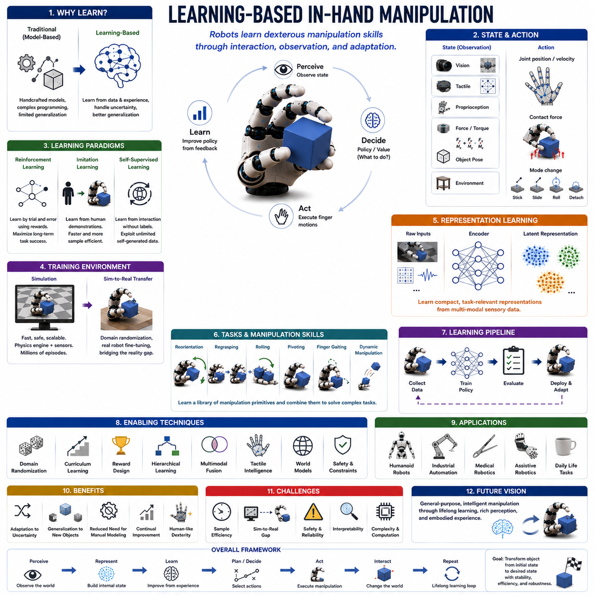{width="7.268055555555556in" height="7.268055555555556in"}

Learning-Based In-Hand Manipulation represents one of the most significant advances in modern robotics and artificial intelligence. It combines the principles of dexterous manipulation, machine learning, perception, control theory, and embodied intelligence to enable robotic systems to acquire manipulation skills through experience rather than relying exclusively on manually designed models and handcrafted control strategies. Traditional robotic manipulation systems typically depend on precise mathematical models, carefully engineered motion planners, and explicit representations of object geometry, contact mechanics, and dynamics. While these approaches have achieved remarkable success in structured industrial environments, they often struggle when confronted with the complexity, uncertainty, and variability of real-world manipulation tasks. Learning-based methods offer an alternative paradigm in which robots develop manipulation capabilities through interaction, observation, practice, and adaptation. Within the context of in-hand manipulation, learning-based approaches have become increasingly important because the complexity of contact-rich interactions makes analytical modeling extremely difficult. As robotic hands become more sophisticated and sensing technologies improve, learning-based manipulation is emerging as a primary pathway toward achieving human-level dexterity.

Human beings acquire dexterous manipulation skills primarily through learning. Infants do not possess advanced manipulation abilities at birth. Instead, they gradually learn how to grasp, rotate, reposition, reorient, and manipulate objects through continuous interaction with their environment. Every object handled provides new information about contact dynamics, friction, force application, object geometry, and motion consequences. Over time, the nervous system builds internal representations that enable increasingly sophisticated manipulation behaviors. Learning-based robotic manipulation seeks to replicate this developmental process. Rather than encoding every possible manipulation strategy manually, the robot acquires skills through experience and progressively improves its performance.

The fundamental motivation for learning-based in-hand manipulation arises from the limitations of traditional model-based approaches. In-hand manipulation involves highly nonlinear interactions between the robotic hand, the manipulated object, and the surrounding environment. Contact locations change continuously. Friction properties vary across surfaces. Object mass distributions are often uncertain. Sensor measurements contain noise. Environmental conditions introduce additional variability. Developing accurate mathematical models that capture all these factors is extraordinarily difficult. Even when detailed models are available, solving the resulting planning and control problems can be computationally expensive. Learning-based approaches circumvent many of these challenges by allowing the robot to learn directly from data.

One of the central concepts in learning-based manipulation is policy learning. A policy defines how a robot should act given its current state. The state may include visual observations, tactile information, joint configurations, force measurements, object poses, and environmental information. The policy maps these observations to actions such as finger movements, force adjustments, contact transitions, or grasp modifications. Learning-based methods seek to discover policies that maximize task success while maintaining stability, efficiency, and robustness.

Reinforcement Learning has become one of the most influential approaches for learning dexterous manipulation. In reinforcement learning, the robot interacts with an environment and receives feedback in the form of rewards. Actions that contribute to task success generate positive rewards, while undesirable outcomes such as object drops or unstable grasps generate penalties. Through repeated interaction, the robot gradually learns behaviors that maximize cumulative reward. This process allows complex manipulation strategies to emerge without requiring explicit programming of every action sequence.

The reinforcement learning framework is particularly attractive for in-hand manipulation because many manipulation tasks can be formulated naturally as sequential decision-making problems. Consider the task of rotating a cube within a robotic hand. At every moment, the robot must decide how to move its fingers, adjust contact forces, and reposition contact points. Each action influences future states and future opportunities. Reinforcement learning provides a mathematical framework for optimizing such long-term decision processes.

One of the landmark achievements in robotics involved reinforcement learning systems capable of performing complex object reorientation tasks with multi-fingered robotic hands. These systems learned to rotate cubes, manipulate objects under uncertainty, recover from disturbances, and adapt to variations in object properties. Such demonstrations illustrated that sophisticated manipulation behaviors could emerge from large-scale learning rather than explicit engineering.

The effectiveness of reinforcement learning depends heavily on exploration. The robot must discover useful behaviors through trial and error. However, real-world exploration is often slow, expensive, and potentially damaging to hardware. Manipulation tasks may require millions of interaction episodes before effective policies emerge. Consequently, simulation has become a cornerstone of learning-based manipulation research.

Modern physics simulators provide environments in which robotic systems can practice manipulation continuously without risking hardware damage. Simulators model contact dynamics, friction, collisions, object motion, and sensor observations. By running accelerated simulations, robots can acquire years of manipulation experience within days or weeks of computation. This capability has dramatically accelerated progress in dexterous manipulation research.

Domain randomization plays a crucial role in bridging the gap between simulation and reality. During training, the simulator intentionally varies object masses, friction coefficients, surface properties, lighting conditions, sensor noise levels, and geometric parameters. These variations expose the learning system to a broad range of conditions. As a result, learned policies become more robust and more likely to transfer successfully to physical robotic hardware. Domain randomization has become one of the most widely adopted techniques for sim-to-real transfer in manipulation research.

Imitation Learning represents another major category of learning-based manipulation. Rather than discovering manipulation strategies entirely through trial and error, imitation learning allows robots to learn directly from human demonstrations. Human operators perform manipulation tasks using teleoperation systems, motion capture devices, data gloves, or virtual reality interfaces. The resulting demonstrations provide examples of successful behavior. Learning algorithms then extract policies that reproduce similar actions.

Imitation learning offers several advantages. Human demonstrations naturally incorporate effective manipulation strategies, reducing the need for extensive exploration. Demonstrations can also encode task-specific knowledge that may be difficult to discover through random experimentation. Consequently, imitation learning often accelerates skill acquisition and improves training efficiency. Many modern systems combine imitation learning with reinforcement learning, using demonstrations to initialize policies before further refinement through autonomous practice.

Behavior cloning represents one of the simplest forms of imitation learning. In behavior cloning, the robot treats demonstrations as supervised learning data. Observations become inputs, and demonstrated actions become outputs. Neural networks learn mappings from states to actions. While behavior cloning can produce effective policies, it often suffers from error accumulation because the robot may encounter situations not represented in the training data.

More advanced approaches such as inverse reinforcement learning attempt to infer the underlying objectives that motivate demonstrated behaviors. Instead of simply copying actions, the robot learns why the human performed them. This deeper understanding often improves generalization and robustness. Inverse reinforcement learning has become increasingly relevant for dexterous manipulation tasks involving complex decision-making.

Self-supervised learning is emerging as another important paradigm. In self-supervised approaches, the robot generates its own training data through interaction. Instead of relying on manually labeled datasets, the robot learns from the natural consequences of its actions. Contact events, object movements, successful grasps, and failed manipulations all become learning signals. Because self-supervised learning can generate virtually unlimited data, it offers significant potential for scaling manipulation capabilities.

Representation learning forms a critical component of modern learning-based manipulation systems. Raw sensory observations are often high-dimensional and difficult to interpret directly. Cameras produce large image streams. Tactile sensors generate complex pressure distributions. Force sensors provide multidimensional measurements. Representation learning techniques transform these observations into compact latent representations that capture task-relevant information. Effective representations simplify downstream planning and control while improving learning efficiency.

Deep neural networks have become the dominant architecture for representation learning. Convolutional neural networks process visual data. Graph neural networks model contact relationships. Transformer architectures capture long-range dependencies in sensory observations. Multimodal networks integrate information from vision, touch, force sensing, and proprioception. Together, these architectures provide powerful tools for extracting meaningful information from complex sensory inputs.

Tactile learning has emerged as a particularly important research area within learning-based manipulation. Vision alone is often insufficient for understanding contact interactions occurring inside the hand. Tactile sensors provide direct measurements of pressure distributions, contact locations, micro-slip events, and local geometry. Learning algorithms can exploit these signals to improve grasp stability, detect impending failures, estimate object properties, and adapt manipulation strategies dynamically.

Multimodal learning combines visual, tactile, proprioceptive, and force sensing information into unified representations. Human manipulation relies heavily on such sensory integration. By combining multiple information sources, robots can achieve more accurate state estimation and more robust decision-making. Multimodal learning has become a key component of advanced manipulation systems.

Object reorientation serves as one of the most common benchmark tasks for learning-based manipulation. The robot must transform an object from an arbitrary orientation into a specified target orientation while maintaining stable control. Successful execution requires coordinated finger motion, contact management, force regulation, and continuous adaptation. Because the task captures many core challenges of dexterous manipulation, it has become a widely used evaluation platform.

Regrasping tasks present another important benchmark. During regrasping, contact configurations change repeatedly while the object remains controlled. Learning-based methods have demonstrated impressive capabilities in discovering effective regrasp strategies that would be difficult to design manually. These systems often exploit rolling, pivoting, finger gaiting, and gravity-assisted manipulation in highly coordinated ways.

Dynamic manipulation introduces additional complexity. Dynamic tasks involve exploiting momentum, inertia, and transient contact interactions. Examples include object flipping, tossing, catching, spinning, and rapid reorientation. Such behaviors are particularly challenging for traditional model-based approaches because accurate prediction of dynamic contact interactions is difficult. Learning-based methods have shown remarkable success in discovering dynamic manipulation strategies through experience.

The emergence of foundation models is beginning to influence learning-based manipulation research. Foundation models are large-scale systems trained on diverse datasets that develop broad general-purpose capabilities. In robotics, foundation models may eventually provide prior knowledge about object affordances, physical interactions, manipulation strategies, and task semantics. Such models could enable robots to generalize across object categories and perform previously unseen tasks with minimal additional training.

World models represent another promising direction. A world model is an internal predictive representation of how the environment evolves in response to actions. By learning predictive models of object dynamics, contact behavior, and environmental interactions, robots can perform mental simulation before executing actions. This capability may significantly improve planning efficiency and reduce reliance on costly physical experimentation.

Embodied artificial intelligence provides the broader conceptual framework within which learning-based manipulation is evolving. Embodied AI emphasizes that intelligence emerges through interaction between an agent\'s body, sensors, actions, and environment. In-hand manipulation exemplifies this principle because successful behavior depends on continuous physical interaction. Learning-based methods naturally align with embodied AI because they acquire knowledge through experience rather than relying solely on abstract reasoning.

Humanoid robots represent one of the most important application domains for learning-based in-hand manipulation. Human environments contain enormous diversity in object shapes, materials, textures, sizes, and interaction requirements. Preprogramming manipulation strategies for every possible object is impractical. Learning-based systems offer the adaptability required for real-world operation. Activities such as tool use, food preparation, dressing assistance, household organization, and maintenance tasks all benefit from learned manipulation skills.

Industrial automation is also undergoing transformation through learning-based approaches. Traditional automation excels in repetitive environments but struggles with variability. Learning-based manipulation enables robots to handle diverse products, adapt to changing conditions, and perform flexible assembly operations. As manufacturing becomes increasingly customized, these capabilities become more valuable.

Medical robotics presents another promising application area. Surgical manipulation often involves uncertainty, deformable materials, and highly constrained environments. Learning-based methods may improve instrument handling, tissue interaction, and adaptive control. Similar benefits extend to rehabilitation robotics, prosthetics, and assistive technologies.

Performance evaluation of learning-based manipulation systems typically includes task success rate, manipulation accuracy, robustness to disturbances, generalization across object categories, learning efficiency, energy consumption, and computational requirements. Researchers increasingly emphasize generalization because true dexterity requires adapting to previously unseen situations rather than merely memorizing specific tasks.

Despite remarkable progress, significant challenges remain. Sample efficiency continues to be a major concern because many learning algorithms require enormous amounts of training data. Sim-to-real transfer remains imperfect because simulations cannot capture every aspect of physical reality. Safety, interpretability, reliability, and long-term adaptation also require further research. Additionally, integrating high-level reasoning with low-level manipulation remains an open challenge.

Future developments are expected to combine reinforcement learning, imitation learning, self-supervised learning, foundation models, world models, tactile intelligence, and multimodal perception into unified manipulation architectures. Rather than learning isolated tasks, future robots may acquire generalized manipulation knowledge applicable across a vast range of objects and environments. Such systems will move closer to the flexibility, adaptability, and efficiency exhibited by human hands.

Ultimately, Learning-Based In-Hand Manipulation represents a transformative shift in robotic dexterity. Instead of relying exclusively on handcrafted models and manually engineered solutions, robots learn manipulation skills through experience, observation, and interaction. This paradigm enables adaptation to uncertainty, generalization across tasks, and continual improvement over time. As advances in artificial intelligence, sensing technology, simulation, and robotic hardware continue to accelerate, learning-based manipulation will play a central role in achieving human-level dexterity and realizing the long-standing vision of truly intelligent robotic hands.

## 10.10 Dexterity Benchmarking

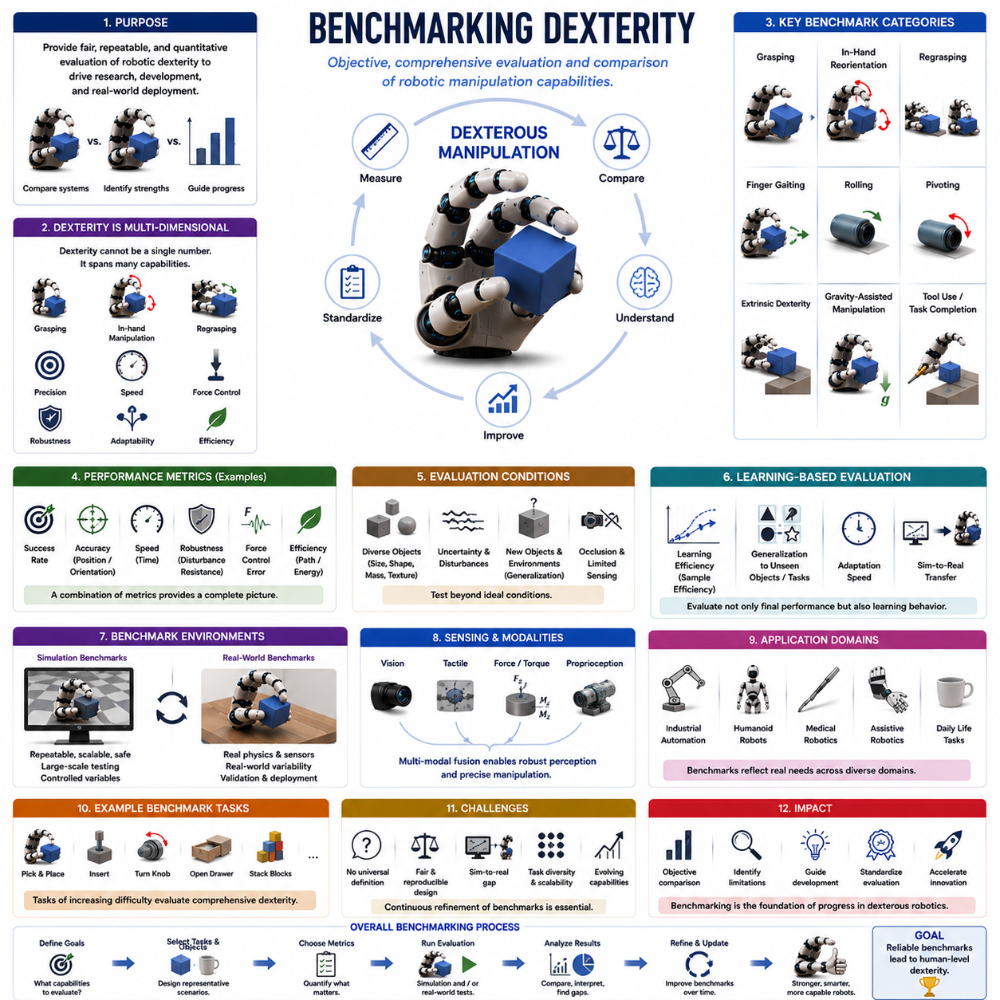{width="7.268055555555556in" height="7.268055555555556in"}

Benchmarking Dexterity is a critical discipline within robotic manipulation research that focuses on the systematic evaluation, comparison, and quantification of dexterous manipulation capabilities. As robotic hands become increasingly sophisticated and manipulation algorithms continue to advance, the ability to objectively measure dexterity has become essential for scientific progress, industrial deployment, and technological standardization. Without reliable benchmarks, it is difficult to determine whether one robotic system is genuinely superior to another, whether a new control algorithm represents a meaningful advancement, or whether a manipulation capability is sufficiently robust for real-world deployment. Benchmarking provides a common language through which researchers, engineers, and organizations can assess performance, identify limitations, and guide future development. Within the broader context of robot hands and in-hand manipulation, benchmarking dexterity serves as the foundation for evaluating grasping, finger gaiting, rolling, pivoting, regrasping, object reorientation, extrinsic dexterity, gravity-assisted manipulation, planning systems, and learning-based manipulation methods.

Human dexterity has long served as the reference standard for robotic manipulation. The human hand possesses extraordinary capabilities that enable tool use, object manipulation, fine motor control, adaptive grasping, and rapid learning. However, measuring human dexterity itself is not a trivial task. Researchers have developed numerous clinical and biomechanical assessments to quantify aspects of human manipulation performance, including speed, accuracy, coordination, force control, adaptability, and task completion efficiency. These assessment methodologies have influenced the development of robotic dexterity benchmarks. Many robotic evaluation protocols attempt to capture capabilities that resemble those demonstrated by humans, although direct comparisons remain challenging because robotic systems often possess fundamentally different mechanical structures and sensing capabilities.

The concept of dexterity is inherently multidimensional. Unlike simple performance metrics such as speed or payload capacity, dexterity encompasses a broad range of abilities. A robotic hand may excel at grasping but perform poorly at in-hand manipulation. Another system may demonstrate excellent precision but limited robustness. Some robots can manipulate a wide variety of objects but require significant computational resources. Consequently, dexterity cannot be reduced to a single numerical value. Effective benchmarking frameworks must evaluate multiple dimensions simultaneously while providing meaningful comparisons across different systems.

One of the most fundamental aspects of dexterity benchmarking is grasp performance. Grasping serves as the foundation of most manipulation tasks because successful manipulation generally requires stable object acquisition. Benchmarking grasp performance typically involves evaluating grasp success rates across diverse object sets. Objects may vary in size, shape, weight, texture, rigidity, and mass distribution. The robotic system must demonstrate the ability to establish stable grasps under varying conditions. Success rate, grasp stability, contact quality, and resistance to disturbances are commonly measured metrics.

Grasp robustness represents an especially important evaluation criterion. Real-world environments contain uncertainty, sensor noise, positioning errors, and external disturbances. A grasp that succeeds only under ideal laboratory conditions provides limited practical value. Robustness testing therefore introduces perturbations such as object displacement, force disturbances, friction variations, and sensor uncertainty. The ability to maintain successful grasp performance under such conditions provides a stronger indication of real-world capability.

In-hand manipulation forms another central category of dexterity benchmarking. Unlike grasp acquisition, in-hand manipulation evaluates the robot\'s ability to reposition, rotate, reorient, and manipulate objects while maintaining control. These tasks are significantly more challenging because they involve complex contact transitions, force regulation, and coordinated finger motion. Benchmark tasks often require the robot to move an object from one orientation to another, perform specified rotations, or achieve precise target poses. Success rates, manipulation speed, trajectory efficiency, and orientation accuracy are commonly used evaluation metrics.

Object reorientation has emerged as one of the most widely adopted benchmark tasks. In a typical evaluation, the robot receives an object in an arbitrary orientation and must transform it into a designated target orientation. This task captures many core challenges of dexterous manipulation, including contact management, finger coordination, force control, and adaptation to uncertainty. Because object reorientation is relatively easy to define while remaining highly challenging to execute, it has become a standard benchmark in many research studies.

Regrasping performance provides another important measure of dexterity. Regrasping requires the robot to change contact configurations while maintaining object control. Benchmark tasks may involve achieving a sequence of target grasps, transitioning between grasp configurations, or manipulating objects that require multiple contact rearrangements. Successful regrasping demonstrates the ability to coordinate discrete contact transitions with continuous object control.

Finger gaiting benchmarks evaluate the robot\'s ability to reposition fingers while preserving object stability. Finger gaiting is particularly important for extending the effective workspace of robotic hands. Benchmark protocols often measure the number of successful contact transitions, object displacement accuracy, and stability maintenance during gaiting operations. These evaluations provide insight into the robot\'s ability to perform long-duration in-hand manipulation sequences.

Rolling and pivoting benchmarks assess the robot\'s capability to exploit contact mechanics for object motion. Rolling tasks require controlled movement of contact points across object surfaces, while pivoting tasks involve rotation around designated contact locations. These benchmarks evaluate both mechanical design and control sophistication because successful execution depends on precise force regulation and accurate contact management.

Extrinsic dexterity has become increasingly important in benchmark design. Traditional dexterity evaluations often focused exclusively on intrinsic manipulation capabilities performed entirely within the robotic hand. However, humans frequently exploit environmental contacts to facilitate manipulation. Modern benchmark suites increasingly include tasks that involve tables, walls, fixtures, and support surfaces. These tasks evaluate the robot\'s ability to leverage environmental interactions strategically rather than relying solely on finger motion.

Gravity-assisted manipulation provides another emerging evaluation domain. Benchmark tasks may assess whether the robot can exploit gravitational forces to simplify manipulation, reduce energy consumption, or improve efficiency. Such evaluations reflect a growing recognition that intelligent manipulation involves understanding and utilizing environmental dynamics rather than merely resisting them.

Precision represents a critical dimension of dexterity benchmarking. Many applications require highly accurate manipulation. Industrial assembly, surgical robotics, micro-manufacturing, and electronics production often demand sub-millimeter positioning accuracy and precise orientation control. Benchmark protocols therefore frequently include tasks requiring exact object placement, alignment, insertion, or orientation. Positional error, angular error, repeatability, and calibration sensitivity are commonly measured.

Manipulation speed is another important performance metric. A robotic hand may achieve excellent accuracy but require excessive time to complete tasks. Conversely, rapid manipulation may introduce instability or reduce precision. Benchmarking frameworks often evaluate speed-accuracy tradeoffs by measuring task completion times alongside accuracy metrics. Such analyses help identify practical operating regimes for real-world applications.

Force control capability plays a major role in dexterity assessment. Effective manipulation requires precise regulation of contact forces. Excessive force may damage objects, while insufficient force may lead to slips and failures. Benchmark tasks often involve manipulating fragile objects, deformable materials, or objects requiring delicate handling. Force regulation accuracy, compliance behavior, and disturbance rejection are commonly evaluated.

Adaptability represents one of the defining characteristics of advanced dexterity. Traditional robotic systems often perform well only under highly constrained conditions. Modern manipulation systems are expected to adapt to novel objects, unfamiliar environments, and changing task requirements. Benchmark protocols increasingly emphasize generalization by introducing previously unseen objects or varying task parameters. The ability to maintain performance under such conditions serves as an important indicator of true dexterity.

Learning-based manipulation systems have introduced new benchmarking challenges. Traditional evaluation methods often assume deterministic behavior and fixed capabilities. Learning systems, however, improve over time and may exhibit different performance characteristics depending on training experience. Consequently, benchmarking frameworks must evaluate not only final task performance but also learning efficiency, sample complexity, adaptation speed, and generalization capability.

Sample efficiency has become an important metric in learning-based dexterity research. Some algorithms require millions of interaction episodes before achieving acceptable performance, while others learn more rapidly. Benchmarking sample efficiency helps evaluate the practicality of different learning approaches, particularly for real-world deployment where data collection may be expensive.

Generalization benchmarking has emerged as one of the most important research directions. A manipulation policy that performs well only on training objects provides limited value. Truly dexterous systems should generalize to new objects, new environments, and new tasks. Benchmark protocols increasingly include unseen object categories, novel geometries, varying material properties, and unexpected environmental conditions. Performance under such conditions provides a stronger measure of intelligence and adaptability.

Simulation benchmarks play a significant role in dexterity evaluation. Physics simulators enable large-scale testing across diverse conditions without requiring extensive hardware resources. Simulated benchmarks provide repeatability, scalability, and controlled experimentation. However, simulation results must be interpreted carefully because simulation environments cannot perfectly replicate real-world physics. Consequently, many benchmark suites include both simulated and physical evaluation components.

The sim-to-real gap remains an important consideration. Manipulation policies that perform well in simulation may fail when deployed on physical hardware due to differences in friction, contact dynamics, sensor noise, and unmodeled environmental factors. Benchmarking frameworks increasingly evaluate transfer performance explicitly by comparing simulation results with real-world outcomes.

Tactile sensing capability has become an important benchmarking dimension. Advanced manipulation increasingly relies on tactile feedback to estimate contact conditions, detect slip, and regulate force. Benchmark tasks may involve occluded manipulation scenarios where visual information is insufficient. Performance under such conditions reveals the effectiveness of tactile sensing and tactile intelligence systems.

Multimodal perception benchmarks evaluate the integration of vision, touch, force sensing, and proprioception. Human dexterity relies heavily on sensory fusion, and robotic systems are increasingly adopting similar strategies. Benchmark tasks assess whether combining multiple sensing modalities improves manipulation performance, robustness, and adaptability.

Humanoid robotics has significantly influenced dexterity benchmark development. Because humanoid robots are expected to operate in environments designed for humans, benchmark tasks increasingly reflect everyday activities. Tool use, object organization, container opening, food preparation, dressing assistance, and household manipulation are becoming common evaluation scenarios. These tasks provide realistic assessments of practical manipulation capability.

Industrial benchmarking frameworks emphasize productivity, reliability, and robustness. Manufacturing applications require high throughput, low failure rates, and predictable performance. Benchmark tasks often involve assembly operations, insertion tasks, component handling, and repetitive manipulation under production conditions. These evaluations help determine whether robotic systems are suitable for industrial deployment.

Medical robotics introduces unique benchmark requirements. Surgical manipulation demands exceptional precision, safety, and reliability. Benchmark tasks may involve tissue interaction, instrument positioning, constrained-space manipulation, and delicate force regulation. Medical benchmarks often prioritize safety and precision over speed.

Several standardized benchmark suites have emerged within the robotics community. The Yale-CMU-Berkeley object set, YCB benchmark objects, OpenAI dexterous manipulation benchmarks, Meta-World environments, RoboSuite tasks, and various competition-based evaluations have provided common testing platforms. These resources facilitate reproducibility and enable meaningful comparison across research groups.

Benchmark datasets also play an important role. Large-scale datasets containing manipulation trajectories, tactile measurements, visual observations, force signals, and task outcomes support algorithm development and evaluation. As learning-based manipulation becomes more prominent, the importance of high-quality benchmark datasets continues to increase.

The rise of foundation models and embodied AI is reshaping dexterity benchmarking. Future systems may possess broad manipulation capabilities that extend far beyond narrowly defined tasks. Benchmark frameworks will therefore need to evaluate reasoning, planning, adaptation, transfer learning, and long-term skill acquisition. Traditional task-specific metrics may prove insufficient for measuring such generalized capabilities.

World models may further influence benchmarking methodologies. Robots capable of predicting future states and reasoning about physical consequences may require evaluation protocols that assess predictive accuracy, planning quality, and physical understanding. These capabilities extend beyond conventional manipulation metrics and move toward broader measures of embodied intelligence.

Despite significant progress, benchmarking dexterity remains an open research challenge. The field lacks a universally accepted definition of dexterity, and different applications emphasize different performance dimensions. Designing benchmarks that are comprehensive, reproducible, fair, scalable, and representative of real-world requirements remains difficult. Furthermore, as robotic capabilities continue to evolve, benchmark frameworks must evolve as well.

Future benchmark systems will likely become increasingly holistic. Rather than measuring isolated manipulation skills, they may evaluate integrated capabilities involving perception, planning, learning, adaptation, reasoning, and physical interaction. Such benchmarks will better reflect the complex requirements faced by robots operating in real environments.

Ultimately, Benchmarking Dexterity serves as the measurement infrastructure that enables progress in robotic manipulation. It provides objective methods for evaluating capabilities, comparing approaches, identifying limitations, and guiding future research. Without benchmarking, advances in dexterous manipulation would be difficult to quantify or validate. As robotic hands move closer to human-level performance, benchmarking will remain an essential component of scientific development and one of the key foundations supporting the future of intelligent robotic manipulation.

## 10.11 Industrial Applications

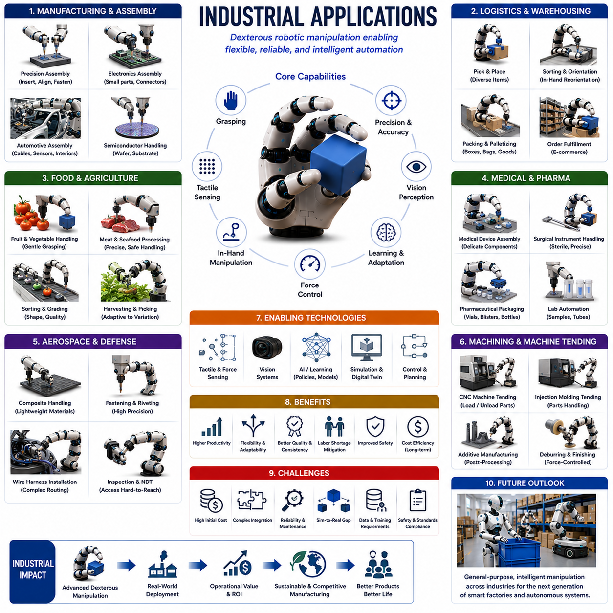{width="7.268055555555556in" height="7.268055555555556in"}

Industrial Applications represent the ultimate validation stage of dexterous robotic manipulation technologies. While many concepts in robotic hands, grasping, in-hand manipulation, tactile sensing, force control, and learning-based manipulation are initially developed within research laboratories, their true value is demonstrated when they are successfully deployed in real industrial environments. Industrial applications provide the practical context in which dexterity is transformed from an academic capability into a productive economic asset. In modern manufacturing, logistics, warehousing, electronics production, automotive assembly, medical device fabrication, aerospace engineering, food processing, and advanced packaging industries, robotic manipulation systems are increasingly expected to handle complex tasks that require levels of adaptability and precision traditionally associated only with human workers. As global industries move toward greater automation, higher product diversity, shorter production cycles, and mass customization, dexterous manipulation has become one of the most important enabling technologies for the next generation of intelligent factories.

Historically, industrial robots achieved remarkable success through structured automation. Traditional robotic arms equipped with simple grippers performed repetitive operations such as welding, painting, pick-and-place handling, palletizing, and machine tending. These systems were highly effective because the environment was carefully engineered to reduce uncertainty. Parts arrived in predictable orientations, fixtures constrained object positions, and dedicated tooling minimized variation. Under such conditions, simple parallel-jaw grippers and predefined motion programs were sufficient. However, modern manufacturing environments increasingly demand flexibility. Products change frequently, component variations are common, and production systems must adapt rapidly to new requirements. These trends have created a growing need for dexterous robotic manipulation capable of operating under less structured conditions.

One of the most significant industrial applications of dexterous manipulation is assembly automation. Assembly operations often require precise object positioning, orientation adjustment, insertion, fastening, and alignment. Human workers naturally perform these tasks using a combination of visual feedback, tactile sensing, force control, and adaptive manipulation strategies. Replicating these capabilities in robotic systems has become a major research and industrial objective. Advanced robotic hands equipped with multiple fingers, force sensing, and tactile perception can perform assembly operations that were previously considered too complex for automation. Examples include connector insertion, cable routing, precision fastening, gasket installation, electronic component placement, and mechanical subassembly construction.

Electronics manufacturing provides one of the clearest examples of the need for dexterous manipulation. Modern electronic devices contain numerous small, fragile, and densely packed components. Circuit boards, connectors, sensors, cables, batteries, displays, and integrated circuits often require delicate handling and precise placement. Traditional rigid grippers may struggle with these tasks because small positioning errors can cause component damage or assembly failure. Dexterous robotic hands can manipulate components more carefully, perform in-hand reorientation, and adjust grasp configurations dynamically to achieve accurate assembly. As consumer electronics become increasingly miniaturized, the demand for sophisticated manipulation capabilities continues to grow.

The semiconductor industry presents even more demanding requirements. Semiconductor manufacturing involves handling wafers, masks, substrates, and highly sensitive process materials. Even microscopic contamination or excessive force can lead to significant economic losses. Robotic systems operating in cleanroom environments must combine exceptional precision with reliable force control. Dexterous manipulation technologies enable robots to interact safely with delicate materials while maintaining the cleanliness and repeatability required for semiconductor production.

Automotive manufacturing has long been one of the largest users of industrial robotics. Traditional automotive automation focused heavily on welding, painting, and large-scale material handling. However, modern vehicles contain increasing numbers of electronic systems, sensors, wiring harnesses, battery modules, and customized components. Many of these elements require more sophisticated manipulation than conventional robotic grippers can provide. Dexterous robotic systems can assist in cable installation, connector engagement, battery assembly, sensor placement, interior assembly, and quality inspection. The transition toward electric vehicles further increases demand for advanced manipulation technologies because battery production involves numerous precision assembly operations.

Aerospace manufacturing represents another major application domain. Aircraft and spacecraft components are often large, expensive, and manufactured in relatively low volumes. Production environments must accommodate significant variability while maintaining extremely high quality standards. Many aerospace assembly tasks involve complex geometries, precision alignment, and constrained workspaces. Dexterous robotic manipulation enables automated handling of composite materials, fastening operations, wire installation, component positioning, and inspection procedures. The ability to adapt to varying part geometries is particularly valuable in aerospace applications where dedicated tooling may be economically impractical.

The medical device industry also benefits substantially from dexterous manipulation technologies. Medical products often require precision assembly under strict quality and regulatory requirements. Components may be small, fragile, sterile, or highly specialized. Examples include surgical instruments, catheters, implantable devices, diagnostic equipment, and pharmaceutical packaging. Dexterous robotic systems provide consistent handling performance while reducing contamination risks and improving manufacturing repeatability. Advanced force control capabilities are especially important because many medical components can be damaged by excessive handling forces.

Food processing and agricultural industries have emerged as important areas for dexterous manipulation deployment. Unlike many industrial components, food products are highly variable in shape, size, texture, and mechanical properties. Fruits, vegetables, baked goods, seafood, meat products, and packaged foods often require gentle handling to prevent damage. Traditional industrial grippers frequently lack the adaptability required for these tasks. Dexterous robotic hands, soft robotic grippers, and tactile sensing systems enable more reliable manipulation of delicate products. Such capabilities support automated sorting, packaging, inspection, harvesting, and food preparation processes.

Warehouse automation and logistics have become major drivers of manipulation research. The rapid growth of e-commerce has created demand for robotic systems capable of handling enormous product diversity. Unlike traditional manufacturing environments where objects are highly standardized, warehouses contain thousands or millions of unique items with different shapes, weights, packaging materials, and handling requirements. Dexterous manipulation allows robots to pick, sort, orient, pack, and transport a broad range of products. In-hand manipulation capabilities are particularly valuable because they enable robots to adjust object orientation without requiring external fixtures or repeated grasp attempts.

Order fulfillment centers illustrate the importance of adaptive manipulation. Human workers can quickly identify, grasp, rotate, and package diverse products. Replicating this flexibility with robots requires advanced perception, grasp planning, tactile sensing, and manipulation control. Recent developments in learning-based manipulation have significantly improved robotic performance in such environments. By combining vision systems with reinforcement learning and large-scale manipulation datasets, robotic systems are becoming increasingly capable of handling the complexity of warehouse operations.

Packaging automation represents another rapidly growing application area. Modern packaging systems must accommodate products with widely varying dimensions and materials. Tasks such as box assembly, item insertion, label application, package sealing, and pallet construction often require dexterous handling. Adaptive robotic hands can adjust to changing product requirements without extensive reconfiguration, improving operational flexibility and reducing downtime.

Machine tending is a long-established industrial robotics application that continues to evolve through dexterous manipulation technologies. Machine tending involves loading and unloading parts from manufacturing equipment such as CNC machines, injection molding systems, stamping presses, and additive manufacturing platforms. As production becomes more flexible and product variations increase, robotic systems require greater adaptability in handling different components. Dexterous manipulation enables more versatile machine tending operations by supporting complex grasping and repositioning strategies.

Quality inspection and metrology also benefit from advanced manipulation capabilities. Inspection processes frequently require rotating components, exposing hidden surfaces, repositioning parts for imaging, and interacting with measurement equipment. Dexterous robotic systems can manipulate objects dynamically to present optimal viewpoints for cameras, laser scanners, tactile probes, and other inspection devices. Such capabilities improve inspection coverage and reduce the need for specialized fixtures.

Maintenance, repair, and overhaul operations represent another important industrial application domain. Industrial facilities contain numerous components requiring periodic servicing, replacement, calibration, and adjustment. Many maintenance tasks involve manipulating tools, handling irregular objects, and working in constrained spaces. Dexterous robotic systems equipped with tool-use capabilities can perform maintenance operations with reduced human intervention. This capability is particularly valuable in hazardous environments such as chemical plants, offshore platforms, nuclear facilities, and mining operations.

The emergence of collaborative robots has further expanded industrial manipulation opportunities. Collaborative robots operate alongside human workers and must interact safely within shared workspaces. Unlike traditional industrial robots isolated behind safety barriers, collaborative systems often perform tasks requiring frequent adaptation and close human interaction. Dexterous manipulation enables collaborative robots to assist workers with assembly, material handling, inspection, and packaging tasks. Advanced force control and tactile sensing improve safety while supporting more natural human-robot collaboration.

Industrial dexterous manipulation increasingly relies on tactile sensing technologies. Vision systems provide valuable information about object location and geometry, but many critical interactions occur at the contact interface. Tactile sensors enable robots to detect slip, estimate contact forces, identify surface properties, and adapt grasp strategies dynamically. In industrial settings, tactile sensing improves robustness under uncertainty and supports reliable operation in situations where visual information may be incomplete or occluded.

Force control plays a similarly important role. Many industrial tasks require controlled interaction with objects and environments. Examples include insertion, fastening, polishing, grinding, assembly, and inspection. Precise force regulation allows robotic systems to maintain stable contact while avoiding damage. Hybrid position-force control, impedance control, and model predictive control are commonly employed to achieve these objectives.

Learning-based manipulation is rapidly transforming industrial robotics. Traditional automation relies heavily on manual programming and task-specific engineering. Learning-based approaches allow robots to acquire manipulation skills from data, demonstrations, and experience. Reinforcement learning, imitation learning, self-supervised learning, and foundation models are increasingly being applied to industrial manipulation problems. These techniques improve adaptability, reduce deployment effort, and enable robots to handle greater variability.

Simulation has become an essential component of industrial manipulation development. Physics-based simulators allow engineers to evaluate robotic systems before deployment. Digital twins provide virtual representations of manufacturing environments that support planning, optimization, training, and validation. Simulation environments enable rapid testing of manipulation strategies while reducing development costs and operational risks.

The concept of flexible manufacturing is closely linked to dexterous manipulation. Traditional automation systems are optimized for specific products and processes. In contrast, flexible manufacturing systems must accommodate changing product designs, varying production volumes, and evolving market demands. Dexterous manipulation enables robots to adapt to new tasks with minimal hardware modifications, supporting more agile production systems.

Industry 4.0 and smart factory initiatives further increase the importance of advanced manipulation technologies. Connected manufacturing environments integrate robotics, sensors, cloud computing, artificial intelligence, and digital infrastructure. Dexterous robotic systems become intelligent agents capable of responding dynamically to production requirements, coordinating with other machines, and optimizing operational performance.

Economic considerations play a major role in industrial deployment. Although dexterous robotic systems are often more complex and expensive than traditional automation solutions, they can provide significant value by reducing labor costs, increasing productivity, improving quality, enhancing safety, and enabling new manufacturing capabilities. The return on investment becomes particularly attractive in applications characterized by high product variability, labor shortages, or demanding precision requirements.

Despite substantial progress, several challenges continue to limit widespread adoption. Dexterous robotic hands remain more expensive than conventional grippers. Reliable tactile sensing technologies are still evolving. Learning-based systems require extensive training and validation. Sim-to-real transfer remains imperfect. Maintenance requirements, system integration complexity, and certification considerations can also create deployment barriers. Nevertheless, ongoing advances in hardware, sensing, computing, and artificial intelligence are steadily reducing these limitations.

Future industrial manipulation systems are expected to combine dexterous robotic hands, multimodal perception, tactile intelligence, foundation models, world models, and large-scale learning architectures into unified platforms. These systems will increasingly resemble human workers in their ability to adapt, learn, and perform complex manipulation tasks across diverse environments. Rather than being restricted to narrowly defined operations, future industrial robots will function as general-purpose physical agents capable of handling a broad range of manufacturing and logistics activities.

Ultimately, Industrial Applications represent the real-world realization of dexterous manipulation research. They transform theoretical concepts into practical capabilities that create economic value, improve productivity, and expand the scope of automation. As robotic systems continue to advance toward human-level manipulation performance, industrial deployment will remain the most important proving ground for evaluating and refining dexterous technologies. The success of future intelligent factories, flexible production systems, autonomous warehouses, and collaborative work environments will depend heavily on continued progress in dexterous robotic manipulation and its industrial applications.
