**Volume 06 Robot Hands and Dexterous Grasping**

# 10. In-Hand Manipulation

## 10.01 Introduction to In-Hand Manipulation

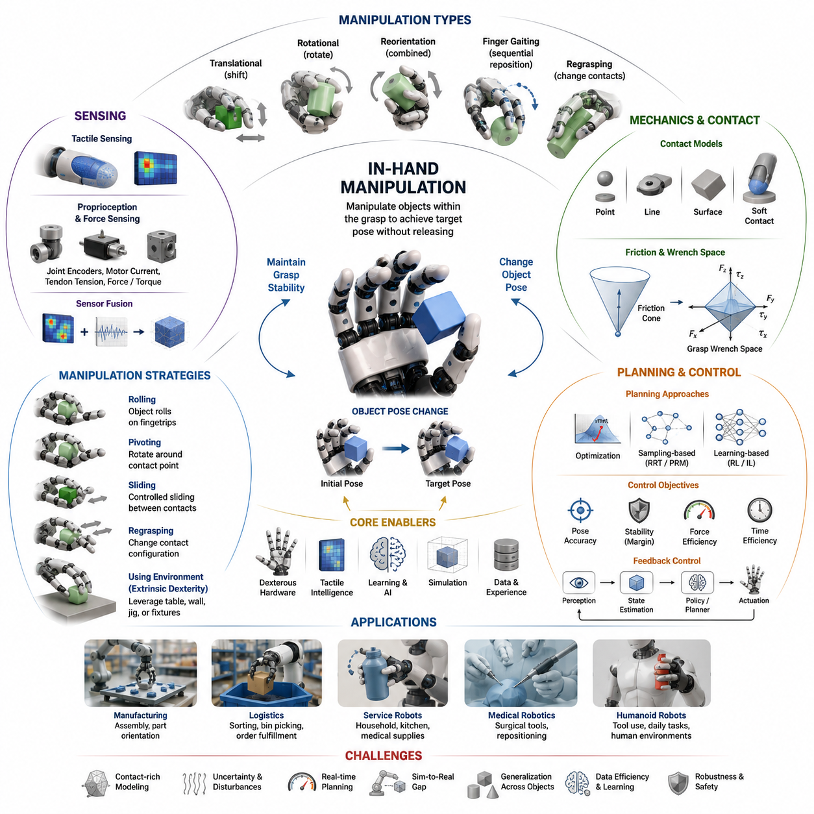{width="7.268055555555556in" height="7.268055555555556in"}

인핸드 매니퓰레이션(In-Hand Manipulation)은 로봇 파지(Grasping) 및 정교 조작(Dexterous Manipulation) 분야에서 가장 고도화되고 어려운 기술 중 하나이다. 기존의 로봇 파지는 물체를 안정적으로 집고 유지하는 데 초점을 두지만, 인핸드 매니퓰레이션은 물체를 손 안에서 놓지 않은 상태로 위치(Position), 자세(Orientation), 또는 구성(Configuration)을 변화시키는 능력을 의미한다. 이러한 능력은 인간과 유사한 손재주(Dexterity)를 구현하기 위한 핵심 요소이며, 범용 로봇 조작(General-Purpose Manipulation)을 실현하기 위한 중요한 단계로 간주된다. 로봇 핸드 분야에서 인핸드 매니퓰레이션은 단순한 파지와 실제 작업 수행 사이를 연결하는 핵심 기술로서, 제조업, 서비스 로봇, 의료 로봇, 물류 자동화, 휴머노이드 로봇 등 다양한 분야에서 중요한 역할을 담당한다. 이는 Robot Hand and Dexterous Grasping 시리즈의 Volume 06, Chapter 10을 구성하는 핵심 주제이기도 하다.

인간은 일상생활에서 끊임없이 인핸드 매니퓰레이션을 수행한다. 손가락 사이에서 펜을 돌리거나, 드라이버의 방향을 조정하거나, 열쇠를 자물쇠에 맞게 회전시키거나, 스마트폰의 방향을 바꾸는 행동들은 모두 인핸드 매니퓰레이션의 예이다. 이러한 동작이 자연스럽게 수행되는 이유는 인간의 손이 촉각(Tactile Sensing), 고유감각(Proprioception), 힘 제어(Force Control), 순응성(Compliance), 운동 계획(Motion Planning)을 통합적으로 활용하기 때문이다. 로봇에서 이러한 능력을 구현하기 위해서는 기구학(Kinematics), 동역학(Dynamics), 센싱(Sensing), 제어(Control), 인공지능(AI) 등 다양한 분야의 기술적 난제를 해결해야 한다.

인핸드 매니퓰레이션의 주요 목표는 파지 안정성(Grasp Stability)을 유지하면서 물체의 자세를 변화시키는 것이다. 일반적인 Pick-and-Place 작업에서는 물체를 단단히 고정한 상태로 이동시키지만, 인핸드 매니퓰레이션에서는 의도적으로 손가락과 물체 사이에 상대 운동(Relative Motion)을 발생시킨다. 이러한 상대 운동은 구름(Rolling), 미끄러짐(Sliding), 피벗(Pivoting), 핑거 게이팅(Finger Gaiting), 재파지(Regrasping), 다지 협조 동작(Multi-Finger Coordination) 등의 형태로 나타난다. 이 과정에서 로봇은 물체가 떨어지지 않도록 충분한 파지력을 유지하면서도 동시에 원하는 방향으로 물체를 움직여야 한다.

인핸드 매니퓰레이션은 여러 유형으로 분류할 수 있다. 병진 조작(Translational Manipulation)은 물체의 방향은 유지한 채 위치만 변화시키는 방식이다. 회전 조작(Rotational Manipulation)은 물체의 중심 위치를 유지하면서 방향을 변경한다. 재배향(Reorientation)은 위치와 방향을 동시에 변경하는 복합 작업이다. 핑거 게이팅(Finger Gaiting)은 손가락 접촉점을 순차적으로 변경하여 더 넓은 조작 범위를 확보하는 방법이다. 재파지(Regrasping)는 새로운 접촉 구성을 만들어 기존에 도달할 수 없는 자세를 달성하는 기술이다. 이들 모두는 물체를 안정적으로 유지하면서 원하는 자세로 변환하는 것을 목표로 한다.

인핸드 매니퓰레이션의 기초는 손가락과 물체 사이의 접촉 역학(Contact Mechanics)에 있다. 접촉점에서는 힘과 모멘트(Moment)가 발생하며, 이들이 물체의 운동을 결정한다. 접촉은 점 접촉(Point Contact), 소프트 핑거 접촉(Soft Finger Contact), 선 접촉(Line Contact), 면 접촉(Surface Contact) 등으로 모델링될 수 있다. 마찰(Friction)은 특히 중요한 요소로, 접촉이 유지되는지, 의도적으로 미끄러지는지, 또는 제어되지 않은 슬립(Slip)이 발생하는지를 결정한다. 따라서 마찰 원뿔(Friction Cone), 접촉 제약(Contact Constraint), 파지 렌치 공간(Grasp Wrench Space)에 대한 이해는 필수적이다.

정교 조작 분야에서 중요한 개념 중 하나는 내재적 손재주(Intrinsic Dexterity)와 외재적 손재주(Extrinsic Dexterity)의 구분이다. 내재적 손재주는 손가락 관절 운동만을 이용하여 물체를 조작하는 능력을 의미한다. 반면 외재적 손재주는 테이블, 벽, 지그(Jig), 환경 구조물 등을 활용하여 조작을 수행한다. 외재적 손재주는 환경이 추가적인 지지력과 제약 조건을 제공하기 때문에 상대적으로 복잡한 조작을 쉽게 수행할 수 있도록 도와준다.

핑거 게이팅(Finger Gaiting)은 가장 강력한 조작 기법 중 하나이다. 이는 인간이 손가락을 재배치하는 방식에서 영감을 받은 기술로, 일부 손가락이 물체를 유지하는 동안 다른 손가락이 새로운 위치로 이동하는 방법이다. 이동한 손가락이 다시 접촉한 후 다른 손가락이 움직이는 과정을 반복함으로써, 로봇은 제한된 손가락 운동 범위를 넘어서는 광범위한 물체 재배치를 수행할 수 있다.

롤링 조작(Rolling Manipulation)은 손가락과 물체 사이의 접촉을 유지한 채 물체를 굴리는 방식이다. 롤링은 큰 슬라이딩 마찰을 유발하지 않기 때문에 에너지 효율이 높고 안정적이다. 인간은 일상적으로 이러한 롤링 접촉을 활용한다. 로봇에서는 접촉력과 손끝 경로를 정밀하게 제어해야 안정적인 롤링 동작을 구현할 수 있다.

피벗 조작(Pivoting Manipulation)은 특정 접촉점을 축으로 물체를 회전시키는 방식이다. 예를 들어 드라이버를 원하는 방향으로 돌려 나사를 체결하는 과정에서 활용된다. 피벗 동작에서는 물체의 질량 분포, 접촉 기하구조, 중력 효과를 정확하게 고려해야 하며, 경우에 따라 중력을 적극적으로 이용하여 에너지 소비를 줄일 수 있다.

재파지(Regrasping)는 연속적인 접촉만으로는 목표 자세에 도달할 수 없을 때 사용된다. 로봇은 의도적으로 접촉 위치를 변경하여 새로운 파지 구성을 형성한다. 재파지 계획(Regrasp Planning)은 안정성을 유지하면서 목표 자세에 도달할 수 있는 중간 파지 상태를 계산하는 문제이다. 가능한 접촉 조합이 매우 많기 때문에 최적화(Optimization), 탐색(Search), 학습(Learning) 기반 기법이 널리 활용된다.

인핸드 매니퓰레이션의 기구학은 일반적인 로봇 팔의 기구학보다 훨씬 복잡하다. 단순히 하나의 엔드 이펙터(End Effector) 위치를 제어하는 것이 아니라 여러 손가락의 접촉 상태와 물체의 자세를 동시에 고려해야 하기 때문이다. 따라서 물체 자체가 핸드와 결합된 기구학 시스템의 일부가 되며, 결과적으로 매우 높은 차원의 구성 공간(Configuration Space)이 형성된다.

동역학(Dynamics)은 문제를 더욱 복잡하게 만든다. 빠른 회전, 급격한 가속, 충격 접촉은 비선형 효과를 유발한다. 그러나 이러한 동적 효과는 단순히 방해 요소가 아니라 적극적으로 활용될 수도 있다. 인간은 종종 관성(Inertia)을 이용하여 물체를 빠르게 뒤집거나 회전시킨다. 최근 로봇 연구에서도 이러한 동적 조작(Dynamic Manipulation)을 활용하여 작업 속도와 효율을 높이려는 시도가 활발하게 이루어지고 있다.

촉각 센서(Tactile Sensor)는 안정적인 인핸드 매니퓰레이션을 가능하게 하는 핵심 기술이다. 시각 센서만으로는 손가락에 의해 가려지는 접촉 상태를 정확히 파악하기 어렵다. 촉각 센서는 접촉 압력 분포, 힘의 크기, 슬립 발생 여부, 표면 형상 등의 정보를 제공한다. 이를 통해 로봇은 물체가 손가락에 대해 어떻게 움직이고 있는지 추정하고 적절한 파지력을 유지할 수 있다.

고유감각(Proprioception) 또한 중요한 역할을 한다. 관절 엔코더, 모터 전류 센서, 텐던 장력 센서, 힘·토크 센서 등을 통해 손가락의 상태와 상호작용 힘을 측정할 수 있다. 촉각 정보와 고유감각 정보를 융합하면 로봇은 조작 중인 물체의 상태를 더욱 정확하게 추정할 수 있으며, 이는 조작 성공률 향상으로 이어진다.

인핸드 매니퓰레이션 계획(Planning)은 매우 어려운 계산 문제이다. 계획기는 손가락을 어떻게 움직일지, 어떤 힘을 적용할지, 파지 안정성을 어떻게 유지할지를 결정해야 한다. 전통적인 방법은 기하학 모델과 최적화 기법을 사용하여 이러한 문제를 해결한다. 목표 자세 오차, 에너지 소비, 조작 시간, 접촉 안정성 등을 비용 함수(Cost Function)로 정의하고 최적의 조작 경로를 계산한다.

샘플링 기반 계획(Sampling-Based Planning)은 고차원 공간 탐색에 효과적이다. RRT(Rapidly Exploring Random Tree)나 PRM(Probabilistic Roadmap)과 같은 기법은 물체 자세 공간과 접촉 전이 공간을 탐색하여 가능한 조작 경로를 찾는다. 이러한 접근은 복잡한 물체 형상이나 비선형 접촉 조건에서 특히 유용하다.

최근에는 머신러닝(Machine Learning)이 인핸드 매니퓰레이션 분야를 크게 변화시키고 있다. 강화학습(Reinforcement Learning), 모방학습(Imitation Learning), 행동 복제(Behavior Cloning), 자기지도학습(Self-Supervised Learning)은 사람이 설계하기 어려운 정교한 조작 전략을 자동으로 학습할 수 있게 해준다. 이러한 방법들은 손가락 협조 패턴, 적응형 힘 제어, 강인한 조작 정책을 대규모 경험 데이터로부터 학습한다.

대표적인 사례로는 다지형 로봇 핸드가 물체를 자유롭게 회전시키고 재배향하는 작업을 학습한 연구들이 있다. 시뮬레이션에서 대규모 학습을 수행한 후 실제 하드웨어로 정책을 이전함으로써, 로봇은 복잡한 손가락 협조 동작과 외란 복구 능력을 습득할 수 있었다. 이러한 결과는 고성능 하드웨어와 대규모 AI 학습의 결합이 미래 로봇 조작 기술의 핵심임을 보여준다.

시뮬레이션은 현대 인핸드 매니퓰레이션 연구에서 필수적인 도구이다. 실제 데이터 수집은 비용과 시간이 많이 들기 때문에 물리 시뮬레이터를 이용하여 알고리즘을 학습하고 검증한다. 그러나 접촉이 풍부한(Contact-Rich) 조작을 정확하게 시뮬레이션하는 것은 매우 어렵다. 작은 모델링 오차도 실제 조작 성능에 큰 영향을 줄 수 있기 때문에 Sim-to-Real, Domain Randomization, System Identification과 같은 기술이 함께 사용된다.

성능 평가(Benchmarking) 또한 매우 중요하다. 연구자들은 작업 성공률, 자세 정확도, 조작 속도, 에너지 효율, 외란 강인성, 일반화 성능 등을 측정한다. 최근의 벤치마크는 단순한 실험실 환경을 넘어 실제 산업 및 생활 환경에서 요구되는 조작 능력을 평가하는 방향으로 발전하고 있다.

산업 현장에서 인핸드 매니퓰레이션은 매우 큰 가치를 가진다. 제조 공정에서는 전용 지그 없이도 부품의 방향을 조정할 수 있으며, 조립 작업에서는 부품 정렬과 삽입을 효율적으로 수행할 수 있다. 전자제품 생산, 자동차 조립, 항공우주 제조, 의료기기 생산 등 다양한 산업에서 활용 가능성이 높다.

물류 및 창고 자동화 분야에서도 인핸드 매니퓰레이션은 중요하다. 로봇은 물체를 다시 내려놓고 집는 과정을 반복하지 않고도 손 안에서 방향을 조정할 수 있어 작업 효율이 향상된다. 서비스 로봇 역시 가정용 물품, 의료용품, 주방 도구 등을 다룰 때 이러한 능력이 필수적이다.

휴머노이드 로봇은 인핸드 매니퓰레이션이 가장 절실하게 요구되는 분야이다. 인간 환경에서 작업하려면 도구 사용, 용기 개봉, 장비 조작, 조립 작업 등 다양한 정교 조작 능력이 필요하다. 따라서 인핸드 매니퓰레이션은 차세대 휴머노이드 개발의 핵심 연구 주제로 자리 잡고 있다.

그럼에도 불구하고 아직 해결해야 할 과제는 많다. 불확실성 하에서의 강인한 조작, 제한된 데이터로부터의 효율적인 학습, 신뢰성 높은 촉각 인식, 실시간 계획, 다양한 물체에 대한 일반화 능력 등은 여전히 활발히 연구되고 있다. 앞으로는 파운데이션 모델(Foundation Model), 멀티모달 인식(Multimodal Perception), 촉각 지능(Tactile Intelligence), 월드 모델(World Model), 대규모 강화학습이 결합되어 더욱 높은 수준의 조작 능력을 구현할 것으로 예상된다.

궁극적으로 인핸드 매니퓰레이션은 단순한 그리퍼와 진정한 정교 로봇 핸드를 구분하는 핵심 기술이다. 이는 파지를 단순한 고정 동작이 아니라 물체를 자유롭게 제어하고 재구성하는 동적 과정으로 확장시킨다. 센서, 액추에이터, 제어 이론, 인공지능 기술이 발전함에 따라 인핸드 매니퓰레이션은 미래의 자율 로봇과 휴머노이드 시스템에서 필수적인 핵심 역량으로 자리 잡게 될 것이다.

## 10.02 Finger Gaiting

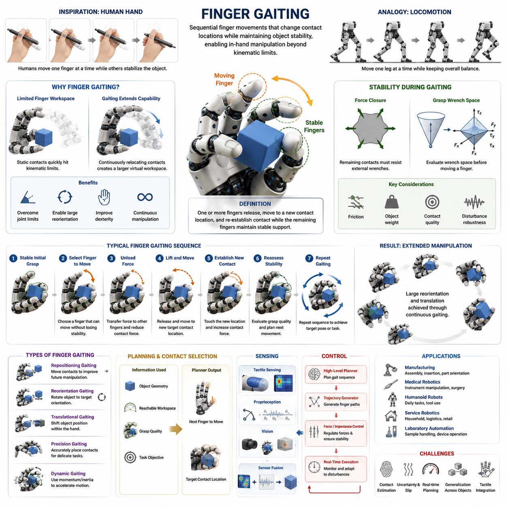{width="7.268055555555556in" height="7.268055555555556in"}

핑거 게이팅(Finger Gaiting)은 정교한 로봇 조작(Dexterous Manipulation)을 가능하게 하는 가장 중요하고 독창적인 기술 중 하나이다. 이 기술은 로봇 핸드가 물체를 완전히 놓지 않은 상태에서 파지 구성을 변경하고, 접촉점을 재배치하며, 물체를 손 안에서 자유롭게 조작할 수 있도록 해준다. 핑거 게이팅의 개념은 인간의 손 동작에서 직접 영감을 얻었다. 사람이 펜을 돌리거나, 드라이버의 방향을 조정하거나, 열쇠를 회전시키거나, 작은 물체를 손끝으로 조작할 때를 보면 접촉점이 고정되어 있지 않다. 대신 일부 손가락은 물체를 유지하고, 다른 손가락은 접촉을 해제한 후 새로운 위치로 이동하여 다시 접촉한다. 이러한 연속적인 접촉 전환(Contact Transition)의 과정이 바로 핑거 게이팅이다. 로봇 핸드에서는 이러한 기술을 통해 손가락 관절의 물리적 한계를 넘어서는 조작 능력을 확보할 수 있으며, 진정한 의미의 인핸드 매니퓰레이션(In-Hand Manipulation)을 실현하는 핵심 기술로 간주된다.

'게이팅(Gaiting)'이라는 용어는 원래 보행(Locomotion) 연구에서 유래하였다. 보행 로봇이 전체 균형을 유지하면서 한쪽 다리씩 이동하는 것처럼, 정교한 로봇 핸드는 전체 파지 안정성을 유지하면서 한 손가락씩 이동한다. 핑거 게이팅 과정에서 특정 손가락은 일시적으로 물체와의 접촉을 끊고 새로운 위치로 이동한다. 그동안 나머지 손가락들은 충분한 힘을 제공하여 물체가 떨어지거나 미끄러지지 않도록 유지한다. 이동한 손가락이 새로운 위치에 접촉하면 다른 손가락이 이동을 시작한다. 이러한 과정을 반복함으로써 로봇은 물체를 점진적으로 원하는 자세로 변화시킬 수 있다.

핑거 게이팅이 필요한 가장 큰 이유는 개별 손가락의 작업 공간(Workspace)이 제한적이기 때문이다. 각 손가락은 관절 범위(Joint Range), 도달 가능 영역(Reachability), 접촉 가능한 표면 영역에 한계가 존재한다. 만약 접촉점을 고정한 상태로만 물체를 조작한다면 손가락은 곧 운동학적 한계(Kinematic Limit)에 도달하게 된다. 결국 더 이상의 조작이 불가능해진다. 핑거 게이팅은 접촉점을 지속적으로 이동시켜 이러한 한계를 극복하며, 결과적으로 훨씬 더 넓은 가상 작업 공간(Virtual Workspace)을 형성한다. 이를 통해 로봇은 정적인 파지 상태로는 불가능한 대규모 회전, 이동, 재배향(Reorientation)을 수행할 수 있다.

기하학적 관점에서 핑거 게이팅은 접촉 위상(Contact Topology)을 변경하면서도 파지 안정성을 유지하는 과정으로 볼 수 있다. 파지는 손가락과 물체 사이의 접촉점 집합으로 정의된다. 각 접촉점은 힘 전달 능력과 운동 제약을 제공한다. 손가락이 새로운 위치로 이동하면 전체 파지 구조도 변화하게 된다. 이때 중요한 점은 이동 중에도 남아 있는 접촉점들이 충분한 안정성을 유지해야 한다는 것이다. 따라서 핑거 게이팅은 본질적으로 접촉 관리(Contact Management)의 문제라고 할 수 있다.

일반적인 핑거 게이팅 과정은 안정적인 초기 파지 상태에서 시작된다. 먼저 계획기(Planner)는 현재 안정성을 유지하면서 이동 가능한 손가락을 선택한다. 이후 해당 손가락에 걸린 힘을 다른 손가락들로 분산시켜 접촉력을 점진적으로 감소시킨다. 힘이 거의 0에 가까워지면 손가락은 접촉을 해제하고 목표 접촉점으로 이동한다. 이동하는 동안 다른 손가락들은 물체를 안정적으로 유지한다. 새로운 위치에 도달하면 손가락은 다시 접촉하고 점진적으로 힘을 증가시킨다. 이후 전체 파지 품질을 재평가하고 다음 게이팅 단계를 수행한다.

핑거 게이팅에서는 힘 폐쇄(Force Closure)가 매우 중요하다. 손가락 하나가 이동하는 동안 남아 있는 접촉점들이 외부 힘과 외란을 견딜 수 있어야 한다. 만약 힘 폐쇄 조건이 깨지면 물체는 불안정해지고 미끄러지거나 떨어질 수 있다. 따라서 게이팅 계획 알고리즘은 어떤 손가락을 이동시킬지 결정하기 전에 파지 렌치 공간(Grasp Wrench Space)과 접촉 제약 조건을 분석한다. 무거운 물체나 비대칭 물체, 저마찰 표면을 가진 물체를 조작할 경우 이러한 안정성 분석은 더욱 중요해진다.

핑거 게이팅의 효율성은 손가락 개수에 크게 의존한다. 3지형 핸드는 기본적인 게이팅이 가능하지만 한 손가락이 이동하면 두 개의 접촉점만 남게 되므로 안정성이 제한된다. 4지형 핸드는 한 손가락이 이동하더라도 세 개의 접촉점이 유지되므로 훨씬 높은 안정성을 제공한다. 5지형 인간형 핸드는 더 많은 대체 경로와 다양한 게이팅 전략을 활용할 수 있어 가장 높은 유연성을 제공한다. 손가락 수가 증가할수록 시스템의 중복성(Redundancy)이 증가하며, 이는 더욱 강인한 계획과 제어를 가능하게 한다.

핑거 게이팅은 목적에 따라 여러 유형으로 구분할 수 있다. 재배치 게이팅(Repositioning Gaiting)은 미래의 조작을 위해 접촉점을 이동시키는 데 초점을 둔다. 재배향 게이팅(Reorientation Gaiting)은 물체를 원하는 방향으로 회전시키기 위한 방법이다. 병진 게이팅(Translational Gaiting)은 물체의 위치를 손 안에서 이동시킨다. 정밀 게이팅(Precision Gaiting)은 매우 정확한 접촉 위치를 확보하기 위한 방식이다. 동적 게이팅(Dynamic Gaiting)은 관성과 운동량을 활용하여 조작 속도를 높인다. 각각의 방식은 서로 다른 센싱, 계획, 제어 요구사항을 가진다.

핑거 게이팅에서 가장 어려운 문제 중 하나는 접촉 계획(Contact Planning)이다. 손가락이 어디로 이동해야 하는지를 결정하기 위해서는 물체 형상, 파지 품질, 도달 가능성, 미래 작업 요구사항 등을 종합적으로 고려해야 한다. 잘못된 접촉점을 선택하면 더 이상 조작을 진행할 수 없는 막다른 상태에 도달할 수 있다. 따라서 접촉 계획은 일반적으로 안정성, 도달 가능성, 손재주, 작업 진행도를 고려하는 최적화 문제로 정의된다.

운동학(Kinematics)은 핑거 게이팅 계획의 기초를 형성한다. 각 손가락은 관절 제한과 기구 구조에 의해 정의되는 작업 공간을 가진다. 계획기는 목표 접촉점이 해당 작업 공간 내에 존재하는지 확인해야 하며, 특이점(Singularity)과 충돌(Collision)을 피해야 한다. 다지형 핸드에서는 손가락 간 상호작용 때문에 문제가 더욱 복잡해지며, 따라서 전체 핸드-물체 시스템을 하나의 통합 시스템으로 고려하는 접근이 필요하다.

핑거 게이팅은 재파지(Regrasping)와 밀접한 관련이 있지만 동일한 개념은 아니다. 재파지는 접촉 구성을 변경하는 모든 과정을 의미하는 넓은 개념이다. 반면 핑거 게이팅은 물체를 지속적으로 지지하면서 손가락을 순차적으로 이동시키는 특정한 형태의 재파지 기술이다. 전통적인 재파지는 물체를 테이블에 내려놓고 다시 집는 과정을 포함할 수 있지만, 핑거 게이팅은 물체를 놓지 않은 상태에서 연속적으로 수행된다. 따라서 연속적인 조작이 필요한 작업에서 매우 유용하다.

핑거 게이팅의 역학은 마찰(Friction)에 크게 의존한다. 접촉 전환 중에는 마찰력이 물체를 안정적으로 유지하는 역할을 한다. 마찰 계수가 높을수록 안정성 여유가 커지고 계획이 단순해진다. 반대로 마찰이 낮은 환경에서는 슬립 위험이 증가하므로 보다 보수적인 힘 제어 전략이 필요하다. 일부 시스템은 환경 변화에 대응하기 위해 게이팅 중 파지력을 능동적으로 조절하기도 한다.

촉각 센서(Tactile Sensor)는 성공적인 핑거 게이팅을 위한 핵심 요소이다. 로봇은 접촉이 끊어지는 순간과 새로운 접촉이 형성되는 순간을 정확하게 인식해야 한다. 촉각 센서는 압력 분포, 접촉 위치, 미세 슬립(Micro-Slip) 등을 측정하여 이러한 정보를 제공한다. 이를 통해 제어기는 더욱 정확한 힘 조절을 수행할 수 있으며 불확실성을 줄일 수 있다. 최신 촉각 시스템은 물체의 국부 형상까지 추정할 수 있어 더욱 정교한 접촉 계획을 가능하게 한다.

비전 시스템(Vision System)은 물체 자세와 손의 상태에 대한 전역 정보를 제공한다. 카메라는 물체 방향을 추적하고 조작 진행 상황을 모니터링할 수 있다. 그러나 접촉점 대부분이 손가락에 의해 가려지는 경우가 많기 때문에 시각 정보만으로는 충분하지 않다. 따라서 최신 시스템은 비전, 촉각, 고유감각(Proprioception)을 통합한 멀티모달 센서 융합(Multimodal Sensor Fusion)을 사용한다.

핑거 게이팅 제어는 여러 목표를 동시에 만족해야 한다. 물체 안정성 유지, 손가락 궤적 추종, 파지력 조절, 충돌 회피, 외란 보상 등이 모두 동시에 이루어져야 한다. 이러한 복잡성 때문에 계층형 제어 구조(Hierarchical Control Architecture)가 자주 사용된다. 상위 계층은 게이팅 순서를 계획하고, 하위 계층은 힘 제어와 운동 제어를 수행한다.

최근에는 최적화 기반 제어(Optimization-Based Control)가 널리 활용되고 있다. 이러한 접근은 작업 목표와 물리적 제약 조건을 동시에 고려하는 수학적 최적화 문제를 실시간으로 해결한다. 마찰 원뿔 제한, 관절 제한, 충돌 회피, 힘 폐쇄 조건 등이 제약 조건으로 포함된다. 이를 통해 환경 변화와 물체 특성 변화에 적응하는 유연한 게이팅 동작을 생성할 수 있다.

머신러닝(Machine Learning)은 핑거 게이팅 연구를 크게 발전시켰다. 강화학습(Reinforcement Learning)은 시행착오를 통해 효과적인 게이팅 전략을 스스로 학습할 수 있게 한다. 복잡한 접촉 역학을 완전히 모델링하지 않아도 조작 성공률을 최대화하는 정책을 학습할 수 있다. 특히 시뮬레이션 환경에서는 수백만 회 이상의 학습을 수행할 수 있어 매우 복잡한 조작 기술도 습득할 수 있다.

행동 복제(Behavior Cloning)와 모방학습(Imitation Learning)은 또 다른 접근 방법이다. 인간의 손 동작을 데이터 글러브(Data Glove)나 원격 조작 시스템(Teleoperation)을 통해 수집한 후 이를 학습 데이터로 활용한다. 인간은 본질적으로 효율적인 게이팅 전략을 사용하기 때문에 이러한 접근은 빠른 초기 성능 확보에 유리하다.

최근 연구에서는 강화학습과 도메인 랜덤화(Domain Randomization)를 결합하는 방법이 널리 사용되고 있다. 다양한 형상, 질량, 마찰 계수, 접촉 조건을 가진 물체를 시뮬레이션에 포함함으로써 실제 환경에서도 동작 가능한 강인한 정책을 학습할 수 있다. 이러한 기술은 큐브 회전, 도구 조작, 연속적인 물체 재배향과 같은 복잡한 게이팅 작업을 가능하게 만들었다.

핑거 게이팅은 휴머노이드 로봇에서 특히 중요하다. 인간 환경에는 지속적인 자세 조정이 필요한 물체가 매우 많다. 병 뚜껑을 열거나, 공구를 사용하거나, 기계를 조작하거나, 제품을 조립하는 과정은 모두 접촉점 재구성이 필요하다. 핑거 게이팅이 없다면 로봇은 반복적인 Pick-and-Place를 수행해야 하므로 효율이 크게 감소한다. 따라서 핑거 게이팅은 인간 수준의 조작 능력을 구현하기 위한 핵심 기술이다.

산업 현장에서도 활용 가능성이 높다. 조립 작업에서는 부품 삽입 전에 방향 조정이 필요한 경우가 많다. 기존 산업용 로봇은 이를 위해 별도의 지그와 고정 장치를 사용하지만, 정교한 로봇 핸드는 핑거 게이팅만으로 이러한 작업을 수행할 수 있다. 이는 설비 비용을 줄이고 생산 유연성을 향상시키는 장점을 제공한다.

의료 로봇 분야에서도 핑거 게이팅은 중요하다. 수술 기구, 카테터, 주사 바늘과 같은 의료 장비는 매우 정밀한 자세 조정이 요구된다. 핑거 게이팅은 이러한 도구를 안정적으로 유지하면서도 세밀하게 조정할 수 있도록 지원한다. 실험실 자동화와 제약 산업에서도 유사한 장점을 제공한다.

핑거 게이팅 시스템의 성능 평가는 파지 안정성, 조작 성공률, 접촉 전환 효율성, 궤적 정확도, 작업 시간, 힘 활용도, 외란 강인성 등을 기반으로 수행된다. 최근 벤치마크는 핑거 게이팅 능력을 정교 조작 성능의 핵심 지표로 사용하고 있다.

비록 많은 발전이 있었지만, 핑거 게이팅은 여전히 활발한 연구 분야이다. 정확한 접촉 추정, 실시간 계획, 불확실성 관리, 촉각 융합, 새로운 물체에 대한 일반화 능력 등은 아직 해결해야 할 과제들이다. 미래에는 파운데이션 모델(Foundation Model), 월드 모델(World Model), 멀티모달 학습(Multimodal Learning), 촉각 지능(Tactile Intelligence)이 결합되어 더욱 높은 수준의 게이팅 성능이 구현될 것으로 예상된다.

궁극적으로 핑거 게이팅은 정교한 로봇 핸드를 정의하는 핵심 기술 중 하나이다. 이는 고정된 파지를 동적이고 적응적인 조작 시스템으로 변화시킨다. 손가락이 물체 안정성을 유지한 채 지속적으로 접촉 위치를 변경할 수 있도록 함으로써, 핑거 게이팅은 로봇 핸드의 능력을 획기적으로 확장시킨다. 향후 로봇 하드웨어, 센서 기술, 인공지능이 발전할수록 핑거 게이팅은 인간 수준의 정교 조작을 구현하는 가장 중요한 기반 기술 중 하나로 자리 잡게 될 것이다.

## 10.03 Rolling and Pivoting

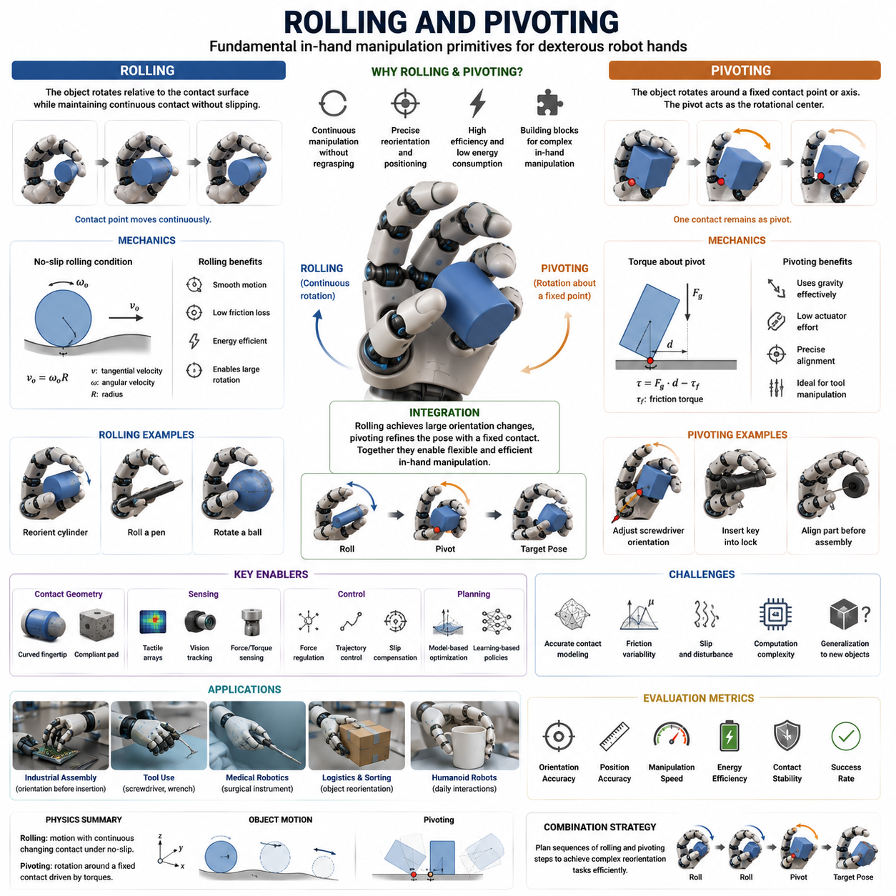{width="7.268055555555556in" height="7.268055555555556in"}

롤링(Rolling)과 피벗팅(Pivoting)은 정교한 로봇 핸드(Dexterous Robot Hand)가 인핸드 매니퓰레이션(In-Hand Manipulation)을 수행하기 위해 사용하는 가장 기본적이고 중요한 물체 조작 전략이다. 일반적인 파지(Grasping)가 물체를 안정적으로 잡고 유지하는 데 목적이 있다면, 롤링과 피벗팅은 물체를 완전히 놓지 않은 상태에서 손가락과 물체 사이의 상대 운동(Relative Motion)을 발생시켜 원하는 위치나 자세로 변화시키는 기술이다. 이러한 조작 방식은 인간의 손에서 매우 흔하게 관찰되며, 물체 재배향(Object Reorientation), 정밀 위치 조정(Precision Positioning), 공구 사용(Tool Use), 조립 작업(Assembly), 일상 물체 조작 등 다양한 작업에서 핵심적인 역할을 수행한다. 로봇 분야에서는 롤링과 피벗팅이 정적인 파지를 동적인 조작으로 전환시키는 핵심 메커니즘으로 간주되며, 반복적인 Pick-and-Place 동작을 대체할 수 있는 효율적인 조작 수단을 제공한다. 또한 인핸드 매니퓰레이션의 관점에서 볼 때, 롤링과 피벗팅은 단순 파지와 복잡한 물체 재구성(Object Reconfiguration) 사이를 연결하는 대표적인 조작 프리미티브(Manipulation Primitive)이다.

인간은 일상생활에서 롤링과 피벗팅을 지속적으로 활용한다. 펜을 손가락 사이에서 돌리거나, 열쇠를 자물쇠에 맞게 회전시키거나, 드라이버의 방향을 조정하거나, 동전의 방향을 바꾸거나, 스마트폰을 손 안에서 재배치하는 행동들은 모두 롤링과 피벗팅을 포함한다. 이러한 동작에서 손가락은 물체를 단순히 고정하는 것이 아니라 접촉 상태를 유지하면서 물체가 회전하고 이동하도록 유도한다. 인간 손의 뛰어난 손재주는 이러한 접촉 기반 조작(Contact-Based Manipulation)을 자연스럽게 활용할 수 있기 때문에 가능하다. 로봇 조작 연구의 중요한 목표 중 하나는 바로 이러한 인간의 능력을 기계적으로 재현하는 것이다.

롤링 조작은 물체가 접촉면과 지속적으로 접촉한 상태에서 미끄러짐 없이 회전하는 운동을 의미한다. 이 과정에서 물체의 접촉점은 지속적으로 변화하며, 손가락의 접촉 위치 또한 함께 이동한다. 이상적인 롤링은 무슬립(No-Slip) 조건을 만족하며, 접촉면에서 상대적인 접선 속도가 거의 존재하지 않는다. 롤링은 마찰 손실을 최소화하고 접촉면 마모를 줄일 수 있기 때문에 매우 효율적인 조작 방식으로 평가된다.

롤링 접촉에서는 물체가 무수히 많은 미세 접촉점을 따라 연속적으로 이동한다. 이러한 특성 덕분에 물체를 부드럽고 안정적으로 회전시키거나 재배향할 수 있다. 롤링은 손가락과 물체 사이에서 발생할 수도 있고, 여러 손가락이 협력하여 수행할 수도 있으며, 경우에 따라 환경과 물체 사이에서 발생하기도 한다. 접촉면의 형상은 롤링 특성에 큰 영향을 미친다. 곡면 형태의 손끝, 유연한 접촉 표면, 둥근 물체 형상은 롤링을 더욱 쉽게 만들어 준다.

롤링의 역학은 접촉 운동학(Contact Kinematics)으로 설명할 수 있다. 접촉면에서는 물체와 손가락 사이의 상대 속도가 특정한 롤링 제약(Rolling Constraint)을 만족해야 한다. 이러한 제약은 손가락 운동과 물체 운동 사이의 관계를 정의한다. 롤링은 회전 운동과 병진 운동이 결합된 형태로 나타나며, 이를 정확하게 모델링하기 위해서는 강체 운동학(Rigid Body Kinematics)과 미분기하학(Differential Geometry)이 활용된다. 작은 모델링 오차도 누적되면 최종 물체 자세에 큰 영향을 줄 수 있기 때문에 정밀한 모델링이 중요하다.

롤링의 가장 큰 장점은 접촉을 유지하면서도 큰 회전을 구현할 수 있다는 점이다. 반복적으로 물체를 놓았다가 다시 집을 필요 없이 손 안에서 점진적으로 방향을 변경할 수 있다. 따라서 조작 과정이 단순해지고 작업 효율성이 향상된다. 원통형 물체, 구형 물체, 둥근 손잡이, 생활용품과 같은 다양한 물체에서 롤링은 매우 효과적으로 활용된다.

에너지 효율성 또한 중요한 장점이다. 롤링은 슬라이딩(Sliding)에 비해 마찰 손실이 매우 적다. 따라서 액추에이터의 부하가 감소하고 발열도 줄어든다. 전력 소모와 구동 능력이 제한된 로봇 핸드에서는 이러한 효율성이 매우 중요한 요소가 된다.

하지만 롤링 조작은 여러 어려움을 가진다. 우선 접촉 형상을 정확히 파악해야 한다. 물체의 형상 모델이 부정확하면 롤링 경로를 정확하게 예측할 수 없다. 또한 롤링은 마찰 조건에 매우 민감하다. 마찰이 너무 크면 물체가 굴러가지 않고 달라붙는 현상(Sticking)이 발생할 수 있으며, 반대로 마찰이 너무 작으면 제어되지 않는 슬립(Slip)이 발생할 수 있다. 더불어 롤링은 비선형성이 강한 운동이기 때문에 계획과 제어가 쉽지 않다.

촉각 센서(Tactile Sensor)는 롤링 조작에서 중요한 역할을 한다. 촉각 배열(Tactile Array)은 접촉 위치, 압력 분포, 국부 변형 정보를 제공한다. 이를 통해 로봇은 실제로 롤링이 발생하고 있는지, 혹은 슬립이 시작되고 있는지를 판단할 수 있다. 고성능 촉각 센서는 접촉 형상까지 추정할 수 있어 롤링 계획의 정확도를 크게 향상시킨다.

비전 시스템은 롤링 과정에서 물체 자세를 추적하는 역할을 수행한다. 카메라는 물체의 위치와 방향 변화를 전역적으로 측정할 수 있으며, 촉각 정보와 결합하여 더욱 정확한 상태 추정을 가능하게 한다. 이러한 멀티모달 센서 융합(Multimodal Sensor Fusion)은 실제 환경에서 매우 중요한 기술이다.

피벗팅은 롤링과는 다른 특성을 가진다. 피벗팅에서는 물체가 특정 접촉점이나 축을 중심으로 회전한다. 롤링처럼 접촉점이 지속적으로 이동하지 않고, 하나의 주요 접촉점이 회전 중심 역할을 한다. 물체는 이 축을 기준으로 흔들리거나 회전하며 자세를 변경한다.

피벗팅은 중력(Gravity)을 적극적으로 활용하는 경우가 많다. 예를 들어 로봇이 드라이버를 수직으로 잡고 있는 상황을 생각해 볼 수 있다. 특정 방향의 파지력을 약간 감소시키면 중력에 의해 물체가 자연스럽게 회전한다. 이후 로봇은 새로운 자세에서 파지력을 다시 증가시켜 물체를 안정화시킨다. 이러한 중력 보조 피벗팅(Gravity-Assisted Pivoting)은 매우 적은 에너지로 효율적인 자세 변환을 가능하게 한다.

피벗팅의 물리학은 회전축 주변의 토크(Torque) 균형에 의해 결정된다. 중력, 접촉력, 관성력, 마찰 모멘트가 모두 물체 운동에 영향을 미친다. 성공적인 피벗팅을 위해서는 안정성과 이동성을 동시에 만족해야 한다. 파지력이 너무 크면 물체가 움직이지 않고, 너무 작으면 물체가 떨어질 수 있다. 따라서 힘 제어(Force Control)는 피벗팅에서 가장 중요한 요소 중 하나이다.

산업용 조립 작업에서는 피벗팅이 매우 널리 사용된다. 부품을 조립하기 전에 특정 방향으로 정렬해야 하는 경우가 많다. 기존 산업용 로봇은 이를 위해 별도의 지그(Jig)와 고정 장치를 사용하지만, 정교한 로봇 핸드는 피벗팅만으로도 동일한 작업을 수행할 수 있다. 이는 작업 시간을 단축하고 생산성을 향상시키며 민감한 부품을 떨어뜨릴 위험도 줄여준다.

공구 사용(Tool Use)에서도 피벗팅은 핵심 기술이다. 렌치, 드라이버, 메스, 수술 기구, 검사 프로브와 같은 도구들은 사용 중에 방향을 바꾸어야 하는 경우가 많다. 인간은 이를 자연스럽게 수행하지만, 로봇에게는 매우 복잡한 문제이다. 따라서 피벗팅 능력은 로봇의 실제 작업 범위를 크게 확장시킨다.

실제 조작에서는 롤링과 피벗팅이 함께 사용되는 경우가 많다. 예를 들어 물체를 크게 회전시킬 때는 롤링을 이용하고, 마지막 정밀 정렬 단계에서는 피벗팅을 사용할 수 있다. 반대로 피벗팅을 통해 적절한 자세를 만든 후 롤링을 수행하는 경우도 있다. 이러한 조합은 매우 유연한 물체 재구성 전략을 제공한다.

조작 프리미티브(Manipulation Primitive)의 개념은 롤링과 피벗팅을 이해하는 데 중요하다. 복잡한 조작을 하나의 거대한 문제로 취급하는 대신, 롤링, 피벗팅, 슬라이딩, 핑거 게이팅, 재파지와 같은 기본 동작으로 분해한다. 이후 이러한 프리미티브를 조합하여 복잡한 조작 기술을 구현한다. 이러한 접근은 계획 문제를 단순화하고 기술 재사용성을 높인다.

롤링과 피벗팅 계획은 계산적으로 매우 어려운 문제이다. 계획기는 접촉 형상, 마찰 제약, 물체 동역학, 힘 폐쇄 조건, 작업 목표를 동시에 고려해야 한다. 접촉이 풍부한(Contact-Rich) 조작은 강한 비선형성을 가지기 때문에 최적화 기반 접근이 많이 사용된다.

최적화 기반 계획에서는 목표 자세 오차, 조작 시간, 에너지 소비, 힘 사용량 등을 최소화하는 수학적 문제를 정의한다. 동시에 접촉 안정성, 충돌 회피, 운동학적 제약을 만족해야 한다. 최신 최적화 기법은 이러한 복잡한 조건을 만족하는 조작 경로를 생성할 수 있다.

샘플링 기반 계획(Sampling-Based Planning)은 복잡한 구성 공간(Configuration Space)을 탐색하는 데 사용된다. RRT(Rapidly Exploring Random Tree)나 PRM(Probabilistic Roadmap)과 같은 기법은 복잡한 형상을 가진 물체의 조작 계획에 특히 유용하다.

최근에는 머신러닝 기반 접근이 크게 발전하고 있다. 강화학습(Reinforcement Learning)은 로봇이 반복적인 시행착오를 통해 롤링과 피벗팅 전략을 스스로 학습할 수 있도록 해준다. 명시적인 물리 모델에만 의존하지 않고 성공률을 최대화하는 정책을 학습할 수 있기 때문에 매우 강력한 방법으로 평가된다.

대규모 시뮬레이션은 이러한 학습을 가능하게 만든 핵심 요소이다. 다양한 형상, 질량, 마찰 조건을 가진 물체를 대상으로 수백만 번의 학습을 수행할 수 있으며, 도메인 랜덤화(Domain Randomization)를 통해 실제 환경으로의 전이 성능도 향상시킬 수 있다.

모방학습(Imitation Learning) 또한 중요한 접근 방법이다. 원격 조작(Teleoperation)이나 모션 캡처(Motion Capture)를 통해 인간의 롤링 및 피벗팅 동작을 수집하고, 이를 학습 데이터로 활용한다. 인간은 본질적으로 효율적인 접촉 조작 전략을 사용하기 때문에 학습 초기 성능을 크게 향상시킬 수 있다.

롤링과 피벗팅의 성능은 핸드 설계에도 크게 의존한다. 둥근 손끝은 롤링을 용이하게 하며, 순응성(Compliance)을 가진 손끝은 접촉 안정성을 향상시킨다. 소프트 로봇 핑거(Soft Robotic Finger)는 접촉 면적을 넓혀 강인성을 증가시킬 수 있으며, 반대로 강체 손끝은 높은 위치 정밀도를 제공한다.

액추에이터 설계 또한 중요하다. 완전 구동(Fully Actuated) 구조는 높은 정밀도를 제공하며, 언더액추에이티드(Underactuated) 구조는 수동 적응 능력을 제공한다. 텐던 구동(Tendon-Driven), 직접 구동(Direct Drive), 가변 강성 액추에이터(Variable Stiffness Actuator)는 각각 다른 장점을 가진다.

힘·토크 센싱(Force-Torque Sensing)은 성공적인 롤링과 피벗팅을 위해 필수적이다. 손끝 힘 센서, 손목 힘·토크 센서, 텐던 장력 센서, 모터 전류 센서는 모두 접촉 상태 추정에 활용된다. 정확한 힘 정보는 안정적인 접촉 상태를 유지하면서 원하는 물체 운동을 생성하는 데 도움을 준다.

성능 평가는 물체 자세 정확도, 위치 정확도, 조작 속도, 에너지 효율, 접촉 안정성, 성공률 등을 기준으로 수행된다. 또한 슬립 발생 빈도, 외란 강인성, 새로운 물체에 대한 적응성도 중요한 평가 지표가 된다.

산업 현장에서 롤링과 피벗팅의 활용 범위는 점점 확대되고 있다. 전자제품 조립, 자동차 생산, 항공우주 제조, 창고 물류 자동화 등에서 물체 방향 조정과 정밀 정렬 작업에 활용되고 있다. 이는 전용 지그 사용을 줄이고 시스템 유연성을 크게 향상시킨다.

의료 로봇 분야에서도 중요한 역할을 한다. 수술 도구의 방향 조정, 카테터 조작, 바늘 삽입, 내시경 위치 조정 등은 모두 롤링과 피벗팅 기술을 필요로 한다. 이러한 기술은 로봇 수술의 정확성과 안전성을 크게 향상시킬 수 있다.

휴머노이드 로봇은 특히 롤링과 피벗팅에 크게 의존한다. 인간 환경은 인간 손의 능력을 기준으로 설계되어 있기 때문에 병을 열고, 스위치를 조작하고, 도구를 사용하고, 가전제품을 다루는 과정에서 이러한 조작 능력이 필수적으로 요구된다. 따라서 롤링과 피벗팅은 인간 수준의 손재주를 구현하기 위한 핵심 구성 요소라고 할 수 있다.

비록 많은 발전이 있었지만 아직도 해결해야 할 과제는 많다. 접촉 모델의 부정확성, 센서 노이즈, 외란, 높은 계산 복잡도, 일반화 성능 부족 등이 주요 문제로 남아 있다. 미래에는 촉각 지능(Tactile Intelligence), 파운데이션 모델(Foundation Model), 월드 모델(World Model), 멀티모달 인식(Multimodal Perception), 대규모 학습 기술이 결합되어 이러한 문제를 해결할 것으로 기대된다.

궁극적으로 롤링과 피벗팅은 정교한 로봇 조작을 가능하게 하는 가장 중요한 접촉 기반 조작 기술이다. 이들은 물체를 완전히 놓지 않고도 지속적으로 자세를 변경할 수 있게 하며, 작업 효율성과 유연성을 크게 향상시킨다. 접촉 역학(Contact Mechanics)을 지능적으로 활용함으로써 로봇은 인간 손과 유사한 수준의 정교한 조작 능력에 점점 더 가까워지고 있다. 향후 센서, 액추에이터, 인공지능 기술이 발전함에 따라 롤링과 피벗팅은 차세대 인핸드 매니퓰레이션 시스템의 핵심 기반 기술로 자리매김할 것이다.

## 10.04 Regrasping Strategies

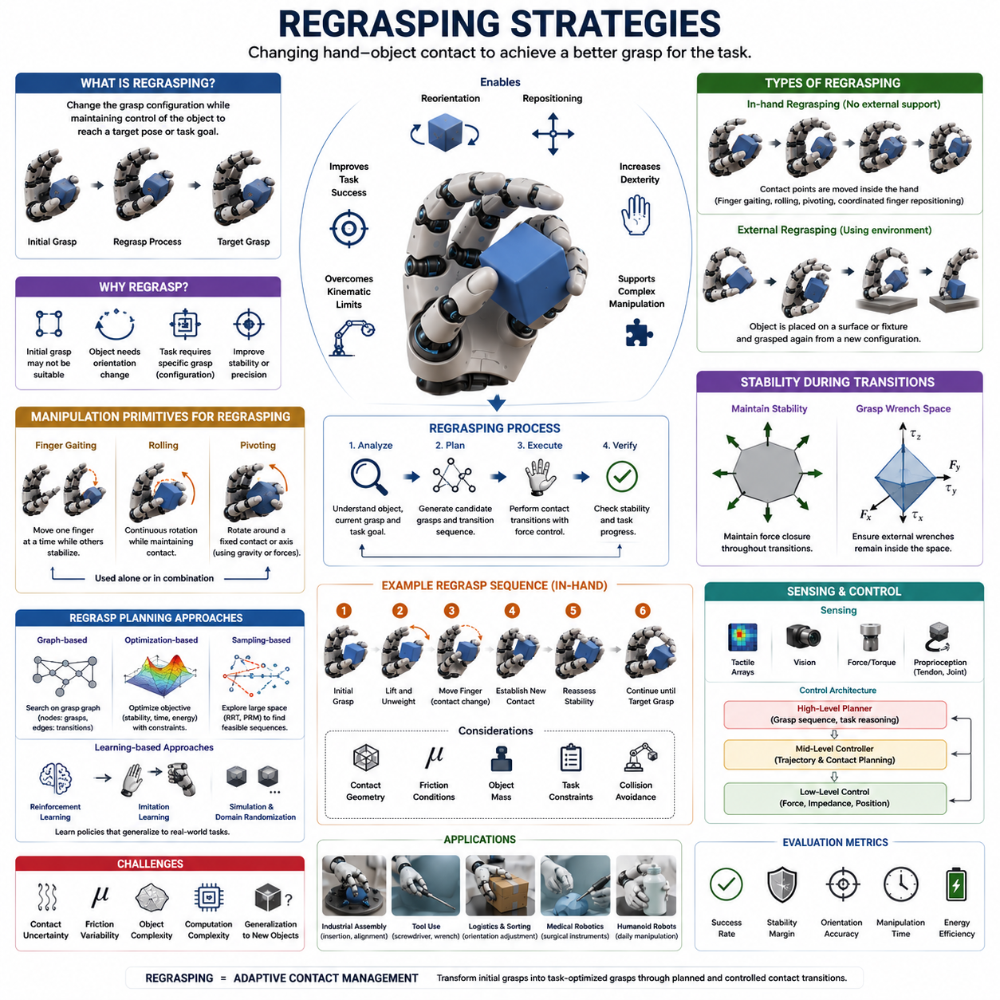{width="7.268055555555556in" height="7.268055555555556in"}

재파지(Regrasping)는 정교 로봇 조작(Dexterous Manipulation) 분야에서 가장 중요한 기술 중 하나이며, 파지 획득(Grasp Acquisition)과 고급 인핸드 매니퓰레이션(In-Hand Manipulation)을 연결하는 핵심적인 역할을 수행한다. 로봇이 물체를 성공적으로 집었다고 해서 곧바로 작업을 수행할 수 있는 것은 아니다. 실제 작업에서는 물체의 방향을 바꾸거나, 위치를 조정하거나, 작업에 적합한 자세로 변환해야 하는 경우가 매우 많다. 조립, 삽입, 공구 사용, 포장, 환경과의 상호작용 등 대부분의 작업은 초기 파지 상태와 최종 작업 파지 상태가 다르다. 재파지 전략은 이러한 문제를 해결하기 위해 물체와 로봇 핸드 사이의 접촉 구성을 의도적으로 변경하는 방법을 제공한다. 단순히 물체를 유지하는 것이 아니라, 물체에 대한 제어를 유지하면서 파지 상태를 변화시키는 것이 핵심이다. 따라서 재파지는 정교 조작, 인핸드 매니퓰레이션, 자율 로봇 작업 수행의 기반 기술로 간주된다. 로봇 핸드와 정교 파지(Dexterous Grasping) 분야에서는 고정된 파지와 제한된 손가락 작업 공간의 한계를 극복하는 핵심 기술로 자리 잡고 있다.

인간은 일상생활에서 재파지를 끊임없이 수행하지만 대부분 이를 의식하지 못한다. 예를 들어 드라이버를 집을 때 초기 파지 자세와 실제 나사를 조이는 자세는 다르다. 사람은 자연스럽게 손가락의 위치를 바꾸고 접촉점을 이동시키며 드라이버를 작업하기 적합한 자세로 조정한다. 병을 열거나, 열쇠를 자물쇠에 넣거나, 스마트폰을 조작하거나, 수술 기구를 사용하는 경우에도 동일한 과정이 반복된다. 이러한 사례들은 물체를 집는 행위가 조작의 시작일 뿐이며, 실제 작업 수행을 위해서는 여러 번의 파지 전환이 필요하다는 사실을 보여준다.

재파지의 기본 목적은 초기 파지 상태를 작업 수행에 적합한 목표 파지 상태로 변환하는 것이다. 그러나 많은 경우 목표 파지는 직접적으로 얻을 수 없다. 손가락의 도달 범위, 관절 제한, 충돌 문제, 안정성 조건, 물체 형상 등의 제약 때문에 중간 단계의 파지 상태가 필요하다. 이러한 중간 상태를 거치며 점진적으로 목표 자세에 도달하는 과정을 재파지 계획(Regrasp Planning)이라고 한다.

수학적으로 파지는 접촉점(Contact Point), 접촉력(Contact Force), 그리고 물체에 가해지는 제약 조건의 집합으로 표현할 수 있다. 각 파지 구성은 파지 공간(Grasp Space) 내의 하나의 상태(State)를 정의한다. 재파지는 이 공간에서 초기 상태에서 목표 상태로 이동하는 과정으로 볼 수 있다. 문제는 물체의 안정성을 유지하면서 이러한 상태 전환을 수행해야 한다는 점이다. 가능한 접촉 조합의 수는 매우 크기 때문에 재파지 계획은 복잡한 탐색(Search) 및 최적화(Optimization) 문제로 발전하게 된다.

재파지 연구에서 가장 중요한 구분 중 하나는 인핸드 재파지(In-Hand Regrasping)와 외부 재파지(External Regrasping)의 차이이다. 인핸드 재파지는 물체를 손 안에서 유지한 상태로 접촉 위치를 변경하는 방식이다. 손가락 이동(Finger Gaiting), 롤링(Rolling), 피벗팅(Pivoting), 다지 협조 동작(Multi-Finger Coordination) 등을 통해 수행된다. 반면 외부 재파지는 테이블, 벽, 지그(Jig), 트레이와 같은 환경을 이용한다. 로봇은 물체를 일시적으로 내려놓은 후 새로운 자세로 다시 집는다.

인핸드 재파지는 외부 도움 없이 물체를 지속적으로 제어할 수 있기 때문에 더욱 고급 기술로 평가된다. 특히 깨지기 쉬운 물체, 움직이는 플랫폼, 제한된 공간, 또는 작업대가 없는 환경에서는 필수적인 기술이다. 그러나 접촉점이 계속 변화하는 동안 안정성을 유지해야 하므로 기계적·계산적 난이도가 매우 높다.

외부 재파지는 상대적으로 구현이 쉽다. 테이블이나 고정 장치가 물체를 지지해 주기 때문에 계획과 제어가 단순해진다. 실제 산업용 로봇의 상당수는 이러한 방식을 활용한다. 하지만 환경에 의존하기 때문에 유연성이 떨어지고 비정형 환경(Unstructured Environment)에서는 활용이 제한될 수 있다.

모든 재파지 전략에서 가장 중요한 요소는 파지 안정성(Grasp Stability)이다. 파지 전환 중에도 물체는 항상 안전하게 제어되어야 한다. 이를 평가하기 위해 힘 폐쇄(Force Closure), 형상 폐쇄(Form Closure), 파지 렌치 공간(Grasp Wrench Space), 접촉 품질 지표(Contact Quality Metric) 등이 활용된다. 만약 전환 과정에서 안정성이 무너지면 물체가 미끄러지거나 예상치 못한 방향으로 회전하거나 심지어 떨어질 수 있다.

재파지는 작업 목적에 따라 여러 유형으로 나눌 수 있다. 방향 변경을 목표로 하는 방향 재파지(Orientation Regrasping), 위치 이동을 목표로 하는 위치 재파지(Positional Regrasping), 특정 작업에 적합한 파지를 만드는 기능 재파지(Functional Regrasping), 높은 정확도를 요구하는 정밀 재파지(Precision Regrasping), 불확실성 환경에서 안정성을 우선하는 강인 재파지(Robust Regrasping) 등이 있다. 작업 목적에 따라 최적의 전략도 달라진다.

재파지의 핵심은 접촉 전환(Contact Transition)이다. 하나 이상의 접촉점을 제거하고 새로운 위치에 다시 형성하는 과정이 반복된다. 모든 접촉점은 안정성에 기여하기 때문에 접촉 전환 순서는 매우 중요하다. 특정 접촉점을 잘못 제거하면 전체 파지가 불안정해질 수 있다. 따라서 계획기는 접촉 위치뿐 아니라 이동 순서까지 결정해야 한다.

핑거 게이팅(Finger Gaiting)은 가장 널리 연구된 인핸드 재파지 기술 중 하나이다. 일부 손가락은 물체를 유지하고 다른 손가락은 새로운 위치로 이동한다. 이를 반복함으로써 접촉점을 점진적으로 변경할 수 있다. 핑거 게이팅은 손가락의 제한된 작업 공간을 확장하고 큰 자세 변환을 가능하게 한다.

롤링(Rolling)과 피벗팅(Pivoting)도 재파지에 중요한 역할을 한다. 롤링은 접촉을 유지하면서 접촉점이 연속적으로 이동하는 방식이고, 피벗팅은 특정 접촉점을 중심으로 물체를 회전시키는 방식이다. 이들은 핑거 게이팅과 결합되어 더욱 유연한 재파지 전략을 제공한다. 예를 들어 롤링을 통해 물체의 방향을 크게 바꾼 후 핑거 게이팅으로 새로운 파지를 형성할 수 있다.

물체의 형상은 재파지 난이도에 큰 영향을 미친다. 큐브, 원통, 구와 같은 단순 형상은 상대적으로 예측이 쉽지만, 복잡한 산업 부품, 공구, 변형 가능한 물체, 불규칙한 소비재는 훨씬 어려운 문제를 야기한다. 곡률, 모서리 구조, 질량 분포, 마찰 특성 등 다양한 요소가 재파지 가능성을 결정한다.

작업 제약(Task Constraint) 또한 중요한 요소이다. 안정적인 파지가 항상 유용한 파지는 아니다. 예를 들어 드라이버를 손잡이 부분이 아닌 축 부분에서 잡고 있다면 나사를 조일 수 없다. 따라서 재파지 계획은 단순한 물리적 안정성뿐 아니라 작업 수행 가능성도 고려해야 한다.

재파지 계획 알고리즘은 지난 수십 년 동안 크게 발전하였다. 초기 연구는 기하학적 분석과 사전 정의된 파지 라이브러리에 의존했다. 가능한 파지들을 그래프로 연결한 후 최적의 경로를 탐색하는 방식이 주류였다. 이러한 방법은 구조화된 환경에서는 효과적이었지만 새로운 물체나 동적인 환경에서는 한계를 보였다.

그래프 기반 재파지 계획(Graph-Based Regrasp Planning)은 여전히 중요한 연구 분야이다. 그래프의 노드는 파지 상태를 의미하고, 간선은 가능한 전환을 의미한다. 다익스트라(Dijkstra), A\*, 확률적 탐색 알고리즘 등을 사용하여 초기 파지에서 목표 파지까지의 경로를 찾는다.

최적화 기반 방법은 보다 유연한 접근을 제공한다. 조작 시간 최소화, 에너지 소비 최소화, 안정성 최대화, 전환 횟수 최소화 등을 목표 함수로 정의한다. 동시에 충돌 회피, 관절 제한, 안정성 조건을 만족해야 한다. 최근 비선형 최적화 기술의 발전으로 이러한 접근법의 활용성이 크게 향상되었다.

샘플링 기반 방법은 고차원 공간 탐색에 효과적이다. RRT(Rapidly Exploring Random Tree), PRM(Probabilistic Roadmap) 등이 대표적이며 복잡한 조작 공간에서도 해결책을 찾을 수 있다.

머신러닝(Machine Learning)은 재파지 연구를 혁신적으로 변화시키고 있다. 강화학습(Reinforcement Learning)은 로봇이 시행착오를 통해 효과적인 재파지 전략을 학습할 수 있도록 한다. 복잡한 접촉 역학을 모두 수학적으로 모델링하지 않아도 작업 성공률을 최대화하는 정책을 학습할 수 있다.

모방학습(Imitation Learning)은 인간의 재파지 전략을 활용하는 접근이다. 데이터 글러브(Data Glove), 모션 캡처(Motion Capture), 원격 조작(Teleoperation)을 통해 인간 동작을 기록하고 이를 학습한다. 인간은 자연스럽게 효율적인 접촉 전환을 수행하기 때문에 실용적인 재파지 전략을 빠르게 학습할 수 있다.

대규모 시뮬레이션은 학습 기반 재파지의 핵심 도구가 되었다. 다양한 물체, 마찰 조건, 질량 분포를 가진 환경에서 수백만 번의 조작을 수행할 수 있다. 도메인 랜덤화(Domain Randomization)는 실제 환경으로의 전이 성능을 향상시키는 중요한 기법이다.

촉각 센서(Tactile Sensor)는 실제 재파지 수행에서 매우 중요한 역할을 한다. 시각 센서만으로는 접촉 상태를 정확히 파악하기 어렵다. 촉각 센서는 접촉 압력, 힘 분포, 미세 슬립(Micro-Slip), 표면 형상 정보를 제공하여 접촉 전환 성공 여부를 판단하게 해준다.

힘·토크 센서(Force-Torque Sensor), 손끝 힘 센서, 텐던 장력 센서, 모터 전류 센서도 중요한 정보를 제공한다. 이러한 정보는 접촉력을 동적으로 조절하고 물체 특성의 불확실성을 보상하는 데 사용된다.

재파지 제어 구조는 일반적으로 계층적(Hierarchical)이다. 상위 계층은 파지 전환 순서를 계획하고, 중간 계층은 접촉 이동 경로를 생성하며, 하위 계층은 관절 위치와 접촉력을 제어한다. 이러한 구조는 복잡한 문제를 분리하여 실시간 성능을 향상시킨다.

순응성(Compliance)은 재파지에서 매우 중요한 개념이다. 완전히 강체적인 제어는 작은 오차에도 민감하다. 반면 임피던스 제어(Impedance Control), 가변 강성 액추에이터(Variable Stiffness Actuator), 소프트 핑거(Soft Finger)는 작은 기하학적 오차를 자연스럽게 흡수하여 강인성을 높인다.

산업 현장에서 재파지의 활용은 빠르게 증가하고 있다. 조립 자동화에서는 부품을 삽입하기 전에 방향을 바꾸어야 하며, 물류 시스템에서는 포장을 위해 특정 방향으로 정렬해야 한다. 제조업에서는 가공 및 검사 작업에 적합한 자세를 만들기 위해 재파지가 활용된다. 이를 통해 전용 지그 사용을 줄이고 생산 유연성을 높일 수 있다.

의료 로봇 역시 중요한 응용 분야이다. 수술 기구, 카테터, 내시경, 바늘 등은 작업 중 지속적인 자세 변화가 필요하다. 효과적인 재파지는 수술 정밀도와 작업 능력을 향상시킨다.

휴머노이드 로봇은 특히 재파지 능력에 크게 의존한다. 병을 열고, 공구를 사용하고, 옷을 접고, 음식을 준비하고, 가전제품을 조작하는 모든 과정에서 지속적인 파지 전환이 필요하다. 따라서 강인한 재파지 능력 없이는 인간 수준의 조작 능력을 구현하기 어렵다.

재파지 성능 평가는 성공률, 안정성, 전환 효율성, 자세 정확도, 조작 속도, 외란 강인성, 물체 일반화 능력 등을 기준으로 수행된다. 또한 계산 효율성과 에너지 소비도 중요한 평가 요소이다.

비록 많은 발전이 있었지만 여전히 해결해야 할 과제는 많다. 실제 접촉 역학의 복잡성, 센서 불확실성, 마찰 변화, 물체 변형, 외란, 높은 계산 비용은 여전히 어려운 문제로 남아 있다. 미래에는 파운데이션 모델(Foundation Model), 촉각 지능(Tactile Intelligence), 월드 모델(World Model), 멀티모달 인식(Multimodal Perception), 대규모 로봇 학습 기술이 이러한 문제를 해결하는 데 중요한 역할을 할 것으로 기대된다.

궁극적으로 재파지 전략은 단순한 Pick-and-Place 로봇과 진정한 정교 조작 로봇을 구분하는 핵심 기술이다. 재파지는 초기 파지를 작업에 적합한 파지로 변환하고, 조작 유연성을 확장하며, 인간 손과 유사한 복잡한 물체 조작을 가능하게 한다. 앞으로 로봇 하드웨어, 센서, 계획 알고리즘, 인공지능이 발전함에 따라 재파지는 인핸드 매니퓰레이션의 핵심 구성 요소이자 인간 수준의 로봇 손재주를 실현하는 중요한 기반 기술로 계속 발전할 것이다.

## 10.05 Object Reorientation

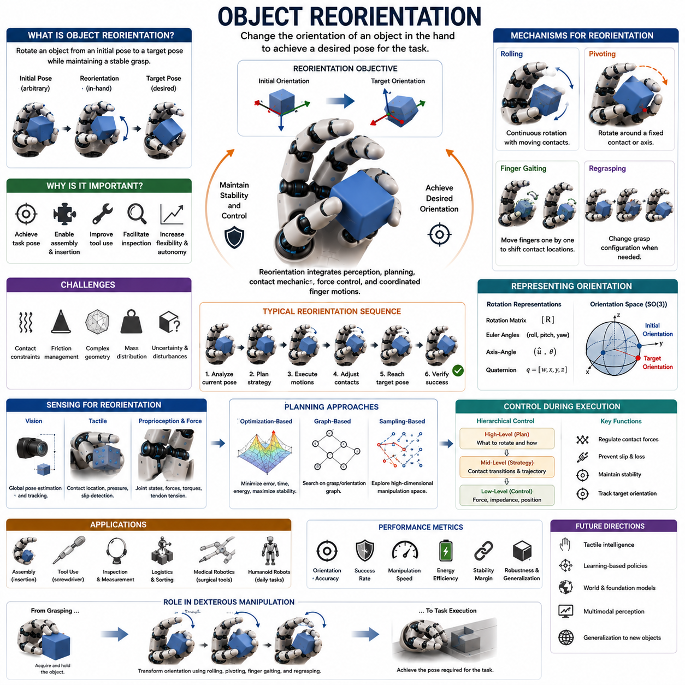{width="7.268055555555556in" height="7.268055555555556in"}

물체 재배향(Object Reorientation)은 정교 로봇 조작(Dexterous Manipulation)에서 가장 중요한 능력 중 하나이며, 인핸드 매니퓰레이션(In-Hand Manipulation)의 핵심 목표를 구성한다. 일반적인 파지(Grasping)가 물체를 안정적으로 집고 유지하는 기능이라면, 물체 재배향은 물체의 방향(Orientation)을 변경하여 사용, 조립, 삽입, 검사 또는 후속 조작에 적합한 자세로 만드는 능력을 의미한다. 실제 환경에서 물체가 처음 집힌 자세는 대부분 작업에 필요한 자세와 일치하지 않는다. 따라서 로봇은 임의의 초기 자세에서 목표 자세로 물체를 안정적이고 효율적으로 변환할 수 있어야 한다. 이러한 이유로 물체 재배향은 물체 획득(Object Acquisition)과 작업 수행(Task Execution)을 연결하는 핵심 기술로 간주되며, 고급 로봇 핸드와 정교 조작 시스템의 대표적인 능력 중 하나로 평가된다. 또한 물체 재배향은 인지(Perception), 계획(Planning), 접촉 역학(Contact Mechanics), 힘 제어(Force Control), 다지 협조 제어(Multi-Finger Coordination)를 모두 통합해야 하는 고차원 조작 기술이다.

인간은 일상생활에서 끊임없이 물체 재배향을 수행한다. 펜을 집어 글쓰기 자세로 돌리거나, 드라이버를 나사 체결에 적합한 방향으로 맞추거나, 열쇠를 자물쇠 방향에 맞게 회전시키거나, 스마트폰을 보기 좋은 방향으로 조정하는 모든 과정이 물체 재배향에 해당한다. 이러한 동작이 자연스럽게 수행되는 이유는 인간의 손이 뛰어난 촉각 능력과 운동 제어 능력을 가지고 있기 때문이다. 손가락은 접촉 위치를 지속적으로 조절하고, 파지력을 제어하며, 마찰을 적절히 활용하여 원하는 자세를 만들어낸다. 현대 로봇 연구의 중요한 목표는 이러한 인간 수준의 재배향 능력을 구현하는 것이다.

물체 재배향의 기본 목표는 로봇 핸드에 대해 물체의 회전 자세(Rotational Pose)를 변화시키는 것이다. 위치(Position)를 바꾸는 병진 조작(Translational Manipulation)과 달리, 재배향은 각도 변화에 초점을 둔다. 몇 도 수준의 미세 조정부터 180도 이상의 대규모 회전까지 포함될 수 있다. 작업에 따라 단일 축 회전만 필요할 수도 있고, 여러 축을 동시에 사용하는 3차원 회전이 요구될 수도 있다. 일반적으로 회전 자유도(Degree of Freedom)가 증가할수록 문제의 복잡성도 급격히 증가한다.

물체 재배향은 여러 형태로 분류할 수 있다. 단순 재배향(Simple Reorientation)은 하나의 축을 중심으로 회전하는 경우이다. 복합 재배향(Compound Reorientation)은 여러 축을 동시에 활용하는 회전이다. 정밀 재배향(Fine Reorientation)은 조립 작업처럼 매우 높은 각도 정확도가 요구되는 경우를 의미한다. 대각도 재배향(Large-Angle Reorientation)은 접촉 전환(Contact Transition)이나 재파지(Regrasping)가 필요한 큰 자세 변환을 의미한다. 동적 재배향(Dynamic Reorientation)은 관성과 운동량을 활용하여 빠르고 효율적으로 자세를 변경하는 방식이다. 각 유형은 서로 다른 계획 및 제어 기법을 요구한다.

기하학적 관점에서 재배향은 회전 공간(Rotation Space)에서의 변환 문제로 정의할 수 있다. 물체의 자세는 회전 행렬(Rotation Matrix), 오일러 각(Euler Angle), 축-각도(Axis-Angle), 쿼터니언(Quaternion) 등으로 표현된다. 계획기는 초기 자세에서 목표 자세까지의 변환 경로를 계산해야 한다. 그러나 회전 공간은 비선형성과 특이점(Singularity)을 포함하기 때문에 일반적인 위치 계획보다 훨씬 복잡하다.

물체 재배향이 어려운 가장 큰 이유는 접촉 제약(Contact Constraint)에 있다. 자유 공간에서의 회전과 달리, 인핸드 재배향은 항상 손가락과 물체의 접촉 상태를 유지한 채 수행된다. 이러한 접촉은 가능한 운동을 제한하며, 물체 동역학과 손가락 운동학 사이에 복잡한 상호작용을 발생시킨다. 따라서 로봇은 파지 안정성을 유지하면서도 원하는 회전을 생성할 수 있도록 손가락 운동과 접촉력을 정밀하게 조정해야 한다.

재배향 과정에서 가장 중요한 요소 중 하나는 파지 안정성(Grasp Stability)이다. 회전이 진행됨에 따라 접촉 위치와 힘 분포가 계속 변화한다. 파지력이 부족하면 물체가 미끄러지거나 떨어질 수 있으며, 반대로 너무 강한 힘은 움직임 자체를 방해할 수 있다. 따라서 안정성과 이동성 사이의 균형을 유지하는 것이 핵심 과제가 된다. 많은 제어 알고리즘은 이러한 균형을 유지하기 위해 접촉력을 실시간으로 조절한다.

마찰(Friction)은 재배향 과정에서 결정적인 역할을 한다. 마찰 특성에 따라 접촉점은 고정될 수도 있고, 롤링(Rolling)하거나 슬라이딩(Sliding)할 수도 있다. 높은 마찰은 안정성을 제공하지만 이동성을 제한할 수 있다. 반대로 낮은 마찰은 움직임을 쉽게 하지만 물체를 잃어버릴 위험을 증가시킨다. 따라서 성공적인 재배향을 위해서는 마찰 원뿔(Friction Cone)과 접촉 역학(Contact Mechanics)에 대한 이해가 필수적이다.

롤링 조작은 재배향에서 가장 널리 사용되는 방법 중 하나이다. 롤링 과정에서는 물체가 손끝을 따라 굴러가면서 회전한다. 접촉점은 연속적으로 이동하며 물체는 점진적으로 원하는 방향으로 변환된다. 롤링은 접촉을 유지한 채 회전을 수행할 수 있기 때문에 효율성이 높고 에너지 소비가 적다. 많은 정교 로봇 핸드는 롤링을 주요 재배향 수단으로 사용한다.

피벗팅(Pivoting) 또한 강력한 재배향 기법이다. 피벗팅에서는 특정 접촉점이나 축을 중심으로 물체가 회전한다. 이 과정에서 중력, 접촉력, 관성 효과를 활용할 수 있다. 피벗팅은 적은 에너지로 큰 각도 변화를 달성할 수 있기 때문에 산업용 조립 작업에서 자주 사용된다.

핑거 게이팅(Finger Gaiting)은 재배향과 밀접하게 연결된 기술이다. 회전 과정에서 손가락의 작업 공간이 부족해지면 일부 손가락은 새로운 위치로 이동해야 한다. 핑거 게이팅은 손가락을 순차적으로 이동시키면서도 물체 제어를 유지할 수 있도록 해준다. 롤링, 피벗팅과 결합하면 고정된 파지 상태에서는 불가능한 대규모 자세 변환을 수행할 수 있다.

재파지(Regrasping) 또한 중요한 재배향 전략이다. 어떤 경우에는 연속적인 접촉만으로 목표 자세에 도달할 수 없다. 이때 로봇은 새로운 접촉점을 형성하거나 파지 구성을 변경하여 중간 파지 상태를 생성한다. 재파지 계획은 이러한 중간 상태들을 연결하여 최종 자세로 도달하는 경로를 계산한다. 재파지는 복잡성을 증가시키지만 조작 가능한 공간을 크게 확장시킨다.

물체의 형상(Object Geometry)은 재배향 난이도에 큰 영향을 미친다. 큐브, 원통, 구와 같은 단순 형상은 상대적으로 예측이 쉽다. 그러나 불규칙한 산업 부품, 공구, 변형 가능한 재료, 비대칭 소비재는 훨씬 더 어려운 문제를 제시한다. 표면 곡률, 모서리 구조, 질량 분포, 접촉 가능 영역 등은 모두 재배향 가능성을 결정하는 요소이다.

질량 분포(Mass Distribution) 역시 중요하다. 질량 중심이 중앙에 있는 물체는 비교적 예측 가능한 회전 거동을 보인다. 반면 질량 중심이 치우친 물체는 예상치 못한 토크(Torque)를 발생시킬 수 있다. 무거운 물체는 더 큰 파지력이 필요하고, 가벼운 물체는 외란에 민감하다. 따라서 정확한 질량 특성 추정은 재배향 성능 향상에 큰 도움을 준다.

성공적인 재배향의 기반은 인식(Perception)이다. 로봇은 현재 물체 자세와 목표 자세를 정확하게 알아야 한다. 카메라, 깊이 센서(Depth Sensor), 구조광(Structured Light), 스테레오 비전(Stereo Vision)은 물체 자세를 추정하는 데 사용된다. 이러한 센서는 재배향 과정 동안 물체의 방향 변화를 지속적으로 추적한다.

그러나 시각 센서만으로는 충분하지 않은 경우가 많다. 손가락에 의해 접촉 부위가 가려질 수 있기 때문이다. 이때 촉각 센서(Tactile Sensor)가 중요한 역할을 한다. 촉각 센서는 압력 분포, 접촉 위치, 표면 형상, 슬립(Slip) 발생 여부를 측정한다. 이를 통해 물체가 손가락에 대해 어떻게 움직이고 있는지 정확하게 파악할 수 있다.

고유감각(Proprioception) 역시 중요한 정보원이다. 관절 엔코더, 모터 전류 센서, 텐던 장력 센서, 힘·토크 센서 등을 통해 손가락 상태와 상호작용 힘을 측정할 수 있다. 시각, 촉각, 고유감각 정보를 통합함으로써 로봇은 더욱 정확한 상태 추정을 수행할 수 있다.

재배향 계획은 계산적으로 매우 어려운 문제이다. 계획기는 접촉점 변화, 적용해야 할 힘, 목표 자세로의 이동 경로를 동시에 고려해야 한다. 전통적인 방법은 이를 제약 최적화 문제(Constrained Optimization Problem)로 정의한다. 목표 자세 오차 최소화, 조작 시간 최소화, 안정성 최대화, 에너지 소비 감소 등이 대표적인 목적 함수이다.

그래프 기반 계획(Graph-Based Planning)도 널리 사용된다. 그래프의 노드는 파지 상태나 물체 자세를 나타내고, 간선은 가능한 전환을 나타낸다. 탐색 알고리즘은 초기 자세에서 목표 자세까지의 경로를 찾는다. 이러한 접근은 재파지가 포함된 복잡한 문제에 특히 유용하다.

샘플링 기반 계획(Sampling-Based Planning)은 고차원 공간을 효율적으로 탐색할 수 있다. RRT(Rapidly Exploring Random Tree)나 PRM(Probabilistic Roadmap)은 복잡한 환경에서도 효과적인 재배향 경로를 찾을 수 있다.

실행 단계에서는 최적화 기반 제어(Optimization-Based Control)가 중요한 역할을 한다. 제어기는 물체 운동, 안정성 유지, 충돌 회피, 외란 보상을 동시에 수행해야 한다. 최근 계산 능력의 발전으로 이러한 실시간 최적화 제어가 점점 실용화되고 있다.

머신러닝(Machine Learning)은 최근 재배향 연구를 크게 발전시켰다. 강화학습(Reinforcement Learning)은 로봇이 반복적인 시행착오를 통해 재배향 전략을 학습하도록 한다. 복잡한 접촉 역학을 명시적으로 모델링하지 않아도 성공적인 조작 정책을 획득할 수 있다.

대표적인 사례로는 다지형 로봇 핸드가 큐브를 자유롭게 회전시키는 연구가 있다. 대규모 시뮬레이션 학습을 통해 로봇은 물체를 회전시키고 외란으로부터 회복하는 능력을 학습하였다. 이러한 결과는 학습 기반 접근의 강력함을 보여준다.

모방학습(Imitation Learning)도 유망한 접근 방식이다. 데이터 글러브(Data Glove), 원격 조작(Teleoperation), 모션 캡처(Motion Capture)를 통해 인간의 재배향 동작을 수집하고 이를 학습 데이터로 활용한다. 인간은 효율적인 조작 전략을 자연스럽게 사용하기 때문에 학습 속도를 크게 향상시킬 수 있다.

시뮬레이션은 현대 재배향 연구에서 필수적인 도구이다. 실제 실험은 비용과 시간이 많이 들기 때문에 물리 시뮬레이터에서 수백만 번의 조작을 수행한다. 도메인 랜덤화(Domain Randomization)는 형상, 마찰, 질량, 센서 노이즈를 변화시켜 실제 환경 전이 성능을 향상시킨다.

산업 현장에서 재배향은 매우 중요한 역할을 한다. 조립 자동화에서는 부품을 삽입하기 전에 정확한 방향으로 정렬해야 한다. 전자제품 생산에서는 커넥터와 회로 기판을 정렬해야 하며, 자동차와 항공우주 산업에서는 복잡한 부품의 자세를 맞추어야 한다. 재배향 기술은 전용 지그 사용을 줄이고 생산 유연성을 높인다.

물류 자동화에서도 활용도가 높다. 포장이나 분류 작업을 위해서는 물체를 특정 방향으로 맞추어야 하는 경우가 많다. 로봇은 물체를 내려놓지 않고 손 안에서 직접 방향을 변경함으로써 작업 효율을 향상시킬 수 있다.

의료 로봇은 또 다른 중요한 응용 분야이다. 수술 기구, 내시경, 카테터, 주사 바늘은 모두 정밀한 방향 조정이 필요하다. 고성능 재배향 기술은 수술 정확성과 안전성을 향상시키는 데 기여한다.

휴머노이드 로봇은 특히 재배향 능력에 크게 의존한다. 병을 열고, 기계를 조작하고, 공구를 사용하고, 음식을 준비하고, 옷을 접는 모든 과정에서 자세 변경이 필요하다. 따라서 물체 재배향은 인간 수준의 조작 능력을 구현하기 위한 필수 기술로 간주된다.

재배향 시스템의 성능 평가는 자세 정확도, 성공률, 조작 속도, 에너지 효율, 파지 안정성, 외란 강인성, 새로운 물체에 대한 적응성 등을 기준으로 수행된다. 계산 효율성과 일반화 능력도 중요한 평가 요소이다.

비록 많은 발전이 있었지만 여전히 해결해야 할 과제는 많다. 정확한 접촉 모델링, 강인한 인식, 불확실성 처리, 실시간 계획, 다양한 물체에 대한 일반화 능력은 여전히 연구 주제이다. 앞으로는 촉각 지능(Tactile Intelligence), 파운데이션 모델(Foundation Model), 월드 모델(World Model), 멀티모달 인식(Multimodal Perception), 대규모 로봇 학습 기술이 결합되어 이러한 문제를 해결할 것으로 기대된다.

궁극적으로 물체 재배향은 정교한 로봇 조작을 정의하는 핵심 능력 중 하나이다. 이는 로봇 파지를 단순한 물체 유지 기능에서 능동적인 자세 제어와 적응의 과정으로 확장시킨다. 로봇이 물체의 방향을 지능적이고 효율적으로 변화시킬 수 있게 함으로써 수행 가능한 작업 범위를 크게 넓혀 주며, 인간 손과 유사한 수준의 조작 능력에 한 걸음 더 다가가게 한다. 앞으로 로봇 하드웨어, 센서 기술, 계획 알고리즘, 인공지능이 발전할수록 물체 재배향은 차세대 인핸드 매니퓰레이션 시스템의 핵심 구성 요소로서 더욱 중요한 역할을 수행하게 될 것이다.

## 10.06 Extrinsic Dexterity

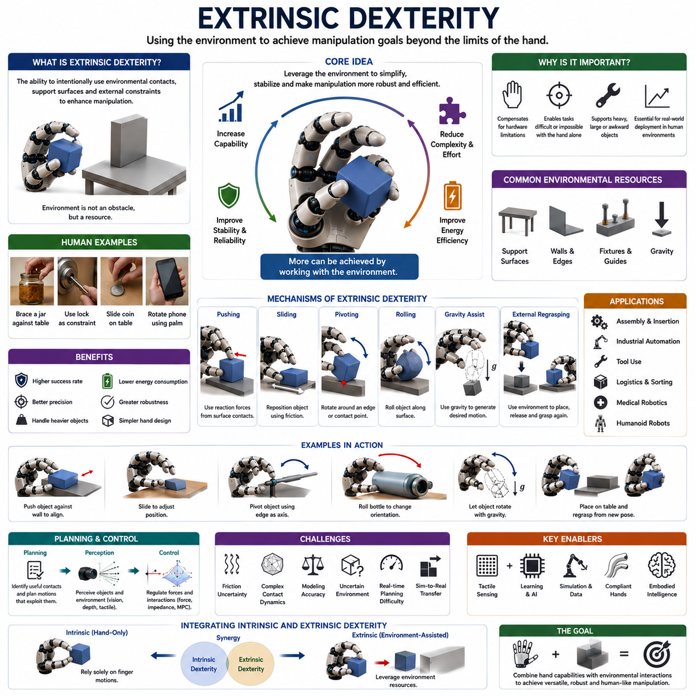{width="7.268055555555556in" height="7.268055555555556in"}

외재적 손재주(Extrinsic Dexterity)는 현대 로봇 조작(Robotic Manipulation) 분야에서 가장 중요한 개념 중 하나이며, 로봇 핸드의 물리적 한계를 극복하기 위한 핵심 전략으로 간주된다. 전통적인 정교 조작 연구는 주로 내재적 손재주(Intrinsic Dexterity)에 초점을 맞추어 왔다. 내재적 손재주는 손가락과 관절의 협조 운동만을 이용하여 물체를 조작하는 능력을 의미한다. 그러나 실제 환경에서의 많은 조작 작업은 손가락 움직임만으로는 효율적으로 수행하기 어렵다. 인간은 테이블, 벽, 선반, 작업대, 용기, 심지어 중력(Gravity)까지 적극적으로 활용하여 조작 능력을 향상시킨다. 이러한 환경 활용 능력을 외재적 손재주라고 한다. 로봇 분야에서 외재적 손재주는 물체 조작을 수행할 때 로봇 핸드 외부에 존재하는 환경 접촉(Environmental Contact), 지지면(Support Surface), 외부 제약(External Constraint), 물리적 상호작용을 의도적으로 활용하는 능력을 의미한다. 즉 환경을 피해야 하는 장애물(Obstacle)이 아니라 조작을 돕는 능동적 자원(Resource)으로 활용하는 개념이다. 이러한 접근은 수행 가능한 작업 범위를 크게 확장시키며, 내재적 손재주만으로 해결하기 어려운 문제에 대해 실용적인 해결책을 제공한다.

외재적 손재주의 개념은 인간 행동 관찰에서 비롯되었다. 인간의 손은 매우 정교하지만 실제로는 손가락만으로 모든 조작을 수행하지 않는다. 병을 열 때는 병을 테이블에 기대고, 열쇠를 돌릴 때는 자물쇠 구조물을 활용하며, 공구를 정렬할 때는 작업대의 모서리를 기준면으로 사용한다. 동전은 테이블 위에서 밀어 위치를 조정한 뒤 다시 집고, 스마트폰은 손바닥이나 외부 표면을 이용해 회전시킨다. 이러한 사례들은 손 자체의 능력뿐 아니라 환경을 얼마나 효과적으로 활용하느냐가 손재주의 중요한 요소임을 보여준다. 현대 로봇 조작 연구는 인간 수준의 성능을 달성하기 위해 이러한 환경 활용 능력이 필수적이라는 사실을 점점 더 강조하고 있다.

외재적 손재주는 내재적 손재주와 본질적으로 다르다. 내재적 손재주는 손 내부의 자유도(Degree of Freedom), 접촉력(Contact Force), 손가락 협조 제어만을 이용한다. 반면 외재적 손재주는 환경과의 접촉을 의도적으로 활용하여 추가적인 힘 전달 경로, 운동 제약, 지지 구조를 확보한다. 결과적으로 로봇 핸드의 기계적 복잡성을 증가시키지 않고도 조작 능력을 크게 향상시킬 수 있다.

외재적 손재주가 중요한 이유 중 하나는 현재 로봇 핸드가 인간 손과 비교하여 여전히 많은 제약을 가지고 있기 때문이다. 인간 손은 높은 촉각 해상도(Tactile Resolution), 뛰어난 순응성(Compliance), 복잡한 감각 통합 능력을 가지고 있다. 반면 로봇 핸드는 아직 이러한 수준에 도달하지 못했으며, 이를 하드웨어적으로 구현하는 것은 매우 어렵고 비용도 높다. 외재적 손재주는 이러한 문제에 대한 현실적인 대안을 제공한다. 모든 문제를 더 복잡한 핸드 설계로 해결하기보다는 환경을 적극적으로 활용하여 문제를 단순화하는 것이다. 이러한 접근은 신뢰성을 향상시키고 시스템 복잡도를 줄이는 효과를 가진다.

로봇공학 관점에서 외재적 손재주는 외부 제약 조건(External Constraint)을 활용하는 기술로 볼 수 있다. 일반적으로 제약은 운동을 제한하는 요소로 간주되지만, 적절하게 사용하면 매우 유용한 역할을 수행할 수 있다. 예를 들어 벽은 회전을 제한하고, 테이블은 물체의 무게를 지지하며, 지그(Jig)는 정밀한 정렬 조건을 제공한다. 로봇은 이러한 제약을 활용하여 자유 공간(Free Space)에서 수행하는 것보다 더 안정적이고 정확한 조작을 수행할 수 있다.

가장 대표적인 외재적 손재주의 형태는 환경을 이용한 밀기(Pushing) 조작이다. 로봇은 물체를 단순히 집는 대신 벽이나 가이드 레일에 밀어 붙여 위치나 방향을 조정할 수 있다. 환경 접촉은 예측 가능한 반력(Reaction Force)을 제공하여 물체 이동을 돕는다. 실제 산업 현장에서는 부품을 가이드 레일이나 기준면에 밀어 정렬하는 방식이 매우 흔하게 사용된다.

환경 슬라이딩(Environmental Sliding)도 중요한 기법이다. 물체를 테이블이나 벽을 따라 미끄러뜨림으로써 복잡한 손가락 움직임 없이 위치를 변경할 수 있다. 이 과정에서는 마찰(Friction)이 조작의 핵심 요소로 작용한다. 슬라이딩은 얇고 평평한 물체나 파지가 어려운 물체를 다룰 때 특히 유용하다.

환경 접촉을 이용한 피벗팅(Pivoting)은 외재적 손재주의 대표적인 예이다. 예를 들어 공구를 새로운 방향으로 회전시켜야 할 경우, 복잡한 인핸드 매니퓰레이션을 수행하는 대신 물체 일부를 테이블에 접촉시켜 회전축으로 활용할 수 있다. 환경이 안정적인 회전축 역할을 제공하기 때문에 제어가 훨씬 단순해진다. 인간도 일상적으로 이러한 전략을 사용한다.

환경 롤링(Environmental Rolling)은 이러한 개념을 더욱 확장한 것이다. 물체를 표면 위에서 굴려 방향을 변경하거나 위치를 이동시킬 수 있다. 롤링은 슬라이딩보다 마찰 손실이 적기 때문에 에너지 효율이 높다. 원통형 물체, 파이프, 바퀴, 용기 등을 다룰 때 자주 활용된다.

중력(Gravity) 자체도 외재적 손재주의 중요한 요소이다. 인간은 물체를 살짝 놓아 자연스럽게 회전하도록 유도하는 경우가 많다. 로봇 역시 접촉력을 적절히 조절함으로써 중력 토크(Gravity Torque)를 활용할 수 있다. 중력을 이용한 조작은 액추에이터의 부담을 줄이고 에너지 효율을 크게 향상시킨다.

지지면(Support Surface)은 외재적 손재주의 핵심 기반이다. 테이블, 선반, 트레이, 컨베이어, 작업대는 물체의 무게를 대신 지지해 준다. 따라서 로봇 핸드에 요구되는 힘이 줄어들며, 더 무거운 물체도 조작할 수 있게 된다. 또한 지지면은 정렬과 조립을 위한 기준 좌표계(Reference Frame)를 제공한다.

외재적 손재주는 재파지(Regrasping) 과정에서 특히 유용하다. 인핸드 재파지는 복잡한 손가락 협조와 정밀한 촉각 피드백을 요구한다. 반면 외부 재파지(External Regrasping)는 물체를 테이블 위에 내려놓은 뒤 새로운 자세로 다시 집을 수 있다. 이러한 방식은 단계가 늘어날 수 있지만 신뢰성이 높고 계산 복잡도가 낮다.

조립 작업(Assembly)은 외재적 손재주가 가장 활발히 활용되는 분야 중 하나이다. 제조 환경에는 다양한 지그, 가이드, 고정 장치가 존재한다. 로봇은 이러한 구조물을 적극적으로 활용하여 부품을 정렬하고 삽입하며 안정화할 수 있다. 환경 접촉을 회피하는 대신 적극적으로 활용함으로써 작업 성공률을 높일 수 있다.

삽입 작업(Insertion Task)은 대표적인 사례이다. 핀 삽입(Peg-in-Hole), 커넥터 결합, 볼트 체결과 같은 작업에서는 작은 위치 오차가 존재하더라도 가이드 구조를 이용해 보정할 수 있다. 외재적 손재주는 이러한 환경 제약을 활용하여 높은 성공률을 달성하게 해준다.

공구 사용(Tool Use)에서도 외재적 손재주는 매우 중요하다. 드라이버는 나사와 접촉하고, 렌치는 볼트와 맞물리며, 절삭 공구는 공작물과 상호작용한다. 이러한 작업은 환경과의 접촉 없이는 수행될 수 없다. 따라서 외재적 손재주는 공구 사용을 모델링하고 제어하는 핵심 개념이다.

의료 로봇 분야에서도 중요성이 크다. 카테터는 혈관을 따라 이동하고, 내시경은 제한된 통로를 통과하며, 수술 기구는 조직과 지속적으로 접촉한다. 이러한 접촉은 단순한 방해 요소가 아니라 작업 수행 자체에 필수적인 요소이다. 따라서 의료 로봇의 발전을 위해서도 외재적 손재주에 대한 이해가 필요하다.

휴머노이드 로봇은 외재적 손재주에 특히 크게 의존한다. 인간 환경은 본질적으로 환경 상호작용을 전제로 설계되어 있다. 문을 열고, 가전제품을 사용하고, 옷을 접고, 음식을 준비하는 모든 과정은 환경과의 접촉을 포함한다. 환경을 활용하지 못하는 휴머노이드는 인간 수준의 작업 수행 능력을 갖추기 어렵다.

계획(Planning) 관점에서 외재적 손재주는 새로운 기회를 제공한다. 전통적인 계획기는 환경 접촉을 피해야 할 대상으로 간주하였다. 그러나 외재적 손재주에서는 어떤 접촉이 유용한지를 찾아내고 이를 조작 전략에 포함시켜야 한다. 즉 충돌 회피(Collision Avoidance) 중심의 문제에서 접촉 활용(Contact Utilization) 중심의 문제로 전환된다.

이 때문에 접촉 풍부 조작 계획(Contact-Rich Planning)이 중요한 연구 주제가 되었다. 계획기는 마찰, 접촉 안정성, 힘 전달, 물체 동역학, 환경 기하구조를 동시에 고려해야 한다. 이러한 문제는 매우 비선형적이기 때문에 최적화 기반 계획이나 샘플링 기반 계획이 널리 사용된다.

최적화 기반 계획(Optimization-Based Planning)은 에너지 소비 최소화, 조작 시간 단축, 강인성 향상, 정확도 향상 등을 목표로 한다. 접촉 역학, 충돌 회피, 운동학적 제한, 환경 상호작용은 제약 조건으로 포함된다. 최근 계산 성능 향상으로 이러한 기법은 점점 더 실용화되고 있다.

머신러닝(Machine Learning) 역시 외재적 손재주 연구에서 중요한 역할을 한다. 강화학습(Reinforcement Learning)은 로봇이 반복적인 경험을 통해 효과적인 환경 활용 전략을 학습하도록 한다. 모든 접촉 동작을 사람이 설계하지 않아도 로봇 스스로 유용한 조작 방법을 발견할 수 있다.

물리 시뮬레이터는 이러한 학습을 지원하는 핵심 도구이다. 로봇은 수백만 번의 밀기, 슬라이딩, 롤링, 피벗팅, 재파지 작업을 경험할 수 있다. 도메인 랜덤화(Domain Randomization)는 실제 환경에서도 동작 가능한 강인한 정책을 학습하도록 돕는다.

외재적 손재주에서 인식(Perception)은 매우 중요하다. 로봇은 물체뿐 아니라 주변 환경까지 이해해야 한다. 카메라, 깊이 센서, LiDAR, 촉각 센서는 환경 형상과 접촉 상태를 파악하는 데 사용된다. 이를 통해 활용 가능한 지지면과 접촉 구조를 찾아낼 수 있다.

촉각 센서는 환경 상호작용 중 특히 중요하다. 접촉력, 압력 분포, 슬립 정보는 조작 성공 여부를 직접적으로 알려준다. 촉각 기술이 발전할수록 외재적 손재주의 성능도 크게 향상될 것으로 예상된다.

외재적 손재주의 제어 시스템은 로봇, 물체, 환경의 상호작용을 동시에 관리해야 한다. 임피던스 제어(Impedance Control), 힘 제어(Force Control), 위치-힘 혼합 제어(Hybrid Position-Force Control), 모델 예측 제어(Model Predictive Control)가 대표적으로 사용된다.

핸드의 기계 설계도 중요한 영향을 미친다. 순응성이 높은 소프트 핑거(Soft Finger)는 환경 접촉에 더 잘 적응할 수 있으며, 가변 강성 액추에이터(Variable Stiffness Actuator)는 작업 상황에 따라 기계적 특성을 변경할 수 있다.

성능 평가는 작업 성공률, 조작 효율성, 접촉 안정성, 에너지 소비, 강인성, 적응성 등을 기준으로 수행된다. 많은 연구에서 외재적 손재주를 활용한 방법이 내재적 손재주만 사용하는 방법보다 더 높은 성능을 보여주고 있다.

최근 파운데이션 모델(Foundation Model)과 체화 인공지능(Embodied AI)의 발전은 외재적 손재주에 대한 관심을 더욱 높이고 있다. 미래의 로봇은 물체를 직접 조작하는 방법뿐 아니라 환경을 전략적으로 활용하는 방법까지 학습하게 될 것으로 예상된다.

내재적 손재주와 외재적 손재주는 경쟁 관계가 아니라 상호 보완적인 관계이다. 미래의 고성능 로봇은 정교한 손가락 조작 능력과 지능적인 환경 활용 능력을 동시에 갖추게 될 것이다. 작업 종류와 환경 조건에 따라 두 가지 전략을 적절히 조합하는 것이 가장 효과적인 접근이 될 것이다.

궁극적으로 외재적 손재주는 환경을 장애물이 아닌 조작 자원으로 활용하는 강력한 개념이다. 환경 접촉, 지지면, 중력, 마찰, 외부 제약을 적극적으로 활용함으로써 로봇은 하드웨어 한계를 뛰어넘는 조작 능력을 획득할 수 있다. 앞으로 로봇이 공장, 병원, 창고, 가정 등 실제 환경으로 더욱 깊이 진출할수록 외재적 손재주는 인간과 유사한 수준의 강인하고 효율적인 조작 능력을 구현하는 핵심 원리로 자리 잡게 될 것이다. 이는 미래 정교 로봇 시스템과 체화 인공지능의 발전을 이끄는 중요한 기반 기술 중 하나이다.

## 10.07 Gravity-Assisted Manipulation

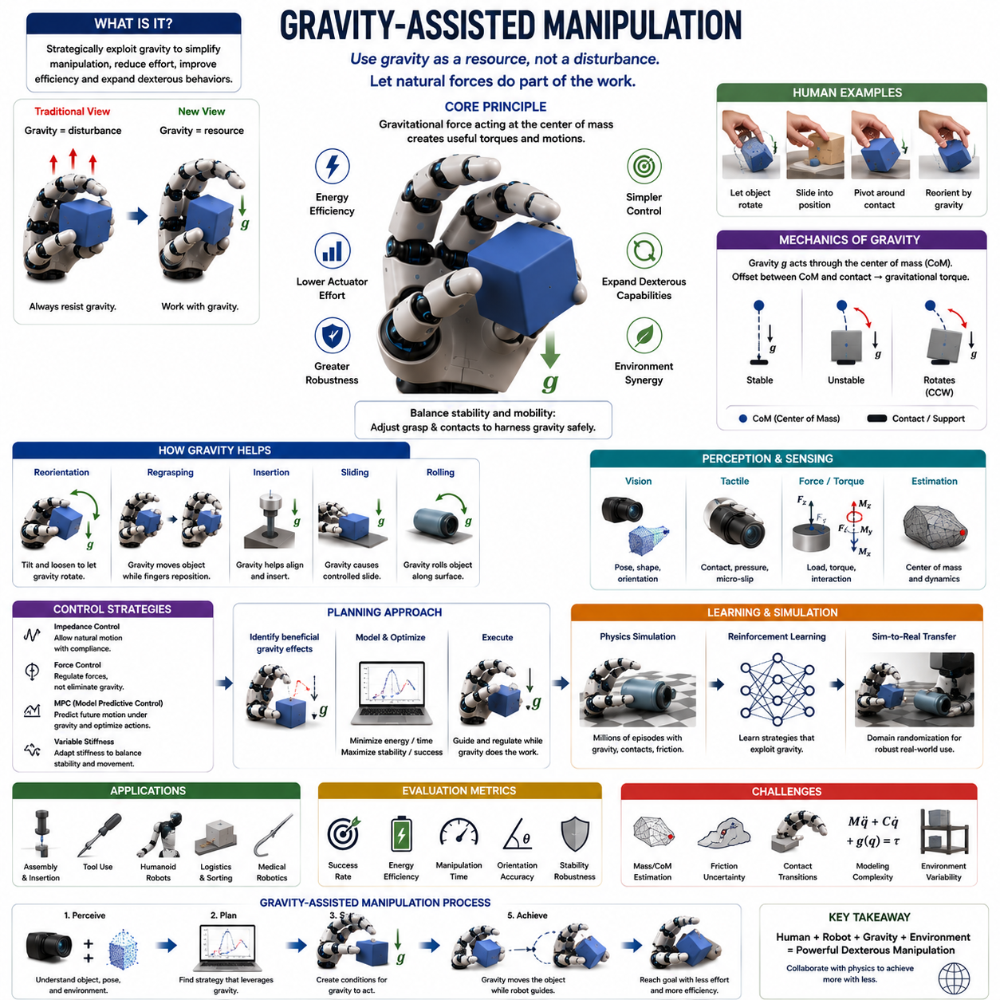{width="7.268055555555556in" height="7.268055555555556in"}

중력 보조 조작(Gravity-Assisted Manipulation)은 정교 로봇 조작(Dexterous Robotic Manipulation)의 특수한 분야로서, 중력(Gravity)을 적극적으로 활용하여 물체 조작을 단순화하고, 액추에이터 부하를 줄이며, 에너지 효율을 향상시키고, 인핸드 매니퓰레이션(In-Hand Manipulation)의 가능 범위를 확장하는 기술이다. 전통적인 로봇 조작에서는 중력을 보상해야 하는 외란(Disturbance)으로 간주하는 경우가 많았다. 로봇은 중력의 영향을 제거하기 위해 지속적으로 힘을 생성하고 제어해야 했다. 반면 중력 보조 조작은 중력을 방해 요소가 아닌 유용한 자원(Resource)으로 바라본다. 즉 로봇이 중력에 계속 저항하는 대신, 중력을 활용하여 물체를 이동시키고, 방향을 바꾸고, 재파지(Regrasping)를 돕고, 전체적인 제어 복잡도를 줄이는 것이다.

이러한 접근은 최근 로봇공학에서 나타나는 중요한 흐름과도 연결된다. 현대 로봇은 자연 법칙을 억지로 제거하는 대신, 환경의 물리적 특성을 활용하여 더 효율적인 행동을 수행하려고 한다. 중력 보조 조작은 외재적 손재주(Extrinsic Dexterity), 접촉 풍부 조작(Contact-Rich Manipulation), 동적 조작(Dynamic Manipulation), 체화 인공지능(Embodied Intelligence)과 밀접하게 연관되어 있으며, 물리 세계 자체를 지능의 일부로 활용하는 대표적인 사례이다. 본 장은 인핸드 매니퓰레이션 구조 내에서 핑거 게이팅(Finger Gaiting), 롤링(Rolling), 피벗팅(Pivoting), 물체 재배향(Object Reorientation), 외재적 손재주와 함께 중요한 조작 프리미티브로 위치한다.

인간은 일상생활에서 중력을 끊임없이 활용하지만 대부분 이를 의식하지 않는다. 펜을 잡은 후 글쓰기 자세로 자연스럽게 미끄러지게 하거나, 칼을 편한 방향으로 회전시키거나, 공구를 조립 전에 정렬하거나, 스마트폰을 보기 좋은 방향으로 돌리는 과정에는 중력이 중요한 역할을 한다. 인간의 손재주는 단순히 근육의 힘에서 나오는 것이 아니라, 물체가 중력에 의해 어떻게 움직일지를 예측하고 활용하는 능력에서 비롯된다. 인간의 신경계는 물체의 질량, 무게중심, 접촉 조건을 직관적으로 이해하며 최소한의 노력으로 원하는 결과를 만들어낸다. 로봇이 이러한 능력을 획득하는 것은 인간 수준 조작 능력으로 가는 중요한 단계이다.

중력 보조 조작의 기본 원리는 매우 단순하다. 모든 물체는 질량 중심(Center of Mass)을 기준으로 중력의 영향을 받는다. 물체의 형상, 자세, 접촉 상태, 지지 조건에 따라 중력은 특정 방향의 토크(Torque)를 발생시킨다. 로봇은 이러한 자연스러운 움직임을 억제하는 대신 적절히 활용하여 원하는 조작을 수행한다. 다시 말해, 로봇이 모든 움직임을 직접 생성하는 것이 아니라 일부 작업을 물리 세계에 맡기는 것이다.

역학(Mechanics)의 관점에서 중력은 지구 중심 방향으로 작용하는 힘이다. 질량 중심과 접촉점의 상대적 위치에 따라 물체는 안정 상태를 유지하거나 회전하려는 경향을 가진다. 질량 중심이 지지점 바로 아래에 위치하면 안정적이지만, 그렇지 않으면 중력에 의해 회전 토크가 발생한다. 중력 보조 조작은 바로 이 토크를 활용하는 기술이다.

중력 보조 조작의 가장 큰 장점은 에너지 효율성이다. 일반적인 조작에서는 물체를 움직이기 위해 액추에이터가 지속적으로 힘을 제공해야 한다. 그러나 중력을 활용하면 로봇은 단순히 움직임을 유도하거나 제어하는 역할만 수행하면 된다. 결과적으로 전력 소모가 감소하고 액추에이터의 부담도 줄어든다. 이는 특히 배터리 기반의 모바일 로봇, 휴머노이드, 이동형 매니퓰레이터에서 매우 중요한 장점이다.

중력 보조 조작은 여러 형태로 분류할 수 있다. 중력 보조 재배향(Gravity-Assisted Reorientation)은 물체를 원하는 방향으로 회전시키기 위해 중력을 활용한다. 중력 보조 재파지(Gravity-Assisted Regrasping)는 새로운 파지 구성을 만들기 위해 중력에 의한 물체 움직임을 이용한다. 중력 보조 삽입(Gravity-Assisted Insertion)은 조립 작업에서 중력을 이용하여 정렬을 돕는다. 중력 보조 슬라이딩(Gravity-Assisted Sliding)은 경사면이나 지지면 위에서 물체가 자연스럽게 이동하도록 만든다. 동적 중력 보조 조작(Dynamic Gravity-Assisted Manipulation)은 중력과 관성(Inertia)을 동시에 활용하여 빠른 움직임을 구현한다.

물체 재배향은 가장 대표적인 응용 분야이다. 물체의 질량 중심이 접촉점에서 벗어나 있으면 자연스럽게 회전하려는 경향이 발생한다. 로봇은 파지력을 적절히 조절하여 이 회전을 활용할 수 있다. 예를 들어 드라이버를 잡고 있는 로봇이 손잡이 방향을 바꾸고자 할 때, 파지력을 약간 줄이고 물체를 기울이면 중력이 손잡이를 자연스럽게 회전시킨다. 이는 복잡한 손가락 재배치를 대체할 수 있다.

중력 보조 재파지도 매우 유용하다. 재파지 과정에서는 손가락 접촉점을 변경해야 한다. 이때 물체를 능동적으로 이동시키는 대신 중력이 자연스럽게 물체를 움직이도록 유도하면 훨씬 단순한 방식으로 새로운 파지 구성을 만들 수 있다. 이러한 전략은 계산 복잡도를 줄이고 강인성을 향상시킨다.

환경과의 상호작용은 중력 보조 조작에서 매우 중요하다. 테이블, 벽, 선반, 지그, 작업대는 중력과 함께 작용하여 원하는 움직임을 만들어낸다. 예를 들어 물체가 테이블 모서리를 중심으로 회전하거나, 벽에 기대어 방향을 변경하는 경우가 있다. 이러한 사례는 중력 보조 조작이 외재적 손재주와 밀접하게 연결되어 있음을 보여준다.

피벗팅(Pivoting)은 가장 많이 연구된 중력 보조 조작 방식 중 하나이다. 물체는 특정 접촉점을 중심으로 회전하며, 중력이 회전 에너지를 제공한다. 로봇은 단지 접촉력과 운동 범위를 조절할 뿐이다. 이 방식은 적은 에너지로 큰 각도 변화를 달성할 수 있기 때문에 산업용 조립과 공구 조작에서 널리 사용된다.

롤링(Rolling) 역시 중력을 활용할 수 있다. 경사면이나 특정 자세 조건에서는 중력이 물체를 자연스럽게 굴러가게 만든다. 원통형 물체, 병, 파이프, 공과 같은 물체는 중력 보조 롤링을 통해 효율적으로 방향을 변경할 수 있다.

슬라이딩(Sliding)도 중요한 메커니즘이다. 마찰 조건이 적절하다면 중력은 물체를 표면 위에서 미끄러지게 만들 수 있다. 로봇은 표면 각도와 접촉 조건을 조절함으로써 원하는 방향으로 물체를 이동시킬 수 있다. 이러한 방식은 얇은 판재나 직접 파지하기 어려운 부품에 특히 유용하다.

질량 중심은 중력 보조 조작의 핵심 요소이다. 중력 효과는 질량 중심 위치에 의해 결정되므로 정확한 질량 분포 추정이 필수적이다. 질량 중심이 중앙에 있는 물체는 예측 가능한 거동을 보이는 반면, 비대칭 질량 분포를 가진 물체는 예상치 못한 토크를 생성할 수 있다. 따라서 많은 시스템은 질량 중심 추정을 중요한 인식 기능으로 포함한다.

인식(Perception)은 성공적인 중력 보조 조작의 기반이다. 로봇은 물체의 자세, 형상, 질량 특성, 접촉 상태를 정확히 파악해야 한다. RGB 카메라, 깊이 센서, 스테레오 비전, 구조광 센서는 물체가 중력의 영향을 받아 어떻게 움직일지를 예측하는 데 필요한 정보를 제공한다.

촉각 센서(Tactile Sensor)는 시각 센서를 보완한다. 압력 분포, 미세 슬립(Micro-Slip), 접촉 위치는 중력에 의한 움직임이 예상대로 진행되고 있는지를 알려준다. 특히 시야가 가려진 상황에서는 촉각 정보가 더욱 중요해진다.

힘·토크 센서(Force-Torque Sensor)도 중요한 역할을 한다. 손목 센서는 물체 무게를 직접 측정할 수 있으며, 손끝 힘 센서는 회전이나 슬라이딩 과정에서 발생하는 하중 변화를 감지할 수 있다. 이러한 정보는 제어기의 실시간 의사결정을 지원한다.

중력 보조 조작의 제어 방식은 일반적인 힘 제어와 다르다. 목표는 중력을 제거하는 것이 아니라 활용하는 것이다. 따라서 안정성과 이동성 사이의 균형이 중요하다. 파지력이 너무 강하면 중력에 의한 움직임이 발생하지 않으며, 너무 약하면 물체를 잃어버릴 수 있다. 성공적인 제어기는 이러한 균형점을 지속적으로 유지한다.

임피던스 제어(Impedance Control)는 특히 적합한 방법이다. 강체처럼 움직이기보다는 일정한 순응성(Compliance)을 유지함으로써 물체가 중력에 자연스럽게 반응하도록 허용한다. 이는 모델링 오차와 환경 변화에 대한 강인성을 높인다.

모델 예측 제어(Model Predictive Control, MPC)도 널리 사용된다. MPC는 미래의 물체 움직임을 예측하고, 중력 효과를 고려하여 최적의 제어 명령을 생성한다. 이를 통해 보다 효율적이고 안정적인 조작이 가능해진다.

중력 보조 조작 계획은 독특한 문제를 제시한다. 계획기는 단순히 목표 자세를 찾는 것이 아니라, 중력이 유용하게 작용할 수 있는 상황을 찾아야 한다. 이를 위해 물체 형상, 접촉 구조, 환경 특성, 미래 움직임을 함께 고려해야 한다.

최적화 기반 계획은 에너지 소비 최소화, 조작 시간 감소, 안정성 향상, 액추에이터 부하 감소를 목표로 한다. 접촉 역학, 충돌 회피, 운동학 제약, 작업 요구사항은 모두 최적화 문제의 제약 조건이 된다.

강화학습(Reinforcement Learning) 기반 접근도 활발히 연구되고 있다. 로봇은 시뮬레이션에서 반복적인 시행착오를 통해 중력을 활용하는 방법을 학습할 수 있다. 이러한 정책은 종종 인간이 직접 설계하기 어려운 효율적인 전략을 발견한다.

물리 시뮬레이션은 이러한 연구를 가능하게 한다. 현대 시뮬레이터는 중력, 마찰, 접촉, 동역학을 정밀하게 모델링할 수 있다. 로봇은 수백만 번의 실험을 수행하며 다양한 질량 분포와 환경 조건을 경험한다. 도메인 랜덤화(Domain Randomization)는 실제 환경으로의 전이 성능을 향상시킨다.

휴머노이드 로봇은 중력 보조 조작의 대표적인 수혜자이다. 문 열기, 액체 붓기, 공구 사용, 옷 정리, 음식 준비와 같은 작업은 모두 중력과 밀접하게 관련되어 있다. 중력을 활용할 수 있는 휴머노이드는 더 자연스럽고 효율적인 동작을 수행할 수 있다.

산업 현장에서도 활용 가치가 높다. 조립 작업에서는 부품이 자체 무게에 의해 정렬되는 경우가 많다. 중력 보조 삽입은 위치 정밀도 요구를 낮추고 성공률을 향상시킨다. 물류 분야에서는 물체를 자연스럽게 회전시키거나 이동시켜 처리 시간을 줄일 수 있다.

의료 로봇에서도 가능성이 크다. 수술 기구, 카테터, 보조 장치는 모두 중력의 영향을 받는다. 중력을 이해하고 활용하면 조작 정확도를 높이고 제어 부담을 줄일 수 있다.

성능 평가는 작업 성공률, 에너지 소비, 조작 속도, 자세 정확도, 파지 안정성, 외란 강인성, 계산 효율성 등을 기준으로 수행된다. 많은 연구에서 중력 보조 전략이 순수한 액추에이터 기반 방법보다 높은 효율성을 제공하는 것으로 나타났다.

그러나 여전히 해결해야 할 문제도 많다. 질량 중심 추정 오차, 마찰 불확실성, 비선형 접촉 동역학, 환경 변화는 모두 성능 저하의 원인이 될 수 있다. 따라서 강인한 인식, 계획, 제어 기술이 필수적이다.

미래에는 중력 보조 조작이 파운데이션 모델(Foundation Model), 월드 모델(World Model), 촉각 지능(Tactile Intelligence), 멀티모달 인식(Multimodal Perception), 체화 인공지능(Embodied AI)과 결합될 것으로 예상된다. 미래의 로봇은 단순히 중력의 존재를 아는 수준을 넘어, 물체가 중력 아래에서 어떻게 행동할지를 추론하고 전략적으로 활용할 수 있게 될 것이다.

궁극적으로 중력 보조 조작은 로봇이 중력과 싸우는 대신 중력과 협력하는 새로운 패러다임을 제시한다. 자연의 힘을 활용함으로써 더 높은 에너지 효율, 더 강인한 조작 능력, 더 인간적인 행동을 구현할 수 있다. 정교 로봇 핸드, 촉각 센서, 학습 알고리즘, 체화 인공지능 기술이 발전함에 따라 중력 보조 조작은 차세대 인핸드 매니퓰레이션의 핵심 기술이자 인간 수준의 손재주를 실현하는 중요한 기반 기술로 자리 잡게 될 것이다.

## 10.08 Manipulation Planning

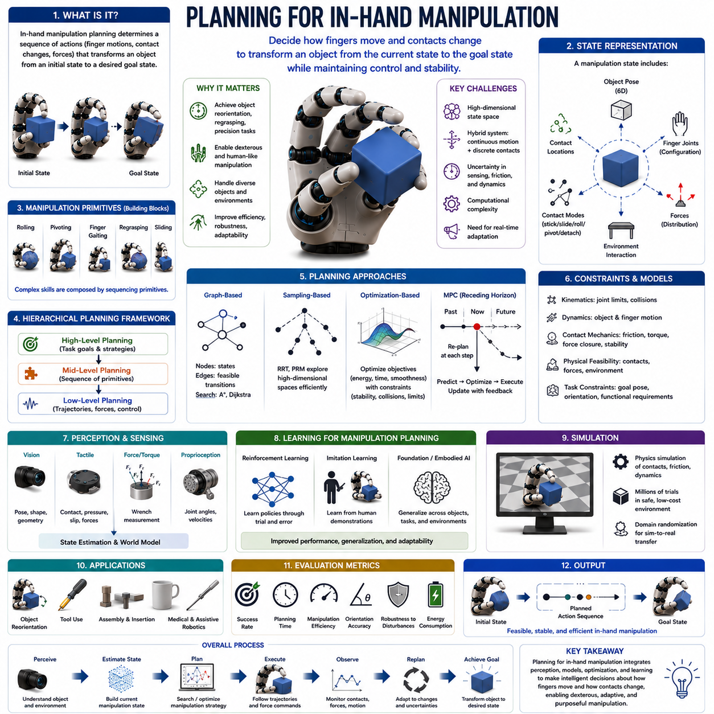{width="7.268055555555556in" height="7.268055555555556in"}

인핸드 매니퓰레이션 계획(Planning for In-Hand Manipulation)은 로봇 조작 분야에서 가장 복잡하고 지능적인 연구 분야 중 하나이다. 일반적인 파지(Grasping)가 물체를 안정적으로 잡고 유지하는 것에 초점을 맞춘다면, 인핸드 매니퓰레이션 계획은 훨씬 더 어려운 문제를 다룬다. 로봇 핸드가 물체를 지속적으로 제어하는 상태를 유지하면서, 손가락을 어떻게 움직이고, 접촉점을 어떻게 변경하며, 어떤 힘을 가하고, 여러 손가락을 어떻게 협조시켜야 목표 상태에 도달할 수 있는지를 결정해야 한다. 이를 위해서는 운동학(Kinematics), 동역학(Dynamics), 접촉 역학(Contact Mechanics), 인식(Perception), 제어 이론(Control Theory), 최적화(Optimization), 인공지능(AI)이 모두 통합되어야 한다.

인핸드 매니퓰레이션 계획은 저수준의 모터 제어와 고수준의 작업 목표를 연결하는 의사결정 계층(Decision-Making Layer)이라고 볼 수 있다. 즉, 단순히 손가락을 움직이는 것이 아니라 목적을 가진 조작 행동을 생성하는 과정이다. 로봇 핸드와 정교 파지(Dexterous Grasping)의 전체 체계 안에서 인핸드 매니퓰레이션 계획은 핑거 게이팅(Finger Gaiting), 롤링(Rolling), 피벗팅(Pivoting), 재파지(Regrasping), 물체 재배향(Object Reorientation), 외재적 손재주(Extrinsic Dexterity), 중력 보조 조작(Gravity-Assisted Manipulation) 등을 통합적으로 조정하는 핵심 기술이다.

인간은 이러한 계획을 거의 무의식적으로 수행한다. 동전을 손가락 사이에서 돌리거나, 펜을 글쓰기 자세로 바꾸거나, 드라이버를 사용하기 편한 방향으로 회전시키거나, 열쇠를 자물쇠에 맞게 정렬할 때 인간의 뇌는 매우 복잡한 계획 문제를 해결하고 있다. 어떤 손가락을 움직일지, 어떤 접촉을 유지할지, 어느 정도의 힘을 가할지, 물체를 어떤 경로로 움직일지 등을 실시간으로 결정한다. 이러한 능력은 수년간의 경험과 감각-운동 학습(Sensorimotor Learning)을 통해 형성된 결과이다.

인핸드 매니퓰레이션 계획의 기본 목표는 초기 상태(Initial State)에 있는 물체를 목표 상태(Target State)로 이동시키는 행동 시퀀스를 생성하는 것이다. 이 과정에서 물체는 이동(Translation), 회전(Rotation), 재배향(Reorientation), 재파지(Regrasping), 위치 변경(Repositioning) 등을 수행할 수 있다. 그러나 단순히 목표 자세에 도달하는 것만으로는 충분하지 않다. 물체가 안정적으로 유지되어야 하고, 손가락의 관절 제한(Joint Limit)을 넘지 않아야 하며, 충돌(Collision)을 피해야 하고, 접촉 조건(Contact Condition)이 물리적으로 타당해야 한다.

전통적인 로봇 경로 계획(Motion Planning)에서는 물체가 엔드 이펙터(End-Effector)에 고정되어 있다고 가정하는 경우가 많다. 그러나 인핸드 매니퓰레이션에서는 물체와 손가락 사이의 상대 운동(Relative Motion)이 지속적으로 발생한다. 따라서 훨씬 복잡한 계획 문제가 된다.

계획 문제의 핵심에는 상태 표현(State Representation)이 존재한다. 일반적으로 하나의 조작 상태는 물체 자세(Object Pose), 손가락 관절 상태(Finger Joint Configuration), 접촉 위치(Contact Location), 접촉 모드(Contact Mode), 힘 분포(Force Distribution), 환경 상호작용(Environmental Interaction)으로 구성된다. 이 모든 요소가 현재 조작 시스템의 상태를 정의한다.

물체 자세는 가장 중요한 상태 변수 중 하나이다. 물체의 자세는 위치(Position)와 방향(Orientation)으로 구성된다. 위치는 x, y, z 축 방향의 이동을 의미하며, 방향은 물체의 회전 상태를 의미한다. 많은 조작 작업은 이 두 요소를 동시에 제어해야 한다. 예를 들어 커넥터를 삽입할 때는 정확한 위치뿐 아니라 정확한 각도 정렬도 필요하다.

손가락 구성(Finger Configuration) 역시 중요한 상태 변수이다. 다지형 로봇 핸드(Multi-Fingered Robot Hand)는 일반적으로 수십 개의 관절을 가진다. 계획기는 이러한 관절들이 시간에 따라 어떻게 움직여야 하는지를 결정해야 한다. 동일한 물체 자세를 만들 수 있는 손가락 구성은 여러 개 존재할 수 있기 때문에 중복성(Redundancy) 해결 문제도 함께 발생한다.

접촉 표현(Contact Representation) 또한 매우 중요하다. 접촉점은 손가락과 물체가 만나는 위치를 의미한다. 접촉 모드는 접촉의 형태를 나타낸다. 접촉은 고정(Sticking), 슬라이딩(Sliding), 롤링(Rolling), 피벗팅(Pivoting), 분리(Detachment) 상태를 가질 수 있다. 각 접촉 모드는 서로 다른 물리적 제약 조건을 가진다. 따라서 계획기는 접촉 상태 변화까지 고려해야 한다.

인핸드 매니퓰레이션 계획이 어려운 가장 큰 이유는 이 문제가 하이브리드 시스템(Hybrid System)이기 때문이다. 물체 운동은 연속적인 동역학을 따른다. 반면 접촉 상태는 갑작스럽게 변할 수 있다. 손가락이 떨어지거나 새로운 접촉이 형성될 수 있기 때문이다. 이러한 연속적 행동과 이산적 사건의 결합은 일반적인 경로 계획보다 훨씬 복잡한 문제를 만든다.

이를 해결하기 위해 계획은 여러 계층으로 나누어진다. 상위 계층(High-Level Planning)은 작업 목표와 조작 전략을 결정한다. 중간 계층(Mid-Level Planning)은 롤링, 피벗팅, 핑거 게이팅, 재파지와 같은 조작 프리미티브(Manipulation Primitive)를 선택한다. 하위 계층(Low-Level Planning)은 실제 관절 궤적과 힘 프로파일을 생성한다.

조작 프리미티브는 복잡한 조작을 구성하는 기본 단위이다. 롤링은 접촉점을 이동시키며 물체를 회전시킨다. 피벗팅은 특정 접촉점을 중심으로 회전시킨다. 핑거 게이팅은 손가락 위치를 재조정한다. 재파지는 파지 구성을 변경한다. 슬라이딩은 접촉면을 따라 이동을 수행한다. 계획기는 이러한 프리미티브를 조합하여 목표를 달성한다.

작업 계획(Task Planning)은 또 다른 중요한 요소이다. 동일한 물체라도 작업 목적에 따라 다른 조작 전략이 필요하다. 드라이버는 사용 전에 올바른 방향으로 정렬되어야 하고, 조립 부품은 삽입 전에 특정 자세를 가져야 한다. 따라서 계획기는 단순한 움직임이 아니라 작업 목적(Task Objective)을 이해해야 한다.

계획 문제는 종종 탐색 문제(Search Problem)로 표현된다. 각 상태는 노드(Node)로 표현되며, 가능한 행동은 상태 간 연결(Edge)로 표현된다. 목표는 초기 상태에서 목표 상태까지의 경로를 찾는 것이다. 그러나 상태 공간(State Space)의 크기가 매우 크기 때문에 단순한 완전 탐색은 불가능하다.

그래프 기반 계획(Graph-Based Planning)은 가장 초기의 접근 방법 중 하나이다. 노드는 파지 상태나 물체 자세를 나타내고, 간선은 가능한 조작 전환을 의미한다. 다익스트라(Dijkstra), A\*, 휴리스틱 탐색(Heuristic Search)이 자주 사용된다. 이러한 방법은 구조화된 문제에는 효과적이지만 연속적이고 고차원적인 공간에서는 한계를 가진다.

샘플링 기반 계획(Sampling-Based Planning)은 이러한 문제를 해결하기 위해 개발되었다. RRT(Rapidly Exploring Random Tree)와 PRM(Probabilistic Roadmap)이 대표적이다. 이들은 무작위 샘플을 생성하여 상태 공간을 탐색한다. 고차원 공간에서도 비교적 효율적으로 경로를 찾을 수 있다.

최근에는 최적화 기반 계획(Optimization-Based Planning)이 가장 강력한 방법 중 하나로 자리 잡고 있다. 이 접근법은 계획 문제를 최적화 문제로 변환한다. 에너지 소비 최소화, 조작 시간 단축, 힘 변화 최소화, 경로 길이 최소화 등이 대표적인 목적 함수이다. 동시에 안정성, 충돌 회피, 관절 제한, 접촉 조건을 만족해야 한다.

특히 궤적 최적화(Trajectory Optimization)는 매우 중요하다. 계획기는 물체와 손가락의 부드럽고 효율적인 경로를 생성해야 한다. 접촉이 연속적으로 발생하는 조작에서는 궤적 최적화가 매우 자연스럽고 효율적인 결과를 제공한다.

모델 예측 제어(Model Predictive Control, MPC)는 최근 큰 주목을 받고 있다. MPC는 일정 시간 동안의 미래 상태를 예측하고, 최적의 행동을 계산하며, 센서 피드백에 따라 계획을 지속적으로 수정한다. 이는 실제 환경의 불확실성에 대응하는 데 매우 유용하다.

접촉 역학(Contact Mechanics)은 계획의 핵심 요소이다. 접촉은 물체와 손가락 사이에서 힘이 전달되는 방식을 결정한다. 마찰 원뿔(Friction Cone)은 가능한 힘의 방향을 정의하고, 접촉 제약은 물체 운동을 제한한다. 안정성 조건은 조작 가능성을 결정한다.

힘 폐쇄(Force Closure)와 형상 폐쇄(Form Closure)는 계획에서 자주 사용되는 개념이다. 힘 폐쇄는 임의의 외란을 접촉력으로 저항할 수 있는 상태를 의미한다. 형상 폐쇄는 기하학적 제약만으로 물체를 고정하는 상태를 의미한다. 이러한 개념은 파지 품질 평가에 활용된다.

실제 환경에서는 항상 불확실성(Uncertainty)이 존재한다. 센서 노이즈, 마찰 변화, 물체 변형, 모델 오차, 외부 충격 등이 발생한다. 따라서 강인 계획(Robust Planning)이 필요하다.

확률 기반 계획(Probabilistic Planning)은 상태를 하나의 값이 아니라 확률 분포로 표현한다. 베이즈 추론(Bayesian Inference), 파티클 필터(Particle Filter), 신념 공간 계획(Belief Space Planning)이 대표적인 기법이다.

인식(Perception)은 계획과 밀접하게 연결된다. 물체 자세, 형상, 접촉 상태, 환경 구조를 정확히 알아야 올바른 계획을 세울 수 있다. 카메라와 깊이 센서는 물체를 인식하고 자세를 추정한다. 촉각 센서는 접촉 상태와 힘 분포를 측정한다. 관절 엔코더는 손가락 상태를 제공한다.

특히 촉각 센서는 인핸드 매니퓰레이션에서 매우 중요하다. 손 안에서 발생하는 접촉은 외부 카메라로 보이지 않는 경우가 많기 때문이다. 촉각 정보는 슬립(Slip) 감지, 접촉 형성 확인, 접촉 위치 추정, 힘 분포 측정에 활용된다.

최근 머신러닝(Machine Learning)은 인핸드 매니퓰레이션 계획을 크게 변화시키고 있다. 전통적인 방법은 물리 모델과 수작업 알고리즘에 의존했지만, 학습 기반 방법은 경험을 통해 조작 전략을 습득한다.

강화학습(Reinforcement Learning)은 대표적인 예이다. 로봇은 시행착오를 반복하며 어떤 행동이 성공으로 이어지는지를 학습한다. 최근에는 로봇 핸드가 큐브를 자유롭게 회전시키거나, 재배향을 수행하고, 외란으로부터 회복하는 능력을 학습한 사례들이 보고되고 있다.

모방학습(Imitation Learning)은 인간 시연(Demonstration)을 이용한다. 데이터 글러브(Data Glove), 모션 캡처(Motion Capture), 원격 조작(Teleoperation)을 통해 인간의 조작 행동을 수집하고 이를 학습한다. 인간은 이미 효율적인 조작 전략을 가지고 있기 때문에 학습 속도를 크게 향상시킬 수 있다.

파운데이션 모델(Foundation Model)과 체화 인공지능(Embodied AI)은 새로운 가능성을 열고 있다. 미래의 로봇은 특정 작업만 학습하는 것이 아니라, 다양한 물체와 작업에 적용 가능한 일반화된 조작 지식을 획득할 것으로 기대된다.

시뮬레이션은 이러한 연구를 가능하게 하는 핵심 도구이다. 실제 데이터를 수집하는 것은 비용이 많이 들기 때문에 물리 시뮬레이터에서 수백만 번의 조작을 수행한다. 도메인 랜덤화(Domain Randomization)는 실제 환경으로의 전이 성능을 향상시킨다.

휴머노이드 로봇은 인핸드 매니퓰레이션 계획 발전의 가장 강력한 동기 중 하나이다. 인간 환경은 정교한 손 조작을 전제로 설계되어 있다. 옷 입기, 요리, 청소, 공구 사용, 조립, 유지보수, 의료 보조와 같은 작업은 모두 고급 조작 계획을 요구한다.

산업 자동화 역시 큰 수혜를 받는다. 현대 제조업은 다양한 제품을 다루기 때문에 단순 반복 동작만으로는 충분하지 않다. 새로운 물체와 작업에 적응할 수 있는 유연한 자동화가 필요하며, 이를 가능하게 하는 것이 바로 조작 계획이다.

의료 로봇 분야에서도 중요하다. 수술 기구는 정밀한 방향 제어와 접촉 관리가 필요하다. 인핸드 매니퓰레이션 계획은 수술 정확도를 향상시키고 시술 시간을 단축하며 안전성을 높일 수 있다.

성능 평가는 작업 성공률(Task Success Rate), 계획 시간(Planning Time), 조작 효율성(Manipulation Efficiency), 에너지 소비(Energy Consumption), 궤적 부드러움(Trajectory Smoothness), 자세 정확도(Orientation Accuracy), 외란 강인성(Robustness), 일반화 성능(Generalization), 계산 비용(Computational Cost) 등을 기준으로 수행된다.

비록 많은 발전이 이루어졌지만, 인핸드 매니퓰레이션 계획은 여전히 로봇공학에서 가장 어려운 문제 중 하나이다. 고차원 상태 공간, 비선형 접촉 동역학, 불확실성, 높은 계산 비용, 제한적인 촉각 센싱은 여전히 해결해야 할 과제로 남아 있다.

궁극적으로 인핸드 매니퓰레이션 계획은 정교 로봇 조작의 두뇌(Cognitive Layer) 역할을 수행한다. 이는 인식, 접촉 역학, 힘 제어, 손가락 운동을 통합하여 목적 있는 물체 변환을 가능하게 한다. 로봇이 단순히 미리 정의된 동작을 수행하는 수준을 넘어, 스스로 조작 전략을 판단하고 실행할 수 있도록 만드는 핵심 기술이다. 앞으로 로봇이 인간 수준의 손재주와 체화 지능을 획득해 나가는 과정에서 인핸드 매니퓰레이션 계획은 가장 중요한 기반 기술 중 하나로 계속 발전할 것이다.

## 10.09 Learning-Based Manipulation

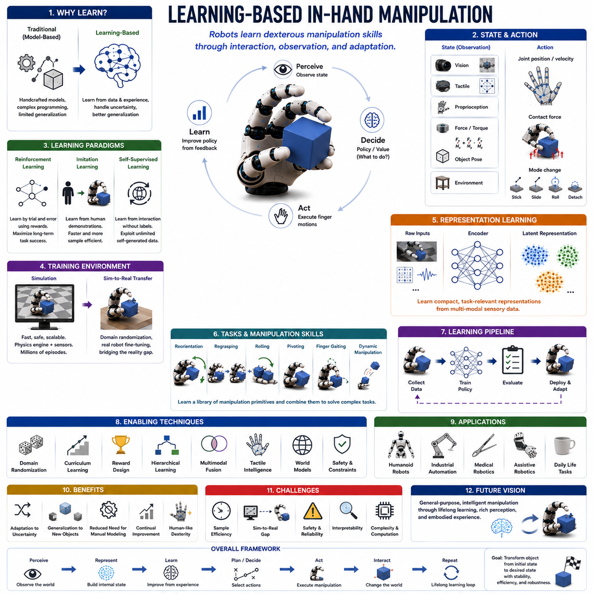{width="7.268055555555556in" height="7.268055555555556in"}

학습 기반 인핸드 매니퓰레이션(Learning-Based In-Hand Manipulation)은 현대 로봇공학과 인공지능 분야에서 가장 중요한 발전 중 하나로 평가된다. 이는 정교 조작(Dexterous Manipulation), 머신러닝(Machine Learning), 인식(Perception), 제어 이론(Control Theory), 체화 인공지능(Embodied Intelligence)을 통합하여 로봇이 사람이 직접 설계한 모델과 제어 규칙에만 의존하지 않고 경험을 통해 조작 기술을 습득하도록 만드는 접근 방식이다. 전통적인 로봇 조작 시스템은 정밀한 수학 모델, 세심하게 설계된 계획 알고리즘, 그리고 물체 형상, 접촉 역학, 동역학에 대한 명시적인 표현에 크게 의존해 왔다. 이러한 접근은 구조화된 산업 환경에서는 매우 높은 성능을 보여 주었지만, 실제 환경에서 발생하는 복잡성, 불확실성, 다양성을 다루는 데에는 한계를 가진다. 학습 기반 방법은 이러한 문제를 해결하기 위해 로봇이 상호작용, 관찰, 반복 연습, 적응 과정을 통해 조작 능력을 획득하도록 한다. 특히 인핸드 매니퓰레이션은 접촉이 매우 복잡하게 변화하는 접촉 풍부 조작(Contact-Rich Manipulation)이기 때문에 정확한 물리 모델을 구축하기 어렵다. 따라서 학습 기반 접근은 인간 수준의 손재주를 실현하기 위한 가장 유력한 경로 중 하나로 주목받고 있다.

인간 역시 정교한 조작 능력을 학습을 통해 획득한다. 갓 태어난 아기는 정교한 조작 능력을 가지고 있지 않다. 성장 과정에서 다양한 물체를 만지고, 잡고, 떨어뜨리고, 회전시키고, 이동시키면서 물체의 형상, 마찰, 무게, 접촉 특성에 대한 경험을 축적한다. 시간이 지남에 따라 신경계는 이러한 경험을 바탕으로 내부 모델(Internal Model)을 형성하며 점점 더 복잡한 조작을 수행할 수 있게 된다. 학습 기반 로봇 조작은 이러한 인간의 발달 과정을 모방한다. 즉 모든 조작 전략을 사람이 미리 설계하는 대신, 로봇이 스스로 경험을 통해 기술을 습득하도록 만드는 것이다.

학습 기반 인핸드 매니퓰레이션이 등장한 가장 큰 이유는 전통적인 모델 기반 접근의 한계 때문이다. 인핸드 매니퓰레이션에서는 로봇 손, 물체, 환경 사이에 매우 복잡하고 비선형적인 상호작용이 발생한다. 접촉점은 지속적으로 변화하고, 마찰 특성은 표면마다 다르며, 물체의 질량 분포는 정확히 알기 어려운 경우가 많다. 센서는 노이즈를 포함하고 있으며 환경 조건도 계속 변화한다. 이러한 요소를 모두 포함하는 정확한 물리 모델을 구축하는 것은 매우 어렵다. 또한 모델이 존재하더라도 이를 실시간으로 계산하는 데 상당한 비용이 필요하다. 학습 기반 방법은 이러한 복잡성을 데이터와 경험을 통해 직접 학습함으로써 해결하고자 한다.

학습 기반 조작의 핵심 개념 중 하나는 정책 학습(Policy Learning)이다. 정책(Policy)은 현재 상태(State)가 주어졌을 때 어떤 행동(Action)을 수행해야 하는지를 결정하는 함수이다. 상태에는 카메라 영상, 촉각 정보, 관절 상태, 힘 센서 데이터, 물체 자세, 환경 정보 등이 포함될 수 있다. 정책은 이러한 입력을 받아 손가락 움직임, 힘 조절, 접촉 전환, 파지 변경과 같은 행동을 출력한다. 학습 알고리즘의 목표는 작업 성공률을 최대화하면서 안정성과 효율성을 유지하는 정책을 발견하는 것이다.

강화학습(Reinforcement Learning)은 학습 기반 인핸드 매니퓰레이션에서 가장 영향력 있는 접근법 중 하나이다. 강화학습에서는 로봇이 환경과 상호작용하면서 보상(Reward)을 받는다. 성공적인 행동은 긍정적인 보상을 받고, 물체를 떨어뜨리거나 불안정한 파지를 만드는 행동은 패널티를 받는다. 로봇은 반복적인 시행착오를 통해 장기적으로 가장 높은 누적 보상을 얻는 행동 전략을 학습한다. 이러한 과정에서 복잡한 조작 기술이 자연스럽게 형성된다.

강화학습이 인핸드 매니퓰레이션에 적합한 이유는 대부분의 조작 문제가 순차적 의사결정(Sequential Decision Making) 문제로 표현될 수 있기 때문이다. 예를 들어 큐브를 손 안에서 회전시키는 작업을 생각해 보자. 로봇은 매 순간 어떤 손가락을 움직일지, 얼마나 힘을 줄지, 접촉점을 어떻게 바꿀지를 결정해야 한다. 현재의 행동은 미래의 상태와 기회에 직접적인 영향을 준다. 강화학습은 이러한 장기적인 의사결정 문제를 해결하기 위한 수학적 프레임워크를 제공한다.

로봇공학 역사에서 중요한 성과 중 하나는 다지형 로봇 핸드가 강화학습을 이용하여 큐브를 자유롭게 회전시키는 데 성공한 사례이다. 이러한 시스템은 물체를 회전시키고, 외란을 극복하며, 다양한 물체 특성 변화에 적응하는 능력을 보여주었다. 이는 복잡한 조작 행동이 반드시 사람이 직접 설계되어야 하는 것이 아니라 대규모 학습 과정을 통해 획득될 수 있음을 보여주었다.

강화학습의 성능은 탐험(Exploration)에 크게 의존한다. 로봇은 다양한 행동을 시도하면서 유용한 전략을 발견해야 한다. 그러나 실제 로봇에서 이러한 탐험은 매우 느리고 비용이 많이 들며 장비 손상의 위험도 존재한다. 많은 조작 작업은 수백만 번 이상의 시도가 필요할 수 있다. 따라서 시뮬레이션(Simulation)은 학습 기반 조작 연구의 핵심 도구가 되었다.

현대 물리 시뮬레이터는 로봇이 실제 장비를 손상시키지 않고 지속적으로 연습할 수 있는 환경을 제공한다. 시뮬레이터는 접촉 역학, 마찰, 충돌, 물체 운동, 센서 데이터를 모델링한다. 또한 실제 시간보다 훨씬 빠르게 실행할 수 있기 때문에 며칠 또는 몇 주 만에 수년치 경험을 축적할 수 있다.

도메인 랜덤화(Domain Randomization)는 시뮬레이션과 현실의 차이를 줄이는 중요한 기법이다. 학습 과정에서 물체의 질량, 마찰 계수, 표면 특성, 조명 조건, 센서 노이즈, 형상 파라미터를 지속적으로 변화시킨다. 이러한 다양성을 경험한 정책은 실제 환경에서도 더 강인하게 동작한다. 현재 도메인 랜덤화는 Sim-to-Real 전이 기술의 핵심 요소로 자리 잡고 있다.

모방학습(Imitation Learning)은 또 다른 중요한 접근 방식이다. 모방학습에서는 인간이 수행한 조작 시연(Demonstration)을 활용한다. 사람은 데이터 글러브(Data Glove), 모션 캡처(Motion Capture), 원격 조작(Teleoperation), 가상현실 인터페이스(VR)를 통해 조작 작업을 수행한다. 로봇은 이러한 데이터를 이용해 인간의 행동을 학습한다.

모방학습의 가장 큰 장점은 인간이 이미 효과적인 조작 전략을 알고 있다는 점이다. 따라서 무작위 탐험에 의존하지 않고도 빠르게 기술을 습득할 수 있다. 또한 인간의 행동은 작업에 대한 중요한 지식을 포함하고 있기 때문에 학습 효율이 크게 향상된다. 실제로 많은 시스템은 먼저 모방학습으로 초기 정책을 학습한 후 강화학습으로 추가 개선을 수행한다.

행동 복제(Behavior Cloning)는 가장 단순한 형태의 모방학습이다. 인간 시연 데이터를 지도학습(Supervised Learning) 데이터로 사용하여 상태를 입력으로, 행동을 출력으로 학습한다. 하지만 학습 데이터에 없는 상황에서는 오류가 누적되는 문제가 있다.

이를 해결하기 위해 역강화학습(Inverse Reinforcement Learning)이 사용된다. 역강화학습은 인간이 어떤 행동을 했는지뿐 아니라 왜 그런 행동을 했는지를 추론한다. 즉 행동 뒤에 숨어 있는 목표 함수를 학습하는 것이다. 이러한 접근은 일반화 성능을 향상시키는 데 유리하다.

자기지도학습(Self-Supervised Learning)도 최근 중요한 연구 분야로 부상하고 있다. 자기지도학습에서는 로봇이 스스로 데이터를 생성한다. 접촉 이벤트, 물체 이동, 성공적인 파지, 실패한 조작 모두가 학습 데이터가 된다. 별도의 라벨링 없이 무한에 가까운 데이터를 생성할 수 있기 때문에 확장성이 매우 높다.

표현 학습(Representation Learning)은 현대 학습 기반 조작 시스템의 핵심 요소이다. 원시 센서 데이터는 매우 고차원적이고 복잡하다. 카메라는 대용량 이미지를 생성하고, 촉각 센서는 복잡한 압력 분포를 생성한다. 표현 학습은 이러한 데이터를 조작에 유용한 저차원 잠재 표현(Latent Representation)으로 변환한다. 좋은 표현은 계획과 제어를 훨씬 쉽게 만들어 준다.

딥러닝(Deep Learning)은 이러한 표현 학습의 핵심 기술이다. 합성곱 신경망(CNN)은 영상 데이터를 처리하고, 그래프 신경망(GNN)은 접촉 관계를 표현하며, 트랜스포머(Transformer)는 장거리 의존성을 학습한다. 또한 멀티모달 네트워크는 시각, 촉각, 힘 센서, 고유감각(Proprioception)을 통합한다.

촉각 학습(Tactile Learning)은 특히 중요한 연구 분야이다. 손 안에서 발생하는 접촉은 외부 카메라로 관찰하기 어렵다. 촉각 센서는 압력 분포, 접촉 위치, 미세 슬립(Micro-Slip), 표면 형상 정보를 제공한다. 학습 알고리즘은 이러한 데이터를 활용하여 파지 안정성을 향상시키고 물체 특성을 추정하며 실패를 사전에 감지할 수 있다.

멀티모달 학습(Multimodal Learning)은 시각, 촉각, 힘 센서, 고유감각 정보를 통합한다. 인간 역시 다양한 감각을 통합하여 조작을 수행한다. 로봇도 이러한 접근을 통해 더 정확한 상태 추정과 강인한 의사결정을 수행할 수 있다.

물체 재배향(Object Reorientation)은 학습 기반 조작의 대표적인 벤치마크 작업이다. 로봇은 임의의 자세에서 목표 자세로 물체를 이동시켜야 한다. 이를 위해 손가락 협조, 접촉 관리, 힘 제어, 지속적인 적응이 필요하다. 따라서 재배향은 학습 기반 조작 능력을 평가하는 대표적인 문제로 사용된다.

재파지(Regrasping) 역시 중요한 벤치마크이다. 재파지 과정에서는 접촉 구성이 지속적으로 변화한다. 학습 기반 시스템은 롤링, 피벗팅, 핑거 게이팅, 중력 보조 조작 등을 조합하여 매우 효율적인 재파지 전략을 발견할 수 있다.

동적 조작(Dynamic Manipulation)은 더욱 어려운 문제를 제시한다. 물체 던지기(Tossing), 받기(Catching), 뒤집기(Flipping), 빠른 회전(Spinning)과 같은 작업은 관성과 운동량을 적극적으로 활용한다. 이러한 행동은 정확한 물리 모델링이 어렵기 때문에 학습 기반 방법이 특히 강점을 보인다.

최근 등장한 파운데이션 모델(Foundation Model)은 학습 기반 조작 연구에도 영향을 미치고 있다. 파운데이션 모델은 대규모 데이터셋으로 학습된 범용 모델로서 물체의 사용 방법, 물리적 상호작용, 조작 전략 등에 대한 사전 지식을 제공할 수 있다. 미래에는 새로운 물체를 처음 보더라도 적절한 조작 전략을 추론할 수 있는 로봇이 등장할 것으로 기대된다.

월드 모델(World Model)은 또 다른 중요한 연구 방향이다. 월드 모델은 로봇 내부에 존재하는 예측 모델로서, 특정 행동이 환경에 어떤 변화를 일으킬지를 미리 예측한다. 이를 통해 로봇은 실제 행동 전에 가상의 시뮬레이션을 수행하고 최적의 전략을 선택할 수 있다.

체화 인공지능(Embodied AI)은 학습 기반 조작이 발전하는 큰 틀을 제공한다. 체화 인공지능은 지능이 몸, 센서, 행동, 환경의 상호작용 속에서 형성된다고 본다. 인핸드 매니퓰레이션은 이러한 철학을 가장 잘 보여주는 사례 중 하나이다. 성공적인 조작은 단순한 계산이 아니라 물리 세계와의 지속적인 상호작용을 통해 이루어진다.

휴머노이드 로봇은 학습 기반 인핸드 매니퓰레이션의 가장 중요한 응용 분야 중 하나이다. 인간 환경에는 수많은 형태와 재질의 물체가 존재한다. 모든 조작 전략을 미리 프로그래밍하는 것은 불가능하다. 학습 기반 시스템은 이러한 다양성에 적응할 수 있는 능력을 제공한다. 공구 사용, 음식 준비, 의복 정리, 가정 정리, 유지보수 작업 등은 모두 학습 기반 조작 기술의 혜택을 받는다.

산업 자동화도 변화하고 있다. 전통적인 자동화는 반복적인 환경에서는 강력하지만 변화에 취약하다. 학습 기반 조작은 다양한 제품을 처리하고 변화하는 조건에 적응할 수 있게 해준다. 맞춤형 생산이 증가하는 현대 제조업에서는 이러한 유연성이 매우 중요하다.

의료 로봇 역시 중요한 응용 분야이다. 수술은 불확실성과 변형 가능한 조직을 포함한다. 학습 기반 접근은 기구 조작, 조직 상호작용, 적응형 제어를 향상시킬 수 있다. 이는 재활 로봇과 보조 로봇에도 적용될 수 있다.

학습 기반 조작 시스템의 성능은 작업 성공률(Task Success Rate), 조작 정확도(Manipulation Accuracy), 외란 강인성(Robustness), 일반화 성능(Generalization), 학습 효율성(Learning Efficiency), 에너지 소비(Energy Consumption), 계산 비용(Computational Cost) 등을 기준으로 평가된다. 특히 새로운 물체에 대한 일반화 능력이 점점 더 중요한 평가 요소가 되고 있다.

비록 놀라운 발전이 이루어졌지만 여전히 해결해야 할 문제는 많다. 데이터 효율성(Sample Efficiency)은 여전히 큰 과제이다. 많은 알고리즘은 엄청난 양의 학습 데이터를 필요로 한다. 또한 시뮬레이션과 현실 사이의 차이, 안전성(Safety), 해석 가능성(Interpretability), 신뢰성(Reliability), 장기 적응(Long-Term Adaptation)도 중요한 연구 주제로 남아 있다.

미래에는 강화학습, 모방학습, 자기지도학습, 파운데이션 모델, 월드 모델, 촉각 지능(Tactile Intelligence), 멀티모달 인식(Multimodal Perception)이 하나의 통합된 조작 아키텍처로 결합될 것으로 예상된다. 미래의 로봇은 특정 작업만 수행하는 것이 아니라 다양한 물체와 환경에 적용 가능한 일반적인 조작 지식을 학습하게 될 것이다.

궁극적으로 학습 기반 인핸드 매니퓰레이션은 로봇 손재주에 대한 패러다임 전환을 의미한다. 사람이 설계한 규칙과 모델에만 의존하는 대신, 로봇이 경험과 상호작용을 통해 조작 능력을 획득하도록 만드는 것이다. 이러한 접근은 불확실성에 대한 적응, 새로운 작업에 대한 일반화, 지속적인 성능 향상을 가능하게 한다. 인공지능, 센서 기술, 시뮬레이션, 로봇 하드웨어가 발전함에 따라 학습 기반 인핸드 매니퓰레이션은 인간 수준의 손재주를 실현하는 핵심 기술로 자리 잡게 될 것이며, 진정한 지능형 로봇 핸드를 구현하는 중요한 기반이 될 것이다.

## 10.10 Dexterity Benchmarking

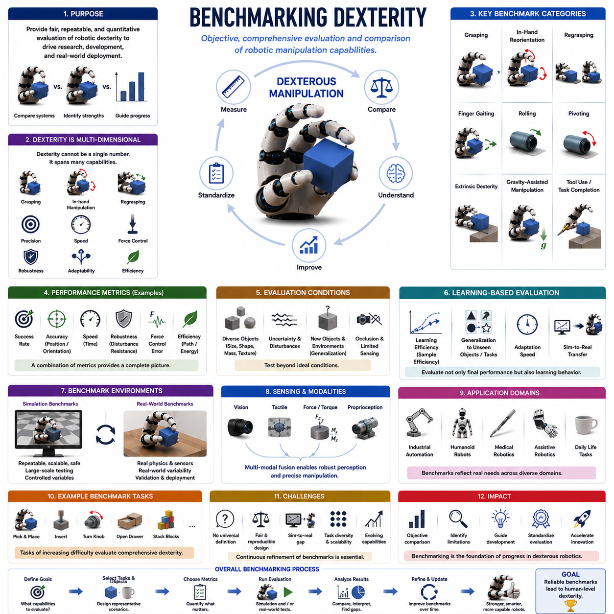{width="7.268055555555556in" height="7.268055555555556in"}

손재주 벤치마킹(Benchmarking Dexterity)은 로봇 조작 연구에서 매우 중요한 분야로, 정교 조작 능력을 체계적으로 평가하고 비교하며 정량화하는 것을 목표로 한다. 로봇 핸드의 성능이 지속적으로 향상되고 조작 알고리즘이 빠르게 발전함에 따라, 객관적인 성능 측정 기준의 필요성은 더욱 커지고 있다. 신뢰할 수 있는 벤치마크가 없다면 특정 로봇 시스템이 다른 시스템보다 실제로 우수한지, 새로운 제어 알고리즘이 의미 있는 발전을 제공하는지, 또는 특정 조작 기술이 실제 산업 현장에 적용할 만큼 충분히 강인한지를 판단하기 어렵다. 벤치마킹은 연구자, 엔지니어, 기업이 공통된 기준으로 성능을 평가하고 한계를 분석하며 미래 개발 방향을 결정할 수 있도록 해주는 공통 언어 역할을 한다. 로봇 핸드와 인핸드 매니퓰레이션의 전체 구조에서 손재주 벤치마킹은 파지(Grasping), 핑거 게이팅(Finger Gaiting), 롤링(Rolling), 피벗팅(Pivoting), 재파지(Regrasping), 물체 재배향(Object Reorientation), 외재적 손재주(Extrinsic Dexterity), 중력 보조 조작(Gravity-Assisted Manipulation), 계획 시스템(Planning Systems), 학습 기반 조작(Learning-Based Manipulation)을 평가하는 기반이 된다.

인간의 손재주는 오랫동안 로봇 손재주의 기준점 역할을 해 왔다. 인간의 손은 공구 사용, 물체 조작, 미세 운동 제어, 적응형 파지, 빠른 학습 능력 등 놀라운 기능을 가지고 있다. 그러나 인간의 손재주 자체를 측정하는 일도 간단하지 않다. 연구자들은 속도, 정확도, 협응성, 힘 제어 능력, 적응성, 작업 효율성 등을 평가하기 위한 다양한 임상적·생체역학적 평가 방법을 개발해 왔다. 이러한 인간 손재주 평가 방법은 로봇 손재주 벤치마크 설계에도 큰 영향을 주었다. 다만 로봇은 인간과 구조와 센서가 다르기 때문에 직접적인 비교는 쉽지 않다.

손재주라는 개념은 본질적으로 다차원적(Multidimensional)이다. 속도나 적재 중량처럼 단일 수치로 표현하기 어렵다. 어떤 로봇은 파지 능력은 뛰어나지만 인핸드 조작 능력은 부족할 수 있다. 또 다른 로봇은 정밀도는 높지만 강인성이 떨어질 수 있다. 어떤 시스템은 다양한 물체를 조작할 수 있지만 계산 비용이 매우 클 수 있다. 따라서 손재주는 하나의 숫자로 표현할 수 없으며, 효과적인 벤치마크는 여러 성능 차원을 동시에 평가해야 한다.

손재주 평가에서 가장 기본적인 항목은 파지 성능(Grasp Performance)이다. 대부분의 조작 작업은 물체를 안정적으로 획득하는 것에서 시작되기 때문에 파지는 모든 조작의 기반이 된다. 파지 벤치마크는 다양한 크기, 형상, 질량, 표면 재질, 강성, 질량 분포를 가진 물체를 대상으로 수행된다. 로봇은 이러한 다양한 조건에서도 안정적인 파지를 형성할 수 있어야 한다. 성공률(Success Rate), 파지 안정성(Grasp Stability), 접촉 품질(Contact Quality), 외란 저항 능력(Disturbance Resistance)이 대표적인 평가 지표이다.

특히 파지 강인성(Grasp Robustness)은 매우 중요한 평가 요소이다. 실제 환경에서는 센서 노이즈, 위치 오차, 마찰 변화, 외부 충격 등이 항상 존재한다. 이상적인 실험실 조건에서만 성공하는 파지는 실제 가치가 낮다. 따라서 벤치마크에서는 물체 위치 변화, 힘 외란, 마찰 변화, 센서 불확실성을 의도적으로 추가하여 성능을 측정한다.

인핸드 매니퓰레이션(In-Hand Manipulation)은 손재주 벤치마킹의 또 다른 핵심 영역이다. 단순한 파지와 달리 인핸드 매니퓰레이션은 물체를 손 안에서 이동시키고, 회전시키고, 재배향하는 능력을 평가한다. 이러한 작업은 접촉 전환, 힘 조절, 다지 협조 제어를 포함하기 때문에 훨씬 어렵다. 일반적으로 물체를 특정 자세로 이동시키거나 정해진 회전을 수행하도록 요구하며, 성공률, 조작 속도, 경로 효율성, 자세 정확도 등이 평가된다.

물체 재배향(Object Reorientation)은 가장 널리 사용되는 벤치마크 중 하나이다. 로봇은 임의의 자세로 주어진 물체를 목표 자세로 변환해야 한다. 이 작업은 접촉 관리, 손가락 협조, 힘 제어, 불확실성 대응 등 정교 조작의 핵심 요소를 모두 포함한다. 따라서 많은 연구에서 표준 평가 과제로 사용된다.

재파지(Regrasping)는 또 다른 중요한 평가 대상이다. 재파지는 물체를 유지하면서 접촉 구성을 변경하는 능력을 의미한다. 여러 개의 목표 파지 상태를 순차적으로 달성하거나, 다양한 파지 형태 사이를 전환하는 과제가 사용된다. 성공적인 재파지는 이산적 접촉 전환과 연속적 물체 제어를 동시에 수행할 수 있음을 보여준다.

핑거 게이팅(Finger Gaiting) 벤치마크는 손가락 위치를 변경하면서도 물체 안정성을 유지할 수 있는지를 평가한다. 핑거 게이팅은 손의 유효 작업 공간을 확장하는 중요한 기술이다. 성공적인 접촉 전환 횟수, 위치 정확도, 안정성 유지 정도가 주요 평가 지표가 된다.

롤링(Rolling)과 피벗팅(Pivoting) 벤치마크는 접촉 역학을 이용한 물체 이동 능력을 평가한다. 롤링은 접촉점을 물체 표면 위로 이동시키는 능력을, 피벗팅은 특정 접촉점을 중심으로 회전시키는 능력을 측정한다. 이러한 과제는 기계 설계와 제어 알고리즘의 수준을 동시에 평가할 수 있다.

최근에는 외재적 손재주(Extrinsic Dexterity)에 대한 평가도 중요해지고 있다. 기존 벤치마크는 대부분 손 내부에서 수행되는 조작만을 고려하였다. 그러나 인간은 실제로 테이블, 벽, 선반과 같은 환경 구조물을 적극적으로 활용한다. 따라서 최신 벤치마크는 환경과의 상호작용을 포함하는 과제를 점점 더 많이 포함하고 있다.

중력 보조 조작(Gravity-Assisted Manipulation) 역시 새로운 평가 영역으로 떠오르고 있다. 중력을 활용하여 에너지 소비를 줄이고 조작 효율을 높일 수 있는지 평가한다. 이는 단순히 중력을 보상하는 것이 아니라 자연의 물리적 특성을 얼마나 효과적으로 활용하는지를 측정하는 것이다.

정밀도(Precision)는 손재주 평가에서 매우 중요한 요소이다. 산업 조립, 수술 로봇, 전자제품 생산, 마이크로 제조에서는 매우 높은 정확도가 요구된다. 따라서 물체를 특정 위치에 정확하게 놓거나, 부품을 정밀하게 정렬하거나, 작은 오차 범위 내에서 삽입하는 과제가 자주 사용된다. 위치 오차(Position Error), 각도 오차(Angular Error), 반복 정밀도(Repeatability)가 주요 지표이다.

조작 속도(Manipulation Speed) 역시 중요하다. 높은 정확도를 달성하더라도 작업 시간이 지나치게 길다면 실용성이 떨어진다. 반대로 지나치게 빠른 조작은 안정성을 저하시킬 수 있다. 따라서 속도와 정확도 사이의 균형을 평가하는 것이 중요하다.

힘 제어 능력(Force Control Capability)은 정교 조작의 핵심 요소이다. 지나치게 큰 힘은 물체를 손상시킬 수 있으며, 너무 작은 힘은 슬립(Slip)을 발생시킨다. 따라서 깨지기 쉬운 물체나 변형 가능한 물체를 다루는 작업을 통해 힘 조절 능력을 평가한다.

적응성(Adaptability)은 고급 손재주의 핵심 특징이다. 과거의 로봇은 제한된 환경에서만 잘 동작하는 경우가 많았다. 현대 로봇은 새로운 물체, 새로운 환경, 새로운 작업에 적응할 수 있어야 한다. 따라서 최근 벤치마크는 학습 과정에서 보지 못한 물체와 환경을 포함하는 경우가 많다.

학습 기반 조작(Learning-Based Manipulation)은 새로운 벤치마킹 과제를 제시하고 있다. 기존 평가 방식은 고정된 성능을 측정하는 데 초점이 맞추어져 있었다. 그러나 학습 시스템은 시간이 지남에 따라 성능이 향상된다. 따라서 최종 성능뿐 아니라 학습 속도(Learning Speed), 샘플 효율성(Sample Efficiency), 적응 속도(Adaptation Speed), 일반화 능력(Generalization Capability)도 평가해야 한다.

샘플 효율성은 특히 중요한 지표이다. 어떤 알고리즘은 수백만 번의 학습이 필요하지만, 어떤 알고리즘은 훨씬 적은 데이터로도 높은 성능을 달성할 수 있다. 실제 환경에서는 데이터 수집 비용이 매우 높기 때문에 샘플 효율성은 실용성을 결정하는 중요한 요소가 된다.

일반화 평가(Generalization Benchmarking)는 최근 가장 중요한 연구 방향 중 하나이다. 특정 학습 물체에서만 잘 동작하는 시스템은 실제 활용 가치가 제한적이다. 진정한 손재주는 새로운 물체, 새로운 환경, 새로운 작업에서도 높은 성능을 유지하는 것이다. 따라서 최신 벤치마크는 학습 과정에서 전혀 보지 못한 물체를 포함하는 경우가 많다.

시뮬레이션 벤치마크(Simulation Benchmark)는 연구에서 매우 중요한 역할을 한다. 물리 시뮬레이터는 다양한 조건을 빠르게 테스트할 수 있고 반복 가능성이 높다. 그러나 시뮬레이션은 실제 물리 현상을 완벽히 재현할 수 없기 때문에 현실 환경 평가와 함께 사용되어야 한다.

Sim-to-Real Gap은 여전히 중요한 문제이다. 시뮬레이션에서 우수한 성능을 보이는 정책이 실제 환경에서는 실패할 수 있다. 이는 마찰, 접촉 역학, 센서 노이즈, 환경 변화가 정확히 모델링되지 않기 때문이다. 따라서 최근 벤치마크는 시뮬레이션 성능뿐 아니라 실제 로봇으로의 전이 성능도 평가한다.

촉각 센싱(Tactile Sensing)은 현대 벤치마크의 중요한 요소가 되었다. 시각 정보만으로는 손 안에서 발생하는 접촉을 완전히 이해하기 어렵다. 따라서 슬립 감지, 접촉 상태 추정, 힘 조절을 위해 촉각 센서를 활용하는 능력을 평가한다.

멀티모달 인식(Multimodal Perception)은 시각, 촉각, 힘 센서, 고유감각(Proprioception)의 통합 능력을 평가한다. 인간의 손재주는 다양한 감각의 통합에 기반하기 때문에, 로봇 역시 이러한 능력을 갖추어야 한다.

휴머노이드 로봇(Humanoid Robot)의 발전은 손재주 벤치마크에도 큰 영향을 미쳤다. 인간 환경에서 동작해야 하는 휴머노이드는 공구 사용, 물건 정리, 용기 열기, 음식 준비, 의복 보조와 같은 일상적인 작업을 수행해야 한다. 따라서 이러한 작업들이 새로운 벤치마크로 사용되고 있다.

산업용 벤치마크는 생산성(Productivity), 신뢰성(Reliability), 강인성(Robustness)을 강조한다. 조립, 삽입, 부품 이송과 같은 실제 제조 공정이 주요 평가 과제가 된다.

의료 로봇 벤치마크는 정밀도와 안전성을 특히 중요하게 평가한다. 조직 조작, 기구 위치 제어, 좁은 공간에서의 조작 등이 대표적인 평가 항목이다.

현재 로봇공학 분야에는 여러 표준 벤치마크 세트가 존재한다. YCB Object Set, OpenAI Dexterous Manipulation Benchmark, Meta-World, RoboSuite 등이 대표적이다. 이러한 공통 평가 플랫폼은 연구 결과의 재현성과 비교 가능성을 높여 준다.

또한 벤치마크 데이터셋(Benchmark Dataset)도 중요한 역할을 한다. 조작 궤적, 촉각 데이터, 영상 데이터, 힘 데이터, 성공·실패 기록을 포함한 대규모 데이터셋은 알고리즘 개발과 평가를 지원한다.

최근 파운데이션 모델(Foundation Model)과 체화 인공지능(Embodied AI)의 발전은 벤치마킹 방식 자체를 변화시키고 있다. 미래의 로봇은 특정 작업만 수행하는 것이 아니라 다양한 작업에 일반화된 능력을 가져야 한다. 따라서 추론(Reasoning), 계획(Planning), 적응(Adaptation), 전이 학습(Transfer Learning), 장기 학습(Long-Term Learning) 능력까지 평가해야 할 필요성이 커지고 있다.

월드 모델(World Model) 역시 새로운 평가 기준을 요구한다. 미래의 로봇은 물리적 결과를 예측하고 행동을 계획할 수 있어야 한다. 따라서 예측 정확도와 물리적 이해 능력도 중요한 평가 요소가 될 것이다.

그럼에도 불구하고 손재주 벤치마킹은 여전히 해결되지 않은 연구 과제이다. 손재주 자체에 대한 보편적인 정의가 존재하지 않으며, 응용 분야마다 중요하게 생각하는 성능 요소가 다르다. 또한 현실을 충분히 반영하면서도 재현 가능하고 공정한 벤치마크를 설계하는 것은 매우 어렵다.

미래의 벤치마크는 더욱 통합적(Holistic)인 형태로 발전할 것으로 예상된다. 단순히 특정 조작 기술만 평가하는 것이 아니라 인식, 계획, 학습, 적응, 추론, 물리적 상호작용을 모두 포함하는 종합적인 평가 체계가 등장할 것이다.

궁극적으로 손재주 벤치마킹은 로봇 조작 기술 발전을 가능하게 하는 측정 인프라(Measurement Infrastructure)이다. 이는 기술 수준을 객관적으로 평가하고, 서로 다른 접근법을 비교하며, 한계를 발견하고, 미래 연구 방향을 제시한다. 만약 벤치마킹이 없다면 정교 조작 기술의 발전을 정량적으로 검증하기 어렵다. 앞으로 로봇 핸드가 인간 수준의 손재주에 가까워질수록, 손재주 벤치마킹은 지능형 로봇 조작 발전을 뒷받침하는 핵심 기반 기술로서 더욱 중요한 역할을 수행하게 될 것이다.

## 10.11 Industrial Applications

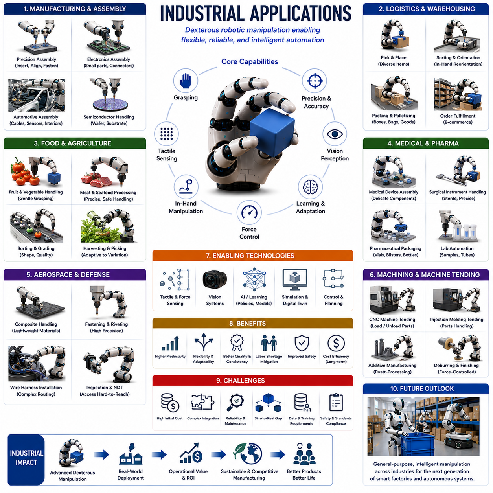{width="7.268055555555556in" height="7.268055555555556in"}

산업 응용 분야(Industrial Applications)는 정교 로봇 조작(Dexterous Robotic Manipulation) 기술이 최종적으로 그 가치를 입증하는 단계이다. 로봇 핸드, 파지(Grasping), 인핸드 매니퓰레이션(In-Hand Manipulation), 촉각 센싱(Tactile Sensing), 힘 제어(Force Control), 학습 기반 조작(Learning-Based Manipulation)과 같은 기술은 대부분 연구실에서 개발되지만, 실제 산업 현장에서 성공적으로 활용될 때 비로소 진정한 의미를 갖게 된다. 산업 응용은 손재주(Dexterity)를 학문적 성과에서 경제적 가치로 전환시키는 과정이다. 현대 제조업, 물류, 창고 자동화, 전자제품 생산, 자동차 산업, 의료기기 제조, 항공우주 산업, 식품 가공, 포장 산업에서는 인간 작업자가 수행해 왔던 복잡한 조작 작업을 자동화할 수 있는 로봇 시스템에 대한 요구가 지속적으로 증가하고 있다. 산업이 대량 맞춤 생산(Mass Customization), 제품 다양화(Product Diversity), 생산 주기 단축(Short Production Cycle), 스마트 제조(Smart Manufacturing)로 발전함에 따라 정교 조작 기술은 차세대 지능형 공장의 핵심 기반 기술로 자리 잡고 있다.

전통적인 산업용 로봇은 구조화된 자동화(Structured Automation)를 통해 큰 성공을 거두었다. 단순한 평행 그리퍼(Parallel-Jaw Gripper)를 장착한 로봇 팔은 용접, 도장, 픽앤플레이스(Pick-and-Place), 팔레타이징(Palletizing), 머신 텐딩(Machine Tending)과 같은 반복 작업을 수행하였다. 이러한 시스템이 성공할 수 있었던 이유는 환경이 매우 잘 통제되었기 때문이다. 부품은 항상 같은 자세로 공급되었고, 지그(Jig)와 고정 장치(Fixture)는 위치를 제한하였으며, 전용 툴링(Tooling)은 변동성을 최소화하였다. 그러나 현대 산업 환경은 점점 더 유연성을 요구하고 있다. 제품 종류가 자주 변경되고, 부품의 다양성이 증가하며, 생산 시스템은 새로운 요구사항에 빠르게 적응해야 한다. 이러한 변화는 정교 조작 기술의 필요성을 크게 증가시키고 있다.

정교 조작의 가장 중요한 산업 응용 분야 중 하나는 조립 자동화(Assembly Automation)이다. 조립 작업은 부품의 정밀한 위치 제어, 방향 조정, 삽입(Insertion), 체결(Fastening), 정렬(Alignment)을 필요로 한다. 인간은 시각 정보, 촉각 정보, 힘 제어, 적응적 조작 전략을 활용하여 이러한 작업을 자연스럽게 수행한다. 로봇이 이러한 능력을 획득하는 것은 산업 자동화의 중요한 목표 중 하나이다. 다지형 로봇 핸드(Multi-Fingered Robot Hand), 촉각 센서, 힘 센서를 갖춘 시스템은 커넥터 삽입, 케이블 배선, 정밀 체결, 가스켓 조립, 전자 부품 배치와 같은 작업을 수행할 수 있다.

전자제품 제조(Electronics Manufacturing)는 정교 조작의 필요성이 가장 명확하게 드러나는 분야 중 하나이다. 현대 전자기기는 매우 작고 깨지기 쉬운 부품들로 구성된다. 회로기판(PCB), 커넥터, 센서, 배터리, 디스플레이, 반도체 칩 등은 매우 높은 정밀도를 요구한다. 기존의 단순 그리퍼는 이러한 부품을 다루는 과정에서 손상을 유발할 수 있다. 반면 정교 로봇 핸드는 부품을 손 안에서 재배향하고, 파지 구성을 변경하며, 접촉력을 세밀하게 조절할 수 있다. 전자제품의 소형화가 계속 진행됨에 따라 이러한 기술의 중요성은 더욱 증가하고 있다.

반도체 산업(Semiconductor Industry)은 더욱 높은 수준의 정밀도를 요구한다. 웨이퍼(Wafer), 마스크(Mask), 기판(Substrate)과 같은 부품은 극도로 민감하다. 미세한 오염이나 과도한 힘만으로도 큰 경제적 손실이 발생할 수 있다. 클린룸(Clean Room) 환경에서 작동하는 로봇은 높은 정밀도와 안정적인 힘 제어를 동시에 제공해야 한다. 정교 조작 기술은 이러한 요구를 만족시키는 핵심 기술 중 하나이다.

자동차 산업(Automotive Industry)은 산업용 로봇의 가장 큰 활용 분야 중 하나이다. 전통적으로 자동차 공장은 용접, 도장, 대형 부품 이송과 같은 작업에 로봇을 활용해 왔다. 그러나 현대 자동차는 수많은 전자 장치, 센서, 배터리 모듈, 맞춤형 부품을 포함하고 있다. 전기차(Electric Vehicle)의 확산은 이러한 경향을 더욱 강화하고 있다. 배터리 셀 조립, 전장 시스템 설치, 배선 작업, 센서 장착과 같은 작업은 높은 수준의 정교 조작 능력을 요구한다.

항공우주 산업(Aerospace Industry)도 중요한 응용 분야이다. 항공기와 우주선 부품은 매우 고가이며 생산량은 상대적으로 적다. 따라서 생산 과정은 높은 품질과 유연성을 동시에 요구한다. 복합재(Composite Material) 처리, 정밀 체결, 배선 설치, 구조물 조립 등은 정교 조작 기술이 큰 가치를 제공하는 영역이다. 특히 다양한 형상의 부품을 다루어야 하기 때문에 적응형 조작 능력이 중요하다.

의료기기 제조(Medical Device Manufacturing) 역시 정교 조작의 대표적인 활용 분야이다. 수술 기구, 카테터, 임플란트, 진단 장비는 높은 품질과 정밀한 조립을 요구한다. 또한 청정성과 안전성이 매우 중요하다. 정교 로봇 시스템은 오염 위험을 줄이고 반복성을 향상시키며 품질을 안정적으로 유지할 수 있다.

식품 가공(Food Processing)과 농업(Agriculture)은 최근 정교 조작 기술의 새로운 응용 분야로 주목받고 있다. 과일, 채소, 빵, 해산물, 육류 제품은 형태와 강성이 매우 다양하다. 기존 산업용 그리퍼는 이러한 제품을 손상시키기 쉽다. 반면 소프트 로봇 핸드(Soft Robotic Hand)와 촉각 센서를 이용한 정교 조작 시스템은 부드럽고 안전하게 제품을 다룰 수 있다. 이를 통해 자동 수확, 선별, 포장, 검사 작업이 가능해진다.

물류(Logistics)와 창고 자동화(Warehouse Automation)는 최근 가장 빠르게 성장하는 응용 분야 중 하나이다. 전자상거래(E-Commerce)의 성장으로 인해 로봇은 수많은 종류의 상품을 처리해야 한다. 창고에는 크기, 무게, 포장 형태가 모두 다른 수많은 물체가 존재한다. 정교 조작 기술은 물체를 집고, 회전시키고, 정렬하고, 포장하는 능력을 제공한다. 특히 인핸드 매니퓰레이션은 물체를 다시 집지 않고도 방향을 변경할 수 있기 때문에 효율성을 크게 향상시킨다.

주문 처리 센터(Order Fulfillment Center)는 이러한 기술의 대표적인 사례이다. 인간 작업자는 다양한 상품을 빠르게 인식하고, 집고, 회전시키고, 포장할 수 있다. 로봇이 이러한 유연성을 획득하기 위해서는 시각 인식, 촉각 센싱, 파지 계획, 학습 기반 조작 기술이 필요하다. 최근 강화학습과 대규모 데이터셋을 활용한 시스템은 이러한 분야에서 상당한 발전을 보여주고 있다.

포장 자동화(Packaging Automation) 역시 중요한 응용 분야이다. 상자 조립, 제품 삽입, 라벨 부착, 밀봉, 팔레타이징 작업은 다양한 형태의 제품을 다루어야 한다. 적응형 로봇 핸드는 제품이 변경되더라도 큰 하드웨어 변경 없이 작업을 수행할 수 있다.

머신 텐딩(Machine Tending)은 오래된 산업용 로봇 응용 분야이지만, 정교 조작 기술에 의해 더욱 발전하고 있다. CNC 머신, 사출 성형기, 프레스 장비, 적층 제조 장비에 부품을 넣고 꺼내는 작업은 점점 더 다양한 형태의 부품을 다루게 되고 있다. 정교 조작은 이러한 유연성을 제공한다.

품질 검사(Quality Inspection)와 계측(Metrology)도 중요한 분야이다. 검사 과정에서는 물체를 다양한 방향으로 회전시키고 숨겨진 표면을 노출시켜야 한다. 정교 조작 기술은 카메라, 레이저 스캐너, 촉각 프로브가 최적의 시야를 확보할 수 있도록 물체를 동적으로 조정할 수 있다.

유지보수(Maintenance), 수리(Repair), 오버홀(Overhaul) 작업 역시 정교 조작의 중요한 응용 분야이다. 산업 설비는 정기적인 점검과 교체 작업이 필요하다. 이러한 작업은 공구 사용, 불규칙한 물체 조작, 협소한 공간 작업을 포함한다. 정교 로봇은 공구를 사용하여 유지보수 작업을 수행할 수 있으며, 특히 화학 플랜트, 해양 플랫폼, 원자력 시설과 같은 위험 환경에서 큰 가치를 가진다.

협동 로봇(Collaborative Robot)의 발전은 정교 조작의 활용 범위를 더욱 넓혔다. 협동 로봇은 인간과 같은 공간에서 작업해야 하므로 높은 적응성과 안전성이 필요하다. 정교 조작 기술은 협동 로봇이 조립, 검사, 포장, 자재 운반 작업을 인간과 함께 수행할 수 있도록 지원한다.

산업용 정교 조작은 촉각 센싱(Tactile Sensing)에 크게 의존한다. 시각 정보만으로는 접촉 상태를 완전히 이해할 수 없기 때문이다. 촉각 센서는 슬립 감지, 힘 추정, 표면 특성 파악을 가능하게 하며, 이를 통해 파지 안정성을 크게 향상시킨다.

힘 제어(Force Control) 또한 핵심 기술이다. 삽입, 체결, 연마, 조립, 검사 작업은 모두 정밀한 접촉력을 요구한다. 임피던스 제어(Impedance Control), 위치-힘 혼합 제어(Hybrid Position-Force Control), 모델 예측 제어(Model Predictive Control)는 이러한 작업을 수행하기 위한 주요 방법이다.

학습 기반 조작(Learning-Based Manipulation)은 산업용 로봇을 빠르게 변화시키고 있다. 과거의 자동화는 작업마다 수작업 프로그래밍이 필요했다. 그러나 강화학습, 모방학습, 자기지도학습, 파운데이션 모델은 로봇이 스스로 조작 기술을 학습하도록 한다. 이는 배포 시간을 줄이고 적응성을 향상시킨다.

시뮬레이션(Simulation)은 산업 응용에서 필수적인 도구가 되었다. 물리 시뮬레이터와 디지털 트윈(Digital Twin)은 실제 생산 환경을 가상으로 재현하여 설계, 검증, 최적화를 수행할 수 있도록 지원한다. 이는 개발 비용을 줄이고 위험을 감소시킨다.

유연 생산(Flexible Manufacturing)은 정교 조작과 밀접하게 연결되어 있다. 과거의 자동화는 특정 제품에 최적화되었지만, 현대 제조업은 다양한 제품과 생산량 변화에 대응해야 한다. 정교 조작 기술은 최소한의 하드웨어 변경으로 새로운 작업에 적응할 수 있는 능력을 제공한다.

인더스트리 4.0(Industry 4.0)과 스마트 팩토리(Smart Factory)는 이러한 흐름을 더욱 가속화하고 있다. 센서, AI, 클라우드, 디지털 인프라와 연결된 로봇은 생산 요구에 따라 스스로 판단하고 협력하는 지능형 에이전트(Intelligent Agent)로 발전하고 있다.

경제성(Economics)은 산업 도입의 중요한 요소이다. 정교 로봇 시스템은 초기 비용이 높을 수 있지만, 인건비 절감, 생산성 향상, 품질 개선, 안전성 향상, 자동화 범위 확대를 통해 큰 경제적 가치를 제공할 수 있다. 특히 인력 부족과 제품 다양성이 증가하는 환경에서는 투자 수익률(Return on Investment)이 매우 높아질 수 있다.

물론 아직 해결해야 할 과제도 존재한다. 정교 로봇 핸드는 여전히 가격이 비싸고, 촉각 센서는 발전 과정에 있으며, 학습 기반 시스템은 대규모 데이터와 검증 과정을 필요로 한다. Sim-to-Real 전이 문제도 완전히 해결되지 않았다. 그러나 하드웨어, 센서, 컴퓨팅, 인공지능 기술이 발전함에 따라 이러한 제약은 점차 줄어들고 있다.

미래의 산업용 조작 시스템은 정교 로봇 핸드, 멀티모달 인식(Multimodal Perception), 촉각 지능(Tactile Intelligence), 파운데이션 모델(Foundation Model), 월드 모델(World Model), 대규모 학습 시스템을 통합한 형태로 발전할 것이다. 이러한 시스템은 인간 작업자와 유사한 수준의 적응성, 학습 능력, 문제 해결 능력을 가지게 될 것이다.

궁극적으로 산업 응용은 정교 조작 연구의 최종 목적지이다. 연구실에서 개발된 이론과 알고리즘은 산업 현장에서 경제적 가치와 생산성을 창출할 때 진정한 의미를 갖는다. 미래의 지능형 공장, 유연 생산 시스템, 자율 물류 센터, 협업 작업 환경은 정교 로봇 조작 기술의 발전에 크게 의존하게 될 것이며, 산업 응용은 이러한 기술의 성공 여부를 판단하는 가장 중요한 시험 무대가 될 것이다.
