**Volume 06 Robot Hands and Dexterous Grasping**


# 11. Learning-Based Grasping

##  

## 11.01 Introduction to Learning-Based Grasping

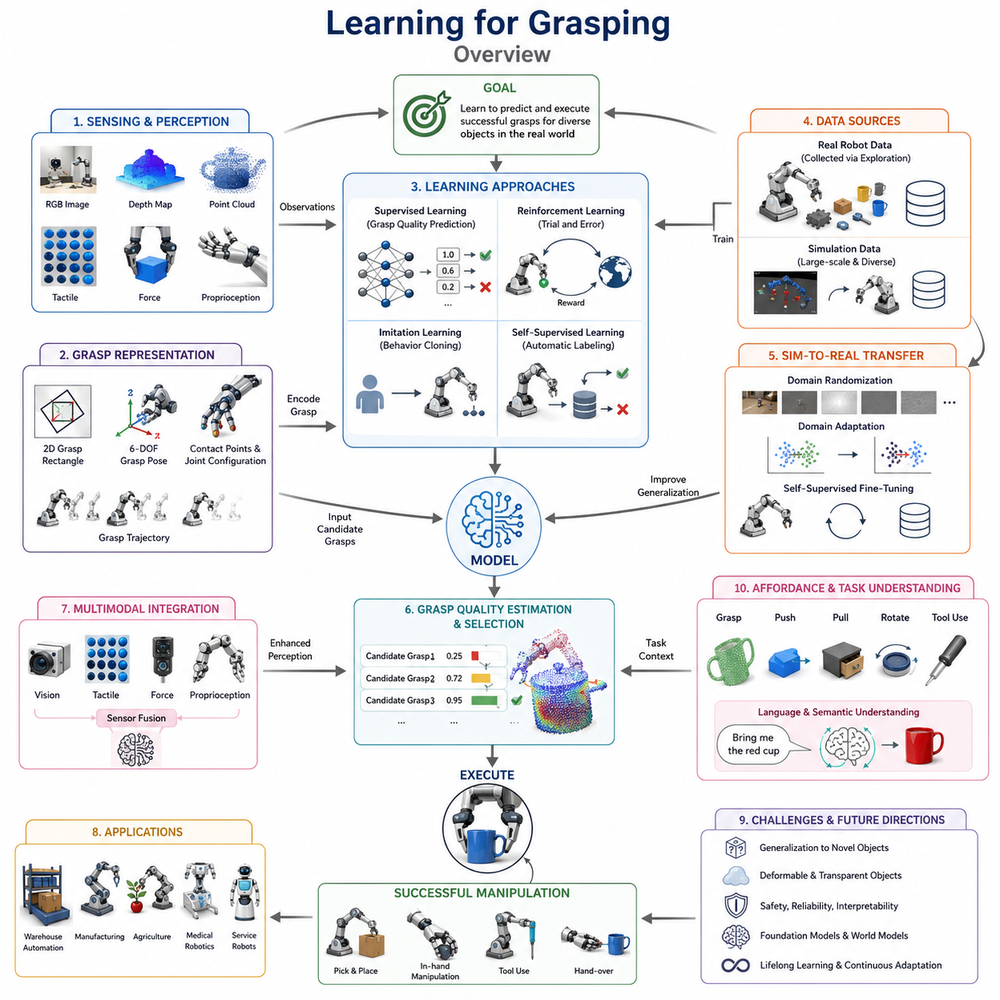{width="7.268055555555556in" height="7.268055555555556in"}

Learning for Grasping is one of the most transformative developments in modern robotic manipulation. Traditional grasping systems were largely built upon analytical models derived from kinematics, dynamics, contact mechanics, force closure theory, and optimization-based planning. These approaches provided a mathematically rigorous foundation for robotic grasping and enabled robots to perform stable pick-and-place operations in highly structured environments. However, as robots began to move into unstructured environments such as warehouses, homes, hospitals, agricultural fields, and collaborative manufacturing settings, the limitations of purely analytical methods became increasingly apparent. Real-world environments contain uncertainty, object diversity, sensor noise, partial observability, deformable materials, and unpredictable interactions that are difficult to model accurately using handcrafted rules alone. Learning-based grasping emerged as a response to these challenges by allowing robots to acquire grasping skills directly from data and experience rather than relying solely on predefined models. This chapter serves as an overview of the field of learning for grasping and introduces the major concepts, methodologies, architectures, datasets, and research directions that define this rapidly evolving area. The topic is positioned within the Learning Based Grasping section of Volume 06 and forms the conceptual foundation for subsequent chapters covering datasets, grasp quality learning, neural grasp detection, reinforcement learning, self-supervised learning, sim-to-real transfer, and multi-task manipulation systems.

The fundamental idea behind learning-based grasping is that a robot can observe examples of successful and unsuccessful grasps and gradually develop an internal representation of grasp quality. Instead of explicitly calculating every physical interaction between fingers and objects, a learning system identifies patterns that correlate with successful manipulation outcomes. Through repeated exposure to data, the robot learns to recognize geometric features, object affordances, contact opportunities, and stable grasp configurations. The resulting system often demonstrates greater adaptability than traditional approaches because it can generalize beyond the exact situations encountered during training.

Historically, robotic grasping research relied heavily on geometric reasoning. Researchers modeled contact points, friction cones, wrench spaces, and force distributions to identify grasps that satisfied theoretical stability conditions. While these methods remain important and continue to provide valuable insights, they often struggle when confronted with incomplete sensory information or unknown object properties. A robot may encounter a previously unseen object whose mass distribution, friction coefficient, compliance, or shape characteristics are not available in advance. In such cases, learning algorithms can infer useful grasp strategies from prior experience even when exact physical parameters are unknown.

Machine learning introduces the ability to learn complex nonlinear relationships between sensory observations and manipulation outcomes. A grasping system may receive images, depth maps, point clouds, tactile measurements, force sensor readings, or multimodal sensor inputs and transform these observations into grasp predictions. The learning process automatically discovers features that are relevant for successful grasp execution. This capability significantly reduces the need for manually engineered feature extraction pipelines and enables grasping systems to adapt to a wider range of objects and environments.

One of the earliest applications of machine learning in robotic grasping involved supervised learning. In supervised grasp learning, large datasets of grasp examples are collected and labeled according to success or failure. Neural networks, decision trees, support vector machines, or other predictive models are then trained to estimate grasp quality. Given a new object observation, the model predicts whether a candidate grasp is likely to succeed. The effectiveness of supervised learning depends heavily on the availability of high-quality training data and representative examples that capture the diversity of real-world manipulation scenarios.

The emergence of deep learning dramatically accelerated progress in grasping research. Deep neural networks can process raw sensory data directly, allowing end-to-end learning from images or point clouds. Convolutional neural networks became particularly influential because they enabled robots to learn visual representations associated with successful grasps. Rather than explicitly detecting object boundaries, surfaces, and grasp points through handcrafted algorithms, neural networks could automatically learn these concepts from data. This shift simplified system design while often improving performance on challenging grasping tasks.

Vision-based grasp learning rapidly became a dominant research direction. Cameras provide rich environmental information at relatively low cost and can capture large portions of a workspace. Learning systems use RGB images, depth maps, stereo vision, or RGB-D sensors to estimate grasp candidates. A robot may identify grasp rectangles, contact points, gripper poses, or complete six-degree-of-freedom grasp configurations directly from visual input. The ability to infer grasp opportunities from perception data is essential for autonomous manipulation in dynamic environments.

Point cloud based grasp learning represents another important branch of research. Three-dimensional point clouds provide direct geometric information about object surfaces and spatial relationships. Learning algorithms operating on point clouds can reason about object geometry without requiring explicit mesh reconstruction. Architectures such as PointNet, PointNet++, graph neural networks, and transformer-based geometric networks have enabled increasingly sophisticated grasp prediction systems. These models can identify graspable regions, estimate contact configurations, and generate dexterous manipulation strategies directly from sparse geometric observations.

A central concept in learning-based grasping is grasp representation. Before a robot can learn how to grasp, the grasp itself must be represented in a form suitable for machine learning. Different systems use different representations depending on the robot hardware and task requirements. Simple parallel-jaw grippers often use grasp rectangles in image space. More advanced systems employ six-degree-of-freedom grasp poses, fingertip contact locations, joint configurations, or entire hand trajectories. The choice of representation influences network architecture, training methodology, computational complexity, and deployment performance.

Another key concept is grasp quality estimation. Rather than directly predicting a single grasp action, many learning systems evaluate multiple candidate grasps and assign a quality score to each one. The robot then selects the grasp with the highest predicted probability of success. Grasp quality estimation transforms manipulation into a ranking problem and enables flexible integration with existing planning systems. Networks such as Grasp Quality Convolutional Neural Networks demonstrated the effectiveness of this approach and inspired numerous subsequent developments in robotic grasp learning.

Data collection remains one of the most important challenges in the field. High-performing learning systems require large datasets containing diverse objects, grasp attempts, sensor observations, and outcome labels. Collecting such datasets in the physical world can be time-consuming and expensive because each grasp attempt requires robotic execution and evaluation. Researchers have therefore developed large-scale automated data collection platforms that enable robots to perform millions of grasp trials. Some systems operate continuously for weeks or months, generating enormous datasets used to train increasingly capable grasp prediction models.

Simulation has become an essential tool for addressing data scarcity. Modern physics simulators allow robots to practice grasping in virtual environments before deployment in the real world. Thousands of grasp attempts can be executed simultaneously across multiple simulated environments, dramatically accelerating data collection. Simulators also enable systematic variation of object geometry, lighting conditions, sensor noise, material properties, and environmental configurations. This capability supports large-scale learning experiments that would be impractical using physical hardware alone.

However, simulation introduces the challenge known as the sim-to-real gap. Models trained exclusively in simulation often perform poorly when transferred to real robots because simulated environments cannot perfectly capture real-world physics and sensor behavior. Bridging this gap has become a major research area. Domain randomization, domain adaptation, physics parameter randomization, and self-supervised fine-tuning are commonly employed to improve transfer performance. Successful sim-to-real methods enable robots to leverage vast amounts of simulated experience while maintaining effectiveness in physical environments.

Reinforcement learning has emerged as another influential paradigm for grasp learning. Unlike supervised learning, which relies on labeled examples, reinforcement learning enables robots to learn through trial and error. The robot interacts with its environment, receives rewards for successful actions, and gradually improves its grasping policy. Reinforcement learning is particularly attractive because it allows robots to discover strategies that may not be present in demonstration datasets. Complex dexterous manipulation behaviors, adaptive grasp adjustments, and sequential manipulation skills can emerge through reward-driven optimization.

Behavior cloning and imitation learning provide alternative approaches to skill acquisition. In these methods, robots learn by observing expert demonstrations performed by humans or highly capable robotic systems. Demonstrations may be collected through teleoperation, motion capture, virtual reality interfaces, or kinesthetic teaching. The robot learns to reproduce expert behavior and can often acquire useful grasping skills more rapidly than through pure reinforcement learning. Imitation learning is especially valuable when exploration is costly or potentially unsafe.

Self-supervised learning has become increasingly important as researchers seek scalable methods for acquiring manipulation data. Instead of relying on manually labeled datasets, self-supervised systems automatically generate supervision signals from interaction outcomes. For example, a robot may attempt thousands of grasps and label each trial as successful or unsuccessful based on sensor feedback. This approach enables continuous autonomous learning and greatly reduces the need for human annotation. Many of the largest grasping datasets in existence have been generated using self-supervised robotic exploration.

Learning-based grasping is also closely connected to the concept of object affordances. An affordance describes the possible actions that can be performed on an object. Learning systems attempt to infer affordances directly from sensory observations, identifying regions that support grasping, pushing, pulling, rotating, or tool use. By understanding affordances, robots can move beyond simple object acquisition and begin reasoning about object functionality and task relevance.

Multimodal learning represents a growing trend within robotic grasping. Human manipulation relies on vision, touch, proprioception, force sensing, and auditory feedback simultaneously. Similarly, robotic systems increasingly integrate multiple sensing modalities to improve grasp performance. Visual sensors provide global environmental awareness, tactile sensors reveal local contact information, force sensors estimate interaction loads, and proprioceptive sensors track finger configurations. Learning algorithms can fuse these information sources to achieve more robust grasp planning and execution.

The introduction of tactile learning has significantly expanded the capabilities of grasping systems. Vision alone often fails to capture detailed contact conditions after the hand closes around an object. Tactile sensors provide direct measurements of pressure distributions, contact locations, slip events, and surface characteristics. Learning models can use tactile information to adjust grasp forces, prevent object drops, and perform fine manipulation tasks that are difficult to achieve using vision alone.

Generalization remains one of the most important goals in learning-based grasping. A useful robotic system must successfully manipulate objects that were not encountered during training. Researchers therefore evaluate models according to their ability to generalize across object categories, geometries, materials, lighting conditions, and environmental contexts. Robust generalization requires diverse datasets, effective representations, and architectures capable of extracting fundamental manipulation principles rather than memorizing specific examples.

Recent advances in foundation models are beginning to reshape grasping research. Large-scale vision-language models and vision-language-action models trained on diverse internet-scale datasets can provide semantic understanding that complements traditional manipulation capabilities. These models allow robots to interpret natural language instructions, reason about object functionality, and select task-relevant grasps. Instead of simply grasping an object securely, a robot may learn to grasp it in a way that supports subsequent actions such as pouring, handing over, assembling, or tool use.

Another emerging direction involves world models and predictive manipulation systems. Rather than reacting solely to current observations, future grasping systems will predict the consequences of potential actions before execution. By simulating future interaction outcomes internally, robots can evaluate multiple grasp strategies and select those most likely to achieve task objectives. This predictive capability represents a significant step toward human-like manipulation intelligence.

Industrial adoption of learning-based grasping is accelerating across multiple sectors. Warehouse automation systems use learning algorithms to pick diverse products from bins. Manufacturing robots handle variable components without extensive reprogramming. Agricultural robots harvest delicate produce with adaptive grasp strategies. Medical robots manipulate instruments and biological materials under uncertain conditions. Service robots interact safely with everyday household objects. These applications demonstrate the practical value of learning-driven manipulation technologies.

Despite remarkable progress, significant challenges remain. Learning systems often require large datasets, substantial computational resources, and extensive training time. Safety, reliability, interpretability, and certification remain critical concerns for industrial deployment. Models may exhibit unexpected failures when confronted with rare or novel situations. Achieving human-level dexterity continues to be an open research challenge that requires advances in sensing, control, representation learning, reasoning, and embodied intelligence.

The future of learning for grasping will likely involve the convergence of perception, control, tactile sensing, language understanding, foundation models, world modeling, and autonomous skill acquisition. Future robots will not merely execute predefined grasp strategies but will continuously learn from experience, adapt to changing environments, understand task objectives, and coordinate grasping with broader manipulation goals. Learning-based grasping therefore serves as a foundational technology for the development of intelligent robotic systems capable of operating effectively in the complex and unpredictable environments of the real world. As subsequent chapters explore specific techniques such as dataset design, grasp quality learning, reinforcement learning, sim-to-real transfer, self-supervised learning, and multi-task manipulation, this overview provides the conceptual framework necessary for understanding how modern robots acquire, improve, and generalize grasping skills through learning.

파지 학습(Learning for Grasping)은 현대 로봇 조작(Robotic Manipulation) 분야에서 가장 혁신적인 발전 중 하나로 평가받는다. 전통적인 파지 시스템은 주로 운동학(Kinematics), 동역학(Dynamics), 접촉 역학(Contact Mechanics), 힘 폐쇄 이론(Force Closure Theory), 그리고 최적화 기반 계획(Optimization-Based Planning)에 기반하여 구축되었다. 이러한 접근법은 로봇 파지에 대한 수학적으로 엄밀한 기초를 제공하였으며, 구조화된 산업 환경에서 안정적인 픽 앤 플레이스(Pick-and-Place) 작업을 가능하게 하였다.

그러나 로봇이 창고, 가정, 병원, 농업 환경, 협업 제조 환경과 같은 비정형 환경(Unstructured Environment)으로 진출하기 시작하면서 순수한 해석적 방법(Analytical Methods)의 한계가 점점 더 명확해졌다. 실제 환경에는 불확실성(Uncertainty), 다양한 물체 형상, 센서 노이즈(Sensor Noise), 부분 관측(Partial Observability), 변형 가능한 물체(Deformable Objects), 예측하기 어려운 상호작용 등이 존재하며, 이러한 요소들을 수학적 모델만으로 완벽하게 표현하기는 매우 어렵다.

파지 학습은 이러한 문제를 해결하기 위해 등장하였다. 로봇이 사전에 정의된 규칙에만 의존하는 것이 아니라, 데이터와 경험으로부터 직접 파지 기술을 학습하도록 만드는 것이 핵심 개념이다. 본 장은 학습 기반 파지(Learning-Based Grasping)의 전체적인 개요를 설명하며, 데이터셋(Dataset), 학습 알고리즘(Learning Algorithms), 네트워크 구조(Network Architectures), 평가 방법(Evaluation Methods), 그리고 최신 연구 동향을 이해하기 위한 기초를 제공한다. 이는 이후의 데이터셋 설계, 파지 품질 학습(Grasp Quality Learning), 6자유도 파지 검출(6DOF Grasp Detection), 강화학습(Reinforcement Learning), 자기지도학습(Self-Supervised Learning), Sim-to-Real 전이, 다중 작업 학습(Multi-Task Learning) 등의 내용을 이해하기 위한 기반이 된다.

학습 기반 파지의 기본 아이디어는 로봇이 성공한 파지와 실패한 파지 사례를 반복적으로 관찰하면서 파지 품질(Grasp Quality)에 대한 내부 표현(Internal Representation)을 형성하는 것이다. 기존 방식처럼 모든 접촉 역학을 명시적으로 계산하는 대신, 성공적인 파지와 관련된 패턴을 데이터로부터 발견한다. 반복적인 경험을 통해 로봇은 물체의 형상 특징(Geometric Features), 어포던스(Affordance), 접촉 가능 영역(Contact Opportunities), 안정적인 파지 자세(Stable Grasp Configuration)를 학습하게 된다.

초기의 로봇 파지 연구는 주로 기하학적 추론(Geometric Reasoning)에 의존하였다. 연구자들은 접촉점(Contact Point), 마찰 콘(Friction Cone), 렌치 공간(Wrench Space), 힘 분배(Force Distribution) 등을 이용하여 안정성이 보장되는 파지를 계산하였다. 이러한 방법들은 여전히 중요하지만, 센서 정보가 불완전하거나 물체의 물리적 특성이 알려지지 않은 상황에서는 한계를 가진다. 예를 들어 로봇이 처음 보는 물체를 만났을 때 질량 분포, 마찰 계수, 강성(Stiffness) 등의 정보가 없더라도, 학습 기반 시스템은 과거 경험을 바탕으로 적절한 파지 전략을 추론할 수 있다.

머신러닝(Machine Learning)은 센서 관측값과 파지 성공 여부 사이의 복잡한 비선형 관계를 학습할 수 있도록 해준다. 로봇은 이미지(Image), 깊이 영상(Depth Map), 포인트 클라우드(Point Cloud), 촉각 데이터(Tactile Data), 힘 센서 데이터(Force Sensor Data) 등을 입력으로 받아 파지 가능성을 예측한다. 학습 과정에서 모델은 성공적인 파지와 관련된 특징들을 자동으로 발견하며, 이는 수작업 특징 추출(Handcrafted Feature Engineering)의 필요성을 크게 줄여준다.

특히 딥러닝(Deep Learning)의 등장으로 파지 연구는 급격한 발전을 이루었다. 심층 신경망(Deep Neural Network)은 원시 센서 데이터를 직접 처리할 수 있으며, 이미지나 포인트 클라우드로부터 엔드 투 엔드(End-to-End) 학습을 수행할 수 있다. 합성곱 신경망(CNN)은 성공적인 파지와 관련된 시각적 특징을 자동으로 학습하여 기존의 복잡한 영상 처리 파이프라인을 단순화하였다.

비전 기반 파지 학습(Vision-Based Grasp Learning)은 현재 가장 널리 사용되는 분야 중 하나이다. RGB 카메라, Depth 카메라, 스테레오 비전(Stereo Vision), RGB-D 센서 등을 활용하여 파지 가능한 위치를 예측한다. 일부 시스템은 이미지 상의 파지 사각형(Grasp Rectangle)을 예측하고, 보다 발전된 시스템은 6자유도 파지 자세(6DOF Grasp Pose)를 직접 생성하기도 한다.

포인트 클라우드 기반 학습(Point Cloud Based Learning)은 물체의 3차원 기하 정보를 직접 활용한다. PointNet, PointNet++, 그래프 신경망(Graph Neural Network), 트랜스포머(Transformer) 기반 모델들은 복잡한 3차원 형상을 효과적으로 분석하여 안정적인 파지를 예측할 수 있다. 이러한 접근법은 메쉬(Mesh) 재구성 없이도 물체의 표면 구조를 이해할 수 있다는 장점이 있다.

파지 학습에서 매우 중요한 개념 중 하나는 파지 표현(Grasp Representation)이다. 로봇이 학습하기 위해서는 파지를 수학적으로 표현해야 한다. 단순한 평행 그리퍼(Parallel Jaw Gripper)는 이미지 상의 사각형으로 표현될 수 있으며, 다지형 손(Multi-Finger Hand)은 접촉점(Contact Point), 손가락 관절 각도(Joint Angles), 손 전체의 자세(Pose) 또는 완전한 손 동작 궤적(Trajectory)으로 표현될 수 있다. 표현 방식은 네트워크 구조와 학습 성능에 직접적인 영향을 미친다.

또 다른 핵심 개념은 파지 품질 추정(Grasp Quality Estimation)이다. 많은 학습 기반 시스템은 단일 파지를 직접 생성하는 대신 여러 후보 파지를 평가하여 성공 확률을 점수 형태로 예측한다. 이후 가장 높은 점수를 가진 파지를 선택한다. 대표적으로 GQ-CNN(Grasp Quality CNN)은 이러한 접근법을 성공적으로 보여준 사례로 평가된다.

데이터 수집(Data Collection)은 학습 기반 파지의 가장 중요한 과제 중 하나이다. 높은 성능을 얻기 위해서는 다양한 물체와 파지 사례를 포함하는 대규모 데이터셋이 필요하다. 실제 로봇을 이용하여 데이터를 수집하는 것은 비용과 시간이 많이 들기 때문에, 연구자들은 자동화된 데이터 수집 플랫폼을 개발하여 수백만 회의 파지 시도를 수행하고 있다.

시뮬레이션(Simulation)은 데이터 부족 문제를 해결하는 강력한 도구이다. 현대 물리 시뮬레이터는 수천 개의 가상 환경에서 동시에 파지 실험을 수행할 수 있다. 물체 형상, 재질, 마찰 계수, 조명 조건, 센서 노이즈 등을 다양하게 변화시키며 대규모 데이터를 생성할 수 있다.

하지만 시뮬레이션에서 학습한 모델을 실제 로봇에 적용하면 성능이 저하되는 Sim-to-Real Gap 문제가 발생한다. 이를 해결하기 위해 도메인 랜덤화(Domain Randomization), 도메인 적응(Domain Adaptation), 물리 파라미터 랜덤화(Physics Randomization), 자기지도 파인튜닝(Self-Supervised Fine-Tuning) 등의 기술이 활용되고 있다.

강화학습(Reinforcement Learning)은 파지 학습에서 매우 중요한 또 다른 접근법이다. 강화학습에서는 로봇이 환경과 상호작용하며 보상(Reward)을 통해 스스로 학습한다. 성공적인 파지에 높은 보상을 부여하면 로봇은 점차 더 나은 파지 정책(Grasp Policy)을 학습하게 된다. 특히 복잡한 다지형 손 조작(Dexterous Manipulation)에서는 강화학습이 매우 강력한 도구로 사용된다.

모방학습(Imitation Learning)과 행동 복제(Behavior Cloning)는 인간 전문가의 시연(Demonstration)을 통해 학습하는 방법이다. 텔레오퍼레이션(Teleoperation), VR 인터페이스, 모션 캡처(Motion Capture), 직접 교시(Kinesthetic Teaching)를 통해 수집된 데이터를 활용하여 로봇이 인간의 파지 전략을 모방하도록 한다.

최근에는 자기지도학습(Self-Supervised Learning)이 매우 중요한 연구 분야로 성장하고 있다. 이 방법에서는 사람이 직접 데이터를 라벨링하지 않는다. 로봇이 스스로 수천, 수만 번의 파지 시도를 수행하고 성공 여부를 자동으로 기록한다. 이러한 방식은 대규모 데이터셋 구축 비용을 크게 줄이며 지속적인 학습(Continuous Learning)을 가능하게 한다.

학습 기반 파지는 물체 어포던스(Object Affordance)와도 밀접한 관련이 있다. 어포던스란 특정 물체가 제공하는 행동 가능성을 의미한다. 로봇은 단순히 물체를 집는 것뿐 아니라 밀기(Pushing), 당기기(Pulling), 회전(Rotating), 조립(Assembly), 도구 사용(Tool Use) 등에 적합한 위치를 학습할 수 있다.

최근 연구에서는 멀티모달 학습(Multimodal Learning)이 중요한 방향으로 주목받고 있다. 인간은 시각(Vision), 촉각(Touch), 고유감각(Proprioception), 힘 감각(Force Sensing), 청각(Auditory Feedback)을 동시에 활용하여 물체를 조작한다. 마찬가지로 로봇도 다양한 센서 정보를 통합하여 더욱 안정적인 파지를 수행할 수 있다.

특히 촉각 학습(Tactile Learning)은 최근 급속히 발전하고 있는 분야이다. 시각 센서는 손이 물체를 감싼 이후의 접촉 상태를 정확하게 파악하기 어렵다. 반면 촉각 센서는 압력 분포, 접촉 위치, 미끄러짐(Slip), 표면 특성 등을 직접 측정할 수 있다. 학습 알고리즘은 이러한 정보를 활용하여 파지력을 조절하고 물체 낙하를 방지하며 정밀 조작을 수행할 수 있다.

일반화 능력(Generalization)은 학습 기반 파지의 핵심 목표 중 하나이다. 실제 산업 환경에서는 학습 과정에서 보지 못한 물체를 다루어야 한다. 따라서 모델은 새로운 형상, 재질, 조명 조건, 배치 환경에서도 안정적인 성능을 유지해야 한다. 이를 위해 연구자들은 다양한 데이터셋과 강건한 표현 학습(Representation Learning) 기술을 개발하고 있다.

최근 등장한 파운데이션 모델(Foundation Models)은 파지 연구의 새로운 전환점을 만들고 있다. 비전-언어 모델(Vision-Language Model, VLM)과 비전-언어-행동 모델(Vision-Language-Action Model, VLA)은 물체의 의미(Semantics)와 기능(Functionality)을 이해할 수 있다. 이를 통해 로봇은 단순히 물체를 집는 것이 아니라, 이후 수행해야 할 작업을 고려하여 가장 적합한 파지 방식을 선택할 수 있게 된다.

또한 월드 모델(World Model) 기반 접근법도 주목받고 있다. 미래의 로봇은 단순히 현재 상태에 반응하는 것이 아니라, 특정 파지를 수행했을 때의 결과를 내부적으로 예측하고 가장 유리한 행동을 선택하게 될 것이다. 이는 인간과 유사한 수준의 조작 지능으로 발전하기 위한 중요한 단계로 평가된다.

학습 기반 파지는 현재 창고 자동화(Warehouse Automation), 제조업(Manufacturing), 농업(Agriculture), 의료(Medical Robotics), 서비스 로봇(Service Robotics) 분야에서 빠르게 상용화되고 있다. 다양한 제품을 자동으로 집어 분류하는 물류 시스템, 섬세한 농산물을 수확하는 농업 로봇, 의료 기구를 조작하는 수술 보조 로봇 등이 대표적인 사례이다.

그럼에도 불구하고 해결해야 할 과제는 여전히 많다. 대규모 데이터 요구사항, 높은 계산 비용, 긴 학습 시간, 안전성(Safety), 신뢰성(Reliability), 설명 가능성(Interpretability), 산업 인증(Certification) 등의 문제가 남아 있다. 또한 드문 상황(Rare Events)이나 학습 데이터에 존재하지 않는 환경에서는 예기치 않은 실패가 발생할 수 있다.

미래의 파지 학습은 지각(Perception), 제어(Control), 촉각(Tactile Sensing), 언어 이해(Language Understanding), 파운데이션 모델(Foundation Models), 월드 모델(World Models), 자율 학습(Autonomous Learning)이 통합되는 방향으로 발전할 것으로 예상된다. 미래의 로봇은 단순히 사전에 정의된 파지 전략을 수행하는 수준을 넘어, 경험을 통해 지속적으로 학습하고 환경 변화에 적응하며 작업 목표를 이해하는 지능형 시스템으로 진화할 것이다.

따라서 학습 기반 파지는 차세대 지능형 로봇 조작(Intelligent Robotic Manipulation)의 핵심 기술이며, 이후의 데이터셋 설계, 파지 품질 학습, 강화학습, Sim-to-Real 전이, 자기지도학습, 다중 작업 조작(Multi-Task Manipulation) 등의 주제를 이해하기 위한 가장 중요한 출발점이라 할 수 있다.

##  

## 11.02 Dataset Design

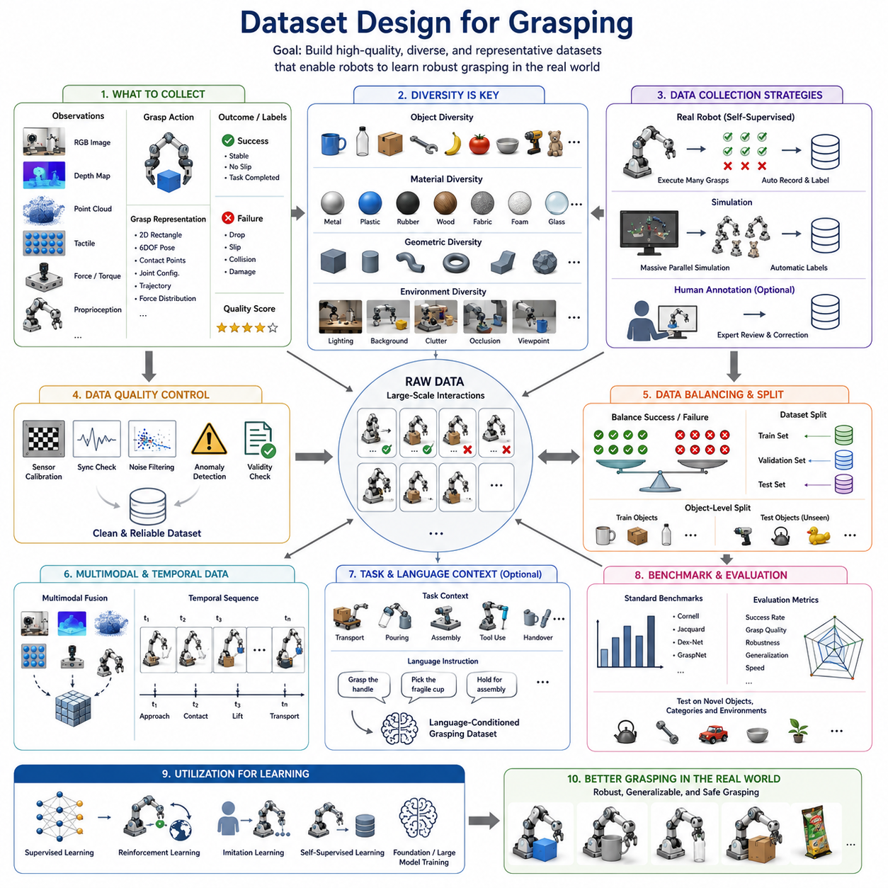{width="7.268055555555556in" height="7.268055555555556in"}

Dataset design is one of the most critical foundations of learning-based robotic grasping. Regardless of how sophisticated a neural network architecture, reinforcement learning algorithm, foundation model, or multimodal perception system may be, the quality of the resulting grasping capability is ultimately constrained by the quality, diversity, scale, and representativeness of the dataset used during training. In modern robotics, datasets are not merely collections of images and labels. They are structured representations of physical interactions between robots and the real world. A well-designed grasping dataset captures the complex relationships among object geometry, material properties, sensor observations, robot actions, contact conditions, environmental context, and manipulation outcomes. Consequently, dataset engineering has become a major research discipline within robotic manipulation and embodied intelligence.

The importance of dataset design arises from the fundamental nature of learning-based systems. Traditional grasp planning approaches relied on analytical models derived from contact mechanics, force closure theory, kinematics, and optimization. These methods depended heavily on explicit mathematical formulations. In contrast, machine learning systems infer grasping strategies from examples. The dataset therefore becomes the primary source of knowledge. Every success, failure, object interaction, and sensor observation contributes to the robot\'s understanding of grasping. If the dataset is biased, incomplete, noisy, or insufficiently diverse, the resulting model will inherit those limitations regardless of its computational complexity.

The primary objective of a grasping dataset is to provide sufficient information for a learning system to discover the relationship between observations and successful manipulation outcomes. At a minimum, a grasping dataset contains sensory observations, grasp actions, and outcome labels. The observations may include RGB images, depth maps, RGB-D data, point clouds, tactile measurements, force-torque sensor readings, proprioceptive information, or multimodal combinations of these sources. The action component typically describes the grasp configuration selected by the robot. The outcome component indicates whether the grasp succeeded or failed and may additionally contain information regarding grasp stability, object displacement, slip occurrence, force distribution, or task completion status.

One of the earliest challenges in dataset design is defining what constitutes a successful grasp. At first glance, success may appear straightforward: the robot picks up the object and does not drop it. However, industrial and research applications often require more sophisticated definitions. A grasp may successfully lift an object but damage it during manipulation. Another grasp may securely hold the object but position it incorrectly for a subsequent assembly operation. In logistics, a successful grasp may require high speed and reliability. In healthcare applications, gentle handling may be more important than gripping force. Dataset designers must therefore define success criteria that align with the intended application domain.

Object diversity represents one of the most important factors influencing dataset quality. Real-world robots encounter an enormous variety of objects differing in shape, size, weight, material, texture, rigidity, transparency, reflectivity, and deformability. A dataset containing only rigid industrial components may produce models that fail when manipulating household objects, food products, or soft materials. Effective datasets intentionally include a broad spectrum of object categories to maximize generalization capability. Diversity should extend beyond visual appearance to include physical characteristics that influence grasping behavior.

Geometric diversity is particularly important for robotic grasp learning. Objects may contain flat surfaces, curved surfaces, sharp edges, cavities, handles, protrusions, flexible components, and articulated structures. Learning systems must experience sufficient geometric variation to develop robust representations of grasp opportunities. Modern grasping datasets often contain thousands or even millions of unique object geometries to expose models to diverse contact configurations and manipulation scenarios.

Material diversity presents another significant consideration. The same geometric shape may require different grasping strategies depending on its material properties. A rigid metal cylinder, a rubber cylinder, and a foam cylinder may appear visually similar while exhibiting very different interaction dynamics. Friction coefficients, compliance characteristics, deformation behavior, and surface textures all influence grasp stability. Datasets that neglect material diversity may produce models that perform well in simulation yet fail in real-world environments.

Environmental diversity is equally important. Robotic grasping rarely occurs under ideal laboratory conditions. Lighting changes, cluttered scenes, partial occlusions, background complexity, sensor noise, and dynamic environmental conditions all affect perception quality. A dataset collected under controlled lighting conditions may not support reliable deployment in warehouses, factories, hospitals, or outdoor environments. Consequently, modern dataset design emphasizes environmental variability to improve robustness and generalization.

The representation of grasp actions is a fundamental dataset design decision. Different robotic systems require different grasp representations. Parallel-jaw grippers often use planar grasp rectangles represented by position, orientation, width, and grasp score. More advanced robotic hands may require six-degree-of-freedom grasp poses, fingertip contact locations, finger joint configurations, force distributions, or complete manipulation trajectories. The chosen representation influences labeling methodology, network architecture design, and model evaluation procedures.

Annotation strategy plays a central role in dataset construction. In supervised learning systems, each example typically requires some form of label. Early grasping datasets often relied on manual annotation by human experts. While human labeling can provide valuable semantic information, it is expensive, time-consuming, and difficult to scale. Furthermore, human judgments regarding grasp quality may not always correspond to actual robotic execution outcomes. As a result, robotic grasping research increasingly favors automated labeling approaches based on physical interaction results.

Self-supervised data collection has emerged as one of the most influential trends in grasp dataset development. In self-supervised systems, robots autonomously perform grasp attempts and record the resulting outcomes. Each interaction automatically generates a training example without requiring human intervention. A robot may execute hundreds of thousands of grasp attempts over an extended period, gradually constructing a large-scale dataset of successful and unsuccessful interactions. This approach dramatically reduces annotation costs while generating labels directly tied to real-world execution performance.

Large-scale robotic data collection systems have enabled unprecedented dataset growth. Some industrial research platforms operate continuously for weeks or months, generating millions of grasp attempts. These datasets provide the statistical diversity necessary for training deep learning models capable of robust generalization. The success of modern grasping systems is closely linked to the availability of such large-scale interaction datasets.

Simulation-based dataset generation offers another powerful approach for acquiring training data. Modern physics simulators allow robots to interact with virtual objects at scales that would be impractical in physical environments. Thousands of simulated robots can perform grasp attempts simultaneously, generating enormous quantities of labeled data. Simulation enables systematic variation of object properties, lighting conditions, sensor characteristics, and environmental parameters. This capability significantly accelerates dataset generation while reducing hardware costs.

However, simulation-generated datasets introduce important challenges. Simulated environments inevitably differ from physical reality. Contact dynamics, friction behavior, sensor noise, and object deformation may not be modeled perfectly. Models trained exclusively on simulated data often experience performance degradation when deployed in the real world. This phenomenon is commonly known as the sim-to-real gap. Dataset designers address this challenge through domain randomization, domain adaptation, physics randomization, and hybrid real-simulation data collection strategies.

Domain randomization has become a widely adopted technique in grasping dataset design. During simulation, environmental parameters are intentionally varied across a broad range of values. Object textures, lighting conditions, camera parameters, physical properties, and background appearances are randomized to expose learning systems to diverse scenarios. The resulting models become less dependent on specific visual or physical characteristics and therefore generalize more effectively to real environments.

Balancing successful and unsuccessful grasp examples is another important consideration. If a dataset contains only successful grasps, the learning system may fail to recognize dangerous or ineffective actions. Conversely, excessive failure examples may bias the model toward overly conservative behavior. Effective datasets typically maintain an appropriate balance between positive and negative outcomes to support robust decision-making. Failure examples often provide valuable information regarding contact instability, slip conditions, collisions, and geometric constraints.

Temporal information is becoming increasingly important in modern grasping datasets. Early datasets often treated grasping as a static prediction problem, focusing on a single observation and a single action. In reality, grasping is a dynamic process involving sequential perception, motion planning, contact formation, force regulation, and object transport. Temporal datasets capture complete interaction sequences, enabling models to learn dynamic manipulation strategies rather than isolated grasp predictions.

The integration of tactile sensing has introduced new dataset requirements. Traditional vision-based datasets primarily focus on pre-contact observations. Tactile datasets capture information generated during physical interaction, including pressure distributions, contact locations, slip events, shear forces, and deformation patterns. Combining visual and tactile data enables richer representations of grasping behavior and supports more advanced manipulation capabilities.

Multimodal datasets are becoming increasingly important as robotic systems incorporate multiple sensor modalities. A multimodal grasping dataset may include synchronized RGB images, depth maps, point clouds, tactile measurements, force-torque readings, robot joint states, and task descriptions. The fusion of multiple information sources allows learning systems to develop more comprehensive representations of the manipulation process. Designing such datasets requires careful synchronization, calibration, and timestamp management to ensure consistency across sensing modalities.

Data quality control represents a critical but often overlooked aspect of dataset engineering. Sensor calibration errors, synchronization problems, corrupted labels, mechanical failures, and environmental anomalies can introduce noise into training data. Even large datasets may produce poor models if quality assurance procedures are insufficient. Successful dataset design therefore includes rigorous validation pipelines, automated consistency checks, anomaly detection systems, and periodic dataset audits.

Dataset splitting strategies significantly influence evaluation reliability. Training, validation, and testing subsets must be carefully separated to avoid information leakage. In robotic grasping, object-level separation is particularly important. If identical objects appear in both training and testing sets, performance estimates may overstate actual generalization capability. More rigorous evaluations use novel objects, novel categories, and novel environments during testing to assess real-world deployment readiness.

Benchmark datasets have played a major role in advancing grasping research. Public datasets provide standardized evaluation platforms that enable fair comparison between different algorithms. Datasets such as Cornell Grasp Dataset, Jacquard Dataset, Dex-Net, GraspNet, and various industrial grasping benchmarks have accelerated progress by establishing common performance metrics and evaluation procedures. These resources allow researchers worldwide to compare approaches under consistent experimental conditions.

Scalability has become a defining characteristic of modern dataset design. As foundation models and large-scale robotic learning systems emerge, dataset sizes continue to increase dramatically. Future grasping datasets may contain billions of interaction samples collected from fleets of robots operating across diverse environments. Such datasets will support the development of increasingly general manipulation capabilities analogous to the role that internet-scale datasets played in modern computer vision and natural language processing.

Task-aware dataset design represents an important emerging direction. Traditional grasp datasets often focus solely on grasp success. However, many real-world tasks require context-aware grasp selection. A robot grasping a mug for transportation may choose a different grasp than when preparing to pour liquid. Similarly, assembly operations, tool use, handovers, and packaging tasks require specialized grasp strategies. Future datasets increasingly incorporate task objectives, semantic information, and downstream manipulation goals.

Language integration is also becoming a major consideration. Foundation models capable of understanding natural language require datasets that associate manipulation actions with linguistic descriptions. Language-conditioned grasping datasets enable robots to interpret instructions such as "grasp the handle," "pick up the fragile container," or "hold the object for assembly." These capabilities support more intuitive human-robot interaction and more flexible manipulation planning.

The rise of foundation models and embodied AI is fundamentally changing the scale and scope of dataset design. Instead of creating datasets optimized for a single grasping task, researchers are increasingly constructing large multimodal corpora that support perception, reasoning, planning, control, and manipulation simultaneously. These datasets integrate visual observations, tactile interactions, language instructions, action trajectories, and environmental context into unified learning frameworks.

Ultimately, dataset design for grasping is far more than a data collection exercise. It is the process of defining the experiences from which a robot learns to interact with the physical world. The diversity of objects, richness of sensory information, accuracy of labels, realism of interactions, and scale of experience collectively determine the capability of the resulting manipulation system. As robotic grasping continues to evolve toward foundation models, lifelong learning, autonomous adaptation, and general-purpose embodied intelligence, dataset engineering will remain one of the most important enabling technologies. The chapters that follow will build upon these dataset foundations to explore grasp quality learning, neural grasp detection, reinforcement learning, self-supervised learning, sim-to-real transfer, and large-scale grasping systems capable of operating in complex real-world environments.

데이터셋 설계(Dataset Design)는 학습 기반 파지(Learning-Based Grasping)의 가장 중요한 기반 기술 중 하나이다. 아무리 뛰어난 신경망 구조(Neural Network Architecture), 강화학습(Reinforcement Learning) 알고리즘, 파운데이션 모델(Foundation Model), 멀티모달 인식(Multimodal Perception) 시스템을 사용하더라도 최종적으로 로봇이 획득하는 파지 능력은 학습에 사용된 데이터셋의 품질, 다양성, 규모, 그리고 현실 대표성에 의해 결정된다. 현대 로봇공학에서 데이터셋은 단순한 이미지와 라벨의 집합이 아니다. 그것은 로봇과 실제 세계 사이에서 발생하는 물리적 상호작용을 체계적으로 기록한 지식 저장소이다. 잘 설계된 파지 데이터셋은 물체 형상, 재질 특성, 센서 관측, 로봇 동작, 접촉 조건, 환경 정보, 그리고 조작 결과 사이의 복잡한 관계를 포함한다. 따라서 데이터셋 엔지니어링은 현재 로봇 조작(Robotic Manipulation)과 체화형 인공지능(Embodied AI) 분야의 핵심 연구 영역으로 자리 잡고 있다.

데이터셋 설계가 중요한 이유는 학습 기반 시스템의 본질에 있다. 전통적인 파지 계획은 접촉 역학(Contact Mechanics), 힘 폐쇄(Force Closure), 운동학(Kinematics), 최적화(Optimization) 등의 수학적 모델에 의존하였다. 반면 머신러닝(Machine Learning) 시스템은 사례를 통해 파지 전략을 학습한다. 즉 데이터셋 자체가 로봇의 지식이 된다. 성공 사례와 실패 사례, 다양한 물체와 환경에서의 상호작용 경험이 모두 로봇의 학습 재료가 된다. 만약 데이터셋이 편향되어 있거나 부족하거나 특정 환경에만 제한되어 있다면, 학습된 모델 역시 동일한 한계를 가지게 된다.

파지 데이터셋의 기본 목적은 관측 정보와 성공적인 조작 결과 사이의 관계를 학습할 수 있도록 충분한 정보를 제공하는 것이다. 일반적으로 데이터셋은 센서 관측(Sensory Observation), 파지 동작(Grasp Action), 결과 라벨(Outcome Label)로 구성된다. 관측 정보에는 RGB 이미지, 깊이 영상(Depth Map), RGB-D 데이터, 포인트 클라우드(Point Cloud), 촉각 데이터(Tactile Data), 힘-토크 센서(Force-Torque Sensor), 관절 상태(Proprioception) 등이 포함될 수 있다. 파지 동작은 로봇이 수행한 그립 위치와 자세를 의미하며, 결과 라벨은 성공 여부, 안정성, 미끄러짐 발생 여부, 힘 분포, 작업 완료 여부 등을 나타낸다.

데이터셋 설계에서 가장 먼저 해결해야 하는 문제는 무엇을 성공적인 파지로 정의할 것인가이다. 단순히 물체를 집어 올리고 떨어뜨리지 않으면 성공이라고 생각할 수 있지만 실제 산업 환경에서는 훨씬 복잡한 기준이 요구된다. 어떤 파지는 물체를 집는 데는 성공했지만 제품을 손상시킬 수 있다. 또 다른 파지는 안정적으로 물체를 잡지만 다음 조립 공정을 수행하기 어려운 자세를 만들 수 있다. 물류 산업에서는 속도와 반복성이 중요할 수 있고, 의료 분야에서는 안전성과 부드러운 접촉이 더 중요할 수 있다. 따라서 데이터셋의 성공 기준은 실제 적용 분야에 맞게 정의되어야 한다.

물체 다양성(Object Diversity)은 데이터셋 품질을 결정하는 가장 중요한 요소 중 하나이다. 실제 환경에서 로봇은 매우 다양한 물체를 만나게 된다. 물체는 형상, 크기, 무게, 재질, 표면 질감, 강성, 투명성, 반사율, 변형 가능성 등에서 큰 차이를 가진다. 만약 데이터셋이 금속 부품과 같은 산업용 물체만 포함하고 있다면, 가정용 물품이나 식품, 의료 재료 등을 다루는 데 어려움을 겪게 된다. 따라서 우수한 데이터셋은 가능한 한 다양한 물체 범주를 포함하여 일반화 능력(Generalization)을 높여야 한다.

기하학적 다양성(Geometric Diversity) 또한 매우 중요하다. 실제 물체는 평면, 곡면, 날카로운 모서리, 손잡이, 구멍, 돌출부, 힌지 구조 등 다양한 형상을 가진다. 학습 시스템은 이러한 다양한 형상에 대한 충분한 경험을 가져야 안정적인 파지 가능 영역을 인식할 수 있다. 현대의 대규모 데이터셋은 수천 개에서 수백만 개에 이르는 다양한 물체 형상을 포함한다.

재질 다양성(Material Diversity) 역시 필수적이다. 동일한 형태의 원통이라 하더라도 금속, 고무, 스펀지로 만들어졌다면 완전히 다른 파지 전략이 필요할 수 있다. 마찰 계수(Friction Coefficient), 변형 특성(Compliance), 표면 상태(Texture)는 파지 안정성에 직접적인 영향을 미친다. 재질 정보를 충분히 포함하지 않은 데이터셋은 시뮬레이션에서는 좋은 성능을 보이더라도 실제 환경에서는 실패할 가능성이 높다.

환경 다양성(Environmental Diversity)도 중요하다. 실제 로봇은 항상 실험실과 같은 이상적인 환경에서 작업하지 않는다. 조명 변화, 배경 복잡도, 물체 가림(Occlusion), 센서 노이즈, 움직이는 장애물 등 다양한 요소가 존재한다. 따라서 데이터셋은 이러한 환경적 변화를 충분히 포함해야 실제 배치 환경에서 안정적인 성능을 보장할 수 있다.

파지 표현(Grasp Representation)은 데이터셋 설계에서 매우 중요한 결정 요소이다. 평행 그리퍼(Parallel Jaw Gripper)는 일반적으로 이미지 상의 파지 사각형(Grasp Rectangle)으로 표현된다. 반면 다지형 로봇 손(Multi-Finger Hand)은 6자유도 자세(6DOF Pose), 접촉점(Contact Point), 손가락 관절 각도(Joint Configuration), 힘 분포(Force Distribution) 또는 전체 조작 궤적(Trajectory)으로 표현될 수 있다. 표현 방식은 학습 모델의 구조와 평가 방법에 직접적인 영향을 미친다.

라벨링(Annotation)은 데이터셋 구축의 핵심 과정이다. 초기 데이터셋은 인간 전문가가 직접 파지 품질을 평가하는 방식이 많았다. 하지만 수작업 라벨링은 비용이 많이 들고 규모 확장이 어렵다. 또한 인간의 직관이 실제 로봇 성능과 항상 일치하지는 않는다. 따라서 최근에는 실제 로봇이 수행한 결과를 기반으로 자동 라벨링을 수행하는 방식이 주류가 되고 있다.

특히 자기지도 데이터 수집(Self-Supervised Data Collection)은 현대 파지 데이터셋 구축의 핵심 기술이 되었다. 로봇이 스스로 수많은 파지 시도를 수행하고 성공 여부를 자동으로 기록한다. 이를 통해 사람의 개입 없이도 수십만\~수백만 개의 학습 데이터를 생성할 수 있다. 이러한 방식은 비용을 크게 절감하면서도 실제 조작 결과와 직접 연결된 데이터를 확보할 수 있다는 장점이 있다.

대규모 데이터 수집 플랫폼(Large-Scale Robotic Data Collection Platform)의 발전은 파지 연구를 크게 가속화하였다. 일부 연구소와 기업에서는 수개월 동안 24시간 연속으로 파지 실험을 수행하여 수백만 건 이상의 데이터를 생성하고 있다. 이러한 데이터는 심층 신경망이 일반화 능력을 획득하는 데 필수적인 기반이 된다.

시뮬레이션 기반 데이터 생성(Simulation-Based Dataset Generation) 역시 매우 중요한 접근 방식이다. 최신 물리 시뮬레이터에서는 수천 개의 가상 로봇이 동시에 파지 실험을 수행할 수 있다. 이를 통해 실제 환경에서는 불가능한 규모의 데이터를 생성할 수 있으며 비용도 크게 절감된다.

하지만 시뮬레이션 데이터에는 Sim-to-Real Gap이라는 문제가 존재한다. 시뮬레이터는 실제 물리 현상을 완벽하게 재현할 수 없기 때문에 시뮬레이션에서 학습한 모델이 실제 환경에서는 성능이 떨어질 수 있다. 이를 해결하기 위해 도메인 랜덤화(Domain Randomization), 도메인 적응(Domain Adaptation), 물리 파라미터 랜덤화(Physics Randomization) 등이 활용된다.

데이터셋은 성공 사례와 실패 사례를 적절하게 포함해야 한다. 성공 사례만 존재하면 모델은 위험한 상황을 인식하지 못할 수 있으며, 실패 사례만 많으면 지나치게 보수적인 행동을 학습할 수 있다. 특히 실패 데이터는 미끄러짐(Slip), 충돌(Collision), 접촉 불안정(Contact Instability)과 같은 중요한 정보를 제공한다.

최근에는 시간 정보(Temporal Information)의 중요성이 커지고 있다. 초기 연구는 하나의 이미지와 하나의 파지 행동만 고려하는 경우가 많았다. 그러나 실제 파지는 관찰, 접근, 접촉 형성, 힘 조절, 물체 이동으로 이어지는 연속적인 과정이다. 따라서 현대 데이터셋은 전체 조작 과정을 시퀀스 형태로 기록하는 경우가 증가하고 있다.

촉각 센서(Tactile Sensor)의 발전은 새로운 데이터셋 요구사항을 만들고 있다. 기존 비전 기반 데이터셋은 접촉 이전의 정보에 집중했지만, 촉각 데이터셋은 접촉 이후의 압력 분포, 미끄러짐, 전단력(Shear Force), 변형 정보를 포함한다. 이는 더욱 정교한 파지와 인핸드 조작(In-Hand Manipulation)을 가능하게 한다.

멀티모달 데이터셋(Multimodal Dataset)은 현재 가장 중요한 연구 방향 중 하나이다. RGB 영상, 깊이 데이터, 포인트 클라우드, 촉각 정보, 힘 센서 데이터, 로봇 상태 정보, 언어 명령 등을 동시에 포함하는 데이터셋이 증가하고 있다. 이러한 데이터는 보다 풍부한 조작 표현을 학습할 수 있게 해준다.

데이터 품질 관리(Data Quality Control)는 종종 간과되지만 매우 중요한 요소이다. 센서 보정 오류, 시간 동기화 문제, 잘못된 라벨, 기계적 오류, 환경 이상 현상 등이 데이터 품질을 저하시킬 수 있다. 따라서 대규모 데이터셋 구축 과정에서는 자동 검증 시스템, 이상 탐지(Anomaly Detection), 품질 감사(Quality Audit) 등이 반드시 필요하다.

데이터 분할(Dataset Split) 또한 중요하다. 학습(Training), 검증(Validation), 테스트(Test) 데이터가 적절하게 분리되지 않으면 실제 성능보다 과도하게 높은 결과가 나올 수 있다. 특히 동일한 물체가 학습과 테스트에 동시에 포함되는 것은 일반화 성능을 과대평가하는 원인이 된다.

Cornell Grasp Dataset, Jacquard Dataset, Dex-Net, GraspNet 등과 같은 공개 벤치마크 데이터셋(Benchmark Dataset)은 파지 연구 발전에 매우 큰 역할을 해왔다. 이러한 데이터셋은 연구자들이 동일한 기준에서 알고리즘을 비교할 수 있도록 해준다.

최근 파운데이션 모델(Foundation Model)과 체화형 AI(Embodied AI)의 등장으로 데이터셋 규모는 급격히 증가하고 있다. 미래에는 전 세계 수많은 로봇이 수집한 수십억 건 이상의 상호작용 데이터가 통합되어 범용 조작 모델(General Manipulation Model)을 학습하는 기반이 될 것으로 예상된다.

또한 최근 데이터셋은 단순한 파지 성공 여부만 기록하지 않는다. 작업 목표(Task Objective)를 함께 기록하는 방향으로 발전하고 있다. 예를 들어 컵을 운반하기 위한 파지와 액체를 따르기 위한 파지는 서로 다른 전략이 필요하다. 조립, 공구 사용, 핸드오버(Handover)와 같은 작업 역시 목적에 따른 파지 전략을 요구한다.

언어(Language)와 파지의 결합도 중요한 연구 방향이다. 미래의 데이터셋은 "손잡이를 잡아라", "깨지기 쉬운 물체를 집어라", "조립을 위해 잡아라"와 같은 자연어 명령과 실제 파지 행동을 연결한다. 이는 인간-로봇 상호작용(Human-Robot Interaction)을 크게 향상시킬 것이다.

결국 파지 데이터셋 설계는 단순한 데이터 수집 작업이 아니다. 그것은 로봇이 실제 세계와 상호작용하는 방법을 배우기 위한 경험을 설계하는 과정이다. 물체의 다양성, 센서 정보의 풍부함, 라벨의 정확성, 상호작용의 현실성, 그리고 데이터 규모는 최종적으로 로봇의 조작 능력을 결정한다.

향후 파지 데이터셋은 파운데이션 모델, 평생 학습(Lifelong Learning), 자율 적응(Autonomous Adaptation), 범용 체화형 지능(General-Purpose Embodied Intelligence)을 지원하는 방향으로 발전할 것이다. 따라서 데이터셋 엔지니어링은 앞으로도 학습 기반 파지 기술 발전을 가능하게 하는 가장 핵심적인 기반 기술 중 하나로 남게 될 것이다.

##  

## 11.03 GQ-CNN and Grasp Quality CNNs

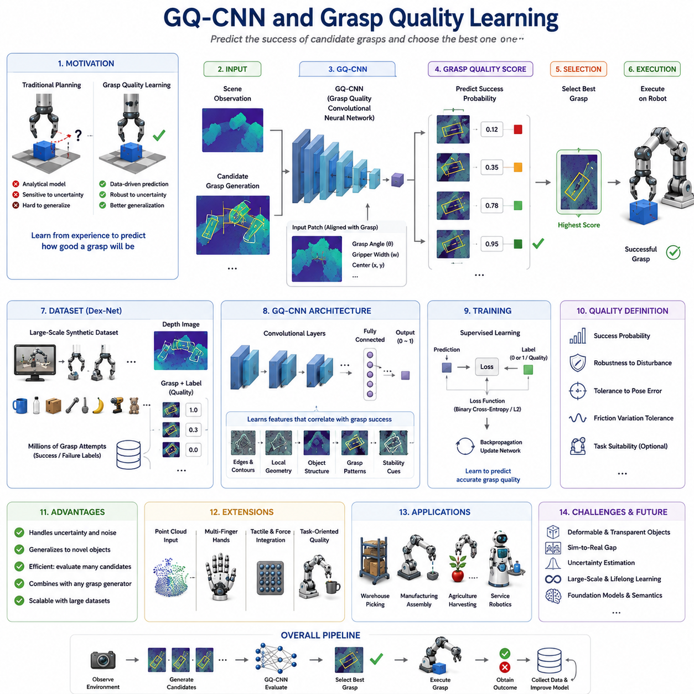{width="7.268055555555556in" height="7.268055555555556in"}

Grasp Quality Learning is one of the most influential concepts in modern learning-based robotic grasping. Rather than directly commanding a robot to execute a specific grasp, grasp quality learning focuses on estimating how likely a candidate grasp is to succeed before the robot physically performs the action. This approach transforms grasping from a deterministic planning problem into a predictive decision-making problem. Instead of asking, "What grasp should the robot execute?", the system asks, "Among all possible grasps, which one has the highest probability of success?" This seemingly simple change has had a profound impact on robotic manipulation research and has enabled the deployment of learning-based grasping systems in increasingly complex and unstructured environments.

Among the various methods developed for grasp quality estimation, the Grasp Quality Convolutional Neural Network (GQ-CNN) stands out as one of the most influential architectures. Developed as part of the Dex-Net project, GQ-CNN demonstrated that deep learning could effectively predict grasp success from visual observations and significantly outperform many traditional grasp planning approaches. The success of GQ-CNN helped establish grasp quality estimation as a central paradigm in robotic grasp learning and laid the foundation for many subsequent grasp prediction systems.

To understand the motivation behind GQ-CNN, it is useful to consider the limitations of traditional grasp planning methods. Classical grasp planners rely heavily on analytical models derived from contact mechanics, force closure theory, friction cone analysis, grasp wrench spaces, and optimization techniques. While these methods provide mathematically rigorous guarantees under ideal assumptions, they often struggle when deployed in real-world environments where object properties, sensor measurements, and environmental conditions are uncertain. Small errors in object pose estimation, friction coefficients, or geometry reconstruction can significantly degrade performance.

Learning-based grasp quality estimation addresses this problem by replacing explicit physical modeling with statistical prediction. Instead of attempting to calculate every physical interaction involved in grasping, a neural network learns from examples of successful and unsuccessful grasps. Through exposure to large-scale datasets, the model learns patterns that correlate with stable grasp outcomes. As a result, the system becomes capable of predicting grasp success even when precise physical parameters are unavailable.

The central idea of GQ-CNN is remarkably elegant. Given a visual observation of an object and a candidate grasp configuration, the network predicts the probability that the grasp will succeed. The candidate grasp itself is not necessarily generated by the neural network. Instead, multiple grasp candidates may be sampled from the workspace using geometric methods, heuristic approaches, or analytical planners. Each candidate is evaluated by the GQ-CNN, which assigns a grasp quality score. The robot then selects the grasp with the highest predicted success probability.

This architecture separates grasp generation from grasp evaluation. Such a separation provides significant practical advantages. Different grasp generation algorithms can be combined with the same quality prediction network, allowing flexibility in system design. Furthermore, evaluating candidate grasps is often computationally simpler than directly predicting a complete grasp from raw sensory input.

The development of GQ-CNN was closely tied to the Dex-Net project, which introduced large-scale synthetic grasp datasets for robotic manipulation. One of the major challenges in learning-based grasping is obtaining sufficient training data. Collecting millions of real-world grasp attempts is expensive and time-consuming. Dex-Net addressed this challenge by generating enormous synthetic datasets using physics simulation and 3D object models. Virtual grasp attempts were performed on thousands of objects, and grasp quality metrics derived from analytical grasp theory were used as training labels.

The resulting dataset contained millions of grasp examples covering diverse object geometries, grasp configurations, and contact conditions. This scale enabled deep neural networks to learn robust mappings between visual observations and grasp success probabilities. The combination of large-scale synthetic data and deep learning was a key factor in the success of GQ-CNN.

A typical GQ-CNN system operates using depth images rather than RGB images alone. Depth information provides direct geometric measurements of object surfaces and is highly relevant for grasp planning. Given a depth image of a scene, candidate grasps are represented as image-centered patches aligned with the orientation of the grasp. These patches are extracted and provided as input to the neural network along with grasp-related parameters such as gripper width and orientation.

The network architecture itself is based on convolutional neural networks, which are particularly effective for processing spatially structured visual data. Convolutional layers extract hierarchical features from depth images, capturing geometric patterns associated with successful grasping opportunities. Early layers identify local surface structures, edges, and contours, while deeper layers learn more abstract representations related to object shape, grasp geometry, and stability characteristics.

Training the network involves supervised learning. Each training example consists of an input observation and an associated grasp quality label. The label may represent a binary success/failure outcome or a continuous grasp quality score derived from analytical metrics. During training, the network adjusts its parameters to minimize prediction error. Over time, it learns to associate specific geometric patterns with successful grasp outcomes.

One of the most important contributions of GQ-CNN was demonstrating that synthetic data could effectively support real-world robotic learning. Traditionally, many researchers believed that simulated data would be insufficient due to the sim-to-real gap. However, GQ-CNN showed that carefully designed datasets combined with appropriate representations could achieve strong transfer performance. This finding inspired extensive research into simulation-based robotic learning and large-scale synthetic dataset generation.

Grasp quality learning can be viewed as a probabilistic interpretation of grasp planning. Rather than producing a deterministic answer, the system estimates uncertainty and success likelihood. This probabilistic perspective is particularly valuable in real-world robotics because uncertainty is unavoidable. Sensors are noisy, object models are incomplete, and environmental conditions change continuously. A grasp quality predictor allows the robot to reason about confidence and select actions with higher expected success rates.

The concept of grasp quality itself can be defined in multiple ways. In some systems, quality corresponds to the probability of lifting an object successfully. In others, it may represent resistance to disturbances, robustness against pose estimation errors, tolerance to friction variations, or suitability for downstream manipulation tasks. The precise definition depends on the intended application and the training dataset used.

As robotic hands become more sophisticated, grasp quality learning extends beyond simple parallel-jaw grasping. Multi-finger dexterous hands introduce additional complexity because grasp success depends not only on hand position but also on finger coordination, contact distribution, force allocation, and manipulation objectives. Modern grasp quality networks increasingly incorporate these factors to evaluate more complex grasp configurations.

Another important development has been the integration of point cloud representations. While early GQ-CNN systems primarily used depth images, later approaches leverage three-dimensional point clouds to capture richer geometric information. Point cloud based networks can directly reason about object surfaces and spatial structures without requiring image projections. This capability often improves performance for cluttered scenes and complex object geometries.

The incorporation of tactile sensing represents another major advancement in grasp quality learning. Visual information alone is often insufficient to determine whether a grasp remains stable after contact is established. Tactile sensors provide direct measurements of pressure distributions, contact locations, slip events, and force interactions. Learning systems that combine visual and tactile information can estimate grasp quality more accurately and adaptively adjust grasp forces during execution.

Multimodal grasp quality estimation is becoming increasingly important in advanced robotic manipulation systems. By integrating vision, touch, force sensing, and proprioception, robots can develop more comprehensive models of grasp success. Such systems more closely resemble human manipulation capabilities, where multiple sensory modalities contribute simultaneously to grasp assessment and control.

One limitation of traditional GQ-CNN approaches is that they typically focus on grasp acquisition rather than task completion. A grasp that is mechanically stable may not be appropriate for the intended task. For example, grasping a mug by its opening may provide excellent stability but prevent pouring. Similarly, grasping a screwdriver at the wrong location may make tool use impossible. Modern grasp quality learning therefore increasingly incorporates task awareness into the evaluation process.

Task-oriented grasp quality learning extends the original concept by evaluating grasps according to their suitability for downstream actions. The network predicts not only whether a grasp will succeed mechanically but also whether it will support subsequent manipulation objectives. This shift represents an important step toward more intelligent and context-aware robotic behavior.

The rise of reinforcement learning has further expanded the scope of grasp quality estimation. Rather than relying solely on supervised labels, reinforcement learning systems can discover quality functions through interaction experience. The robot explores different grasp strategies, receives rewards based on task outcomes, and gradually develops internal representations of grasp quality. This approach enables adaptation to environments and tasks not explicitly represented in training datasets.

Self-supervised learning has also become an important source of grasp quality data. Robots can autonomously collect grasp attempts, record outcomes, and continuously refine their quality prediction models. Such systems support lifelong learning and allow grasp quality estimators to improve over time as additional experience is accumulated.

The emergence of foundation models is beginning to influence grasp quality learning as well. Vision-language models and vision-language-action models introduce semantic reasoning capabilities that extend beyond geometric analysis. Future grasp quality estimators may evaluate grasps not only according to physical stability but also according to semantic objectives, user instructions, and task context. A robot may learn to distinguish between "grasp for transport," "grasp for assembly," "grasp for handover," and "grasp for tool use," selecting different strategies depending on the intended outcome.

Benchmarking grasp quality learning systems remains an active area of research. Common evaluation metrics include grasp success rate, prediction accuracy, robustness to object variation, resistance to sensor noise, computational efficiency, and generalization performance. Public datasets such as Dex-Net, GraspNet, Jacquard, and various industrial benchmarks provide standardized evaluation frameworks that enable comparison across different methods.

Industrial adoption of grasp quality learning continues to grow rapidly. Warehouse automation systems use quality predictors to select reliable grasps for diverse products. Manufacturing robots handle variable components with minimal reprogramming. Agricultural robots use grasp quality estimation to pick delicate fruits and vegetables without causing damage. Service robots rely on grasp quality prediction when interacting with household objects under uncertain conditions. These applications demonstrate the practical value of predictive grasp evaluation in real-world deployment.

Despite significant progress, several challenges remain. Current systems still struggle with highly deformable objects, transparent materials, reflective surfaces, and complex contact-rich manipulation tasks. Dataset bias, sim-to-real transfer limitations, uncertainty estimation, and computational scalability continue to be active research topics. Achieving human-level grasp assessment remains a long-term objective that requires advances in sensing, learning, reasoning, and embodied intelligence.

Ultimately, GQ-CNN and grasp quality learning represent a fundamental shift in robotic manipulation. Rather than relying solely on analytical models, robots learn to predict the likelihood of success from experience. This predictive paradigm has transformed grasp planning into a data-driven decision-making process and established a foundation for modern learning-based manipulation systems. As robotic hands become more dexterous, datasets become larger, sensors become richer, and foundation models become more capable, grasp quality learning will remain a core technology enabling robots to interact safely, efficiently, and intelligently with the physical world.

파지 품질 학습(Grasp Quality Learning)은 현대 학습 기반 로봇 파지(Learning-Based Robotic Grasping) 분야에서 가장 영향력 있는 개념 중 하나이다. 기존의 파지 계획은 로봇에게 특정 파지 자세를 직접 생성하도록 하는 데 초점을 두었지만, 파지 품질 학습은 로봇이 실제로 파지를 수행하기 전에 해당 파지가 성공할 가능성을 예측하는 데 초점을 둔다. 즉, "어떤 파지를 수행할 것인가?"라는 문제를 "가능한 여러 파지 중 어떤 파지가 가장 성공 확률이 높은가?"라는 문제로 변환한 것이다. 이러한 사고방식의 변화는 로봇 조작 연구에 큰 영향을 미쳤으며, 복잡하고 비정형적인 환경에서도 학습 기반 파지 시스템이 활용될 수 있는 기반을 마련하였다.

이러한 파지 품질 예측 방법들 중 가장 대표적인 것이 GQ-CNN(Grasp Quality Convolutional Neural Network)이다. GQ-CNN은 Dex-Net 프로젝트의 핵심 기술로 개발되었으며, 시각 정보를 이용하여 파지 성공 확률을 예측하는 데 매우 뛰어난 성능을 보여주었다. 이 연구는 딥러닝(Deep Learning)이 전통적인 파지 계획 기법을 대체하거나 보완할 수 있음을 입증하였고, 이후 수많은 파지 예측 네트워크 개발의 출발점이 되었다.

GQ-CNN이 등장하게 된 배경을 이해하기 위해서는 기존의 파지 계획 방법의 한계를 먼저 살펴볼 필요가 있다. 전통적인 파지 계획은 접촉 역학(Contact Mechanics), 힘 폐쇄 이론(Force Closure Theory), 마찰 콘(Friction Cone), 그립 렌치 공간(Grasp Wrench Space), 최적화 기법(Optimization Techniques) 등에 기반한다. 이러한 방법은 수학적으로 매우 엄밀하지만 실제 환경에서는 물체의 마찰 계수, 질량 분포, 센서 오차, 물체 자세 추정 오차 등 다양한 불확실성이 존재한다. 이러한 작은 오차만으로도 실제 파지 성능은 크게 저하될 수 있다.

반면 학습 기반 파지 품질 예측은 물리 모델을 직접 계산하기보다 데이터로부터 성공 패턴을 학습한다. 수많은 성공 및 실패 사례를 학습한 신경망은 특정 물체 형상과 파지 자세가 성공적인 결과로 이어질 가능성을 예측할 수 있다. 따라서 정확한 물리 파라미터를 알지 못하더라도 안정적인 파지를 선택할 수 있게 된다.

GQ-CNN의 핵심 아이디어는 매우 직관적이다. 물체에 대한 시각 정보와 하나의 후보 파지(Candidate Grasp)가 주어지면 신경망은 해당 파지가 성공할 확률을 출력한다. 중요한 점은 GQ-CNN이 반드시 파지를 생성하는 것은 아니라는 것이다. 다양한 방법으로 생성된 여러 개의 파지 후보를 평가하여 가장 높은 점수를 받은 파지를 선택하는 역할을 수행한다.

즉, GQ-CNN은 파지 생성(Grasp Generation)과 파지 평가(Grasp Evaluation)를 분리한다. 이러한 구조는 매우 실용적이다. 다양한 파지 생성 알고리즘과 결합할 수 있으며, 새로운 생성 알고리즘이 등장하더라도 동일한 품질 평가 네트워크를 활용할 수 있기 때문이다.

GQ-CNN의 성공에는 Dex-Net 프로젝트가 결정적인 역할을 했다. 학습 기반 파지의 가장 큰 문제 중 하나는 대규모 데이터 확보이다. 실제 로봇으로 수백만 번의 파지를 수행하는 것은 현실적으로 매우 어렵다. Dex-Net은 이를 해결하기 위해 수천 개의 3D CAD 모델과 물리 시뮬레이션을 활용하여 대규모 합성 데이터셋(Synthetic Dataset)을 생성하였다.

시뮬레이션 환경에서 수백만 개의 가상 파지를 수행하고, 분석적 파지 품질 지표를 이용하여 자동으로 라벨을 생성하였다. 이 데이터셋은 다양한 물체 형상과 접촉 조건을 포함하였으며, 대규모 학습이 가능하도록 설계되었다. 결과적으로 GQ-CNN은 방대한 데이터로부터 파지 성공과 관련된 패턴을 학습할 수 있었다.

일반적인 GQ-CNN 시스템은 RGB 영상보다 깊이 영상(Depth Image)을 주로 사용한다. 깊이 영상은 물체 표면의 기하학적 구조를 직접 제공하기 때문에 파지 계획에 매우 유용하다. 시스템은 깊이 영상으로부터 여러 개의 후보 파지를 생성하고, 각 파지의 방향과 위치에 맞춰 정규화된 이미지 패치를 추출한다. 이 패치와 파지 관련 정보가 신경망의 입력으로 사용된다.

네트워크 구조는 합성곱 신경망(CNN)을 기반으로 한다. CNN은 공간적 패턴을 학습하는 데 매우 뛰어나기 때문에 물체 표면 형상과 파지 성공률 사이의 관계를 효과적으로 학습할 수 있다. 초기 계층에서는 모서리, 곡면, 표면 구조 등을 인식하고, 깊은 계층에서는 파지 안정성과 관련된 고차원 특징을 추출한다.

학습 과정은 지도학습(Supervised Learning) 형태로 진행된다. 입력은 물체 관측 정보와 파지 후보이고, 출력은 파지 품질 점수이다. 학습 데이터에는 성공 또는 실패 여부가 포함되어 있으며, 네트워크는 예측 오차를 최소화하도록 반복적으로 학습된다. 시간이 지남에 따라 성공적인 파지 패턴을 스스로 인식하게 된다.

GQ-CNN의 가장 중요한 공헌 중 하나는 합성 데이터만으로도 실제 로봇 성능을 크게 향상시킬 수 있다는 사실을 보여준 것이다. 이전에는 시뮬레이션 데이터가 실제 환경과 너무 다르기 때문에 활용 가치가 제한적이라고 여겨졌다. 그러나 GQ-CNN은 적절한 데이터 표현과 대규모 데이터셋을 활용하면 시뮬레이션 학습 결과가 실제 환경에서도 효과적으로 동작할 수 있음을 입증하였다.

파지 품질 학습은 확률적 관점(Probabilistic Perspective)의 파지 계획이라고 볼 수 있다. 전통적인 방식이 단일 정답을 찾는 문제였다면, 품질 학습은 성공 확률을 추정하는 문제이다. 실제 환경은 본질적으로 불확실성이 존재하기 때문에 이러한 접근 방식은 매우 현실적이다. 센서 노이즈, 물체 위치 오차, 환경 변화가 존재하더라도 로봇은 가장 높은 성공 가능성을 가진 행동을 선택할 수 있다.

파지 품질은 다양한 방식으로 정의될 수 있다. 가장 단순한 경우에는 물체를 들어 올릴 수 있는 확률을 의미한다. 하지만 실제 산업 환경에서는 외란 저항성(Disturbance Resistance), 자세 오차 허용 범위(Pose Tolerance), 마찰 변화에 대한 강건성(Robustness), 후속 작업 적합성(Task Suitability) 등을 포함할 수도 있다.

최근에는 단순한 평행 그리퍼(Parallel Jaw Gripper)를 넘어 다지형 로봇 손(Dexterous Hand)에 대한 연구가 활발히 진행되고 있다. 다지형 손에서는 손 위치뿐 아니라 손가락 협응(Finger Coordination), 접촉 분포(Contact Distribution), 힘 배분(Force Allocation), 조작 목표(Manipulation Objective)까지 고려해야 한다. 이에 따라 파지 품질 예측 네트워크도 점점 복잡해지고 있다.

포인트 클라우드(Point Cloud)를 활용하는 방법도 빠르게 발전하고 있다. 초기 GQ-CNN은 깊이 영상 중심이었지만, 최근의 연구는 3차원 포인트 클라우드 데이터를 직접 처리한다. 이를 통해 보다 정확하게 물체의 기하 구조를 이해할 수 있으며, 복잡한 환경에서도 더 높은 성능을 달성할 수 있다.

촉각 센서(Tactile Sensor)의 통합 또한 중요한 발전 방향이다. 시각 정보만으로는 파지가 형성된 이후의 상태를 완전히 파악하기 어렵다. 촉각 센서는 압력 분포, 접촉 위치, 미끄러짐, 힘 전달 상태 등을 직접 측정할 수 있다. 따라서 촉각과 시각을 결합한 품질 예측 시스템은 훨씬 높은 정확도를 제공할 수 있다.

멀티모달 파지 품질 학습(Multimodal Grasp Quality Learning)은 현재 매우 중요한 연구 주제이다. 비전, 촉각, 힘 센서, 관절 상태 정보를 동시에 활용함으로써 인간의 파지 능력과 유사한 수준의 판단 능력을 목표로 하고 있다.

기존 GQ-CNN의 한계 중 하나는 파지 자체의 안정성만 평가한다는 점이다. 하지만 실제 작업에서는 파지가 안정적이라고 해서 반드시 좋은 파지는 아니다. 예를 들어 컵을 운반하기 위한 파지와 액체를 따르기 위한 파지는 서로 다르다. 드라이버를 사용하는 작업에서는 특정 위치를 잡아야만 한다. 따라서 최근에는 작업 지향 파지(Task-Oriented Grasping)가 중요한 연구 분야로 부상하고 있다.

작업 지향 파지 품질 학습(Task-Oriented Grasp Quality Learning)은 단순히 물체를 잡을 수 있는지뿐 아니라 이후 작업 수행에 적합한지를 평가한다. 이는 보다 지능적이고 목적 지향적인 로봇 행동을 가능하게 한다.

강화학습(Reinforcement Learning)은 파지 품질 학습의 또 다른 발전 방향이다. 지도학습처럼 미리 정의된 품질 점수에 의존하지 않고, 로봇이 직접 환경과 상호작용하면서 품질 함수를 학습한다. 이를 통해 새로운 환경이나 새로운 작업에도 적응할 수 있다.

자기지도학습(Self-Supervised Learning) 역시 매우 중요한 역할을 한다. 로봇은 반복적인 파지 시도를 통해 스스로 데이터를 수집하고 품질 예측 모델을 지속적으로 개선할 수 있다. 이러한 접근 방식은 평생 학습(Lifelong Learning)의 기반이 된다.

최근 등장한 파운데이션 모델(Foundation Model)은 파지 품질 학습에도 영향을 미치고 있다. 비전-언어 모델(VLM)과 비전-언어-행동 모델(VLA)은 단순한 기하학적 안정성뿐 아니라 의미적 목적(Semantic Objective)까지 고려할 수 있다. 미래의 로봇은 "운반을 위한 파지", "조립을 위한 파지", "도구 사용을 위한 파지", "사람에게 전달하기 위한 파지"를 구분하여 서로 다른 전략을 선택할 수 있을 것이다.

파지 품질 학습 시스템의 평가는 현재 활발히 연구되고 있다. 대표적인 평가 지표로는 파지 성공률(Grasp Success Rate), 예측 정확도(Prediction Accuracy), 강건성(Robustness), 일반화 능력(Generalization), 계산 속도(Computational Efficiency) 등이 있다. Dex-Net, GraspNet, Jacquard와 같은 공개 벤치마크는 이러한 평가를 위한 표준 플랫폼 역할을 수행하고 있다.

산업 현장에서의 적용도 빠르게 증가하고 있다. 물류 창고에서는 다양한 제품을 자동으로 집기 위해 품질 예측 모델을 사용하고 있으며, 제조업에서는 빈번한 제품 변경에 대응하기 위해 활용하고 있다. 농업 로봇은 과일과 채소를 손상 없이 수확하기 위해 사용하며, 서비스 로봇은 가정 환경의 다양한 물체를 다루기 위해 활용한다.

그럼에도 불구하고 해결해야 할 문제는 여전히 존재한다. 변형 가능한 물체(Deformable Objects), 투명 물체(Transparent Objects), 반사 표면(Reflective Surface), 복잡한 접촉 기반 조작(Contact-Rich Manipulation)은 여전히 어려운 문제이다. 또한 데이터 편향(Dataset Bias), Sim-to-Real Gap, 불확실성 추정(Uncertainty Estimation), 계산 비용(Computational Cost)도 중요한 연구 주제로 남아 있다.

결국 GQ-CNN과 파지 품질 학습은 로봇 조작의 패러다임을 근본적으로 변화시켰다. 로봇은 더 이상 물리 모델만으로 파지를 계획하지 않고, 과거 경험으로부터 성공 가능성을 예측하는 방식으로 행동을 결정한다. 이러한 예측 기반 접근법은 현대 학습 기반 조작 시스템의 핵심이 되었으며, 앞으로 더욱 정교한 로봇 손, 대규모 데이터셋, 멀티모달 센서, 파운데이션 모델과 결합되어 차세대 지능형 로봇 조작 기술의 중심 역할을 수행하게 될 것이다.

##  

## 11.04 Six-DoF Grasp Detection Networks

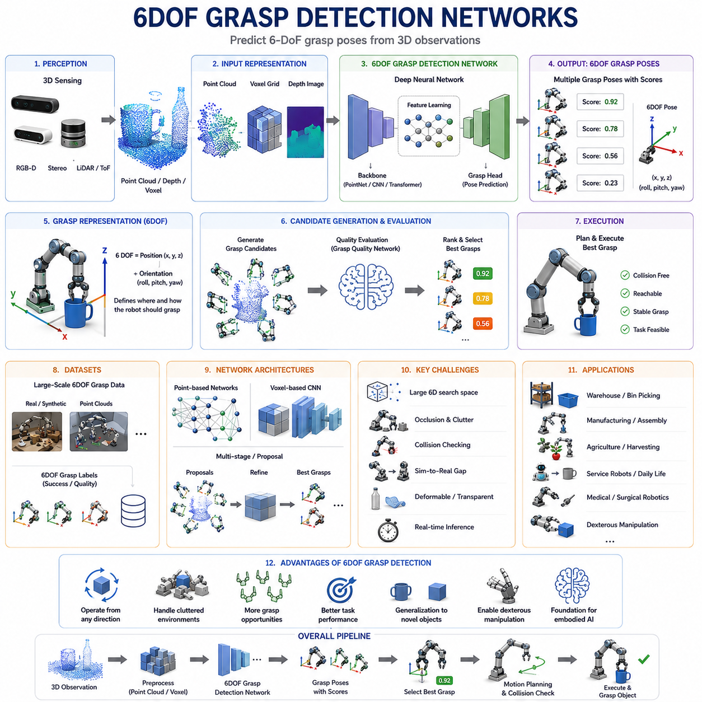{width="7.268055555555556in" height="7.268055555555556in"}

Six-Degree-of-Freedom Grasp Detection Networks represent one of the most important advancements in modern robotic grasping. Traditional grasp detection systems were primarily designed for top-down grasping scenarios in structured environments. These systems typically represented grasps as two-dimensional rectangles in image space, predicting a grasp center, orientation, and gripper width from an RGB image or depth map. While such approaches achieved considerable success in warehouse automation, tabletop manipulation, and industrial pick-and-place applications, they were fundamentally limited by their simplified grasp representation. Real-world robotic manipulation occurs in three-dimensional space, where objects may appear in arbitrary orientations, be partially occluded, be stacked in cluttered environments, or require side grasps and complex approach trajectories. To address these limitations, researchers developed 6DOF Grasp Detection Networks capable of predicting complete six-degree-of-freedom grasp poses directly from sensory observations.

The concept of six degrees of freedom refers to the complete spatial description of a grasp pose. Three degrees of freedom describe translation along the X, Y, and Z axes, while three additional degrees of freedom describe rotational orientation around those axes, commonly represented as roll, pitch, and yaw. A 6DOF grasp therefore specifies not only where the robot hand should move but also how it should be oriented when approaching and contacting the object. This richer representation enables robots to interact with objects from virtually any direction and significantly expands the range of manipulation tasks that can be performed.

The emergence of 6DOF grasp detection was closely linked to advances in three-dimensional sensing technologies. Earlier robotic grasping systems relied heavily on monocular cameras or top-down depth sensors, which provided limited geometric information. The widespread availability of RGB-D cameras, stereo vision systems, structured-light sensors, time-of-flight cameras, and LiDAR-based perception systems dramatically increased the quality and density of three-dimensional environmental observations. These sensing technologies enabled robots to capture detailed object geometry and motivated the development of algorithms capable of operating directly in three-dimensional space.

One of the key motivations behind 6DOF grasp detection is the inadequacy of planar grasp representations in complex environments. Consider a mug located on a cluttered shelf. A traditional two-dimensional grasp detector may identify a grasp rectangle around the mug when viewed from above, but it cannot determine whether the robot should grasp the handle, approach from the side, or avoid collisions with neighboring objects. A 6DOF grasp detector, on the other hand, can reason about the complete spatial configuration of the object and generate grasp poses that account for geometric constraints, accessibility, and task requirements.

The transition from two-dimensional grasp detection to six-degree-of-freedom grasp detection fundamentally changes the complexity of the learning problem. In a planar grasping scenario, the search space is relatively small. A grasp can often be described using a few image coordinates and an angle. In contrast, 6DOF grasp detection requires exploration of a continuous six-dimensional pose space. The number of possible grasp configurations increases dramatically, making efficient representation, learning, and inference significantly more challenging.

Early research in 6DOF grasp detection often relied on explicit object models and geometric reasoning. Researchers reconstructed object surfaces from point clouds and then generated candidate grasps based on surface normals, curvature analysis, and contact geometry. These approaches achieved reasonable performance but often required accurate object segmentation and extensive computation. As deep learning became more prominent, researchers began developing neural networks capable of directly predicting grasp poses from raw sensor data.

A major breakthrough occurred with the introduction of deep learning architectures capable of processing three-dimensional representations. Instead of manually engineering grasp features, neural networks learned representations directly from point clouds, voxel grids, depth images, or mesh models. These architectures enabled end-to-end learning from perception to grasp prediction and significantly improved robustness in unstructured environments.

Point cloud based grasp detection has become one of the dominant paradigms in 6DOF grasp learning. Point clouds provide a direct representation of object geometry without requiring image projection or surface reconstruction. Each point contains spatial coordinates describing the object\'s surface, allowing neural networks to reason directly about three-dimensional structure. Architectures such as PointNet, PointNet++, Dynamic Graph CNN, Point Transformer, and graph neural networks have been widely applied to grasp detection tasks.

One of the most influential developments in this area was the introduction of Grasp Pose Detection approaches that treat grasp prediction as a direct pose estimation problem. Rather than evaluating predefined grasp candidates, these systems predict grasp poses directly from sensory observations. The network receives a point cloud or depth representation and outputs a set of candidate grasp poses along with associated confidence scores. This approach eliminates the need for separate grasp generation modules and allows more efficient inference.

Another important direction involves grasp proposal networks. These architectures generate large numbers of candidate grasp poses and subsequently refine them through additional evaluation stages. The process resembles object detection pipelines in computer vision, where region proposal networks first identify candidate object locations before classification and refinement. In grasp detection, candidate grasp proposals are generated and then ranked according to predicted grasp quality.

The concept of grasp anchors has also been introduced to improve prediction efficiency. Similar to anchor boxes in object detection, grasp anchors represent predefined grasp templates distributed throughout the workspace. Neural networks predict offsets relative to these anchors, enabling efficient exploration of the six-dimensional grasp space while reducing computational complexity.

Depth-based 6DOF grasp detection remains an important research area due to the widespread availability of depth sensors. Depth images provide rich geometric information while maintaining computational efficiency. Many networks transform depth observations into three-dimensional representations and subsequently predict grasp poses using convolutional or transformer-based architectures. Such approaches often achieve strong performance while remaining suitable for real-time deployment.

Voxel-based representations provide another method for handling three-dimensional data. In voxel representations, space is divided into a three-dimensional grid, and occupancy information is stored within each cell. Neural networks can process these volumetric representations using three-dimensional convolutional layers. While voxel methods provide explicit spatial structure, they often require significant memory and computational resources, especially for high-resolution environments.

The rise of transformer architectures has significantly influenced 6DOF grasp detection research. Originally developed for natural language processing, transformers have demonstrated remarkable capabilities for modeling long-range relationships and complex spatial structures. Point cloud transformers, vision transformers, and multimodal transformer architectures have achieved state-of-the-art performance in many grasp detection benchmarks. These models can capture global geometric context and reason about relationships between distant object regions more effectively than traditional convolutional networks.

Learning grasp representations remains a central challenge in 6DOF grasp detection. Unlike object detection, where a single bounding box may sufficiently describe an object, grasp detection often involves multiple valid solutions. A single object may support dozens or hundreds of successful grasps. Learning systems must therefore model grasp distributions rather than single deterministic outputs. This ambiguity complicates training and evaluation procedures.

Dataset design plays a crucial role in 6DOF grasp learning. Training deep neural networks requires large numbers of annotated grasp examples covering diverse object geometries and grasp configurations. Several benchmark datasets have emerged to support this research. GraspNet is one of the most influential datasets, containing millions of grasp annotations associated with thousands of object instances and diverse environmental conditions. Other datasets provide synthetic grasp labels generated through physics simulation and analytical grasp metrics.

Simulation has become indispensable for generating 6DOF grasp training data. Physics-based simulators allow researchers to evaluate enormous numbers of grasp configurations across diverse object models. By simulating contact forces, friction interactions, and object dynamics, large-scale grasp datasets can be generated automatically. These synthetic datasets significantly reduce data collection costs and support training of increasingly complex neural architectures.

However, the sim-to-real gap remains an important challenge. Simulated grasp data may not perfectly reflect real-world physics, sensor characteristics, or environmental variability. Researchers therefore employ domain randomization, domain adaptation, and self-supervised fine-tuning to improve transfer performance. These techniques help bridge the gap between virtual training environments and physical robotic systems.

Collision awareness is particularly important in 6DOF grasp detection. A predicted grasp may appear geometrically valid while still being physically infeasible due to collisions with surrounding objects or environmental structures. Modern grasp detection systems increasingly incorporate collision checking either explicitly through geometric reasoning or implicitly through learned representations. This capability is especially important in cluttered environments such as warehouses and storage bins.

Cluttered scene grasping represents one of the primary application domains for 6DOF grasp detection. Unlike isolated object manipulation, cluttered environments require robots to reason about partial visibility, occlusion, object stacking, and restricted access paths. Six-degree-of-freedom representations provide the flexibility needed to approach objects from unconventional directions and exploit grasp opportunities that would be inaccessible to planar systems.

Multi-finger robotic hands introduce additional complexity into grasp detection. Parallel-jaw grippers require relatively simple pose representations, whereas dexterous hands involve finger joint configurations, contact distributions, force allocation strategies, and hand kinematics. Recent research increasingly focuses on generating 6DOF grasp poses suitable for dexterous manipulation systems. These approaches often combine grasp detection with hand pose optimization and contact planning.

The integration of tactile sensing is another emerging trend. Vision-based systems predict grasp poses before contact occurs, but tactile sensors provide critical information during and after contact formation. Combining visual grasp detection with tactile feedback allows robots to refine grasp poses, adjust grip forces, and recover from execution errors. Multimodal learning architectures that fuse visual and tactile information are becoming increasingly important for robust grasping.

Task-oriented grasp detection extends the traditional grasping objective beyond simple object acquisition. In many real-world applications, the best grasp depends on the intended task. A grasp suitable for transportation may be inappropriate for assembly, pouring, tool use, or handover. Task-aware 6DOF grasp detection networks incorporate semantic and functional considerations into grasp prediction, enabling more intelligent manipulation behavior.

Recent advances in foundation models and embodied AI are beginning to reshape 6DOF grasp detection research. Large-scale vision-language models provide semantic understanding that complements geometric reasoning. Future grasp detection systems may interpret natural language instructions, understand object functionality, and predict grasps that satisfy both physical and semantic objectives. Rather than merely predicting stable grasps, robots will increasingly generate task-specific grasp strategies informed by contextual understanding.

Real-time performance remains a critical requirement for practical deployment. Industrial manipulation systems often operate under strict cycle-time constraints. Researchers therefore focus on optimizing network architectures, reducing computational complexity, and developing efficient inference algorithms. Edge deployment on embedded GPUs such as NVIDIA Jetson platforms has become an important consideration for commercial applications.

Evaluation of 6DOF grasp detection systems involves multiple performance metrics. Grasp success rate remains the most fundamental measure, but researchers also consider pose accuracy, robustness to sensor noise, generalization to novel objects, computational efficiency, collision avoidance performance, and task completion success. Benchmark platforms such as GraspNet and various industrial evaluation suites provide standardized testing environments that facilitate objective comparison between methods.

Industrial applications of 6DOF grasp detection continue to expand rapidly. Warehouse automation systems use these technologies for bin picking and order fulfillment. Manufacturing robots manipulate irregular components and perform assembly tasks. Agricultural robots harvest fruits and vegetables from complex plant structures. Service robots interact with everyday household objects in dynamic environments. Medical robots use advanced grasp detection for instrument handling and material manipulation.

Despite significant progress, important challenges remain. Transparent objects, reflective surfaces, deformable materials, articulated structures, and highly cluttered scenes continue to pose difficulties. Robust uncertainty estimation, lifelong adaptation, multimodal integration, and semantic reasoning remain active research areas. Achieving human-level grasping capability will require further advances in perception, learning, reasoning, and embodied intelligence.

Ultimately, 6DOF Grasp Detection Networks represent a major step toward general-purpose robotic manipulation. By enabling robots to perceive, evaluate, and execute grasps in full three-dimensional space, these systems overcome many of the limitations associated with traditional planar grasping approaches. They provide the flexibility, adaptability, and spatial awareness required for operation in real-world environments and serve as a critical foundation for future developments in dexterous manipulation, autonomous robotics, and embodied artificial intelligence.

6자유도 파지 검출 네트워크(6DOF Grasp Detection Networks)는 현대 로봇 파지 기술에서 가장 중요한 발전 중 하나로 평가된다. 기존의 파지 검출 시스템은 주로 구조화된 환경에서의 상부 접근(Top-Down Grasping)을 가정하여 설계되었다. 이러한 시스템은 일반적으로 RGB 이미지나 깊이 영상(Depth Image) 상에서 파지 중심점, 회전 각도, 그리퍼 폭을 예측하는 2차원 파지 사각형(Grasp Rectangle) 형태를 사용하였다. 이러한 접근법은 창고 자동화, 산업용 픽 앤 플레이스(Pick-and-Place), 단순 물체 이송 작업에서는 상당한 성공을 거두었지만, 본질적으로 제한된 표현 방식을 가지고 있었다.

실제 로봇 조작은 3차원 공간에서 이루어진다. 물체는 임의의 자세로 놓여 있을 수 있으며, 다른 물체에 의해 가려질 수 있고, 복잡한 적재 환경 속에 존재할 수도 있다. 또한 측면 접근(Side Grasp)이나 특정 방향에서의 접근이 요구되는 경우도 많다. 이러한 문제를 해결하기 위해 등장한 것이 6DOF 파지 검출 기술이다. 6DOF 파지 검출 네트워크는 센서 데이터로부터 완전한 6자유도 파지 자세를 직접 예측할 수 있다.

6자유도는 공간상의 위치와 방향을 완전히 표현하는 방법이다. X, Y, Z 축 방향의 이동(Translation)이 3개의 자유도를 구성하며, Roll, Pitch, Yaw 회전이 추가적인 3개의 자유도를 구성한다. 따라서 6DOF 파지는 단순히 "어디를 잡을 것인가"뿐만 아니라 "어떤 방향으로 접근할 것인가"까지 포함한다. 이로 인해 로봇은 거의 모든 방향에서 물체를 접근하고 파지할 수 있으며 훨씬 다양한 조작 작업을 수행할 수 있게 된다.

6DOF 파지 검출의 발전은 3차원 센서 기술의 발전과 밀접한 관련이 있다. 초기 로봇 시스템은 단안 카메라(Monocular Camera)나 상부 설치형 깊이 센서에 의존하였다. 그러나 RGB-D 카메라, 스테레오 비전(Stereo Vision), 구조광 센서(Structured Light Sensor), ToF(Time-of-Flight) 카메라, LiDAR 등의 발전으로 인해 환경에 대한 고밀도 3차원 정보 획득이 가능해졌다. 이러한 센서들은 물체의 형상을 보다 정확하게 인식할 수 있게 만들었으며, 이를 활용한 6DOF 파지 연구가 활발하게 진행되기 시작하였다.

6DOF 파지 검출이 필요한 가장 큰 이유는 2차원 파지 표현의 한계 때문이다. 예를 들어 선반 위에 컵이 놓여 있다고 가정해 보자. 기존의 2D 파지 검출기는 컵을 위에서 바라보는 시점에서 적절한 파지 사각형을 찾을 수는 있지만, 손잡이를 잡아야 하는지, 측면에서 접근해야 하는지, 주변 물체와 충돌하지 않는지까지는 판단하기 어렵다. 반면 6DOF 파지 검출기는 물체의 전체 공간 구조를 이해하고 접근 방향까지 고려하여 적절한 파지 자세를 생성할 수 있다.

2차원 파지에서 6자유도 파지로 확장되면서 문제의 복잡도는 크게 증가하였다. 평면 파지는 이미지 좌표와 회전 각도 정도만 고려하면 되지만, 6DOF 파지는 연속적인 6차원 공간 전체를 탐색해야 한다. 가능한 파지 자세의 수는 기하급수적으로 증가하며, 이를 효과적으로 표현하고 학습하는 것이 매우 중요한 연구 주제가 되었다.

초기의 6DOF 파지 연구는 주로 기하학적 모델과 물체 재구성에 의존하였다. 포인트 클라우드(Point Cloud)로부터 물체 표면을 복원하고, 표면 법선(Surface Normal), 곡률(Curvature), 접촉 조건(Contact Geometry)을 이용하여 후보 파지를 생성하였다. 하지만 이러한 방법은 계산 비용이 높고 물체 분할(Object Segmentation)에 크게 의존하는 문제가 있었다.

딥러닝(Deep Learning)의 등장 이후 상황은 크게 변화하였다. 연구자들은 포인트 클라우드, 깊이 영상, 복셀(Voxel), 메쉬(Mesh)와 같은 입력 데이터로부터 직접 파지 자세를 예측하는 신경망을 개발하기 시작하였다. 이러한 접근법은 센서 입력부터 파지 자세 생성까지 엔드 투 엔드(End-to-End) 학습을 가능하게 하였으며, 복잡한 환경에서도 강건한 성능을 제공하였다.

포인트 클라우드 기반 파지 검출(Point Cloud Based Grasp Detection)은 현재 가장 널리 사용되는 방법 중 하나이다. 포인트 클라우드는 물체 표면의 3차원 좌표를 직접 포함하고 있기 때문에 이미지 투영 과정 없이도 물체의 형상을 표현할 수 있다. PointNet, PointNet++, Dynamic Graph CNN, Point Transformer, Graph Neural Network와 같은 네트워크 구조들이 이 분야에서 널리 활용되고 있다.

이후 등장한 Grasp Pose Detection 계열의 연구는 파지 검출을 자세 추정(Pose Estimation) 문제로 직접 다루었다. 이러한 네트워크는 포인트 클라우드나 깊이 영상을 입력으로 받아 다수의 후보 파지 자세와 각 자세의 신뢰도 점수를 출력한다. 이를 통해 별도의 파지 생성 모듈 없이도 직접 파지를 예측할 수 있게 되었다.

또 다른 접근 방식으로는 Grasp Proposal Network가 있다. 이는 객체 검출(Object Detection)의 Region Proposal Network와 유사한 개념으로, 먼저 많은 수의 파지 후보를 생성한 후 추가적인 네트워크를 이용하여 가장 적합한 후보를 선택한다. 이러한 구조는 복잡한 환경에서도 높은 성능을 보여준다.

최근에는 Grasp Anchor 개념도 도입되고 있다. 이는 객체 검출에서 Anchor Box를 사용하는 것과 유사하다. 미리 정의된 파지 템플릿을 공간에 배치하고, 네트워크는 해당 템플릿으로부터의 오프셋(Offset)을 예측한다. 이를 통해 6차원 공간 전체를 효율적으로 탐색할 수 있다.

깊이 영상 기반 6DOF 파지 검출도 여전히 중요한 연구 분야이다. 깊이 영상은 기하학적 정보를 풍부하게 제공하면서도 계산 비용이 상대적으로 낮다. 많은 네트워크는 깊이 영상을 3차원 표현으로 변환한 후 CNN이나 Transformer를 이용하여 파지 자세를 예측한다.

복셀(Voxel) 기반 표현은 공간을 3차원 격자로 나누고 각 셀(Cell)에 점유 여부를 저장하는 방식이다. 3차원 CNN을 사용하여 처리할 수 있다는 장점이 있지만, 고해상도 환경에서는 메모리 사용량이 매우 크다는 단점도 존재한다.

최근에는 Transformer 기반 네트워크가 6DOF 파지 검출에서도 큰 성공을 거두고 있다. 원래 자연어 처리(NLP)를 위해 개발된 Transformer는 장거리 관계(Long-Range Dependency)를 학습하는 데 매우 뛰어나다. Point Transformer와 Vision Transformer는 물체 전체의 형상과 복잡한 공간 관계를 이해하는 데 강점을 보이며 최신 벤치마크에서 우수한 성능을 기록하고 있다.

6DOF 파지 학습에서 가장 어려운 문제 중 하나는 다중 해답(Multiple Solutions)의 존재이다. 객체 검출에서는 하나의 객체에 하나의 Bounding Box가 존재하지만, 파지 문제에서는 하나의 물체에 수십 개 또는 수백 개의 성공 가능한 파지가 존재할 수 있다. 따라서 네트워크는 단일 정답이 아니라 파지 분포(Grasp Distribution)를 학습해야 한다.

이를 위해서는 대규모 데이터셋이 필요하다. GraspNet은 현재 가장 대표적인 6DOF 파지 데이터셋 중 하나이며, 수백만 개의 파지 라벨과 수천 개의 물체 모델을 포함하고 있다. 또한 다양한 환경 조건과 센서 데이터를 제공하여 연구자들이 네트워크를 학습하고 평가할 수 있도록 지원한다.

시뮬레이션은 6DOF 데이터 생성에 필수적인 도구가 되었다. 물리 시뮬레이터를 이용하면 다양한 물체에 대해 수많은 파지 자세를 자동으로 평가할 수 있다. 접촉력, 마찰력, 물체 동역학을 계산하여 대규모 데이터셋을 생성할 수 있기 때문에 실제 데이터 수집 비용을 크게 줄일 수 있다.

그러나 Sim-to-Real Gap 문제는 여전히 존재한다. 시뮬레이션과 실제 환경 사이에는 센서 특성, 물리 모델, 환경 조건 등의 차이가 있기 때문이다. 이를 해결하기 위해 도메인 랜덤화(Domain Randomization), 도메인 적응(Domain Adaptation), 자기지도학습(Self-Supervised Fine-Tuning) 등이 사용되고 있다.

충돌 회피(Collision Awareness)는 6DOF 파지에서 매우 중요한 요소이다. 어떤 파지가 기하학적으로는 유효하더라도 주변 물체나 환경과 충돌한다면 실제로는 사용할 수 없다. 따라서 최신 시스템은 충돌 검사(Collision Checking)를 통합하여 현실적인 파지 자세만을 선택하도록 설계되고 있다.

복잡한 적재 환경(Cluttered Environment)은 6DOF 파지의 대표적인 응용 분야이다. 물체가 서로 가려져 있거나 겹쳐져 있는 경우, 상부 접근 방식은 한계를 가진다. 6DOF 파지는 다양한 방향에서 접근할 수 있기 때문에 이러한 환경에서도 높은 성공률을 달성할 수 있다.

다지형 로봇 손(Dexterous Hand)은 또 다른 도전 과제이다. 평행 그리퍼는 단순한 자세만 고려하면 되지만, 다지형 손은 손가락 관절 각도, 접촉 분포, 힘 분배, 손 운동학까지 고려해야 한다. 최근 연구는 이러한 다지형 손을 위한 6DOF 파지 생성에도 집중되고 있다.

촉각 센서(Tactile Sensor)의 통합은 매우 유망한 방향이다. 비전 기반 파지는 접촉 이전 정보를 제공하지만, 실제 접촉 이후의 상태는 촉각 센서를 통해서만 정확하게 파악할 수 있다. 시각과 촉각을 결합한 멀티모달 학습(Multimodal Learning)은 파지 정확성과 강건성을 크게 향상시킬 수 있다.

최근에는 작업 지향 파지(Task-Oriented Grasping)가 중요한 연구 분야로 부상하고 있다. 동일한 물체라도 운반, 조립, 공구 사용, 사람에게 전달하기 등의 목적에 따라 최적의 파지는 달라질 수 있다. 따라서 최신 6DOF 파지 네트워크는 단순한 안정성뿐 아니라 작업 목표까지 고려하는 방향으로 발전하고 있다.

파운데이션 모델(Foundation Model)과 체화형 AI(Embodied AI)의 등장도 이 분야에 큰 영향을 미치고 있다. 미래의 로봇은 단순히 안정적인 파지를 찾는 것을 넘어 자연어 명령을 이해하고 물체의 기능을 추론하며 상황에 맞는 파지 전략을 생성하게 될 것이다.

산업 현장에서는 실시간 성능(Real-Time Performance)이 매우 중요하다. 물류 창고, 제조 공장, 서비스 로봇 시스템은 제한된 시간 내에 의사결정을 수행해야 한다. 따라서 네트워크 경량화, 추론 최적화, 임베디드 GPU 배포(Edge Deployment)는 중요한 연구 주제로 남아 있다.

6DOF 파지 검출 시스템은 현재 물류 자동화(Warehouse Automation), 제조업(Manufacturing), 농업(Agriculture), 의료 로봇(Medical Robotics), 서비스 로봇(Service Robotics) 등 다양한 분야에서 활용되고 있다. 빈 피킹(Bin Picking), 조립 작업, 과일 수확, 의료 기구 조작, 가정용 물체 취급 등이 대표적인 응용 사례이다.

그럼에도 불구하고 해결해야 할 과제는 여전히 많다. 투명 물체(Transparent Objects), 반사 물체(Reflective Objects), 변형 물체(Deformable Objects), 관절형 구조(Articulated Objects), 극도로 복잡한 적재 환경은 여전히 어려운 문제이다. 또한 불확실성 추정(Uncertainty Estimation), 평생 학습(Lifelong Learning), 멀티모달 융합(Multimodal Fusion), 의미 기반 추론(Semantic Reasoning)은 앞으로의 핵심 연구 분야가 될 것이다.

결론적으로 6DOF 파지 검출 네트워크는 로봇이 3차원 공간 전체에서 자유롭게 파지를 계획하고 수행할 수 있도록 해주는 핵심 기술이다. 이는 기존의 평면 기반 파지 방식의 한계를 극복하고, 실제 환경에서 요구되는 유연성과 적응성을 제공한다. 앞으로 덱스터러스 조작(Dexterous Manipulation), 자율 로봇(Autonomous Robotics), 체화형 인공지능(Embodied Artificial Intelligence)의 발전과 함께 6DOF 파지 기술은 더욱 중요한 역할을 수행하게 될 것이다.

##  

## 11.05 Point Cloud-Based Grasp Learning

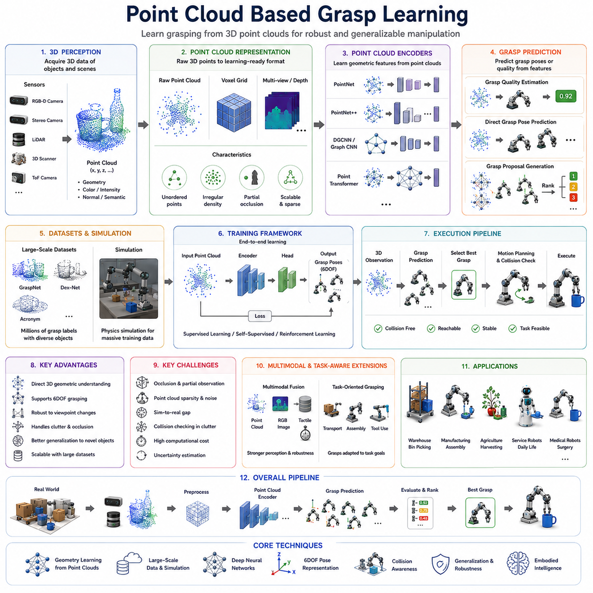{width="7.268055555555556in" height="7.268055555555556in"}

Point Cloud Based Grasp Learning has emerged as one of the most important research directions in modern robotic manipulation. As robotic systems increasingly operate in complex, dynamic, and unstructured environments, the limitations of two-dimensional image-based grasping have become more apparent. While RGB images and depth maps provide valuable information, they often struggle to represent the full geometric complexity of real-world objects. Point clouds, on the other hand, offer a direct three-dimensional representation of object surfaces and spatial structures. By learning grasping strategies directly from point cloud data, robots can better understand object geometry, reason about grasp opportunities in three-dimensional space, and achieve more robust manipulation performance across a wide range of applications.

A point cloud is a collection of three-dimensional points that represent the visible surfaces of objects and environments. Each point typically contains spatial coordinates in the form of X, Y, and Z values. Depending on the sensing system, additional information such as color, intensity, surface normal vectors, reflectance, or semantic labels may also be included. Point clouds are generated by sensors such as RGB-D cameras, stereo vision systems, structured-light scanners, LiDAR sensors, time-of-flight cameras, and industrial 3D scanners. Unlike conventional images, which encode information on a two-dimensional grid, point clouds directly describe geometric structures in three-dimensional space.

The importance of point clouds in robotic grasping arises from the fundamentally geometric nature of grasping itself. A robot hand interacts with object surfaces, contact points, edges, corners, handles, and curved regions. These features are inherently three-dimensional. Although images can provide indirect cues about geometry, point clouds represent spatial information explicitly. This enables grasp learning systems to reason directly about object shape, surface orientation, accessibility, and contact opportunities without relying on intermediate reconstruction processes.

Traditional grasp planning systems often relied on manually engineered geometric features extracted from point clouds. Researchers would estimate surface normals, identify graspable regions, detect object boundaries, and generate candidate grasps using geometric heuristics. While these approaches achieved success in certain applications, they depended heavily on handcrafted algorithms and often struggled to generalize across diverse object categories. The emergence of deep learning transformed this field by enabling robots to learn geometric representations directly from raw point cloud data.

One of the earliest challenges in point cloud learning was the irregular nature of point cloud data. Unlike images, which are organized into regular pixel grids, point clouds are unordered sets of points. The number of points may vary from one observation to another, and neighboring points are not arranged in a fixed structure. Traditional convolutional neural networks were designed for grid-based data and could not be directly applied to raw point clouds. This challenge motivated the development of specialized neural architectures capable of processing unordered three-dimensional point sets.

A major breakthrough occurred with the introduction of PointNet. PointNet demonstrated that deep neural networks could learn directly from raw point cloud data without requiring voxelization, mesh reconstruction, or handcrafted feature extraction. The key insight behind PointNet was that point clouds can be treated as unordered sets rather than structured grids. By applying shared neural transformations to individual points and using symmetric aggregation functions such as max pooling, PointNet achieved permutation invariance while learning meaningful geometric representations.

The success of PointNet had a profound impact on robotic grasping research. For the first time, learning systems could directly analyze object geometry from point clouds and infer grasping opportunities without extensive preprocessing. PointNet-based architectures became widely adopted in grasp detection, object recognition, scene understanding, and manipulation planning.

Although PointNet represented a major advance, it also had limitations. The architecture primarily focused on global shape understanding and did not explicitly capture local geometric relationships between neighboring points. In robotic grasping, local geometry is often critically important because contact formation occurs at specific surface regions. To address this limitation, PointNet++ was introduced. PointNet++ incorporated hierarchical feature extraction and local neighborhood processing, enabling the network to learn both local and global geometric structures.

The development of PointNet++ significantly improved grasp learning performance. Networks could now recognize fine-grained surface details such as handles, edges, corners, grooves, and curved contact regions. These local features are often essential for determining stable grasp locations. The hierarchical representation also improved robustness to variations in object scale and point cloud density.

Another influential research direction involves graph-based neural networks. Point clouds naturally form spatial relationships among neighboring points. Graph neural networks explicitly model these relationships by treating points as graph nodes connected through local neighborhoods. Dynamic Graph CNN and related architectures construct graphs dynamically during learning, enabling the network to capture complex geometric interactions. These models often achieve superior performance in tasks requiring detailed understanding of object topology and local surface structure.

Point cloud based grasp learning can be broadly divided into several categories. One category focuses on grasp quality estimation. In this approach, the network evaluates candidate grasp configurations and predicts the probability of success. The system receives a point cloud and a proposed grasp pose as input and produces a quality score as output. This methodology extends concepts such as GQ-CNN into the three-dimensional domain and allows robots to rank candidate grasps according to predicted stability.

A second category focuses on direct grasp pose prediction. Rather than evaluating predefined candidates, the network generates grasp poses directly from point cloud observations. Given an object point cloud, the model predicts one or more six-degree-of-freedom grasp configurations. This end-to-end approach simplifies the grasp planning pipeline and often enables faster inference in real-time systems.

A third category involves grasp proposal generation. In these systems, neural networks first generate large numbers of potential grasp candidates and subsequently refine or rank them using additional evaluation modules. This strategy resembles object detection pipelines in computer vision and provides an effective balance between computational efficiency and prediction accuracy.

One of the most significant advantages of point cloud based grasp learning is its compatibility with six-degree-of-freedom grasp representations. Because point clouds inherently describe three-dimensional geometry, they naturally support the prediction of full 6DOF grasp poses. This capability is particularly important in cluttered environments where top-down grasping assumptions are insufficient. Robots can approach objects from arbitrary directions and exploit grasp opportunities that would be difficult to identify using image-based methods alone.

Large-scale datasets have played a crucial role in advancing point cloud based grasp learning. Datasets such as GraspNet, Dex-Net, Acronym, and various industrial benchmarks provide millions of grasp annotations associated with diverse object geometries. These datasets enable neural networks to learn robust relationships between three-dimensional shape features and successful grasp outcomes. The availability of large-scale training data has been instrumental in the development of increasingly capable grasp prediction models.

Simulation is another critical component of modern point cloud grasp learning. Collecting large quantities of real-world grasp data is expensive and time-consuming. Physics-based simulators allow researchers to generate synthetic point clouds, evaluate grasp configurations, and create large-scale training datasets automatically. Simulation environments can produce enormous quantities of data covering diverse object categories, lighting conditions, sensor viewpoints, and physical interactions.

However, simulated point clouds often differ from real-world observations. Real sensors introduce measurement noise, missing data, occlusions, calibration errors, and environmental artifacts that are difficult to model perfectly. Consequently, sim-to-real transfer remains an active area of research. Domain randomization, domain adaptation, self-supervised learning, and hybrid real-synthetic training strategies are commonly employed to improve transfer performance.

Occlusion handling is one of the most important challenges in point cloud based grasp learning. Real-world objects are rarely observed completely. Portions of an object may be hidden by other objects, environmental structures, or the viewing geometry itself. Learning systems must therefore infer grasp opportunities from partial observations. Advanced architectures increasingly incorporate shape completion, probabilistic reasoning, and generative modeling techniques to address this challenge.

Shape completion has become a particularly important research topic. Given an incomplete point cloud, a shape completion model predicts the missing portions of the object geometry. The completed representation can then be used for grasp planning. This approach improves grasp prediction accuracy in cluttered environments where full object visibility is unavailable.

Transformer architectures have recently become highly influential in point cloud grasp learning. Point transformers apply self-attention mechanisms to point cloud data, enabling networks to model long-range geometric relationships and global context more effectively than traditional convolutional approaches. Transformer-based models often achieve state-of-the-art performance across grasp detection benchmarks and continue to drive rapid progress in the field.

The integration of multimodal sensing represents another important development. While point clouds provide rich geometric information, they do not directly capture physical properties such as texture, compliance, friction, or contact state. Combining point clouds with RGB images, tactile sensing, force measurements, and proprioceptive information allows learning systems to develop more comprehensive representations of grasping scenarios. Multimodal fusion often leads to improved robustness and generalization.

Tactile integration is particularly promising. Vision-based point cloud systems primarily reason about grasping before contact occurs. Tactile sensors provide information after contact formation, including pressure distributions, slip events, contact locations, and force interactions. Learning systems that combine point cloud geometry with tactile feedback can adapt grasp strategies dynamically and recover from execution errors.

Task-oriented grasp learning extends point cloud based grasp prediction beyond simple object acquisition. In many applications, the best grasp depends on the intended downstream task. A grasp suitable for transportation may not be appropriate for assembly, pouring, tool use, or handover. Task-aware learning systems incorporate semantic and functional objectives into grasp prediction, enabling more intelligent manipulation behavior.

Recent developments in foundation models are beginning to influence point cloud grasp learning as well. Large-scale multimodal models trained on visual, geometric, tactile, and language data can provide semantic reasoning capabilities that complement geometric understanding. Future grasping systems may use language instructions to guide point cloud based grasp prediction, allowing robots to generate task-specific grasp strategies informed by both physical and semantic constraints.

Industrial applications of point cloud based grasp learning are expanding rapidly. Warehouse automation systems use point cloud perception to perform bin picking and order fulfillment. Manufacturing robots manipulate irregular components and perform assembly operations. Agricultural robots identify and harvest fruits and vegetables within dense plant structures. Service robots interact with household objects in complex environments. Medical robots leverage three-dimensional perception for instrument handling and material manipulation.

Evaluation of point cloud grasp learning systems typically involves multiple performance metrics. Grasp success rate remains the primary measure of practical effectiveness. Additional metrics include pose accuracy, robustness to sensor noise, generalization to unseen objects, computational efficiency, collision avoidance capability, and task completion performance. Benchmark datasets provide standardized evaluation protocols that facilitate objective comparison across different algorithms.

Despite remarkable progress, several challenges remain unresolved. Point cloud sparsity, occlusion, sensor noise, transparent objects, reflective surfaces, deformable materials, and highly cluttered environments continue to present difficulties. Efficient processing of large-scale point clouds remains computationally demanding, particularly for embedded robotic platforms. Robust uncertainty estimation and lifelong adaptation also remain active research topics.

Future research is likely to focus on combining point cloud learning with foundation models, world models, tactile intelligence, and embodied reasoning systems. Rather than simply predicting grasp poses, future robots will understand object functionality, anticipate interaction outcomes, and adapt manipulation strategies based on task objectives and environmental context. Point cloud based grasp learning will therefore remain a foundational technology for next-generation robotic manipulation systems.

Ultimately, Point Cloud Based Grasp Learning represents a major shift toward geometry-centric robotic intelligence. By learning directly from three-dimensional representations of the physical world, robots can develop a deeper understanding of object structure, contact opportunities, and manipulation possibilities. This capability provides the foundation for robust grasping in real-world environments and serves as a critical building block for future developments in dexterous manipulation, autonomous robotics, and embodied artificial intelligence.

포인트 클라우드 기반 파지 학습(Point Cloud Based Grasp Learning)은 현대 로봇 조작(Robotic Manipulation) 분야에서 가장 중요한 연구 방향 중 하나로 자리 잡고 있다. 로봇이 점점 더 복잡하고 동적인 비정형 환경(Unstructured Environment)에서 작업하게 되면서, 기존의 2차원 영상 기반 파지 방법의 한계가 명확해지고 있다. RGB 이미지와 깊이 영상(Depth Map)은 유용한 정보를 제공하지만 실제 물체가 가지는 복잡한 3차원 형상을 완전하게 표현하기는 어렵다. 반면 포인트 클라우드(Point Cloud)는 물체 표면과 공간 구조를 직접적으로 표현하는 3차원 데이터 형식이다. 로봇이 포인트 클라우드로부터 직접 파지 전략을 학습할 수 있다면 물체 형상을 보다 정확하게 이해하고, 3차원 공간에서의 파지 가능성을 추론하며, 더욱 강건한 조작 성능을 달성할 수 있다.

포인트 클라우드는 물체와 환경의 표면을 구성하는 수많은 3차원 점들의 집합이다. 각 점은 일반적으로 X, Y, Z 좌표를 포함하며, 센서 종류에 따라 색상(Color), 반사율(Intensity), 표면 법선 벡터(Normal Vector), 의미 정보(Semantic Label) 등을 추가로 포함할 수 있다. 이러한 데이터는 RGB-D 카메라, 스테레오 비전(Stereo Vision), 구조광 센서(Structured-Light Sensor), LiDAR, ToF(Time-of-Flight) 카메라, 산업용 3D 스캐너 등을 통해 생성된다. 일반 이미지가 2차원 픽셀 격자 위에 정보를 저장하는 것과 달리, 포인트 클라우드는 실제 공간상의 기하학적 구조를 직접 표현한다.

포인트 클라우드가 로봇 파지에서 중요한 이유는 파지 자체가 본질적으로 기하학적(Geometric) 문제이기 때문이다. 로봇 손은 물체의 표면, 모서리, 곡면, 손잡이, 접촉점(Contact Point)과 상호작용한다. 이러한 요소들은 모두 3차원 공간에 존재한다. 이미지는 간접적으로 형상을 추정할 수 있지만, 포인트 클라우드는 형상 정보를 명시적으로 제공한다. 따라서 로봇은 물체의 형태, 표면 방향, 접근 가능성, 접촉 가능 영역을 보다 직접적으로 분석할 수 있다.

초기의 포인트 클라우드 기반 파지 시스템은 주로 수작업으로 설계된 기하학적 특징(Handcrafted Geometric Features)에 의존하였다. 연구자들은 표면 법선(Surface Normal)을 계산하고, 물체 경계를 검출하며, 기하학적 규칙을 이용하여 파지 후보를 생성하였다. 이러한 방법은 특정 환경에서는 효과적이었지만, 다양한 물체에 대한 일반화 성능은 제한적이었다. 이후 딥러닝(Deep Learning)의 등장으로 상황은 크게 변화하였다. 신경망이 포인트 클라우드로부터 직접 특징을 학습할 수 있게 되면서, 수작업 특징 설계의 필요성이 크게 줄어들었다.

하지만 포인트 클라우드는 이미지와 달리 규칙적인 격자 구조를 가지지 않는다는 문제가 있었다. 이미지의 픽셀은 정해진 순서로 배열되어 있지만, 포인트 클라우드는 단순한 점들의 집합(Set)이다. 점의 개수도 일정하지 않으며 순서 역시 의미가 없다. 따라서 기존 CNN(Convolutional Neural Network)을 그대로 적용할 수 없었다. 이러한 문제를 해결하기 위해 포인트 클라우드를 직접 처리할 수 있는 새로운 신경망 구조들이 개발되었다.

그중 가장 큰 돌파구는 PointNet의 등장이다. PointNet은 포인트 클라우드를 순서가 없는 집합(Unordered Set)으로 처리하는 새로운 접근 방식을 제안하였다. 각 점에 동일한 신경망 연산을 적용한 후 Max Pooling과 같은 대칭 함수(Symmetric Function)를 사용하여 전체 특징을 추출하였다. 이를 통해 포인트 순서에 영향을 받지 않는(Permutation Invariant) 학습이 가능해졌다.

PointNet의 성공은 로봇 파지 연구에 큰 영향을 미쳤다. 처음으로 포인트 클라우드를 직접 입력받아 물체 형상을 이해하고 파지 가능 영역을 예측할 수 있게 되었기 때문이다. 이후 PointNet은 파지 검출(Grasp Detection), 객체 인식(Object Recognition), 장면 이해(Scene Understanding), 조작 계획(Manipulation Planning) 등 다양한 분야에서 활용되었다.

그러나 PointNet은 주로 전역 형상(Global Shape)을 학습하는 데 초점을 맞추었기 때문에 국소 기하 구조(Local Geometry)를 충분히 반영하지 못한다는 한계가 있었다. 실제 파지는 특정 접촉 영역에서 발생하기 때문에 국소 형상 정보가 매우 중요하다. 이를 해결하기 위해 등장한 것이 PointNet++이다.

PointNet++는 계층적 구조(Hierarchical Structure)를 도입하여 국소 영역과 전역 영역의 특징을 동시에 학습할 수 있도록 설계되었다. 이를 통해 손잡이, 모서리, 홈, 곡면과 같은 세부적인 형상 정보를 효과적으로 학습할 수 있게 되었으며, 파지 성능도 크게 향상되었다.

또 다른 중요한 연구 방향은 그래프 신경망(Graph Neural Network) 기반 접근법이다. 포인트 클라우드는 자연스럽게 인접 점들 사이의 관계를 가진다. 그래프 기반 네트워크는 점들을 노드(Node)로, 이웃 관계를 엣지(Edge)로 표현하여 기하학적 관계를 직접 학습한다. Dynamic Graph CNN과 같은 모델은 학습 과정에서 그래프를 동적으로 생성하며 복잡한 형상 구조를 효과적으로 표현할 수 있다.

포인트 클라우드 기반 파지 학습은 크게 세 가지 형태로 나눌 수 있다. 첫 번째는 파지 품질 추정(Grasp Quality Estimation)이다. 이는 주어진 파지 후보에 대해 성공 확률을 예측하는 방식이다. 입력으로 포인트 클라우드와 파지 자세를 제공하면 네트워크는 해당 파지의 품질 점수를 출력한다.

두 번째는 직접 파지 자세 예측(Direct Grasp Pose Prediction)이다. 이 방식에서는 후보 파지를 생성하지 않고, 네트워크가 포인트 클라우드로부터 직접 6자유도 파지 자세를 출력한다. 이는 전체 파지 계획 과정을 단순화할 수 있다는 장점이 있다.

세 번째는 파지 제안 생성(Grasp Proposal Generation)이다. 네트워크가 먼저 다수의 파지 후보를 생성한 후, 별도의 평가 모듈을 이용하여 가장 적합한 파지를 선택한다. 이는 객체 검출(Object Detection)에서 Region Proposal Network를 사용하는 방식과 유사하다.

포인트 클라우드 기반 파지 학습의 가장 큰 장점 중 하나는 6DOF 파지 표현과 매우 잘 결합된다는 점이다. 포인트 클라우드는 본질적으로 3차원 데이터를 포함하기 때문에, 완전한 6자유도 파지 자세를 자연스럽게 예측할 수 있다. 이는 복잡한 적재 환경이나 측면 접근이 필요한 작업에서 매우 유용하다.

대규모 데이터셋은 이 분야 발전의 핵심 요소이다. GraspNet, Dex-Net, Acronym과 같은 데이터셋은 수백만 개의 파지 예제와 다양한 물체 형상을 제공한다. 이러한 데이터는 신경망이 형상 특징과 파지 성공률 사이의 관계를 학습할 수 있도록 지원한다.

시뮬레이션(Simulation) 역시 매우 중요한 역할을 한다. 실제 환경에서 대규모 데이터를 수집하는 것은 비용과 시간이 많이 들기 때문이다. 물리 시뮬레이터는 가상 환경에서 수많은 파지 실험을 수행할 수 있으며, 이를 통해 대규모 학습 데이터를 자동으로 생성할 수 있다.

하지만 시뮬레이션 데이터는 실제 환경과 차이가 존재한다. 실제 센서는 노이즈, 누락 데이터(Missing Data), 가림(Occlusion), 보정 오차(Calibration Error) 등을 포함한다. 따라서 Sim-to-Real Gap 문제를 해결하기 위한 연구가 활발히 진행되고 있으며, 도메인 랜덤화(Domain Randomization), 도메인 적응(Domain Adaptation), 자기지도학습(Self-Supervised Learning) 등이 활용되고 있다.

가림 현상(Occlusion)은 포인트 클라우드 기반 파지 학습의 가장 큰 도전 과제 중 하나이다. 실제 환경에서는 물체 전체를 관측할 수 없는 경우가 많다. 다른 물체나 환경 구조에 의해 일부가 가려지기 때문이다. 따라서 학습 시스템은 부분 관측만으로도 파지 가능성을 추론해야 한다.

이를 해결하기 위해 형상 완성(Shape Completion) 기술이 사용된다. 형상 완성 모델은 부분 포인트 클라우드만 보고 보이지 않는 영역을 예측한다. 이렇게 복원된 전체 형상은 보다 정확한 파지 계획에 활용될 수 있다.

최근에는 Transformer 기반 구조가 매우 큰 성공을 거두고 있다. Point Transformer는 Self-Attention 메커니즘을 이용하여 점들 사이의 장거리 관계(Long-Range Relationship)를 학습할 수 있다. 이를 통해 기존 CNN 기반 모델보다 전역적인 형상 이해 능력이 향상되었으며, 여러 벤치마크에서 최고 수준의 성능을 기록하고 있다.

멀티모달 융합(Multimodal Fusion)도 중요한 연구 방향이다. 포인트 클라우드는 기하학적 정보는 제공하지만 재질, 마찰, 강성, 접촉 상태 등의 물리적 특성은 직접 제공하지 못한다. 따라서 RGB 이미지, 촉각 센서(Tactile Sensor), 힘 센서(Force Sensor), 관절 상태(Proprioception)와 결합하는 연구가 활발하게 진행되고 있다.

특히 촉각 정보는 매우 중요하다. 포인트 클라우드는 접촉 이전의 정보를 제공하지만, 촉각 센서는 접촉 이후의 압력 분포, 미끄러짐(Slip), 접촉 위치 등을 제공한다. 시각과 촉각을 결합하면 보다 안정적이고 적응적인 파지가 가능해진다.

최근에는 작업 지향 파지(Task-Oriented Grasping)가 주목받고 있다. 동일한 물체라도 운반, 조립, 공구 사용, 사람에게 전달하기(Handover) 등의 목적에 따라 최적의 파지 방식은 달라질 수 있다. 따라서 최신 연구는 단순히 안정적인 파지가 아니라 목적에 적합한 파지를 학습하는 방향으로 발전하고 있다.

파운데이션 모델(Foundation Models)의 등장도 이 분야에 큰 영향을 미치고 있다. 미래의 로봇은 포인트 클라우드뿐 아니라 언어(Language), 비전(Vision), 촉각(Tactile), 행동(Action) 정보를 함께 학습하게 될 것이다. 이를 통해 로봇은 단순히 물체를 잡는 것이 아니라 물체의 기능(Functionality)과 사용 목적까지 이해하는 수준으로 발전할 수 있다.

현재 포인트 클라우드 기반 파지 학습은 물류 자동화(Warehouse Automation), 제조업(Manufacturing), 농업(Agriculture), 의료 로봇(Medical Robotics), 서비스 로봇(Service Robotics) 등 다양한 분야에서 활용되고 있다. 빈 피킹(Bin Picking), 조립 작업, 과일 수확, 의료 기구 조작, 가정용 물체 처리 등이 대표적인 응용 사례이다.

평가 지표로는 파지 성공률(Grasp Success Rate), 자세 정확도(Pose Accuracy), 일반화 성능(Generalization), 계산 효율성(Computational Efficiency), 충돌 회피 능력(Collision Avoidance), 작업 성공률(Task Completion Rate) 등이 사용된다. 공개 데이터셋과 벤치마크는 연구자들이 공정하게 알고리즘을 비교할 수 있도록 지원한다.

그럼에도 불구하고 해결해야 할 문제는 여전히 많다. 희소한 포인트 클라우드(Sparse Point Cloud), 가림 현상, 센서 노이즈, 투명 물체(Transparent Objects), 반사 물체(Reflective Objects), 변형 물체(Deformable Objects), 복잡한 적재 환경은 여전히 어려운 문제이다. 또한 대규모 포인트 클라우드의 실시간 처리와 불확실성 추정(Uncertainty Estimation), 평생 학습(Lifelong Learning) 역시 중요한 연구 과제로 남아 있다.

앞으로의 연구는 포인트 클라우드 학습을 파운데이션 모델, 월드 모델(World Model), 촉각 지능(Tactile Intelligence), 체화형 추론(Embodied Reasoning)과 결합하는 방향으로 발전할 것으로 예상된다. 미래의 로봇은 단순히 파지 자세를 예측하는 것이 아니라 물체의 기능을 이해하고, 조작 결과를 예측하며, 작업 목표에 따라 전략을 스스로 수정하는 수준까지 발전하게 될 것이다.

결론적으로 포인트 클라우드 기반 파지 학습은 기하학 중심(Geometry-Centric)의 로봇 지능을 구현하는 핵심 기술이다. 로봇이 실제 세계의 3차원 구조를 직접 학습함으로써 물체 형상, 접촉 가능성, 조작 전략을 보다 깊이 이해할 수 있게 된다. 이러한 능력은 미래의 덱스터러스 조작(Dexterous Manipulation), 자율 로봇(Autonomous Robotics), 체화형 인공지능(Embodied Artificial Intelligence)의 핵심 기반 기술이 될 것이다.

##  

## 11.06 RGB-D Grasp Learning

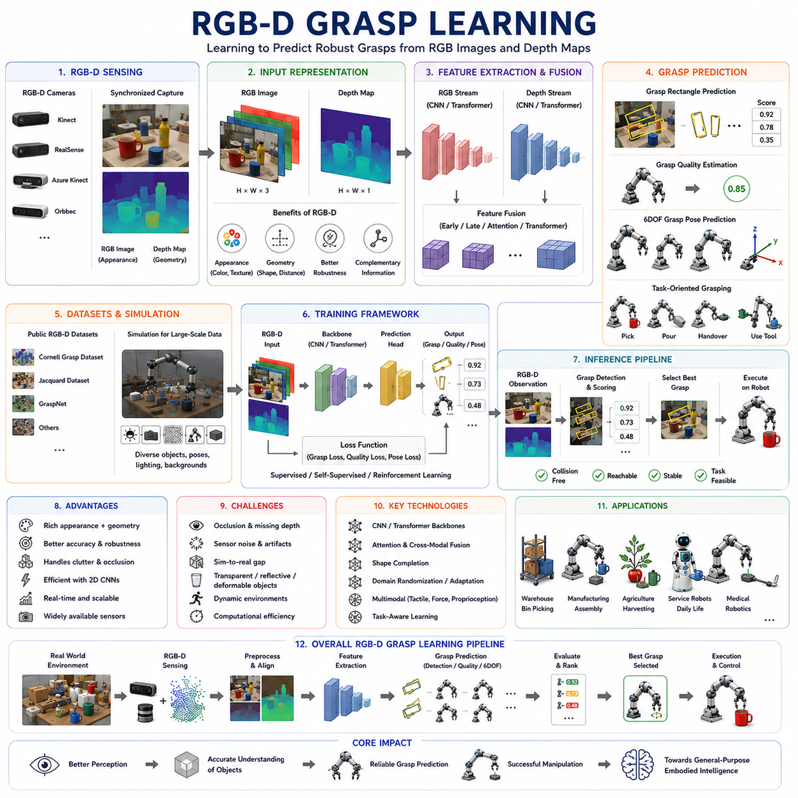{width="7.268055555555556in" height="7.268055555555556in"}

RGB-D Grasp Learning is one of the most influential and widely adopted approaches in modern robotic manipulation. The term RGB-D refers to the combination of conventional color images, represented by Red, Green, and Blue channels, together with depth information that describes the distance between the sensor and observed surfaces. By integrating appearance information with three-dimensional geometric information, RGB-D sensing provides a rich representation of the environment that enables robots to perceive objects more effectively and make more informed grasping decisions. Over the past decade, RGB-D grasp learning has become a cornerstone technology in warehouse automation, industrial robotics, service robotics, healthcare robotics, agricultural automation, and embodied artificial intelligence systems.

The emergence of RGB-D grasp learning was driven by the limitations of purely RGB-based vision systems. Traditional computer vision approaches relied primarily on color and texture information. While such systems could recognize objects and estimate their locations under favorable conditions, they often struggled to understand three-dimensional geometry accurately. Depth ambiguity, lighting variations, shadows, reflections, and textureless surfaces frequently caused failures in robotic manipulation tasks. The introduction of affordable RGB-D sensors such as Microsoft Kinect, Intel RealSense, ASUS Xtion, Orbbec sensors, and various industrial depth cameras transformed robotic perception by providing direct measurements of scene geometry alongside visual appearance.

Depth information fundamentally changes how a robot perceives its environment. Instead of inferring shape indirectly from visual cues, the robot receives explicit geometric information about object surfaces, distances, edges, and spatial relationships. When combined with RGB information, depth measurements allow robots to simultaneously understand what an object looks like and where it exists in three-dimensional space. This fusion of appearance and geometry creates a powerful foundation for learning-based grasping systems.

The basic objective of RGB-D grasp learning is to predict successful grasp configurations from RGB-D observations. Given an RGB image and a corresponding depth map, a learning system estimates grasp locations, grasp orientations, grasp quality scores, grasp poses, or complete manipulation strategies. Depending on the system architecture, the output may consist of planar grasp rectangles, six-degree-of-freedom grasp poses, grasp quality distributions, contact point predictions, or task-oriented manipulation actions.

One of the primary reasons RGB-D data became so popular in robotic grasping is its balance between information richness and computational efficiency. Point clouds provide highly detailed geometric representations but can be computationally expensive to process. RGB images are computationally efficient but lack explicit three-dimensional structure. RGB-D data offers a practical compromise by preserving image-based representations while incorporating essential geometric information. This balance makes RGB-D particularly suitable for real-time robotic applications.

The early development of RGB-D grasp learning coincided with advances in deep learning and convolutional neural networks. Researchers recognized that depth maps share structural similarities with grayscale images and could therefore be processed using convolutional architectures. Initial systems treated depth images as additional image channels and extended traditional computer vision pipelines to incorporate geometric information. These approaches demonstrated substantial improvements over RGB-only methods and established RGB-D learning as a viable paradigm for robotic manipulation.

One of the most influential milestones in RGB-D grasp learning was the development of grasp rectangle prediction systems. These systems represented a grasp as a rectangle defined by a center position, orientation angle, gripper width, and grasp quality score. Given an RGB-D observation, a neural network predicted one or more grasp rectangles corresponding to stable grasp opportunities. This formulation simplified the grasp planning problem while maintaining sufficient flexibility for many industrial applications.

The Cornell Grasp Dataset played a particularly important role in advancing RGB-D grasp learning. This benchmark dataset contains RGB-D images paired with manually annotated grasp rectangles. It became one of the most widely used evaluation platforms for grasp detection algorithms and enabled consistent comparison between different learning approaches. Many early RGB-D grasp networks were developed and benchmarked using this dataset.

The success of RGB-D grasp learning is closely linked to the effectiveness of convolutional neural networks. CNNs excel at extracting hierarchical visual features from image-based representations. In RGB-D systems, convolutional layers learn both appearance-related and geometry-related features. Early layers capture edges, contours, textures, and depth discontinuities, while deeper layers learn object structures, grasp affordances, and task-relevant geometric relationships. This hierarchical feature extraction enables robust grasp prediction across diverse object categories.

Feature fusion represents one of the central challenges in RGB-D grasp learning. RGB and depth information provide complementary perspectives on the environment. RGB images capture color, texture, material appearance, and semantic cues, while depth maps provide geometric structure, surface orientation, and spatial relationships. Effective learning systems must integrate these information sources in a manner that maximizes their combined utility. Researchers have proposed numerous fusion strategies, including early fusion, late fusion, multi-stream architectures, attention-based fusion, and transformer-based multimodal integration.

Early fusion combines RGB and depth channels at the input stage, allowing the network to learn joint representations from the beginning of the processing pipeline. This approach is computationally efficient and straightforward to implement. However, it may not fully exploit the unique characteristics of each modality. Late fusion processes RGB and depth information separately before combining higher-level features. This strategy allows modality-specific feature extraction but often requires more computational resources.

Multi-stream architectures became particularly popular in RGB-D grasp learning. Separate neural network branches process RGB and depth data independently, and the resulting feature representations are merged at intermediate or final layers. This design enables specialized processing for each modality while preserving opportunities for cross-modal interaction. Many state-of-the-art RGB-D grasping systems employ variations of this architecture.

The emergence of attention mechanisms further improved RGB-D feature fusion. Attention-based models dynamically determine which regions and modalities are most relevant for grasp prediction. For example, texture information may be important for identifying object boundaries, while depth information may be more valuable for estimating grasp geometry. Attention mechanisms allow the network to allocate computational resources adaptively based on task requirements and scene context.

Transformer architectures have recently become highly influential in RGB-D grasp learning. Transformers provide powerful mechanisms for modeling long-range dependencies and cross-modal relationships. Vision transformers, multimodal transformers, and vision-language-action architectures increasingly incorporate RGB-D inputs to achieve more robust perception and manipulation capabilities. These models can integrate geometric reasoning, semantic understanding, and task context within a unified learning framework.

Grasp quality estimation represents a major application of RGB-D learning. In grasp quality prediction systems, the network evaluates candidate grasp configurations and estimates the likelihood of success. RGB-D observations provide both visual and geometric information about the object and its surroundings. The resulting quality predictions help robots select grasps that are stable, collision-free, and suitable for downstream tasks.

RGB-D grasp learning also plays a central role in six-degree-of-freedom grasp detection. While early grasp detectors focused on planar grasping, modern systems increasingly predict full spatial grasp poses. Depth information is particularly valuable in this context because it provides direct measurements of object geometry. RGB-D networks can infer object orientation, surface structure, and accessibility, enabling robust 6DOF grasp prediction even in cluttered environments.

Cluttered scene grasping represents one of the most important application domains for RGB-D learning. Real-world environments rarely contain isolated objects placed on clean backgrounds. Instead, robots must operate in shelves, bins, warehouses, factories, kitchens, hospitals, and homes where multiple objects interact and partially occlude one another. RGB-D observations help resolve these challenges by providing depth cues that distinguish overlapping objects and reveal spatial relationships that may not be apparent from color images alone.

Occlusion handling remains a significant research challenge. Even with depth sensing, portions of objects may remain invisible due to viewing geometry or environmental obstruction. Modern RGB-D grasp learning systems increasingly incorporate shape completion networks, probabilistic reasoning methods, and generative models that infer missing geometry from partial observations. These techniques improve robustness in complex environments where complete object visibility cannot be guaranteed.

Simulation plays an increasingly important role in RGB-D grasp learning. Collecting large-scale grasping datasets using physical robots is expensive and time-consuming. Modern simulation environments generate synthetic RGB-D observations along with grasp annotations and physical interaction labels. Simulated datasets allow researchers to train large neural networks efficiently while exploring diverse object categories, environmental conditions, and sensor configurations.

However, transferring RGB-D models from simulation to reality remains challenging. Real sensors exhibit noise, calibration errors, missing depth measurements, lighting artifacts, motion blur, and environmental variability that are difficult to model accurately. Researchers employ domain randomization, domain adaptation, self-supervised learning, and online fine-tuning to bridge the sim-to-real gap and improve real-world deployment performance.

The integration of tactile sensing with RGB-D perception represents a major research direction. RGB-D observations provide rich information before contact occurs, but tactile sensors become essential once physical interaction begins. Combining visual geometry, appearance information, pressure distributions, slip detection, and force measurements enables more adaptive and reliable grasp control. Multimodal learning systems that integrate RGB-D and tactile sensing increasingly approach human-like manipulation capabilities.

Task-oriented RGB-D grasp learning extends grasp prediction beyond simple object acquisition. In many applications, the best grasp depends on the intended task. A grasp suitable for transportation may be inappropriate for assembly, pouring, cutting, tool use, or human handover. Task-aware learning systems incorporate semantic objectives, task constraints, and future action requirements into grasp planning. RGB information contributes semantic understanding, while depth information provides geometric feasibility.

The rise of foundation models is beginning to reshape RGB-D grasp learning. Large-scale multimodal models trained on images, depth data, language instructions, robot actions, and interaction histories can learn generalized representations that support a wide range of manipulation tasks. Future RGB-D grasping systems will likely integrate perception, reasoning, planning, and control within unified architectures capable of adapting to novel environments and tasks.

Industrial applications of RGB-D grasp learning continue to expand rapidly. Warehouse robots use RGB-D perception for bin picking, item sorting, and order fulfillment. Manufacturing robots perform assembly, inspection, and material handling. Agricultural robots identify and harvest crops while minimizing damage. Service robots manipulate household objects in dynamic environments. Healthcare robots use RGB-D sensing for instrument handling, logistics support, and patient assistance. The versatility of RGB-D perception makes it suitable for a broad range of robotic platforms and operational contexts.

Performance evaluation in RGB-D grasp learning typically involves grasp success rate, detection accuracy, pose estimation quality, robustness to sensor noise, generalization to novel objects, computational efficiency, and task completion success. Public datasets and benchmark challenges have accelerated progress by providing standardized evaluation frameworks and facilitating comparison between competing methods.

Despite remarkable advances, several challenges remain unresolved. Transparent objects, reflective materials, deformable objects, severe occlusions, dynamic environments, and highly cluttered scenes continue to present difficulties. Depth sensors themselves have limitations, particularly when operating under strong sunlight, reflective surfaces, or long-range conditions. Efficient deployment on embedded hardware also remains an important practical consideration.

Future RGB-D grasp learning systems will likely combine multimodal perception, foundation models, world models, self-supervised learning, and embodied reasoning capabilities. Rather than merely predicting grasp locations, robots will increasingly understand object functionality, anticipate manipulation outcomes, reason about task objectives, and adapt their behavior through continuous interaction with the environment. RGB-D perception will remain a central component of this evolution because it provides a uniquely effective combination of semantic richness and geometric understanding.

Ultimately, RGB-D Grasp Learning represents a critical bridge between visual perception and physical interaction. By integrating appearance information with explicit three-dimensional geometry, RGB-D systems enable robots to perceive, understand, and manipulate the physical world with increasing competence. As robotic intelligence continues to advance toward general-purpose embodied systems, RGB-D grasp learning will remain one of the foundational technologies supporting robust, adaptive, and scalable robotic manipulation.

RGB-D 파지 학습(RGB-D Grasp Learning)은 현대 로봇 조작(Robotic Manipulation) 분야에서 가장 널리 활용되고 있는 학습 기반 파지 기술 중 하나이다. RGB-D는 일반적인 컬러 영상인 RGB(Red, Green, Blue) 정보와 깊이 정보(Depth Information)를 결합한 센서 데이터를 의미한다. RGB 영상은 물체의 색상, 질감(Texture), 시각적 특징을 제공하며, 깊이 정보는 센서와 물체 사이의 거리와 3차원 형상 정보를 제공한다. 이 두 가지 정보를 동시에 활용함으로써 로봇은 주변 환경을 더욱 정확하게 이해할 수 있으며, 보다 안정적이고 지능적인 파지 결정을 내릴 수 있다. 지난 10여 년 동안 RGB-D 파지 학습은 물류 자동화, 산업용 로봇, 서비스 로봇, 의료 로봇, 농업 자동화, 체화형 인공지능(Embodied AI) 분야의 핵심 기술로 자리 잡았다.

RGB-D 파지 학습이 등장하게 된 배경에는 기존 RGB 기반 비전 시스템의 한계가 존재한다. 전통적인 컴퓨터 비전 시스템은 주로 색상과 텍스처 정보를 이용하여 물체를 인식하였다. 이러한 시스템은 특정 조건에서는 우수한 성능을 보였지만 물체의 실제 3차원 구조를 정확하게 이해하는 데에는 어려움이 있었다. 조명 변화, 그림자, 반사, 질감이 부족한 물체, 깊이 추정 오차 등은 로봇 조작 성능을 크게 저하시켰다. 이후 Microsoft Kinect, Intel RealSense, ASUS Xtion, Orbbec 센서와 같은 저가형 RGB-D 카메라가 등장하면서 로봇은 시각 정보와 함께 실제 공간 구조를 직접 측정할 수 있게 되었다.

깊이 정보는 로봇의 환경 인식을 근본적으로 변화시켰다. 기존에는 시각적 단서만으로 형상을 추론해야 했지만, RGB-D 센서는 물체 표면의 거리, 모양, 공간적 위치를 직접 측정한다. RGB 정보는 물체가 무엇인지 알려주고, Depth 정보는 물체가 어디에 있는지를 알려준다. 이 두 정보를 결합하면 로봇은 물체의 의미(Semantics)와 기하학적 구조(Geometry)를 동시에 이해할 수 있다.

RGB-D 파지 학습의 기본 목표는 RGB 영상과 깊이 영상을 입력으로 받아 성공적인 파지 자세를 예측하는 것이다. 입력 데이터는 RGB 이미지와 Depth Map으로 구성되며, 출력은 파지 위치(Grasp Position), 파지 방향(Orientation), 파지 품질 점수(Grasp Quality Score), 6자유도 파지 자세(6DOF Grasp Pose), 또는 작업 목적에 맞는 조작 전략(Manipulation Strategy)이 될 수 있다.

RGB-D 데이터가 널리 사용되는 이유 중 하나는 정보량과 계산 효율성 사이의 균형 때문이다. 포인트 클라우드(Point Cloud)는 매우 풍부한 기하학 정보를 제공하지만 계산 비용이 크다. 반면 RGB 영상은 계산 효율성이 높지만 3차원 정보를 직접 제공하지 못한다. RGB-D는 이미지 기반 표현을 유지하면서도 중요한 공간 정보를 제공하기 때문에 실시간 로봇 응용에 매우 적합하다.

RGB-D 파지 학습의 발전은 딥러닝(Deep Learning)과 CNN(Convolutional Neural Network)의 발전과 밀접한 관련이 있다. 연구자들은 깊이 영상도 이미지와 유사한 구조를 가진다는 점에 주목하였고, 기존 CNN 구조를 활용하여 RGB와 Depth를 동시에 처리하기 시작하였다. 초기 연구들은 깊이 영상을 추가 채널로 취급하여 RGB 기반 비전 시스템을 확장하였다. 이러한 접근법은 RGB만 사용하는 방법보다 훨씬 높은 파지 성능을 보여주었다.

RGB-D 파지 학습의 중요한 이정표 중 하나는 파지 사각형(Grasp Rectangle) 예측 방식의 등장이다. 이 방식에서는 파지를 중심 위치, 회전 각도, 그리퍼 폭, 품질 점수로 표현한다. RGB-D 이미지를 입력받은 신경망은 여러 개의 파지 사각형을 예측하며, 그중 가장 성공 가능성이 높은 파지를 선택한다. 이 방법은 계산 효율성과 실제 적용 가능성 측면에서 매우 성공적인 결과를 보여주었다.

Cornell Grasp Dataset은 RGB-D 파지 학습 발전에 큰 역할을 한 대표적인 데이터셋이다. 이 데이터셋은 RGB-D 영상과 사람이 직접 라벨링한 파지 사각형 정보를 포함하고 있다. 수많은 연구가 Cornell Dataset을 이용하여 알고리즘을 평가하였으며, RGB-D 파지 연구의 사실상 표준 벤치마크 역할을 수행하였다.

RGB-D 파지 학습의 성공은 CNN의 계층적 특징 추출 능력에 크게 의존한다. CNN은 이미지에서 저수준 특징과 고수준 특징을 단계적으로 학습한다. 초기 계층에서는 모서리, 윤곽선, 텍스처, 깊이 경계(Depth Discontinuity)를 학습하고, 깊은 계층에서는 물체 구조, 파지 어포던스(Affordance), 작업 관련 특징을 학습한다. 이를 통해 다양한 물체에 대해 안정적인 파지 예측이 가능해진다.

RGB-D 학습에서 가장 중요한 문제 중 하나는 특징 융합(Feature Fusion)이다. RGB 영상과 Depth 정보는 서로 다른 종류의 정보를 제공한다. RGB는 색상, 질감, 재질, 의미 정보를 제공하고, Depth는 형상, 거리, 공간 구조를 제공한다. 따라서 두 정보를 효과적으로 결합하는 것이 매우 중요하다.

초기 융합(Early Fusion)은 RGB와 Depth를 입력 단계에서 바로 결합하는 방식이다. 구현이 간단하고 계산 효율성이 높지만, 각 데이터의 특성을 충분히 활용하지 못할 수 있다. 반면 후기 융합(Late Fusion)은 RGB와 Depth를 별도의 네트워크에서 처리한 후 고수준 특징을 결합한다. 이는 각 데이터 유형에 특화된 특징을 학습할 수 있다는 장점이 있다.

멀티스트림 네트워크(Multi-Stream Network)는 RGB-D 학습에서 매우 널리 사용되는 구조이다. RGB 전용 네트워크와 Depth 전용 네트워크를 별도로 구성한 후 중간 또는 마지막 단계에서 특징을 통합한다. 이를 통해 각 센서의 장점을 최대한 활용할 수 있다.

최근에는 Attention Mechanism이 RGB-D 융합에 적극 활용되고 있다. Attention은 장면 내에서 어떤 정보가 중요한지를 동적으로 결정한다. 예를 들어 물체 경계 인식에는 RGB 정보가 중요할 수 있고, 파지 자세 계산에는 Depth 정보가 더 중요할 수 있다. Attention은 이러한 중요도를 자동으로 학습하여 성능을 향상시킨다.

Transformer 기반 모델도 RGB-D 파지 학습에 큰 영향을 미치고 있다. Transformer는 장거리 관계(Long-Range Dependency)를 학습하는 데 뛰어난 성능을 보인다. Vision Transformer(ViT), Multimodal Transformer, Vision-Language-Action(VLA) 모델은 RGB-D 데이터를 효과적으로 통합하여 보다 정교한 파지 계획을 가능하게 하고 있다.

RGB-D 파지 학습의 대표적인 응용 분야 중 하나는 파지 품질 추정(Grasp Quality Estimation)이다. 시스템은 RGB-D 관측 정보와 파지 후보를 입력으로 받아 해당 파지의 성공 가능성을 예측한다. 이를 통해 로봇은 가장 안정적이고 충돌 위험이 적으며 작업에 적합한 파지를 선택할 수 있다.

RGB-D는 6DOF 파지 검출(6DOF Grasp Detection)에서도 중요한 역할을 한다. 초기 파지 시스템은 주로 평면 파지를 다루었지만, 최근에는 완전한 6자유도 파지 자세를 예측하는 방향으로 발전하고 있다. 깊이 정보는 물체의 공간 구조를 직접 제공하기 때문에 3차원 파지 자세를 추정하는 데 매우 유용하다.

복잡한 적재 환경(Cluttered Scene)은 RGB-D 학습의 대표적인 응용 환경이다. 실제 창고나 공장에서는 물체들이 서로 겹쳐져 있거나 부분적으로 가려져 있는 경우가 많다. RGB 정보만으로는 이를 구분하기 어렵지만, Depth 정보는 물체 간의 거리 차이를 제공하여 보다 정확한 분리와 파지 계획을 가능하게 한다.

가림 현상(Occlusion)은 여전히 중요한 연구 과제이다. RGB-D 센서가 있더라도 물체 일부는 보이지 않을 수 있다. 이를 해결하기 위해 형상 완성(Shape Completion), 확률 모델(Probabilistic Model), 생성 모델(Generative Model) 등이 활용되고 있다. 이러한 기술은 부분적으로 관측된 물체의 전체 형상을 추정하여 파지 계획 성능을 향상시킨다.

시뮬레이션(Simulation)은 RGB-D 파지 학습에서도 매우 중요한 역할을 한다. 실제 로봇으로 대규모 데이터를 수집하는 것은 매우 비용이 많이 들기 때문이다. 시뮬레이터는 RGB-D 영상과 파지 라벨을 자동으로 생성할 수 있으며, 다양한 물체와 환경 조건을 포함하는 방대한 데이터셋 구축을 가능하게 한다.

그러나 Sim-to-Real Gap은 여전히 존재한다. 실제 센서는 노이즈, 깊이 누락(Missing Depth), 조명 변화, 반사, 블러(Blur) 등의 문제를 포함한다. 이를 극복하기 위해 도메인 랜덤화(Domain Randomization), 도메인 적응(Domain Adaptation), 자기지도학습(Self-Supervised Learning), 온라인 파인튜닝(Online Fine-Tuning)이 활용되고 있다.

최근에는 RGB-D와 촉각 센서(Tactile Sensor)의 결합이 활발히 연구되고 있다. RGB-D는 접촉 이전의 정보를 제공하지만, 실제 접촉 이후의 상태는 촉각 센서가 훨씬 정확하게 측정할 수 있다. 압력 분포, 미끄러짐(Slip), 접촉 위치 등을 함께 활용하면 보다 인간과 유사한 수준의 파지 능력을 구현할 수 있다.

작업 지향 파지(Task-Oriented Grasping)는 RGB-D 파지 학습의 중요한 발전 방향이다. 물체를 단순히 집는 것이 아니라, 이후 수행해야 할 작업을 고려하여 파지를 선택하는 것이다. 예를 들어 컵을 운반하는 파지와 액체를 따르기 위한 파지는 서로 다르다. RGB 정보는 물체의 의미를 제공하고, Depth 정보는 기하학적 가능성을 제공하여 작업 목적에 적합한 파지를 선택할 수 있도록 한다.

최근 등장한 파운데이션 모델(Foundation Model)은 RGB-D 파지 학습을 새로운 단계로 이끌고 있다. 비전, 깊이, 언어, 행동 데이터를 함께 학습하는 대규모 모델은 다양한 작업에 일반화할 수 있는 능력을 제공한다. 미래의 RGB-D 파지 시스템은 인식, 추론, 계획, 제어를 하나의 통합 구조 안에서 수행할 것으로 예상된다.

현재 RGB-D 파지 학습은 물류 창고의 빈 피킹(Bin Picking), 제조업 조립 작업, 농업 수확 로봇, 서비스 로봇, 의료 지원 로봇 등 다양한 분야에서 사용되고 있다. RGB-D 센서는 상대적으로 저렴하면서도 강력한 환경 인식 능력을 제공하기 때문에 산업 현장에서 매우 높은 활용 가치를 가진다.

평가 지표로는 파지 성공률(Grasp Success Rate), 검출 정확도(Detection Accuracy), 자세 추정 정확도(Pose Estimation Accuracy), 노이즈에 대한 강건성(Robustness), 새로운 물체에 대한 일반화 능력(Generalization), 계산 효율성(Computational Efficiency), 작업 완료율(Task Completion Rate) 등이 사용된다.

그럼에도 불구하고 해결해야 할 문제는 여전히 많다. 투명 물체(Transparent Objects), 반사 물체(Reflective Objects), 변형 물체(Deformable Objects), 심한 가림 현상, 동적 환경(Dynamic Environment), 복잡한 적재 환경은 현재의 RGB-D 시스템이 어려움을 겪는 대표적인 문제들이다. 또한 강한 햇빛 아래에서는 일부 깊이 센서의 성능이 저하될 수 있으며, 임베디드 플랫폼에서의 실시간 처리도 중요한 과제로 남아 있다.

미래의 RGB-D 파지 학습은 멀티모달 인식(Multimodal Perception), 파운데이션 모델, 월드 모델(World Model), 자기지도학습, 체화형 추론(Embodied Reasoning)과 결합될 것으로 예상된다. 로봇은 단순히 파지 위치를 예측하는 것을 넘어 물체의 기능을 이해하고, 작업 결과를 예측하며, 경험을 통해 지속적으로 학습하는 방향으로 발전할 것이다.

결론적으로 RGB-D 파지 학습은 시각 인식과 실제 물리적 상호작용을 연결하는 핵심 기술이다. RGB의 의미 정보와 Depth의 기하학 정보를 결합함으로써 로봇은 실제 세계를 더욱 정확하게 이해하고 조작할 수 있게 된다. 앞으로 범용 로봇(General-Purpose Robot)과 체화형 인공지능(Embodied AI)이 발전함에 따라 RGB-D 파지 학습은 여전히 가장 중요한 기반 기술 중 하나로 남을 것이다.

##  

## 11.07 Behavior Cloning for Grasping

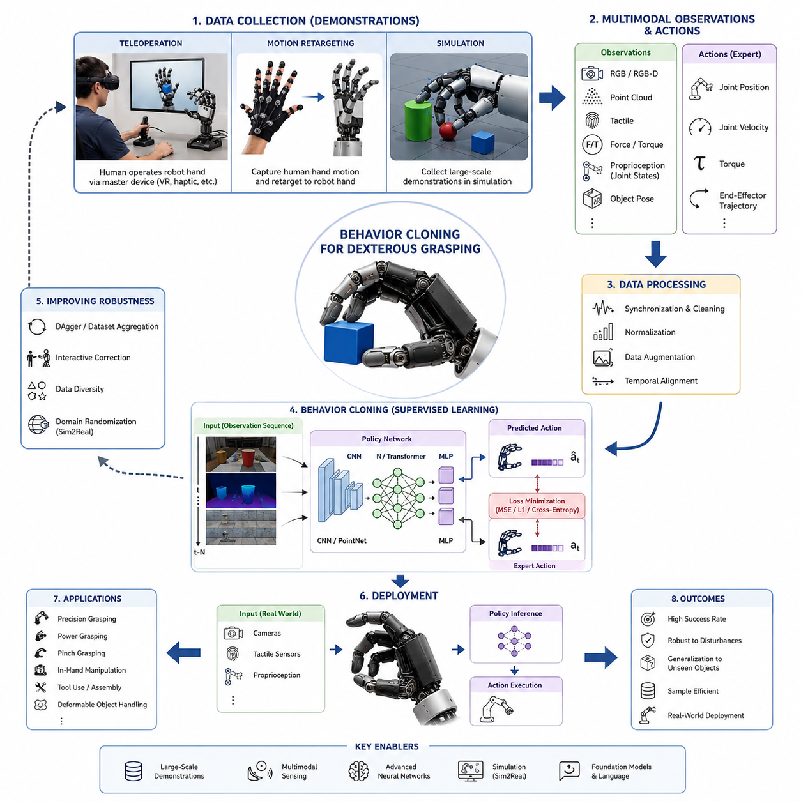{width="7.268055555555556in" height="7.268055555555556in"}

Behavior Cloning for Dexterous Grasping is one of the most important learning paradigms in modern robot manipulation because it provides a direct pathway for transferring human expertise into robotic systems. While traditional grasp planning relies on analytical models, contact mechanics, force closure analysis, and manually engineered controllers, behavior cloning enables a robot to learn grasping behaviors directly from demonstrations. The central idea is straightforward: instead of explicitly programming how a dexterous hand should move, a large collection of expert demonstrations is gathered, and a machine learning model is trained to imitate those actions. The resulting policy learns a mapping from sensory observations to motor commands, allowing the robot to reproduce complex grasping behaviors that may be difficult to describe mathematically.

Behavior cloning belongs to the broader field of Learning from Demonstration (LfD), also known as Imitation Learning. In dexterous grasping, demonstrations may come from human operators controlling robot hands through teleoperation systems, motion capture devices, virtual reality interfaces, exoskeleton gloves, haptic devices, or kinesthetic teaching methods. During demonstration collection, sensory information such as RGB images, RGB-D images, point clouds, tactile measurements, force-torque data, joint positions, joint velocities, and object poses are recorded together with the corresponding control actions executed by the expert. The learning algorithm then attempts to approximate the expert policy by minimizing the difference between predicted actions and demonstrated actions.

The appeal of behavior cloning lies in its simplicity. Unlike reinforcement learning, which often requires millions of interactions with the environment, behavior cloning can learn useful manipulation skills from relatively small datasets. This advantage is particularly important in dexterous grasping because robotic hands are expensive, fragile, and difficult to operate continuously for large-scale training. Human demonstrations provide high-quality examples of successful behavior, allowing robots to achieve meaningful performance with significantly reduced data collection costs.

Dexterous grasping presents unique challenges compared to simple pick-and-place operations. A multi-finger robotic hand may contain more than twenty degrees of freedom, resulting in a high-dimensional action space. The robot must coordinate multiple fingers, regulate grasp forces, maintain stable contacts, compensate for object uncertainty, and react to unexpected disturbances. Human experts naturally perform these actions through years of accumulated motor experience. Behavior cloning seeks to capture this expertise and encode it within neural network policies capable of generating similar behaviors.

A typical behavior cloning pipeline begins with demonstration acquisition. Teleoperation is one of the most common approaches. A human operator controls the robotic hand through a master device while observing the robot through cameras or immersive displays. The robot records sensory observations and corresponding control actions at high frequency. Modern systems frequently employ virtual reality gloves equipped with finger tracking sensors. These devices capture detailed finger motions and allow operators to manipulate virtual or physical objects naturally. The resulting datasets provide rich examples of grasp strategies, finger coordination patterns, and object interaction dynamics.

Another popular demonstration collection method involves motion retargeting. Human hand movements are captured using optical motion capture systems, inertial sensors, depth cameras, or instrumented gloves. Since human hands and robotic hands often have different kinematic structures, a retargeting algorithm converts human finger configurations into corresponding robot joint commands. This process enables large-scale demonstration collection while preserving important aspects of human dexterity.

Simulation environments have also become valuable sources of demonstrations. Human operators can manipulate virtual robot hands inside physics simulators such as Isaac Sim, MuJoCo, and PyBullet. Simulated demonstrations can be generated more rapidly than physical demonstrations and may include automatically labeled contact information, object states, and force measurements. Simulation additionally supports large-scale data augmentation, enabling the generation of diverse grasping scenarios that would be costly to create in the real world.

Once demonstrations have been collected, the next stage involves data preprocessing. Raw demonstrations often contain sensor noise, inconsistent timing, missing observations, and operator-specific biases. Data cleaning removes invalid samples and synchronizes multiple sensor streams. Temporal alignment ensures that actions correspond correctly to sensory observations. Normalization procedures scale sensor values into consistent numerical ranges. Augmentation techniques introduce variability in lighting conditions, object poses, camera viewpoints, and environmental parameters to improve policy generalization.

The learning objective in behavior cloning is generally formulated as supervised learning. Let the observation at time t be represented by (o_t), and the expert action by (a_t). The goal is to learn a policy (\\pi(o_t)) that predicts actions similar to those demonstrated by the expert. Training minimizes a loss function measuring the discrepancy between predicted and demonstrated actions. For continuous robot control, mean squared error is frequently employed. For discrete action representations, cross-entropy losses may be used. The optimization process updates neural network parameters until the policy closely reproduces expert behavior.

Early behavior cloning systems relied on relatively simple models such as linear regression, decision trees, and shallow neural networks. Modern dexterous grasping systems increasingly utilize deep learning architectures capable of processing high-dimensional sensory inputs. Convolutional Neural Networks extract visual features from RGB and RGB-D images. Point cloud networks process three-dimensional object geometry. Recurrent Neural Networks capture temporal dependencies across manipulation sequences. Transformer architectures model long-range relationships between observations, actions, and task contexts.

Vision-based behavior cloning has become particularly influential in robotic grasping. A robot observes the scene through cameras and predicts motor actions directly from image data. The neural network implicitly learns object recognition, pose estimation, grasp affordance identification, and motion planning within a single end-to-end framework. This approach reduces dependence on handcrafted perception pipelines and enables more adaptive grasping behavior.

Multimodal behavior cloning extends this concept by integrating visual, tactile, proprioceptive, and force sensing information. Human dexterity depends heavily on tactile feedback. During grasp execution, tactile sensors provide critical information regarding contact locations, pressure distributions, slip events, and object deformation. Incorporating tactile observations allows learned policies to react more effectively to uncertainty and maintain stable grasps under varying conditions. Recent studies have demonstrated significant improvements in dexterous manipulation performance when tactile sensing is combined with visual perception.

Temporal modeling is particularly important in dexterous grasping. Many manipulation tasks require sequences of coordinated actions rather than isolated control commands. Grasp acquisition, object stabilization, finger repositioning, and in-hand manipulation unfold over extended periods of time. Sequential models such as Long Short-Term Memory networks and Transformer-based policies capture temporal context and improve action prediction accuracy. These models learn how current actions depend on previous observations and previous control decisions.

Despite its simplicity, behavior cloning suffers from a well-known limitation known as covariate shift. During training, the policy observes states encountered by the expert. During deployment, however, small prediction errors can lead the robot into unfamiliar states not represented in the training data. Since the policy has never learned how to recover from these situations, errors accumulate over time and task performance deteriorates. This phenomenon is particularly problematic in dexterous grasping because small deviations in finger placement or contact forces may rapidly destabilize a grasp.

Researchers have developed several techniques to address covariate shift. Dataset Aggregation (DAgger) iteratively collects additional demonstrations in states visited by the learned policy. By augmenting the dataset with recovery behaviors, the policy gradually learns to handle a broader range of situations. Interactive imitation learning approaches allow experts to intervene when failures occur and provide corrective demonstrations. These methods significantly improve robustness compared to conventional behavior cloning.

Another important challenge involves demonstration diversity. A robot trained on limited demonstrations may memorize specific object configurations rather than learning general grasping principles. Large and diverse datasets improve generalization by exposing the policy to variations in object geometry, texture, mass distribution, lighting conditions, and environmental contexts. Recent large-scale robotic datasets contain millions of demonstration trajectories covering thousands of objects and manipulation scenarios.

Data representation plays a critical role in policy performance. Some systems represent actions as joint position commands. Others use joint velocities, torques, Cartesian fingertip trajectories, grasp poses, or latent skill embeddings. The choice of action representation influences learning stability, generalization capability, and execution smoothness. High-level action representations often simplify learning but may reduce control precision. Low-level motor commands provide greater flexibility but require larger datasets and more sophisticated training procedures.

Behavior cloning has proven highly effective for a wide range of dexterous grasping tasks. Robots can learn precision grasps for small objects, power grasps for heavy objects, pinch grasps for thin objects, and adaptive grasps for deformable materials. Policies trained through imitation learning have demonstrated capabilities such as object reorientation, finger gaiting, tool manipulation, cable handling, and assembly operations. These achievements illustrate the potential of demonstration-driven learning for replicating complex human manipulation skills.

The integration of foundation models has further expanded the capabilities of behavior cloning systems. Large vision-language-action models can leverage demonstration datasets collected across multiple robots, environments, and tasks. Instead of learning a single grasping skill, these models acquire generalized manipulation knowledge applicable to a broad range of situations. Language instructions can guide grasp selection, object prioritization, and task execution. For example, a robot may learn different grasp strategies for the instruction "pick up the cup by the handle" versus "grasp the cup securely for transport."

Simulation-to-real transfer has become increasingly important in behavior cloning research. Demonstrations collected in simulation can significantly reduce the cost of data acquisition. Domain randomization introduces variability in visual appearance, object properties, sensor characteristics, and environmental conditions. Policies trained on randomized simulations often generalize more effectively to real-world deployment. Combined with fine-tuning on limited real-world demonstrations, sim-to-real behavior cloning offers a practical pathway toward scalable dexterous grasp learning.

Evaluation of behavior cloning systems typically focuses on grasp success rate, task completion rate, robustness to disturbances, generalization to unseen objects, execution speed, and sample efficiency. Benchmark datasets such as GraspNet and various dexterous manipulation benchmarks provide standardized evaluation protocols. Researchers also assess performance under varying sensor noise levels, object occlusions, and environmental uncertainties to measure real-world reliability.

Industrial applications of behavior cloning are rapidly expanding. Warehouse automation systems use demonstration-based learning to handle diverse consumer products. Manufacturing robots learn assembly procedures from expert operators. Medical robots acquire delicate handling skills for surgical instruments and laboratory materials. Service robots learn household manipulation behaviors through human demonstrations. In all these applications, behavior cloning reduces development time by eliminating the need for extensive manual programming.

The future of behavior cloning for dexterous grasping is closely linked to advances in large-scale robotic data collection, multimodal sensing, foundation models, and embodied intelligence. Future systems are expected to learn from millions of demonstrations collected across global robot fleets. Visual, tactile, force, language, and proprioceptive information will be integrated into unified representations. Hierarchical policies will combine low-level motor control with high-level reasoning and planning. Foundation models will provide general manipulation knowledge, while behavior cloning will specialize these capabilities for specific robotic platforms and applications.

Ultimately, behavior cloning represents a crucial bridge between human expertise and robotic autonomy. By learning directly from demonstrations, dexterous robotic hands can acquire sophisticated grasping skills that would be extremely difficult to engineer manually. As datasets become larger, sensors become richer, and learning architectures become more powerful, behavior cloning will continue to play a central role in the development of intelligent robot hands capable of performing human-level grasping and manipulation in unstructured real-world environments. This chapter belongs to the Learning Based Grasping section of Volume 06 and serves as a foundational link between classical Learning from Demonstration methodologies and the emerging generation of foundation-model-driven dexterous manipulation systems.

행동 복제(Behavior Cloning)는 현대 로봇 조작 분야에서 가장 중요한 학습 방법 중 하나로, 인간 전문가의 숙련된 조작 능력을 로봇에게 직접 전달할 수 있는 효과적인 방법이다. 전통적인 파지(Grasping) 시스템은 접촉역학(Contact Mechanics), 힘 폐쇄(Force Closure), 파지 계획(Grasp Planning), 제어 이론 등을 기반으로 수작업 설계를 수행하였다. 반면 행동 복제는 인간이 수행한 실제 작업 사례를 학습하여 동일한 행동을 모방하도록 로봇을 훈련시킨다. 즉, 로봇에게 파지 방법을 하나하나 프로그래밍하는 대신, 인간이 수행한 작업 데이터를 학습하여 관측값(Observation)과 행동(Action) 사이의 관계를 자동으로 학습하게 만든다.

행동 복제는 시연 기반 학습(Learning from Demonstration, LfD) 또는 모방 학습(Imitation Learning)의 대표적인 방법이다. 정교 파지 분야에서는 원격 조작(Teleoperation), 가상현실(Virtual Reality), 데이터 글러브(Data Glove), 외골격 장갑(Exoskeleton Glove), 햅틱 장치(Haptic Device), 또는 직접 교시(Kinesthetic Teaching) 등을 통해 인간의 시연 데이터를 수집한다. 이 과정에서 RGB 영상, RGB-D 영상, 포인트 클라우드(Point Cloud), 촉각 센서 데이터(Tactile Data), 힘·토크 데이터(Force-Torque Data), 관절 위치(Joint Position), 관절 속도(Joint Velocity), 물체 자세(Object Pose) 등이 기록된다. 동시에 인간이 수행한 제어 명령 역시 함께 저장되며, 학습 알고리즘은 이러한 입력과 출력의 관계를 학습하여 전문가의 행동 정책(Expert Policy)을 근사한다.

행동 복제가 주목받는 가장 큰 이유는 단순성과 효율성 때문이다. 강화학습(Reinforcement Learning)은 수백만 번 이상의 시행착오를 요구하는 경우가 많지만, 행동 복제는 상대적으로 적은 수의 시연 데이터만으로도 의미 있는 성능을 달성할 수 있다. 특히 다지형 로봇 손(Dexterous Hand)은 가격이 비싸고 기계적 구조가 복잡하기 때문에 대규모 강화학습을 실제 하드웨어에서 수행하기 어렵다. 반면 인간 전문가의 시연 데이터는 이미 성공적인 작업 전략을 포함하고 있으므로 훨씬 적은 비용으로 실용적인 파지 정책을 구축할 수 있다.

정교 파지는 일반적인 픽앤플레이스(Pick-and-Place)보다 훨씬 복잡한 문제이다. 다지형 로봇 손은 20개 이상의 자유도(Degree of Freedom)를 가질 수 있으며, 여러 손가락을 동시에 제어해야 한다. 또한 적절한 파지력을 유지하고, 접촉 상태를 안정적으로 관리하며, 미끄러짐을 방지하고, 외란(Disturbance)에 대응해야 한다. 인간은 수년간 축적된 운동 경험을 통해 이러한 문제를 자연스럽게 해결하지만, 이를 수학적으로 명확하게 기술하는 것은 매우 어렵다. 행동 복제는 인간의 숙련된 행동을 직접 학습함으로써 이러한 난제를 해결하고자 한다.

일반적인 행동 복제 시스템은 시연 데이터 수집 단계에서 시작된다. 가장 널리 사용되는 방법은 원격 조작이다. 인간 조작자가 마스터 장치를 이용해 로봇 손을 제어하고, 로봇은 센서 정보와 제어 명령을 동시에 기록한다. 최근에는 손가락 추적 기능을 가진 VR 장갑이 널리 사용되고 있다. 이러한 장비는 인간 손의 움직임을 정밀하게 측정할 수 있으며, 자연스러운 파지 동작을 대규모로 수집할 수 있다. 결과적으로 데이터셋에는 손가락 협조(Finger Coordination), 파지 전략(Grasp Strategy), 물체 조작 방식 등이 포함된다.

또 다른 방법은 모션 리타게팅(Motion Retargeting)이다. 인간 손의 움직임을 모션 캡처(Motion Capture), IMU 센서, 깊이 카메라 또는 데이터 글러브를 통해 측정한 후 이를 로봇 손의 관절 구조에 맞게 변환한다. 인간 손과 로봇 손은 구조가 다르기 때문에 직접적인 매핑은 불가능하지만, 적절한 변환 알고리즘을 사용하면 인간의 조작 능력을 로봇 시스템에 효과적으로 전달할 수 있다.

최근에는 시뮬레이션 환경 역시 중요한 데이터 수집 수단으로 사용되고 있다. 연구자는 NVIDIA Isaac Sim, MuJoCo, PyBullet과 같은 물리 시뮬레이터에서 가상 로봇 손을 조작할 수 있다. 시뮬레이션에서는 접촉 정보, 힘 정보, 물체 상태 등을 자동으로 기록할 수 있으며, 실제 하드웨어보다 훨씬 빠른 속도로 데이터를 생성할 수 있다. 또한 다양한 환경 조건을 쉽게 생성할 수 있기 때문에 데이터 다양성을 크게 증가시킬 수 있다.

시연 데이터가 수집되면 전처리(Data Preprocessing)가 수행된다. 실제 데이터에는 센서 노이즈, 시간 동기화 문제, 누락 데이터, 조작자별 편향 등이 존재한다. 데이터 정제 과정에서는 잘못된 샘플을 제거하고, 센서 데이터를 동기화하며, 수치 범위를 정규화한다. 또한 데이터 증강(Data Augmentation)을 통해 조명 변화, 물체 위치 변화, 카메라 시점 변화 등을 인위적으로 추가하여 일반화 성능을 향상시킨다.

행동 복제는 기본적으로 지도학습(Supervised Learning) 문제로 정의된다. 관측값을 입력으로 받고 전문가 행동을 출력으로 사용하는 함수 근사를 수행한다. 학습 과정에서는 모델이 예측한 행동과 실제 전문가 행동 사이의 차이를 최소화하도록 신경망을 최적화한다. 연속 제어 문제에서는 평균 제곱 오차(Mean Squared Error)가 주로 사용되며, 이산 행동 문제에서는 교차 엔트로피(Cross Entropy)가 사용된다.

초기의 행동 복제 연구는 선형 회귀(Linear Regression), 결정 트리(Decision Tree), 얕은 신경망(Shallow Neural Network) 등을 사용하였다. 그러나 현대의 정교 파지 시스템은 딥러닝(Deep Learning)을 중심으로 발전하고 있다. 합성곱 신경망(Convolutional Neural Network)은 RGB 및 RGB-D 영상에서 시각 특징을 추출한다. 포인트 클라우드 네트워크는 3차원 형상 정보를 처리한다. 순환 신경망(Recurrent Neural Network)은 시간적 의존성을 모델링한다. 최근에는 Transformer 기반 모델이 장기적인 시계열 관계를 학습하는 데 널리 사용되고 있다.

비전 기반 행동 복제(Vision-Based Behavior Cloning)는 특히 큰 주목을 받고 있다. 로봇은 카메라 영상만을 입력으로 받아 적절한 파지 동작을 생성한다. 이 과정에서 물체 인식(Object Recognition), 자세 추정(Pose Estimation), 파지 가능성 분석(Grasp Affordance Analysis), 경로 계획(Motion Planning)이 하나의 신경망 내부에서 통합적으로 수행된다. 결과적으로 기존의 복잡한 파이프라인을 단순화하면서도 높은 적응성을 제공할 수 있다.

멀티모달 행동 복제(Multimodal Behavior Cloning)는 시각 정보뿐 아니라 촉각(Tactile), 힘(Force), 고유감각(Proprioception) 정보를 함께 사용한다. 인간은 파지 시 촉각 정보를 매우 중요하게 활용한다. 접촉 위치, 압력 분포, 미끄러짐 발생 여부, 물체 변형 상태 등을 손끝 감각으로 인식한다. 따라서 촉각 센서를 통합한 행동 복제 시스템은 불확실성이 높은 환경에서도 더욱 안정적인 파지를 수행할 수 있다.

시간적 모델링(Temporal Modeling) 역시 매우 중요하다. 정교 파지는 단일 동작이 아니라 연속적인 행동의 집합이다. 접근(Approach), 접촉(Contact), 안정화(Stabilization), 재배치(Regrasping), 손안 조작(In-Hand Manipulation) 등이 시간에 따라 순차적으로 이루어진다. LSTM(Long Short-Term Memory)이나 Transformer 모델은 이러한 시계열 관계를 학습하여 더욱 자연스러운 조작 행동을 생성한다.

행동 복제의 가장 큰 한계 중 하나는 공변량 이동(Covariate Shift) 문제이다. 학습 과정에서 로봇은 전문가가 방문한 상태만 관찰한다. 그러나 실제 운용 중에는 작은 오차가 누적되면서 전문가가 경험하지 않은 상태에 진입할 수 있다. 이러한 상황에서는 정책이 적절한 복구 행동을 알지 못하기 때문에 성능이 급격히 저하될 수 있다. 정교 파지에서는 손가락 위치가 약간만 틀어져도 파지가 실패할 수 있으므로 이 문제는 매우 중요하다.

이를 해결하기 위해 DAgger(Dataset Aggregation)와 같은 기법이 개발되었다. 로봇이 스스로 행동하도록 한 후, 전문가가 오류를 수정하는 추가 시연을 제공한다. 이렇게 수집된 데이터를 반복적으로 학습함으로써 정책은 점차 더 넓은 상태 공간을 다룰 수 있게 된다. 또한 인터랙티브 모방 학습(Interactive Imitation Learning)은 전문가 개입을 통해 복구 전략까지 함께 학습하도록 한다.

데이터 다양성 역시 중요한 요소이다. 제한된 데이터만 사용하면 특정 물체나 환경에 과적합될 가능성이 높다. 따라서 다양한 형상, 질감, 크기, 무게, 조명 조건을 가진 물체에 대한 시연 데이터를 수집해야 한다. 최근 대규모 로봇 데이터셋은 수백만 개 이상의 조작 궤적(Trajectory)과 수천 개 이상의 물체를 포함하며, 이러한 데이터는 일반화 성능 향상에 핵심적인 역할을 수행한다.

행동 표현(Action Representation) 역시 성능에 큰 영향을 미친다. 일부 시스템은 관절 위치를 직접 예측하고, 다른 시스템은 관절 속도, 토크, 손끝 경로(Fingertip Trajectory), 잠재 스킬 표현(Latent Skill Representation) 등을 사용한다. 고수준 표현은 학습을 단순화할 수 있지만 정밀도가 떨어질 수 있으며, 저수준 표현은 높은 유연성을 제공하지만 더 많은 데이터와 계산 자원을 요구한다.

행동 복제는 이미 다양한 정교 파지 응용 분야에서 성공적으로 활용되고 있다. 작은 전자 부품을 집는 정밀 파지(Precision Grasp), 무거운 물체를 위한 파워 그립(Power Grip), 얇은 물체를 위한 핀치 그립(Pinch Grip), 변형 가능한 물체를 위한 적응형 파지(Adaptive Grasp) 등이 대표적인 사례이다. 또한 손안 조작(In-Hand Manipulation), 손가락 보행(Finger Gaiting), 공구 사용(Tool Use), 케이블 조작(Cable Manipulation), 조립 작업(Assembly Task) 등 고난도 작업에서도 뛰어난 성능을 보이고 있다.

최근에는 파운데이션 모델(Foundation Model)과의 결합이 새로운 방향으로 주목받고 있다. 대규모 시각-언어-행동(Vision-Language-Action, VLA) 모델은 다양한 로봇과 환경에서 수집된 시연 데이터를 학습하여 범용 조작 능력을 획득한다. 이러한 모델은 단순히 하나의 파지 기술을 배우는 것이 아니라 조작 전반에 대한 일반적인 지식을 습득한다. 또한 언어 명령(Language Instruction)을 통해 상황에 따라 서로 다른 파지 전략을 선택할 수 있다. 예를 들어 "컵 손잡이를 잡아라"와 "컵을 안전하게 운반할 수 있도록 잡아라"는 서로 다른 행동을 요구하며, 이러한 차이를 이해하는 것이 가능해진다.

시뮬레이션-실세계 전이(Sim2Real Transfer) 역시 중요한 연구 분야이다. 시뮬레이션에서 수집한 시연 데이터를 활용하면 비용을 크게 절감할 수 있다. 도메인 랜덤화(Domain Randomization)를 통해 색상, 질감, 조명, 센서 특성, 물체 물성 등을 다양하게 변화시키면 실제 환경에 대한 일반화 능력이 향상된다. 이후 소량의 실제 데이터로 미세 조정(Fine-Tuning)을 수행하면 높은 수준의 실환경 성능을 확보할 수 있다.

행동 복제 기반 정교 파지 시스템의 평가는 파지 성공률(Grasp Success Rate), 작업 성공률(Task Success Rate), 외란 대응 능력(Robustness), 미지 물체 일반화(Unseen Object Generalization), 실행 속도(Execution Speed), 데이터 효율성(Sample Efficiency) 등을 기준으로 이루어진다. 또한 센서 노이즈, 물체 가림(Occlusion), 환경 변화 등에 대한 강인성 역시 중요한 평가 요소가 된다.

산업 현장에서 행동 복제의 활용 범위는 빠르게 확대되고 있다. 물류 창고에서는 다양한 소비재를 처리하기 위해 사용되고 있으며, 제조업에서는 조립 작업을 학습하는 데 활용된다. 의료 분야에서는 수술 도구나 실험실 재료를 다루는 정밀 작업에 적용되고 있으며, 서비스 로봇은 가정 환경에서 인간의 조작 행동을 학습하여 일상 업무를 수행한다. 이러한 접근 방식은 기존의 수작업 프로그래밍보다 훨씬 짧은 개발 기간으로 높은 수준의 조작 능력을 구현할 수 있게 한다.

미래의 행동 복제는 대규모 로봇 데이터셋, 멀티모달 센서 융합, 파운데이션 모델, 그리고 체화 지능(Embodied Intelligence) 기술과 깊게 결합될 것으로 예상된다. 수백만 건 이상의 시연 데이터가 전 세계 로봇 플릿(Fleet)으로부터 수집될 것이며, 시각·촉각·힘·언어·고유감각 정보가 통합된 거대한 학습 모델이 등장할 것이다. 이러한 모델은 범용적인 조작 지식을 학습한 후 특정 로봇 플랫폼에 맞게 미세 조정되어 실제 산업 환경에 배치될 것이다.

궁극적으로 행동 복제는 인간의 숙련된 기술과 로봇의 자율성을 연결하는 핵심 기술이다. 인간 전문가의 경험을 직접 학습함으로써 로봇은 복잡한 수학적 모델을 설계하지 않고도 고도의 파지 및 조작 능력을 획득할 수 있다. 데이터 규모가 증가하고 센서가 고도화되며 학습 모델이 발전함에 따라 행동 복제는 인간 수준의 정교 파지와 손안 조작을 구현하는 핵심 기술로 자리 잡을 것이다. 이는 향후 범용 로봇 손(General-Purpose Robot Hand)과 휴머노이드 로봇(Humanoid Robot)의 발전을 이끄는 중요한 기반 기술이 될 것으로 기대된다.

##  

## 11.08 Reinforcement Learning for Grasping

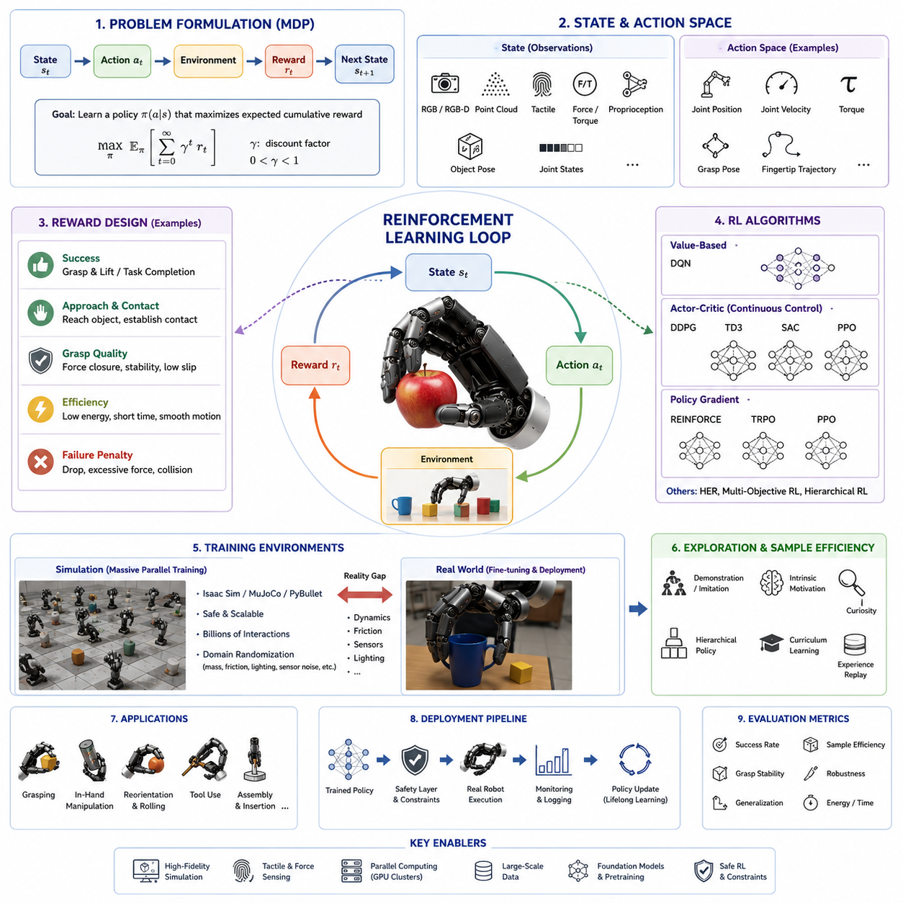{width="7.268055555555556in" height="7.268055555555556in"}

Reinforcement Learning for Grasping represents one of the most powerful approaches for enabling robots to acquire grasping and manipulation skills through autonomous interaction with their environment. Unlike supervised learning methods such as behavior cloning, which rely on expert demonstrations, reinforcement learning allows a robot to learn grasping behaviors through trial and error. The robot repeatedly interacts with objects, evaluates the consequences of its actions through reward signals, and gradually discovers policies that maximize long-term success. This capability is particularly attractive for dexterous robotic hands because many grasping and manipulation strategies are difficult to model analytically and may not be fully captured by human demonstrations.

The fundamental concept of reinforcement learning is inspired by how humans and animals learn through experience. A robot performs an action, observes the resulting state change, receives a reward, and updates its decision-making strategy. Over time, successful actions become more likely while unsuccessful actions are suppressed. In robotic grasping, this learning process enables the discovery of grasp strategies that may not have been explicitly programmed by engineers. The robot can learn how to adapt to object variations, compensate for uncertainty, recover from failures, and exploit physical interactions that are difficult to describe mathematically.

In reinforcement learning, the grasping problem is typically formulated as a Markov Decision Process (MDP). The robot observes the current state of the environment, selects an action according to its policy, transitions to a new state, and receives a reward. The state may include RGB images, RGB-D images, point clouds, tactile sensor readings, force measurements, joint positions, joint velocities, object poses, and environmental information. Actions may consist of joint commands, fingertip trajectories, grasp poses, torque commands, or high-level manipulation primitives. The reward function evaluates the quality of the action and provides feedback that guides learning.

The design of the reward function is one of the most critical aspects of reinforcement learning for grasping. A simple reward function may assign a positive value when an object is successfully grasped and lifted and a negative value when the object is dropped. However, sparse rewards often make learning extremely difficult because successful grasp events may occur only rarely during early exploration. To address this challenge, researchers frequently employ reward shaping techniques. Intermediate rewards may be provided for approaching an object, establishing contact, reducing grasp error, increasing grasp stability, maintaining force closure, or successfully manipulating the object toward a desired goal state.

Early reinforcement learning approaches in robotics were limited by computational resources and sample efficiency. Classical methods such as Q-Learning and SARSA demonstrated the feasibility of learning control policies but struggled with high-dimensional state and action spaces. Dexterous robotic hands often possess twenty or more degrees of freedom, making traditional tabular methods impractical. The emergence of deep reinforcement learning transformed the field by combining neural networks with reinforcement learning algorithms. Deep neural networks provide powerful function approximation capabilities that enable policies to operate directly on high-dimensional sensory observations.

Deep Q-Networks (DQN) were among the first successful deep reinforcement learning methods. DQN approximates action-value functions using deep neural networks and learns optimal policies through experience replay and temporal difference learning. Although DQN achieved remarkable success in discrete action domains, grasping tasks typically involve continuous actions, requiring alternative algorithms. Continuous control methods such as Deep Deterministic Policy Gradient (DDPG), Twin Delayed Deep Deterministic Policy Gradient (TD3), and Soft Actor-Critic (SAC) have become widely adopted for robotic manipulation.

Policy gradient methods constitute another important category of reinforcement learning algorithms. Instead of learning value functions, policy gradient methods directly optimize the policy itself. Algorithms such as REINFORCE, Trust Region Policy Optimization (TRPO), and Proximal Policy Optimization (PPO) have demonstrated strong performance in robotic grasping applications. PPO, in particular, has become one of the most widely used algorithms because it balances learning stability, computational efficiency, and implementation simplicity.

For dexterous grasping, reinforcement learning offers several unique advantages. Multi-finger robotic hands operate in complex contact-rich environments where analytical solutions may be difficult or impossible to derive. Reinforcement learning can discover control policies that exploit subtle physical interactions between fingers and objects. The resulting behaviors often exhibit emergent coordination patterns that were never explicitly programmed. Fingers may automatically adjust their positions, redistribute forces, and coordinate motions to achieve stable grasps under varying conditions.

One of the most influential demonstrations of reinforcement learning for dexterous manipulation was the Dactyl project. In this system, a multi-finger robotic hand learned to manipulate and reorient objects through extensive reinforcement learning training in simulation. The learned policy demonstrated remarkable robustness to disturbances and successfully transferred to physical hardware. This work highlighted the potential of reinforcement learning for achieving human-like dexterity in robotic systems.

Simulation has become a cornerstone of reinforcement learning research in robotic grasping. Real-world training is often prohibitively expensive because millions or billions of interactions may be required. Physics simulators such as Isaac Sim, MuJoCo, PyBullet, and other robotic simulation platforms provide safe and efficient environments for large-scale learning. Within simulation, robots can explore grasping strategies continuously without hardware wear, safety concerns, or operational costs. Massive parallelization further accelerates training by allowing thousands of simulated environments to run simultaneously.

However, simulation introduces a new challenge known as the reality gap. Physical systems differ from simulations in terms of friction, material properties, sensor noise, latency, compliance, and environmental variability. Policies trained exclusively in simulation may fail when deployed on real robots. To address this issue, researchers employ domain randomization techniques. During training, physical parameters such as object mass, friction coefficients, lighting conditions, sensor noise, and contact properties are randomly varied. The resulting policy learns to operate across a broad range of conditions and becomes more robust when transferred to real-world environments.

Domain adaptation and sim-to-real transfer have become major research areas within reinforcement learning for grasping. Fine-tuning simulated policies using small amounts of real-world data can significantly improve performance. Hybrid approaches combine simulation-generated experience with real-world interactions to achieve efficient learning while maintaining practical deployment capabilities.

Exploration remains one of the most challenging aspects of reinforcement learning. A robot must discover successful grasping behaviors before it can improve them. Random exploration is often inefficient because the probability of accidentally achieving a successful dexterous grasp is extremely low. Researchers therefore develop exploration strategies that leverage prior knowledge, demonstrations, intrinsic motivation, curiosity-driven learning, or hierarchical control structures. These methods guide exploration toward promising regions of the state space and accelerate policy improvement.

Hierarchical reinforcement learning introduces multiple levels of control abstraction. High-level policies determine strategic objectives, while low-level controllers execute detailed motor commands. In grasping applications, a high-level policy may decide which grasp type to use, while a low-level policy controls individual finger movements. Hierarchical architectures improve scalability and allow complex manipulation tasks to be decomposed into manageable subproblems.

Multi-objective reinforcement learning has also become increasingly important. Real-world grasping tasks often require balancing multiple objectives simultaneously. A robot may need to maximize grasp stability while minimizing energy consumption, execution time, contact forces, and collision risk. Multi-objective formulations enable policies to consider these competing requirements and generate more practical behaviors for industrial deployment.

Tactile sensing significantly enhances reinforcement learning performance in grasping tasks. Vision alone often provides incomplete information regarding contact conditions and object stability. Tactile sensors provide rich feedback about pressure distributions, contact locations, slip events, and force interactions. Reinforcement learning policies that integrate tactile sensing can adjust grasp forces dynamically, detect incipient slip, and respond more effectively to disturbances. The combination of visual and tactile information creates a more complete representation of the grasping state and improves overall robustness.

In-hand manipulation represents one of the most challenging applications of reinforcement learning. The robot must continuously control multiple contact points while moving an object relative to the hand. Tasks such as object reorientation, finger gaiting, rolling, pivoting, and tool manipulation require precise coordination across many degrees of freedom. Reinforcement learning has demonstrated impressive capabilities in these domains, particularly when combined with large-scale simulation and advanced neural network architectures.

Recent advances in transformer architectures and foundation models are beginning to influence reinforcement learning for grasping. Transformer-based policies can model long temporal dependencies and capture complex relationships between sensory inputs and actions. Large-scale foundation models trained on diverse robotic datasets provide rich prior knowledge that can accelerate reinforcement learning. Instead of learning entirely from scratch, robots can initialize policies using pretrained representations and then refine them through reinforcement learning interactions.

Offline reinforcement learning has emerged as a promising alternative to traditional online learning. Rather than collecting new experiences during training, offline reinforcement learning learns from previously recorded datasets. These datasets may contain demonstrations, operational logs, simulation trajectories, or historical robot experiences. Offline methods significantly reduce the cost and risk associated with real-world exploration while retaining many of the benefits of reinforcement learning.

Safety remains a critical consideration for reinforcement learning in physical robotics. During exploration, robots may generate unsafe actions that could damage hardware, objects, or surrounding environments. Safe reinforcement learning introduces constraints that limit risky behaviors while still allowing effective learning. Constraint optimization, safety filters, model predictive control integration, and risk-sensitive reward functions are commonly employed to ensure reliable operation.

Industrial applications of reinforcement learning for grasping continue to expand rapidly. Warehouse automation systems use reinforcement learning to handle diverse product inventories. Manufacturing robots employ reinforcement learning for assembly, insertion, and material handling tasks. Agricultural robots learn to harvest delicate crops without causing damage. Medical robotics benefits from adaptive grasping capabilities when manipulating surgical instruments and biological materials. Service robots apply reinforcement learning to household manipulation tasks involving highly variable objects and environments.

Evaluation of reinforcement learning grasping systems typically considers grasp success rate, manipulation success rate, learning efficiency, generalization capability, robustness to disturbances, energy consumption, and deployment reliability. Benchmark datasets and standardized evaluation environments help researchers compare algorithms objectively. Robustness testing often includes unseen objects, varying lighting conditions, sensor noise, external disturbances, and environmental uncertainty.

Future developments in reinforcement learning for grasping are expected to focus on greater sample efficiency, stronger generalization, improved safety, and tighter integration with foundation models. Large-scale robotic fleets may continuously collect experience data from real-world operations, enabling lifelong learning and policy refinement. Multi-modal learning architectures will integrate vision, touch, force sensing, language understanding, and world models into unified decision-making systems. Reinforcement learning will increasingly operate alongside imitation learning, behavior cloning, and foundation model adaptation to create highly capable manipulation systems.

As robotic hands become more sophisticated and sensing technologies continue to improve, reinforcement learning is likely to become one of the primary mechanisms through which robots acquire manipulation intelligence. The ability to learn directly from interaction enables robots to discover solutions that exceed human intuition, adapt to previously unseen situations, and continuously improve through experience. Within the broader context of Learning-Based Grasping, reinforcement learning represents a critical step toward autonomous dexterous manipulation systems capable of achieving robust, flexible, and human-level performance across a wide range of real-world tasks.

파지를 위한 강화학습(Reinforcement Learning for Grasping)은 로봇이 환경과의 상호작용을 통해 스스로 파지 및 조작 기술을 학습하도록 만드는 가장 강력한 접근법 중 하나이다. 행동 복제(Behavior Cloning)와 같은 지도학습 기반 방법이 전문가 시연 데이터에 의존하는 반면, 강화학습은 시행착오(Trial and Error)를 통해 학습한다. 로봇은 반복적으로 물체와 상호작용하고, 자신의 행동 결과에 대한 보상(Reward)을 받으며, 장기적으로 최대의 보상을 얻는 행동 정책(Policy)을 스스로 발견한다. 이러한 특성은 특히 다지형 로봇 손(Dexterous Hand)에 매우 적합하다. 많은 파지 및 조작 전략은 수학적으로 명확히 정의하기 어렵고, 인간 시연만으로는 충분히 설명되지 않기 때문이다.

강화학습의 기본 개념은 인간과 동물이 경험을 통해 학습하는 과정에서 영감을 얻었다. 로봇은 행동(Action)을 수행하고, 새로운 상태(State)를 관찰하며, 그 결과에 대한 보상을 받는다. 이후 정책을 수정하여 더 나은 행동을 선택하도록 학습한다. 시간이 지남에 따라 성공적인 행동은 강화되고 실패하는 행동은 줄어든다. 이러한 과정은 로봇이 엔지니어가 직접 설계하지 않은 새로운 파지 전략을 발견할 수 있도록 해준다. 또한 다양한 물체에 적응하고, 불확실성을 극복하며, 실패로부터 복구하는 능력을 자연스럽게 습득하게 된다.

강화학습에서 파지 문제는 일반적으로 마르코프 의사결정 과정(Markov Decision Process, MDP)으로 표현된다. 로봇은 현재 상태를 관찰하고 정책에 따라 행동을 선택한 후 새로운 상태로 전이된다. 이후 보상을 받아 정책을 업데이트한다. 상태 정보에는 RGB 영상, RGB-D 영상, 포인트 클라우드(Point Cloud), 촉각 데이터(Tactile Data), 힘·토크 데이터(Force-Torque Data), 관절 상태, 물체 자세(Object Pose), 환경 정보 등이 포함될 수 있다. 행동은 관절 위치 명령, 관절 속도 명령, 토크 명령, 손끝 경로(Fingertip Trajectory), 파지 자세(Grasp Pose) 등으로 표현된다.

보상 함수(Reward Function)는 강화학습에서 가장 중요한 설계 요소 중 하나이다. 가장 단순한 형태는 물체를 성공적으로 집어 올리면 양의 보상을 주고, 실패하면 음의 보상을 주는 방식이다. 그러나 이러한 희소 보상(Sparse Reward)은 학습을 어렵게 만든다. 초기 단계에서는 성공적인 파지가 거의 발생하지 않기 때문이다. 이를 해결하기 위해 보상 형상화(Reward Shaping)가 사용된다. 물체에 접근할 때, 접촉이 발생할 때, 파지 오차가 감소할 때, 안정성이 증가할 때, 힘 폐쇄(Force Closure)가 형성될 때 등의 중간 과정에도 보상을 부여하여 학습을 촉진한다.

초기의 강화학습 알고리즘은 계산 능력의 한계로 인해 복잡한 로봇 손에 적용하기 어려웠다. Q-Learning이나 SARSA와 같은 고전적 방법은 상태 공간과 행동 공간이 작은 문제에서는 효과적이었지만, 수십 개의 자유도를 가진 다지형 손에는 적합하지 않았다. 이후 딥러닝과 강화학습이 결합된 딥 강화학습(Deep Reinforcement Learning)이 등장하면서 상황이 크게 변화하였다. 딥 신경망은 고차원 상태 공간을 효과적으로 표현할 수 있어 복잡한 파지 문제를 해결할 수 있게 되었다.

Deep Q-Network(DQN)는 딥 강화학습의 초기 성공 사례 중 하나이다. DQN은 행동 가치 함수(Action-Value Function)를 신경망으로 근사한다. 그러나 파지 문제는 대부분 연속적인 행동 공간을 가지므로 DQN만으로는 충분하지 않다. 따라서 DDPG(Deep Deterministic Policy Gradient), TD3(Twin Delayed Deep Deterministic Policy Gradient), SAC(Soft Actor-Critic)와 같은 연속 제어 알고리즘이 널리 사용된다.

정책 경사법(Policy Gradient Method) 역시 중요한 계열의 알고리즘이다. 이 방법은 가치 함수를 학습하는 대신 정책 자체를 직접 최적화한다. REINFORCE, TRPO(Trust Region Policy Optimization), PPO(Proximal Policy Optimization) 등이 대표적이다. 특히 PPO는 학습 안정성과 구현 용이성, 계산 효율성을 모두 만족하기 때문에 현재 로봇 조작 분야에서 가장 널리 사용되는 알고리즘 중 하나이다.

정교 파지에서 강화학습은 독특한 장점을 제공한다. 다지형 손은 접촉이 빈번하게 발생하는 복잡한 환경에서 동작한다. 이러한 환경에서는 명확한 해석적 해답을 찾기 어렵다. 강화학습은 손가락과 물체 사이의 미세한 물리적 상호작용을 활용하는 정책을 스스로 발견할 수 있다. 학습된 정책은 여러 손가락이 자연스럽게 협조하며 힘을 분산하고 접촉을 조절하는 행동을 만들어 낸다. 이러한 협조 행동은 프로그래머가 직접 설계하지 않았음에도 불구하고 학습 과정에서 자발적으로 나타난다.

강화학습 기반 정교 조작의 대표적인 사례는 OpenAI의 Dactyl 프로젝트이다. Dactyl은 다지형 로봇 손을 이용해 물체를 회전시키고 재배치하는 기술을 학습하였다. 대규모 시뮬레이션 환경에서 훈련된 정책은 실제 하드웨어에서도 성공적으로 동작하였다. 이는 강화학습이 인간 수준의 정교 조작 능력에 접근할 수 있음을 보여준 중요한 사례로 평가된다.

시뮬레이션은 강화학습 연구의 핵심 요소가 되었다. 실제 하드웨어에서 수백만 번의 시행착오를 수행하는 것은 시간과 비용 측면에서 비현실적이다. 따라서 Isaac Sim, MuJoCo, PyBullet과 같은 물리 시뮬레이터가 활용된다. 시뮬레이션 환경에서는 하드웨어 마모나 안전 문제 없이 대규모 학습이 가능하다. 또한 수천 개의 가상 환경을 병렬로 실행할 수 있어 학습 속도를 획기적으로 향상시킬 수 있다.

그러나 시뮬레이션 학습에는 현실 간극(Reality Gap) 문제가 존재한다. 실제 환경은 마찰 계수, 물체 질량, 센서 노이즈, 시간 지연, 재질 특성 등이 시뮬레이션과 다르다. 따라서 시뮬레이션에서 잘 동작하던 정책이 실제 로봇에서는 실패할 수 있다. 이를 해결하기 위해 도메인 랜덤화(Domain Randomization)가 널리 사용된다. 학습 과정에서 물체 질량, 마찰 계수, 조명 조건, 센서 특성 등을 무작위로 변경하여 정책이 다양한 상황에 적응하도록 만든다.

Sim2Real Transfer는 이러한 현실 간극을 줄이기 위한 핵심 연구 분야이다. 일반적으로 시뮬레이션에서 대규모 학습을 수행한 후, 소량의 실제 데이터로 미세 조정(Fine-Tuning)을 수행한다. 이를 통해 학습 비용을 크게 줄이면서도 실제 환경에서 높은 성능을 달성할 수 있다.

탐험(Exploration)은 강화학습의 가장 어려운 문제 중 하나이다. 로봇은 먼저 성공적인 파지 방법을 발견해야 한다. 그러나 무작위 행동만으로는 성공적인 정교 파지를 발견할 확률이 매우 낮다. 이를 해결하기 위해 시연 데이터 활용, 호기심 기반 학습(Curiosity-Driven Learning), 내재적 동기(Intrinsic Motivation), 계층적 제어(Hierarchical Control) 등이 연구되고 있다.

계층적 강화학습(Hierarchical Reinforcement Learning)은 복잡한 문제를 여러 수준으로 나누어 해결한다. 상위 정책은 전략적 목표를 결정하고, 하위 정책은 세부적인 손가락 움직임을 제어한다. 예를 들어 상위 정책은 어떤 파지 유형을 선택할지 결정하고, 하위 정책은 실제 손가락 관절을 제어한다. 이러한 구조는 복잡한 조작 문제를 더욱 효율적으로 해결할 수 있게 해준다.

현실의 파지 문제는 단일 목표만을 고려하지 않는다. 따라서 다목적 강화학습(Multi-Objective Reinforcement Learning)이 중요해지고 있다. 로봇은 파지 안정성을 최대화하면서 동시에 에너지 소비, 실행 시간, 충돌 위험, 과도한 힘 사용 등을 최소화해야 한다. 다목적 강화학습은 이러한 상충되는 목표를 동시에 고려할 수 있도록 해준다.

촉각 센서의 활용은 강화학습 성능을 크게 향상시킨다. 비전 정보만으로는 접촉 상태와 안정성을 정확히 판단하기 어렵다. 반면 촉각 센서는 압력 분포, 접촉 위치, 미끄러짐 발생 여부 등을 실시간으로 제공한다. 시각 정보와 촉각 정보를 결합한 강화학습 정책은 파지력을 적절히 조절하고 외란에 더욱 효과적으로 대응할 수 있다.

손안 조작(In-Hand Manipulation)은 강화학습이 가장 큰 성과를 보이는 분야 중 하나이다. 물체를 손 안에서 회전시키거나 이동시키기 위해서는 여러 손가락의 접촉점을 지속적으로 제어해야 한다. 물체 재배향(Object Reorientation), 손가락 보행(Finger Gaiting), 롤링(Rolling), 피벗팅(Pivoting), 공구 조작(Tool Manipulation) 등의 작업은 높은 자유도와 정밀한 협조를 요구한다. 강화학습은 이러한 문제를 해결하는 데 매우 효과적인 것으로 입증되고 있다.

최근에는 Transformer 구조와 파운데이션 모델(Foundation Model)이 강화학습에도 적용되고 있다. Transformer는 장기간의 시계열 관계를 학습할 수 있으며, 복잡한 감각 정보와 행동 간의 관계를 효과적으로 모델링할 수 있다. 또한 대규모 로봇 데이터셋으로 사전학습된 파운데이션 모델은 강화학습의 초기 성능을 크게 향상시킨다. 로봇은 완전히 처음부터 학습하는 대신, 이미 학습된 지식을 바탕으로 빠르게 적응할 수 있다.

오프라인 강화학습(Offline Reinforcement Learning)은 새로운 상호작용 없이 기존 데이터만으로 학습하는 방법이다. 시연 데이터, 운영 로그, 시뮬레이션 데이터 등을 활용하여 정책을 학습할 수 있다. 이는 실제 환경에서 위험한 탐험을 수행하지 않아도 된다는 장점을 제공한다.

안전성(Safety)은 실제 로봇 시스템에서 매우 중요한 문제이다. 탐험 과정에서 로봇이 위험한 행동을 수행할 수 있기 때문이다. 안전 강화학습(Safe Reinforcement Learning)은 제약 조건(Constraint)을 추가하여 위험한 행동을 제한한다. 제약 최적화, 안전 필터, 모델 예측 제어(Model Predictive Control), 위험 민감형 보상 함수 등이 널리 활용된다.

산업 현장에서 강화학습의 활용은 빠르게 증가하고 있다. 물류 창고에서는 다양한 상품을 처리하는 데 사용되며, 제조업에서는 조립 및 삽입 작업에 적용되고 있다. 농업에서는 과일과 작물을 손상 없이 수확하는 기술에 활용된다. 의료 로봇은 수술 도구와 생체 조직을 안전하게 다루기 위해 강화학습을 이용한다. 서비스 로봇은 가정 환경에서 다양한 생활용품을 조작하는 능력을 학습하고 있다.

강화학습 기반 파지 시스템은 파지 성공률, 조작 성공률, 학습 효율성, 일반화 능력, 외란 대응 능력, 에너지 소비, 실환경 신뢰성 등을 기준으로 평가된다. 특히 미지의 물체(Unseen Object), 다양한 조명 조건, 센서 노이즈, 환경 변화에 대한 강인성이 중요한 평가 요소이다.

미래의 강화학습은 더 높은 데이터 효율성, 더 강한 일반화 능력, 더 높은 안전성, 그리고 파운데이션 모델과의 긴밀한 결합을 목표로 발전할 것으로 예상된다. 전 세계 로봇 플릿에서 수집되는 방대한 데이터를 활용하여 평생 학습(Lifelong Learning)이 가능해질 것이다. 또한 시각, 촉각, 힘 센서, 언어, 세계 모델(World Model)을 통합한 멀티모달 학습 구조가 등장할 것으로 예상된다.

궁극적으로 강화학습은 로봇이 환경과의 상호작용을 통해 스스로 지능을 획득하는 핵심 기술이다. 인간이 직접 설계하지 못한 해결책을 발견할 수 있으며, 새로운 상황에 적응하고 경험을 통해 지속적으로 성능을 향상시킬 수 있다. 학습 기반 파지(Learning-Based Grasping) 분야에서 강화학습은 행동 복제, 시연 기반 학습, 파운데이션 모델과 함께 차세대 정교 조작 기술의 핵심 축을 형성하고 있으며, 미래의 휴머노이드 로봇과 범용 로봇 손이 인간 수준의 조작 능력에 도달하기 위한 필수 기술로 자리매김하고 있다.

##  

## 11.09 Sim-to-Real Transfer

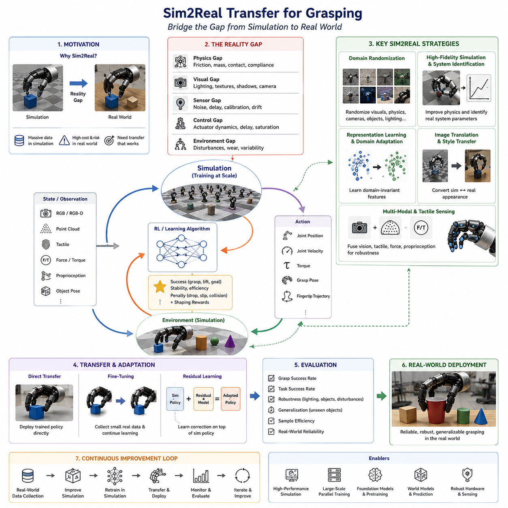{width="7.268055555555556in" height="7.268055555555556in"}

Sim2Real Transfer for Grasping is one of the most critical technologies in modern robotic manipulation because it bridges the gap between simulation-based learning and real-world deployment. Over the last decade, machine learning and reinforcement learning have enabled robots to acquire increasingly sophisticated grasping skills. However, the majority of these learning methods require enormous amounts of interaction data, often ranging from millions to billions of grasp attempts. Collecting such data on physical robots is expensive, time-consuming, and potentially damaging to hardware. As a result, robotic researchers have increasingly relied on simulation environments to train grasping systems. Simulators can generate virtually unlimited data, allow accelerated training, and eliminate risks associated with hardware wear and safety concerns. Nevertheless, a major challenge remains: policies that perform well in simulation frequently fail when deployed on real robots. Sim2Real Transfer addresses this challenge by developing methods that enable knowledge learned in simulation to generalize successfully to real-world robotic grasping tasks.

The core problem underlying Sim2Real Transfer is known as the Reality Gap. The reality gap refers to the inevitable differences between simulated environments and physical reality. Even the most advanced physics engines cannot perfectly reproduce every aspect of the real world. Small discrepancies in friction coefficients, material properties, contact dynamics, sensor noise, actuator delays, camera calibration, lighting conditions, object deformation, and environmental disturbances can significantly affect robotic performance. Grasping is particularly sensitive to these discrepancies because successful manipulation depends on precise contact interactions between the robot hand and the object. A policy trained in simulation may learn strategies that exploit imperfections of the simulator rather than the true physical principles governing the real world.

The reality gap can be categorized into several distinct components. Physical gaps arise from inaccuracies in modeling object masses, inertia tensors, friction coefficients, compliance, elasticity, and collision dynamics. Visual gaps result from differences between rendered images and real camera observations, including lighting variations, reflections, shadows, textures, and lens distortions. Sensor gaps emerge from noise characteristics, calibration errors, temporal delays, and measurement uncertainties. Control gaps occur because simulated actuators often respond instantaneously, whereas real motors exhibit delays, backlash, compliance, thermal effects, and saturation limits. Environmental gaps include unpredictable disturbances, object wear, surface contamination, and variations in operating conditions that are difficult to model accurately.

One of the earliest approaches to Sim2Real Transfer involved improving simulation fidelity. Researchers attempted to build increasingly accurate digital replicas of robotic systems and environments. High-fidelity simulators model detailed rigid-body dynamics, contact mechanics, friction behavior, actuator characteristics, and sensor responses. Modern simulation platforms such as Isaac Sim, MuJoCo, Gazebo, PyBullet, and other advanced robotics simulators provide sophisticated physics engines capable of modeling complex grasping interactions. High-fidelity simulation reduces discrepancies between simulation and reality and improves transfer performance. However, perfect simulation remains unattainable due to computational limitations and incomplete knowledge of physical systems.

An alternative and highly influential strategy is Domain Randomization. Instead of attempting to create a perfect simulator, domain randomization intentionally introduces variability into the simulation environment. During training, parameters such as object mass, friction coefficients, lighting conditions, textures, sensor noise levels, camera positions, object shapes, and environmental configurations are randomly varied over wide ranges. The learning algorithm is therefore exposed to a diverse set of scenarios rather than a single deterministic simulation. The resulting policy learns to operate robustly across many possible conditions and becomes less sensitive to discrepancies encountered during deployment.

The fundamental principle of domain randomization is that reality becomes just another variation within a sufficiently broad distribution of simulated environments. If a policy can successfully perform grasping tasks under thousands of randomized conditions, it is more likely to generalize when faced with real-world uncertainty. This approach has proven particularly effective for vision-based grasping systems where visual appearance differences often dominate transfer failures.

Visual domain randomization is widely used in robotic grasping applications. During simulation training, textures, colors, lighting intensity, shadow placement, camera parameters, and background environments are continuously varied. Objects may appear with different surface finishes, reflectance properties, and visual clutter. These variations force the perception system to focus on invariant object features rather than superficial visual details. As a result, the learned representations become more robust when applied to real camera images.

Physics randomization extends the same concept to physical parameters. Friction coefficients, object mass distributions, contact stiffness values, damping factors, actuator delays, and force sensor characteristics are randomized throughout training. Since grasp stability depends strongly on contact mechanics, exposing the policy to a broad range of physical conditions improves its ability to handle uncertainties encountered in real-world manipulation tasks.

System identification represents another important Sim2Real strategy. Rather than randomizing all parameters, system identification attempts to estimate the true properties of the physical system and incorporate them into the simulator. Experimental measurements are used to determine actuator dynamics, friction characteristics, sensor noise models, compliance properties, and environmental parameters. The simulator is then calibrated to match these measured properties as closely as possible. Although system identification cannot eliminate all discrepancies, it significantly reduces the magnitude of the reality gap and improves transfer performance.

Data-driven simulation calibration has become increasingly important in recent years. Machine learning techniques can automatically adjust simulation parameters to minimize differences between simulated and real-world observations. By comparing sensor outputs, robot trajectories, contact forces, and manipulation outcomes, optimization algorithms iteratively refine the simulator. This process produces more realistic virtual environments that support more effective policy training.

Another major direction in Sim2Real research is representation learning. Instead of learning policies directly from raw sensory observations, robots learn compact latent representations that capture essential task-relevant information. These representations often exhibit greater robustness to domain shifts because they abstract away irrelevant environmental details. Self-supervised learning methods, contrastive learning techniques, and multimodal representation learning frameworks have demonstrated significant improvements in transfer performance.

Feature-level adaptation seeks to align representations extracted from simulated and real data. Domain adaptation algorithms train neural networks to produce similar feature distributions for both domains. Adversarial learning methods are frequently employed, where a discriminator attempts to distinguish simulated features from real features while the representation network learns to make them indistinguishable. This process encourages the development of domain-invariant representations that generalize across simulation and reality.

Image translation techniques provide another solution for visual transfer. Generative models such as Generative Adversarial Networks and diffusion models can transform simulated images into realistic images or convert real images into simulation-style images. By reducing visual discrepancies between domains, these methods enable grasping policies trained on synthetic data to operate more effectively in physical environments. Recent advances in neural rendering and photorealistic simulation have further enhanced the effectiveness of image-based transfer approaches.

Reinforcement learning has played a major role in advancing Sim2Real Transfer for grasping. Large-scale reinforcement learning policies can be trained entirely in simulation using massive parallelization. Thousands of simulated environments execute grasping tasks simultaneously, generating enormous amounts of experience data. Domain randomization, curriculum learning, and adaptive environment generation are then combined to improve robustness. Once training is complete, the learned policy is deployed on physical hardware with minimal or no additional training.

Fine-tuning remains one of the most practical methods for achieving successful transfer. After a policy is trained in simulation, a smaller amount of real-world data is collected to adapt the model to physical conditions. Fine-tuning allows the policy to correct residual errors resulting from the reality gap while preserving the knowledge acquired during simulation training. Because only limited real-world interaction is required, this approach dramatically reduces development costs compared to training entirely on physical robots.

Residual learning provides another effective adaptation mechanism. A policy trained in simulation serves as the baseline controller, while an additional learning component learns corrective actions based on real-world experience. The residual controller compensates for discrepancies that were not captured during simulation training. This hierarchical approach improves stability and often accelerates adaptation compared to learning entirely new policies.

Sim2Real Transfer becomes particularly challenging in dexterous grasping applications involving multi-finger robotic hands. Contact-rich interactions generate highly nonlinear dynamics that are difficult to model accurately. Small differences in fingertip friction, contact geometry, tactile sensing accuracy, or object compliance can significantly alter manipulation outcomes. Researchers therefore increasingly incorporate tactile sensing into transfer pipelines. Tactile feedback provides direct information about contact conditions and can compensate for inaccuracies in visual perception or physical modeling.

Multi-modal learning has emerged as a powerful strategy for improving transfer robustness. By combining vision, tactile sensing, force measurements, proprioception, and environmental context, robotic systems develop richer representations of grasping states. When one sensing modality becomes unreliable due to domain shifts, other modalities can provide compensatory information. This redundancy enhances transfer performance and improves overall system reliability.

Foundation models are beginning to influence Sim2Real Transfer in important ways. Large-scale vision-language-action models are trained on diverse datasets collected across many robots, environments, and tasks. These models learn general-purpose representations that exhibit stronger robustness to environmental variation. Rather than transferring a narrowly specialized grasping policy, researchers can transfer broadly applicable manipulation knowledge that adapts more effectively to new scenarios.

World models offer another promising direction. Instead of learning direct control policies, world models learn predictive representations of environmental dynamics. The robot can then use these internal models to reason about future states, evaluate potential actions, and adapt to changing conditions. Because world models explicitly represent uncertainty, they may provide more robust transfer capabilities than purely reactive policies.

Benchmarking Sim2Real Transfer remains an active research area. Performance is typically evaluated using grasp success rate, task completion rate, robustness to environmental variation, adaptation speed, sample efficiency, and generalization to unseen objects. Researchers often compare performance before and after transfer to quantify the magnitude of the reality gap. Standardized benchmark environments help facilitate reproducible evaluation and fair comparison of competing transfer methods.

Industrial applications of Sim2Real Transfer are rapidly expanding. Warehouse automation systems use simulation-trained grasping policies to handle diverse consumer products. Manufacturing robots employ transferred policies for assembly, material handling, and quality inspection tasks. Agricultural robots utilize Sim2Real techniques to harvest crops under highly variable environmental conditions. Medical robotics increasingly benefits from simulation-based training for delicate manipulation tasks involving surgical tools and biological tissues. Service robots operating in homes and public spaces rely on transfer methods to handle the enormous variability encountered in real-world environments.

Autonomous robot fleets may represent the future evolution of Sim2Real systems. Large numbers of deployed robots continuously collect operational data during normal use. This data can be aggregated to improve simulation models, refine transfer strategies, and retrain grasping policies. The resulting feedback loop creates a cycle of continuous improvement in which simulation and reality become increasingly aligned over time.

The long-term vision of Sim2Real Transfer extends beyond simply transferring policies from simulation to reality. Future systems may support continuous bidirectional adaptation, where real-world experiences improve simulations and simulations generate increasingly effective training experiences. Digital twins will maintain synchronized representations of physical systems, enabling real-time policy optimization and predictive analysis. Foundation models, world models, multimodal learning, and large-scale robotic data collection will further reduce the reality gap and enable robust deployment of grasping systems across diverse environments.

Ultimately, Sim2Real Transfer serves as a foundational technology for scalable robotic learning. Without effective transfer methods, the immense computational advantages of simulation cannot be fully exploited. By enabling knowledge acquired in virtual environments to operate successfully in the physical world, Sim2Real Transfer transforms simulation into a practical engine for robotic intelligence. Within the broader context of learning-based grasping, it acts as the critical bridge connecting data-efficient training, large-scale reinforcement learning, behavior cloning, foundation models, and real-world robotic deployment. As robotic systems become increasingly autonomous and capable, Sim2Real Transfer will remain a central pillar supporting the development of reliable, adaptive, and commercially viable grasping technologies.

파지를 위한 Sim2Real 전이(Simulation-to-Reality Transfer)는 현대 로봇 조작 분야에서 가장 중요한 기술 중 하나이다. 이는 시뮬레이션 환경에서 학습된 파지 기술을 실제 로봇 환경으로 성공적으로 이전하는 기술을 의미한다. 최근 10여 년 동안 머신러닝과 강화학습의 발전으로 로봇은 매우 복잡한 파지 기술을 학습할 수 있게 되었지만, 이러한 학습에는 수백만에서 수십억 번에 이르는 상호작용 데이터가 필요하다. 실제 로봇으로 이러한 데이터를 수집하는 것은 비용이 많이 들고 시간이 오래 걸리며 하드웨어 손상의 위험도 존재한다. 따라서 대부분의 연구자들은 시뮬레이션 환경에서 대규모 학습을 수행한 후 이를 실제 환경으로 이전하는 방식을 사용한다. 그러나 시뮬레이션에서 높은 성능을 보인 정책이 실제 환경에서는 실패하는 경우가 많으며, Sim2Real 기술은 바로 이러한 문제를 해결하기 위해 개발되었다.

Sim2Real의 핵심 문제는 현실 간극(Reality Gap)이다. 현실 간극은 시뮬레이션과 실제 환경 사이에 존재하는 차이를 의미한다. 아무리 정교한 물리 엔진이라 하더라도 현실 세계를 완벽하게 재현하는 것은 불가능하다. 마찰 계수(Friction Coefficient), 재질 특성(Material Property), 접촉 역학(Contact Dynamics), 센서 노이즈(Sensor Noise), 액추에이터 지연(Actuator Delay), 카메라 보정(Camera Calibration), 조명 조건(Lighting Condition), 물체 변형(Object Deformation) 등 수많은 요소들이 실제 환경과 다르게 모델링될 수 있다. 특히 파지 작업은 물체와 손가락 사이의 접촉 상태에 매우 민감하기 때문에 작은 오차도 큰 성능 저하를 유발할 수 있다.

현실 간극은 여러 종류로 구분할 수 있다. 물리적 간극(Physical Gap)은 질량, 관성, 마찰, 탄성, 충돌 특성 등의 차이에서 발생한다. 시각적 간극(Visual Gap)은 조명, 그림자, 반사, 질감(Texture), 카메라 왜곡 등의 차이에서 발생한다. 센서 간극(Sensor Gap)은 노이즈, 측정 오차, 시간 지연 등으로 인해 발생한다. 제어 간극(Control Gap)은 시뮬레이션에서는 즉시 반응하는 액추에이터가 실제 환경에서는 지연, 백래시(Backlash), 열 특성, 포화 현상(Saturation) 등을 가지기 때문에 발생한다. 환경 간극(Environmental Gap)은 먼지, 마모, 진동, 온도 변화, 예측 불가능한 외란 등 현실 환경의 불확실성에서 발생한다.

초기의 Sim2Real 연구는 시뮬레이션의 정밀도를 높이는 방향으로 진행되었다. 연구자들은 실제 시스템을 가능한 한 정확하게 모사한 디지털 트윈(Digital Twin)을 구축하려고 노력하였다. 최신 시뮬레이터는 강체 동역학(Rigid Body Dynamics), 접촉 모델(Contact Model), 마찰 모델(Friction Model), 액추에이터 모델(Actuator Model), 센서 모델(Sensor Model)을 매우 정교하게 구현한다. Isaac Sim, MuJoCo, Gazebo, PyBullet과 같은 플랫폼은 복잡한 파지 동작을 높은 수준으로 시뮬레이션할 수 있다. 그러나 완벽한 시뮬레이션은 계산 비용과 모델링 한계로 인해 현실적으로 불가능하다.

이러한 문제를 해결하기 위해 등장한 가장 영향력 있는 방법 중 하나가 도메인 랜덤화(Domain Randomization)이다. 도메인 랜덤화는 완벽한 시뮬레이터를 만드는 대신 시뮬레이션 환경 자체를 다양하게 변화시키는 접근법이다. 학습 과정에서 물체 질량, 마찰 계수, 조명, 텍스처, 카메라 위치, 센서 노이즈, 물체 형상 등을 무작위로 변화시킨다. 따라서 로봇은 특정 환경이 아니라 다양한 환경에서 동작할 수 있는 정책을 학습하게 된다.

도메인 랜덤화의 핵심 아이디어는 현실 세계를 수많은 랜덤 환경 중 하나로 포함시키는 것이다. 충분히 다양한 조건에서 학습된 정책은 실제 환경이 나타나더라도 이를 새로운 환경 중 하나로 인식하고 안정적으로 동작할 수 있다. 특히 비전 기반 파지 시스템에서는 이러한 접근이 매우 효과적인 것으로 입증되었다.

시각적 도메인 랜덤화(Visual Domain Randomization)는 물체 색상, 질감, 조명, 그림자, 배경, 카메라 특성 등을 지속적으로 변화시킨다. 결과적으로 신경망은 특정 색상이나 질감이 아니라 물체의 본질적인 특징을 학습하게 된다. 이러한 특성은 실제 카메라 환경에서도 강인한 성능을 제공한다.

물리적 도메인 랜덤화(Physics Randomization)는 질량, 마찰 계수, 접촉 강성(Contact Stiffness), 감쇠 계수(Damping Factor), 모터 응답 속도 등을 무작위로 변경한다. 파지 안정성은 접촉 물리에 크게 의존하기 때문에 이러한 학습은 실제 환경에서의 강인성을 크게 향상시킨다.

시스템 식별(System Identification)은 또 다른 중요한 접근 방식이다. 이는 실제 시스템의 특성을 측정하여 시뮬레이터에 반영하는 과정이다. 연구자는 모터 응답 특성, 마찰 특성, 센서 노이즈, 탄성 특성 등을 실험적으로 측정하고 이를 시뮬레이션 모델에 적용한다. 이를 통해 현실 간극을 줄이고 보다 정확한 시뮬레이션 환경을 구축할 수 있다.

최근에는 데이터 기반 시뮬레이션 보정(Data-Driven Simulation Calibration) 기술도 활발히 연구되고 있다. 머신러닝 알고리즘을 이용하여 시뮬레이션 결과와 실제 결과의 차이를 최소화하도록 시뮬레이터 파라미터를 자동 조정하는 방식이다. 센서 출력, 로봇 궤적, 접촉력, 작업 결과 등을 비교하면서 시뮬레이션 모델을 점진적으로 개선한다.

표현 학습(Representation Learning)은 Sim2Real 분야에서 중요한 역할을 수행한다. 원시 센서 데이터를 직접 사용하는 대신 작업 수행에 필요한 핵심 정보만을 추출하는 잠재 표현(Latent Representation)을 학습한다. 이러한 표현은 환경 변화에 덜 민감하며 시뮬레이션과 현실 사이의 차이를 효과적으로 흡수할 수 있다.

특징 수준 적응(Feature-Level Adaptation)은 시뮬레이션 데이터와 실제 데이터가 유사한 특징 공간을 가지도록 만드는 방법이다. 적대적 학습(Adversarial Learning)을 사용하여 두 환경의 특징 분포를 일치시키며, 결과적으로 도메인 독립적인 표현을 학습할 수 있다.

영상 변환(Image Translation) 기술 역시 중요한 역할을 한다. 생성적 적대 신경망(Generative Adversarial Network, GAN)이나 확산 모델(Diffusion Model)을 이용하여 시뮬레이션 영상을 실제 영상처럼 변환하거나 반대로 실제 영상을 시뮬레이션 스타일로 변환할 수 있다. 이러한 기술은 시각적 현실 간극을 줄이는 데 효과적이다.

강화학습은 Sim2Real 기술 발전의 핵심 동력 중 하나이다. 수천 개의 시뮬레이션 환경에서 병렬로 학습을 수행하여 방대한 경험 데이터를 생성할 수 있다. 이후 도메인 랜덤화, 커리큘럼 학습(Curriculum Learning), 적응형 환경 생성(Adaptive Environment Generation)을 결합하여 강인한 정책을 학습한다. 학습이 완료된 정책은 최소한의 수정만으로 실제 하드웨어에 적용될 수 있다.

미세 조정(Fine-Tuning)은 현재 가장 실용적인 Sim2Real 방법 중 하나이다. 시뮬레이션에서 충분히 학습한 후 실제 환경에서 소량의 데이터를 추가로 수집하여 모델을 조정한다. 이를 통해 현실 간극으로 인해 발생하는 오차를 보완할 수 있으며, 전체 학습 비용을 크게 줄일 수 있다.

잔차 학습(Residual Learning)은 시뮬레이션 정책을 기본 제어기로 사용하고, 실제 환경에서 추가 학습된 보정 정책을 더하는 방식이다. 보정 정책은 시뮬레이션에서 모델링되지 못한 오차를 보완한다. 이러한 방식은 안정성과 적응 속도 측면에서 우수한 성능을 보인다.

다지형 로봇 손을 이용한 정교 파지(Dexterous Grasping)는 Sim2Real 적용이 가장 어려운 분야 중 하나이다. 손가락과 물체 사이의 접촉이 매우 복잡하고 비선형적이기 때문이다. 손끝 마찰, 접촉 형상, 촉각 센서 오차, 물체 변형 등 작은 차이도 조작 결과에 큰 영향을 미친다. 따라서 최근에는 촉각 센서를 적극적으로 활용하여 이러한 문제를 해결하고 있다.

멀티모달 학습(Multimodal Learning)은 Sim2Real 강인성을 향상시키는 중요한 방법이다. 시각 정보뿐만 아니라 촉각, 힘·토크, 고유감각(Proprioception), 환경 정보 등을 함께 활용한다. 특정 센서 정보가 부정확해지더라도 다른 센서가 이를 보완할 수 있기 때문에 더욱 안정적인 성능을 제공한다.

최근 등장한 파운데이션 모델(Foundation Model)은 Sim2Real 분야에도 큰 영향을 주고 있다. 다양한 로봇과 작업에서 학습된 범용 표현을 활용함으로써 새로운 환경에 대한 적응 능력을 향상시킨다. 이는 특정 파지 기술을 이전하는 것이 아니라 조작 전반에 대한 일반적인 지식을 이전하는 접근 방식이라고 볼 수 있다.

세계 모델(World Model)은 미래 Sim2Real 연구의 중요한 방향으로 주목받고 있다. 세계 모델은 환경의 동작 원리를 내부적으로 학습하여 미래 상태를 예측한다. 이를 통해 로봇은 단순 반응형 제어가 아니라 예측 기반 계획(Predictive Planning)을 수행할 수 있으며, 현실 간극에도 더욱 강인하게 대응할 수 있다.

Sim2Real 시스템은 일반적으로 파지 성공률(Grasp Success Rate), 작업 성공률(Task Success Rate), 일반화 능력(Generalization), 적응 속도(Adaptation Speed), 샘플 효율성(Sample Efficiency), 외란 대응 능력(Robustness) 등을 기준으로 평가된다. 특히 미지의 물체(Unseen Object)와 새로운 환경에서 얼마나 안정적으로 동작하는지가 중요한 평가 기준이 된다.

산업 현장에서 Sim2Real 기술의 활용은 빠르게 증가하고 있다. 물류 창고에서는 다양한 상품을 집고 분류하는 데 활용되며, 제조업에서는 조립 및 검사 작업에 사용된다. 농업에서는 작물 수확과 분류 작업에 적용되고 있으며, 의료 로봇은 수술 도구 및 생체 조직 조작에 활용되고 있다. 서비스 로봇은 가정과 공공 환경에서 다양한 생활용품을 다루기 위해 Sim2Real 기술을 사용한다.

미래에는 대규모 로봇 플릿(Fleet)이 Sim2Real 발전을 가속화할 것으로 예상된다. 수많은 로봇이 실제 환경에서 데이터를 수집하고, 이 데이터를 통해 시뮬레이션 모델을 지속적으로 개선하며, 새로운 정책을 학습하게 될 것이다. 결과적으로 시뮬레이션과 현실은 점점 더 가까워질 것이다.

장기적으로 Sim2Real의 목표는 단순히 시뮬레이션에서 현실로 정책을 이전하는 것이 아니다. 현실 경험이 시뮬레이션을 개선하고, 개선된 시뮬레이션이 다시 더 우수한 정책을 생성하는 양방향 학습 구조를 구축하는 것이다. 디지털 트윈, 파운데이션 모델, 세계 모델, 멀티모달 학습, 대규모 로봇 데이터셋이 결합되면서 현실 간극은 점점 더 작아질 것으로 예상된다.

궁극적으로 Sim2Real 전이는 확장 가능한 로봇 학습(Scalable Robot Learning)을 가능하게 하는 핵심 기술이다. 이 기술이 없다면 시뮬레이션의 막대한 계산 자원을 현실 세계에 활용할 수 없다. Sim2Real은 행동 복제(Behavior Cloning), 강화학습(Reinforcement Learning), 파운데이션 모델(Foundation Model), 세계 모델(World Model), 그리고 실제 로봇 배치를 연결하는 핵심 다리 역할을 수행한다. 미래의 지능형 로봇 시스템이 안정적이고 적응적이며 상용화 가능한 수준의 파지 능력을 갖추기 위해서는 Sim2Real 기술이 필수적인 기반 기술로 자리 잡게 될 것이다.

##  

## 11.10 Self-Supervised Learning

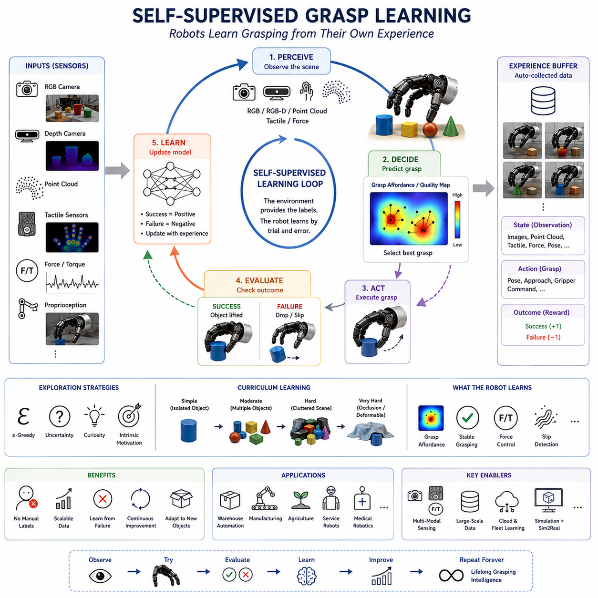{width="7.268055555555556in" height="7.268055555555556in"}

Self-Supervised Grasp Learning represents one of the most transformative developments in modern robotic manipulation because it enables robots to learn grasping skills without requiring manually labeled datasets or extensive human supervision. Traditional machine learning approaches for robotic grasping often depend on large quantities of annotated training data. Human operators must label successful and unsuccessful grasps, identify object poses, define grasp configurations, or provide demonstrations. While these approaches have produced significant advances, the cost of collecting and labeling large-scale robotic datasets remains a major obstacle to scalability. Self-supervised learning addresses this challenge by allowing robots to generate their own supervision signals through interaction with the environment. Instead of relying on humans to define the correct answer, the robot learns directly from the outcomes of its own actions.

The fundamental idea behind self-supervised grasp learning is deceptively simple. A robot attempts a grasp, observes whether the grasp succeeds or fails, and uses this outcome as a training signal. Successful grasps provide positive examples, while failed grasps provide negative examples. Over time, the robot accumulates a large dataset of experiences and gradually improves its grasp prediction capabilities. This process transforms the robot into an autonomous data collection system capable of generating virtually unlimited training data. As a result, self-supervised learning has become one of the most promising pathways toward scalable robotic intelligence.

The concept is inspired by how humans learn many physical skills. Infants do not receive detailed labels for every interaction they perform. Instead, they learn through exploration, experimentation, and feedback from the environment. A child attempting to grasp an object quickly discovers which actions lead to success and which lead to failure. Similarly, a robot equipped with self-supervised learning capabilities can acquire manipulation skills through repeated interaction with objects. The environment itself becomes the teacher.

One of the earliest successful examples of self-supervised grasp learning involved robotic systems repeatedly attempting grasps in cluttered environments. Cameras observed the workspace before and after each grasp attempt. If an object was successfully lifted and removed from the workspace, the action was labeled as a successful grasp. If the object remained in place or slipped from the gripper, the action was labeled as a failure. These labels were generated automatically without human intervention. Thousands or millions of such interactions allowed the robot to learn visual representations associated with successful grasp opportunities.

The core advantage of self-supervised learning lies in data scalability. Human annotation is expensive and time-consuming. Even a moderately sized robotic grasp dataset may require thousands of hours of manual labeling effort. In contrast, self-supervised systems continuously generate new training examples during operation. Industrial robot fleets can accumulate millions of grasp attempts over weeks or months of deployment. Every interaction contributes additional knowledge that can be used to improve future performance.

A typical self-supervised grasp learning system consists of several interconnected components. The perception system acquires sensory observations using cameras, depth sensors, tactile sensors, force sensors, or other modalities. The decision-making module predicts grasp actions based on current observations. The robot executes the selected action and monitors the outcome. Finally, the learning module updates the grasp prediction model using the newly acquired experience. This closed-loop learning cycle allows performance to improve continuously over time.

Visual perception plays a particularly important role in self-supervised grasp learning. RGB cameras, RGB-D sensors, stereo vision systems, and point cloud sensors provide information about object geometry and appearance. Neural networks process these observations to identify graspable regions and estimate grasp quality. Initially, predictions may be nearly random. However, as the robot accumulates experience, the learning algorithm discovers increasingly reliable visual features associated with successful grasps.

One influential approach involves learning grasp affordances. A grasp affordance represents the likelihood that a particular grasp action will succeed at a specific location. The neural network predicts a grasp quality score for each candidate grasp configuration. During training, successful outcomes increase the predicted score, while failures decrease it. Over time, the network learns a dense graspability map that identifies promising grasp locations directly from sensory observations.

Convolutional Neural Networks have historically been the dominant architecture for self-supervised grasp learning. CNNs excel at extracting spatial features from images and can efficiently process large datasets of grasping experiences. More recently, transformer-based architectures have emerged as powerful alternatives. Transformers capture long-range dependencies within visual observations and often exhibit stronger generalization capabilities across diverse object categories.

Depth sensing has significantly improved self-supervised grasp learning performance. RGB images alone provide limited geometric information. RGB-D cameras and point cloud sensors directly measure three-dimensional structure, enabling more accurate estimation of object shape, orientation, and accessibility. Three-dimensional representations are particularly valuable for cluttered environments where object occlusions frequently occur.

Point cloud-based grasp learning has become increasingly important in modern robotic systems. Instead of operating on two-dimensional images, neural networks process three-dimensional point clouds representing object surfaces. Point-based architectures learn geometric features directly from spatial measurements. This approach often improves robustness to lighting changes, texture variations, and visual distractions.

Tactile sensing introduces another valuable source of self-supervision. During grasp execution, tactile sensors measure contact forces, pressure distributions, slip events, and object interactions. These measurements provide detailed information about grasp stability that may not be observable through vision alone. Self-supervised learning systems can use tactile feedback to generate additional training signals and refine grasp predictions. For example, incipient slip detection may indicate that a grasp is unstable even if the object has not yet been dropped.

Force and torque sensing further enrich self-supervised learning. Force sensors measure interaction forces between the robot and the environment. Excessive forces may indicate poor grasp quality or potential object damage. Stable force profiles often correlate with successful grasp execution. Incorporating force information allows robots to learn not only how to grasp objects but also how to regulate grasp forces appropriately.

One of the most important contributions of self-supervised grasp learning is the ability to learn from failure. In traditional supervised learning, failures are often underrepresented because datasets focus primarily on successful examples. In contrast, self-supervised systems naturally collect large numbers of failure cases. Failed grasps provide valuable information about what should not be done. By analyzing failure patterns, the learning algorithm develops a more complete understanding of grasping dynamics and improves future decision-making.

Exploration strategies play a crucial role in self-supervised learning. A robot must balance exploitation of known successful strategies with exploration of new possibilities. Excessive exploitation limits learning opportunities, while excessive exploration may reduce operational efficiency. Various exploration techniques have been proposed, including epsilon-greedy strategies, uncertainty-based exploration, curiosity-driven learning, and intrinsic motivation mechanisms. These approaches encourage the robot to gather informative experiences while maintaining acceptable task performance.

Curriculum learning has also been successfully integrated into self-supervised grasp learning systems. Rather than presenting all tasks simultaneously, the robot gradually encounters increasingly difficult grasping scenarios. Training may begin with isolated objects placed in structured environments. As performance improves, clutter, occlusions, deformable objects, transparent objects, and complex manipulation tasks are introduced. This progressive learning strategy often accelerates convergence and improves final performance.

Large-scale data collection has become a defining characteristic of self-supervised robotic learning. Research laboratories and industrial organizations have deployed fleets of robots that continuously collect grasping experiences. Some systems have accumulated millions of grasp attempts across diverse object categories and environmental conditions. These massive datasets support the training of increasingly capable grasp prediction models and provide valuable resources for broader robotics research.

Cloud robotics has further amplified the impact of self-supervised learning. Multiple robots operating in different locations can share their experiences through centralized learning infrastructures. Data collected by one robot contributes to the improvement of models deployed across the entire fleet. This collective learning paradigm dramatically accelerates knowledge acquisition and enables rapid adaptation to new tasks and environments.

Simulation environments also play an important role in self-supervised grasp learning. Virtual robots can generate large quantities of synthetic interaction data at minimal cost. Self-supervised objectives can be applied within simulation just as effectively as in physical environments. Combined with Sim2Real transfer techniques, simulation-based self-supervised learning provides a scalable framework for acquiring manipulation knowledge before deployment on real hardware.

Self-supervised representation learning has emerged as a particularly influential research direction. Rather than directly learning grasp policies, the robot first learns general-purpose visual and tactile representations through self-supervised objectives. Examples include contrastive learning, predictive learning, masked modeling, temporal consistency learning, and multimodal alignment. These learned representations capture fundamental properties of objects and interactions, providing strong foundations for downstream grasping tasks.

Contrastive learning has demonstrated remarkable effectiveness in robotic perception. The learning objective encourages representations of similar observations to become closer while separating dissimilar observations. Through repeated interactions, the robot develops robust representations that generalize across object categories, viewpoints, and environmental conditions. These representations often improve grasp prediction accuracy and sample efficiency.

Predictive learning approaches train robots to anticipate future observations resulting from their actions. The robot learns models of environmental dynamics and object behavior. By predicting the consequences of potential grasp actions, the system develops deeper understanding of physical interactions. Such predictive capabilities are increasingly viewed as essential components of embodied intelligence.

Multi-task learning naturally complements self-supervised grasp learning. A single robot interaction may generate supervision signals for multiple objectives simultaneously. Visual representation learning, object segmentation, pose estimation, grasp prediction, slip detection, and force prediction can all be learned from the same experience dataset. Sharing representations across tasks improves data efficiency and promotes the emergence of more general manipulation capabilities.

Foundation models are beginning to reshape the landscape of self-supervised robotic learning. Large-scale vision-language-action models leverage enormous quantities of robot interaction data collected across many tasks, environments, and platforms. Self-supervised objectives provide much of the training signal required to learn these general-purpose representations. As datasets continue to expand, foundation models may eventually serve as universal manipulation priors that can be adapted to specific grasping applications with minimal additional training.

Evaluation of self-supervised grasp learning systems typically focuses on grasp success rate, sample efficiency, data efficiency, generalization to unseen objects, robustness to environmental variation, and adaptation speed. Researchers also measure how effectively learned representations transfer to new tasks and whether performance continues improving during long-term deployment.

Industrial applications of self-supervised grasp learning are rapidly increasing. Warehouse automation systems use self-supervised learning to handle constantly changing product inventories. Manufacturing robots learn to grasp new components without requiring manual reprogramming. Agricultural robots adapt to natural variations in crops and environmental conditions. Service robots operating in homes encounter diverse household objects and benefit significantly from continuous autonomous learning. Medical robotics may eventually leverage self-supervised interaction data to improve manipulation precision and reliability.

Despite its many advantages, self-supervised grasp learning also presents significant challenges. Data collection may be time-consuming, particularly for complex dexterous manipulation tasks. Exploration must be carefully managed to avoid unsafe actions. Distribution shifts may occur when environments change dramatically. Computational requirements continue to grow as datasets expand. Furthermore, defining reliable automatic success metrics remains difficult for many advanced manipulation tasks.

Future research is expected to combine self-supervised learning with reinforcement learning, imitation learning, world models, foundation models, and multimodal perception systems. Robots will increasingly learn not only from grasp outcomes but also from language instructions, tactile experiences, predictive simulations, and interactions with other robots. Lifelong learning systems may continuously improve throughout deployment, accumulating knowledge over months or years of operation.

Ultimately, self-supervised grasp learning represents a fundamental shift in how robotic intelligence is acquired. Rather than relying on manually curated datasets or handcrafted rules, robots become active participants in their own education. Every grasp attempt contributes new knowledge, every failure becomes a learning opportunity, and every interaction expands the robot's understanding of the physical world. Within the broader context of learning-based grasping, self-supervised learning serves as a critical foundation for scalable, adaptive, and autonomous robotic manipulation systems capable of operating effectively in complex real-world environments.

자기지도 기반 파지 학습(Self-Supervised Grasp Learning)은 현대 로봇 조작 분야에서 가장 혁신적인 기술 중 하나로 평가받고 있다. 이 기술은 사람이 직접 라벨링한 데이터나 대규모의 인간 개입 없이도 로봇이 스스로 파지 능력을 학습할 수 있도록 한다. 기존의 머신러닝 기반 파지 시스템은 성공 및 실패 파지 여부, 물체 자세(Object Pose), 파지 위치(Grasp Pose), 조작 전략 등을 사람이 직접 라벨링해야 했다. 그러나 이러한 과정은 시간과 비용이 많이 소요되며 확장성이 제한적이다. 자기지도 학습은 로봇이 환경과 상호작용하면서 스스로 학습 데이터를 생성하도록 함으로써 이러한 문제를 해결한다. 다시 말해, 정답을 인간이 제공하는 것이 아니라 로봇이 자신의 행동 결과를 통해 정답을 스스로 만들어낸다.

자기지도 파지 학습의 핵심 개념은 매우 단순하다. 로봇이 물체를 집으려고 시도한 후 성공 여부를 확인하고, 그 결과를 학습 데이터로 사용하는 것이다. 물체를 성공적으로 들어 올리면 성공 사례로 기록되고, 물체를 놓치거나 들어 올리지 못하면 실패 사례로 기록된다. 이러한 성공과 실패 정보가 자동으로 생성되는 학습 신호(Supervision Signal)가 된다. 로봇은 수천 번, 수만 번, 나아가 수백만 번의 시도를 반복하면서 자신만의 데이터셋을 구축하고 점진적으로 파지 능력을 향상시킨다.

이러한 접근법은 인간 유아의 학습 방식과 유사하다. 어린아이는 물체를 잡는 방법을 누군가에게 상세히 설명받지 않는다. 대신 반복적인 시도와 실패를 통해 어떤 행동이 성공으로 이어지고 어떤 행동이 실패로 이어지는지를 학습한다. 자기지도 파지 학습 역시 동일한 원리를 따른다. 환경 자체가 교사(Teacher)의 역할을 수행하며, 로봇은 경험을 통해 지식을 축적한다.

초기의 자기지도 파지 연구에서는 로봇이 무작위로 물체를 집고, 집기 전후의 카메라 영상을 비교하여 성공 여부를 판단하였다. 만약 물체가 작업 공간에서 사라졌다면 성공적인 파지로 간주하였고, 물체가 그대로 남아 있거나 떨어졌다면 실패로 간주하였다. 이 과정에서 어떠한 인간의 개입도 필요하지 않았다. 수십만 번 이상의 시도가 축적되면서 신경망은 성공적인 파지와 실패한 파지의 특징을 스스로 학습하게 되었다.

자기지도 학습의 가장 큰 장점은 데이터 확장성(Data Scalability)에 있다. 사람이 직접 데이터를 생성하는 경우에는 시간과 비용의 한계가 존재하지만, 자기지도 시스템은 운영되는 동안 지속적으로 새로운 데이터를 생성할 수 있다. 산업용 로봇 플릿(Fleet)이 하루 24시간 운영된다면 수백만 건 이상의 파지 데이터를 자동으로 축적할 수 있으며, 이러한 데이터는 지속적인 성능 향상에 활용될 수 있다.

일반적인 자기지도 파지 학습 시스템은 감지(Perception), 의사결정(Decision Making), 실행(Execution), 평가(Evaluation), 학습(Learning)의 순환 구조를 가진다. 카메라, 깊이 센서, 촉각 센서, 힘 센서 등을 통해 환경을 관찰하고, 현재 상태에서 가장 적절한 파지 행동을 예측한다. 이후 실제 파지를 수행하고 결과를 평가한 뒤, 그 경험을 사용하여 모델을 업데이트한다. 이러한 폐루프 학습 구조(Closed-Loop Learning)는 시간이 지날수록 성능을 지속적으로 향상시킨다.

시각 인식(Visual Perception)은 자기지도 파지 학습의 핵심 요소 중 하나이다. RGB 카메라, RGB-D 카메라, 스테레오 비전(Stereo Vision), 포인트 클라우드 센서(Point Cloud Sensor)는 물체의 형상과 위치에 대한 정보를 제공한다. 초기에는 무작위에 가까운 파지 시도를 수행하지만, 경험이 축적될수록 신경망은 성공적인 파지와 관련된 시각적 특징을 점차 학습하게 된다.

대표적인 접근법 중 하나는 파지 어포던스(Grasp Affordance)를 학습하는 것이다. 어포던스는 특정 위치나 자세에서 파지가 성공할 가능성을 의미한다. 신경망은 입력 영상을 기반으로 각 위치의 파지 성공 확률을 예측한다. 성공적인 파지는 해당 위치의 점수를 높이고 실패한 파지는 점수를 낮춘다. 시간이 지나면서 시스템은 물체 위의 파지 가능 영역을 정확하게 식별할 수 있게 된다.

합성곱 신경망(CNN)은 오랫동안 자기지도 파지 학습의 핵심 모델로 사용되어 왔다. CNN은 이미지에서 공간적 특징을 효과적으로 추출할 수 있으며 대규모 데이터셋 학습에 적합하다. 최근에는 Transformer 구조가 등장하면서 더욱 강력한 일반화 성능을 보여주고 있다. Transformer는 장거리 관계(Long-Range Dependency)를 학습할 수 있어 복잡한 환경에서도 높은 성능을 발휘한다.

깊이 정보(Depth Information)는 자기지도 파지 성능을 크게 향상시킨다. RGB 영상만으로는 물체의 3차원 구조를 정확하게 파악하기 어렵다. RGB-D 카메라와 포인트 클라우드 센서는 물체의 형상, 방향, 접근 가능성을 직접 측정할 수 있다. 특히 복잡하게 쌓여 있는 물체(Cluttered Scene)에서는 3차원 정보가 매우 중요하다.

최근에는 포인트 클라우드 기반 자기지도 파지 학습이 활발하게 연구되고 있다. 2차원 이미지 대신 물체 표면을 나타내는 3차원 점 집합을 직접 입력으로 사용한다. 이러한 방식은 조명 변화나 텍스처 차이에 덜 민감하며 물체의 실제 형상을 더욱 정확하게 반영할 수 있다.

촉각 센서(Tactile Sensor)는 또 다른 중요한 자기지도 정보원이다. 파지 과정에서 접촉 위치, 압력 분포, 미끄러짐(Slip), 물체 변형 등을 측정할 수 있다. 시각 정보만으로는 알 수 없는 접촉 상태를 직접 관찰할 수 있기 때문에 더욱 정밀한 학습이 가능하다. 예를 들어 물체가 아직 떨어지지 않았더라도 미끄러짐이 감지되면 불안정한 파지로 판단하여 학습 데이터로 사용할 수 있다.

힘·토크 센서(Force-Torque Sensor) 역시 중요한 역할을 한다. 과도한 힘은 물체 손상을 유발할 수 있으며, 너무 작은 힘은 물체를 놓치게 만든다. 힘 센서를 활용하면 단순히 성공 여부뿐 아니라 파지 품질(Grasp Quality)까지 학습할 수 있다. 결과적으로 로봇은 물체를 집는 방법뿐 아니라 적절한 힘을 사용하는 방법도 학습하게 된다.

자기지도 학습의 중요한 특징 중 하나는 실패로부터 학습(Learning from Failure)할 수 있다는 점이다. 기존의 지도학습 데이터셋은 성공 사례 위주로 구성되는 경우가 많지만, 자기지도 시스템은 실패 사례를 대량으로 수집한다. 실패는 무엇을 하면 안 되는지를 알려주는 매우 중요한 정보이다. 수많은 실패 경험을 분석함으로써 로봇은 더욱 정교한 파지 전략을 개발할 수 있다.

탐험(Exploration)은 자기지도 학습의 핵심 요소이다. 로봇은 이미 알고 있는 성공 전략을 활용하는 동시에 새로운 전략을 시도해야 한다. 지나친 활용(Exploitation)은 새로운 지식을 얻지 못하게 만들고, 지나친 탐험은 작업 효율성을 떨어뜨린다. 이를 해결하기 위해 ε-Greedy 전략, 불확실성 기반 탐험(Uncertainty-Based Exploration), 호기심 기반 학습(Curiosity-Driven Learning), 내재적 동기(Intrinsic Motivation) 등이 활용된다.

커리큘럼 학습(Curriculum Learning)은 자기지도 파지 학습과 매우 잘 결합된다. 학습 초기에는 단순한 환경에서 시작하고 점차 난이도를 높인다. 처음에는 단일 물체를 집는 작업을 수행하고, 이후 복잡한 물체 더미, 투명 물체, 변형 물체, 손안 조작(In-Hand Manipulation) 등으로 확장한다. 이러한 단계적 학습은 수렴 속도를 높이고 최종 성능을 향상시킨다.

대규모 데이터 수집(Large-Scale Data Collection)은 자기지도 학습의 가장 큰 강점이다. 일부 연구에서는 수백만 번 이상의 파지 시도를 기록하여 학습에 활용하였다. 이러한 대규모 데이터셋은 파지 모델의 일반화 성능을 크게 향상시키며, 다양한 물체와 환경에 대한 적응 능력을 제공한다.

클라우드 로보틱스(Cloud Robotics)는 자기지도 학습의 효과를 더욱 증폭시킨다. 여러 대의 로봇이 서로 다른 장소에서 수집한 데이터를 중앙 서버에 통합하고, 이를 이용하여 공통 모델을 학습한다. 한 로봇이 학습한 지식이 전체 플릿에 공유되므로 학습 속도가 크게 향상된다.

시뮬레이션 역시 자기지도 학습에서 중요한 역할을 한다. 가상 환경에서는 무제한에 가까운 상호작용 데이터를 생성할 수 있다. 시뮬레이션에서 수집한 자기지도 데이터는 Sim2Real 전이(Sim2Real Transfer)를 통해 실제 환경에 적용될 수 있다.

최근에는 자기지도 표현 학습(Self-Supervised Representation Learning)이 매우 중요한 연구 분야로 떠오르고 있다. 직접 파지 정책을 학습하는 대신, 먼저 물체와 환경에 대한 일반적인 표현을 학습한다. 대조 학습(Contrastive Learning), 예측 학습(Predictive Learning), 마스킹 모델링(Masked Modeling), 시간적 일관성 학습(Temporal Consistency Learning) 등이 대표적인 방법이다.

대조 학습은 유사한 관측은 가깝게, 다른 관측은 멀게 표현하도록 학습한다. 이를 통해 물체 종류, 시점 변화, 환경 변화에 강인한 표현을 구축할 수 있다. 이러한 표현은 이후 파지 예측의 정확도와 데이터 효율성을 크게 향상시킨다.

예측 학습(Predictive Learning)은 로봇이 자신의 행동 결과를 예측하도록 만든다. 로봇은 특정 행동을 수행했을 때 미래에 어떤 상태가 발생할지를 학습하며, 이를 통해 환경의 물리적 특성을 이해하게 된다. 이러한 능력은 체화 지능(Embodied Intelligence)의 핵심 요소로 간주된다.

멀티태스크 학습(Multi-Task Learning)은 자기지도 파지 학습과 자연스럽게 결합된다. 하나의 파지 경험으로부터 물체 분할(Object Segmentation), 자세 추정(Pose Estimation), 미끄러짐 검출(Slip Detection), 힘 예측(Force Prediction), 파지 성공 예측(Grasp Success Prediction) 등을 동시에 학습할 수 있다. 이는 데이터 효율성을 높이고 더욱 범용적인 조작 능력을 형성하는 데 기여한다.

최근 등장한 파운데이션 모델(Foundation Model)은 자기지도 로봇 학습의 새로운 방향을 제시하고 있다. 대규모 시각-언어-행동(Vision-Language-Action, VLA) 모델은 수많은 로봇 상호작용 데이터를 자기지도 방식으로 학습한다. 이러한 모델은 특정 작업이 아닌 범용 조작 지식을 학습하며, 이후 적은 양의 추가 데이터만으로 새로운 파지 작업에 적응할 수 있다.

자기지도 파지 학습은 일반적으로 파지 성공률, 샘플 효율성(Sample Efficiency), 데이터 효율성(Data Efficiency), 미지 물체 일반화(Unseen Object Generalization), 환경 변화에 대한 강인성(Robustness), 적응 속도(Adaptation Speed) 등을 기준으로 평가된다. 또한 학습된 표현이 다른 작업으로 얼마나 잘 전이되는지도 중요한 평가 요소이다.

산업 현장에서 자기지도 파지 학습의 활용은 빠르게 증가하고 있다. 물류 창고에서는 지속적으로 변화하는 상품을 다루기 위해 활용되며, 제조업에서는 새로운 부품을 별도의 프로그래밍 없이 처리할 수 있게 한다. 농업 로봇은 작물의 자연적인 변화를 학습하며, 서비스 로봇은 가정 내 다양한 생활용품을 다루는 능력을 향상시킨다. 의료 로봇 역시 반복적인 상호작용 데이터를 활용하여 더욱 정밀한 조작 능력을 습득할 수 있다.

물론 자기지도 학습에도 한계는 존재한다. 대규모 데이터 수집에는 여전히 시간이 필요하며, 탐험 과정에서 안전 문제가 발생할 수 있다. 또한 환경이 급격히 변화할 경우 분포 변화(Distribution Shift)에 의해 성능이 저하될 수 있다. 복잡한 작업에서는 성공 여부를 자동으로 판단하는 것 자체가 어려운 경우도 존재한다.

미래의 자기지도 파지 학습은 강화학습(Reinforcement Learning), 행동 복제(Behavior Cloning), 세계 모델(World Model), 파운데이션 모델, 멀티모달 센서 융합과 결합될 것으로 예상된다. 로봇은 단순히 성공과 실패만이 아니라 언어 지시(Language Instruction), 촉각 경험, 예측 모델, 다른 로봇의 경험까지 활용하여 학습하게 될 것이다. 궁극적으로는 평생 학습(Lifelong Learning)을 통해 수개월 또는 수년 동안 지속적으로 성능을 향상시키는 자율 학습 시스템으로 발전할 것이다.

결론적으로 자기지도 파지 학습은 로봇이 지능을 획득하는 방식을 근본적으로 변화시키고 있다. 인간이 직접 데이터를 만들고 규칙을 설계하는 대신, 로봇 스스로 자신의 경험을 통해 학습한다. 모든 파지 시도는 새로운 지식이 되고, 모든 실패는 귀중한 학습 기회가 된다. 학습 기반 파지(Learning-Based Grasping) 분야에서 자기지도 학습은 확장 가능하고 적응적이며 자율적인 조작 지능을 구현하기 위한 핵심 기반 기술로 자리 잡고 있으며, 미래의 휴머노이드 로봇과 범용 로봇 손 개발을 이끄는 중요한 축이 될 것으로 전망된다.

##  

## 11.11 Multi-Task Grasp Learning

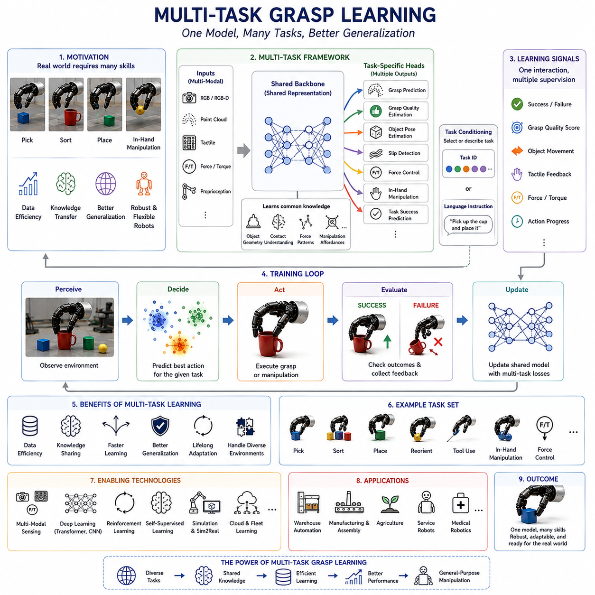{width="7.268055555555556in" height="7.268055555555556in"}

Multi-Task Grasp Learning is an advanced learning paradigm in robotic manipulation that enables a robot to learn multiple grasping and manipulation skills simultaneously within a unified learning framework. Traditional robotic learning systems often focus on a single task, such as picking up an object, grasping a particular category of items, or performing one predefined manipulation behavior. While such specialized systems can achieve impressive performance in narrow domains, they frequently struggle when deployed in real-world environments where robots must perform many different tasks using the same hardware and sensing infrastructure. Multi-task learning addresses this limitation by allowing a robot to acquire shared knowledge across multiple grasping tasks and leverage common patterns among them. As a result, robots become more adaptable, data-efficient, and capable of generalizing to previously unseen situations.

The motivation behind multi-task grasp learning originates from observations of human learning. Humans rarely learn each manipulation skill independently. Instead, knowledge acquired while performing one task often transfers to other tasks. Learning to grasp a cup improves the ability to grasp a bottle. Learning to manipulate a screwdriver contributes to understanding how to use other hand tools. The human nervous system develops shared representations of objects, contacts, forces, and motor control strategies that can be reused across diverse activities. Multi-task grasp learning attempts to replicate this principle within robotic systems.

At its core, multi-task learning seeks to optimize a single model for multiple objectives simultaneously. Rather than training separate neural networks for each grasping task, a shared network learns representations that support all tasks. Individual task-specific outputs may be attached to the shared representation, but most of the network parameters are common across tasks. This architecture allows information learned from one task to benefit the learning of others.

In robotic grasping, tasks may include object pickup, object sorting, object placement, in-hand manipulation, precision grasping, power grasping, deformable object handling, tool grasping, slip detection, force regulation, object reorientation, assembly operations, and many other manipulation behaviors. Although these tasks differ in their specific goals, they often rely on common underlying skills such as visual perception, contact understanding, object recognition, force control, and motion planning. Multi-task learning exploits these shared structures to improve overall performance.

One of the primary benefits of multi-task grasp learning is improved data efficiency. Collecting robotic interaction data is expensive and time-consuming. When separate models are trained for each task, large datasets must be collected independently for every application. Multi-task learning allows a single interaction to provide supervision for multiple objectives simultaneously. A grasp attempt may contribute information about object recognition, grasp quality estimation, contact prediction, force control, and task completion. This shared learning process extracts more value from each interaction and reduces overall data requirements.

Shared representation learning plays a central role in multi-task systems. The neural network learns latent representations that capture common features across tasks. These representations often encode object geometry, material properties, contact dynamics, manipulation affordances, environmental context, and motor control patterns. Because these representations are useful for many tasks, they tend to generalize better than representations learned for a single objective.

Visual perception is one area where multi-task learning has demonstrated remarkable success. A robot may simultaneously learn object detection, semantic segmentation, pose estimation, grasp prediction, and manipulation planning using a shared visual backbone. Features learned for one task frequently improve performance on others. For example, object segmentation enhances grasp localization, while pose estimation improves grasp orientation prediction. The resulting perception system becomes more robust and comprehensive than independently trained modules.

Multi-task learning is particularly valuable for dexterous robotic hands. Dexterous manipulation involves numerous interconnected capabilities, including grasp acquisition, force modulation, contact maintenance, finger coordination, object stabilization, and in-hand manipulation. Training these capabilities independently often results in fragmented behaviors and poor coordination. A multi-task framework encourages the emergence of unified manipulation strategies that integrate multiple control objectives simultaneously.

Different architectural approaches have been proposed for multi-task grasp learning. One common design employs a shared backbone network with task-specific output heads. The backbone extracts general features from sensory observations, while individual heads generate predictions for specific tasks. This approach balances knowledge sharing with task specialization and has become widely used in robotic learning applications.

Another approach utilizes soft parameter sharing. Instead of sharing all network parameters directly, separate task-specific networks are encouraged to learn similar representations through regularization techniques. This method provides greater flexibility when tasks differ substantially while still allowing beneficial knowledge transfer.

Hard parameter sharing represents the most common strategy. A large portion of the network is shared among all tasks, and only the final layers remain task-specific. Hard sharing reduces model complexity, improves computational efficiency, and often provides strong regularization effects that reduce overfitting.

Transformer architectures have significantly expanded the capabilities of multi-task grasp learning. Transformers naturally support multiple tasks through attention mechanisms that learn relationships between observations, actions, and task contexts. A single transformer model can process visual observations, tactile inputs, force measurements, language instructions, and task specifications while producing outputs for multiple manipulation objectives. This flexibility has made transformers increasingly popular in modern robotic learning systems.

Task conditioning provides another important mechanism in multi-task learning. The robot receives an explicit task identifier or task description as part of its input. The policy then adapts its behavior according to the specified objective. For example, the same object may require different grasping strategies depending on whether the goal is transportation, insertion, pouring, inspection, or assembly. Task conditioning enables a single model to generate diverse behaviors based on contextual requirements.

Language-guided multi-task learning has recently emerged as a powerful direction. Large vision-language-action models allow robots to interpret natural language instructions and associate them with manipulation behaviors. Commands such as "pick up the cup," "grasp the handle," "move the object gently," or "prepare for pouring" can all be executed using a single unified policy. Language effectively serves as a high-level task specification mechanism that greatly expands the flexibility of robotic systems.

One challenge in multi-task learning is balancing competing objectives. Different tasks may produce gradients that conflict during optimization. For example, a precision grasping task may encourage conservative control strategies, while a rapid sorting task may favor aggressive motions. Simultaneously optimizing both objectives can lead to unstable learning or degraded performance. Researchers have developed numerous techniques to address this challenge, including gradient balancing, adaptive weighting, task prioritization, and multi-objective optimization methods.

Loss function design is therefore a critical component of multi-task systems. Each task contributes its own loss term, and these losses must be combined appropriately during training. Fixed weighting schemes assign predetermined importance to each task, while adaptive methods dynamically adjust weights based on task difficulty, learning progress, or uncertainty estimates. Proper loss balancing significantly influences final system performance.

Transfer learning naturally emerges within multi-task frameworks. Knowledge acquired from one task often accelerates learning in related tasks. For instance, a robot that has learned object recognition may require fewer examples to learn grasp prediction. Similarly, a model trained on simple pick-and-place operations may adapt more rapidly to complex assembly tasks. Positive transfer reduces training costs and improves sample efficiency.

Negative transfer represents the opposite phenomenon. When tasks are unrelated or conflicting, shared learning may actually degrade performance. A model attempting to learn too many dissimilar objectives may struggle to develop useful shared representations. Identifying task compatibility and managing negative transfer remain active areas of research.

Curriculum learning is frequently combined with multi-task grasp learning. Rather than training on all tasks simultaneously, robots gradually encounter increasingly complex objectives. Learning may begin with basic object pickup tasks, followed by placement, sorting, force control, tool use, and dexterous manipulation. This staged progression often improves learning stability and accelerates convergence.

Simulation environments have become essential for large-scale multi-task learning. Physical robots cannot easily collect sufficient data across dozens or hundreds of tasks. Simulators allow researchers to generate diverse task scenarios efficiently and safely. Modern simulation platforms support large-scale parallel data generation, enabling robots to experience thousands of task variations during training.

Reinforcement learning has proven particularly effective when integrated with multi-task grasp learning. Multi-task reinforcement learning allows a robot to optimize policies across multiple manipulation objectives simultaneously. Shared exploration experiences contribute to all tasks, increasing sample efficiency and encouraging the development of generalized skills. Many recent dexterous manipulation systems rely heavily on this approach.

Imitation learning also plays an important role. Human demonstrations often contain rich information relevant to multiple tasks simultaneously. A single demonstration may provide supervision for grasp selection, trajectory planning, force modulation, and object handling. Multi-task imitation learning extracts these various forms of knowledge and integrates them into a unified policy.

Self-supervised learning further enhances multi-task systems. Robots can autonomously generate supervision signals through interaction with the environment. Grasp success, object movement, contact events, slip detection, and force measurements all provide self-generated learning signals. These signals support multiple tasks without requiring manual annotation.

Multi-modal sensing significantly strengthens multi-task grasp learning. Visual observations provide information about object appearance and geometry. Tactile sensing reveals contact conditions and pressure distributions. Force sensing measures interaction dynamics. Proprioceptive sensing captures joint states and hand configurations. By integrating these complementary information sources, robots develop richer representations that support a wide range of tasks simultaneously.

Cloud robotics and fleet learning have expanded the scale of multi-task data collection. Multiple robots operating in different environments contribute experiences to centralized learning systems. Data collected from warehouses, factories, hospitals, homes, and research laboratories can be combined to train highly capable multi-task models. This collective learning process accelerates skill acquisition and improves generalization.

Foundation models represent the next evolutionary step in multi-task grasp learning. Large-scale robotic foundation models are trained on enormous datasets spanning hundreds or thousands of manipulation tasks. Instead of learning a narrow skill, these models acquire broad knowledge about physical interaction, object manipulation, and environmental dynamics. Fine-tuning then adapts the foundation model to specific applications with relatively small amounts of task-specific data.

World models further extend these capabilities by providing predictive understanding of environmental dynamics. A world model learns how objects respond to actions, how contacts evolve over time, and how future states emerge from current interactions. When integrated with multi-task learning, world models enable planning and reasoning across diverse manipulation objectives.

Evaluation of multi-task grasp learning systems requires more comprehensive metrics than single-task systems. Researchers measure grasp success rates, task completion rates, transfer efficiency, generalization to unseen objects, adaptation speed, robustness to disturbances, computational efficiency, and performance consistency across tasks. A successful multi-task system must perform well not only on individual tasks but also across the entire task portfolio.

Industrial applications of multi-task grasp learning are rapidly expanding. Warehouse robots must identify, grasp, sort, transport, and place thousands of different products. Manufacturing robots perform assembly, inspection, material handling, and packaging operations. Agricultural robots harvest, sort, and process crops under changing environmental conditions. Service robots interact with a vast variety of household objects and must execute many different manipulation behaviors. Multi-task learning provides the flexibility necessary for these complex operational environments.

Future research will increasingly focus on large-scale generalist robotic systems capable of performing hundreds or thousands of manipulation tasks using a single model. Foundation models, world models, self-supervised learning, reinforcement learning, and language-guided control will converge into unified learning architectures. Robots will learn continuously throughout deployment, acquiring new skills while retaining previously learned capabilities.

Ultimately, Multi-Task Grasp Learning represents a major step toward general-purpose robotic manipulation. Rather than treating each task as an isolated problem, it recognizes that grasping skills share common structures and can benefit from collective learning. By leveraging shared representations, transferring knowledge across tasks, integrating multiple sensing modalities, and scaling through foundation models, multi-task learning enables robots to develop broader, more flexible, and more human-like manipulation intelligence. Within the broader field of Learning-Based Grasping, it serves as a critical bridge between specialized task-specific systems and the future vision of universal robotic manipulation capable of operating effectively across diverse real-world environments.

멀티태스크 파지 학습(Multi-Task Grasp Learning)은 하나의 통합된 학습 프레임워크 안에서 여러 종류의 파지 및 조작 기술을 동시에 학습하는 고급 로봇 학습 방법이다. 전통적인 로봇 학습 시스템은 특정 물체를 집는 작업, 특정 유형의 물체를 파지하는 작업, 또는 하나의 조작 행동만을 수행하도록 설계되는 경우가 많았다. 이러한 단일 목적 시스템은 특정 환경에서는 높은 성능을 보일 수 있지만, 실제 환경처럼 다양한 작업이 요구되는 상황에서는 적응력이 떨어지는 문제가 있다. 멀티태스크 학습은 여러 작업에서 공통적으로 사용되는 지식과 기술을 공유하여 이러한 한계를 극복한다. 그 결과 로봇은 더 적은 데이터로 더 많은 기술을 학습할 수 있으며, 새로운 환경과 새로운 작업에도 더욱 잘 적응할 수 있게 된다.

멀티태스크 파지 학습의 개념은 인간의 학습 방식에서 영감을 얻었다. 인간은 각각의 조작 기술을 완전히 독립적으로 배우지 않는다. 컵을 잡는 방법을 배우면 병을 잡는 능력도 향상되고, 드라이버를 사용하는 방법을 배우면 다른 공구를 다루는 능력도 향상된다. 인간은 물체 인식, 접촉 이해, 힘 조절, 손가락 협조와 같은 공통적인 조작 지식을 다양한 작업에 재사용한다. 멀티태스크 파지 학습은 이러한 원리를 로봇에 적용하여 여러 작업 간의 지식 공유를 가능하게 한다.

기본적으로 멀티태스크 학습은 하나의 모델이 여러 목표를 동시에 최적화하도록 만드는 방법이다. 각각의 작업마다 별도의 신경망을 학습하는 대신, 공통된 표현(Shared Representation)을 학습하는 하나의 신경망을 구축한다. 이후 각 작업에 맞는 출력 계층(Task-Specific Head)을 추가하여 다양한 작업을 수행하도록 만든다. 이렇게 하면 하나의 작업에서 학습된 정보가 다른 작업에도 도움이 된다.

로봇 파지 분야에서 멀티태스크 학습의 대상은 매우 다양하다. 물체 집기(Object Pickup), 분류(Object Sorting), 배치(Object Placement), 손안 조작(In-Hand Manipulation), 정밀 파지(Precision Grasping), 파워 그립(Power Grasping), 변형 물체 조작(Deformable Object Handling), 공구 사용(Tool Grasping), 미끄러짐 검출(Slip Detection), 힘 제어(Force Regulation), 물체 재배향(Object Reorientation), 조립 작업(Assembly Operation) 등이 모두 하나의 프레임워크 안에서 학습될 수 있다. 이러한 작업들은 목적은 다르지만 시각 인식, 접촉 이해, 힘 제어, 운동 계획 등의 공통 요소를 공유한다.

멀티태스크 파지 학습의 가장 큰 장점 중 하나는 데이터 효율성(Data Efficiency)이다. 로봇 데이터를 수집하는 것은 비용과 시간이 많이 소요된다. 단일 작업마다 별도의 모델을 학습하려면 각각의 작업에 대해 독립적인 데이터셋이 필요하다. 반면 멀티태스크 학습에서는 하나의 상호작용 데이터가 여러 작업의 학습에 동시에 활용된다. 예를 들어 하나의 파지 동작은 물체 인식, 파지 품질 평가, 접촉 예측, 힘 제어, 작업 성공 여부 등 다양한 정보를 제공할 수 있다. 따라서 동일한 데이터로 더 많은 학습 효과를 얻을 수 있다.

공유 표현 학습(Shared Representation Learning)은 멀티태스크 시스템의 핵심이다. 신경망은 여러 작업에 공통적으로 필요한 특징을 추출하는 잠재 표현(Latent Representation)을 학습한다. 이러한 표현에는 물체 형상, 재질 특성, 접촉 상태, 조작 가능성(Manipulation Affordance), 환경 정보, 운동 제어 전략 등이 포함될 수 있다. 여러 작업이 동일한 표현을 사용하기 때문에 일반화 능력이 향상된다.

시각 인식 분야는 멀티태스크 학습의 대표적인 성공 사례이다. 하나의 비전 네트워크가 물체 검출(Object Detection), 의미 분할(Semantic Segmentation), 자세 추정(Pose Estimation), 파지 예측(Grasp Prediction), 조작 계획(Manipulation Planning)을 동시에 수행할 수 있다. 예를 들어 물체 분할 능력은 파지 위치를 찾는 데 도움을 주고, 자세 추정은 파지 방향을 결정하는 데 도움을 준다. 결과적으로 각각을 독립적으로 학습하는 것보다 더 높은 성능을 얻을 수 있다.

다지형 로봇 손(Dexterous Hand)에서는 멀티태스크 학습의 가치가 더욱 커진다. 정교 조작은 단순히 물체를 집는 것만이 아니라 접촉 유지(Contact Maintenance), 힘 조절(Force Modulation), 손가락 협조(Finger Coordination), 물체 안정화(Stabilization), 손안 조작(In-Hand Manipulation) 등을 포함한다. 이러한 기능을 각각 따로 학습하면 전체적인 조화가 부족해질 수 있다. 멀티태스크 학습은 이러한 기능을 통합적으로 학습하여 더욱 자연스럽고 효율적인 조작 행동을 만들어낸다.

멀티태스크 파지 학습에는 다양한 신경망 구조가 사용된다. 가장 일반적인 방법은 공유 백본 네트워크(Shared Backbone Network)와 작업별 출력 헤드(Task-Specific Head)를 사용하는 구조이다. 백본은 공통 특징을 추출하고, 각 출력 헤드는 특정 작업을 수행한다. 이 구조는 지식 공유와 작업 특화의 균형을 효과적으로 제공한다.

소프트 파라미터 공유(Soft Parameter Sharing)는 또 다른 접근 방식이다. 작업별로 별도의 네트워크를 유지하되, 정규화(Regularization)를 통해 서로 유사한 표현을 학습하도록 유도한다. 이 방법은 작업 간 차이가 큰 경우에 유리하다.

하드 파라미터 공유(Hard Parameter Sharing)는 가장 널리 사용되는 방식이다. 대부분의 네트워크를 공유하고 마지막 계층만 작업별로 분리한다. 이는 모델 크기를 줄이고 과적합(Overfitting)을 방지하는 효과가 있다.

최근 Transformer 구조는 멀티태스크 파지 학습의 성능을 크게 향상시키고 있다. Transformer는 어텐션(Attention) 메커니즘을 통해 관측, 행동, 작업 정보를 동시에 처리할 수 있다. 하나의 모델이 시각 정보, 촉각 정보, 힘 정보, 언어 명령을 함께 입력받아 여러 작업을 수행할 수 있다.

작업 조건화(Task Conditioning)는 멀티태스크 학습에서 중요한 역할을 한다. 로봇은 입력으로 작업 ID나 작업 설명(Task Description)을 함께 받는다. 동일한 물체라도 작업 목적에 따라 다른 파지 전략이 필요할 수 있다. 예를 들어 컵을 단순 이동할 때와 액체를 따르기 위해 잡을 때는 파지 방식이 달라진다. 작업 조건화는 이러한 차이를 하나의 모델 안에서 처리할 수 있도록 한다.

언어 기반 멀티태스크 학습(Language-Guided Multi-Task Learning)은 최근 매우 주목받는 분야이다. 대규모 비전-언어-행동(Vision-Language-Action, VLA) 모델은 자연어 명령을 이해하고 이를 조작 행동으로 변환할 수 있다. "컵을 집어라", "손잡이를 잡아라", "부드럽게 옮겨라", "물을 따를 준비를 하라"와 같은 다양한 명령을 하나의 정책으로 수행할 수 있다. 언어는 고수준 작업 지시자로서 매우 강력한 역할을 수행한다.

멀티태스크 학습의 주요 도전 과제 중 하나는 작업 간 충돌(Task Conflict)이다. 서로 다른 작업이 상반된 학습 방향을 요구할 수 있기 때문이다. 예를 들어 정밀 파지는 매우 조심스러운 동작을 요구하는 반면, 고속 분류 작업은 빠른 움직임을 요구한다. 이러한 목표를 동시에 최적화하면 학습이 불안정해질 수 있다. 이를 해결하기 위해 그래디언트 균형화(Gradient Balancing), 적응형 가중치(Adaptive Weighting), 작업 우선순위(Task Prioritization), 다목적 최적화(Multi-Objective Optimization) 등이 연구되고 있다.

손실 함수(Loss Function) 설계 역시 매우 중요하다. 각 작업은 자신만의 손실 값을 가지며, 이를 적절히 결합해야 한다. 일부 시스템은 고정 가중치를 사용하고, 다른 시스템은 학습 진행 상황이나 불확실성(Uncertainty)에 따라 가중치를 동적으로 조정한다.

멀티태스크 학습에서는 전이 학습(Transfer Learning)이 자연스럽게 발생한다. 하나의 작업에서 학습된 지식이 다른 작업의 학습 속도를 높인다. 예를 들어 물체 인식을 학습한 로봇은 파지 위치 예측을 더 빠르게 배울 수 있다. 단순 픽앤플레이스 작업을 학습한 로봇은 복잡한 조립 작업에도 더 쉽게 적응할 수 있다.

반면 부정적 전이(Negative Transfer)도 발생할 수 있다. 서로 관련성이 낮거나 충돌하는 작업을 함께 학습하면 오히려 성능이 저하될 수 있다. 따라서 어떤 작업을 함께 학습할 것인지 결정하는 것은 중요한 연구 주제이다.

커리큘럼 학습(Curriculum Learning)은 멀티태스크 파지 학습과 자주 결합된다. 처음에는 단순한 파지 작업을 학습하고 이후 배치, 분류, 힘 제어, 공구 사용, 정교 조작으로 난이도를 높인다. 이러한 단계적 접근은 학습 안정성을 향상시킨다.

시뮬레이션은 대규모 멀티태스크 학습의 핵심 도구이다. 실제 로봇으로 수십 개 이상의 작업 데이터를 수집하는 것은 어렵기 때문에 시뮬레이터를 이용하여 다양한 작업 시나리오를 생성한다. 이를 통해 수천 개의 작업 변형(Task Variation)을 경험할 수 있다.

강화학습(Reinforcement Learning)은 멀티태스크 학습과 매우 잘 결합된다. 여러 작업을 동시에 최적화하는 멀티태스크 강화학습은 공통 탐험 경험을 활용하여 데이터 효율성을 향상시킨다. 최근의 정교 조작 연구에서는 이러한 접근이 널리 사용되고 있다.

행동 복제(Behavior Cloning)와 시연 기반 학습(Learning from Demonstration) 역시 중요한 역할을 한다. 하나의 인간 시연은 파지 선택, 경로 계획, 힘 제어, 물체 처리 등 여러 작업에 대한 정보를 동시에 제공한다. 멀티태스크 학습은 이러한 정보를 통합적으로 활용할 수 있다.

자기지도 학습(Self-Supervised Learning)은 멀티태스크 시스템을 더욱 강력하게 만든다. 로봇은 파지 성공 여부, 물체 이동, 접촉 발생, 미끄러짐, 힘 변화 등을 통해 자동으로 학습 신호를 생성할 수 있다. 이러한 자기 생성 데이터는 별도의 인간 개입 없이도 여러 작업 학습에 활용된다.

멀티모달 센서 융합(Multi-Modal Sensing)은 멀티태스크 파지 학습의 성능을 크게 향상시킨다. 시각 센서는 물체의 형상과 외관을 제공하고, 촉각 센서는 접촉 상태를 제공하며, 힘 센서는 상호작용 동역학을 측정한다. 관절 센서는 손의 상태를 알려준다. 이러한 정보를 통합하면 더욱 풍부한 표현을 학습할 수 있으며 다양한 작업을 동시에 지원할 수 있다.

클라우드 로보틱스(Cloud Robotics)와 플릿 학습(Fleet Learning)은 멀티태스크 데이터 수집 규모를 획기적으로 확대하고 있다. 창고, 공장, 병원, 가정 등 다양한 환경에서 운영되는 로봇들이 데이터를 공유함으로써 더욱 범용적인 모델을 학습할 수 있다.

파운데이션 모델(Foundation Model)은 멀티태스크 파지 학습의 다음 단계로 평가된다. 이러한 모델은 수백 개 또는 수천 개의 조작 작업 데이터를 학습하여 물리적 상호작용에 대한 광범위한 지식을 획득한다. 이후 적은 양의 데이터만으로 특정 작업에 적응할 수 있다.

세계 모델(World Model)은 미래 멀티태스크 시스템의 핵심 요소로 여겨진다. 세계 모델은 물체가 행동에 어떻게 반응하는지, 접촉이 시간에 따라 어떻게 변화하는지, 미래 상태가 어떻게 형성되는지를 예측한다. 이를 통해 다양한 작업에서 계획과 추론이 가능해진다.

멀티태스크 파지 학습의 평가는 단일 작업보다 훨씬 복잡하다. 파지 성공률, 작업 완료율, 전이 효율성, 미지 물체 일반화, 적응 속도, 외란 대응 능력, 계산 효율성 등을 종합적으로 고려해야 한다. 진정한 멀티태스크 시스템은 특정 작업뿐 아니라 전체 작업 집합에서 안정적인 성능을 보여야 한다.

산업 현장에서 멀티태스크 파지 학습의 활용은 빠르게 증가하고 있다. 물류 로봇은 상품 인식, 파지, 분류, 운반, 적재를 동시에 수행해야 한다. 제조 로봇은 조립, 검사, 물류 작업을 수행한다. 농업 로봇은 수확, 분류, 가공을 담당한다. 서비스 로봇은 가정 내 수많은 물체를 다루며 다양한 조작 행동을 수행해야 한다. 이러한 복잡한 환경에서 멀티태스크 학습은 필수적인 기술이다.

미래에는 하나의 모델이 수백 개 또는 수천 개의 조작 작업을 수행하는 범용 로봇(Generalist Robot)이 등장할 것으로 예상된다. 파운데이션 모델, 세계 모델, 자기지도 학습, 강화학습, 언어 기반 제어가 통합된 거대한 학습 시스템이 개발될 것이다. 이러한 시스템은 실제 운영 중에도 새로운 기술을 지속적으로 습득하는 평생 학습(Lifelong Learning)을 수행할 것이다.

결론적으로 멀티태스크 파지 학습은 범용 로봇 조작(General-Purpose Robotic Manipulation)을 향한 중요한 단계이다. 각각의 작업을 독립적인 문제로 보는 대신, 다양한 작업이 공유하는 공통 구조를 활용한다. 공유 표현 학습, 지식 전이, 멀티모달 센서 융합, 파운데이션 모델을 통해 로봇은 더욱 폭넓고 유연하며 인간에 가까운 조작 지능을 획득할 수 있다. 학습 기반 파지(Learning-Based Grasping) 분야에서 멀티태스크 학습은 특정 작업 전용 시스템에서 범용 조작 지능으로 발전하는 핵심 연결고리 역할을 수행하며, 미래의 휴머노이드 로봇과 범용 로봇 손 개발의 핵심 기술로 자리 잡을 것으로 전망된다.
