**Volume 06 Robot Hands and Dexterous Grasping**

# 11. Learning-Based Grasping

## 11.01 Introduction to Learning-Based Grasping

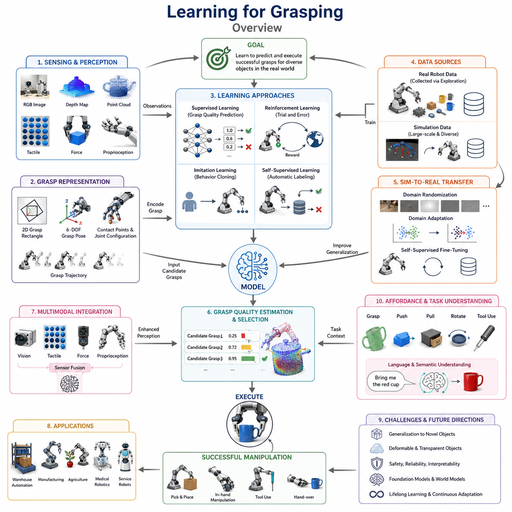{width="7.268055555555556in" height="7.268055555555556in"}

Learning for Grasping is one of the most transformative developments in modern robotic manipulation. Traditional grasping systems were largely built upon analytical models derived from kinematics, dynamics, contact mechanics, force closure theory, and optimization-based planning. These approaches provided a mathematically rigorous foundation for robotic grasping and enabled robots to perform stable pick-and-place operations in highly structured environments. However, as robots began to move into unstructured environments such as warehouses, homes, hospitals, agricultural fields, and collaborative manufacturing settings, the limitations of purely analytical methods became increasingly apparent. Real-world environments contain uncertainty, object diversity, sensor noise, partial observability, deformable materials, and unpredictable interactions that are difficult to model accurately using handcrafted rules alone. Learning-based grasping emerged as a response to these challenges by allowing robots to acquire grasping skills directly from data and experience rather than relying solely on predefined models. This chapter serves as an overview of the field of learning for grasping and introduces the major concepts, methodologies, architectures, datasets, and research directions that define this rapidly evolving area. The topic is positioned within the Learning Based Grasping section of Volume 06 and forms the conceptual foundation for subsequent chapters covering datasets, grasp quality learning, neural grasp detection, reinforcement learning, self-supervised learning, sim-to-real transfer, and multi-task manipulation systems.

The fundamental idea behind learning-based grasping is that a robot can observe examples of successful and unsuccessful grasps and gradually develop an internal representation of grasp quality. Instead of explicitly calculating every physical interaction between fingers and objects, a learning system identifies patterns that correlate with successful manipulation outcomes. Through repeated exposure to data, the robot learns to recognize geometric features, object affordances, contact opportunities, and stable grasp configurations. The resulting system often demonstrates greater adaptability than traditional approaches because it can generalize beyond the exact situations encountered during training.

Historically, robotic grasping research relied heavily on geometric reasoning. Researchers modeled contact points, friction cones, wrench spaces, and force distributions to identify grasps that satisfied theoretical stability conditions. While these methods remain important and continue to provide valuable insights, they often struggle when confronted with incomplete sensory information or unknown object properties. A robot may encounter a previously unseen object whose mass distribution, friction coefficient, compliance, or shape characteristics are not available in advance. In such cases, learning algorithms can infer useful grasp strategies from prior experience even when exact physical parameters are unknown.

Machine learning introduces the ability to learn complex nonlinear relationships between sensory observations and manipulation outcomes. A grasping system may receive images, depth maps, point clouds, tactile measurements, force sensor readings, or multimodal sensor inputs and transform these observations into grasp predictions. The learning process automatically discovers features that are relevant for successful grasp execution. This capability significantly reduces the need for manually engineered feature extraction pipelines and enables grasping systems to adapt to a wider range of objects and environments.

One of the earliest applications of machine learning in robotic grasping involved supervised learning. In supervised grasp learning, large datasets of grasp examples are collected and labeled according to success or failure. Neural networks, decision trees, support vector machines, or other predictive models are then trained to estimate grasp quality. Given a new object observation, the model predicts whether a candidate grasp is likely to succeed. The effectiveness of supervised learning depends heavily on the availability of high-quality training data and representative examples that capture the diversity of real-world manipulation scenarios.

The emergence of deep learning dramatically accelerated progress in grasping research. Deep neural networks can process raw sensory data directly, allowing end-to-end learning from images or point clouds. Convolutional neural networks became particularly influential because they enabled robots to learn visual representations associated with successful grasps. Rather than explicitly detecting object boundaries, surfaces, and grasp points through handcrafted algorithms, neural networks could automatically learn these concepts from data. This shift simplified system design while often improving performance on challenging grasping tasks.

Vision-based grasp learning rapidly became a dominant research direction. Cameras provide rich environmental information at relatively low cost and can capture large portions of a workspace. Learning systems use RGB images, depth maps, stereo vision, or RGB-D sensors to estimate grasp candidates. A robot may identify grasp rectangles, contact points, gripper poses, or complete six-degree-of-freedom grasp configurations directly from visual input. The ability to infer grasp opportunities from perception data is essential for autonomous manipulation in dynamic environments.

Point cloud based grasp learning represents another important branch of research. Three-dimensional point clouds provide direct geometric information about object surfaces and spatial relationships. Learning algorithms operating on point clouds can reason about object geometry without requiring explicit mesh reconstruction. Architectures such as PointNet, PointNet++, graph neural networks, and transformer-based geometric networks have enabled increasingly sophisticated grasp prediction systems. These models can identify graspable regions, estimate contact configurations, and generate dexterous manipulation strategies directly from sparse geometric observations.

A central concept in learning-based grasping is grasp representation. Before a robot can learn how to grasp, the grasp itself must be represented in a form suitable for machine learning. Different systems use different representations depending on the robot hardware and task requirements. Simple parallel-jaw grippers often use grasp rectangles in image space. More advanced systems employ six-degree-of-freedom grasp poses, fingertip contact locations, joint configurations, or entire hand trajectories. The choice of representation influences network architecture, training methodology, computational complexity, and deployment performance.

Another key concept is grasp quality estimation. Rather than directly predicting a single grasp action, many learning systems evaluate multiple candidate grasps and assign a quality score to each one. The robot then selects the grasp with the highest predicted probability of success. Grasp quality estimation transforms manipulation into a ranking problem and enables flexible integration with existing planning systems. Networks such as Grasp Quality Convolutional Neural Networks demonstrated the effectiveness of this approach and inspired numerous subsequent developments in robotic grasp learning.

Data collection remains one of the most important challenges in the field. High-performing learning systems require large datasets containing diverse objects, grasp attempts, sensor observations, and outcome labels. Collecting such datasets in the physical world can be time-consuming and expensive because each grasp attempt requires robotic execution and evaluation. Researchers have therefore developed large-scale automated data collection platforms that enable robots to perform millions of grasp trials. Some systems operate continuously for weeks or months, generating enormous datasets used to train increasingly capable grasp prediction models.

Simulation has become an essential tool for addressing data scarcity. Modern physics simulators allow robots to practice grasping in virtual environments before deployment in the real world. Thousands of grasp attempts can be executed simultaneously across multiple simulated environments, dramatically accelerating data collection. Simulators also enable systematic variation of object geometry, lighting conditions, sensor noise, material properties, and environmental configurations. This capability supports large-scale learning experiments that would be impractical using physical hardware alone.

However, simulation introduces the challenge known as the sim-to-real gap. Models trained exclusively in simulation often perform poorly when transferred to real robots because simulated environments cannot perfectly capture real-world physics and sensor behavior. Bridging this gap has become a major research area. Domain randomization, domain adaptation, physics parameter randomization, and self-supervised fine-tuning are commonly employed to improve transfer performance. Successful sim-to-real methods enable robots to leverage vast amounts of simulated experience while maintaining effectiveness in physical environments.

Reinforcement learning has emerged as another influential paradigm for grasp learning. Unlike supervised learning, which relies on labeled examples, reinforcement learning enables robots to learn through trial and error. The robot interacts with its environment, receives rewards for successful actions, and gradually improves its grasping policy. Reinforcement learning is particularly attractive because it allows robots to discover strategies that may not be present in demonstration datasets. Complex dexterous manipulation behaviors, adaptive grasp adjustments, and sequential manipulation skills can emerge through reward-driven optimization.

Behavior cloning and imitation learning provide alternative approaches to skill acquisition. In these methods, robots learn by observing expert demonstrations performed by humans or highly capable robotic systems. Demonstrations may be collected through teleoperation, motion capture, virtual reality interfaces, or kinesthetic teaching. The robot learns to reproduce expert behavior and can often acquire useful grasping skills more rapidly than through pure reinforcement learning. Imitation learning is especially valuable when exploration is costly or potentially unsafe.

Self-supervised learning has become increasingly important as researchers seek scalable methods for acquiring manipulation data. Instead of relying on manually labeled datasets, self-supervised systems automatically generate supervision signals from interaction outcomes. For example, a robot may attempt thousands of grasps and label each trial as successful or unsuccessful based on sensor feedback. This approach enables continuous autonomous learning and greatly reduces the need for human annotation. Many of the largest grasping datasets in existence have been generated using self-supervised robotic exploration.

Learning-based grasping is also closely connected to the concept of object affordances. An affordance describes the possible actions that can be performed on an object. Learning systems attempt to infer affordances directly from sensory observations, identifying regions that support grasping, pushing, pulling, rotating, or tool use. By understanding affordances, robots can move beyond simple object acquisition and begin reasoning about object functionality and task relevance.

Multimodal learning represents a growing trend within robotic grasping. Human manipulation relies on vision, touch, proprioception, force sensing, and auditory feedback simultaneously. Similarly, robotic systems increasingly integrate multiple sensing modalities to improve grasp performance. Visual sensors provide global environmental awareness, tactile sensors reveal local contact information, force sensors estimate interaction loads, and proprioceptive sensors track finger configurations. Learning algorithms can fuse these information sources to achieve more robust grasp planning and execution.

The introduction of tactile learning has significantly expanded the capabilities of grasping systems. Vision alone often fails to capture detailed contact conditions after the hand closes around an object. Tactile sensors provide direct measurements of pressure distributions, contact locations, slip events, and surface characteristics. Learning models can use tactile information to adjust grasp forces, prevent object drops, and perform fine manipulation tasks that are difficult to achieve using vision alone.

Generalization remains one of the most important goals in learning-based grasping. A useful robotic system must successfully manipulate objects that were not encountered during training. Researchers therefore evaluate models according to their ability to generalize across object categories, geometries, materials, lighting conditions, and environmental contexts. Robust generalization requires diverse datasets, effective representations, and architectures capable of extracting fundamental manipulation principles rather than memorizing specific examples.

Recent advances in foundation models are beginning to reshape grasping research. Large-scale vision-language models and vision-language-action models trained on diverse internet-scale datasets can provide semantic understanding that complements traditional manipulation capabilities. These models allow robots to interpret natural language instructions, reason about object functionality, and select task-relevant grasps. Instead of simply grasping an object securely, a robot may learn to grasp it in a way that supports subsequent actions such as pouring, handing over, assembling, or tool use.

Another emerging direction involves world models and predictive manipulation systems. Rather than reacting solely to current observations, future grasping systems will predict the consequences of potential actions before execution. By simulating future interaction outcomes internally, robots can evaluate multiple grasp strategies and select those most likely to achieve task objectives. This predictive capability represents a significant step toward human-like manipulation intelligence.

Industrial adoption of learning-based grasping is accelerating across multiple sectors. Warehouse automation systems use learning algorithms to pick diverse products from bins. Manufacturing robots handle variable components without extensive reprogramming. Agricultural robots harvest delicate produce with adaptive grasp strategies. Medical robots manipulate instruments and biological materials under uncertain conditions. Service robots interact safely with everyday household objects. These applications demonstrate the practical value of learning-driven manipulation technologies.

Despite remarkable progress, significant challenges remain. Learning systems often require large datasets, substantial computational resources, and extensive training time. Safety, reliability, interpretability, and certification remain critical concerns for industrial deployment. Models may exhibit unexpected failures when confronted with rare or novel situations. Achieving human-level dexterity continues to be an open research challenge that requires advances in sensing, control, representation learning, reasoning, and embodied intelligence.

The future of learning for grasping will likely involve the convergence of perception, control, tactile sensing, language understanding, foundation models, world modeling, and autonomous skill acquisition. Future robots will not merely execute predefined grasp strategies but will continuously learn from experience, adapt to changing environments, understand task objectives, and coordinate grasping with broader manipulation goals. Learning-based grasping therefore serves as a foundational technology for the development of intelligent robotic systems capable of operating effectively in the complex and unpredictable environments of the real world. As subsequent chapters explore specific techniques such as dataset design, grasp quality learning, reinforcement learning, sim-to-real transfer, self-supervised learning, and multi-task manipulation, this overview provides the conceptual framework necessary for understanding how modern robots acquire, improve, and generalize grasping skills through learning.

## 11.02 Dataset Design

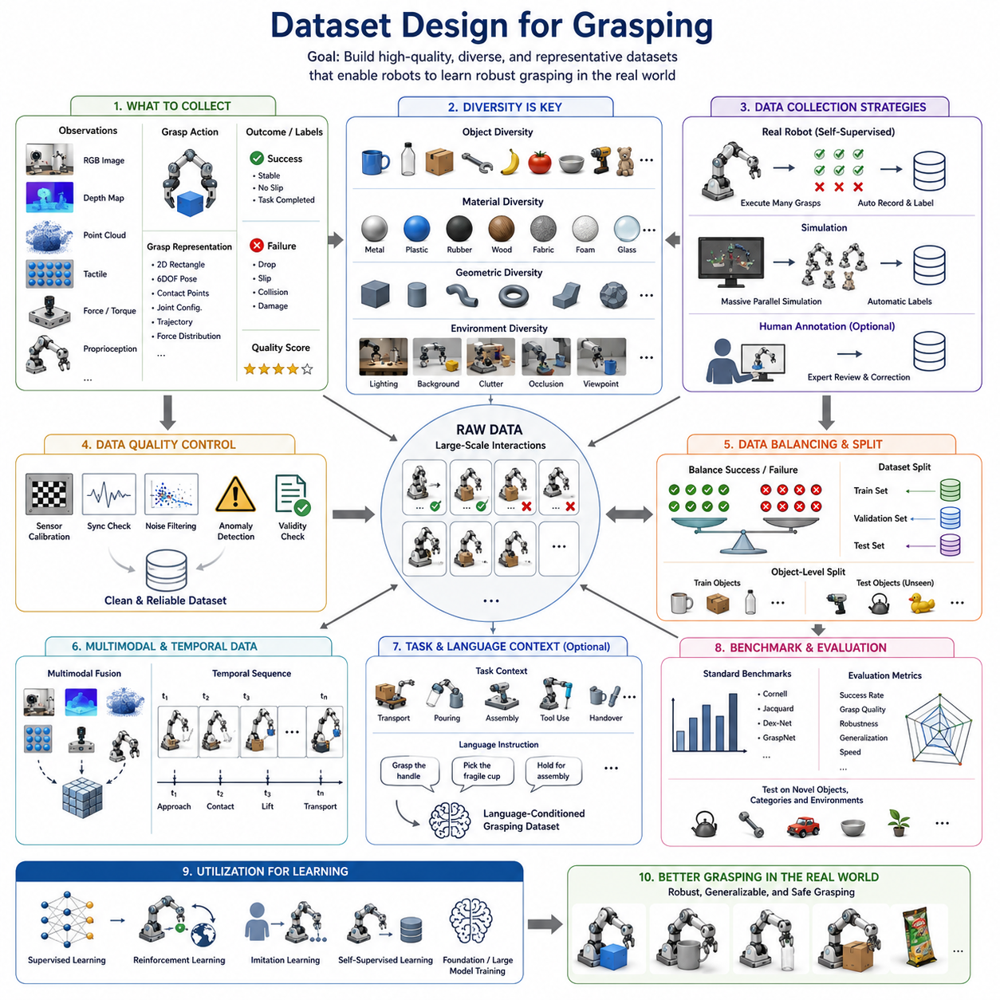{width="7.268055555555556in" height="7.268055555555556in"}

Dataset design is one of the most critical foundations of learning-based robotic grasping. Regardless of how sophisticated a neural network architecture, reinforcement learning algorithm, foundation model, or multimodal perception system may be, the quality of the resulting grasping capability is ultimately constrained by the quality, diversity, scale, and representativeness of the dataset used during training. In modern robotics, datasets are not merely collections of images and labels. They are structured representations of physical interactions between robots and the real world. A well-designed grasping dataset captures the complex relationships among object geometry, material properties, sensor observations, robot actions, contact conditions, environmental context, and manipulation outcomes. Consequently, dataset engineering has become a major research discipline within robotic manipulation and embodied intelligence.

The importance of dataset design arises from the fundamental nature of learning-based systems. Traditional grasp planning approaches relied on analytical models derived from contact mechanics, force closure theory, kinematics, and optimization. These methods depended heavily on explicit mathematical formulations. In contrast, machine learning systems infer grasping strategies from examples. The dataset therefore becomes the primary source of knowledge. Every success, failure, object interaction, and sensor observation contributes to the robot\'s understanding of grasping. If the dataset is biased, incomplete, noisy, or insufficiently diverse, the resulting model will inherit those limitations regardless of its computational complexity.

The primary objective of a grasping dataset is to provide sufficient information for a learning system to discover the relationship between observations and successful manipulation outcomes. At a minimum, a grasping dataset contains sensory observations, grasp actions, and outcome labels. The observations may include RGB images, depth maps, RGB-D data, point clouds, tactile measurements, force-torque sensor readings, proprioceptive information, or multimodal combinations of these sources. The action component typically describes the grasp configuration selected by the robot. The outcome component indicates whether the grasp succeeded or failed and may additionally contain information regarding grasp stability, object displacement, slip occurrence, force distribution, or task completion status.

One of the earliest challenges in dataset design is defining what constitutes a successful grasp. At first glance, success may appear straightforward: the robot picks up the object and does not drop it. However, industrial and research applications often require more sophisticated definitions. A grasp may successfully lift an object but damage it during manipulation. Another grasp may securely hold the object but position it incorrectly for a subsequent assembly operation. In logistics, a successful grasp may require high speed and reliability. In healthcare applications, gentle handling may be more important than gripping force. Dataset designers must therefore define success criteria that align with the intended application domain.

Object diversity represents one of the most important factors influencing dataset quality. Real-world robots encounter an enormous variety of objects differing in shape, size, weight, material, texture, rigidity, transparency, reflectivity, and deformability. A dataset containing only rigid industrial components may produce models that fail when manipulating household objects, food products, or soft materials. Effective datasets intentionally include a broad spectrum of object categories to maximize generalization capability. Diversity should extend beyond visual appearance to include physical characteristics that influence grasping behavior.

Geometric diversity is particularly important for robotic grasp learning. Objects may contain flat surfaces, curved surfaces, sharp edges, cavities, handles, protrusions, flexible components, and articulated structures. Learning systems must experience sufficient geometric variation to develop robust representations of grasp opportunities. Modern grasping datasets often contain thousands or even millions of unique object geometries to expose models to diverse contact configurations and manipulation scenarios.

Material diversity presents another significant consideration. The same geometric shape may require different grasping strategies depending on its material properties. A rigid metal cylinder, a rubber cylinder, and a foam cylinder may appear visually similar while exhibiting very different interaction dynamics. Friction coefficients, compliance characteristics, deformation behavior, and surface textures all influence grasp stability. Datasets that neglect material diversity may produce models that perform well in simulation yet fail in real-world environments.

Environmental diversity is equally important. Robotic grasping rarely occurs under ideal laboratory conditions. Lighting changes, cluttered scenes, partial occlusions, background complexity, sensor noise, and dynamic environmental conditions all affect perception quality. A dataset collected under controlled lighting conditions may not support reliable deployment in warehouses, factories, hospitals, or outdoor environments. Consequently, modern dataset design emphasizes environmental variability to improve robustness and generalization.

The representation of grasp actions is a fundamental dataset design decision. Different robotic systems require different grasp representations. Parallel-jaw grippers often use planar grasp rectangles represented by position, orientation, width, and grasp score. More advanced robotic hands may require six-degree-of-freedom grasp poses, fingertip contact locations, finger joint configurations, force distributions, or complete manipulation trajectories. The chosen representation influences labeling methodology, network architecture design, and model evaluation procedures.

Annotation strategy plays a central role in dataset construction. In supervised learning systems, each example typically requires some form of label. Early grasping datasets often relied on manual annotation by human experts. While human labeling can provide valuable semantic information, it is expensive, time-consuming, and difficult to scale. Furthermore, human judgments regarding grasp quality may not always correspond to actual robotic execution outcomes. As a result, robotic grasping research increasingly favors automated labeling approaches based on physical interaction results.

Self-supervised data collection has emerged as one of the most influential trends in grasp dataset development. In self-supervised systems, robots autonomously perform grasp attempts and record the resulting outcomes. Each interaction automatically generates a training example without requiring human intervention. A robot may execute hundreds of thousands of grasp attempts over an extended period, gradually constructing a large-scale dataset of successful and unsuccessful interactions. This approach dramatically reduces annotation costs while generating labels directly tied to real-world execution performance.

Large-scale robotic data collection systems have enabled unprecedented dataset growth. Some industrial research platforms operate continuously for weeks or months, generating millions of grasp attempts. These datasets provide the statistical diversity necessary for training deep learning models capable of robust generalization. The success of modern grasping systems is closely linked to the availability of such large-scale interaction datasets.

Simulation-based dataset generation offers another powerful approach for acquiring training data. Modern physics simulators allow robots to interact with virtual objects at scales that would be impractical in physical environments. Thousands of simulated robots can perform grasp attempts simultaneously, generating enormous quantities of labeled data. Simulation enables systematic variation of object properties, lighting conditions, sensor characteristics, and environmental parameters. This capability significantly accelerates dataset generation while reducing hardware costs.

However, simulation-generated datasets introduce important challenges. Simulated environments inevitably differ from physical reality. Contact dynamics, friction behavior, sensor noise, and object deformation may not be modeled perfectly. Models trained exclusively on simulated data often experience performance degradation when deployed in the real world. This phenomenon is commonly known as the sim-to-real gap. Dataset designers address this challenge through domain randomization, domain adaptation, physics randomization, and hybrid real-simulation data collection strategies.

Domain randomization has become a widely adopted technique in grasping dataset design. During simulation, environmental parameters are intentionally varied across a broad range of values. Object textures, lighting conditions, camera parameters, physical properties, and background appearances are randomized to expose learning systems to diverse scenarios. The resulting models become less dependent on specific visual or physical characteristics and therefore generalize more effectively to real environments.

Balancing successful and unsuccessful grasp examples is another important consideration. If a dataset contains only successful grasps, the learning system may fail to recognize dangerous or ineffective actions. Conversely, excessive failure examples may bias the model toward overly conservative behavior. Effective datasets typically maintain an appropriate balance between positive and negative outcomes to support robust decision-making. Failure examples often provide valuable information regarding contact instability, slip conditions, collisions, and geometric constraints.

Temporal information is becoming increasingly important in modern grasping datasets. Early datasets often treated grasping as a static prediction problem, focusing on a single observation and a single action. In reality, grasping is a dynamic process involving sequential perception, motion planning, contact formation, force regulation, and object transport. Temporal datasets capture complete interaction sequences, enabling models to learn dynamic manipulation strategies rather than isolated grasp predictions.

The integration of tactile sensing has introduced new dataset requirements. Traditional vision-based datasets primarily focus on pre-contact observations. Tactile datasets capture information generated during physical interaction, including pressure distributions, contact locations, slip events, shear forces, and deformation patterns. Combining visual and tactile data enables richer representations of grasping behavior and supports more advanced manipulation capabilities.

Multimodal datasets are becoming increasingly important as robotic systems incorporate multiple sensor modalities. A multimodal grasping dataset may include synchronized RGB images, depth maps, point clouds, tactile measurements, force-torque readings, robot joint states, and task descriptions. The fusion of multiple information sources allows learning systems to develop more comprehensive representations of the manipulation process. Designing such datasets requires careful synchronization, calibration, and timestamp management to ensure consistency across sensing modalities.

Data quality control represents a critical but often overlooked aspect of dataset engineering. Sensor calibration errors, synchronization problems, corrupted labels, mechanical failures, and environmental anomalies can introduce noise into training data. Even large datasets may produce poor models if quality assurance procedures are insufficient. Successful dataset design therefore includes rigorous validation pipelines, automated consistency checks, anomaly detection systems, and periodic dataset audits.

Dataset splitting strategies significantly influence evaluation reliability. Training, validation, and testing subsets must be carefully separated to avoid information leakage. In robotic grasping, object-level separation is particularly important. If identical objects appear in both training and testing sets, performance estimates may overstate actual generalization capability. More rigorous evaluations use novel objects, novel categories, and novel environments during testing to assess real-world deployment readiness.

Benchmark datasets have played a major role in advancing grasping research. Public datasets provide standardized evaluation platforms that enable fair comparison between different algorithms. Datasets such as Cornell Grasp Dataset, Jacquard Dataset, Dex-Net, GraspNet, and various industrial grasping benchmarks have accelerated progress by establishing common performance metrics and evaluation procedures. These resources allow researchers worldwide to compare approaches under consistent experimental conditions.

Scalability has become a defining characteristic of modern dataset design. As foundation models and large-scale robotic learning systems emerge, dataset sizes continue to increase dramatically. Future grasping datasets may contain billions of interaction samples collected from fleets of robots operating across diverse environments. Such datasets will support the development of increasingly general manipulation capabilities analogous to the role that internet-scale datasets played in modern computer vision and natural language processing.

Task-aware dataset design represents an important emerging direction. Traditional grasp datasets often focus solely on grasp success. However, many real-world tasks require context-aware grasp selection. A robot grasping a mug for transportation may choose a different grasp than when preparing to pour liquid. Similarly, assembly operations, tool use, handovers, and packaging tasks require specialized grasp strategies. Future datasets increasingly incorporate task objectives, semantic information, and downstream manipulation goals.

Language integration is also becoming a major consideration. Foundation models capable of understanding natural language require datasets that associate manipulation actions with linguistic descriptions. Language-conditioned grasping datasets enable robots to interpret instructions such as "grasp the handle," "pick up the fragile container," or "hold the object for assembly." These capabilities support more intuitive human-robot interaction and more flexible manipulation planning.

The rise of foundation models and embodied AI is fundamentally changing the scale and scope of dataset design. Instead of creating datasets optimized for a single grasping task, researchers are increasingly constructing large multimodal corpora that support perception, reasoning, planning, control, and manipulation simultaneously. These datasets integrate visual observations, tactile interactions, language instructions, action trajectories, and environmental context into unified learning frameworks.

Ultimately, dataset design for grasping is far more than a data collection exercise. It is the process of defining the experiences from which a robot learns to interact with the physical world. The diversity of objects, richness of sensory information, accuracy of labels, realism of interactions, and scale of experience collectively determine the capability of the resulting manipulation system. As robotic grasping continues to evolve toward foundation models, lifelong learning, autonomous adaptation, and general-purpose embodied intelligence, dataset engineering will remain one of the most important enabling technologies. The chapters that follow will build upon these dataset foundations to explore grasp quality learning, neural grasp detection, reinforcement learning, self-supervised learning, sim-to-real transfer, and large-scale grasping systems capable of operating in complex real-world environments.

## 11.03 GQ-CNN and Grasp Quality CNNs

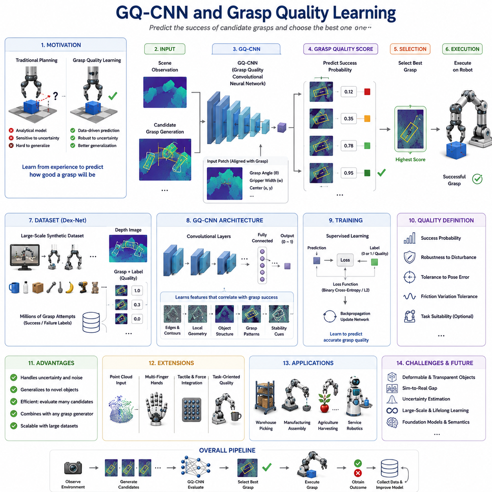{width="7.268055555555556in" height="7.268055555555556in"}

Grasp Quality Learning is one of the most influential concepts in modern learning-based robotic grasping. Rather than directly commanding a robot to execute a specific grasp, grasp quality learning focuses on estimating how likely a candidate grasp is to succeed before the robot physically performs the action. This approach transforms grasping from a deterministic planning problem into a predictive decision-making problem. Instead of asking, "What grasp should the robot execute?", the system asks, "Among all possible grasps, which one has the highest probability of success?" This seemingly simple change has had a profound impact on robotic manipulation research and has enabled the deployment of learning-based grasping systems in increasingly complex and unstructured environments.

Among the various methods developed for grasp quality estimation, the Grasp Quality Convolutional Neural Network (GQ-CNN) stands out as one of the most influential architectures. Developed as part of the Dex-Net project, GQ-CNN demonstrated that deep learning could effectively predict grasp success from visual observations and significantly outperform many traditional grasp planning approaches. The success of GQ-CNN helped establish grasp quality estimation as a central paradigm in robotic grasp learning and laid the foundation for many subsequent grasp prediction systems.

To understand the motivation behind GQ-CNN, it is useful to consider the limitations of traditional grasp planning methods. Classical grasp planners rely heavily on analytical models derived from contact mechanics, force closure theory, friction cone analysis, grasp wrench spaces, and optimization techniques. While these methods provide mathematically rigorous guarantees under ideal assumptions, they often struggle when deployed in real-world environments where object properties, sensor measurements, and environmental conditions are uncertain. Small errors in object pose estimation, friction coefficients, or geometry reconstruction can significantly degrade performance.

Learning-based grasp quality estimation addresses this problem by replacing explicit physical modeling with statistical prediction. Instead of attempting to calculate every physical interaction involved in grasping, a neural network learns from examples of successful and unsuccessful grasps. Through exposure to large-scale datasets, the model learns patterns that correlate with stable grasp outcomes. As a result, the system becomes capable of predicting grasp success even when precise physical parameters are unavailable.

The central idea of GQ-CNN is remarkably elegant. Given a visual observation of an object and a candidate grasp configuration, the network predicts the probability that the grasp will succeed. The candidate grasp itself is not necessarily generated by the neural network. Instead, multiple grasp candidates may be sampled from the workspace using geometric methods, heuristic approaches, or analytical planners. Each candidate is evaluated by the GQ-CNN, which assigns a grasp quality score. The robot then selects the grasp with the highest predicted success probability.

This architecture separates grasp generation from grasp evaluation. Such a separation provides significant practical advantages. Different grasp generation algorithms can be combined with the same quality prediction network, allowing flexibility in system design. Furthermore, evaluating candidate grasps is often computationally simpler than directly predicting a complete grasp from raw sensory input.

The development of GQ-CNN was closely tied to the Dex-Net project, which introduced large-scale synthetic grasp datasets for robotic manipulation. One of the major challenges in learning-based grasping is obtaining sufficient training data. Collecting millions of real-world grasp attempts is expensive and time-consuming. Dex-Net addressed this challenge by generating enormous synthetic datasets using physics simulation and 3D object models. Virtual grasp attempts were performed on thousands of objects, and grasp quality metrics derived from analytical grasp theory were used as training labels.

The resulting dataset contained millions of grasp examples covering diverse object geometries, grasp configurations, and contact conditions. This scale enabled deep neural networks to learn robust mappings between visual observations and grasp success probabilities. The combination of large-scale synthetic data and deep learning was a key factor in the success of GQ-CNN.

A typical GQ-CNN system operates using depth images rather than RGB images alone. Depth information provides direct geometric measurements of object surfaces and is highly relevant for grasp planning. Given a depth image of a scene, candidate grasps are represented as image-centered patches aligned with the orientation of the grasp. These patches are extracted and provided as input to the neural network along with grasp-related parameters such as gripper width and orientation.

The network architecture itself is based on convolutional neural networks, which are particularly effective for processing spatially structured visual data. Convolutional layers extract hierarchical features from depth images, capturing geometric patterns associated with successful grasping opportunities. Early layers identify local surface structures, edges, and contours, while deeper layers learn more abstract representations related to object shape, grasp geometry, and stability characteristics.

Training the network involves supervised learning. Each training example consists of an input observation and an associated grasp quality label. The label may represent a binary success/failure outcome or a continuous grasp quality score derived from analytical metrics. During training, the network adjusts its parameters to minimize prediction error. Over time, it learns to associate specific geometric patterns with successful grasp outcomes.

One of the most important contributions of GQ-CNN was demonstrating that synthetic data could effectively support real-world robotic learning. Traditionally, many researchers believed that simulated data would be insufficient due to the sim-to-real gap. However, GQ-CNN showed that carefully designed datasets combined with appropriate representations could achieve strong transfer performance. This finding inspired extensive research into simulation-based robotic learning and large-scale synthetic dataset generation.

Grasp quality learning can be viewed as a probabilistic interpretation of grasp planning. Rather than producing a deterministic answer, the system estimates uncertainty and success likelihood. This probabilistic perspective is particularly valuable in real-world robotics because uncertainty is unavoidable. Sensors are noisy, object models are incomplete, and environmental conditions change continuously. A grasp quality predictor allows the robot to reason about confidence and select actions with higher expected success rates.

The concept of grasp quality itself can be defined in multiple ways. In some systems, quality corresponds to the probability of lifting an object successfully. In others, it may represent resistance to disturbances, robustness against pose estimation errors, tolerance to friction variations, or suitability for downstream manipulation tasks. The precise definition depends on the intended application and the training dataset used.

As robotic hands become more sophisticated, grasp quality learning extends beyond simple parallel-jaw grasping. Multi-finger dexterous hands introduce additional complexity because grasp success depends not only on hand position but also on finger coordination, contact distribution, force allocation, and manipulation objectives. Modern grasp quality networks increasingly incorporate these factors to evaluate more complex grasp configurations.

Another important development has been the integration of point cloud representations. While early GQ-CNN systems primarily used depth images, later approaches leverage three-dimensional point clouds to capture richer geometric information. Point cloud based networks can directly reason about object surfaces and spatial structures without requiring image projections. This capability often improves performance for cluttered scenes and complex object geometries.

The incorporation of tactile sensing represents another major advancement in grasp quality learning. Visual information alone is often insufficient to determine whether a grasp remains stable after contact is established. Tactile sensors provide direct measurements of pressure distributions, contact locations, slip events, and force interactions. Learning systems that combine visual and tactile information can estimate grasp quality more accurately and adaptively adjust grasp forces during execution.

Multimodal grasp quality estimation is becoming increasingly important in advanced robotic manipulation systems. By integrating vision, touch, force sensing, and proprioception, robots can develop more comprehensive models of grasp success. Such systems more closely resemble human manipulation capabilities, where multiple sensory modalities contribute simultaneously to grasp assessment and control.

One limitation of traditional GQ-CNN approaches is that they typically focus on grasp acquisition rather than task completion. A grasp that is mechanically stable may not be appropriate for the intended task. For example, grasping a mug by its opening may provide excellent stability but prevent pouring. Similarly, grasping a screwdriver at the wrong location may make tool use impossible. Modern grasp quality learning therefore increasingly incorporates task awareness into the evaluation process.

Task-oriented grasp quality learning extends the original concept by evaluating grasps according to their suitability for downstream actions. The network predicts not only whether a grasp will succeed mechanically but also whether it will support subsequent manipulation objectives. This shift represents an important step toward more intelligent and context-aware robotic behavior.

The rise of reinforcement learning has further expanded the scope of grasp quality estimation. Rather than relying solely on supervised labels, reinforcement learning systems can discover quality functions through interaction experience. The robot explores different grasp strategies, receives rewards based on task outcomes, and gradually develops internal representations of grasp quality. This approach enables adaptation to environments and tasks not explicitly represented in training datasets.

Self-supervised learning has also become an important source of grasp quality data. Robots can autonomously collect grasp attempts, record outcomes, and continuously refine their quality prediction models. Such systems support lifelong learning and allow grasp quality estimators to improve over time as additional experience is accumulated.

The emergence of foundation models is beginning to influence grasp quality learning as well. Vision-language models and vision-language-action models introduce semantic reasoning capabilities that extend beyond geometric analysis. Future grasp quality estimators may evaluate grasps not only according to physical stability but also according to semantic objectives, user instructions, and task context. A robot may learn to distinguish between "grasp for transport," "grasp for assembly," "grasp for handover," and "grasp for tool use," selecting different strategies depending on the intended outcome.

Benchmarking grasp quality learning systems remains an active area of research. Common evaluation metrics include grasp success rate, prediction accuracy, robustness to object variation, resistance to sensor noise, computational efficiency, and generalization performance. Public datasets such as Dex-Net, GraspNet, Jacquard, and various industrial benchmarks provide standardized evaluation frameworks that enable comparison across different methods.

Industrial adoption of grasp quality learning continues to grow rapidly. Warehouse automation systems use quality predictors to select reliable grasps for diverse products. Manufacturing robots handle variable components with minimal reprogramming. Agricultural robots use grasp quality estimation to pick delicate fruits and vegetables without causing damage. Service robots rely on grasp quality prediction when interacting with household objects under uncertain conditions. These applications demonstrate the practical value of predictive grasp evaluation in real-world deployment.

Despite significant progress, several challenges remain. Current systems still struggle with highly deformable objects, transparent materials, reflective surfaces, and complex contact-rich manipulation tasks. Dataset bias, sim-to-real transfer limitations, uncertainty estimation, and computational scalability continue to be active research topics. Achieving human-level grasp assessment remains a long-term objective that requires advances in sensing, learning, reasoning, and embodied intelligence.

Ultimately, GQ-CNN and grasp quality learning represent a fundamental shift in robotic manipulation. Rather than relying solely on analytical models, robots learn to predict the likelihood of success from experience. This predictive paradigm has transformed grasp planning into a data-driven decision-making process and established a foundation for modern learning-based manipulation systems. As robotic hands become more dexterous, datasets become larger, sensors become richer, and foundation models become more capable, grasp quality learning will remain a core technology enabling robots to interact safely, efficiently, and intelligently with the physical world.

## 11.04 Six-DoF Grasp Detection Networks

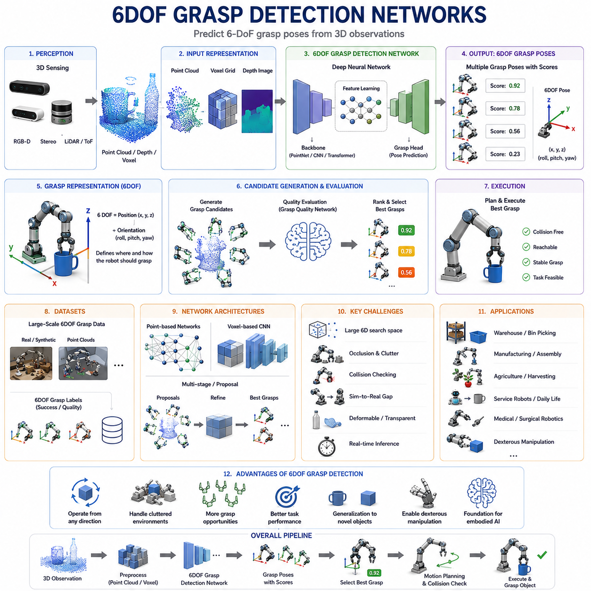{width="7.268055555555556in" height="7.268055555555556in"}

Six-Degree-of-Freedom Grasp Detection Networks represent one of the most important advancements in modern robotic grasping. Traditional grasp detection systems were primarily designed for top-down grasping scenarios in structured environments. These systems typically represented grasps as two-dimensional rectangles in image space, predicting a grasp center, orientation, and gripper width from an RGB image or depth map. While such approaches achieved considerable success in warehouse automation, tabletop manipulation, and industrial pick-and-place applications, they were fundamentally limited by their simplified grasp representation. Real-world robotic manipulation occurs in three-dimensional space, where objects may appear in arbitrary orientations, be partially occluded, be stacked in cluttered environments, or require side grasps and complex approach trajectories. To address these limitations, researchers developed 6DOF Grasp Detection Networks capable of predicting complete six-degree-of-freedom grasp poses directly from sensory observations.

The concept of six degrees of freedom refers to the complete spatial description of a grasp pose. Three degrees of freedom describe translation along the X, Y, and Z axes, while three additional degrees of freedom describe rotational orientation around those axes, commonly represented as roll, pitch, and yaw. A 6DOF grasp therefore specifies not only where the robot hand should move but also how it should be oriented when approaching and contacting the object. This richer representation enables robots to interact with objects from virtually any direction and significantly expands the range of manipulation tasks that can be performed.

The emergence of 6DOF grasp detection was closely linked to advances in three-dimensional sensing technologies. Earlier robotic grasping systems relied heavily on monocular cameras or top-down depth sensors, which provided limited geometric information. The widespread availability of RGB-D cameras, stereo vision systems, structured-light sensors, time-of-flight cameras, and LiDAR-based perception systems dramatically increased the quality and density of three-dimensional environmental observations. These sensing technologies enabled robots to capture detailed object geometry and motivated the development of algorithms capable of operating directly in three-dimensional space.

One of the key motivations behind 6DOF grasp detection is the inadequacy of planar grasp representations in complex environments. Consider a mug located on a cluttered shelf. A traditional two-dimensional grasp detector may identify a grasp rectangle around the mug when viewed from above, but it cannot determine whether the robot should grasp the handle, approach from the side, or avoid collisions with neighboring objects. A 6DOF grasp detector, on the other hand, can reason about the complete spatial configuration of the object and generate grasp poses that account for geometric constraints, accessibility, and task requirements.

The transition from two-dimensional grasp detection to six-degree-of-freedom grasp detection fundamentally changes the complexity of the learning problem. In a planar grasping scenario, the search space is relatively small. A grasp can often be described using a few image coordinates and an angle. In contrast, 6DOF grasp detection requires exploration of a continuous six-dimensional pose space. The number of possible grasp configurations increases dramatically, making efficient representation, learning, and inference significantly more challenging.

Early research in 6DOF grasp detection often relied on explicit object models and geometric reasoning. Researchers reconstructed object surfaces from point clouds and then generated candidate grasps based on surface normals, curvature analysis, and contact geometry. These approaches achieved reasonable performance but often required accurate object segmentation and extensive computation. As deep learning became more prominent, researchers began developing neural networks capable of directly predicting grasp poses from raw sensor data.

A major breakthrough occurred with the introduction of deep learning architectures capable of processing three-dimensional representations. Instead of manually engineering grasp features, neural networks learned representations directly from point clouds, voxel grids, depth images, or mesh models. These architectures enabled end-to-end learning from perception to grasp prediction and significantly improved robustness in unstructured environments.

Point cloud based grasp detection has become one of the dominant paradigms in 6DOF grasp learning. Point clouds provide a direct representation of object geometry without requiring image projection or surface reconstruction. Each point contains spatial coordinates describing the object\'s surface, allowing neural networks to reason directly about three-dimensional structure. Architectures such as PointNet, PointNet++, Dynamic Graph CNN, Point Transformer, and graph neural networks have been widely applied to grasp detection tasks.

One of the most influential developments in this area was the introduction of Grasp Pose Detection approaches that treat grasp prediction as a direct pose estimation problem. Rather than evaluating predefined grasp candidates, these systems predict grasp poses directly from sensory observations. The network receives a point cloud or depth representation and outputs a set of candidate grasp poses along with associated confidence scores. This approach eliminates the need for separate grasp generation modules and allows more efficient inference.

Another important direction involves grasp proposal networks. These architectures generate large numbers of candidate grasp poses and subsequently refine them through additional evaluation stages. The process resembles object detection pipelines in computer vision, where region proposal networks first identify candidate object locations before classification and refinement. In grasp detection, candidate grasp proposals are generated and then ranked according to predicted grasp quality.

The concept of grasp anchors has also been introduced to improve prediction efficiency. Similar to anchor boxes in object detection, grasp anchors represent predefined grasp templates distributed throughout the workspace. Neural networks predict offsets relative to these anchors, enabling efficient exploration of the six-dimensional grasp space while reducing computational complexity.

Depth-based 6DOF grasp detection remains an important research area due to the widespread availability of depth sensors. Depth images provide rich geometric information while maintaining computational efficiency. Many networks transform depth observations into three-dimensional representations and subsequently predict grasp poses using convolutional or transformer-based architectures. Such approaches often achieve strong performance while remaining suitable for real-time deployment.

Voxel-based representations provide another method for handling three-dimensional data. In voxel representations, space is divided into a three-dimensional grid, and occupancy information is stored within each cell. Neural networks can process these volumetric representations using three-dimensional convolutional layers. While voxel methods provide explicit spatial structure, they often require significant memory and computational resources, especially for high-resolution environments.

The rise of transformer architectures has significantly influenced 6DOF grasp detection research. Originally developed for natural language processing, transformers have demonstrated remarkable capabilities for modeling long-range relationships and complex spatial structures. Point cloud transformers, vision transformers, and multimodal transformer architectures have achieved state-of-the-art performance in many grasp detection benchmarks. These models can capture global geometric context and reason about relationships between distant object regions more effectively than traditional convolutional networks.

Learning grasp representations remains a central challenge in 6DOF grasp detection. Unlike object detection, where a single bounding box may sufficiently describe an object, grasp detection often involves multiple valid solutions. A single object may support dozens or hundreds of successful grasps. Learning systems must therefore model grasp distributions rather than single deterministic outputs. This ambiguity complicates training and evaluation procedures.

Dataset design plays a crucial role in 6DOF grasp learning. Training deep neural networks requires large numbers of annotated grasp examples covering diverse object geometries and grasp configurations. Several benchmark datasets have emerged to support this research. GraspNet is one of the most influential datasets, containing millions of grasp annotations associated with thousands of object instances and diverse environmental conditions. Other datasets provide synthetic grasp labels generated through physics simulation and analytical grasp metrics.

Simulation has become indispensable for generating 6DOF grasp training data. Physics-based simulators allow researchers to evaluate enormous numbers of grasp configurations across diverse object models. By simulating contact forces, friction interactions, and object dynamics, large-scale grasp datasets can be generated automatically. These synthetic datasets significantly reduce data collection costs and support training of increasingly complex neural architectures.

However, the sim-to-real gap remains an important challenge. Simulated grasp data may not perfectly reflect real-world physics, sensor characteristics, or environmental variability. Researchers therefore employ domain randomization, domain adaptation, and self-supervised fine-tuning to improve transfer performance. These techniques help bridge the gap between virtual training environments and physical robotic systems.

Collision awareness is particularly important in 6DOF grasp detection. A predicted grasp may appear geometrically valid while still being physically infeasible due to collisions with surrounding objects or environmental structures. Modern grasp detection systems increasingly incorporate collision checking either explicitly through geometric reasoning or implicitly through learned representations. This capability is especially important in cluttered environments such as warehouses and storage bins.

Cluttered scene grasping represents one of the primary application domains for 6DOF grasp detection. Unlike isolated object manipulation, cluttered environments require robots to reason about partial visibility, occlusion, object stacking, and restricted access paths. Six-degree-of-freedom representations provide the flexibility needed to approach objects from unconventional directions and exploit grasp opportunities that would be inaccessible to planar systems.

Multi-finger robotic hands introduce additional complexity into grasp detection. Parallel-jaw grippers require relatively simple pose representations, whereas dexterous hands involve finger joint configurations, contact distributions, force allocation strategies, and hand kinematics. Recent research increasingly focuses on generating 6DOF grasp poses suitable for dexterous manipulation systems. These approaches often combine grasp detection with hand pose optimization and contact planning.

The integration of tactile sensing is another emerging trend. Vision-based systems predict grasp poses before contact occurs, but tactile sensors provide critical information during and after contact formation. Combining visual grasp detection with tactile feedback allows robots to refine grasp poses, adjust grip forces, and recover from execution errors. Multimodal learning architectures that fuse visual and tactile information are becoming increasingly important for robust grasping.

Task-oriented grasp detection extends the traditional grasping objective beyond simple object acquisition. In many real-world applications, the best grasp depends on the intended task. A grasp suitable for transportation may be inappropriate for assembly, pouring, tool use, or handover. Task-aware 6DOF grasp detection networks incorporate semantic and functional considerations into grasp prediction, enabling more intelligent manipulation behavior.

Recent advances in foundation models and embodied AI are beginning to reshape 6DOF grasp detection research. Large-scale vision-language models provide semantic understanding that complements geometric reasoning. Future grasp detection systems may interpret natural language instructions, understand object functionality, and predict grasps that satisfy both physical and semantic objectives. Rather than merely predicting stable grasps, robots will increasingly generate task-specific grasp strategies informed by contextual understanding.

Real-time performance remains a critical requirement for practical deployment. Industrial manipulation systems often operate under strict cycle-time constraints. Researchers therefore focus on optimizing network architectures, reducing computational complexity, and developing efficient inference algorithms. Edge deployment on embedded GPUs such as NVIDIA Jetson platforms has become an important consideration for commercial applications.

Evaluation of 6DOF grasp detection systems involves multiple performance metrics. Grasp success rate remains the most fundamental measure, but researchers also consider pose accuracy, robustness to sensor noise, generalization to novel objects, computational efficiency, collision avoidance performance, and task completion success. Benchmark platforms such as GraspNet and various industrial evaluation suites provide standardized testing environments that facilitate objective comparison between methods.

Industrial applications of 6DOF grasp detection continue to expand rapidly. Warehouse automation systems use these technologies for bin picking and order fulfillment. Manufacturing robots manipulate irregular components and perform assembly tasks. Agricultural robots harvest fruits and vegetables from complex plant structures. Service robots interact with everyday household objects in dynamic environments. Medical robots use advanced grasp detection for instrument handling and material manipulation.

Despite significant progress, important challenges remain. Transparent objects, reflective surfaces, deformable materials, articulated structures, and highly cluttered scenes continue to pose difficulties. Robust uncertainty estimation, lifelong adaptation, multimodal integration, and semantic reasoning remain active research areas. Achieving human-level grasping capability will require further advances in perception, learning, reasoning, and embodied intelligence.

Ultimately, 6DOF Grasp Detection Networks represent a major step toward general-purpose robotic manipulation. By enabling robots to perceive, evaluate, and execute grasps in full three-dimensional space, these systems overcome many of the limitations associated with traditional planar grasping approaches. They provide the flexibility, adaptability, and spatial awareness required for operation in real-world environments and serve as a critical foundation for future developments in dexterous manipulation, autonomous robotics, and embodied artificial intelligence.

## 11.05 Point Cloud-Based Grasp Learning

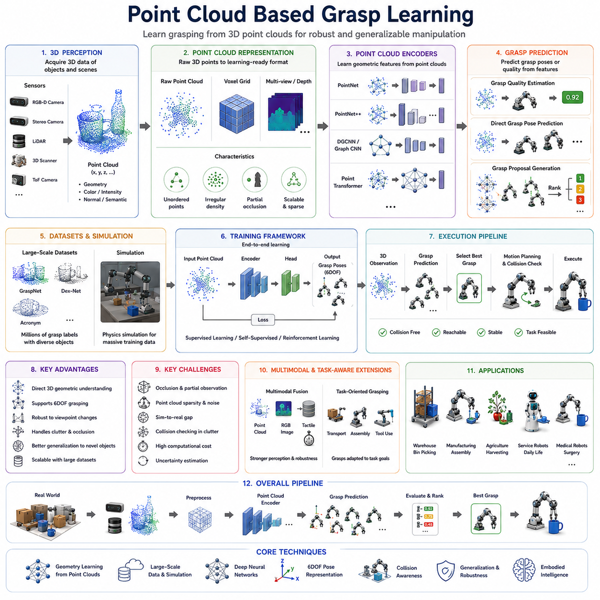{width="7.268055555555556in" height="7.268055555555556in"}

Point Cloud Based Grasp Learning has emerged as one of the most important research directions in modern robotic manipulation. As robotic systems increasingly operate in complex, dynamic, and unstructured environments, the limitations of two-dimensional image-based grasping have become more apparent. While RGB images and depth maps provide valuable information, they often struggle to represent the full geometric complexity of real-world objects. Point clouds, on the other hand, offer a direct three-dimensional representation of object surfaces and spatial structures. By learning grasping strategies directly from point cloud data, robots can better understand object geometry, reason about grasp opportunities in three-dimensional space, and achieve more robust manipulation performance across a wide range of applications.

A point cloud is a collection of three-dimensional points that represent the visible surfaces of objects and environments. Each point typically contains spatial coordinates in the form of X, Y, and Z values. Depending on the sensing system, additional information such as color, intensity, surface normal vectors, reflectance, or semantic labels may also be included. Point clouds are generated by sensors such as RGB-D cameras, stereo vision systems, structured-light scanners, LiDAR sensors, time-of-flight cameras, and industrial 3D scanners. Unlike conventional images, which encode information on a two-dimensional grid, point clouds directly describe geometric structures in three-dimensional space.

The importance of point clouds in robotic grasping arises from the fundamentally geometric nature of grasping itself. A robot hand interacts with object surfaces, contact points, edges, corners, handles, and curved regions. These features are inherently three-dimensional. Although images can provide indirect cues about geometry, point clouds represent spatial information explicitly. This enables grasp learning systems to reason directly about object shape, surface orientation, accessibility, and contact opportunities without relying on intermediate reconstruction processes.

Traditional grasp planning systems often relied on manually engineered geometric features extracted from point clouds. Researchers would estimate surface normals, identify graspable regions, detect object boundaries, and generate candidate grasps using geometric heuristics. While these approaches achieved success in certain applications, they depended heavily on handcrafted algorithms and often struggled to generalize across diverse object categories. The emergence of deep learning transformed this field by enabling robots to learn geometric representations directly from raw point cloud data.

One of the earliest challenges in point cloud learning was the irregular nature of point cloud data. Unlike images, which are organized into regular pixel grids, point clouds are unordered sets of points. The number of points may vary from one observation to another, and neighboring points are not arranged in a fixed structure. Traditional convolutional neural networks were designed for grid-based data and could not be directly applied to raw point clouds. This challenge motivated the development of specialized neural architectures capable of processing unordered three-dimensional point sets.

A major breakthrough occurred with the introduction of PointNet. PointNet demonstrated that deep neural networks could learn directly from raw point cloud data without requiring voxelization, mesh reconstruction, or handcrafted feature extraction. The key insight behind PointNet was that point clouds can be treated as unordered sets rather than structured grids. By applying shared neural transformations to individual points and using symmetric aggregation functions such as max pooling, PointNet achieved permutation invariance while learning meaningful geometric representations.

The success of PointNet had a profound impact on robotic grasping research. For the first time, learning systems could directly analyze object geometry from point clouds and infer grasping opportunities without extensive preprocessing. PointNet-based architectures became widely adopted in grasp detection, object recognition, scene understanding, and manipulation planning.

Although PointNet represented a major advance, it also had limitations. The architecture primarily focused on global shape understanding and did not explicitly capture local geometric relationships between neighboring points. In robotic grasping, local geometry is often critically important because contact formation occurs at specific surface regions. To address this limitation, PointNet++ was introduced. PointNet++ incorporated hierarchical feature extraction and local neighborhood processing, enabling the network to learn both local and global geometric structures.

The development of PointNet++ significantly improved grasp learning performance. Networks could now recognize fine-grained surface details such as handles, edges, corners, grooves, and curved contact regions. These local features are often essential for determining stable grasp locations. The hierarchical representation also improved robustness to variations in object scale and point cloud density.

Another influential research direction involves graph-based neural networks. Point clouds naturally form spatial relationships among neighboring points. Graph neural networks explicitly model these relationships by treating points as graph nodes connected through local neighborhoods. Dynamic Graph CNN and related architectures construct graphs dynamically during learning, enabling the network to capture complex geometric interactions. These models often achieve superior performance in tasks requiring detailed understanding of object topology and local surface structure.

Point cloud based grasp learning can be broadly divided into several categories. One category focuses on grasp quality estimation. In this approach, the network evaluates candidate grasp configurations and predicts the probability of success. The system receives a point cloud and a proposed grasp pose as input and produces a quality score as output. This methodology extends concepts such as GQ-CNN into the three-dimensional domain and allows robots to rank candidate grasps according to predicted stability.

A second category focuses on direct grasp pose prediction. Rather than evaluating predefined candidates, the network generates grasp poses directly from point cloud observations. Given an object point cloud, the model predicts one or more six-degree-of-freedom grasp configurations. This end-to-end approach simplifies the grasp planning pipeline and often enables faster inference in real-time systems.

A third category involves grasp proposal generation. In these systems, neural networks first generate large numbers of potential grasp candidates and subsequently refine or rank them using additional evaluation modules. This strategy resembles object detection pipelines in computer vision and provides an effective balance between computational efficiency and prediction accuracy.

One of the most significant advantages of point cloud based grasp learning is its compatibility with six-degree-of-freedom grasp representations. Because point clouds inherently describe three-dimensional geometry, they naturally support the prediction of full 6DOF grasp poses. This capability is particularly important in cluttered environments where top-down grasping assumptions are insufficient. Robots can approach objects from arbitrary directions and exploit grasp opportunities that would be difficult to identify using image-based methods alone.

Large-scale datasets have played a crucial role in advancing point cloud based grasp learning. Datasets such as GraspNet, Dex-Net, Acronym, and various industrial benchmarks provide millions of grasp annotations associated with diverse object geometries. These datasets enable neural networks to learn robust relationships between three-dimensional shape features and successful grasp outcomes. The availability of large-scale training data has been instrumental in the development of increasingly capable grasp prediction models.

Simulation is another critical component of modern point cloud grasp learning. Collecting large quantities of real-world grasp data is expensive and time-consuming. Physics-based simulators allow researchers to generate synthetic point clouds, evaluate grasp configurations, and create large-scale training datasets automatically. Simulation environments can produce enormous quantities of data covering diverse object categories, lighting conditions, sensor viewpoints, and physical interactions.

However, simulated point clouds often differ from real-world observations. Real sensors introduce measurement noise, missing data, occlusions, calibration errors, and environmental artifacts that are difficult to model perfectly. Consequently, sim-to-real transfer remains an active area of research. Domain randomization, domain adaptation, self-supervised learning, and hybrid real-synthetic training strategies are commonly employed to improve transfer performance.

Occlusion handling is one of the most important challenges in point cloud based grasp learning. Real-world objects are rarely observed completely. Portions of an object may be hidden by other objects, environmental structures, or the viewing geometry itself. Learning systems must therefore infer grasp opportunities from partial observations. Advanced architectures increasingly incorporate shape completion, probabilistic reasoning, and generative modeling techniques to address this challenge.

Shape completion has become a particularly important research topic. Given an incomplete point cloud, a shape completion model predicts the missing portions of the object geometry. The completed representation can then be used for grasp planning. This approach improves grasp prediction accuracy in cluttered environments where full object visibility is unavailable.

Transformer architectures have recently become highly influential in point cloud grasp learning. Point transformers apply self-attention mechanisms to point cloud data, enabling networks to model long-range geometric relationships and global context more effectively than traditional convolutional approaches. Transformer-based models often achieve state-of-the-art performance across grasp detection benchmarks and continue to drive rapid progress in the field.

The integration of multimodal sensing represents another important development. While point clouds provide rich geometric information, they do not directly capture physical properties such as texture, compliance, friction, or contact state. Combining point clouds with RGB images, tactile sensing, force measurements, and proprioceptive information allows learning systems to develop more comprehensive representations of grasping scenarios. Multimodal fusion often leads to improved robustness and generalization.

Tactile integration is particularly promising. Vision-based point cloud systems primarily reason about grasping before contact occurs. Tactile sensors provide information after contact formation, including pressure distributions, slip events, contact locations, and force interactions. Learning systems that combine point cloud geometry with tactile feedback can adapt grasp strategies dynamically and recover from execution errors.

Task-oriented grasp learning extends point cloud based grasp prediction beyond simple object acquisition. In many applications, the best grasp depends on the intended downstream task. A grasp suitable for transportation may not be appropriate for assembly, pouring, tool use, or handover. Task-aware learning systems incorporate semantic and functional objectives into grasp prediction, enabling more intelligent manipulation behavior.

Recent developments in foundation models are beginning to influence point cloud grasp learning as well. Large-scale multimodal models trained on visual, geometric, tactile, and language data can provide semantic reasoning capabilities that complement geometric understanding. Future grasping systems may use language instructions to guide point cloud based grasp prediction, allowing robots to generate task-specific grasp strategies informed by both physical and semantic constraints.

Industrial applications of point cloud based grasp learning are expanding rapidly. Warehouse automation systems use point cloud perception to perform bin picking and order fulfillment. Manufacturing robots manipulate irregular components and perform assembly operations. Agricultural robots identify and harvest fruits and vegetables within dense plant structures. Service robots interact with household objects in complex environments. Medical robots leverage three-dimensional perception for instrument handling and material manipulation.

Evaluation of point cloud grasp learning systems typically involves multiple performance metrics. Grasp success rate remains the primary measure of practical effectiveness. Additional metrics include pose accuracy, robustness to sensor noise, generalization to unseen objects, computational efficiency, collision avoidance capability, and task completion performance. Benchmark datasets provide standardized evaluation protocols that facilitate objective comparison across different algorithms.

Despite remarkable progress, several challenges remain unresolved. Point cloud sparsity, occlusion, sensor noise, transparent objects, reflective surfaces, deformable materials, and highly cluttered environments continue to present difficulties. Efficient processing of large-scale point clouds remains computationally demanding, particularly for embedded robotic platforms. Robust uncertainty estimation and lifelong adaptation also remain active research topics.

Future research is likely to focus on combining point cloud learning with foundation models, world models, tactile intelligence, and embodied reasoning systems. Rather than simply predicting grasp poses, future robots will understand object functionality, anticipate interaction outcomes, and adapt manipulation strategies based on task objectives and environmental context. Point cloud based grasp learning will therefore remain a foundational technology for next-generation robotic manipulation systems.

Ultimately, Point Cloud Based Grasp Learning represents a major shift toward geometry-centric robotic intelligence. By learning directly from three-dimensional representations of the physical world, robots can develop a deeper understanding of object structure, contact opportunities, and manipulation possibilities. This capability provides the foundation for robust grasping in real-world environments and serves as a critical building block for future developments in dexterous manipulation, autonomous robotics, and embodied artificial intelligence.

## 11.06 RGB-D Grasp Learning

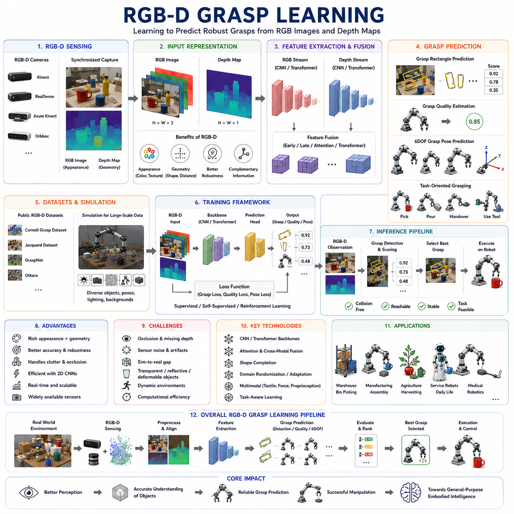{width="7.268055555555556in" height="7.268055555555556in"}

RGB-D Grasp Learning is one of the most influential and widely adopted approaches in modern robotic manipulation. The term RGB-D refers to the combination of conventional color images, represented by Red, Green, and Blue channels, together with depth information that describes the distance between the sensor and observed surfaces. By integrating appearance information with three-dimensional geometric information, RGB-D sensing provides a rich representation of the environment that enables robots to perceive objects more effectively and make more informed grasping decisions. Over the past decade, RGB-D grasp learning has become a cornerstone technology in warehouse automation, industrial robotics, service robotics, healthcare robotics, agricultural automation, and embodied artificial intelligence systems.

The emergence of RGB-D grasp learning was driven by the limitations of purely RGB-based vision systems. Traditional computer vision approaches relied primarily on color and texture information. While such systems could recognize objects and estimate their locations under favorable conditions, they often struggled to understand three-dimensional geometry accurately. Depth ambiguity, lighting variations, shadows, reflections, and textureless surfaces frequently caused failures in robotic manipulation tasks. The introduction of affordable RGB-D sensors such as Microsoft Kinect, Intel RealSense, ASUS Xtion, Orbbec sensors, and various industrial depth cameras transformed robotic perception by providing direct measurements of scene geometry alongside visual appearance.

Depth information fundamentally changes how a robot perceives its environment. Instead of inferring shape indirectly from visual cues, the robot receives explicit geometric information about object surfaces, distances, edges, and spatial relationships. When combined with RGB information, depth measurements allow robots to simultaneously understand what an object looks like and where it exists in three-dimensional space. This fusion of appearance and geometry creates a powerful foundation for learning-based grasping systems.

The basic objective of RGB-D grasp learning is to predict successful grasp configurations from RGB-D observations. Given an RGB image and a corresponding depth map, a learning system estimates grasp locations, grasp orientations, grasp quality scores, grasp poses, or complete manipulation strategies. Depending on the system architecture, the output may consist of planar grasp rectangles, six-degree-of-freedom grasp poses, grasp quality distributions, contact point predictions, or task-oriented manipulation actions.

One of the primary reasons RGB-D data became so popular in robotic grasping is its balance between information richness and computational efficiency. Point clouds provide highly detailed geometric representations but can be computationally expensive to process. RGB images are computationally efficient but lack explicit three-dimensional structure. RGB-D data offers a practical compromise by preserving image-based representations while incorporating essential geometric information. This balance makes RGB-D particularly suitable for real-time robotic applications.

The early development of RGB-D grasp learning coincided with advances in deep learning and convolutional neural networks. Researchers recognized that depth maps share structural similarities with grayscale images and could therefore be processed using convolutional architectures. Initial systems treated depth images as additional image channels and extended traditional computer vision pipelines to incorporate geometric information. These approaches demonstrated substantial improvements over RGB-only methods and established RGB-D learning as a viable paradigm for robotic manipulation.

One of the most influential milestones in RGB-D grasp learning was the development of grasp rectangle prediction systems. These systems represented a grasp as a rectangle defined by a center position, orientation angle, gripper width, and grasp quality score. Given an RGB-D observation, a neural network predicted one or more grasp rectangles corresponding to stable grasp opportunities. This formulation simplified the grasp planning problem while maintaining sufficient flexibility for many industrial applications.

The Cornell Grasp Dataset played a particularly important role in advancing RGB-D grasp learning. This benchmark dataset contains RGB-D images paired with manually annotated grasp rectangles. It became one of the most widely used evaluation platforms for grasp detection algorithms and enabled consistent comparison between different learning approaches. Many early RGB-D grasp networks were developed and benchmarked using this dataset.

The success of RGB-D grasp learning is closely linked to the effectiveness of convolutional neural networks. CNNs excel at extracting hierarchical visual features from image-based representations. In RGB-D systems, convolutional layers learn both appearance-related and geometry-related features. Early layers capture edges, contours, textures, and depth discontinuities, while deeper layers learn object structures, grasp affordances, and task-relevant geometric relationships. This hierarchical feature extraction enables robust grasp prediction across diverse object categories.

Feature fusion represents one of the central challenges in RGB-D grasp learning. RGB and depth information provide complementary perspectives on the environment. RGB images capture color, texture, material appearance, and semantic cues, while depth maps provide geometric structure, surface orientation, and spatial relationships. Effective learning systems must integrate these information sources in a manner that maximizes their combined utility. Researchers have proposed numerous fusion strategies, including early fusion, late fusion, multi-stream architectures, attention-based fusion, and transformer-based multimodal integration.

Early fusion combines RGB and depth channels at the input stage, allowing the network to learn joint representations from the beginning of the processing pipeline. This approach is computationally efficient and straightforward to implement. However, it may not fully exploit the unique characteristics of each modality. Late fusion processes RGB and depth information separately before combining higher-level features. This strategy allows modality-specific feature extraction but often requires more computational resources.

Multi-stream architectures became particularly popular in RGB-D grasp learning. Separate neural network branches process RGB and depth data independently, and the resulting feature representations are merged at intermediate or final layers. This design enables specialized processing for each modality while preserving opportunities for cross-modal interaction. Many state-of-the-art RGB-D grasping systems employ variations of this architecture.

The emergence of attention mechanisms further improved RGB-D feature fusion. Attention-based models dynamically determine which regions and modalities are most relevant for grasp prediction. For example, texture information may be important for identifying object boundaries, while depth information may be more valuable for estimating grasp geometry. Attention mechanisms allow the network to allocate computational resources adaptively based on task requirements and scene context.

Transformer architectures have recently become highly influential in RGB-D grasp learning. Transformers provide powerful mechanisms for modeling long-range dependencies and cross-modal relationships. Vision transformers, multimodal transformers, and vision-language-action architectures increasingly incorporate RGB-D inputs to achieve more robust perception and manipulation capabilities. These models can integrate geometric reasoning, semantic understanding, and task context within a unified learning framework.

Grasp quality estimation represents a major application of RGB-D learning. In grasp quality prediction systems, the network evaluates candidate grasp configurations and estimates the likelihood of success. RGB-D observations provide both visual and geometric information about the object and its surroundings. The resulting quality predictions help robots select grasps that are stable, collision-free, and suitable for downstream tasks.

RGB-D grasp learning also plays a central role in six-degree-of-freedom grasp detection. While early grasp detectors focused on planar grasping, modern systems increasingly predict full spatial grasp poses. Depth information is particularly valuable in this context because it provides direct measurements of object geometry. RGB-D networks can infer object orientation, surface structure, and accessibility, enabling robust 6DOF grasp prediction even in cluttered environments.

Cluttered scene grasping represents one of the most important application domains for RGB-D learning. Real-world environments rarely contain isolated objects placed on clean backgrounds. Instead, robots must operate in shelves, bins, warehouses, factories, kitchens, hospitals, and homes where multiple objects interact and partially occlude one another. RGB-D observations help resolve these challenges by providing depth cues that distinguish overlapping objects and reveal spatial relationships that may not be apparent from color images alone.

Occlusion handling remains a significant research challenge. Even with depth sensing, portions of objects may remain invisible due to viewing geometry or environmental obstruction. Modern RGB-D grasp learning systems increasingly incorporate shape completion networks, probabilistic reasoning methods, and generative models that infer missing geometry from partial observations. These techniques improve robustness in complex environments where complete object visibility cannot be guaranteed.

Simulation plays an increasingly important role in RGB-D grasp learning. Collecting large-scale grasping datasets using physical robots is expensive and time-consuming. Modern simulation environments generate synthetic RGB-D observations along with grasp annotations and physical interaction labels. Simulated datasets allow researchers to train large neural networks efficiently while exploring diverse object categories, environmental conditions, and sensor configurations.

However, transferring RGB-D models from simulation to reality remains challenging. Real sensors exhibit noise, calibration errors, missing depth measurements, lighting artifacts, motion blur, and environmental variability that are difficult to model accurately. Researchers employ domain randomization, domain adaptation, self-supervised learning, and online fine-tuning to bridge the sim-to-real gap and improve real-world deployment performance.

The integration of tactile sensing with RGB-D perception represents a major research direction. RGB-D observations provide rich information before contact occurs, but tactile sensors become essential once physical interaction begins. Combining visual geometry, appearance information, pressure distributions, slip detection, and force measurements enables more adaptive and reliable grasp control. Multimodal learning systems that integrate RGB-D and tactile sensing increasingly approach human-like manipulation capabilities.

Task-oriented RGB-D grasp learning extends grasp prediction beyond simple object acquisition. In many applications, the best grasp depends on the intended task. A grasp suitable for transportation may be inappropriate for assembly, pouring, cutting, tool use, or human handover. Task-aware learning systems incorporate semantic objectives, task constraints, and future action requirements into grasp planning. RGB information contributes semantic understanding, while depth information provides geometric feasibility.

The rise of foundation models is beginning to reshape RGB-D grasp learning. Large-scale multimodal models trained on images, depth data, language instructions, robot actions, and interaction histories can learn generalized representations that support a wide range of manipulation tasks. Future RGB-D grasping systems will likely integrate perception, reasoning, planning, and control within unified architectures capable of adapting to novel environments and tasks.

Industrial applications of RGB-D grasp learning continue to expand rapidly. Warehouse robots use RGB-D perception for bin picking, item sorting, and order fulfillment. Manufacturing robots perform assembly, inspection, and material handling. Agricultural robots identify and harvest crops while minimizing damage. Service robots manipulate household objects in dynamic environments. Healthcare robots use RGB-D sensing for instrument handling, logistics support, and patient assistance. The versatility of RGB-D perception makes it suitable for a broad range of robotic platforms and operational contexts.

Performance evaluation in RGB-D grasp learning typically involves grasp success rate, detection accuracy, pose estimation quality, robustness to sensor noise, generalization to novel objects, computational efficiency, and task completion success. Public datasets and benchmark challenges have accelerated progress by providing standardized evaluation frameworks and facilitating comparison between competing methods.

Despite remarkable advances, several challenges remain unresolved. Transparent objects, reflective materials, deformable objects, severe occlusions, dynamic environments, and highly cluttered scenes continue to present difficulties. Depth sensors themselves have limitations, particularly when operating under strong sunlight, reflective surfaces, or long-range conditions. Efficient deployment on embedded hardware also remains an important practical consideration.

Future RGB-D grasp learning systems will likely combine multimodal perception, foundation models, world models, self-supervised learning, and embodied reasoning capabilities. Rather than merely predicting grasp locations, robots will increasingly understand object functionality, anticipate manipulation outcomes, reason about task objectives, and adapt their behavior through continuous interaction with the environment. RGB-D perception will remain a central component of this evolution because it provides a uniquely effective combination of semantic richness and geometric understanding.

Ultimately, RGB-D Grasp Learning represents a critical bridge between visual perception and physical interaction. By integrating appearance information with explicit three-dimensional geometry, RGB-D systems enable robots to perceive, understand, and manipulate the physical world with increasing competence. As robotic intelligence continues to advance toward general-purpose embodied systems, RGB-D grasp learning will remain one of the foundational technologies supporting robust, adaptive, and scalable robotic manipulation.

## 11.07 Behavior Cloning for Grasping

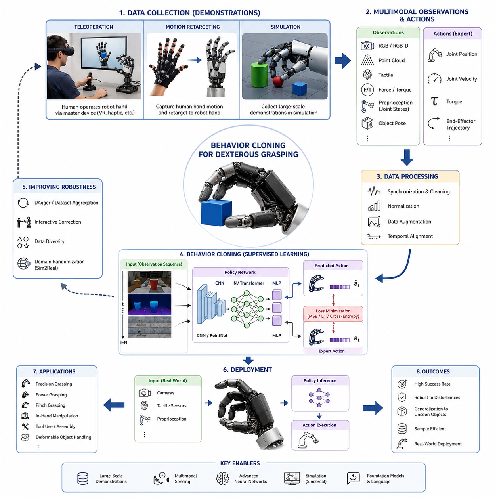{width="7.268055555555556in" height="7.268055555555556in"}

Behavior Cloning for Dexterous Grasping is one of the most important learning paradigms in modern robot manipulation because it provides a direct pathway for transferring human expertise into robotic systems. While traditional grasp planning relies on analytical models, contact mechanics, force closure analysis, and manually engineered controllers, behavior cloning enables a robot to learn grasping behaviors directly from demonstrations. The central idea is straightforward: instead of explicitly programming how a dexterous hand should move, a large collection of expert demonstrations is gathered, and a machine learning model is trained to imitate those actions. The resulting policy learns a mapping from sensory observations to motor commands, allowing the robot to reproduce complex grasping behaviors that may be difficult to describe mathematically.

Behavior cloning belongs to the broader field of Learning from Demonstration (LfD), also known as Imitation Learning. In dexterous grasping, demonstrations may come from human operators controlling robot hands through teleoperation systems, motion capture devices, virtual reality interfaces, exoskeleton gloves, haptic devices, or kinesthetic teaching methods. During demonstration collection, sensory information such as RGB images, RGB-D images, point clouds, tactile measurements, force-torque data, joint positions, joint velocities, and object poses are recorded together with the corresponding control actions executed by the expert. The learning algorithm then attempts to approximate the expert policy by minimizing the difference between predicted actions and demonstrated actions.

The appeal of behavior cloning lies in its simplicity. Unlike reinforcement learning, which often requires millions of interactions with the environment, behavior cloning can learn useful manipulation skills from relatively small datasets. This advantage is particularly important in dexterous grasping because robotic hands are expensive, fragile, and difficult to operate continuously for large-scale training. Human demonstrations provide high-quality examples of successful behavior, allowing robots to achieve meaningful performance with significantly reduced data collection costs.

Dexterous grasping presents unique challenges compared to simple pick-and-place operations. A multi-finger robotic hand may contain more than twenty degrees of freedom, resulting in a high-dimensional action space. The robot must coordinate multiple fingers, regulate grasp forces, maintain stable contacts, compensate for object uncertainty, and react to unexpected disturbances. Human experts naturally perform these actions through years of accumulated motor experience. Behavior cloning seeks to capture this expertise and encode it within neural network policies capable of generating similar behaviors.

A typical behavior cloning pipeline begins with demonstration acquisition. Teleoperation is one of the most common approaches. A human operator controls the robotic hand through a master device while observing the robot through cameras or immersive displays. The robot records sensory observations and corresponding control actions at high frequency. Modern systems frequently employ virtual reality gloves equipped with finger tracking sensors. These devices capture detailed finger motions and allow operators to manipulate virtual or physical objects naturally. The resulting datasets provide rich examples of grasp strategies, finger coordination patterns, and object interaction dynamics.

Another popular demonstration collection method involves motion retargeting. Human hand movements are captured using optical motion capture systems, inertial sensors, depth cameras, or instrumented gloves. Since human hands and robotic hands often have different kinematic structures, a retargeting algorithm converts human finger configurations into corresponding robot joint commands. This process enables large-scale demonstration collection while preserving important aspects of human dexterity.

Simulation environments have also become valuable sources of demonstrations. Human operators can manipulate virtual robot hands inside physics simulators such as Isaac Sim, MuJoCo, and PyBullet. Simulated demonstrations can be generated more rapidly than physical demonstrations and may include automatically labeled contact information, object states, and force measurements. Simulation additionally supports large-scale data augmentation, enabling the generation of diverse grasping scenarios that would be costly to create in the real world.

Once demonstrations have been collected, the next stage involves data preprocessing. Raw demonstrations often contain sensor noise, inconsistent timing, missing observations, and operator-specific biases. Data cleaning removes invalid samples and synchronizes multiple sensor streams. Temporal alignment ensures that actions correspond correctly to sensory observations. Normalization procedures scale sensor values into consistent numerical ranges. Augmentation techniques introduce variability in lighting conditions, object poses, camera viewpoints, and environmental parameters to improve policy generalization.

The learning objective in behavior cloning is generally formulated as supervised learning. Let the observation at time t be represented by (o_t), and the expert action by (a_t). The goal is to learn a policy (\\pi(o_t)) that predicts actions similar to those demonstrated by the expert. Training minimizes a loss function measuring the discrepancy between predicted and demonstrated actions. For continuous robot control, mean squared error is frequently employed. For discrete action representations, cross-entropy losses may be used. The optimization process updates neural network parameters until the policy closely reproduces expert behavior.

Early behavior cloning systems relied on relatively simple models such as linear regression, decision trees, and shallow neural networks. Modern dexterous grasping systems increasingly utilize deep learning architectures capable of processing high-dimensional sensory inputs. Convolutional Neural Networks extract visual features from RGB and RGB-D images. Point cloud networks process three-dimensional object geometry. Recurrent Neural Networks capture temporal dependencies across manipulation sequences. Transformer architectures model long-range relationships between observations, actions, and task contexts.

Vision-based behavior cloning has become particularly influential in robotic grasping. A robot observes the scene through cameras and predicts motor actions directly from image data. The neural network implicitly learns object recognition, pose estimation, grasp affordance identification, and motion planning within a single end-to-end framework. This approach reduces dependence on handcrafted perception pipelines and enables more adaptive grasping behavior.

Multimodal behavior cloning extends this concept by integrating visual, tactile, proprioceptive, and force sensing information. Human dexterity depends heavily on tactile feedback. During grasp execution, tactile sensors provide critical information regarding contact locations, pressure distributions, slip events, and object deformation. Incorporating tactile observations allows learned policies to react more effectively to uncertainty and maintain stable grasps under varying conditions. Recent studies have demonstrated significant improvements in dexterous manipulation performance when tactile sensing is combined with visual perception.

Temporal modeling is particularly important in dexterous grasping. Many manipulation tasks require sequences of coordinated actions rather than isolated control commands. Grasp acquisition, object stabilization, finger repositioning, and in-hand manipulation unfold over extended periods of time. Sequential models such as Long Short-Term Memory networks and Transformer-based policies capture temporal context and improve action prediction accuracy. These models learn how current actions depend on previous observations and previous control decisions.

Despite its simplicity, behavior cloning suffers from a well-known limitation known as covariate shift. During training, the policy observes states encountered by the expert. During deployment, however, small prediction errors can lead the robot into unfamiliar states not represented in the training data. Since the policy has never learned how to recover from these situations, errors accumulate over time and task performance deteriorates. This phenomenon is particularly problematic in dexterous grasping because small deviations in finger placement or contact forces may rapidly destabilize a grasp.

Researchers have developed several techniques to address covariate shift. Dataset Aggregation (DAgger) iteratively collects additional demonstrations in states visited by the learned policy. By augmenting the dataset with recovery behaviors, the policy gradually learns to handle a broader range of situations. Interactive imitation learning approaches allow experts to intervene when failures occur and provide corrective demonstrations. These methods significantly improve robustness compared to conventional behavior cloning.

Another important challenge involves demonstration diversity. A robot trained on limited demonstrations may memorize specific object configurations rather than learning general grasping principles. Large and diverse datasets improve generalization by exposing the policy to variations in object geometry, texture, mass distribution, lighting conditions, and environmental contexts. Recent large-scale robotic datasets contain millions of demonstration trajectories covering thousands of objects and manipulation scenarios.

Data representation plays a critical role in policy performance. Some systems represent actions as joint position commands. Others use joint velocities, torques, Cartesian fingertip trajectories, grasp poses, or latent skill embeddings. The choice of action representation influences learning stability, generalization capability, and execution smoothness. High-level action representations often simplify learning but may reduce control precision. Low-level motor commands provide greater flexibility but require larger datasets and more sophisticated training procedures.

Behavior cloning has proven highly effective for a wide range of dexterous grasping tasks. Robots can learn precision grasps for small objects, power grasps for heavy objects, pinch grasps for thin objects, and adaptive grasps for deformable materials. Policies trained through imitation learning have demonstrated capabilities such as object reorientation, finger gaiting, tool manipulation, cable handling, and assembly operations. These achievements illustrate the potential of demonstration-driven learning for replicating complex human manipulation skills.

The integration of foundation models has further expanded the capabilities of behavior cloning systems. Large vision-language-action models can leverage demonstration datasets collected across multiple robots, environments, and tasks. Instead of learning a single grasping skill, these models acquire generalized manipulation knowledge applicable to a broad range of situations. Language instructions can guide grasp selection, object prioritization, and task execution. For example, a robot may learn different grasp strategies for the instruction "pick up the cup by the handle" versus "grasp the cup securely for transport."

Simulation-to-real transfer has become increasingly important in behavior cloning research. Demonstrations collected in simulation can significantly reduce the cost of data acquisition. Domain randomization introduces variability in visual appearance, object properties, sensor characteristics, and environmental conditions. Policies trained on randomized simulations often generalize more effectively to real-world deployment. Combined with fine-tuning on limited real-world demonstrations, sim-to-real behavior cloning offers a practical pathway toward scalable dexterous grasp learning.

Evaluation of behavior cloning systems typically focuses on grasp success rate, task completion rate, robustness to disturbances, generalization to unseen objects, execution speed, and sample efficiency. Benchmark datasets such as GraspNet and various dexterous manipulation benchmarks provide standardized evaluation protocols. Researchers also assess performance under varying sensor noise levels, object occlusions, and environmental uncertainties to measure real-world reliability.

Industrial applications of behavior cloning are rapidly expanding. Warehouse automation systems use demonstration-based learning to handle diverse consumer products. Manufacturing robots learn assembly procedures from expert operators. Medical robots acquire delicate handling skills for surgical instruments and laboratory materials. Service robots learn household manipulation behaviors through human demonstrations. In all these applications, behavior cloning reduces development time by eliminating the need for extensive manual programming.

The future of behavior cloning for dexterous grasping is closely linked to advances in large-scale robotic data collection, multimodal sensing, foundation models, and embodied intelligence. Future systems are expected to learn from millions of demonstrations collected across global robot fleets. Visual, tactile, force, language, and proprioceptive information will be integrated into unified representations. Hierarchical policies will combine low-level motor control with high-level reasoning and planning. Foundation models will provide general manipulation knowledge, while behavior cloning will specialize these capabilities for specific robotic platforms and applications.

Ultimately, behavior cloning represents a crucial bridge between human expertise and robotic autonomy. By learning directly from demonstrations, dexterous robotic hands can acquire sophisticated grasping skills that would be extremely difficult to engineer manually. As datasets become larger, sensors become richer, and learning architectures become more powerful, behavior cloning will continue to play a central role in the development of intelligent robot hands capable of performing human-level grasping and manipulation in unstructured real-world environments. This chapter belongs to the Learning Based Grasping section of Volume 06 and serves as a foundational link between classical Learning from Demonstration methodologies and the emerging generation of foundation-model-driven dexterous manipulation systems.

## 11.08 Reinforcement Learning for Grasping

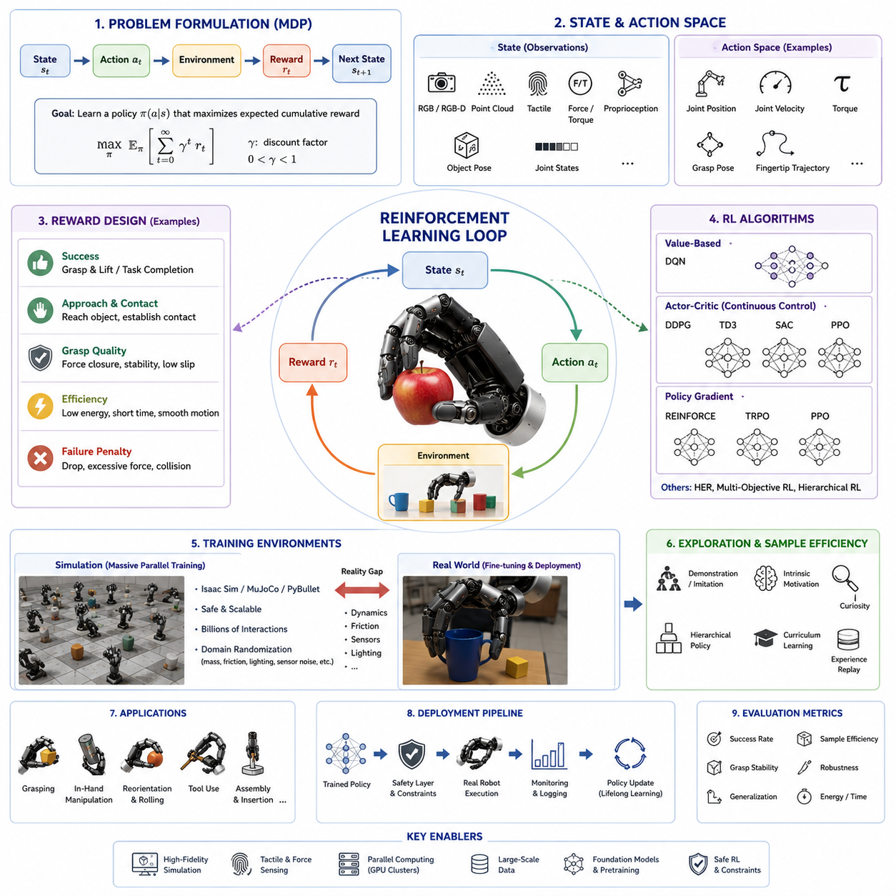{width="7.268055555555556in" height="7.268055555555556in"}

Reinforcement Learning for Grasping represents one of the most powerful approaches for enabling robots to acquire grasping and manipulation skills through autonomous interaction with their environment. Unlike supervised learning methods such as behavior cloning, which rely on expert demonstrations, reinforcement learning allows a robot to learn grasping behaviors through trial and error. The robot repeatedly interacts with objects, evaluates the consequences of its actions through reward signals, and gradually discovers policies that maximize long-term success. This capability is particularly attractive for dexterous robotic hands because many grasping and manipulation strategies are difficult to model analytically and may not be fully captured by human demonstrations.

The fundamental concept of reinforcement learning is inspired by how humans and animals learn through experience. A robot performs an action, observes the resulting state change, receives a reward, and updates its decision-making strategy. Over time, successful actions become more likely while unsuccessful actions are suppressed. In robotic grasping, this learning process enables the discovery of grasp strategies that may not have been explicitly programmed by engineers. The robot can learn how to adapt to object variations, compensate for uncertainty, recover from failures, and exploit physical interactions that are difficult to describe mathematically.

In reinforcement learning, the grasping problem is typically formulated as a Markov Decision Process (MDP). The robot observes the current state of the environment, selects an action according to its policy, transitions to a new state, and receives a reward. The state may include RGB images, RGB-D images, point clouds, tactile sensor readings, force measurements, joint positions, joint velocities, object poses, and environmental information. Actions may consist of joint commands, fingertip trajectories, grasp poses, torque commands, or high-level manipulation primitives. The reward function evaluates the quality of the action and provides feedback that guides learning.

The design of the reward function is one of the most critical aspects of reinforcement learning for grasping. A simple reward function may assign a positive value when an object is successfully grasped and lifted and a negative value when the object is dropped. However, sparse rewards often make learning extremely difficult because successful grasp events may occur only rarely during early exploration. To address this challenge, researchers frequently employ reward shaping techniques. Intermediate rewards may be provided for approaching an object, establishing contact, reducing grasp error, increasing grasp stability, maintaining force closure, or successfully manipulating the object toward a desired goal state.

Early reinforcement learning approaches in robotics were limited by computational resources and sample efficiency. Classical methods such as Q-Learning and SARSA demonstrated the feasibility of learning control policies but struggled with high-dimensional state and action spaces. Dexterous robotic hands often possess twenty or more degrees of freedom, making traditional tabular methods impractical. The emergence of deep reinforcement learning transformed the field by combining neural networks with reinforcement learning algorithms. Deep neural networks provide powerful function approximation capabilities that enable policies to operate directly on high-dimensional sensory observations.

Deep Q-Networks (DQN) were among the first successful deep reinforcement learning methods. DQN approximates action-value functions using deep neural networks and learns optimal policies through experience replay and temporal difference learning. Although DQN achieved remarkable success in discrete action domains, grasping tasks typically involve continuous actions, requiring alternative algorithms. Continuous control methods such as Deep Deterministic Policy Gradient (DDPG), Twin Delayed Deep Deterministic Policy Gradient (TD3), and Soft Actor-Critic (SAC) have become widely adopted for robotic manipulation.

Policy gradient methods constitute another important category of reinforcement learning algorithms. Instead of learning value functions, policy gradient methods directly optimize the policy itself. Algorithms such as REINFORCE, Trust Region Policy Optimization (TRPO), and Proximal Policy Optimization (PPO) have demonstrated strong performance in robotic grasping applications. PPO, in particular, has become one of the most widely used algorithms because it balances learning stability, computational efficiency, and implementation simplicity.

For dexterous grasping, reinforcement learning offers several unique advantages. Multi-finger robotic hands operate in complex contact-rich environments where analytical solutions may be difficult or impossible to derive. Reinforcement learning can discover control policies that exploit subtle physical interactions between fingers and objects. The resulting behaviors often exhibit emergent coordination patterns that were never explicitly programmed. Fingers may automatically adjust their positions, redistribute forces, and coordinate motions to achieve stable grasps under varying conditions.

One of the most influential demonstrations of reinforcement learning for dexterous manipulation was the Dactyl project. In this system, a multi-finger robotic hand learned to manipulate and reorient objects through extensive reinforcement learning training in simulation. The learned policy demonstrated remarkable robustness to disturbances and successfully transferred to physical hardware. This work highlighted the potential of reinforcement learning for achieving human-like dexterity in robotic systems.

Simulation has become a cornerstone of reinforcement learning research in robotic grasping. Real-world training is often prohibitively expensive because millions or billions of interactions may be required. Physics simulators such as Isaac Sim, MuJoCo, PyBullet, and other robotic simulation platforms provide safe and efficient environments for large-scale learning. Within simulation, robots can explore grasping strategies continuously without hardware wear, safety concerns, or operational costs. Massive parallelization further accelerates training by allowing thousands of simulated environments to run simultaneously.

However, simulation introduces a new challenge known as the reality gap. Physical systems differ from simulations in terms of friction, material properties, sensor noise, latency, compliance, and environmental variability. Policies trained exclusively in simulation may fail when deployed on real robots. To address this issue, researchers employ domain randomization techniques. During training, physical parameters such as object mass, friction coefficients, lighting conditions, sensor noise, and contact properties are randomly varied. The resulting policy learns to operate across a broad range of conditions and becomes more robust when transferred to real-world environments.

Domain adaptation and sim-to-real transfer have become major research areas within reinforcement learning for grasping. Fine-tuning simulated policies using small amounts of real-world data can significantly improve performance. Hybrid approaches combine simulation-generated experience with real-world interactions to achieve efficient learning while maintaining practical deployment capabilities.

Exploration remains one of the most challenging aspects of reinforcement learning. A robot must discover successful grasping behaviors before it can improve them. Random exploration is often inefficient because the probability of accidentally achieving a successful dexterous grasp is extremely low. Researchers therefore develop exploration strategies that leverage prior knowledge, demonstrations, intrinsic motivation, curiosity-driven learning, or hierarchical control structures. These methods guide exploration toward promising regions of the state space and accelerate policy improvement.

Hierarchical reinforcement learning introduces multiple levels of control abstraction. High-level policies determine strategic objectives, while low-level controllers execute detailed motor commands. In grasping applications, a high-level policy may decide which grasp type to use, while a low-level policy controls individual finger movements. Hierarchical architectures improve scalability and allow complex manipulation tasks to be decomposed into manageable subproblems.

Multi-objective reinforcement learning has also become increasingly important. Real-world grasping tasks often require balancing multiple objectives simultaneously. A robot may need to maximize grasp stability while minimizing energy consumption, execution time, contact forces, and collision risk. Multi-objective formulations enable policies to consider these competing requirements and generate more practical behaviors for industrial deployment.

Tactile sensing significantly enhances reinforcement learning performance in grasping tasks. Vision alone often provides incomplete information regarding contact conditions and object stability. Tactile sensors provide rich feedback about pressure distributions, contact locations, slip events, and force interactions. Reinforcement learning policies that integrate tactile sensing can adjust grasp forces dynamically, detect incipient slip, and respond more effectively to disturbances. The combination of visual and tactile information creates a more complete representation of the grasping state and improves overall robustness.

In-hand manipulation represents one of the most challenging applications of reinforcement learning. The robot must continuously control multiple contact points while moving an object relative to the hand. Tasks such as object reorientation, finger gaiting, rolling, pivoting, and tool manipulation require precise coordination across many degrees of freedom. Reinforcement learning has demonstrated impressive capabilities in these domains, particularly when combined with large-scale simulation and advanced neural network architectures.

Recent advances in transformer architectures and foundation models are beginning to influence reinforcement learning for grasping. Transformer-based policies can model long temporal dependencies and capture complex relationships between sensory inputs and actions. Large-scale foundation models trained on diverse robotic datasets provide rich prior knowledge that can accelerate reinforcement learning. Instead of learning entirely from scratch, robots can initialize policies using pretrained representations and then refine them through reinforcement learning interactions.

Offline reinforcement learning has emerged as a promising alternative to traditional online learning. Rather than collecting new experiences during training, offline reinforcement learning learns from previously recorded datasets. These datasets may contain demonstrations, operational logs, simulation trajectories, or historical robot experiences. Offline methods significantly reduce the cost and risk associated with real-world exploration while retaining many of the benefits of reinforcement learning.

Safety remains a critical consideration for reinforcement learning in physical robotics. During exploration, robots may generate unsafe actions that could damage hardware, objects, or surrounding environments. Safe reinforcement learning introduces constraints that limit risky behaviors while still allowing effective learning. Constraint optimization, safety filters, model predictive control integration, and risk-sensitive reward functions are commonly employed to ensure reliable operation.

Industrial applications of reinforcement learning for grasping continue to expand rapidly. Warehouse automation systems use reinforcement learning to handle diverse product inventories. Manufacturing robots employ reinforcement learning for assembly, insertion, and material handling tasks. Agricultural robots learn to harvest delicate crops without causing damage. Medical robotics benefits from adaptive grasping capabilities when manipulating surgical instruments and biological materials. Service robots apply reinforcement learning to household manipulation tasks involving highly variable objects and environments.

Evaluation of reinforcement learning grasping systems typically considers grasp success rate, manipulation success rate, learning efficiency, generalization capability, robustness to disturbances, energy consumption, and deployment reliability. Benchmark datasets and standardized evaluation environments help researchers compare algorithms objectively. Robustness testing often includes unseen objects, varying lighting conditions, sensor noise, external disturbances, and environmental uncertainty.

Future developments in reinforcement learning for grasping are expected to focus on greater sample efficiency, stronger generalization, improved safety, and tighter integration with foundation models. Large-scale robotic fleets may continuously collect experience data from real-world operations, enabling lifelong learning and policy refinement. Multi-modal learning architectures will integrate vision, touch, force sensing, language understanding, and world models into unified decision-making systems. Reinforcement learning will increasingly operate alongside imitation learning, behavior cloning, and foundation model adaptation to create highly capable manipulation systems.

As robotic hands become more sophisticated and sensing technologies continue to improve, reinforcement learning is likely to become one of the primary mechanisms through which robots acquire manipulation intelligence. The ability to learn directly from interaction enables robots to discover solutions that exceed human intuition, adapt to previously unseen situations, and continuously improve through experience. Within the broader context of Learning-Based Grasping, reinforcement learning represents a critical step toward autonomous dexterous manipulation systems capable of achieving robust, flexible, and human-level performance across a wide range of real-world tasks.

## 11.09 Sim-to-Real Transfer

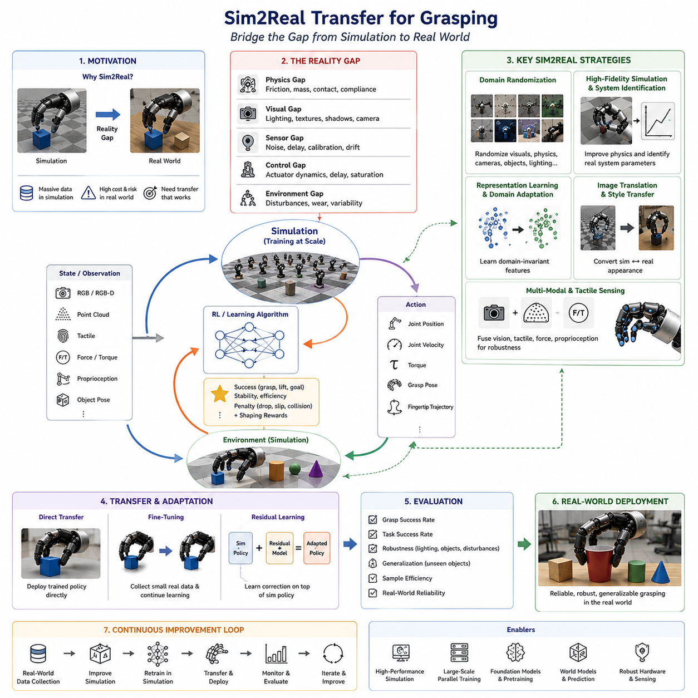{width="7.268055555555556in" height="7.268055555555556in"}

Sim2Real Transfer for Grasping is one of the most critical technologies in modern robotic manipulation because it bridges the gap between simulation-based learning and real-world deployment. Over the last decade, machine learning and reinforcement learning have enabled robots to acquire increasingly sophisticated grasping skills. However, the majority of these learning methods require enormous amounts of interaction data, often ranging from millions to billions of grasp attempts. Collecting such data on physical robots is expensive, time-consuming, and potentially damaging to hardware. As a result, robotic researchers have increasingly relied on simulation environments to train grasping systems. Simulators can generate virtually unlimited data, allow accelerated training, and eliminate risks associated with hardware wear and safety concerns. Nevertheless, a major challenge remains: policies that perform well in simulation frequently fail when deployed on real robots. Sim2Real Transfer addresses this challenge by developing methods that enable knowledge learned in simulation to generalize successfully to real-world robotic grasping tasks.

The core problem underlying Sim2Real Transfer is known as the Reality Gap. The reality gap refers to the inevitable differences between simulated environments and physical reality. Even the most advanced physics engines cannot perfectly reproduce every aspect of the real world. Small discrepancies in friction coefficients, material properties, contact dynamics, sensor noise, actuator delays, camera calibration, lighting conditions, object deformation, and environmental disturbances can significantly affect robotic performance. Grasping is particularly sensitive to these discrepancies because successful manipulation depends on precise contact interactions between the robot hand and the object. A policy trained in simulation may learn strategies that exploit imperfections of the simulator rather than the true physical principles governing the real world.

The reality gap can be categorized into several distinct components. Physical gaps arise from inaccuracies in modeling object masses, inertia tensors, friction coefficients, compliance, elasticity, and collision dynamics. Visual gaps result from differences between rendered images and real camera observations, including lighting variations, reflections, shadows, textures, and lens distortions. Sensor gaps emerge from noise characteristics, calibration errors, temporal delays, and measurement uncertainties. Control gaps occur because simulated actuators often respond instantaneously, whereas real motors exhibit delays, backlash, compliance, thermal effects, and saturation limits. Environmental gaps include unpredictable disturbances, object wear, surface contamination, and variations in operating conditions that are difficult to model accurately.

One of the earliest approaches to Sim2Real Transfer involved improving simulation fidelity. Researchers attempted to build increasingly accurate digital replicas of robotic systems and environments. High-fidelity simulators model detailed rigid-body dynamics, contact mechanics, friction behavior, actuator characteristics, and sensor responses. Modern simulation platforms such as Isaac Sim, MuJoCo, Gazebo, PyBullet, and other advanced robotics simulators provide sophisticated physics engines capable of modeling complex grasping interactions. High-fidelity simulation reduces discrepancies between simulation and reality and improves transfer performance. However, perfect simulation remains unattainable due to computational limitations and incomplete knowledge of physical systems.

An alternative and highly influential strategy is Domain Randomization. Instead of attempting to create a perfect simulator, domain randomization intentionally introduces variability into the simulation environment. During training, parameters such as object mass, friction coefficients, lighting conditions, textures, sensor noise levels, camera positions, object shapes, and environmental configurations are randomly varied over wide ranges. The learning algorithm is therefore exposed to a diverse set of scenarios rather than a single deterministic simulation. The resulting policy learns to operate robustly across many possible conditions and becomes less sensitive to discrepancies encountered during deployment.

The fundamental principle of domain randomization is that reality becomes just another variation within a sufficiently broad distribution of simulated environments. If a policy can successfully perform grasping tasks under thousands of randomized conditions, it is more likely to generalize when faced with real-world uncertainty. This approach has proven particularly effective for vision-based grasping systems where visual appearance differences often dominate transfer failures.

Visual domain randomization is widely used in robotic grasping applications. During simulation training, textures, colors, lighting intensity, shadow placement, camera parameters, and background environments are continuously varied. Objects may appear with different surface finishes, reflectance properties, and visual clutter. These variations force the perception system to focus on invariant object features rather than superficial visual details. As a result, the learned representations become more robust when applied to real camera images.

Physics randomization extends the same concept to physical parameters. Friction coefficients, object mass distributions, contact stiffness values, damping factors, actuator delays, and force sensor characteristics are randomized throughout training. Since grasp stability depends strongly on contact mechanics, exposing the policy to a broad range of physical conditions improves its ability to handle uncertainties encountered in real-world manipulation tasks.

System identification represents another important Sim2Real strategy. Rather than randomizing all parameters, system identification attempts to estimate the true properties of the physical system and incorporate them into the simulator. Experimental measurements are used to determine actuator dynamics, friction characteristics, sensor noise models, compliance properties, and environmental parameters. The simulator is then calibrated to match these measured properties as closely as possible. Although system identification cannot eliminate all discrepancies, it significantly reduces the magnitude of the reality gap and improves transfer performance.

Data-driven simulation calibration has become increasingly important in recent years. Machine learning techniques can automatically adjust simulation parameters to minimize differences between simulated and real-world observations. By comparing sensor outputs, robot trajectories, contact forces, and manipulation outcomes, optimization algorithms iteratively refine the simulator. This process produces more realistic virtual environments that support more effective policy training.

Another major direction in Sim2Real research is representation learning. Instead of learning policies directly from raw sensory observations, robots learn compact latent representations that capture essential task-relevant information. These representations often exhibit greater robustness to domain shifts because they abstract away irrelevant environmental details. Self-supervised learning methods, contrastive learning techniques, and multimodal representation learning frameworks have demonstrated significant improvements in transfer performance.

Feature-level adaptation seeks to align representations extracted from simulated and real data. Domain adaptation algorithms train neural networks to produce similar feature distributions for both domains. Adversarial learning methods are frequently employed, where a discriminator attempts to distinguish simulated features from real features while the representation network learns to make them indistinguishable. This process encourages the development of domain-invariant representations that generalize across simulation and reality.

Image translation techniques provide another solution for visual transfer. Generative models such as Generative Adversarial Networks and diffusion models can transform simulated images into realistic images or convert real images into simulation-style images. By reducing visual discrepancies between domains, these methods enable grasping policies trained on synthetic data to operate more effectively in physical environments. Recent advances in neural rendering and photorealistic simulation have further enhanced the effectiveness of image-based transfer approaches.

Reinforcement learning has played a major role in advancing Sim2Real Transfer for grasping. Large-scale reinforcement learning policies can be trained entirely in simulation using massive parallelization. Thousands of simulated environments execute grasping tasks simultaneously, generating enormous amounts of experience data. Domain randomization, curriculum learning, and adaptive environment generation are then combined to improve robustness. Once training is complete, the learned policy is deployed on physical hardware with minimal or no additional training.

Fine-tuning remains one of the most practical methods for achieving successful transfer. After a policy is trained in simulation, a smaller amount of real-world data is collected to adapt the model to physical conditions. Fine-tuning allows the policy to correct residual errors resulting from the reality gap while preserving the knowledge acquired during simulation training. Because only limited real-world interaction is required, this approach dramatically reduces development costs compared to training entirely on physical robots.

Residual learning provides another effective adaptation mechanism. A policy trained in simulation serves as the baseline controller, while an additional learning component learns corrective actions based on real-world experience. The residual controller compensates for discrepancies that were not captured during simulation training. This hierarchical approach improves stability and often accelerates adaptation compared to learning entirely new policies.

Sim2Real Transfer becomes particularly challenging in dexterous grasping applications involving multi-finger robotic hands. Contact-rich interactions generate highly nonlinear dynamics that are difficult to model accurately. Small differences in fingertip friction, contact geometry, tactile sensing accuracy, or object compliance can significantly alter manipulation outcomes. Researchers therefore increasingly incorporate tactile sensing into transfer pipelines. Tactile feedback provides direct information about contact conditions and can compensate for inaccuracies in visual perception or physical modeling.

Multi-modal learning has emerged as a powerful strategy for improving transfer robustness. By combining vision, tactile sensing, force measurements, proprioception, and environmental context, robotic systems develop richer representations of grasping states. When one sensing modality becomes unreliable due to domain shifts, other modalities can provide compensatory information. This redundancy enhances transfer performance and improves overall system reliability.

Foundation models are beginning to influence Sim2Real Transfer in important ways. Large-scale vision-language-action models are trained on diverse datasets collected across many robots, environments, and tasks. These models learn general-purpose representations that exhibit stronger robustness to environmental variation. Rather than transferring a narrowly specialized grasping policy, researchers can transfer broadly applicable manipulation knowledge that adapts more effectively to new scenarios.

World models offer another promising direction. Instead of learning direct control policies, world models learn predictive representations of environmental dynamics. The robot can then use these internal models to reason about future states, evaluate potential actions, and adapt to changing conditions. Because world models explicitly represent uncertainty, they may provide more robust transfer capabilities than purely reactive policies.

Benchmarking Sim2Real Transfer remains an active research area. Performance is typically evaluated using grasp success rate, task completion rate, robustness to environmental variation, adaptation speed, sample efficiency, and generalization to unseen objects. Researchers often compare performance before and after transfer to quantify the magnitude of the reality gap. Standardized benchmark environments help facilitate reproducible evaluation and fair comparison of competing transfer methods.

Industrial applications of Sim2Real Transfer are rapidly expanding. Warehouse automation systems use simulation-trained grasping policies to handle diverse consumer products. Manufacturing robots employ transferred policies for assembly, material handling, and quality inspection tasks. Agricultural robots utilize Sim2Real techniques to harvest crops under highly variable environmental conditions. Medical robotics increasingly benefits from simulation-based training for delicate manipulation tasks involving surgical tools and biological tissues. Service robots operating in homes and public spaces rely on transfer methods to handle the enormous variability encountered in real-world environments.

Autonomous robot fleets may represent the future evolution of Sim2Real systems. Large numbers of deployed robots continuously collect operational data during normal use. This data can be aggregated to improve simulation models, refine transfer strategies, and retrain grasping policies. The resulting feedback loop creates a cycle of continuous improvement in which simulation and reality become increasingly aligned over time.

The long-term vision of Sim2Real Transfer extends beyond simply transferring policies from simulation to reality. Future systems may support continuous bidirectional adaptation, where real-world experiences improve simulations and simulations generate increasingly effective training experiences. Digital twins will maintain synchronized representations of physical systems, enabling real-time policy optimization and predictive analysis. Foundation models, world models, multimodal learning, and large-scale robotic data collection will further reduce the reality gap and enable robust deployment of grasping systems across diverse environments.

Ultimately, Sim2Real Transfer serves as a foundational technology for scalable robotic learning. Without effective transfer methods, the immense computational advantages of simulation cannot be fully exploited. By enabling knowledge acquired in virtual environments to operate successfully in the physical world, Sim2Real Transfer transforms simulation into a practical engine for robotic intelligence. Within the broader context of learning-based grasping, it acts as the critical bridge connecting data-efficient training, large-scale reinforcement learning, behavior cloning, foundation models, and real-world robotic deployment. As robotic systems become increasingly autonomous and capable, Sim2Real Transfer will remain a central pillar supporting the development of reliable, adaptive, and commercially viable grasping technologies.

## 11.10 Self-Supervised Learning

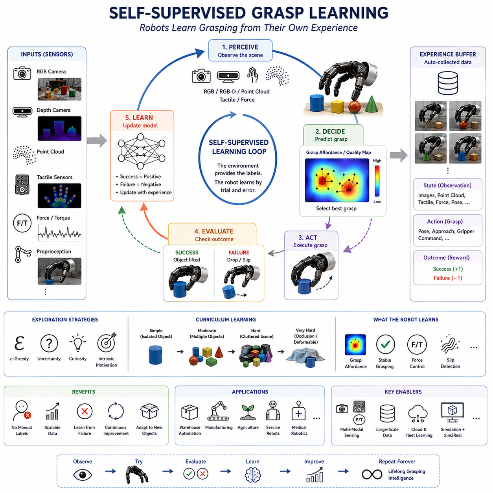{width="7.268055555555556in" height="7.268055555555556in"}

Self-Supervised Grasp Learning represents one of the most transformative developments in modern robotic manipulation because it enables robots to learn grasping skills without requiring manually labeled datasets or extensive human supervision. Traditional machine learning approaches for robotic grasping often depend on large quantities of annotated training data. Human operators must label successful and unsuccessful grasps, identify object poses, define grasp configurations, or provide demonstrations. While these approaches have produced significant advances, the cost of collecting and labeling large-scale robotic datasets remains a major obstacle to scalability. Self-supervised learning addresses this challenge by allowing robots to generate their own supervision signals through interaction with the environment. Instead of relying on humans to define the correct answer, the robot learns directly from the outcomes of its own actions.

The fundamental idea behind self-supervised grasp learning is deceptively simple. A robot attempts a grasp, observes whether the grasp succeeds or fails, and uses this outcome as a training signal. Successful grasps provide positive examples, while failed grasps provide negative examples. Over time, the robot accumulates a large dataset of experiences and gradually improves its grasp prediction capabilities. This process transforms the robot into an autonomous data collection system capable of generating virtually unlimited training data. As a result, self-supervised learning has become one of the most promising pathways toward scalable robotic intelligence.

The concept is inspired by how humans learn many physical skills. Infants do not receive detailed labels for every interaction they perform. Instead, they learn through exploration, experimentation, and feedback from the environment. A child attempting to grasp an object quickly discovers which actions lead to success and which lead to failure. Similarly, a robot equipped with self-supervised learning capabilities can acquire manipulation skills through repeated interaction with objects. The environment itself becomes the teacher.

One of the earliest successful examples of self-supervised grasp learning involved robotic systems repeatedly attempting grasps in cluttered environments. Cameras observed the workspace before and after each grasp attempt. If an object was successfully lifted and removed from the workspace, the action was labeled as a successful grasp. If the object remained in place or slipped from the gripper, the action was labeled as a failure. These labels were generated automatically without human intervention. Thousands or millions of such interactions allowed the robot to learn visual representations associated with successful grasp opportunities.

The core advantage of self-supervised learning lies in data scalability. Human annotation is expensive and time-consuming. Even a moderately sized robotic grasp dataset may require thousands of hours of manual labeling effort. In contrast, self-supervised systems continuously generate new training examples during operation. Industrial robot fleets can accumulate millions of grasp attempts over weeks or months of deployment. Every interaction contributes additional knowledge that can be used to improve future performance.

A typical self-supervised grasp learning system consists of several interconnected components. The perception system acquires sensory observations using cameras, depth sensors, tactile sensors, force sensors, or other modalities. The decision-making module predicts grasp actions based on current observations. The robot executes the selected action and monitors the outcome. Finally, the learning module updates the grasp prediction model using the newly acquired experience. This closed-loop learning cycle allows performance to improve continuously over time.

Visual perception plays a particularly important role in self-supervised grasp learning. RGB cameras, RGB-D sensors, stereo vision systems, and point cloud sensors provide information about object geometry and appearance. Neural networks process these observations to identify graspable regions and estimate grasp quality. Initially, predictions may be nearly random. However, as the robot accumulates experience, the learning algorithm discovers increasingly reliable visual features associated with successful grasps.

One influential approach involves learning grasp affordances. A grasp affordance represents the likelihood that a particular grasp action will succeed at a specific location. The neural network predicts a grasp quality score for each candidate grasp configuration. During training, successful outcomes increase the predicted score, while failures decrease it. Over time, the network learns a dense graspability map that identifies promising grasp locations directly from sensory observations.

Convolutional Neural Networks have historically been the dominant architecture for self-supervised grasp learning. CNNs excel at extracting spatial features from images and can efficiently process large datasets of grasping experiences. More recently, transformer-based architectures have emerged as powerful alternatives. Transformers capture long-range dependencies within visual observations and often exhibit stronger generalization capabilities across diverse object categories.

Depth sensing has significantly improved self-supervised grasp learning performance. RGB images alone provide limited geometric information. RGB-D cameras and point cloud sensors directly measure three-dimensional structure, enabling more accurate estimation of object shape, orientation, and accessibility. Three-dimensional representations are particularly valuable for cluttered environments where object occlusions frequently occur.

Point cloud-based grasp learning has become increasingly important in modern robotic systems. Instead of operating on two-dimensional images, neural networks process three-dimensional point clouds representing object surfaces. Point-based architectures learn geometric features directly from spatial measurements. This approach often improves robustness to lighting changes, texture variations, and visual distractions.

Tactile sensing introduces another valuable source of self-supervision. During grasp execution, tactile sensors measure contact forces, pressure distributions, slip events, and object interactions. These measurements provide detailed information about grasp stability that may not be observable through vision alone. Self-supervised learning systems can use tactile feedback to generate additional training signals and refine grasp predictions. For example, incipient slip detection may indicate that a grasp is unstable even if the object has not yet been dropped.

Force and torque sensing further enrich self-supervised learning. Force sensors measure interaction forces between the robot and the environment. Excessive forces may indicate poor grasp quality or potential object damage. Stable force profiles often correlate with successful grasp execution. Incorporating force information allows robots to learn not only how to grasp objects but also how to regulate grasp forces appropriately.

One of the most important contributions of self-supervised grasp learning is the ability to learn from failure. In traditional supervised learning, failures are often underrepresented because datasets focus primarily on successful examples. In contrast, self-supervised systems naturally collect large numbers of failure cases. Failed grasps provide valuable information about what should not be done. By analyzing failure patterns, the learning algorithm develops a more complete understanding of grasping dynamics and improves future decision-making.

Exploration strategies play a crucial role in self-supervised learning. A robot must balance exploitation of known successful strategies with exploration of new possibilities. Excessive exploitation limits learning opportunities, while excessive exploration may reduce operational efficiency. Various exploration techniques have been proposed, including epsilon-greedy strategies, uncertainty-based exploration, curiosity-driven learning, and intrinsic motivation mechanisms. These approaches encourage the robot to gather informative experiences while maintaining acceptable task performance.

Curriculum learning has also been successfully integrated into self-supervised grasp learning systems. Rather than presenting all tasks simultaneously, the robot gradually encounters increasingly difficult grasping scenarios. Training may begin with isolated objects placed in structured environments. As performance improves, clutter, occlusions, deformable objects, transparent objects, and complex manipulation tasks are introduced. This progressive learning strategy often accelerates convergence and improves final performance.

Large-scale data collection has become a defining characteristic of self-supervised robotic learning. Research laboratories and industrial organizations have deployed fleets of robots that continuously collect grasping experiences. Some systems have accumulated millions of grasp attempts across diverse object categories and environmental conditions. These massive datasets support the training of increasingly capable grasp prediction models and provide valuable resources for broader robotics research.

Cloud robotics has further amplified the impact of self-supervised learning. Multiple robots operating in different locations can share their experiences through centralized learning infrastructures. Data collected by one robot contributes to the improvement of models deployed across the entire fleet. This collective learning paradigm dramatically accelerates knowledge acquisition and enables rapid adaptation to new tasks and environments.

Simulation environments also play an important role in self-supervised grasp learning. Virtual robots can generate large quantities of synthetic interaction data at minimal cost. Self-supervised objectives can be applied within simulation just as effectively as in physical environments. Combined with Sim2Real transfer techniques, simulation-based self-supervised learning provides a scalable framework for acquiring manipulation knowledge before deployment on real hardware.

Self-supervised representation learning has emerged as a particularly influential research direction. Rather than directly learning grasp policies, the robot first learns general-purpose visual and tactile representations through self-supervised objectives. Examples include contrastive learning, predictive learning, masked modeling, temporal consistency learning, and multimodal alignment. These learned representations capture fundamental properties of objects and interactions, providing strong foundations for downstream grasping tasks.

Contrastive learning has demonstrated remarkable effectiveness in robotic perception. The learning objective encourages representations of similar observations to become closer while separating dissimilar observations. Through repeated interactions, the robot develops robust representations that generalize across object categories, viewpoints, and environmental conditions. These representations often improve grasp prediction accuracy and sample efficiency.

Predictive learning approaches train robots to anticipate future observations resulting from their actions. The robot learns models of environmental dynamics and object behavior. By predicting the consequences of potential grasp actions, the system develops deeper understanding of physical interactions. Such predictive capabilities are increasingly viewed as essential components of embodied intelligence.

Multi-task learning naturally complements self-supervised grasp learning. A single robot interaction may generate supervision signals for multiple objectives simultaneously. Visual representation learning, object segmentation, pose estimation, grasp prediction, slip detection, and force prediction can all be learned from the same experience dataset. Sharing representations across tasks improves data efficiency and promotes the emergence of more general manipulation capabilities.

Foundation models are beginning to reshape the landscape of self-supervised robotic learning. Large-scale vision-language-action models leverage enormous quantities of robot interaction data collected across many tasks, environments, and platforms. Self-supervised objectives provide much of the training signal required to learn these general-purpose representations. As datasets continue to expand, foundation models may eventually serve as universal manipulation priors that can be adapted to specific grasping applications with minimal additional training.

Evaluation of self-supervised grasp learning systems typically focuses on grasp success rate, sample efficiency, data efficiency, generalization to unseen objects, robustness to environmental variation, and adaptation speed. Researchers also measure how effectively learned representations transfer to new tasks and whether performance continues improving during long-term deployment.

Industrial applications of self-supervised grasp learning are rapidly increasing. Warehouse automation systems use self-supervised learning to handle constantly changing product inventories. Manufacturing robots learn to grasp new components without requiring manual reprogramming. Agricultural robots adapt to natural variations in crops and environmental conditions. Service robots operating in homes encounter diverse household objects and benefit significantly from continuous autonomous learning. Medical robotics may eventually leverage self-supervised interaction data to improve manipulation precision and reliability.

Despite its many advantages, self-supervised grasp learning also presents significant challenges. Data collection may be time-consuming, particularly for complex dexterous manipulation tasks. Exploration must be carefully managed to avoid unsafe actions. Distribution shifts may occur when environments change dramatically. Computational requirements continue to grow as datasets expand. Furthermore, defining reliable automatic success metrics remains difficult for many advanced manipulation tasks.

Future research is expected to combine self-supervised learning with reinforcement learning, imitation learning, world models, foundation models, and multimodal perception systems. Robots will increasingly learn not only from grasp outcomes but also from language instructions, tactile experiences, predictive simulations, and interactions with other robots. Lifelong learning systems may continuously improve throughout deployment, accumulating knowledge over months or years of operation.

Ultimately, self-supervised grasp learning represents a fundamental shift in how robotic intelligence is acquired. Rather than relying on manually curated datasets or handcrafted rules, robots become active participants in their own education. Every grasp attempt contributes new knowledge, every failure becomes a learning opportunity, and every interaction expands the robot's understanding of the physical world. Within the broader context of learning-based grasping, self-supervised learning serves as a critical foundation for scalable, adaptive, and autonomous robotic manipulation systems capable of operating effectively in complex real-world environments.

## 11.11 Multi-Task Grasp Learning

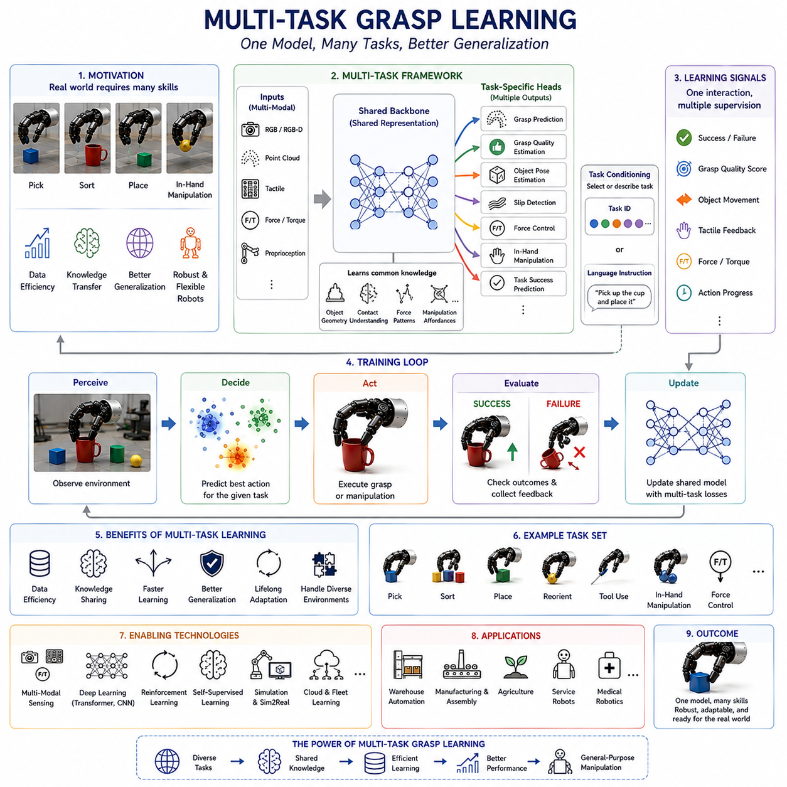{width="7.268055555555556in" height="7.268055555555556in"}

Multi-Task Grasp Learning is an advanced learning paradigm in robotic manipulation that enables a robot to learn multiple grasping and manipulation skills simultaneously within a unified learning framework. Traditional robotic learning systems often focus on a single task, such as picking up an object, grasping a particular category of items, or performing one predefined manipulation behavior. While such specialized systems can achieve impressive performance in narrow domains, they frequently struggle when deployed in real-world environments where robots must perform many different tasks using the same hardware and sensing infrastructure. Multi-task learning addresses this limitation by allowing a robot to acquire shared knowledge across multiple grasping tasks and leverage common patterns among them. As a result, robots become more adaptable, data-efficient, and capable of generalizing to previously unseen situations.

The motivation behind multi-task grasp learning originates from observations of human learning. Humans rarely learn each manipulation skill independently. Instead, knowledge acquired while performing one task often transfers to other tasks. Learning to grasp a cup improves the ability to grasp a bottle. Learning to manipulate a screwdriver contributes to understanding how to use other hand tools. The human nervous system develops shared representations of objects, contacts, forces, and motor control strategies that can be reused across diverse activities. Multi-task grasp learning attempts to replicate this principle within robotic systems.

At its core, multi-task learning seeks to optimize a single model for multiple objectives simultaneously. Rather than training separate neural networks for each grasping task, a shared network learns representations that support all tasks. Individual task-specific outputs may be attached to the shared representation, but most of the network parameters are common across tasks. This architecture allows information learned from one task to benefit the learning of others.

In robotic grasping, tasks may include object pickup, object sorting, object placement, in-hand manipulation, precision grasping, power grasping, deformable object handling, tool grasping, slip detection, force regulation, object reorientation, assembly operations, and many other manipulation behaviors. Although these tasks differ in their specific goals, they often rely on common underlying skills such as visual perception, contact understanding, object recognition, force control, and motion planning. Multi-task learning exploits these shared structures to improve overall performance.

One of the primary benefits of multi-task grasp learning is improved data efficiency. Collecting robotic interaction data is expensive and time-consuming. When separate models are trained for each task, large datasets must be collected independently for every application. Multi-task learning allows a single interaction to provide supervision for multiple objectives simultaneously. A grasp attempt may contribute information about object recognition, grasp quality estimation, contact prediction, force control, and task completion. This shared learning process extracts more value from each interaction and reduces overall data requirements.

Shared representation learning plays a central role in multi-task systems. The neural network learns latent representations that capture common features across tasks. These representations often encode object geometry, material properties, contact dynamics, manipulation affordances, environmental context, and motor control patterns. Because these representations are useful for many tasks, they tend to generalize better than representations learned for a single objective.

Visual perception is one area where multi-task learning has demonstrated remarkable success. A robot may simultaneously learn object detection, semantic segmentation, pose estimation, grasp prediction, and manipulation planning using a shared visual backbone. Features learned for one task frequently improve performance on others. For example, object segmentation enhances grasp localization, while pose estimation improves grasp orientation prediction. The resulting perception system becomes more robust and comprehensive than independently trained modules.

Multi-task learning is particularly valuable for dexterous robotic hands. Dexterous manipulation involves numerous interconnected capabilities, including grasp acquisition, force modulation, contact maintenance, finger coordination, object stabilization, and in-hand manipulation. Training these capabilities independently often results in fragmented behaviors and poor coordination. A multi-task framework encourages the emergence of unified manipulation strategies that integrate multiple control objectives simultaneously.

Different architectural approaches have been proposed for multi-task grasp learning. One common design employs a shared backbone network with task-specific output heads. The backbone extracts general features from sensory observations, while individual heads generate predictions for specific tasks. This approach balances knowledge sharing with task specialization and has become widely used in robotic learning applications.

Another approach utilizes soft parameter sharing. Instead of sharing all network parameters directly, separate task-specific networks are encouraged to learn similar representations through regularization techniques. This method provides greater flexibility when tasks differ substantially while still allowing beneficial knowledge transfer.

Hard parameter sharing represents the most common strategy. A large portion of the network is shared among all tasks, and only the final layers remain task-specific. Hard sharing reduces model complexity, improves computational efficiency, and often provides strong regularization effects that reduce overfitting.

Transformer architectures have significantly expanded the capabilities of multi-task grasp learning. Transformers naturally support multiple tasks through attention mechanisms that learn relationships between observations, actions, and task contexts. A single transformer model can process visual observations, tactile inputs, force measurements, language instructions, and task specifications while producing outputs for multiple manipulation objectives. This flexibility has made transformers increasingly popular in modern robotic learning systems.

Task conditioning provides another important mechanism in multi-task learning. The robot receives an explicit task identifier or task description as part of its input. The policy then adapts its behavior according to the specified objective. For example, the same object may require different grasping strategies depending on whether the goal is transportation, insertion, pouring, inspection, or assembly. Task conditioning enables a single model to generate diverse behaviors based on contextual requirements.

Language-guided multi-task learning has recently emerged as a powerful direction. Large vision-language-action models allow robots to interpret natural language instructions and associate them with manipulation behaviors. Commands such as "pick up the cup," "grasp the handle," "move the object gently," or "prepare for pouring" can all be executed using a single unified policy. Language effectively serves as a high-level task specification mechanism that greatly expands the flexibility of robotic systems.

One challenge in multi-task learning is balancing competing objectives. Different tasks may produce gradients that conflict during optimization. For example, a precision grasping task may encourage conservative control strategies, while a rapid sorting task may favor aggressive motions. Simultaneously optimizing both objectives can lead to unstable learning or degraded performance. Researchers have developed numerous techniques to address this challenge, including gradient balancing, adaptive weighting, task prioritization, and multi-objective optimization methods.

Loss function design is therefore a critical component of multi-task systems. Each task contributes its own loss term, and these losses must be combined appropriately during training. Fixed weighting schemes assign predetermined importance to each task, while adaptive methods dynamically adjust weights based on task difficulty, learning progress, or uncertainty estimates. Proper loss balancing significantly influences final system performance.

Transfer learning naturally emerges within multi-task frameworks. Knowledge acquired from one task often accelerates learning in related tasks. For instance, a robot that has learned object recognition may require fewer examples to learn grasp prediction. Similarly, a model trained on simple pick-and-place operations may adapt more rapidly to complex assembly tasks. Positive transfer reduces training costs and improves sample efficiency.

Negative transfer represents the opposite phenomenon. When tasks are unrelated or conflicting, shared learning may actually degrade performance. A model attempting to learn too many dissimilar objectives may struggle to develop useful shared representations. Identifying task compatibility and managing negative transfer remain active areas of research.

Curriculum learning is frequently combined with multi-task grasp learning. Rather than training on all tasks simultaneously, robots gradually encounter increasingly complex objectives. Learning may begin with basic object pickup tasks, followed by placement, sorting, force control, tool use, and dexterous manipulation. This staged progression often improves learning stability and accelerates convergence.

Simulation environments have become essential for large-scale multi-task learning. Physical robots cannot easily collect sufficient data across dozens or hundreds of tasks. Simulators allow researchers to generate diverse task scenarios efficiently and safely. Modern simulation platforms support large-scale parallel data generation, enabling robots to experience thousands of task variations during training.

Reinforcement learning has proven particularly effective when integrated with multi-task grasp learning. Multi-task reinforcement learning allows a robot to optimize policies across multiple manipulation objectives simultaneously. Shared exploration experiences contribute to all tasks, increasing sample efficiency and encouraging the development of generalized skills. Many recent dexterous manipulation systems rely heavily on this approach.

Imitation learning also plays an important role. Human demonstrations often contain rich information relevant to multiple tasks simultaneously. A single demonstration may provide supervision for grasp selection, trajectory planning, force modulation, and object handling. Multi-task imitation learning extracts these various forms of knowledge and integrates them into a unified policy.

Self-supervised learning further enhances multi-task systems. Robots can autonomously generate supervision signals through interaction with the environment. Grasp success, object movement, contact events, slip detection, and force measurements all provide self-generated learning signals. These signals support multiple tasks without requiring manual annotation.

Multi-modal sensing significantly strengthens multi-task grasp learning. Visual observations provide information about object appearance and geometry. Tactile sensing reveals contact conditions and pressure distributions. Force sensing measures interaction dynamics. Proprioceptive sensing captures joint states and hand configurations. By integrating these complementary information sources, robots develop richer representations that support a wide range of tasks simultaneously.

Cloud robotics and fleet learning have expanded the scale of multi-task data collection. Multiple robots operating in different environments contribute experiences to centralized learning systems. Data collected from warehouses, factories, hospitals, homes, and research laboratories can be combined to train highly capable multi-task models. This collective learning process accelerates skill acquisition and improves generalization.

Foundation models represent the next evolutionary step in multi-task grasp learning. Large-scale robotic foundation models are trained on enormous datasets spanning hundreds or thousands of manipulation tasks. Instead of learning a narrow skill, these models acquire broad knowledge about physical interaction, object manipulation, and environmental dynamics. Fine-tuning then adapts the foundation model to specific applications with relatively small amounts of task-specific data.

World models further extend these capabilities by providing predictive understanding of environmental dynamics. A world model learns how objects respond to actions, how contacts evolve over time, and how future states emerge from current interactions. When integrated with multi-task learning, world models enable planning and reasoning across diverse manipulation objectives.

Evaluation of multi-task grasp learning systems requires more comprehensive metrics than single-task systems. Researchers measure grasp success rates, task completion rates, transfer efficiency, generalization to unseen objects, adaptation speed, robustness to disturbances, computational efficiency, and performance consistency across tasks. A successful multi-task system must perform well not only on individual tasks but also across the entire task portfolio.

Industrial applications of multi-task grasp learning are rapidly expanding. Warehouse robots must identify, grasp, sort, transport, and place thousands of different products. Manufacturing robots perform assembly, inspection, material handling, and packaging operations. Agricultural robots harvest, sort, and process crops under changing environmental conditions. Service robots interact with a vast variety of household objects and must execute many different manipulation behaviors. Multi-task learning provides the flexibility necessary for these complex operational environments.

Future research will increasingly focus on large-scale generalist robotic systems capable of performing hundreds or thousands of manipulation tasks using a single model. Foundation models, world models, self-supervised learning, reinforcement learning, and language-guided control will converge into unified learning architectures. Robots will learn continuously throughout deployment, acquiring new skills while retaining previously learned capabilities.

Ultimately, Multi-Task Grasp Learning represents a major step toward general-purpose robotic manipulation. Rather than treating each task as an isolated problem, it recognizes that grasping skills share common structures and can benefit from collective learning. By leveraging shared representations, transferring knowledge across tasks, integrating multiple sensing modalities, and scaling through foundation models, multi-task learning enables robots to develop broader, more flexible, and more human-like manipulation intelligence. Within the broader field of Learning-Based Grasping, it serves as a critical bridge between specialized task-specific systems and the future vision of universal robotic manipulation capable of operating effectively across diverse real-world environments.
