**Volume 06 Robot Hands and Dexterous Grasping**

# 11. Learning-Based Grasping

## 11.01 Introduction to Learning-Based Grasping

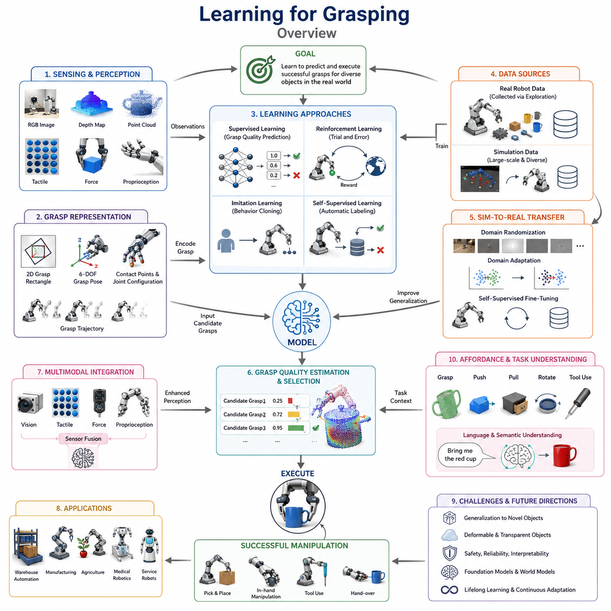{width="7.268055555555556in" height="7.268055555555556in"}

파지 학습(Learning for Grasping)은 현대 로봇 조작(Robotic Manipulation) 분야에서 가장 혁신적인 발전 중 하나로 평가받는다. 전통적인 파지 시스템은 주로 운동학(Kinematics), 동역학(Dynamics), 접촉 역학(Contact Mechanics), 힘 폐쇄 이론(Force Closure Theory), 그리고 최적화 기반 계획(Optimization-Based Planning)에 기반하여 구축되었다. 이러한 접근법은 로봇 파지에 대한 수학적으로 엄밀한 기초를 제공하였으며, 구조화된 산업 환경에서 안정적인 픽 앤 플레이스(Pick-and-Place) 작업을 가능하게 하였다.

그러나 로봇이 창고, 가정, 병원, 농업 환경, 협업 제조 환경과 같은 비정형 환경(Unstructured Environment)으로 진출하기 시작하면서 순수한 해석적 방법(Analytical Methods)의 한계가 점점 더 명확해졌다. 실제 환경에는 불확실성(Uncertainty), 다양한 물체 형상, 센서 노이즈(Sensor Noise), 부분 관측(Partial Observability), 변형 가능한 물체(Deformable Objects), 예측하기 어려운 상호작용 등이 존재하며, 이러한 요소들을 수학적 모델만으로 완벽하게 표현하기는 매우 어렵다.

파지 학습은 이러한 문제를 해결하기 위해 등장하였다. 로봇이 사전에 정의된 규칙에만 의존하는 것이 아니라, 데이터와 경험으로부터 직접 파지 기술을 학습하도록 만드는 것이 핵심 개념이다. 본 장은 학습 기반 파지(Learning-Based Grasping)의 전체적인 개요를 설명하며, 데이터셋(Dataset), 학습 알고리즘(Learning Algorithms), 네트워크 구조(Network Architectures), 평가 방법(Evaluation Methods), 그리고 최신 연구 동향을 이해하기 위한 기초를 제공한다. 이는 이후의 데이터셋 설계, 파지 품질 학습(Grasp Quality Learning), 6자유도 파지 검출(6DOF Grasp Detection), 강화학습(Reinforcement Learning), 자기지도학습(Self-Supervised Learning), Sim-to-Real 전이, 다중 작업 학습(Multi-Task Learning) 등의 내용을 이해하기 위한 기반이 된다.

학습 기반 파지의 기본 아이디어는 로봇이 성공한 파지와 실패한 파지 사례를 반복적으로 관찰하면서 파지 품질(Grasp Quality)에 대한 내부 표현(Internal Representation)을 형성하는 것이다. 기존 방식처럼 모든 접촉 역학을 명시적으로 계산하는 대신, 성공적인 파지와 관련된 패턴을 데이터로부터 발견한다. 반복적인 경험을 통해 로봇은 물체의 형상 특징(Geometric Features), 어포던스(Affordance), 접촉 가능 영역(Contact Opportunities), 안정적인 파지 자세(Stable Grasp Configuration)를 학습하게 된다.

초기의 로봇 파지 연구는 주로 기하학적 추론(Geometric Reasoning)에 의존하였다. 연구자들은 접촉점(Contact Point), 마찰 콘(Friction Cone), 렌치 공간(Wrench Space), 힘 분배(Force Distribution) 등을 이용하여 안정성이 보장되는 파지를 계산하였다. 이러한 방법들은 여전히 중요하지만, 센서 정보가 불완전하거나 물체의 물리적 특성이 알려지지 않은 상황에서는 한계를 가진다. 예를 들어 로봇이 처음 보는 물체를 만났을 때 질량 분포, 마찰 계수, 강성(Stiffness) 등의 정보가 없더라도, 학습 기반 시스템은 과거 경험을 바탕으로 적절한 파지 전략을 추론할 수 있다.

머신러닝(Machine Learning)은 센서 관측값과 파지 성공 여부 사이의 복잡한 비선형 관계를 학습할 수 있도록 해준다. 로봇은 이미지(Image), 깊이 영상(Depth Map), 포인트 클라우드(Point Cloud), 촉각 데이터(Tactile Data), 힘 센서 데이터(Force Sensor Data) 등을 입력으로 받아 파지 가능성을 예측한다. 학습 과정에서 모델은 성공적인 파지와 관련된 특징들을 자동으로 발견하며, 이는 수작업 특징 추출(Handcrafted Feature Engineering)의 필요성을 크게 줄여준다.

특히 딥러닝(Deep Learning)의 등장으로 파지 연구는 급격한 발전을 이루었다. 심층 신경망(Deep Neural Network)은 원시 센서 데이터를 직접 처리할 수 있으며, 이미지나 포인트 클라우드로부터 엔드 투 엔드(End-to-End) 학습을 수행할 수 있다. 합성곱 신경망(CNN)은 성공적인 파지와 관련된 시각적 특징을 자동으로 학습하여 기존의 복잡한 영상 처리 파이프라인을 단순화하였다.

비전 기반 파지 학습(Vision-Based Grasp Learning)은 현재 가장 널리 사용되는 분야 중 하나이다. RGB 카메라, Depth 카메라, 스테레오 비전(Stereo Vision), RGB-D 센서 등을 활용하여 파지 가능한 위치를 예측한다. 일부 시스템은 이미지 상의 파지 사각형(Grasp Rectangle)을 예측하고, 보다 발전된 시스템은 6자유도 파지 자세(6DOF Grasp Pose)를 직접 생성하기도 한다.

포인트 클라우드 기반 학습(Point Cloud Based Learning)은 물체의 3차원 기하 정보를 직접 활용한다. PointNet, PointNet++, 그래프 신경망(Graph Neural Network), 트랜스포머(Transformer) 기반 모델들은 복잡한 3차원 형상을 효과적으로 분석하여 안정적인 파지를 예측할 수 있다. 이러한 접근법은 메쉬(Mesh) 재구성 없이도 물체의 표면 구조를 이해할 수 있다는 장점이 있다.

파지 학습에서 매우 중요한 개념 중 하나는 파지 표현(Grasp Representation)이다. 로봇이 학습하기 위해서는 파지를 수학적으로 표현해야 한다. 단순한 평행 그리퍼(Parallel Jaw Gripper)는 이미지 상의 사각형으로 표현될 수 있으며, 다지형 손(Multi-Finger Hand)은 접촉점(Contact Point), 손가락 관절 각도(Joint Angles), 손 전체의 자세(Pose) 또는 완전한 손 동작 궤적(Trajectory)으로 표현될 수 있다. 표현 방식은 네트워크 구조와 학습 성능에 직접적인 영향을 미친다.

또 다른 핵심 개념은 파지 품질 추정(Grasp Quality Estimation)이다. 많은 학습 기반 시스템은 단일 파지를 직접 생성하는 대신 여러 후보 파지를 평가하여 성공 확률을 점수 형태로 예측한다. 이후 가장 높은 점수를 가진 파지를 선택한다. 대표적으로 GQ-CNN(Grasp Quality CNN)은 이러한 접근법을 성공적으로 보여준 사례로 평가된다.

데이터 수집(Data Collection)은 학습 기반 파지의 가장 중요한 과제 중 하나이다. 높은 성능을 얻기 위해서는 다양한 물체와 파지 사례를 포함하는 대규모 데이터셋이 필요하다. 실제 로봇을 이용하여 데이터를 수집하는 것은 비용과 시간이 많이 들기 때문에, 연구자들은 자동화된 데이터 수집 플랫폼을 개발하여 수백만 회의 파지 시도를 수행하고 있다.

시뮬레이션(Simulation)은 데이터 부족 문제를 해결하는 강력한 도구이다. 현대 물리 시뮬레이터는 수천 개의 가상 환경에서 동시에 파지 실험을 수행할 수 있다. 물체 형상, 재질, 마찰 계수, 조명 조건, 센서 노이즈 등을 다양하게 변화시키며 대규모 데이터를 생성할 수 있다.

하지만 시뮬레이션에서 학습한 모델을 실제 로봇에 적용하면 성능이 저하되는 Sim-to-Real Gap 문제가 발생한다. 이를 해결하기 위해 도메인 랜덤화(Domain Randomization), 도메인 적응(Domain Adaptation), 물리 파라미터 랜덤화(Physics Randomization), 자기지도 파인튜닝(Self-Supervised Fine-Tuning) 등의 기술이 활용되고 있다.

강화학습(Reinforcement Learning)은 파지 학습에서 매우 중요한 또 다른 접근법이다. 강화학습에서는 로봇이 환경과 상호작용하며 보상(Reward)을 통해 스스로 학습한다. 성공적인 파지에 높은 보상을 부여하면 로봇은 점차 더 나은 파지 정책(Grasp Policy)을 학습하게 된다. 특히 복잡한 다지형 손 조작(Dexterous Manipulation)에서는 강화학습이 매우 강력한 도구로 사용된다.

모방학습(Imitation Learning)과 행동 복제(Behavior Cloning)는 인간 전문가의 시연(Demonstration)을 통해 학습하는 방법이다. 텔레오퍼레이션(Teleoperation), VR 인터페이스, 모션 캡처(Motion Capture), 직접 교시(Kinesthetic Teaching)를 통해 수집된 데이터를 활용하여 로봇이 인간의 파지 전략을 모방하도록 한다.

최근에는 자기지도학습(Self-Supervised Learning)이 매우 중요한 연구 분야로 성장하고 있다. 이 방법에서는 사람이 직접 데이터를 라벨링하지 않는다. 로봇이 스스로 수천, 수만 번의 파지 시도를 수행하고 성공 여부를 자동으로 기록한다. 이러한 방식은 대규모 데이터셋 구축 비용을 크게 줄이며 지속적인 학습(Continuous Learning)을 가능하게 한다.

학습 기반 파지는 물체 어포던스(Object Affordance)와도 밀접한 관련이 있다. 어포던스란 특정 물체가 제공하는 행동 가능성을 의미한다. 로봇은 단순히 물체를 집는 것뿐 아니라 밀기(Pushing), 당기기(Pulling), 회전(Rotating), 조립(Assembly), 도구 사용(Tool Use) 등에 적합한 위치를 학습할 수 있다.

최근 연구에서는 멀티모달 학습(Multimodal Learning)이 중요한 방향으로 주목받고 있다. 인간은 시각(Vision), 촉각(Touch), 고유감각(Proprioception), 힘 감각(Force Sensing), 청각(Auditory Feedback)을 동시에 활용하여 물체를 조작한다. 마찬가지로 로봇도 다양한 센서 정보를 통합하여 더욱 안정적인 파지를 수행할 수 있다.

특히 촉각 학습(Tactile Learning)은 최근 급속히 발전하고 있는 분야이다. 시각 센서는 손이 물체를 감싼 이후의 접촉 상태를 정확하게 파악하기 어렵다. 반면 촉각 센서는 압력 분포, 접촉 위치, 미끄러짐(Slip), 표면 특성 등을 직접 측정할 수 있다. 학습 알고리즘은 이러한 정보를 활용하여 파지력을 조절하고 물체 낙하를 방지하며 정밀 조작을 수행할 수 있다.

일반화 능력(Generalization)은 학습 기반 파지의 핵심 목표 중 하나이다. 실제 산업 환경에서는 학습 과정에서 보지 못한 물체를 다루어야 한다. 따라서 모델은 새로운 형상, 재질, 조명 조건, 배치 환경에서도 안정적인 성능을 유지해야 한다. 이를 위해 연구자들은 다양한 데이터셋과 강건한 표현 학습(Representation Learning) 기술을 개발하고 있다.

최근 등장한 파운데이션 모델(Foundation Models)은 파지 연구의 새로운 전환점을 만들고 있다. 비전-언어 모델(Vision-Language Model, VLM)과 비전-언어-행동 모델(Vision-Language-Action Model, VLA)은 물체의 의미(Semantics)와 기능(Functionality)을 이해할 수 있다. 이를 통해 로봇은 단순히 물체를 집는 것이 아니라, 이후 수행해야 할 작업을 고려하여 가장 적합한 파지 방식을 선택할 수 있게 된다.

또한 월드 모델(World Model) 기반 접근법도 주목받고 있다. 미래의 로봇은 단순히 현재 상태에 반응하는 것이 아니라, 특정 파지를 수행했을 때의 결과를 내부적으로 예측하고 가장 유리한 행동을 선택하게 될 것이다. 이는 인간과 유사한 수준의 조작 지능으로 발전하기 위한 중요한 단계로 평가된다.

학습 기반 파지는 현재 창고 자동화(Warehouse Automation), 제조업(Manufacturing), 농업(Agriculture), 의료(Medical Robotics), 서비스 로봇(Service Robotics) 분야에서 빠르게 상용화되고 있다. 다양한 제품을 자동으로 집어 분류하는 물류 시스템, 섬세한 농산물을 수확하는 농업 로봇, 의료 기구를 조작하는 수술 보조 로봇 등이 대표적인 사례이다.

그럼에도 불구하고 해결해야 할 과제는 여전히 많다. 대규모 데이터 요구사항, 높은 계산 비용, 긴 학습 시간, 안전성(Safety), 신뢰성(Reliability), 설명 가능성(Interpretability), 산업 인증(Certification) 등의 문제가 남아 있다. 또한 드문 상황(Rare Events)이나 학습 데이터에 존재하지 않는 환경에서는 예기치 않은 실패가 발생할 수 있다.

미래의 파지 학습은 지각(Perception), 제어(Control), 촉각(Tactile Sensing), 언어 이해(Language Understanding), 파운데이션 모델(Foundation Models), 월드 모델(World Models), 자율 학습(Autonomous Learning)이 통합되는 방향으로 발전할 것으로 예상된다. 미래의 로봇은 단순히 사전에 정의된 파지 전략을 수행하는 수준을 넘어, 경험을 통해 지속적으로 학습하고 환경 변화에 적응하며 작업 목표를 이해하는 지능형 시스템으로 진화할 것이다.

따라서 학습 기반 파지는 차세대 지능형 로봇 조작(Intelligent Robotic Manipulation)의 핵심 기술이며, 이후의 데이터셋 설계, 파지 품질 학습, 강화학습, Sim-to-Real 전이, 자기지도학습, 다중 작업 조작(Multi-Task Manipulation) 등의 주제를 이해하기 위한 가장 중요한 출발점이라 할 수 있다.

## 11.02 Dataset Design

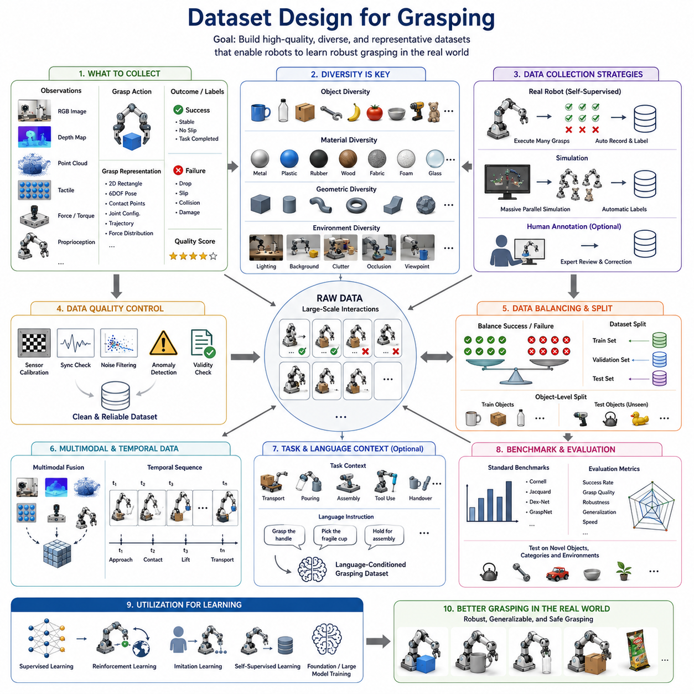{width="7.268055555555556in" height="7.268055555555556in"}

데이터셋 설계(Dataset Design)는 학습 기반 파지(Learning-Based Grasping)의 가장 중요한 기반 기술 중 하나이다. 아무리 뛰어난 신경망 구조(Neural Network Architecture), 강화학습(Reinforcement Learning) 알고리즘, 파운데이션 모델(Foundation Model), 멀티모달 인식(Multimodal Perception) 시스템을 사용하더라도 최종적으로 로봇이 획득하는 파지 능력은 학습에 사용된 데이터셋의 품질, 다양성, 규모, 그리고 현실 대표성에 의해 결정된다. 현대 로봇공학에서 데이터셋은 단순한 이미지와 라벨의 집합이 아니다. 그것은 로봇과 실제 세계 사이에서 발생하는 물리적 상호작용을 체계적으로 기록한 지식 저장소이다. 잘 설계된 파지 데이터셋은 물체 형상, 재질 특성, 센서 관측, 로봇 동작, 접촉 조건, 환경 정보, 그리고 조작 결과 사이의 복잡한 관계를 포함한다. 따라서 데이터셋 엔지니어링은 현재 로봇 조작(Robotic Manipulation)과 체화형 인공지능(Embodied AI) 분야의 핵심 연구 영역으로 자리 잡고 있다.

데이터셋 설계가 중요한 이유는 학습 기반 시스템의 본질에 있다. 전통적인 파지 계획은 접촉 역학(Contact Mechanics), 힘 폐쇄(Force Closure), 운동학(Kinematics), 최적화(Optimization) 등의 수학적 모델에 의존하였다. 반면 머신러닝(Machine Learning) 시스템은 사례를 통해 파지 전략을 학습한다. 즉 데이터셋 자체가 로봇의 지식이 된다. 성공 사례와 실패 사례, 다양한 물체와 환경에서의 상호작용 경험이 모두 로봇의 학습 재료가 된다. 만약 데이터셋이 편향되어 있거나 부족하거나 특정 환경에만 제한되어 있다면, 학습된 모델 역시 동일한 한계를 가지게 된다.

파지 데이터셋의 기본 목적은 관측 정보와 성공적인 조작 결과 사이의 관계를 학습할 수 있도록 충분한 정보를 제공하는 것이다. 일반적으로 데이터셋은 센서 관측(Sensory Observation), 파지 동작(Grasp Action), 결과 라벨(Outcome Label)로 구성된다. 관측 정보에는 RGB 이미지, 깊이 영상(Depth Map), RGB-D 데이터, 포인트 클라우드(Point Cloud), 촉각 데이터(Tactile Data), 힘-토크 센서(Force-Torque Sensor), 관절 상태(Proprioception) 등이 포함될 수 있다. 파지 동작은 로봇이 수행한 그립 위치와 자세를 의미하며, 결과 라벨은 성공 여부, 안정성, 미끄러짐 발생 여부, 힘 분포, 작업 완료 여부 등을 나타낸다.

데이터셋 설계에서 가장 먼저 해결해야 하는 문제는 무엇을 성공적인 파지로 정의할 것인가이다. 단순히 물체를 집어 올리고 떨어뜨리지 않으면 성공이라고 생각할 수 있지만 실제 산업 환경에서는 훨씬 복잡한 기준이 요구된다. 어떤 파지는 물체를 집는 데는 성공했지만 제품을 손상시킬 수 있다. 또 다른 파지는 안정적으로 물체를 잡지만 다음 조립 공정을 수행하기 어려운 자세를 만들 수 있다. 물류 산업에서는 속도와 반복성이 중요할 수 있고, 의료 분야에서는 안전성과 부드러운 접촉이 더 중요할 수 있다. 따라서 데이터셋의 성공 기준은 실제 적용 분야에 맞게 정의되어야 한다.

물체 다양성(Object Diversity)은 데이터셋 품질을 결정하는 가장 중요한 요소 중 하나이다. 실제 환경에서 로봇은 매우 다양한 물체를 만나게 된다. 물체는 형상, 크기, 무게, 재질, 표면 질감, 강성, 투명성, 반사율, 변형 가능성 등에서 큰 차이를 가진다. 만약 데이터셋이 금속 부품과 같은 산업용 물체만 포함하고 있다면, 가정용 물품이나 식품, 의료 재료 등을 다루는 데 어려움을 겪게 된다. 따라서 우수한 데이터셋은 가능한 한 다양한 물체 범주를 포함하여 일반화 능력(Generalization)을 높여야 한다.

기하학적 다양성(Geometric Diversity) 또한 매우 중요하다. 실제 물체는 평면, 곡면, 날카로운 모서리, 손잡이, 구멍, 돌출부, 힌지 구조 등 다양한 형상을 가진다. 학습 시스템은 이러한 다양한 형상에 대한 충분한 경험을 가져야 안정적인 파지 가능 영역을 인식할 수 있다. 현대의 대규모 데이터셋은 수천 개에서 수백만 개에 이르는 다양한 물체 형상을 포함한다.

재질 다양성(Material Diversity) 역시 필수적이다. 동일한 형태의 원통이라 하더라도 금속, 고무, 스펀지로 만들어졌다면 완전히 다른 파지 전략이 필요할 수 있다. 마찰 계수(Friction Coefficient), 변형 특성(Compliance), 표면 상태(Texture)는 파지 안정성에 직접적인 영향을 미친다. 재질 정보를 충분히 포함하지 않은 데이터셋은 시뮬레이션에서는 좋은 성능을 보이더라도 실제 환경에서는 실패할 가능성이 높다.

환경 다양성(Environmental Diversity)도 중요하다. 실제 로봇은 항상 실험실과 같은 이상적인 환경에서 작업하지 않는다. 조명 변화, 배경 복잡도, 물체 가림(Occlusion), 센서 노이즈, 움직이는 장애물 등 다양한 요소가 존재한다. 따라서 데이터셋은 이러한 환경적 변화를 충분히 포함해야 실제 배치 환경에서 안정적인 성능을 보장할 수 있다.

파지 표현(Grasp Representation)은 데이터셋 설계에서 매우 중요한 결정 요소이다. 평행 그리퍼(Parallel Jaw Gripper)는 일반적으로 이미지 상의 파지 사각형(Grasp Rectangle)으로 표현된다. 반면 다지형 로봇 손(Multi-Finger Hand)은 6자유도 자세(6DOF Pose), 접촉점(Contact Point), 손가락 관절 각도(Joint Configuration), 힘 분포(Force Distribution) 또는 전체 조작 궤적(Trajectory)으로 표현될 수 있다. 표현 방식은 학습 모델의 구조와 평가 방법에 직접적인 영향을 미친다.

라벨링(Annotation)은 데이터셋 구축의 핵심 과정이다. 초기 데이터셋은 인간 전문가가 직접 파지 품질을 평가하는 방식이 많았다. 하지만 수작업 라벨링은 비용이 많이 들고 규모 확장이 어렵다. 또한 인간의 직관이 실제 로봇 성능과 항상 일치하지는 않는다. 따라서 최근에는 실제 로봇이 수행한 결과를 기반으로 자동 라벨링을 수행하는 방식이 주류가 되고 있다.

특히 자기지도 데이터 수집(Self-Supervised Data Collection)은 현대 파지 데이터셋 구축의 핵심 기술이 되었다. 로봇이 스스로 수많은 파지 시도를 수행하고 성공 여부를 자동으로 기록한다. 이를 통해 사람의 개입 없이도 수십만\~수백만 개의 학습 데이터를 생성할 수 있다. 이러한 방식은 비용을 크게 절감하면서도 실제 조작 결과와 직접 연결된 데이터를 확보할 수 있다는 장점이 있다.

대규모 데이터 수집 플랫폼(Large-Scale Robotic Data Collection Platform)의 발전은 파지 연구를 크게 가속화하였다. 일부 연구소와 기업에서는 수개월 동안 24시간 연속으로 파지 실험을 수행하여 수백만 건 이상의 데이터를 생성하고 있다. 이러한 데이터는 심층 신경망이 일반화 능력을 획득하는 데 필수적인 기반이 된다.

시뮬레이션 기반 데이터 생성(Simulation-Based Dataset Generation) 역시 매우 중요한 접근 방식이다. 최신 물리 시뮬레이터에서는 수천 개의 가상 로봇이 동시에 파지 실험을 수행할 수 있다. 이를 통해 실제 환경에서는 불가능한 규모의 데이터를 생성할 수 있으며 비용도 크게 절감된다.

하지만 시뮬레이션 데이터에는 Sim-to-Real Gap이라는 문제가 존재한다. 시뮬레이터는 실제 물리 현상을 완벽하게 재현할 수 없기 때문에 시뮬레이션에서 학습한 모델이 실제 환경에서는 성능이 떨어질 수 있다. 이를 해결하기 위해 도메인 랜덤화(Domain Randomization), 도메인 적응(Domain Adaptation), 물리 파라미터 랜덤화(Physics Randomization) 등이 활용된다.

데이터셋은 성공 사례와 실패 사례를 적절하게 포함해야 한다. 성공 사례만 존재하면 모델은 위험한 상황을 인식하지 못할 수 있으며, 실패 사례만 많으면 지나치게 보수적인 행동을 학습할 수 있다. 특히 실패 데이터는 미끄러짐(Slip), 충돌(Collision), 접촉 불안정(Contact Instability)과 같은 중요한 정보를 제공한다.

최근에는 시간 정보(Temporal Information)의 중요성이 커지고 있다. 초기 연구는 하나의 이미지와 하나의 파지 행동만 고려하는 경우가 많았다. 그러나 실제 파지는 관찰, 접근, 접촉 형성, 힘 조절, 물체 이동으로 이어지는 연속적인 과정이다. 따라서 현대 데이터셋은 전체 조작 과정을 시퀀스 형태로 기록하는 경우가 증가하고 있다.

촉각 센서(Tactile Sensor)의 발전은 새로운 데이터셋 요구사항을 만들고 있다. 기존 비전 기반 데이터셋은 접촉 이전의 정보에 집중했지만, 촉각 데이터셋은 접촉 이후의 압력 분포, 미끄러짐, 전단력(Shear Force), 변형 정보를 포함한다. 이는 더욱 정교한 파지와 인핸드 조작(In-Hand Manipulation)을 가능하게 한다.

멀티모달 데이터셋(Multimodal Dataset)은 현재 가장 중요한 연구 방향 중 하나이다. RGB 영상, 깊이 데이터, 포인트 클라우드, 촉각 정보, 힘 센서 데이터, 로봇 상태 정보, 언어 명령 등을 동시에 포함하는 데이터셋이 증가하고 있다. 이러한 데이터는 보다 풍부한 조작 표현을 학습할 수 있게 해준다.

데이터 품질 관리(Data Quality Control)는 종종 간과되지만 매우 중요한 요소이다. 센서 보정 오류, 시간 동기화 문제, 잘못된 라벨, 기계적 오류, 환경 이상 현상 등이 데이터 품질을 저하시킬 수 있다. 따라서 대규모 데이터셋 구축 과정에서는 자동 검증 시스템, 이상 탐지(Anomaly Detection), 품질 감사(Quality Audit) 등이 반드시 필요하다.

데이터 분할(Dataset Split) 또한 중요하다. 학습(Training), 검증(Validation), 테스트(Test) 데이터가 적절하게 분리되지 않으면 실제 성능보다 과도하게 높은 결과가 나올 수 있다. 특히 동일한 물체가 학습과 테스트에 동시에 포함되는 것은 일반화 성능을 과대평가하는 원인이 된다.

Cornell Grasp Dataset, Jacquard Dataset, Dex-Net, GraspNet 등과 같은 공개 벤치마크 데이터셋(Benchmark Dataset)은 파지 연구 발전에 매우 큰 역할을 해왔다. 이러한 데이터셋은 연구자들이 동일한 기준에서 알고리즘을 비교할 수 있도록 해준다.

최근 파운데이션 모델(Foundation Model)과 체화형 AI(Embodied AI)의 등장으로 데이터셋 규모는 급격히 증가하고 있다. 미래에는 전 세계 수많은 로봇이 수집한 수십억 건 이상의 상호작용 데이터가 통합되어 범용 조작 모델(General Manipulation Model)을 학습하는 기반이 될 것으로 예상된다.

또한 최근 데이터셋은 단순한 파지 성공 여부만 기록하지 않는다. 작업 목표(Task Objective)를 함께 기록하는 방향으로 발전하고 있다. 예를 들어 컵을 운반하기 위한 파지와 액체를 따르기 위한 파지는 서로 다른 전략이 필요하다. 조립, 공구 사용, 핸드오버(Handover)와 같은 작업 역시 목적에 따른 파지 전략을 요구한다.

언어(Language)와 파지의 결합도 중요한 연구 방향이다. 미래의 데이터셋은 "손잡이를 잡아라", "깨지기 쉬운 물체를 집어라", "조립을 위해 잡아라"와 같은 자연어 명령과 실제 파지 행동을 연결한다. 이는 인간-로봇 상호작용(Human-Robot Interaction)을 크게 향상시킬 것이다.

결국 파지 데이터셋 설계는 단순한 데이터 수집 작업이 아니다. 그것은 로봇이 실제 세계와 상호작용하는 방법을 배우기 위한 경험을 설계하는 과정이다. 물체의 다양성, 센서 정보의 풍부함, 라벨의 정확성, 상호작용의 현실성, 그리고 데이터 규모는 최종적으로 로봇의 조작 능력을 결정한다.

향후 파지 데이터셋은 파운데이션 모델, 평생 학습(Lifelong Learning), 자율 적응(Autonomous Adaptation), 범용 체화형 지능(General-Purpose Embodied Intelligence)을 지원하는 방향으로 발전할 것이다. 따라서 데이터셋 엔지니어링은 앞으로도 학습 기반 파지 기술 발전을 가능하게 하는 가장 핵심적인 기반 기술 중 하나로 남게 될 것이다.

## 11.03 GQ-CNN and Grasp Quality CNNs

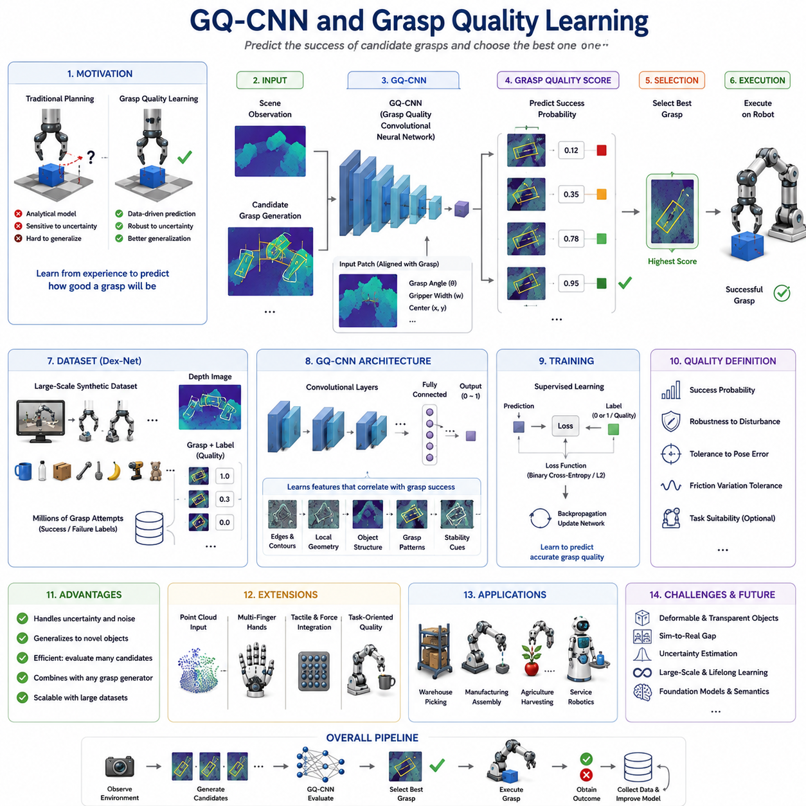{width="7.268055555555556in" height="7.268055555555556in"}

파지 품질 학습(Grasp Quality Learning)은 현대 학습 기반 로봇 파지(Learning-Based Robotic Grasping) 분야에서 가장 영향력 있는 개념 중 하나이다. 기존의 파지 계획은 로봇에게 특정 파지 자세를 직접 생성하도록 하는 데 초점을 두었지만, 파지 품질 학습은 로봇이 실제로 파지를 수행하기 전에 해당 파지가 성공할 가능성을 예측하는 데 초점을 둔다. 즉, "어떤 파지를 수행할 것인가?"라는 문제를 "가능한 여러 파지 중 어떤 파지가 가장 성공 확률이 높은가?"라는 문제로 변환한 것이다. 이러한 사고방식의 변화는 로봇 조작 연구에 큰 영향을 미쳤으며, 복잡하고 비정형적인 환경에서도 학습 기반 파지 시스템이 활용될 수 있는 기반을 마련하였다.

이러한 파지 품질 예측 방법들 중 가장 대표적인 것이 GQ-CNN(Grasp Quality Convolutional Neural Network)이다. GQ-CNN은 Dex-Net 프로젝트의 핵심 기술로 개발되었으며, 시각 정보를 이용하여 파지 성공 확률을 예측하는 데 매우 뛰어난 성능을 보여주었다. 이 연구는 딥러닝(Deep Learning)이 전통적인 파지 계획 기법을 대체하거나 보완할 수 있음을 입증하였고, 이후 수많은 파지 예측 네트워크 개발의 출발점이 되었다.

GQ-CNN이 등장하게 된 배경을 이해하기 위해서는 기존의 파지 계획 방법의 한계를 먼저 살펴볼 필요가 있다. 전통적인 파지 계획은 접촉 역학(Contact Mechanics), 힘 폐쇄 이론(Force Closure Theory), 마찰 콘(Friction Cone), 그립 렌치 공간(Grasp Wrench Space), 최적화 기법(Optimization Techniques) 등에 기반한다. 이러한 방법은 수학적으로 매우 엄밀하지만 실제 환경에서는 물체의 마찰 계수, 질량 분포, 센서 오차, 물체 자세 추정 오차 등 다양한 불확실성이 존재한다. 이러한 작은 오차만으로도 실제 파지 성능은 크게 저하될 수 있다.

반면 학습 기반 파지 품질 예측은 물리 모델을 직접 계산하기보다 데이터로부터 성공 패턴을 학습한다. 수많은 성공 및 실패 사례를 학습한 신경망은 특정 물체 형상과 파지 자세가 성공적인 결과로 이어질 가능성을 예측할 수 있다. 따라서 정확한 물리 파라미터를 알지 못하더라도 안정적인 파지를 선택할 수 있게 된다.

GQ-CNN의 핵심 아이디어는 매우 직관적이다. 물체에 대한 시각 정보와 하나의 후보 파지(Candidate Grasp)가 주어지면 신경망은 해당 파지가 성공할 확률을 출력한다. 중요한 점은 GQ-CNN이 반드시 파지를 생성하는 것은 아니라는 것이다. 다양한 방법으로 생성된 여러 개의 파지 후보를 평가하여 가장 높은 점수를 받은 파지를 선택하는 역할을 수행한다.

즉, GQ-CNN은 파지 생성(Grasp Generation)과 파지 평가(Grasp Evaluation)를 분리한다. 이러한 구조는 매우 실용적이다. 다양한 파지 생성 알고리즘과 결합할 수 있으며, 새로운 생성 알고리즘이 등장하더라도 동일한 품질 평가 네트워크를 활용할 수 있기 때문이다.

GQ-CNN의 성공에는 Dex-Net 프로젝트가 결정적인 역할을 했다. 학습 기반 파지의 가장 큰 문제 중 하나는 대규모 데이터 확보이다. 실제 로봇으로 수백만 번의 파지를 수행하는 것은 현실적으로 매우 어렵다. Dex-Net은 이를 해결하기 위해 수천 개의 3D CAD 모델과 물리 시뮬레이션을 활용하여 대규모 합성 데이터셋(Synthetic Dataset)을 생성하였다.

시뮬레이션 환경에서 수백만 개의 가상 파지를 수행하고, 분석적 파지 품질 지표를 이용하여 자동으로 라벨을 생성하였다. 이 데이터셋은 다양한 물체 형상과 접촉 조건을 포함하였으며, 대규모 학습이 가능하도록 설계되었다. 결과적으로 GQ-CNN은 방대한 데이터로부터 파지 성공과 관련된 패턴을 학습할 수 있었다.

일반적인 GQ-CNN 시스템은 RGB 영상보다 깊이 영상(Depth Image)을 주로 사용한다. 깊이 영상은 물체 표면의 기하학적 구조를 직접 제공하기 때문에 파지 계획에 매우 유용하다. 시스템은 깊이 영상으로부터 여러 개의 후보 파지를 생성하고, 각 파지의 방향과 위치에 맞춰 정규화된 이미지 패치를 추출한다. 이 패치와 파지 관련 정보가 신경망의 입력으로 사용된다.

네트워크 구조는 합성곱 신경망(CNN)을 기반으로 한다. CNN은 공간적 패턴을 학습하는 데 매우 뛰어나기 때문에 물체 표면 형상과 파지 성공률 사이의 관계를 효과적으로 학습할 수 있다. 초기 계층에서는 모서리, 곡면, 표면 구조 등을 인식하고, 깊은 계층에서는 파지 안정성과 관련된 고차원 특징을 추출한다.

학습 과정은 지도학습(Supervised Learning) 형태로 진행된다. 입력은 물체 관측 정보와 파지 후보이고, 출력은 파지 품질 점수이다. 학습 데이터에는 성공 또는 실패 여부가 포함되어 있으며, 네트워크는 예측 오차를 최소화하도록 반복적으로 학습된다. 시간이 지남에 따라 성공적인 파지 패턴을 스스로 인식하게 된다.

GQ-CNN의 가장 중요한 공헌 중 하나는 합성 데이터만으로도 실제 로봇 성능을 크게 향상시킬 수 있다는 사실을 보여준 것이다. 이전에는 시뮬레이션 데이터가 실제 환경과 너무 다르기 때문에 활용 가치가 제한적이라고 여겨졌다. 그러나 GQ-CNN은 적절한 데이터 표현과 대규모 데이터셋을 활용하면 시뮬레이션 학습 결과가 실제 환경에서도 효과적으로 동작할 수 있음을 입증하였다.

파지 품질 학습은 확률적 관점(Probabilistic Perspective)의 파지 계획이라고 볼 수 있다. 전통적인 방식이 단일 정답을 찾는 문제였다면, 품질 학습은 성공 확률을 추정하는 문제이다. 실제 환경은 본질적으로 불확실성이 존재하기 때문에 이러한 접근 방식은 매우 현실적이다. 센서 노이즈, 물체 위치 오차, 환경 변화가 존재하더라도 로봇은 가장 높은 성공 가능성을 가진 행동을 선택할 수 있다.

파지 품질은 다양한 방식으로 정의될 수 있다. 가장 단순한 경우에는 물체를 들어 올릴 수 있는 확률을 의미한다. 하지만 실제 산업 환경에서는 외란 저항성(Disturbance Resistance), 자세 오차 허용 범위(Pose Tolerance), 마찰 변화에 대한 강건성(Robustness), 후속 작업 적합성(Task Suitability) 등을 포함할 수도 있다.

최근에는 단순한 평행 그리퍼(Parallel Jaw Gripper)를 넘어 다지형 로봇 손(Dexterous Hand)에 대한 연구가 활발히 진행되고 있다. 다지형 손에서는 손 위치뿐 아니라 손가락 협응(Finger Coordination), 접촉 분포(Contact Distribution), 힘 배분(Force Allocation), 조작 목표(Manipulation Objective)까지 고려해야 한다. 이에 따라 파지 품질 예측 네트워크도 점점 복잡해지고 있다.

포인트 클라우드(Point Cloud)를 활용하는 방법도 빠르게 발전하고 있다. 초기 GQ-CNN은 깊이 영상 중심이었지만, 최근의 연구는 3차원 포인트 클라우드 데이터를 직접 처리한다. 이를 통해 보다 정확하게 물체의 기하 구조를 이해할 수 있으며, 복잡한 환경에서도 더 높은 성능을 달성할 수 있다.

촉각 센서(Tactile Sensor)의 통합 또한 중요한 발전 방향이다. 시각 정보만으로는 파지가 형성된 이후의 상태를 완전히 파악하기 어렵다. 촉각 센서는 압력 분포, 접촉 위치, 미끄러짐, 힘 전달 상태 등을 직접 측정할 수 있다. 따라서 촉각과 시각을 결합한 품질 예측 시스템은 훨씬 높은 정확도를 제공할 수 있다.

멀티모달 파지 품질 학습(Multimodal Grasp Quality Learning)은 현재 매우 중요한 연구 주제이다. 비전, 촉각, 힘 센서, 관절 상태 정보를 동시에 활용함으로써 인간의 파지 능력과 유사한 수준의 판단 능력을 목표로 하고 있다.

기존 GQ-CNN의 한계 중 하나는 파지 자체의 안정성만 평가한다는 점이다. 하지만 실제 작업에서는 파지가 안정적이라고 해서 반드시 좋은 파지는 아니다. 예를 들어 컵을 운반하기 위한 파지와 액체를 따르기 위한 파지는 서로 다르다. 드라이버를 사용하는 작업에서는 특정 위치를 잡아야만 한다. 따라서 최근에는 작업 지향 파지(Task-Oriented Grasping)가 중요한 연구 분야로 부상하고 있다.

작업 지향 파지 품질 학습(Task-Oriented Grasp Quality Learning)은 단순히 물체를 잡을 수 있는지뿐 아니라 이후 작업 수행에 적합한지를 평가한다. 이는 보다 지능적이고 목적 지향적인 로봇 행동을 가능하게 한다.

강화학습(Reinforcement Learning)은 파지 품질 학습의 또 다른 발전 방향이다. 지도학습처럼 미리 정의된 품질 점수에 의존하지 않고, 로봇이 직접 환경과 상호작용하면서 품질 함수를 학습한다. 이를 통해 새로운 환경이나 새로운 작업에도 적응할 수 있다.

자기지도학습(Self-Supervised Learning) 역시 매우 중요한 역할을 한다. 로봇은 반복적인 파지 시도를 통해 스스로 데이터를 수집하고 품질 예측 모델을 지속적으로 개선할 수 있다. 이러한 접근 방식은 평생 학습(Lifelong Learning)의 기반이 된다.

최근 등장한 파운데이션 모델(Foundation Model)은 파지 품질 학습에도 영향을 미치고 있다. 비전-언어 모델(VLM)과 비전-언어-행동 모델(VLA)은 단순한 기하학적 안정성뿐 아니라 의미적 목적(Semantic Objective)까지 고려할 수 있다. 미래의 로봇은 "운반을 위한 파지", "조립을 위한 파지", "도구 사용을 위한 파지", "사람에게 전달하기 위한 파지"를 구분하여 서로 다른 전략을 선택할 수 있을 것이다.

파지 품질 학습 시스템의 평가는 현재 활발히 연구되고 있다. 대표적인 평가 지표로는 파지 성공률(Grasp Success Rate), 예측 정확도(Prediction Accuracy), 강건성(Robustness), 일반화 능력(Generalization), 계산 속도(Computational Efficiency) 등이 있다. Dex-Net, GraspNet, Jacquard와 같은 공개 벤치마크는 이러한 평가를 위한 표준 플랫폼 역할을 수행하고 있다.

산업 현장에서의 적용도 빠르게 증가하고 있다. 물류 창고에서는 다양한 제품을 자동으로 집기 위해 품질 예측 모델을 사용하고 있으며, 제조업에서는 빈번한 제품 변경에 대응하기 위해 활용하고 있다. 농업 로봇은 과일과 채소를 손상 없이 수확하기 위해 사용하며, 서비스 로봇은 가정 환경의 다양한 물체를 다루기 위해 활용한다.

그럼에도 불구하고 해결해야 할 문제는 여전히 존재한다. 변형 가능한 물체(Deformable Objects), 투명 물체(Transparent Objects), 반사 표면(Reflective Surface), 복잡한 접촉 기반 조작(Contact-Rich Manipulation)은 여전히 어려운 문제이다. 또한 데이터 편향(Dataset Bias), Sim-to-Real Gap, 불확실성 추정(Uncertainty Estimation), 계산 비용(Computational Cost)도 중요한 연구 주제로 남아 있다.

결국 GQ-CNN과 파지 품질 학습은 로봇 조작의 패러다임을 근본적으로 변화시켰다. 로봇은 더 이상 물리 모델만으로 파지를 계획하지 않고, 과거 경험으로부터 성공 가능성을 예측하는 방식으로 행동을 결정한다. 이러한 예측 기반 접근법은 현대 학습 기반 조작 시스템의 핵심이 되었으며, 앞으로 더욱 정교한 로봇 손, 대규모 데이터셋, 멀티모달 센서, 파운데이션 모델과 결합되어 차세대 지능형 로봇 조작 기술의 중심 역할을 수행하게 될 것이다.

## 11.04 Six-DoF Grasp Detection Networks

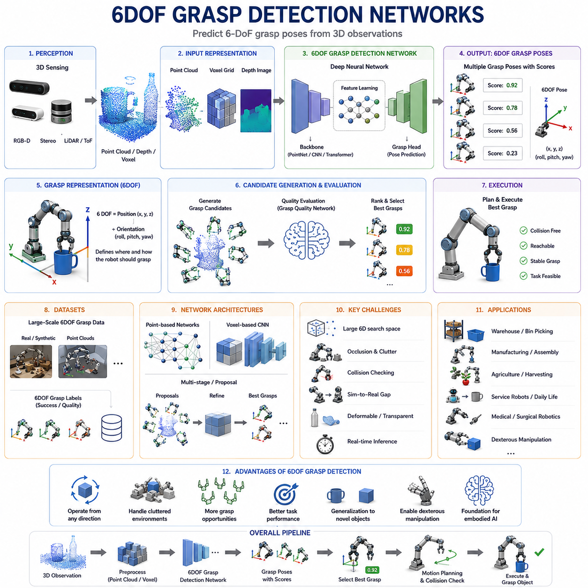{width="7.268055555555556in" height="7.268055555555556in"}

6자유도 파지 검출 네트워크(6DOF Grasp Detection Networks)는 현대 로봇 파지 기술에서 가장 중요한 발전 중 하나로 평가된다. 기존의 파지 검출 시스템은 주로 구조화된 환경에서의 상부 접근(Top-Down Grasping)을 가정하여 설계되었다. 이러한 시스템은 일반적으로 RGB 이미지나 깊이 영상(Depth Image) 상에서 파지 중심점, 회전 각도, 그리퍼 폭을 예측하는 2차원 파지 사각형(Grasp Rectangle) 형태를 사용하였다. 이러한 접근법은 창고 자동화, 산업용 픽 앤 플레이스(Pick-and-Place), 단순 물체 이송 작업에서는 상당한 성공을 거두었지만, 본질적으로 제한된 표현 방식을 가지고 있었다.

실제 로봇 조작은 3차원 공간에서 이루어진다. 물체는 임의의 자세로 놓여 있을 수 있으며, 다른 물체에 의해 가려질 수 있고, 복잡한 적재 환경 속에 존재할 수도 있다. 또한 측면 접근(Side Grasp)이나 특정 방향에서의 접근이 요구되는 경우도 많다. 이러한 문제를 해결하기 위해 등장한 것이 6DOF 파지 검출 기술이다. 6DOF 파지 검출 네트워크는 센서 데이터로부터 완전한 6자유도 파지 자세를 직접 예측할 수 있다.

6자유도는 공간상의 위치와 방향을 완전히 표현하는 방법이다. X, Y, Z 축 방향의 이동(Translation)이 3개의 자유도를 구성하며, Roll, Pitch, Yaw 회전이 추가적인 3개의 자유도를 구성한다. 따라서 6DOF 파지는 단순히 "어디를 잡을 것인가"뿐만 아니라 "어떤 방향으로 접근할 것인가"까지 포함한다. 이로 인해 로봇은 거의 모든 방향에서 물체를 접근하고 파지할 수 있으며 훨씬 다양한 조작 작업을 수행할 수 있게 된다.

6DOF 파지 검출의 발전은 3차원 센서 기술의 발전과 밀접한 관련이 있다. 초기 로봇 시스템은 단안 카메라(Monocular Camera)나 상부 설치형 깊이 센서에 의존하였다. 그러나 RGB-D 카메라, 스테레오 비전(Stereo Vision), 구조광 센서(Structured Light Sensor), ToF(Time-of-Flight) 카메라, LiDAR 등의 발전으로 인해 환경에 대한 고밀도 3차원 정보 획득이 가능해졌다. 이러한 센서들은 물체의 형상을 보다 정확하게 인식할 수 있게 만들었으며, 이를 활용한 6DOF 파지 연구가 활발하게 진행되기 시작하였다.

6DOF 파지 검출이 필요한 가장 큰 이유는 2차원 파지 표현의 한계 때문이다. 예를 들어 선반 위에 컵이 놓여 있다고 가정해 보자. 기존의 2D 파지 검출기는 컵을 위에서 바라보는 시점에서 적절한 파지 사각형을 찾을 수는 있지만, 손잡이를 잡아야 하는지, 측면에서 접근해야 하는지, 주변 물체와 충돌하지 않는지까지는 판단하기 어렵다. 반면 6DOF 파지 검출기는 물체의 전체 공간 구조를 이해하고 접근 방향까지 고려하여 적절한 파지 자세를 생성할 수 있다.

2차원 파지에서 6자유도 파지로 확장되면서 문제의 복잡도는 크게 증가하였다. 평면 파지는 이미지 좌표와 회전 각도 정도만 고려하면 되지만, 6DOF 파지는 연속적인 6차원 공간 전체를 탐색해야 한다. 가능한 파지 자세의 수는 기하급수적으로 증가하며, 이를 효과적으로 표현하고 학습하는 것이 매우 중요한 연구 주제가 되었다.

초기의 6DOF 파지 연구는 주로 기하학적 모델과 물체 재구성에 의존하였다. 포인트 클라우드(Point Cloud)로부터 물체 표면을 복원하고, 표면 법선(Surface Normal), 곡률(Curvature), 접촉 조건(Contact Geometry)을 이용하여 후보 파지를 생성하였다. 하지만 이러한 방법은 계산 비용이 높고 물체 분할(Object Segmentation)에 크게 의존하는 문제가 있었다.

딥러닝(Deep Learning)의 등장 이후 상황은 크게 변화하였다. 연구자들은 포인트 클라우드, 깊이 영상, 복셀(Voxel), 메쉬(Mesh)와 같은 입력 데이터로부터 직접 파지 자세를 예측하는 신경망을 개발하기 시작하였다. 이러한 접근법은 센서 입력부터 파지 자세 생성까지 엔드 투 엔드(End-to-End) 학습을 가능하게 하였으며, 복잡한 환경에서도 강건한 성능을 제공하였다.

포인트 클라우드 기반 파지 검출(Point Cloud Based Grasp Detection)은 현재 가장 널리 사용되는 방법 중 하나이다. 포인트 클라우드는 물체 표면의 3차원 좌표를 직접 포함하고 있기 때문에 이미지 투영 과정 없이도 물체의 형상을 표현할 수 있다. PointNet, PointNet++, Dynamic Graph CNN, Point Transformer, Graph Neural Network와 같은 네트워크 구조들이 이 분야에서 널리 활용되고 있다.

이후 등장한 Grasp Pose Detection 계열의 연구는 파지 검출을 자세 추정(Pose Estimation) 문제로 직접 다루었다. 이러한 네트워크는 포인트 클라우드나 깊이 영상을 입력으로 받아 다수의 후보 파지 자세와 각 자세의 신뢰도 점수를 출력한다. 이를 통해 별도의 파지 생성 모듈 없이도 직접 파지를 예측할 수 있게 되었다.

또 다른 접근 방식으로는 Grasp Proposal Network가 있다. 이는 객체 검출(Object Detection)의 Region Proposal Network와 유사한 개념으로, 먼저 많은 수의 파지 후보를 생성한 후 추가적인 네트워크를 이용하여 가장 적합한 후보를 선택한다. 이러한 구조는 복잡한 환경에서도 높은 성능을 보여준다.

최근에는 Grasp Anchor 개념도 도입되고 있다. 이는 객체 검출에서 Anchor Box를 사용하는 것과 유사하다. 미리 정의된 파지 템플릿을 공간에 배치하고, 네트워크는 해당 템플릿으로부터의 오프셋(Offset)을 예측한다. 이를 통해 6차원 공간 전체를 효율적으로 탐색할 수 있다.

깊이 영상 기반 6DOF 파지 검출도 여전히 중요한 연구 분야이다. 깊이 영상은 기하학적 정보를 풍부하게 제공하면서도 계산 비용이 상대적으로 낮다. 많은 네트워크는 깊이 영상을 3차원 표현으로 변환한 후 CNN이나 Transformer를 이용하여 파지 자세를 예측한다.

복셀(Voxel) 기반 표현은 공간을 3차원 격자로 나누고 각 셀(Cell)에 점유 여부를 저장하는 방식이다. 3차원 CNN을 사용하여 처리할 수 있다는 장점이 있지만, 고해상도 환경에서는 메모리 사용량이 매우 크다는 단점도 존재한다.

최근에는 Transformer 기반 네트워크가 6DOF 파지 검출에서도 큰 성공을 거두고 있다. 원래 자연어 처리(NLP)를 위해 개발된 Transformer는 장거리 관계(Long-Range Dependency)를 학습하는 데 매우 뛰어나다. Point Transformer와 Vision Transformer는 물체 전체의 형상과 복잡한 공간 관계를 이해하는 데 강점을 보이며 최신 벤치마크에서 우수한 성능을 기록하고 있다.

6DOF 파지 학습에서 가장 어려운 문제 중 하나는 다중 해답(Multiple Solutions)의 존재이다. 객체 검출에서는 하나의 객체에 하나의 Bounding Box가 존재하지만, 파지 문제에서는 하나의 물체에 수십 개 또는 수백 개의 성공 가능한 파지가 존재할 수 있다. 따라서 네트워크는 단일 정답이 아니라 파지 분포(Grasp Distribution)를 학습해야 한다.

이를 위해서는 대규모 데이터셋이 필요하다. GraspNet은 현재 가장 대표적인 6DOF 파지 데이터셋 중 하나이며, 수백만 개의 파지 라벨과 수천 개의 물체 모델을 포함하고 있다. 또한 다양한 환경 조건과 센서 데이터를 제공하여 연구자들이 네트워크를 학습하고 평가할 수 있도록 지원한다.

시뮬레이션은 6DOF 데이터 생성에 필수적인 도구가 되었다. 물리 시뮬레이터를 이용하면 다양한 물체에 대해 수많은 파지 자세를 자동으로 평가할 수 있다. 접촉력, 마찰력, 물체 동역학을 계산하여 대규모 데이터셋을 생성할 수 있기 때문에 실제 데이터 수집 비용을 크게 줄일 수 있다.

그러나 Sim-to-Real Gap 문제는 여전히 존재한다. 시뮬레이션과 실제 환경 사이에는 센서 특성, 물리 모델, 환경 조건 등의 차이가 있기 때문이다. 이를 해결하기 위해 도메인 랜덤화(Domain Randomization), 도메인 적응(Domain Adaptation), 자기지도학습(Self-Supervised Fine-Tuning) 등이 사용되고 있다.

충돌 회피(Collision Awareness)는 6DOF 파지에서 매우 중요한 요소이다. 어떤 파지가 기하학적으로는 유효하더라도 주변 물체나 환경과 충돌한다면 실제로는 사용할 수 없다. 따라서 최신 시스템은 충돌 검사(Collision Checking)를 통합하여 현실적인 파지 자세만을 선택하도록 설계되고 있다.

복잡한 적재 환경(Cluttered Environment)은 6DOF 파지의 대표적인 응용 분야이다. 물체가 서로 가려져 있거나 겹쳐져 있는 경우, 상부 접근 방식은 한계를 가진다. 6DOF 파지는 다양한 방향에서 접근할 수 있기 때문에 이러한 환경에서도 높은 성공률을 달성할 수 있다.

다지형 로봇 손(Dexterous Hand)은 또 다른 도전 과제이다. 평행 그리퍼는 단순한 자세만 고려하면 되지만, 다지형 손은 손가락 관절 각도, 접촉 분포, 힘 분배, 손 운동학까지 고려해야 한다. 최근 연구는 이러한 다지형 손을 위한 6DOF 파지 생성에도 집중되고 있다.

촉각 센서(Tactile Sensor)의 통합은 매우 유망한 방향이다. 비전 기반 파지는 접촉 이전 정보를 제공하지만, 실제 접촉 이후의 상태는 촉각 센서를 통해서만 정확하게 파악할 수 있다. 시각과 촉각을 결합한 멀티모달 학습(Multimodal Learning)은 파지 정확성과 강건성을 크게 향상시킬 수 있다.

최근에는 작업 지향 파지(Task-Oriented Grasping)가 중요한 연구 분야로 부상하고 있다. 동일한 물체라도 운반, 조립, 공구 사용, 사람에게 전달하기 등의 목적에 따라 최적의 파지는 달라질 수 있다. 따라서 최신 6DOF 파지 네트워크는 단순한 안정성뿐 아니라 작업 목표까지 고려하는 방향으로 발전하고 있다.

파운데이션 모델(Foundation Model)과 체화형 AI(Embodied AI)의 등장도 이 분야에 큰 영향을 미치고 있다. 미래의 로봇은 단순히 안정적인 파지를 찾는 것을 넘어 자연어 명령을 이해하고 물체의 기능을 추론하며 상황에 맞는 파지 전략을 생성하게 될 것이다.

산업 현장에서는 실시간 성능(Real-Time Performance)이 매우 중요하다. 물류 창고, 제조 공장, 서비스 로봇 시스템은 제한된 시간 내에 의사결정을 수행해야 한다. 따라서 네트워크 경량화, 추론 최적화, 임베디드 GPU 배포(Edge Deployment)는 중요한 연구 주제로 남아 있다.

6DOF 파지 검출 시스템은 현재 물류 자동화(Warehouse Automation), 제조업(Manufacturing), 농업(Agriculture), 의료 로봇(Medical Robotics), 서비스 로봇(Service Robotics) 등 다양한 분야에서 활용되고 있다. 빈 피킹(Bin Picking), 조립 작업, 과일 수확, 의료 기구 조작, 가정용 물체 취급 등이 대표적인 응용 사례이다.

그럼에도 불구하고 해결해야 할 과제는 여전히 많다. 투명 물체(Transparent Objects), 반사 물체(Reflective Objects), 변형 물체(Deformable Objects), 관절형 구조(Articulated Objects), 극도로 복잡한 적재 환경은 여전히 어려운 문제이다. 또한 불확실성 추정(Uncertainty Estimation), 평생 학습(Lifelong Learning), 멀티모달 융합(Multimodal Fusion), 의미 기반 추론(Semantic Reasoning)은 앞으로의 핵심 연구 분야가 될 것이다.

결론적으로 6DOF 파지 검출 네트워크는 로봇이 3차원 공간 전체에서 자유롭게 파지를 계획하고 수행할 수 있도록 해주는 핵심 기술이다. 이는 기존의 평면 기반 파지 방식의 한계를 극복하고, 실제 환경에서 요구되는 유연성과 적응성을 제공한다. 앞으로 덱스터러스 조작(Dexterous Manipulation), 자율 로봇(Autonomous Robotics), 체화형 인공지능(Embodied Artificial Intelligence)의 발전과 함께 6DOF 파지 기술은 더욱 중요한 역할을 수행하게 될 것이다.

## 11.05 Point Cloud-Based Grasp Learning

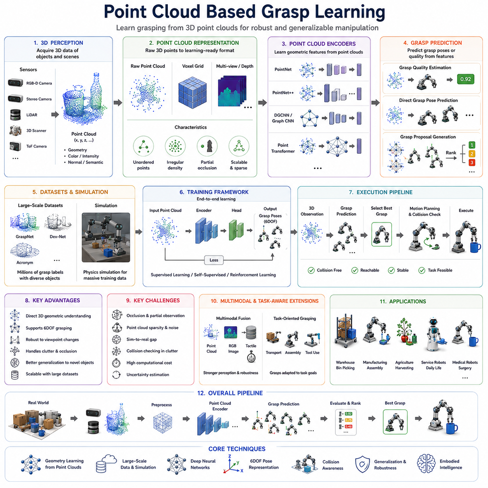{width="7.268055555555556in" height="7.268055555555556in"}

포인트 클라우드 기반 파지 학습(Point Cloud Based Grasp Learning)은 현대 로봇 조작(Robotic Manipulation) 분야에서 가장 중요한 연구 방향 중 하나로 자리 잡고 있다. 로봇이 점점 더 복잡하고 동적인 비정형 환경(Unstructured Environment)에서 작업하게 되면서, 기존의 2차원 영상 기반 파지 방법의 한계가 명확해지고 있다. RGB 이미지와 깊이 영상(Depth Map)은 유용한 정보를 제공하지만 실제 물체가 가지는 복잡한 3차원 형상을 완전하게 표현하기는 어렵다. 반면 포인트 클라우드(Point Cloud)는 물체 표면과 공간 구조를 직접적으로 표현하는 3차원 데이터 형식이다. 로봇이 포인트 클라우드로부터 직접 파지 전략을 학습할 수 있다면 물체 형상을 보다 정확하게 이해하고, 3차원 공간에서의 파지 가능성을 추론하며, 더욱 강건한 조작 성능을 달성할 수 있다.

포인트 클라우드는 물체와 환경의 표면을 구성하는 수많은 3차원 점들의 집합이다. 각 점은 일반적으로 X, Y, Z 좌표를 포함하며, 센서 종류에 따라 색상(Color), 반사율(Intensity), 표면 법선 벡터(Normal Vector), 의미 정보(Semantic Label) 등을 추가로 포함할 수 있다. 이러한 데이터는 RGB-D 카메라, 스테레오 비전(Stereo Vision), 구조광 센서(Structured-Light Sensor), LiDAR, ToF(Time-of-Flight) 카메라, 산업용 3D 스캐너 등을 통해 생성된다. 일반 이미지가 2차원 픽셀 격자 위에 정보를 저장하는 것과 달리, 포인트 클라우드는 실제 공간상의 기하학적 구조를 직접 표현한다.

포인트 클라우드가 로봇 파지에서 중요한 이유는 파지 자체가 본질적으로 기하학적(Geometric) 문제이기 때문이다. 로봇 손은 물체의 표면, 모서리, 곡면, 손잡이, 접촉점(Contact Point)과 상호작용한다. 이러한 요소들은 모두 3차원 공간에 존재한다. 이미지는 간접적으로 형상을 추정할 수 있지만, 포인트 클라우드는 형상 정보를 명시적으로 제공한다. 따라서 로봇은 물체의 형태, 표면 방향, 접근 가능성, 접촉 가능 영역을 보다 직접적으로 분석할 수 있다.

초기의 포인트 클라우드 기반 파지 시스템은 주로 수작업으로 설계된 기하학적 특징(Handcrafted Geometric Features)에 의존하였다. 연구자들은 표면 법선(Surface Normal)을 계산하고, 물체 경계를 검출하며, 기하학적 규칙을 이용하여 파지 후보를 생성하였다. 이러한 방법은 특정 환경에서는 효과적이었지만, 다양한 물체에 대한 일반화 성능은 제한적이었다. 이후 딥러닝(Deep Learning)의 등장으로 상황은 크게 변화하였다. 신경망이 포인트 클라우드로부터 직접 특징을 학습할 수 있게 되면서, 수작업 특징 설계의 필요성이 크게 줄어들었다.

하지만 포인트 클라우드는 이미지와 달리 규칙적인 격자 구조를 가지지 않는다는 문제가 있었다. 이미지의 픽셀은 정해진 순서로 배열되어 있지만, 포인트 클라우드는 단순한 점들의 집합(Set)이다. 점의 개수도 일정하지 않으며 순서 역시 의미가 없다. 따라서 기존 CNN(Convolutional Neural Network)을 그대로 적용할 수 없었다. 이러한 문제를 해결하기 위해 포인트 클라우드를 직접 처리할 수 있는 새로운 신경망 구조들이 개발되었다.

그중 가장 큰 돌파구는 PointNet의 등장이다. PointNet은 포인트 클라우드를 순서가 없는 집합(Unordered Set)으로 처리하는 새로운 접근 방식을 제안하였다. 각 점에 동일한 신경망 연산을 적용한 후 Max Pooling과 같은 대칭 함수(Symmetric Function)를 사용하여 전체 특징을 추출하였다. 이를 통해 포인트 순서에 영향을 받지 않는(Permutation Invariant) 학습이 가능해졌다.

PointNet의 성공은 로봇 파지 연구에 큰 영향을 미쳤다. 처음으로 포인트 클라우드를 직접 입력받아 물체 형상을 이해하고 파지 가능 영역을 예측할 수 있게 되었기 때문이다. 이후 PointNet은 파지 검출(Grasp Detection), 객체 인식(Object Recognition), 장면 이해(Scene Understanding), 조작 계획(Manipulation Planning) 등 다양한 분야에서 활용되었다.

그러나 PointNet은 주로 전역 형상(Global Shape)을 학습하는 데 초점을 맞추었기 때문에 국소 기하 구조(Local Geometry)를 충분히 반영하지 못한다는 한계가 있었다. 실제 파지는 특정 접촉 영역에서 발생하기 때문에 국소 형상 정보가 매우 중요하다. 이를 해결하기 위해 등장한 것이 PointNet++이다.

PointNet++는 계층적 구조(Hierarchical Structure)를 도입하여 국소 영역과 전역 영역의 특징을 동시에 학습할 수 있도록 설계되었다. 이를 통해 손잡이, 모서리, 홈, 곡면과 같은 세부적인 형상 정보를 효과적으로 학습할 수 있게 되었으며, 파지 성능도 크게 향상되었다.

또 다른 중요한 연구 방향은 그래프 신경망(Graph Neural Network) 기반 접근법이다. 포인트 클라우드는 자연스럽게 인접 점들 사이의 관계를 가진다. 그래프 기반 네트워크는 점들을 노드(Node)로, 이웃 관계를 엣지(Edge)로 표현하여 기하학적 관계를 직접 학습한다. Dynamic Graph CNN과 같은 모델은 학습 과정에서 그래프를 동적으로 생성하며 복잡한 형상 구조를 효과적으로 표현할 수 있다.

포인트 클라우드 기반 파지 학습은 크게 세 가지 형태로 나눌 수 있다. 첫 번째는 파지 품질 추정(Grasp Quality Estimation)이다. 이는 주어진 파지 후보에 대해 성공 확률을 예측하는 방식이다. 입력으로 포인트 클라우드와 파지 자세를 제공하면 네트워크는 해당 파지의 품질 점수를 출력한다.

두 번째는 직접 파지 자세 예측(Direct Grasp Pose Prediction)이다. 이 방식에서는 후보 파지를 생성하지 않고, 네트워크가 포인트 클라우드로부터 직접 6자유도 파지 자세를 출력한다. 이는 전체 파지 계획 과정을 단순화할 수 있다는 장점이 있다.

세 번째는 파지 제안 생성(Grasp Proposal Generation)이다. 네트워크가 먼저 다수의 파지 후보를 생성한 후, 별도의 평가 모듈을 이용하여 가장 적합한 파지를 선택한다. 이는 객체 검출(Object Detection)에서 Region Proposal Network를 사용하는 방식과 유사하다.

포인트 클라우드 기반 파지 학습의 가장 큰 장점 중 하나는 6DOF 파지 표현과 매우 잘 결합된다는 점이다. 포인트 클라우드는 본질적으로 3차원 데이터를 포함하기 때문에, 완전한 6자유도 파지 자세를 자연스럽게 예측할 수 있다. 이는 복잡한 적재 환경이나 측면 접근이 필요한 작업에서 매우 유용하다.

대규모 데이터셋은 이 분야 발전의 핵심 요소이다. GraspNet, Dex-Net, Acronym과 같은 데이터셋은 수백만 개의 파지 예제와 다양한 물체 형상을 제공한다. 이러한 데이터는 신경망이 형상 특징과 파지 성공률 사이의 관계를 학습할 수 있도록 지원한다.

시뮬레이션(Simulation) 역시 매우 중요한 역할을 한다. 실제 환경에서 대규모 데이터를 수집하는 것은 비용과 시간이 많이 들기 때문이다. 물리 시뮬레이터는 가상 환경에서 수많은 파지 실험을 수행할 수 있으며, 이를 통해 대규모 학습 데이터를 자동으로 생성할 수 있다.

하지만 시뮬레이션 데이터는 실제 환경과 차이가 존재한다. 실제 센서는 노이즈, 누락 데이터(Missing Data), 가림(Occlusion), 보정 오차(Calibration Error) 등을 포함한다. 따라서 Sim-to-Real Gap 문제를 해결하기 위한 연구가 활발히 진행되고 있으며, 도메인 랜덤화(Domain Randomization), 도메인 적응(Domain Adaptation), 자기지도학습(Self-Supervised Learning) 등이 활용되고 있다.

가림 현상(Occlusion)은 포인트 클라우드 기반 파지 학습의 가장 큰 도전 과제 중 하나이다. 실제 환경에서는 물체 전체를 관측할 수 없는 경우가 많다. 다른 물체나 환경 구조에 의해 일부가 가려지기 때문이다. 따라서 학습 시스템은 부분 관측만으로도 파지 가능성을 추론해야 한다.

이를 해결하기 위해 형상 완성(Shape Completion) 기술이 사용된다. 형상 완성 모델은 부분 포인트 클라우드만 보고 보이지 않는 영역을 예측한다. 이렇게 복원된 전체 형상은 보다 정확한 파지 계획에 활용될 수 있다.

최근에는 Transformer 기반 구조가 매우 큰 성공을 거두고 있다. Point Transformer는 Self-Attention 메커니즘을 이용하여 점들 사이의 장거리 관계(Long-Range Relationship)를 학습할 수 있다. 이를 통해 기존 CNN 기반 모델보다 전역적인 형상 이해 능력이 향상되었으며, 여러 벤치마크에서 최고 수준의 성능을 기록하고 있다.

멀티모달 융합(Multimodal Fusion)도 중요한 연구 방향이다. 포인트 클라우드는 기하학적 정보는 제공하지만 재질, 마찰, 강성, 접촉 상태 등의 물리적 특성은 직접 제공하지 못한다. 따라서 RGB 이미지, 촉각 센서(Tactile Sensor), 힘 센서(Force Sensor), 관절 상태(Proprioception)와 결합하는 연구가 활발하게 진행되고 있다.

특히 촉각 정보는 매우 중요하다. 포인트 클라우드는 접촉 이전의 정보를 제공하지만, 촉각 센서는 접촉 이후의 압력 분포, 미끄러짐(Slip), 접촉 위치 등을 제공한다. 시각과 촉각을 결합하면 보다 안정적이고 적응적인 파지가 가능해진다.

최근에는 작업 지향 파지(Task-Oriented Grasping)가 주목받고 있다. 동일한 물체라도 운반, 조립, 공구 사용, 사람에게 전달하기(Handover) 등의 목적에 따라 최적의 파지 방식은 달라질 수 있다. 따라서 최신 연구는 단순히 안정적인 파지가 아니라 목적에 적합한 파지를 학습하는 방향으로 발전하고 있다.

파운데이션 모델(Foundation Models)의 등장도 이 분야에 큰 영향을 미치고 있다. 미래의 로봇은 포인트 클라우드뿐 아니라 언어(Language), 비전(Vision), 촉각(Tactile), 행동(Action) 정보를 함께 학습하게 될 것이다. 이를 통해 로봇은 단순히 물체를 잡는 것이 아니라 물체의 기능(Functionality)과 사용 목적까지 이해하는 수준으로 발전할 수 있다.

현재 포인트 클라우드 기반 파지 학습은 물류 자동화(Warehouse Automation), 제조업(Manufacturing), 농업(Agriculture), 의료 로봇(Medical Robotics), 서비스 로봇(Service Robotics) 등 다양한 분야에서 활용되고 있다. 빈 피킹(Bin Picking), 조립 작업, 과일 수확, 의료 기구 조작, 가정용 물체 처리 등이 대표적인 응용 사례이다.

평가 지표로는 파지 성공률(Grasp Success Rate), 자세 정확도(Pose Accuracy), 일반화 성능(Generalization), 계산 효율성(Computational Efficiency), 충돌 회피 능력(Collision Avoidance), 작업 성공률(Task Completion Rate) 등이 사용된다. 공개 데이터셋과 벤치마크는 연구자들이 공정하게 알고리즘을 비교할 수 있도록 지원한다.

그럼에도 불구하고 해결해야 할 문제는 여전히 많다. 희소한 포인트 클라우드(Sparse Point Cloud), 가림 현상, 센서 노이즈, 투명 물체(Transparent Objects), 반사 물체(Reflective Objects), 변형 물체(Deformable Objects), 복잡한 적재 환경은 여전히 어려운 문제이다. 또한 대규모 포인트 클라우드의 실시간 처리와 불확실성 추정(Uncertainty Estimation), 평생 학습(Lifelong Learning) 역시 중요한 연구 과제로 남아 있다.

앞으로의 연구는 포인트 클라우드 학습을 파운데이션 모델, 월드 모델(World Model), 촉각 지능(Tactile Intelligence), 체화형 추론(Embodied Reasoning)과 결합하는 방향으로 발전할 것으로 예상된다. 미래의 로봇은 단순히 파지 자세를 예측하는 것이 아니라 물체의 기능을 이해하고, 조작 결과를 예측하며, 작업 목표에 따라 전략을 스스로 수정하는 수준까지 발전하게 될 것이다.

결론적으로 포인트 클라우드 기반 파지 학습은 기하학 중심(Geometry-Centric)의 로봇 지능을 구현하는 핵심 기술이다. 로봇이 실제 세계의 3차원 구조를 직접 학습함으로써 물체 형상, 접촉 가능성, 조작 전략을 보다 깊이 이해할 수 있게 된다. 이러한 능력은 미래의 덱스터러스 조작(Dexterous Manipulation), 자율 로봇(Autonomous Robotics), 체화형 인공지능(Embodied Artificial Intelligence)의 핵심 기반 기술이 될 것이다.

## 11.06 RGB-D Grasp Learning

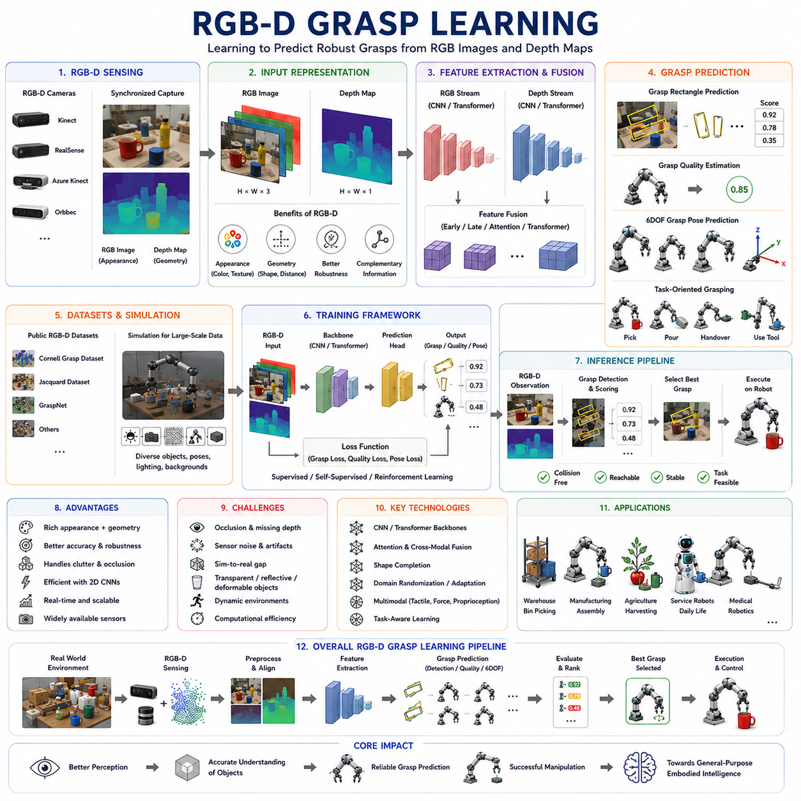{width="7.268055555555556in" height="7.268055555555556in"}

RGB-D 파지 학습(RGB-D Grasp Learning)은 현대 로봇 조작(Robotic Manipulation) 분야에서 가장 널리 활용되고 있는 학습 기반 파지 기술 중 하나이다. RGB-D는 일반적인 컬러 영상인 RGB(Red, Green, Blue) 정보와 깊이 정보(Depth Information)를 결합한 센서 데이터를 의미한다. RGB 영상은 물체의 색상, 질감(Texture), 시각적 특징을 제공하며, 깊이 정보는 센서와 물체 사이의 거리와 3차원 형상 정보를 제공한다. 이 두 가지 정보를 동시에 활용함으로써 로봇은 주변 환경을 더욱 정확하게 이해할 수 있으며, 보다 안정적이고 지능적인 파지 결정을 내릴 수 있다. 지난 10여 년 동안 RGB-D 파지 학습은 물류 자동화, 산업용 로봇, 서비스 로봇, 의료 로봇, 농업 자동화, 체화형 인공지능(Embodied AI) 분야의 핵심 기술로 자리 잡았다.

RGB-D 파지 학습이 등장하게 된 배경에는 기존 RGB 기반 비전 시스템의 한계가 존재한다. 전통적인 컴퓨터 비전 시스템은 주로 색상과 텍스처 정보를 이용하여 물체를 인식하였다. 이러한 시스템은 특정 조건에서는 우수한 성능을 보였지만 물체의 실제 3차원 구조를 정확하게 이해하는 데에는 어려움이 있었다. 조명 변화, 그림자, 반사, 질감이 부족한 물체, 깊이 추정 오차 등은 로봇 조작 성능을 크게 저하시켰다. 이후 Microsoft Kinect, Intel RealSense, ASUS Xtion, Orbbec 센서와 같은 저가형 RGB-D 카메라가 등장하면서 로봇은 시각 정보와 함께 실제 공간 구조를 직접 측정할 수 있게 되었다.

깊이 정보는 로봇의 환경 인식을 근본적으로 변화시켰다. 기존에는 시각적 단서만으로 형상을 추론해야 했지만, RGB-D 센서는 물체 표면의 거리, 모양, 공간적 위치를 직접 측정한다. RGB 정보는 물체가 무엇인지 알려주고, Depth 정보는 물체가 어디에 있는지를 알려준다. 이 두 정보를 결합하면 로봇은 물체의 의미(Semantics)와 기하학적 구조(Geometry)를 동시에 이해할 수 있다.

RGB-D 파지 학습의 기본 목표는 RGB 영상과 깊이 영상을 입력으로 받아 성공적인 파지 자세를 예측하는 것이다. 입력 데이터는 RGB 이미지와 Depth Map으로 구성되며, 출력은 파지 위치(Grasp Position), 파지 방향(Orientation), 파지 품질 점수(Grasp Quality Score), 6자유도 파지 자세(6DOF Grasp Pose), 또는 작업 목적에 맞는 조작 전략(Manipulation Strategy)이 될 수 있다.

RGB-D 데이터가 널리 사용되는 이유 중 하나는 정보량과 계산 효율성 사이의 균형 때문이다. 포인트 클라우드(Point Cloud)는 매우 풍부한 기하학 정보를 제공하지만 계산 비용이 크다. 반면 RGB 영상은 계산 효율성이 높지만 3차원 정보를 직접 제공하지 못한다. RGB-D는 이미지 기반 표현을 유지하면서도 중요한 공간 정보를 제공하기 때문에 실시간 로봇 응용에 매우 적합하다.

RGB-D 파지 학습의 발전은 딥러닝(Deep Learning)과 CNN(Convolutional Neural Network)의 발전과 밀접한 관련이 있다. 연구자들은 깊이 영상도 이미지와 유사한 구조를 가진다는 점에 주목하였고, 기존 CNN 구조를 활용하여 RGB와 Depth를 동시에 처리하기 시작하였다. 초기 연구들은 깊이 영상을 추가 채널로 취급하여 RGB 기반 비전 시스템을 확장하였다. 이러한 접근법은 RGB만 사용하는 방법보다 훨씬 높은 파지 성능을 보여주었다.

RGB-D 파지 학습의 중요한 이정표 중 하나는 파지 사각형(Grasp Rectangle) 예측 방식의 등장이다. 이 방식에서는 파지를 중심 위치, 회전 각도, 그리퍼 폭, 품질 점수로 표현한다. RGB-D 이미지를 입력받은 신경망은 여러 개의 파지 사각형을 예측하며, 그중 가장 성공 가능성이 높은 파지를 선택한다. 이 방법은 계산 효율성과 실제 적용 가능성 측면에서 매우 성공적인 결과를 보여주었다.

Cornell Grasp Dataset은 RGB-D 파지 학습 발전에 큰 역할을 한 대표적인 데이터셋이다. 이 데이터셋은 RGB-D 영상과 사람이 직접 라벨링한 파지 사각형 정보를 포함하고 있다. 수많은 연구가 Cornell Dataset을 이용하여 알고리즘을 평가하였으며, RGB-D 파지 연구의 사실상 표준 벤치마크 역할을 수행하였다.

RGB-D 파지 학습의 성공은 CNN의 계층적 특징 추출 능력에 크게 의존한다. CNN은 이미지에서 저수준 특징과 고수준 특징을 단계적으로 학습한다. 초기 계층에서는 모서리, 윤곽선, 텍스처, 깊이 경계(Depth Discontinuity)를 학습하고, 깊은 계층에서는 물체 구조, 파지 어포던스(Affordance), 작업 관련 특징을 학습한다. 이를 통해 다양한 물체에 대해 안정적인 파지 예측이 가능해진다.

RGB-D 학습에서 가장 중요한 문제 중 하나는 특징 융합(Feature Fusion)이다. RGB 영상과 Depth 정보는 서로 다른 종류의 정보를 제공한다. RGB는 색상, 질감, 재질, 의미 정보를 제공하고, Depth는 형상, 거리, 공간 구조를 제공한다. 따라서 두 정보를 효과적으로 결합하는 것이 매우 중요하다.

초기 융합(Early Fusion)은 RGB와 Depth를 입력 단계에서 바로 결합하는 방식이다. 구현이 간단하고 계산 효율성이 높지만, 각 데이터의 특성을 충분히 활용하지 못할 수 있다. 반면 후기 융합(Late Fusion)은 RGB와 Depth를 별도의 네트워크에서 처리한 후 고수준 특징을 결합한다. 이는 각 데이터 유형에 특화된 특징을 학습할 수 있다는 장점이 있다.

멀티스트림 네트워크(Multi-Stream Network)는 RGB-D 학습에서 매우 널리 사용되는 구조이다. RGB 전용 네트워크와 Depth 전용 네트워크를 별도로 구성한 후 중간 또는 마지막 단계에서 특징을 통합한다. 이를 통해 각 센서의 장점을 최대한 활용할 수 있다.

최근에는 Attention Mechanism이 RGB-D 융합에 적극 활용되고 있다. Attention은 장면 내에서 어떤 정보가 중요한지를 동적으로 결정한다. 예를 들어 물체 경계 인식에는 RGB 정보가 중요할 수 있고, 파지 자세 계산에는 Depth 정보가 더 중요할 수 있다. Attention은 이러한 중요도를 자동으로 학습하여 성능을 향상시킨다.

Transformer 기반 모델도 RGB-D 파지 학습에 큰 영향을 미치고 있다. Transformer는 장거리 관계(Long-Range Dependency)를 학습하는 데 뛰어난 성능을 보인다. Vision Transformer(ViT), Multimodal Transformer, Vision-Language-Action(VLA) 모델은 RGB-D 데이터를 효과적으로 통합하여 보다 정교한 파지 계획을 가능하게 하고 있다.

RGB-D 파지 학습의 대표적인 응용 분야 중 하나는 파지 품질 추정(Grasp Quality Estimation)이다. 시스템은 RGB-D 관측 정보와 파지 후보를 입력으로 받아 해당 파지의 성공 가능성을 예측한다. 이를 통해 로봇은 가장 안정적이고 충돌 위험이 적으며 작업에 적합한 파지를 선택할 수 있다.

RGB-D는 6DOF 파지 검출(6DOF Grasp Detection)에서도 중요한 역할을 한다. 초기 파지 시스템은 주로 평면 파지를 다루었지만, 최근에는 완전한 6자유도 파지 자세를 예측하는 방향으로 발전하고 있다. 깊이 정보는 물체의 공간 구조를 직접 제공하기 때문에 3차원 파지 자세를 추정하는 데 매우 유용하다.

복잡한 적재 환경(Cluttered Scene)은 RGB-D 학습의 대표적인 응용 환경이다. 실제 창고나 공장에서는 물체들이 서로 겹쳐져 있거나 부분적으로 가려져 있는 경우가 많다. RGB 정보만으로는 이를 구분하기 어렵지만, Depth 정보는 물체 간의 거리 차이를 제공하여 보다 정확한 분리와 파지 계획을 가능하게 한다.

가림 현상(Occlusion)은 여전히 중요한 연구 과제이다. RGB-D 센서가 있더라도 물체 일부는 보이지 않을 수 있다. 이를 해결하기 위해 형상 완성(Shape Completion), 확률 모델(Probabilistic Model), 생성 모델(Generative Model) 등이 활용되고 있다. 이러한 기술은 부분적으로 관측된 물체의 전체 형상을 추정하여 파지 계획 성능을 향상시킨다.

시뮬레이션(Simulation)은 RGB-D 파지 학습에서도 매우 중요한 역할을 한다. 실제 로봇으로 대규모 데이터를 수집하는 것은 매우 비용이 많이 들기 때문이다. 시뮬레이터는 RGB-D 영상과 파지 라벨을 자동으로 생성할 수 있으며, 다양한 물체와 환경 조건을 포함하는 방대한 데이터셋 구축을 가능하게 한다.

그러나 Sim-to-Real Gap은 여전히 존재한다. 실제 센서는 노이즈, 깊이 누락(Missing Depth), 조명 변화, 반사, 블러(Blur) 등의 문제를 포함한다. 이를 극복하기 위해 도메인 랜덤화(Domain Randomization), 도메인 적응(Domain Adaptation), 자기지도학습(Self-Supervised Learning), 온라인 파인튜닝(Online Fine-Tuning)이 활용되고 있다.

최근에는 RGB-D와 촉각 센서(Tactile Sensor)의 결합이 활발히 연구되고 있다. RGB-D는 접촉 이전의 정보를 제공하지만, 실제 접촉 이후의 상태는 촉각 센서가 훨씬 정확하게 측정할 수 있다. 압력 분포, 미끄러짐(Slip), 접촉 위치 등을 함께 활용하면 보다 인간과 유사한 수준의 파지 능력을 구현할 수 있다.

작업 지향 파지(Task-Oriented Grasping)는 RGB-D 파지 학습의 중요한 발전 방향이다. 물체를 단순히 집는 것이 아니라, 이후 수행해야 할 작업을 고려하여 파지를 선택하는 것이다. 예를 들어 컵을 운반하는 파지와 액체를 따르기 위한 파지는 서로 다르다. RGB 정보는 물체의 의미를 제공하고, Depth 정보는 기하학적 가능성을 제공하여 작업 목적에 적합한 파지를 선택할 수 있도록 한다.

최근 등장한 파운데이션 모델(Foundation Model)은 RGB-D 파지 학습을 새로운 단계로 이끌고 있다. 비전, 깊이, 언어, 행동 데이터를 함께 학습하는 대규모 모델은 다양한 작업에 일반화할 수 있는 능력을 제공한다. 미래의 RGB-D 파지 시스템은 인식, 추론, 계획, 제어를 하나의 통합 구조 안에서 수행할 것으로 예상된다.

현재 RGB-D 파지 학습은 물류 창고의 빈 피킹(Bin Picking), 제조업 조립 작업, 농업 수확 로봇, 서비스 로봇, 의료 지원 로봇 등 다양한 분야에서 사용되고 있다. RGB-D 센서는 상대적으로 저렴하면서도 강력한 환경 인식 능력을 제공하기 때문에 산업 현장에서 매우 높은 활용 가치를 가진다.

평가 지표로는 파지 성공률(Grasp Success Rate), 검출 정확도(Detection Accuracy), 자세 추정 정확도(Pose Estimation Accuracy), 노이즈에 대한 강건성(Robustness), 새로운 물체에 대한 일반화 능력(Generalization), 계산 효율성(Computational Efficiency), 작업 완료율(Task Completion Rate) 등이 사용된다.

그럼에도 불구하고 해결해야 할 문제는 여전히 많다. 투명 물체(Transparent Objects), 반사 물체(Reflective Objects), 변형 물체(Deformable Objects), 심한 가림 현상, 동적 환경(Dynamic Environment), 복잡한 적재 환경은 현재의 RGB-D 시스템이 어려움을 겪는 대표적인 문제들이다. 또한 강한 햇빛 아래에서는 일부 깊이 센서의 성능이 저하될 수 있으며, 임베디드 플랫폼에서의 실시간 처리도 중요한 과제로 남아 있다.

미래의 RGB-D 파지 학습은 멀티모달 인식(Multimodal Perception), 파운데이션 모델, 월드 모델(World Model), 자기지도학습, 체화형 추론(Embodied Reasoning)과 결합될 것으로 예상된다. 로봇은 단순히 파지 위치를 예측하는 것을 넘어 물체의 기능을 이해하고, 작업 결과를 예측하며, 경험을 통해 지속적으로 학습하는 방향으로 발전할 것이다.

결론적으로 RGB-D 파지 학습은 시각 인식과 실제 물리적 상호작용을 연결하는 핵심 기술이다. RGB의 의미 정보와 Depth의 기하학 정보를 결합함으로써 로봇은 실제 세계를 더욱 정확하게 이해하고 조작할 수 있게 된다. 앞으로 범용 로봇(General-Purpose Robot)과 체화형 인공지능(Embodied AI)이 발전함에 따라 RGB-D 파지 학습은 여전히 가장 중요한 기반 기술 중 하나로 남을 것이다.

## 11.07 Behavior Cloning for Grasping

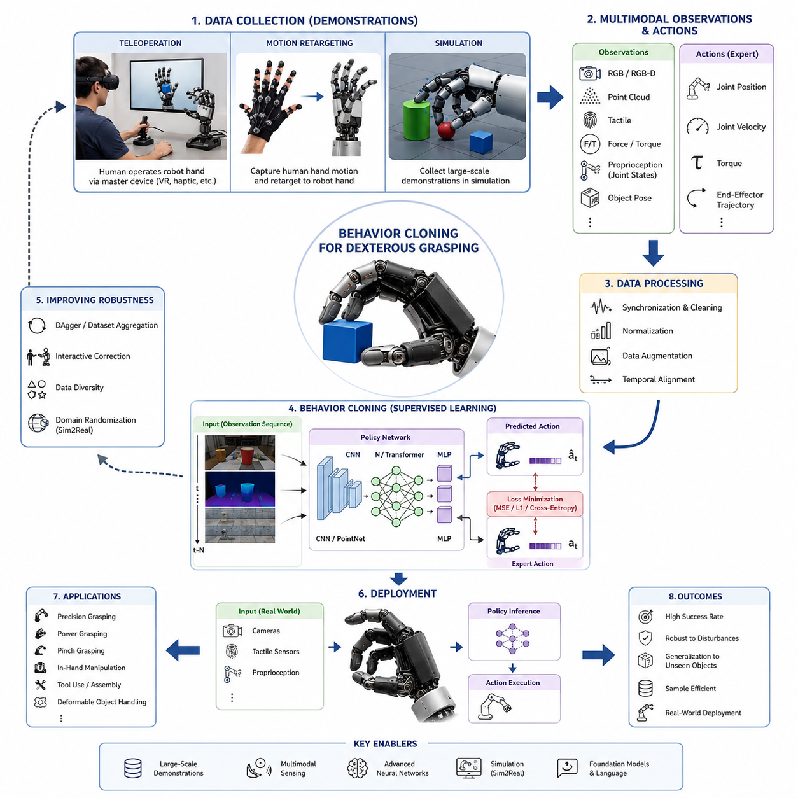{width="7.268055555555556in" height="7.268055555555556in"}

행동 복제(Behavior Cloning)는 현대 로봇 조작 분야에서 가장 중요한 학습 방법 중 하나로, 인간 전문가의 숙련된 조작 능력을 로봇에게 직접 전달할 수 있는 효과적인 방법이다. 전통적인 파지(Grasping) 시스템은 접촉역학(Contact Mechanics), 힘 폐쇄(Force Closure), 파지 계획(Grasp Planning), 제어 이론 등을 기반으로 수작업 설계를 수행하였다. 반면 행동 복제는 인간이 수행한 실제 작업 사례를 학습하여 동일한 행동을 모방하도록 로봇을 훈련시킨다. 즉, 로봇에게 파지 방법을 하나하나 프로그래밍하는 대신, 인간이 수행한 작업 데이터를 학습하여 관측값(Observation)과 행동(Action) 사이의 관계를 자동으로 학습하게 만든다.

행동 복제는 시연 기반 학습(Learning from Demonstration, LfD) 또는 모방 학습(Imitation Learning)의 대표적인 방법이다. 정교 파지 분야에서는 원격 조작(Teleoperation), 가상현실(Virtual Reality), 데이터 글러브(Data Glove), 외골격 장갑(Exoskeleton Glove), 햅틱 장치(Haptic Device), 또는 직접 교시(Kinesthetic Teaching) 등을 통해 인간의 시연 데이터를 수집한다. 이 과정에서 RGB 영상, RGB-D 영상, 포인트 클라우드(Point Cloud), 촉각 센서 데이터(Tactile Data), 힘·토크 데이터(Force-Torque Data), 관절 위치(Joint Position), 관절 속도(Joint Velocity), 물체 자세(Object Pose) 등이 기록된다. 동시에 인간이 수행한 제어 명령 역시 함께 저장되며, 학습 알고리즘은 이러한 입력과 출력의 관계를 학습하여 전문가의 행동 정책(Expert Policy)을 근사한다.

행동 복제가 주목받는 가장 큰 이유는 단순성과 효율성 때문이다. 강화학습(Reinforcement Learning)은 수백만 번 이상의 시행착오를 요구하는 경우가 많지만, 행동 복제는 상대적으로 적은 수의 시연 데이터만으로도 의미 있는 성능을 달성할 수 있다. 특히 다지형 로봇 손(Dexterous Hand)은 가격이 비싸고 기계적 구조가 복잡하기 때문에 대규모 강화학습을 실제 하드웨어에서 수행하기 어렵다. 반면 인간 전문가의 시연 데이터는 이미 성공적인 작업 전략을 포함하고 있으므로 훨씬 적은 비용으로 실용적인 파지 정책을 구축할 수 있다.

정교 파지는 일반적인 픽앤플레이스(Pick-and-Place)보다 훨씬 복잡한 문제이다. 다지형 로봇 손은 20개 이상의 자유도(Degree of Freedom)를 가질 수 있으며, 여러 손가락을 동시에 제어해야 한다. 또한 적절한 파지력을 유지하고, 접촉 상태를 안정적으로 관리하며, 미끄러짐을 방지하고, 외란(Disturbance)에 대응해야 한다. 인간은 수년간 축적된 운동 경험을 통해 이러한 문제를 자연스럽게 해결하지만, 이를 수학적으로 명확하게 기술하는 것은 매우 어렵다. 행동 복제는 인간의 숙련된 행동을 직접 학습함으로써 이러한 난제를 해결하고자 한다.

일반적인 행동 복제 시스템은 시연 데이터 수집 단계에서 시작된다. 가장 널리 사용되는 방법은 원격 조작이다. 인간 조작자가 마스터 장치를 이용해 로봇 손을 제어하고, 로봇은 센서 정보와 제어 명령을 동시에 기록한다. 최근에는 손가락 추적 기능을 가진 VR 장갑이 널리 사용되고 있다. 이러한 장비는 인간 손의 움직임을 정밀하게 측정할 수 있으며, 자연스러운 파지 동작을 대규모로 수집할 수 있다. 결과적으로 데이터셋에는 손가락 협조(Finger Coordination), 파지 전략(Grasp Strategy), 물체 조작 방식 등이 포함된다.

또 다른 방법은 모션 리타게팅(Motion Retargeting)이다. 인간 손의 움직임을 모션 캡처(Motion Capture), IMU 센서, 깊이 카메라 또는 데이터 글러브를 통해 측정한 후 이를 로봇 손의 관절 구조에 맞게 변환한다. 인간 손과 로봇 손은 구조가 다르기 때문에 직접적인 매핑은 불가능하지만, 적절한 변환 알고리즘을 사용하면 인간의 조작 능력을 로봇 시스템에 효과적으로 전달할 수 있다.

최근에는 시뮬레이션 환경 역시 중요한 데이터 수집 수단으로 사용되고 있다. 연구자는 NVIDIA Isaac Sim, MuJoCo, PyBullet과 같은 물리 시뮬레이터에서 가상 로봇 손을 조작할 수 있다. 시뮬레이션에서는 접촉 정보, 힘 정보, 물체 상태 등을 자동으로 기록할 수 있으며, 실제 하드웨어보다 훨씬 빠른 속도로 데이터를 생성할 수 있다. 또한 다양한 환경 조건을 쉽게 생성할 수 있기 때문에 데이터 다양성을 크게 증가시킬 수 있다.

시연 데이터가 수집되면 전처리(Data Preprocessing)가 수행된다. 실제 데이터에는 센서 노이즈, 시간 동기화 문제, 누락 데이터, 조작자별 편향 등이 존재한다. 데이터 정제 과정에서는 잘못된 샘플을 제거하고, 센서 데이터를 동기화하며, 수치 범위를 정규화한다. 또한 데이터 증강(Data Augmentation)을 통해 조명 변화, 물체 위치 변화, 카메라 시점 변화 등을 인위적으로 추가하여 일반화 성능을 향상시킨다.

행동 복제는 기본적으로 지도학습(Supervised Learning) 문제로 정의된다. 관측값을 입력으로 받고 전문가 행동을 출력으로 사용하는 함수 근사를 수행한다. 학습 과정에서는 모델이 예측한 행동과 실제 전문가 행동 사이의 차이를 최소화하도록 신경망을 최적화한다. 연속 제어 문제에서는 평균 제곱 오차(Mean Squared Error)가 주로 사용되며, 이산 행동 문제에서는 교차 엔트로피(Cross Entropy)가 사용된다.

초기의 행동 복제 연구는 선형 회귀(Linear Regression), 결정 트리(Decision Tree), 얕은 신경망(Shallow Neural Network) 등을 사용하였다. 그러나 현대의 정교 파지 시스템은 딥러닝(Deep Learning)을 중심으로 발전하고 있다. 합성곱 신경망(Convolutional Neural Network)은 RGB 및 RGB-D 영상에서 시각 특징을 추출한다. 포인트 클라우드 네트워크는 3차원 형상 정보를 처리한다. 순환 신경망(Recurrent Neural Network)은 시간적 의존성을 모델링한다. 최근에는 Transformer 기반 모델이 장기적인 시계열 관계를 학습하는 데 널리 사용되고 있다.

비전 기반 행동 복제(Vision-Based Behavior Cloning)는 특히 큰 주목을 받고 있다. 로봇은 카메라 영상만을 입력으로 받아 적절한 파지 동작을 생성한다. 이 과정에서 물체 인식(Object Recognition), 자세 추정(Pose Estimation), 파지 가능성 분석(Grasp Affordance Analysis), 경로 계획(Motion Planning)이 하나의 신경망 내부에서 통합적으로 수행된다. 결과적으로 기존의 복잡한 파이프라인을 단순화하면서도 높은 적응성을 제공할 수 있다.

멀티모달 행동 복제(Multimodal Behavior Cloning)는 시각 정보뿐 아니라 촉각(Tactile), 힘(Force), 고유감각(Proprioception) 정보를 함께 사용한다. 인간은 파지 시 촉각 정보를 매우 중요하게 활용한다. 접촉 위치, 압력 분포, 미끄러짐 발생 여부, 물체 변형 상태 등을 손끝 감각으로 인식한다. 따라서 촉각 센서를 통합한 행동 복제 시스템은 불확실성이 높은 환경에서도 더욱 안정적인 파지를 수행할 수 있다.

시간적 모델링(Temporal Modeling) 역시 매우 중요하다. 정교 파지는 단일 동작이 아니라 연속적인 행동의 집합이다. 접근(Approach), 접촉(Contact), 안정화(Stabilization), 재배치(Regrasping), 손안 조작(In-Hand Manipulation) 등이 시간에 따라 순차적으로 이루어진다. LSTM(Long Short-Term Memory)이나 Transformer 모델은 이러한 시계열 관계를 학습하여 더욱 자연스러운 조작 행동을 생성한다.

행동 복제의 가장 큰 한계 중 하나는 공변량 이동(Covariate Shift) 문제이다. 학습 과정에서 로봇은 전문가가 방문한 상태만 관찰한다. 그러나 실제 운용 중에는 작은 오차가 누적되면서 전문가가 경험하지 않은 상태에 진입할 수 있다. 이러한 상황에서는 정책이 적절한 복구 행동을 알지 못하기 때문에 성능이 급격히 저하될 수 있다. 정교 파지에서는 손가락 위치가 약간만 틀어져도 파지가 실패할 수 있으므로 이 문제는 매우 중요하다.

이를 해결하기 위해 DAgger(Dataset Aggregation)와 같은 기법이 개발되었다. 로봇이 스스로 행동하도록 한 후, 전문가가 오류를 수정하는 추가 시연을 제공한다. 이렇게 수집된 데이터를 반복적으로 학습함으로써 정책은 점차 더 넓은 상태 공간을 다룰 수 있게 된다. 또한 인터랙티브 모방 학습(Interactive Imitation Learning)은 전문가 개입을 통해 복구 전략까지 함께 학습하도록 한다.

데이터 다양성 역시 중요한 요소이다. 제한된 데이터만 사용하면 특정 물체나 환경에 과적합될 가능성이 높다. 따라서 다양한 형상, 질감, 크기, 무게, 조명 조건을 가진 물체에 대한 시연 데이터를 수집해야 한다. 최근 대규모 로봇 데이터셋은 수백만 개 이상의 조작 궤적(Trajectory)과 수천 개 이상의 물체를 포함하며, 이러한 데이터는 일반화 성능 향상에 핵심적인 역할을 수행한다.

행동 표현(Action Representation) 역시 성능에 큰 영향을 미친다. 일부 시스템은 관절 위치를 직접 예측하고, 다른 시스템은 관절 속도, 토크, 손끝 경로(Fingertip Trajectory), 잠재 스킬 표현(Latent Skill Representation) 등을 사용한다. 고수준 표현은 학습을 단순화할 수 있지만 정밀도가 떨어질 수 있으며, 저수준 표현은 높은 유연성을 제공하지만 더 많은 데이터와 계산 자원을 요구한다.

행동 복제는 이미 다양한 정교 파지 응용 분야에서 성공적으로 활용되고 있다. 작은 전자 부품을 집는 정밀 파지(Precision Grasp), 무거운 물체를 위한 파워 그립(Power Grip), 얇은 물체를 위한 핀치 그립(Pinch Grip), 변형 가능한 물체를 위한 적응형 파지(Adaptive Grasp) 등이 대표적인 사례이다. 또한 손안 조작(In-Hand Manipulation), 손가락 보행(Finger Gaiting), 공구 사용(Tool Use), 케이블 조작(Cable Manipulation), 조립 작업(Assembly Task) 등 고난도 작업에서도 뛰어난 성능을 보이고 있다.

최근에는 파운데이션 모델(Foundation Model)과의 결합이 새로운 방향으로 주목받고 있다. 대규모 시각-언어-행동(Vision-Language-Action, VLA) 모델은 다양한 로봇과 환경에서 수집된 시연 데이터를 학습하여 범용 조작 능력을 획득한다. 이러한 모델은 단순히 하나의 파지 기술을 배우는 것이 아니라 조작 전반에 대한 일반적인 지식을 습득한다. 또한 언어 명령(Language Instruction)을 통해 상황에 따라 서로 다른 파지 전략을 선택할 수 있다. 예를 들어 "컵 손잡이를 잡아라"와 "컵을 안전하게 운반할 수 있도록 잡아라"는 서로 다른 행동을 요구하며, 이러한 차이를 이해하는 것이 가능해진다.

시뮬레이션-실세계 전이(Sim2Real Transfer) 역시 중요한 연구 분야이다. 시뮬레이션에서 수집한 시연 데이터를 활용하면 비용을 크게 절감할 수 있다. 도메인 랜덤화(Domain Randomization)를 통해 색상, 질감, 조명, 센서 특성, 물체 물성 등을 다양하게 변화시키면 실제 환경에 대한 일반화 능력이 향상된다. 이후 소량의 실제 데이터로 미세 조정(Fine-Tuning)을 수행하면 높은 수준의 실환경 성능을 확보할 수 있다.

행동 복제 기반 정교 파지 시스템의 평가는 파지 성공률(Grasp Success Rate), 작업 성공률(Task Success Rate), 외란 대응 능력(Robustness), 미지 물체 일반화(Unseen Object Generalization), 실행 속도(Execution Speed), 데이터 효율성(Sample Efficiency) 등을 기준으로 이루어진다. 또한 센서 노이즈, 물체 가림(Occlusion), 환경 변화 등에 대한 강인성 역시 중요한 평가 요소가 된다.

산업 현장에서 행동 복제의 활용 범위는 빠르게 확대되고 있다. 물류 창고에서는 다양한 소비재를 처리하기 위해 사용되고 있으며, 제조업에서는 조립 작업을 학습하는 데 활용된다. 의료 분야에서는 수술 도구나 실험실 재료를 다루는 정밀 작업에 적용되고 있으며, 서비스 로봇은 가정 환경에서 인간의 조작 행동을 학습하여 일상 업무를 수행한다. 이러한 접근 방식은 기존의 수작업 프로그래밍보다 훨씬 짧은 개발 기간으로 높은 수준의 조작 능력을 구현할 수 있게 한다.

미래의 행동 복제는 대규모 로봇 데이터셋, 멀티모달 센서 융합, 파운데이션 모델, 그리고 체화 지능(Embodied Intelligence) 기술과 깊게 결합될 것으로 예상된다. 수백만 건 이상의 시연 데이터가 전 세계 로봇 플릿(Fleet)으로부터 수집될 것이며, 시각·촉각·힘·언어·고유감각 정보가 통합된 거대한 학습 모델이 등장할 것이다. 이러한 모델은 범용적인 조작 지식을 학습한 후 특정 로봇 플랫폼에 맞게 미세 조정되어 실제 산업 환경에 배치될 것이다.

궁극적으로 행동 복제는 인간의 숙련된 기술과 로봇의 자율성을 연결하는 핵심 기술이다. 인간 전문가의 경험을 직접 학습함으로써 로봇은 복잡한 수학적 모델을 설계하지 않고도 고도의 파지 및 조작 능력을 획득할 수 있다. 데이터 규모가 증가하고 센서가 고도화되며 학습 모델이 발전함에 따라 행동 복제는 인간 수준의 정교 파지와 손안 조작을 구현하는 핵심 기술로 자리 잡을 것이다. 이는 향후 범용 로봇 손(General-Purpose Robot Hand)과 휴머노이드 로봇(Humanoid Robot)의 발전을 이끄는 중요한 기반 기술이 될 것으로 기대된다.

## 11.08 Reinforcement Learning for Grasping

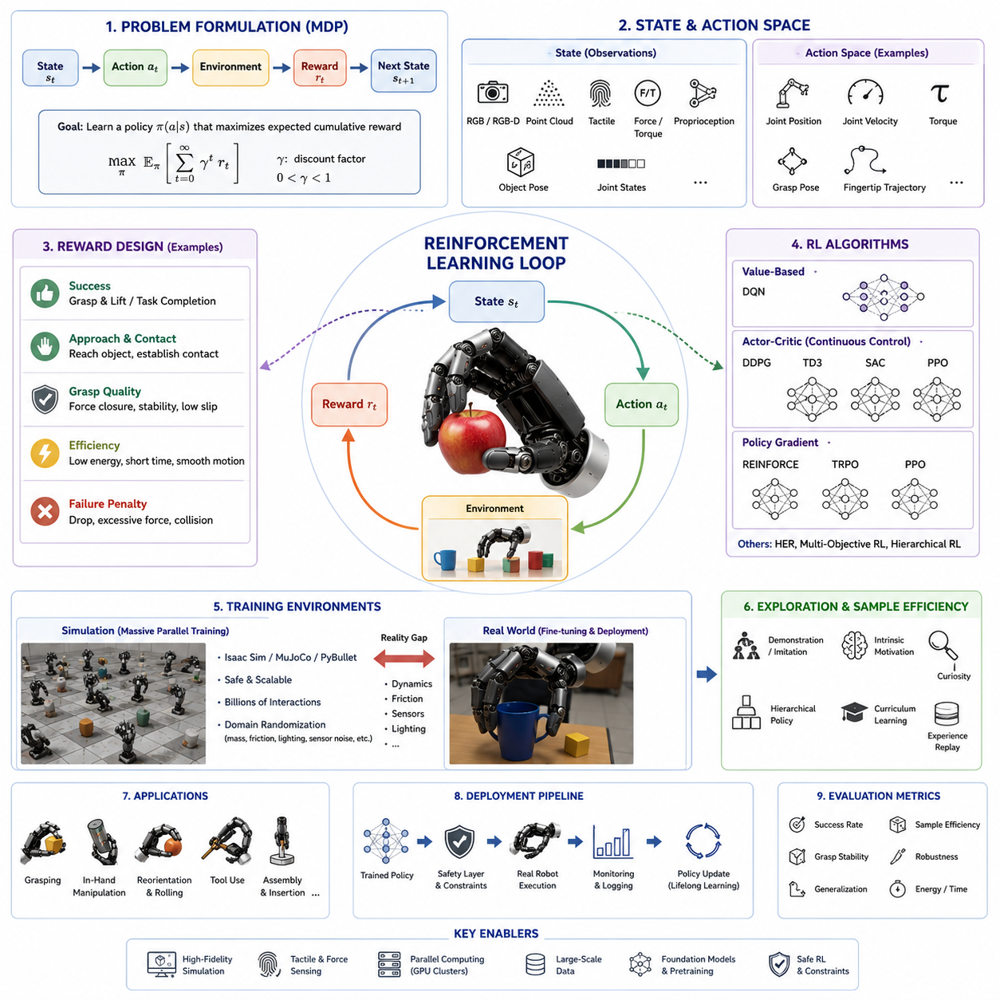{width="7.268055555555556in" height="7.268055555555556in"}

파지를 위한 강화학습(Reinforcement Learning for Grasping)은 로봇이 환경과의 상호작용을 통해 스스로 파지 및 조작 기술을 학습하도록 만드는 가장 강력한 접근법 중 하나이다. 행동 복제(Behavior Cloning)와 같은 지도학습 기반 방법이 전문가 시연 데이터에 의존하는 반면, 강화학습은 시행착오(Trial and Error)를 통해 학습한다. 로봇은 반복적으로 물체와 상호작용하고, 자신의 행동 결과에 대한 보상(Reward)을 받으며, 장기적으로 최대의 보상을 얻는 행동 정책(Policy)을 스스로 발견한다. 이러한 특성은 특히 다지형 로봇 손(Dexterous Hand)에 매우 적합하다. 많은 파지 및 조작 전략은 수학적으로 명확히 정의하기 어렵고, 인간 시연만으로는 충분히 설명되지 않기 때문이다.

강화학습의 기본 개념은 인간과 동물이 경험을 통해 학습하는 과정에서 영감을 얻었다. 로봇은 행동(Action)을 수행하고, 새로운 상태(State)를 관찰하며, 그 결과에 대한 보상을 받는다. 이후 정책을 수정하여 더 나은 행동을 선택하도록 학습한다. 시간이 지남에 따라 성공적인 행동은 강화되고 실패하는 행동은 줄어든다. 이러한 과정은 로봇이 엔지니어가 직접 설계하지 않은 새로운 파지 전략을 발견할 수 있도록 해준다. 또한 다양한 물체에 적응하고, 불확실성을 극복하며, 실패로부터 복구하는 능력을 자연스럽게 습득하게 된다.

강화학습에서 파지 문제는 일반적으로 마르코프 의사결정 과정(Markov Decision Process, MDP)으로 표현된다. 로봇은 현재 상태를 관찰하고 정책에 따라 행동을 선택한 후 새로운 상태로 전이된다. 이후 보상을 받아 정책을 업데이트한다. 상태 정보에는 RGB 영상, RGB-D 영상, 포인트 클라우드(Point Cloud), 촉각 데이터(Tactile Data), 힘·토크 데이터(Force-Torque Data), 관절 상태, 물체 자세(Object Pose), 환경 정보 등이 포함될 수 있다. 행동은 관절 위치 명령, 관절 속도 명령, 토크 명령, 손끝 경로(Fingertip Trajectory), 파지 자세(Grasp Pose) 등으로 표현된다.

보상 함수(Reward Function)는 강화학습에서 가장 중요한 설계 요소 중 하나이다. 가장 단순한 형태는 물체를 성공적으로 집어 올리면 양의 보상을 주고, 실패하면 음의 보상을 주는 방식이다. 그러나 이러한 희소 보상(Sparse Reward)은 학습을 어렵게 만든다. 초기 단계에서는 성공적인 파지가 거의 발생하지 않기 때문이다. 이를 해결하기 위해 보상 형상화(Reward Shaping)가 사용된다. 물체에 접근할 때, 접촉이 발생할 때, 파지 오차가 감소할 때, 안정성이 증가할 때, 힘 폐쇄(Force Closure)가 형성될 때 등의 중간 과정에도 보상을 부여하여 학습을 촉진한다.

초기의 강화학습 알고리즘은 계산 능력의 한계로 인해 복잡한 로봇 손에 적용하기 어려웠다. Q-Learning이나 SARSA와 같은 고전적 방법은 상태 공간과 행동 공간이 작은 문제에서는 효과적이었지만, 수십 개의 자유도를 가진 다지형 손에는 적합하지 않았다. 이후 딥러닝과 강화학습이 결합된 딥 강화학습(Deep Reinforcement Learning)이 등장하면서 상황이 크게 변화하였다. 딥 신경망은 고차원 상태 공간을 효과적으로 표현할 수 있어 복잡한 파지 문제를 해결할 수 있게 되었다.

Deep Q-Network(DQN)는 딥 강화학습의 초기 성공 사례 중 하나이다. DQN은 행동 가치 함수(Action-Value Function)를 신경망으로 근사한다. 그러나 파지 문제는 대부분 연속적인 행동 공간을 가지므로 DQN만으로는 충분하지 않다. 따라서 DDPG(Deep Deterministic Policy Gradient), TD3(Twin Delayed Deep Deterministic Policy Gradient), SAC(Soft Actor-Critic)와 같은 연속 제어 알고리즘이 널리 사용된다.

정책 경사법(Policy Gradient Method) 역시 중요한 계열의 알고리즘이다. 이 방법은 가치 함수를 학습하는 대신 정책 자체를 직접 최적화한다. REINFORCE, TRPO(Trust Region Policy Optimization), PPO(Proximal Policy Optimization) 등이 대표적이다. 특히 PPO는 학습 안정성과 구현 용이성, 계산 효율성을 모두 만족하기 때문에 현재 로봇 조작 분야에서 가장 널리 사용되는 알고리즘 중 하나이다.

정교 파지에서 강화학습은 독특한 장점을 제공한다. 다지형 손은 접촉이 빈번하게 발생하는 복잡한 환경에서 동작한다. 이러한 환경에서는 명확한 해석적 해답을 찾기 어렵다. 강화학습은 손가락과 물체 사이의 미세한 물리적 상호작용을 활용하는 정책을 스스로 발견할 수 있다. 학습된 정책은 여러 손가락이 자연스럽게 협조하며 힘을 분산하고 접촉을 조절하는 행동을 만들어 낸다. 이러한 협조 행동은 프로그래머가 직접 설계하지 않았음에도 불구하고 학습 과정에서 자발적으로 나타난다.

강화학습 기반 정교 조작의 대표적인 사례는 OpenAI의 Dactyl 프로젝트이다. Dactyl은 다지형 로봇 손을 이용해 물체를 회전시키고 재배치하는 기술을 학습하였다. 대규모 시뮬레이션 환경에서 훈련된 정책은 실제 하드웨어에서도 성공적으로 동작하였다. 이는 강화학습이 인간 수준의 정교 조작 능력에 접근할 수 있음을 보여준 중요한 사례로 평가된다.

시뮬레이션은 강화학습 연구의 핵심 요소가 되었다. 실제 하드웨어에서 수백만 번의 시행착오를 수행하는 것은 시간과 비용 측면에서 비현실적이다. 따라서 Isaac Sim, MuJoCo, PyBullet과 같은 물리 시뮬레이터가 활용된다. 시뮬레이션 환경에서는 하드웨어 마모나 안전 문제 없이 대규모 학습이 가능하다. 또한 수천 개의 가상 환경을 병렬로 실행할 수 있어 학습 속도를 획기적으로 향상시킬 수 있다.

그러나 시뮬레이션 학습에는 현실 간극(Reality Gap) 문제가 존재한다. 실제 환경은 마찰 계수, 물체 질량, 센서 노이즈, 시간 지연, 재질 특성 등이 시뮬레이션과 다르다. 따라서 시뮬레이션에서 잘 동작하던 정책이 실제 로봇에서는 실패할 수 있다. 이를 해결하기 위해 도메인 랜덤화(Domain Randomization)가 널리 사용된다. 학습 과정에서 물체 질량, 마찰 계수, 조명 조건, 센서 특성 등을 무작위로 변경하여 정책이 다양한 상황에 적응하도록 만든다.

Sim2Real Transfer는 이러한 현실 간극을 줄이기 위한 핵심 연구 분야이다. 일반적으로 시뮬레이션에서 대규모 학습을 수행한 후, 소량의 실제 데이터로 미세 조정(Fine-Tuning)을 수행한다. 이를 통해 학습 비용을 크게 줄이면서도 실제 환경에서 높은 성능을 달성할 수 있다.

탐험(Exploration)은 강화학습의 가장 어려운 문제 중 하나이다. 로봇은 먼저 성공적인 파지 방법을 발견해야 한다. 그러나 무작위 행동만으로는 성공적인 정교 파지를 발견할 확률이 매우 낮다. 이를 해결하기 위해 시연 데이터 활용, 호기심 기반 학습(Curiosity-Driven Learning), 내재적 동기(Intrinsic Motivation), 계층적 제어(Hierarchical Control) 등이 연구되고 있다.

계층적 강화학습(Hierarchical Reinforcement Learning)은 복잡한 문제를 여러 수준으로 나누어 해결한다. 상위 정책은 전략적 목표를 결정하고, 하위 정책은 세부적인 손가락 움직임을 제어한다. 예를 들어 상위 정책은 어떤 파지 유형을 선택할지 결정하고, 하위 정책은 실제 손가락 관절을 제어한다. 이러한 구조는 복잡한 조작 문제를 더욱 효율적으로 해결할 수 있게 해준다.

현실의 파지 문제는 단일 목표만을 고려하지 않는다. 따라서 다목적 강화학습(Multi-Objective Reinforcement Learning)이 중요해지고 있다. 로봇은 파지 안정성을 최대화하면서 동시에 에너지 소비, 실행 시간, 충돌 위험, 과도한 힘 사용 등을 최소화해야 한다. 다목적 강화학습은 이러한 상충되는 목표를 동시에 고려할 수 있도록 해준다.

촉각 센서의 활용은 강화학습 성능을 크게 향상시킨다. 비전 정보만으로는 접촉 상태와 안정성을 정확히 판단하기 어렵다. 반면 촉각 센서는 압력 분포, 접촉 위치, 미끄러짐 발생 여부 등을 실시간으로 제공한다. 시각 정보와 촉각 정보를 결합한 강화학습 정책은 파지력을 적절히 조절하고 외란에 더욱 효과적으로 대응할 수 있다.

손안 조작(In-Hand Manipulation)은 강화학습이 가장 큰 성과를 보이는 분야 중 하나이다. 물체를 손 안에서 회전시키거나 이동시키기 위해서는 여러 손가락의 접촉점을 지속적으로 제어해야 한다. 물체 재배향(Object Reorientation), 손가락 보행(Finger Gaiting), 롤링(Rolling), 피벗팅(Pivoting), 공구 조작(Tool Manipulation) 등의 작업은 높은 자유도와 정밀한 협조를 요구한다. 강화학습은 이러한 문제를 해결하는 데 매우 효과적인 것으로 입증되고 있다.

최근에는 Transformer 구조와 파운데이션 모델(Foundation Model)이 강화학습에도 적용되고 있다. Transformer는 장기간의 시계열 관계를 학습할 수 있으며, 복잡한 감각 정보와 행동 간의 관계를 효과적으로 모델링할 수 있다. 또한 대규모 로봇 데이터셋으로 사전학습된 파운데이션 모델은 강화학습의 초기 성능을 크게 향상시킨다. 로봇은 완전히 처음부터 학습하는 대신, 이미 학습된 지식을 바탕으로 빠르게 적응할 수 있다.

오프라인 강화학습(Offline Reinforcement Learning)은 새로운 상호작용 없이 기존 데이터만으로 학습하는 방법이다. 시연 데이터, 운영 로그, 시뮬레이션 데이터 등을 활용하여 정책을 학습할 수 있다. 이는 실제 환경에서 위험한 탐험을 수행하지 않아도 된다는 장점을 제공한다.

안전성(Safety)은 실제 로봇 시스템에서 매우 중요한 문제이다. 탐험 과정에서 로봇이 위험한 행동을 수행할 수 있기 때문이다. 안전 강화학습(Safe Reinforcement Learning)은 제약 조건(Constraint)을 추가하여 위험한 행동을 제한한다. 제약 최적화, 안전 필터, 모델 예측 제어(Model Predictive Control), 위험 민감형 보상 함수 등이 널리 활용된다.

산업 현장에서 강화학습의 활용은 빠르게 증가하고 있다. 물류 창고에서는 다양한 상품을 처리하는 데 사용되며, 제조업에서는 조립 및 삽입 작업에 적용되고 있다. 농업에서는 과일과 작물을 손상 없이 수확하는 기술에 활용된다. 의료 로봇은 수술 도구와 생체 조직을 안전하게 다루기 위해 강화학습을 이용한다. 서비스 로봇은 가정 환경에서 다양한 생활용품을 조작하는 능력을 학습하고 있다.

강화학습 기반 파지 시스템은 파지 성공률, 조작 성공률, 학습 효율성, 일반화 능력, 외란 대응 능력, 에너지 소비, 실환경 신뢰성 등을 기준으로 평가된다. 특히 미지의 물체(Unseen Object), 다양한 조명 조건, 센서 노이즈, 환경 변화에 대한 강인성이 중요한 평가 요소이다.

미래의 강화학습은 더 높은 데이터 효율성, 더 강한 일반화 능력, 더 높은 안전성, 그리고 파운데이션 모델과의 긴밀한 결합을 목표로 발전할 것으로 예상된다. 전 세계 로봇 플릿에서 수집되는 방대한 데이터를 활용하여 평생 학습(Lifelong Learning)이 가능해질 것이다. 또한 시각, 촉각, 힘 센서, 언어, 세계 모델(World Model)을 통합한 멀티모달 학습 구조가 등장할 것으로 예상된다.

궁극적으로 강화학습은 로봇이 환경과의 상호작용을 통해 스스로 지능을 획득하는 핵심 기술이다. 인간이 직접 설계하지 못한 해결책을 발견할 수 있으며, 새로운 상황에 적응하고 경험을 통해 지속적으로 성능을 향상시킬 수 있다. 학습 기반 파지(Learning-Based Grasping) 분야에서 강화학습은 행동 복제, 시연 기반 학습, 파운데이션 모델과 함께 차세대 정교 조작 기술의 핵심 축을 형성하고 있으며, 미래의 휴머노이드 로봇과 범용 로봇 손이 인간 수준의 조작 능력에 도달하기 위한 필수 기술로 자리매김하고 있다.

## 11.09 Sim-to-Real Transfer

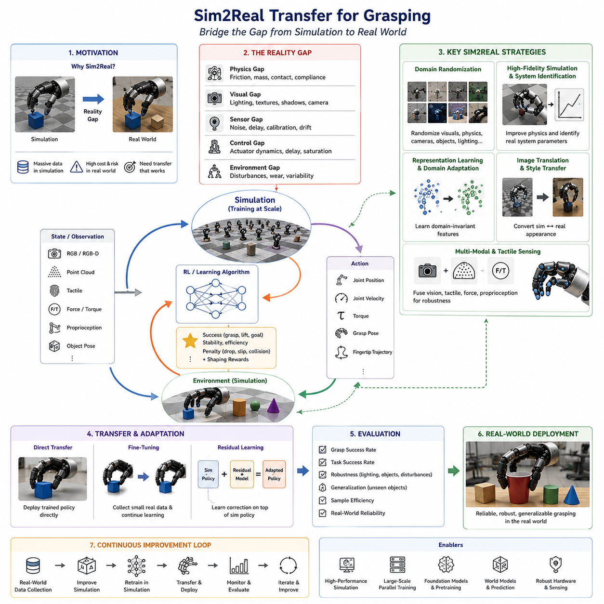{width="7.268055555555556in" height="7.268055555555556in"}

파지를 위한 Sim2Real 전이(Simulation-to-Reality Transfer)는 현대 로봇 조작 분야에서 가장 중요한 기술 중 하나이다. 이는 시뮬레이션 환경에서 학습된 파지 기술을 실제 로봇 환경으로 성공적으로 이전하는 기술을 의미한다. 최근 10여 년 동안 머신러닝과 강화학습의 발전으로 로봇은 매우 복잡한 파지 기술을 학습할 수 있게 되었지만, 이러한 학습에는 수백만에서 수십억 번에 이르는 상호작용 데이터가 필요하다. 실제 로봇으로 이러한 데이터를 수집하는 것은 비용이 많이 들고 시간이 오래 걸리며 하드웨어 손상의 위험도 존재한다. 따라서 대부분의 연구자들은 시뮬레이션 환경에서 대규모 학습을 수행한 후 이를 실제 환경으로 이전하는 방식을 사용한다. 그러나 시뮬레이션에서 높은 성능을 보인 정책이 실제 환경에서는 실패하는 경우가 많으며, Sim2Real 기술은 바로 이러한 문제를 해결하기 위해 개발되었다.

Sim2Real의 핵심 문제는 현실 간극(Reality Gap)이다. 현실 간극은 시뮬레이션과 실제 환경 사이에 존재하는 차이를 의미한다. 아무리 정교한 물리 엔진이라 하더라도 현실 세계를 완벽하게 재현하는 것은 불가능하다. 마찰 계수(Friction Coefficient), 재질 특성(Material Property), 접촉 역학(Contact Dynamics), 센서 노이즈(Sensor Noise), 액추에이터 지연(Actuator Delay), 카메라 보정(Camera Calibration), 조명 조건(Lighting Condition), 물체 변형(Object Deformation) 등 수많은 요소들이 실제 환경과 다르게 모델링될 수 있다. 특히 파지 작업은 물체와 손가락 사이의 접촉 상태에 매우 민감하기 때문에 작은 오차도 큰 성능 저하를 유발할 수 있다.

현실 간극은 여러 종류로 구분할 수 있다. 물리적 간극(Physical Gap)은 질량, 관성, 마찰, 탄성, 충돌 특성 등의 차이에서 발생한다. 시각적 간극(Visual Gap)은 조명, 그림자, 반사, 질감(Texture), 카메라 왜곡 등의 차이에서 발생한다. 센서 간극(Sensor Gap)은 노이즈, 측정 오차, 시간 지연 등으로 인해 발생한다. 제어 간극(Control Gap)은 시뮬레이션에서는 즉시 반응하는 액추에이터가 실제 환경에서는 지연, 백래시(Backlash), 열 특성, 포화 현상(Saturation) 등을 가지기 때문에 발생한다. 환경 간극(Environmental Gap)은 먼지, 마모, 진동, 온도 변화, 예측 불가능한 외란 등 현실 환경의 불확실성에서 발생한다.

초기의 Sim2Real 연구는 시뮬레이션의 정밀도를 높이는 방향으로 진행되었다. 연구자들은 실제 시스템을 가능한 한 정확하게 모사한 디지털 트윈(Digital Twin)을 구축하려고 노력하였다. 최신 시뮬레이터는 강체 동역학(Rigid Body Dynamics), 접촉 모델(Contact Model), 마찰 모델(Friction Model), 액추에이터 모델(Actuator Model), 센서 모델(Sensor Model)을 매우 정교하게 구현한다. Isaac Sim, MuJoCo, Gazebo, PyBullet과 같은 플랫폼은 복잡한 파지 동작을 높은 수준으로 시뮬레이션할 수 있다. 그러나 완벽한 시뮬레이션은 계산 비용과 모델링 한계로 인해 현실적으로 불가능하다.

이러한 문제를 해결하기 위해 등장한 가장 영향력 있는 방법 중 하나가 도메인 랜덤화(Domain Randomization)이다. 도메인 랜덤화는 완벽한 시뮬레이터를 만드는 대신 시뮬레이션 환경 자체를 다양하게 변화시키는 접근법이다. 학습 과정에서 물체 질량, 마찰 계수, 조명, 텍스처, 카메라 위치, 센서 노이즈, 물체 형상 등을 무작위로 변화시킨다. 따라서 로봇은 특정 환경이 아니라 다양한 환경에서 동작할 수 있는 정책을 학습하게 된다.

도메인 랜덤화의 핵심 아이디어는 현실 세계를 수많은 랜덤 환경 중 하나로 포함시키는 것이다. 충분히 다양한 조건에서 학습된 정책은 실제 환경이 나타나더라도 이를 새로운 환경 중 하나로 인식하고 안정적으로 동작할 수 있다. 특히 비전 기반 파지 시스템에서는 이러한 접근이 매우 효과적인 것으로 입증되었다.

시각적 도메인 랜덤화(Visual Domain Randomization)는 물체 색상, 질감, 조명, 그림자, 배경, 카메라 특성 등을 지속적으로 변화시킨다. 결과적으로 신경망은 특정 색상이나 질감이 아니라 물체의 본질적인 특징을 학습하게 된다. 이러한 특성은 실제 카메라 환경에서도 강인한 성능을 제공한다.

물리적 도메인 랜덤화(Physics Randomization)는 질량, 마찰 계수, 접촉 강성(Contact Stiffness), 감쇠 계수(Damping Factor), 모터 응답 속도 등을 무작위로 변경한다. 파지 안정성은 접촉 물리에 크게 의존하기 때문에 이러한 학습은 실제 환경에서의 강인성을 크게 향상시킨다.

시스템 식별(System Identification)은 또 다른 중요한 접근 방식이다. 이는 실제 시스템의 특성을 측정하여 시뮬레이터에 반영하는 과정이다. 연구자는 모터 응답 특성, 마찰 특성, 센서 노이즈, 탄성 특성 등을 실험적으로 측정하고 이를 시뮬레이션 모델에 적용한다. 이를 통해 현실 간극을 줄이고 보다 정확한 시뮬레이션 환경을 구축할 수 있다.

최근에는 데이터 기반 시뮬레이션 보정(Data-Driven Simulation Calibration) 기술도 활발히 연구되고 있다. 머신러닝 알고리즘을 이용하여 시뮬레이션 결과와 실제 결과의 차이를 최소화하도록 시뮬레이터 파라미터를 자동 조정하는 방식이다. 센서 출력, 로봇 궤적, 접촉력, 작업 결과 등을 비교하면서 시뮬레이션 모델을 점진적으로 개선한다.

표현 학습(Representation Learning)은 Sim2Real 분야에서 중요한 역할을 수행한다. 원시 센서 데이터를 직접 사용하는 대신 작업 수행에 필요한 핵심 정보만을 추출하는 잠재 표현(Latent Representation)을 학습한다. 이러한 표현은 환경 변화에 덜 민감하며 시뮬레이션과 현실 사이의 차이를 효과적으로 흡수할 수 있다.

특징 수준 적응(Feature-Level Adaptation)은 시뮬레이션 데이터와 실제 데이터가 유사한 특징 공간을 가지도록 만드는 방법이다. 적대적 학습(Adversarial Learning)을 사용하여 두 환경의 특징 분포를 일치시키며, 결과적으로 도메인 독립적인 표현을 학습할 수 있다.

영상 변환(Image Translation) 기술 역시 중요한 역할을 한다. 생성적 적대 신경망(Generative Adversarial Network, GAN)이나 확산 모델(Diffusion Model)을 이용하여 시뮬레이션 영상을 실제 영상처럼 변환하거나 반대로 실제 영상을 시뮬레이션 스타일로 변환할 수 있다. 이러한 기술은 시각적 현실 간극을 줄이는 데 효과적이다.

강화학습은 Sim2Real 기술 발전의 핵심 동력 중 하나이다. 수천 개의 시뮬레이션 환경에서 병렬로 학습을 수행하여 방대한 경험 데이터를 생성할 수 있다. 이후 도메인 랜덤화, 커리큘럼 학습(Curriculum Learning), 적응형 환경 생성(Adaptive Environment Generation)을 결합하여 강인한 정책을 학습한다. 학습이 완료된 정책은 최소한의 수정만으로 실제 하드웨어에 적용될 수 있다.

미세 조정(Fine-Tuning)은 현재 가장 실용적인 Sim2Real 방법 중 하나이다. 시뮬레이션에서 충분히 학습한 후 실제 환경에서 소량의 데이터를 추가로 수집하여 모델을 조정한다. 이를 통해 현실 간극으로 인해 발생하는 오차를 보완할 수 있으며, 전체 학습 비용을 크게 줄일 수 있다.

잔차 학습(Residual Learning)은 시뮬레이션 정책을 기본 제어기로 사용하고, 실제 환경에서 추가 학습된 보정 정책을 더하는 방식이다. 보정 정책은 시뮬레이션에서 모델링되지 못한 오차를 보완한다. 이러한 방식은 안정성과 적응 속도 측면에서 우수한 성능을 보인다.

다지형 로봇 손을 이용한 정교 파지(Dexterous Grasping)는 Sim2Real 적용이 가장 어려운 분야 중 하나이다. 손가락과 물체 사이의 접촉이 매우 복잡하고 비선형적이기 때문이다. 손끝 마찰, 접촉 형상, 촉각 센서 오차, 물체 변형 등 작은 차이도 조작 결과에 큰 영향을 미친다. 따라서 최근에는 촉각 센서를 적극적으로 활용하여 이러한 문제를 해결하고 있다.

멀티모달 학습(Multimodal Learning)은 Sim2Real 강인성을 향상시키는 중요한 방법이다. 시각 정보뿐만 아니라 촉각, 힘·토크, 고유감각(Proprioception), 환경 정보 등을 함께 활용한다. 특정 센서 정보가 부정확해지더라도 다른 센서가 이를 보완할 수 있기 때문에 더욱 안정적인 성능을 제공한다.

최근 등장한 파운데이션 모델(Foundation Model)은 Sim2Real 분야에도 큰 영향을 주고 있다. 다양한 로봇과 작업에서 학습된 범용 표현을 활용함으로써 새로운 환경에 대한 적응 능력을 향상시킨다. 이는 특정 파지 기술을 이전하는 것이 아니라 조작 전반에 대한 일반적인 지식을 이전하는 접근 방식이라고 볼 수 있다.

세계 모델(World Model)은 미래 Sim2Real 연구의 중요한 방향으로 주목받고 있다. 세계 모델은 환경의 동작 원리를 내부적으로 학습하여 미래 상태를 예측한다. 이를 통해 로봇은 단순 반응형 제어가 아니라 예측 기반 계획(Predictive Planning)을 수행할 수 있으며, 현실 간극에도 더욱 강인하게 대응할 수 있다.

Sim2Real 시스템은 일반적으로 파지 성공률(Grasp Success Rate), 작업 성공률(Task Success Rate), 일반화 능력(Generalization), 적응 속도(Adaptation Speed), 샘플 효율성(Sample Efficiency), 외란 대응 능력(Robustness) 등을 기준으로 평가된다. 특히 미지의 물체(Unseen Object)와 새로운 환경에서 얼마나 안정적으로 동작하는지가 중요한 평가 기준이 된다.

산업 현장에서 Sim2Real 기술의 활용은 빠르게 증가하고 있다. 물류 창고에서는 다양한 상품을 집고 분류하는 데 활용되며, 제조업에서는 조립 및 검사 작업에 사용된다. 농업에서는 작물 수확과 분류 작업에 적용되고 있으며, 의료 로봇은 수술 도구 및 생체 조직 조작에 활용되고 있다. 서비스 로봇은 가정과 공공 환경에서 다양한 생활용품을 다루기 위해 Sim2Real 기술을 사용한다.

미래에는 대규모 로봇 플릿(Fleet)이 Sim2Real 발전을 가속화할 것으로 예상된다. 수많은 로봇이 실제 환경에서 데이터를 수집하고, 이 데이터를 통해 시뮬레이션 모델을 지속적으로 개선하며, 새로운 정책을 학습하게 될 것이다. 결과적으로 시뮬레이션과 현실은 점점 더 가까워질 것이다.

장기적으로 Sim2Real의 목표는 단순히 시뮬레이션에서 현실로 정책을 이전하는 것이 아니다. 현실 경험이 시뮬레이션을 개선하고, 개선된 시뮬레이션이 다시 더 우수한 정책을 생성하는 양방향 학습 구조를 구축하는 것이다. 디지털 트윈, 파운데이션 모델, 세계 모델, 멀티모달 학습, 대규모 로봇 데이터셋이 결합되면서 현실 간극은 점점 더 작아질 것으로 예상된다.

궁극적으로 Sim2Real 전이는 확장 가능한 로봇 학습(Scalable Robot Learning)을 가능하게 하는 핵심 기술이다. 이 기술이 없다면 시뮬레이션의 막대한 계산 자원을 현실 세계에 활용할 수 없다. Sim2Real은 행동 복제(Behavior Cloning), 강화학습(Reinforcement Learning), 파운데이션 모델(Foundation Model), 세계 모델(World Model), 그리고 실제 로봇 배치를 연결하는 핵심 다리 역할을 수행한다. 미래의 지능형 로봇 시스템이 안정적이고 적응적이며 상용화 가능한 수준의 파지 능력을 갖추기 위해서는 Sim2Real 기술이 필수적인 기반 기술로 자리 잡게 될 것이다.

## 11.10 Self-Supervised Learning

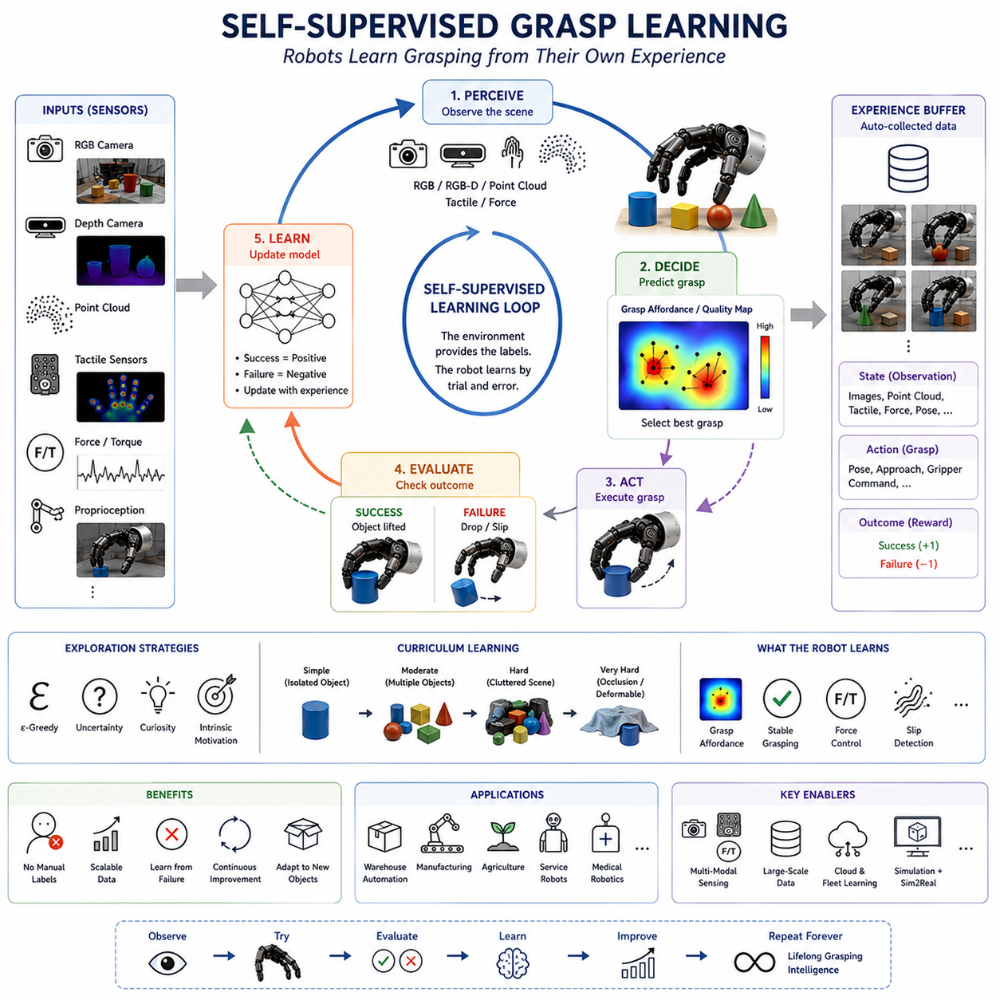{width="7.268055555555556in" height="7.268055555555556in"}

자기지도 기반 파지 학습(Self-Supervised Grasp Learning)은 현대 로봇 조작 분야에서 가장 혁신적인 기술 중 하나로 평가받고 있다. 이 기술은 사람이 직접 라벨링한 데이터나 대규모의 인간 개입 없이도 로봇이 스스로 파지 능력을 학습할 수 있도록 한다. 기존의 머신러닝 기반 파지 시스템은 성공 및 실패 파지 여부, 물체 자세(Object Pose), 파지 위치(Grasp Pose), 조작 전략 등을 사람이 직접 라벨링해야 했다. 그러나 이러한 과정은 시간과 비용이 많이 소요되며 확장성이 제한적이다. 자기지도 학습은 로봇이 환경과 상호작용하면서 스스로 학습 데이터를 생성하도록 함으로써 이러한 문제를 해결한다. 다시 말해, 정답을 인간이 제공하는 것이 아니라 로봇이 자신의 행동 결과를 통해 정답을 스스로 만들어낸다.

자기지도 파지 학습의 핵심 개념은 매우 단순하다. 로봇이 물체를 집으려고 시도한 후 성공 여부를 확인하고, 그 결과를 학습 데이터로 사용하는 것이다. 물체를 성공적으로 들어 올리면 성공 사례로 기록되고, 물체를 놓치거나 들어 올리지 못하면 실패 사례로 기록된다. 이러한 성공과 실패 정보가 자동으로 생성되는 학습 신호(Supervision Signal)가 된다. 로봇은 수천 번, 수만 번, 나아가 수백만 번의 시도를 반복하면서 자신만의 데이터셋을 구축하고 점진적으로 파지 능력을 향상시킨다.

이러한 접근법은 인간 유아의 학습 방식과 유사하다. 어린아이는 물체를 잡는 방법을 누군가에게 상세히 설명받지 않는다. 대신 반복적인 시도와 실패를 통해 어떤 행동이 성공으로 이어지고 어떤 행동이 실패로 이어지는지를 학습한다. 자기지도 파지 학습 역시 동일한 원리를 따른다. 환경 자체가 교사(Teacher)의 역할을 수행하며, 로봇은 경험을 통해 지식을 축적한다.

초기의 자기지도 파지 연구에서는 로봇이 무작위로 물체를 집고, 집기 전후의 카메라 영상을 비교하여 성공 여부를 판단하였다. 만약 물체가 작업 공간에서 사라졌다면 성공적인 파지로 간주하였고, 물체가 그대로 남아 있거나 떨어졌다면 실패로 간주하였다. 이 과정에서 어떠한 인간의 개입도 필요하지 않았다. 수십만 번 이상의 시도가 축적되면서 신경망은 성공적인 파지와 실패한 파지의 특징을 스스로 학습하게 되었다.

자기지도 학습의 가장 큰 장점은 데이터 확장성(Data Scalability)에 있다. 사람이 직접 데이터를 생성하는 경우에는 시간과 비용의 한계가 존재하지만, 자기지도 시스템은 운영되는 동안 지속적으로 새로운 데이터를 생성할 수 있다. 산업용 로봇 플릿(Fleet)이 하루 24시간 운영된다면 수백만 건 이상의 파지 데이터를 자동으로 축적할 수 있으며, 이러한 데이터는 지속적인 성능 향상에 활용될 수 있다.

일반적인 자기지도 파지 학습 시스템은 감지(Perception), 의사결정(Decision Making), 실행(Execution), 평가(Evaluation), 학습(Learning)의 순환 구조를 가진다. 카메라, 깊이 센서, 촉각 센서, 힘 센서 등을 통해 환경을 관찰하고, 현재 상태에서 가장 적절한 파지 행동을 예측한다. 이후 실제 파지를 수행하고 결과를 평가한 뒤, 그 경험을 사용하여 모델을 업데이트한다. 이러한 폐루프 학습 구조(Closed-Loop Learning)는 시간이 지날수록 성능을 지속적으로 향상시킨다.

시각 인식(Visual Perception)은 자기지도 파지 학습의 핵심 요소 중 하나이다. RGB 카메라, RGB-D 카메라, 스테레오 비전(Stereo Vision), 포인트 클라우드 센서(Point Cloud Sensor)는 물체의 형상과 위치에 대한 정보를 제공한다. 초기에는 무작위에 가까운 파지 시도를 수행하지만, 경험이 축적될수록 신경망은 성공적인 파지와 관련된 시각적 특징을 점차 학습하게 된다.

대표적인 접근법 중 하나는 파지 어포던스(Grasp Affordance)를 학습하는 것이다. 어포던스는 특정 위치나 자세에서 파지가 성공할 가능성을 의미한다. 신경망은 입력 영상을 기반으로 각 위치의 파지 성공 확률을 예측한다. 성공적인 파지는 해당 위치의 점수를 높이고 실패한 파지는 점수를 낮춘다. 시간이 지나면서 시스템은 물체 위의 파지 가능 영역을 정확하게 식별할 수 있게 된다.

합성곱 신경망(CNN)은 오랫동안 자기지도 파지 학습의 핵심 모델로 사용되어 왔다. CNN은 이미지에서 공간적 특징을 효과적으로 추출할 수 있으며 대규모 데이터셋 학습에 적합하다. 최근에는 Transformer 구조가 등장하면서 더욱 강력한 일반화 성능을 보여주고 있다. Transformer는 장거리 관계(Long-Range Dependency)를 학습할 수 있어 복잡한 환경에서도 높은 성능을 발휘한다.

깊이 정보(Depth Information)는 자기지도 파지 성능을 크게 향상시킨다. RGB 영상만으로는 물체의 3차원 구조를 정확하게 파악하기 어렵다. RGB-D 카메라와 포인트 클라우드 센서는 물체의 형상, 방향, 접근 가능성을 직접 측정할 수 있다. 특히 복잡하게 쌓여 있는 물체(Cluttered Scene)에서는 3차원 정보가 매우 중요하다.

최근에는 포인트 클라우드 기반 자기지도 파지 학습이 활발하게 연구되고 있다. 2차원 이미지 대신 물체 표면을 나타내는 3차원 점 집합을 직접 입력으로 사용한다. 이러한 방식은 조명 변화나 텍스처 차이에 덜 민감하며 물체의 실제 형상을 더욱 정확하게 반영할 수 있다.

촉각 센서(Tactile Sensor)는 또 다른 중요한 자기지도 정보원이다. 파지 과정에서 접촉 위치, 압력 분포, 미끄러짐(Slip), 물체 변형 등을 측정할 수 있다. 시각 정보만으로는 알 수 없는 접촉 상태를 직접 관찰할 수 있기 때문에 더욱 정밀한 학습이 가능하다. 예를 들어 물체가 아직 떨어지지 않았더라도 미끄러짐이 감지되면 불안정한 파지로 판단하여 학습 데이터로 사용할 수 있다.

힘·토크 센서(Force-Torque Sensor) 역시 중요한 역할을 한다. 과도한 힘은 물체 손상을 유발할 수 있으며, 너무 작은 힘은 물체를 놓치게 만든다. 힘 센서를 활용하면 단순히 성공 여부뿐 아니라 파지 품질(Grasp Quality)까지 학습할 수 있다. 결과적으로 로봇은 물체를 집는 방법뿐 아니라 적절한 힘을 사용하는 방법도 학습하게 된다.

자기지도 학습의 중요한 특징 중 하나는 실패로부터 학습(Learning from Failure)할 수 있다는 점이다. 기존의 지도학습 데이터셋은 성공 사례 위주로 구성되는 경우가 많지만, 자기지도 시스템은 실패 사례를 대량으로 수집한다. 실패는 무엇을 하면 안 되는지를 알려주는 매우 중요한 정보이다. 수많은 실패 경험을 분석함으로써 로봇은 더욱 정교한 파지 전략을 개발할 수 있다.

탐험(Exploration)은 자기지도 학습의 핵심 요소이다. 로봇은 이미 알고 있는 성공 전략을 활용하는 동시에 새로운 전략을 시도해야 한다. 지나친 활용(Exploitation)은 새로운 지식을 얻지 못하게 만들고, 지나친 탐험은 작업 효율성을 떨어뜨린다. 이를 해결하기 위해 ε-Greedy 전략, 불확실성 기반 탐험(Uncertainty-Based Exploration), 호기심 기반 학습(Curiosity-Driven Learning), 내재적 동기(Intrinsic Motivation) 등이 활용된다.

커리큘럼 학습(Curriculum Learning)은 자기지도 파지 학습과 매우 잘 결합된다. 학습 초기에는 단순한 환경에서 시작하고 점차 난이도를 높인다. 처음에는 단일 물체를 집는 작업을 수행하고, 이후 복잡한 물체 더미, 투명 물체, 변형 물체, 손안 조작(In-Hand Manipulation) 등으로 확장한다. 이러한 단계적 학습은 수렴 속도를 높이고 최종 성능을 향상시킨다.

대규모 데이터 수집(Large-Scale Data Collection)은 자기지도 학습의 가장 큰 강점이다. 일부 연구에서는 수백만 번 이상의 파지 시도를 기록하여 학습에 활용하였다. 이러한 대규모 데이터셋은 파지 모델의 일반화 성능을 크게 향상시키며, 다양한 물체와 환경에 대한 적응 능력을 제공한다.

클라우드 로보틱스(Cloud Robotics)는 자기지도 학습의 효과를 더욱 증폭시킨다. 여러 대의 로봇이 서로 다른 장소에서 수집한 데이터를 중앙 서버에 통합하고, 이를 이용하여 공통 모델을 학습한다. 한 로봇이 학습한 지식이 전체 플릿에 공유되므로 학습 속도가 크게 향상된다.

시뮬레이션 역시 자기지도 학습에서 중요한 역할을 한다. 가상 환경에서는 무제한에 가까운 상호작용 데이터를 생성할 수 있다. 시뮬레이션에서 수집한 자기지도 데이터는 Sim2Real 전이(Sim2Real Transfer)를 통해 실제 환경에 적용될 수 있다.

최근에는 자기지도 표현 학습(Self-Supervised Representation Learning)이 매우 중요한 연구 분야로 떠오르고 있다. 직접 파지 정책을 학습하는 대신, 먼저 물체와 환경에 대한 일반적인 표현을 학습한다. 대조 학습(Contrastive Learning), 예측 학습(Predictive Learning), 마스킹 모델링(Masked Modeling), 시간적 일관성 학습(Temporal Consistency Learning) 등이 대표적인 방법이다.

대조 학습은 유사한 관측은 가깝게, 다른 관측은 멀게 표현하도록 학습한다. 이를 통해 물체 종류, 시점 변화, 환경 변화에 강인한 표현을 구축할 수 있다. 이러한 표현은 이후 파지 예측의 정확도와 데이터 효율성을 크게 향상시킨다.

예측 학습(Predictive Learning)은 로봇이 자신의 행동 결과를 예측하도록 만든다. 로봇은 특정 행동을 수행했을 때 미래에 어떤 상태가 발생할지를 학습하며, 이를 통해 환경의 물리적 특성을 이해하게 된다. 이러한 능력은 체화 지능(Embodied Intelligence)의 핵심 요소로 간주된다.

멀티태스크 학습(Multi-Task Learning)은 자기지도 파지 학습과 자연스럽게 결합된다. 하나의 파지 경험으로부터 물체 분할(Object Segmentation), 자세 추정(Pose Estimation), 미끄러짐 검출(Slip Detection), 힘 예측(Force Prediction), 파지 성공 예측(Grasp Success Prediction) 등을 동시에 학습할 수 있다. 이는 데이터 효율성을 높이고 더욱 범용적인 조작 능력을 형성하는 데 기여한다.

최근 등장한 파운데이션 모델(Foundation Model)은 자기지도 로봇 학습의 새로운 방향을 제시하고 있다. 대규모 시각-언어-행동(Vision-Language-Action, VLA) 모델은 수많은 로봇 상호작용 데이터를 자기지도 방식으로 학습한다. 이러한 모델은 특정 작업이 아닌 범용 조작 지식을 학습하며, 이후 적은 양의 추가 데이터만으로 새로운 파지 작업에 적응할 수 있다.

자기지도 파지 학습은 일반적으로 파지 성공률, 샘플 효율성(Sample Efficiency), 데이터 효율성(Data Efficiency), 미지 물체 일반화(Unseen Object Generalization), 환경 변화에 대한 강인성(Robustness), 적응 속도(Adaptation Speed) 등을 기준으로 평가된다. 또한 학습된 표현이 다른 작업으로 얼마나 잘 전이되는지도 중요한 평가 요소이다.

산업 현장에서 자기지도 파지 학습의 활용은 빠르게 증가하고 있다. 물류 창고에서는 지속적으로 변화하는 상품을 다루기 위해 활용되며, 제조업에서는 새로운 부품을 별도의 프로그래밍 없이 처리할 수 있게 한다. 농업 로봇은 작물의 자연적인 변화를 학습하며, 서비스 로봇은 가정 내 다양한 생활용품을 다루는 능력을 향상시킨다. 의료 로봇 역시 반복적인 상호작용 데이터를 활용하여 더욱 정밀한 조작 능력을 습득할 수 있다.

물론 자기지도 학습에도 한계는 존재한다. 대규모 데이터 수집에는 여전히 시간이 필요하며, 탐험 과정에서 안전 문제가 발생할 수 있다. 또한 환경이 급격히 변화할 경우 분포 변화(Distribution Shift)에 의해 성능이 저하될 수 있다. 복잡한 작업에서는 성공 여부를 자동으로 판단하는 것 자체가 어려운 경우도 존재한다.

미래의 자기지도 파지 학습은 강화학습(Reinforcement Learning), 행동 복제(Behavior Cloning), 세계 모델(World Model), 파운데이션 모델, 멀티모달 센서 융합과 결합될 것으로 예상된다. 로봇은 단순히 성공과 실패만이 아니라 언어 지시(Language Instruction), 촉각 경험, 예측 모델, 다른 로봇의 경험까지 활용하여 학습하게 될 것이다. 궁극적으로는 평생 학습(Lifelong Learning)을 통해 수개월 또는 수년 동안 지속적으로 성능을 향상시키는 자율 학습 시스템으로 발전할 것이다.

결론적으로 자기지도 파지 학습은 로봇이 지능을 획득하는 방식을 근본적으로 변화시키고 있다. 인간이 직접 데이터를 만들고 규칙을 설계하는 대신, 로봇 스스로 자신의 경험을 통해 학습한다. 모든 파지 시도는 새로운 지식이 되고, 모든 실패는 귀중한 학습 기회가 된다. 학습 기반 파지(Learning-Based Grasping) 분야에서 자기지도 학습은 확장 가능하고 적응적이며 자율적인 조작 지능을 구현하기 위한 핵심 기반 기술로 자리 잡고 있으며, 미래의 휴머노이드 로봇과 범용 로봇 손 개발을 이끄는 중요한 축이 될 것으로 전망된다.

## 11.11 Multi-Task Grasp Learning

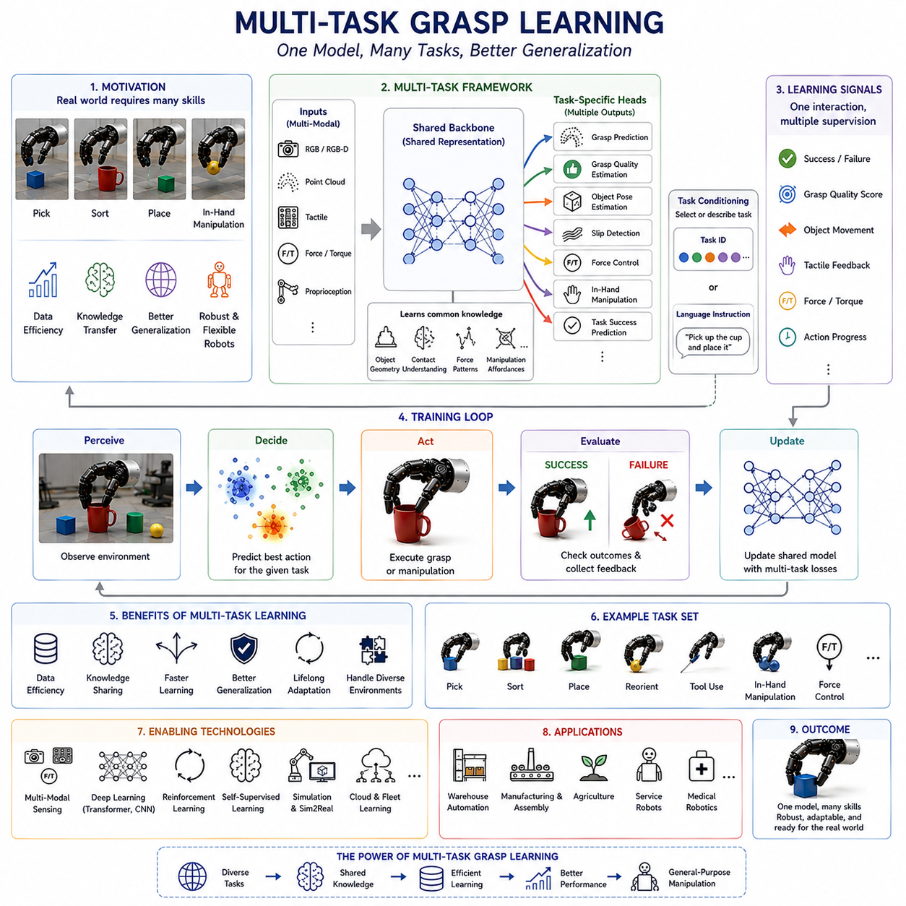{width="7.268055555555556in" height="7.268055555555556in"}

멀티태스크 파지 학습(Multi-Task Grasp Learning)은 하나의 통합된 학습 프레임워크 안에서 여러 종류의 파지 및 조작 기술을 동시에 학습하는 고급 로봇 학습 방법이다. 전통적인 로봇 학습 시스템은 특정 물체를 집는 작업, 특정 유형의 물체를 파지하는 작업, 또는 하나의 조작 행동만을 수행하도록 설계되는 경우가 많았다. 이러한 단일 목적 시스템은 특정 환경에서는 높은 성능을 보일 수 있지만, 실제 환경처럼 다양한 작업이 요구되는 상황에서는 적응력이 떨어지는 문제가 있다. 멀티태스크 학습은 여러 작업에서 공통적으로 사용되는 지식과 기술을 공유하여 이러한 한계를 극복한다. 그 결과 로봇은 더 적은 데이터로 더 많은 기술을 학습할 수 있으며, 새로운 환경과 새로운 작업에도 더욱 잘 적응할 수 있게 된다.

멀티태스크 파지 학습의 개념은 인간의 학습 방식에서 영감을 얻었다. 인간은 각각의 조작 기술을 완전히 독립적으로 배우지 않는다. 컵을 잡는 방법을 배우면 병을 잡는 능력도 향상되고, 드라이버를 사용하는 방법을 배우면 다른 공구를 다루는 능력도 향상된다. 인간은 물체 인식, 접촉 이해, 힘 조절, 손가락 협조와 같은 공통적인 조작 지식을 다양한 작업에 재사용한다. 멀티태스크 파지 학습은 이러한 원리를 로봇에 적용하여 여러 작업 간의 지식 공유를 가능하게 한다.

기본적으로 멀티태스크 학습은 하나의 모델이 여러 목표를 동시에 최적화하도록 만드는 방법이다. 각각의 작업마다 별도의 신경망을 학습하는 대신, 공통된 표현(Shared Representation)을 학습하는 하나의 신경망을 구축한다. 이후 각 작업에 맞는 출력 계층(Task-Specific Head)을 추가하여 다양한 작업을 수행하도록 만든다. 이렇게 하면 하나의 작업에서 학습된 정보가 다른 작업에도 도움이 된다.

로봇 파지 분야에서 멀티태스크 학습의 대상은 매우 다양하다. 물체 집기(Object Pickup), 분류(Object Sorting), 배치(Object Placement), 손안 조작(In-Hand Manipulation), 정밀 파지(Precision Grasping), 파워 그립(Power Grasping), 변형 물체 조작(Deformable Object Handling), 공구 사용(Tool Grasping), 미끄러짐 검출(Slip Detection), 힘 제어(Force Regulation), 물체 재배향(Object Reorientation), 조립 작업(Assembly Operation) 등이 모두 하나의 프레임워크 안에서 학습될 수 있다. 이러한 작업들은 목적은 다르지만 시각 인식, 접촉 이해, 힘 제어, 운동 계획 등의 공통 요소를 공유한다.

멀티태스크 파지 학습의 가장 큰 장점 중 하나는 데이터 효율성(Data Efficiency)이다. 로봇 데이터를 수집하는 것은 비용과 시간이 많이 소요된다. 단일 작업마다 별도의 모델을 학습하려면 각각의 작업에 대해 독립적인 데이터셋이 필요하다. 반면 멀티태스크 학습에서는 하나의 상호작용 데이터가 여러 작업의 학습에 동시에 활용된다. 예를 들어 하나의 파지 동작은 물체 인식, 파지 품질 평가, 접촉 예측, 힘 제어, 작업 성공 여부 등 다양한 정보를 제공할 수 있다. 따라서 동일한 데이터로 더 많은 학습 효과를 얻을 수 있다.

공유 표현 학습(Shared Representation Learning)은 멀티태스크 시스템의 핵심이다. 신경망은 여러 작업에 공통적으로 필요한 특징을 추출하는 잠재 표현(Latent Representation)을 학습한다. 이러한 표현에는 물체 형상, 재질 특성, 접촉 상태, 조작 가능성(Manipulation Affordance), 환경 정보, 운동 제어 전략 등이 포함될 수 있다. 여러 작업이 동일한 표현을 사용하기 때문에 일반화 능력이 향상된다.

시각 인식 분야는 멀티태스크 학습의 대표적인 성공 사례이다. 하나의 비전 네트워크가 물체 검출(Object Detection), 의미 분할(Semantic Segmentation), 자세 추정(Pose Estimation), 파지 예측(Grasp Prediction), 조작 계획(Manipulation Planning)을 동시에 수행할 수 있다. 예를 들어 물체 분할 능력은 파지 위치를 찾는 데 도움을 주고, 자세 추정은 파지 방향을 결정하는 데 도움을 준다. 결과적으로 각각을 독립적으로 학습하는 것보다 더 높은 성능을 얻을 수 있다.

다지형 로봇 손(Dexterous Hand)에서는 멀티태스크 학습의 가치가 더욱 커진다. 정교 조작은 단순히 물체를 집는 것만이 아니라 접촉 유지(Contact Maintenance), 힘 조절(Force Modulation), 손가락 협조(Finger Coordination), 물체 안정화(Stabilization), 손안 조작(In-Hand Manipulation) 등을 포함한다. 이러한 기능을 각각 따로 학습하면 전체적인 조화가 부족해질 수 있다. 멀티태스크 학습은 이러한 기능을 통합적으로 학습하여 더욱 자연스럽고 효율적인 조작 행동을 만들어낸다.

멀티태스크 파지 학습에는 다양한 신경망 구조가 사용된다. 가장 일반적인 방법은 공유 백본 네트워크(Shared Backbone Network)와 작업별 출력 헤드(Task-Specific Head)를 사용하는 구조이다. 백본은 공통 특징을 추출하고, 각 출력 헤드는 특정 작업을 수행한다. 이 구조는 지식 공유와 작업 특화의 균형을 효과적으로 제공한다.

소프트 파라미터 공유(Soft Parameter Sharing)는 또 다른 접근 방식이다. 작업별로 별도의 네트워크를 유지하되, 정규화(Regularization)를 통해 서로 유사한 표현을 학습하도록 유도한다. 이 방법은 작업 간 차이가 큰 경우에 유리하다.

하드 파라미터 공유(Hard Parameter Sharing)는 가장 널리 사용되는 방식이다. 대부분의 네트워크를 공유하고 마지막 계층만 작업별로 분리한다. 이는 모델 크기를 줄이고 과적합(Overfitting)을 방지하는 효과가 있다.

최근 Transformer 구조는 멀티태스크 파지 학습의 성능을 크게 향상시키고 있다. Transformer는 어텐션(Attention) 메커니즘을 통해 관측, 행동, 작업 정보를 동시에 처리할 수 있다. 하나의 모델이 시각 정보, 촉각 정보, 힘 정보, 언어 명령을 함께 입력받아 여러 작업을 수행할 수 있다.

작업 조건화(Task Conditioning)는 멀티태스크 학습에서 중요한 역할을 한다. 로봇은 입력으로 작업 ID나 작업 설명(Task Description)을 함께 받는다. 동일한 물체라도 작업 목적에 따라 다른 파지 전략이 필요할 수 있다. 예를 들어 컵을 단순 이동할 때와 액체를 따르기 위해 잡을 때는 파지 방식이 달라진다. 작업 조건화는 이러한 차이를 하나의 모델 안에서 처리할 수 있도록 한다.

언어 기반 멀티태스크 학습(Language-Guided Multi-Task Learning)은 최근 매우 주목받는 분야이다. 대규모 비전-언어-행동(Vision-Language-Action, VLA) 모델은 자연어 명령을 이해하고 이를 조작 행동으로 변환할 수 있다. "컵을 집어라", "손잡이를 잡아라", "부드럽게 옮겨라", "물을 따를 준비를 하라"와 같은 다양한 명령을 하나의 정책으로 수행할 수 있다. 언어는 고수준 작업 지시자로서 매우 강력한 역할을 수행한다.

멀티태스크 학습의 주요 도전 과제 중 하나는 작업 간 충돌(Task Conflict)이다. 서로 다른 작업이 상반된 학습 방향을 요구할 수 있기 때문이다. 예를 들어 정밀 파지는 매우 조심스러운 동작을 요구하는 반면, 고속 분류 작업은 빠른 움직임을 요구한다. 이러한 목표를 동시에 최적화하면 학습이 불안정해질 수 있다. 이를 해결하기 위해 그래디언트 균형화(Gradient Balancing), 적응형 가중치(Adaptive Weighting), 작업 우선순위(Task Prioritization), 다목적 최적화(Multi-Objective Optimization) 등이 연구되고 있다.

손실 함수(Loss Function) 설계 역시 매우 중요하다. 각 작업은 자신만의 손실 값을 가지며, 이를 적절히 결합해야 한다. 일부 시스템은 고정 가중치를 사용하고, 다른 시스템은 학습 진행 상황이나 불확실성(Uncertainty)에 따라 가중치를 동적으로 조정한다.

멀티태스크 학습에서는 전이 학습(Transfer Learning)이 자연스럽게 발생한다. 하나의 작업에서 학습된 지식이 다른 작업의 학습 속도를 높인다. 예를 들어 물체 인식을 학습한 로봇은 파지 위치 예측을 더 빠르게 배울 수 있다. 단순 픽앤플레이스 작업을 학습한 로봇은 복잡한 조립 작업에도 더 쉽게 적응할 수 있다.

반면 부정적 전이(Negative Transfer)도 발생할 수 있다. 서로 관련성이 낮거나 충돌하는 작업을 함께 학습하면 오히려 성능이 저하될 수 있다. 따라서 어떤 작업을 함께 학습할 것인지 결정하는 것은 중요한 연구 주제이다.

커리큘럼 학습(Curriculum Learning)은 멀티태스크 파지 학습과 자주 결합된다. 처음에는 단순한 파지 작업을 학습하고 이후 배치, 분류, 힘 제어, 공구 사용, 정교 조작으로 난이도를 높인다. 이러한 단계적 접근은 학습 안정성을 향상시킨다.

시뮬레이션은 대규모 멀티태스크 학습의 핵심 도구이다. 실제 로봇으로 수십 개 이상의 작업 데이터를 수집하는 것은 어렵기 때문에 시뮬레이터를 이용하여 다양한 작업 시나리오를 생성한다. 이를 통해 수천 개의 작업 변형(Task Variation)을 경험할 수 있다.

강화학습(Reinforcement Learning)은 멀티태스크 학습과 매우 잘 결합된다. 여러 작업을 동시에 최적화하는 멀티태스크 강화학습은 공통 탐험 경험을 활용하여 데이터 효율성을 향상시킨다. 최근의 정교 조작 연구에서는 이러한 접근이 널리 사용되고 있다.

행동 복제(Behavior Cloning)와 시연 기반 학습(Learning from Demonstration) 역시 중요한 역할을 한다. 하나의 인간 시연은 파지 선택, 경로 계획, 힘 제어, 물체 처리 등 여러 작업에 대한 정보를 동시에 제공한다. 멀티태스크 학습은 이러한 정보를 통합적으로 활용할 수 있다.

자기지도 학습(Self-Supervised Learning)은 멀티태스크 시스템을 더욱 강력하게 만든다. 로봇은 파지 성공 여부, 물체 이동, 접촉 발생, 미끄러짐, 힘 변화 등을 통해 자동으로 학습 신호를 생성할 수 있다. 이러한 자기 생성 데이터는 별도의 인간 개입 없이도 여러 작업 학습에 활용된다.

멀티모달 센서 융합(Multi-Modal Sensing)은 멀티태스크 파지 학습의 성능을 크게 향상시킨다. 시각 센서는 물체의 형상과 외관을 제공하고, 촉각 센서는 접촉 상태를 제공하며, 힘 센서는 상호작용 동역학을 측정한다. 관절 센서는 손의 상태를 알려준다. 이러한 정보를 통합하면 더욱 풍부한 표현을 학습할 수 있으며 다양한 작업을 동시에 지원할 수 있다.

클라우드 로보틱스(Cloud Robotics)와 플릿 학습(Fleet Learning)은 멀티태스크 데이터 수집 규모를 획기적으로 확대하고 있다. 창고, 공장, 병원, 가정 등 다양한 환경에서 운영되는 로봇들이 데이터를 공유함으로써 더욱 범용적인 모델을 학습할 수 있다.

파운데이션 모델(Foundation Model)은 멀티태스크 파지 학습의 다음 단계로 평가된다. 이러한 모델은 수백 개 또는 수천 개의 조작 작업 데이터를 학습하여 물리적 상호작용에 대한 광범위한 지식을 획득한다. 이후 적은 양의 데이터만으로 특정 작업에 적응할 수 있다.

세계 모델(World Model)은 미래 멀티태스크 시스템의 핵심 요소로 여겨진다. 세계 모델은 물체가 행동에 어떻게 반응하는지, 접촉이 시간에 따라 어떻게 변화하는지, 미래 상태가 어떻게 형성되는지를 예측한다. 이를 통해 다양한 작업에서 계획과 추론이 가능해진다.

멀티태스크 파지 학습의 평가는 단일 작업보다 훨씬 복잡하다. 파지 성공률, 작업 완료율, 전이 효율성, 미지 물체 일반화, 적응 속도, 외란 대응 능력, 계산 효율성 등을 종합적으로 고려해야 한다. 진정한 멀티태스크 시스템은 특정 작업뿐 아니라 전체 작업 집합에서 안정적인 성능을 보여야 한다.

산업 현장에서 멀티태스크 파지 학습의 활용은 빠르게 증가하고 있다. 물류 로봇은 상품 인식, 파지, 분류, 운반, 적재를 동시에 수행해야 한다. 제조 로봇은 조립, 검사, 물류 작업을 수행한다. 농업 로봇은 수확, 분류, 가공을 담당한다. 서비스 로봇은 가정 내 수많은 물체를 다루며 다양한 조작 행동을 수행해야 한다. 이러한 복잡한 환경에서 멀티태스크 학습은 필수적인 기술이다.

미래에는 하나의 모델이 수백 개 또는 수천 개의 조작 작업을 수행하는 범용 로봇(Generalist Robot)이 등장할 것으로 예상된다. 파운데이션 모델, 세계 모델, 자기지도 학습, 강화학습, 언어 기반 제어가 통합된 거대한 학습 시스템이 개발될 것이다. 이러한 시스템은 실제 운영 중에도 새로운 기술을 지속적으로 습득하는 평생 학습(Lifelong Learning)을 수행할 것이다.

결론적으로 멀티태스크 파지 학습은 범용 로봇 조작(General-Purpose Robotic Manipulation)을 향한 중요한 단계이다. 각각의 작업을 독립적인 문제로 보는 대신, 다양한 작업이 공유하는 공통 구조를 활용한다. 공유 표현 학습, 지식 전이, 멀티모달 센서 융합, 파운데이션 모델을 통해 로봇은 더욱 폭넓고 유연하며 인간에 가까운 조작 지능을 획득할 수 있다. 학습 기반 파지(Learning-Based Grasping) 분야에서 멀티태스크 학습은 특정 작업 전용 시스템에서 범용 조작 지능으로 발전하는 핵심 연결고리 역할을 수행하며, 미래의 휴머노이드 로봇과 범용 로봇 손 개발의 핵심 기술로 자리 잡을 것으로 전망된다.
