**Volume 06 Robot Hands and Dexterous Grasping**

# 12. Foundation Models for Grasping

## 12.01 Foundation Models in Robotics

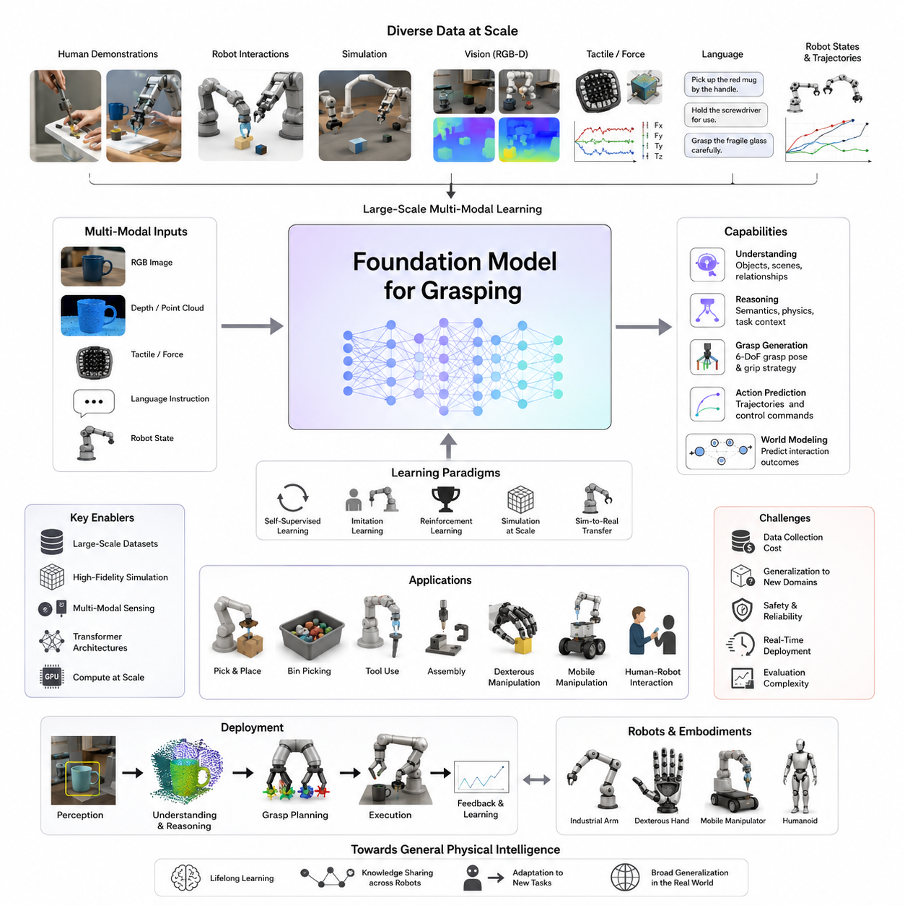{width="7.268055555555556in" height="7.268055555555556in"}

Foundation Models in Grasping represent one of the most important paradigms shifts in modern robotic manipulation. Traditional robotic grasping systems were typically designed as highly specialized pipelines in which perception, object recognition, pose estimation, grasp planning, motion generation, and execution were treated as separate modules. Each module required task-specific engineering, dedicated datasets, handcrafted representations, and extensive tuning. While these approaches achieved impressive results in structured industrial environments, they often struggled when deployed in open-world scenarios where object categories, environmental conditions, and task requirements continuously changed. The emergence of foundation models has fundamentally altered this landscape by introducing a unified learning framework capable of generalizing across diverse manipulation tasks, object categories, environments, and robot embodiments. Foundation models allow grasping systems to move beyond narrow task optimization toward broader physical intelligence, enabling robots to understand instructions, reason about objects, infer grasp strategies, and adapt to previously unseen situations with significantly less task-specific programming. This chapter belongs to the Foundation Models for Grasping section within Volume 06 and serves as the conceptual entry point for understanding how large-scale AI models are transforming robotic grasping systems.

The concept of a foundation model originated in the machine learning community as a model trained on massive and diverse datasets that can serve as a foundation for multiple downstream tasks. In natural language processing, large language models demonstrated that scaling data, model parameters, and computational resources could produce systems with emergent capabilities that were not explicitly programmed. Similar developments occurred in computer vision, where large vision transformers and multimodal models achieved remarkable generalization performance across recognition, segmentation, and reasoning tasks. Robotics researchers soon recognized that grasping and manipulation could benefit from the same scaling principles. Instead of training separate grasp detectors for every object category or environment, researchers began developing foundation models capable of learning from millions of demonstrations, images, videos, language descriptions, simulation trajectories, and robot interactions. These models seek to capture broad representations of physical interactions rather than isolated grasping behaviors.

Traditional grasping pipelines often rely on predefined geometric representations such as antipodal grasp points, force closure metrics, grasp wrench spaces, or grasp quality scores. While these approaches remain important for analytical understanding, foundation models learn implicit representations directly from data. Rather than explicitly calculating every physical property, the model learns statistical relationships between visual observations, object geometry, language instructions, manipulation trajectories, tactile feedback, and successful outcomes. This shift from explicit programming to large-scale representation learning mirrors the transformation that occurred in natural language understanding and computer vision.

One of the defining characteristics of foundation models for grasping is scale. The performance of these models is strongly influenced by the diversity and volume of training data. Modern robotic datasets may include millions of robot trajectories collected across hundreds of robots operating in different environments. Data sources often include industrial manipulators, mobile manipulators, dexterous hands, simulation environments, teleoperation systems, human demonstrations, and self-supervised exploration. By exposing the model to such diverse experiences, the system develops representations that are more robust to variations in object appearance, lighting conditions, sensor noise, occlusions, and task requirements.

The emergence of large-scale robotic datasets has been a critical enabler of foundation model development. Earlier grasp-learning systems were often trained on datasets containing a few thousand or tens of thousands of examples. Modern datasets may contain millions of grasp attempts, manipulation trajectories, and multimodal observations. These datasets frequently combine RGB images, depth maps, point clouds, force measurements, tactile sensor outputs, joint states, end-effector trajectories, language instructions, and success labels. The richness of these multimodal datasets allows foundation models to learn relationships between perception, action, and physical interaction at an unprecedented scale.

A central challenge in robotic grasping is generalization. Traditional systems often perform well on objects encountered during training but experience significant performance degradation when confronted with novel objects. Foundation models address this challenge by learning high-dimensional representations that capture semantic, geometric, and physical properties simultaneously. Instead of recognizing only specific object instances, the model learns broader concepts such as containers, tools, deformable materials, fragile objects, articulated objects, or graspable regions. This conceptual understanding allows robots to transfer knowledge from previously encountered objects to entirely new categories.

The integration of language into robotic grasping systems represents another transformative development. Foundation models frequently incorporate language as a primary modality. Rather than specifying exact coordinates or grasp parameters, users can provide high-level instructions such as "pick up the red mug by the handle," "grasp the fragile glass carefully," or "hold the screwdriver for use." The model interprets the semantic intent, identifies relevant object features, and generates appropriate grasp strategies. Language serves as an interface between human objectives and robotic actions, enabling more intuitive interaction and task specification.

Multimodal learning plays a central role in foundation models for grasping. These systems simultaneously process information from multiple sensory channels. Visual perception provides object appearance and scene context. Depth sensing contributes geometric structure. Tactile sensing supplies contact information. Force measurements reveal interaction dynamics. Language describes goals and constraints. Joint encoders integrate these heterogeneous modalities into a shared representation space. As a result, the robot develops a richer understanding of manipulation tasks than would be possible using any individual modality alone.

Vision-language models have become particularly influential in robotic manipulation. These models combine large-scale visual understanding with language reasoning capabilities. In grasping applications, vision-language models can identify objects, understand semantic relationships, interpret instructions, and reason about appropriate interaction strategies. For example, when instructed to "pick up the cup containing liquid," the model may infer that grasping near the rim could cause spillage and instead select a stable grasp near the body of the container. Such reasoning extends beyond geometric optimization and enters the domain of semantic understanding.

Another important development is the emergence of vision-language-action models. While vision-language models primarily focus on perception and reasoning, vision-language-action models directly connect sensory observations to robot actions. These models learn mappings from images and instructions to manipulation trajectories, grasp poses, and control commands. Instead of separating perception and planning into independent stages, the model learns an integrated representation that jointly considers observation, intention, and action. This unified approach simplifies system architecture while improving adaptability.

Transformer architectures have become the dominant computational framework for foundation models in grasping. Originally developed for natural language processing, transformers provide powerful mechanisms for modeling long-range dependencies and multimodal relationships. In robotic manipulation, transformers can integrate information across time, sensor modalities, and spatial observations. Self-attention mechanisms allow the model to identify relevant regions within a scene, track object relationships, and focus computational resources on task-critical information. The flexibility of transformer architectures makes them particularly suitable for large-scale robotic learning.

The concept of embodied intelligence is closely related to foundation models for grasping. Embodied intelligence emphasizes that cognition emerges through interaction with the physical world rather than solely through abstract reasoning. Foundation models trained on robotic interaction data develop representations grounded in physical experience. These models learn not only what objects look like but also how objects behave when grasped, moved, manipulated, or subjected to external forces. Such physically grounded representations are essential for robust manipulation in real-world environments.

Simulation plays a crucial role in the development of foundation models. Collecting millions of real-world robot interactions is expensive, time-consuming, and potentially unsafe. High-fidelity simulation environments provide scalable platforms for generating large amounts of training data. Modern simulators model contact dynamics, friction, object deformation, sensor noise, and environmental variability. Foundation models often combine simulation-generated data with real-world experiences to improve generalization while reducing data collection costs. Techniques such as domain randomization and sim-to-real transfer further enhance deployment performance.

Self-supervised learning has emerged as a key strategy for scaling robotic datasets. Instead of relying on human annotation, robots autonomously collect data through interaction. Every grasp attempt generates valuable information regarding success, failure, object movement, contact patterns, and environmental response. These experiences become training signals that continuously improve the model. Self-supervised learning enables robotic systems to accumulate knowledge over time, creating a virtuous cycle of data collection and performance improvement.

Foundation models are particularly valuable for long-horizon manipulation tasks. Traditional grasp planners often focus on immediate grasp success, whereas foundation models can reason about downstream objectives. For example, grasp selection may depend on future assembly operations, tool usage requirements, or placement constraints. A robot instructed to assemble a product may choose a grasp that facilitates subsequent insertion or fastening steps. This ability to consider task context represents a significant advancement over purely geometric grasp optimization methods.

Dexterous manipulation provides another important application area. Multifinger robotic hands introduce high-dimensional control challenges involving dozens of degrees of freedom, complex contact interactions, and dynamic object behavior. Foundation models can learn coordination strategies across multiple fingers, enabling sophisticated behaviors such as regrasping, object reorientation, finger gaiting, and in-hand manipulation. By leveraging large-scale datasets and multimodal representations, these models reduce reliance on handcrafted control policies.

World models have become increasingly important within foundation model research. A world model attempts to predict how the environment will evolve in response to actions. In grasping applications, world models allow robots to mentally simulate potential interactions before execution. The robot can evaluate candidate grasps, predict object motion, estimate contact outcomes, and identify failure modes without physical trial and error. Such predictive capabilities improve safety, efficiency, and robustness.

Despite their promise, foundation models for grasping face several significant challenges. Data collection remains expensive and often requires substantial infrastructure investments. Robot hardware varies widely across platforms, making it difficult to develop universally applicable models. Physical interactions are inherently more complex than language processing because actions directly influence the environment. Small modeling errors can lead to grasp failures, collisions, or safety risks. Furthermore, real-world environments exhibit considerable uncertainty, including sensor noise, object variability, and dynamic changes.

Computational requirements also present practical limitations. Large foundation models often contain billions of parameters and require significant computational resources for training and inference. Deploying such models on edge platforms, embedded systems, or mobile manipulators requires model compression, quantization, pruning, and efficient inference techniques. Balancing model capability with real-time performance remains an active research area.

Safety and reliability are particularly critical in robotic applications. Unlike language models, robotic systems interact directly with physical environments and human users. Errors can result in damaged equipment, dropped objects, production downtime, or safety hazards. Consequently, foundation models for grasping must incorporate uncertainty estimation, safety constraints, validation mechanisms, and fallback strategies. Hybrid approaches that combine learned models with analytical control methods are often employed to improve reliability.

Evaluation of foundation models presents another challenge. Traditional grasping benchmarks typically focus on success rates for predefined object sets. Foundation models require broader evaluation methodologies that measure generalization, adaptability, reasoning capabilities, language understanding, transfer learning performance, and robustness across diverse environments. Comprehensive benchmarking frameworks are therefore becoming increasingly important for assessing real-world effectiveness.

Industrial adoption of foundation models is accelerating across logistics, manufacturing, warehouse automation, healthcare, service robotics, and mobile manipulation. Robots equipped with foundation models can adapt to changing inventories, handle previously unseen products, interpret natural language instructions, and perform increasingly complex manipulation tasks. These capabilities reduce deployment costs and expand the range of applications that can be automated economically.

The long-term vision for foundation models in grasping extends beyond grasp execution itself. Future systems are expected to integrate perception, reasoning, planning, memory, learning, and physical interaction into unified architectures capable of lifelong learning. Robots may continuously acquire knowledge from experience, share learned representations across fleets, and adapt to new tasks with minimal retraining. Such systems would move closer to general-purpose manipulation intelligence, where grasping becomes one component of a broader embodied cognitive framework.

Within the broader structure of Volume 06, this chapter serves as the foundation for subsequent discussions of vision-language models, open-vocabulary grasping, language-conditioned manipulation, vision-language-action architectures, large-scale robotic foundation models, tactile-visual fusion systems, world models, edge deployment strategies, and evaluation methodologies. It establishes the conceptual framework necessary to understand how large-scale AI models are transforming robotic grasping from a narrowly engineered capability into a flexible, adaptive, and increasingly general form of physical intelligence. As robotic systems continue to scale in both data and model complexity, foundation models are expected to become the central technological driver of next-generation grasping and dexterous manipulation systems, ultimately enabling robots to interact with the physical world with levels of adaptability and competence that were previously unattainable.

## 12.02 Vision-Language Models for Grasping

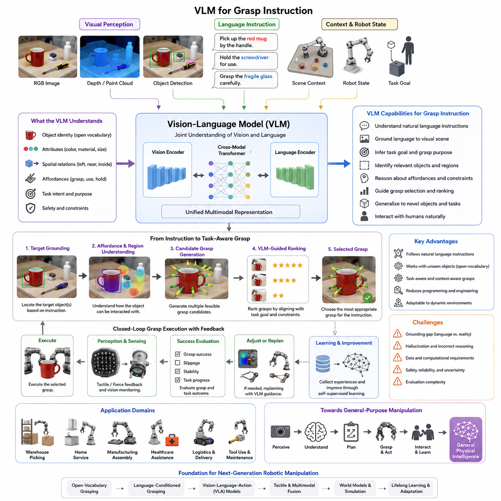{width="7.268055555555556in" height="7.268055555555556in"}

Vision-Language Models (VLMs) have emerged as one of the most transformative technologies in modern robotic manipulation, particularly in the field of robotic grasping. Traditional grasping systems primarily relied on geometric reasoning, object detection networks, pose estimation algorithms, and manually designed grasp planners. While these approaches achieved significant success in structured industrial environments, they often struggled when robots were required to understand human intentions, interpret natural language commands, or manipulate previously unseen objects. Vision-Language Models fundamentally change this paradigm by combining visual understanding and language reasoning into a unified framework. Instead of treating perception and task specification as separate components, VLMs enable robots to directly connect what they see with what humans intend them to do. This capability is especially important in grasping applications because successful grasping is not determined solely by object geometry but also by task context, semantic meaning, future actions, and human preferences. Within the Foundation Models for Grasping section, VLM for Grasp Instruction represents the first major step toward language-aware robotic manipulation and establishes the foundation for open-vocabulary grasping, language-conditioned grasping, and Vision-Language-Action systems.

Historically, grasp planning was largely formulated as a geometric optimization problem. Robots attempted to identify stable grasp points based on object shape, friction properties, contact mechanics, and force closure criteria. Such methods could determine where a robot should grasp an object to avoid slipping or dropping it, but they could not determine why the object should be grasped in a particular way. For example, a cup can be grasped from its body, handle, rim, or base. Geometrically, several of these grasps may be equally stable. However, if the objective is to drink from the cup, carry it, wash it, place it into a dishwasher, or hand it to a human, entirely different grasp strategies may be required. Vision-Language Models introduce semantic understanding into grasp planning, allowing robots to reason about the purpose of the grasp rather than only its physical stability.

A Vision-Language Model is a machine learning system trained jointly on visual and linguistic data. These models learn relationships between images, videos, objects, scenes, and language descriptions. Through large-scale pretraining on millions or billions of image-text pairs, VLMs acquire a broad understanding of object categories, spatial relationships, human activities, affordances, attributes, and contextual knowledge. When applied to robotics, this knowledge enables robots to interpret human instructions such as "pick up the red mug by the handle," "grasp the fragile glass carefully," "hold the screwdriver for use," or "pick the object closest to the blue box." These instructions require not only visual perception but also semantic reasoning and contextual interpretation.

One of the most important contributions of VLMs to robotic grasping is task-aware grasp generation. Traditional grasp planners typically optimize for grasp stability alone. In contrast, VLM-based systems consider the downstream task associated with the object. The same object may require different grasp strategies depending on the intended use. A hammer intended for storage may be grasped near its center of mass, while a hammer intended for immediate use should be grasped by its handle. Similarly, a knife intended for handover should be presented safely, whereas a knife intended for cutting should be grasped in a functional configuration. VLMs allow robots to infer these distinctions by incorporating semantic information into grasp planning.

Language understanding is a key capability of modern VLMs. Human instructions are often ambiguous, incomplete, or context-dependent. When a user says, "bring me the bottle," the robot must determine which bottle is being referenced, where it is located, how it should be grasped, and how it should be delivered. VLMs help resolve such ambiguities by jointly analyzing visual context and linguistic cues. The model can identify candidate objects, infer likely intentions, and generate task-relevant grasp actions without requiring explicit programming.

The concept of affordance plays a central role in VLM-based grasp instruction. Affordances describe the possible actions that an object supports. Humans naturally understand that a cup can be grasped, a chair can be sat on, a button can be pressed, and a screwdriver can be turned. Traditional robotic systems often require affordances to be manually encoded. VLMs, however, learn affordance representations directly from large-scale image-language datasets. As a result, robots can infer appropriate grasp locations and manipulation strategies even for objects they have never encountered before.

Open-world operation is another major advantage of VLM-based grasping systems. Classical robotic grasping typically depends on closed-set object recognition, meaning the robot can only identify objects that were included in its training dataset. In real environments, robots encounter countless novel objects. Vision-Language Models overcome this limitation by supporting open-vocabulary recognition. Because they learn language-based object representations, they can identify and reason about objects using natural language descriptions rather than fixed class labels. A robot can therefore understand instructions involving objects that were never explicitly included in its robotic training data.

Multimodal reasoning is essential for grasp instruction. Successful manipulation often requires integrating multiple sources of information. Visual observations provide object appearance, shape, and location. Language instructions specify goals and constraints. Depth sensing contributes geometric understanding. Tactile sensing provides feedback during contact. VLMs combine these information sources into unified representations that enable richer decision-making. For example, a robot instructed to "carefully pick up the fragile vase" must consider object identity, estimated fragility, grasp force limits, collision avoidance, and transportation stability simultaneously.

Recent advances in transformer architectures have significantly accelerated the development of VLMs for robotics. Transformer-based models use attention mechanisms to identify relevant regions within images and connect them with linguistic concepts. When a robot receives an instruction such as "pick up the yellow screwdriver on the left side of the toolbox," the model can focus attention on relevant image regions, identify the screwdriver, understand spatial relationships, and generate an appropriate grasp target. This attention-based reasoning allows robots to process complex visual scenes containing multiple objects and clutter.

Large-scale pretraining is fundamental to VLM performance. Unlike traditional robotic systems that require task-specific datasets, VLMs are typically pretrained on enormous collections of internet-scale image-text pairs. Through this process, they learn broad world knowledge that can later be adapted to robotic applications. Fine-tuning on robot-specific datasets then aligns the model with physical interaction tasks. This two-stage learning process enables robots to leverage knowledge acquired from general visual-language understanding while learning the physical requirements of grasping and manipulation.

Instruction following is one of the most significant capabilities enabled by VLMs. Rather than programming individual behaviors, users can specify desired outcomes using natural language. Commands such as "pick up the spoon for eating," "grab the package for delivery," or "hold the cable connector for insertion" describe task objectives rather than exact robot motions. The VLM interprets these instructions and maps them into grasp strategies consistent with the desired outcome. This greatly simplifies human-robot interaction and reduces system engineering complexity.

Human-centered manipulation particularly benefits from language-guided grasping. In collaborative environments, robots frequently interact with humans whose expectations depend on social norms and task context. A robot handing over a cup should orient the handle toward the user. A robot presenting a tool should position the handle for convenient grasping. A robot carrying fragile items should exhibit cautious behavior. Many of these requirements cannot be derived solely from geometry and require semantic understanding. VLMs provide the reasoning framework needed to support such behaviors.

Another important capability is compositional reasoning. Human instructions often contain multiple constraints that must be satisfied simultaneously. For example, "pick up the red mug on the table and avoid touching the spoon inside it" requires object identification, spatial reasoning, grasp planning, and collision avoidance. VLMs can process these compound instructions by integrating visual and linguistic information within a common representation space. This enables more flexible and sophisticated robotic behavior than traditional rule-based systems.

The integration of VLMs with grasp detection networks has become an active area of research. In many systems, the VLM does not directly generate grasp poses. Instead, it guides a grasp detection network by identifying task-relevant object regions and semantic constraints. Candidate grasps are generated using conventional grasp planning methods and then ranked according to semantic relevance inferred by the VLM. This hybrid approach combines the reliability of geometric grasp planning with the flexibility of language-guided reasoning.

Simulation environments are increasingly used to train and evaluate VLM-based grasping systems. High-fidelity simulators allow researchers to generate large quantities of instruction-conditioned manipulation data. Robots can practice interpreting language commands, identifying objects, executing grasps, and recovering from failures in virtual environments before deployment in the real world. Simulation also enables safe experimentation with rare or hazardous scenarios that would be difficult to reproduce physically.

Self-supervised learning further enhances VLM capabilities. Robots can autonomously collect experience by attempting grasp tasks under varying instructions and observing outcomes. Successful and unsuccessful interactions provide valuable learning signals that improve instruction understanding and grasp execution. Over time, the robot develops increasingly robust associations between language descriptions, visual observations, and manipulation outcomes.

Despite their impressive capabilities, VLMs face several significant challenges. One major issue is grounding. Language representations learned from internet data do not always correspond perfectly to physical reality. A model may understand what a cup looks like but may not fully understand its weight distribution, friction properties, or deformation characteristics. Bridging the gap between semantic understanding and physical interaction remains an active research area.

Hallucination is another concern. Like large language models, VLMs can occasionally generate incorrect interpretations or make unsupported assumptions. In robotic applications, such errors can lead to grasp failures or unsafe behavior. Consequently, robust verification mechanisms, uncertainty estimation, and safety constraints are essential components of practical VLM-based grasping systems.

Computational complexity also presents deployment challenges. State-of-the-art VLMs often contain billions of parameters and require substantial processing resources. Running these models on mobile manipulators, edge computers, or embedded robotic systems requires model optimization techniques such as quantization, pruning, knowledge distillation, and efficient transformer architectures. Balancing performance and computational efficiency remains an important engineering challenge.

Evaluation of VLM-based grasp instruction systems extends beyond conventional grasp success metrics. Researchers must assess language understanding, semantic grounding, instruction following accuracy, open-vocabulary generalization, task completion rates, robustness to ambiguity, and adaptability to novel environments. Comprehensive benchmarking frameworks are therefore becoming increasingly important for measuring progress in this rapidly evolving field.

Industrial applications of VLM-guided grasping are expanding rapidly. Warehouse robots can interpret natural language picking requests. Service robots can retrieve household objects based on spoken commands. Healthcare robots can assist caregivers by handling medical supplies. Manufacturing robots can adapt to changing product lines without extensive reprogramming. Mobile manipulators can execute complex logistics tasks using language-based task descriptions. In each case, VLMs reduce the need for task-specific engineering while increasing flexibility and adaptability.

The future of VLM for grasp instruction lies in deeper integration with robotic foundation models, tactile intelligence, world models, and Vision-Language-Action architectures. Future systems will likely combine visual understanding, language reasoning, tactile perception, predictive simulation, and physical interaction within unified embodied intelligence frameworks. Rather than merely identifying grasp points, robots will understand human intentions, predict task outcomes, adapt to environmental changes, and continuously improve through experience.

Within the broader Foundation Models for Grasping chapter structure, VLM for Grasp Instruction serves as the critical bridge between perception and language-aware manipulation. It introduces the mechanisms through which robots can understand instructions, reason about object affordances, generate task-aware grasps, and interact naturally with human users. This foundation directly supports subsequent topics including Open Vocabulary Grasping, Language-Conditioned Grasping, Vision-Language-Action Models, Robotic Foundation Models such as Octo and Pi0, and ultimately the development of general-purpose physical intelligence capable of robust operation in unstructured real-world environments.

## 12.03 Open-Vocabulary Grasping

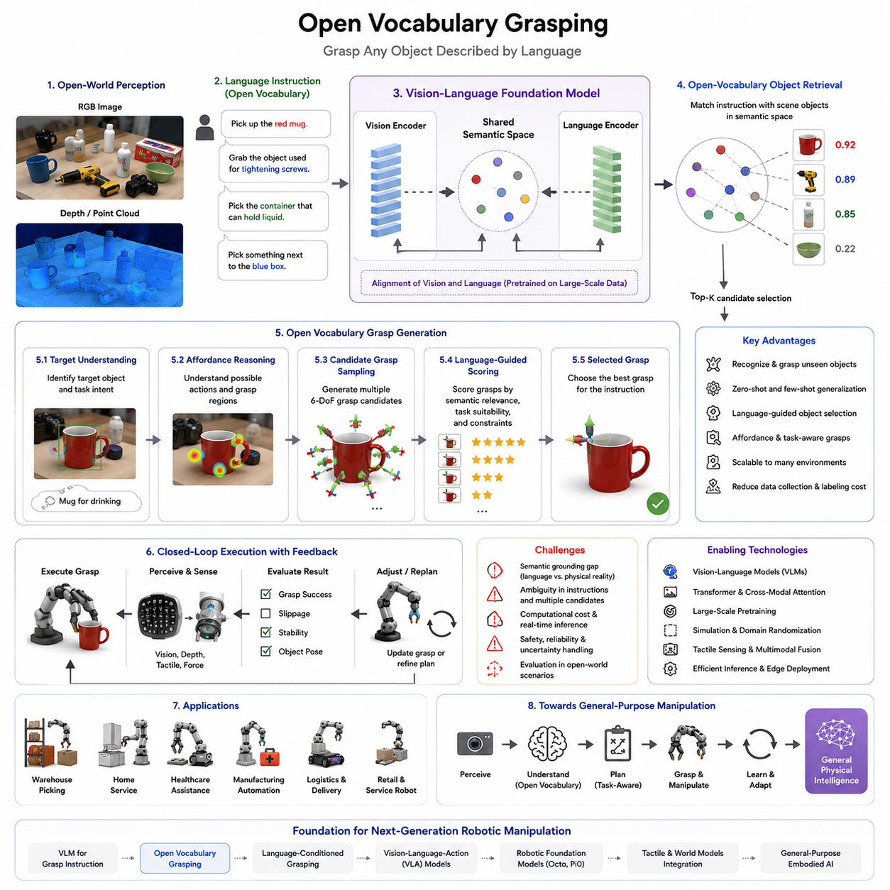{width="7.268055555555556in" height="7.268055555555556in"}

Open Vocabulary Grasping represents one of the most significant advances in modern robotic manipulation and embodied intelligence. Traditional robotic grasping systems were designed around a closed-world assumption in which the robot could only recognize, reason about, and manipulate objects that had been explicitly included in its training dataset. Such systems relied on predefined object categories, manually curated labels, and task-specific models. While these approaches achieved high performance in controlled industrial environments, they struggled when deployed in real-world settings where robots encounter thousands of previously unseen objects, continuously changing inventories, new products, and unpredictable environments. Open Vocabulary Grasping fundamentally changes this paradigm by enabling robots to understand and manipulate objects based on semantic descriptions rather than fixed category labels. Instead of asking whether an object belongs to one of a limited number of known classes, the robot learns to associate language, visual perception, object affordances, and grasping strategies within a shared representation space. This allows the robot to identify and manipulate objects that were never explicitly included in its robotic training data. Within the Foundation Models for Grasping section, Open Vocabulary Grasping serves as a critical bridge between Vision-Language Models and fully general-purpose robotic manipulation systems.

Historically, robotic perception systems were built around closed-set recognition. A grasping system might be trained to recognize specific object categories such as cups, bottles, boxes, tools, or containers. During deployment, the robot could only reliably interact with objects belonging to those predefined categories. If a new object appeared that was not represented in the training dataset, recognition performance often degraded dramatically. This limitation became increasingly problematic as robots moved from structured factories into warehouses, hospitals, homes, retail stores, and service environments where object diversity is effectively unlimited.

The emergence of large-scale vision-language learning introduced a new possibility. Instead of representing objects as fixed category identifiers, models began learning semantic embeddings that connect images and language descriptions. In such systems, an object can be described using natural language rather than a predefined label. A robot can understand concepts such as "red mug," "metal tool," "blue container," "plastic bottle," or even more abstract descriptions such as "something that can hold liquid" or "an object used for tightening screws." This semantic flexibility forms the foundation of open vocabulary manipulation.

Open Vocabulary Grasping extends this capability beyond recognition and into physical interaction. The robot must not only identify the correct object but also determine how to grasp it, where to grasp it, and why a particular grasp strategy is appropriate. For example, a user may instruct a robot to "pick up the yellow cleaning tool next to the sink." The robot may never have encountered that specific cleaning tool before, but by combining visual understanding with language semantics, it can identify the correct object and generate a suitable grasp strategy.

One of the defining characteristics of Open Vocabulary Grasping is its ability to generalize beyond explicit object classes. Generalization has long been one of the central challenges in robotic manipulation. Traditional learning-based grasping systems often achieve impressive results on benchmark datasets yet experience significant performance degradation when confronted with novel objects. Open Vocabulary Grasping addresses this challenge by learning object representations based on semantic relationships rather than category boundaries. Similar objects tend to occupy nearby regions within the learned representation space, allowing knowledge transfer across categories.

Language plays a central role in this process. Human instructions frequently reference objects using attributes, functions, relationships, or contextual descriptions rather than formal category names. A user may ask a robot to "grab the item used for drinking coffee," "pick up the object closest to the blue box," or "bring me something that can cut paper." These instructions require the robot to reason about semantics, affordances, and context rather than simply matching predefined labels. Open Vocabulary Grasping enables such reasoning by integrating language understanding directly into the grasping pipeline.

Affordance reasoning becomes particularly important in open vocabulary settings. Humans naturally understand that certain objects support specific actions. Cups afford grasping and drinking. Handles afford pulling. Buttons afford pressing. Tools afford task-specific interactions. Traditional robotic systems often require explicit affordance annotations, which are difficult to scale. Open Vocabulary Grasping leverages foundation models and vision-language representations to learn affordances implicitly from large-scale datasets. As a result, robots can infer how to interact with unfamiliar objects by reasoning about their appearance, structure, and semantic description.

The relationship between Open Vocabulary Grasping and Vision-Language Models is extremely close. Most modern open vocabulary systems rely on VLMs to generate shared semantic representations. These representations align visual observations with textual descriptions in a common embedding space. During operation, both the observed object and the language instruction are projected into this space. Objects whose visual features align with the instruction can then be identified as potential grasp targets. This process allows robots to recognize objects even when no explicit robotic training examples exist for those categories.

Transformer architectures have become the dominant computational framework for open vocabulary systems. Transformers enable the integration of visual features, language tokens, scene context, and spatial relationships into unified representations. Attention mechanisms allow the model to focus on relevant regions of the scene while simultaneously considering linguistic constraints. For example, when instructed to "pick up the red screwdriver on the right side of the toolbox," the transformer can identify relevant objects, evaluate color constraints, reason about spatial relationships, and generate a task-specific grasp target.

Scene understanding is another critical component. Open Vocabulary Grasping requires robots to reason about complex environments containing multiple objects, clutter, occlusions, and dynamic changes. Object identification often depends on contextual information. Consider an instruction such as "pick up the cup next to the laptop." The robot must first recognize multiple objects, determine spatial relationships, identify the referenced cup, and then plan a grasp that avoids collisions with surrounding objects. This level of contextual reasoning represents a major advancement over traditional object-centric grasp planning approaches.

Multimodal learning provides the foundation for robust open vocabulary manipulation. Visual inputs supply object appearance and scene structure. Language inputs describe goals, constraints, and semantic relationships. Depth sensing provides geometric information. Tactile sensing contributes contact-level feedback during grasp execution. By integrating these modalities into a unified representation space, robots can make more informed decisions about object selection and grasp strategy generation.

Large-scale pretraining is a key factor enabling open vocabulary performance. Foundation models are typically trained on billions of image-text pairs collected from diverse sources. During this process, the model learns broad visual and semantic knowledge encompassing countless object categories, materials, activities, environments, and relationships. Fine-tuning on robotic manipulation data subsequently aligns these representations with physical interaction tasks. This approach allows robotic systems to benefit from knowledge acquired far beyond the scope of traditional robotics datasets.

One of the most important advantages of Open Vocabulary Grasping is scalability. In conventional systems, every new object category requires additional data collection, annotation, training, validation, and deployment. Such a process becomes increasingly expensive as object diversity grows. Open Vocabulary systems reduce this burden by enabling zero-shot and few-shot generalization. A robot can manipulate objects based on semantic descriptions without requiring category-specific retraining. This dramatically improves deployment efficiency in real-world environments.

Zero-shot grasping is a particularly important capability. In zero-shot scenarios, the robot encounters an object category that was never included in its grasp training dataset. Traditional systems typically fail under such conditions. Open Vocabulary Grasping leverages semantic similarity and language grounding to transfer knowledge from known categories to unknown ones. For example, a robot that understands cups, bottles, and containers may successfully manipulate a previously unseen thermos because the semantic and functional relationships are captured within the learned representation space.

Few-shot adaptation further enhances flexibility. When a small number of examples become available, foundation models can rapidly adapt to new domains, environments, or object categories. This reduces the need for extensive retraining and enables faster deployment in specialized applications such as healthcare, manufacturing, logistics, and service robotics.

Task-aware grasping naturally emerges within open vocabulary systems. Human instructions often specify not only which object should be manipulated but also how it should be manipulated. An instruction such as "pick up the hammer for use" implies a different grasp than "store the hammer in the toolbox." Similarly, "hand me the knife safely" requires a fundamentally different grasp strategy than "use the knife to cut." Open Vocabulary Grasping integrates semantic understanding with grasp planning to support such task-dependent behaviors.

Mobile manipulators benefit significantly from this technology. In warehouses, robots may encounter constantly changing inventories. In hospitals, medical equipment and supplies vary across departments. In homes, object arrangements are highly dynamic. Open Vocabulary Grasping allows robots to operate effectively in these environments without requiring exhaustive object-specific programming. This capability is essential for achieving practical autonomy at scale.

Simulation environments play a major role in developing open vocabulary systems. High-fidelity simulators enable the generation of large quantities of multimodal data involving diverse objects, environments, and instructions. Domain randomization techniques further improve generalization by exposing the model to variations in appearance, lighting, textures, object arrangements, and physical properties. Combined with real-world data collection, simulation provides a scalable pathway for training robust open vocabulary grasping models.

Despite its promise, Open Vocabulary Grasping faces several challenges. Semantic grounding remains a difficult problem because language concepts do not always correspond directly to physical properties. A robot may understand the concept of a "fragile object" but still require additional sensing and reasoning to determine appropriate grasp forces. Similarly, semantic similarity does not guarantee physical similarity, making grasp transfer more difficult than visual recognition transfer.

Ambiguity is another significant challenge. Human instructions are often underspecified or context-dependent. Multiple objects may satisfy a given description. Resolving such ambiguity requires sophisticated scene understanding, dialogue capabilities, and uncertainty estimation mechanisms. Interactive clarification strategies may become increasingly important in future systems.

Safety and reliability are critical concerns. Incorrect object identification can result in failed tasks, damaged products, or hazardous interactions. Therefore, practical Open Vocabulary Grasping systems often combine learned semantic reasoning with geometric verification, collision checking, grasp quality estimation, and safety constraints. Hybrid architectures provide a balance between flexibility and reliability.

Computational efficiency remains another challenge. Foundation models capable of open vocabulary reasoning are often computationally expensive. Deploying these models on edge computers, mobile manipulators, or embedded robotic systems requires efficient inference techniques, model compression, quantization, pruning, and hardware acceleration. Achieving real-time performance while preserving generalization remains an active area of research.

Evaluation methodologies for Open Vocabulary Grasping extend far beyond traditional grasp success metrics. Researchers must measure semantic grounding accuracy, open-world recognition performance, zero-shot generalization, instruction-following capability, task completion success, robustness to ambiguity, and adaptability to novel environments. New benchmark datasets and evaluation protocols are therefore becoming increasingly important.

Industrial applications of Open Vocabulary Grasping are rapidly expanding. Warehouse automation systems can manipulate newly introduced products without retraining. Service robots can respond to natural language requests involving unfamiliar household items. Healthcare robots can assist medical personnel in dynamic clinical environments. Manufacturing systems can adapt to changing product variants. Logistics robots can handle continuously evolving inventories. In each of these applications, open vocabulary manipulation significantly reduces deployment costs while increasing operational flexibility.

The future of Open Vocabulary Grasping lies in deeper integration with robotic foundation models, world models, tactile intelligence, and Vision-Language-Action architectures. Future robots will not merely recognize objects based on semantic descriptions but will understand their functions, predict interaction outcomes, reason about task goals, and adapt behavior through experience. Open Vocabulary Grasping therefore represents a crucial step toward general-purpose robotic manipulation and ultimately toward embodied physical intelligence capable of operating effectively within the complexity of the real world.

## 12.04 Language-Conditioned Manipulation

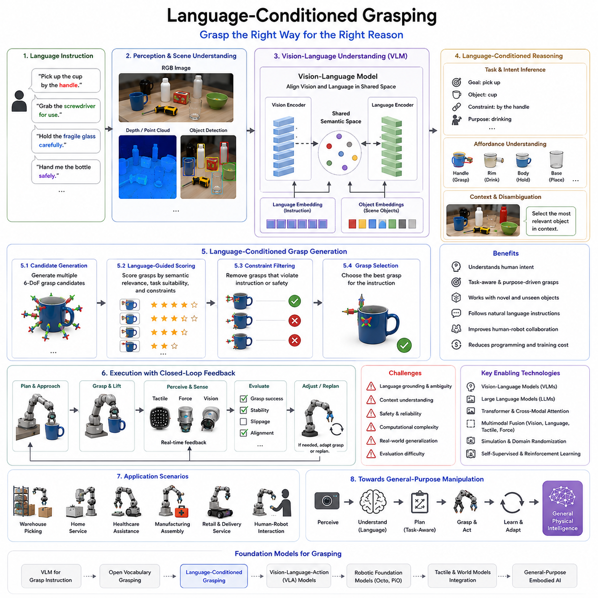{width="7.268055555555556in" height="7.268055555555556in"}

Language-Conditioned Grasping represents a major milestone in the evolution of robotic manipulation, enabling robots to perform grasping actions based not only on visual observations and physical constraints but also on human language instructions. Traditional grasping systems primarily focused on answering the question of how to grasp an object. They relied on geometric reasoning, force closure analysis, grasp quality metrics, and perception-driven planning to identify stable grasp points. While these methods achieved impressive results in structured environments, they lacked an understanding of human intent, task context, and semantic meaning. Language-Conditioned Grasping addresses this limitation by incorporating language as a fundamental component of the grasping process. Instead of treating language as a separate interface layer, the robot directly integrates linguistic information into perception, reasoning, grasp planning, and execution. As a result, grasping becomes a goal-directed activity guided by semantic understanding rather than purely physical optimization. Within the Foundation Models for Grasping section, Language-Conditioned Grasping serves as a natural progression from Vision-Language Models and Open Vocabulary Grasping toward fully embodied language-driven manipulation systems.

The concept of conditioning in machine learning refers to modifying the behavior of a model based on additional input information. In Language-Conditioned Grasping, language acts as the conditioning signal that influences object selection, grasp generation, motion planning, and execution strategies. Rather than generating a generic grasp for an object, the robot generates a grasp that is specifically aligned with the linguistic instruction. This distinction is fundamental because the same object may require different grasping behaviors depending on the intended task. A cup intended for drinking, cleaning, storage, transportation, or handover may require entirely different grasp configurations even though the object itself remains unchanged.

Traditional grasp planners typically optimize objective functions related to stability, force distribution, contact quality, or collision avoidance. While these criteria remain important, they do not capture human intentions. Humans rarely specify tasks using grasp coordinates or grasp metrics. Instead, instructions are expressed through language. Statements such as "pick up the cup by the handle," "grab the screwdriver for use," "hold the fragile glass carefully," or "hand me the bottle safely" contain semantic constraints that cannot be inferred solely from geometry. Language-Conditioned Grasping enables robots to interpret these instructions and generate grasp strategies that satisfy both physical and semantic requirements.

Language introduces contextual information that significantly influences manipulation decisions. Consider a simple object such as a hammer. If the instruction is "put the hammer into the toolbox," the robot may grasp the hammer near its center of mass to maximize stability during transportation. If the instruction is "use the hammer," the robot should grasp the handle to facilitate functional manipulation. If the instruction is "give the hammer to a human," the robot should present the handle toward the user while maintaining safe control of the tool head. Each scenario requires different grasping behavior despite involving the same object. Language serves as the mechanism that disambiguates these intentions.

The integration of language into grasping systems became feasible through advances in large-scale language models, vision-language models, and multimodal foundation models. These models learn shared representations connecting visual observations, language descriptions, object properties, and action outcomes. Through large-scale pretraining, they develop semantic knowledge that can be transferred to robotic manipulation tasks. As a result, robots can reason about objects using concepts, functions, attributes, relationships, and goals rather than relying solely on predefined object categories.

One of the key capabilities of Language-Conditioned Grasping is semantic grounding. Semantic grounding refers to the process of connecting language concepts to physical entities in the environment. When a user instructs a robot to "pick up the red mug on the table," the robot must identify the meaning of "red," recognize the concept of a "mug," locate the object within the scene, and determine appropriate grasp points. This process requires visual perception, language understanding, object localization, and grasp planning to operate together within a unified framework.

Language-conditioned systems often rely on multimodal embeddings that align visual and linguistic information within a shared representation space. In this space, images of objects and textual descriptions occupy nearby locations when they refer to similar concepts. This alignment allows robots to associate language instructions with visual observations. For example, the textual concept "coffee mug" becomes connected to observed objects exhibiting the corresponding visual characteristics. The robot can then identify the target object even if it has never encountered that exact instance before.

Task awareness is one of the most important advantages of language-conditioned manipulation. Traditional grasp planners generally seek the most stable grasp available. However, the most stable grasp is not always the most useful grasp. A robotic hand grasping a screwdriver by its shaft may achieve excellent force closure but render the tool unusable for subsequent tasks. Language-conditioned systems incorporate task objectives directly into the grasp selection process. Consequently, grasp quality becomes a function not only of physical stability but also of task suitability.

The concept of affordance is deeply intertwined with language-conditioned grasping. Affordances describe the possible interactions that objects support. Humans naturally understand that handles afford grasping, buttons afford pressing, containers afford holding objects, and tools afford task-specific operations. Language descriptions often implicitly reference affordances. An instruction such as "pick up the cup for drinking" suggests grasping locations that preserve access to the drinking surface. Similarly, "grab the knife safely" implies avoiding direct contact with the blade. Foundation models learn these affordance relationships from large-scale datasets, enabling robots to infer appropriate grasping strategies from language alone.

Language-conditioned grasping also supports hierarchical task reasoning. Human instructions often describe high-level objectives rather than low-level actions. A command such as "prepare the table for dinner" may require multiple grasping actions involving plates, utensils, cups, and serving containers. Language-conditioned systems can decompose such instructions into subgoals, determine object priorities, and generate task-consistent grasp strategies. This capability moves robotic manipulation closer to human-like task execution.

Another important capability is handling ambiguity. Human language is inherently flexible and often underspecified. Instructions such as "bring me the cup" may not specify which cup is intended. Language-conditioned systems combine scene understanding, contextual reasoning, and object relationships to resolve ambiguity. If multiple candidate objects satisfy the instruction, additional reasoning or clarification may be required. This interaction capability represents an important step toward natural human-robot collaboration.

Recent advances in transformer architectures have significantly improved language-conditioned manipulation. Transformers allow models to process language tokens, visual features, scene context, and spatial relationships simultaneously. Attention mechanisms enable the robot to focus on task-relevant objects while filtering irrelevant information. For example, when instructed to "pick up the blue bottle next to the laptop," the transformer can attend to object color, category, and spatial relationships simultaneously, producing a more accurate target selection process.

Large Language Models have further expanded the capabilities of Language-Conditioned Grasping. Beyond object identification, LLMs can reason about goals, constraints, safety requirements, and task sequences. They can infer implied intentions that are not explicitly stated. For instance, when asked to "serve a drink," the robot may infer the need to grasp a cup, avoid spilling liquid, transport the object carefully, and present it in a user-friendly orientation. Such reasoning extends beyond traditional grasp planning and enters the domain of cognitive task understanding.

Language-conditioned systems frequently incorporate visual-language models as perception modules. These models generate object-level representations enriched with semantic information. Grasp planning algorithms then use these representations to generate candidate grasp poses. Language information is subsequently used to rank, filter, or modify candidate grasps based on task objectives. This hybrid architecture combines the reliability of geometric planning with the flexibility of semantic reasoning.

Multimodal sensing further enhances performance. While visual information provides object appearance and geometry, tactile sensing contributes contact information during execution. Force sensors provide feedback regarding grasp stability. Language supplies task intent and semantic constraints. By integrating all these modalities, robots can continuously adjust grasp behavior to satisfy both physical and semantic objectives. For example, a robot instructed to "carefully hold the fragile vase" may dynamically reduce grasp force when tactile feedback indicates sufficient stability.

Open Vocabulary capabilities naturally complement Language-Conditioned Grasping. Users frequently describe objects using attributes, functions, or contextual references rather than formal names. Instructions such as "pick up something that can cut paper" or "bring the container used for coffee" require semantic understanding rather than simple object recognition. Language-conditioned systems leverage foundation models to identify relevant objects based on conceptual descriptions rather than predefined labels.

Simulation environments play an important role in training language-conditioned grasping models. Simulators enable large-scale generation of instruction-conditioned manipulation trajectories. Robots can practice interpreting language, selecting objects, generating grasps, and recovering from failures across millions of virtual interactions. Domain randomization and sim-to-real transfer techniques help bridge the gap between simulated and real-world environments.

Self-supervised learning offers another pathway for scaling robotic experience. Robots can autonomously collect manipulation data while executing language-conditioned tasks. Successful outcomes reinforce useful language-action associations, while failures provide opportunities for improvement. Over time, the system develops increasingly robust mappings between linguistic concepts and manipulation behaviors.

Despite its potential, Language-Conditioned Grasping faces significant challenges. Language grounding remains difficult because linguistic concepts do not always correspond directly to physical properties. Terms such as "fragile," "heavy," "valuable," or "carefully" require interpretation that depends on context, experience, and environmental conditions. Building robust representations for such concepts remains an active area of research.

Ambiguity and uncertainty are also persistent challenges. Natural language often contains incomplete information. The robot must determine whether additional reasoning, contextual inference, or user clarification is necessary. Effective uncertainty estimation becomes particularly important in safety-critical applications where incorrect assumptions may lead to failures or hazards.

Computational requirements present another obstacle. State-of-the-art language-conditioned systems frequently rely on large foundation models with substantial memory and processing demands. Deploying these systems on mobile manipulators or edge computing platforms requires efficient model architectures, quantization techniques, pruning methods, and hardware acceleration strategies.

Safety is especially important in language-guided robotics. Misinterpreting instructions may result in incorrect object selection, unsafe grasping behavior, or hazardous interactions. Therefore, practical systems often incorporate safety verification modules, collision avoidance mechanisms, grasp quality estimators, and rule-based constraints alongside learned models.

Evaluation of Language-Conditioned Grasping requires broader metrics than traditional grasp success rates. Researchers must assess instruction-following accuracy, semantic grounding performance, task completion rates, robustness to ambiguous language, adaptability to unseen objects, and user satisfaction. Comprehensive benchmarking frameworks are therefore essential for measuring progress in this rapidly evolving field.

Industrial applications of Language-Conditioned Grasping are expanding across logistics, manufacturing, healthcare, service robotics, retail automation, and household assistance. Warehouse robots can respond to natural language picking requests. Healthcare robots can assist nurses by retrieving supplies based on spoken commands. Service robots can interact naturally with users in homes, hotels, and public spaces. Manufacturing systems can adapt more easily to changing production requirements through language-driven task specification.

The future of Language-Conditioned Grasping lies in deeper integration with Vision-Language-Action models, robotic foundation models, tactile intelligence, world models, and embodied AI architectures. Future robots will not merely understand commands but will reason about intentions, predict outcomes, learn from experience, and adapt behavior continuously. Grasping will become part of a broader cognitive manipulation framework in which language serves as a primary interface between human goals and robotic actions.

Within the overall Foundation Models for Grasping chapter structure, Language-Conditioned Grasping represents a crucial transition from object-centric manipulation to goal-centric manipulation. It enables robots to understand not only what object should be grasped but also why it should be grasped, how it should be grasped, and what future actions the grasp must support. This capability forms a foundational building block for general-purpose robotic intelligence and for the development of robotic systems capable of operating effectively in complex, dynamic, and human-centered environments.

## 12.05 Vision-Language-Action Models

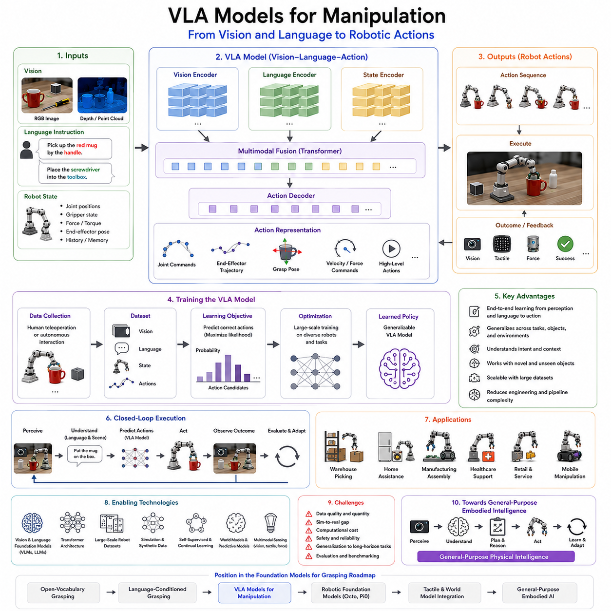{width="7.268055555555556in" height="7.268055555555556in"}

Vision-Language-Action (VLA) Models represent one of the most important developments in the evolution of intelligent robotic manipulation. While Vision-Language Models (VLMs) provide robots with the ability to understand visual scenes and interpret human instructions, they do not inherently generate robot actions. Traditional robotic systems often separate perception, reasoning, planning, and control into independent modules connected through carefully engineered interfaces. Although this modular architecture has achieved remarkable success in industrial automation, it introduces complexity, error propagation, and limited adaptability when robots operate in dynamic real-world environments. Vision-Language-Action Models address these limitations by directly connecting visual observations and language instructions to physical actions. Instead of processing perception, planning, and execution as isolated stages, VLA systems learn an end-to-end mapping from what the robot sees and what the human requests to how the robot should move. Within the Foundation Models for Grasping chapter, VLA Models for Manipulation represent a critical step beyond language-conditioned grasping, transforming semantic understanding into executable robotic behavior and moving robotic systems closer to general-purpose physical intelligence.

The emergence of VLA models is closely linked to the success of foundation models in natural language processing and computer vision. Large Language Models demonstrated that a sufficiently large neural network trained on diverse data could perform a wide range of tasks without explicit programming. Vision-Language Models extended this principle to multimodal understanding by learning relationships between images and language descriptions. Robotics researchers recognized that manipulation could benefit from the same scaling principles. Instead of building separate modules for object detection, grasp planning, motion generation, and execution, a single model could learn the relationships between observations, instructions, and actions directly from data. This insight led to the development of Vision-Language-Action architectures.

At its core, a VLA model receives visual observations, language instructions, and sometimes robot state information as input. Visual observations may include RGB images, depth maps, stereo images, point clouds, or multimodal sensory data. Language instructions describe goals, constraints, or task objectives. Robot state information may include joint positions, velocities, force measurements, gripper status, or historical observations. The model processes these inputs through a shared representation space and produces actions as outputs. These actions may take the form of joint commands, end-effector trajectories, grasp poses, velocity commands, force control signals, or high-level task actions.

One of the most significant conceptual shifts introduced by VLA models is the elimination of explicit task decomposition. Traditional robotic pipelines often require engineers to define object detection algorithms, grasp planners, motion planners, collision avoidance systems, and control policies separately. Each component must be individually developed, tested, integrated, and maintained. VLA systems instead learn these relationships directly from data. Through exposure to large numbers of demonstrations, the model develops implicit representations that connect perception, reasoning, and action without requiring handcrafted intermediate representations.

The concept of embodied learning is central to understanding VLA models. Unlike language models that operate primarily in symbolic spaces, robots interact with the physical world. Every action changes the environment, creating new observations and influencing future decisions. VLA models learn these relationships through interaction data. By observing how visual scenes evolve in response to actions, the model develops a grounded understanding of cause and effect. This embodied learning process enables more robust and adaptive manipulation behavior.

Large-scale robotic datasets have played a crucial role in enabling VLA development. Historically, robotic learning suffered from limited data availability because collecting real-world robot interactions was expensive and time-consuming. Recent advances in data collection infrastructure have significantly changed this situation. Modern robotic datasets contain millions of trajectories collected across diverse robots, environments, objects, and tasks. These datasets often include synchronized visual observations, language instructions, robot states, action sequences, and task outcomes. Such large-scale datasets allow VLA models to learn generalizable representations that extend beyond individual tasks.

One of the primary advantages of VLA models is their ability to generalize across tasks. Traditional robotic systems often require task-specific training or programming. A system trained for pick-and-place may not perform well on drawer opening, tool usage, or object handover. VLA models learn broader representations that capture relationships among tasks. For example, grasping, lifting, transporting, and placing all involve common manipulation principles. By learning these shared structures, VLA models can transfer knowledge between tasks and adapt to new scenarios more effectively.

Language conditioning plays a critical role in task specification. Human instructions often describe desired outcomes rather than detailed procedures. Commands such as "pick up the mug by the handle," "place the screwdriver into the toolbox," or "hand me the bottle safely" specify objectives without defining exact robot motions. VLA models interpret these instructions and generate appropriate action sequences. This ability dramatically simplifies human-robot interaction by allowing users to communicate using natural language rather than specialized programming interfaces.

Manipulation tasks frequently involve long-horizon planning. A robot assembling a product, organizing a shelf, or preparing a meal must perform multiple actions in sequence while maintaining awareness of future objectives. Traditional control systems often struggle with such tasks because they optimize actions locally. VLA models can learn temporal relationships across extended trajectories, allowing them to generate behaviors that support long-term goals. This capability is particularly important for dexterous manipulation and complex task execution.

Transformer architectures have become the dominant computational framework for VLA systems. Originally developed for natural language processing, transformers excel at modeling relationships across sequences and modalities. In VLA models, transformers integrate visual tokens, language tokens, robot state representations, and action histories into unified representations. Self-attention mechanisms allow the model to identify task-relevant information while ignoring irrelevant details. This flexibility makes transformers particularly suitable for large-scale robotic learning.

Action generation within VLA systems can be implemented in several ways. Some models directly predict low-level motor commands. Others generate end-effector trajectories or waypoint sequences. Hierarchical architectures may produce high-level actions that are subsequently translated into lower-level control commands. The choice of action representation depends on the application, robot platform, and desired level of abstraction. Regardless of representation, the defining characteristic is that action generation emerges directly from multimodal understanding rather than from manually engineered planning pipelines.

The integration of grasping into VLA architectures provides significant advantages. Traditional grasping systems often generate grasps independently of downstream tasks. VLA models instead select grasps within the broader context of task execution. For example, when instructed to use a screwdriver, the model can generate a grasp suitable for immediate operation rather than merely selecting the most stable grasp. Similarly, when handing an object to a human, the model can consider ergonomics, safety, and social conventions. This task-aware grasping capability represents a major advancement over purely geometric approaches.

Another important capability is open-world adaptation. Real-world environments contain countless objects, many of which were not present in training datasets. VLA models leverage language and visual representations learned from foundation models to generalize beyond predefined object categories. A robot can interpret instructions involving novel objects, identify relevant affordances, and generate appropriate actions even when encountering unfamiliar situations. This capability is essential for deployment in homes, hospitals, warehouses, and service environments.

Simulation has become an indispensable tool for VLA training. Collecting sufficient real-world data for large-scale learning remains challenging. High-fidelity simulation environments provide a scalable solution by enabling the generation of massive quantities of robot interaction data. Modern simulators model contact dynamics, friction, deformable objects, sensor noise, and environmental variability. Combined with domain randomization and sim-to-real transfer techniques, simulation significantly reduces data collection costs while improving generalization.

Self-supervised learning further accelerates VLA development. Robots can autonomously collect data by interacting with their environments and observing outcomes. Successful and unsuccessful actions both provide valuable learning signals. Through repeated interactions, the robot gradually develops richer representations of physical dynamics, object affordances, and task execution strategies. This continual learning process supports long-term adaptation and performance improvement.

Recent years have witnessed the emergence of several influential VLA systems. Models such as RT-2, RT-X, Open X-Embodiment, Octo, and Pi0 demonstrate the feasibility of large-scale robotic foundation models capable of controlling diverse robot platforms across multiple tasks. These systems combine internet-scale visual-language pretraining with extensive robotic interaction data. The resulting models exhibit impressive generalization capabilities and provide a glimpse into the future of robotic intelligence.

RT-2 introduced the concept of treating robotic actions as language-like tokens, enabling direct integration of visual-language reasoning with action generation. By leveraging knowledge acquired from large-scale internet data, RT-2 demonstrated improved generalization to unseen tasks and objects. Open X-Embodiment expanded this idea by combining data from multiple robot embodiments, creating a shared foundation for cross-platform robotic learning. Octo further advanced the field by providing an open-source robotic foundation model trained on large-scale manipulation data. Pi0 extended these concepts toward more efficient and scalable robotic action generation.

Multimodal fusion is a critical component of VLA systems. Visual information provides object appearance and scene context. Language supplies goals and semantic constraints. Robot states describe the current physical configuration. Tactile sensing contributes contact-level information during manipulation. Force sensing provides interaction dynamics. By integrating these modalities, VLA models develop a richer understanding of manipulation tasks than would be possible using any single information source.

World models are increasingly being integrated into VLA architectures. A world model predicts how the environment will evolve in response to actions. This predictive capability allows robots to evaluate potential actions before execution, anticipate failures, and plan more effectively. Combining VLA systems with world models creates a powerful framework for reasoning, planning, and control in complex environments.

Despite their promise, VLA models face several important challenges. Data quality remains a major concern. Large datasets often contain inconsistencies, noise, and variations in demonstration quality. Ensuring that models learn robust behaviors rather than undesirable shortcuts requires careful dataset design and validation. Furthermore, collecting large-scale manipulation data remains significantly more difficult than collecting language or image data.

Computational requirements also present substantial challenges. State-of-the-art VLA models often contain billions of parameters and require significant computational resources for training and inference. Deploying such models on mobile robots, edge devices, or embedded platforms requires model compression, quantization, pruning, and hardware optimization. Balancing model size, performance, and real-time responsiveness remains an active area of research.

Safety is particularly important in robotic systems because actions have direct physical consequences. Errors in perception, reasoning, or action generation can lead to collisions, dropped objects, damaged equipment, or human injury. Consequently, practical VLA systems often incorporate safety layers, verification modules, collision avoidance mechanisms, uncertainty estimation, and fallback control policies. Hybrid approaches combining learned models with traditional control methods remain common in industrial deployments.

Evaluation methodologies for VLA systems are also evolving. Traditional robotic benchmarks typically focus on task-specific success rates. VLA models require broader evaluation frameworks that measure generalization, adaptability, instruction following, long-horizon task completion, cross-domain transfer, and robustness to environmental variation. Developing comprehensive evaluation standards remains an important research challenge.

Industrial applications of VLA models are expanding rapidly. Warehouse robots can perform flexible picking tasks based on natural language requests. Manufacturing robots can adapt to changing product configurations without extensive reprogramming. Service robots can assist users in homes, hospitals, hotels, and public spaces. Mobile manipulators can perform complex logistics operations involving navigation and manipulation simultaneously. These applications demonstrate the practical value of unifying perception, language understanding, and action generation within a single framework.

The future of VLA models lies in the continued scaling of data, models, and computational resources. As robotic datasets grow and foundation models become increasingly capable, VLA systems are expected to acquire broader generalization capabilities, stronger reasoning skills, and more sophisticated manipulation behaviors. Future robots may learn continuously from experience, share knowledge across fleets, and adapt rapidly to new tasks with minimal retraining. Such systems would move beyond narrow automation toward general-purpose embodied intelligence.

Within the overall structure of Foundation Models for Grasping, VLA Models for Manipulation represent the critical transition from understanding to action. Vision-Language Models enable perception and reasoning. Open Vocabulary Grasping enables recognition beyond predefined categories. Language-Conditioned Grasping enables task-aware manipulation. VLA models integrate all these capabilities into a unified framework that directly produces robotic behavior. They therefore constitute one of the most promising pathways toward robots capable of understanding instructions, reasoning about the physical world, and acting intelligently within complex, dynamic, and unstructured environments.

## 12.06 Octo and Pi0 Architectures

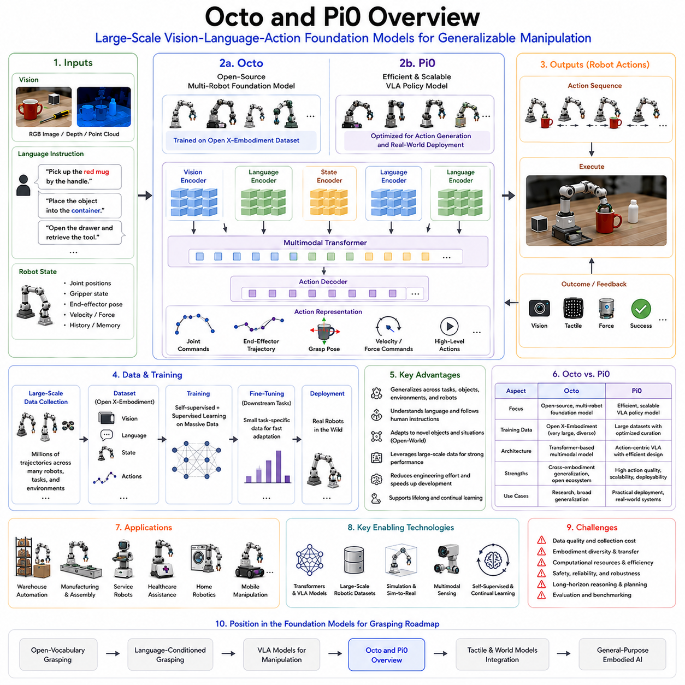{width="7.268055555555556in" height="7.268055555555556in"}

Octo and Pi0 represent two of the most influential robotic foundation models developed during the early era of large-scale embodied intelligence. Their significance extends beyond individual research projects because they demonstrate how the concepts of foundation models, previously successful in language and vision, can be applied to robotic manipulation. Both systems seek to create general-purpose robot policies capable of performing a wide variety of tasks across different environments, objects, and robotic embodiments. Rather than training a separate model for every individual manipulation task, Octo and Pi0 aim to learn broad representations that can generalize across grasping, pick-and-place, object rearrangement, tool use, drawer manipulation, human-robot interaction, and numerous other robotic activities. Within the Foundation Models for Grasping framework, Octo and Pi0 serve as landmark examples of how large-scale Vision-Language-Action systems can transform robotic manipulation from task-specific engineering into scalable data-driven intelligence.

The development of Octo and Pi0 emerged from a broader realization within the robotics community that traditional robotic learning approaches were fundamentally limited by data fragmentation. Historically, robotic manipulation research focused on narrow tasks. Researchers collected datasets for a single robot, a specific environment, and a predefined set of objects. Models trained under these conditions often achieved impressive benchmark results but struggled to generalize beyond their original training scenarios. This limitation contrasted sharply with the success of large language models, which demonstrated that scale, diversity, and shared representations could produce systems capable of transferring knowledge across many domains. Robotics researchers began exploring whether similar scaling principles could be applied to embodied intelligence.

One of the central challenges in robotic learning is embodiment diversity. Unlike language models that process text using a common representation format, robots differ significantly in physical structure. Some robots have two-finger grippers, while others possess multi-finger dexterous hands. Manipulators vary in degrees of freedom, kinematic configurations, workspace geometries, payload capacities, sensor arrangements, and control interfaces. A manipulation strategy learned on one robot may not directly transfer to another. Octo and Pi0 were developed partly to address this challenge by learning representations that capture task-level knowledge independently of specific robot hardware.

Octo was developed as one of the first open-source robotic foundation models trained on large-scale multi-robot datasets. The project emerged from the Open X-Embodiment initiative, a collaborative effort involving numerous research institutions and robotic platforms. Open X-Embodiment sought to aggregate robotic experience from many different robots performing many different tasks. By combining these datasets into a unified training framework, researchers created one of the largest robotic manipulation datasets ever assembled. Octo serves as a practical demonstration of how large-scale robotic foundation models can be trained using heterogeneous data collected across diverse embodiments.

A key innovation of Octo is its ability to operate across multiple robot platforms. Rather than learning robot-specific policies, Octo learns a shared representation space that captures relationships among observations, language instructions, and actions. Visual observations provide scene understanding. Language instructions specify task objectives. Robot states describe the current embodiment configuration. The model learns to map these inputs into generalized action policies capable of adapting across robots. This capability represents an important step toward universal manipulation intelligence.

The architecture of Octo is heavily influenced by transformer-based foundation models. Transformers provide mechanisms for integrating multimodal information across time and modality boundaries. Visual tokens extracted from camera observations are combined with language tokens representing task instructions. Additional embeddings represent robot states and action histories. Through self-attention mechanisms, the model learns which aspects of the observation are most relevant to task execution. This architecture allows Octo to perform reasoning across complex manipulation scenarios involving multiple objects, language constraints, and dynamic environments.

Language conditioning plays a particularly important role within Octo. Human users specify goals through natural language instructions rather than low-level control commands. Instructions such as "pick up the red mug," "place the object into the container," or "open the drawer and retrieve the tool" are encoded as language embeddings. These embeddings influence action generation throughout the manipulation process. As a result, Octo can adapt its behavior according to task objectives without requiring separate models for each task category.

One of the most important characteristics of Octo is its emphasis on generalization. Traditional robotic policies often perform well on tasks that closely resemble their training data but fail when encountering novel objects or environments. Octo attempts to overcome this limitation through large-scale training across diverse tasks and embodiments. By learning shared representations from broad experience, the model acquires knowledge that can transfer to previously unseen situations. This capability is especially valuable for robotic grasping because real-world environments contain countless objects that cannot all be represented within a training dataset.

Octo also demonstrates the practical value of pretraining and fine-tuning within robotics. The model is initially trained on large, heterogeneous datasets covering many tasks and robots. This pretraining stage develops broad manipulation knowledge. Subsequently, task-specific adaptation can be performed using relatively small amounts of additional data. This process mirrors the workflow used successfully in natural language processing, where large pretrained models are adapted to downstream applications through fine-tuning.

The emergence of Pi0 introduced another important perspective on robotic foundation models. While Octo emphasized large-scale multi-robot learning and open-source accessibility, Pi0 focused on improving the efficiency, scalability, and practical deployment of Vision-Language-Action systems. Pi0 was designed to address several limitations observed in earlier robotic foundation models, including computational complexity, data efficiency, and action generation performance.

Pi0 adopts many of the same fundamental principles that underlie modern foundation models. It integrates visual observations, language instructions, and robot states into a unified representation. However, Pi0 places greater emphasis on action prediction as a primary learning objective. Rather than treating action generation as a secondary output of perception and reasoning, Pi0 directly optimizes the relationship between observations and executable robotic behaviors. This focus enables more efficient policy learning and stronger action consistency across complex manipulation tasks.

One of the defining features of Pi0 is its attention to scalable action representation. Action spaces in robotics are notoriously challenging because they are continuous, high-dimensional, and strongly dependent on embodiment. Directly predicting low-level motor commands can be difficult due to sensitivity to noise and hardware variation. Pi0 explores alternative action representations that improve learning stability while preserving task performance. These representations enable the model to capture manipulation strategies at multiple levels of abstraction.

Pi0 also benefits from advances in multimodal learning. Modern robotic tasks require integrating information from many sensory modalities. RGB cameras provide appearance information. Depth sensors contribute geometric understanding. Force sensors reveal interaction dynamics. Tactile sensors provide contact feedback. Language describes goals and constraints. Pi0 incorporates these modalities within a unified learning framework, allowing the model to reason about both semantic and physical aspects of manipulation.

The relationship between Pi0 and Vision-Language-Action models is particularly important. Pi0 can be viewed as a practical implementation of VLA principles at foundation-model scale. The model receives observations and instructions, processes them through multimodal encoders, and directly generates actions. This end-to-end structure reduces reliance on manually engineered intermediate modules. Instead of explicitly separating perception, planning, and control, the model learns these relationships jointly from data.

Robotic grasping provides an ideal example of the advantages offered by Octo and Pi0. Traditional grasping systems often treat grasp selection as an isolated optimization problem focused on stability and force closure. Foundation models introduce a broader perspective. The choice of grasp depends not only on physical stability but also on task context, future actions, user intent, and environmental constraints. A grasp suitable for transportation may differ from a grasp suitable for assembly, tool use, or human handover. Octo and Pi0 learn these distinctions directly from large-scale experience.

Open-world generalization is another major benefit. Industrial and service robots frequently encounter objects that were not included in training datasets. Traditional object-specific grasp planners struggle under such conditions. Foundation models leverage semantic understanding acquired through language and visual learning. As a result, robots can reason about unfamiliar objects using descriptions, affordances, and contextual cues. This capability significantly expands the operational scope of robotic manipulation systems.

The success of Octo and Pi0 depends heavily on large-scale robotic datasets. Projects such as Open X-Embodiment demonstrated the value of aggregating experiences from many robots. The resulting datasets contain millions of trajectories spanning diverse tasks, environments, and embodiments. These datasets provide the foundation upon which robotic foundation models can learn transferable knowledge. Without such large-scale data resources, the development of general-purpose robotic intelligence would remain extremely difficult.

Simulation also plays a critical role in training foundation models. Real-world data collection remains expensive and time-consuming. High-fidelity simulators enable researchers to generate large quantities of interaction data while controlling environmental variability. Domain randomization techniques expose models to diverse object appearances, lighting conditions, textures, and physical properties. Sim-to-real transfer methods then facilitate deployment in physical environments. Both Octo and Pi0 benefit from this combination of simulation and real-world experience.

Another important aspect of these models is continual learning. Real-world environments evolve over time, and robots must adapt accordingly. Foundation models provide a framework for incorporating new experiences without retraining from scratch. As additional data becomes available, the model can refine its representations and improve performance. This capability supports long-term deployment in dynamic environments.

Despite their promise, Octo and Pi0 face several challenges. Data quality remains a major concern because robotic datasets often contain noise, inconsistencies, and variations in demonstration quality. Hardware diversity introduces additional complexity. Models must learn invariant task representations while accommodating embodiment-specific constraints. Furthermore, collecting robotic interaction data remains significantly more expensive than collecting language or image data.

Computational requirements also present significant obstacles. Training robotic foundation models requires substantial GPU resources and large-scale infrastructure. Inference efficiency is equally important because robots frequently operate under real-time constraints. Researchers continue to explore model compression, quantization, distillation, and hardware acceleration techniques to improve deployment practicality.

Safety remains a critical issue. Unlike language models, robotic systems interact directly with the physical world. Errors can result in collisions, damaged equipment, or injuries. Consequently, foundation models must incorporate uncertainty estimation, safety verification, fallback control strategies, and robust failure recovery mechanisms. Hybrid architectures combining learned policies with traditional control systems remain common in practical applications.

Evaluation methodologies for robotic foundation models continue to evolve. Success rates alone are insufficient for measuring general-purpose intelligence. Researchers increasingly evaluate cross-task generalization, embodiment transfer, language understanding, long-horizon reasoning, adaptation speed, and robustness under environmental variation. Octo and Pi0 have helped establish new benchmarks that better reflect the complexity of real-world robotic deployment.

Industrial applications of robotic foundation models are expanding rapidly. Warehouse robots can adapt to changing inventories. Manufacturing systems can handle diverse product variants. Service robots can respond to natural language requests. Healthcare assistants can perform object retrieval and delivery tasks. Mobile manipulators can combine navigation and manipulation within a unified decision-making framework. These applications illustrate the practical potential of foundation-model-driven robotics.

The future direction of robotic foundation models extends beyond Octo and Pi0 themselves. Researchers are increasingly integrating world models, tactile intelligence, multimodal reasoning, and self-supervised learning into unified architectures. Future systems may possess the ability to predict environmental dynamics, reason about physical consequences, learn continuously from experience, and share knowledge across robot fleets. Such capabilities would move robotics closer to general-purpose embodied intelligence.

Within the broader Foundation Models for Grasping framework, Octo and Pi0 occupy a pivotal position. They represent the transition from task-specific robotic learning toward scalable, transferable, and generalizable robotic intelligence. By combining large-scale datasets, multimodal learning, transformer architectures, language understanding, and action generation, these models demonstrate a practical pathway toward robots capable of understanding instructions, reasoning about the physical world, and performing manipulation tasks across diverse environments. As robotic foundation models continue to evolve, Octo and Pi0 will likely be remembered as foundational milestones in the journey toward truly intelligent robotic manipulation systems.

## 12.07 Fine-Tuning Foundation Models

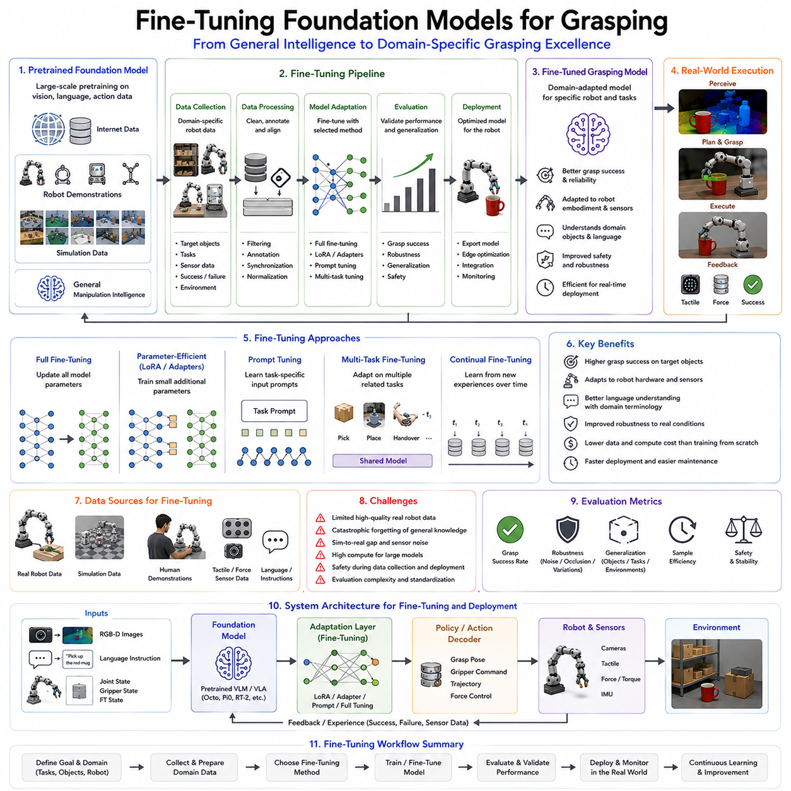{width="7.268055555555556in" height="7.268055555555556in"}

Fine-Tuning Foundation Models for Grasping represents one of the most critical stages in the practical deployment of modern robotic manipulation systems. While foundation models provide broad general knowledge acquired through large-scale pretraining, real-world robotic grasping applications often require specialized capabilities that cannot be fully learned from generic datasets alone. Foundation models such as Vision-Language Models (VLMs), Vision-Language-Action (VLA) models, Octo, Pi0, RT-2, and future embodied AI systems are typically trained on massive collections of internet-scale image-text pairs, robotic demonstrations, multimodal trajectories, and simulation-generated experiences. These models develop powerful representations of objects, language, tasks, environments, and actions. However, every practical robotic deployment introduces unique constraints, hardware configurations, sensing modalities, object distributions, safety requirements, and task objectives. Fine-tuning serves as the mechanism through which general robotic intelligence is adapted into domain-specific robotic expertise.

Within the Foundation Models for Grasping chapter structure, Fine-Tuning Foundation Models for Grasping follows naturally after the introduction of Foundation Models, VLM-based Grasp Instruction, Open Vocabulary Grasping, Language-Conditioned Grasping, VLA Models, and robotic foundation models such as Octo and Pi0. Once a general-purpose model has been pretrained, the next challenge becomes adapting that model to specific grasping environments. This adaptation process transforms a broadly capable manipulation model into a high-performance solution optimized for a particular robotic platform, object category, industrial process, warehouse operation, assembly task, healthcare application, or service robotics deployment.

The concept of fine-tuning originated in the field of transfer learning. Traditional machine learning systems required training separate models for every task. Such an approach became increasingly impractical as model size and task complexity grew. Researchers discovered that models trained on large and diverse datasets could develop general representations useful across many domains. Instead of training from scratch, a pretrained model could be adapted using a relatively small amount of task-specific data. This significantly reduced training costs while improving performance and generalization. The same principle has become fundamental in robotic foundation models.

A foundation model trained on millions of robotic demonstrations may understand how objects are grasped in general, but it may not fully understand the characteristics of a specific warehouse inventory, a particular robotic hand design, or a unique manufacturing process. Fine-tuning allows the model to incorporate these domain-specific characteristics while retaining the broad knowledge acquired during pretraining. The resulting system combines general intelligence with specialized expertise.

One of the primary motivations for fine-tuning in robotic grasping is embodiment adaptation. Robots differ significantly in mechanical design. Some platforms use parallel-jaw grippers, while others employ underactuated hands, soft grippers, multifinger dexterous hands, tendon-driven hands, or anthropomorphic robotic hands. The action representations learned during pretraining may not directly transfer across these embodiments. Fine-tuning enables the model to align its internal representations with the kinematic structure, actuation limits, workspace constraints, sensor configurations, and control interfaces of the target robot.

Sensor adaptation is another major application of fine-tuning. Foundation models are often trained using standardized sensory inputs. Real-world robots may employ different camera systems, depth sensors, tactile arrays, force-torque sensors, event cameras, thermal sensors, or multimodal sensing configurations. These differences can create distribution shifts between training and deployment environments. Fine-tuning allows the model to learn how to interpret the specific sensory signals available on the target platform.

Object distribution adaptation is particularly important in industrial applications. A foundation model may be trained using millions of diverse objects. However, a warehouse robot may only encounter a few thousand specific products. A medical robot may primarily interact with healthcare supplies. An assembly robot may manipulate a limited set of components. Fine-tuning enables the model to focus on the object distributions most relevant to the target application, improving grasp success rates and operational efficiency.

Task specialization represents another major motivation. General robotic foundation models are trained across many manipulation tasks. A specific deployment may focus on bin picking, order fulfillment, cable insertion, electronic assembly, pharmaceutical handling, surgical assistance, or household service tasks. Fine-tuning allows the model to allocate greater representational capacity toward the tasks that matter most within the target environment.

Language adaptation has become increasingly important as robots interact more closely with humans. Foundation models may be trained on internet-scale language data, but deployment environments often introduce specialized terminology. Industrial facilities, hospitals, laboratories, and logistics centers each use domain-specific vocabulary. Fine-tuning enables the robot to understand task instructions, object names, procedural terminology, and operational commands relevant to its deployment context.

Several approaches to fine-tuning have emerged within robotic foundation model research. The most straightforward method is full model fine-tuning. In this approach, all model parameters are updated using task-specific training data. Full fine-tuning offers maximum flexibility and performance but requires significant computational resources. For large foundation models containing billions of parameters, full fine-tuning may become prohibitively expensive.

Parameter-efficient fine-tuning methods have therefore gained significant attention. Techniques such as LoRA (Low-Rank Adaptation), adapters, prompt tuning, prefix tuning, and low-rank parameter injection enable adaptation while modifying only a small fraction of model parameters. These approaches dramatically reduce computational requirements while maintaining much of the performance benefit associated with full fine-tuning. For robotic applications where computational resources are often limited, parameter-efficient techniques are particularly attractive.

LoRA has become one of the most widely adopted approaches. Rather than updating all model weights, LoRA introduces low-rank matrices that capture task-specific adaptations. The original pretrained parameters remain largely unchanged. This strategy reduces memory requirements, accelerates training, and facilitates the deployment of multiple specialized models built upon a common foundation.

Prompt tuning represents another interesting approach. Instead of modifying model weights directly, prompt tuning learns task-specific input embeddings that guide model behavior. In robotic systems, these learned prompts can influence how the model interprets visual observations, language instructions, or manipulation objectives. Prompt-based adaptation offers a lightweight mechanism for customizing behavior without extensive retraining.

Multi-task fine-tuning is increasingly important in robotic manipulation. Rather than adapting a model to a single task, researchers often fine-tune foundation models across multiple related tasks simultaneously. For example, grasping, picking, placing, sorting, and handover operations may be learned together. Multi-task adaptation improves generalization and reduces the risk of overfitting to narrow task distributions.

Continual fine-tuning extends this concept further. Real-world robotic systems operate in environments that evolve over time. New products appear, workflows change, equipment is upgraded, and user preferences evolve. Continual learning enables foundation models to incorporate new experiences without retraining from scratch. This capability is essential for long-term deployment in dynamic environments.

One of the greatest challenges in fine-tuning robotic foundation models is catastrophic forgetting. During adaptation, the model may lose valuable knowledge acquired during pretraining. For example, a model fine-tuned exclusively on warehouse objects may become less effective when encountering unfamiliar household objects. Researchers address this challenge using techniques such as regularization, replay buffers, knowledge distillation, and mixed-domain training.

Dataset quality plays a critical role in fine-tuning success. Unlike internet-scale pretraining, fine-tuning often relies on relatively small datasets. Poor-quality data can introduce biases, reduce robustness, and degrade performance. High-quality robotic datasets should contain diverse object instances, environmental conditions, grasp outcomes, failure cases, and sensor observations. Balanced coverage of successful and unsuccessful grasps is particularly important for robust learning.

Simulation has become a powerful tool for fine-tuning robotic foundation models. High-fidelity simulators allow researchers to generate large quantities of task-specific data at low cost. Simulated grasping trajectories can be used to adapt models before deployment in real environments. Domain randomization techniques expose the model to variations in object appearance, lighting conditions, friction coefficients, sensor noise, and environmental configurations, improving robustness during real-world operation.

Sim-to-real fine-tuning has emerged as a common deployment strategy. The model is first adapted in simulation using large-scale synthetic data. A smaller amount of real-world data is then used to bridge remaining discrepancies between simulation and reality. This approach dramatically reduces the cost of robotic data collection while preserving high levels of performance.

Human demonstration data remains an important source of fine-tuning information. Expert operators can provide demonstrations of successful grasping behaviors, manipulation sequences, and task execution strategies. Learning from Demonstration (LfD) techniques allow robotic foundation models to incorporate this expertise efficiently. Even relatively small numbers of demonstrations can significantly improve performance in specialized domains.

Reinforcement learning fine-tuning provides another adaptation pathway. Rather than relying exclusively on demonstrations, the robot learns through interaction with its environment. Successful outcomes generate positive rewards, while failures produce negative feedback. Reinforcement learning enables robots to optimize behaviors beyond those observed in demonstration datasets and often leads to superior task performance.

Tactile adaptation is becoming increasingly important for dexterous grasping. Many foundation models are primarily trained using vision and language. Real-world manipulation frequently depends on tactile feedback. Fine-tuning with tactile sensor data enables robots to adjust grasp forces, detect slip events, recognize contact states, and perform delicate manipulation tasks. The integration of tactile intelligence is expected to become a major direction for future robotic foundation models.

Evaluation of fine-tuned grasping models requires comprehensive benchmarking. Traditional grasp success rates remain important, but additional metrics are needed. Researchers evaluate robustness, generalization, adaptation speed, sample efficiency, language understanding, object transfer capability, tactile integration performance, and long-horizon task completion. These metrics provide a more complete picture of deployment readiness.

Industrial applications demonstrate the practical importance of fine-tuning. Warehouse robots often adapt foundation models to inventory-specific object sets. Manufacturing robots fine-tune models for assembly operations and component handling. Healthcare robots adapt to medical instruments and hospital workflows. Agricultural robots specialize in crop harvesting and produce handling. Service robots learn household object distributions and user preferences. In each case, fine-tuning transforms a general foundation model into a deployment-ready robotic system.

Edge deployment introduces additional challenges. Large foundation models often exceed the computational capabilities of onboard processors. Fine-tuning is frequently combined with model compression, quantization, pruning, distillation, and hardware optimization. These techniques enable high-performance grasping models to operate on edge computers, mobile manipulators, and embedded robotic platforms.

The emergence of robotic foundation models such as Octo, Pi0, RT-X, RT-2, and future VLA architectures has fundamentally changed how robotic systems are developed. Instead of building task-specific solutions from the ground up, engineers increasingly begin with a powerful pretrained model and adapt it through fine-tuning. This workflow mirrors the transformation already observed in natural language processing and computer vision.

Looking forward, fine-tuning is likely to evolve toward more autonomous forms of adaptation. Future robots may continuously fine-tune themselves using real-world experience, fleet-wide learning systems, cloud-based knowledge sharing, and self-supervised interaction data. Rather than requiring explicit retraining, robots will gradually improve through everyday operation. Such capabilities will be essential for achieving lifelong learning and general-purpose embodied intelligence.

Within the Foundation Models for Grasping framework, Fine-Tuning Foundation Models for Grasping serves as the bridge between general robotic knowledge and application-specific excellence. Foundation models provide broad understanding. Fine-tuning provides specialization. Together, they enable robotic systems that combine the flexibility of large-scale intelligence with the precision, reliability, and efficiency required for real-world grasping and manipulation tasks. As robotic foundation models continue to scale, fine-tuning will remain one of the most important mechanisms for transforming pretrained intelligence into practical robotic capability.

## 12.08 Visual-Tactile Fusion Models

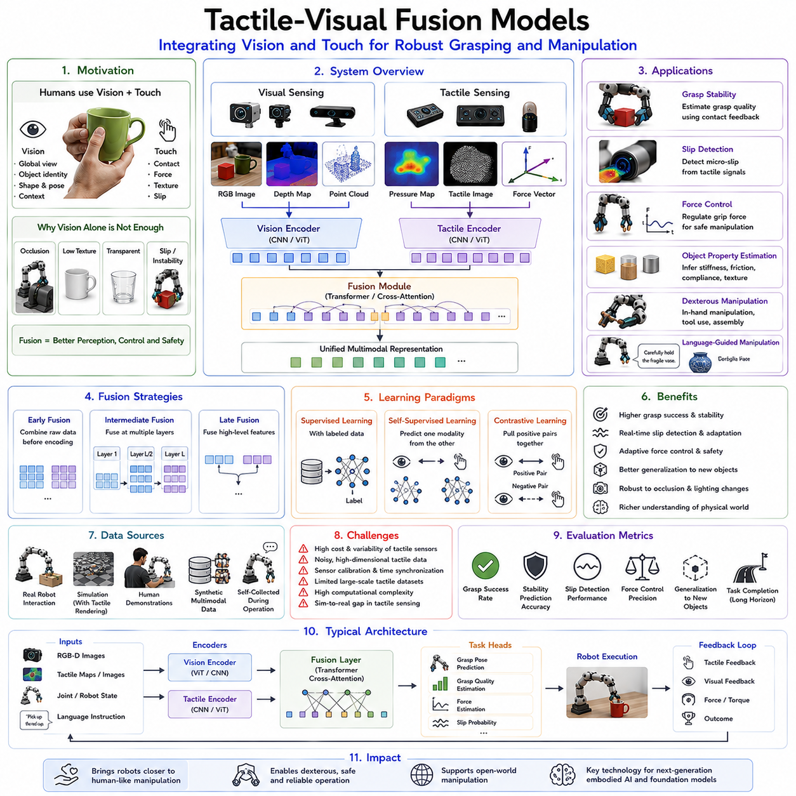{width="7.268055555555556in" height="7.268055555555556in"}

Tactile-Visual Fusion Models represent one of the most important developments in modern robotic grasping and dexterous manipulation. While vision has traditionally served as the dominant sensing modality for robotic perception, human manipulation relies heavily on the integration of both vision and touch. Humans rarely manipulate objects using vision alone. When grasping a fragile glass, opening a bottle cap, threading a needle, buttoning a shirt, or assembling mechanical components, tactile feedback continuously complements visual information. Vision provides global scene understanding and object recognition, while touch provides local contact information, force estimation, slip detection, texture recognition, and physical interaction awareness. Tactile-Visual Fusion Models aim to replicate this multimodal sensing capability in robotic systems by integrating visual and tactile information into unified representations that support robust grasping, manipulation, and physical reasoning.

Within the Foundation Models for Grasping framework, Tactile-Visual Fusion Models represent a crucial evolution beyond purely vision-based manipulation. Earlier chapters introduced Vision-Language Models, Open Vocabulary Grasping, Language-Conditioned Grasping, Vision-Language-Action architectures, robotic foundation models such as Octo and Pi0, and fine-tuning strategies. While these systems provide powerful semantic understanding and action generation capabilities, they remain limited when interacting with the physical world because vision alone cannot fully observe contact dynamics. Tactile sensing fills this gap by providing direct measurements of interaction forces, deformation, pressure distribution, contact geometry, and slip behavior. Fusion models combine these complementary information sources to create richer representations of physical interaction.

The fundamental motivation behind tactile-visual fusion arises from the limitations of visual perception. Cameras provide detailed information about object appearance, shape, color, texture, and spatial arrangement. However, they cannot directly measure forces, friction, compliance, material properties, or internal object states. Many grasp failures occur because visual information alone is insufficient to determine whether an object is securely held. A robot may visually perceive that a grasp has been achieved while failing to recognize that the object is slipping, deforming, or experiencing excessive force. Tactile sensing provides direct measurements of these hidden interaction variables.

Human manipulation illustrates the importance of tactile-visual integration. When reaching toward an object, vision guides hand movement and identifies potential grasp locations. As contact occurs, tactile receptors immediately begin providing information about pressure, force distribution, texture, temperature, vibration, and slip. The nervous system continuously integrates visual and tactile information to adjust grip forces, correct positioning errors, and maintain stable manipulation. Tactile-Visual Fusion Models seek to replicate this sensor fusion process within robotic systems.

The emergence of high-resolution tactile sensors has significantly accelerated research in this area. Early robotic tactile sensors primarily measured force magnitude through simple pressure-sensitive elements. Modern tactile sensors provide much richer information. Vision-based tactile sensors such as GelSight, DIGIT, FingerVision, TacTip, and related technologies generate detailed images of contact surfaces. These sensors can capture contact geometry, surface texture, deformation patterns, and micro-scale interaction dynamics. As a result, tactile sensing increasingly resembles a form of close-range vision, creating new opportunities for multimodal fusion.

A Tactile-Visual Fusion Model typically receives visual observations and tactile observations simultaneously. Visual inputs often consist of RGB images, depth maps, stereo imagery, or point clouds. Tactile inputs may include pressure maps, force vectors, contact images, vibration signals, strain measurements, temperature readings, or multimodal tactile representations. The model processes these inputs through specialized encoders and subsequently combines them within a shared representation space. This fusion process allows the robot to reason about both the external environment and the physical interaction occurring at contact points.

Fusion strategies vary depending on the application and architecture. Early fusion approaches combine visual and tactile information at the input level. Raw sensory data is merged before feature extraction, allowing the model to learn joint representations directly from multimodal observations. Late fusion approaches process visual and tactile inputs independently before combining higher-level features. Intermediate fusion methods integrate information at multiple stages throughout the network, balancing modality-specific processing with cross-modal interaction.

Transformer architectures have become particularly effective for tactile-visual fusion. Originally developed for natural language processing, transformers provide powerful mechanisms for modeling relationships across heterogeneous data sources. Visual tokens extracted from camera images and tactile tokens extracted from tactile sensors can be processed together within a shared attention framework. Self-attention mechanisms allow the model to identify meaningful relationships between observed object features and tactile interaction patterns. This capability is especially valuable in manipulation tasks involving uncertainty, occlusion, or complex contact dynamics.

One of the most important applications of tactile-visual fusion is grasp stability estimation. Visual information can predict candidate grasp locations, but tactile information provides direct feedback regarding actual grasp quality. During grasp execution, tactile sensors detect pressure distributions and contact forces. The fusion model combines these measurements with visual observations to estimate whether the object is securely held. If instability is detected, the robot can adjust finger positions or grip forces before a grasp failure occurs.

Slip detection represents another major application. Visual perception often struggles to detect subtle object movement within a grasp. Tactile sensors, however, can identify micro-slippage through changes in pressure patterns, vibration signals, or contact geometry. Fusion models combine tactile slip cues with visual object tracking to improve manipulation robustness. This capability is particularly important when handling fragile, deformable, or high-value objects.

Force control benefits significantly from multimodal sensing. Visual information alone provides limited insight into applied forces. Excessive force can damage objects, while insufficient force may result in dropping them. Tactile sensing provides direct force feedback that can be integrated with visual observations to enable adaptive grip control. The robot continuously adjusts applied forces based on both object appearance and contact conditions.

Object property estimation is another important capability enabled by tactile-visual fusion. Vision provides information about object shape and appearance, but tactile sensing reveals material properties such as stiffness, compliance, roughness, elasticity, and friction. By combining these modalities, robots can develop richer object representations. For example, two objects may appear visually similar but possess very different physical properties. Tactile information enables the robot to distinguish between them and select appropriate manipulation strategies.

Dexterous manipulation presents some of the most challenging tasks in robotics and benefits greatly from tactile-visual integration. Activities such as in-hand manipulation, tool use, cable insertion, connector assembly, cloth handling, and precision assembly require continuous feedback regarding object motion and contact conditions. Visual sensing alone often becomes unreliable due to occlusions caused by the robot hand. Tactile sensing provides critical information during these contact-rich interactions. Fusion models combine both modalities to support fine motor control.

Language-conditioned manipulation can also benefit from tactile-visual fusion. Consider an instruction such as "carefully hold the fragile vase." Visual perception identifies the vase and generates an initial grasp plan. Tactile sensing subsequently monitors contact forces during execution. The fusion model ensures that force levels remain within safe limits while maintaining grasp stability. This integration allows robots to satisfy both semantic objectives and physical constraints.

Open Vocabulary Grasping similarly benefits from multimodal representations. Foundation models may identify previously unseen objects based on semantic descriptions and visual appearance. However, unfamiliar objects often possess uncertain physical properties. Tactile sensing enables the robot to infer these properties during interaction. Fusion models combine semantic understanding, visual recognition, and tactile feedback to improve generalization in open-world environments.

Recent advances in self-supervised learning have significantly expanded tactile-visual research. Collecting labeled tactile data is expensive because physical interaction requires robotic hardware. Self-supervised approaches exploit natural correlations between vision and touch. During manipulation, visual observations and tactile signals are generated simultaneously. Models learn to predict one modality from the other, creating rich multimodal representations without requiring extensive manual labeling. This approach dramatically improves scalability.

Contrastive learning has become particularly influential. Visual observations and corresponding tactile measurements are treated as positive pairs, while unrelated observations form negative pairs. The model learns a shared embedding space in which correlated visual and tactile observations occupy nearby locations. These representations support downstream tasks such as grasp planning, object recognition, material classification, and manipulation control.

Foundation models are increasingly incorporating tactile sensing into their architectures. Early robotic foundation models focused primarily on vision, language, and action. Future systems are expected to integrate touch as a first-class modality. Tactile foundation models may learn general representations of physical interaction across many objects, materials, environments, and manipulation tasks. These models could provide transferable tactile knowledge similar to how language foundation models provide transferable semantic knowledge.

Simulation plays an important role in tactile-visual fusion research. High-fidelity simulators now support tactile rendering, contact dynamics modeling, deformable object simulation, and sensor emulation. Researchers can generate large-scale multimodal datasets containing synchronized visual and tactile observations. Sim-to-real transfer techniques subsequently adapt these models to physical hardware. Although accurately simulating tactile sensing remains challenging, continuous improvements are making simulation increasingly valuable.

Robotic grasping serves as an ideal application domain for tactile-visual fusion. Before contact, vision dominates perception because tactile information is unavailable. During initial contact, tactile sensing rapidly becomes important for verifying grasp execution. During manipulation, both modalities contribute continuously. Vision monitors global object motion and environmental context, while touch monitors local interaction dynamics. Fusion models coordinate these information sources throughout the manipulation process.

Safety and robustness are major benefits of multimodal sensing. Single-modality systems remain vulnerable to sensor failures, occlusions, lighting variations, reflective surfaces, transparent materials, and environmental noise. Tactile sensing provides complementary information that remains available even when vision becomes unreliable. Similarly, visual perception provides context when tactile information is ambiguous. Fusion increases resilience by reducing dependence on any single sensing modality.

Industrial applications of tactile-visual fusion are expanding rapidly. Manufacturing robots use fusion models for precision assembly and quality control. Warehouse robots leverage tactile feedback for handling deformable packaging and irregular products. Healthcare robots employ multimodal sensing when interacting with medical instruments and patients. Agricultural robots use tactile sensing to assess crop maturity and prevent damage during harvesting. Service robots rely on fusion models to manipulate household objects safely and effectively.

Evaluation of tactile-visual fusion systems requires metrics extending beyond traditional grasp success rates. Researchers measure grasp stability prediction accuracy, slip detection performance, force control precision, material recognition accuracy, manipulation robustness, cross-object generalization, and long-horizon task completion. Comprehensive benchmarks increasingly incorporate both visual and tactile sensing challenges.

Several challenges remain. High-quality tactile sensors remain expensive and difficult to deploy at scale. Tactile data is often noisy, high-dimensional, and hardware-specific. Synchronizing tactile and visual information requires precise timing and calibration. Large-scale tactile datasets remain relatively limited compared to image and language datasets. Computational complexity also increases as additional sensory modalities are incorporated. Despite these challenges, ongoing advances in sensor technology, machine learning, simulation, and robotic foundation models continue to drive rapid progress.

The future of Tactile-Visual Fusion Models lies in deeper integration with Vision-Language-Action architectures, robotic foundation models, world models, and embodied intelligence systems. Future robots will not simply see and act; they will see, touch, reason, predict, and adapt simultaneously. Multimodal foundation models will likely combine vision, language, touch, force sensing, proprioception, and environmental context within unified representations capable of supporting general-purpose manipulation.

Within the Foundation Models for Grasping framework, Tactile-Visual Fusion Models represent the convergence of semantic intelligence and physical intelligence. Vision provides understanding of the world. Language provides understanding of goals. Touch provides understanding of interaction. The fusion of these modalities creates robotic systems capable of robust, adaptive, and human-like manipulation. As robotic foundation models continue to evolve, tactile-visual fusion is expected to become one of the central technologies enabling truly dexterous and intelligent robotic grasping in complex real-world environments.

## 12.09 World Models for Manipulation

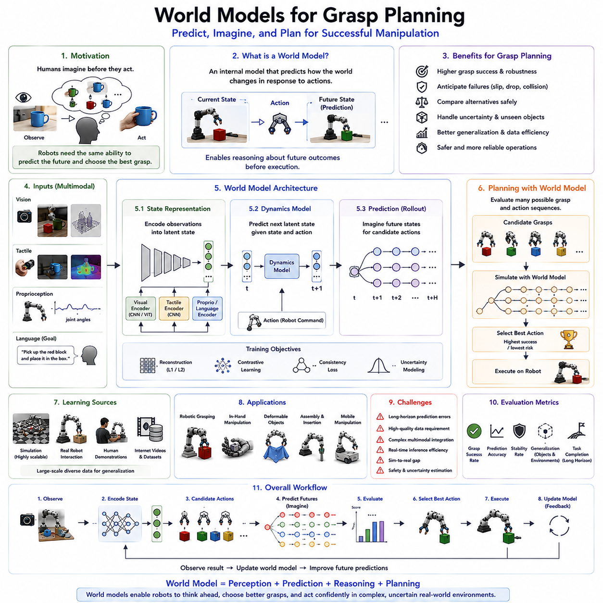{width="7.268055555555556in" height="7.268055555555556in"}{width="7.268055555555556in" height="7.268055555555556in"}

World Models for Grasp Planning represent one of the most significant advancements in the evolution of intelligent robotic manipulation. Traditional robotic grasp planning systems primarily focus on determining stable contact points, generating feasible trajectories, and executing grasp actions based on current observations. While these approaches have achieved considerable success in structured environments, they often struggle when operating in dynamic, uncertain, or previously unseen situations. Humans, by contrast, rarely rely solely on immediate sensory input when planning a grasp. Before touching an object, humans mentally simulate potential interactions, anticipate future outcomes, predict object behavior, and evaluate alternative actions. This internal predictive capability enables robust manipulation even in unfamiliar environments. World Models aim to provide robots with a similar ability by enabling them to construct internal representations of the physical world and predict future states before actions are executed. Within the Foundation Models for Grasping framework, World Models for Grasp Planning represent a transition from reactive manipulation toward predictive manipulation, allowing robots not only to understand the current state of the environment but also to reason about future consequences of their actions.

A world model can be broadly defined as an internal predictive model that estimates how the environment will evolve over time in response to actions. Instead of directly mapping observations to actions, the robot first develops a representation of the world and uses that representation to simulate future possibilities. In robotics, this means predicting how objects will move, rotate, deform, collide, slip, or interact under different manipulation strategies. The robot can evaluate multiple grasp candidates internally before selecting the most promising one. This predictive reasoning significantly improves robustness, safety, and task success rates.

The concept of world models originates from cognitive science and neuroscience. Human beings continuously construct mental models of their surroundings. When reaching for a cup, a person implicitly predicts where the cup will be, how much force is needed to lift it, whether it contains liquid, and how it will respond to contact. These predictions occur rapidly and largely outside conscious awareness. World models in robotics seek to replicate this predictive capability using machine learning, simulation, and large-scale multimodal representations.

Traditional grasp planning systems often operate in a feedforward manner. Sensors observe the environment, perception algorithms identify objects, grasp planners generate candidate grasps, and controllers execute actions. Although effective in controlled settings, this pipeline lacks deep anticipation of future consequences. A grasp that appears stable initially may fail when the object is lifted, rotated, or subjected to external forces. World models address this limitation by explicitly reasoning about future states. Instead of asking only "Can I grasp this object?", the robot also asks "What will happen after I grasp it?"

The emergence of foundation models and large-scale representation learning has dramatically accelerated world model research. Earlier predictive systems relied heavily on handcrafted physics engines and manually designed state representations. Modern world models learn predictive dynamics directly from data. By observing millions of interactions involving diverse objects, materials, environments, and manipulation tasks, these models learn how physical systems evolve over time. This learned knowledge enables robots to generalize beyond predefined scenarios and reason about novel situations.

World models typically consist of three fundamental components. The first is state representation. Raw sensory observations are transformed into a compact latent representation that captures essential information about the environment. This representation may include object positions, shapes, material properties, contact states, robot configurations, and environmental context. The second component is a dynamics model that predicts how the latent state will change in response to actions. The third component is a planning mechanism that evaluates possible future trajectories and selects actions expected to achieve desired goals.

Latent representations play a particularly important role because real-world sensory data is extremely high-dimensional. Cameras generate millions of pixels, tactile sensors produce complex contact measurements, and robot states contain numerous variables. Directly predicting future sensory observations is computationally expensive. World models therefore learn compressed representations that preserve task-relevant information while reducing complexity. These latent spaces often become the foundation for efficient planning and reasoning.

Predictive dynamics are central to world model functionality. Given a current state and a candidate action, the dynamics model estimates future states. In grasp planning, this may involve predicting object motion during lifting, estimating contact stability, forecasting slip events, evaluating force distributions, or anticipating collisions. By repeatedly applying the dynamics model, the robot can simulate entire manipulation sequences before physical execution.

One of the most important advantages of world models is counterfactual reasoning. Counterfactual reasoning allows robots to evaluate hypothetical scenarios without physically executing them. The robot can ask questions such as "What happens if I grasp the object from the side?", "What happens if I increase grip force?", or "What happens if I rotate the object before lifting?" These hypothetical simulations allow the system to compare alternative strategies and choose the most effective one.

World models are particularly valuable in environments characterized by uncertainty. Real-world objects often possess unknown properties. Their mass distribution, friction coefficients, compliance, and structural integrity may not be fully observable. Traditional systems struggle under such uncertainty. World models can maintain probabilistic predictions representing multiple possible futures. Rather than committing to a single prediction, the robot considers a distribution of outcomes and selects actions that remain effective across uncertainty ranges.

The integration of world models with robotic grasp planning enables a more sophisticated understanding of object affordances. Affordances describe the possible interactions supported by an object. Traditional systems often infer affordances from visual appearance. World models go further by predicting the consequences of those interactions. A handle may appear graspable, but the world model can evaluate whether grasping the handle supports subsequent task objectives, maintains stability, and avoids collisions. This predictive affordance reasoning improves decision quality.

Vision plays a critical role in world model construction. Visual observations provide information about object geometry, appearance, spatial relationships, and environmental context. Modern world models frequently employ transformer-based visual encoders to convert images into latent representations. These representations capture both semantic and physical properties relevant to manipulation. Through large-scale pretraining, visual encoders acquire broad knowledge that supports downstream predictive reasoning.

Tactile sensing further enhances world model performance. Vision alone cannot fully observe contact interactions. Once grasping begins, tactile feedback provides information about pressure distributions, slip events, deformation patterns, and force dynamics. Integrating tactile observations into world models enables more accurate predictions of physical interactions. This multimodal approach is particularly important for dexterous manipulation tasks involving uncertainty and complex contact dynamics.

Language has recently emerged as another important component of world models. Vision-Language-Action systems increasingly incorporate language instructions into predictive reasoning. Human commands often specify desired future outcomes rather than immediate actions. Instructions such as "carefully place the glass on the shelf" or "pick up the screwdriver for use" imply future task requirements. Language-conditioned world models can incorporate these objectives into planning, enabling goal-directed prediction and decision making.

Recent advances in transformer architectures have greatly expanded world model capabilities. Transformers excel at modeling long-range dependencies and sequential relationships. In world models, transformers process sequences of observations, actions, and future states. Attention mechanisms enable the model to identify critical relationships among objects, contacts, and environmental events. These capabilities support more accurate long-horizon prediction and planning.

Several influential research directions have contributed to modern world models. Predictive coding approaches focus on forecasting future observations. Latent dynamics models predict compact state representations rather than raw sensory inputs. Generative world models produce multiple possible futures, supporting uncertainty estimation and exploration. Hierarchical world models reason across multiple temporal scales, combining low-level physical dynamics with high-level task planning.

The concept of imagination-based planning is particularly important. Rather than interacting directly with the environment, the robot uses its world model to imagine future trajectories internally. Candidate grasp actions are evaluated through simulated rollouts. The planner selects actions predicted to maximize task success while minimizing risk. This process resembles how humans mentally rehearse actions before execution.

Model Predictive Control (MPC) naturally complements world models. MPC repeatedly predicts future trajectories, evaluates outcomes, and selects optimal actions. World models provide the predictive component required for this optimization process. By continuously updating predictions based on new observations, MPC enables adaptive and responsive manipulation behavior.

Reinforcement learning has become closely connected to world model research. Traditional reinforcement learning often requires enormous amounts of interaction data. World models improve sample efficiency by allowing agents to learn from imagined experiences. Instead of relying exclusively on real-world interactions, robots can generate synthetic experiences within their internal predictive models. This capability significantly accelerates learning while reducing physical wear on robotic hardware.

Simulation environments play a crucial role in training world models. High-fidelity simulators generate large quantities of interaction data covering diverse objects, materials, and manipulation tasks. Simulation provides controlled environments for learning predictive dynamics. Domain randomization and sim-to-real transfer techniques subsequently help bridge the gap between simulated and physical environments.

Foundation models are increasingly influencing world model development. Large-scale multimodal pretraining enables world models to acquire broad semantic and physical knowledge before task-specific adaptation. Future world models may leverage internet-scale video datasets, robotic interaction repositories, and multimodal sensory data to develop increasingly comprehensive understandings of physical reality.

Grasp planning benefits enormously from predictive reasoning. Traditional planners typically evaluate grasps using geometric metrics such as force closure and grasp quality scores. World models extend this evaluation by considering future consequences. The best grasp is not necessarily the one with the highest immediate stability. Instead, the best grasp may be the one that supports future manipulation objectives, minimizes risk, preserves object integrity, and maximizes task success probability.

Manipulation tasks involving deformable objects illustrate this advantage. Objects such as cloth, cables, food items, and soft packaging exhibit complex dynamics that are difficult to model using traditional approaches. World models learn these dynamics directly from data, enabling more effective planning under uncertainty. Similarly, tasks involving liquids, articulated objects, and human interaction benefit from predictive simulation.

Industrial applications of world models are expanding rapidly. Warehouse robots use predictive reasoning to handle diverse inventory items. Manufacturing robots anticipate assembly outcomes before execution. Healthcare robots evaluate safety during patient interaction. Service robots predict object behavior in household environments. Mobile manipulators integrate navigation and manipulation predictions within unified planning frameworks.

Despite their promise, world models face significant challenges. Accurate long-horizon prediction remains difficult because small errors accumulate over time. Learning robust physical representations requires enormous datasets. Multimodal integration introduces additional complexity. Real-time deployment demands efficient inference despite large model sizes. Safety and uncertainty estimation remain critical concerns, particularly in high-stakes environments.

Evaluation of world models extends beyond grasp success rates. Researchers assess prediction accuracy, planning efficiency, uncertainty calibration, generalization to novel environments, robustness under distribution shifts, and long-horizon task completion performance. Comprehensive benchmarking remains an active area of research.

Future world models are expected to integrate vision, language, touch, proprioception, force sensing, and environmental context within unified predictive architectures. These systems will not merely react to observations but will actively anticipate future events, evaluate hypothetical scenarios, and plan accordingly. Such capabilities are essential for achieving truly intelligent robotic manipulation.

Within the Foundation Models for Grasping framework, World Models for Grasp Planning represent the convergence of perception, prediction, reasoning, and action. Vision provides awareness of the present. Language provides understanding of goals. Tactile sensing provides awareness of physical interaction. World models provide understanding of the future. Together, these capabilities create robotic systems capable of moving beyond reactive behavior toward predictive, adaptive, and human-like manipulation. As robotic foundation models continue to evolve, world models are likely to become one of the central technologies enabling robust grasp planning and general-purpose embodied intelligence.

## 12.10 Edge Deployment Strategies

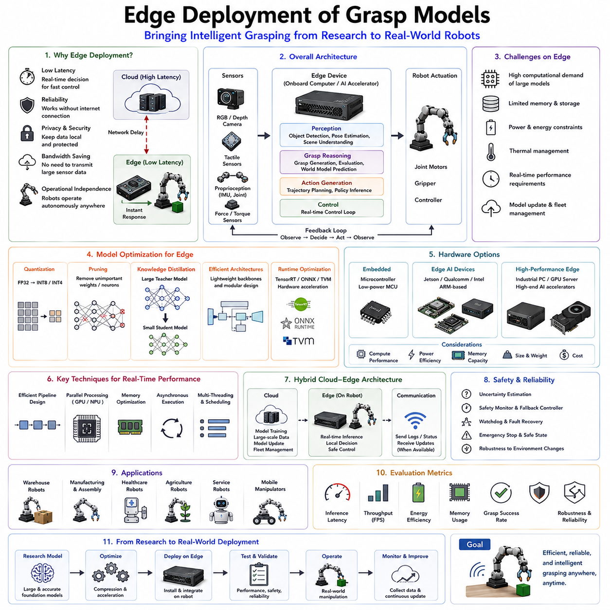{width="7.268055555555556in" height="7.268055555555556in"}

Edge Deployment of Grasp Models represents one of the most important stages in transforming robotic grasping research into practical real-world systems. While modern robotic grasping models have achieved remarkable capabilities through deep learning, foundation models, multimodal perception, Vision-Language-Action architectures, world models, and tactile-visual fusion systems, these advances only become valuable when they can operate reliably on physical robots. In real deployments, robots cannot always rely on cloud computing infrastructure. Many grasping applications require immediate decision-making, low-latency control, continuous operation, privacy protection, network independence, and high reliability. Edge deployment addresses these requirements by bringing computation directly onto the robot platform itself. Instead of sending sensory information to remote servers for processing, grasp models execute locally on embedded processors, edge computers, AI accelerators, and onboard GPU systems. Within the Foundation Models for Grasping framework, Edge Deployment of Grasp Models serves as the bridge between advanced robotic intelligence and practical industrial implementation.

Historically, robotic grasping systems relied heavily on traditional control algorithms and lightweight perception pipelines that could execute on relatively modest hardware. Early industrial robots used handcrafted grasp planning methods, geometric reasoning, force control algorithms, and rule-based decision systems. These approaches required limited computational resources and could operate entirely onboard. However, the emergence of deep learning dramatically changed robotic perception and manipulation. Modern grasping models often contain millions or even billions of parameters. Foundation models integrate vision, language, tactile sensing, world modeling, and action generation within a single architecture. While these systems offer unprecedented capabilities, they also impose substantial computational requirements that challenge deployment on physical robots.

The need for edge deployment arises from several practical considerations. Robotic manipulation operates in real-time environments where delays can significantly impact performance. A grasping robot must continuously observe its surroundings, detect objects, estimate poses, evaluate grasp candidates, predict future interactions, and generate motor commands. These operations often occur within time windows measured in milliseconds. Sending data to cloud servers introduces network latency, bandwidth limitations, packet loss risks, and communication dependencies. Even small delays can degrade grasp stability, reduce responsiveness, and increase failure rates. Edge computing minimizes these delays by performing inference locally.

Latency is one of the most critical performance metrics in robotic grasping. Human manipulation relies on rapid sensorimotor feedback loops. Similarly, robotic systems require fast perception-action cycles. Cameras may operate at 30, 60, or even 120 frames per second. Tactile sensors generate continuous streams of contact information. Control loops often execute at frequencies ranging from hundreds to thousands of hertz. If grasp planning decisions are delayed by network communication or remote processing, the robot may respond too slowly to dynamic changes in the environment. Edge deployment ensures that perception, reasoning, and control remain tightly coupled.

Reliability represents another major motivation. Many industrial environments cannot tolerate dependence on continuous internet connectivity. Manufacturing facilities, warehouses, hospitals, laboratories, agricultural sites, mining operations, military systems, and remote service robots often operate under challenging communication conditions. Cloud-dependent grasping systems become vulnerable to network failures, service outages, cybersecurity incidents, and infrastructure disruptions. Edge deployment enables autonomous operation even when communication links are unavailable.

Privacy and security considerations further encourage edge deployment. Robotic systems frequently process sensitive visual information, operational data, proprietary manufacturing processes, healthcare records, inventory details, and customer interactions. Transmitting such information to external servers introduces privacy concerns and regulatory challenges. Local processing reduces exposure risks while simplifying compliance with security requirements.

The emergence of modern AI accelerators has greatly expanded the feasibility of edge deployment. Early robotic systems relied primarily on CPUs for computation. Contemporary robotic platforms increasingly incorporate GPUs, neural processing units (NPUs), tensor processing units (TPUs), FPGA accelerators, and specialized AI inference hardware. These devices provide substantial computational capabilities while maintaining acceptable power consumption and physical size. As a result, sophisticated grasping models can increasingly execute directly on mobile robots and robotic manipulators.

Edge deployment hardware spans a wide spectrum of computational capabilities. At the lightweight end, embedded processors such as microcontrollers support simple control tasks and sensor processing. Mid-range platforms include devices such as NVIDIA Jetson modules, Qualcomm robotics processors, Intel edge AI platforms, and ARM-based embedded computers. High-performance edge systems incorporate workstation-class GPUs, industrial edge servers, and specialized AI appliances. The selection of hardware depends on task complexity, latency requirements, power constraints, thermal limitations, and deployment costs.

Modern robotic grasping often relies on computer vision as its primary sensing modality. Vision-based grasp models require substantial computational resources because they process high-resolution images, depth maps, point clouds, and multimodal sensory inputs. Object detection, segmentation, pose estimation, grasp candidate generation, and action prediction may all operate simultaneously. Edge deployment therefore requires careful optimization of visual processing pipelines to achieve real-time performance.

Depth perception introduces additional computational challenges. RGB-D cameras, stereo vision systems, structured-light sensors, time-of-flight cameras, and LiDAR devices generate large quantities of geometric information. Grasp models must process these data streams efficiently while maintaining accurate object understanding. Edge deployment architectures frequently incorporate dedicated perception pipelines that balance computational efficiency with prediction accuracy.

Foundation models have introduced new deployment challenges. Large Vision-Language Models, Vision-Language-Action systems, Octo, Pi0, RT-X, RT-2, and future embodied AI architectures often contain billions of parameters. Direct deployment of these models on edge hardware is frequently impractical due to memory limitations, inference latency, power consumption, and storage constraints. Consequently, edge deployment increasingly depends on model optimization techniques.

Model compression plays a central role in enabling edge deployment. Compression techniques reduce memory requirements while preserving performance. Quantization is one of the most widely used approaches. Instead of storing parameters using high-precision floating-point representations, quantized models employ lower-precision formats such as INT8, INT4, or mixed-precision arithmetic. This significantly reduces memory usage and accelerates inference without substantially degrading grasping performance.

Pruning provides another important optimization strategy. Large neural networks often contain redundant parameters that contribute little to prediction accuracy. Pruning removes unnecessary connections, neurons, channels, or layers. The resulting model requires fewer computations and less memory while retaining most of its capabilities. Structured pruning is particularly attractive for robotic deployment because it aligns well with hardware acceleration.

Knowledge distillation has become increasingly important for grasp model deployment. In this approach, a large teacher model transfers knowledge to a smaller student model. The student model learns to mimic the behavior of the larger system while requiring significantly fewer computational resources. Distillation enables compact grasping models to capture much of the intelligence present in foundation-scale architectures.

Low-rank adaptation techniques, parameter-efficient tuning methods, and modular architectures further improve deployment efficiency. Instead of deploying enormous monolithic models, robotic systems increasingly utilize compact specialized components optimized for particular tasks. These modular approaches reduce computational requirements while maintaining flexibility.

Runtime optimization is equally important. Modern inference engines such as TensorRT, ONNX Runtime, OpenVINO, TVM, and vendor-specific acceleration frameworks provide substantial performance improvements. These systems optimize computational graphs, fuse operations, exploit hardware parallelism, and reduce memory transfers. As a result, grasping models can achieve significantly higher throughput on edge devices.

Energy efficiency represents a major consideration for mobile robots. Unlike cloud servers with abundant power resources, mobile robotic platforms operate using batteries. Every watt consumed by computation reduces available operational time. High-performance grasping models must therefore balance intelligence with energy efficiency. Edge deployment strategies increasingly consider performance-per-watt as a key optimization objective.

Thermal management becomes particularly important in long-duration deployments. Continuous inference generates heat that can reduce hardware reliability and trigger performance throttling. Robotic platforms often operate in challenging environments with limited cooling capacity. Efficient model design and hardware-aware optimization help mitigate thermal constraints.

Multimodal grasping systems present additional deployment challenges. Modern robotic manipulation increasingly integrates vision, tactile sensing, language understanding, proprioception, force sensing, and world modeling. Each modality introduces additional computational requirements. Edge deployment architectures must coordinate these heterogeneous processing pipelines while maintaining real-time performance.

Tactile-visual fusion models provide a representative example. Cameras generate large image streams, while tactile sensors produce high-frequency contact measurements. Fusion architectures combine these information sources to improve grasp stability and dexterous manipulation. Efficient deployment requires careful scheduling, synchronization, and resource allocation across sensing modalities.

World models introduce further complexity. Predictive reasoning systems simulate future outcomes before actions are executed. These internal simulations require substantial computation, particularly when evaluating multiple candidate grasp trajectories. Edge deployment therefore requires efficient predictive architectures capable of balancing planning depth with computational cost.

Vision-Language-Action systems pose one of the most challenging deployment scenarios. These models combine perception, semantic reasoning, task understanding, and action generation. While cloud infrastructure can easily accommodate large VLA models, edge deployment requires aggressive optimization. Researchers increasingly explore hierarchical architectures in which lightweight edge models perform routine inference while larger models provide periodic strategic guidance.

Hybrid cloud-edge architectures represent an important compromise. In these systems, time-critical grasping operations execute locally, while computationally intensive training, model updates, and long-term planning occur in the cloud. This approach combines the responsiveness of edge computing with the scalability of centralized infrastructure. Many future robotic systems are expected to employ hybrid architectures rather than purely cloud-based or purely edge-based solutions.

Robotic fleets introduce additional deployment considerations. Warehouses, factories, hospitals, and logistics centers may operate hundreds or thousands of robots simultaneously. Updating grasp models across large fleets requires efficient deployment mechanisms, version management, performance monitoring, and continuous improvement pipelines. Edge deployment systems increasingly support fleet-wide learning and distributed model management.

Simulation plays a valuable role in deployment preparation. Before installing models on physical robots, developers evaluate performance under realistic computational constraints. Hardware-in-the-loop simulation enables testing of latency, throughput, memory usage, energy consumption, and thermal behavior. This process reduces deployment risks and accelerates system optimization.

Safety remains one of the most important concerns in edge deployment. Real-world robots interact directly with people, equipment, products, and environments. Edge inference systems must provide predictable behavior under varying computational loads. Fallback controllers, safety monitors, uncertainty estimation mechanisms, watchdog systems, and fault recovery procedures are essential components of deployment-ready grasping architectures.

Evaluation of deployed grasp models extends beyond traditional academic benchmarks. Researchers and engineers assess inference latency, throughput, energy efficiency, memory usage, thermal stability, fault tolerance, robustness, deployment cost, maintainability, and long-term reliability. Successful deployment requires balancing these engineering considerations against raw grasping performance.

Industrial applications illustrate the importance of edge deployment. Warehouse robots require rapid picking decisions under dynamic inventory conditions. Manufacturing robots must execute precision assembly operations with minimal latency. Healthcare robots need reliable operation in safety-critical environments. Agricultural robots often operate in remote locations with limited connectivity. Service robots must respond naturally to human interactions without dependence on external infrastructure. In each case, edge deployment enables practical operation.

The future of edge deployment will be shaped by advances in AI hardware, foundation models, and embodied intelligence. Next-generation accelerators will provide greater computational capabilities at lower power consumption. Model architectures will become increasingly efficient through hardware-aware design. Foundation models will incorporate adaptive inference mechanisms that allocate computation dynamically according to task requirements. Distributed intelligence frameworks will allow robots to share knowledge while maintaining local autonomy.

Within the Foundation Models for Grasping framework, Edge Deployment of Grasp Models represents the final step in transforming advanced robotic intelligence into practical robotic capability. Foundation models provide understanding. Tactile-visual fusion provides physical awareness. World models provide predictive reasoning. Edge deployment enables these capabilities to operate in real-world robots. As robotic systems continue to evolve toward general-purpose embodied intelligence, efficient edge deployment will remain one of the most important technologies enabling robust, scalable, and commercially viable grasping solutions.

## 12.11 Evaluation and Limitations

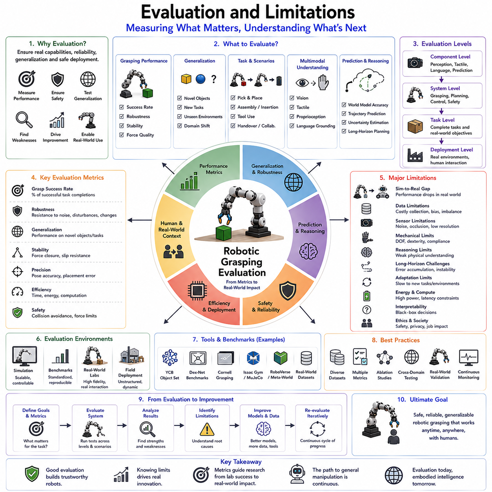{width="7.268055555555556in" height="7.268055555555556in"}

Evaluation and Limitations represent the final and arguably most important stage in the development of robotic grasping systems. Throughout the evolution of robotic manipulation, researchers have proposed increasingly sophisticated approaches, ranging from analytical grasp planning and force-closure methods to deep learning, foundation models, Vision-Language Models, Vision-Language-Action architectures, tactile-visual fusion systems, world models, and embodied intelligence frameworks. Each generation of technology has demonstrated impressive progress in laboratory environments and benchmark datasets. However, the ultimate question remains unchanged: how can we determine whether a robotic grasping system is truly effective, reliable, generalizable, and suitable for deployment in the real world? Evaluation provides the methodology for answering this question, while limitations reveal the boundaries that continue to separate current robotic capabilities from human-level manipulation intelligence.

Within the Foundation Models for Grasping framework, Evaluation and Limitations serve as the concluding chapter because every preceding topic ultimately converges on these two issues. Foundation models, open-vocabulary grasping, language-conditioned manipulation, tactile fusion, world models, and edge deployment all aim to improve robotic performance. Yet without rigorous evaluation, it is impossible to determine whether these improvements represent genuine advances or merely benchmark-specific optimizations. Similarly, understanding limitations is essential because future research directions emerge from identifying the weaknesses of current systems.

The evaluation of robotic grasping has evolved significantly over time. Early grasping systems were often assessed using relatively simple metrics. Researchers primarily measured whether a grasp succeeded or failed. If a robot successfully lifted an object and maintained control for a predefined period, the grasp was considered successful. While such metrics remain useful, they capture only a small fraction of grasping performance. Modern robotic systems operate in complex environments involving diverse objects, dynamic conditions, uncertain sensing, long-horizon tasks, and human interaction. Evaluating these systems requires a much broader perspective.

Grasp success rate remains one of the most fundamental evaluation metrics. This metric measures the percentage of grasp attempts that successfully achieve predefined objectives. For example, a robot may be required to lift an object, transport it to another location, and place it without dropping or damaging it. Success rates provide a simple and intuitive measure of performance. However, they often fail to reveal why failures occur or how systems behave under varying conditions. Two systems may achieve identical success rates while exhibiting very different robustness characteristics.

Robustness evaluation has therefore become increasingly important. A robust grasping system should maintain high performance despite variations in object geometry, material properties, lighting conditions, sensor noise, environmental clutter, and operational disturbances. Robustness reflects the ability to cope with uncertainty rather than merely performing well under ideal conditions. Real-world deployments rarely resemble laboratory environments, making robustness one of the most valuable indicators of practical utility.

Generalization represents another critical evaluation dimension. Many grasping systems perform well on objects encountered during training but struggle when confronted with unfamiliar items. Generalization measures the ability to transfer learned knowledge to novel objects, tasks, environments, and situations. Foundation models have significantly improved generalization capabilities by leveraging large-scale pretraining. Nevertheless, achieving human-like generalization remains a major challenge. Humans can often manipulate previously unseen objects after only a brief visual inspection, whereas robots frequently require extensive adaptation.

Object diversity plays a central role in evaluation protocols. Benchmark datasets often contain hundreds or thousands of objects spanning multiple categories. Researchers assess whether grasping systems can handle rigid objects, deformable objects, articulated objects, transparent objects, reflective surfaces, soft materials, irregular geometries, and fragile items. The broader the object distribution, the more informative the evaluation becomes. True general-purpose manipulation requires competence across an enormous variety of physical entities.

Task diversity has become equally important. Traditional benchmarks focused primarily on pick-and-place operations. Modern robotic systems increasingly perform complex manipulation tasks involving tool use, assembly, insertion, sorting, packaging, folding, handovers, and collaborative interactions. Evaluating performance across diverse tasks provides a more comprehensive assessment of manipulation intelligence. A system that excels at grasping may still struggle with downstream manipulation objectives.

The rise of foundation models has introduced new evaluation challenges. Unlike task-specific systems, foundation models support multiple capabilities simultaneously. A Vision-Language-Action model may perform object recognition, language understanding, grasp planning, manipulation, and task reasoning within a unified architecture. Evaluating such systems requires multidimensional benchmarks that capture interactions among these capabilities. Traditional grasp success rates alone are insufficient.

Language-conditioned manipulation introduces semantic evaluation requirements. Researchers increasingly assess whether robots correctly interpret natural language instructions and execute actions consistent with user intent. Instructions may involve object references, spatial relationships, task goals, safety constraints, or procedural requirements. Evaluating semantic understanding requires measuring both language comprehension and physical execution accuracy.

Open-vocabulary grasping presents additional challenges. Traditional object recognition systems operate on predefined categories. Open-vocabulary systems must handle objects described using arbitrary language expressions. Evaluation therefore measures not only physical grasp success but also semantic grounding performance. The robot must correctly identify the intended object among potentially many alternatives before executing the grasp.

Tactile-visual fusion systems require specialized evaluation methodologies. Traditional vision-based benchmarks cannot adequately assess tactile reasoning. Researchers increasingly measure contact estimation accuracy, slip detection performance, force regulation quality, tactile representation learning, and multimodal fusion effectiveness. These metrics provide insights into the robot's ability to reason about physical interactions beyond visual observation.

World models introduce predictive evaluation criteria. Since world models generate internal simulations of future outcomes, their effectiveness depends on prediction accuracy. Researchers evaluate how accurately predicted states match actual outcomes. Metrics may include trajectory prediction errors, contact prediction accuracy, uncertainty estimation quality, planning effectiveness, and long-horizon forecasting performance. Accurate prediction is essential because planning decisions depend directly on these internal models.

Edge deployment introduces engineering-oriented evaluation metrics. Laboratory research often emphasizes accuracy, whereas deployment requires balancing performance against computational constraints. Inference latency, memory usage, power consumption, thermal stability, throughput, and hardware efficiency become important considerations. A highly accurate model may be impractical if it requires excessive computational resources or cannot operate in real time.

Safety evaluation has emerged as a major research focus. As robots increasingly interact with humans, safety considerations become critical. Evaluation protocols assess collision avoidance, force limitation, uncertainty awareness, fault recovery, and safe failure behaviors. Safety is particularly important in healthcare, manufacturing, service robotics, and collaborative environments. A robot that performs well under normal conditions but behaves unpredictably during failures cannot be considered deployment-ready.

Human-robot interaction introduces additional evaluation dimensions. Collaborative manipulation tasks require robots to interpret human intentions, adapt to dynamic behaviors, and communicate effectively. Researchers evaluate trust, usability, transparency, responsiveness, and user satisfaction alongside traditional performance metrics. Human-centered evaluation recognizes that robotic success depends not only on technical performance but also on effective integration into human workflows.

Simulation-based evaluation remains an essential component of robotics research. Simulators allow large-scale experimentation under controlled conditions. Researchers can systematically vary object properties, environmental conditions, sensor noise levels, and task parameters. Simulation provides reproducibility and scalability that are difficult to achieve in physical environments. However, simulation alone cannot fully capture real-world complexity.

The Sim-to-Real gap remains one of the most persistent limitations in robotic manipulation. Models trained in simulation often experience performance degradation when deployed in physical environments. Differences in sensor characteristics, contact dynamics, friction coefficients, object properties, lighting conditions, and environmental complexity contribute to this gap. Although simulation technology continues to improve, eliminating the Sim-to-Real gap remains an active research challenge.

Benchmark datasets have played a major role in advancing grasping research. Public datasets provide standardized evaluation environments that enable fair comparison among methods. However, benchmarks also introduce limitations. Researchers may unintentionally optimize specifically for benchmark performance rather than real-world effectiveness. As a result, high benchmark scores do not always translate into robust deployment performance. This phenomenon has been observed across machine learning and robotics.

Data limitations represent another significant challenge. Foundation models require enormous quantities of training data. Collecting large-scale robotic interaction datasets is expensive, time-consuming, and technically demanding. Existing datasets often exhibit biases toward particular objects, tasks, environments, or sensing configurations. These biases can limit generalization and introduce hidden weaknesses into learned models.

Sensor limitations continue to constrain robotic capabilities. Cameras suffer from occlusions, reflections, transparent surfaces, poor lighting conditions, and limited depth perception. Tactile sensors remain expensive, fragile, and difficult to integrate. Force sensors, proprioceptive sensors, and multimodal sensing systems each possess their own limitations. Human manipulation benefits from an extraordinarily rich sensory system that current robotic platforms cannot yet replicate.

Mechanical limitations also remain significant. Robotic hands generally possess fewer degrees of freedom, lower dexterity, reduced compliance, and limited tactile resolution compared with human hands. Even the most advanced robotic manipulators struggle to match the adaptability and versatility of human grasping. Hardware limitations therefore constrain the performance achievable by even the most sophisticated AI systems.

Reasoning limitations represent an increasingly important area of study. Foundation models demonstrate impressive semantic capabilities but often lack deep physical understanding. They may generate plausible plans that violate physical constraints, overlook hidden object properties, or fail to anticipate unexpected interactions. While world models and embodied learning approaches seek to address these issues, robust physical reasoning remains an open challenge.

Long-horizon manipulation presents another major limitation. Many grasping systems perform well on individual actions but struggle when tasks require extended sequences of coordinated behaviors. Assembly, cooking, cleaning, maintenance, and household activities often involve dozens or hundreds of interdependent actions. Small errors accumulate over time, causing performance degradation. Long-horizon reasoning remains one of the most difficult challenges in embodied intelligence.

Adaptation limitations also affect current systems. Humans can rapidly adapt to new objects, tools, environments, and tasks. Robots often require extensive retraining, fine-tuning, calibration, or additional demonstrations. Although foundation models have improved adaptability, achieving truly lifelong learning remains an unsolved problem.

Energy efficiency represents a practical limitation. Large foundation models require substantial computational resources. Mobile robots operate under strict power constraints, making deployment challenging. Model compression, quantization, distillation, and edge optimization help mitigate these issues but do not eliminate them entirely.

Interpretability remains another challenge. Deep learning systems often function as black boxes. Understanding why a grasp succeeds or fails can be difficult. This lack of transparency complicates debugging, safety certification, regulatory approval, and human trust. Explainable AI techniques are increasingly being explored to improve interpretability.

Ethical and societal considerations are becoming more prominent as robotic capabilities advance. Widespread deployment of intelligent manipulation systems raises questions regarding workforce transformation, safety regulation, accountability, privacy, and human autonomy. Evaluation frameworks increasingly recognize that technical performance alone is insufficient; societal impact must also be considered.

The future of evaluation will likely move toward holistic assessment frameworks. Rather than measuring isolated capabilities, future benchmarks may evaluate integrated embodied intelligence across perception, reasoning, planning, manipulation, learning, adaptation, collaboration, and safety. Such evaluations would more closely reflect the complexity of real-world robotic operation.

Future research directions are largely defined by current limitations. Improving generalization, reducing data requirements, enhancing tactile intelligence, advancing world models, enabling lifelong learning, strengthening physical reasoning, improving energy efficiency, and increasing interpretability represent key challenges for the next generation of robotic systems. Progress in these areas will move robotic manipulation closer to human-level competence.

Within the Foundation Models for Grasping framework, Evaluation and Limitations provide the foundation for scientific progress. Evaluation establishes objective measures of capability. Limitations reveal opportunities for improvement. Together, they ensure that advances in robotic grasping are both measurable and meaningful. As foundation models, tactile intelligence, world models, and embodied AI continue to evolve, rigorous evaluation and honest recognition of limitations will remain essential for transforming experimental success into reliable real-world robotic intelligence.
