**Volume 06 Robot Hands and Dexterous Grasping**

# 12. Foundation Models for Grasping

## 12.01 Foundation Models in Robotics

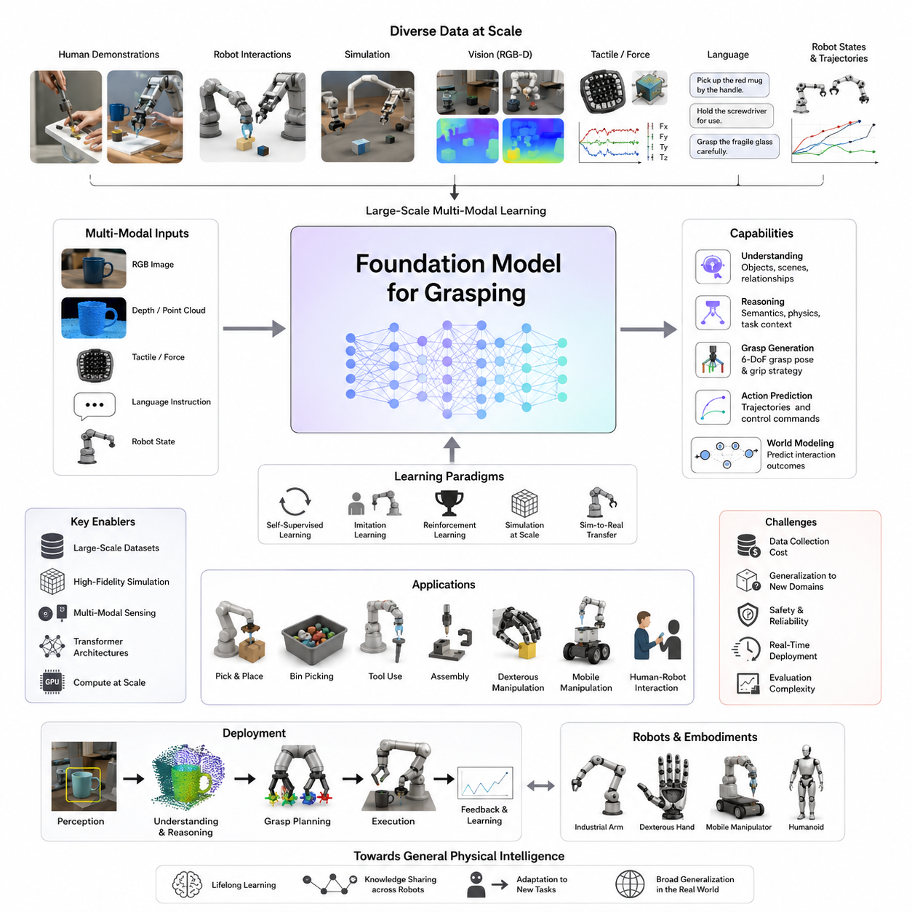{width="7.268055555555556in" height="7.268055555555556in"}

그래스핑(Grasping)을 위한 파운데이션 모델(Foundation Models)은 현대 로봇 매니퓰레이션(Manipulation) 분야에서 가장 중요한 패러다임 변화 중 하나로 평가받고 있다. 전통적인 로봇 그래스핑 시스템은 일반적으로 인식(Perception), 물체 인식(Object Recognition), 자세 추정(Pose Estimation), 그래스프 계획(Grasp Planning), 경로 생성(Motion Generation), 실행(Execution)을 각각 독립적인 모듈로 설계하였다. 이러한 접근법은 구조화된 산업 환경에서는 높은 성능을 달성했지만, 새로운 물체가 지속적으로 등장하고 환경이 변화하는 실제 세계(Open World)에서는 일반화 성능에 한계를 보였다.

파운데이션 모델은 이러한 문제를 해결하기 위해 등장하였다. 이는 다양한 작업(Task), 물체(Object), 환경(Environment), 로봇 플랫폼(Robot Embodiment)에 걸쳐 일반화할 수 있는 대규모 학습 기반 프레임워크이다. 로봇은 더 이상 특정 작업에만 최적화된 시스템이 아니라, 물체를 이해하고, 언어 명령을 해석하며, 적절한 그래스프 전략을 추론하고, 새로운 상황에 적응할 수 있는 방향으로 발전하고 있다. 따라서 파운데이션 모델은 단순한 그래스프 검출기(Grasp Detector)를 넘어 물리적 지능(Physical Intelligence)을 구현하는 핵심 기술로 자리 잡고 있다. 이는 Volume 06의 「Foundation Models for Grasping」 파트의 출발점이 되는 개념적 장(Chapter)이다.

파운데이션 모델이라는 개념은 원래 머신러닝(Machine Learning) 분야에서 시작되었다. 방대한 데이터로 사전 학습된 모델이 다양한 하위 작업(Downstream Tasks)에 활용될 수 있다는 아이디어이다. 자연어 처리(NLP)에서는 대규모 언어 모델(Large Language Models)이 이러한 가능성을 보여주었고, 컴퓨터 비전(Computer Vision) 분야에서는 비전 트랜스포머(Vision Transformer)와 멀티모달 모델(Multimodal Model)이 비슷한 성과를 보였다. 로봇공학 연구자들은 이러한 스케일링(Scaling) 원리를 그래스핑과 매니퓰레이션에 적용하기 시작하였다.

과거에는 물체 종류마다 별도의 그래스프 네트워크를 설계해야 했지만, 파운데이션 모델은 수백만 개의 로봇 시연(Demonstration), 이미지(Image), 비디오(Video), 언어 설명(Language Description), 시뮬레이션 데이터(Simulation Data), 실제 로봇 상호작용 데이터를 통합적으로 학습한다. 그 결과 특정 그래스프 동작만 배우는 것이 아니라 물리적 상호작용 전반에 대한 표현(Representation)을 학습하게 된다.

전통적인 그래스핑 시스템은 대립 그래스프(Antipodal Grasp), 힘 폐쇄(Force Closure), 그래스프 렌치 공간(Grasp Wrench Space), 그래스프 품질 지표(Grasp Quality Metrics)와 같은 명시적 수학 모델에 크게 의존하였다. 반면 파운데이션 모델은 이러한 특성을 직접 계산하기보다는 데이터로부터 암묵적 표현(Implicit Representation)을 학습한다. 시각 정보, 물체 형상, 언어 명령, 촉각 정보, 로봇 동작, 성공 여부 간의 관계를 통계적으로 학습함으로써 훨씬 더 유연한 일반화 능력을 제공한다.

파운데이션 모델의 가장 큰 특징 중 하나는 규모(Scale)이다. 성능은 학습 데이터의 양과 다양성에 크게 의존한다. 최신 로봇 데이터셋은 수백 대의 로봇으로부터 수집된 수백만 개 이상의 조작 궤적(Trajectory)을 포함한다. 데이터는 산업용 로봇, 모바일 매니퓰레이터(Mobile Manipulator), 다지형 로봇 손(Dexterous Hand), 시뮬레이터, 원격 조작(Teleoperation), 인간 시연(Human Demonstration), 자가 학습(Self-Supervised Learning) 등 다양한 출처에서 수집된다.

대규모 데이터셋의 구축은 파운데이션 모델 발전의 핵심 요인이다. 과거에는 수천 또는 수만 개 수준의 그래스프 데이터가 사용되었지만, 최근에는 수백만 개 이상의 그래스프 시도와 조작 경험이 활용된다. 이러한 데이터는 RGB 영상, 깊이 정보(Depth Map), 포인트 클라우드(Point Cloud), 힘/토크 데이터, 촉각 정보, 관절 상태(Joint States), 엔드이펙터 궤적, 언어 명령 등을 동시에 포함한다. 이러한 멀티모달 데이터는 로봇이 물리 세계를 훨씬 풍부하게 이해할 수 있도록 한다.

그래스핑 분야에서 가장 어려운 문제 중 하나는 일반화(Generalization)이다. 기존 시스템은 학습된 물체에서는 높은 성능을 보였지만 새로운 물체에서는 성능이 급격히 저하되는 경우가 많았다. 파운데이션 모델은 의미 정보(Semantics), 기하 정보(Geometry), 물리 정보(Physics)를 동시에 학습하여 이러한 문제를 완화한다. 따라서 특정 물체가 아니라 "도구", "용기", "깨지기 쉬운 물체", "변형 가능한 물체"와 같은 개념 자체를 이해할 수 있게 된다.

언어(Language)의 통합은 그래스핑 시스템에 큰 변화를 가져왔다. 사용자는 더 이상 정확한 좌표를 입력할 필요가 없다. 대신 "손잡이를 잡아서 컵을 들어라", "깨지기 쉬운 유리컵을 조심스럽게 잡아라", "사용하기 좋은 자세로 드라이버를 잡아라"와 같은 자연어 명령을 제공할 수 있다. 모델은 이러한 명령을 이해하고 적절한 그래스프 전략을 생성한다. 언어는 인간의 의도와 로봇 행동을 연결하는 중요한 인터페이스 역할을 수행한다.

멀티모달 학습(Multimodal Learning)은 파운데이션 모델의 핵심 요소이다. 시각 센서는 물체의 외형과 환경 정보를 제공하고, 깊이 센서는 공간 구조를 제공하며, 촉각 센서는 접촉 정보를 제공한다. 힘 센서는 상호작용 역학을 측정하고, 언어는 목표와 제약 조건을 설명한다. 파운데이션 모델은 이러한 다양한 정보를 하나의 통합된 표현 공간(Shared Representation Space)으로 결합하여 인간에 가까운 상황 이해 능력을 형성한다.

특히 비전-언어 모델(Vision-Language Model, VLM)은 그래스핑 연구에서 매우 중요한 역할을 수행하고 있다. 이러한 모델은 물체를 인식할 뿐 아니라 장면(Scene)을 이해하고 의미적 관계를 파악할 수 있다. 예를 들어 "액체가 들어 있는 컵을 집어라"라는 명령을 받으면 단순히 컵을 인식하는 것이 아니라 액체가 흘러넘치지 않도록 적절한 위치를 선택하여 잡을 수 있다. 이는 기하학적 최적화를 넘어 의미 기반 추론(Semantic Reasoning)이 가능함을 의미한다.

최근에는 비전-언어-행동 모델(Vision-Language-Action Model, VLA)이 등장하고 있다. VLA 모델은 시각 입력과 언어 명령을 직접 로봇 행동(Action)으로 연결한다. 기존처럼 인식, 계획, 제어를 별도 모듈로 나누지 않고, 관찰(Observation)과 행동(Action)을 하나의 모델 내부에서 학습한다. 이러한 접근은 시스템 구조를 단순화하면서도 높은 적응성을 제공한다.

트랜스포머(Transformer)는 현재 대부분의 파운데이션 모델의 핵심 아키텍처이다. 원래 자연어 처리를 위해 개발되었지만, 현재는 로봇공학에서도 가장 널리 사용되는 구조가 되었다. 자기 주의(Self-Attention) 메커니즘을 활용하여 장면 내 중요한 영역을 식별하고, 물체 간 관계를 추론하며, 시간에 따른 상호작용을 모델링할 수 있다.

파운데이션 모델은 체화 지능(Embodied Intelligence)과도 깊은 관련이 있다. 체화 지능은 지능이 단순한 계산에서 나오는 것이 아니라 물리 세계와의 상호작용을 통해 형성된다고 본다. 파운데이션 모델은 수많은 로봇 상호작용 데이터를 학습하면서 물체의 외형뿐 아니라 물체가 실제로 어떻게 움직이고 반응하는지를 함께 학습한다. 즉 물리적으로 접지된(Physically Grounded) 지식을 획득하는 것이다.

시뮬레이션(Simulation)은 대규모 파운데이션 모델 개발에서 필수적인 역할을 수행한다. 실제 환경에서 수백만 번의 그래스프 실험을 수행하는 것은 매우 비용이 크기 때문이다. 따라서 최신 연구에서는 Isaac Sim과 같은 고정밀 시뮬레이터를 활용하여 대규모 데이터를 생성한다. 도메인 랜덤화(Domain Randomization)와 Sim-to-Real Transfer 기법을 통해 실제 환경으로의 전이 성능도 향상시키고 있다.

자가 지도 학습(Self-Supervised Learning) 역시 중요한 요소이다. 로봇은 스스로 물체를 집고 놓는 과정에서 성공과 실패 경험을 축적한다. 이러한 경험은 추가적인 인간 라벨링 없이도 학습 데이터가 된다. 따라서 로봇은 시간이 지날수록 더욱 많은 지식을 축적하고 성능을 향상시킬 수 있다.

파운데이션 모델은 장기 작업(Long-Horizon Manipulation)에서도 큰 장점을 제공한다. 기존 그래스프 플래너는 현재 그래스프 성공 여부에 집중했지만, 파운데이션 모델은 이후 수행해야 할 작업까지 고려할 수 있다. 예를 들어 조립(Assembly)을 수행해야 하는 경우 단순히 잡기 쉬운 자세가 아니라 이후 삽입(Insertion)이나 체결(Fastening)에 유리한 자세를 선택할 수 있다.

다지형 손(Dexterous Hand) 제어에서도 파운데이션 모델의 활용 가능성은 매우 크다. 다수의 손가락과 수십 개의 자유도(Degree of Freedom)를 가진 시스템은 기존 제어 방식으로 다루기 어렵다. 파운데이션 모델은 손가락 협조(Finger Coordination), 재파지(Regrasping), 물체 재배향(Object Reorientation), 핑거 게이팅(Finger Gaiting), 인핸드 매니퓰레이션(In-Hand Manipulation)과 같은 복잡한 기술을 데이터 기반으로 학습할 수 있다.

최근에는 월드 모델(World Model)이 중요한 연구 주제로 떠오르고 있다. 월드 모델은 로봇이 행동하기 전에 미래를 예측하는 내부 시뮬레이터 역할을 수행한다. 이를 통해 로봇은 실제 행동 전에 다양한 그래스프 후보를 가상으로 평가하고 실패 가능성을 예측할 수 있다. 이는 안전성과 효율성을 크게 향상시킨다.

그러나 파운데이션 모델에도 여러 한계가 존재한다. 대규모 데이터 수집 비용이 매우 높고, 다양한 로봇 플랫폼 간 차이가 크다. 또한 실제 물리 상호작용은 언어 처리보다 훨씬 복잡하며, 작은 예측 오차도 그래스프 실패나 충돌로 이어질 수 있다.

계산 자원 역시 중요한 제약 요소이다. 수십억 개 이상의 파라미터를 가진 모델은 학습과 추론에 막대한 GPU 자원을 요구한다. 따라서 모바일 매니퓰레이터나 엣지 컴퓨팅 환경에서는 양자화(Quantization), 프루닝(Pruning), 모델 압축(Model Compression) 등의 최적화 기술이 필수적이다.

안전성(Safety)과 신뢰성(Reliability)은 로봇 분야에서 특히 중요하다. 언어 모델의 오류는 텍스트 오류로 끝나지만, 로봇의 오류는 장비 파손이나 인명 사고로 이어질 수 있다. 따라서 불확실성 추정(Uncertainty Estimation), 안전 제약(Safety Constraints), 검증 메커니즘(Validation Mechanisms), 백업 제어(Fallback Control)가 반드시 포함되어야 한다.

평가(Evaluation) 역시 새로운 과제가 되고 있다. 기존 그래스핑 벤치마크는 성공률만 측정했지만, 파운데이션 모델은 일반화 능력, 언어 이해 능력, 추론 능력, 전이 학습 능력, 강건성(Robustness) 등을 종합적으로 평가해야 한다.

산업 현장에서는 이미 물류(Logistics), 제조(Manufacturing), 창고 자동화(Warehouse Automation), 의료(Healthcare), 서비스 로봇(Service Robotics), 모바일 매니퓰레이터 분야에서 파운데이션 모델 도입이 가속화되고 있다. 이러한 시스템은 새로운 제품이 등장해도 빠르게 적응할 수 있으며, 자연어 명령만으로 다양한 작업을 수행할 수 있다.

장기적으로 파운데이션 모델은 인식, 추론, 계획, 기억, 학습, 조작을 하나의 통합 시스템으로 결합하는 방향으로 발전할 것이다. 로봇은 경험을 통해 지속적으로 학습하고, 여러 로봇 간에 지식을 공유하며, 최소한의 재학습만으로 새로운 작업을 수행할 수 있게 될 것이다. 결국 그래스핑은 단순한 물체 집기가 아니라 범용 물리 지능(General Physical Intelligence)의 일부로 발전하게 될 것이다.

Volume 06의 전체 구조에서 본 장은 이후 다루게 될 비전-언어 모델(VLM), 개방 어휘 그래스핑(Open-Vocabulary Grasping), 언어 조건부 그래스핑(Language-Conditioned Grasping), 비전-언어-행동 모델(VLA), Octo 및 Pi0 기반 로봇 파운데이션 모델, 촉각-시각 융합(Tactile-Visual Fusion), 월드 모델(World Model), 엣지 배포(Edge Deployment), 평가 및 한계(Evaluation and Limitations)를 이해하기 위한 핵심 이론적 기반을 제공한다. 향후 로봇 그래스핑 기술의 중심에는 파운데이션 모델이 자리하게 될 것이며, 이는 로봇이 인간 수준에 가까운 적응성과 조작 능력을 획득하는 데 핵심적인 역할을 수행할 것으로 예상된다.

## 12.02 Vision-Language Models for Grasping

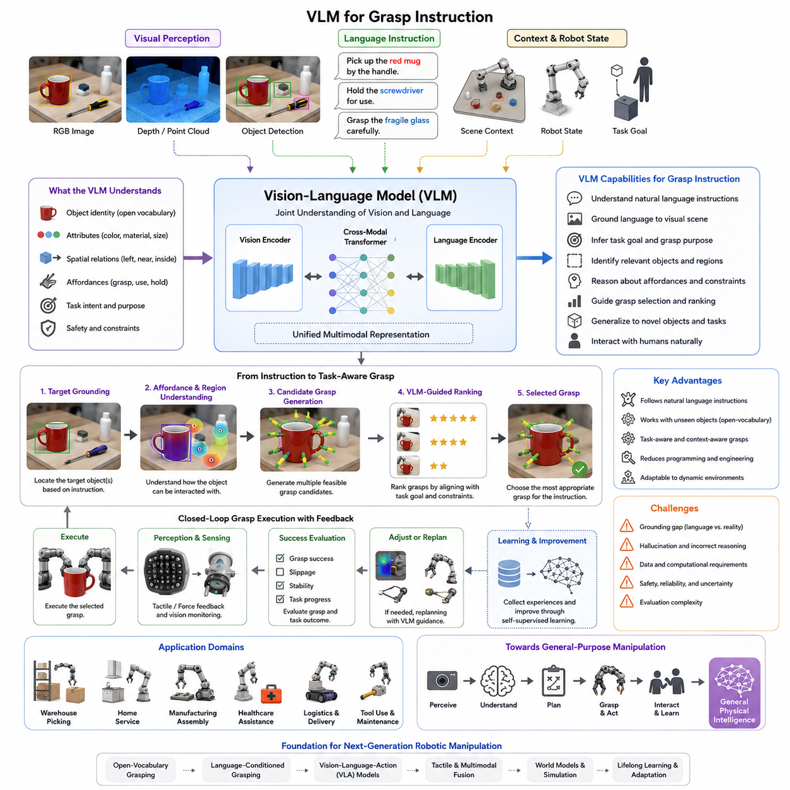{width="7.268055555555556in" height="7.268055555555556in"}

비전-언어 모델(Vision-Language Model, VLM)은 현대 로봇 매니퓰레이션(Manipulation), 특히 로봇 그래스핑(Grasping) 분야에서 가장 혁신적인 기술 중 하나로 평가받고 있다. 기존의 그래스핑 시스템은 주로 기하학적 분석(Geometric Reasoning), 물체 인식(Object Detection), 자세 추정(Pose Estimation), 그래스프 계획(Grasp Planning) 등을 기반으로 동작하였다. 이러한 방법은 산업 현장의 구조화된 환경에서는 높은 성능을 보였지만, 인간의 의도를 이해하거나 자연어 명령을 해석하고 새로운 물체를 다루는 데에는 한계가 있었다. VLM은 시각 정보와 언어 정보를 하나의 통합된 모델에서 처리함으로써 이러한 문제를 해결한다. 즉, 로봇이 단순히 무엇을 보는지를 넘어 인간이 무엇을 원하는지를 이해할 수 있도록 만들어 준다. 이는 단순한 물체 파지가 아니라 목적 중심(Task-Oriented)의 그래스핑을 가능하게 하는 핵심 기술이며, 이후의 Open-Vocabulary Grasping, Language-Conditioned Grasping, Vision-Language-Action(VLA) 모델로 이어지는 중요한 출발점이 된다.

전통적인 그래스프 계획은 기본적으로 기하학적 최적화 문제로 정의되었다. 로봇은 물체의 형상, 마찰 계수, 접촉점 위치, 힘 폐쇄(Force Closure) 조건 등을 고려하여 가장 안정적인 파지 위치를 찾는다. 그러나 이러한 방법은 "어떻게 잡을 것인가"는 결정할 수 있지만 "왜 그렇게 잡아야 하는가"는 설명하지 못한다. 예를 들어 컵(Cup)은 손잡이(Handle), 몸체(Body), 바닥(Base), 가장자리(Rim) 등 여러 위치를 잡을 수 있다. 기하학적으로는 모두 안정적인 그래스프일 수 있지만, 마시기 위한 경우, 세척을 위한 경우, 사람에게 전달하기 위한 경우에는 각각 다른 그래스프 전략이 필요하다. VLM은 이러한 목적과 의미를 이해함으로써 단순한 안정성 중심의 그래스프를 넘어 목적 기반의 그래스프를 생성할 수 있다.

VLM은 시각 정보와 언어 정보를 동시에 학습하는 인공지능 모델이다. 대규모 이미지-텍스트(Image-Text) 데이터셋을 활용하여 사전 학습(Pretraining)되며, 이를 통해 물체, 장면, 인간 행동, 공간 관계, 속성(Attribute), 기능(Function)에 대한 폭넓은 지식을 습득한다. 이러한 지식은 로봇 시스템에 적용될 때 매우 강력한 의미 기반 추론 능력을 제공한다. 예를 들어 로봇은 "빨간 머그컵의 손잡이를 잡아라", "깨지기 쉬운 유리잔을 조심스럽게 집어라", "사용하기 좋게 드라이버를 잡아라", "파란 상자 옆에 있는 물체를 집어라"와 같은 자연어 명령을 이해할 수 있다. 이러한 작업은 단순한 시각 인식만으로는 불가능하며 언어적 의미 해석이 반드시 필요하다.

VLM이 그래스핑 분야에 제공하는 가장 중요한 기능 중 하나는 작업 인식 기반 그래스프 생성(Task-Aware Grasp Generation)이다. 기존 그래스프 플래너는 그래스프 안정성만을 최적화했지만, VLM은 이후 수행될 작업까지 고려한다. 동일한 물체라도 목적에 따라 그래스프 방식이 달라질 수 있다. 망치를 보관하기 위해 잡을 때는 무게 중심 부근을 잡는 것이 유리하지만, 즉시 사용하기 위해서는 손잡이 부분을 잡아야 한다. 칼(Knife)을 사람에게 전달할 때는 안전하게 손잡이를 건네야 하지만, 절단 작업을 수행할 때는 기능적인 자세로 파지해야 한다. VLM은 언어 명령과 장면 정보를 결합하여 이러한 차이를 이해하고 적절한 그래스프를 선택한다.

언어 이해(Language Understanding)는 VLM의 핵심 능력이다. 인간의 명령은 종종 모호하거나 불완전하다. 예를 들어 "병을 가져와라"라는 명령에는 어떤 병인지, 어디에 있는지, 어떤 방식으로 전달해야 하는지가 명시되어 있지 않다. VLM은 장면을 분석하고 언어 정보를 결합하여 이러한 모호성을 해소한다. 이를 통해 적절한 물체를 선택하고, 적절한 그래스프 전략을 결정하며, 목적에 맞는 조작 행동을 수행할 수 있다.

어포던스(Affordance) 개념은 VLM 기반 그래스핑에서 매우 중요한 역할을 한다. 어포던스란 특정 물체가 제공하는 가능한 행동을 의미한다. 인간은 컵은 잡을 수 있고, 의자는 앉을 수 있으며, 버튼은 누를 수 있고, 드라이버는 돌릴 수 있다는 사실을 자연스럽게 이해한다. 기존 로봇 시스템에서는 이러한 지식을 수작업으로 정의해야 했지만, VLM은 대규모 데이터 학습을 통해 어포던스를 스스로 학습한다. 따라서 처음 보는 물체에 대해서도 적절한 파지 위치와 사용 방식을 추론할 수 있다.

VLM 기반 그래스핑의 또 다른 장점은 개방형 환경(Open-World Environment)에 대한 대응 능력이다. 기존 객체 인식 시스템은 사전에 학습된 클래스(Class)에만 대응할 수 있었다. 반면 VLM은 언어 기반 표현을 사용하기 때문에 학습 데이터에 존재하지 않았던 새로운 물체도 자연어 설명을 통해 이해할 수 있다. 이는 실제 산업 환경이나 서비스 로봇 환경에서 매우 중요한 특징이다.

멀티모달 추론(Multimodal Reasoning)은 VLM의 또 다른 핵심 특징이다. 성공적인 그래스핑은 시각 정보만으로 이루어지지 않는다. RGB 카메라는 외형과 색상을 제공하고, 깊이 센서는 3차원 형상을 제공하며, 촉각 센서는 접촉 정보를 제공한다. 언어는 작업 목표를 설명한다. VLM은 이러한 다양한 정보를 하나의 통합된 표현 공간으로 결합하여 더 정교한 의사결정을 수행한다. 예를 들어 "깨지기 쉬운 꽃병을 조심스럽게 들어라"라는 명령을 받으면 물체 인식, 파지 위치 선정, 힘 제어, 충돌 회피를 동시에 고려할 수 있다.

트랜스포머(Transformer)의 발전은 VLM의 성장을 크게 가속화하였다. 트랜스포머는 주의 메커니즘(Attention Mechanism)을 통해 이미지 내 중요한 영역을 식별하고 이를 언어 개념과 연결할 수 있다. 예를 들어 "공구함 왼쪽에 있는 노란 드라이버를 집어라"라는 명령을 받으면 모델은 공구함, 노란색, 드라이버, 왼쪽이라는 개념을 연결하여 정확한 물체를 찾을 수 있다. 이러한 능력은 복잡한 작업 환경에서 매우 강력한 성능을 제공한다.

대규모 사전 학습(Large-Scale Pretraining)은 VLM 성능의 핵심 원천이다. 대부분의 VLM은 인터넷 규모의 이미지-텍스트 데이터셋으로 학습된다. 이를 통해 방대한 세계 지식을 습득한 후, 로봇 조작 데이터로 추가 학습(Fine-Tuning)을 수행한다. 이러한 방식은 일반적인 시각-언어 지식과 물리적 상호작용 지식을 결합할 수 있도록 해준다.

명령 수행(Instruction Following)은 VLM이 제공하는 가장 실용적인 기능 중 하나이다. 사용자는 로봇에게 복잡한 제어 명령을 제공할 필요 없이 자연어로 목표를 설명할 수 있다. "식사용 숟가락을 가져와라", "배송할 박스를 집어라", "삽입 작업을 위해 커넥터를 잡아라"와 같은 명령은 구체적인 동작이 아니라 목표를 설명한다. VLM은 이러한 목표를 이해하고 적절한 그래스프 전략으로 변환한다.

인간 중심 조작(Human-Centered Manipulation) 역시 VLM의 중요한 응용 분야이다. 협업 로봇(Collaborative Robot)은 인간과 함께 작업하기 때문에 사회적 규칙과 인간의 기대를 이해해야 한다. 컵을 전달할 때 손잡이를 사용자 쪽으로 향하게 하거나, 공구를 건넬 때 사용하기 쉬운 방향으로 전달하는 행동은 단순한 기하학적 계산만으로는 설명하기 어렵다. 이러한 행동은 의미적 이해와 상황 인식이 필요하며, VLM이 이를 지원한다.

복합 추론(Compositional Reasoning) 또한 VLM의 강점이다. 인간의 명령은 여러 조건을 동시에 포함하는 경우가 많다. 예를 들어 "테이블 위의 빨간 컵을 집되 안에 있는 숟가락은 건드리지 마라"라는 명령은 물체 인식, 공간 관계 이해, 충돌 회피, 그래스프 계획을 동시에 요구한다. VLM은 이러한 복합 조건을 하나의 모델 안에서 처리할 수 있다.

최근 연구에서는 VLM과 기존 그래스프 검출 네트워크를 결합하는 방식이 많이 활용되고 있다. VLM은 물체와 작업 목적을 이해하고, 그래스프 검출기는 실제 파지 위치를 계산한다. 이후 VLM은 여러 그래스프 후보 중에서 작업 목적에 가장 적합한 그래스프를 선택한다. 이러한 하이브리드 구조는 기하학적 안정성과 의미적 추론을 동시에 확보할 수 있다는 장점을 가진다.

시뮬레이션(Simulation)은 VLM 기반 그래스핑 연구에서 중요한 역할을 수행한다. 고정밀 시뮬레이터를 활용하면 수많은 언어 기반 조작 데이터를 생성할 수 있다. 로봇은 가상 환경에서 다양한 명령을 수행하며 학습할 수 있고, 실제 환경에 배치되기 전에 충분한 경험을 축적할 수 있다.

자가 지도 학습(Self-Supervised Learning)도 VLM 발전에 기여하고 있다. 로봇은 다양한 명령을 수행하며 성공과 실패 경험을 축적한다. 이러한 경험은 별도의 인간 라벨링 없이도 학습 데이터로 활용될 수 있으며, 시간이 지날수록 언어 이해 능력과 그래스프 수행 능력을 향상시킨다.

그러나 VLM에는 여전히 여러 도전 과제가 존재한다. 가장 대표적인 문제는 그라운딩(Grounding)이다. 인터넷 데이터로 학습한 언어 개념이 반드시 물리 세계의 특성과 일치하는 것은 아니다. 모델은 컵의 외형은 이해할 수 있지만 실제 무게 중심이나 마찰 특성까지 완벽하게 이해하지 못할 수 있다.

환각(Hallucination) 문제 역시 중요하다. VLM은 실제 존재하지 않는 정보를 추론하거나 잘못된 결론을 내릴 수 있다. 로봇 환경에서는 이러한 오류가 파지 실패나 안전 문제로 이어질 수 있으므로, 신뢰도 평가와 검증 메커니즘이 반드시 필요하다.

계산 복잡도 또한 중요한 문제이다. 최신 VLM은 수십억 개 이상의 파라미터를 가진 경우가 많으며, 대규모 GPU 자원을 요구한다. 모바일 매니퓰레이터나 엣지 컴퓨팅 환경에서는 양자화(Quantization), 프루닝(Pruning), 지식 증류(Knowledge Distillation) 등의 최적화 기법이 필수적이다.

VLM 기반 그래스핑의 평가는 기존 그래스프 성공률만으로 충분하지 않다. 언어 이해 능력, 의미적 추론 능력, 명령 수행 정확도, 개방형 일반화 성능, 작업 성공률, 새로운 환경 적응성 등을 종합적으로 평가해야 한다.

현재 물류(Logistics), 창고 자동화(Warehouse Automation), 제조(Manufacturing), 의료(Healthcare), 서비스 로봇(Service Robot), 모바일 매니퓰레이터(Mobile Manipulator) 분야에서 VLM 기반 그래스핑 기술의 도입이 빠르게 확대되고 있다. 이러한 시스템은 새로운 제품이 등장하더라도 자연어 명령만으로 작업을 수행할 수 있으며, 기존 방식보다 훨씬 높은 유연성을 제공한다.

장기적으로 VLM은 로봇 파운데이션 모델(Robot Foundation Model), 촉각 지능(Tactile Intelligence), 월드 모델(World Model), 비전-언어-행동(VLA) 모델과 결합될 것으로 예상된다. 미래의 로봇은 단순히 그래스프 위치를 찾는 수준을 넘어 인간의 의도를 이해하고, 작업 결과를 예측하며, 경험을 통해 지속적으로 학습하는 범용 물리 지능(General Physical Intelligence) 시스템으로 발전하게 될 것이다.

Volume 06의 전체 구조에서 본 장은 시각 인식과 언어 기반 조작을 연결하는 핵심 장(Chapter)이다. 이 장에서 소개된 개념들은 이후의 Open Vocabulary Grasping, Language-Conditioned Grasping, VLA 모델, Octo 및 Pi0 기반 로봇 파운데이션 모델, 그리고 궁극적으로 범용 로봇 지능 구현을 위한 중요한 기반 기술로 이어진다. 따라서 VLM for Grasp Instruction은 차세대 로봇 그래스핑 기술의 중심을 이루는 핵심 구성 요소라고 할 수 있다.

## 12.03 Open-Vocabulary Grasping

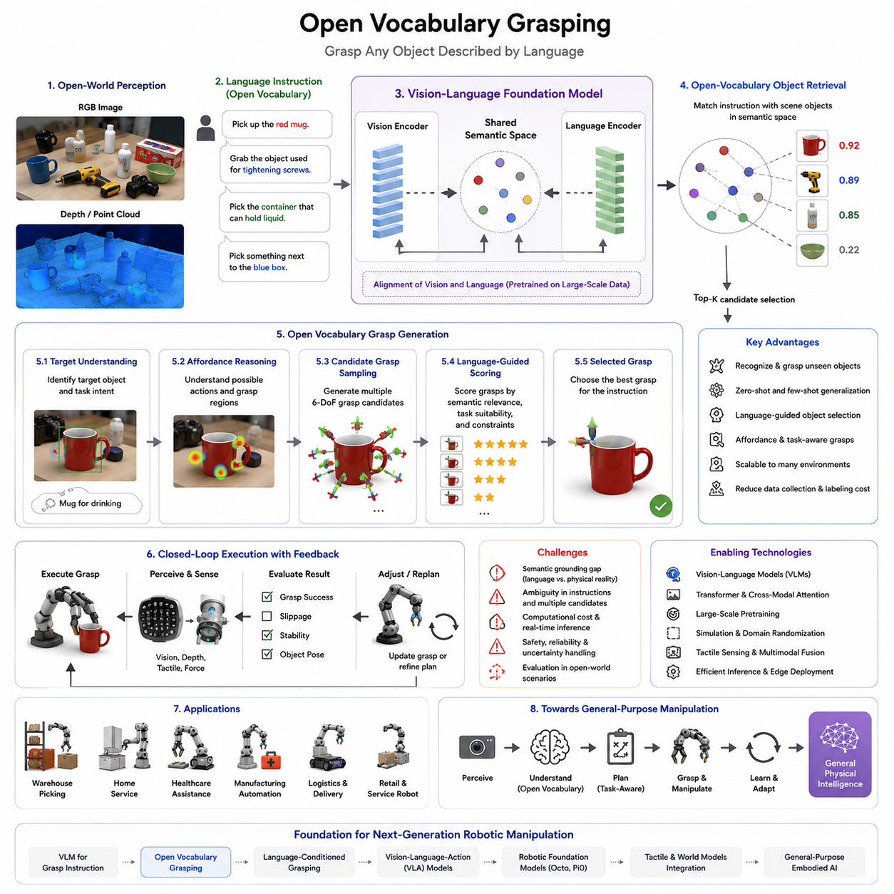{width="7.268055555555556in" height="7.268055555555556in"}

Open Vocabulary Grasping(개방 어휘 기반 그래스핑)은 현대 로봇 매니퓰레이션(Manipulation)과 체화 지능(Embodied Intelligence) 분야에서 가장 중요한 발전 중 하나로 평가받고 있다. 기존의 로봇 그래스핑 시스템은 폐쇄형 세계 가정(Closed-World Assumption)에 기반하여 설계되었다. 즉, 로봇은 학습 과정에서 미리 정의된 물체만 인식하고 조작할 수 있었다. 이러한 시스템은 사전에 정의된 클래스(Class), 수동으로 생성된 라벨(Label), 특정 작업을 위한 모델에 의존하였다. 이러한 방식은 산업 자동화와 같은 구조화된 환경에서는 높은 성능을 보였지만, 실제 환경에서 끊임없이 등장하는 새로운 물체와 변화하는 상황에 적응하기에는 한계가 있었다.

Open Vocabulary Grasping은 이러한 문제를 해결하기 위해 등장하였다. 이 기술은 고정된 물체 분류 체계 대신 언어(Language)와 시각 정보(Vision)를 결합하여 물체를 이해하고 조작할 수 있도록 한다. 로봇은 더 이상 "이 물체가 특정 클래스에 속하는가?"를 판단하는 것이 아니라, 물체의 의미(Semantics), 기능(Function), 시각적 특징(Visual Features), 그래스프 전략(Grasp Strategy)을 하나의 공통 표현 공간(Shared Representation Space)에서 이해한다. 그 결과 학습 데이터에 존재하지 않았던 새로운 물체도 자연어 설명만으로 인식하고 조작할 수 있게 된다. 이는 Vision-Language Model(VLM)과 범용 조작 시스템(General-Purpose Manipulation) 사이를 연결하는 핵심 기술이다.

전통적인 로봇 인식 시스템은 폐쇄형 객체 인식(Closed-Set Recognition)을 기반으로 구축되었다. 예를 들어 컵(Cup), 병(Bottle), 상자(Box), 공구(Tool)와 같은 특정 물체 클래스만 학습한 경우, 새로운 물체가 등장하면 인식 성능이 급격히 저하되었다. 이러한 문제는 로봇이 공장 외부로 확장되면서 더욱 심각해졌다. 창고(Warehouse), 병원(Hospital), 가정(Home), 서비스 환경(Service Environment)에서는 사실상 무한한 종류의 물체가 존재하기 때문이다.

대규모 비전-언어 학습(Vision-Language Learning)의 발전은 이러한 문제를 해결할 수 있는 새로운 가능성을 제시하였다. 물체를 고정된 클래스 번호로 표현하는 대신, 이미지와 언어를 연결하는 의미적 임베딩(Semantic Embedding)을 학습하기 시작한 것이다. 이 접근법에서는 물체를 단순한 클래스가 아니라 자연어 설명으로 표현할 수 있다. 예를 들어 "빨간 머그컵(Red Mug)", "금속 공구(Metal Tool)", "플라스틱 병(Plastic Bottle)", "액체를 담을 수 있는 물체(Object That Can Hold Liquid)"와 같은 설명이 가능하다. 이러한 표현 방식은 Open Vocabulary Manipulation의 기반이 된다.

Open Vocabulary Grasping은 단순한 물체 인식을 넘어 실제 물리적 조작까지 확장된다. 로봇은 어떤 물체를 선택해야 하는지뿐만 아니라, 어디를 잡아야 하는지, 어떻게 잡아야 하는지, 왜 특정 그래스프가 적절한지를 판단해야 한다. 예를 들어 사용자가 "싱크대 옆의 노란 청소 도구를 집어라"라고 말했을 때, 로봇은 해당 물체를 처음 보는 경우에도 시각 정보와 언어 정보를 결합하여 올바른 물체를 식별하고 적절한 그래스프 전략을 생성할 수 있다.

Open Vocabulary Grasping의 핵심 특징 중 하나는 일반화(Generalization) 능력이다. 전통적인 학습 기반 그래스핑 시스템은 학습된 물체에서는 우수한 성능을 보이지만 새로운 물체에서는 성능이 크게 떨어지는 경우가 많았다. 반면 Open Vocabulary Grasping은 클래스 경계가 아니라 의미적 관계를 기반으로 물체를 표현한다. 따라서 비슷한 기능과 형태를 가진 물체들은 임베딩 공간에서 서로 가까운 위치에 존재하게 되며, 이를 통해 새로운 물체에 대한 지식 전이가 가능해진다.

언어(Language)는 이 과정에서 매우 중요한 역할을 수행한다. 인간은 물체를 설명할 때 정식 이름보다 기능, 속성, 관계를 사용하는 경우가 많다. 예를 들어 "커피를 마실 때 사용하는 물체", "파란 상자 옆에 있는 물체", "종이를 자를 수 있는 물건"과 같은 표현을 사용한다. Open Vocabulary Grasping은 이러한 자연어 설명을 이해하고 물체를 찾아낼 수 있다. 이는 단순한 클래스 분류를 넘어 의미 기반 추론(Semantic Reasoning)이 가능함을 의미한다.

어포던스(Affordance) 추론 역시 매우 중요한 요소이다. 인간은 컵은 잡고 마실 수 있으며, 손잡이는 당길 수 있고, 버튼은 누를 수 있다는 사실을 자연스럽게 이해한다. 기존 로봇 시스템은 이러한 정보를 명시적으로 정의해야 했지만, Open Vocabulary Grasping은 대규모 데이터 학습을 통해 어포던스를 암묵적으로 학습한다. 따라서 처음 보는 물체라도 시각적 특징과 의미 정보를 통해 어떻게 상호작용해야 하는지를 추론할 수 있다.

Vision-Language Model(VLM)은 Open Vocabulary Grasping의 핵심 기반 기술이다. 대부분의 시스템은 VLM을 이용하여 시각 정보와 언어 정보를 공통 임베딩 공간(Common Embedding Space)에 매핑한다. 사용자가 자연어 명령을 입력하면, 로봇은 해당 명령과 가장 의미적으로 가까운 물체를 시각적으로 탐색한다. 이를 통해 기존 데이터셋에 존재하지 않았던 물체도 인식할 수 있다.

트랜스포머(Transformer)는 Open Vocabulary 시스템의 핵심 아키텍처이다. 트랜스포머는 시각 정보, 언어 토큰(Token), 공간 관계(Spatial Relationship), 장면 정보(Scene Context)를 통합하여 처리할 수 있다. 예를 들어 "공구함 오른쪽에 있는 빨간 드라이버를 집어라"라는 명령을 받으면 색상, 위치, 물체 종류를 동시에 고려하여 정확한 대상 물체를 식별할 수 있다.

장면 이해(Scene Understanding)는 Open Vocabulary Grasping에서 매우 중요한 역할을 수행한다. 실제 환경에는 다수의 물체, 가림 현상(Occlusion), 복잡한 배경이 존재한다. 예를 들어 "노트북 옆의 컵을 집어라"라는 명령을 수행하기 위해서는 노트북과 컵을 모두 인식하고, 둘 사이의 공간 관계를 이해한 뒤, 주변 물체와 충돌하지 않는 그래스프를 생성해야 한다. 이는 기존의 단순 객체 중심 접근법보다 훨씬 높은 수준의 추론을 요구한다.

멀티모달 학습(Multimodal Learning)은 이러한 능력을 가능하게 한다. RGB 카메라는 외형 정보를 제공하고, 깊이 센서는 기하학적 정보를 제공하며, 언어는 목표와 제약 조건을 제공한다. 촉각 센서는 실제 접촉 정보를 제공한다. 이러한 정보를 하나의 통합된 표현으로 학습함으로써 로봇은 보다 정확한 의사결정을 수행할 수 있다.

대규모 사전 학습(Large-Scale Pretraining)은 Open Vocabulary Grasping 성능의 핵심 요소이다. 파운데이션 모델(Foundation Model)은 수십억 개 이상의 이미지-텍스트 쌍(Image-Text Pair)을 활용하여 학습된다. 이를 통해 방대한 세계 지식(World Knowledge)을 습득하며, 이후 로봇 조작 데이터로 추가 학습(Fine-Tuning)을 수행하여 실제 물리적 상호작용 능력을 획득한다.

Open Vocabulary Grasping의 가장 큰 장점 중 하나는 확장성(Scalability)이다. 기존 방식에서는 새로운 물체가 추가될 때마다 데이터 수집, 라벨링, 재학습이 필요했다. 반면 Open Vocabulary 시스템은 언어 설명만으로 새로운 물체를 다룰 수 있기 때문에 훨씬 효율적이다. 이는 실제 산업 환경에서 매우 큰 비용 절감 효과를 제공한다.

특히 제로샷 그래스핑(Zero-Shot Grasping)은 매우 중요한 기능이다. 제로샷 환경에서는 학습 데이터에 존재하지 않았던 물체를 조작해야 한다. 예를 들어 컵, 병, 용기를 이해하는 로봇은 처음 보는 보온병(Thermos)도 기능적 유사성을 기반으로 성공적으로 조작할 수 있다. 이는 의미적 관계와 기능적 유사성이 학습되었기 때문이다.

퓨샷 적응(Few-Shot Adaptation)은 소수의 예제만으로 새로운 환경에 적응할 수 있게 한다. 이를 통해 의료, 물류, 제조, 서비스 로봇 등 다양한 분야에서 빠른 적용이 가능하다.

Open Vocabulary Grasping은 자연스럽게 작업 인식 그래스핑(Task-Aware Grasping)으로 확장된다. 인간의 명령은 단순히 물체 선택만이 아니라 조작 목적도 포함하는 경우가 많다. "망치를 사용하기 위해 집어라"와 "망치를 공구함에 넣어라"는 서로 다른 그래스프를 요구한다. "칼을 안전하게 건네라"와 "칼로 자르기 위해 잡아라" 역시 전혀 다른 전략을 필요로 한다. Open Vocabulary Grasping은 이러한 의미를 이해하여 목적에 맞는 그래스프를 생성한다.

모바일 매니퓰레이터(Mobile Manipulator)는 이 기술의 대표적인 수혜 분야이다. 창고에서는 새로운 상품이 지속적으로 추가되고, 병원에서는 의료 장비가 계속 변경되며, 가정에서는 물체 배치가 끊임없이 변한다. Open Vocabulary Grasping은 이러한 환경에서 별도의 프로그래밍 없이도 높은 수준의 자율성을 제공한다.

시뮬레이션(Simulation)은 Open Vocabulary 시스템 개발에 중요한 역할을 수행한다. 다양한 물체와 환경을 포함하는 시뮬레이션 데이터를 대규모로 생성할 수 있으며, 도메인 랜덤화(Domain Randomization)를 통해 실제 환경에 대한 일반화 성능도 향상시킬 수 있다.

그러나 Open Vocabulary Grasping에도 여러 도전 과제가 존재한다. 가장 대표적인 문제는 의미적 그라운딩(Semantic Grounding)이다. 언어적 개념이 반드시 물리적 특성과 일치하는 것은 아니다. 예를 들어 "깨지기 쉬운 물체"라는 개념을 이해하더라도 실제로 어느 정도 힘을 가해야 하는지는 별도의 물리적 추론이 필요하다.

모호성(Ambiguity) 또한 중요한 문제이다. 하나의 설명에 해당하는 물체가 여러 개 존재할 수 있으며, 사용자의 의도가 명확하지 않을 수도 있다. 따라서 향후에는 대화 기반 질의응답(Dialog-Based Clarification)이 중요한 기능으로 발전할 가능성이 높다.

안전성(Safety)과 신뢰성(Reliability)은 반드시 고려되어야 한다. 잘못된 물체를 선택하면 작업 실패뿐 아니라 위험한 상황을 초래할 수 있다. 따라서 실제 시스템에서는 의미 기반 추론과 함께 기하학적 검증(Geometric Verification), 충돌 검사(Collision Checking), 그래스프 품질 평가(Grasp Quality Evaluation)가 함께 사용된다.

계산 복잡도 역시 해결해야 할 과제이다. Open Vocabulary 모델은 대규모 파운데이션 모델에 의존하기 때문에 상당한 계산 자원을 요구한다. 모바일 매니퓰레이터나 엣지 디바이스에서는 양자화(Quantization), 프루닝(Pruning), 모델 압축(Model Compression), 하드웨어 가속(Hardware Acceleration)이 필수적이다.

평가 방법 또한 기존 그래스프 성공률만으로는 충분하지 않다. 의미적 이해 능력, 개방형 환경 일반화 성능, 제로샷 능력, 명령 수행 정확도, 작업 성공률, 새로운 환경 적응 능력 등을 종합적으로 평가해야 한다.

현재 Open Vocabulary Grasping은 물류 자동화(Logistics Automation), 창고 로봇(Warehouse Robots), 서비스 로봇(Service Robots), 의료 로봇(Healthcare Robots), 제조 자동화(Manufacturing Automation) 등 다양한 분야에서 빠르게 도입되고 있다. 새로운 제품이 추가되더라도 별도의 재학습 없이 대응할 수 있기 때문에 운영 비용을 크게 절감할 수 있다.

장기적으로 Open Vocabulary Grasping은 로봇 파운데이션 모델(Robot Foundation Model), 월드 모델(World Model), 촉각 지능(Tactile Intelligence), 비전-언어-행동(Vision-Language-Action, VLA) 모델과 통합될 것으로 예상된다. 미래의 로봇은 단순히 물체를 인식하는 수준을 넘어 물체의 기능을 이해하고, 상호작용 결과를 예측하며, 작업 목적에 맞게 행동을 조정할 수 있게 될 것이다. 따라서 Open Vocabulary Grasping은 범용 로봇 조작(General-Purpose Robotic Manipulation)과 궁극적인 물리 지능(Physical Intelligence)으로 나아가는 핵심 단계라고 할 수 있다.

## 12.04 Language-Conditioned Manipulation

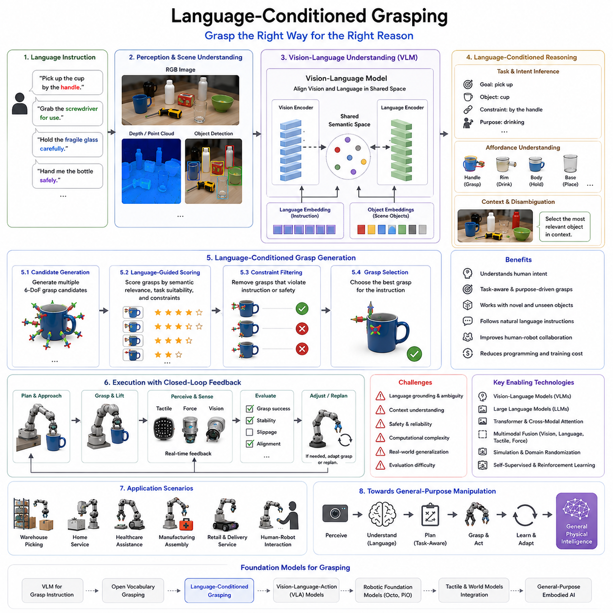{width="7.268055555555556in" height="7.268055555555556in"}

Language-Conditioned Grasping(언어 조건부 그래스핑)은 로봇 매니퓰레이션(Manipulation) 분야의 중요한 진화 단계 중 하나로, 로봇이 단순히 시각 정보와 물리적 제약만을 기반으로 물체를 잡는 것이 아니라 인간의 언어 명령(Language Instruction)을 이해하고 그 의도에 맞추어 그래스프를 수행할 수 있도록 하는 기술이다. 전통적인 그래스핑 시스템은 주로 "어떻게 물체를 잡을 것인가"에 초점을 맞추었다. 이를 위해 기하학적 분석(Geometric Reasoning), 힘 폐쇄(Force Closure), 그래스프 품질 평가(Grasp Quality Evaluation), 시각 기반 그래스프 계획(Perception-Driven Planning) 등이 사용되었다. 이러한 접근 방식은 구조화된 산업 환경에서는 매우 성공적이었지만, 인간의 의도(Intent), 작업 목적(Task Context), 의미(Semantics)를 이해하지 못한다는 한계를 가지고 있었다.

Language-Conditioned Grasping은 이러한 문제를 해결하기 위해 언어를 그래스핑 과정의 핵심 입력으로 활용한다. 언어는 단순한 사용자 인터페이스가 아니라 인식(Perception), 추론(Reasoning), 그래스프 계획(Grasp Planning), 실행(Execution)에 직접 영향을 미치는 조건(Conditioning Signal)으로 작용한다. 결과적으로 로봇의 그래스핑은 단순히 안정적인 파지를 수행하는 것이 아니라 인간의 목적과 의미를 반영한 목표 지향적 행동(Goal-Directed Behavior)이 된다. 이는 VLM(Vision-Language Model)과 Open Vocabulary Grasping 이후 등장하는 보다 발전된 형태의 언어 기반 조작 기술이며, 궁극적으로는 체화 지능(Embodied Intelligence)으로 나아가는 중요한 단계이다.

머신러닝에서 Conditioning(조건화)이란 모델의 행동을 추가 입력에 따라 변화시키는 것을 의미한다. Language-Conditioned Grasping에서는 언어가 바로 이러한 조건 입력 역할을 수행한다. 동일한 물체라도 주어진 언어 명령에 따라 전혀 다른 그래스프 전략이 생성될 수 있다. 예를 들어 컵(Cup)은 마시기 위한 경우, 세척하기 위한 경우, 보관하기 위한 경우, 운반하기 위한 경우, 사람에게 전달하기 위한 경우 각각 다른 방식으로 잡아야 한다. 물체는 동일하지만 목적이 다르기 때문이다. 언어는 이러한 목적 차이를 명확하게 정의해 주는 역할을 한다.

기존 그래스프 플래너는 안정성(Stability), 힘 분배(Force Distribution), 접촉 품질(Contact Quality), 충돌 회피(Collision Avoidance)와 같은 요소를 최적화하였다. 그러나 인간은 그래스프 좌표나 힘 벡터를 사용하여 로봇에게 명령하지 않는다. 대신 "컵 손잡이를 잡아라", "드라이버를 사용하기 좋게 잡아라", "깨지기 쉬운 유리컵을 조심스럽게 들어라", "병을 안전하게 건네라"와 같은 자연어 명령을 사용한다. 이러한 명령에는 단순한 기하학적 정보가 아닌 의미적 제약(Semantic Constraints)이 포함되어 있다. Language-Conditioned Grasping은 이러한 의미 정보를 이해하여 물리적 안정성과 의미적 적합성을 동시에 만족하는 그래스프를 생성한다.

언어는 조작 과정에서 매우 중요한 맥락 정보(Context Information)를 제공한다. 예를 들어 망치(Hammer)를 생각해보자. "망치를 공구함에 넣어라"라는 명령에서는 무게 중심 부근을 잡는 것이 가장 안정적일 수 있다. 반면 "망치를 사용하라"라는 명령에서는 손잡이를 잡아야 한다. "망치를 사람에게 건네라"라는 명령에서는 상대방이 쉽게 받을 수 있도록 손잡이를 향하게 해야 한다. 동일한 물체에 대해 전혀 다른 그래스프 전략이 요구되며, 이러한 차이를 결정하는 것이 바로 언어이다.

언어를 그래스핑 시스템에 통합할 수 있게 된 배경에는 대규모 언어 모델(Large Language Model), 비전-언어 모델(Vision-Language Model), 멀티모달 파운데이션 모델(Multimodal Foundation Model)의 발전이 있다. 이러한 모델들은 이미지, 언어, 물체 특성, 행동 결과 사이의 관계를 학습한다. 대규모 사전 학습(Pretraining)을 통해 획득한 의미적 지식은 로봇 조작 분야로 전이될 수 있으며, 이를 통해 로봇은 물체를 단순한 클래스가 아닌 개념, 기능, 속성, 목적 관점에서 이해할 수 있게 된다.

Language-Conditioned Grasping의 핵심 기술 중 하나는 의미적 그라운딩(Semantic Grounding)이다. 이는 언어 개념을 실제 환경 속 물리적 대상과 연결하는 과정이다. 사용자가 "테이블 위의 빨간 머그컵을 집어라"라고 말하면 로봇은 "빨간색", "머그컵", "테이블"이라는 개념을 이해하고 장면 속에서 해당 물체를 찾아야 한다. 이후 적절한 그래스프 위치를 선택해야 한다. 이 과정에는 시각 인식, 언어 이해, 물체 위치 추정, 그래스프 생성이 모두 포함된다.

이를 위해 대부분의 시스템은 멀티모달 임베딩(Multimodal Embedding)을 사용한다. 이미지와 언어를 동일한 표현 공간(Shared Representation Space)으로 변환하여 의미적으로 유사한 정보가 서로 가까운 위치에 배치되도록 학습한다. 예를 들어 "Coffee Mug"라는 텍스트와 실제 커피 머그컵 이미지는 임베딩 공간에서 가까운 위치에 존재한다. 따라서 로봇은 처음 보는 머그컵이라도 언어 설명을 통해 인식할 수 있다.

Language-Conditioned Grasping의 가장 큰 장점 중 하나는 작업 인식(Task Awareness)이다. 전통적인 그래스프 플래너는 가장 안정적인 그래스프를 찾으려 하지만, 가장 안정적인 그래스프가 반드시 가장 유용한 그래스프는 아니다. 예를 들어 드라이버(Screwdriver)를 축(Shaft) 부분에서 잡으면 안정성은 높지만 나사를 조일 수는 없다. 언어 조건부 그래스핑은 작업 목적을 직접 고려하기 때문에 "사용을 위한 그래스프"와 "보관을 위한 그래스프"를 구분할 수 있다.

어포던스(Affordance)는 Language-Conditioned Grasping과 밀접하게 연결되어 있다. 인간은 손잡이는 잡을 수 있고, 버튼은 누를 수 있으며, 용기는 물건을 담을 수 있다는 사실을 자연스럽게 이해한다. 언어는 종종 이러한 어포던스를 암묵적으로 포함한다. 예를 들어 "컵을 마시기 위해 집어라"는 명령은 컵의 입구를 가리지 않는 그래스프를 의미한다. "칼을 안전하게 잡아라"는 명령은 날 부분을 피하라는 의미를 포함한다. 파운데이션 모델은 대규모 데이터 학습을 통해 이러한 관계를 자동으로 학습한다.

Language-Conditioned Grasping은 계층적 작업 추론(Hierarchical Task Reasoning)도 지원한다. 인간은 종종 저수준 동작이 아니라 고수준 목표를 지시한다. 예를 들어 "식탁을 준비해라"라는 명령은 접시, 컵, 수저 등을 각각 집어 적절한 위치에 배치하는 여러 그래스프 작업으로 분해될 수 있다. 언어 조건부 시스템은 이러한 고수준 목표를 하위 작업으로 분해하고, 각 작업에 적합한 그래스프를 생성할 수 있다.

또한 인간 언어는 본질적으로 모호성(Ambiguity)을 포함한다. "컵을 가져와라"라는 명령은 어떤 컵인지 명확하지 않을 수 있다. Language-Conditioned Grasping은 장면 정보와 문맥(Context)을 활용하여 가장 적절한 대상을 선택하거나, 필요한 경우 사용자에게 추가 질문을 할 수 있다. 이는 자연스러운 인간-로봇 협업(Human-Robot Collaboration)을 가능하게 한다.

트랜스포머(Transformer)의 발전은 이러한 시스템 성능을 크게 향상시켰다. 트랜스포머는 언어 토큰(Token), 이미지 특징(Visual Features), 공간 관계(Spatial Relationships)를 동시에 처리할 수 있다. 예를 들어 "노트북 옆에 있는 파란 병을 집어라"라는 명령에서는 색상, 위치, 물체 종류를 동시에 고려하여 정확한 목표를 선택할 수 있다.

최근에는 대규모 언어 모델(LLM)이 Language-Conditioned Grasping에 결합되고 있다. LLM은 단순히 물체를 찾는 수준을 넘어 목표, 제약 조건, 안전성, 작업 순서를 추론할 수 있다. 예를 들어 "음료를 서빙해라"라는 명령을 받으면 컵을 선택하고, 액체를 흘리지 않도록 운반하며, 사용자가 쉽게 받을 수 있도록 방향을 조정하는 일련의 행동을 계획할 수 있다. 이는 단순한 그래스프 계획을 넘어 인지적 조작(Cognitive Manipulation)에 가까운 능력이다.

실제 시스템에서는 VLM이 인식과 의미 이해를 담당하고, 그래스프 플래너가 후보 그래스프를 생성한다. 이후 언어 조건을 기반으로 후보 그래스프를 평가하고 가장 적절한 그래스프를 선택한다. 이러한 하이브리드 구조는 기하학적 안정성과 의미적 유연성을 동시에 제공한다.

멀티모달 센싱(Multimodal Sensing)은 성능을 더욱 향상시킨다. 시각 센서는 외형과 형상을 제공하고, 촉각 센서는 접촉 상태를 제공하며, 힘 센서는 안정성을 평가한다. 언어는 작업 목적을 제공한다. 이러한 정보를 통합함으로써 로봇은 물리적 안정성과 의미적 적합성을 동시에 만족하는 그래스프를 수행할 수 있다.

Open Vocabulary Grasping은 Language-Conditioned Grasping과 자연스럽게 결합된다. 인간은 종종 물체의 이름이 아니라 기능이나 설명으로 물체를 지정한다. 예를 들어 "종이를 자를 수 있는 물건을 가져와라" 또는 "커피를 담는 용기를 집어라"와 같은 명령이 대표적이다. Language-Conditioned Grasping은 이러한 설명을 이해하여 적절한 물체를 찾고 그래스프를 생성할 수 있다.

시뮬레이션(Simulation)은 Language-Conditioned Grasping 학습에 중요한 역할을 수행한다. 시뮬레이터는 수백만 개의 언어 기반 조작 데이터를 생성할 수 있으며, 다양한 환경과 물체를 포함할 수 있다. 도메인 랜덤화(Domain Randomization)와 Sim-to-Real Transfer 기법은 실제 환경으로의 일반화 성능을 향상시킨다.

자가 지도 학습(Self-Supervised Learning) 역시 중요한 역할을 한다. 로봇은 다양한 언어 명령을 수행하면서 성공과 실패 경험을 축적한다. 성공적인 결과는 언어와 행동 사이의 연결을 강화하고, 실패는 개선의 기회를 제공한다. 이를 통해 시스템은 지속적으로 성능을 향상시킬 수 있다.

그러나 Language-Conditioned Grasping에도 해결해야 할 과제가 존재한다. 가장 큰 문제 중 하나는 언어 그라운딩(Language Grounding)이다. "깨지기 쉬운", "무거운", "조심스럽게"와 같은 표현은 상황에 따라 의미가 달라질 수 있으며, 물리적 특성과 직접적으로 연결되지 않는다. 이러한 추상적 개념을 안정적으로 학습하는 것은 여전히 어려운 문제이다.

모호성과 불확실성(Uncertainty) 역시 중요한 도전 과제이다. 인간의 언어는 종종 불완전하며, 로봇은 추가 추론이나 사용자 확인이 필요한 상황을 판단해야 한다. 특히 안전이 중요한 환경에서는 불확실성을 정확히 평가하는 것이 필수적이다.

계산 자원 또한 중요한 문제이다. 최신 Language-Conditioned 시스템은 대규모 파운데이션 모델을 사용하기 때문에 상당한 메모리와 연산 능력을 요구한다. 모바일 매니퓰레이터나 엣지 시스템에서는 양자화(Quantization), 프루닝(Pruning), 모델 압축(Model Compression), 하드웨어 가속(Hardware Acceleration)이 필요하다.

안전성(Safety)은 특히 중요하다. 언어를 잘못 해석하면 잘못된 물체를 집거나 위험한 행동을 수행할 수 있다. 따라서 실제 시스템에서는 충돌 회피(Collision Avoidance), 그래스프 품질 검증(Grasp Quality Verification), 안전 규칙(Safety Constraints) 등을 함께 사용한다.

Language-Conditioned Grasping의 평가는 단순한 그래스프 성공률만으로는 충분하지 않다. 언어 이해 정확도, 의미적 그라운딩 성능, 작업 성공률, 모호성 처리 능력, 새로운 물체에 대한 일반화 성능, 사용자 만족도 등을 종합적으로 평가해야 한다.

현재 이 기술은 물류(Logistics), 제조(Manufacturing), 의료(Healthcare), 서비스 로봇(Service Robotics), 리테일 자동화(Retail Automation), 가정용 로봇(Home Robotics) 등 다양한 분야에서 빠르게 확산되고 있다. 창고 로봇은 자연어 기반 피킹 작업을 수행할 수 있고, 의료 로봇은 음성 명령을 통해 물품을 전달할 수 있으며, 서비스 로봇은 인간과 자연스럽게 상호작용할 수 있다.

미래의 Language-Conditioned Grasping은 Vision-Language-Action(VLA) 모델, 로봇 파운데이션 모델(Robot Foundation Model), 촉각 지능(Tactile Intelligence), 월드 모델(World Model), 체화 AI(Embodied AI)와 더욱 긴밀하게 통합될 것으로 예상된다. 미래의 로봇은 단순히 명령을 이해하는 수준을 넘어 인간의 의도를 추론하고, 결과를 예측하며, 경험을 통해 스스로 학습하고 적응하게 될 것이다.

Volume 06의 전체 구조에서 Language-Conditioned Grasping은 객체 중심 조작(Object-Centric Manipulation)에서 목표 중심 조작(Goal-Centric Manipulation)으로 전환되는 핵심 기술이다. 로봇은 더 이상 "무엇을 잡을 것인가"만을 결정하는 것이 아니라 "왜 잡아야 하는가", "어떻게 잡아야 하는가", "이후 어떤 작업을 수행해야 하는가"까지 이해하게 된다. 이러한 능력은 범용 로봇 지능(General-Purpose Robotic Intelligence)과 실제 환경에서의 자율적 물리 지능(Physical Intelligence)을 구현하기 위한 필수적인 기반 기술이라고 할 수 있다.

## 12.05 Vision-Language-Action Models

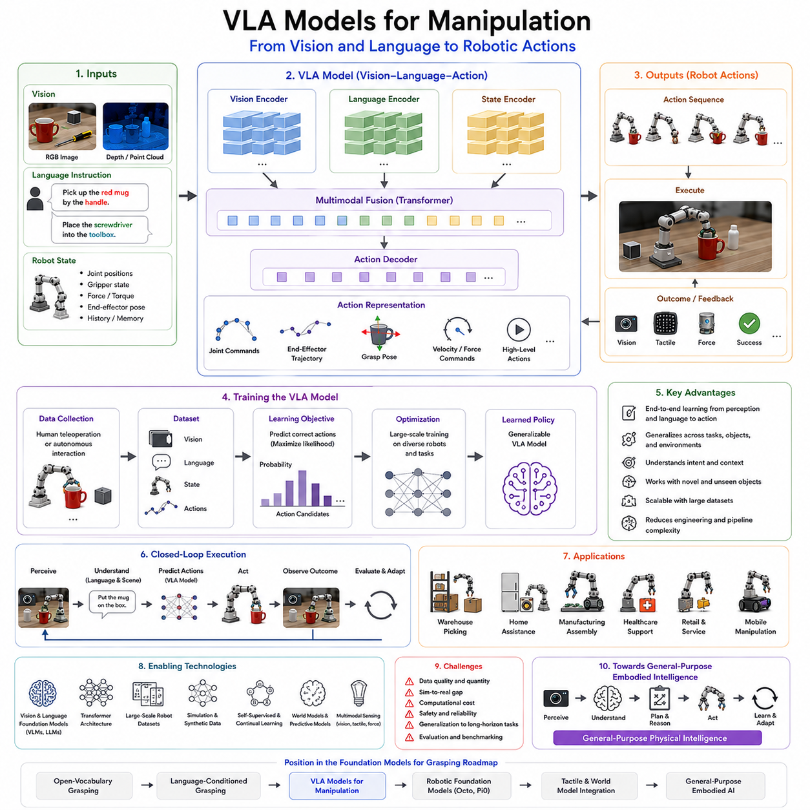{width="7.268055555555556in" height="7.268055555555556in"}

Vision-Language-Action(VLA) 모델은 지능형 로봇 매니퓰레이션(Intelligent Robotic Manipulation)의 발전 과정에서 가장 중요한 기술 중 하나로 평가받고 있다. 비전-언어 모델(Vision-Language Model, VLM)이 로봇에게 장면을 이해하고 인간의 언어 명령을 해석하는 능력을 제공했다면, VLM 자체는 실제 로봇 행동(Action)을 생성하지는 못한다. 기존의 로봇 시스템은 인식(Perception), 추론(Reasoning), 계획(Planning), 제어(Control)를 서로 독립적인 모듈로 구성하는 방식으로 설계되었다. 이러한 모듈형 아키텍처는 산업 자동화 분야에서 높은 성과를 거두었지만, 복잡한 실제 환경에서는 모듈 간 오류 전파(Error Propagation), 높은 통합 비용, 제한적인 적응성이라는 문제를 가지고 있었다.

VLA 모델은 이러한 한계를 극복하기 위해 등장하였다. VLA는 시각 정보(Vision)와 언어(Language)를 입력받아 직접 행동(Action)을 생성한다. 즉, 로봇이 무엇을 보고 있는지, 인간이 무엇을 원하는지를 이해한 후, 이를 곧바로 로봇의 움직임으로 변환한다. 인식, 계획, 실행을 개별적으로 처리하는 대신 하나의 통합 모델이 전체 과정을 학습한다는 점이 핵심이다. 따라서 VLA는 언어 조건부 그래스핑(Language-Conditioned Grasping)을 넘어 의미적 이해를 실제 행동으로 연결하는 기술이며, 범용 물리 지능(General-Purpose Physical Intelligence)으로 가는 중요한 단계라고 볼 수 있다.

VLA 모델의 등장은 자연어 처리와 컴퓨터 비전 분야의 파운데이션 모델(Foundation Model) 성공과 밀접한 관련이 있다. 대규모 언어 모델(LLM)은 방대한 데이터와 대규모 신경망을 활용하면 별도의 프로그래밍 없이도 다양한 작업을 수행할 수 있음을 보여주었다. 이후 비전-언어 모델(VLM)은 이미지와 언어를 동시에 이해할 수 있는 능력을 입증하였다. 로봇공학 연구자들은 이러한 스케일링 법칙(Scaling Law)을 로봇 매니퓰레이션에도 적용할 수 있다고 판단하였다. 그 결과 객체 인식(Object Detection), 그래스프 계획(Grasp Planning), 경로 계획(Motion Planning), 제어(Control)를 각각 별도로 설계하는 대신, 관측(Observation), 명령(Instruction), 행동(Action)의 관계를 직접 학습하는 VLA 모델이 등장하게 되었다.

VLA 모델은 기본적으로 시각 정보, 언어 명령, 그리고 로봇 상태(Robot State)를 입력으로 받는다. 시각 정보는 RGB 이미지, 깊이 영상(Depth Map), 스테레오 영상(Stereo Image), 포인트 클라우드(Point Cloud) 등을 포함할 수 있다. 언어 명령은 목표(Task Goal), 제약 조건(Constraint), 작업 의도(Intent)를 설명한다. 로봇 상태는 관절 위치(Joint Position), 속도(Velocity), 힘/토크 정보(Force/Torque), 그리퍼 상태(Gripper State) 등을 포함한다. 모델은 이러한 정보를 하나의 통합된 표현 공간으로 변환하고, 최종적으로 행동(Action)을 출력한다. 출력은 관절 명령(Joint Command), 엔드이펙터 궤적(End-Effector Trajectory), 그래스프 자세(Grasp Pose), 속도 명령(Velocity Command), 힘 제어 명령(Force Control Command) 등의 형태를 가질 수 있다.

VLA 모델이 제공하는 가장 큰 변화는 명시적 작업 분해(Explicit Task Decomposition)를 제거한다는 점이다. 기존 시스템에서는 객체 인식기, 그래스프 플래너, 경로 생성기, 충돌 회피기, 제어기를 각각 개발해야 했다. 각 모듈은 독립적으로 설계, 검증, 유지보수되어야 했으며, 전체 시스템 통합 과정도 복잡하였다. VLA는 이러한 중간 단계를 데이터 기반으로 학습한다. 즉, 수많은 시연(Demonstration) 데이터를 학습하면서 인식과 행동 사이의 관계를 스스로 형성한다.

체화 학습(Embodied Learning)은 VLA 모델을 이해하는 핵심 개념이다. 언어 모델은 주로 기호(Symbol) 공간에서 동작하지만, 로봇은 실제 물리 세계와 상호작용한다. 로봇의 모든 행동은 환경을 변화시키고, 새로운 관측을 생성하며, 이후 행동에 영향을 미친다. VLA는 이러한 상호작용 데이터를 통해 원인과 결과(Cause and Effect)를 학습한다. 즉, 행동이 환경에 어떤 영향을 미치는지를 직접 경험함으로써 보다 현실적이고 강건한 조작 능력을 획득하게 된다.

대규모 로봇 데이터셋은 VLA 발전의 핵심 기반이다. 과거에는 실제 로봇 데이터를 수집하는 비용이 매우 높았기 때문에 데이터 부족이 큰 문제였다. 최근에는 자동 데이터 수집 시스템과 클라우드 기반 학습 환경이 발전하면서 수백만 개 이상의 로봇 조작 궤적이 수집되고 있다. 이러한 데이터셋에는 영상, 언어 명령, 로봇 상태, 행동 시퀀스, 성공 여부 등이 포함된다. 이를 통해 VLA는 특정 작업을 넘어 보다 일반화된 표현(Generalized Representation)을 학습할 수 있다.

VLA 모델의 중요한 장점 중 하나는 작업 간 일반화(Task Generalization) 능력이다. 기존 시스템은 특정 작업에 특화되어 학습되었기 때문에 새로운 작업에서는 성능이 크게 떨어졌다. 예를 들어 Pick-and-Place에 최적화된 시스템은 서랍 열기(Drawer Opening), 공구 사용(Tool Use), 물체 전달(Object Handover) 등의 작업에서는 성능이 저하될 수 있다. 반면 VLA는 다양한 작업에서 공통적으로 사용되는 조작 원리를 학습하기 때문에 새로운 작업에도 보다 쉽게 적응할 수 있다.

언어 조건(Language Conditioning)은 작업 목표를 지정하는 중요한 수단이다. 인간은 일반적으로 정확한 로봇 경로를 지정하지 않는다. 대신 "컵 손잡이를 잡아라", "드라이버를 공구함에 넣어라", "병을 안전하게 건네라"와 같은 자연어 명령을 사용한다. VLA는 이러한 명령을 해석하고 적절한 행동 시퀀스를 생성한다. 이는 인간-로봇 상호작용(Human-Robot Interaction)을 크게 단순화시킨다.

실제 매니퓰레이션 작업은 장기 계획(Long-Horizon Planning)을 요구하는 경우가 많다. 예를 들어 조립 작업, 선반 정리, 식사 준비와 같은 작업은 여러 단계의 행동을 연속적으로 수행해야 한다. 기존 제어 시스템은 현재 단계에만 최적화되는 경우가 많았지만, VLA는 긴 시간 범위의 관계를 학습함으로써 미래 목표를 고려한 행동을 생성할 수 있다.

트랜스포머(Transformer)는 현재 대부분의 VLA 시스템의 핵심 아키텍처이다. 트랜스포머는 시각 토큰(Visual Token), 언어 토큰(Language Token), 로봇 상태, 행동 이력을 동시에 처리할 수 있다. 자기 주의(Self-Attention) 메커니즘을 통해 현재 작업에 중요한 정보를 선택적으로 활용할 수 있으며, 대규모 로봇 데이터 학습에 매우 적합한 구조를 제공한다.

행동 생성(Action Generation)은 다양한 방식으로 구현될 수 있다. 일부 모델은 직접 모터 명령(Motor Command)을 생성하고, 일부는 엔드이펙터 궤적이나 웨이포인트(Waypoint)를 생성한다. 계층형 구조(Hierarchical Architecture)는 고수준 행동을 생성한 후 이를 저수준 제어 명령으로 변환하기도 한다. 중요한 점은 이러한 행동이 수작업으로 설계된 플래너가 아니라 학습된 모델에서 직접 생성된다는 것이다.

그래스핑(Grasping)을 VLA에 통합하면 상당한 이점을 얻을 수 있다. 기존 그래스프 시스템은 이후 작업과 무관하게 가장 안정적인 그래스프를 선택하는 경우가 많았다. 반면 VLA는 전체 작업 맥락(Context)을 고려한다. 예를 들어 드라이버를 사용하기 위한 그래스프와 사람에게 전달하기 위한 그래스프는 서로 다르다. VLA는 이러한 차이를 이해하고 작업 목적에 맞는 그래스프를 생성한다.

개방형 환경(Open World Environment)에 대한 적응성 역시 중요한 특징이다. 실제 환경에는 학습 데이터에 존재하지 않았던 수많은 물체가 존재한다. VLA는 파운데이션 모델이 학습한 시각-언어 표현을 활용하여 새로운 물체에 대해서도 적절한 행동을 생성할 수 있다. 이는 가정, 병원, 창고, 서비스 환경과 같은 비정형 환경에서 매우 중요한 능력이다.

시뮬레이션(Simulation)은 VLA 학습에 필수적인 도구가 되고 있다. 실제 로봇 데이터만으로는 충분한 학습이 어렵기 때문에, 고정밀 시뮬레이터를 활용하여 대규모 데이터를 생성한다. 최신 시뮬레이터는 접촉 역학(Contact Dynamics), 마찰(Friction), 변형 물체(Deformable Objects), 센서 노이즈(Sensor Noise) 등을 현실적으로 모델링할 수 있다. 도메인 랜덤화(Domain Randomization)와 Sim-to-Real Transfer를 통해 실제 환경으로의 전이 성능도 향상된다.

자가 지도 학습(Self-Supervised Learning)은 VLA 발전을 더욱 가속화한다. 로봇은 스스로 환경과 상호작용하며 데이터를 수집할 수 있다. 성공과 실패 모두 학습 신호로 활용되며, 이를 통해 물리 역학, 물체 어포던스(Affordance), 작업 수행 전략에 대한 이해가 점차 향상된다.

최근에는 여러 대표적인 VLA 시스템이 등장하였다. RT-2, RT-X, Open X-Embodiment, Octo, Pi0 등이 대표적인 예이다. 이들은 인터넷 규모의 시각-언어 데이터와 대규모 로봇 조작 데이터를 결합하여 학습된다. 그 결과 다양한 로봇 플랫폼과 다양한 작업에 대해 강력한 일반화 성능을 보여주고 있다.

RT-2는 로봇 행동을 언어 토큰과 유사하게 표현하는 개념을 도입하였다. 이를 통해 인터넷 데이터에서 학습한 지식을 실제 로봇 행동 생성에 활용할 수 있었다. Open X-Embodiment는 여러 종류의 로봇 데이터를 통합하여 플랫폼 간 지식 공유를 가능하게 하였다. Octo는 공개된 로봇 파운데이션 모델로서 대규모 조작 데이터 학습의 가능성을 보여주었다. Pi0는 보다 효율적인 행동 생성 구조를 통해 확장성을 높였다.

멀티모달 융합(Multimodal Fusion)은 VLA의 핵심 요소이다. 시각 정보는 장면과 물체를 이해하게 하고, 언어는 목표와 제약 조건을 제공한다. 로봇 상태는 현재 상황을 설명하며, 촉각과 힘 센서는 실제 접촉 정보를 제공한다. 이러한 다양한 정보를 통합함으로써 로봇은 보다 정확한 의사결정을 수행할 수 있다.

최근에는 월드 모델(World Model)이 VLA에 결합되고 있다. 월드 모델은 행동에 따른 미래 환경 변화를 예측하는 내부 시뮬레이터 역할을 한다. 이를 통해 로봇은 행동을 실행하기 전에 결과를 예측하고, 실패 가능성을 줄이며, 보다 효율적인 계획을 수립할 수 있다.

물론 VLA에도 여러 도전 과제가 존재한다. 데이터 품질(Data Quality)은 중요한 문제이다. 대규모 데이터셋에는 노이즈, 오류, 일관성 부족 문제가 존재할 수 있으며, 잘못된 행동을 학습할 위험도 있다. 또한 언어 데이터에 비해 로봇 조작 데이터는 수집 비용이 훨씬 높다.

계산 자원 역시 큰 문제이다. 최신 VLA 모델은 수십억 개 이상의 파라미터를 가지며, 학습과 추론에 막대한 GPU 자원을 요구한다. 모바일 로봇이나 엣지 컴퓨팅 환경에서는 양자화, 프루닝, 모델 압축, 하드웨어 최적화가 필수적이다.

안전성(Safety)은 특히 중요하다. 로봇의 행동 오류는 단순한 텍스트 오류가 아니라 충돌, 낙하, 장비 손상, 인명 사고로 이어질 수 있다. 따라서 실제 시스템에서는 안전 계층(Safety Layer), 충돌 회피(Collision Avoidance), 불확실성 추정(Uncertainty Estimation), 백업 제어(Fallback Control)를 함께 사용한다.

평가 방법도 변화하고 있다. 기존에는 단순한 성공률(Success Rate)을 측정했지만, VLA는 일반화 성능, 장기 작업 수행 능력, 언어 이해 능력, 새로운 환경 적응 능력 등을 종합적으로 평가해야 한다.

현재 VLA는 물류 자동화(Logistics Automation), 제조(Manufacturing), 서비스 로봇(Service Robotics), 병원(Hospital), 호텔(Hotel), 창고(Warehouse) 등 다양한 산업 분야에서 활용 가능성이 높게 평가되고 있다. 특히 이동과 조작을 동시에 수행하는 모바일 매니퓰레이터(Mobile Manipulator) 분야에서 큰 잠재력을 가지고 있다.

미래의 VLA는 더욱 방대한 데이터와 더욱 강력한 파운데이션 모델을 기반으로 발전할 것이다. 로봇은 경험을 통해 지속적으로 학습하고, 여러 로봇 간에 지식을 공유하며, 최소한의 재학습만으로 새로운 작업에 적응할 수 있게 될 것이다. 이는 특정 작업 자동화를 넘어 범용 체화 지능(General-Purpose Embodied Intelligence)으로 나아가는 핵심 경로가 될 것으로 예상된다.

Volume 06의 전체 구조에서 VLA Models for Manipulation은 이해(Understanding)에서 행동(Action)으로 이어지는 결정적인 연결 고리이다. VLM은 장면과 언어를 이해하고, Open Vocabulary Grasping은 새로운 물체를 인식하며, Language-Conditioned Grasping은 작업 목적에 맞는 조작을 가능하게 한다. VLA는 이 모든 능력을 통합하여 실제 로봇 행동을 생성한다. 따라서 VLA는 복잡하고 동적인 실제 환경에서 인간과 협력하며 스스로 행동할 수 있는 차세대 로봇 지능의 핵심 기술이라고 할 수 있다.

## 12.06 Octo and Pi0 Architectures

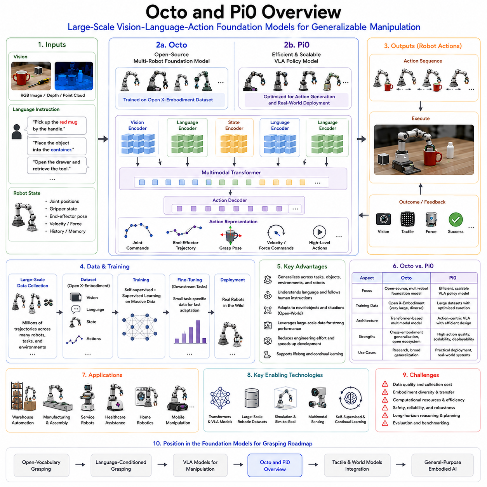{width="7.268055555555556in" height="7.268055555555556in"}

Octo와 Pi0는 대규모 체화 지능(Embodied Intelligence) 시대 초기에 등장한 가장 영향력 있는 로봇 파운데이션 모델(Robotic Foundation Model) 중 두 가지로 평가받고 있다. 이들의 중요성은 단순히 개별 연구 프로젝트를 넘어선다. 왜냐하면 자연어 처리와 컴퓨터 비전 분야에서 성공을 거둔 파운데이션 모델 개념을 실제 로봇 조작(Robotic Manipulation)에 적용할 수 있음을 보여주었기 때문이다. 두 시스템 모두 다양한 환경(Environment), 물체(Object), 로봇 플랫폼(Embodiment)에서 동작할 수 있는 범용 로봇 정책(General-Purpose Robot Policy)을 목표로 한다. 즉, 특정 작업마다 별도의 모델을 만드는 대신, 그래스핑(Grasping), Pick-and-Place, 물체 재배치(Object Rearrangement), 공구 사용(Tool Use), 서랍 조작(Drawer Manipulation), 인간-로봇 상호작용(Human-Robot Interaction) 등 다양한 작업을 하나의 모델이 수행할 수 있도록 하는 것이다.

Foundation Models for Grasping 관점에서 Octo와 Pi0는 Vision-Language-Action(VLA) 시스템이 어떻게 로봇 매니퓰레이션을 특정 작업 중심(Task-Specific Engineering)에서 데이터 중심(Data-Driven Intelligence)의 범용 지능으로 전환할 수 있는지를 보여주는 대표적인 사례이다.

Octo와 Pi0의 등장은 로봇공학 분야에서 오래전부터 존재하던 데이터 단편화(Data Fragmentation) 문제를 해결하려는 시도에서 시작되었다. 과거 로봇 연구는 대부분 특정 로봇, 특정 환경, 특정 작업에 집중하였다. 따라서 학습된 모델은 실험실 환경에서는 우수한 성능을 보였지만 새로운 환경이나 새로운 물체를 만나면 성능이 급격히 저하되는 문제가 있었다. 반면 대규모 언어 모델(LLM)은 다양한 데이터와 공유 표현(Shared Representation)을 통해 여러 분야로 지식을 전이할 수 있음을 보여주었다. 로봇 연구자들은 이러한 스케일링 법칙(Scaling Law)이 로봇 분야에서도 적용될 수 있다고 판단하였고, 그 결과 로봇 파운데이션 모델 연구가 시작되었다.

로봇 분야의 가장 어려운 문제 중 하나는 플랫폼 다양성(Embodiment Diversity)이다. 언어 모델은 모두 텍스트를 처리하지만, 로봇은 형태가 매우 다양하다. 어떤 로봇은 2지 그리퍼(Two-Finger Gripper)를 사용하고, 어떤 로봇은 다지형 손(Dexterous Hand)을 사용한다. 자유도(Degree of Freedom), 운동학 구조(Kinematic Structure), 작업 공간(Workspace), 적재 하중(Payload), 센서 구성(Sensor Configuration)도 모두 다르다. 따라서 한 로봇에서 학습한 정책을 다른 로봇에 그대로 적용하기 어렵다. Octo와 Pi0는 이러한 문제를 해결하기 위해 특정 하드웨어에 종속되지 않는 작업 수준(Task-Level)의 표현을 학습하려고 시도하였다.

Octo는 최초의 대규모 공개형(Open Source) 로봇 파운데이션 모델 중 하나이다. 이 모델은 Open X-Embodiment 프로젝트에서 시작되었다. Open X-Embodiment는 전 세계 여러 연구 기관이 보유한 다양한 로봇 데이터셋을 통합하려는 대규모 협력 프로젝트이다. 다양한 로봇이 수행한 다양한 작업 데이터를 하나의 데이터셋으로 결합함으로써, 역사상 가장 큰 규모의 로봇 조작 데이터셋 중 하나가 만들어졌다. Octo는 이러한 대규모 다중 로봇(Multi-Robot) 데이터를 활용하여 학습된 대표적인 사례이다.

Octo의 가장 큰 특징은 여러 로봇 플랫폼을 동시에 지원할 수 있다는 점이다. 기존의 로봇 정책은 특정 로봇에 최적화되었지만, Octo는 시각 정보, 언어 명령, 로봇 상태를 하나의 공유 표현 공간으로 변환하여 로봇 간 공통 지식을 학습한다. 카메라는 장면을 관찰하고, 언어는 작업 목표를 설명하며, 로봇 상태는 현재 로봇의 자세와 구성 정보를 제공한다. Octo는 이러한 정보를 결합하여 다양한 로봇에 적용 가능한 범용 행동 정책을 생성한다.

Octo의 아키텍처는 트랜스포머(Transformer) 기반으로 구성되어 있다. 카메라로부터 얻은 시각 토큰(Visual Token), 언어 명령을 표현하는 언어 토큰(Language Token), 로봇 상태 임베딩(State Embedding), 과거 행동 정보(Action History)가 하나의 네트워크 안에서 통합된다. 자기 주의(Self-Attention) 메커니즘을 활용하여 현재 작업에 중요한 정보를 선택적으로 활용한다. 이를 통해 여러 물체가 존재하는 복잡한 환경에서도 적절한 조작 전략을 생성할 수 있다.

언어 조건(Language Conditioning)은 Octo에서 매우 중요한 역할을 수행한다. 사용자는 저수준 제어 명령이 아니라 자연어 명령을 사용하여 작업 목표를 지정한다. 예를 들어 "빨간 머그컵을 집어라", "물체를 상자 안에 넣어라", "서랍을 열고 공구를 꺼내라"와 같은 명령이 입력된다. Octo는 이러한 언어 명령을 임베딩 형태로 변환하여 행동 생성 과정 전체에 반영한다. 따라서 별도의 작업별 모델 없이도 다양한 작업을 수행할 수 있다.

Octo의 핵심 목표 중 하나는 일반화(Generalization)이다. 기존의 로봇 정책은 학습 데이터와 유사한 상황에서는 높은 성능을 보였지만 새로운 물체나 환경에서는 성능이 급격히 저하되었다. Octo는 다양한 로봇, 다양한 작업, 다양한 환경에서 수집된 데이터를 활용하여 이러한 문제를 해결하려고 한다. 그 결과 학습 데이터에 존재하지 않았던 물체와 환경에서도 보다 높은 적응성을 보인다.

또한 Octo는 사전 학습(Pretraining)과 미세 조정(Fine-Tuning) 전략을 로봇 분야에 본격적으로 도입하였다. 먼저 대규모 데이터셋을 활용하여 범용 조작 지식을 학습한 후, 특정 작업에 대해서는 적은 양의 데이터만으로 빠르게 적응할 수 있다. 이는 자연어 처리 분야에서 성공한 접근 방식을 로봇에 적용한 대표적인 사례이다.

Pi0는 Octo 이후 등장한 또 다른 중요한 로봇 파운데이션 모델이다. Pi0는 Octo와 마찬가지로 시각, 언어, 행동을 통합하지만, 특히 효율성(Efficiency), 확장성(Scalability), 실제 배치 가능성(Deployability)에 더 큰 초점을 맞추고 있다. Pi0는 초기 로봇 파운데이션 모델이 가지고 있던 계산 비용 문제와 행동 생성 효율성 문제를 해결하기 위해 설계되었다.

Pi0 역시 시각 정보, 언어 명령, 로봇 상태를 입력으로 받아 행동을 생성한다. 그러나 Pi0는 행동 예측(Action Prediction)을 핵심 학습 목표로 설정하였다. 즉, 인식과 추론의 부산물로 행동을 생성하는 것이 아니라, 관측과 행동 사이의 관계를 직접 최적화한다. 이를 통해 보다 일관성 있고 효율적인 행동 정책을 학습할 수 있다.

Pi0의 중요한 특징 중 하나는 행동 표현(Action Representation)에 대한 연구이다. 로봇 행동 공간은 연속적(Continuous)이고 고차원(High-Dimensional)이기 때문에 학습이 어렵다. 단순히 모터 명령을 직접 예측하면 하드웨어 차이에 매우 민감해진다. Pi0는 보다 안정적이고 일반화 가능한 행동 표현 방식을 탐색함으로써 다양한 로봇 플랫폼에 적용 가능한 정책을 학습할 수 있도록 하였다.

Pi0는 멀티모달 학습(Multimodal Learning)을 적극적으로 활용한다. RGB 카메라는 외형 정보를 제공하고, 깊이 센서는 형상 정보를 제공하며, 힘 센서와 촉각 센서는 물리적 상호작용 정보를 제공한다. 언어는 목표와 제약 조건을 설명한다. Pi0는 이러한 정보를 하나의 통합 모델 안에서 학습하여 의미적 정보와 물리적 정보를 동시에 활용할 수 있다.

Pi0는 Vision-Language-Action 모델의 실제 구현 사례라고 볼 수 있다. 관측(Observation)과 언어 명령(Language Instruction)을 입력받고, 직접 행동(Action)을 생성한다. 따라서 인식, 계획, 제어를 별도로 설계할 필요가 줄어들며, 데이터 기반의 End-to-End 학습이 가능해진다.

그래스핑 분야에서 Octo와 Pi0는 매우 중요한 의미를 가진다. 기존 그래스프 플래너는 안정성(Stability)과 힘 폐쇄(Force Closure)에만 집중하는 경우가 많았다. 하지만 실제 환경에서는 작업 목적(Task Context)이 매우 중요하다. 예를 들어 운반을 위한 그래스프, 조립을 위한 그래스프, 공구 사용을 위한 그래스프, 사람에게 전달하기 위한 그래스프는 모두 다르다. Octo와 Pi0는 이러한 차이를 데이터로부터 학습할 수 있다.

Open World Generalization 역시 중요한 장점이다. 실제 환경에는 학습 데이터에 존재하지 않았던 수많은 물체가 존재한다. Octo와 Pi0는 언어와 시각을 결합한 의미적 이해(Semantic Understanding)를 활용하여 새로운 물체에 대해서도 적절한 조작 전략을 생성할 수 있다. 이는 산업용 로봇뿐 아니라 서비스 로봇에도 매우 중요한 능력이다.

Open X-Embodiment와 같은 프로젝트는 Octo와 Pi0의 성공을 가능하게 한 핵심 기반이다. 다양한 로봇에서 수집된 수백만 개 이상의 조작 궤적(Trajectory)이 통합되면서 범용 조작 지식을 학습할 수 있는 환경이 마련되었다. 이러한 대규모 데이터셋 없이는 범용 로봇 지능 개발이 매우 어려웠을 것이다.

시뮬레이션(Simulation) 역시 중요한 역할을 수행한다. 실제 데이터 수집은 비용이 높기 때문에 Isaac Sim과 같은 고정밀 시뮬레이터를 활용하여 대규모 데이터를 생성한다. 도메인 랜덤화(Domain Randomization)와 Sim-to-Real Transfer 기법을 통해 실제 환경으로의 일반화 성능도 향상시킨다.

또한 지속 학습(Continual Learning)은 Octo와 Pi0의 중요한 특징 중 하나이다. 로봇은 새로운 경험을 지속적으로 축적하면서 기존 지식을 유지한 채 성능을 향상시킬 수 있다. 이는 장기적으로 자율적인 로봇 시스템 구축에 매우 중요한 요소이다.

물론 Octo와 Pi0에도 해결해야 할 과제가 존재한다. 데이터 품질(Data Quality)은 여전히 중요한 문제이다. 로봇 데이터는 노이즈가 많고, 시연 품질이 일정하지 않으며, 플랫폼마다 형식이 다르다. 또한 로봇 상호작용 데이터는 이미지나 텍스트 데이터보다 훨씬 비싸게 수집된다.

계산 자원 또한 큰 도전 과제이다. 이러한 모델은 수십억 개 이상의 파라미터를 가질 수 있으며, 학습에 대규모 GPU 클러스터가 필요하다. 실제 로봇에서 실시간으로 동작하기 위해서는 양자화(Quantization), 프루닝(Pruning), 지식 증류(Knowledge Distillation), 하드웨어 가속(Hardware Acceleration)이 필요하다.

안전성(Safety)은 로봇 분야에서 가장 중요한 요소 중 하나이다. 잘못된 행동은 충돌, 장비 손상, 인명 사고로 이어질 수 있다. 따라서 Octo와 Pi0는 불확실성 추정(Uncertainty Estimation), 안전 검증(Safety Verification), 백업 제어(Fallback Control) 등을 포함해야 한다.

평가 방식 또한 변화하고 있다. 단순한 성공률(Success Rate)만으로는 범용 로봇 지능을 평가할 수 없다. 최근에는 작업 간 전이(Cross-Task Transfer), 플랫폼 간 전이(Embodiment Transfer), 언어 이해(Language Understanding), 장기 계획(Long-Horizon Reasoning), 새로운 환경 적응 능력 등을 종합적으로 평가한다.

현재 Octo와 Pi0와 같은 로봇 파운데이션 모델은 창고 자동화(Warehouse Automation), 제조(Manufacturing), 서비스 로봇(Service Robotics), 의료 지원(Healthcare Assistance), 모바일 매니퓰레이터(Mobile Manipulator) 분야에서 큰 관심을 받고 있다. 이러한 시스템은 변화하는 환경에서도 유연하게 적응할 수 있는 잠재력을 보여주고 있다.

미래에는 Octo와 Pi0를 넘어 월드 모델(World Model), 촉각 지능(Tactile Intelligence), 멀티모달 추론(Multimodal Reasoning), 자가 지도 학습(Self-Supervised Learning)이 하나의 통합된 아키텍처로 결합될 것으로 예상된다. 로봇은 물리 세계를 예측하고, 경험으로부터 지속적으로 학습하며, 여러 로봇 간에 지식을 공유하는 방향으로 발전할 것이다.

Foundation Models for Grasping의 전체 구조에서 Octo와 Pi0는 특정 작업 중심의 로봇 학습에서 범용 로봇 지능(General-Purpose Robotic Intelligence)으로 전환되는 핵심 이정표라고 할 수 있다. 대규모 데이터셋, 멀티모달 학습, 트랜스포머 아키텍처, 언어 이해, 행동 생성 기술을 결합함으로써, 이들은 인간의 지시를 이해하고 물리 세계를 추론하며 다양한 환경에서 조작 작업을 수행할 수 있는 차세대 로봇 지능의 실질적인 구현 가능성을 보여주고 있다. 향후 로봇 파운데이션 모델이 더욱 발전함에 따라 Octo와 Pi0는 범용 체화 지능으로 가는 길을 연 초기 핵심 기술로 기억될 가능성이 매우 높다.

## 12.07 Fine-Tuning Foundation Models

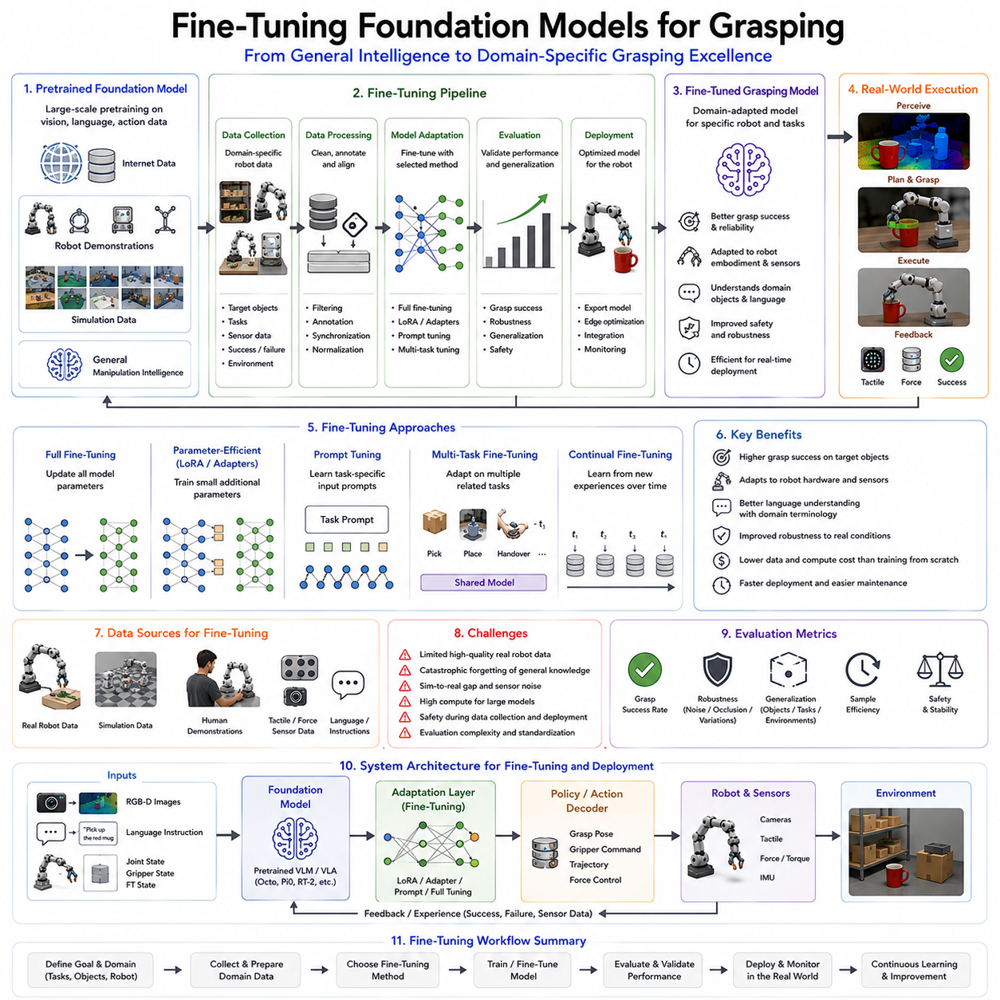{width="7.268055555555556in" height="7.268055555555556in"}

그래스핑을 위한 파운데이션 모델 파인튜닝(Fine-Tuning Foundation Models for Grasping)은 현대 로봇 매니퓰레이션 시스템을 실제 환경에 적용하는 과정에서 가장 중요한 단계 중 하나이다. 파운데이션 모델은 대규모 사전 학습(Pretraining)을 통해 광범위한 일반 지식을 획득하지만, 실제 로봇 그래스핑 응용 분야에서는 특정 환경과 작업에 맞는 전문성이 요구된다. VLM(Vision-Language Model), VLA(Vision-Language-Action) 모델, Octo, Pi0, RT-2와 같은 로봇 파운데이션 모델은 인터넷 규모의 이미지-텍스트 데이터, 로봇 시연 데이터, 멀티모달 조작 데이터, 시뮬레이션 데이터를 기반으로 학습된다. 이 과정에서 물체, 언어, 작업, 환경, 행동에 대한 폭넓은 이해를 습득하게 된다. 그러나 실제 로봇 시스템은 고유한 하드웨어 구조, 센서 구성, 물체 분포, 안전 요구사항, 작업 목표를 가진다. 파인튜닝은 이러한 범용 지능을 특정 환경에 최적화된 전문 지능으로 변환하는 핵심 과정이다.

Foundation Models for Grasping 구조에서 Fine-Tuning Foundation Models for Grasping은 Foundation Models, VLM 기반 그래스프 지시(Grasp Instruction), Open Vocabulary Grasping, Language-Conditioned Grasping, VLA 모델, Octo 및 Pi0와 같은 로봇 파운데이션 모델에 대한 이해 이후에 자연스럽게 등장하는 주제이다. 대규모 사전 학습을 통해 일반적인 조작 능력을 확보한 후, 다음 단계는 이를 특정 로봇 플랫폼과 응용 분야에 맞게 최적화하는 것이다. 이러한 적응 과정은 범용 조작 모델을 산업 자동화, 물류 창고, 조립 공정, 의료 로봇, 서비스 로봇과 같은 특정 분야에서 높은 성능을 발휘하는 전문 시스템으로 발전시킨다.

파인튜닝 개념은 전이 학습(Transfer Learning)에서 시작되었다. 과거에는 작업마다 별도의 모델을 학습해야 했다. 그러나 모델 규모가 커지고 작업 복잡성이 증가하면서 이러한 접근 방식은 비효율적이 되었다. 연구자들은 대규모 데이터로 학습된 모델이 다양한 분야에서 활용 가능한 일반 표현(General Representation)을 학습한다는 사실을 발견하였다. 따라서 처음부터 새롭게 학습하는 대신, 이미 학습된 모델을 소량의 작업별 데이터로 적응시키는 것이 훨씬 효율적이었다. 이 개념은 현재 로봇 파운데이션 모델에서도 핵심 원리로 자리 잡고 있다.

수백만 개의 로봇 조작 데이터를 통해 학습된 파운데이션 모델은 일반적인 그래스핑 방법은 이해할 수 있지만, 특정 창고의 물류 품목이나 특정 로봇 핸드 구조, 특정 생산 공정의 특성까지 완벽하게 이해하지는 못한다. 파인튜닝은 이러한 도메인 특화 지식을 모델 내부에 반영하는 과정이다. 결과적으로 모델은 사전 학습을 통해 획득한 범용 지식과 현장 환경에 대한 전문 지식을 동시에 보유하게 된다.

그래스핑 분야에서 파인튜닝이 중요한 첫 번째 이유는 플랫폼 적응(Embodiment Adaptation)이다. 로봇은 기계적 구조가 매우 다양하다. 평행 그리퍼(Parallel-Jaw Gripper), 언더액추에이티드 핸드(Underactuated Hand), 소프트 그리퍼(Soft Gripper), 다지형 로봇 핸드(Multifinger Hand), 인체형 로봇 손(Anthropomorphic Hand) 등 구조가 서로 다르다. 사전 학습된 행동 표현은 이러한 차이를 완전히 반영하지 못할 수 있다. 파인튜닝은 로봇의 운동학(Kinematics), 액추에이터 특성, 작업 공간, 센서 구성, 제어 인터페이스에 맞게 모델을 조정할 수 있도록 해준다.

센서 적응(Sensor Adaptation)도 매우 중요하다. 파운데이션 모델은 일반적인 센서 구성을 기반으로 학습되는 경우가 많다. 하지만 실제 로봇은 서로 다른 RGB 카메라, 깊이 센서, 촉각 센서(Tactile Sensor), 힘/토크 센서(Force-Torque Sensor), 이벤트 카메라(Event Camera), 열화상 카메라(Thermal Camera)를 사용할 수 있다. 이러한 차이는 학습 데이터와 실제 환경 사이에 분포 차이(Distribution Shift)를 발생시킨다. 파인튜닝은 모델이 실제 로봇의 센서 데이터를 효과적으로 해석할 수 있도록 만든다.

물체 분포 적응(Object Distribution Adaptation)은 산업 현장에서 특히 중요하다. 파운데이션 모델은 수백만 개의 다양한 물체를 기반으로 학습되지만, 특정 창고는 몇 천 개의 상품만 다룰 수 있다. 의료 로봇은 특정 의료 도구만 사용할 수 있으며, 조립 로봇은 제한된 부품만 취급할 수 있다. 파인튜닝을 통해 모델은 해당 환경에서 자주 등장하는 물체에 더욱 집중할 수 있으며, 결과적으로 그래스프 성공률과 작업 효율이 향상된다.

작업 특화(Task Specialization) 역시 중요한 목적이다. 일반 파운데이션 모델은 수많은 작업을 학습하지만, 실제 환경에서는 특정 작업이 중심이 되는 경우가 많다. 예를 들어 Bin Picking, 물류 피킹(Order Fulfillment), 케이블 삽입(Cable Insertion), 전자부품 조립(Electronic Assembly), 의약품 처리(Pharmaceutical Handling), 수술 보조(Surgical Assistance), 가정 서비스 로봇 등은 각각 다른 요구사항을 가진다. 파인튜닝은 특정 작업에 모델의 표현 능력을 집중시켜 성능을 향상시킨다.

언어 적응(Language Adaptation) 또한 중요성이 증가하고 있다. 파운데이션 모델은 일반 인터넷 데이터를 기반으로 학습되지만, 실제 현장에서는 전문 용어가 사용된다. 공장, 병원, 연구소, 물류센터는 모두 고유한 용어 체계를 가지고 있다. 파인튜닝은 이러한 전문 용어와 작업 명령을 로봇이 정확히 이해할 수 있도록 돕는다.

파인튜닝에는 여러 가지 방법이 존재한다. 가장 단순한 방법은 전체 모델 파인튜닝(Full Fine-Tuning)이다. 이는 모델의 모든 파라미터를 업데이트하는 방식이다. 최대 성능을 얻을 수 있지만 계산 비용이 매우 크다. 수십억 개 이상의 파라미터를 가진 모델에서는 현실적으로 부담이 크다.

이 때문에 최근에는 파라미터 효율적 파인튜닝(Parameter-Efficient Fine-Tuning)이 주목받고 있다. 대표적인 기법으로 LoRA(Low-Rank Adaptation), Adapter, Prompt Tuning, Prefix Tuning 등이 있다. 이러한 방법들은 전체 모델을 수정하지 않고 일부 파라미터만 추가적으로 학습한다. 따라서 계산 비용과 메모리 사용량을 크게 줄일 수 있다.

LoRA는 가장 널리 사용되는 방법 중 하나이다. 기존 가중치는 그대로 유지한 채 저차원 행렬(Low-Rank Matrix)을 추가하여 작업 특화 정보를 학습한다. 이를 통해 메모리 사용량을 줄이고 여러 응용 분야에 맞는 모델을 효율적으로 구축할 수 있다.

Prompt Tuning은 모델 내부 가중치를 거의 변경하지 않고 입력 임베딩만 학습하는 방식이다. 로봇 분야에서는 특정 작업이나 환경에 맞는 프롬프트를 학습하여 모델의 행동을 조정할 수 있다. 이는 매우 가벼운 적응 방법으로 주목받고 있다.

다중 작업 파인튜닝(Multi-Task Fine-Tuning)도 중요하다. 실제 환경에서는 그래스핑, 운반, 분류, 적재, 전달 등의 작업이 동시에 수행된다. 여러 작업을 함께 학습하면 특정 작업에 과도하게 적응하는 과적합(Overfitting)을 방지하고 일반화 성능을 향상시킬 수 있다.

지속적 파인튜닝(Continual Fine-Tuning)은 한 단계 더 발전된 개념이다. 실제 환경은 시간이 지남에 따라 변화한다. 새로운 제품이 추가되고, 작업 절차가 바뀌며, 장비가 업그레이드된다. 지속 학습은 이러한 변화를 모델에 반영하면서도 기존 지식을 유지할 수 있도록 한다.

그러나 파인튜닝 과정에는 치명적 망각(Catastrophic Forgetting)이라는 문제가 존재한다. 특정 환경에 지나치게 적응하면 사전 학습에서 얻은 범용 지식을 잃어버릴 수 있다. 예를 들어 창고 데이터만 학습한 모델은 가정용 물체에 대한 성능이 저하될 수 있다. 이를 해결하기 위해 정규화(Regularization), 리플레이 버퍼(Replay Buffer), 지식 증류(Knowledge Distillation) 등의 기법이 활용된다.

데이터 품질(Data Quality)은 파인튜닝 성공 여부를 결정하는 핵심 요소이다. 파인튜닝은 일반적으로 소규모 데이터셋을 사용하기 때문에 데이터 품질의 영향이 더욱 크다. 좋은 데이터셋은 다양한 물체, 환경 조건, 성공 사례, 실패 사례, 센서 관측을 포함해야 한다. 특히 실패한 그래스프 데이터도 중요하다. 실패 사례는 모델이 위험한 행동을 피하도록 학습하는 데 큰 도움이 된다.

시뮬레이션(Simulation)은 파인튜닝 과정에서도 중요한 역할을 수행한다. 고정밀 시뮬레이터는 대량의 작업 특화 데이터를 저렴하게 생성할 수 있다. 시뮬레이션 기반 그래스프 데이터를 통해 모델을 먼저 적응시키고, 이후 소량의 실제 데이터로 보정하는 방식이 널리 사용된다.

Sim-to-Real 파인튜닝은 대표적인 전략이다. 먼저 시뮬레이션에서 대규모 데이터를 사용하여 학습하고, 이후 실제 로봇 데이터로 최종 조정을 수행한다. 이를 통해 데이터 수집 비용을 크게 절감하면서도 높은 성능을 유지할 수 있다.

인간 시연 데이터(Human Demonstration Data) 역시 중요한 학습 자원이다. 숙련된 작업자가 제공하는 성공적인 그래스프 시연은 모델이 빠르게 적응하도록 돕는다. Learning from Demonstration(LfD)은 적은 수의 시연만으로도 상당한 성능 향상을 달성할 수 있다.

강화학습 기반 파인튜닝(Reinforcement Learning Fine-Tuning)은 또 다른 접근 방식이다. 로봇이 직접 환경과 상호작용하며 성공과 실패를 경험하고, 보상(Reward)을 통해 정책을 개선한다. 이러한 방법은 시연 데이터 이상의 성능을 달성할 수 있는 가능성을 제공한다.

촉각 적응(Tactile Adaptation)은 향후 매우 중요한 연구 분야가 될 것으로 예상된다. 현재 대부분의 파운데이션 모델은 시각과 언어 중심으로 학습된다. 그러나 실제 조작에서는 촉각 정보가 필수적이다. 촉각 센서를 활용한 파인튜닝은 미끄러짐(Slip Detection), 접촉 상태(Contact State), 섬세한 힘 조절(Force Regulation) 능력을 향상시킬 수 있다.

파인튜닝된 모델의 평가는 단순한 그래스프 성공률만으로는 충분하지 않다. 일반화 성능, 적응 속도, 샘플 효율성, 언어 이해 능력, 촉각 활용 능력, 장기 작업 수행 능력 등을 종합적으로 평가해야 한다.

산업 현장에서는 파인튜닝의 중요성이 더욱 분명하게 나타난다. 창고 로봇은 특정 재고 품목에 맞게 모델을 적응시키고, 제조 로봇은 조립 작업에 최적화하며, 의료 로봇은 병원 장비와 절차에 맞게 조정된다. 농업 로봇은 작물 수확에 특화되고, 서비스 로봇은 가정 환경과 사용자 선호도를 학습한다. 파인튜닝은 이러한 환경 특화 능력을 제공하는 핵심 기술이다.

엣지 배치(Edge Deployment)에서는 추가적인 최적화가 필요하다. 대규모 파운데이션 모델은 모바일 로봇의 연산 능력을 초과하는 경우가 많다. 따라서 파인튜닝은 모델 압축(Model Compression), 양자화(Quantization), 프루닝(Pruning), 지식 증류(Knowledge Distillation), 하드웨어 최적화(Hardware Optimization)와 함께 수행되는 경우가 많다.

Octo, Pi0, RT-X, RT-2와 같은 로봇 파운데이션 모델의 등장은 로봇 개발 방식을 근본적으로 변화시키고 있다. 과거에는 특정 작업을 위해 처음부터 모델을 설계했지만, 이제는 강력한 사전 학습 모델을 기반으로 필요한 환경에 맞게 파인튜닝하는 방식이 표준이 되어가고 있다.

미래에는 파인튜닝이 더욱 자율적인 형태로 발전할 것으로 예상된다. 로봇은 일상적인 작업 과정에서 스스로 데이터를 수집하고, 클라우드 기반 학습과 로봇 군집(Fleet Learning)을 통해 경험을 공유하며, 지속적으로 자신의 모델을 개선할 수 있을 것이다. 이러한 능력은 평생 학습(Lifelong Learning)과 범용 체화 지능(General-Purpose Embodied Intelligence)을 구현하는 데 필수적인 요소가 될 것이다.

Foundation Models for Grasping 전체 구조에서 Fine-Tuning Foundation Models for Grasping은 범용 지식과 현장 전문성을 연결하는 핵심 다리 역할을 수행한다. 파운데이션 모델이 폭넓은 이해를 제공한다면, 파인튜닝은 특정 환경에서 요구되는 정밀성, 신뢰성, 효율성을 제공한다. 따라서 파인튜닝은 대규모 사전 학습 지능을 실제 산업용 그래스핑과 로봇 매니퓰레이션 능력으로 전환하는 가장 중요한 기술 중 하나라고 할 수 있다.

## 12.08 Visual-Tactile Fusion Models

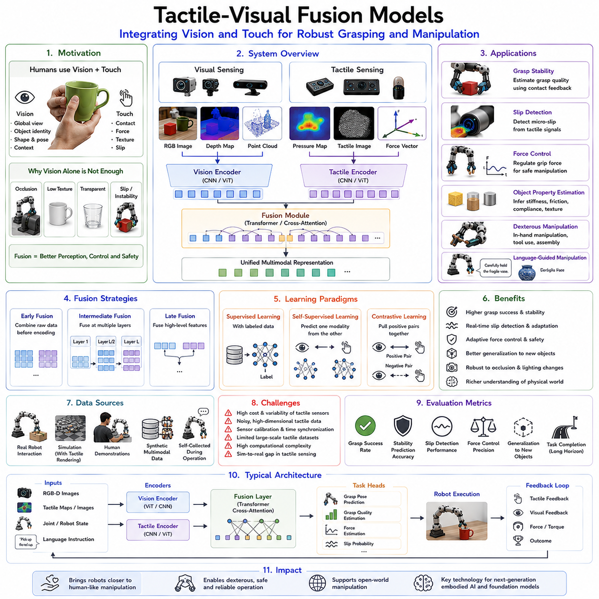{width="7.268055555555556in" height="7.268055555555556in"}

촉각-시각 융합 모델(Tactile-Visual Fusion Models)은 현대 로봇 그래스핑(Grasping)과 정교한 조작(Dexterous Manipulation) 분야에서 가장 중요한 발전 중 하나로 평가받고 있다. 전통적으로 로봇은 시각(Vision)을 중심으로 환경을 인식해 왔지만, 인간의 조작 능력은 시각과 촉각(Touch)의 긴밀한 통합에 크게 의존한다. 인간은 물체를 집거나 조작할 때 시각만 사용하는 것이 아니라, 촉각을 통해 접촉 상태와 힘의 변화를 지속적으로 감지한다. 깨지기 쉬운 유리컵을 잡거나, 병뚜껑을 열거나, 바늘에 실을 꿰거나, 옷 단추를 채우거나, 정밀 부품을 조립할 때 인간은 시각과 촉각을 동시에 활용한다. 시각은 물체와 환경에 대한 전반적인 정보를 제공하고, 촉각은 접촉 상태, 힘 분포, 미끄러짐, 재질 특성, 물리적 상호작용에 대한 정보를 제공한다. 촉각-시각 융합 모델은 이러한 인간의 감각 통합 방식을 로봇에 구현하기 위해 시각 정보와 촉각 정보를 하나의 통합된 표현으로 결합하는 기술이다.

Foundation Models for Grasping의 구조에서 Tactile-Visual Fusion Models는 순수 시각 기반 조작을 넘어서는 중요한 진화 단계이다. 이전 장에서 다룬 Vision-Language Model(VLM), Open Vocabulary Grasping, Language-Conditioned Grasping, Vision-Language-Action(VLA), Octo, Pi0와 같은 로봇 파운데이션 모델은 강력한 의미 이해 능력과 행동 생성 능력을 제공하지만, 실제 물리적 상호작용을 완전히 이해하기에는 한계가 있다. 그 이유는 카메라만으로는 접촉(Contact) 과정에서 발생하는 힘과 마찰, 변형, 미끄러짐 등을 직접 측정할 수 없기 때문이다. 촉각 센서는 이러한 정보를 직접 측정할 수 있으며, 촉각-시각 융합 모델은 두 감각을 결합하여 보다 풍부한 물리적 이해를 제공한다.

촉각-시각 융합이 필요한 가장 근본적인 이유는 시각 정보의 한계 때문이다. 카메라는 물체의 색상, 형상, 크기, 위치, 배치 상태 등을 매우 잘 인식할 수 있다. 그러나 힘(Force), 마찰(Friction), 강성(Stiffness), 순응성(Compliance), 재질(Material Property), 내부 응력 상태와 같은 물리적 특성은 직접 관측할 수 없다. 실제 그래스프 실패의 상당수는 시각만으로는 물체가 안전하게 잡혀 있는지 판단할 수 없기 때문에 발생한다. 로봇은 겉보기에는 성공적으로 물체를 집은 것처럼 보일 수 있지만, 실제로는 물체가 미끄러지거나 과도한 힘을 받고 있을 수 있다. 촉각 센서는 이러한 숨겨진 물리적 상태를 직접 측정할 수 있다.

인간의 조작 과정을 살펴보면 촉각-시각 융합의 중요성을 쉽게 이해할 수 있다. 인간은 물체를 향해 손을 뻗을 때 시각을 사용하여 위치를 파악한다. 그러나 물체에 접촉하는 순간부터 촉각 수용기(Tactile Receptor)가 활성화되어 압력, 힘 분포, 표면 질감(Texture), 진동(Vibration), 온도(Temperature), 미끄러짐(Slip) 정보를 제공한다. 인간의 신경계는 이러한 시각과 촉각 정보를 지속적으로 통합하여 손가락 위치를 조정하고, 적절한 힘을 가하며, 안정적인 조작을 유지한다. 촉각-시각 융합 모델은 바로 이러한 인간의 감각 통합 메커니즘을 로봇 시스템에 구현하려는 시도이다.

최근 고해상도 촉각 센서의 발전은 이 분야 연구를 크게 가속화하였다. 초기의 촉각 센서는 단순히 압력이나 힘의 크기만 측정할 수 있었다. 그러나 현대의 촉각 센서는 훨씬 더 풍부한 정보를 제공한다. GelSight, DIGIT, FingerVision, TacTip과 같은 비전 기반 촉각 센서(Vision-Based Tactile Sensor)는 접촉면을 이미지 형태로 관측할 수 있다. 이를 통해 접촉 형상(Contact Geometry), 표면 질감, 변형 패턴, 미세한 접촉 동역학까지 측정할 수 있게 되었다. 이러한 센서는 사실상 매우 근거리에서 작동하는 특수한 형태의 카메라라고 볼 수 있으며, 시각과 촉각의 경계를 점점 모호하게 만들고 있다.

일반적인 촉각-시각 융합 모델은 시각 관측값과 촉각 관측값을 동시에 입력받는다. 시각 입력은 RGB 영상, 깊이 영상(Depth Map), 스테레오 이미지(Stereo Image), 포인트 클라우드(Point Cloud) 등이 사용된다. 촉각 입력은 압력 맵(Pressure Map), 힘 벡터(Force Vector), 촉각 이미지(Tactile Image), 진동 신호(Vibration Signal), 변형 정보(Strain Measurement), 온도 정보 등이 활용될 수 있다. 이러한 정보는 각각의 인코더(Encoder)를 통해 특징 벡터로 변환된 후 하나의 공통 표현 공간(Shared Representation Space)에서 통합된다.

융합(Fusion) 방식에는 여러 가지가 존재한다. 초기 융합(Early Fusion)은 원시 데이터 단계에서 시각과 촉각 정보를 결합한다. 후기 융합(Late Fusion)은 각 감각을 독립적으로 처리한 후 고수준 특징을 결합한다. 중간 융합(Intermediate Fusion)은 네트워크 내부 여러 계층에서 반복적으로 정보를 교환한다. 각각의 방법은 계산 효율성, 표현력, 일반화 성능 측면에서 장단점을 가진다.

최근에는 트랜스포머(Transformer)가 촉각-시각 융합에 널리 사용되고 있다. 트랜스포머는 서로 다른 형태의 데이터를 하나의 Attention 구조 안에서 처리할 수 있기 때문이다. 카메라로부터 얻은 시각 토큰(Visual Token)과 촉각 센서로부터 얻은 촉각 토큰(Tactile Token)을 함께 처리하여 물체의 외형 정보와 실제 접촉 정보를 동시에 분석할 수 있다. 이러한 구조는 특히 복잡한 접촉 상황이나 불확실성이 높은 조작 작업에서 매우 강력한 성능을 보여준다.

촉각-시각 융합의 대표적인 응용 분야는 그래스프 안정성 평가(Grasp Stability Estimation)이다. 시각 정보는 그래스프 후보를 생성할 수 있지만, 실제 그래스프 품질은 촉각 정보가 제공하는 접촉 상태를 통해서만 정확히 평가할 수 있다. 촉각 센서는 압력 분포와 힘 정보를 측정하고, 융합 모델은 이를 시각 정보와 결합하여 현재 그래스프가 안정적인지 여부를 판단한다. 만약 불안정성이 감지되면 로봇은 즉시 손가락 위치나 그립 힘을 조정할 수 있다.

미끄러짐 감지(Slip Detection) 또한 중요한 응용 분야이다. 시각 시스템은 매우 작은 물체 이동을 감지하기 어렵다. 반면 촉각 센서는 압력 패턴 변화나 미세 진동을 통해 초기 미끄러짐을 감지할 수 있다. 융합 모델은 촉각 기반 미끄러짐 정보를 시각 기반 물체 추적 정보와 결합하여 더욱 강력한 조작 안정성을 제공한다.

힘 제어(Force Control) 역시 촉각-시각 융합의 중요한 장점 중 하나이다. 시각만으로는 현재 얼마만큼의 힘이 물체에 가해지고 있는지 정확히 알 수 없다. 힘이 너무 크면 물체가 손상될 수 있고, 너무 작으면 떨어질 수 있다. 촉각 센서는 실제 힘을 측정할 수 있으며, 융합 모델은 이를 활용하여 실시간으로 그립 힘을 조절할 수 있다.

물체 특성 추정(Object Property Estimation)도 가능하다. 시각은 물체의 외형을 제공하지만, 촉각은 강성(Stiffness), 거칠기(Roughness), 탄성(Elasticity), 마찰 계수(Friction Coefficient)와 같은 물리적 특성을 알려준다. 예를 들어 두 개의 물체가 시각적으로는 동일하게 보이더라도 실제 재질은 매우 다를 수 있다. 촉각 정보는 이러한 차이를 구별할 수 있도록 해준다.

정교한 조작(Dexterous Manipulation)은 촉각-시각 융합의 가장 중요한 응용 분야 중 하나이다. 손 안에서 물체를 회전시키는 In-Hand Manipulation, 공구 사용(Tool Use), 케이블 삽입(Cable Insertion), 커넥터 결합(Connector Assembly), 천(Cloth) 조작과 같은 작업은 지속적인 접촉 상태 추적이 필요하다. 특히 손이 물체를 가리는 상황에서는 시각 정보가 제한되기 때문에 촉각 정보가 핵심 역할을 수행한다.

언어 조건부 조작(Language-Conditioned Manipulation) 역시 촉각-시각 융합과 결합될 수 있다. 예를 들어 "깨지기 쉬운 꽃병을 조심스럽게 잡아라"라는 명령을 생각해 보자. 시각은 꽃병을 인식하고 그래스프 위치를 결정하지만, 촉각은 실제 접촉 힘을 모니터링한다. 융합 모델은 안정성을 유지하면서도 과도한 힘이 가해지지 않도록 조정할 수 있다.

Open Vocabulary Grasping도 촉각 정보를 통해 더욱 강력해질 수 있다. 파운데이션 모델은 처음 보는 물체를 언어와 시각 정보로 인식할 수 있지만, 그 물체의 물리적 특성은 알 수 없다. 촉각 정보는 실제 상호작용 과정에서 이러한 특성을 추론하게 해주며, 결과적으로 새로운 물체에 대한 일반화 성능을 향상시킨다.

최근에는 자가 지도 학습(Self-Supervised Learning)이 촉각-시각 연구를 크게 발전시키고 있다. 라벨링된 촉각 데이터를 수집하는 것은 매우 비용이 많이 들지만, 실제 조작 과정에서는 시각과 촉각 데이터가 자연스럽게 동시에 생성된다. 따라서 모델은 한 감각으로 다른 감각을 예측하도록 학습할 수 있다. 이러한 방식은 별도의 수작업 라벨링 없이도 강력한 멀티모달 표현을 학습할 수 있게 해준다.

대조 학습(Contrastive Learning)도 널리 사용된다. 동일한 접촉 상황에서 생성된 시각 데이터와 촉각 데이터를 긍정 샘플(Positive Pair)로 사용하고, 서로 관련 없는 데이터를 부정 샘플(Negative Pair)로 사용한다. 이를 통해 모델은 시각과 촉각 사이의 공통 표현 공간을 학습하게 된다.

로봇 파운데이션 모델 역시 점차 촉각 정보를 포함하기 시작하고 있다. 초기 파운데이션 모델은 Vision, Language, Action 중심으로 구성되었지만, 미래의 모델은 Touch를 핵심 모달리티로 포함할 가능성이 높다. 촉각 파운데이션 모델(Tactile Foundation Model)은 다양한 재질, 접촉 상황, 조작 작업에 대한 범용 촉각 지식을 학습할 수 있을 것이다.

시뮬레이션은 촉각-시각 융합 연구에서도 중요한 역할을 한다. 최신 시뮬레이터는 촉각 렌더링(Tactile Rendering), 접촉 역학(Contact Dynamics), 변형 물체(Deformable Object), 센서 모델링까지 지원한다. 이를 통해 대규모 멀티모달 데이터셋을 생성할 수 있으며, Sim-to-Real 기술을 통해 실제 환경에 적용할 수 있다.

그래스핑은 촉각-시각 융합의 이상적인 응용 분야이다. 접촉 전에는 시각이 주요 정보원이지만, 접촉 후에는 촉각이 중요한 역할을 수행한다. 조작 과정 전체에서 시각은 물체와 환경을 모니터링하고, 촉각은 접촉 상태와 힘 분포를 모니터링한다. 융합 모델은 이러한 정보를 종합하여 최적의 행동을 결정한다.

안전성과 강건성(Robustness)은 멀티모달 융합의 또 다른 중요한 장점이다. 카메라는 조명 변화, 반사, 투명 물체, 가림 현상에 취약하다. 반면 촉각은 접촉이 발생한 이후에는 매우 안정적인 정보를 제공한다. 두 감각을 결합하면 단일 센서에 의존하는 시스템보다 훨씬 높은 신뢰성을 얻을 수 있다.

현재 제조업(Manufacturing), 물류(Logistics), 의료(Healthcare), 농업(Agriculture), 서비스 로봇(Service Robotics) 분야에서 촉각-시각 융합 기술의 활용이 빠르게 증가하고 있다. 정밀 조립, 품질 검사, 물류 피킹, 의료 기기 조작, 농작물 수확, 가정용 서비스 로봇 등 다양한 응용 분야에서 그 중요성이 커지고 있다.

평가 방법도 단순한 그래스프 성공률을 넘어 확장되고 있다. 연구자들은 그래스프 안정성 예측 정확도, 미끄러짐 감지 성능, 힘 제어 정밀도, 재질 인식 정확도, 장기 조작 성공률, 새로운 물체에 대한 일반화 성능 등을 종합적으로 평가한다.

물론 해결해야 할 과제도 존재한다. 고성능 촉각 센서는 여전히 가격이 높고, 센서마다 데이터 형식이 다르며, 촉각 데이터는 고차원적이고 노이즈가 많다. 또한 시각과 촉각 데이터를 정밀하게 동기화하는 것도 쉽지 않다. 대규모 촉각 데이터셋 역시 이미지 데이터셋에 비해 매우 부족한 상황이다.

그럼에도 불구하고 촉각 센서 기술, 머신러닝, 시뮬레이션, 로봇 파운데이션 모델의 발전은 이 분야를 빠르게 성장시키고 있다. 미래의 로봇은 단순히 보는(See) 것에 그치지 않고, 만지고(Touch), 이해하고(Reason), 예측하며(Predict), 적응하는(Adapt) 능력을 동시에 갖추게 될 것이다.

Foundation Models for Grasping 관점에서 Tactile-Visual Fusion Models는 의미 지능(Semantic Intelligence)과 물리 지능(Physical Intelligence)이 만나는 지점이라고 할 수 있다. 시각은 세상을 이해하게 하고, 언어는 목표를 이해하게 하며, 촉각은 실제 상호작용을 이해하게 한다. 이 세 가지가 결합될 때 로봇은 인간과 유사한 수준의 안정적이고 적응적인 조작 능력을 갖출 수 있게 된다. 따라서 촉각-시각 융합은 미래의 범용 로봇 지능과 정교한 그래스핑 기술을 구현하기 위한 핵심 기반 기술 중 하나로 평가받고 있다.

## 12.09 World Models for Manipulation

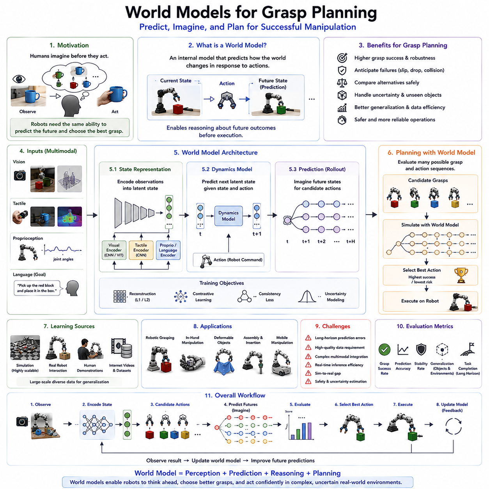{width="7.268055555555556in" height="7.268055555555556in"}{width="7.268055555555556in" height="7.268055555555556in"}

그래스프 계획을 위한 월드 모델(World Models for Grasp Planning)은 지능형 로봇 매니퓰레이션(Intelligent Robotic Manipulation)의 발전 과정에서 가장 중요한 기술 중 하나로 평가받고 있다. 전통적인 그래스프 계획 시스템은 현재 관측된 정보를 바탕으로 안정적인 접촉점(Contact Point)을 찾고, 실행 가능한 경로를 생성하며, 그래스프를 수행하는 데 초점을 맞추어 왔다. 이러한 방법은 구조화된 환경에서는 상당한 성공을 거두었지만, 동적이고 불확실하며 처음 접하는 환경에서는 한계를 드러낸다. 반면 인간은 물체를 잡을 때 현재 보이는 정보만을 사용하는 것이 아니라, 행동 이후에 어떤 일이 발생할지를 미리 예측한다. 손을 뻗기 전에 물체가 어떻게 움직일지, 어떤 힘이 필요한지, 잡은 후 어떤 결과가 발생할지를 머릿속에서 시뮬레이션한다. 이러한 능력을 내부 예측 모델(Internal Predictive Model)이라고 할 수 있으며, 월드 모델은 로봇에게 바로 이러한 능력을 제공하기 위해 개발되었다.

Foundation Models for Grasping의 구조에서 World Models for Grasp Planning은 반응형 조작(Reactive Manipulation)에서 예측형 조작(Predictive Manipulation)으로 넘어가는 핵심 단계이다. 로봇은 단순히 현재 환경을 이해하는 수준을 넘어, 자신의 행동이 미래에 어떤 결과를 만들어낼지를 예측할 수 있게 된다.

월드 모델은 기본적으로 행동(Action)에 따라 환경(Environment)이 어떻게 변화할지를 예측하는 내부 모델이다. 단순히 관측(Observation)에서 행동(Action)을 생성하는 것이 아니라, 먼저 세상의 상태(State)를 이해하고, 행동 이후의 미래 상태(Future State)를 예측한 뒤 최적의 행동을 선택한다. 로봇 그래스핑에서는 물체가 어떻게 움직일지, 회전할지, 변형될지, 충돌할지, 미끄러질지 등을 미리 예측할 수 있다. 이를 통해 실제로 그래스프를 수행하기 전에 여러 가지 후보를 평가하고 가장 성공 가능성이 높은 방법을 선택할 수 있다.

월드 모델 개념은 인지과학(Cognitive Science)과 신경과학(Neuroscience)에서 유래하였다. 인간은 항상 주변 환경에 대한 정신적 모델(Mental Model)을 유지한다. 컵을 집으려고 할 때 인간은 컵의 위치, 무게, 내용물, 필요한 힘, 접촉 후의 움직임 등을 무의식적으로 예측한다. 월드 모델은 이러한 인간의 예측 능력을 머신러닝과 로봇 기술로 구현하려는 시도라고 볼 수 있다.

기존의 그래스프 계획 시스템은 일반적으로 순방향 처리(Feedforward Processing) 방식으로 동작한다. 센서가 환경을 관측하고, 인식 알고리즘이 물체를 식별하며, 그래스프 플래너가 후보 그래스프를 생성하고, 제어기가 이를 실행한다. 그러나 이러한 구조는 미래 결과를 깊이 있게 고려하지 못한다. 현재는 안정적으로 보이는 그래스프도 물체를 들어 올리거나 회전시키는 순간 실패할 수 있다. 월드 모델은 단순히 "이 물체를 잡을 수 있는가?"를 묻는 것이 아니라 "잡은 후에는 어떤 일이 발생하는가?"를 함께 고려한다.

파운데이션 모델(Foundation Model)의 발전은 월드 모델 연구를 크게 가속화하였다. 과거의 예측 시스템은 물리 엔진(Physics Engine)과 수작업으로 설계된 상태 표현(State Representation)에 크게 의존하였다. 반면 현대의 월드 모델은 데이터를 통해 물리 법칙과 환경 변화를 학습한다. 수백만 건의 로봇 상호작용 데이터를 학습함으로써 물체의 움직임, 접촉, 마찰, 변형 등을 스스로 이해하게 된다. 이를 통해 사전에 정의되지 않은 새로운 상황에서도 예측 능력을 발휘할 수 있다.

일반적인 월드 모델은 세 가지 핵심 구성 요소를 가진다. 첫 번째는 상태 표현(State Representation)이다. 카메라 영상, 촉각 데이터, 로봇 상태 정보를 압축하여 환경의 핵심 정보를 담는 잠재 공간(Latent Space)으로 변환한다. 두 번째는 동역학 모델(Dynamics Model)이다. 현재 상태와 행동을 입력받아 미래 상태를 예측한다. 세 번째는 계획기(Planner)이다. 다양한 미래 시나리오를 평가하여 목표를 가장 잘 달성할 수 있는 행동을 선택한다.

잠재 표현(Latent Representation)은 매우 중요한 역할을 한다. 실제 센서 데이터는 너무 고차원적이기 때문이다. 카메라는 수백만 개의 픽셀을 생성하고, 촉각 센서는 복잡한 접촉 정보를 제공하며, 로봇 상태는 수십 개 이상의 변수를 포함한다. 이러한 모든 정보를 직접 예측하는 것은 매우 비효율적이다. 따라서 월드 모델은 핵심 정보만을 유지하는 압축된 표현 공간을 학습한다.

동역학 예측(Predictive Dynamics)은 월드 모델의 핵심 기능이다. 현재 상태와 특정 행동이 주어졌을 때 미래 상태를 예측한다. 그래스프 계획에서는 물체를 들어 올릴 때의 움직임, 접촉 안정성, 미끄러짐 발생 여부, 힘 분포 변화, 충돌 가능성 등을 예측할 수 있다. 동역학 모델을 반복적으로 적용하면 그래스프 이후의 전체 조작 과정을 시뮬레이션할 수 있다.

월드 모델의 가장 중요한 장점 중 하나는 반사실적 추론(Counterfactual Reasoning)이다. 이는 실제로 행동하지 않고도 가상의 결과를 평가하는 능력이다. 로봇은 "측면에서 잡으면 어떻게 될까?", "힘을 더 크게 주면 어떤 일이 발생할까?", "먼저 회전시킨 뒤 들어 올리면 어떨까?"와 같은 질문을 내부적으로 시뮬레이션할 수 있다. 이를 통해 여러 전략을 비교하고 최적의 방법을 선택할 수 있다.

불확실성(Uncertainty)이 존재하는 환경에서는 월드 모델의 가치가 더욱 커진다. 실제 물체는 질량 분포, 마찰 계수, 강성(Stiffness), 재질(Material Property) 등을 정확히 알 수 없는 경우가 많다. 기존 시스템은 이러한 상황에서 취약하지만, 월드 모델은 여러 가능한 미래를 동시에 고려할 수 있다. 즉 하나의 결과가 아니라 확률 분포(Probability Distribution) 형태로 미래를 예측하고, 다양한 경우에 대해 안정적인 행동을 선택할 수 있다.

월드 모델은 어포던스(Affordance)에 대한 이해도 향상시킨다. 어포던스는 물체가 제공하는 가능한 상호작용을 의미한다. 기존 시스템은 시각적 특징만으로 어포던스를 추론했지만, 월드 모델은 특정 상호작용의 결과까지 예측한다. 예를 들어 손잡이가 잡을 수 있어 보이는 것뿐만 아니라, 실제로 손잡이를 잡았을 때 이후 작업이 성공적으로 수행될 수 있는지까지 평가할 수 있다.

비전(Vision)은 월드 모델 구축에 매우 중요한 역할을 한다. 카메라는 물체의 형상, 위치, 색상, 주변 환경 정보를 제공한다. 최신 월드 모델은 트랜스포머 기반 비전 인코더를 사용하여 시각 정보를 잠재 공간으로 변환한다. 이를 통해 의미 정보(Semantic Information)와 물리 정보(Physical Information)를 동시에 학습할 수 있다.

촉각(Tactile Sensing)은 월드 모델의 정확성을 크게 향상시킨다. 시각은 접촉 이전에는 강력하지만, 접촉 이후에는 한계가 있다. 촉각은 압력 분포, 미끄러짐, 변형 패턴, 힘 변화를 직접 측정한다. 따라서 시각과 촉각을 통합한 월드 모델은 훨씬 더 정확한 물리 예측을 수행할 수 있다.

최근에는 언어(Language)도 월드 모델에 통합되고 있다. 인간은 종종 원하는 결과를 언어로 설명한다. 예를 들어 "유리잔을 조심스럽게 선반에 놓아라" 또는 "드라이버를 사용하기 좋게 집어라"와 같은 명령은 미래의 상태를 암시한다. 언어 조건부 월드 모델(Language-Conditioned World Model)은 이러한 목표를 예측 과정에 반영할 수 있다.

트랜스포머(Transformer)는 현대 월드 모델의 핵심 구조로 자리 잡고 있다. 트랜스포머는 시간적으로 연속된 관측과 행동 데이터를 처리하는 데 매우 뛰어나다. 이를 통해 물체 간 상호작용, 접촉 이벤트, 환경 변화의 장기적인 관계를 학습할 수 있다.

최근에는 다양한 형태의 월드 모델이 연구되고 있다. 예측 코딩(Predictive Coding)은 미래 관측을 예측하는 데 초점을 둔다. 잠재 동역학 모델(Latent Dynamics Model)은 잠재 공간에서 미래 상태를 예측한다. 생성형 월드 모델(Generative World Model)은 여러 가능한 미래를 생성한다. 계층형 월드 모델(Hierarchical World Model)은 저수준 물리 예측과 고수준 작업 계획을 동시에 수행한다.

상상 기반 계획(Imagination-Based Planning)은 월드 모델의 대표적인 활용 방식이다. 로봇은 실제 행동을 하기 전에 내부적으로 여러 시나리오를 상상한다. 각각의 그래스프 후보를 시뮬레이션하고 성공 가능성을 평가한다. 이후 가장 좋은 결과를 제공할 것으로 예상되는 행동을 선택한다. 이는 인간이 행동 전에 머릿속으로 시뮬레이션하는 과정과 매우 유사하다.

모델 예측 제어(Model Predictive Control, MPC)는 월드 모델과 자연스럽게 결합된다. MPC는 미래 상태를 반복적으로 예측하고 최적의 행동을 선택하는 제어 기법이다. 월드 모델은 MPC에 필요한 미래 예측 기능을 제공하며, 이를 통해 보다 안정적이고 적응적인 조작이 가능해진다.

강화학습(Reinforcement Learning)도 월드 모델과 긴밀하게 연결되어 있다. 기존 강화학습은 많은 실제 상호작용 데이터를 요구하지만, 월드 모델은 내부 시뮬레이션을 통해 가상의 경험을 생성할 수 있다. 이를 통해 데이터 효율성을 크게 향상시키고 실제 로봇의 마모를 줄일 수 있다.

시뮬레이션(Simulation)은 월드 모델 학습에 필수적인 요소이다. 고정밀 시뮬레이터는 다양한 물체와 재질, 조작 시나리오를 제공하며, 대규모 학습 데이터를 생성할 수 있다. Sim-to-Real 기법은 이러한 학습 결과를 실제 환경으로 이전하는 역할을 한다.

파운데이션 모델은 월드 모델의 발전 방향에도 큰 영향을 미치고 있다. 대규모 멀티모달 사전 학습을 통해 시각, 언어, 행동, 촉각 정보를 통합한 범용 월드 모델이 등장하고 있다. 미래에는 인터넷 규모의 비디오 데이터와 로봇 데이터셋을 학습하여 더욱 강력한 물리 세계 이해 능력을 갖춘 모델이 등장할 것으로 예상된다.

그래스프 계획은 월드 모델의 혜택을 가장 크게 받는 분야 중 하나이다. 기존 그래스프 플래너는 Force Closure나 Grasp Quality Score와 같은 기하학적 지표를 사용하였다. 그러나 월드 모델은 미래의 결과까지 고려한다. 가장 안정적인 그래스프가 항상 최선의 그래스프는 아니다. 이후 작업 수행 가능성, 위험도, 물체 손상 가능성까지 고려한 그래스프가 더 우수할 수 있다.

특히 천(Cloth), 케이블(Cable), 음식(Food), 연성 포장재(Soft Packaging)와 같은 변형 가능한 물체(Deformable Object)는 월드 모델의 강점을 잘 보여준다. 이러한 물체는 전통적인 물리 모델로 다루기 어렵지만, 데이터 기반 월드 모델은 실제 상호작용 경험을 통해 동역학을 학습할 수 있다.

산업 현장에서도 월드 모델의 활용이 빠르게 증가하고 있다. 물류 로봇은 다양한 상품을 안전하게 집기 위해 미래 상태를 예측하고, 제조 로봇은 조립 결과를 미리 평가하며, 의료 로봇은 환자와의 상호작용 과정에서 안전성을 예측한다. 서비스 로봇은 가정 환경에서 물체의 움직임을 예측하고 적응할 수 있다.

물론 해결해야 할 과제도 존재한다. 장기 예측(Long-Horizon Prediction)은 작은 오차가 시간이 지남에 따라 누적되기 때문에 매우 어렵다. 또한 강력한 월드 모델을 학습하기 위해서는 방대한 데이터와 높은 계산 자원이 필요하다. 멀티모달 데이터 통합도 여전히 어려운 문제이다.

평가 방법 또한 단순한 그래스프 성공률을 넘어 확장되고 있다. 미래 예측 정확도, 계획 효율성, 불확실성 추정 능력, 새로운 환경에 대한 일반화 성능, 장기 작업 성공률 등이 중요한 평가 지표가 된다.

미래의 월드 모델은 시각, 언어, 촉각, 고유 감각(Proprioception), 힘 센서, 환경 정보를 하나의 통합된 예측 모델로 결합할 것으로 예상된다. 로봇은 단순히 현재를 보는 것이 아니라 미래를 예측하고, 가상의 시나리오를 평가하며, 최적의 행동을 계획하게 될 것이다.

Foundation Models for Grasping 관점에서 World Models for Grasp Planning은 인식(Perception), 예측(Prediction), 추론(Reasoning), 행동(Action)이 융합되는 핵심 기술이다. 시각은 현재를 이해하게 하고, 언어는 목표를 이해하게 하며, 촉각은 실제 상호작용을 이해하게 한다. 월드 모델은 미래를 이해하게 한다. 이러한 능력이 결합될 때 로봇은 단순한 반응형 시스템을 넘어, 인간처럼 미래를 예측하고 계획할 수 있는 진정한 지능형 조작 시스템으로 발전할 수 있다. 따라서 월드 모델은 차세대 범용 체화 지능(General-Purpose Embodied Intelligence)을 구현하기 위한 핵심 기반 기술 중 하나로 평가받고 있다.

## 12.10 Edge Deployment Strategies

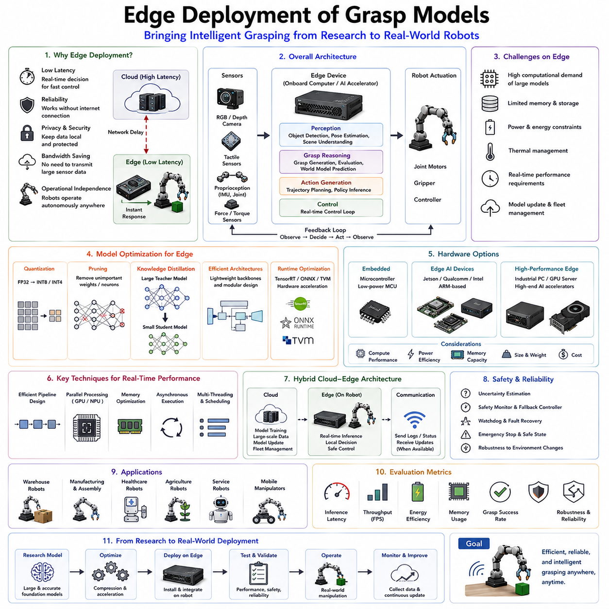{width="7.268055555555556in" height="7.268055555555556in"}

그래스프 모델의 엣지 배포(Edge Deployment of Grasp Models)는 로봇 그래스핑 연구를 실제 산업 현장과 서비스 환경에 적용하는 과정에서 가장 중요한 단계 중 하나이다. 최근 딥러닝, 파운데이션 모델(Foundation Model), 멀티모달 인식(Multimodal Perception), Vision-Language-Action(VLA), 월드 모델(World Model), 촉각-시각 융합(Tactile-Visual Fusion) 등의 기술 발전으로 로봇의 그래스핑 능력은 크게 향상되었다. 그러나 이러한 기술은 실제 로봇 위에서 안정적으로 동작할 때 비로소 가치를 가진다. 실제 환경에서는 항상 클라우드 서버를 사용할 수 있는 것이 아니며, 많은 응용 분야는 실시간 의사결정, 낮은 지연 시간(Low Latency), 높은 신뢰성(Reliability), 네트워크 독립성(Network Independence), 개인정보 보호(Privacy Protection)를 요구한다. 엣지 배포는 이러한 요구를 충족하기 위해 계산을 로봇 내부에서 수행하는 접근 방식이다. 즉, 센서 데이터를 원격 서버로 전송하여 처리하는 대신, 로봇에 탑재된 GPU, AI 가속기(AI Accelerator), 엣지 컴퓨터(Edge Computer)에서 직접 그래스프 모델을 실행한다.

Foundation Models for Grasping의 관점에서 Edge Deployment of Grasp Models는 고급 로봇 지능을 실제 산업용 로봇으로 전환하는 마지막 단계라고 할 수 있다.

초기의 산업용 로봇은 주로 기하학 기반 그래스프 계획(Geometric Grasp Planning), 힘 제어(Force Control), 규칙 기반 알고리즘(Rule-Based Algorithm)을 사용하였다. 이러한 방식은 비교적 적은 계산 자원으로도 동작할 수 있었다. 그러나 딥러닝 기반 그래스핑이 등장하면서 상황이 달라졌다. 현대의 그래스프 모델은 수백만 개에서 수십억 개 이상의 파라미터를 가지며, 시각, 언어, 촉각, 행동 계획을 하나의 모델 안에 통합한다. 이러한 모델은 뛰어난 성능을 제공하지만, 동시에 막대한 계산 자원을 요구한다.

엣지 배포가 필요한 가장 큰 이유는 실시간성(Real-Time Operation) 때문이다. 로봇은 지속적으로 환경을 관찰하고, 물체를 인식하며, 자세(Pose)를 추정하고, 그래스프 후보를 생성하고, 행동을 계획하고, 모터 명령을 생성해야 한다. 이러한 과정은 수 밀리초(ms) 단위로 반복되어야 한다. 만약 모든 데이터를 클라우드 서버로 전송하여 처리한다면 네트워크 지연(Network Latency)이 발생하며, 이는 그래스프 성공률 저하와 반응 속도 감소로 이어질 수 있다. 엣지 컴퓨팅은 이러한 문제를 최소화한다.

지연 시간(Latency)은 로봇 그래스핑 성능을 결정하는 핵심 요소이다. 인간은 매우 빠른 감각-운동 피드백 루프(Sensorimotor Feedback Loop)를 사용하여 물체를 조작한다. 로봇 역시 비슷한 수준의 빠른 반응이 필요하다. 카메라는 초당 30프레임, 60프레임, 심지어 120프레임 이상으로 데이터를 생성할 수 있으며, 촉각 센서는 고주파수 접촉 데이터를 제공한다. 제어 루프(Control Loop)는 수백 Hz에서 수천 Hz 수준으로 동작한다. 이러한 상황에서 클라우드 통신 지연이 발생하면 로봇은 동적 환경 변화에 충분히 빠르게 대응할 수 없게 된다.

신뢰성(Reliability) 또한 중요한 이유이다. 제조 공장, 물류 창고, 병원, 농업 현장, 광산, 군사용 시스템, 원격 서비스 로봇 등은 항상 안정적인 인터넷 연결을 보장할 수 없다. 클라우드 기반 시스템은 네트워크 장애, 서버 장애, 사이버 공격, 서비스 중단 등에 취약하다. 반면 엣지 배포는 네트워크가 끊겨도 로봇이 독립적으로 동작할 수 있도록 한다.

보안(Security)과 개인정보 보호(Privacy) 역시 중요한 고려 사항이다. 로봇은 제조 공정 데이터, 의료 정보, 물류 재고 정보, 고객 정보와 같은 민감한 데이터를 처리할 수 있다. 이러한 데이터를 외부 서버로 전송하면 보안 위험이 증가한다. 엣지 컴퓨팅은 데이터를 로컬에서 처리함으로써 정보 유출 가능성을 줄인다.

최근 AI 가속기(AI Accelerator)의 발전은 엣지 배포를 더욱 현실적으로 만들고 있다. 과거에는 CPU 중심의 계산 구조가 일반적이었지만, 현재는 GPU, NPU(Neural Processing Unit), TPU(Tensor Processing Unit), FPGA(Field Programmable Gate Array) 등이 활용되고 있다. 이러한 장치는 상대적으로 낮은 전력으로도 높은 AI 추론 성능을 제공한다.

엣지 하드웨어는 매우 다양한 형태로 존재한다. 가장 경량의 시스템은 마이크로컨트롤러(Microcontroller)를 사용하며, 중간 수준의 플랫폼은 NVIDIA Jetson, Qualcomm Robotics Platform, Intel Edge AI 플랫폼 등을 사용한다. 고성능 시스템은 RTX GPU 기반의 산업용 엣지 서버를 사용하기도 한다. 실제 선택은 작업 복잡도, 전력 소비, 열 관리, 예산, 실시간 요구사항에 따라 결정된다.

비전 기반 그래스핑(Vision-Based Grasping)은 엣지 배포에서 가장 큰 계산 부하를 발생시키는 요소 중 하나이다. RGB 영상, 깊이 영상(Depth Map), 포인트 클라우드(Point Cloud)를 처리해야 하며, 동시에 객체 탐지(Object Detection), 분할(Segmentation), 자세 추정(Pose Estimation), 그래스프 생성(Grasp Generation)을 수행해야 한다. 따라서 효율적인 비전 파이프라인 설계가 필수적이다.

깊이 인식(Depth Perception)은 추가적인 계산 부담을 만든다. RGB-D 카메라, 스테레오 비전(Stereo Vision), ToF(Time-of-Flight) 센서, LiDAR는 대량의 3차원 데이터를 생성한다. 그래스프 모델은 이러한 데이터를 실시간으로 처리하면서도 정확도를 유지해야 한다.

파운데이션 모델의 등장으로 엣지 배포는 더욱 어려워졌다. VLM, VLA, Octo, Pi0, RT-X, RT-2와 같은 모델은 수십억 개 이상의 파라미터를 포함할 수 있다. 이러한 모델을 그대로 로봇에 배포하는 것은 메모리, 저장 공간, 전력 소비 측면에서 매우 어렵다. 따라서 다양한 모델 최적화(Model Optimization) 기술이 사용된다.

모델 압축(Model Compression)은 엣지 배포의 핵심 기술이다. 가장 널리 사용되는 방법은 양자화(Quantization)이다. 원래 FP32(Floating Point 32-bit) 형식으로 저장된 가중치를 INT8, INT4 또는 혼합 정밀도(Mixed Precision) 형식으로 변환한다. 이를 통해 메모리 사용량을 크게 줄이고 추론 속도를 높일 수 있다.

프루닝(Pruning)도 중요한 방법이다. 대규모 신경망에는 실제로 필요하지 않은 연결(Connection)과 뉴런(Neuron)이 많이 존재한다. 프루닝은 이러한 불필요한 부분을 제거하여 계산량과 메모리 사용량을 줄인다.

지식 증류(Knowledge Distillation)는 대형 모델의 지식을 소형 모델로 전달하는 기술이다. 대형 Teacher Model이 학습한 지식을 작은 Student Model이 모방하도록 학습한다. 결과적으로 훨씬 작은 모델이 비슷한 성능을 달성할 수 있다.

LoRA(Low-Rank Adaptation)와 같은 파라미터 효율적 학습(Parameter-Efficient Fine-Tuning) 기법도 중요하다. 이를 통해 거대한 모델 전체를 수정하지 않고도 특정 작업에 맞게 적응시킬 수 있다.

런타임 최적화(Runtime Optimization) 역시 필수적이다. TensorRT, ONNX Runtime, OpenVINO, TVM과 같은 추론 엔진은 계산 그래프를 최적화하고, 연산을 병합하며, 하드웨어 병렬성을 최대한 활용한다. 이를 통해 동일한 모델이라도 훨씬 빠르게 실행할 수 있다.

에너지 효율성(Energy Efficiency)은 모바일 로봇에서 매우 중요하다. 배터리 기반 로봇은 계산에 사용하는 전력이 많아질수록 운용 시간이 줄어든다. 따라서 엣지 배포에서는 성능뿐 아니라 와트당 성능(Performance per Watt)도 중요한 지표가 된다.

열 관리(Thermal Management) 또한 중요한 문제이다. AI 모델은 지속적인 추론 과정에서 상당한 열을 발생시킨다. 온도가 높아지면 GPU는 성능 제한(Thermal Throttling)을 수행할 수 있으며, 이는 로봇 성능 저하로 이어진다. 따라서 효율적인 냉각 시스템과 하드웨어 최적화가 필요하다.

멀티모달 그래스핑(Multimodal Grasping)은 엣지 배포를 더욱 복잡하게 만든다. 현대의 그래스프 모델은 시각, 촉각, 언어, 고유 감각(Proprioception), 힘 센서 데이터를 동시에 처리한다. 각각의 모달리티는 추가적인 계산 자원을 요구하므로 효율적인 스케줄링과 자원 관리가 중요하다.

촉각-시각 융합 모델(Tactile-Visual Fusion Model)은 대표적인 사례이다. 카메라는 대량의 이미지 데이터를 생성하고, 촉각 센서는 고주파수 접촉 데이터를 생성한다. 두 데이터를 동시에 처리하여 그래스프 안정성을 향상시키려면 효율적인 엣지 아키텍처가 필요하다.

월드 모델(World Model) 역시 상당한 계산량을 요구한다. 월드 모델은 실제 행동을 수행하기 전에 미래를 시뮬레이션한다. 여러 그래스프 후보를 평가하기 위해 수많은 내부 시뮬레이션을 수행해야 하므로 계산 비용이 크다. 따라서 엣지 배포에서는 효율적인 예측 모델 설계가 필수적이다.

Vision-Language-Action(VLA) 모델은 가장 어려운 배포 대상 중 하나이다. 이들은 시각, 언어, 행동을 동시에 처리하며 매우 큰 모델 규모를 가진다. 따라서 최근에는 계층형 구조(Hierarchical Architecture)를 활용하여, 로컬에서는 경량 모델을 사용하고 필요할 때만 대형 모델을 호출하는 방식이 연구되고 있다.

하이브리드 클라우드-엣지 아키텍처(Hybrid Cloud-Edge Architecture)는 현실적인 대안으로 주목받고 있다. 시간에 민감한 그래스프 제어는 로컬에서 수행하고, 모델 학습이나 업데이트는 클라우드에서 수행하는 방식이다. 이는 엣지의 빠른 반응성과 클라우드의 높은 계산 능력을 동시에 활용할 수 있게 해준다.

로봇 플릿(Robot Fleet) 운영 환경에서는 수백\~수천 대의 로봇이 동시에 동작할 수 있다. 이러한 환경에서는 모델 배포, 버전 관리, 성능 모니터링, 지속적 업데이트 체계가 매우 중요하다. 엣지 배포는 이러한 대규모 운영 환경에서도 핵심 역할을 수행한다.

시뮬레이션은 엣지 배포 준비 과정에서도 중요한 역할을 한다. 실제 로봇에 모델을 배포하기 전에 하드웨어-인-더-루프(Hardware-in-the-Loop) 시뮬레이션을 통해 지연 시간, 메모리 사용량, 전력 소비, 발열 등을 평가할 수 있다.

안전성(Safety)은 가장 중요한 요소 중 하나이다. 실제 로봇은 사람, 장비, 제품과 직접 상호작용한다. 따라서 불확실성 추정(Uncertainty Estimation), 안전 모니터(Safety Monitor), 비상 정지(Emergency Stop), 백업 제어(Fallback Controller) 등이 반드시 포함되어야 한다.

배포된 그래스프 모델의 평가는 단순한 그래스프 성공률만으로는 충분하지 않다. 추론 지연 시간(Inference Latency), 처리량(Throughput), 에너지 효율성, 메모리 사용량, 발열 안정성, 유지보수성(Maintainability), 장기 신뢰성(Long-Term Reliability) 등이 모두 고려되어야 한다.

실제 산업 응용 분야에서 엣지 배포의 중요성은 더욱 분명해진다. 물류 로봇은 빠른 피킹(Picking) 의사결정을 해야 하며, 제조 로봇은 정밀 조립을 수행해야 한다. 의료 로봇은 안전성이 필수적이며, 농업 로봇은 네트워크가 제한된 환경에서 동작해야 한다. 서비스 로봇은 자연스러운 인간 상호작용을 위해 즉각적인 반응이 필요하다. 이러한 모든 분야에서 엣지 배포는 핵심 기술이다.

미래에는 더욱 강력한 AI 가속기와 효율적인 파운데이션 모델이 등장할 것으로 예상된다. 하드웨어 친화적 설계(Hardware-Aware Design), 동적 추론(Dynamic Inference), 분산 지능(Distributed Intelligence) 기술이 발전하면서 로봇은 더 높은 수준의 지능을 엣지 환경에서 직접 실행할 수 있게 될 것이다.

Foundation Models for Grasping의 전체 구조에서 Edge Deployment of Grasp Models는 최종적인 실용화 단계라고 할 수 있다. 파운데이션 모델은 지능을 제공하고, 촉각-시각 융합은 물리적 이해를 제공하며, 월드 모델은 미래 예측 능력을 제공한다. 그리고 엣지 배포는 이러한 모든 능력을 실제 로봇 위에서 동작하게 만든다. 따라서 엣지 배포는 범용 체화 지능(General-Purpose Embodied Intelligence)을 실제 산업과 서비스 환경으로 연결하는 핵심 기술이라고 할 수 있다.

## 12.11 Evaluation and Limitations

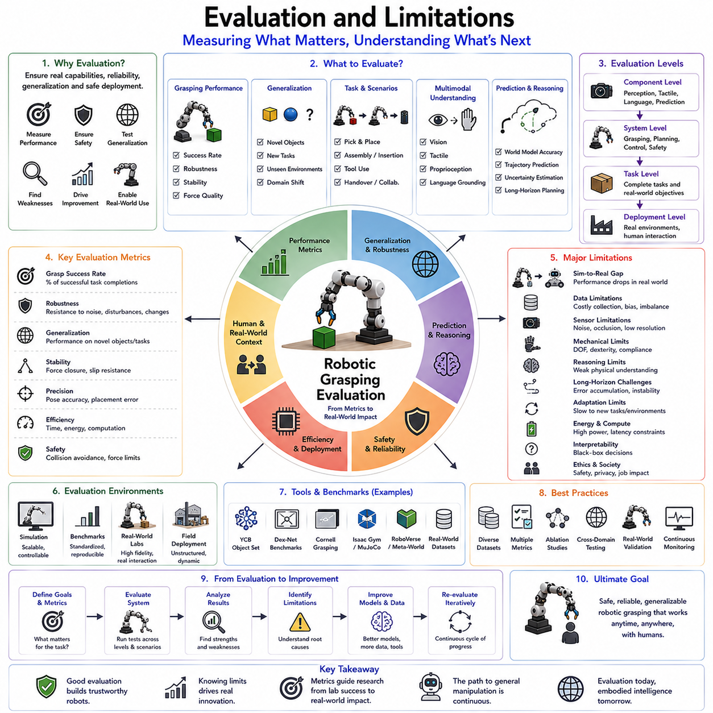{width="7.268055555555556in" height="7.268055555555556in"}

평가(Evaluation)와 한계(Limitations)는 로봇 그래스핑(Robotic Grasping) 시스템 개발 과정에서 마지막이자 가장 중요한 단계라고 할 수 있다. 로봇 매니퓰레이션 분야는 수십 년 동안 힘 폐쇄(Force Closure) 기반의 해석적 그래스프 계획(Analytical Grasp Planning)에서 시작하여 딥러닝(Deep Learning), 파운데이션 모델(Foundation Model), Vision-Language Model(VLM), Vision-Language-Action(VLA), 촉각-시각 융합(Tactile-Visual Fusion), 월드 모델(World Model), 체화 지능(Embodied Intelligence)으로 발전해 왔다. 각 기술은 실험실 환경과 벤치마크에서 인상적인 성과를 보여주었다. 그러나 가장 중요한 질문은 여전히 동일하다. 과연 이 시스템이 실제 환경에서 신뢰할 수 있는가? 새로운 환경에서도 동작하는가? 인간 수준의 일반화 능력을 가지는가? 실제 산업 현장에 배치할 수 있는가? 이러한 질문에 답하는 것이 평가이며, 현재 기술이 어디까지 가능한지 보여주는 것이 한계 분석이다.

Foundation Models for Grasping의 전체 구조에서 Evaluation and Limitations는 마지막 장에 위치한다. 왜냐하면 앞에서 다룬 파운데이션 모델, 오픈 보캐뷸러리 그래스핑(Open Vocabulary Grasping), 언어 조건부 조작(Language-Conditioned Manipulation), 촉각 융합(Tactile Fusion), 월드 모델(World Model), 엣지 배포(Edge Deployment) 등의 모든 기술은 결국 성능 향상을 목표로 하기 때문이다. 그러나 객관적인 평가가 없다면 실제 발전인지 단순한 벤치마크 최적화인지 판단할 수 없다. 또한 현재 기술의 한계를 이해해야만 다음 세대 연구 방향을 설정할 수 있다.

로봇 그래스핑의 평가 방법은 시간이 지나면서 크게 변화하였다. 초기에는 단순히 그래스프 성공 여부만을 측정하였다. 물체를 집어 올리고 일정 시간 동안 떨어뜨리지 않으면 성공으로 간주하였다. 이러한 성공률(Success Rate)은 지금도 중요한 지표이지만, 실제 성능을 충분히 설명하지는 못한다. 현대 로봇은 복잡한 환경, 다양한 물체, 불확실한 센서 정보, 장기 작업(Long-Horizon Task), 인간과의 상호작용을 다루어야 한다. 따라서 평가 역시 훨씬 더 포괄적인 접근이 필요하다.

그래스프 성공률(Grasp Success Rate)은 가장 기본적인 평가 지표이다. 이는 전체 시도 중 목표를 성공적으로 수행한 비율을 의미한다. 예를 들어 물체를 집고, 이동시키고, 원하는 위치에 정확히 놓는 작업을 기준으로 성공 여부를 판단할 수 있다. 성공률은 직관적이고 이해하기 쉽지만, 실패 원인이나 시스템의 강건성(Robustness)을 충분히 설명하지 못한다. 두 시스템이 동일한 성공률을 보이더라도 실제 성능은 크게 다를 수 있다.

강건성 평가는 점점 더 중요해지고 있다. 강건한 그래스핑 시스템은 물체 형상, 재질, 조명 조건, 센서 노이즈, 환경 복잡도, 외부 충격이 변해도 안정적인 성능을 유지해야 한다. 실제 환경은 실험실보다 훨씬 복잡하기 때문에 강건성은 실용성을 결정하는 핵심 요소이다.

일반화(Generalization)는 현대 그래스핑 연구의 가장 중요한 평가 기준 중 하나이다. 많은 시스템은 학습한 물체에 대해서는 우수한 성능을 보이지만, 처음 보는 물체에 대해서는 실패한다. 일반화 성능은 새로운 물체, 새로운 작업, 새로운 환경에서도 기존 지식을 활용할 수 있는 능력을 의미한다. 파운데이션 모델은 대규모 사전 학습을 통해 이러한 능력을 크게 향상시켰지만, 인간 수준의 일반화에는 아직 도달하지 못했다.

물체 다양성(Object Diversity)은 평가 과정에서 매우 중요하다. 실제 환경에는 강체(Rigid Object), 연성 물체(Deformable Object), 관절형 물체(Articulated Object), 투명 물체(Transparent Object), 반사 물체(Reflective Object), 깨지기 쉬운 물체(Fragile Object) 등이 존재한다. 다양한 물체를 포함한 평가일수록 실제 성능을 더 정확하게 반영할 수 있다.

작업 다양성(Task Diversity) 역시 중요하다. 과거에는 Pick-and-Place 중심의 평가가 대부분이었다. 그러나 현재 로봇은 공구 사용(Tool Use), 조립(Assembly), 삽입(Insertion), 분류(Sorting), 포장(Packaging), 접기(Folding), 사람에게 전달하기(Handover) 등 훨씬 복잡한 작업을 수행한다. 따라서 다양한 작업에 대한 평가가 필요하다.

파운데이션 모델은 새로운 평가 문제를 제기하였다. 기존 모델은 특정 작업만 수행했지만, 파운데이션 모델은 물체 인식, 언어 이해, 그래스프 계획, 행동 생성, 추론을 동시에 수행한다. 따라서 단순한 그래스프 성공률만으로는 성능을 평가할 수 없다. 다차원적 평가 체계가 필요하다.

언어 조건부 조작(Language-Conditioned Manipulation)은 의미적 평가(Semantic Evaluation)를 요구한다. 로봇이 자연어 명령을 올바르게 이해하고 실행하는지를 측정해야 한다. 예를 들어 "빨간 컵을 집어라"와 "파란 컵을 집어라"를 구분할 수 있는지, "조심스럽게 다뤄라"와 같은 제약 조건을 이해하는지를 평가해야 한다.

오픈 보캐뷸러리 그래스핑(Open Vocabulary Grasping)은 더욱 어려운 평가 문제를 가진다. 사전에 정의되지 않은 물체 이름이나 설명을 사용하여 목표를 찾고 조작해야 하기 때문이다. 따라서 물리적 성공뿐만 아니라 의미적 연결(Semantic Grounding) 능력도 평가해야 한다.

촉각-시각 융합(Tactile-Visual Fusion)은 새로운 평가 지표를 요구한다. 기존 비전 중심 평가로는 촉각 정보를 활용하는 능력을 측정할 수 없다. 따라서 접촉 상태 추정(Contact Estimation), 미끄러짐 감지(Slip Detection), 힘 제어(Force Regulation), 촉각 표현 학습(Tactile Representation Learning) 등의 성능을 별도로 평가해야 한다.

월드 모델(World Model)은 미래 예측 능력을 평가해야 한다. 월드 모델의 핵심은 미래 상태를 얼마나 정확하게 예측하는가에 있다. 따라서 궤적 예측(Trajectory Prediction), 접촉 예측(Contact Prediction), 불확실성 추정(Uncertainty Estimation), 장기 예측(Long-Horizon Forecasting) 등의 정확도가 중요한 평가 기준이 된다.

엣지 배포(Edge Deployment)는 새로운 공학적 평가 기준을 추가한다. 연구실에서는 정확도가 중요하지만, 실제 배포에서는 지연 시간(Inference Latency), 메모리 사용량(Memory Usage), 전력 소비(Power Consumption), 처리량(Throughput), 발열(Thermal Stability)이 중요하다. 아무리 정확한 모델이라도 실시간으로 실행할 수 없다면 실용적이지 않다.

안전성(Safety)은 점점 더 중요한 평가 요소가 되고 있다. 특히 인간과 함께 작업하는 협동 로봇(Collaborative Robot)에서는 충돌 회피(Collision Avoidance), 힘 제한(Force Limitation), 오류 복구(Fault Recovery), 안전 정지(Safe Failure) 능력이 필수적이다.

인간-로봇 상호작용(Human-Robot Interaction) 역시 중요한 평가 영역이다. 협업 작업에서는 단순한 성능뿐 아니라 신뢰성(Trust), 사용 편의성(Usability), 반응성(Responsiveness), 사용자 만족도(User Satisfaction)까지 고려해야 한다.

시뮬레이션 기반 평가(Simulation-Based Evaluation)는 로봇 연구에서 필수적인 도구이다. 다양한 물체, 환경, 센서 노이즈를 체계적으로 실험할 수 있으며 재현성(Reproducibility)이 높다. 그러나 시뮬레이션은 실제 세계를 완벽히 반영하지 못한다.

이 때문에 Sim-to-Real Gap은 여전히 큰 문제이다. 시뮬레이션에서 우수한 성능을 보인 모델이 실제 환경에서는 크게 성능이 저하되는 경우가 많다. 센서 특성, 마찰 계수, 조명, 접촉 역학(Contact Dynamics) 등의 차이가 원인이다.

벤치마크 데이터셋(Benchmark Dataset)은 연구 발전에 큰 기여를 하였다. 그러나 벤치마크 중심 연구는 또 다른 문제를 만든다. 연구자들이 실제 성능보다 벤치마크 점수 향상에 집중하게 되는 현상이 발생할 수 있다. 따라서 높은 벤치마크 점수가 반드시 실제 현장 성능을 보장하지는 않는다.

데이터 부족(Data Limitation)은 여전히 큰 제약 요소이다. 파운데이션 모델은 대규모 데이터를 요구하지만, 로봇 데이터 수집은 비용이 매우 높다. 또한 특정 물체나 환경에 편향된 데이터는 일반화 성능을 저하시킬 수 있다.

센서 한계(Sensor Limitation)도 존재한다. 카메라는 가림(Occlusion), 반사(Reflection), 투명 물체(Transparency), 조명 변화에 취약하다. 촉각 센서는 비싸고 내구성이 낮으며 통합이 어렵다. 인간은 훨씬 풍부한 감각 체계를 사용하지만, 현재 로봇은 아직 이에 미치지 못한다.

하드웨어 한계(Mechanical Limitation) 역시 중요하다. 대부분의 로봇 손은 인간 손보다 자유도(DOF)가 적고, 순응성(Compliance)과 촉각 해상도(Tactile Resolution)가 낮다. 따라서 아무리 뛰어난 AI를 사용하더라도 하드웨어가 제한되면 성능에도 한계가 있다.

추론 능력(Reasoning Limitation)도 아직 부족하다. 파운데이션 모델은 의미적 이해는 뛰어나지만 물리적 이해는 완전하지 않다. 때로는 물리 법칙을 위반하는 계획을 생성하거나, 숨겨진 물체 특성을 고려하지 못할 수 있다.

장기 조작(Long-Horizon Manipulation)은 가장 어려운 문제 중 하나이다. 개별 그래스프는 성공하더라도 수십\~수백 단계의 작업이 연결되면 작은 오차가 누적되어 실패할 수 있다. 조립, 청소, 요리, 유지보수 작업은 아직 매우 어려운 과제이다.

적응성(Adaptation) 역시 인간 수준에 도달하지 못했다. 인간은 새로운 물체를 몇 번 만져보는 것만으로 적응할 수 있지만, 로봇은 여전히 재학습(Retraining), 파인튜닝(Fine-Tuning), 추가 시연(Demonstration)이 필요한 경우가 많다.

에너지 효율성(Energy Efficiency)은 실용적인 한계이다. 대규모 파운데이션 모델은 많은 계산 자원을 요구하며, 모바일 로봇의 배터리 제약과 충돌한다. 모델 압축, 양자화, 지식 증류 기술이 발전하고 있지만 아직 완전한 해결책은 아니다.

설명 가능성(Interpretability)도 중요한 문제이다. 딥러닝 모델은 종종 블랙박스(Black Box)처럼 동작한다. 왜 특정 그래스프가 성공했는지 또는 실패했는지를 이해하기 어려운 경우가 많다. 이는 디버깅, 안전 인증, 신뢰성 확보를 어렵게 만든다.

윤리적·사회적 문제(Ethical and Societal Considerations)도 점점 중요해지고 있다. 지능형 로봇의 대규모 보급은 노동 시장 변화, 안전 규제, 책임 소재(Accountability), 개인정보 보호(Privacy), 인간 자율성(Human Autonomy)과 관련된 새로운 문제를 만들어낼 수 있다.

미래의 평가 체계는 더욱 통합적(Holistic)인 방향으로 발전할 것으로 예상된다. 단순한 그래스프 성공률이 아니라 인식(Perception), 추론(Reasoning), 계획(Planning), 조작(Manipulation), 학습(Learning), 적응(Adaptation), 협업(Collaboration), 안전성(Safety)을 종합적으로 평가하는 방향으로 발전할 것이다.

결국 미래 연구 방향은 현재의 한계가 결정한다. 일반화 성능 향상, 데이터 요구량 감소, 촉각 지능 강화, 월드 모델 발전, 평생 학습(Lifelong Learning), 물리 추론 능력 향상, 에너지 효율 개선, 설명 가능성 강화가 차세대 로봇 연구의 핵심 과제가 될 것이다.

Foundation Models for Grasping의 전체 구조에서 Evaluation and Limitations는 과학적 발전의 기반을 제공한다. 평가는 현재 기술의 수준을 객관적으로 측정하고, 한계 분석은 앞으로 해결해야 할 문제를 명확하게 보여준다. 파운데이션 모델, 촉각 지능, 월드 모델, 체화 지능이 계속 발전하더라도, 엄격한 평가와 한계에 대한 정확한 이해는 실험실 수준의 성과를 실제 환경에서 신뢰할 수 있는 로봇 지능으로 발전시키는 데 필수적인 요소로 남을 것이다.
