**Volume 06 Robot Hands and Dexterous Grasping**


# 13. Tool Use and Assembly

##  

## 13.01 Tool Use in Robotics

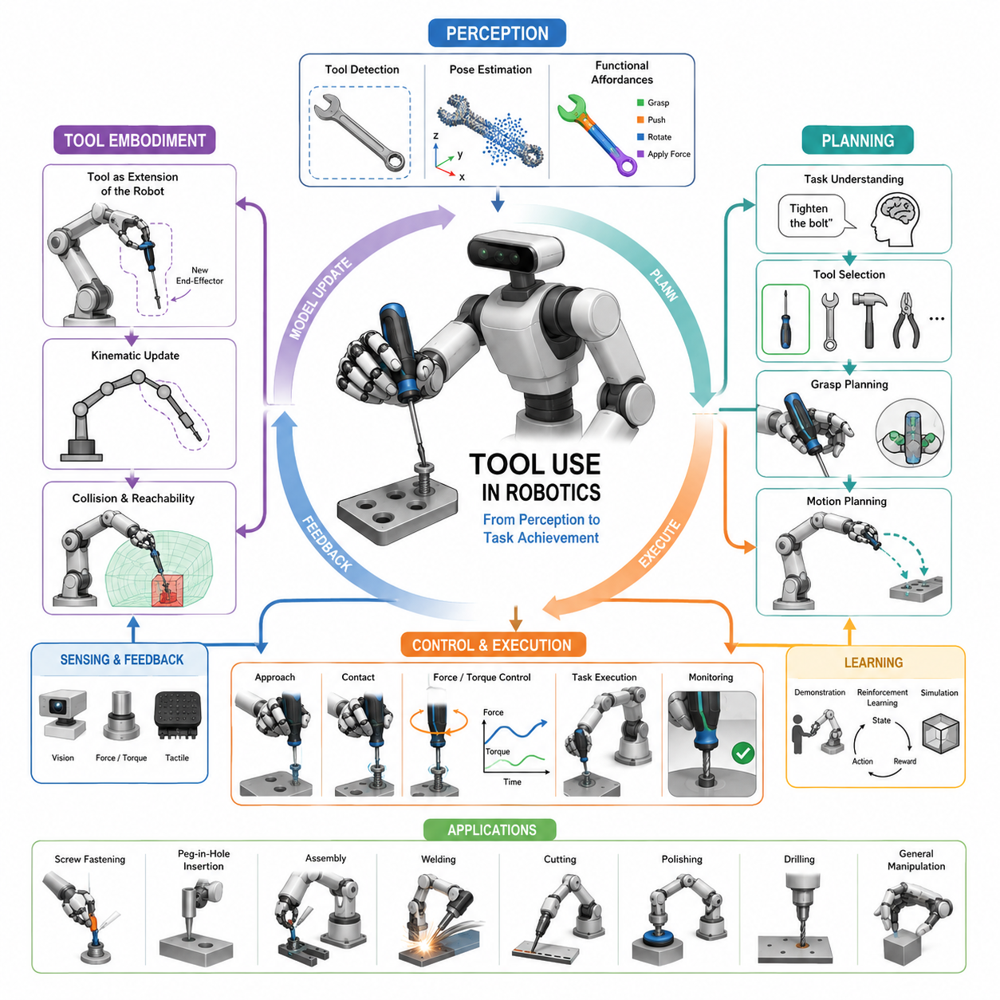{width="7.268055555555556in" height="7.268055555555556in"}

Tool use is one of the defining capabilities that separates advanced robotic manipulation from simple grasp-and-release operations. While basic grasping focuses on acquiring and holding objects, tool use requires a robot to understand how an external object can extend its physical capabilities and modify its interaction with the environment. Humans routinely use tools to amplify force, increase reach, improve precision, and accomplish tasks that would otherwise be impossible. In robotics, achieving comparable capabilities represents a major milestone toward general-purpose manipulation, autonomous assembly, industrial automation, and embodied intelligence. Within the broader context of dexterous grasping and robot hands, tool use occupies a unique position because it combines perception, grasp planning, force control, reasoning, task planning, and physical interaction into a unified manipulation framework.

A tool can be defined as an external object intentionally manipulated to achieve a desired effect on another object or environment. Unlike ordinary grasping tasks, where the goal is simply to hold an object securely, tool-use tasks require understanding functional affordances. The robot must recognize not only the geometry of the tool but also its intended purpose. A screwdriver is not merely a cylindrical object with a handle; it is an instrument designed to transmit rotational torque. A hammer is not simply a rigid body; it is a force amplification device. A wrench is a torque transfer mechanism, and pliers are force-concentrating tools capable of gripping and manipulating other objects. Successful robotic tool use therefore requires reasoning about function in addition to shape.

Historically, industrial robots performed tool-related tasks through highly structured automation. Welding robots, painting robots, drilling robots, and assembly robots have used tools for decades. However, these systems typically operate within carefully engineered environments where tool positions, object locations, and task sequences are predetermined. The robot does not truly understand the tool. Instead, engineers encode task-specific motions and trajectories. Modern robotics research aims to move beyond such rigid automation toward adaptive tool use in dynamic and unstructured environments. The objective is to create robots capable of identifying tools, selecting appropriate manipulation strategies, and executing tasks without extensive manual programming.

One of the fundamental challenges in robotic tool use is the distinction between grasp affordances and task affordances. A grasp affordance describes how a robot can securely hold a tool, whereas a task affordance describes how the tool should be used after grasp acquisition. These two requirements are often conflicting. The grasp that maximizes stability may not be the grasp that enables effective tool operation. For example, grasping a screwdriver near its tip may provide a stable hold, but it prevents insertion into a screw. Grasping the handle enables functionality but may reduce stability under certain conditions. Consequently, robotic systems must optimize grasp selection based on both grasp quality and downstream task requirements.

The concept of affordances, originally introduced in ecological psychology, has become central to robotic tool-use research. Affordances describe actionable possibilities offered by objects within a given environment. For a robot, recognizing affordances means identifying which parts of an object can be grasped, manipulated, pushed, pulled, rotated, or used as a tool. Modern vision systems often employ deep neural networks to infer affordances directly from visual observations. These systems learn that a handle affords grasping, a blade affords cutting, and a hammerhead affords striking. Such representations enable robots to generalize across previously unseen tools.

Tool use significantly increases manipulation complexity because the robot\'s kinematic chain effectively changes when a tool is grasped. Once a tool becomes attached to the robot hand, the operational endpoint is no longer the fingertip or gripper. Instead, the functional tip of the tool becomes the new end-effector. This transformation introduces new geometric relationships, collision constraints, and control requirements. The robot must estimate the tool\'s dimensions, orientation, mass properties, and interaction points. Errors in these estimates can lead to task failure or damage.

Tool embodiment represents another important concept. Humans naturally incorporate tools into their body schema after sufficient experience. A person using a tennis racket or screwdriver begins to perceive the tool as an extension of the arm. Robotics researchers seek similar capabilities in artificial systems. Tool embodiment allows robots to update their internal models so that the tool becomes part of the manipulator representation. This adaptation improves motion planning, collision avoidance, and force control. Instead of treating the tool as an external object, the robot treats it as an integrated component of its body.

Perception plays a critical role throughout the tool-use pipeline. The robot must first detect the tool within the environment. Detection involves identifying candidate objects and distinguishing tools from other items. Once detected, the robot must estimate the tool\'s pose, orientation, dimensions, and operational features. Modern approaches often employ RGB cameras, depth sensors, stereo vision systems, and point cloud processing techniques. Deep learning models trained on large-scale datasets can classify tool categories and predict functional regions. In industrial settings, fiducial markers and CAD-based matching techniques may also be used to improve reliability.

After tool detection, localization accuracy becomes essential. Many assembly and manufacturing tasks require sub-millimeter precision. Slight misalignment between the estimated and actual tool pose can cause insertion failures, screw stripping, or component damage. Consequently, robotic systems often combine vision-based localization with tactile feedback, force sensing, and compliance control to compensate for perception errors.

Grasp planning for tool use differs substantially from ordinary object grasping. Traditional grasp planning seeks stable force closure and resistance to disturbances. Tool-oriented grasp planning must additionally consider task execution. The robot must determine where to grasp, how firmly to grasp, and how the grasp will affect the subsequent operation. For example, using pliers requires maintaining a grasp that allows actuation of the plier handles. Using a hammer requires positioning the grasp to maximize striking efficiency while maintaining control. These considerations introduce task-dependent optimization objectives.

Force and torque control are particularly important in tool-use applications. Many tools are designed to transfer forces to external objects. A screwdriver applies rotational torque, a hammer generates impact forces, and a wrench applies sustained torque. The robot must regulate these forces accurately to achieve task objectives without damaging components. Force control algorithms often operate alongside impedance control and compliance control strategies. These methods allow the robot to adapt to environmental uncertainties and maintain stable contact during interaction.

Contact-rich manipulation is closely associated with robotic tool use. In contact-rich tasks, success depends on maintaining continuous interaction with the environment. Examples include insertion, scraping, polishing, drilling, fastening, and assembly. Unlike free-space motion, contact-rich manipulation requires continuous monitoring of forces, torques, and contact states. Small deviations can accumulate and cause failure. Consequently, robotic systems often employ hybrid position-force control architectures that simultaneously regulate motion and interaction forces.

Assembly operations represent one of the most economically important applications of robotic tool use. Modern manufacturing environments require robots to perform tasks such as inserting components, tightening screws, connecting cables, and assembling complex products. These tasks involve multiple stages of perception, manipulation, and force-controlled interaction. Even seemingly simple operations such as inserting a peg into a hole require precise alignment, compliance management, and error recovery strategies.

Peg-in-hole insertion has become a canonical benchmark for robotic assembly research. The task appears straightforward but embodies many of the challenges associated with tool use. The robot must localize the target hole, align the insertion axis, detect contact conditions, and regulate insertion forces. Variations in tolerances, material properties, and environmental conditions further increase complexity. Researchers frequently use peg-in-hole tasks to evaluate manipulation algorithms, force control methods, and learning-based assembly systems.

Screw fastening is another representative tool-use task. Successful screw insertion requires coordination between translational and rotational motion. The robot must align the screwdriver with the screw head, apply appropriate downward force, maintain engagement, and regulate rotational torque. Excessive torque may damage components, while insufficient torque may result in incomplete fastening. Advanced systems integrate vision, tactile sensing, and force feedback to achieve reliable screw-driving performance.

The emergence of dexterous robot hands has significantly expanded tool-use capabilities. Multi-fingered hands provide greater flexibility than traditional parallel-jaw grippers. They enable regrasping, in-hand manipulation, and dynamic adjustment of grasp configurations. Such capabilities are particularly valuable when manipulating complex tools that require precise orientation changes during operation. Dexterous hands also facilitate transitions between grasp types, allowing robots to adapt their manipulation strategies to evolving task requirements.

Learning-based approaches have transformed the field of robotic tool use. Traditional systems relied heavily on manually engineered rules and task-specific programming. Modern robots increasingly learn manipulation skills from demonstrations, simulation, reinforcement learning, and large-scale datasets. Learning enables robots to discover effective tool-use strategies that may not be obvious to human designers. Reinforcement learning agents can optimize tool trajectories through trial and error, while imitation learning allows robots to reproduce expert demonstrations.

Simulation environments have become essential for tool-use research. Physical experimentation with real robots is expensive, time-consuming, and potentially hazardous. Simulation platforms provide scalable environments for generating large quantities of training data. Physics engines model contact interactions, rigid-body dynamics, friction, and collisions. Researchers can evaluate thousands of manipulation scenarios before transferring policies to physical robots. Domain randomization techniques further improve robustness by exposing learning algorithms to diverse environmental conditions.

Recent advances in foundation models and embodied AI have opened new directions for robotic tool use. Vision-language models can associate textual descriptions with visual observations, enabling robots to understand tool names, functions, and instructions. Vision-language-action models extend this capability by connecting perception directly to manipulation behavior. Instead of programming every task explicitly, users can provide high-level commands such as "tighten the bolt," "cut the cable tie," or "assemble the bracket." The robot interprets the instruction, selects appropriate tools, and executes the required actions.

Generalization remains one of the most important research challenges. Human beings can often use unfamiliar tools after minimal observation. Robots, by contrast, frequently struggle with novel objects. Developing representations that capture functional similarities across tool categories is therefore a major objective. Researchers investigate affordance learning, relational reasoning, causal inference, and world modeling techniques to improve generalization. The ultimate goal is to enable robots to infer how an unfamiliar tool should be used based on prior experience with related objects.

Safety considerations are particularly important in robotic tool use. Many tools are inherently hazardous. Cutting tools, drilling tools, grinders, welding equipment, and powered actuators pose significant risks to humans and equipment. Robots operating in collaborative environments must detect nearby humans, monitor tool states, and enforce safety constraints. Risk-aware planning algorithms evaluate potential hazards before executing actions. Safety-certified control architectures further reduce the likelihood of accidents.

Tool-use capability is increasingly viewed as a key indicator of robotic intelligence. A robot capable of selecting, grasping, and using tools demonstrates an understanding of functional relationships between objects, actions, and goals. Such behavior reflects a deeper level of embodied cognition than simple pick-and-place operations. Tool use requires integrating perception, reasoning, planning, control, learning, and physical interaction into a coherent system.

Looking toward the future, robotic tool use is expected to become a foundational capability for mobile manipulators, humanoid robots, industrial automation systems, healthcare robots, service robots, and domestic assistants. As advances in dexterous manipulation, tactile sensing, foundation models, and embodied AI continue to accelerate, robots will increasingly perform complex tool-mediated tasks with levels of adaptability approaching those of human workers. The progression from simple grasping to sophisticated tool use represents not merely an incremental improvement in manipulation capability, but a fundamental step toward general-purpose robotic intelligence and autonomous physical problem solving.

도구 사용(Tool Use)은 고급 로봇 조작 기술을 단순한 파지(Grasping) 및 물체 이동 작업과 구분하는 핵심 능력 중 하나이다. 기본적인 파지가 물체를 집고 유지하는 데 초점을 둔다면, 도구 사용은 외부 물체를 활용하여 로봇의 물리적 능력을 확장하고 환경과의 상호작용 방식을 변화시키는 것을 의미한다. 인간은 일상적으로 도구를 사용하여 힘을 증폭시키고, 작업 범위를 넓히며, 정밀도를 향상시키고, 맨손으로는 수행하기 어려운 작업을 수행한다. 로봇이 이러한 능력을 획득하는 것은 범용 조작(General-Purpose Manipulation), 자율 조립(Autonomous Assembly), 산업 자동화(Industrial Automation), 그리고 체화 지능(Embodied Intelligence) 실현을 위한 중요한 이정표로 간주된다.

특히 정교한 로봇 핸드(Dexterous Hand)와 파지 기술의 관점에서 도구 사용은 매우 독특한 위치를 차지한다. 이는 인지(Perception), 파지 계획(Grasp Planning), 힘 제어(Force Control), 추론(Reasoning), 작업 계획(Task Planning), 그리고 물리적 상호작용(Physical Interaction)을 하나의 통합된 시스템으로 결합해야 하기 때문이다.

도구는 원하는 효과를 얻기 위해 의도적으로 조작되는 외부 물체로 정의할 수 있다. 일반적인 파지 작업에서는 물체를 안정적으로 잡는 것이 목표이지만, 도구 사용에서는 기능적 이해(Functional Understanding)가 필수적이다. 로봇은 도구의 형상만 인식하는 것이 아니라 그 목적과 기능까지 이해해야 한다. 예를 들어 드라이버(Screwdriver)는 단순한 원통형 물체가 아니라 회전 토크를 전달하는 장치이다. 망치(Hammer)는 단순한 강체가 아니라 충격력을 증폭하는 도구이며, 렌치(Wrench)는 토크 전달 장치이고 플라이어(Pliers)는 힘을 집중시켜 다른 물체를 조작하는 장치이다. 따라서 성공적인 로봇 도구 사용은 형상 이해뿐 아니라 기능 이해까지 포함해야 한다.

역사적으로 산업용 로봇은 수십 년 동안 용접, 도장, 드릴링, 조립과 같은 작업에서 도구를 사용해 왔다. 그러나 이러한 시스템은 대부분 작업 환경이 철저히 구조화되어 있고 도구 위치와 작업 순서가 사전에 정의되어 있었다. 즉 로봇이 실제로 도구를 이해하는 것이 아니라 엔지니어가 모든 동작을 미리 프로그래밍한 것이다. 현대 로봇공학은 이러한 경직된 자동화를 넘어 동적이고 비정형적인 환경에서도 스스로 도구를 인식하고 사용할 수 있는 적응형 시스템을 목표로 한다.

도구 사용에서 가장 중요한 개념 중 하나는 파지 어포던스(Grasp Affordance)와 작업 어포던스(Task Affordance)의 차이이다. 파지 어포던스는 도구를 안정적으로 잡을 수 있는 방법을 의미하고, 작업 어포던스는 도구를 실제로 어떻게 사용해야 하는지를 의미한다. 흥미롭게도 이 두 요구사항은 종종 충돌한다. 예를 들어 드라이버의 끝부분을 잡으면 매우 안정적일 수 있지만 나사를 조일 수는 없다. 반대로 손잡이를 잡아야 기능 수행이 가능하지만 파지 안정성은 상대적으로 감소할 수 있다. 따라서 로봇은 단순한 파지 품질뿐 아니라 이후 작업까지 고려하여 최적의 파지 전략을 선택해야 한다.

어포던스(Affordance) 개념은 현대 도구 사용 연구의 핵심이 되었다. 어포던스는 특정 물체가 제공하는 행동 가능성을 의미한다. 로봇은 어떤 부분이 잡기 적합한지, 어떤 부분이 밀기 적합한지, 어떤 부분이 회전이나 절단에 사용되는지를 이해해야 한다. 최근에는 딥러닝 기반 시스템이 이미지로부터 직접 어포던스를 추론한다. 이러한 시스템은 손잡이는 잡기 위한 부분이며, 칼날은 절단을 위한 부분이고, 망치 머리는 타격을 위한 부분이라는 기능적 정보를 학습한다. 이를 통해 이전에 보지 못한 도구에 대해서도 일반화가 가능해진다.

도구 사용은 로봇의 운동학적 구조를 실질적으로 변화시킨다. 로봇이 도구를 손에 쥐는 순간 작업의 최종 끝점은 더 이상 손가락이나 그리퍼가 아니다. 도구의 기능적 끝부분이 새로운 엔드이펙터(End-Effector)가 된다. 따라서 로봇은 도구의 길이, 질량, 무게중심, 형상, 충돌 영역 등을 모두 고려하여 새로운 운동학 모델을 구축해야 한다. 이러한 정보가 부정확하면 작업 실패나 장비 손상으로 이어질 수 있다.

도구 체화(Tool Embodiment) 역시 중요한 개념이다. 인간은 반복 사용을 통해 도구를 자신의 신체 일부처럼 인식한다. 테니스 라켓이나 드라이버를 사용하는 사람은 점차 그것을 팔의 연장선으로 느끼게 된다. 로봇 연구자들은 이러한 능력을 인공 시스템에 구현하고자 한다. 도구 체화가 이루어지면 로봇은 도구를 외부 물체가 아닌 자신의 신체 구조 일부로 인식하며, 경로 계획, 충돌 회피, 힘 제어 성능이 크게 향상된다.

도구 사용 과정에서 인지는 매우 중요한 역할을 수행한다. 로봇은 먼저 환경 속에서 도구를 탐지해야 한다. 이후 도구의 위치, 자세(Pose), 방향, 크기, 기능 영역을 추정해야 한다. 이를 위해 RGB 카메라, 깊이 카메라, 스테레오 비전, 포인트 클라우드(Point Cloud) 처리 기술이 활용된다. 최근에는 대규모 데이터셋으로 학습된 딥러닝 모델이 도구 종류를 분류하고 기능 영역을 예측하는 데 사용된다.

도구를 탐지한 이후에는 정밀한 위치 추정이 요구된다. 많은 조립 작업은 서브밀리미터(Sub-Millimeter) 수준의 정밀도를 필요로 한다. 도구 위치가 조금만 잘못 추정되어도 삽입 실패, 나사 손상, 제품 파손 등이 발생할 수 있다. 따라서 실제 산업 현장에서는 비전 기반 위치 추정과 함께 촉각 센서(Tactile Sensor), 힘 센서(Force Sensor), 순응 제어(Compliance Control)를 결합하여 오차를 보정한다.

도구 사용을 위한 파지 계획은 일반적인 물체 파지와 상당히 다르다. 기존 파지 계획은 힘 폐쇄(Force Closure)와 안정성을 최대화하는 것이 목표였다. 그러나 도구 파지에서는 이후 작업 수행 능력이 추가로 고려되어야 한다. 로봇은 어디를 잡을 것인지, 얼마나 강하게 잡을 것인지, 그리고 그 파지가 실제 작업에 어떤 영향을 미치는지를 평가해야 한다. 예를 들어 플라이어를 사용할 때는 손잡이를 움직일 수 있도록 잡아야 하며, 망치를 사용할 때는 충격 효율을 극대화할 수 있는 위치를 선택해야 한다.

힘 및 토크 제어는 도구 사용의 핵심 기술이다. 대부분의 도구는 외부 대상에 힘을 전달하기 위해 설계되었다. 드라이버는 회전 토크를 전달하고, 망치는 충격력을 전달하며, 렌치는 지속적인 토크를 전달한다. 로봇은 작업 목적에 맞게 힘을 정밀하게 조절해야 하며, 과도한 힘으로 인한 손상을 방지해야 한다. 이를 위해 힘 제어, 임피던스 제어(Impedance Control), 순응 제어가 함께 사용된다.

도구 사용은 접촉 중심 조작(Contact-Rich Manipulation)과 밀접하게 연결되어 있다. 삽입, 연마, 스크래핑, 드릴링, 체결 작업 등은 모두 지속적인 접촉 상태를 유지해야 한다. 자유 공간에서의 단순 이동과 달리 접촉 중심 작업은 힘, 토크, 접촉 상태를 지속적으로 모니터링해야 하며 작은 오차도 실패로 이어질 수 있다. 따라서 위치 제어와 힘 제어를 동시에 수행하는 하이브리드 제어(Hybrid Position-Force Control)가 널리 사용된다.

조립(Assembly)은 도구 사용이 가장 큰 경제적 가치를 창출하는 분야 중 하나이다. 현대 제조업에서는 부품 삽입, 나사 체결, 케이블 연결, 복잡한 제품 조립과 같은 작업이 필수적이다. 이러한 작업은 인지, 조작, 힘 제어, 오류 복구 전략이 모두 요구되는 고난도 작업이다.

대표적인 조립 벤치마크(Benchmark)로는 페그 인 홀(Peg-in-Hole) 작업이 있다. 이 작업은 단순해 보이지만 실제로는 위치 정렬, 접촉 감지, 힘 조절, 순응 제어 등 다양한 기술을 필요로 한다. 제조 공정에서 매우 자주 등장하는 기본적인 조립 문제이기 때문에 수많은 연구에서 성능 평가 기준으로 사용된다.

스크루 체결(Screw Fastening) 역시 대표적인 도구 사용 작업이다. 로봇은 드라이버를 나사와 정렬한 후 적절한 하중을 가하면서 회전 운동을 수행해야 한다. 토크가 너무 크면 나사가 손상되고, 너무 작으면 체결이 불완전해진다. 따라서 비전, 촉각, 힘 센서를 통합하여 정밀하게 제어해야 한다.

다지형 로봇 핸드(Multi-Fingered Hand)의 발전은 도구 사용 능력을 크게 향상시켰다. 기존의 평행 그리퍼와 달리 다지형 핸드는 재파지(Regrasping), 인핸드 조작(In-Hand Manipulation), 동적 자세 변경 등을 수행할 수 있다. 이러한 기능은 작업 중 도구의 방향을 변경해야 하는 복잡한 조작에서 매우 중요하다.

최근에는 학습 기반 접근법(Learning-Based Approach)이 도구 사용 분야를 크게 변화시키고 있다. 과거에는 모든 작업을 사람이 직접 프로그래밍해야 했지만, 현재는 시연 학습(Learning from Demonstration), 강화학습(Reinforcement Learning), 자기지도학습(Self-Supervised Learning) 등을 통해 로봇이 스스로 조작 전략을 학습한다. 강화학습은 반복적인 시행착오를 통해 최적의 도구 사용 전략을 찾고, 모방학습은 인간 전문가의 동작을 재현하도록 학습한다.

시뮬레이션은 이러한 학습 과정에서 매우 중요한 역할을 한다. 실제 로봇으로 수백만 번의 실험을 수행하는 것은 현실적으로 어렵기 때문이다. 물리 엔진은 접촉, 마찰, 충돌, 강체 동역학을 모델링하며, 연구자는 가상 환경에서 대규모 데이터를 생성할 수 있다. 이후 Sim-to-Real 전이 기술을 활용하여 실제 로봇에 적용한다.

최근의 파운데이션 모델(Foundation Model)과 체화 AI(Embodied AI)는 로봇 도구 사용의 새로운 가능성을 열고 있다. 비전-언어 모델(Vision-Language Model)은 도구의 이름과 기능을 이해할 수 있으며, 비전-언어-행동 모델(Vision-Language-Action Model)은 자연어 명령을 실제 조작 행동으로 변환한다. 사용자가 "볼트를 조여라", "케이블 타이를 잘라라", "브래킷을 조립하라"와 같은 명령을 내리면 로봇은 적절한 도구를 선택하고 작업을 수행할 수 있다.

일반화(Generalization)는 여전히 가장 중요한 연구 과제 중 하나이다. 인간은 처음 보는 도구도 짧은 관찰만으로 사용할 수 있지만, 로봇은 여전히 새로운 도구에 취약하다. 따라서 연구자들은 어포던스 학습, 관계 추론(Relational Reasoning), 인과 추론(Causal Reasoning), 월드 모델(World Model) 등을 활용하여 일반화 능력을 향상시키고자 한다.

안전성 역시 매우 중요하다. 절단기, 드릴, 용접 장비, 연마 장비와 같은 도구는 사람과 장비에 위험을 초래할 수 있다. 따라서 협동 로봇 환경에서는 사람 감지, 위험 평가, 안전 제어 아키텍처가 필수적으로 요구된다.

도구 사용 능력은 점차 로봇 지능의 핵심 지표로 간주되고 있다. 도구를 선택하고, 파지하고, 올바르게 사용하는 로봇은 단순히 물체를 이동하는 수준을 넘어 물체와 작업 목표 사이의 기능적 관계를 이해하는 수준에 도달했다고 볼 수 있다. 이는 인지, 추론, 계획, 제어, 학습이 통합된 고차원적인 체화 지능의 표현이다.

미래에는 도구 사용 능력이 모바일 매니퓰레이터(Mobile Manipulator), 휴머노이드 로봇(Humanoid Robot), 산업용 조립 로봇, 의료 로봇, 서비스 로봇, 가정용 로봇의 핵심 기능이 될 것으로 예상된다. 정교한 손 조작 기술, 촉각 센서, 파운데이션 모델, 체화 AI 기술이 발전함에 따라 로봇은 인간에 가까운 수준의 적응성과 유연성을 갖춘 도구 사용 능력을 확보하게 될 것이다. 결국 단순한 파지에서 고도화된 도구 사용으로의 발전은 단순한 기능 향상이 아니라 범용 로봇 지능(General Robotic Intelligence)과 자율적 물리 문제 해결(Autonomous Physical Problem Solving)로 나아가는 핵심 단계라고 할 수 있다.

##  

## 13.02 Tool Taxonomy

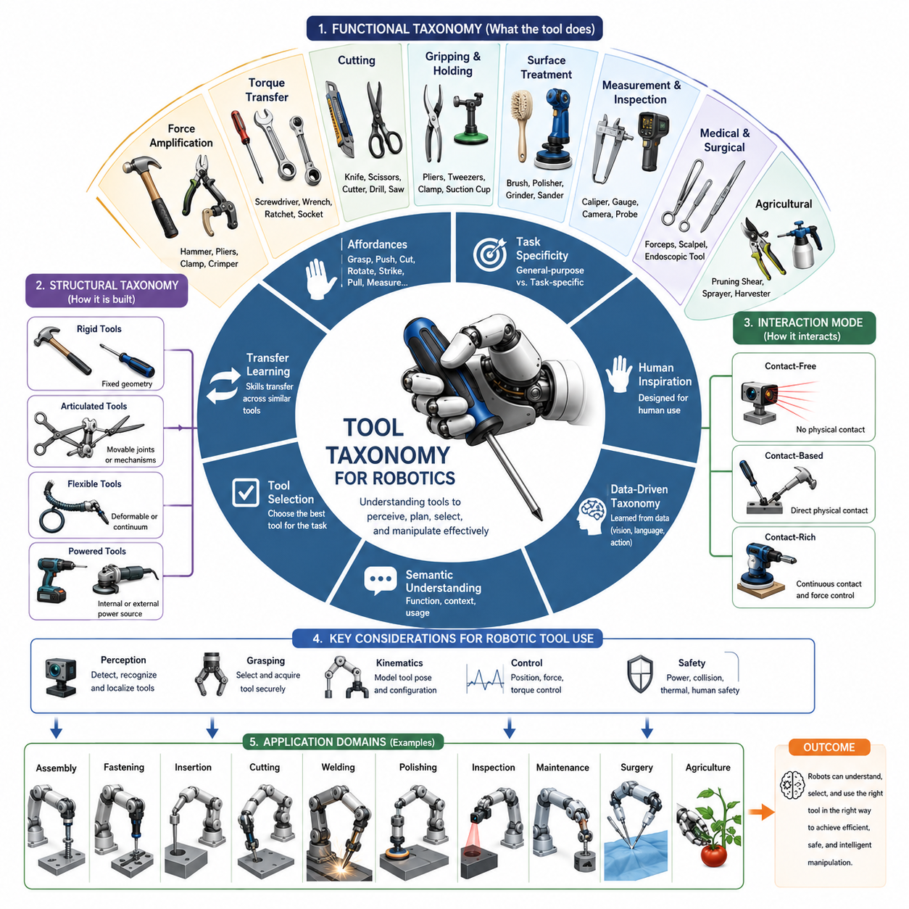{width="7.268055555555556in" height="7.268055555555556in"}

Tool taxonomy is the systematic classification of tools according to their physical structure, functional purpose, interaction characteristics, and manipulation requirements. In robotics, a well-defined tool taxonomy serves as a foundational framework for perception, grasp planning, task planning, manipulation learning, assembly automation, and embodied intelligence. Human beings naturally categorize tools based on experience and functional understanding. A person immediately recognizes that a hammer belongs to a different category than a screwdriver, even though both are handheld tools. Robots require similar organizational structures to reason about tools, predict their behavior, select appropriate manipulation strategies, and generalize knowledge across previously unseen objects.

The importance of tool taxonomy has increased significantly with the emergence of dexterous robot hands, autonomous mobile manipulators, foundation models, and embodied AI systems. Traditional industrial robots were often programmed to use a small set of dedicated tools in highly structured environments. Modern robotic systems, however, must operate in dynamic and unstructured environments where they encounter a wide variety of tools, accessories, fixtures, and assembly devices. A robot that understands the taxonomy of tools can infer functional properties, estimate manipulation requirements, and transfer learned skills across related categories.

From a robotics perspective, a tool can be defined as an external object intentionally manipulated to modify the robot's ability to interact with the environment. A tool extends physical capabilities by amplifying force, increasing reach, improving precision, changing contact geometry, or enabling entirely new interaction modes. Unlike ordinary grasped objects, tools possess functional intent. Their value lies not in being moved but in being used to accomplish a task.

One of the most fundamental classifications divides tools according to their primary function. This functional taxonomy closely resembles the way humans conceptualize tools. Force amplification tools form one of the largest categories. These tools increase the force that can be applied to a target object. Examples include hammers, pliers, nutcrackers, clamps, and crimping devices. In robotic applications, force amplification tools require accurate force control and impact management because their effectiveness depends on transferring mechanical energy efficiently.

A second category consists of torque transfer tools. These tools are designed to apply rotational force to another object. Screwdrivers, wrenches, ratchets, socket tools, and Allen keys belong to this class. Torque transfer tools are particularly important in industrial assembly because fastening operations account for a significant portion of manufacturing tasks. Robots using torque transfer tools must understand rotational alignment, torque limits, tool engagement, and fastening quality.

Cutting tools represent another major category. Knives, scissors, wire cutters, milling cutters, drills, saws, and shearing devices are all designed to remove material or separate objects. Cutting operations introduce additional challenges because the robot must regulate contact forces while maintaining precise trajectories. Material properties strongly influence tool behavior, requiring robots to adapt manipulation strategies according to object stiffness, thickness, and geometry.

Gripping and holding tools form a separate category. Pliers, tweezers, forceps, clamps, suction cups, and magnetic grippers fall into this group. Unlike conventional robot grippers, these tools act as intermediate devices that allow more specialized interactions with target objects. Robotic systems must coordinate both the grasp of the tool itself and the operation of the tool mechanism.

Surface treatment tools include brushes, polishing pads, grinders, sanding devices, paint sprayers, and cleaning tools. These tools interact continuously with surfaces and require controlled contact conditions. Successful use often depends more on force consistency and trajectory quality than on precise positioning. Such applications are common in manufacturing, maintenance, aerospace inspection, and service robotics.

Measurement and inspection tools form another important category. Calipers, gauges, probes, laser scanners, cameras, thermal imagers, and ultrasonic sensors are examples. Unlike force-producing tools, measurement tools primarily gather information from the environment. Robotic manipulation of these tools emphasizes positioning accuracy, stability, calibration, and sensing reliability.

Medical and surgical tools constitute a highly specialized taxonomy. Surgical forceps, scalpels, endoscopic instruments, needle drivers, and cauterization tools possess strict precision and safety requirements. Surgical robotics requires extremely accurate manipulation, force regulation, and procedural planning. Tool classification in medical robotics often incorporates regulatory considerations and procedural workflows.

Agricultural tools represent a growing area of robotic tool-use research. Pruning shears, harvesting cutters, digging implements, pollination devices, and spraying tools are designed specifically for interactions with plants, soil, and biological materials. These environments introduce uncertainty due to natural variation, deformability, and changing environmental conditions.

Another important dimension of tool taxonomy is based on kinematic structure. Rigid tools are the simplest category. Their geometry remains constant during operation, making them easier to model and control. Hammers, screwdrivers, wrenches, and chisels are typical examples. The robot only needs to estimate pose and orientation because tool geometry remains fixed.

Articulated tools contain movable joints or mechanisms. Scissors, pliers, tongs, bolt cutters, and adjustable wrenches belong to this category. Articulated tools require the robot to control not only the tool pose but also internal degrees of freedom. This significantly increases manipulation complexity because multiple coordinated motions are required.

Flexible tools introduce even greater challenges. Cables, hoses, ropes, brushes, whips, and deformable medical instruments exhibit continuously changing geometry. Traditional rigid-body models become inadequate, and the robot must estimate shape states dynamically. Flexible tools remain one of the most difficult areas in robotic manipulation research.

Powered tools form another important category. Drills, electric screwdrivers, grinders, welding guns, pneumatic actuators, and powered cutting devices contain internal energy sources or external power inputs. The robot must manage additional considerations such as activation control, power delivery, vibration effects, thermal behavior, and operational safety.

Tool taxonomy can also be organized according to interaction mode. Contact-free tools interact without direct physical contact. Examples include laser cutters, projectors, thermal imaging systems, and optical scanners. These tools primarily require accurate positioning and line-of-sight management.

Contact-based tools interact through direct physical contact. Most industrial tools belong to this category. Contact-based interaction introduces force transmission, friction effects, compliance requirements, and contact-state monitoring.

Contact-rich tools represent a specialized subset in which continuous physical interaction dominates task execution. Examples include polishing tools, welding torches, screwdrivers, insertion tools, and grinding systems. Performance depends on precise regulation of contact forces and relative motion between the tool and environment.

Robotics researchers increasingly classify tools according to affordances. Affordance-based taxonomy focuses on actionable possibilities rather than geometry alone. A handle affords grasping. A blade affords cutting. A hammerhead affords striking. A hook affords pulling. Affordance representations allow robots to generalize across tools with different appearances but similar functionality.

For example, a conventional screwdriver, powered screwdriver, and torque-controlled industrial screwdriver differ significantly in shape and complexity. However, they all share the affordance of rotational torque transfer. By recognizing this functional similarity, robots can transfer manipulation knowledge across tool categories.

Another useful classification dimension is task specificity. General-purpose tools can be used across many applications. Examples include hammers, pliers, screwdrivers, and knives. These tools support diverse manipulation tasks and appear frequently in human environments.

Task-specific tools are optimized for narrow applications. Examples include torque wrenches, medical biopsy tools, specialized assembly fixtures, semiconductor handling tools, and aerospace inspection devices. Such tools often require domain-specific knowledge and highly specialized manipulation strategies.

Human-inspired taxonomy plays an increasingly important role in humanoid robotics. Anthropomorphic robots frequently use tools designed originally for human hands. Human tools implicitly encode assumptions about finger geometry, grasp configurations, wrist mobility, and force generation capabilities. Understanding these assumptions helps robotic systems select appropriate grasping and control strategies.

The rise of machine learning has introduced data-driven tool taxonomies. Instead of manually defining categories, robots learn latent representations of tools directly from data. Deep neural networks analyze geometry, appearance, functionality, and manipulation outcomes to discover relationships among tools. These learned taxonomies often reveal functional similarities that are not immediately apparent from human-defined classifications.

Foundation models and vision-language-action systems further extend this concept. Large-scale models trained on images, videos, text, and demonstrations can associate tools with their functional descriptions and usage contexts. A robot may learn that scissors are used for cutting, brushes are used for cleaning, and screwdrivers are used for fastening, even without explicit programming. Such semantic understanding enables more flexible reasoning and improved generalization.

Tool taxonomy is particularly important for autonomous tool selection. When multiple tools are available, the robot must determine which tool best satisfies task requirements. Effective selection depends on understanding relationships among tool capabilities, environmental constraints, object properties, and desired outcomes. A robot assembling electronic components may choose precision tweezers rather than pliers. A maintenance robot may select a ratchet wrench instead of a standard wrench when operating in confined spaces.

Taxonomy also supports transfer learning in robotic manipulation. Skills acquired using one tool can often be adapted to related tools within the same category. A robot trained to use one screwdriver may rapidly learn to use another screwdriver with different dimensions. Similarly, experience with one cutting tool may accelerate learning for other cutting tools. This capability reduces data requirements and improves scalability.

Benchmarking and evaluation frequently rely on tool taxonomies as well. Researchers compare performance across representative tool categories to assess generalization capabilities. Evaluation datasets often include tools from multiple functional classes to ensure that systems do not overfit to a single category. Metrics such as task success rate, manipulation efficiency, force regulation quality, tool acquisition time, and adaptation capability are commonly measured.

Despite substantial progress, tool taxonomy remains an active research area. Many real-world tools exhibit characteristics that span multiple categories simultaneously. A powered screwdriver is both a torque-transfer tool and a powered tool. Surgical instruments may combine cutting, grasping, and sensing functions. Multi-functional tools blur category boundaries and challenge traditional classification systems.

Future robotic systems will likely employ hierarchical and dynamic taxonomies rather than rigid category structures. Such taxonomies will integrate geometry, function, affordance, semantics, and task context into unified representations. Robots will not merely recognize that an object belongs to a particular category; they will understand how it can be used, under what conditions it should be selected, and how its functionality relates to broader task objectives.

Ultimately, tool taxonomy serves as the conceptual bridge between perception and action. It provides the structured knowledge necessary for robots to move beyond simple object manipulation toward intelligent tool-mediated interaction with the physical world. As dexterous hands, tactile sensing, embodied AI, and foundation models continue to evolve, sophisticated tool taxonomies will become increasingly central to the development of general-purpose robotic manipulation systems capable of operating effectively across diverse environments and applications.

도구 분류 체계(Tool Taxonomy)는 도구를 물리적 구조, 기능적 목적, 상호작용 특성, 조작 요구사항 등에 따라 체계적으로 분류하는 방법을 의미한다. 로봇공학에서는 이러한 분류 체계가 인지(Perception), 파지 계획(Grasp Planning), 작업 계획(Task Planning), 조작 학습(Manipulation Learning), 조립 자동화(Assembly Automation), 그리고 체화 인공지능(Embodied AI)의 기반이 된다. 인간은 경험을 통해 망치와 드라이버가 서로 다른 목적을 가진 도구라는 사실을 자연스럽게 이해한다. 로봇 역시 도구를 체계적으로 분류할 수 있어야 기능을 추론하고, 적절한 조작 전략을 선택하며, 새로운 도구에 대해서도 기존 지식을 활용할 수 있다.

최근 정교한 로봇 핸드(Dexterous Hand), 모바일 매니퓰레이터(Mobile Manipulator), 파운데이션 모델(Foundation Model), 체화 AI(Embodied AI)가 발전하면서 도구 분류 체계의 중요성은 더욱 커지고 있다. 과거 산업용 로봇은 제한된 종류의 도구만 사용했지만, 미래의 로봇은 다양한 환경에서 수많은 종류의 도구를 인식하고 활용해야 한다. 도구 분류 체계는 이러한 상황에서 로봇이 도구의 기능적 특성을 이해하고 적절한 행동을 선택할 수 있도록 지원한다.

로봇공학에서 도구는 로봇이 환경과 상호작용하는 능력을 확장하기 위해 사용하는 외부 물체로 정의할 수 있다. 도구는 힘을 증폭시키고, 작업 범위를 넓히며, 정밀도를 향상시키고, 새로운 형태의 상호작용을 가능하게 한다. 일반적인 물체와 달리 도구는 기능적 목적을 가지고 있으며, 단순히 이동시키는 것이 아니라 실제 작업 수행을 위해 사용된다.

가장 기본적인 분류 방식은 기능(Function)에 따른 분류이다. 이는 인간이 도구를 이해하는 방식과 가장 유사하다.

힘 증폭 도구(Force Amplification Tools)는 외부 대상에 더 큰 힘을 전달하기 위해 사용된다. 망치(Hammer), 플라이어(Pliers), 너트 크래커(Nutcracker), 클램프(Clamp), 압착기(Crimping Tool) 등이 여기에 속한다. 이러한 도구를 사용하는 로봇은 충격과 힘 전달을 정밀하게 제어해야 한다.

토크 전달 도구(Torque Transfer Tools)는 회전력을 전달하기 위한 도구이다. 드라이버(Screwdriver), 렌치(Wrench), 라쳇(Ratchet), 소켓 렌치(Socket Wrench), 육각렌치(Allen Key)가 대표적이다. 산업 현장의 체결(Fastening) 작업 대부분이 이 범주에 속하기 때문에 매우 중요한 도구 그룹으로 간주된다.

절단 도구(Cutting Tools)는 재료를 제거하거나 분리하는 목적으로 사용된다. 칼(Knife), 가위(Scissors), 와이어 커터(Wire Cutter), 드릴(Drill), 톱(Saw), 전단기(Shear) 등이 포함된다. 절단 작업에서는 재료 특성에 따라 힘과 경로를 정밀하게 제어해야 하므로 높은 수준의 조작 능력이 요구된다.

그립 및 고정 도구(Gripping and Holding Tools)는 다른 물체를 잡고 유지하기 위한 기능을 수행한다. 플라이어, 핀셋(Tweezers), 포셉(Forceps), 클램프, 흡착 컵(Suction Cup), 자석형 그리퍼(Magnetic Gripper) 등이 여기에 속한다. 로봇은 도구 자체를 잡는 동시에 도구의 작동까지 제어해야 하므로 복합적인 조작이 필요하다.

표면 처리 도구(Surface Treatment Tools)는 브러시, 연마 패드, 그라인더, 샌더(Sander), 도장 장비(Paint Sprayer), 청소 도구 등을 포함한다. 이러한 도구는 지속적인 접촉을 유지하면서 일정한 힘과 속도를 유지하는 것이 중요하다.

측정 및 검사 도구(Measurement and Inspection Tools)는 환경 정보를 수집하는 역할을 수행한다. 버니어 캘리퍼스(Caliper), 게이지(Gauge), 프로브(Probe), 레이저 스캐너(Laser Scanner), 열화상 카메라(Thermal Camera), 초음파 센서(Ultrasonic Sensor) 등이 대표적이다. 이러한 도구는 힘보다 위치 정확성과 안정성이 중요하다.

의료 및 수술 도구(Medical and Surgical Tools)는 매우 높은 정밀성과 안전성을 요구한다. 수술용 포셉, 메스(Scalpel), 내시경 기구, 바늘 집게(Needle Driver), 전기 소작 장치(Cauterization Tool) 등이 포함된다. 의료 로봇은 엄격한 규제와 높은 정확도 기준을 충족해야 한다.

농업용 도구(Agricultural Tools)는 최근 로봇 연구에서 빠르게 성장하는 분야이다. 가지치기 가위(Pruning Shear), 수확용 절단기(Harvesting Cutter), 굴착 도구(Digging Tool), 수분 장치(Pollination Tool), 분무 장비(Spraying Tool) 등이 있다. 농업 환경은 자연 환경의 불확실성이 크기 때문에 적응형 조작 기술이 중요하다.

도구는 운동학적 구조(Kinematic Structure)에 따라서도 분류할 수 있다.

강체 도구(Rigid Tools)는 작업 중 형상이 변하지 않는다. 망치, 드라이버, 렌치, 끌(Chisel) 등이 대표적이다. 모델링과 제어가 상대적으로 단순하다.

관절형 도구(Articulated Tools)는 내부에 움직이는 기구를 포함한다. 가위, 플라이어, 집게(Tongs), 볼트 커터(Bolt Cutter), 조절식 렌치(Adjustable Wrench) 등이 여기에 속한다. 로봇은 도구의 위치뿐 아니라 내부 관절 상태도 제어해야 한다.

유연 도구(Flexible Tools)는 가장 어려운 조작 대상 중 하나이다. 케이블, 호스(Hose), 로프(Rope), 브러시, 채찍(Whip), 유연 의료 기구 등이 대표적이다. 형태가 지속적으로 변하기 때문에 실시간 형상 추정이 필요하다.

전동 도구(Powered Tools)는 내부 또는 외부 에너지원을 사용한다. 전동 드릴(Electric Drill), 전동 드라이버, 그라인더, 용접 토치(Welding Torch), 공압 장치(Pneumatic Tool) 등이 포함된다. 이러한 도구는 전원 제어, 진동 관리, 발열, 안전성까지 고려해야 한다.

도구는 환경과의 상호작용 방식에 따라서도 분류된다.

비접촉 도구(Contact-Free Tools)는 직접 접촉 없이 작업을 수행한다. 레이저 절단기(Laser Cutter), 프로젝터(Projector), 열화상 카메라, 광학 스캐너 등이 여기에 속한다. 정확한 위치 제어가 핵심이다.

접촉 도구(Contact-Based Tools)는 대부분의 산업용 도구가 해당된다. 힘 전달과 마찰, 접촉 상태 관리가 중요하다.

접촉 중심 도구(Contact-Rich Tools)는 연마기, 용접 토치, 드라이버, 삽입 도구, 그라인더와 같이 지속적인 접촉 상태에서 작업이 이루어진다. 이 경우 힘 제어와 위치 제어를 동시에 수행해야 한다.

최근에는 어포던스(Affordance) 기반 분류가 중요해지고 있다. 어포던스는 물체가 제공하는 행동 가능성을 의미한다. 손잡이는 파지를 제공하고, 칼날은 절단을 제공하며, 망치 머리는 타격 기능을 제공한다. 이러한 기능 중심 표현은 외형이 다른 도구 간에도 공통된 특성을 발견할 수 있게 해준다.

예를 들어 일반 드라이버, 전동 드라이버, 산업용 토크 드라이버는 외형은 다르지만 모두 회전 토크 전달이라는 동일한 기능을 수행한다. 로봇은 이러한 공통 기능을 이해함으로써 새로운 도구에 대해서도 학습된 기술을 적용할 수 있다.

또 다른 중요한 분류 기준은 작업 특화 정도(Task Specificity)이다.

범용 도구(General-Purpose Tools)는 다양한 작업에 사용될 수 있다. 망치, 플라이어, 드라이버, 칼 등이 대표적이다. 이러한 도구는 인간 환경에서 가장 자주 등장한다.

특수 목적 도구(Task-Specific Tools)는 특정 작업에 최적화되어 있다. 토크 렌치(Torque Wrench), 의료 생검 도구(Biopsy Tool), 반도체 핸들링 장치, 항공기 검사 장비 등이 여기에 속한다. 이러한 도구는 전문적인 지식과 특화된 조작 기술을 요구한다.

휴머노이드 로봇(Humanoid Robot)의 발전과 함께 인간 중심 분류(Human-Inspired Taxonomy)도 중요해지고 있다. 대부분의 도구는 인간 손을 기준으로 설계되었기 때문에 손가락 구조, 손목 운동 범위, 파지 방식 등에 대한 이해가 필요하다. 로봇은 인간용 도구가 어떤 전제를 기반으로 설계되었는지 이해해야 효율적으로 사용할 수 있다.

최근 머신러닝(Machine Learning)은 데이터 기반 도구 분류(Data-Driven Tool Taxonomy)를 가능하게 만들고 있다. 과거에는 사람이 직접 도구 범주를 정의했지만, 현재는 딥러닝 모델이 대규모 데이터를 분석하여 스스로 도구 간의 관계를 학습한다. 이러한 방식은 인간이 쉽게 발견하지 못하는 기능적 유사성을 찾아낼 수 있다.

파운데이션 모델과 비전-언어-행동 모델(Vision-Language-Action Model)은 이러한 개념을 더욱 발전시키고 있다. 로봇은 이미지, 텍스트, 비디오를 학습하여 가위는 자르기 위한 도구이고, 브러시는 청소를 위한 도구이며, 드라이버는 체결을 위한 도구라는 의미적 관계를 이해할 수 있다. 이러한 능력은 더욱 유연한 추론과 일반화를 가능하게 한다.

도구 분류 체계는 자율 도구 선택(Autonomous Tool Selection)에도 중요한 역할을 한다. 여러 개의 도구가 존재할 때 로봇은 작업 목표에 가장 적합한 도구를 선택해야 한다. 예를 들어 전자 부품 조립에서는 플라이어보다 정밀 핀셋이 적합하며, 좁은 공간의 정비 작업에서는 일반 렌치보다 라쳇 렌치가 더 효율적일 수 있다.

또한 도구 분류 체계는 전이 학습(Transfer Learning)을 지원한다. 하나의 드라이버 사용법을 학습한 로봇은 다른 드라이버도 빠르게 사용할 수 있다. 마찬가지로 특정 절단 도구에 대한 경험은 다른 절단 도구 학습에도 활용될 수 있다.

성능 평가(Benchmarking)에서도 도구 분류 체계는 중요한 역할을 한다. 연구자들은 다양한 도구 범주를 포함한 벤치마크를 통해 로봇의 일반화 능력을 평가한다. 성공률, 작업 시간, 힘 제어 품질, 도구 획득 시간, 적응 능력 등이 주요 평가 지표로 사용된다.

그러나 실제 환경의 도구는 종종 여러 범주를 동시에 포함한다. 전동 드라이버는 토크 전달 도구이면서 전동 도구이기도 하다. 수술 기구는 절단, 파지, 측정 기능을 동시에 수행할 수 있다. 따라서 미래의 도구 분류 체계는 단순한 고정 분류가 아니라 계층적(Hierarchical)이고 동적인(Dynamic) 구조로 발전할 가능성이 높다.

미래의 로봇은 단순히 특정 범주에 속한 도구를 인식하는 수준을 넘어, 그 도구가 언제 사용되어야 하는지, 어떤 작업에 적합한지, 어떤 환경에서 최상의 성능을 발휘하는지까지 이해하게 될 것이다. 결국 도구 분류 체계는 인지와 행동을 연결하는 핵심 지식 구조이며, 범용 로봇 조작(General-Purpose Manipulation)과 체화 지능(Embodied Intelligence)을 실현하기 위한 필수 기반 기술이라고 할 수 있다.

##  

## 13.03 Tool Detection and Localization

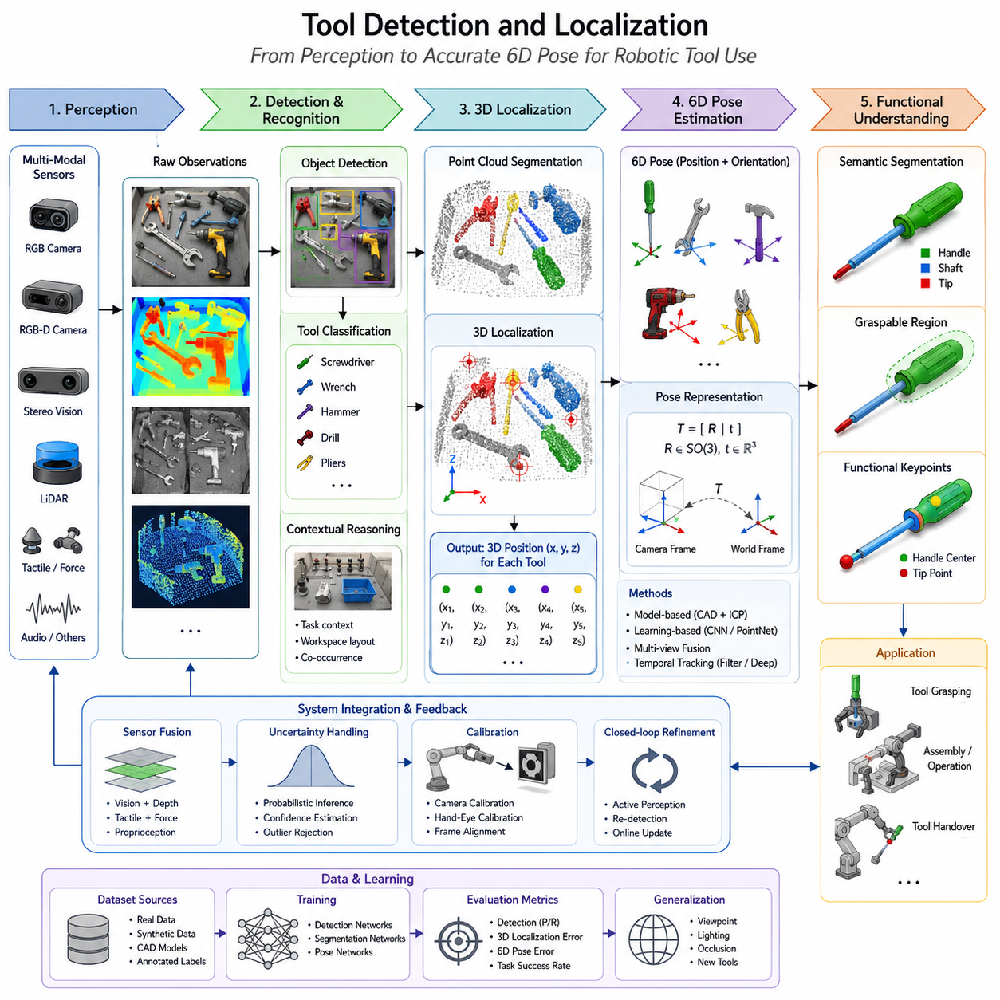{width="7.268055555555556in" height="7.268055555555556in"}

Tool Detection and Localization is one of the most fundamental capabilities required for robotic tool use and automated assembly. Before a robot can successfully manipulate a screwdriver, wrench, hammer, drill, cutter, gripper extension, or any specialized industrial tool, it must first perceive the existence of the tool, identify its category, estimate its pose, understand its geometric structure, determine its functional regions, and localize it accurately within the robot's coordinate system. In practical robotic systems, perception errors occurring during tool detection frequently propagate throughout the manipulation pipeline and often become the primary cause of grasp failures, insertion failures, assembly errors, and task execution instability. Therefore, robust tool detection and localization serve as the foundation upon which all higher-level tool-use intelligence is built. The topic belongs to the Tool Use and Assembly section of the Robot Hand and Dexterous Grasping volume and forms the critical bridge between visual perception and physical interaction.

Unlike ordinary object detection, tool detection introduces several unique challenges. Many industrial tools exhibit elongated structures, reflective metallic surfaces, partial occlusions, deformable components, interchangeable accessories, and highly similar appearances across multiple product variants. A wrench may appear in different sizes but maintain the same functional geometry. Screwdrivers may differ only in tip configuration while sharing similar handles. Power tools often contain detachable modules that alter their visual characteristics. In addition, tools are frequently stored in cluttered environments such as toolboxes, shelves, assembly stations, maintenance carts, and workbenches where overlapping objects complicate perception. Consequently, tool detection systems must combine object recognition, geometric reasoning, pose estimation, and contextual understanding rather than relying solely on conventional image classification.

The first stage of tool localization is tool recognition. Recognition aims to determine whether a particular object belongs to a known tool category. Traditional approaches relied heavily on handcrafted visual features such as SIFT, SURF, ORB, edge descriptors, contour matching, and template-based recognition. While these methods performed adequately under controlled lighting and viewpoint conditions, they often struggled when tools appeared in varying orientations, experienced partial occlusions, or exhibited surface reflections. Modern robotic systems therefore increasingly employ deep learning-based detectors capable of extracting robust visual representations directly from data.

Convolutional Neural Networks have significantly improved tool recognition performance. Architectures such as Faster R-CNN, YOLO, SSD, RetinaNet, and DETR can identify multiple tool categories simultaneously while maintaining real-time inference speeds. These detectors learn discriminative features associated with handles, jaws, shafts, blades, trigger mechanisms, and other characteristic tool structures. By training on large annotated datasets, robots can achieve reliable recognition across a wide variety of industrial environments. The ability to distinguish between visually similar tools such as Phillips screwdrivers, flat-head screwdrivers, hex drivers, and torque drivers becomes essential when task-specific manipulation is required.

Beyond category recognition, robotic tool use requires localization. Localization determines the spatial position of a tool relative to the robot. Two-dimensional localization identifies pixel coordinates within an image, while three-dimensional localization estimates physical coordinates in Cartesian space. Most industrial manipulation tasks require accurate three-dimensional localization because grasp planning and motion planning depend directly on spatial measurements. Localization systems therefore integrate camera calibration, depth sensing, geometric reconstruction, and coordinate transformation.

RGB cameras represent the simplest sensing modality for tool localization. Using a calibrated camera, object detectors can identify tool positions within image coordinates. However, image coordinates alone are insufficient for robotic grasping because depth information is missing. To overcome this limitation, robots often employ RGB-D cameras that combine color imaging with depth sensing. Popular RGB-D sensors generate dense depth maps that enable three-dimensional point reconstruction. By associating each detected pixel with depth measurements, robots can estimate tool centroids, surface geometry, and approximate grasp locations.

Stereo vision provides an alternative approach for three-dimensional localization. Two calibrated cameras observe the scene from different viewpoints, allowing depth estimation through triangulation. Stereo systems are particularly useful in large workspaces where depth sensors may have limited range. Industrial stereo systems can achieve millimeter-level accuracy when properly calibrated, making them suitable for assembly operations involving medium-sized tools and fixtures.

LiDAR-based localization is increasingly used in large industrial environments. Although LiDAR typically provides lower resolution than cameras, it offers reliable geometric measurements under varying illumination conditions. When combined with vision systems, LiDAR contributes robust spatial information for tool localization on large workbenches, warehouses, and outdoor maintenance platforms.

Point cloud processing plays a central role in modern tool localization. Once depth information becomes available, robots generate three-dimensional point clouds representing the observed scene. Point cloud segmentation algorithms separate tools from background structures and neighboring objects. Geometric descriptors such as surface normals, curvature features, and shape histograms help identify candidate tool regions. More recently, neural networks operating directly on point clouds have demonstrated remarkable performance in recognizing and localizing tools under challenging conditions.

A particularly important capability in robotic tool use is six-degree-of-freedom pose estimation. Knowing only the position of a tool is insufficient. The robot must also understand the orientation of the tool. Six-degree-of-freedom pose estimation determines the three translational coordinates and three rotational coordinates that fully describe a tool's spatial configuration. For example, a screwdriver lying flat on a table and another standing upright may share the same position but require completely different grasping strategies. Accurate pose estimation allows the robot to align its end effector appropriately and execute task-specific manipulations.

Model-based pose estimation techniques utilize CAD models of tools. By comparing observed sensor data with known geometric models, algorithms estimate the transformation that best aligns the model with observations. Iterative Closest Point algorithms have historically been used for this purpose. More advanced registration techniques incorporate robust optimization and probabilistic reasoning to handle noise and partial observations. Model-based methods can achieve very high accuracy when precise CAD models are available.

Learning-based pose estimation approaches have emerged as powerful alternatives. Deep neural networks directly predict object poses from images or point clouds without requiring explicit geometric registration. Architectures trained on synthetic and real-world datasets learn invariant representations capable of generalizing across viewpoints, lighting conditions, and background variations. These methods often achieve real-time performance and exhibit greater robustness in cluttered environments.

Tool localization becomes significantly more challenging when tools are partially occluded. In industrial workstations, tools are frequently stacked, overlapping, or partially hidden beneath other components. Occlusion introduces ambiguity because only portions of the tool are visible. To address this problem, modern systems employ multi-view perception, probabilistic inference, and shape completion networks. By integrating observations from multiple viewpoints, robots can reconstruct hidden regions and improve localization accuracy.

Functional localization represents another critical aspect of tool perception. Unlike ordinary objects, tools contain specific regions associated with distinct functions. A screwdriver includes a handle region and a tip region. A wrench includes a handle and jaw region. A hammer includes a handle and striking head. Successful manipulation requires the robot to distinguish between graspable regions and operational regions. Grasping a screwdriver by its tip would prevent its intended use. Therefore, robots must not only localize the tool but also identify its functional anatomy.

Semantic segmentation methods are increasingly used to identify functional tool regions. Pixel-level labeling allows robots to classify different components of a tool according to their purpose. Combined with geometric reasoning, semantic segmentation enables the generation of grasp candidates that avoid interfering with task-relevant regions. This capability is particularly important in assembly applications where precise tool orientation directly affects task success.

Tool localization also benefits from contextual reasoning. Human workers rarely identify tools solely from visual appearance. Instead, they consider surrounding objects, workspace organization, and task requirements. Modern robotic systems increasingly incorporate similar contextual information. If a robot is performing a screw-tightening task, candidate objects near a screw tray are more likely to be screwdrivers than unrelated objects. Contextual reasoning improves robustness when visual ambiguity exists.

Recent advances in foundation models and vision-language models have transformed tool detection capabilities. Large-scale pretrained models can recognize previously unseen tools using semantic descriptions rather than task-specific training. Open-vocabulary detection allows robots to identify tools specified through natural language instructions. A user may instruct the robot to "pick up the adjustable wrench" or "find the torque screwdriver," and the system can localize the corresponding tool even if it was not explicitly represented during training. This significantly expands the flexibility of robotic tool-use systems.

Multi-modal perception further enhances localization performance. Visual information may be combined with tactile sensing, force sensing, audio signals, and proprioceptive feedback. For example, if visual localization becomes uncertain during grasp execution, tactile feedback can refine the estimated contact location. Such sensor fusion improves robustness in real-world environments where perception uncertainty is unavoidable.

Tool tracking extends localization from static scenes to dynamic environments. Once a tool has been detected, robots often need to continuously estimate its pose while it moves. Tracking algorithms maintain temporal consistency and reduce localization noise. Kalman filters, particle filters, Bayesian estimators, and deep learning-based tracking networks are commonly employed for this purpose. Continuous tracking becomes essential when tools are handed between humans and robots or transported by moving platforms.

Calibration plays a crucial role in localization accuracy. Camera calibration, hand-eye calibration, sensor synchronization, and coordinate frame alignment directly influence pose estimation quality. Even highly sophisticated perception algorithms can fail if calibration errors exceed acceptable limits. Industrial deployments therefore devote significant attention to calibration procedures, verification routines, and long-term maintenance strategies.

Simulation environments have become valuable tools for developing localization systems. Synthetic datasets generated in simulation provide large-scale annotated training data without requiring expensive manual labeling. Domain randomization techniques expose learning algorithms to diverse appearances, lighting conditions, textures, and backgrounds. When combined with sim-to-real transfer methodologies, simulation-based training substantially reduces development costs while improving generalization.

Performance evaluation of tool detection systems typically considers detection precision, recall, localization accuracy, pose estimation error, robustness under occlusion, runtime latency, and task success rate. Industrial assembly applications often require millimeter-level positional accuracy and sub-degree rotational accuracy. High-speed production lines additionally impose strict real-time constraints, requiring localization pipelines to operate within tens of milliseconds.

Future tool localization systems are expected to evolve toward unified perception architectures capable of integrating object detection, pose estimation, functional understanding, task reasoning, and manipulation planning within a single framework. Foundation models, world models, and embodied AI systems will likely enable robots to understand not only where a tool is located but also how it should be used, why it is needed, and what outcomes it can produce within a broader task context. Such capabilities will move robotic tool use beyond simple perception toward genuine physical intelligence, enabling dexterous robots to operate effectively in manufacturing, maintenance, logistics, healthcare, construction, and service environments. The ability to reliably detect and localize tools will remain a cornerstone technology supporting the next generation of autonomous manipulation systems and intelligent robotic assembly platforms.

도구 검출 및 위치 추정(Tool Detection and Localization)은 로봇의 도구 사용(Robot Tool Use)과 자동 조립(Automated Assembly)을 구현하기 위한 가장 기본적이면서도 핵심적인 기술이다. 로봇이 드라이버, 렌치, 해머, 드릴, 커터 또는 다양한 산업용 특수 공구를 성공적으로 사용하기 위해서는 먼저 해당 도구의 존재를 인식하고, 종류를 식별하며, 위치와 자세를 추정하고, 기능적 구조를 이해하며, 로봇 좌표계 내에서 정확하게 위치를 계산할 수 있어야 한다. 실제 산업 환경에서는 도구 검출 단계에서 발생한 작은 오차가 이후의 그리핑(Grasping), 조작(Manipulation), 삽입(Insertion), 조립(Assembly) 단계로 누적되면서 전체 작업 실패의 주요 원인이 되는 경우가 많다. 따라서 도구 검출 및 위치 추정은 고차원적인 도구 사용 지능의 기반이 되는 핵심 기술이라 할 수 있다. 이는 Robot Hand and Dexterous Grasping 볼륨의 Tool Use and Assembly 분야에서 시각 인지(Perception)와 실제 물리적 조작(Physical Interaction)을 연결하는 중요한 역할을 수행한다.

일반적인 물체 인식(Object Detection)과 비교하면 도구 검출은 여러 가지 고유한 어려움을 가진다. 산업용 도구는 길쭉한 형태를 가지는 경우가 많고, 금속 재질로 인한 반사 특성이 강하며, 일부가 가려져 있거나(Occlusion), 교체 가능한 부품을 포함하기도 한다. 또한 서로 다른 모델이 매우 유사한 외형을 가지는 경우도 많다. 예를 들어 렌치는 크기만 다르고 형태는 거의 동일할 수 있으며, 드라이버 역시 끝부분만 다르고 손잡이는 매우 비슷한 구조를 가진다. 전동 공구는 액세서리의 부착 여부에 따라 외형이 달라질 수 있다. 이러한 이유로 도구 검출은 단순한 이미지 분류(Image Classification)가 아니라 물체 인식, 기하학적 분석, 자세 추정(Pose Estimation), 상황 이해(Context Understanding)를 통합적으로 수행해야 한다.

도구 위치 추정의 첫 번째 단계는 도구 인식(Tool Recognition)이다. 인식은 특정 물체가 어떤 종류의 도구인지를 판단하는 과정이다. 초기 연구에서는 SIFT, SURF, ORB, 에지(Edge) 특징, 형상 매칭(Template Matching)과 같은 수작업 특징(Handcrafted Features)이 주로 사용되었다. 이러한 방법은 제한된 환경에서는 효과적이었지만 시점 변화, 조명 변화, 부분 가림, 금속 반사 등에 취약했다. 최근에는 대규모 데이터 기반의 딥러닝(Deep Learning) 기술이 이러한 한계를 크게 극복하였다.

합성곱 신경망(Convolutional Neural Network, CNN)을 기반으로 한 객체 검출기는 도구 인식 성능을 크게 향상시켰다. Faster R-CNN, YOLO, SSD, RetinaNet, DETR 등의 네트워크는 여러 종류의 도구를 동시에 인식하면서도 실시간 처리 속도를 제공한다. 이러한 모델들은 손잡이(Handle), 조(Jaw), 축(Shaft), 블레이드(Blade), 트리거(Trigger) 등 도구를 특징짓는 구조를 학습한다. 충분한 학습 데이터가 제공되면 로봇은 다양한 산업 환경에서도 높은 정확도로 도구를 인식할 수 있다. 특히 십자 드라이버(Phillips Screwdriver), 일자 드라이버(Flat-head Screwdriver), 육각 드라이버(Hex Driver), 토크 드라이버(Torque Driver)와 같이 외형이 매우 유사한 도구들을 구별하는 능력이 중요하다.

도구 사용에서는 단순히 종류를 인식하는 것만으로는 충분하지 않다. 로봇은 도구의 위치를 정확하게 알아야 한다. 위치 추정(Localization)은 도구가 로봇에 대해 어디에 존재하는지를 계산하는 과정이다. 2차원 위치 추정은 이미지 내의 픽셀 좌표를 의미하고, 3차원 위치 추정은 실제 공간상의 물리적 좌표를 의미한다. 대부분의 산업용 조작 작업은 3차원 위치 정보가 필요하므로 위치 추정 시스템은 카메라 보정(Camera Calibration), 깊이 측정(Depth Sensing), 3차원 복원(3D Reconstruction), 좌표 변환(Coordinate Transformation)을 포함하게 된다.

RGB 카메라는 가장 기본적인 도구 위치 추정 센서이다. 객체 검출기를 이용하면 이미지 상에서 도구의 위치를 찾을 수 있다. 하지만 RGB 영상만으로는 깊이 정보를 얻을 수 없기 때문에 실제 로봇 그리핑에는 한계가 있다. 이를 해결하기 위해 RGB-D 카메라가 널리 사용된다. RGB-D 센서는 색상 영상과 깊이 정보를 동시에 제공하며, 이를 통해 물체의 3차원 좌표를 계산할 수 있다. 각 픽셀에 깊이 값을 결합하면 도구의 중심 위치, 표면 구조, 그리핑 가능한 영역 등을 추정할 수 있다.

스테레오 비전(Stereo Vision)은 또 다른 3차원 위치 추정 방법이다. 두 개의 카메라를 이용하여 동일한 물체를 서로 다른 시점에서 관찰하고 삼각측량(Triangulation)을 통해 깊이를 계산한다. 스테레오 시스템은 비교적 넓은 작업 공간에서도 활용할 수 있으며, 정밀하게 보정된 경우 밀리미터 수준의 정확도를 제공할 수 있다.

LiDAR 기반 위치 추정 역시 대규모 산업 환경에서 활용되고 있다. LiDAR는 카메라보다 해상도는 낮지만 조명 변화에 영향을 덜 받으며 안정적인 거리 측정을 제공한다. 특히 카메라와 LiDAR를 결합한 센서 융합(Sensor Fusion)은 대형 작업장, 창고, 야외 유지보수 환경에서 강력한 위치 추정 성능을 제공한다.

현대의 도구 위치 추정에서는 포인트 클라우드(Point Cloud) 처리가 중요한 역할을 한다. 깊이 정보를 이용하면 작업 환경의 3차원 포인트 클라우드를 생성할 수 있으며, 이후 분할(Segmentation)을 통해 도구와 배경을 분리한다. 표면 법선(Surface Normal), 곡률(Curvature), 형상 히스토그램(Shape Histogram) 등의 기하학적 특징은 도구 영역을 식별하는 데 활용된다. 최근에는 포인트 클라우드를 직접 처리하는 딥러닝 네트워크가 등장하면서 복잡한 환경에서도 높은 성능을 달성하고 있다.

도구 사용에서 특히 중요한 기술은 6자유도 자세 추정(6D Pose Estimation)이다. 단순히 위치만 아는 것으로는 충분하지 않다. 로봇은 도구가 어떤 방향으로 놓여 있는지까지 이해해야 한다. 6D 자세 추정은 X, Y, Z 위치뿐 아니라 Roll, Pitch, Yaw 회전 정보를 함께 계산한다. 예를 들어 동일한 드라이버라도 수평으로 놓여 있는 경우와 수직으로 세워져 있는 경우는 완전히 다른 그리핑 전략이 필요하다. 정확한 자세 정보는 성공적인 조작의 필수 조건이다.

모델 기반 자세 추정(Model-Based Pose Estimation)은 CAD 모델을 활용한다. 관측된 센서 데이터와 CAD 모델을 정합(Registration)하여 최적의 자세를 계산한다. 대표적으로 ICP(Iterative Closest Point) 알고리즘이 사용되어 왔다. CAD 모델이 정확하게 제공될 경우 매우 높은 정밀도를 달성할 수 있다.

최근에는 학습 기반 자세 추정(Learning-Based Pose Estimation)이 빠르게 발전하고 있다. 딥러닝 모델은 이미지나 포인트 클라우드로부터 직접 자세를 예측한다. 이러한 방법은 다양한 시점 변화, 조명 변화, 배경 변화에 대해 높은 강인성을 보이며 실시간 동작도 가능하다.

도구가 부분적으로 가려진 경우에는 위치 추정이 훨씬 어려워진다. 실제 산업 환경에서는 여러 도구가 겹쳐 놓여 있거나 일부가 다른 물체 아래에 숨겨져 있는 경우가 많다. 이를 해결하기 위해 다중 시점 인식(Multi-view Perception), 확률적 추론(Probabilistic Inference), 형상 복원(Shape Completion) 기술이 사용된다. 여러 시점의 정보를 결합하면 보이지 않는 부분까지 추정하여 보다 정확한 위치를 계산할 수 있다.

도구 위치 추정에서 또 하나의 중요한 요소는 기능 영역 인식(Functional Localization)이다. 도구는 단순한 물체가 아니라 특정 기능을 수행하기 위한 구조를 가진다. 드라이버는 손잡이와 팁(Tip)을 가지며, 렌치는 손잡이와 조(Jaw)를 가진다. 로봇은 어느 부분을 잡아야 하고 어느 부분을 작업에 사용해야 하는지를 구분해야 한다. 예를 들어 드라이버의 팁을 잡으면 나사를 조일 수 없기 때문에 기능 영역을 이해하는 것이 중요하다.

이를 위해 의미론적 분할(Semantic Segmentation)이 활용된다. 픽셀 단위로 도구의 각 영역을 분류하여 손잡이, 작업부, 연결부 등을 구분할 수 있다. 이를 통해 로봇은 작업에 방해되지 않는 최적의 그리핑 위치를 선택할 수 있다.

인간은 도구를 인식할 때 단순히 외형만 보지 않는다. 작업 환경과 주변 맥락(Context)을 함께 고려한다. 현대 로봇 역시 이러한 상황 정보를 활용하기 시작했다. 예를 들어 나사 트레이 근처에 있는 물체는 드라이버일 가능성이 높으며, 용접 작업장 근처에서는 특정 공구가 사용될 확률이 높다. 이러한 문맥 정보는 시각적 정보만으로는 구분하기 어려운 경우에 인식 성능을 향상시킨다.

최근의 파운데이션 모델(Foundation Model)과 비전-언어 모델(Vision-Language Model)은 도구 검출 분야에 큰 변화를 가져오고 있다. 이러한 모델은 학습 시 보지 못한 새로운 도구도 자연어 설명만으로 인식할 수 있다. 예를 들어 사용자가 "조절식 렌치를 가져와라" 또는 "토크 드라이버를 찾아라"라고 지시하면, 로봇은 해당 도구를 탐색하고 위치를 추정할 수 있다. 이는 오픈 보캐뷸러리(Open Vocabulary) 인식의 대표적인 사례이다.

다중 모달 인식(Multi-modal Perception)도 중요한 발전 방향이다. 시각 정보뿐 아니라 촉각(Tactile), 힘(Force), 음향(Audio), 고유 감각(Proprioception)을 함께 활용할 수 있다. 예를 들어 시각적으로 위치 추정이 불확실한 경우 촉각 센서가 실제 접촉 위치를 보정할 수 있다. 이러한 센서 융합은 실제 환경에서 높은 신뢰성을 제공한다.

도구 추적(Tool Tracking)은 위치 추정을 시간 축으로 확장한 개념이다. 도구가 이동하거나 사람과 로봇 사이에서 전달되는 경우, 로봇은 지속적으로 도구의 자세를 추적해야 한다. 이를 위해 칼만 필터(Kalman Filter), 파티클 필터(Particle Filter), 베이지안 추정(Bayesian Estimation), 딥러닝 기반 추적 네트워크가 사용된다.

정확한 위치 추정을 위해서는 보정(Calibration)이 필수적이다. 카메라 보정(Camera Calibration), Hand-Eye Calibration, 센서 동기화(Sensor Synchronization), 좌표계 정렬(Frame Alignment)이 정확해야만 높은 위치 추정 성능을 얻을 수 있다. 아무리 우수한 인식 알고리즘이라도 보정 오차가 크면 전체 시스템 성능이 크게 저하된다.

최근에는 시뮬레이션(Simulation)을 이용한 데이터 생성도 활발히 사용된다. 가상 환경에서 수많은 도구와 다양한 환경 조건을 생성하여 학습 데이터를 확보할 수 있다. Domain Randomization과 Sim-to-Real Transfer 기술은 실제 환경에서도 높은 일반화 성능을 제공한다.

도구 검출 시스템의 성능 평가는 검출 정확도(Precision), 재현율(Recall), 위치 오차(Localization Error), 자세 오차(Pose Error), 가림(Occlusion)에 대한 강인성, 처리 지연 시간(Latency), 최종 작업 성공률(Task Success Rate) 등을 기준으로 수행된다. 산업용 조립에서는 밀리미터 수준의 위치 정확도와 1도 이하의 자세 정확도가 요구되는 경우도 많다.

미래의 도구 검출 및 위치 추정 시스템은 객체 검출, 자세 추정, 기능 이해, 작업 추론, 조작 계획을 하나의 통합 프레임워크 안에서 수행하는 방향으로 발전할 것으로 예상된다. 파운데이션 모델, 월드 모델(World Model), 임바디드 AI(Embodied AI)는 로봇이 단순히 도구의 위치만 이해하는 것이 아니라 그 도구를 왜 사용해야 하는지, 어떻게 사용해야 하는지, 어떤 결과를 만들어낼 수 있는지까지 이해하도록 발전시킬 것이다. 이러한 기술은 제조업, 물류, 유지보수, 건설, 의료, 서비스 로봇 분야에서 차세대 지능형 조작 시스템의 핵심 기반이 될 것이며, 도구 검출 및 위치 추정은 그 중심 기술로 계속해서 중요한 역할을 수행할 것이다.

##  

## 13.04 Tool Grasp Planning

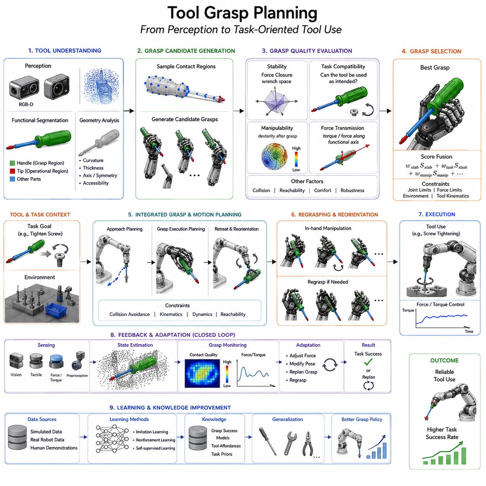{width="7.268055555555556in" height="7.268055555555556in"}

Tool Grasp Planning is the process of determining how a robot should grasp a tool so that the tool can subsequently be used to perform a desired task. Unlike conventional object grasping, where the primary objective is to securely pick up and transport an object, tool grasp planning must consider not only grasp stability but also the future functionality of the tool. A successful grasp for tool use requires the robot to understand the geometry of the tool, the intended operation, the contact mechanics between the tool and the robot hand, the interaction between the tool and the environment, and the sequence of actions that will follow after grasp acquisition. As a result, tool grasp planning occupies a unique position at the intersection of perception, manipulation, grasp theory, motion planning, task planning, and embodied intelligence. Within the Tool Use and Assembly section of Robot Hand and Dexterous Grasping, tool grasp planning serves as the critical link between tool detection and actual task execution.

The fundamental challenge of tool grasp planning arises from the fact that the optimal grasp for holding a tool is often different from the optimal grasp for using a tool. A hammer provides a simple example. A robot may grasp the hammer head securely, but such a grasp would prevent the hammer from being used for striking operations. Conversely, grasping the handle enables the hammer to function correctly but may introduce additional challenges related to balance, force transmission, and stability. Similar considerations apply to screwdrivers, pliers, wrenches, drills, scissors, and numerous industrial assembly tools. Therefore, tool grasp planning must always incorporate an understanding of tool functionality.

Traditional robotic grasp planning primarily focused on force closure and form closure principles. Force closure refers to the ability of contact forces generated by the robot fingers to resist arbitrary external disturbances. Form closure refers to the geometric confinement of an object through contact constraints. While these concepts remain important, they are insufficient for tool use because they do not explicitly account for the future purpose of the grasped object. Tool grasp planning introduces an additional layer of reasoning known as task-oriented grasping.

Task-oriented grasping seeks to identify grasp configurations that maximize the likelihood of successful task completion rather than merely maximizing grasp stability. In this framework, the robot evaluates potential grasp candidates based on their compatibility with the intended operation. A screwdriver intended for screw insertion requires a grasp that permits torque transmission. A wrench intended for bolt tightening requires a grasp that allows rotational leverage. A paintbrush intended for coating applications requires a grasp that supports smooth trajectory execution. Thus, the quality of a grasp is evaluated not only by stability metrics but also by task performance metrics.

A critical prerequisite for tool grasp planning is tool understanding. Before selecting a grasp, the robot must identify the functional structure of the tool. Most tools contain at least two major regions: a grasp region and an operational region. The grasp region is intended for holding, while the operational region interacts directly with the environment. In a screwdriver, the handle serves as the grasp region and the tip serves as the operational region. In a pair of pliers, the handles serve as the grasp region while the jaws serve as the operational region. Successful grasp planning requires these regions to be explicitly distinguished.

Functional part segmentation has become an important component of modern robotic perception systems. Semantic segmentation networks can classify different portions of a tool according to their purpose. By identifying handles, tips, blades, jaws, triggers, and articulation mechanisms, the robot gains a functional understanding of the tool. This information significantly narrows the search space for grasp planning and increases the likelihood of selecting an effective grasp configuration.

Geometric analysis provides another important source of information. Tools often exhibit distinctive geometric characteristics that influence grasp selection. Handles typically have elongated cylindrical or ergonomic shapes that naturally support grasping. Operational regions often contain sharp edges, precision surfaces, or contact interfaces that should remain unobstructed. Geometric descriptors such as curvature, thickness, symmetry, accessibility, and surface orientation help identify candidate grasp regions. Robots frequently combine geometric reasoning with semantic understanding to generate robust grasp hypotheses.

The planning process begins with grasp candidate generation. A grasp candidate represents a possible configuration of the robot hand relative to the tool. Candidate generation algorithms explore the object surface and identify locations where stable contact can be established. In simple parallel-jaw grippers, candidate generation may focus on identifying opposing surfaces suitable for pinch grasps. In dexterous multi-finger hands, candidate generation becomes substantially more complex because finger placement, contact distribution, and hand posture must all be considered simultaneously.

Sampling-based methods have traditionally been used for grasp candidate generation. These approaches randomly sample contact points on the object surface and evaluate their suitability according to grasp quality metrics. While conceptually simple, sampling-based methods often require extensive computation when dealing with complex tools. More advanced approaches incorporate geometric heuristics that guide sampling toward likely grasp regions such as handles and gripping surfaces.

Optimization-based grasp planning formulates grasp selection as an optimization problem. The planner seeks a configuration that maximizes an objective function while satisfying physical constraints. Objectives may include grasp stability, force transmission efficiency, manipulability, collision avoidance, and task compatibility. Constraints may include joint limits, finger workspace boundaries, contact force limits, and environmental obstacles. Optimization techniques allow robots to systematically explore the grasp space and identify high-quality solutions.

Grasp quality evaluation represents a central component of the planning process. Numerous metrics have been proposed to quantify grasp quality. Classical metrics evaluate force closure properties, wrench resistance capabilities, and disturbance rejection performance. For tool use applications, additional metrics assess functional effectiveness. A grasp that maximizes force closure may not necessarily maximize task performance. Therefore, modern systems often employ hybrid metrics that combine stability considerations with task-specific objectives.

The concept of manipulability plays an important role in tool grasp planning. Manipulability describes the ability of the robot to generate desired motions and forces after grasp acquisition. A grasp may be stable but restrict the robot\'s ability to orient the tool effectively. Conversely, a slightly less stable grasp may provide significantly greater maneuverability. Tool-oriented manipulation frequently requires large orientation changes, precise positioning, and controlled force application. Therefore, manipulability is often treated as a key optimization criterion.

Contact mechanics significantly influence grasp planning decisions. Different tools require different contact characteristics. Heavy tools may require high-friction grasps capable of resisting gravitational loads. Precision tools may require delicate contact forces that minimize deformation and preserve alignment accuracy. Understanding the contact interactions between the robot fingers and the tool surface enables more accurate prediction of grasp stability and task performance.

Tool grasp planning becomes more challenging when tools possess articulated components. Pliers, scissors, adjustable wrenches, ratchets, and power tools contain moving mechanisms that alter their geometry during operation. The planner must account for these kinematic changes and ensure that the grasp does not interfere with tool functionality. In some cases, the robot may intentionally reposition its grasp during execution to accommodate changes in tool configuration.

Environmental context also influences grasp planning. Tools rarely exist in isolation. They are often located within cluttered workspaces, storage racks, assembly stations, or maintenance environments. Nearby objects may restrict approach directions and limit feasible grasp configurations. Consequently, grasp planning must incorporate collision avoidance and accessibility analysis. A theoretically optimal grasp may be physically unreachable due to environmental constraints.

Motion planning and grasp planning are closely interconnected. Selecting a grasp that cannot be reached by the robot arm is of little practical value. Modern robotic systems increasingly perform integrated grasp-motion planning in which grasp selection and arm trajectory generation are optimized simultaneously. This integrated approach improves overall task feasibility and reduces planning failures.

Tool reorientation is another important consideration. The initial pose of a detected tool often differs from the pose required for task execution. The robot may need to grasp the tool, lift it, rotate it, and reposition it before use. Tool grasp planning therefore frequently incorporates regrasping strategies. Regrasping involves changing the grasp configuration during manipulation to achieve a desired final orientation. Advanced dexterous hands can perform in-hand manipulation that reorients the tool without placing it down.

Learning-based methods have transformed the field of tool grasp planning. Instead of relying solely on analytical models and handcrafted heuristics, robots can learn grasping strategies directly from data. Large datasets containing successful and unsuccessful grasp examples allow neural networks to predict grasp quality and generate candidate grasps. Deep learning approaches have demonstrated remarkable performance in complex environments where traditional methods struggle.

Behavior cloning provides one learning paradigm for tool grasp planning. Human demonstrations are recorded and used to train models that imitate expert behavior. Through observation of human tool use, robots learn how task requirements influence grasp selection. This approach is particularly valuable for tasks involving subtle functional considerations that are difficult to encode analytically.

Reinforcement learning offers another powerful framework. In reinforcement learning, robots learn grasping policies through trial and error interactions with simulated or real environments. Successful task completion generates rewards that guide policy optimization. Over time, the robot discovers grasp strategies that maximize long-term task success rather than immediate grasp stability. Reinforcement learning has proven particularly effective for complex tool-use scenarios involving sequential decision making.

Simulation environments have become indispensable for training grasp planning systems. Large-scale simulation enables robots to experience millions of grasp attempts without physical wear or safety concerns. Domain randomization techniques expose learning algorithms to diverse object appearances, lighting conditions, textures, and environmental variations. These experiences improve robustness when transferring learned policies to real-world systems.

Recent advances in foundation models and vision-language-action architectures are enabling a new generation of grasp planning systems. These models integrate visual perception, language understanding, and action generation within a unified framework. A robot may receive instructions such as "pick up the screwdriver and tighten the screw" and automatically infer an appropriate grasp configuration. Rather than relying on explicitly programmed grasp rules, the system reasons about tool functionality and task objectives using knowledge acquired during large-scale pretraining.

Open-vocabulary grasp planning further extends flexibility. Traditional grasp planners require predefined tool categories. Open-vocabulary systems can generalize to previously unseen tools using semantic descriptions and visual similarities. This capability is particularly important in industrial environments where new tools are frequently introduced.

Multi-modal sensing improves planning reliability. Visual information provides geometric and semantic understanding, while tactile sensing offers direct feedback regarding contact quality. Force sensors measure interaction forces during grasp acquisition. Proprioceptive sensors monitor hand configuration and joint states. By integrating information from multiple sensing modalities, robots can adapt grasps dynamically and compensate for perception uncertainty.

Human-robot collaboration introduces additional requirements. In collaborative workspaces, robots may receive tools directly from human workers or hand tools back after use. Tool grasp planning must therefore consider ergonomic handover configurations that facilitate safe and efficient exchanges. Shared manipulation scenarios require the robot to anticipate human actions and adjust grasp selection accordingly.

Industrial assembly operations represent one of the most demanding applications of tool grasp planning. Tasks such as screw fastening, bolt tightening, cable routing, component insertion, adhesive application, and precision alignment require highly reliable tool handling. Small errors in grasp configuration can propagate into significant assembly inaccuracies. Consequently, industrial systems often combine perception, planning, force control, and online feedback within tightly integrated architectures.

Evaluation of tool grasp planning systems involves multiple performance dimensions. Researchers commonly measure grasp success rate, task completion rate, force efficiency, cycle time, robustness to pose uncertainty, adaptability to new tools, and computational efficiency. Real-world deployment additionally requires evaluation under varying lighting conditions, clutter levels, environmental disturbances, and long-term operational scenarios.

Future developments in tool grasp planning are expected to move beyond isolated grasp optimization toward holistic task-centric reasoning. Robots will increasingly reason about the entire sequence of tool acquisition, manipulation, usage, and return. World models and embodied AI systems may enable robots to predict the consequences of alternative grasp choices before physical execution. Foundation models will likely provide broader commonsense understanding regarding tool affordances and usage patterns. As a result, future robotic systems will not simply grasp tools securely but will select grasps that maximize overall task effectiveness, efficiency, safety, and adaptability.

Ultimately, tool grasp planning represents a cornerstone capability for intelligent manipulation. It transforms tool perception into purposeful action and enables robots to bridge the gap between recognizing a tool and using it effectively. As robotic systems become increasingly autonomous and dexterous, advances in tool grasp planning will play a decisive role in enabling sophisticated tool use across manufacturing, logistics, healthcare, service robotics, maintenance, construction, and future embodied AI applications.

도구 그립 계획(Tool Grasp Planning)은 로봇이 특정 도구를 어떻게 파지(Grasp)해야 이후의 작업을 성공적으로 수행할 수 있는지를 결정하는 과정이다. 일반적인 물체 파지(Object Grasping)의 목적이 물체를 안정적으로 집고 이동시키는 것이라면, 도구 그립 계획은 단순한 안정성뿐 아니라 도구의 기능(Functionality)까지 고려해야 한다는 점에서 본질적으로 다르다. 성공적인 도구 파지는 도구의 형상(Geometry), 사용 목적(Task Objective), 접촉 역학(Contact Mechanics), 환경과의 상호작용(Environment Interaction), 그리고 이후 수행될 작업 순서(Task Sequence)까지 종합적으로 고려해야 한다. 따라서 도구 그립 계획은 인지(Perception), 조작(Manipulation), 파지 이론(Grasp Theory), 모션 계획(Motion Planning), 작업 계획(Task Planning), 그리고 임바디드 인공지능(Embodied Intelligence)이 만나는 핵심 분야라 할 수 있다. Robot Hand and Dexterous Grasping의 Tool Use and Assembly 영역에서 도구 그립 계획은 도구 인식과 실제 작업 수행을 연결하는 가장 중요한 연결고리 역할을 수행한다.

도구 그립 계획의 가장 큰 특징은 "잡기 좋은 위치"와 "사용하기 좋은 위치"가 반드시 같지 않다는 점이다. 해머를 예로 들면 해머 머리 부분을 잡는 것이 순간적으로는 안정적일 수 있지만, 그렇게 잡으면 못을 박는 기능을 수행할 수 없다. 반대로 손잡이를 잡으면 해머를 정상적으로 사용할 수 있지만 무게 중심과 힘 전달 측면에서 다른 문제를 고려해야 한다. 이러한 현상은 드라이버, 렌치, 플라이어, 드릴, 가위 등 거의 모든 도구에서 동일하게 나타난다. 따라서 도구 그립 계획은 항상 "어떻게 사용할 것인가"를 고려해야 한다.

전통적인 로봇 파지 연구는 주로 Force Closure(힘 폐쇄)와 Form Closure(형상 폐쇄)에 집중해 왔다. Force Closure는 외부 힘이 가해져도 물체를 안정적으로 유지할 수 있는 능력을 의미하며, Form Closure는 기하학적 제약만으로 물체를 움직이지 못하게 만드는 상태를 의미한다. 이러한 개념은 여전히 중요하지만, 도구 사용이라는 관점에서는 충분하지 않다. 왜냐하면 이들은 물체를 얼마나 안정적으로 잡을 수 있는지만 평가할 뿐, 그 물체를 실제로 사용할 수 있는지는 고려하지 않기 때문이다. 이 때문에 최근에는 Task-Oriented Grasping(작업 지향 파지)이라는 개념이 중요하게 다루어지고 있다.

작업 지향 파지는 단순히 안정적인 파지를 찾는 것이 아니라 작업 성공 가능성을 최대화하는 파지를 찾는 것을 목표로 한다. 예를 들어 드라이버는 나사를 조이기 위해 충분한 토크(Torque)를 전달할 수 있어야 하고, 렌치는 볼트를 회전시킬 수 있는 레버리지(Leverage)를 확보해야 한다. 페인트 브러시는 부드러운 궤적을 따라 움직일 수 있어야 한다. 따라서 좋은 파지란 단순히 떨어지지 않는 파지가 아니라 작업을 가장 잘 수행할 수 있는 파지를 의미한다.

이를 위해서는 먼저 도구에 대한 이해(Tool Understanding)가 필요하다. 대부분의 도구는 파지 영역(Grasp Region)과 작업 영역(Operational Region)으로 나눌 수 있다. 드라이버는 손잡이가 파지 영역이고 팁(Tip)이 작업 영역이다. 플라이어는 손잡이가 파지 영역이며 조(Jaw)가 작업 영역이다. 로봇은 이 둘을 명확히 구분할 수 있어야 한다.

최근에는 기능적 분할(Functional Segmentation)이 이러한 문제를 해결하는 중요한 기술로 발전하고 있다. 의미론적 분할(Semantic Segmentation)을 통해 도구의 각 부분을 손잡이, 팁, 블레이드, 조, 트리거 등의 기능 단위로 분류할 수 있다. 이렇게 기능 구조를 이해하면 로봇은 어디를 잡아야 하고 어디를 사용해야 하는지를 쉽게 판단할 수 있다.

기하학적 분석(Geometric Analysis) 역시 중요한 역할을 수행한다. 도구의 손잡이는 일반적으로 길고 원통형 구조를 가지며, 사람이 잡기 편하도록 설계되어 있다. 반면 작업 영역은 날카로운 부분이나 정밀한 접촉 면을 포함하는 경우가 많다. 곡률(Curvature), 두께(Thickness), 대칭성(Symmetry), 접근 가능성(Accessibility), 표면 방향(Surface Orientation) 등의 기하학적 특징은 파지 후보를 찾는 데 중요한 단서가 된다.

실제 계획 과정은 파지 후보 생성(Grasp Candidate Generation)으로 시작된다. 파지 후보란 로봇 손과 도구 사이의 가능한 접촉 구성을 의미한다. 알고리즘은 도구 표면을 탐색하여 안정적인 접촉이 가능한 위치를 찾는다. 단순한 평행 그리퍼(Parallel Jaw Gripper)의 경우 두 개의 대향 표면을 찾는 것으로 충분할 수 있지만, 다지형 로봇 핸드(Multifinger Hand)의 경우 손가락 배치와 접촉 분포를 동시에 고려해야 하므로 훨씬 복잡해진다.

전통적으로는 샘플링 기반(Sampling-Based) 방법이 널리 사용되었다. 이러한 방법은 표면 위의 접촉점을 무작위로 선택하고 각 파지의 품질을 평가한다. 하지만 복잡한 도구에서는 계산량이 매우 커질 수 있다. 이를 개선하기 위해 손잡이와 같이 파지 가능성이 높은 영역을 우선적으로 탐색하는 기하학적 휴리스틱(Geometric Heuristic)이 활용된다.

최적화 기반 파지 계획(Optimization-Based Grasp Planning)은 파지 문제를 수학적 최적화 문제로 정의한다. 시스템은 안정성, 힘 전달 효율, 조작성(Manipulability), 충돌 회피(Collision Avoidance), 작업 적합성(Task Compatibility) 등을 동시에 고려하여 최적의 파지를 탐색한다. 이러한 접근은 체계적으로 고품질 해를 찾을 수 있다는 장점을 가진다.

파지 품질 평가(Grasp Quality Evaluation)는 계획 과정의 핵심 요소이다. 전통적인 평가 지표는 Force Closure와 외란 저항 능력을 평가했지만, 도구 사용에서는 작업 성능까지 고려해야 한다. 따라서 최근에는 안정성과 기능성을 동시에 평가하는 복합 지표(Hybrid Metric)가 사용된다.

조작성(Manipulability)은 도구 파지에서 매우 중요한 개념이다. 조작성은 로봇이 파지 후 원하는 방향으로 도구를 움직이고 힘을 전달할 수 있는 능력을 의미한다. 어떤 파지는 매우 안정적일 수 있지만 자세 변경이 어렵고, 또 다른 파지는 약간 덜 안정적이지만 훨씬 자유로운 움직임을 제공할 수 있다. 도구 사용은 종종 큰 자세 변화와 정밀한 위치 조정을 요구하므로 조작성은 매우 중요한 평가 요소가 된다.

접촉 역학(Contact Mechanics) 역시 파지 계획에 큰 영향을 미친다. 무거운 도구는 높은 마찰력을 필요로 하고, 정밀 도구는 지나친 힘을 가하면 변형이나 정렬 오차가 발생할 수 있다. 따라서 로봇은 손가락과 도구 사이의 접촉 특성을 이해해야 한다.

플라이어, 가위, 조절식 렌치, 전동 공구와 같이 가동 부품을 가진 도구는 더욱 복잡한 문제를 제기한다. 이러한 도구들은 사용 과정에서 형상이 변화한다. 따라서 로봇은 자신의 파지가 도구의 동작을 방해하지 않는지 고려해야 하며, 경우에 따라 작업 도중 파지 위치를 변경해야 할 수도 있다.

환경(Context) 또한 중요한 요소이다. 실제 작업 환경에서는 도구가 단독으로 존재하는 경우가 거의 없다. 공구함, 선반, 작업대 등 복잡한 환경 속에 놓여 있으며 주변 물체가 접근 방향을 제한할 수 있다. 따라서 파지 계획은 항상 충돌 회피와 접근 가능성을 함께 고려해야 한다.

모션 계획(Motion Planning)과 파지 계획은 밀접하게 연결되어 있다. 아무리 좋은 파지라도 로봇 팔이 해당 위치에 도달할 수 없다면 의미가 없다. 따라서 최근 시스템은 파지와 궤적을 동시에 최적화하는 통합 계획(Integrated Grasp-Motion Planning)을 채택하고 있다.

도구 재배향(Tool Reorientation)도 중요한 문제이다. 도구는 원하는 자세로 놓여 있는 경우가 드물다. 따라서 로봇은 도구를 집은 뒤 회전시키거나 재배치해야 하는 경우가 많다. 이를 위해 재파지(Regrasping) 전략이 활용된다. 재파지는 작업 도중 파지 방식을 변경하여 원하는 최종 자세를 얻는 기술이다. 고성능 다지형 로봇 핸드는 물체를 내려놓지 않고 손 안에서 재배향하는 In-Hand Manipulation까지 수행할 수 있다.

최근에는 학습 기반(Learning-Based) 방법이 도구 파지 분야를 크게 변화시키고 있다. 대규모 데이터셋을 이용하여 성공적인 파지와 실패한 파지를 학습함으로써 신경망이 직접 파지 품질을 예측할 수 있다. 이러한 방법은 복잡한 환경에서 기존 규칙 기반 방법보다 우수한 성능을 보이는 경우가 많다.

행동 모방 학습(Behavior Cloning)은 인간 전문가의 시연을 관찰하고 이를 모방하는 방식이다. 사람의 도구 사용 방식을 학습함으로써 로봇은 작업 목적에 맞는 파지를 자연스럽게 습득할 수 있다.

강화학습(Reinforcement Learning)은 시행착오를 통해 최적의 파지 정책을 학습한다. 성공적인 작업에는 보상을 부여하고 실패에는 패널티를 부여함으로써 장기적으로 가장 효과적인 파지 전략을 발견한다. 특히 복잡한 도구 사용 작업에서 매우 강력한 접근법으로 평가받고 있다.

시뮬레이션(Simulation)은 학습 기반 파지 시스템 개발에 필수적인 도구가 되었다. 가상 환경에서는 수백만 번의 파지 실험을 수행할 수 있으며, Domain Randomization과 Sim-to-Real Transfer 기술을 통해 실제 환경에서도 높은 성능을 유지할 수 있다.

최근 등장한 파운데이션 모델(Foundation Model)과 비전-언어-행동 모델(Vision-Language-Action Model)은 도구 파지 계획의 새로운 가능성을 열고 있다. 사용자가 "드라이버를 집어서 나사를 조여라"와 같은 자연어 명령을 내리면, 시스템은 도구의 기능을 이해하고 적절한 파지를 자동으로 생성할 수 있다.

오픈 보캐뷸러리(Open Vocabulary) 파지 계획은 학습되지 않은 새로운 도구에도 대응할 수 있도록 한다. 기존 시스템은 미리 정의된 도구만 다룰 수 있었지만, 최신 시스템은 시각적 유사성과 언어적 설명을 바탕으로 새로운 도구에도 적응할 수 있다.

다중 모달 센싱(Multi-modal Sensing)은 신뢰성을 더욱 향상시킨다. 시각 센서는 형상과 의미를 제공하고, 촉각 센서는 접촉 품질을 알려주며, 힘 센서는 실제 상호작용 힘을 측정한다. 관절 센서는 손의 상태를 알려준다. 이러한 정보를 통합하면 불확실성을 줄이고 더욱 안정적인 파지가 가능해진다.

인간-로봇 협업(Human-Robot Collaboration) 환경에서는 도구 전달(Tool Handover)도 중요한 과제가 된다. 로봇은 사람이 쉽게 받을 수 있도록 도구를 잡아야 하며, 반대로 사람이 건네준 도구를 안전하게 받아야 한다. 따라서 파지 계획은 인간의 행동과 인체공학적 요소까지 고려해야 한다.

산업용 조립 작업은 도구 파지 계획이 가장 중요한 응용 분야 중 하나이다. 나사 체결, 볼트 조임, 케이블 배선, 부품 삽입, 접착제 도포, 정밀 정렬 등의 작업은 매우 높은 수준의 신뢰성을 요구한다. 작은 파지 오차도 조립 품질에 큰 영향을 줄 수 있기 때문에 인지, 계획, 힘 제어, 실시간 피드백이 긴밀하게 통합되어야 한다.

도구 파지 시스템은 일반적으로 파지 성공률(Grasp Success Rate), 작업 성공률(Task Completion Rate), 힘 전달 효율(Force Efficiency), 수행 시간(Cycle Time), 자세 오차에 대한 강인성(Robustness), 새로운 도구에 대한 적응성(Adaptability), 계산 효율성(Computational Efficiency) 등을 기준으로 평가된다.

미래의 도구 파지 계획은 단순한 파지 최적화를 넘어 전체 작업 흐름을 고려하는 방향으로 발전할 것으로 예상된다. 로봇은 도구를 획득하고, 사용하고, 반납하는 전체 과정을 하나의 문제로 이해하게 될 것이다. 월드 모델(World Model)과 임바디드 AI는 다양한 파지 선택이 미래 작업에 어떤 영향을 미칠지 예측할 수 있도록 도와줄 것이며, 파운데이션 모델은 도구의 용도와 사용 방법에 대한 상식적 이해(Common Sense Reasoning)를 제공할 것이다.

결국 도구 그립 계획은 단순히 물체를 잡는 기술이 아니라, 인지된 도구를 실제 작업으로 연결하는 핵심 기술이다. 이는 로봇이 단순한 물체 조작을 넘어 실제 도구를 능숙하게 활용하는 지능형 작업자로 진화하는 데 필수적인 요소이며, 제조업, 물류, 의료, 서비스 로봇, 유지보수, 건설, 그리고 미래의 임바디드 AI 시스템에서 매우 중요한 역할을 담당하게 될 것이다.

##  

## 13.05 Peg-in-Hole Tasks

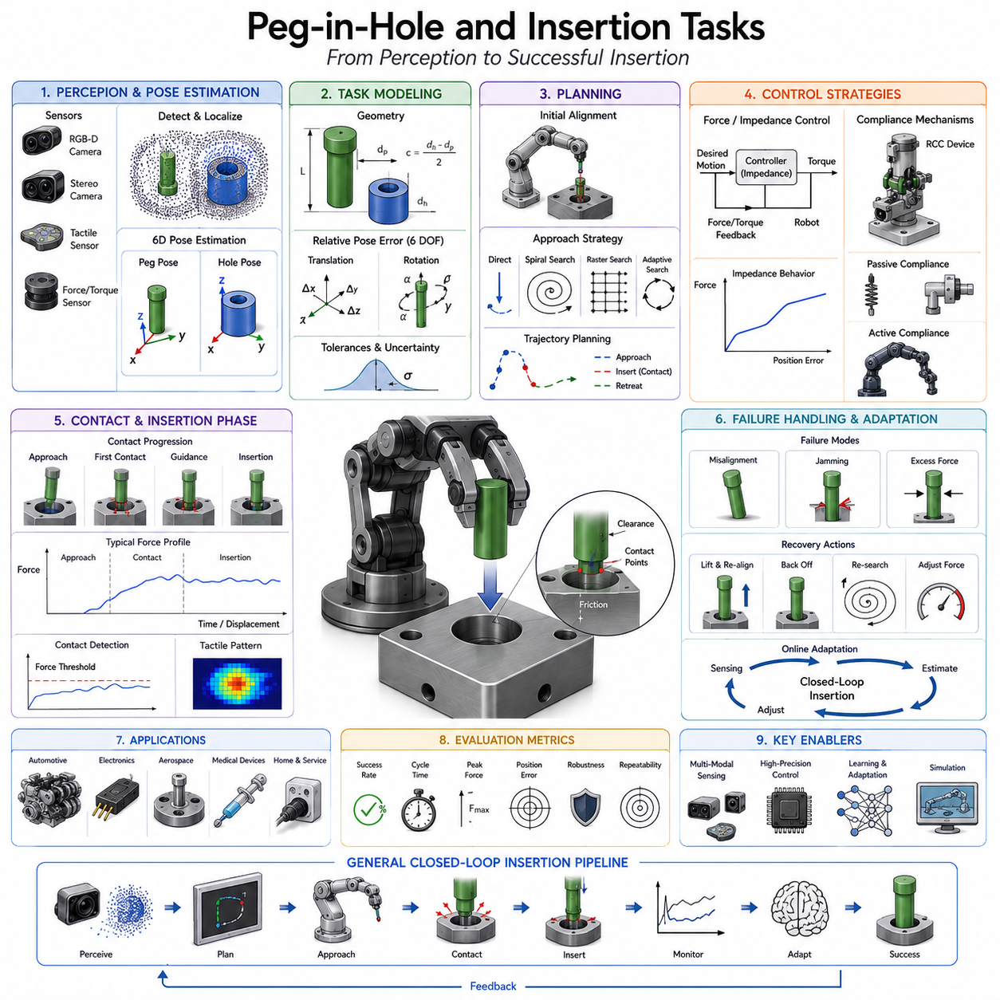{width="7.268055555555556in" height="7.268055555555556in"}

Peg-in-Hole and Insertion Tasks represent one of the most fundamental yet challenging problems in robotics, manufacturing automation, and dexterous manipulation. At first glance, inserting a peg into a hole appears to be a simple operation. Humans perform such actions effortlessly when plugging a charger into a socket, inserting a key into a lock, assembling furniture, installing mechanical components, or connecting electronic modules. However, for robotic systems, insertion tasks are significantly more complex because they require the precise coordination of perception, motion planning, force control, contact reasoning, and real-time adaptation under uncertainty. As a result, Peg-in-Hole problems have become one of the most widely studied benchmark tasks in robotic manipulation research and industrial automation. Within the Tool Use and Assembly section of Robot Hand and Dexterous Grasping, insertion tasks represent the transition from free-space manipulation to contact-rich manipulation, where physical interactions with the environment become dominant factors in task execution.

The classical Peg-in-Hole problem involves moving a cylindrical peg toward a matching hole and inserting it successfully without causing jamming, excessive contact forces, or structural damage. While the geometric definition appears simple, successful insertion depends on numerous factors including positional accuracy, angular alignment, surface friction, material properties, manufacturing tolerances, sensor quality, controller responsiveness, and environmental disturbances. Even a small positional error of a few tenths of a millimeter can cause insertion failure in high-precision assemblies.

Insertion operations are ubiquitous across modern industries. Automotive manufacturing relies heavily on shaft insertion, bearing installation, connector assembly, and component fitting. Electronics manufacturing involves inserting pins into sockets, connectors into interfaces, and components into printed circuit boards. Aerospace assembly requires extremely precise insertion of fasteners and structural components. Medical device manufacturing depends on delicate insertion tasks involving miniature parts and precision instruments. Service robots also encounter insertion problems when plugging in charging connectors, operating household devices, or manipulating everyday objects.

From a robotics perspective, insertion tasks differ fundamentally from ordinary pick-and-place operations. During pick-and-place tasks, the robot primarily operates in free space where motion can be planned using geometric trajectories. In insertion tasks, contact between the manipulated object and the environment becomes unavoidable and often essential. Once contact occurs, the dynamics of the system change dramatically. Small errors can generate large contact forces, causing instability, misalignment, or jamming. Therefore, insertion tasks require robots to reason about contact interactions rather than relying solely on geometric positioning.

Geometric alignment is the first prerequisite for successful insertion. The peg must be positioned near the entrance of the hole with sufficient accuracy. This requires accurate localization of both objects and precise estimation of their relative poses. Traditional industrial robots often achieve this through carefully calibrated fixtures and structured environments. In modern flexible manufacturing systems, however, robots must perform insertion under less predictable conditions where components may exhibit positional variations and orientation uncertainties.

The relative pose between the peg and the hole can be described using six degrees of freedom. Three degrees correspond to translational displacement, while three correspond to rotational misalignment. Successful insertion requires reducing all six errors to acceptable levels. Translational errors cause lateral offset, while rotational errors cause angular mismatch. Both forms of error increase insertion difficulty and may lead to contact-induced failure.

Tolerance plays a critical role in insertion planning. Clearance refers to the difference between hole dimensions and peg dimensions. Large clearances simplify insertion but reduce assembly precision. Small clearances improve final assembly quality but require significantly greater alignment accuracy. Many industrial applications involve tight-tolerance assemblies where clearance may be measured in micrometers. In such cases, even highly accurate robotic systems must employ advanced sensing and control techniques to achieve reliable insertion.

The contact mechanics of insertion tasks have been extensively studied. As the peg approaches the hole, contact forces begin to emerge at the interface. Depending on the relative alignment, contact may occur at a single point, multiple points, or along extended surfaces. Contact forces generate moments that influence object orientation and can either assist or hinder insertion. Understanding these interactions is essential for developing robust insertion strategies.

One of the most common failure modes in insertion tasks is jamming. Jamming occurs when contact forces create mechanical constraints that prevent further motion. The peg becomes wedged against the hole surface, generating increasing resistance. Jamming is particularly problematic in tight-tolerance assemblies because it may damage components or overload robotic actuators. Researchers have developed analytical models describing the conditions under which jamming occurs, allowing planners to avoid dangerous configurations.

Another important phenomenon is wedging. Wedging occurs when frictional forces prevent relative motion between contacting surfaces. Unlike simple geometric interference, wedging is strongly influenced by material properties and friction coefficients. Even when geometric clearance exists, excessive friction may prevent successful insertion. Therefore, insertion planning often incorporates friction models and force control strategies.

Force sensing has become a cornerstone technology for insertion tasks. Vision systems can provide coarse alignment, but force sensors provide direct measurements of physical interactions during contact. Wrist-mounted force-torque sensors are commonly used to detect insertion forces and moments. By analyzing these signals, robots can infer alignment errors, identify contact locations, and adjust trajectories dynamically. Force sensing enables robots to compensate for uncertainties that cannot be resolved through vision alone.

Compliance is another essential concept in insertion robotics. A perfectly rigid robot may generate large contact forces when alignment errors exist. Compliance allows the robot to adapt passively or actively to environmental constraints. Mechanical compliance can be achieved through elastic elements, compliant joints, or flexible structures. Control-based compliance can be achieved through impedance control and admittance control algorithms. Both approaches help absorb positioning errors and facilitate successful insertion.

Remote Center Compliance (RCC) devices represent a classic solution to insertion problems. RCC mechanisms are designed to allow small passive adjustments in position and orientation during contact. When the peg encounters the hole entrance, the RCC mechanism guides the peg toward proper alignment. Despite being developed decades ago, RCC devices remain widely used in industrial assembly systems because of their simplicity and effectiveness.

Impedance control has become one of the most influential approaches for robotic insertion. Instead of commanding strict position trajectories, impedance controllers regulate the dynamic relationship between force and motion. The robot behaves like a virtual mass-spring-damper system, allowing controlled interaction with the environment. This approach enables smooth adaptation to contact conditions while maintaining stability.

Admittance control provides a complementary strategy. In admittance control, measured forces are converted into motion commands. When excessive forces are detected, the robot adjusts its trajectory accordingly. This approach is particularly effective when force sensing quality is high and actuator dynamics permit rapid response.

Search strategies are often necessary when precise alignment cannot be guaranteed. Human workers frequently perform small exploratory motions during insertion. Similar strategies can be implemented in robots. Spiral search patterns are among the most common approaches. The robot moves the peg along a gradually expanding spiral trajectory until the hole entrance is located. Once contact conditions indicate successful alignment, insertion proceeds.

Raster search patterns, circular search motions, oscillatory probing, and adaptive exploration strategies have also been developed. The choice of search strategy depends on task geometry, sensor availability, and required insertion speed. Advanced systems dynamically switch between search modes based on real-time feedback.

Vision-guided insertion combines perception and control. Cameras provide initial alignment information before contact occurs. High-resolution vision systems can estimate hole locations, detect orientation errors, and identify assembly features. Marker-based systems, fiducial tags, structured light scanners, stereo vision systems, and RGB-D cameras are commonly employed. Vision significantly reduces the search space and improves insertion efficiency.

Three-dimensional pose estimation plays a particularly important role in insertion tasks. The robot must estimate both the peg pose and hole pose with high accuracy. Modern deep learning approaches have improved pose estimation performance, enabling robots to perform insertion tasks in less structured environments. Neural networks can learn robust pose representations that generalize across variations in lighting, appearance, and occlusion.

Learning-based insertion methods have attracted significant attention in recent years. Traditional insertion systems relied heavily on analytical models and handcrafted controllers. While effective in structured environments, these approaches often struggle when uncertainty increases. Learning-based methods allow robots to acquire insertion skills directly from experience.

Behavior cloning uses human demonstrations to teach insertion strategies. By observing expert operators, robots learn how successful insertions are performed under varying conditions. Demonstration data captures subtle corrective motions and force modulation behaviors that are difficult to model analytically.

Reinforcement learning offers another powerful framework. In reinforcement learning, robots repeatedly attempt insertion tasks and receive rewards based on success. Through trial and error, the system discovers policies that maximize insertion reliability. Modern reinforcement learning methods have achieved impressive performance in simulated and real-world insertion benchmarks.

Simulation has become a critical tool for insertion research. High-fidelity physics engines allow researchers to model contact interactions, frictional effects, compliance, and uncertainty. Millions of insertion attempts can be generated in simulation, providing training data for learning algorithms. Domain randomization techniques help bridge the gap between simulation and reality by exposing models to diverse conditions during training.

Tactile sensing is emerging as a valuable complement to force sensing. Tactile sensors provide distributed contact information rather than aggregate force measurements. By analyzing tactile patterns, robots can estimate contact locations, detect edge alignments, and identify insertion progress. Tactile feedback is particularly useful in tasks involving small components where precise contact information is essential.

Multi-modal perception further enhances insertion performance. Visual sensing provides global information about object locations, force sensing provides interaction dynamics, tactile sensing provides local contact details, and proprioception provides information about robot configuration. By fusing these modalities, robots achieve greater robustness under uncertainty.

Insertion tasks become significantly more challenging when flexible or deformable components are involved. Electrical connectors, cables, seals, gaskets, and soft medical devices introduce nonlinear deformation behaviors. Traditional rigid-body models become insufficient, requiring more sophisticated representations of contact and material mechanics.

Assembly planning provides the broader context for insertion operations. In many manufacturing processes, insertion represents only one step within a larger assembly sequence. The order of operations, accessibility constraints, tool availability, and fixture configurations all influence insertion planning. Integrated assembly planners therefore consider insertion requirements alongside other manipulation tasks.

Human-inspired insertion strategies have also attracted research interest. Humans rarely rely on perfect geometric accuracy. Instead, they use exploratory contact, tactile perception, compliance, and adaptive corrections. Replicating these capabilities in robots remains a major goal of dexterous manipulation research. Future robotic systems are expected to incorporate increasingly sophisticated sensory feedback and adaptive reasoning mechanisms inspired by human motor control.

Foundation models and embodied AI are beginning to influence insertion robotics. Large-scale models trained on manipulation data can learn generalized representations of contact-rich interactions. Rather than learning a separate controller for each assembly task, future systems may develop transferable insertion skills that generalize across diverse geometries and applications. Natural language instructions may guide insertion behavior, while world models predict the consequences of contact interactions before execution.

Evaluation of insertion systems typically considers insertion success rate, completion time, force efficiency, positional accuracy, robustness to uncertainty, tolerance to misalignment, and adaptability to environmental variation. Industrial applications often require success rates exceeding 99.9%, particularly in high-volume manufacturing environments where even small failure rates can produce significant economic costs.

Future insertion systems will likely combine high-precision perception, real-time force control, tactile intelligence, adaptive compliance, learning-based policies, and foundation-model reasoning within unified manipulation frameworks. These systems will move beyond rigid automation toward flexible assembly intelligence capable of operating in dynamic environments with minimal task-specific programming.

Ultimately, Peg-in-Hole and Insertion Tasks represent far more than a simple benchmark problem. They embody many of the core challenges of robotic manipulation, including perception uncertainty, contact dynamics, force regulation, dexterous control, sensor fusion, and adaptive decision making. Mastery of insertion tasks is therefore widely regarded as a key milestone on the path toward truly capable robotic assembly systems, intelligent manufacturing platforms, and future embodied AI agents capable of performing complex physical work in the real world.

Peg-in-Hole and Insertion Tasks(핀 삽입 및 조립 작업)는 로봇공학, 제조 자동화, 정교한 조작(Dexterous Manipulation) 분야에서 가장 기본적이면서도 가장 어려운 문제 중 하나이다. 겉으로 보기에는 핀(Peg)을 구멍(Hole)에 삽입하는 단순한 작업처럼 보이지만, 실제로는 매우 높은 수준의 인지(Perception), 운동 계획(Motion Planning), 힘 제어(Force Control), 접촉 해석(Contact Reasoning), 그리고 실시간 적응(Real-Time Adaptation)이 동시에 요구된다. 사람은 충전기를 콘센트에 꽂거나, 열쇠를 자물쇠에 넣거나, 가구를 조립하는 작업을 자연스럽게 수행하지만, 로봇에게는 이러한 작업이 매우 복잡한 문제로 인식된다. 이 때문에 Peg-in-Hole 문제는 수십 년 동안 로봇 조작 연구의 대표적인 벤치마크(Benchmark) 과제로 활용되어 왔다. Robot Hand and Dexterous Grasping의 Tool Use and Assembly 영역에서는 자유 공간 조작(Free-Space Manipulation)에서 접촉 기반 조작(Contact-Rich Manipulation)으로 넘어가는 핵심 기술로 간주된다.

전통적인 Peg-in-Hole 문제는 원통형 핀을 대응되는 구멍에 정확하게 삽입하는 작업으로 정의된다. 그러나 실제 성공 여부는 위치 정확도(Position Accuracy), 각도 정렬(Angular Alignment), 마찰(Friction), 재료 특성(Material Properties), 가공 공차(Manufacturing Tolerance), 센서 품질, 제어기 성능, 외란(Disturbance) 등 수많은 요소에 의해 결정된다. 특히 고정밀 조립에서는 수백 마이크로미터 수준의 오차만 발생해도 삽입 실패가 발생할 수 있다.

삽입 작업은 현대 산업 전반에 걸쳐 매우 광범위하게 사용된다. 자동차 산업에서는 축(Shaft) 삽입, 베어링 장착, 커넥터 체결 등이 반복적으로 수행된다. 전자 산업에서는 핀과 소켓 결합, 커넥터 삽입, PCB 부품 장착 등이 대표적인 예이다. 항공우주 산업에서는 고정밀 구조물 조립과 패스너(Fastener) 삽입이 핵심 공정이다. 의료기기 제조에서도 미세 부품 조립과 정밀 삽입 작업이 필수적이다. 서비스 로봇 역시 충전 커넥터 연결, 가전제품 조작, 생활용품 사용 과정에서 다양한 삽입 작업을 수행해야 한다.

로봇 관점에서 삽입 작업은 일반적인 Pick-and-Place 작업과 근본적으로 다르다. Pick-and-Place에서는 대부분 자유 공간에서 움직이며 기하학적 궤적만 계산하면 된다. 하지만 삽입 작업은 환경과의 접촉이 필수적이다. 접촉이 발생하는 순간 시스템의 동역학은 급격하게 변화하며, 작은 오차가 큰 힘을 발생시켜 실패를 유발할 수 있다. 따라서 삽입 작업에서는 단순한 위치 제어보다 접촉(Contact)을 이해하는 능력이 더욱 중요하다.

삽입 성공의 첫 번째 조건은 기하학적 정렬(Geometric Alignment)이다. 핀은 구멍 입구 근처에 매우 정확하게 위치해야 한다. 이를 위해서는 핀과 구멍의 위치와 자세(Pose)를 정확하게 추정해야 한다. 과거 산업용 로봇은 정밀한 지그(Jig)와 고정 장치를 사용하여 이러한 문제를 해결했다. 그러나 현대의 유연 생산(Flexible Manufacturing) 환경에서는 부품 위치가 매번 조금씩 달라질 수 있기 때문에 보다 지능적인 인식과 보정이 필요하다.

핀과 구멍의 상대 자세(Relative Pose)는 6자유도(6 Degrees of Freedom)로 표현된다. 3개의 병진 자유도(Translation)와 3개의 회전 자유도(Rotation)가 모두 정렬되어야 성공적인 삽입이 가능하다. 병진 오차는 측면 오프셋(Lateral Offset)을 유발하며, 회전 오차는 각도 불일치(Angular Misalignment)를 발생시킨다. 이 두 가지는 모두 삽입 난이도를 크게 증가시킨다.

공차(Tolerance)는 삽입 작업에서 매우 중요한 개념이다. 클리어런스(Clearance)는 구멍과 핀 사이의 여유 공간을 의미한다. 클리어런스가 크면 삽입은 쉬워지지만 최종 조립 정밀도가 떨어진다. 반대로 클리어런스가 작으면 높은 정밀도를 얻을 수 있지만 훨씬 더 정확한 정렬이 요구된다. 산업 현장에서는 수 마이크로미터 수준의 공차를 요구하는 경우도 많으며, 이 경우 고성능 센서와 정밀 제어 기술이 필수적이다.

삽입 과정에서 발생하는 접촉 역학(Contact Mechanics)은 매우 중요하다. 핀이 구멍 입구에 접근하면 접촉력이 발생하기 시작한다. 상대 정렬 상태에 따라 한 점에서 접촉할 수도 있고 여러 점에서 동시에 접촉할 수도 있다. 이러한 접촉력은 핀의 자세를 변화시키는 모멘트(Moment)를 생성하며, 삽입을 돕기도 하고 방해하기도 한다. 따라서 접촉 역학에 대한 이해는 성공적인 삽입 전략 수립의 핵심이다.

삽입 실패의 대표적인 원인은 재밍(Jamming)이다. 재밍은 접촉력이 기계적 구속을 형성하여 핀이 더 이상 움직일 수 없는 상태를 의미한다. 핀이 구멍 벽면에 끼어 움직이지 못하게 되는 현상이다. 특히 정밀 조립에서는 재밍이 부품 손상이나 액추에이터 과부하를 유발할 수 있기 때문에 매우 위험하다.

또 다른 중요한 현상은 웨징(Wedging)이다. 웨징은 마찰력 때문에 상대 운동이 차단되는 현상을 의미한다. 기하학적으로는 삽입 가능한 상태라도 마찰이 지나치게 크면 실제 삽입이 불가능할 수 있다. 따라서 삽입 계획에는 마찰 모델(Friction Model)이 반드시 포함되어야 한다.

힘 센서(Force Sensor)는 삽입 작업에서 핵심적인 역할을 수행한다. 비전 시스템은 초기 정렬에는 효과적이지만 접촉 이후의 미세 오차를 감지하기 어렵다. 반면 손목 장착형 힘/토크 센서(Force-Torque Sensor)는 실제 접촉 상태를 직접 측정할 수 있다. 로봇은 힘과 토크 변화를 분석하여 정렬 오차를 추정하고 궤적을 실시간으로 수정할 수 있다.

순응성(Compliance)은 삽입 작업에서 매우 중요한 개념이다. 완전히 강체인 로봇은 작은 정렬 오차에도 큰 접촉력을 발생시킨다. 반면 순응성을 가진 시스템은 환경에 맞추어 자연스럽게 적응할 수 있다. 순응성은 탄성 요소나 유연 구조를 이용한 기계적 순응성(Mechanical Compliance)과 임피던스 제어(Impedance Control), 어드미턴스 제어(Admittance Control)를 이용한 제어 기반 순응성(Control-Based Compliance)으로 구현될 수 있다.

원격 중심 순응 장치(Remote Center Compliance, RCC)는 삽입 작업을 위해 개발된 대표적인 기계 장치이다. RCC는 핀이 구멍 입구에 접촉했을 때 자동으로 위치와 자세를 미세하게 조정하여 정렬을 돕는다. 수십 년 전에 개발되었음에도 불구하고 현재까지 많은 산업용 조립 시스템에서 사용되고 있다.

임피던스 제어는 삽입 로봇 분야에서 가장 영향력 있는 제어 기법 중 하나이다. 임피던스 제어는 위치를 강제로 따라가는 대신 힘과 움직임 사이의 관계를 제어한다. 로봇은 가상의 질량-스프링-댐퍼 시스템처럼 동작하여 접촉 상황에 부드럽게 적응할 수 있다.

어드미턴스 제어는 그 반대 접근법이다. 측정된 힘을 기반으로 새로운 움직임 명령을 생성한다. 과도한 힘이 감지되면 로봇이 자동으로 경로를 수정하여 접촉 문제를 해결한다.

정확한 정렬이 어려운 경우에는 탐색(Search) 전략이 사용된다. 사람도 구멍 위치가 정확하지 않을 때 작은 탐색 동작을 수행한다. 로봇 역시 유사한 방법을 사용할 수 있다. 가장 대표적인 방법은 나선형 탐색(Spiral Search)이다. 핀을 나선형으로 움직이며 구멍 입구를 탐색하고, 적절한 접촉 신호가 감지되면 삽입을 수행한다.

이 외에도 격자 탐색(Raster Search), 원형 탐색(Circular Search), 진동 기반 탐색(Oscillatory Search), 적응형 탐색(Adaptive Search) 등이 개발되어 있다. 선택되는 전략은 작업 형상, 센서 종류, 요구 속도에 따라 달라진다.

비전 기반 삽입(Vision-Guided Insertion)은 카메라를 이용하여 초기 정렬을 수행한다. 고해상도 카메라는 구멍 위치와 자세를 추정하고 정렬 오차를 계산할 수 있다. 마커(Fiducial Marker), 구조광(Structured Light), 스테레오 비전(Stereo Vision), RGB-D 카메라 등이 활용된다.

최근에는 딥러닝 기반 3차원 자세 추정(3D Pose Estimation)이 삽입 작업에 적용되고 있다. 신경망은 다양한 조명, 배경, 가림(Occlusion) 상황에서도 안정적으로 부품의 자세를 추정할 수 있다.

학습 기반 삽입(Learning-Based Insertion)은 최근 가장 활발하게 연구되는 분야 중 하나이다. 기존 방법이 수학적 모델에 의존했다면, 학습 기반 방법은 실제 경험으로부터 삽입 기술을 학습한다.

행동 모방 학습(Behavior Cloning)은 인간 전문가의 시연을 학습 데이터로 활용한다. 이를 통해 사람이 수행하는 미세한 보정 동작과 힘 조절 전략을 로봇이 습득할 수 있다.

강화학습(Reinforcement Learning)은 시행착오를 통해 삽입 정책을 학습한다. 성공적인 삽입에는 보상을 부여하고 실패에는 패널티를 부여함으로써 최적의 전략을 찾는다. 최근에는 실제 산업 환경에서도 적용 가능한 수준의 성능을 달성하고 있다.

시뮬레이션은 삽입 연구의 핵심 도구가 되었다. 물리 엔진을 이용하여 접촉, 마찰, 순응성, 외란 등을 모델링할 수 있으며 수백만 번의 삽입 실험을 수행할 수 있다. Domain Randomization은 이러한 학습 결과가 실제 환경에서도 잘 동작하도록 돕는다.

촉각 센서(Tactile Sensor)는 힘 센서를 보완하는 중요한 기술이다. 힘 센서가 전체 힘을 측정한다면 촉각 센서는 접촉 위치와 접촉 분포를 제공한다. 이를 통해 구멍 가장자리 인식, 접촉 위치 추정, 삽입 진행 상태 판단 등이 가능하다.

최근에는 시각(Vision), 힘(Force), 촉각(Tactile), 고유감각(Proprioception)을 통합하는 다중 모달 인식(Multi-Modal Perception)이 활용되고 있다. 이러한 센서 융합은 불확실성이 높은 환경에서도 높은 성공률을 제공한다.

전선, 커넥터, 실링 부품, 의료용 튜브와 같은 유연 물체(Flexible Object)가 포함되면 삽입 작업은 훨씬 어려워진다. 이러한 경우에는 변형(Deformation)을 고려해야 하며 기존의 강체 모델만으로는 충분하지 않다.

삽입 작업은 대부분 더 큰 조립 공정의 일부로 수행된다. 따라서 조립 계획(Assembly Planning)은 삽입 순서, 접근성, 사용 가능한 도구, 지그 배치 등을 함께 고려해야 한다.

인간은 완벽한 위치 정확도 없이도 탐색, 촉각, 순응성, 반복 보정을 통해 삽입을 성공시킨다. 이러한 인간의 전략을 모방하는 것이 현대 로봇 연구의 중요한 목표 중 하나이다.

최근에는 파운데이션 모델(Foundation Model)과 임바디드 AI(Embodied AI)가 삽입 작업에도 적용되기 시작했다. 대규모 조작 데이터를 학습한 모델은 다양한 삽입 작업에 공통적으로 적용 가능한 일반화된 기술을 습득할 수 있다. 미래에는 자연어 명령을 통해 삽입 작업을 수행하고, 월드 모델(World Model)을 이용하여 접촉 결과를 사전에 예측하는 시스템도 등장할 것으로 예상된다.

삽입 시스템은 일반적으로 삽입 성공률(Insertion Success Rate), 수행 시간(Completion Time), 힘 효율성(Force Efficiency), 위치 정확도(Positional Accuracy), 정렬 오차 허용 범위(Tolerance to Misalignment), 환경 변화에 대한 강인성(Robustness) 등을 기준으로 평가된다. 산업 현장에서는 99.9% 이상의 성공률이 요구되는 경우도 많다.

미래의 삽입 시스템은 고정밀 인지, 실시간 힘 제어, 촉각 지능, 적응형 순응성, 학습 기반 정책, 파운데이션 모델 기반 추론이 통합된 형태로 발전할 것으로 예상된다. 이러한 시스템은 기존의 경직된 자동화를 넘어 변화하는 환경에서도 스스로 적응하는 지능형 조립 플랫폼으로 진화하게 될 것이다.

결국 Peg-in-Hole 및 삽입 작업은 단순한 벤치마크 문제가 아니다. 이는 인지 불확실성, 접촉 역학, 힘 제어, 정교한 조작, 센서 융합, 적응형 의사결정 등 로봇 조작의 핵심 문제들을 모두 포함하고 있다. 따라서 삽입 작업을 완벽하게 수행할 수 있는 능력은 진정한 지능형 조립 로봇과 미래 임바디드 AI 시스템으로 가는 중요한 이정표로 평가되고 있다.

##  

## 13.06 Screw and Fastener Operations

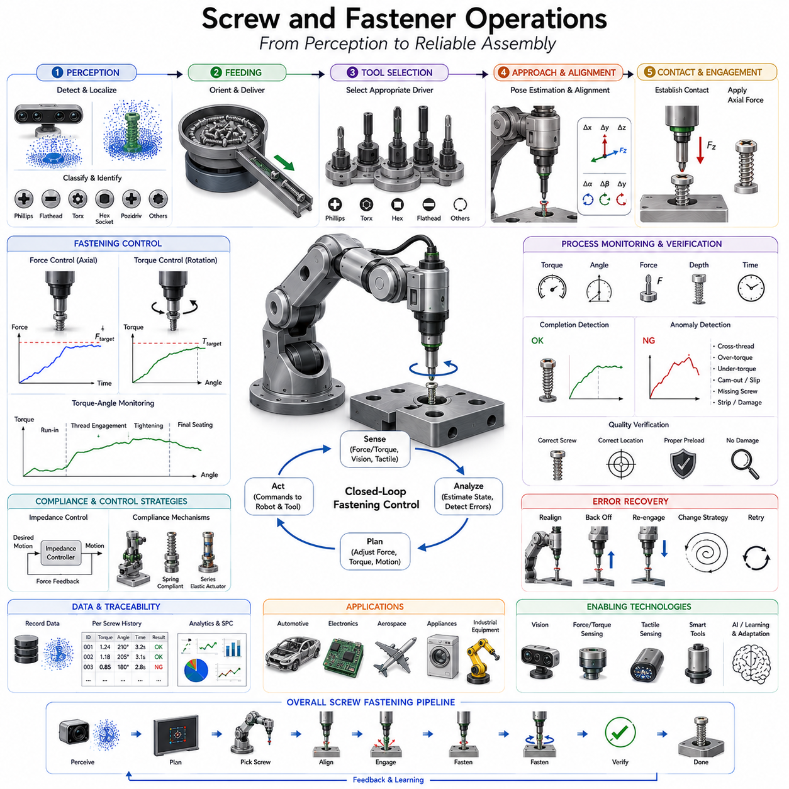{width="7.268055555555556in" height="7.268055555555556in"}

Screw and Fastener Operations represent one of the most important categories of assembly activities in industrial robotics, manufacturing automation, maintenance systems, and service robotics. Nearly every engineered product, from consumer electronics and automobiles to aircraft, industrial machinery, medical devices, and construction equipment, relies on fasteners to create secure mechanical connections between components. Among the many fastening technologies available, screws remain the most widely used because they provide a combination of strength, reliability, ease of installation, removability, and cost effectiveness. For robotic systems, however, screw manipulation is considerably more complex than it appears. A successful fastening operation requires precise perception, tool handling, pose estimation, force control, torque regulation, contact-rich manipulation, error recovery, and process verification. As a result, Screw and Fastener Operations have become a central topic within robotic assembly and dexterous manipulation research. Within the Tool Use and Assembly section of Robot Hand and Dexterous Grasping, this topic represents one of the most practical and commercially significant applications of robotic tool use.

Fasteners are mechanical elements used to join two or more components together. While screws are the most common fasteners encountered in robotic assembly, many other fastening mechanisms exist, including bolts, nuts, rivets, pins, clips, anchors, threaded inserts, retaining rings, and specialized industrial locking mechanisms. Each fastening technology presents unique manipulation challenges. Nevertheless, screws provide an ideal starting point because they combine insertion, alignment, force application, rotational control, and verification within a single task.

From a robotics perspective, screw fastening is a multi-stage operation. The robot must first identify the fastener and the target location. It must then acquire the appropriate tool, position the tool correctly, establish contact with the fastener head, apply axial force, generate controlled torque, monitor insertion progress, detect completion, and verify assembly quality. Failure at any stage can result in assembly defects, damaged components, stripped threads, tool wear, or production delays.

The perception phase plays a critical role in fastening automation. Before a screw can be manipulated, the robot must detect its location, orientation, type, and size. Screws are often small objects with reflective metallic surfaces, making visual detection challenging. They may be partially occluded, randomly oriented, or located in cluttered trays. High-resolution cameras, structured light systems, stereo vision systems, and RGB-D sensors are commonly used to identify screws and estimate their poses.

Screw classification is another important perception problem. Different screw types require different tools and fastening strategies. Common screw head designs include Phillips, Flathead, Torx, Hex Socket, Pozidriv, Robertson, and various security screw configurations. Accurate classification enables the robot to select the correct screwdriver and avoid tool mismatch. Advanced vision systems increasingly employ deep learning models capable of recognizing fastener categories under varying lighting and environmental conditions.

Pose estimation is particularly important for screw manipulation. The robot must determine the position and orientation of both the screw and the target hole. Even small angular misalignments can prevent engagement between the screwdriver and the screw head. In precision assemblies, pose estimation errors measured in fractions of a degree may significantly affect fastening reliability.

Fastener feeding represents another major challenge. Human workers can easily pick up individual screws, but robotic systems require specialized mechanisms to present screws in predictable configurations. Vibratory bowl feeders, tape-and-reel systems, tray feeders, magnetic feeders, vacuum delivery systems, and flexible feeding solutions are commonly used in industrial environments. Modern smart feeders often integrate sensing systems that provide real-time information regarding screw availability and orientation.

Tool selection is a critical aspect of robotic fastening. Different fasteners require different drivers and end effectors. A robotic assembly cell may contain multiple screwdriver tools designed for specific screw geometries. Automatic tool changers allow robots to switch between drivers without human intervention. Tool selection algorithms consider fastener type, torque requirements, accessibility constraints, and assembly specifications.

The robotic screwdriver itself is a highly specialized tool. Unlike ordinary gripping tools, screwdrivers must generate controlled rotational motion while maintaining alignment with the screw axis. Industrial robotic screwdrivers often integrate electric motors, torque sensors, force sensors, depth sensors, and communication interfaces. These systems provide closed-loop control capabilities that improve fastening accuracy and reliability.

Alignment is one of the most critical requirements for successful fastening. Before rotation begins, the screwdriver must align precisely with the screw head. Misalignment may cause cam-out, a phenomenon in which the screwdriver slips out of the screw recess. Cam-out not only prevents successful fastening but can also damage the screw head and reduce assembly quality. Therefore, robots often employ fine alignment procedures before initiating torque application.

Contact establishment represents the transition from free-space motion to contact-rich manipulation. During this phase, the screwdriver approaches the screw head and establishes physical contact. Force sensing is commonly used to detect contact and regulate insertion depth. Excessive contact force may damage components, while insufficient force may prevent reliable engagement.

Axial force control is essential during screw driving. Unlike simple rotational tasks, fastening requires simultaneous control of both force and torque. The robot must apply sufficient downward force to maintain engagement between the screwdriver and the screw head while simultaneously generating rotational motion. The required force depends on screw geometry, material properties, friction characteristics, and assembly conditions.

Torque control is perhaps the most important aspect of fastening operations. Torque represents the rotational force applied to the fastener. Insufficient torque may result in loose connections that compromise structural integrity. Excessive torque may strip threads, damage components, or deform assemblies. Industrial fastening systems therefore incorporate highly accurate torque control mechanisms that ensure each fastener is tightened according to specification.

Torque-angle relationships provide valuable information during fastening. As a screw advances into a threaded hole, torque typically follows a characteristic profile. Initial insertion generates relatively low torque. As clamping forces increase, torque rises. Eventually, the desired preload is achieved and tightening should stop. Monitoring torque-angle curves allows robots to detect anomalies and verify assembly quality.

Preload is a key engineering concept in fastening operations. Preload refers to the tensile force generated within the fastener after tightening. Proper preload ensures secure connections and prevents loosening under vibration and dynamic loading. Because preload cannot usually be measured directly during assembly, torque is often used as an indirect indicator. However, friction variations can affect torque-preload relationships, motivating the development of advanced sensing and estimation techniques.

Thread engagement is another critical process. The screw must properly engage the mating threads before significant torque is applied. Cross-threading occurs when the screw enters the threaded hole incorrectly, causing damage and preventing proper fastening. Detecting and preventing cross-threading remains a major challenge in automated assembly systems.

Compliance plays an important role in screw insertion and fastening. Mechanical compliance and control-based compliance allow robots to accommodate small alignment errors. Without compliance, rigid systems may generate excessive forces that damage threads or prevent engagement. Impedance control and admittance control are widely used to regulate interactions between the screwdriver, fastener, and assembly components.

Force-torque sensing provides valuable feedback throughout the fastening process. Wrist-mounted force-torque sensors measure interaction forces and moments, allowing robots to monitor assembly conditions in real time. Force signatures often reveal important information regarding thread engagement, insertion depth, friction changes, and fastening completion.

Tactile sensing is emerging as a complementary technology for robotic fastening. While force sensors provide aggregate measurements, tactile sensors provide spatially distributed contact information. Tactile feedback can improve alignment, detect slippage, identify tool engagement quality, and support adaptive control strategies.

Vision-guided fastening combines perception and control within a unified framework. Cameras monitor screw positions, hole locations, tool alignment, and assembly progress. High-resolution imaging systems can detect defects, verify component placement, and identify fastening errors before they become critical. Machine vision is increasingly integrated with force control to create robust multi-modal fastening systems.

Error detection and recovery are essential for reliable industrial deployment. Fastening operations are susceptible to numerous failure modes including missing screws, incorrect screw types, cross-threading, stripped heads, tool slippage, incomplete tightening, excessive torque, and damaged components. Advanced robotic systems continuously monitor sensor signals to identify these failures and execute corrective actions automatically.

Process monitoring has become increasingly important in modern manufacturing environments. Every fastening operation generates valuable data regarding torque, force, angle, time, tool status, and assembly conditions. This data can be stored for traceability, quality assurance, predictive maintenance, and process optimization. Digital manufacturing systems often maintain complete fastening histories for each product.

Collaborative robots are expanding the scope of fastening automation. Traditional fastening systems operated within isolated industrial cells. Modern collaborative robots can perform screw driving operations safely alongside human workers. This capability enables flexible production systems in which robots handle repetitive fastening tasks while humans focus on higher-level assembly activities.

Learning-based approaches are increasingly influencing robotic fastening. Traditional systems rely heavily on predefined process parameters and rule-based control. Machine learning methods enable robots to adapt to variations in materials, geometries, and environmental conditions. By analyzing historical assembly data, robots can optimize fastening strategies and improve reliability over time.

Behavior cloning allows robots to learn fastening skills from human demonstrations. Human operators naturally adapt force, torque, and alignment during assembly. Demonstration-based learning captures these behaviors and transfers them to robotic systems. Such approaches are particularly valuable when analytical modeling becomes difficult.

Reinforcement learning offers another promising direction. Robots learn fastening policies through repeated interactions with simulated or real environments. Successful fastening operations generate rewards, encouraging the discovery of robust manipulation strategies. Reinforcement learning has shown significant potential for handling complex assembly tasks involving uncertainty and variability.

Simulation environments play a crucial role in fastening research and development. High-fidelity simulators model contact dynamics, thread engagement, frictional effects, compliance, and sensor responses. Large-scale simulation enables rapid testing of fastening strategies while reducing development costs and minimizing hardware wear.

Foundation models and embodied AI are beginning to influence robotic assembly operations. Large-scale models trained on manipulation data may eventually understand fastening tasks at a semantic level. Instead of programming specific screw-driving routines, future robots may receive natural language instructions such as "assemble the panel using the designated screws" and autonomously determine appropriate tools, fastening sequences, and verification procedures.

Industrial applications of robotic fastening are extensive. Automotive production lines perform thousands of fastening operations per vehicle. Consumer electronics manufacturing relies heavily on miniature screw assembly. Aerospace manufacturing requires extremely precise fastening under strict quality standards. Medical device production demands reliable fastening within highly regulated environments. Construction robotics increasingly employs automated fastening technologies for modular building assembly.

Fastening quality verification is the final stage of the process. Successful completion is not simply defined by reaching a target torque value. Robots must verify that the correct fastener was installed in the correct location, that proper preload was achieved, that no damage occurred, and that assembly specifications were satisfied. Verification may involve torque analysis, visual inspection, depth measurement, force monitoring, and non-destructive testing techniques.

Performance evaluation of robotic fastening systems typically considers fastening success rate, cycle time, torque accuracy, preload consistency, defect rate, tool wear, energy consumption, and adaptability to process variations. High-volume manufacturing environments often require success rates exceeding 99.99%, making reliability a critical design objective.

Future Screw and Fastener Operations will likely integrate advanced perception, high-precision force control, tactile intelligence, adaptive compliance, digital twins, learning-based optimization, and foundation-model reasoning within unified assembly platforms. These systems will move beyond repetitive automation toward intelligent assembly capabilities capable of handling diverse products with minimal reprogramming.

Ultimately, Screw and Fastener Operations represent a perfect example of contact-rich robotic manipulation. They require the integration of perception, planning, force regulation, tool use, process monitoring, and adaptive intelligence within a single task. Mastering robotic fastening is therefore not merely an industrial requirement but also an important milestone toward achieving general-purpose robotic assembly systems and future embodied AI agents capable of performing complex physical work in real-world environments.

Screw and Fastener Operations(나사 및 체결 작업)은 산업용 로봇, 제조 자동화, 유지보수 시스템, 서비스 로봇 분야에서 가장 중요한 조립 작업 중 하나이다. 소비자 전자제품부터 자동차, 항공기, 산업 장비, 의료기기, 건설 장비에 이르기까지 거의 모든 공학 제품은 부품들을 안정적으로 연결하기 위해 체결 부품(Fastener)을 사용한다. 다양한 체결 방식 중에서도 나사(Screw)는 강도, 신뢰성, 분해 가능성, 경제성을 동시에 제공하기 때문에 가장 널리 사용되는 체결 방식이다. 그러나 로봇이 나사를 다루는 것은 생각보다 훨씬 복잡하다. 성공적인 체결 작업을 위해서는 정밀한 인지(Perception), 도구 사용(Tool Handling), 자세 추정(Pose Estimation), 힘 제어(Force Control), 토크 제어(Torque Regulation), 접촉 기반 조작(Contact-Rich Manipulation), 오류 복구(Error Recovery), 품질 검증(Quality Verification)이 모두 필요하다. 따라서 나사 및 체결 작업은 로봇 조립과 정교한 조작 기술의 핵심 연구 분야로 자리 잡고 있다. Robot Hand and Dexterous Grasping의 Tool Use and Assembly 영역에서는 가장 실용적이고 산업적 가치가 높은 응용 분야 중 하나로 평가된다.

패스너(Fastener)는 둘 이상의 부품을 연결하기 위해 사용되는 기계 요소이다. 나사가 가장 대표적이지만 볼트(Bolt), 너트(Nut), 리벳(Rivet), 핀(Pin), 클립(Clip), 앵커(Anchor), 나사 인서트(Threaded Insert), 스냅링(Retaining Ring) 등 다양한 종류가 존재한다. 각각은 고유한 조작 문제를 가지지만, 나사는 삽입(Insertion), 정렬(Alignment), 힘 전달(Force Application), 회전 제어(Rotational Control), 품질 검증(Verification)을 모두 포함하기 때문에 로봇 조립의 대표적인 예제로 사용된다.

로봇 관점에서 나사 체결은 여러 단계로 구성된 작업이다. 먼저 로봇은 나사와 체결 위치를 인식해야 한다. 이후 적절한 드라이버를 선택하고, 공구를 올바른 자세로 위치시키며, 나사 머리와 접촉한 뒤, 축 방향 힘(Axial Force)과 토크(Torque)를 동시에 가하면서 체결을 수행한다. 마지막으로 체결 상태를 확인하고 품질을 검증해야 한다. 어느 한 단계라도 실패하면 조립 불량, 나사 손상, 공구 마모, 생산성 저하로 이어질 수 있다.

체결 자동화에서 인식(Perception)은 매우 중요한 역할을 한다. 로봇은 먼저 나사의 위치, 방향, 종류, 크기를 식별해야 한다. 나사는 작고 금속 재질로 되어 있어 반사가 심하며, 부품함 내부에 무작위로 놓여 있는 경우가 많아 인식이 쉽지 않다. 이를 위해 고해상도 카메라, 구조광(Structured Light), 스테레오 비전(Stereo Vision), RGB-D 센서 등이 활용된다.

나사 분류(Screw Classification)도 중요한 문제이다. 나사 머리 형상에 따라 사용해야 하는 공구가 달라지기 때문이다. 대표적으로 Phillips, Flathead, Torx, Hex Socket, Pozidriv, Robertson, Security Screw 등이 있다. 정확한 분류는 적절한 드라이버 선택을 가능하게 하며 공구 손상과 작업 실패를 예방한다. 최근에는 딥러닝 기반 비전 시스템이 다양한 조명 조건과 환경 변화 속에서도 높은 정확도로 나사를 분류할 수 있게 되었다.

자세 추정(Pose Estimation)은 나사 체결에서 매우 중요하다. 로봇은 나사와 체결 홀의 위치뿐 아니라 방향까지 정확하게 계산해야 한다. 작은 각도 오차만 존재해도 드라이버와 나사 머리의 결합이 실패할 수 있다. 정밀 조립에서는 1도 이하의 오차조차 체결 품질에 큰 영향을 미친다.

나사 공급(Fastener Feeding)은 자동화에서 또 다른 중요한 과제이다. 사람은 손으로 쉽게 나사를 집을 수 있지만 로봇은 예측 가능한 자세로 나사를 공급받아야 한다. 이를 위해 진동 볼 피더(Vibratory Bowl Feeder), 테이프-릴(Tape-and-Reel), 트레이 피더(Tray Feeder), 자석 피더(Magnetic Feeder), 진공 공급 시스템(Vacuum Delivery System) 등이 사용된다. 최신 스마트 피더는 센서와 연동되어 나사의 상태와 방향을 실시간으로 제공한다.

공구 선택(Tool Selection)은 체결 작업의 핵심 요소이다. 서로 다른 나사에는 서로 다른 드라이버가 필요하다. 산업용 조립 셀은 여러 종류의 드라이버를 보유하며, 자동 공구 교환기(Automatic Tool Changer)를 통해 작업 중 공구를 자동으로 교체할 수 있다. 공구 선택은 나사 종류, 요구 토크, 접근성, 조립 사양 등을 종합적으로 고려하여 결정된다.

로봇용 드라이버(Robotic Screwdriver)는 단순한 그리퍼와 다르다. 드라이버는 회전 운동을 생성하는 동시에 나사 축과 정렬을 유지해야 한다. 산업용 드라이버는 전기 모터, 토크 센서, 힘 센서, 깊이 센서, 통신 인터페이스 등을 내장하여 정밀한 폐루프 제어(Closed-Loop Control)를 수행한다.

정렬(Alignment)은 성공적인 체결의 가장 중요한 요소 중 하나이다. 회전을 시작하기 전에 드라이버는 나사 머리와 정확히 정렬되어야 한다. 정렬이 잘못되면 캠아웃(Cam-Out)이 발생한다. 캠아웃은 드라이버가 나사 홈에서 미끄러져 빠져나오는 현상으로, 나사 머리를 손상시키고 작업 실패를 초래한다. 따라서 로봇은 체결 전 정밀 정렬 절차를 수행한다.

접촉 형성(Contact Establishment)은 자유 공간 움직임에서 접촉 기반 조작으로 전환되는 단계이다. 드라이버가 나사 머리에 접근하여 실제 접촉을 형성하는 과정이다. 힘 센서를 이용하여 접촉 여부를 감지하고 적절한 깊이를 유지한다. 너무 큰 힘은 부품 손상을 유발하고, 너무 작은 힘은 체결 실패를 초래할 수 있다.

축 방향 힘 제어(Axial Force Control)는 매우 중요하다. 나사 체결은 단순한 회전 작업이 아니라 힘과 토크를 동시에 제어해야 하는 작업이다. 로봇은 드라이버와 나사 홈이 계속 결합된 상태를 유지하기 위해 적절한 누름 힘을 가해야 한다. 필요한 힘은 나사 형상, 재료, 마찰 특성, 조립 조건에 따라 달라진다.

토크 제어(Torque Control)는 체결 작업의 핵심이다. 토크는 나사를 회전시키는 힘을 의미한다. 토크가 부족하면 체결이 느슨해지고 구조적 안정성이 떨어진다. 반대로 토크가 지나치면 나사산(Thread)이 파손되거나 부품이 변형될 수 있다. 따라서 산업용 체결 시스템은 매우 높은 정밀도로 토크를 제어한다.

토크-각도 관계(Torque-Angle Relationship)는 체결 상태를 평가하는 중요한 지표이다. 나사가 체결될수록 토크는 특정한 패턴으로 증가한다. 초기에는 낮은 토크를 보이다가 조임력이 증가하면서 토크가 상승한다. 목표 프리로드(Preload)에 도달하면 체결을 종료해야 한다. 토크-각도 곡선을 분석하면 체결 품질을 효과적으로 검증할 수 있다.

프리로드(Preload)는 체결 후 나사 내부에 생성되는 인장력(Tensile Force)을 의미한다. 적절한 프리로드는 진동 환경에서도 체결이 풀리지 않도록 보장한다. 프리로드를 직접 측정하기는 어렵기 때문에 일반적으로 토크를 이용하여 간접적으로 추정한다. 그러나 마찰 변화가 토크와 프리로드의 관계를 변화시키기 때문에 더욱 정교한 추정 기법이 연구되고 있다.

나사산 결합(Thread Engagement)은 체결 과정의 핵심이다. 나사는 먼저 상대 나사산과 정확하게 결합해야 한다. 크로스 스레딩(Cross-Threading)은 나사가 잘못된 각도로 들어가 나사산을 손상시키는 현상이다. 이는 자동 체결에서 가장 위험한 오류 중 하나이며, 이를 감지하고 예방하는 기술이 매우 중요하다.

순응성(Compliance)은 나사 체결에서도 중요한 역할을 한다. 기계적 순응성과 제어 기반 순응성은 작은 정렬 오차를 흡수하여 체결 성공률을 높인다. 순응성이 없는 강체 시스템은 과도한 힘을 발생시켜 나사산을 손상시킬 수 있다. 이를 해결하기 위해 임피던스 제어(Impedance Control)와 어드미턴스 제어(Admittance Control)가 널리 사용된다.

힘-토크 센서(Force-Torque Sensor)는 체결 과정 전반에 걸쳐 중요한 피드백을 제공한다. 손목 장착형 센서는 힘과 모멘트를 측정하여 체결 상태를 실시간으로 분석한다. 힘 신호는 나사산 결합, 삽입 깊이, 마찰 변화, 체결 완료 여부 등을 판단하는 데 활용된다.

촉각 센서(Tactile Sensor)는 최근 주목받고 있는 기술이다. 힘 센서가 전체 힘을 측정하는 반면, 촉각 센서는 접촉 분포를 제공한다. 이를 통해 미끄러짐(Slip), 접촉 품질, 정렬 상태 등을 더욱 정밀하게 파악할 수 있다.

비전 기반 체결(Vision-Guided Fastening)은 카메라와 제어를 결합한 방식이다. 카메라는 나사 위치, 홀 위치, 드라이버 정렬 상태, 조립 진행 상황을 지속적으로 모니터링한다. 최신 비전 시스템은 결함 검출, 부품 배치 확인, 체결 오류 탐지까지 수행할 수 있다.

오류 검출(Error Detection)과 복구(Error Recovery)는 산업 환경에서 필수적인 기능이다. 나사 누락(Missing Screw), 잘못된 나사 사용, 크로스 스레딩, 나사 머리 손상, 공구 미끄러짐, 토크 부족, 과도한 토크 등의 다양한 오류가 발생할 수 있다. 고급 시스템은 센서 데이터를 지속적으로 분석하여 이러한 문제를 자동으로 탐지하고 수정한다.

공정 모니터링(Process Monitoring)은 스마트 제조 환경에서 점점 더 중요해지고 있다. 모든 체결 작업은 토크, 힘, 회전 각도, 작업 시간, 공구 상태 등의 데이터를 생성한다. 이러한 데이터는 품질 보증(Quality Assurance), 추적성(Traceability), 예지 보전(Predictive Maintenance), 공정 최적화(Process Optimization)에 활용된다.

협동로봇(Collaborative Robot)의 발전은 체결 자동화의 적용 범위를 크게 확대하고 있다. 과거 체결 로봇은 독립된 셀(Cell) 내부에서만 동작했지만, 현대 협동로봇은 사람과 함께 작업할 수 있다. 로봇이 반복적인 체결 작업을 수행하고 사람은 보다 복잡한 조립 작업을 담당하는 형태의 유연 생산 시스템이 가능해지고 있다.

학습 기반 체결(Learning-Based Fastening)은 최근 빠르게 발전하는 분야이다. 기존 방식이 사전에 정의된 규칙과 공정 조건에 의존했다면, 머신러닝은 다양한 재료와 환경 변화에 적응할 수 있도록 한다. 과거 체결 데이터를 분석하여 더 나은 전략을 스스로 학습할 수 있다.

행동 모방 학습(Behavior Cloning)은 숙련 작업자의 체결 방식을 학습한다. 사람은 힘과 토크, 정렬 상태를 자연스럽게 조정하며 작업한다. 이러한 경험을 로봇이 학습함으로써 보다 유연하고 안정적인 체결이 가능해진다.

강화학습(Reinforcement Learning)은 반복적인 시도를 통해 최적의 체결 정책을 학습한다. 성공적인 체결에는 보상이 주어지고 실패에는 패널티가 부여된다. 이를 통해 로봇은 복잡한 환경에서도 높은 성공률을 달성할 수 있다.

시뮬레이션(Simulation)은 체결 기술 개발의 중요한 도구이다. 고정밀 물리 엔진은 접촉, 마찰, 나사산 결합, 순응성, 센서 응답 등을 모델링할 수 있다. 이를 통해 실제 장비를 사용하지 않고도 다양한 전략을 검증할 수 있다.

최근에는 파운데이션 모델(Foundation Model)과 임바디드 AI(Embodied AI)가 체결 작업에도 적용되기 시작했다. 미래의 로봇은 "지정된 나사로 패널을 조립하라"와 같은 자연어 명령만으로 필요한 공구 선택, 체결 순서 결정, 품질 검증까지 스스로 수행할 수 있을 것으로 예상된다.

자동차 산업은 차량 한 대당 수천 개의 체결 작업을 수행한다. 전자제품 제조는 초소형 나사 조립에 의존한다. 항공우주 산업은 극도로 높은 품질 기준을 요구하며, 의료기기 산업은 엄격한 규제 환경 속에서 안정적인 체결을 수행해야 한다. 최근에는 건설 로봇도 모듈형 건축물 조립을 위해 자동 체결 기술을 활용하고 있다.

체결 품질 검증(Fastening Quality Verification)은 작업의 마지막 단계이다. 단순히 목표 토크에 도달했다고 해서 성공으로 간주하지 않는다. 올바른 나사가 올바른 위치에 사용되었는지, 적절한 프리로드가 생성되었는지, 손상이 발생하지 않았는지, 조립 사양을 충족하는지를 종합적으로 확인해야 한다.

로봇 체결 시스템은 일반적으로 체결 성공률(Fastening Success Rate), 사이클 타임(Cycle Time), 토크 정확도(Torque Accuracy), 프리로드 일관성(Preload Consistency), 불량률(Defect Rate), 공구 마모(Tool Wear), 에너지 소비(Energy Consumption), 공정 변화 적응성(Adaptability) 등을 기준으로 평가된다. 대량 생산 환경에서는 99.99% 이상의 성공률이 요구되는 경우도 많다.

미래의 나사 및 체결 작업 시스템은 고성능 인식, 정밀 힘 제어, 촉각 지능, 적응형 순응성, 디지털 트윈(Digital Twin), 학습 기반 최적화, 파운데이션 모델 기반 추론이 통합된 형태로 발전할 것이다. 이러한 시스템은 단순 반복 자동화를 넘어 다양한 제품을 최소한의 재프로그래밍으로 조립할 수 있는 지능형 조립 플랫폼으로 진화할 것으로 기대된다.

결국 Screw and Fastener Operations는 접촉 기반 로봇 조작(Contact-Rich Robotic Manipulation)의 대표적인 사례이다. 인지, 계획, 힘 제어, 공구 사용, 공정 모니터링, 적응형 지능이 모두 결합되어야만 성공할 수 있다. 따라서 나사 체결을 완벽하게 수행할 수 있는 능력은 범용 조립 로봇(General-Purpose Assembly Robot)과 미래 임바디드 AI 시스템으로 가는 중요한 이정표로 평가되고 있다.

##  

## 13.07 Cable Handling

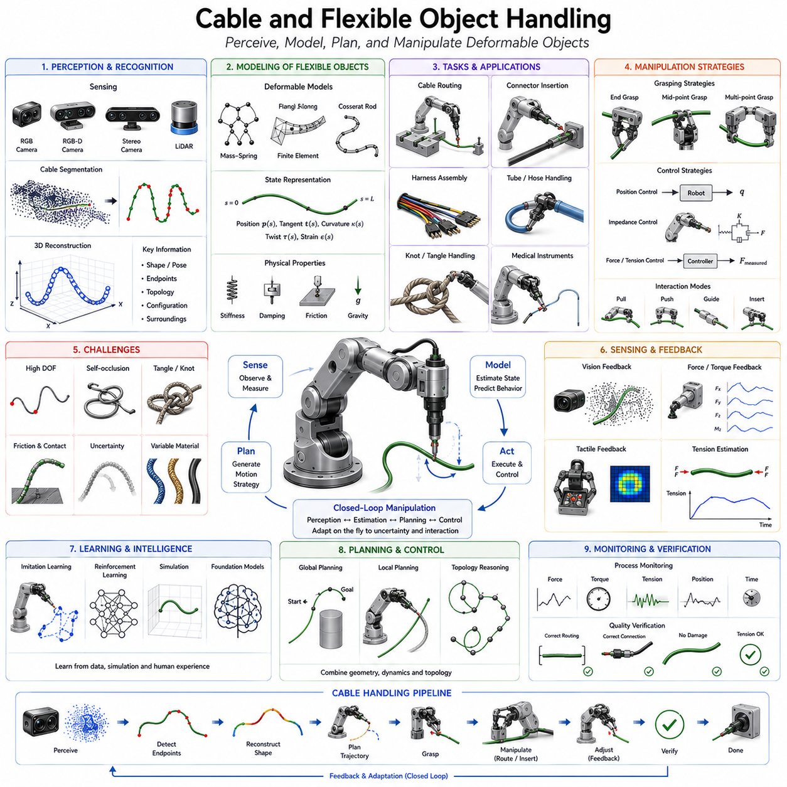{width="7.268055555555556in" height="7.268055555555556in"}

Cable and Flexible Object Handling is one of the most challenging areas in robotic manipulation because it involves objects whose shape continuously changes during interaction. Unlike rigid objects, which maintain a predictable geometry and can be described using fixed kinematic and geometric models, flexible objects exhibit highly dynamic behavior influenced by gravity, contact forces, friction, elasticity, bending stiffness, torsion, material memory, and environmental constraints. As a result, tasks that humans perform naturally, such as plugging in a charging cable, routing a wire through a machine, folding a hose, organizing electrical harnesses, inserting medical catheters, or manipulating ropes and textiles, remain among the most difficult challenges in robotics. Within the Tool Use and Assembly section of Robot Hand and Dexterous Grasping, Cable and Flexible Object Handling represents a major transition from rigid-body manipulation to deformable object manipulation, requiring advanced perception, modeling, planning, control, and learning capabilities.

Flexible objects are ubiquitous in industrial and everyday environments. Electrical wiring harnesses are present in automobiles, aircraft, industrial machinery, consumer electronics, and communication systems. Flexible tubes transport fluids and gases throughout factories and medical facilities. Fiber optic cables support communication networks. Medical procedures frequently involve flexible instruments such as catheters, guidewires, and endoscopes. Household environments contain power cords, charging cables, hoses, ropes, fabrics, and numerous deformable materials. The ability to manipulate such objects reliably is therefore essential for the next generation of autonomous robots.

The primary difficulty of flexible object manipulation originates from the object\'s virtually infinite degrees of freedom. A rigid object can be represented by six degrees of freedom corresponding to its position and orientation. In contrast, a cable can bend, twist, stretch, coil, loop, and deform continuously along its length. Every point along the cable may potentially move independently. Consequently, the state space of a flexible object is dramatically larger than that of a rigid object, making perception and control substantially more difficult.

Mechanical properties play a central role in flexible object behavior. Different cables exhibit different levels of stiffness, elasticity, damping, friction, and torsional resistance. A thin electrical wire behaves very differently from a hydraulic hose. A fiber optic cable requires careful handling to avoid excessive bending, while a power cable may tolerate significant deformation. Understanding material properties is therefore essential for predicting object behavior during manipulation.

One of the first challenges in cable handling is perception. Before manipulation can begin, the robot must identify the cable, estimate its shape, locate its endpoints, determine its configuration, and understand its relationship to the surrounding environment. Unlike rigid tools, whose geometry is relatively fixed, cables continuously change shape. This means that perception systems must track not only object position but also object deformation.

Vision-based perception has become the dominant approach for flexible object recognition. High-resolution RGB cameras provide detailed visual information about cable appearance and configuration. However, cables often present challenges such as self-occlusion, overlapping segments, reflections, complex backgrounds, and varying lighting conditions. Advanced computer vision algorithms are therefore required to segment cables accurately and reconstruct their geometry.

Three-dimensional sensing further improves cable perception. RGB-D cameras, stereo vision systems, structured light sensors, and laser scanners enable robots to reconstruct the spatial shape of flexible objects. Point cloud processing algorithms can identify cable trajectories, estimate curvature distributions, and locate critical features such as endpoints and connectors. Three-dimensional perception is particularly important when cables are suspended in space or routed through complex environments.

Endpoint detection represents a critical capability in cable manipulation. Many cable handling tasks begin by grasping one or both ends of a cable. However, endpoints are often partially hidden, tangled, or difficult to distinguish from intermediate segments. Modern perception systems use deep learning models and geometric reasoning techniques to identify cable endpoints robustly even in cluttered environments.

Shape reconstruction is another major challenge. The robot must estimate the current configuration of the cable to predict future behavior. Shape reconstruction algorithms convert visual observations into mathematical representations such as splines, curves, graphs, or finite element models. These representations provide a compact description of cable geometry and support planning and control processes.

Mathematical modeling of flexible objects is significantly more complex than rigid-body modeling. Classical rigid-body dynamics assume fixed geometric relationships between object components. Flexible objects require continuous deformation models. Researchers have developed numerous representations including mass-spring systems, finite element methods, Cosserat rod models, elastic rod formulations, and continuum mechanics approaches. Each model offers different tradeoffs between accuracy and computational efficiency.

Mass-spring systems provide one of the simplest representations. The cable is modeled as a series of masses connected by springs and dampers. This approach captures basic deformation behavior while remaining computationally manageable. However, it may not accurately represent complex bending and torsional effects.

Finite Element Methods provide higher accuracy by dividing the cable into many small elements and solving deformation equations numerically. These models can represent complex material properties and contact interactions but often require substantial computational resources. As computing power continues to increase, finite element approaches are becoming increasingly practical for robotic manipulation.

Cosserat rod models have gained significant attention in recent years because they provide a powerful balance between physical realism and computational efficiency. These models represent bending, twisting, stretching, and shearing within a unified mathematical framework. Cosserat theory is particularly useful for robotic manipulation of cables, wires, catheters, and other elongated flexible structures.

Grasp planning for flexible objects differs fundamentally from grasp planning for rigid objects. In rigid object manipulation, grasping a specific location typically provides predictable control over the entire object. In cable manipulation, grasping one point affects only a portion of the object and may cause unpredictable deformation elsewhere. The robot must therefore consider both local and global effects when selecting grasp points.

Single-point grasping is sufficient for simple transportation tasks. However, many cable handling operations require multi-point manipulation. Two robotic hands may grasp different sections of a cable simultaneously. Multi-point manipulation provides greater control over object shape and enables complex tasks such as routing, threading, knot tying, and assembly.

Cable routing is one of the most important industrial applications of flexible object handling. During assembly operations, cables must often be routed through constrained pathways, clips, brackets, channels, and protective conduits. Routing requires precise control of cable shape while avoiding excessive tension, twisting, and bending. Automated cable routing remains an active research area because of its practical importance in automotive, aerospace, and electronics manufacturing.

Connector insertion represents another critical application. Many assembly processes require inserting cable connectors into mating sockets. This task combines flexible object manipulation with precision insertion. The robot must control cable deformation while simultaneously aligning the connector accurately. Small disturbances in cable shape can significantly affect insertion accuracy.

Cable harness assembly is among the most challenging industrial automation tasks. Wiring harnesses may contain dozens or even hundreds of interconnected cables with complex branching structures. Manipulating such assemblies requires understanding both local cable behavior and global topology. Advanced robotic systems must reason about cable organization, routing constraints, assembly sequences, and quality requirements simultaneously.

Tension control plays a crucial role in flexible object manipulation. Excessive tension may damage cables or alter their intended configuration. Insufficient tension may lead to slack, tangling, or loss of control. Force sensors are commonly used to monitor cable tension and regulate interaction forces during manipulation.

Contact interactions significantly influence cable behavior. Flexible objects frequently interact with surrounding surfaces, fixtures, guides, and other cables. Frictional effects often dominate system behavior. Accurate prediction of contact forces remains one of the most difficult challenges in flexible object modeling. Modern simulation environments increasingly incorporate advanced contact models to improve realism.

Tangling is a particularly difficult problem. Cables naturally form loops, knots, and entangled structures during storage and handling. Untangling requires sophisticated perception and reasoning capabilities. The robot must identify topological relationships, determine the sequence of required actions, and execute manipulation strategies that progressively reduce entanglement complexity.

Topological reasoning has emerged as an important research direction. Traditional robotic planning focuses primarily on geometry. Cable manipulation additionally requires understanding topology, including loops, crossings, knots, and connectivity relationships. Topological representations help robots reason about entanglement and support planning for complex manipulation tasks.

Learning-based approaches have significantly advanced the field of flexible object handling. Traditional model-based methods often struggle because flexible object dynamics are difficult to model accurately. Machine learning provides an alternative by allowing robots to learn manipulation strategies directly from experience.

Behavior cloning enables robots to imitate human demonstrations. Human operators naturally understand how to manipulate cables, route wires, and avoid tangles. Demonstration data captures these skills and transfers them to robotic systems. This approach is particularly useful for tasks where analytical models are incomplete or difficult to construct.

Reinforcement learning has also demonstrated promising results. Through repeated interaction with simulated environments, robots can discover manipulation policies that maximize task success. Reinforcement learning is especially valuable for cable routing, connector insertion, and knot manipulation tasks where long sequences of actions must be coordinated.

Simulation plays a central role in learning-based cable manipulation. Flexible object simulations allow robots to experience thousands or millions of manipulation scenarios without physical hardware. Advances in physics simulation have significantly improved the realism of cable dynamics, enabling more effective transfer of learned policies to real-world systems.

Tactile sensing provides valuable information during cable manipulation. Vision systems may lose visibility due to occlusion or complex object configurations. Tactile sensors provide direct measurements of contact conditions, grip quality, and cable movement. Combining visual and tactile information significantly improves manipulation robustness.

Force sensing is equally important. Monitoring interaction forces helps prevent cable damage and provides feedback regarding tension, contact, and insertion progress. Force-based control strategies are widely used in connector assembly, cable routing, and medical applications involving flexible instruments.

Medical robotics represents a particularly important application domain. Catheters, guidewires, endoscopes, and flexible surgical tools exhibit many of the same challenges as cable manipulation. Medical robots must navigate flexible instruments through complex anatomical pathways while maintaining precise control and minimizing tissue damage. Research in medical robotics has therefore contributed significantly to the development of flexible object manipulation techniques.

Foundation models and embodied AI are beginning to influence this field as well. Large-scale manipulation models trained on diverse datasets may eventually learn generalized representations of flexible object behavior. Rather than requiring task-specific programming, future robots may reason about cables, hoses, ropes, and deformable objects using transferable physical knowledge. Natural language instructions may specify desired cable configurations while underlying models determine appropriate manipulation strategies.

Industrial applications continue to drive progress in this area. Automotive manufacturers seek automated wiring harness assembly. Aerospace companies require reliable cable routing within aircraft structures. Electronics manufacturers aim to automate connector insertion and cable management. Logistics systems increasingly handle flexible packaging materials. Service robots must manipulate charging cables, household cords, and deformable objects in unstructured environments.

Performance evaluation of cable manipulation systems typically considers task success rate, routing accuracy, insertion accuracy, deformation control, tension regulation, execution speed, robustness to uncertainty, and adaptability to new cable types. Because flexible objects exhibit highly variable behavior, robustness and generalization are often more important than raw speed.

Future Cable and Flexible Object Handling systems will likely integrate advanced perception, real-time physics modeling, tactile intelligence, force control, topological reasoning, simulation-driven learning, foundation models, and embodied AI within unified manipulation frameworks. These systems will move beyond simple cable transport toward sophisticated flexible object intelligence capable of handling the enormous diversity of deformable materials encountered in the real world.

Ultimately, Cable and Flexible Object Handling represents one of the final frontiers of robotic manipulation. While rigid-object manipulation has achieved remarkable maturity, flexible-object manipulation remains a grand challenge that demands breakthroughs across perception, modeling, control, planning, and learning. Solving this challenge will significantly expand the range of tasks robots can perform and will play a critical role in enabling future autonomous assembly systems, advanced service robots, intelligent manufacturing platforms, and general-purpose embodied AI agents.

Cable and Flexible Object Handling(케이블 및 유연 물체 조작)은 로봇 조작 분야에서 가장 어려운 영역 중 하나이다. 그 이유는 케이블, 전선, 호스, 로프와 같은 유연 물체(Flexible Object)가 작업 과정에서 지속적으로 형태를 변화시키기 때문이다. 강체(Rigid Object)는 일정한 형상을 유지하기 때문에 비교적 단순한 기하학적 모델과 운동학 모델로 표현할 수 있지만, 유연 물체는 중력(Gravity), 접촉력(Contact Force), 마찰(Friction), 탄성(Elasticity), 굽힘 강성(Bending Stiffness), 비틀림(Torsion), 재료 기억 효과(Material Memory), 환경 제약(Environmental Constraints) 등에 의해 지속적으로 변형된다. 따라서 사람이 자연스럽게 수행하는 충전 케이블 연결, 전선 배선, 호스 정리, 케이블 하네스 조립, 의료용 카테터 조작, 로프 다루기 등의 작업은 로봇에게는 매우 복잡한 문제로 남아 있다. Robot Hand and Dexterous Grasping의 Tool Use and Assembly 영역에서 이 주제는 강체 조작에서 변형 가능한 물체 조작(Deformable Object Manipulation)으로 확장되는 중요한 분야이다.

유연 물체는 산업과 일상생활 전반에 걸쳐 광범위하게 존재한다. 자동차와 항공기 내부에는 복잡한 전선 하네스(Wiring Harness)가 설치되어 있으며, 산업 설비에는 수많은 유압 및 공압 호스가 사용된다. 광섬유 케이블(Fiber Optic Cable)은 통신 인프라를 구성하며, 의료 분야에서는 카테터(Catheter), 가이드와이어(Guidewire), 내시경(Endoscope)과 같은 유연 기구가 사용된다. 가정 환경에서도 전원 코드, 충전 케이블, 로프, 직물(Fabric), 플라스틱 튜브 등 다양한 유연 물체를 쉽게 찾아볼 수 있다. 따라서 이러한 물체를 안정적으로 다룰 수 있는 능력은 차세대 자율 로봇의 핵심 역량 중 하나로 평가된다.

유연 물체 조작이 어려운 가장 큰 이유는 자유도(Degrees of Freedom)가 사실상 무한대에 가깝기 때문이다. 강체는 위치와 자세를 나타내는 6자유도만으로 상태를 표현할 수 있다. 그러나 케이블은 길이 방향 전체에서 굽어지고, 꼬이고, 늘어나고, 휘어질 수 있기 때문에 매우 큰 상태 공간(State Space)을 가진다. 케이블의 모든 점이 독립적으로 움직일 수 있기 때문에 인식과 제어가 훨씬 복잡해진다.

재료 특성(Material Properties)은 유연 물체의 거동을 결정하는 핵심 요소이다. 전기 배선은 비교적 유연하지만, 유압 호스는 강성이 높고 무겁다. 광섬유 케이블은 과도한 굽힘에 매우 민감하며, 전원 케이블은 상대적으로 큰 변형을 허용한다. 따라서 로봇은 각 물체의 강성(Stiffness), 탄성(Elasticity), 감쇠(Damping), 마찰 특성(Friction Property), 비틀림 저항(Torsional Resistance)을 이해해야 한다.

유연 물체 조작의 첫 번째 과제는 인식(Perception)이다. 로봇은 먼저 케이블을 식별하고, 현재 형상을 추정하며, 끝점(Endpoint)을 찾고, 주변 환경과의 관계를 이해해야 한다. 강체 공구와 달리 케이블은 형태가 계속 변화하기 때문에 단순한 위치 인식만으로는 충분하지 않다.

비전 기반 인식(Vision-Based Perception)은 현재 가장 널리 사용되는 방법이다. RGB 카메라는 케이블의 외형과 배치를 관찰할 수 있지만, 케이블은 자기 가림(Self-Occlusion), 중첩(Overlap), 반사(Reflection), 복잡한 배경 등의 문제를 자주 발생시킨다. 따라서 고급 컴퓨터 비전 알고리즘이 필요하다.

3차원 센싱(3D Sensing)은 유연 물체 인식 능력을 크게 향상시킨다. RGB-D 카메라, 스테레오 비전, 구조광 센서, 레이저 스캐너는 케이블의 공간 형상을 재구성할 수 있다. 포인트 클라우드(Point Cloud) 분석을 통해 케이블의 경로(Trajectory), 곡률(Curvature), 끝점 위치 등을 추정할 수 있다.

끝점 검출(Endpoint Detection)은 매우 중요한 기능이다. 대부분의 케이블 작업은 케이블 끝을 잡는 것에서 시작된다. 그러나 실제 환경에서는 끝점이 가려져 있거나 다른 부분과 구분하기 어려운 경우가 많다. 최근에는 딥러닝 기반 모델과 기하학적 추론 기법을 활용하여 끝점을 안정적으로 검출할 수 있게 되었다.

형상 복원(Shape Reconstruction) 역시 중요한 문제이다. 로봇은 현재 케이블의 상태를 이해해야 미래의 변형을 예측할 수 있다. 형상 복원 알고리즘은 관측 데이터를 스플라인(Spline), 곡선(Curve), 그래프(Graph), 유한 요소 모델(Finite Element Model) 등으로 변환하여 표현한다.

유연 물체의 수학적 모델링은 강체 모델링보다 훨씬 복잡하다. 강체는 고정된 기하학 관계를 가지지만, 케이블은 지속적으로 변형된다. 이를 표현하기 위해 질량-스프링 모델(Mass-Spring Model), 유한 요소법(Finite Element Method), 코세라트 막대 모델(Cosserat Rod Model), 연속체 역학(Continuum Mechanics) 등이 사용된다.

질량-스프링 모델은 가장 단순한 접근 방식이다. 케이블을 여러 개의 질량점(Mass Point)과 이를 연결하는 스프링(Spring)으로 표현한다. 계산이 비교적 빠르지만 복잡한 굽힘과 비틀림을 정확하게 표현하기는 어렵다.

유한 요소법은 케이블을 수많은 작은 요소(Element)로 분할하여 물리 방정식을 수치적으로 계산한다. 매우 높은 정확도를 제공하지만 계산 비용이 크다. 최근 컴퓨팅 성능 향상으로 인해 실제 로봇 시스템에서도 활용 가능성이 높아지고 있다.

코세라트 막대 모델은 최근 가장 주목받는 접근법 중 하나이다. 이 모델은 굽힘, 비틀림, 늘어남, 전단 변형(Shear)을 통합적으로 표현할 수 있다. 특히 전선, 케이블, 카테터와 같은 길쭉한 유연 구조를 모델링하는 데 매우 효과적이다.

유연 물체의 파지 계획(Grasp Planning)은 강체와 본질적으로 다르다. 강체는 한 지점을 잡으면 전체 물체를 효과적으로 제어할 수 있지만, 케이블은 한 점을 잡아도 다른 부분이 자유롭게 움직인다. 따라서 로봇은 파지 위치가 전체 형상에 어떤 영향을 미치는지 고려해야 한다.

단일 지점 파지(Single-Point Grasp)는 단순한 운반 작업에 적합하지만, 케이블 배선이나 정렬과 같은 작업에는 부족하다. 이러한 경우에는 다중 지점 조작(Multi-Point Manipulation)이 필요하다. 두 개 이상의 로봇 손이나 그리퍼를 사용하여 케이블 여러 부분을 동시에 제어할 수 있다.

케이블 라우팅(Cable Routing)은 가장 중요한 산업 응용 분야 중 하나이다. 자동차, 항공기, 전자제품 제조에서는 케이블을 특정 경로로 배치해야 한다. 케이블은 클립, 브래킷, 덕트, 보호관 등을 통과해야 하며, 과도한 장력이나 비틀림이 발생해서는 안 된다.

커넥터 삽입(Connector Insertion)은 또 다른 핵심 작업이다. 로봇은 케이블의 변형을 제어하면서 동시에 커넥터를 정밀하게 정렬하여 소켓에 삽입해야 한다. 작은 변형도 삽입 정확도에 큰 영향을 미칠 수 있다.

케이블 하네스 조립(Cable Harness Assembly)은 산업 자동화 분야에서 가장 어려운 문제 중 하나로 평가된다. 하나의 하네스에는 수십 개에서 수백 개의 전선이 포함될 수 있으며, 다양한 분기 구조(Branch Structure)를 가진다. 따라서 로봇은 전체 토폴로지(Topology)를 이해하면서 작업을 수행해야 한다.

장력 제어(Tension Control)는 유연 물체 조작의 핵심 요소이다. 과도한 장력은 케이블 손상을 유발할 수 있으며, 너무 낮은 장력은 케이블이 늘어지거나 엉키게 만든다. 힘 센서를 사용하여 장력을 실시간으로 측정하고 제어하는 기술이 널리 활용된다.

접촉(Contact)은 케이블 거동에 큰 영향을 준다. 케이블은 작업 과정에서 주변 구조물, 가이드, 다른 케이블과 지속적으로 접촉한다. 특히 마찰은 전체 거동을 지배하는 주요 요인 중 하나이다. 이러한 상호작용을 정확하게 예측하는 것은 여전히 어려운 연구 과제이다.

엉킴(Tangling)은 케이블 조작에서 가장 어려운 문제 중 하나이다. 케이블은 자연스럽게 루프(Loop), 매듭(Knot), 얽힘(Entanglement)을 형성한다. 이를 해결하려면 단순한 기하학적 분석이 아니라 구조적 관계를 이해하는 능력이 필요하다.

이를 위해 토폴로지 추론(Topological Reasoning)이 연구되고 있다. 기존 로봇 계획은 주로 기하학에 초점을 맞추었지만, 케이블 조작은 루프, 교차점, 매듭, 연결 관계와 같은 위상적 특성까지 고려해야 한다.

최근에는 학습 기반 접근법(Learning-Based Approach)이 큰 성과를 보이고 있다. 기존 물리 모델은 복잡한 변형을 정확하게 예측하기 어렵지만, 머신러닝은 경험을 통해 효과적인 조작 전략을 학습할 수 있다.

행동 모방 학습(Behavior Cloning)은 사람이 수행한 케이블 조작 시연을 학습 데이터로 사용한다. 사람은 자연스럽게 전선을 정리하고, 케이블을 배선하며, 엉킴을 해소할 수 있기 때문에 이러한 경험을 로봇에 전달할 수 있다.

강화학습(Reinforcement Learning)은 수많은 시도를 통해 최적의 조작 정책을 학습한다. 특히 케이블 배선, 커넥터 삽입, 매듭 조작과 같이 긴 작업 시퀀스를 요구하는 문제에서 효과적이다.

시뮬레이션(Simulation)은 학습 기반 케이블 조작의 핵심 도구이다. 가상 환경에서 수백만 번의 조작을 수행할 수 있으며, 최근 물리 엔진은 케이블의 변형을 매우 현실적으로 모델링할 수 있게 되었다.

촉각 센서(Tactile Sensor)는 중요한 보조 정보원을 제공한다. 시각 센서는 가림 현상에 취약하지만, 촉각 센서는 실제 접촉 상태를 직접 측정할 수 있다. 따라서 시각과 촉각을 결합하면 조작의 신뢰성이 크게 향상된다.

힘 센서(Force Sensor) 역시 매우 중요하다. 힘 정보를 이용하면 장력을 측정하고, 케이블 손상을 방지하며, 커넥터 삽입 상태를 판단할 수 있다.

의료 로봇(Medical Robotics)은 유연 물체 조작 기술이 가장 활발하게 활용되는 분야 중 하나이다. 카테터, 가이드와이어, 내시경은 모두 케이블과 유사한 특성을 가진다. 의료 로봇은 이러한 기구를 복잡한 인체 내부 경로를 따라 정밀하게 이동시켜야 하며, 조직 손상을 최소화해야 한다.

최근에는 파운데이션 모델(Foundation Model)과 임바디드 AI(Embodied AI)가 유연 물체 조작에도 적용되기 시작했다. 대규모 조작 데이터를 학습한 모델은 다양한 케이블과 로프, 호스에 대해 일반화된 물리 지식을 습득할 수 있다. 미래에는 자연어 명령을 통해 원하는 케이블 형태를 지정하면 로봇이 스스로 적절한 조작 전략을 생성할 수 있을 것으로 기대된다.

자동차 산업은 자동화된 하네스 조립을 요구하고 있으며, 항공우주 산업은 항공기 내부의 복잡한 배선을 자동화하려고 한다. 전자 산업은 커넥터 삽입과 케이블 관리를 자동화하고자 하며, 서비스 로봇은 충전 케이블과 전원 코드를 다룰 수 있어야 한다. 이러한 산업적 요구는 관련 연구를 지속적으로 발전시키고 있다.

유연 물체 조작 시스템은 일반적으로 작업 성공률(Task Success Rate), 배선 정확도(Routing Accuracy), 삽입 정확도(Insertion Accuracy), 변형 제어 능력(Deformation Control), 장력 안정성(Tension Regulation), 작업 속도(Execution Speed), 불확실성에 대한 강인성(Robustness), 새로운 케이블에 대한 적응성(Adaptability) 등을 기준으로 평가된다.

미래의 Cable and Flexible Object Handling 시스템은 고성능 인식, 실시간 물리 모델링, 촉각 지능, 힘 제어, 토폴로지 추론, 시뮬레이션 기반 학습, 파운데이션 모델, 임바디드 AI가 통합된 형태로 발전할 것이다. 이러한 기술은 단순한 케이블 운반을 넘어 다양한 변형 물체를 이해하고 조작할 수 있는 수준으로 확장될 것이다.

결국 Cable and Flexible Object Handling은 로봇 조작 분야의 마지막 난제 중 하나로 평가된다. 강체 조작 기술은 상당히 성숙한 단계에 도달했지만, 유연 물체 조작은 여전히 인지, 모델링, 제어, 계획, 학습 전 분야에서 혁신이 요구된다. 이 문제를 해결하는 것은 미래의 자율 조립 시스템, 지능형 제조 플랫폼, 서비스 로봇, 그리고 범용 임바디드 AI 실현에 매우 중요한 이정표가 될 것이다.

##  

## 13.08 Deformable Object Manipulation

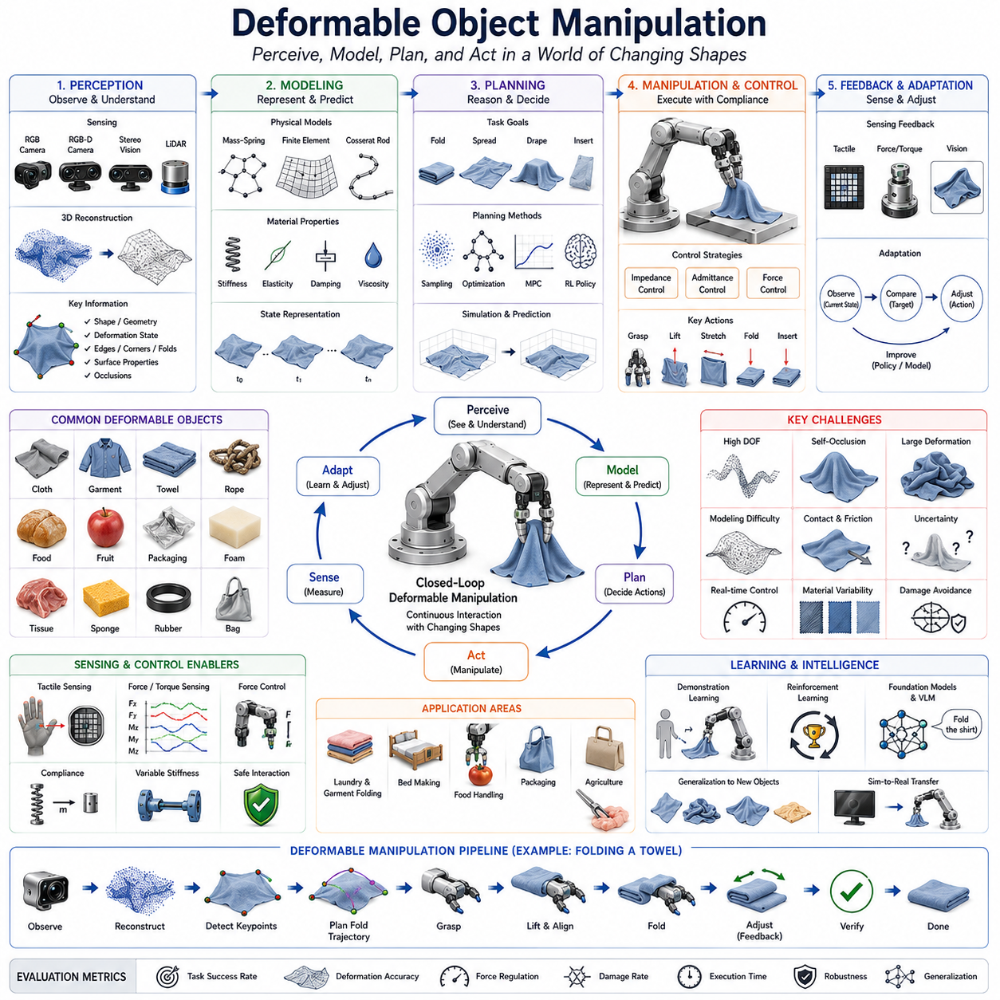{width="7.268055555555556in" height="7.268055555555556in"}

Deformable Object Manipulation refers to the robotic capability of perceiving, grasping, controlling, transforming, and interacting with objects whose shape changes continuously during manipulation. Unlike rigid objects, which preserve their geometry under normal operating conditions, deformable objects exhibit dynamic and often nonlinear changes in shape when subjected to forces, environmental interactions, gravity, or contact constraints. Examples include cloth, garments, paper, food products, biological tissues, foam materials, rubber components, flexible packaging, soft industrial parts, agricultural products, medical materials, and many everyday objects encountered in human environments. As robotics advances beyond structured industrial settings and enters homes, hospitals, warehouses, agriculture, construction sites, and service environments, the ability to manipulate deformable objects has become one of the most important frontiers of intelligent robotics. Within the Tool Use and Assembly section of Robot Hand and Dexterous Grasping, deformable object manipulation represents a natural extension beyond rigid-body assembly, requiring robots to reason not only about object position and orientation but also about continuously evolving shape states.

The difficulty of deformable object manipulation originates from the fact that the object\'s state can no longer be described using a simple six-degree-of-freedom representation. A rigid object can be represented by its position and orientation, allowing relatively straightforward modeling and planning. A deformable object, however, possesses effectively infinite degrees of freedom because every point on the object may move independently. The shape of a piece of cloth, for example, may change dramatically depending on how it is grasped, folded, stretched, compressed, or draped over surrounding surfaces. This enormous state space creates significant challenges for perception, modeling, planning, control, and learning.

Deformable objects are present in nearly every practical application domain. In manufacturing, robots encounter rubber seals, flexible plastic parts, gaskets, composite materials, wiring bundles, and packaging materials. In logistics, robots handle bags, parcels, shrink-wrap films, and deformable containers. In agriculture, fruits, vegetables, plants, and harvested crops exhibit varying levels of deformability. In healthcare, surgical robots manipulate tissues, organs, sutures, and medical dressings. Domestic robots must interact with clothing, towels, bedsheets, food products, and cleaning materials. Consequently, solving deformable object manipulation is essential for achieving truly general-purpose robotic intelligence.

One of the first challenges in deformable object manipulation is perception. Unlike rigid objects with predictable geometry, deformable objects continuously change appearance. Their shape may vary depending on lighting, viewing angle, contact conditions, and previous manipulation history. Traditional object recognition methods often struggle because the same object may appear dramatically different from one moment to the next.

Computer vision plays a central role in deformable object perception. High-resolution RGB cameras provide detailed visual information regarding object texture, color, folds, wrinkles, edges, and contours. However, visual interpretation becomes significantly more difficult when objects self-occlude or exhibit complex deformations. Advanced perception systems therefore employ deep neural networks capable of recognizing deformable objects across a wide range of configurations.

Three-dimensional sensing further improves understanding of deformable objects. RGB-D cameras, stereo vision systems, structured light sensors, and LiDAR-based perception systems can reconstruct object surfaces and estimate shape geometry. Point cloud representations allow robots to analyze folds, curvature distributions, surface topology, and deformation patterns. These capabilities are particularly valuable when manipulating large cloth objects or irregular soft materials.

State estimation represents a major research challenge. The robot must estimate not only object position but also object configuration. In cloth manipulation, this may involve identifying corners, edges, folds, wrinkles, and hidden regions. In food handling, it may involve estimating internal deformation and structural integrity. In medical applications, it may require understanding tissue shape and elasticity. Accurate state estimation is critical because manipulation decisions depend heavily on the current deformation state.

Physical modeling of deformable objects is considerably more complex than rigid-body modeling. Classical robotics relies heavily on rigid-body mechanics, where geometric relationships remain fixed. Deformable objects require representations capable of capturing elastic deformation, plastic deformation, bending, stretching, compression, twisting, and material-specific behaviors.

Mass-spring models provide one of the earliest approaches to deformable object simulation. The object is represented as a network of masses connected by springs and dampers. This approach captures basic deformation behavior while remaining computationally efficient. Mass-spring systems have been widely used for cloth simulation, soft material modeling, and interactive graphics applications.

Finite Element Methods provide significantly greater accuracy. In FEM-based models, objects are divided into many small elements, and deformation is computed by solving physical equations across the entire structure. FEM enables accurate modeling of material properties, stress distributions, and nonlinear deformations. However, the computational requirements can be substantial, particularly for real-time robotic applications.

Continuum mechanics provides the theoretical foundation for many deformable object models. Instead of treating objects as collections of discrete components, continuum models represent deformation as continuous fields of displacement, strain, and stress. Such models are particularly important for medical robotics and soft material manipulation where accurate physical behavior is essential.

Material properties strongly influence manipulation strategies. Different deformable objects respond differently to applied forces. A towel behaves differently from a sheet of paper. A rubber gasket behaves differently from a surgical tissue. Material characteristics such as elasticity, stiffness, viscosity, compressibility, plasticity, damping, and fracture resistance determine how objects deform under manipulation.

Grasp planning becomes substantially more complicated when dealing with deformable objects. In rigid object manipulation, a stable grasp generally allows predictable control over the object. For deformable objects, grasping itself changes the object configuration. A cloth corner may stretch when lifted. A sponge may compress when squeezed. A food product may deform under excessive pressure. Consequently, grasp planning must consider both immediate grasp stability and future deformation effects.

Adaptive grasping strategies are therefore required. Rather than maintaining fixed grasp forces, robots continuously adjust grip strength based on object response. Tactile sensing and force sensing play essential roles in this process. Real-time feedback enables the robot to avoid excessive deformation while maintaining secure control.

Cloth manipulation represents one of the most extensively studied examples of deformable object handling. Folding garments, spreading towels, making beds, sorting laundry, and handling textile materials require sophisticated perception and planning capabilities. A seemingly simple task such as folding a shirt involves detecting corners, identifying folds, estimating fabric configuration, and executing coordinated manipulation sequences.

Garment handling presents additional challenges because clothing items often begin in highly unstructured configurations. A crumpled shirt may appear entirely different from its unfolded state. Robots must first identify grasp points that enable progressive unfolding before higher-level manipulation can occur.

Food handling is another important application area. Many food products are highly deformable and fragile. Fruits, vegetables, baked goods, meat products, and prepared meals may bruise, tear, crush, or permanently deform if manipulated improperly. Robotic food handling therefore requires careful force regulation and adaptive grasp control.

Medical robotics introduces some of the most demanding deformable object manipulation problems. Surgical robots interact directly with biological tissues that exhibit highly nonlinear mechanical behavior. Tissues deform continuously under contact, and excessive force may cause irreversible damage. Consequently, medical manipulation requires precise force control, tactile sensing, and predictive modeling.

Soft robotics has emerged as a particularly promising approach for deformable object manipulation. Soft grippers naturally conform to object surfaces and distribute contact forces across larger areas. This compliance reduces the risk of damage and improves grasp robustness. Soft robotic hands are especially effective for handling fragile and irregularly shaped objects.

Force control is fundamental to deformable object manipulation. Position-based control alone is often insufficient because object behavior depends heavily on interaction forces. Impedance control and admittance control allow robots to regulate the relationship between force and motion, enabling safer and more adaptive interactions.

Tactile sensing provides critical information regarding contact conditions. Unlike vision systems, tactile sensors directly measure pressure distributions, contact locations, slip events, and local deformation patterns. Tactile feedback enables robots to adjust grasp forces dynamically and detect changes that may not be visible externally.

Multi-modal perception combines visual, tactile, force, and proprioceptive sensing. Each modality provides complementary information regarding object state. Vision offers global shape information, tactile sensing provides local contact details, force sensors measure interaction dynamics, and proprioception tracks robot configuration. Integrating these information sources significantly improves manipulation performance.

Motion planning for deformable objects differs fundamentally from rigid-body planning. Traditional planners search for collision-free trajectories through configuration space. Deformable object planners must additionally predict how object shape will evolve during execution. This often requires coupling planning algorithms with physical simulation models.

Model Predictive Control has become increasingly popular for deformable object manipulation. MPC repeatedly predicts future object states using dynamic models and optimizes control actions over a moving time horizon. This approach allows robots to respond adaptively to changing object configurations and environmental conditions.

Learning-based methods have transformed the field of deformable object manipulation. Analytical models are often difficult to construct because deformable objects exhibit highly complex behavior. Machine learning enables robots to acquire manipulation skills directly from data rather than relying exclusively on explicit physical models.

Behavior cloning allows robots to learn manipulation strategies from human demonstrations. Human operators naturally understand how to fold cloth, handle food, manipulate flexible materials, and interact with soft objects. By observing demonstrations, robots can acquire policies that capture expert behavior.

Reinforcement learning provides another powerful framework. Through repeated interaction with simulated environments, robots learn policies that maximize task success. Reinforcement learning has demonstrated impressive performance in cloth folding, rope manipulation, deformable object sorting, and soft material handling.

Simulation plays a critical role in learning-based approaches. Modern physics engines increasingly support realistic deformable object simulation, enabling large-scale data generation. Simulated training environments allow robots to experience millions of manipulation scenarios before deployment in the real world.

Digital twins are becoming important tools for industrial deformable object applications. A digital twin maintains a virtual representation of the object and manipulation process. Real-time sensor data continuously updates the model, enabling predictive control and process optimization.

Foundation models and embodied AI are beginning to reshape this field. Large-scale manipulation models trained across diverse tasks may eventually learn generalized representations of deformation physics. Rather than requiring separate solutions for cloth, food, tissue, and packaging manipulation, future systems may reason about deformable objects using shared physical knowledge acquired through large-scale learning.

Language-conditioned manipulation further expands capabilities. A user might instruct a robot to "fold the towel neatly," "place the blanket on the bed," or "package the fragile item carefully." The robot must interpret these instructions and translate them into deformation-aware manipulation strategies.

Industrial applications continue to drive significant investment in deformable object manipulation. Textile manufacturing seeks automated garment handling. Food processing requires reliable manipulation of delicate products. Medical robotics demands safe tissue interaction. Logistics operations increasingly involve flexible packaging materials. Service robots must handle everyday deformable objects within human environments.

Performance evaluation typically considers task success rate, deformation accuracy, force regulation quality, damage rate, execution speed, robustness to uncertainty, adaptability across object types, and generalization to unseen objects. Because deformable objects exhibit high variability, robustness and adaptability are often more important than raw execution speed.

Future deformable object manipulation systems will likely combine advanced perception, real-time physics simulation, tactile intelligence, adaptive force control, learning-based planning, foundation models, digital twins, and embodied AI within unified manipulation architectures. These systems will progressively bridge the gap between human dexterity and robotic capability.

Ultimately, Deformable Object Manipulation represents one of the grand challenges of robotics. It requires the integration of perception, mechanics, control, planning, learning, and reasoning at a level far beyond traditional rigid-body manipulation. Success in this field will dramatically expand the range of tasks robots can perform and will serve as a critical milestone toward intelligent manufacturing systems, advanced service robots, autonomous healthcare platforms, and future general-purpose embodied AI agents capable of interacting effectively with the complex physical world.

Deformable Object Manipulation(변형 가능 물체 조작)은 로봇이 형태가 지속적으로 변하는 물체를 인식하고, 파지하며, 제어하고, 변형시키고, 상호작용하는 능력을 의미한다. 강체(Rigid Object)는 일반적인 작업 환경에서 형상이 유지되지만, 변형 가능 물체(Deformable Object)는 힘, 접촉, 중력, 환경적 제약에 의해 지속적으로 형태가 변화한다. 대표적인 예로는 천(Cloth), 의류(Garment), 종이(Paper), 식품(Food), 생체 조직(Biological Tissue), 스펀지(Foam), 고무 부품(Rubber Component), 포장재(Packaging Material), 농산물(Agricultural Product), 의료 재료(Medical Material) 등이 있다. 로봇이 공장뿐만 아니라 가정, 병원, 물류센터, 농업, 건설 현장과 같은 비정형 환경으로 확장되면서 변형 가능 물체를 다루는 능력은 차세대 지능형 로봇의 핵심 기술로 부상하고 있다. Robot Hand and Dexterous Grasping의 Tool Use and Assembly 영역에서 이 주제는 강체 조립을 넘어 연속적으로 변화하는 형상을 가진 물체를 다루는 고차원 조작 기술로 볼 수 있다.

변형 가능 물체 조작이 어려운 가장 큰 이유는 물체의 상태를 단순한 6자유도(6 Degrees of Freedom)로 표현할 수 없기 때문이다. 강체는 위치(Position)와 자세(Orientation)만 알면 상태를 정의할 수 있지만, 변형 가능 물체는 사실상 무한한 자유도(Infinite Degrees of Freedom)를 가진다. 예를 들어 천 한 장은 잡는 위치, 늘어나는 정도, 접히는 형태, 주변 환경과의 접촉에 따라 전혀 다른 모양을 가질 수 있다. 이러한 거대한 상태 공간(State Space)은 인식, 모델링, 계획, 제어, 학습의 모든 측면에서 큰 어려움을 만든다.

변형 가능 물체는 거의 모든 산업과 일상생활에 존재한다. 제조업에서는 고무 패킹, 플라스틱 필름, 가스켓(Gasket), 복합 재료(Composite Material), 포장재 등을 다룬다. 물류 분야에서는 비닐 포장, 봉투, 유연한 상자, 완충재 등이 사용된다. 농업에서는 과일, 채소, 식물, 수확물 등이 대표적인 변형 가능 물체이다. 의료 분야에서는 조직(Tissue), 장기(Organ), 봉합사(Suture), 드레싱(Dressing)을 다루어야 한다. 가정용 서비스 로봇은 의류, 수건, 침대 시트, 음식물 등을 처리해야 한다. 따라서 변형 가능 물체를 안정적으로 다루는 능력은 범용 로봇 실현의 핵심 요소이다.

변형 가능 물체 조작의 첫 번째 과제는 인식(Perception)이다. 강체와 달리 변형 가능 물체는 외형이 지속적으로 변하기 때문에 단순한 물체 인식만으로는 충분하지 않다. 같은 수건이라도 펼쳐진 상태, 접힌 상태, 구겨진 상태는 전혀 다른 모양을 가진다. 따라서 로봇은 변화하는 형상을 이해할 수 있어야 한다.

컴퓨터 비전(Computer Vision)은 이러한 문제 해결의 핵심 기술이다. RGB 카메라는 색상, 질감(Texture), 주름(Wrinkle), 모서리(Edge), 접힘(Fold) 정보를 제공한다. 그러나 변형 물체는 자기 가림(Self-Occlusion)이 심하고 형태 변화가 크기 때문에 일반적인 객체 인식보다 훨씬 어렵다. 최근에는 딥러닝 기반 인식 기술이 다양한 변형 상태에서도 물체를 안정적으로 인식할 수 있게 해주고 있다.

3차원 센싱(3D Sensing)은 변형 물체 인식을 더욱 향상시킨다. RGB-D 카메라, 스테레오 비전, 구조광 센서, LiDAR는 물체의 표면 형상을 재구성할 수 있다. 포인트 클라우드(Point Cloud)를 이용하면 주름, 곡률(Curvature), 표면 구조, 변형 패턴을 분석할 수 있다. 특히 천이나 대형 직물의 조작에서는 3차원 정보가 매우 중요하다.

상태 추정(State Estimation)은 변형 가능 물체 조작의 핵심 문제 중 하나이다. 로봇은 단순히 물체의 위치를 아는 것이 아니라 현재의 변형 상태를 이해해야 한다. 예를 들어 천 조작에서는 모서리(Corner), 가장자리(Edge), 접힘(Fold), 주름(Wrinkle), 숨겨진 영역(Hidden Region)을 식별해야 한다. 식품 조작에서는 내부 구조의 변형을 파악해야 하며, 의료 분야에서는 조직의 형상과 탄성을 추정해야 한다.

변형 가능 물체의 물리 모델링(Physical Modeling)은 강체 모델링보다 훨씬 복잡하다. 기존 로봇학은 강체 역학(Rigid Body Mechanics)을 기반으로 발전해 왔다. 하지만 변형 물체는 굽힘(Bending), 늘어남(Stretching), 압축(Compression), 비틀림(Twisting), 소성 변형(Plastic Deformation) 등을 고려해야 한다.

질량-스프링 모델(Mass-Spring Model)은 가장 초기부터 사용된 접근법 중 하나이다. 물체를 질량점(Mass Point)과 스프링(Spring)의 네트워크로 표현한다. 계산이 비교적 간단하고 빠르지만 복잡한 변형을 정확히 표현하기는 어렵다.

유한 요소법(Finite Element Method, FEM)은 훨씬 높은 정확도를 제공한다. 물체를 작은 요소(Element)들로 나누고 물리 방정식을 수치적으로 계산하여 변형을 예측한다. FEM은 응력(Stress), 변형(Strain), 재료 특성(Material Property)을 정밀하게 표현할 수 있지만 계산 비용이 매우 크다.

연속체 역학(Continuum Mechanics)은 변형 물체 모델링의 이론적 기반이다. 물체를 연속적인 변형 필드로 표현하여 힘과 변형의 관계를 계산한다. 특히 의료 로봇과 연성 재료 조작 분야에서 중요한 역할을 한다.

재료 특성(Material Properties)은 조작 전략을 결정하는 중요한 요소이다. 수건은 종이와 다르게 변형되며, 고무 가스켓은 생체 조직과 다르게 반응한다. 탄성(Elasticity), 강성(Stiffness), 점성(Viscosity), 압축성(Compressibility), 감쇠(Damping), 파손 저항성(Fracture Resistance)과 같은 특성이 모두 고려되어야 한다.

파지 계획(Grasp Planning)은 변형 물체에서 더욱 어려워진다. 강체는 특정 위치를 잡으면 전체 물체를 안정적으로 제어할 수 있지만, 변형 물체는 잡는 순간 형태가 변한다. 천을 한쪽 모서리에서 들어 올리면 늘어나고 접히며 새로운 형상을 형성한다. 스펀지는 압축되고, 식품은 눌릴 수 있다. 따라서 파지 계획은 안정성뿐 아니라 변형 효과까지 고려해야 한다.

이를 위해 적응형 파지(Adaptive Grasping)가 사용된다. 로봇은 물체의 반응을 관찰하면서 파지력을 지속적으로 조절한다. 촉각 센서(Tactile Sensor)와 힘 센서(Force Sensor)는 이러한 과정에서 핵심적인 역할을 수행한다.

천 조작(Cloth Manipulation)은 변형 가능 물체 조작의 대표적인 연구 분야이다. 옷 접기(Folding), 수건 정리, 침대 정리(Bed Making), 세탁물 분류 등은 매우 어려운 문제이다. 단순히 셔츠를 접는 작업조차도 모서리 인식, 접힘 추정, 천의 형상 파악, 협조적 조작이 모두 필요하다.

의류 조작(Garment Handling)은 더욱 복잡하다. 구겨진 셔츠는 펼쳐진 셔츠와 전혀 다른 모양을 가지기 때문에 먼저 펼치는(Unfolding) 작업이 필요하다. 이를 위해 적절한 파지 위치를 찾고 단계적으로 형태를 복원해야 한다.

식품 조작(Food Handling)은 또 다른 중요한 응용 분야이다. 과일, 채소, 빵, 육류와 같은 식품은 쉽게 손상될 수 있다. 과도한 힘은 멍(Bruising), 찢어짐(Tearing), 압착(Crushing)을 유발할 수 있다. 따라서 매우 정밀한 힘 제어가 필요하다.

의료 로봇(Medical Robotics)은 가장 까다로운 변형 물체 조작 환경 중 하나이다. 수술 로봇은 생체 조직을 직접 다루며, 조직은 매우 비선형적인 기계적 특성을 가진다. 작은 힘 변화도 조직 손상을 유발할 수 있기 때문에 정밀한 힘 제어와 예측 모델이 필수적이다.

소프트 로보틱스(Soft Robotics)는 변형 가능 물체 조작에 매우 적합한 접근법으로 평가된다. 소프트 그리퍼는 물체 표면에 자연스럽게 적응하며 넓은 접촉 면적으로 힘을 분산시킨다. 따라서 손상 위험을 줄이고 안정적인 파지를 제공할 수 있다.

힘 제어(Force Control)는 변형 물체 조작의 핵심 요소이다. 위치 제어만으로는 원하는 결과를 얻기 어렵다. 물체의 거동이 힘에 크게 의존하기 때문이다. 임피던스 제어(Impedance Control)와 어드미턴스 제어(Admittance Control)는 힘과 움직임의 관계를 조절하여 보다 안전한 상호작용을 가능하게 한다.

촉각 센싱(Tactile Sensing)은 접촉 상태를 직접 측정한다. 시각 센서가 외형 정보를 제공한다면 촉각 센서는 압력 분포, 접촉 위치, 미끄러짐(Slip), 국소 변형(Local Deformation)을 측정할 수 있다. 이를 통해 실시간으로 파지력을 조정할 수 있다.

다중 모달 인식(Multi-Modal Perception)은 시각, 촉각, 힘, 고유 감각(Proprioception)을 결합한다. 시각은 전체 형상을 제공하고, 촉각은 접촉 정보를 제공하며, 힘 센서는 상호작용 동역학을 측정한다. 이러한 정보 융합은 조작 성능을 크게 향상시킨다.

변형 가능 물체의 경로 계획(Motion Planning)은 강체보다 훨씬 복잡하다. 기존 계획기는 충돌 없는 경로만 찾으면 되지만, 변형 물체 계획기는 이동 과정에서 형상이 어떻게 변할지를 예측해야 한다. 따라서 물리 시뮬레이션과 경로 계획이 긴밀하게 결합된다.

모델 예측 제어(Model Predictive Control, MPC)는 이러한 문제 해결에 널리 사용된다. MPC는 미래 상태를 예측하고 최적의 제어 입력을 반복적으로 계산한다. 이를 통해 변화하는 형상에 실시간으로 대응할 수 있다.

학습 기반 접근법(Learning-Based Approach)은 최근 가장 큰 발전을 보이고 있다. 변형 물체는 수학적 모델링이 매우 어렵기 때문에 데이터 기반 학습이 효과적이다. 머신러닝은 복잡한 변형 거동을 직접 학습하여 조작 전략을 생성할 수 있다.

행동 모방 학습(Behavior Cloning)은 인간 시연(Human Demonstration)을 학습한다. 사람은 천을 접고, 음식을 다루고, 부드러운 물체를 조작하는 방법을 자연스럽게 알고 있다. 이러한 경험을 로봇에 전달할 수 있다.

강화학습(Reinforcement Learning)은 수많은 시도를 통해 최적의 정책을 학습한다. 천 접기, 로프 조작, 분류 작업, 연성 물체 취급 등에서 우수한 성과를 보여주고 있다.

시뮬레이션은 변형 물체 학습의 핵심 도구이다. 최신 물리 엔진은 매우 현실적인 변형 모델을 제공하며, 수백만 개의 학습 데이터를 생성할 수 있다.

디지털 트윈(Digital Twin)은 산업 응용에서 점점 중요해지고 있다. 실제 물체와 동일한 가상 모델을 유지하면서 센서 데이터를 지속적으로 반영한다. 이를 통해 예측 제어와 공정 최적화가 가능하다.

최근에는 파운데이션 모델(Foundation Model)과 임바디드 AI(Embodied AI)가 변형 물체 조작에도 적용되고 있다. 미래에는 천, 음식, 조직, 포장재를 각각 별도로 학습하는 것이 아니라, 다양한 변형 물체에 공통적으로 적용 가능한 물리 지식을 학습하는 방향으로 발전할 것으로 예상된다.

언어 기반 조작(Language-Conditioned Manipulation)도 중요한 연구 분야이다. 사용자가 "수건을 깔끔하게 접어라", "담요를 침대 위에 펼쳐라", "깨지기 쉬운 물건을 조심스럽게 포장하라"와 같은 명령을 내리면 로봇은 이를 변형 인식 기반 조작 전략으로 변환해야 한다.

산업계는 이러한 기술에 큰 관심을 가지고 있다. 섬유 산업은 의류 자동화를 원하고 있으며, 식품 산업은 섬세한 식품 조작을 필요로 한다. 의료 산업은 안전한 조직 조작을 요구하고, 물류 산업은 유연 포장재 처리를 자동화하려고 한다. 서비스 로봇 역시 일상생활 속의 다양한 변형 물체를 다루어야 한다.

변형 가능 물체 조작 시스템은 일반적으로 작업 성공률(Task Success Rate), 변형 정확도(Deformation Accuracy), 힘 제어 성능(Force Regulation Quality), 손상 발생률(Damage Rate), 수행 시간(Execution Speed), 불확실성에 대한 강인성(Robustness), 새로운 물체에 대한 적응성(Adaptability), 일반화 성능(Generalization) 등을 기준으로 평가된다.

미래의 Deformable Object Manipulation 시스템은 고성능 인식, 실시간 물리 시뮬레이션, 촉각 지능, 적응형 힘 제어, 학습 기반 계획, 파운데이션 모델, 디지털 트윈, 임바디드 AI가 통합된 형태로 발전할 것으로 예상된다. 이러한 기술은 인간 수준의 정교한 조작 능력에 한 걸음 더 다가가게 할 것이다.

궁극적으로 변형 가능 물체 조작은 현대 로봇공학의 가장 큰 난제(Grand Challenge) 중 하나이다. 이 문제를 해결하기 위해서는 인식, 역학, 제어, 계획, 학습, 추론이 모두 통합되어야 한다. 변형 가능 물체를 자유롭게 다룰 수 있는 능력은 미래의 지능형 제조 시스템, 서비스 로봇, 의료 로봇, 그리고 범용 임바디드 AI 실현을 위한 핵심 이정표가 될 것이다.

##  

## 13.09 Assembly Planning

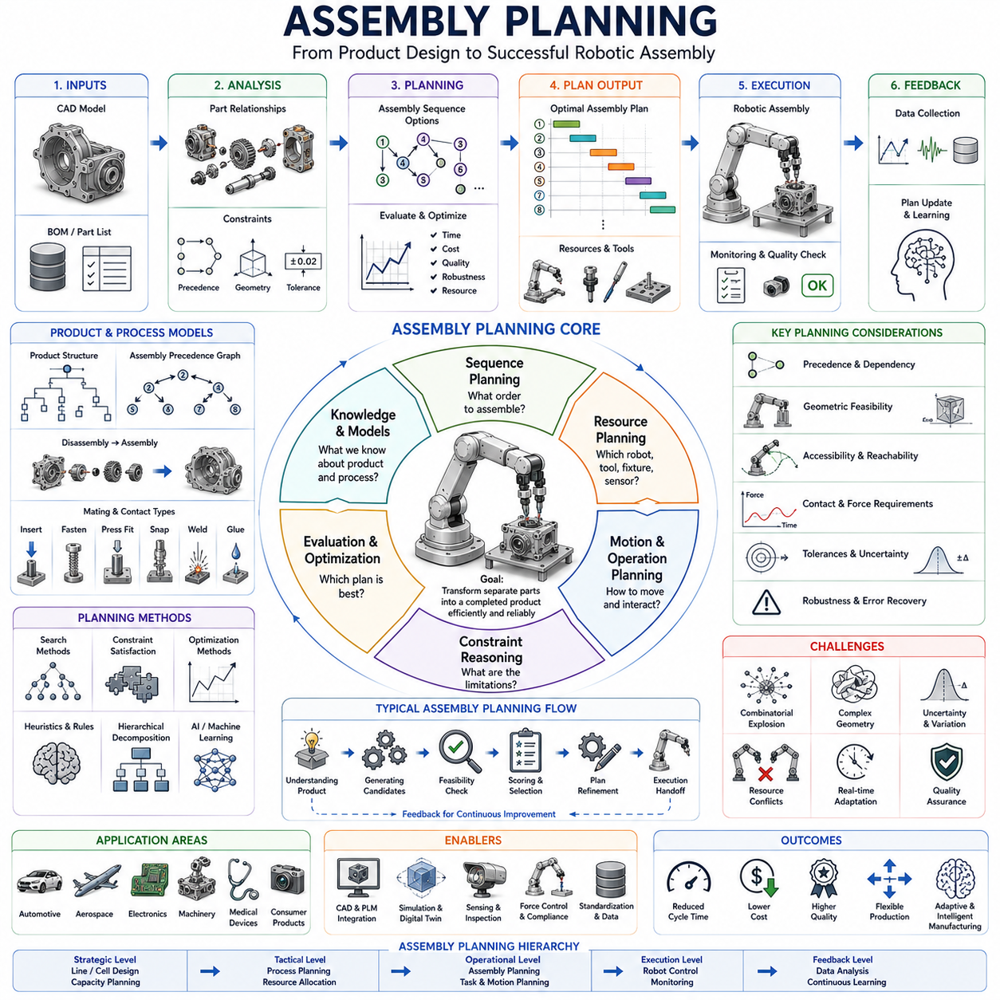{width="7.268055555555556in" height="7.268055555555556in"}

Assembly Planning is the process of determining how individual parts, components, tools, fixtures, and robotic resources should be coordinated to transform a collection of separate objects into a completed product. It serves as the bridge between product design and physical manufacturing, defining not only what must be assembled but also the sequence, methods, resources, motions, and interactions required to achieve successful assembly. In robotic systems, assembly planning is one of the highest-level decision-making processes because it connects perception, manipulation, motion planning, grasp planning, tool use, force control, task planning, and execution monitoring into a unified framework. Within the Tool Use and Assembly domain of Robot Hand and Dexterous Grasping, assembly planning provides the overall intelligence that organizes individual manipulation skills into coherent manufacturing operations.

Historically, assembly planning emerged from industrial manufacturing, where engineers manually defined assembly procedures for products such as automobiles, aircraft, consumer electronics, and machinery. Human experts analyzed component relationships, determined assembly sequences, specified tooling requirements, and created work instructions for production workers. As manufacturing systems became more complex and product lifecycles became shorter, manual planning became increasingly difficult. Robotic assembly systems therefore required computational methods capable of automatically generating assembly plans from digital product descriptions.

At its core, assembly planning answers several fundamental questions. It determines which part should be assembled first, which components depend on others, what tools are required, how components should be grasped, how they should be positioned, what assembly constraints exist, what motions are feasible, how quality should be verified, and how errors should be handled. These questions appear simple when assembling a small object but become extremely challenging when dealing with products containing hundreds, thousands, or even millions of components.

A complete assembly process can be viewed as a transformation from an initial state, where all components are separate, to a final state, where the product exists as a fully assembled structure. Between these two states lies a vast space of possible assembly sequences. Some sequences are efficient and physically feasible, while others are impossible due to geometric constraints, accessibility limitations, or dependency relationships. Assembly planning seeks to identify sequences that are both feasible and optimal according to specific objectives.

One of the most important concepts in assembly planning is precedence relationships. Many products contain components that must be installed before others. For example, a bearing must often be inserted into a housing before a shaft can be installed. Electronic components may need to be mounted before an enclosure is closed. Wiring harnesses may need to be routed before structural covers are attached. These dependency relationships create a partially ordered set of assembly operations that must be respected.

Precedence constraints are commonly represented using graphs. In an Assembly Precedence Graph, nodes represent assembly operations or components, while edges represent dependency relationships. Graph representations provide a convenient mathematical framework for reasoning about assembly sequences and identifying feasible operation orders.

Assembly sequence planning is a central subproblem of assembly planning. Given a product structure and its constraints, the system must determine the order in which components should be assembled. Multiple valid sequences may exist for the same product. Some sequences minimize assembly time, while others minimize tool changes, reduce robot motions, improve accessibility, or increase robustness. The planner must evaluate alternatives and select the most appropriate sequence according to manufacturing objectives.

Geometric reasoning plays a critical role in assembly planning. Components must be physically movable into their final positions without colliding with surrounding parts. This requires analysis of assembly directions, insertion paths, clearance requirements, and accessibility conditions. Even when dependency constraints are satisfied, geometric constraints may render an assembly sequence infeasible.

Disassembly analysis is often used to support assembly planning. Rather than directly searching for assembly sequences, planners may begin with the completed product and determine how it can be disassembled. The resulting disassembly sequence can then be reversed to obtain a valid assembly sequence. This approach simplifies many planning problems because removal operations are often easier to analyze than insertion operations.

Assembly planning must also consider contact interactions between components. Many assembly operations involve insertion, fastening, alignment, mating, press fitting, snapping, welding, gluing, or deformable interactions. Contact-rich operations require more sophisticated planning than simple placement tasks because force control, compliance, and error recovery become important factors.

The complexity of assembly planning increases dramatically as product size grows. A product containing only ten components may already have thousands of possible assembly sequences. A product containing hundreds of components may have astronomically many alternatives. Exhaustive search quickly becomes computationally impossible. Consequently, assembly planning relies heavily on optimization methods, heuristics, constraint reasoning, and hierarchical decomposition techniques.

Hierarchical assembly planning addresses complexity by decomposing products into subassemblies. Instead of planning every component simultaneously, the system first plans smaller assemblies and then combines them into larger structures. This hierarchical approach mirrors how humans naturally approach complex assembly tasks. For example, a gearbox may be assembled from several subassemblies, each of which is planned independently before final integration.

Product structure information provides valuable guidance for planning. Modern Computer-Aided Design systems contain detailed descriptions of component geometry, mating relationships, tolerances, materials, and assembly constraints. Assembly planners increasingly utilize CAD data directly, enabling automated generation of assembly plans from digital product models.

Computer-Aided Assembly Planning emerged as an important research area with the rise of digital manufacturing. These systems analyze CAD models, identify assembly relationships, generate feasible sequences, evaluate alternatives, and support manufacturing engineers. Modern assembly planning software often integrates tightly with Product Lifecycle Management systems and Digital Twin environments.

Resource planning is another important aspect of assembly planning. Assembly operations require robots, tools, fixtures, sensors, workstations, and human operators. The planner must determine which resources are needed for each task and how those resources should be allocated. Efficient resource utilization directly impacts manufacturing cost and productivity.

Tool planning represents a specialized component of assembly planning. Different assembly operations require different tools such as grippers, screwdrivers, welding devices, insertion tools, inspection instruments, or force-control end effectors. Tool selection affects assembly quality, speed, accessibility, and robustness. In robotic systems, tool planning often includes automatic tool changing strategies.

Fixture planning is equally important. Fixtures stabilize components during assembly and improve positioning accuracy. However, fixtures increase manufacturing costs and reduce flexibility. Modern robotic systems increasingly seek fixtureless assembly approaches in which robots actively control components without dedicated fixtures.

Motion planning and assembly planning are closely interconnected. A theoretically valid assembly sequence may be impossible if the robot cannot physically execute the required motions. Therefore, assembly planners increasingly incorporate robot kinematics, reachability analysis, collision checking, and trajectory generation directly into the planning process.

Human-robot collaboration introduces additional planning requirements. Collaborative assembly systems must coordinate tasks between human workers and robotic agents. Some operations may be assigned to robots due to precision or repeatability requirements, while others may remain better suited for human dexterity and judgment. Effective assembly planning therefore includes task allocation and workload balancing.

Force-aware assembly planning has become increasingly important in precision manufacturing. Many assembly operations involve tight tolerances and contact-rich interactions. The planner must anticipate force requirements, insertion strategies, compliance settings, and sensing requirements. Examples include peg-in-hole operations, connector insertion, bearing installation, and fastener assembly.

Tolerance analysis is another critical consideration. Manufacturing variations inevitably introduce uncertainty into component dimensions and positions. Assembly planners must ensure that planned sequences remain feasible despite these variations. Robust assembly planning accounts for uncertainty and seeks solutions that tolerate realistic manufacturing deviations.

Flexible manufacturing systems require highly adaptive assembly planning. Traditional mass production relied on fixed assembly lines designed for a single product. Modern manufacturing increasingly demands rapid product changes, customization, and low-volume production. Assembly planners must therefore generate new plans quickly and adapt to changing requirements.

Reconfigurable manufacturing systems extend this concept further. Robots, workstations, tools, and production cells may be dynamically reconfigured to support different products. Assembly planning becomes a continuous optimization process rather than a one-time engineering activity.

Artificial intelligence has significantly influenced assembly planning. Traditional planning systems relied on rule-based approaches and manually encoded expertise. While effective for structured environments, these systems struggled with complexity and uncertainty. AI-based methods provide greater flexibility and scalability.

Constraint satisfaction techniques represent one of the earliest AI approaches. Assembly planning can be formulated as a constraint satisfaction problem in which feasible plans satisfy geometric, temporal, resource, and precedence constraints. Constraint solvers efficiently eliminate invalid solutions and focus search on feasible alternatives.

Graph search algorithms have also been widely applied. Assembly planning can be represented as a search problem where each state corresponds to a partially assembled product. Search methods explore alternative assembly sequences and identify optimal solutions according to specified objectives.

Optimization-based approaches formulate assembly planning as a mathematical optimization problem. Objectives may include minimizing cycle time, reducing cost, minimizing tool changes, maximizing throughput, improving quality, or balancing workloads. Modern optimization methods can simultaneously consider multiple objectives and constraints.

Machine learning is increasingly used to improve planning performance. By analyzing historical manufacturing data, planners can learn which assembly strategies tend to succeed and which tend to fail. Learning-based systems can adapt to new products and environments more effectively than purely rule-based approaches.

Reinforcement learning has shown particular promise in assembly planning. Rather than relying solely on explicit models, reinforcement learning agents discover assembly strategies through interaction and experience. Over time, these agents learn policies that maximize long-term assembly efficiency and success.

Simulation plays a critical role in modern assembly planning. Digital environments allow planners to evaluate assembly sequences before physical execution. Virtual simulations can detect collisions, identify accessibility problems, estimate cycle times, evaluate force requirements, and validate assembly procedures. This significantly reduces development costs and accelerates deployment.

Digital Twins further enhance planning capabilities. A Digital Twin maintains a continuously updated virtual representation of the physical assembly system. Real-time sensor data allows the planner to monitor progress, predict problems, and adapt plans dynamically as conditions change.

Foundation models and embodied AI are beginning to transform assembly planning. Large-scale models trained on manufacturing knowledge, robotic manipulation data, and multimodal information may eventually reason about assembly tasks at a level similar to human experts. Rather than requiring explicit programming, future systems may understand assembly objectives through natural language instructions and generate complete assembly plans autonomously.

Language-guided assembly planning represents an emerging direction. A user might specify, "Assemble the gearbox using the fastest available process while minimizing tool changes," and the system would automatically generate an optimized assembly strategy. Such capabilities require integration of language understanding, engineering knowledge, physical reasoning, and robotic execution.

Multi-agent assembly planning is another growing area of interest. Future manufacturing systems may involve teams of robots working together on complex assemblies. Coordinating multiple robotic agents requires planning task allocation, synchronization, communication, workspace sharing, and conflict resolution.

Assembly verification and quality assurance remain essential components of the planning process. The planner must define inspection points, measurement procedures, acceptance criteria, and error recovery strategies. Quality verification ensures that the final product satisfies design specifications and regulatory requirements.

Performance evaluation of assembly planning systems typically considers planning time, assembly cycle time, resource utilization, assembly quality, plan robustness, adaptability, scalability, computational efficiency, and success rate. Industrial applications often prioritize reliability and repeatability over theoretical optimality because production interruptions can be extremely costly.

Future Assembly Planning systems will likely integrate CAD intelligence, physics-based simulation, digital twins, force-aware planning, learning-based optimization, foundation models, embodied AI, and autonomous decision-making within unified manufacturing architectures. These systems will continuously adapt to changing products, environments, and production requirements while maintaining high levels of efficiency and quality.

Ultimately, Assembly Planning serves as the cognitive layer that transforms isolated robotic skills into complete manufacturing processes. It connects perception, grasping, tool use, insertion, fastening, manipulation, inspection, and quality control into a coherent workflow. As robotic systems become increasingly autonomous and intelligent, assembly planning will remain one of the most critical technologies enabling advanced manufacturing, adaptive production systems, collaborative robotics, and future embodied AI capable of constructing complex products in real-world environments.

Assembly Planning(조립 계획)은 개별 부품, 구성 요소, 공구, 지그(Fixture), 로봇 자원 등을 어떻게 조정하여 분리된 부품 집합을 완성된 제품으로 변환할 것인지를 결정하는 과정이다. 이는 제품 설계(Product Design)와 실제 제조(Manufacturing)를 연결하는 핵심 단계로서, 무엇을 조립해야 하는지뿐만 아니라 어떤 순서로 조립할 것인지, 어떤 방법과 자원을 사용할 것인지, 어떤 동작과 상호작용이 필요한지를 정의한다. 로봇 시스템에서 조립 계획은 인지(Perception), 조작(Manipulation), 모션 계획(Motion Planning), 파지 계획(Grasp Planning), 공구 사용(Tool Use), 힘 제어(Force Control), 작업 계획(Task Planning), 실행 모니터링(Execution Monitoring)을 하나의 통합된 체계로 연결하는 상위 수준의 의사결정 과정이다. Robot Hand and Dexterous Grasping의 Tool Use and Assembly 영역에서 조립 계획은 개별 조작 기술들을 하나의 완전한 제조 공정으로 조직하는 핵심 지능 계층이라 할 수 있다.

조립 계획은 원래 자동차, 항공기, 전자제품, 산업기계와 같은 대규모 제조 산업에서 시작되었다. 과거에는 숙련된 엔지니어가 부품 간 관계를 분석하고 조립 순서를 결정하며 작업 절차를 설계하였다. 그러나 제품이 복잡해지고 개발 주기가 짧아지면서 이러한 수작업 방식은 점점 한계를 드러내게 되었다. 이에 따라 CAD 모델과 디지털 제품 정보를 기반으로 자동으로 조립 계획을 생성하는 기술이 발전하게 되었다.

조립 계획은 여러 가지 핵심 질문에 답해야 한다. 어떤 부품을 먼저 조립해야 하는가, 어떤 부품이 다른 부품에 의존하는가, 어떤 공구가 필요한가, 부품을 어떻게 파지해야 하는가, 어떤 방향으로 삽입해야 하는가, 어떤 제약 조건이 존재하는가, 품질은 어떻게 검증할 것인가, 오류가 발생하면 어떻게 복구할 것인가 등이 모두 조립 계획의 대상이 된다.

조립 공정은 초기 상태(Initial State)에서 최종 상태(Final State)로의 변환 과정으로 볼 수 있다. 초기 상태에서는 모든 부품이 분리되어 있으며, 최종 상태에서는 완성된 제품이 존재한다. 이 두 상태 사이에는 매우 많은 가능한 조립 순서가 존재한다. 일부는 효율적이고 실행 가능하지만, 일부는 물리적으로 불가능하거나 비효율적이다. 조립 계획의 목표는 이러한 수많은 대안 중에서 가장 적절한 조립 순서를 찾는 것이다.

조립 계획에서 가장 중요한 개념 중 하나는 선행 관계(Precedence Relationship)이다. 많은 제품은 특정 부품이 먼저 조립되어야만 다른 부품을 조립할 수 있다. 예를 들어 베어링은 축보다 먼저 하우징에 삽입되어야 한다. 전자 제품에서는 PCB에 부품을 실장한 후에 외함을 조립해야 한다. 전선 하네스는 커버를 닫기 전에 배선되어야 한다. 이러한 의존 관계는 반드시 지켜져야 하는 조립 제약 조건을 형성한다.

선행 관계는 일반적으로 그래프(Graph) 형태로 표현된다. 조립 선행 그래프(Assembly Precedence Graph)에서는 노드(Node)가 부품 또는 작업을 나타내고, 간선(Edge)이 의존 관계를 나타낸다. 이러한 그래프 표현은 가능한 조립 순서를 체계적으로 분석하는 데 유용하다.

조립 순서 계획(Assembly Sequence Planning)은 조립 계획의 핵심 문제이다. 하나의 제품은 여러 개의 유효한 조립 순서를 가질 수 있다. 어떤 순서는 작업 시간을 최소화하고, 어떤 순서는 공구 교환을 줄이며, 어떤 순서는 접근성을 향상시킨다. 따라서 시스템은 다양한 후보를 평가하고 생산 목표에 가장 적합한 순서를 선택해야 한다.

기하학적 추론(Geometric Reasoning)은 조립 계획에서 매우 중요하다. 부품은 충돌 없이 최종 위치까지 이동할 수 있어야 한다. 이를 위해 삽입 방향(Insertion Direction), 이동 경로(Motion Path), 여유 공간(Clearance), 접근 가능성(Accessibility)을 분석해야 한다. 선행 관계가 충족되더라도 기하학적 제약 때문에 특정 조립 순서는 실행 불가능할 수 있다.

분해 분석(Disassembly Analysis)은 조립 계획에 자주 활용된다. 완성된 제품에서 시작하여 어떤 순서로 분해할 수 있는지를 분석한 뒤, 그 순서를 역순으로 적용하여 조립 순서를 얻는 방법이다. 많은 경우 삽입보다 제거가 분석하기 쉽기 때문에 효율적인 접근법으로 사용된다.

조립 계획은 부품 간 접촉(Contact)도 고려해야 한다. 실제 조립 과정에는 삽입(Insertion), 체결(Fastening), 정렬(Alignment), 압입(Press Fitting), 스냅 결합(Snap Fitting), 용접(Welding), 접착(Gluing) 등이 포함된다. 이러한 작업은 단순 배치보다 훨씬 복잡하며 힘 제어와 순응성 제어가 필요하다.

제품 규모가 커질수록 조립 계획의 복잡도는 급격히 증가한다. 단 10개의 부품만 있어도 수천 개의 조립 순서가 존재할 수 있다. 수백 개의 부품이 포함된 제품은 사실상 천문학적인 수의 조합을 가진다. 따라서 완전 탐색은 불가능하며, 최적화(Optimization), 휴리스틱(Heuristic), 제약 조건 추론(Constraint Reasoning), 계층적 분해(Hierarchical Decomposition)가 활용된다.

계층적 조립 계획(Hierarchical Assembly Planning)은 복잡한 제품을 여러 개의 서브어셈블리(Subassembly)로 나누어 계획하는 방식이다. 먼저 작은 조립체를 만들고, 이후 이를 결합하여 최종 제품을 구성한다. 이는 사람이 복잡한 제품을 조립하는 방식과 매우 유사하다.

제품 구조(Product Structure)는 조립 계획의 중요한 정보원이다. 현대 CAD 시스템에는 부품 형상, 결합 관계(Mating Relationship), 공차(Tolerance), 재료(Material), 조립 제약 정보가 포함되어 있다. 조립 계획 시스템은 이러한 정보를 활용하여 자동으로 조립 순서를 생성할 수 있다.

Computer-Aided Assembly Planning(CAAP)은 CAD 데이터를 이용하여 조립 계획을 자동 생성하는 기술이다. 시스템은 부품 간 관계를 분석하고 가능한 순서를 생성하며 최적의 계획을 제안한다. 최근에는 PLM(Product Lifecycle Management) 및 Digital Twin 환경과 통합되는 경우가 많다.

자원 계획(Resource Planning)도 중요한 요소이다. 조립 작업에는 로봇, 공구, 센서, 지그, 작업 공간, 인간 작업자가 필요하다. 계획 시스템은 어떤 자원이 언제 필요한지를 결정해야 한다. 자원 활용 효율은 생산 비용과 생산성에 직접적인 영향을 미친다.

공구 계획(Tool Planning)은 조립 계획의 특수 분야이다. 조립 작업마다 필요한 공구가 다르다. 드라이버, 용접기, 삽입 공구, 검사 장비, 힘 제어 엔드이펙터 등이 대표적이다. 공구 선택은 품질, 속도, 접근성, 신뢰성에 큰 영향을 미친다.

지그 계획(Fixture Planning)도 매우 중요하다. 지그는 부품을 안정적으로 고정하고 위치 정확도를 향상시킨다. 그러나 지그는 비용을 증가시키고 유연성을 저하시킨다. 최근에는 로봇이 직접 부품을 제어하는 지그리스 조립(Fixtureless Assembly)이 활발히 연구되고 있다.

모션 계획과 조립 계획은 밀접하게 연결되어 있다. 이론적으로는 올바른 조립 순서라도 로봇이 실제로 도달할 수 없다면 의미가 없다. 따라서 최근 조립 계획은 로봇의 운동학(Kinematics), 작업 공간(Workspace), 충돌 검사(Collision Checking), 궤적 생성(Trajectory Generation)을 동시에 고려한다.

인간-로봇 협업(Human-Robot Collaboration)은 새로운 조립 계획 문제를 제기한다. 일부 작업은 로봇이 수행하는 것이 효율적이며, 일부 작업은 인간의 유연성과 판단력이 더 적합하다. 따라서 조립 계획은 작업 분배(Task Allocation)와 작업 부하 균형(Workload Balancing)도 포함해야 한다.

힘 기반 조립 계획(Force-Aware Assembly Planning)은 정밀 제조에서 중요성이 커지고 있다. 베어링 삽입, 커넥터 체결, 나사 조립과 같은 작업은 단순한 위치 제어만으로는 불가능하다. 계획 단계에서부터 필요한 힘, 순응성 설정, 센서 사용 방식을 고려해야 한다.

공차 분석(Tolerance Analysis)은 제조 오차를 고려하기 위한 과정이다. 실제 부품은 설계값과 완전히 동일하지 않다. 조립 계획은 이러한 오차를 고려하여 충분히 강인한(Robust) 조립 절차를 생성해야 한다.

유연 생산 시스템(Flexible Manufacturing System)은 조립 계획의 중요성을 더욱 높이고 있다. 과거의 생산 라인은 단일 제품만 생산했지만, 현대 제조는 다양한 제품과 맞춤형 생산을 요구한다. 따라서 새로운 제품이 등장할 때마다 빠르게 조립 계획을 생성할 수 있어야 한다.

재구성 가능 제조 시스템(Reconfigurable Manufacturing System)은 이러한 개념을 더욱 확장한다. 로봇, 작업 셀, 공구, 생산 라인이 동적으로 재배치될 수 있으며, 조립 계획도 이에 맞추어 지속적으로 최적화되어야 한다.

인공지능(AI)은 조립 계획 분야에 큰 변화를 가져왔다. 과거에는 규칙 기반 시스템이 주로 사용되었지만, 복잡한 제품에서는 한계가 있었다. AI는 보다 유연하고 확장 가능한 계획 생성을 가능하게 한다.

제약 만족 기법(Constraint Satisfaction)은 가장 오래된 AI 접근법 중 하나이다. 조립 문제를 제약 만족 문제로 정의하고, 기하학적 제약, 시간 제약, 자원 제약, 선행 관계를 만족하는 해를 탐색한다.

그래프 탐색(Graph Search) 기법도 널리 사용된다. 조립 상태를 그래프의 노드로 표현하고 가능한 작업을 간선으로 표현하여 최적의 조립 경로를 탐색한다.

최적화 기반 접근법은 조립 계획을 수학적 최적화 문제로 정의한다. 목표는 생산 시간 최소화, 비용 절감, 공구 교환 최소화, 생산량 최대화, 품질 향상 등 다양할 수 있다.

머신러닝(Machine Learning)은 과거 생산 데이터를 분석하여 어떤 조립 전략이 성공적인지 학습할 수 있다. 이러한 학습 기반 시스템은 새로운 제품에도 빠르게 적응할 수 있다.

강화학습(Reinforcement Learning)은 조립 계획에서도 유망한 접근법으로 평가된다. 로봇은 반복적인 시도를 통해 장기적으로 가장 효율적인 조립 전략을 학습할 수 있다.

시뮬레이션(Simulation)은 현대 조립 계획의 핵심 도구이다. 실제 조립 전에 디지털 환경에서 충돌 여부, 접근성, 작업 시간, 힘 요구 사항 등을 검증할 수 있다. 이를 통해 개발 비용과 위험을 크게 줄일 수 있다.

디지털 트윈(Digital Twin)은 실시간 센서 데이터를 이용하여 가상 생산 시스템을 지속적으로 업데이트한다. 이를 통해 조립 진행 상황을 모니터링하고 문제를 예측하며 계획을 동적으로 수정할 수 있다.

최근에는 파운데이션 모델(Foundation Model)과 임바디드 AI(Embodied AI)가 조립 계획에도 적용되기 시작했다. 미래에는 로봇이 자연어 명령만으로 조립 목표를 이해하고, 전체 조립 계획을 자동으로 생성하는 수준으로 발전할 가능성이 있다.

예를 들어 사용자가 "공구 교환을 최소화하면서 가장 빠르게 기어박스를 조립하라"고 지시하면, 시스템은 CAD 데이터, 생산 자원, 작업 조건을 분석하여 최적의 조립 계획을 자동 생성할 수 있을 것이다.

다중 로봇 조립(Multi-Agent Assembly Planning)도 중요한 연구 분야이다. 미래의 공장은 여러 대의 로봇이 협력하여 복잡한 제품을 조립할 것이다. 이를 위해서는 작업 분배, 동기화, 통신, 충돌 방지, 협력 계획이 필요하다.

조립 검증(Assembly Verification)과 품질 보증(Quality Assurance)은 계획 과정의 마지막 단계이다. 조립 계획은 검사 위치, 측정 방법, 허용 오차, 오류 복구 절차까지 정의해야 한다.

조립 계획 시스템은 일반적으로 계획 시간(Planning Time), 조립 사이클 타임(Cycle Time), 자원 활용도(Resource Utilization), 품질(Quality), 강인성(Robustness), 확장성(Scalability), 계산 효율성(Computational Efficiency), 성공률(Success Rate) 등을 기준으로 평가된다.

미래의 Assembly Planning 시스템은 CAD 지능, 물리 시뮬레이션, 디지털 트윈, 힘 기반 계획, 학습 기반 최적화, 파운데이션 모델, 임바디드 AI를 통합한 형태로 발전할 것이다. 이러한 시스템은 변화하는 제품과 생산 환경에 실시간으로 적응하면서도 높은 품질과 생산성을 유지할 수 있게 될 것이다.

궁극적으로 조립 계획은 개별 로봇 기술을 하나의 완전한 제조 공정으로 통합하는 두뇌 역할을 수행한다. 인지, 파지, 공구 사용, 삽입, 체결, 검사, 품질 관리까지 모든 과정을 연결하는 핵심 기술이며, 미래의 지능형 제조 시스템, 협업 로봇, 자율 생산 공장, 그리고 범용 임바디드 AI 실현을 위한 필수 요소가 될 것이다.

##  

## 13.10 Contact-Rich Manipulation

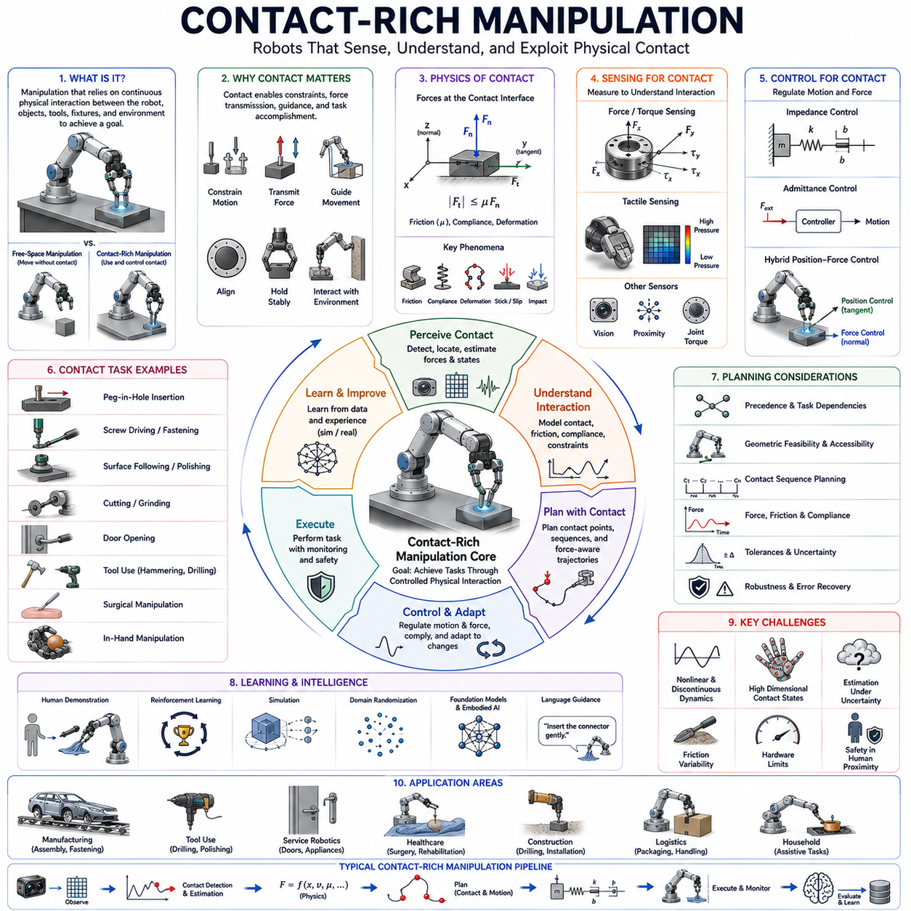{width="7.268055555555556in" height="7.268055555555556in"}

Contact-Rich Manipulation refers to a class of robotic manipulation tasks in which continuous physical interaction between the robot, the manipulated object, tools, fixtures, and the surrounding environment plays a central role in task execution. Unlike free-space manipulation, where the robot primarily moves objects without significant environmental interaction, contact-rich manipulation relies on controlled physical contact to achieve desired outcomes. Many of the most important human activities---including assembly, insertion, fastening, tool use, writing, polishing, cutting, opening doors, operating machinery, dressing, cooking, and surgical procedures---are fundamentally contact-rich in nature. Consequently, mastering contact-rich manipulation is widely regarded as one of the most important challenges in robotics and a critical milestone toward general-purpose embodied intelligence.

Traditional industrial robotics achieved remarkable success in structured environments by focusing on highly repeatable tasks involving rigid objects and carefully controlled conditions. In such environments, robots could often rely on accurate position control and preprogrammed trajectories. However, as robots move into more dynamic, unstructured, and human-centered environments, purely position-based approaches become insufficient. Contact introduces uncertainty, friction, compliance, force transmission, deformation, and complex physical interactions that cannot be handled solely through geometric planning. Contact-rich manipulation therefore requires robots to reason about both motion and force simultaneously.

At a fundamental level, contact-rich manipulation involves interactions governed by contact mechanics. Whenever two physical bodies touch, forces are exchanged across the contact interface. These forces depend on material properties, surface geometry, friction coefficients, compliance characteristics, relative motion, and environmental conditions. Understanding and controlling these interactions is essential for successful task execution.

One of the defining characteristics of contact-rich tasks is the presence of constraints. During free-space motion, the robot enjoys relatively unrestricted movement. Once contact occurs, however, environmental constraints begin to influence robot behavior. For example, when inserting a peg into a hole, the surrounding hole geometry constrains possible motions. During door opening, hinge mechanics restrict movement to specific trajectories. During polishing or grinding, surface geometry guides tool motion. Contact-rich manipulation therefore requires the robot to understand and exploit environmental constraints rather than simply avoiding them.

Peg-in-hole insertion represents one of the most widely studied examples of contact-rich manipulation. Although the task appears simple, successful insertion requires precise alignment, force control, compliance management, friction handling, and error recovery. Small positioning errors may cause jamming, wedging, or excessive contact forces. As a result, peg insertion has become a standard benchmark for evaluating robotic manipulation capabilities.

Fastening operations provide another representative example. Screw driving, bolt tightening, connector insertion, and snap-fit assembly all involve continuous contact between multiple components. During these operations, robots must regulate force, torque, alignment, and insertion depth while responding to changing interaction conditions. Successful execution requires integration of perception, force sensing, planning, and control.

Tool use significantly expands the complexity of contact-rich manipulation. Humans routinely use tools to amplify force, extend reach, modify interactions, and achieve complex objectives. Robots performing hammering, drilling, cutting, sanding, polishing, painting, or writing must understand how contact forces propagate through tools and affect task outcomes. Tool-mediated interactions introduce additional dynamics that must be modeled and controlled.

Contact modeling forms the theoretical foundation of contact-rich manipulation. Contact models describe how forces arise when objects interact. The simplest models assume rigid contact with Coulomb friction, where tangential forces are proportional to normal forces. More advanced models incorporate compliance, deformation, adhesion, viscoelastic behavior, and nonlinear friction effects. Accurate contact modeling is essential for simulation, planning, and control.

Friction plays a particularly important role in contact-rich tasks. Friction can be both beneficial and problematic. It enables stable grasping, prevents slipping, and supports force transmission. However, excessive friction may cause jamming, wear, energy loss, and unpredictable behavior. Many contact-rich manipulation tasks require deliberate exploitation of friction while simultaneously managing its negative effects.

Compliance is another key concept. Compliance refers to the ability of a system to deform or yield under applied forces. Humans naturally exploit compliance when performing contact-intensive tasks. Muscles, tendons, and soft tissues absorb impacts and accommodate positioning errors. Robotic systems increasingly incorporate both mechanical compliance and control-based compliance to achieve similar capabilities.

Mechanical compliance may be introduced through soft materials, elastic joints, flexible structures, passive mechanisms, or compliant end effectors. These components physically absorb disturbances and reduce sensitivity to uncertainty. Mechanical compliance is particularly useful for assembly, human-robot interaction, and delicate manipulation tasks.

Control-based compliance provides flexibility through software rather than hardware. Impedance control and admittance control are among the most widely used approaches. Impedance control specifies desired relationships between motion and force, allowing robots to behave as virtual springs, dampers, or mass-spring-damper systems. Admittance control uses measured forces to modify motion commands dynamically. Both approaches enable safe and adaptive contact interactions.

Force sensing is a critical enabler of contact-rich manipulation. Force-torque sensors provide direct measurements of interaction forces and moments. These sensors allow robots to detect contact events, estimate environmental properties, regulate applied forces, and identify anomalies during task execution. Without force feedback, many contact-rich tasks become significantly more difficult or impossible.

Tactile sensing provides complementary information. While force-torque sensors measure global interaction forces, tactile sensors measure local contact distributions across surfaces. Tactile sensing can reveal pressure patterns, contact locations, slippage events, texture characteristics, and object deformation. Combining force and tactile sensing significantly improves manipulation performance.

Contact state estimation is an important challenge. The robot must determine whether contact exists, where contact occurs, how many contact points are active, and what forces are being transmitted. Contact states often change rapidly during manipulation. Accurate state estimation enables appropriate control actions and supports robust task execution.

Hybrid position-force control represents one of the foundational control paradigms for contact-rich manipulation. Some directions of motion are controlled using position commands, while others are controlled using force commands. For example, during surface following, the robot may control motion tangentially while regulating force normal to the surface. Hybrid control enables simultaneous achievement of motion and force objectives.

Constraint-based control builds upon this concept by explicitly incorporating environmental constraints into control formulations. Rather than avoiding contact, the controller treats contact as a useful source of information and guidance. Constraint-aware approaches often achieve greater robustness and efficiency than purely position-based methods.

Motion planning becomes substantially more difficult when contact interactions are involved. Traditional planning assumes collision-free motion through free space. Contact-rich manipulation requires planners to intentionally create, maintain, modify, and exploit contact states. The planner must predict not only geometric outcomes but also force interactions and physical consequences.

Contact planning addresses this challenge by explicitly reasoning about contact sequences. The planner determines where contact should occur, when contact transitions should happen, what forces should be applied, and how interactions contribute to task completion. Contact planning is particularly important in assembly, locomotion, dexterous manipulation, and tool use.

Multi-contact manipulation introduces additional complexity. In many tasks, robots interact with objects through multiple simultaneous contacts. Human hands routinely exploit multiple fingers, palm surfaces, environmental supports, and tool interfaces. Multi-contact strategies significantly increase manipulation capability but also create more complex control problems.

Dexterous robotic hands are especially relevant to contact-rich manipulation. Unlike simple grippers, multi-fingered hands can create and regulate numerous contact points simultaneously. This enables in-hand manipulation, object reorientation, force redistribution, and sophisticated interaction strategies. However, controlling many contact points requires advanced planning and sensing capabilities.

Environmental exploitation is an emerging area of research. Rather than treating the environment as an obstacle, robots can use external surfaces to support manipulation. Humans routinely slide objects along tables, use walls for alignment, and exploit environmental constraints to simplify tasks. Contact-rich manipulation increasingly incorporates such strategies to improve efficiency and robustness.

Learning-based methods have transformed the field of contact-rich manipulation. Traditional analytical approaches often struggle because contact dynamics are highly nonlinear, discontinuous, and difficult to model accurately. Machine learning enables robots to learn successful interaction strategies directly from data and experience.

Behavior cloning allows robots to imitate human demonstrations. Human operators naturally adapt force, compliance, and motion during contact-rich tasks. By observing demonstrations, robots can acquire manipulation policies that capture these complex behaviors without requiring explicit physical modeling.

Reinforcement learning has achieved remarkable success in contact-intensive manipulation tasks. Through repeated interactions, robots learn policies that maximize long-term rewards. Reinforcement learning has demonstrated promising results in insertion, assembly, tool use, object reorientation, and dexterous manipulation. The ability to learn directly from interaction experience is particularly valuable when analytical models are incomplete.

Simulation plays a central role in learning-based contact manipulation. Modern physics engines increasingly support realistic contact modeling, friction simulation, deformation effects, and force interactions. Large-scale simulation enables robots to acquire millions of interaction experiences before deployment in physical environments.

Domain randomization further improves transfer from simulation to reality. By exposing learning systems to variations in friction, mass, compliance, sensor noise, and environmental conditions, robots develop policies that generalize more effectively to real-world situations.

Foundation models and embodied AI are beginning to influence contact-rich manipulation research. Large-scale models trained on diverse manipulation experiences may eventually develop generalized physical reasoning capabilities. Rather than learning each contact task independently, future robots may acquire broad understanding of force interactions, material behavior, and environmental constraints.

Language-guided manipulation introduces additional opportunities. A human might instruct a robot to "insert the connector gently," "tighten the screw carefully," or "push until resistance is felt." These instructions implicitly reference contact dynamics and force interactions. Future embodied AI systems may translate such language into sophisticated force-aware control policies.

Industrial applications of contact-rich manipulation are extensive. Manufacturing systems perform assembly, fastening, welding, polishing, grinding, inspection, and packaging operations. Service robots interact with appliances, furniture, doors, switches, and household objects. Medical robots manipulate tissues, instruments, and implants. Construction robots perform drilling, fastening, cutting, and installation tasks. Virtually every practical robotic application eventually encounters contact-rich interactions.

Performance evaluation typically considers task success rate, force regulation accuracy, insertion accuracy, assembly quality, contact stability, robustness to uncertainty, adaptation capability, execution speed, energy efficiency, and safety. Because contact interactions often involve uncertainty and physical risk, robustness and reliability are especially important evaluation criteria.

Future contact-rich manipulation systems will likely combine high-resolution tactile sensing, force-aware perception, real-time physics reasoning, compliant actuation, adaptive control, simulation-driven learning, foundation models, digital twins, and embodied intelligence within unified architectures. These systems will move beyond predefined contact strategies and develop the ability to understand, predict, and exploit physical interactions in general environments.

Ultimately, Contact-Rich Manipulation represents one of the defining challenges of intelligent robotics. It requires robots to understand not only where objects are but also how forces flow through physical interactions. Mastering contact-rich manipulation will enable robots to perform assembly, tool use, maintenance, healthcare, household assistance, and countless other tasks with a level of competence approaching human dexterity. As a result, progress in this field is widely viewed as a critical step toward achieving truly capable embodied AI systems that can interact effectively with the physical world.

Contact-Rich Manipulation(접촉 기반 조작)은 로봇, 물체, 공구, 지그(Fixture), 그리고 주변 환경 사이의 지속적인 물리적 접촉이 작업 수행의 핵심 역할을 하는 조작 기술을 의미한다. 자유 공간 조작(Free-Space Manipulation)이 환경과의 상호작용 없이 물체를 이동시키는 데 초점을 맞춘다면, 접촉 기반 조작은 원하는 작업 결과를 얻기 위해 의도적으로 물리적 접촉을 활용한다. 조립(Assembly), 삽입(Insertion), 체결(Fastening), 공구 사용(Tool Use), 글쓰기(Writing), 연마(Polishing), 절단(Cutting), 문 열기(Door Opening), 기계 조작(Operation), 의복 착용(Dressing), 요리(Cooking), 수술(Surgery)과 같은 인간의 중요한 활동 대부분은 본질적으로 접촉 기반 작업이다. 따라서 접촉 기반 조작을 성공적으로 수행하는 능력은 범용 로봇과 임바디드 AI(Embodied AI) 실현의 핵심 이정표로 간주된다.

전통적인 산업용 로봇은 구조화된 환경에서 매우 성공적이었다. 이러한 환경에서는 부품 위치가 정확히 알려져 있고 작업 조건이 일정하기 때문에 위치 제어(Position Control)와 사전 정의된 경로만으로도 충분했다. 그러나 로봇이 공장 밖으로 나와 가정, 병원, 물류센터, 건설 현장과 같은 비정형 환경에서 작업하기 시작하면서 단순한 위치 제어만으로는 충분하지 않게 되었다. 접촉이 발생하면 마찰(Friction), 순응성(Compliance), 힘 전달(Force Transmission), 변형(Deformation), 불확실성(Uncertainty)과 같은 복잡한 물리 현상이 등장하기 때문이다. 따라서 접촉 기반 조작은 움직임(Motion)과 힘(Force)을 동시에 이해하고 제어해야 한다.

접촉 기반 조작의 이론적 기반은 접촉 역학(Contact Mechanics)에 있다. 두 물체가 접촉하면 접촉면(Contact Interface)을 통해 힘이 전달된다. 이 힘은 재료(Material), 표면 형상(Surface Geometry), 마찰 계수(Friction Coefficient), 순응성 특성(Compliance Characteristics), 상대 운동(Relative Motion), 환경 조건(Environmental Condition)에 의해 결정된다. 이러한 상호작용을 이해하고 제어하는 것이 성공적인 조작의 핵심이다.

접촉 기반 작업의 가장 큰 특징 중 하나는 제약 조건(Constraint)의 존재이다. 자유 공간에서는 로봇이 비교적 자유롭게 움직일 수 있지만, 접촉이 발생하면 환경이 로봇의 움직임을 제한한다. 예를 들어 핀 삽입(Peg-in-Hole)에서는 홀(Hole)의 형상이 이동 방향을 제한한다. 문을 열 때는 경첩(Hinge)이 특정 궤적만 허용한다. 연마 작업에서는 표면 형상이 공구 움직임을 결정한다. 따라서 접촉 기반 조작은 환경 제약을 이해하고 활용해야 한다.

Peg-in-Hole 삽입 작업은 접촉 기반 조작의 대표적인 예이다. 단순해 보이지만 실제로는 정렬(Alignment), 힘 제어(Force Control), 순응성 관리(Compliance Management), 마찰 처리(Friction Handling), 오류 복구(Error Recovery)가 모두 필요하다. 작은 위치 오차도 재밍(Jamming), 웨징(Wedging), 과도한 접촉력을 발생시킬 수 있다. 이러한 이유로 Peg-in-Hole은 수십 년 동안 접촉 기반 조작의 대표 벤치마크(Benchmark)로 사용되어 왔다.

체결 작업(Fastening Operation) 역시 대표적인 접촉 기반 조작이다. 나사 체결(Screw Driving), 볼트 조임(Bolt Tightening), 커넥터 삽입(Connector Insertion), 스냅 결합(Snap-Fit Assembly) 등은 모두 지속적인 접촉을 포함한다. 로봇은 힘, 토크(Torque), 정렬 상태, 삽입 깊이를 동시에 제어해야 하며, 작업 중 변화하는 접촉 상태에 실시간으로 대응해야 한다.

공구 사용(Tool Use)은 접촉 기반 조작을 더욱 복잡하게 만든다. 인간은 망치(Hammer), 드릴(Drill), 칼(Knife), 사포(Sandpaper), 붓(Brush) 등을 이용하여 힘을 증폭하거나 상호작용을 변화시킨다. 로봇이 망치질, 드릴링, 절단, 샌딩, 연마, 페인팅, 필기 등을 수행하려면 공구를 통해 전달되는 힘을 이해하고 제어해야 한다.

접촉 모델(Contact Model)은 접촉 기반 조작의 수학적 기반을 제공한다. 가장 단순한 모델은 강체 접촉(Rigid Contact)과 쿨롱 마찰(Coulomb Friction)을 가정한다. 그러나 실제 환경에서는 순응성, 변형, 점탄성(Viscoelasticity), 접착(Adhesion), 비선형 마찰(Nonlinear Friction) 등이 존재한다. 정확한 접촉 모델은 시뮬레이션, 계획, 제어의 핵심 요소이다.

마찰(Friction)은 접촉 기반 조작에서 매우 중요한 역할을 한다. 마찰은 물체를 안정적으로 잡고 힘을 전달할 수 있게 해주는 긍정적인 요소이다. 그러나 지나친 마찰은 재밍, 마모(Wear), 에너지 손실(Energy Loss), 예측 불가능한 거동을 유발할 수 있다. 따라서 로봇은 마찰을 활용하면서도 동시에 관리해야 한다.

순응성(Compliance)은 또 다른 핵심 개념이다. 순응성이란 외부 힘이 가해졌을 때 시스템이 변형되거나 적응하는 능력을 의미한다. 인간은 근육(Muscle), 힘줄(Tendon), 연부 조직(Soft Tissue)을 통해 자연스럽게 순응성을 활용한다. 로봇도 유사한 능력을 얻기 위해 기계적 순응성(Mechanical Compliance)과 제어 기반 순응성(Control-Based Compliance)을 사용한다.

기계적 순응성은 탄성 재료, 유연 구조(Flexible Structure), 탄성 관절(Elastic Joint), 수동 메커니즘(Passive Mechanism)을 통해 구현된다. 이러한 구조는 충격을 흡수하고 오차에 대한 민감도를 줄여준다. 조립 작업과 인간-로봇 협업(Human-Robot Collaboration)에서 특히 유용하다.

제어 기반 순응성은 소프트웨어를 통해 구현된다. 대표적으로 임피던스 제어(Impedance Control)와 어드미턴스 제어(Admittance Control)가 있다. 임피던스 제어는 힘과 움직임의 관계를 정의하여 로봇이 가상의 스프링(Spring)이나 댐퍼(Damper)처럼 동작하도록 만든다. 어드미턴스 제어는 측정된 힘에 따라 움직임을 수정한다. 두 방식 모두 안전하고 유연한 접촉 상호작용을 가능하게 한다.

힘 센서(Force Sensor)는 접촉 기반 조작의 핵심 센서이다. 힘-토크 센서(Force-Torque Sensor)는 접촉력과 모멘트(Moment)를 직접 측정할 수 있다. 이를 통해 로봇은 접촉 발생 여부를 감지하고, 환경 특성을 추정하며, 힘을 제어하고, 이상 상황을 탐지할 수 있다.

촉각 센서(Tactile Sensor)는 힘 센서를 보완한다. 힘 센서가 전체 힘을 측정하는 반면, 촉각 센서는 압력 분포(Pressure Distribution), 접촉 위치(Contact Location), 미끄러짐(Slip), 표면 질감(Texture) 등을 측정한다. 힘 센서와 촉각 센서를 결합하면 훨씬 정교한 조작이 가능하다.

접촉 상태 추정(Contact State Estimation)은 중요한 연구 주제이다. 로봇은 접촉이 존재하는지, 어디에서 접촉이 일어나는지, 몇 개의 접촉점(Contact Point)이 존재하는지, 어떤 힘이 전달되는지를 실시간으로 파악해야 한다. 접촉 상태는 매우 빠르게 변화하기 때문에 정확한 추정이 필요하다.

하이브리드 위치-힘 제어(Hybrid Position-Force Control)는 접촉 기반 조작의 대표적인 제어 기법이다. 특정 방향은 위치 제어를 수행하고 다른 방향은 힘 제어를 수행한다. 예를 들어 표면을 따라 이동하는 작업에서는 표면 접선 방향(Tangential Direction)은 위치 제어를 하고, 법선 방향(Normal Direction)은 힘 제어를 수행한다.

제약 기반 제어(Constraint-Based Control)는 환경 제약을 제어기에 직접 포함한다. 기존 방식이 접촉을 피하려고 했다면, 제약 기반 제어는 접촉을 유용한 정보와 가이드로 활용한다. 이러한 접근은 높은 강인성과 효율성을 제공한다.

모션 계획(Motion Planning)은 접촉이 포함되면 훨씬 복잡해진다. 기존 계획은 충돌 없는 경로만 찾으면 되었지만, 접촉 기반 조작에서는 접촉을 의도적으로 생성하고 유지하며 활용해야 한다. 따라서 단순한 기하학적 결과뿐 아니라 힘과 물리적 상호작용까지 예측해야 한다.

접촉 계획(Contact Planning)은 이러한 문제를 해결하기 위한 연구 분야이다. 어디에서 접촉을 만들 것인지, 언제 접촉 상태를 변경할 것인지, 어떤 힘을 적용할 것인지를 계획한다. 조립, 보행, 정교한 손 조작, 공구 사용에서 매우 중요하다.

다중 접촉 조작(Multi-Contact Manipulation)은 더욱 복잡한 문제를 다룬다. 인간의 손은 여러 손가락과 손바닥을 동시에 사용하며, 환경과도 접촉한다. 다중 접촉은 조작 능력을 크게 향상시키지만 제어 문제를 훨씬 어렵게 만든다.

정교한 로봇 손(Dexterous Robotic Hand)은 접촉 기반 조작의 핵심 플랫폼이다. 다관절 손은 여러 접촉점을 동시에 생성하고 조절할 수 있다. 이를 통해 물체 재배치(Object Reorientation), 손 안 조작(In-Hand Manipulation), 힘 재분배(Force Redistribution)가 가능해진다.

환경 활용(Environmental Exploitation)은 최근 주목받는 연구 방향이다. 인간은 벽을 이용해 정렬하고, 테이블 위에서 물체를 미끄러뜨리며, 환경을 적극 활용한다. 로봇도 환경을 단순한 장애물로 보지 않고 조작을 돕는 요소로 활용하기 시작하고 있다.

학습 기반 접근법(Learning-Based Approach)은 접촉 기반 조작 분야를 크게 변화시키고 있다. 접촉 동역학은 비선형적이고 불연속적이며 모델링이 어렵기 때문에 데이터 기반 접근이 매우 효과적이다.

행동 모방 학습(Behavior Cloning)은 인간 시연을 학습한다. 사람은 접촉 상황에서 힘과 움직임을 자연스럽게 조절한다. 로봇은 이러한 시연을 통해 복잡한 상호작용 전략을 학습할 수 있다.

강화학습(Reinforcement Learning)은 접촉 기반 작업에서 큰 성과를 보이고 있다. 반복적인 상호작용을 통해 최적의 정책을 학습하며, 삽입, 조립, 공구 사용, 물체 재배치, 정교한 손 조작에서 뛰어난 결과를 보여주고 있다.

시뮬레이션(Simulation)은 학습 기반 접촉 조작의 핵심 도구이다. 최신 물리 엔진은 접촉, 마찰, 변형, 힘 상호작용을 매우 현실적으로 표현할 수 있다. 이를 통해 로봇은 실제 환경에 배치되기 전에 수백만 번의 경험을 축적할 수 있다.

도메인 랜덤화(Domain Randomization)는 시뮬레이션과 현실 사이의 차이를 줄이는 방법이다. 마찰, 질량, 센서 노이즈, 순응성 등을 다양하게 변화시키며 학습함으로써 실제 환경에서도 강인하게 동작하도록 만든다.

최근에는 파운데이션 모델(Foundation Model)과 임바디드 AI(Embodied AI)가 접촉 기반 조작에도 적용되고 있다. 미래의 시스템은 개별 작업마다 별도로 학습하는 대신, 다양한 접촉 경험을 통해 일반적인 물리 추론 능력(Physical Reasoning)을 습득할 것으로 기대된다.

언어 기반 조작(Language-Guided Manipulation)도 새로운 가능성을 열고 있다. 사용자가 "커넥터를 부드럽게 삽입해라", "나사를 조심스럽게 조여라", "저항이 느껴질 때까지 밀어라"와 같은 명령을 내리면 로봇은 이를 힘 제어 정책으로 변환해야 한다.

산업 현장에서 접촉 기반 조작은 매우 광범위하게 사용된다. 제조업에서는 조립, 체결, 용접, 연마, 포장 작업을 수행한다. 서비스 로봇은 문, 가전제품, 가구, 스위치 등을 조작한다. 의료 로봇은 조직과 의료기구를 다룬다. 건설 로봇은 드릴링, 체결, 절단, 설치 작업을 수행한다.

접촉 기반 조작 시스템은 일반적으로 작업 성공률(Task Success Rate), 힘 제어 정확도(Force Regulation Accuracy), 삽입 정확도(Insertion Accuracy), 조립 품질(Assembly Quality), 접촉 안정성(Contact Stability), 불확실성에 대한 강인성(Robustness), 적응 능력(Adaptation Capability), 수행 시간(Execution Speed), 에너지 효율(Energy Efficiency), 안전성(Safety)을 기준으로 평가된다.

미래의 Contact-Rich Manipulation 시스템은 고해상도 촉각 센싱, 힘 기반 인지, 실시간 물리 추론, 순응형 액추에이션, 적응형 제어, 시뮬레이션 기반 학습, 파운데이션 모델, 디지털 트윈, 임바디드 지능을 통합한 형태로 발전할 것이다. 이러한 시스템은 단순히 접촉을 처리하는 수준을 넘어 접촉을 이해하고 예측하며 적극적으로 활용할 수 있게 될 것이다.

궁극적으로 Contact-Rich Manipulation은 지능형 로봇공학의 핵심 난제 중 하나이다. 이는 단순히 물체의 위치를 이해하는 것을 넘어, 물리적 상호작용 속에서 힘이 어떻게 전달되고 변화하는지를 이해해야 한다. 접촉 기반 조작을 완전히 마스터하는 것은 조립, 공구 사용, 유지보수, 의료 지원, 가사 지원 등 인간 수준의 물리적 작업을 수행할 수 있는 범용 로봇과 미래 임바디드 AI 실현을 위한 핵심 단계로 평가된다.

##  

## 13.11 Learning Tool Use

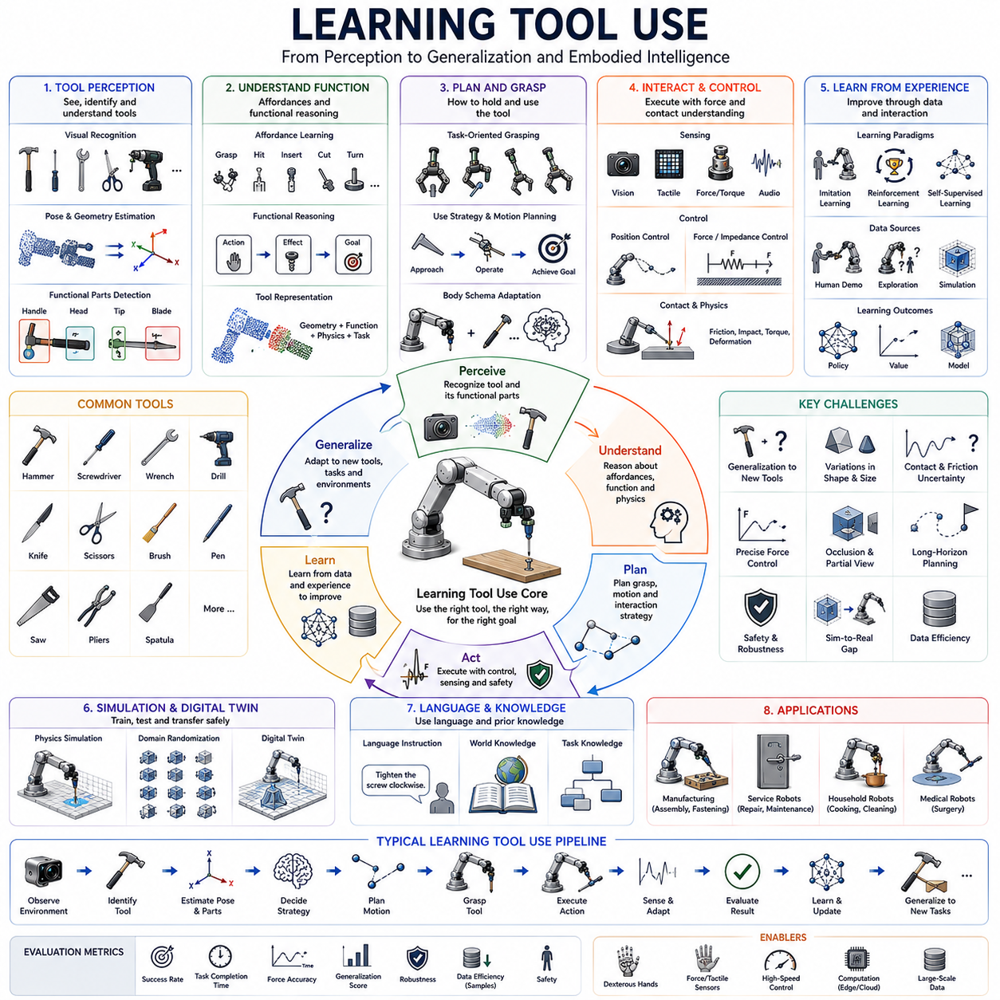{width="7.268055555555556in" height="7.268055555555556in"}

Learning Tool Use refers to the capability of robotic systems to acquire, understand, adapt, and generalize the use of tools through experience, observation, instruction, simulation, and interaction with the environment. Tool use has long been considered one of the defining characteristics of advanced intelligence because it requires an agent to understand how external objects can be employed to extend its physical capabilities beyond the limitations of its own body. Humans routinely use tools such as hammers, screwdrivers, knives, wrenches, scissors, pens, brushes, drills, and countless specialized instruments without consciously thinking about the underlying mechanics. For robots, however, tool use represents a highly complex challenge involving perception, reasoning, manipulation, planning, physics understanding, and learning. Within the Tool Use and Assembly domain of Robot Hand and Dexterous Grasping, Learning Tool Use serves as the bridge between predefined manipulation skills and adaptive embodied intelligence capable of operating in dynamic real-world environments.

The significance of tool use extends beyond industrial applications. In cognitive science and developmental psychology, tool use is often regarded as a hallmark of higher intelligence. Humans, great apes, crows, dolphins, and several other species demonstrate various forms of tool use. These behaviors indicate an understanding that external objects can be manipulated to achieve goals that would otherwise be impossible. Similarly, a robot capable of learning how to use previously unseen tools exhibits a level of physical reasoning and adaptability that approaches more general forms of intelligence.

Traditional robotic systems relied heavily on predefined tool models and manually programmed behaviors. Engineers specified the geometry of tools, defined contact points, created motion sequences, and designed task-specific controllers. This approach worked well in structured industrial environments where tools and tasks remained constant. However, such systems lacked flexibility. Any change in tool geometry, task requirements, or environmental conditions often required significant reprogramming. As robotics moves toward unstructured environments, robots must increasingly learn tool use rather than relying exclusively on handcrafted rules.

Tool use can be viewed as an extension of embodied action. A robot normally interacts with objects directly through its end effector. When using a tool, the robot must reason about an additional object inserted between itself and the environment. This creates a chain of interactions in which forces, motions, and information propagate through the tool. Understanding this extended body representation is a central challenge of tool use learning.

One of the first requirements for learning tool use is tool perception. Before a tool can be used, the robot must identify it, estimate its geometry, understand its functional components, and determine how it should be grasped. Unlike ordinary objects, tools possess functional structures specifically designed to produce effects in the environment. A hammer contains a handle and a striking surface. A screwdriver contains a handle and a driving tip. Scissors contain two articulated blades. Recognizing these functional features is essential for successful tool use.

Computer vision plays a central role in tool perception. Modern perception systems employ deep neural networks to recognize tool categories, estimate poses, identify grasp points, and locate functional regions. Vision-based methods can classify tools even under varying lighting conditions, cluttered backgrounds, and partial occlusions. However, visual recognition alone is often insufficient because effective tool use requires understanding functionality rather than merely identifying appearance.

Affordance learning provides a framework for understanding functionality. The concept of affordances describes the possible actions that an object enables. A handle affords grasping. A blade affords cutting. A hammer head affords striking. Learning tool affordances allows robots to reason about how objects can be used rather than simply what they look like. Affordance representations bridge perception and action by connecting object properties to potential behaviors.

Functional reasoning extends this idea further. A robot must understand not only individual affordances but also how those affordances contribute to task completion. For example, when using a screwdriver, the robot must understand that rotational motion applied to the handle generates torque at the tip, which can rotate a screw. Such reasoning requires understanding cause-and-effect relationships within physical systems.

Tool representation is another important challenge. Traditional approaches represent tools using geometric models. While geometry is important, learning-based systems increasingly employ richer representations that incorporate functional properties, contact dynamics, material characteristics, and task relevance. These representations allow robots to reason about tool behavior in a more flexible manner.

Body schema adaptation plays a significant role in tool use learning. Humans often incorporate tools into their body representation. A tennis racket feels like an extension of the arm. A cane becomes part of a person\'s perception of space. Robots similarly benefit from updating internal models to include tools as extensions of their manipulators. Such adaptation improves motion planning, control accuracy, and task performance.

Grasp planning for tool use differs from ordinary object grasping. A stable grasp alone is insufficient. The grasp must also support the intended task. A hammer may be grasped near the end of the handle to maximize striking force, while a screwdriver may be grasped closer to the center for precise rotational control. Tool-oriented grasp planning therefore considers both stability and functionality.

Task-oriented manipulation forms the core of tool use. The robot must coordinate tool motion, force application, contact interactions, and environmental responses to achieve desired outcomes. This requires integrating perception, planning, and control within a unified framework. Tool use often transforms simple manipulation problems into contact-rich interaction problems involving complex dynamics.

Physical reasoning is essential for successful tool use. The robot must understand how forces propagate through tools, how contact interactions generate effects, and how environmental constraints influence outcomes. A hammer strike depends on momentum transfer. A cutting operation depends on blade geometry and applied force. A lever amplifies force through mechanical advantage. Learning these relationships is critical for generalized tool use.

Simulation environments provide valuable opportunities for learning tool behavior. Modern physics simulators model rigid-body dynamics, contact interactions, friction, deformation, and force transmission. Through simulation, robots can explore thousands or millions of tool interactions without physical risk. This accelerates learning and reduces the cost of experimentation.

Behavior cloning represents one of the most common approaches to learning tool use. Human demonstrations provide examples of successful behavior. By observing how humans manipulate tools, robots can learn grasp strategies, motion patterns, force profiles, and task sequences. Demonstration-based learning is particularly useful when explicit programming becomes difficult.

Imitation learning extends beyond direct copying. Modern systems attempt to infer underlying task objectives from demonstrations rather than simply reproducing observed motions. This allows learned behaviors to generalize across different tools, objects, and environmental conditions.

Reinforcement learning has emerged as a powerful framework for tool use acquisition. Rather than relying exclusively on demonstrations, robots learn through trial and error. Successful tool interactions generate rewards, while failures produce penalties. Over time, the robot discovers strategies that maximize task performance. Reinforcement learning has demonstrated success in hammering, pushing, cutting, object retrieval, assembly, and many other tool-use scenarios.

Exploration is particularly important in reinforcement learning. Robots must discover how actions influence outcomes through interaction. Tool use introduces large action spaces because both robot motion and tool dynamics must be considered. Efficient exploration strategies significantly influence learning performance.

Curriculum learning can improve training efficiency. Rather than immediately attempting difficult tasks, robots begin with simpler scenarios and gradually progress toward more complex challenges. For example, a robot might first learn to grasp a hammer, then strike stationary targets, and eventually perform complex assembly operations.

Transfer learning plays a key role in scalable tool use. Once a robot learns how to use one tool, it should ideally transfer relevant knowledge to similar tools. Knowledge acquired from one hammer may generalize to other hammers. Experience with one screwdriver may facilitate learning of related tools. Transfer learning reduces data requirements and accelerates adaptation.

Generalization remains one of the central goals of tool use research. Traditional systems often perform well only on tools encountered during training. Truly intelligent systems must generalize to previously unseen tools. This requires learning abstract principles rather than memorizing specific object configurations.

Meta-learning offers a promising approach to this challenge. Rather than learning individual tool-use tasks directly, the robot learns how to learn. Meta-learning frameworks aim to acquire adaptable representations and learning strategies that facilitate rapid adaptation to novel situations.

Multi-modal perception significantly enhances tool learning. Visual information provides shape and appearance. Tactile sensing provides contact information. Force sensors reveal interaction dynamics. Audio sensing may detect impacts, cutting sounds, or assembly events. Combining these modalities creates richer representations of tool behavior.

Language-guided tool learning is an emerging area of research. Human instructors often describe tool functions using language. Instructions such as "use the hammer to drive the nail," "turn the screwdriver clockwise," or "cut along the edge" provide semantic information that complements sensory observations. Large language models increasingly enable robots to incorporate linguistic knowledge into tool-use learning.

Foundation models are beginning to transform tool use research. Large-scale models trained on vast amounts of visual, textual, and interaction data can acquire broad knowledge about tools and their functions. Such models may provide priors that significantly reduce the amount of task-specific learning required.

Embodied AI extends these ideas further by integrating perception, reasoning, memory, planning, and action within a unified framework. An embodied agent must not only recognize tools but also understand when to use them, why they are useful, and how they contribute to broader task objectives. Tool use therefore becomes part of a larger cognitive architecture rather than an isolated manipulation skill.

Causal reasoning is increasingly recognized as essential for advanced tool use. Rather than merely associating actions with outcomes, robots must understand why outcomes occur. Causal models enable prediction, planning, adaptation, and error recovery. Such reasoning supports robust behavior in unfamiliar situations.

Tool invention represents one of the most advanced forms of tool intelligence. Humans sometimes create new tools when existing tools are unavailable. Future robotic systems may similarly identify opportunities to repurpose ordinary objects or construct improvised tools. This capability requires deep understanding of functionality, physics, and task objectives.

Collaborative tool use introduces additional complexity. In many industrial and service environments, robots must share tools with humans or coordinate tool use among multiple agents. This requires communication, intention understanding, safety awareness, and synchronized action planning.

Industrial applications of learning-based tool use are extensive. Manufacturing robots use drills, welders, screwdrivers, grinders, and inspection instruments. Service robots operate appliances, cleaning tools, cooking utensils, and maintenance equipment. Medical robots manipulate surgical instruments. Construction robots employ cutting, fastening, and installation tools. In all these domains, learning-based approaches promise greater adaptability and reduced programming effort.

Performance evaluation of tool-use learning systems typically considers task success rate, learning efficiency, generalization capability, adaptability to novel tools, robustness to uncertainty, execution speed, force regulation quality, and safety. Generalization and adaptability are particularly important because they distinguish true learning from simple memorization.

Future Learning Tool Use systems will likely integrate foundation models, embodied AI, causal reasoning, multimodal perception, reinforcement learning, imitation learning, simulation-driven training, digital twins, and language-guided planning into unified architectures. These systems will move beyond executing predefined tool behaviors and develop the ability to understand, adapt, and invent tool-use strategies across a wide range of environments.

Ultimately, Learning Tool Use represents a critical step toward general-purpose robotic intelligence. It requires robots to understand functionality, reason about physical interactions, adapt to new situations, and extend their capabilities through external objects. Mastering tool use is therefore not only an important practical objective for robotics but also a fundamental milestone on the path toward embodied AI systems capable of operating autonomously and intelligently in the complex physical world.

Learning Tool Use(공구 사용 학습)는 로봇이 경험, 관찰, 시뮬레이션, 명령, 환경과의 상호작용을 통해 공구를 사용하는 방법을 학습하고, 이해하며, 적응하고, 일반화하는 능력을 의미한다. 공구 사용은 인간 지능의 대표적인 특징 중 하나로 여겨져 왔다. 이는 단순히 물체를 잡는 것이 아니라 외부 물체를 자신의 신체 능력의 확장으로 활용하여 목표를 달성하는 능력이기 때문이다. 인간은 망치(Hammer), 드라이버(Screwdriver), 칼(Knife), 렌치(Wrench), 가위(Scissors), 펜(Pen), 붓(Brush), 드릴(Drill)과 같은 다양한 공구를 자연스럽게 사용한다. 그러나 로봇에게 공구 사용은 인식(Perception), 추론(Reasoning), 조작(Manipulation), 계획(Planning), 물리 이해(Physical Understanding), 학습(Learning)이 결합된 매우 복잡한 문제이다. Robot Hand and Dexterous Grasping의 Tool Use and Assembly 영역에서 Learning Tool Use는 사전에 정의된 조작 기술에서 벗어나 적응형 임바디드 지능(Embodied Intelligence)으로 발전하기 위한 핵심 단계로 간주된다.

공구 사용의 중요성은 단순한 산업 응용을 넘어선다. 인지과학(Cognitive Science)과 발달심리학(Developmental Psychology)에서는 공구 사용을 고등 지능의 상징으로 본다. 인간뿐 아니라 침팬지(Chimpanzee), 까마귀(Crow), 돌고래(Dolphin)와 같은 일부 동물도 공구 사용 능력을 보여준다. 이는 외부 물체를 이용하여 자신의 능력을 확장하고 새로운 문제를 해결할 수 있음을 의미한다. 마찬가지로, 로봇이 처음 보는 공구를 스스로 이해하고 사용할 수 있다면 이는 보다 일반적인 지능을 향한 중요한 진전으로 평가된다.

전통적인 로봇 시스템은 대부분 사전에 정의된 공구 모델과 수동 프로그래밍에 의존하였다. 엔지니어는 공구의 형상(Geometry), 접촉점(Contact Point), 동작 시퀀스(Motion Sequence), 제어 알고리즘(Control Algorithm)을 직접 설계하였다. 이러한 방식은 공장과 같은 구조화된 환경에서는 효과적이었지만, 공구가 바뀌거나 작업 환경이 달라질 경우 대규모 재프로그래밍이 필요했다. 따라서 현대 로봇은 공구 사용을 프로그래밍하는 것이 아니라 학습해야 한다는 방향으로 발전하고 있다.

공구 사용은 신체 능력의 확장(Extension of Embodied Action)으로 볼 수 있다. 일반적으로 로봇은 엔드이펙터(End Effector)를 이용하여 직접 환경과 상호작용한다. 그러나 공구를 사용하면 로봇과 환경 사이에 새로운 물체가 개입하게 된다. 따라서 힘, 움직임, 정보가 공구를 통해 전달된다. 로봇은 공구를 자신의 일부처럼 인식하고 활용할 수 있어야 한다.

공구 사용 학습의 첫 번째 단계는 공구 인식(Tool Perception)이다. 로봇은 공구를 식별하고, 형상을 추정하며, 기능적 구조를 이해하고, 적절한 파지 위치를 찾아야 한다. 일반 물체와 달리 공구는 특정 기능을 수행하기 위해 설계된 구조를 가진다. 망치는 손잡이와 타격면(Striking Surface)을 가지고 있으며, 드라이버는 손잡이와 팁(Tip)을 가진다. 가위는 두 개의 관절식 블레이드(Articulated Blade)를 가진다. 이러한 기능적 구조를 이해하는 것이 중요하다.

컴퓨터 비전(Computer Vision)은 공구 인식의 핵심 기술이다. 최신 시스템은 딥러닝을 이용하여 공구 종류를 분류하고, 자세(Pose)를 추정하며, 파지점(Grasp Point)과 기능 영역(Functional Region)을 찾는다. 그러나 단순히 외형을 인식하는 것만으로는 충분하지 않다. 로봇은 공구의 기능(Function)을 이해해야 한다.

이를 위해 어포던스 학습(Affordance Learning)이 활용된다. 어포던스(Affordance)는 특정 물체가 제공하는 행동 가능성을 의미한다. 손잡이는 잡을 수 있도록 하고, 칼날은 자를 수 있도록 하며, 망치 머리는 타격을 가능하게 한다. 공구의 어포던스를 학습하면 로봇은 단순히 물체를 보는 것이 아니라 어떻게 사용할 수 있는지를 이해하게 된다.

기능적 추론(Functional Reasoning)은 한 단계 더 나아간 개념이다. 로봇은 단순히 어포던스를 아는 것이 아니라 그것이 작업 목표에 어떻게 기여하는지 이해해야 한다. 예를 들어 드라이버를 사용할 때 손잡이를 회전시키면 팁에서 토크가 발생하고, 이 토크가 나사를 회전시킨다는 인과관계를 이해해야 한다.

공구 표현(Tool Representation)도 중요한 문제이다. 초기 시스템은 공구를 단순한 기하학적 모델로 표현하였다. 그러나 최근에는 기능, 접촉 역학, 재료 특성, 작업 관련 정보를 포함하는 풍부한 표현 방식이 사용된다. 이를 통해 보다 유연한 공구 사용이 가능해진다.

신체 스키마 적응(Body Schema Adaptation)은 공구 사용 학습에서 중요한 개념이다. 인간은 테니스 라켓이나 지팡이를 사용할 때 그것을 자신의 신체 일부처럼 인식한다. 로봇도 마찬가지로 공구를 자신의 조작기(Manipulator)의 연장으로 통합할 수 있어야 한다. 이러한 적응은 경로 계획, 제어 정확도, 작업 효율성을 향상시킨다.

공구 사용을 위한 파지 계획(Grasp Planning)은 일반 물체 파지와 다르다. 단순히 안정적으로 잡는 것만으로는 충분하지 않다. 작업 목적(Task Objective)에 적합해야 한다. 예를 들어 망치는 손잡이 끝부분을 잡아야 큰 타격력을 얻을 수 있으며, 드라이버는 보다 정밀한 제어를 위해 중간 부분을 잡을 수 있다. 따라서 공구 파지는 안정성과 기능성을 동시에 고려해야 한다.

작업 지향 조작(Task-Oriented Manipulation)은 공구 사용의 핵심이다. 로봇은 공구 움직임, 힘 적용, 접촉 상호작용, 환경 반응을 통합적으로 제어해야 한다. 이 과정에서 공구 사용은 단순한 물체 이동이 아니라 복잡한 접촉 기반 조작(Contact-Rich Manipulation) 문제로 변환된다.

물리 추론(Physical Reasoning)은 성공적인 공구 사용의 필수 요소이다. 로봇은 힘이 공구를 통해 어떻게 전달되는지, 접촉이 어떤 결과를 만드는지, 환경 제약이 작업 결과에 어떤 영향을 미치는지를 이해해야 한다. 망치는 운동량(Momentum)을 전달하고, 칼은 절삭력(Cutting Force)을 생성하며, 지렛대(Lever)는 기계적 이득(Mechanical Advantage)을 제공한다. 이러한 물리 원리를 학습하는 것이 중요하다.

시뮬레이션(Simulation)은 공구 사용 학습에 매우 중요한 역할을 한다. 현대 물리 엔진은 강체 동역학(Rigid Body Dynamics), 접촉, 마찰, 변형, 힘 전달을 모델링할 수 있다. 로봇은 시뮬레이션 환경에서 수백만 번의 실험을 수행하며 공구 사용 기술을 학습할 수 있다.

행동 모방 학습(Behavior Cloning)은 가장 널리 사용되는 학습 방법 중 하나이다. 인간의 시연(Demonstration)을 관찰하고 이를 모방함으로써 공구 사용 기술을 습득한다. 이를 통해 파지 전략, 움직임 패턴, 힘 적용 방식, 작업 순서를 학습할 수 있다.

모방 학습(Imitation Learning)은 단순 복제를 넘어 작업의 의도(Intent)를 추론한다. 이를 통해 동일한 공구뿐 아니라 유사한 공구에도 학습된 지식을 적용할 수 있다.

강화학습(Reinforcement Learning)은 공구 사용 학습에서 매우 강력한 방법으로 평가된다. 로봇은 시행착오(Trial and Error)를 반복하며 성공적인 행동에는 보상을 받고 실패에는 패널티를 받는다. 이를 통해 망치질, 밀기, 절단, 물체 회수, 조립 등 다양한 공구 사용 기술을 학습할 수 있다.

탐색(Exploration)은 강화학습의 중요한 요소이다. 로봇은 어떤 행동이 어떤 결과를 가져오는지 직접 경험해야 한다. 공구 사용은 공구의 동역학까지 포함해야 하기 때문에 행동 공간(Action Space)이 매우 크다. 따라서 효율적인 탐색 전략이 중요하다.

커리큘럼 학습(Curriculum Learning)은 학습 효율을 높이는 방법이다. 처음부터 어려운 작업을 수행하는 대신 쉬운 작업부터 시작하여 점차 난이도를 높인다. 예를 들어 망치를 잡는 것부터 시작하여, 정적인 목표를 치고, 나중에는 복잡한 조립 작업으로 발전할 수 있다.

전이 학습(Transfer Learning)은 공구 사용 확장성의 핵심이다. 하나의 망치를 사용하는 방법을 학습했다면 다른 망치에도 적용할 수 있어야 한다. 하나의 드라이버 경험이 다른 드라이버 학습을 촉진할 수 있어야 한다. 이를 통해 학습 데이터 요구량을 크게 줄일 수 있다.

일반화(Generalization)는 공구 사용 연구의 궁극적인 목표 중 하나이다. 기존 시스템은 학습에 사용된 공구에 대해서만 잘 동작하는 경우가 많다. 진정한 지능형 시스템은 처음 보는 공구에도 적응할 수 있어야 한다. 이를 위해서는 특정 형상을 암기하는 것이 아니라 공구 사용의 원리를 학습해야 한다.

메타 학습(Meta-Learning)은 이러한 문제를 해결하기 위한 유망한 접근법이다. 특정 작업을 직접 학습하는 것이 아니라 학습하는 방법 자체를 학습한다. 이를 통해 새로운 공구에 빠르게 적응할 수 있다.

다중 모달 인식(Multi-Modal Perception)은 공구 학습을 크게 향상시킨다. 시각은 형상과 외형 정보를 제공하고, 촉각은 접촉 정보를 제공하며, 힘 센서는 상호작용 동역학을 측정한다. 오디오 센서는 충격음, 절삭음, 체결음을 감지할 수 있다. 이러한 정보를 통합하면 더욱 풍부한 공구 이해가 가능해진다.

언어 기반 공구 학습(Language-Guided Tool Learning)은 최근 주목받고 있는 분야이다. 인간은 "망치로 못을 박아라", "드라이버를 시계 방향으로 돌려라", "가장자리를 따라 잘라라"와 같은 언어로 공구 사용 방법을 설명한다. 대규모 언어 모델(Large Language Model)은 이러한 언어 지식을 로봇 학습에 통합할 수 있다.

파운데이션 모델(Foundation Model)은 공구 사용 연구를 변화시키고 있다. 방대한 시각, 텍스트, 상호작용 데이터를 학습한 모델은 공구와 기능에 대한 일반적인 지식을 획득할 수 있다. 이를 통해 작업별 학습 비용을 크게 줄일 수 있다.

임바디드 AI(Embodied AI)는 이러한 개념을 더욱 확장한다. 로봇은 공구를 인식하는 것뿐 아니라 언제 사용해야 하는지, 왜 필요한지, 작업 목표 달성에 어떻게 기여하는지를 이해해야 한다. 공구 사용은 단순한 조작 기술이 아니라 더 큰 인지 구조(Cognitive Architecture)의 일부가 된다.

인과 추론(Causal Reasoning)은 고급 공구 사용의 핵심 요소로 점점 중요해지고 있다. 로봇은 단순히 행동과 결과를 연결하는 것이 아니라 왜 그런 결과가 발생하는지를 이해해야 한다. 이러한 이해는 예측(Prediction), 계획(Planning), 적응(Adaptation), 오류 복구(Error Recovery)를 가능하게 한다.

공구 발명(Tool Invention)은 가장 높은 수준의 공구 지능이다. 인간은 필요한 공구가 없을 때 주변 물체를 활용하여 새로운 공구를 만들 수 있다. 미래의 로봇도 일반 물체를 재활용하거나 즉석에서 공구를 제작할 수 있을 것으로 기대된다. 이는 기능, 물리, 작업 목표에 대한 깊은 이해를 요구한다.

협업 공구 사용(Collaborative Tool Use)은 또 다른 도전 과제이다. 산업 현장과 서비스 환경에서는 인간과 로봇이 공구를 공유하거나 여러 로봇이 함께 공구를 사용해야 할 수 있다. 이를 위해서는 의도 이해(Intention Understanding), 안전성(Safety), 통신(Communication), 협력 계획(Cooperative Planning)이 필요하다.

학습 기반 공구 사용은 제조, 서비스, 의료, 건설 등 다양한 산업에 적용되고 있다. 제조 로봇은 드릴, 용접기, 드라이버, 연마 공구를 사용하며, 서비스 로봇은 청소 도구, 조리 도구, 가전기기를 조작한다. 의료 로봇은 수술 도구를 사용하고, 건설 로봇은 절단 및 체결 공구를 활용한다.

공구 사용 학습 시스템은 일반적으로 작업 성공률(Task Success Rate), 학습 효율성(Learning Efficiency), 일반화 능력(Generalization Capability), 새로운 공구 적응성(Adaptability), 강인성(Robustness), 작업 속도(Execution Speed), 힘 제어 품질(Force Regulation Quality), 안전성(Safety)을 기준으로 평가된다. 특히 일반화와 적응성은 단순 암기와 진정한 학습을 구분하는 핵심 지표이다.

미래의 Learning Tool Use 시스템은 파운데이션 모델, 임바디드 AI, 인과 추론, 다중 모달 인식, 강화학습, 모방학습, 시뮬레이션 기반 학습, 디지털 트윈, 언어 기반 계획을 통합한 형태로 발전할 것이다. 이러한 시스템은 단순히 공구를 사용하는 수준을 넘어, 새로운 공구를 이해하고, 적응하며, 심지어 발명할 수 있는 방향으로 진화할 것으로 예상된다.

궁극적으로 Learning Tool Use는 범용 로봇 지능(General-Purpose Robotic Intelligence)으로 가는 핵심 단계이다. 이는 로봇이 기능(Function)을 이해하고, 물리적 상호작용을 추론하며, 새로운 환경에 적응하고, 외부 물체를 통해 자신의 능력을 확장할 수 있음을 의미한다. 따라서 공구 사용 학습은 실용적인 기술일 뿐만 아니라 미래 임바디드 AI가 복잡한 물리 세계에서 자율적이고 지능적으로 행동하기 위한 핵심 이정표로 평가된다.

##  

## 13.12 Industrial Assembly Case Studies

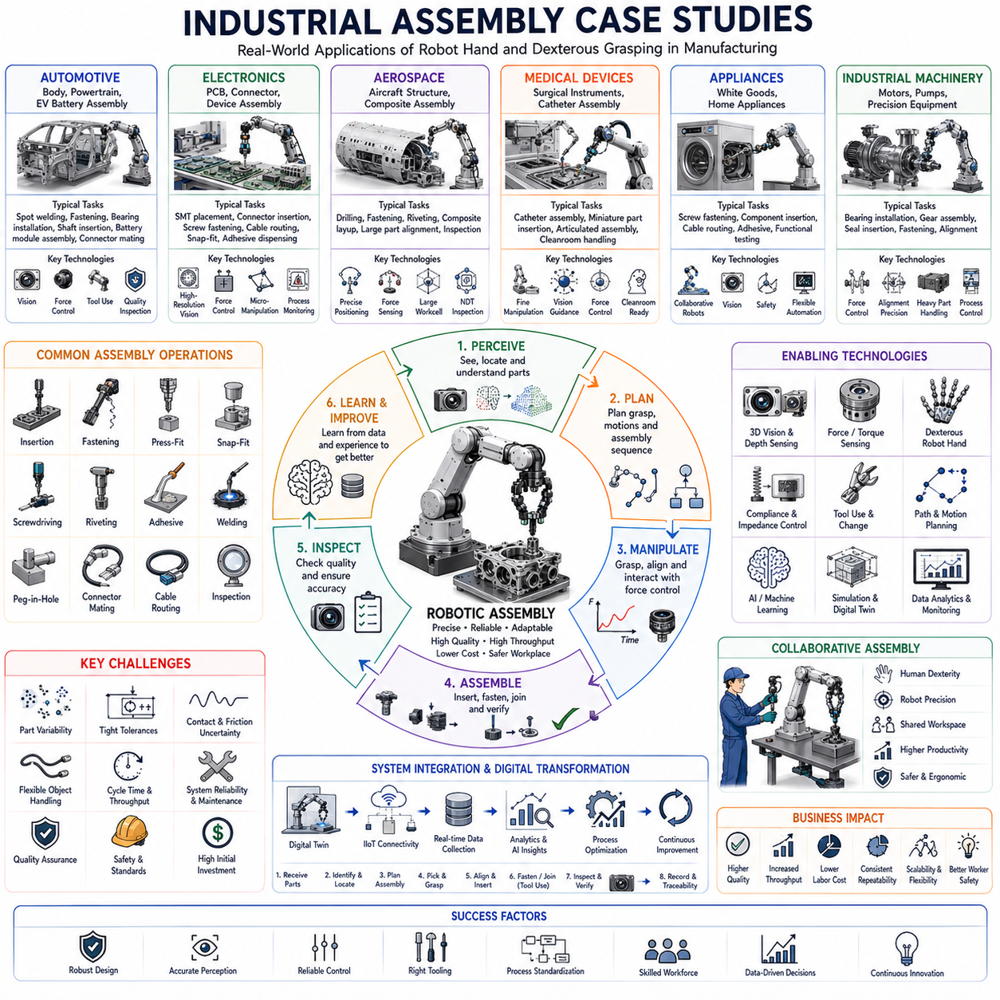{width="7.268055555555556in" height="7.268055555555556in"}

Industrial Assembly Case Studies represent the practical application of robotic manipulation, dexterous grasping, tool use, force control, perception, planning, and learning technologies within real manufacturing environments. While theoretical research provides the foundation for robotic assembly, industrial case studies demonstrate how these technologies perform under actual production constraints involving cost, speed, reliability, safety, scalability, and quality requirements. Within the Tool Use and Assembly domain of Robot Hand and Dexterous Grasping, industrial assembly case studies serve as the bridge between laboratory research and real-world deployment, illustrating how robotic systems create measurable value in manufacturing operations.

Assembly remains one of the most important activities in global manufacturing. Products ranging from smartphones and laptops to automobiles, aircraft, medical devices, industrial machinery, and consumer appliances require the integration of hundreds or thousands of components. Historically, assembly has relied heavily on human labor because many assembly operations involve complex perception, fine manipulation, force-sensitive interactions, and adaptation to variability. However, advances in sensing, computation, robotics, artificial intelligence, and automation have enabled increasingly sophisticated robotic assembly systems capable of performing tasks that were once considered exclusively human.

Industrial assembly environments impose unique requirements that differ significantly from research laboratories. A laboratory demonstration may focus on achieving a single successful assembly, while industrial systems must operate continuously for thousands of hours with minimal downtime. Manufacturing systems are evaluated not only by technical feasibility but also by throughput, cost efficiency, reliability, maintainability, and return on investment. Consequently, successful industrial assembly solutions require careful integration of mechanical engineering, robotics, software, controls, quality assurance, and production management.

One of the most influential examples of robotic assembly can be found in the automotive industry. Automotive manufacturing has historically driven many advances in industrial automation because vehicles contain thousands of individual parts requiring precise assembly. Modern automotive factories employ large numbers of robots for welding, fastening, painting, handling, inspection, and assembly operations. Robotic systems are particularly valuable because they provide high repeatability, consistent quality, and the ability to operate continuously.

Body-in-White assembly represents one of the earliest large-scale successes of robotic assembly. In this process, sheet metal components are positioned and joined to create the vehicle body structure. Industrial robots perform spot welding operations with high precision and repeatability. The success of Body-in-White automation demonstrated the economic viability of large-scale robotic assembly and established many of the standards that continue to influence modern manufacturing systems.

Powertrain assembly provides another important case study. Engines, transmissions, electric drive units, and related components require precise alignment and insertion of bearings, shafts, gears, seals, and fasteners. These operations often involve contact-rich manipulation and tight tolerances. Advanced robotic systems combine vision guidance, force sensing, and precision motion control to achieve reliable assembly despite manufacturing variations.

The rise of electric vehicles has introduced new assembly challenges. Battery packs contain large numbers of cells, electrical connections, thermal management systems, and structural components. Robotic assembly systems must handle delicate electrical components while maintaining strict quality standards. Battery module assembly often requires precise placement, connector insertion, adhesive application, and inspection operations that demand sophisticated robotic capabilities.

Electronics manufacturing provides another rich source of industrial assembly case studies. Consumer electronics products such as smartphones, tablets, laptops, and wearable devices contain numerous miniature components assembled with extremely high precision. Traditional industrial robots often struggle with such tasks because small components require fine manipulation and careful force control.

Surface Mount Technology assembly lines represent one of the most highly automated manufacturing environments in the world. High-speed placement machines position thousands of electronic components onto printed circuit boards with extraordinary accuracy. Although these systems are highly specialized, they demonstrate the power of combining precision mechanics, machine vision, and real-time control within assembly operations.

Connector insertion remains a challenging problem within electronics manufacturing. Flexible cables, miniature connectors, and delicate components require force-sensitive manipulation. Many modern assembly systems combine visual servoing, force control, and compliance strategies to achieve reliable connector mating while avoiding damage to components.

Consumer electronics final assembly presents additional challenges. Products often involve snap-fit connections, adhesive bonding, screw fastening, flexible cable routing, and quality inspection. Robotic systems must coordinate multiple assembly techniques while maintaining high throughput. The increasing complexity of electronic products continues to drive innovation in robotic manipulation technologies.

The aerospace industry provides examples of assembly operations involving extreme precision and quality requirements. Aircraft structures contain millions of components, many of which must be assembled with strict tolerances and rigorous documentation. Unlike automotive manufacturing, aerospace production volumes are relatively low, making flexibility particularly important.

Aircraft fuselage assembly illustrates the challenges of large-scale precision assembly. Components may span several meters and require accurate alignment before fastening. Robotic systems often perform drilling, fastening, inspection, and positioning operations while coordinating with human workers. Because aerospace components are expensive and safety-critical, assembly systems must achieve exceptional reliability.

Composite material assembly has become increasingly important in aerospace manufacturing. Carbon fiber structures require specialized handling techniques due to their material properties. Robotic systems are frequently used for material placement, trimming, inspection, and joining operations. These applications demonstrate the growing importance of advanced perception and manipulation technologies.

Medical device manufacturing represents another important domain for robotic assembly. Medical products often contain miniature components, precision mechanisms, and strict cleanliness requirements. Robotic systems provide advantages in consistency, contamination control, and traceability.

Catheter assembly provides an excellent example of flexible-object manipulation within industrial assembly. Catheters consist of long, flexible structures that must be accurately assembled and inspected. Robotic systems handling such products require sophisticated perception, force control, and deformable object manipulation capabilities.

Surgical instrument assembly introduces additional complexity because devices often contain articulated mechanisms, miniature fasteners, and precision alignments. Quality requirements are extremely stringent because assembly errors may directly affect patient safety. Consequently, robotic assembly systems must integrate comprehensive inspection and verification procedures.

The appliance industry demonstrates the challenges of assembling large consumer products. Washing machines, refrigerators, ovens, and air conditioners contain numerous mechanical, electrical, and structural components. Robotic systems perform tasks such as screw fastening, component insertion, cable routing, adhesive application, and functional testing.

White goods manufacturing has increasingly adopted collaborative robots for assembly assistance. Collaborative systems provide flexibility while allowing human workers to perform tasks requiring dexterity and judgment. These deployments illustrate the growing importance of human-robot collaboration within industrial assembly environments.

Industrial machinery assembly presents another class of applications. Products such as pumps, motors, compressors, and manufacturing equipment often require precision assembly of mechanical components. Robotic systems must handle heavy parts, perform accurate alignments, and manage complex assembly sequences.

Bearing installation serves as a common example of contact-rich assembly within industrial machinery manufacturing. Bearings often require controlled insertion forces and precise alignment. Advanced robotic systems use force sensing and compliance control to achieve reliable installations without damaging components.

Fastener assembly represents one of the most widespread assembly operations across industries. Screws, bolts, rivets, clips, and other fastening mechanisms are used extensively in manufactured products. Robotic fastening systems combine vision guidance, torque sensing, force control, and process monitoring to ensure assembly quality.

Automated screwdriving systems have become increasingly sophisticated. Modern systems monitor torque profiles, insertion depth, rotational speed, and tool behavior to detect assembly anomalies. These systems illustrate how sensing and analytics enhance assembly reliability.

Cable harness assembly remains one of the most difficult industrial automation challenges. Wiring harnesses contain numerous flexible cables that must be routed through complex pathways and connected to multiple endpoints. Human workers continue to perform many harness assembly tasks because flexible object manipulation remains difficult for robots.

Recent advances in perception, machine learning, and dexterous manipulation are beginning to change this situation. Experimental systems have demonstrated automated cable routing, connector insertion, and harness assembly capabilities. These developments highlight the growing role of AI-driven manipulation technologies.

Logistics and warehouse assembly applications have also expanded significantly. Packaging operations often involve assembling cartons, inserting products, applying labels, sealing packages, and preparing shipments. Robotic systems must adapt to diverse product types and packaging configurations.

E-commerce growth has accelerated demand for flexible assembly and packaging automation. Unlike traditional manufacturing, e-commerce environments frequently encounter high product variability. Robots operating in these environments require greater adaptability and perception capabilities.

Collaborative assembly systems represent one of the most important trends in modern manufacturing. Rather than replacing human workers entirely, many industrial deployments combine human strengths and robotic strengths within shared workspaces. Robots provide precision, endurance, and repeatability, while humans contribute flexibility, problem-solving, and contextual understanding.

Assembly assistance applications demonstrate the benefits of collaboration. Robots may present components, hold parts in position, perform repetitive fastening operations, or transport materials while humans execute tasks requiring dexterity and judgment. Such systems often improve productivity while reducing worker fatigue.

Digital transformation has significantly influenced industrial assembly. Modern factories increasingly employ digital twins, industrial Internet of Things technologies, cloud computing, and advanced analytics to optimize assembly processes. Digital assembly systems continuously collect operational data and use it to improve performance.

Digital twins provide virtual representations of assembly lines, robots, products, and processes. Engineers can evaluate assembly sequences, detect bottlenecks, predict failures, and optimize operations before implementing changes in physical systems. This capability reduces risk and accelerates deployment.

Artificial intelligence is becoming increasingly important in industrial assembly. Machine learning supports predictive maintenance, quality inspection, process optimization, anomaly detection, and adaptive control. AI enables assembly systems to respond more effectively to variability and uncertainty.

Learning-based robotic assembly represents a particularly active area of research and development. Traditional assembly systems relied on carefully engineered procedures. Learning-based systems aim to acquire assembly skills through demonstration, simulation, reinforcement learning, and experience. Such approaches promise greater flexibility and reduced engineering effort.

Foundation models and embodied AI may significantly influence future assembly systems. Large-scale models trained on manufacturing knowledge, assembly procedures, CAD data, videos, and robotic experiences may eventually provide generalized assembly intelligence. Rather than programming each assembly task separately, future systems may reason about assembly objectives and generate strategies autonomously.

Performance evaluation within industrial assembly focuses on practical metrics. Cycle time measures production speed. Throughput measures overall output. First-pass yield evaluates assembly quality. Mean time between failures measures reliability. Resource utilization reflects efficiency. Cost per unit quantifies economic performance. Safety metrics assess risk to workers and equipment.

Successful industrial case studies demonstrate that robotic assembly is not simply a technological challenge but also an economic and organizational one. Deployment requires integration of hardware, software, production planning, workforce training, maintenance strategies, and quality systems. Organizations that effectively combine these elements achieve substantial benefits in productivity, consistency, scalability, and competitiveness.

Future industrial assembly systems will likely integrate advanced perception, dexterous robotic hands, force-sensitive manipulation, flexible automation, collaborative robotics, digital twins, reinforcement learning, foundation models, and embodied AI within unified manufacturing architectures. These systems will increasingly move beyond fixed automation toward adaptive assembly intelligence capable of handling product variability, environmental uncertainty, and changing production requirements.

Ultimately, Industrial Assembly Case Studies demonstrate the practical realization of robotic manipulation technologies in real manufacturing environments. They reveal how concepts such as grasp planning, contact-rich manipulation, force control, tool use, learning, and embodied intelligence contribute to production systems that create tangible economic value. As robotics continues to evolve, industrial assembly will remain one of the most important proving grounds for advanced manipulation technologies and a critical pathway toward truly intelligent autonomous manufacturing systems.

Industrial Assembly Case Studies(산업 조립 사례 연구)는 로봇 조작(Robotic Manipulation), 정교한 파지(Dexterous Grasping), 공구 사용(Tool Use), 힘 제어(Force Control), 인식(Perception), 계획(Planning), 학습(Learning) 기술이 실제 제조 환경에서 어떻게 적용되는지를 보여주는 사례들을 의미한다. 이론 연구가 로봇 조립의 기초를 제공한다면, 산업 사례 연구는 이러한 기술들이 실제 생산 현장에서 비용, 속도, 신뢰성, 안전성, 확장성, 품질 요구사항을 만족하면서 어떻게 활용되는지를 보여준다. Robot Hand and Dexterous Grasping의 Tool Use and Assembly 영역에서 산업 조립 사례 연구는 연구실 기술과 실제 산업 적용 사이를 연결하는 중요한 역할을 수행한다.

조립(Assembly)은 제조 산업의 핵심 공정 중 하나이다. 스마트폰, 노트북, 자동차, 항공기, 의료기기, 산업 장비, 가전제품 등 거의 모든 제품은 수십 개에서 수천 개의 부품을 결합하여 만들어진다. 오랫동안 조립 공정은 인간 작업자에게 의존해 왔다. 조립 작업은 복잡한 인식, 정밀한 손동작, 힘 기반 상호작용, 상황 적응 능력을 요구하기 때문이다. 그러나 센서, 컴퓨팅, 로봇공학, 인공지능, 자동화 기술의 발전으로 인해 과거에는 인간만 가능하다고 여겨졌던 조립 작업들이 점차 자동화되고 있다.

산업용 조립 환경은 연구실 환경과 매우 다르다. 연구실에서는 단 한 번의 성공적인 조립만으로도 의미 있는 결과가 될 수 있지만, 실제 산업 현장에서는 수천 시간 동안 안정적으로 동작해야 한다. 제조 시스템은 기술적 성공뿐 아니라 생산량(Throughput), 비용 효율성(Cost Efficiency), 신뢰성(Reliability), 유지보수성(Maintainability), 투자 대비 수익(Return on Investment)까지 평가받는다. 따라서 성공적인 산업용 조립 시스템은 기계공학, 로봇공학, 소프트웨어, 제어, 품질관리, 생산관리의 통합이 필요하다.

자동차 산업은 산업용 조립 자동화의 가장 대표적인 사례이다. 자동차는 수천 개의 부품으로 구성되며, 정밀한 조립이 요구된다. 현대 자동차 공장은 용접(Welding), 체결(Fastening), 도장(Painting), 운반(Handling), 검사(Inspection), 조립(Assembly) 작업에 대규모 로봇 시스템을 사용한다. 로봇은 높은 반복 정밀도와 24시간 연속 운전 능력을 제공하기 때문에 매우 큰 가치를 가진다.

차체 조립(Body-in-White Assembly)은 산업용 로봇이 가장 먼저 성공적으로 적용된 분야 중 하나이다. 이 공정에서는 여러 개의 금속 판재를 정밀하게 위치시키고 점용접(Spot Welding)을 수행하여 자동차 차체를 만든다. 이러한 자동화는 로봇 조립의 경제성을 입증한 대표적인 사례가 되었다.

파워트레인(Powertrain) 조립 역시 중요한 사례이다. 엔진, 변속기, 전기 구동 장치(Electric Drive Unit)는 베어링(Bearing), 샤프트(Shaft), 기어(Gear), 씰(Seal), 체결 부품(Fastener)을 높은 정밀도로 조립해야 한다. 이러한 작업은 접촉 기반 조작(Contact-Rich Manipulation)과 힘 제어가 필수적이다.

전기차(Electric Vehicle)의 확산은 새로운 조립 과제를 만들었다. 배터리 팩(Battery Pack)은 수많은 셀(Cell), 전기 연결부, 냉각 시스템, 구조 부품으로 구성된다. 로봇은 민감한 전기 부품을 손상시키지 않으면서 정확하게 조립해야 한다. 배터리 모듈 조립은 정밀 배치(Placement), 커넥터 삽입(Connector Insertion), 접착제 도포(Adhesive Application), 검사(Inspection) 기술을 요구한다.

전자제품 제조(Electronics Manufacturing)는 또 다른 대표적인 사례이다. 스마트폰, 태블릿, 노트북, 웨어러블 기기는 매우 작은 부품들로 구성된다. 이러한 부품은 미세한 조작(Fine Manipulation)과 정밀한 힘 제어를 요구하기 때문에 일반적인 산업용 로봇만으로는 처리하기 어렵다.

표면실장기술(Surface Mount Technology, SMT) 생산 라인은 세계에서 가장 자동화된 조립 시스템 중 하나이다. SMT 장비는 초고속으로 전자 부품을 PCB에 배치한다. 이는 정밀 기계공학, 머신비전(Machine Vision), 실시간 제어가 결합된 대표적 성공 사례이다.

전자제품 제조에서는 커넥터 삽입이 매우 중요한 문제이다. 플렉시블 케이블(Flexible Cable)과 소형 커넥터는 매우 민감하기 때문에 힘 기반 제어와 시각 기반 정렬(Visual Servoing)이 필요하다. 최근의 조립 시스템은 비전, 힘 센서, 순응성 제어를 결합하여 안정적인 삽입을 수행한다.

전자제품 최종 조립(Final Assembly)은 스냅 결합(Snap-Fit), 접착, 나사 체결, 케이블 배선, 품질 검사를 포함한다. 이러한 작업은 여러 조립 기술을 동시에 활용해야 하며 높은 생산성을 유지해야 한다.

항공우주 산업(Aerospace Industry)은 극도로 높은 품질 요구사항을 가진 조립 사례를 제공한다. 항공기는 수백만 개의 부품으로 구성되며, 모든 조립 과정이 엄격하게 관리된다. 자동차 산업과 달리 생산량은 적지만 정밀성과 안전성이 훨씬 중요하다.

항공기 동체(Fuselage) 조립은 대형 구조물 조립의 대표 사례이다. 수 미터 길이의 구조물을 정밀하게 정렬한 후 드릴링(Drilling), 체결(Fastening), 검사(Inspection)를 수행해야 한다. 로봇은 인간 작업자와 협력하면서 이러한 작업을 수행한다.

복합재(Composite Material) 조립도 항공우주 산업에서 중요하다. 탄소섬유(Carbon Fiber) 구조물은 특별한 취급이 필요하며, 로봇은 적층(Layup), 절단(Trimming), 검사, 결합 작업에 활용된다.

의료기기 제조(Medical Device Manufacturing)는 또 다른 중요한 응용 분야이다. 의료기기는 소형 부품, 정밀 기구, 높은 청정도(Cleanliness)를 요구한다. 로봇은 일관성, 오염 방지, 추적성(Traceability) 측면에서 큰 장점을 제공한다.

카테터(Catheter) 조립은 유연 물체 조작(Deformable Object Manipulation)의 대표 사례이다. 카테터는 길고 유연한 구조를 가지므로 정교한 인식과 힘 제어가 필요하다.

수술 기구(Surgical Instrument) 조립은 더욱 복잡하다. 관절 구조, 미세 체결 부품, 정밀 정렬이 포함되며, 환자의 안전과 직결되기 때문에 품질 기준이 매우 엄격하다.

가전제품 산업(Appliance Industry)은 대형 소비자 제품 조립 사례를 제공한다. 세탁기, 냉장고, 오븐, 에어컨은 기계 부품, 전기 부품, 구조 부품이 복합적으로 결합된다. 로봇은 나사 체결, 부품 삽입, 케이블 배선, 접착제 도포, 기능 테스트를 수행한다.

백색가전(White Goods) 제조에서는 협동로봇(Collaborative Robot)의 활용이 증가하고 있다. 협동로봇은 인간 작업자와 함께 작업하면서 반복 작업을 수행하고, 작업자의 피로를 줄여준다.

산업 장비(Industrial Machinery) 제조도 중요한 사례이다. 펌프(Pump), 모터(Motor), 압축기(Compressor), 생산 장비는 정밀한 기계 부품 조립을 요구한다. 로봇은 무거운 부품을 다루고 정밀 정렬을 수행한다.

베어링 설치(Bearing Installation)는 대표적인 접촉 기반 조립 사례이다. 베어링은 정확한 정렬과 적절한 삽입력을 요구한다. 힘 센서와 순응성 제어를 활용하여 손상 없이 조립해야 한다.

체결 작업(Fastener Assembly)은 거의 모든 산업에서 공통적으로 사용된다. 나사, 볼트, 리벳, 클립은 다양한 제품에 사용된다. 로봇 체결 시스템은 비전, 토크 센서, 힘 제어, 공정 모니터링을 통합하여 품질을 보장한다.

자동 나사 체결 시스템은 최근 매우 발전하였다. 토크 프로파일(Torque Profile), 삽입 깊이, 회전 속도, 공구 상태를 실시간으로 모니터링하여 이상을 감지할 수 있다.

케이블 하네스(Cable Harness) 조립은 산업 자동화의 가장 어려운 문제 중 하나이다. 수많은 유연 케이블을 특정 경로로 배선하고 연결해야 하기 때문이다. 현재도 많은 작업이 인간 작업자에 의해 수행되고 있다.

그러나 최근 인식, 머신러닝, 정교한 조작 기술의 발전으로 자동 케이블 라우팅, 커넥터 삽입, 하네스 조립 시스템이 개발되고 있다. 이는 AI 기반 조작 기술의 중요성을 보여주는 사례이다.

물류(Logistics) 및 창고(Warehouse) 산업에서도 조립 기술이 활용된다. 포장 박스 조립, 제품 삽입, 라벨 부착, 포장 밀봉과 같은 작업이 대표적이다.

전자상거래(E-Commerce)의 성장으로 인해 유연한 조립 및 포장 자동화에 대한 수요가 크게 증가하였다. 다양한 제품을 처리해야 하기 때문에 높은 적응성이 요구된다.

협업 조립 시스템(Collaborative Assembly System)은 현대 제조의 중요한 트렌드이다. 로봇은 정밀성과 반복성을 제공하고, 인간은 유연성과 문제 해결 능력을 제공한다. 두 시스템을 결합함으로써 생산성과 품질을 동시에 향상시킬 수 있다.

디지털 전환(Digital Transformation)은 산업 조립에 큰 영향을 미치고 있다. 디지털 트윈(Digital Twin), 산업용 IoT(Industrial Internet of Things), 클라우드 컴퓨팅(Cloud Computing), 데이터 분석(Data Analytics)이 조립 공정을 지속적으로 최적화하고 있다.

디지털 트윈은 조립 라인, 로봇, 제품, 공정을 가상 환경에 복제한다. 이를 통해 병목 현상(Bottleneck)을 찾고, 고장을 예측하며, 생산성을 향상시킬 수 있다.

인공지능(AI)은 산업 조립의 핵심 기술로 자리 잡고 있다. AI는 예지보전(Predictive Maintenance), 품질 검사(Quality Inspection), 공정 최적화(Process Optimization), 이상 탐지(Anomaly Detection), 적응형 제어(Adaptive Control)를 지원한다.

학습 기반 조립(Learning-Based Assembly)은 현재 가장 활발한 연구 분야 중 하나이다. 전통적인 조립 시스템은 사전에 정의된 절차를 사용했지만, 미래 시스템은 시연(Demonstration), 시뮬레이션, 강화학습을 통해 조립 기술을 학습하게 될 것이다.

파운데이션 모델(Foundation Model)과 임바디드 AI(Embodied AI)는 미래 조립 시스템을 크게 변화시킬 가능성이 있다. CAD 데이터, 제조 지식, 조립 영상, 로봇 경험을 학습한 모델은 새로운 제품에 대해 스스로 조립 전략을 생성할 수 있을 것이다.

산업 조립 시스템은 일반적으로 사이클 타임(Cycle Time), 생산량(Throughput), 최초 합격률(First-Pass Yield), 평균 고장 간격(Mean Time Between Failures), 자원 활용도(Resource Utilization), 단위 생산 비용(Cost per Unit), 안전성(Safety) 등의 지표로 평가된다.

성공적인 산업 조립 사례는 로봇 기술뿐 아니라 생산 계획, 유지보수, 품질 시스템, 작업자 교육이 함께 통합될 때 가장 큰 효과를 얻을 수 있음을 보여준다.

미래의 산업 조립 시스템은 고급 인식, 정교한 로봇 손, 힘 기반 조작, 유연 자동화, 협동로봇, 디지털 트윈, 강화학습, 파운데이션 모델, 임바디드 AI를 통합한 형태로 발전할 것이다. 이러한 시스템은 고정 자동화를 넘어 변화하는 제품과 환경에 적응할 수 있는 지능형 조립 시스템으로 진화할 것으로 예상된다.

궁극적으로 Industrial Assembly Case Studies는 로봇 조작 기술이 실제 산업 현장에서 어떻게 경제적 가치를 창출하는지를 보여주는 가장 중요한 증거이다. 파지 계획, 접촉 기반 조작, 힘 제어, 공구 사용, 학습, 임바디드 지능과 같은 기술들이 실제 제조 시스템에서 생산성과 품질을 향상시키는 핵심 요소로 작동하고 있음을 입증한다. 따라서 산업 조립 사례 연구는 미래의 자율 제조 시스템과 지능형 생산 공장을 실현하기 위한 가장 중요한 실증 분야 중 하나라고 할 수 있다.
