**Volume 06 Robot Hands and Dexterous Grasping**

# 13. Tool Use and Assembly

## 13.01 Tool Use in Robotics

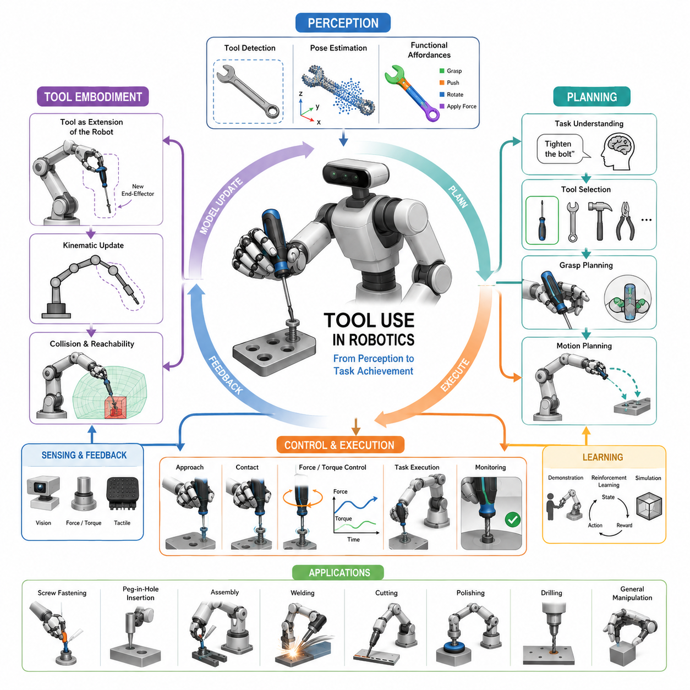{width="7.268055555555556in" height="7.268055555555556in"}

도구 사용(Tool Use)은 고급 로봇 조작 기술을 단순한 파지(Grasping) 및 물체 이동 작업과 구분하는 핵심 능력 중 하나이다. 기본적인 파지가 물체를 집고 유지하는 데 초점을 둔다면, 도구 사용은 외부 물체를 활용하여 로봇의 물리적 능력을 확장하고 환경과의 상호작용 방식을 변화시키는 것을 의미한다. 인간은 일상적으로 도구를 사용하여 힘을 증폭시키고, 작업 범위를 넓히며, 정밀도를 향상시키고, 맨손으로는 수행하기 어려운 작업을 수행한다. 로봇이 이러한 능력을 획득하는 것은 범용 조작(General-Purpose Manipulation), 자율 조립(Autonomous Assembly), 산업 자동화(Industrial Automation), 그리고 체화 지능(Embodied Intelligence) 실현을 위한 중요한 이정표로 간주된다.

특히 정교한 로봇 핸드(Dexterous Hand)와 파지 기술의 관점에서 도구 사용은 매우 독특한 위치를 차지한다. 이는 인지(Perception), 파지 계획(Grasp Planning), 힘 제어(Force Control), 추론(Reasoning), 작업 계획(Task Planning), 그리고 물리적 상호작용(Physical Interaction)을 하나의 통합된 시스템으로 결합해야 하기 때문이다.

도구는 원하는 효과를 얻기 위해 의도적으로 조작되는 외부 물체로 정의할 수 있다. 일반적인 파지 작업에서는 물체를 안정적으로 잡는 것이 목표이지만, 도구 사용에서는 기능적 이해(Functional Understanding)가 필수적이다. 로봇은 도구의 형상만 인식하는 것이 아니라 그 목적과 기능까지 이해해야 한다. 예를 들어 드라이버(Screwdriver)는 단순한 원통형 물체가 아니라 회전 토크를 전달하는 장치이다. 망치(Hammer)는 단순한 강체가 아니라 충격력을 증폭하는 도구이며, 렌치(Wrench)는 토크 전달 장치이고 플라이어(Pliers)는 힘을 집중시켜 다른 물체를 조작하는 장치이다. 따라서 성공적인 로봇 도구 사용은 형상 이해뿐 아니라 기능 이해까지 포함해야 한다.

역사적으로 산업용 로봇은 수십 년 동안 용접, 도장, 드릴링, 조립과 같은 작업에서 도구를 사용해 왔다. 그러나 이러한 시스템은 대부분 작업 환경이 철저히 구조화되어 있고 도구 위치와 작업 순서가 사전에 정의되어 있었다. 즉 로봇이 실제로 도구를 이해하는 것이 아니라 엔지니어가 모든 동작을 미리 프로그래밍한 것이다. 현대 로봇공학은 이러한 경직된 자동화를 넘어 동적이고 비정형적인 환경에서도 스스로 도구를 인식하고 사용할 수 있는 적응형 시스템을 목표로 한다.

도구 사용에서 가장 중요한 개념 중 하나는 파지 어포던스(Grasp Affordance)와 작업 어포던스(Task Affordance)의 차이이다. 파지 어포던스는 도구를 안정적으로 잡을 수 있는 방법을 의미하고, 작업 어포던스는 도구를 실제로 어떻게 사용해야 하는지를 의미한다. 흥미롭게도 이 두 요구사항은 종종 충돌한다. 예를 들어 드라이버의 끝부분을 잡으면 매우 안정적일 수 있지만 나사를 조일 수는 없다. 반대로 손잡이를 잡아야 기능 수행이 가능하지만 파지 안정성은 상대적으로 감소할 수 있다. 따라서 로봇은 단순한 파지 품질뿐 아니라 이후 작업까지 고려하여 최적의 파지 전략을 선택해야 한다.

어포던스(Affordance) 개념은 현대 도구 사용 연구의 핵심이 되었다. 어포던스는 특정 물체가 제공하는 행동 가능성을 의미한다. 로봇은 어떤 부분이 잡기 적합한지, 어떤 부분이 밀기 적합한지, 어떤 부분이 회전이나 절단에 사용되는지를 이해해야 한다. 최근에는 딥러닝 기반 시스템이 이미지로부터 직접 어포던스를 추론한다. 이러한 시스템은 손잡이는 잡기 위한 부분이며, 칼날은 절단을 위한 부분이고, 망치 머리는 타격을 위한 부분이라는 기능적 정보를 학습한다. 이를 통해 이전에 보지 못한 도구에 대해서도 일반화가 가능해진다.

도구 사용은 로봇의 운동학적 구조를 실질적으로 변화시킨다. 로봇이 도구를 손에 쥐는 순간 작업의 최종 끝점은 더 이상 손가락이나 그리퍼가 아니다. 도구의 기능적 끝부분이 새로운 엔드이펙터(End-Effector)가 된다. 따라서 로봇은 도구의 길이, 질량, 무게중심, 형상, 충돌 영역 등을 모두 고려하여 새로운 운동학 모델을 구축해야 한다. 이러한 정보가 부정확하면 작업 실패나 장비 손상으로 이어질 수 있다.

도구 체화(Tool Embodiment) 역시 중요한 개념이다. 인간은 반복 사용을 통해 도구를 자신의 신체 일부처럼 인식한다. 테니스 라켓이나 드라이버를 사용하는 사람은 점차 그것을 팔의 연장선으로 느끼게 된다. 로봇 연구자들은 이러한 능력을 인공 시스템에 구현하고자 한다. 도구 체화가 이루어지면 로봇은 도구를 외부 물체가 아닌 자신의 신체 구조 일부로 인식하며, 경로 계획, 충돌 회피, 힘 제어 성능이 크게 향상된다.

도구 사용 과정에서 인지는 매우 중요한 역할을 수행한다. 로봇은 먼저 환경 속에서 도구를 탐지해야 한다. 이후 도구의 위치, 자세(Pose), 방향, 크기, 기능 영역을 추정해야 한다. 이를 위해 RGB 카메라, 깊이 카메라, 스테레오 비전, 포인트 클라우드(Point Cloud) 처리 기술이 활용된다. 최근에는 대규모 데이터셋으로 학습된 딥러닝 모델이 도구 종류를 분류하고 기능 영역을 예측하는 데 사용된다.

도구를 탐지한 이후에는 정밀한 위치 추정이 요구된다. 많은 조립 작업은 서브밀리미터(Sub-Millimeter) 수준의 정밀도를 필요로 한다. 도구 위치가 조금만 잘못 추정되어도 삽입 실패, 나사 손상, 제품 파손 등이 발생할 수 있다. 따라서 실제 산업 현장에서는 비전 기반 위치 추정과 함께 촉각 센서(Tactile Sensor), 힘 센서(Force Sensor), 순응 제어(Compliance Control)를 결합하여 오차를 보정한다.

도구 사용을 위한 파지 계획은 일반적인 물체 파지와 상당히 다르다. 기존 파지 계획은 힘 폐쇄(Force Closure)와 안정성을 최대화하는 것이 목표였다. 그러나 도구 파지에서는 이후 작업 수행 능력이 추가로 고려되어야 한다. 로봇은 어디를 잡을 것인지, 얼마나 강하게 잡을 것인지, 그리고 그 파지가 실제 작업에 어떤 영향을 미치는지를 평가해야 한다. 예를 들어 플라이어를 사용할 때는 손잡이를 움직일 수 있도록 잡아야 하며, 망치를 사용할 때는 충격 효율을 극대화할 수 있는 위치를 선택해야 한다.

힘 및 토크 제어는 도구 사용의 핵심 기술이다. 대부분의 도구는 외부 대상에 힘을 전달하기 위해 설계되었다. 드라이버는 회전 토크를 전달하고, 망치는 충격력을 전달하며, 렌치는 지속적인 토크를 전달한다. 로봇은 작업 목적에 맞게 힘을 정밀하게 조절해야 하며, 과도한 힘으로 인한 손상을 방지해야 한다. 이를 위해 힘 제어, 임피던스 제어(Impedance Control), 순응 제어가 함께 사용된다.

도구 사용은 접촉 중심 조작(Contact-Rich Manipulation)과 밀접하게 연결되어 있다. 삽입, 연마, 스크래핑, 드릴링, 체결 작업 등은 모두 지속적인 접촉 상태를 유지해야 한다. 자유 공간에서의 단순 이동과 달리 접촉 중심 작업은 힘, 토크, 접촉 상태를 지속적으로 모니터링해야 하며 작은 오차도 실패로 이어질 수 있다. 따라서 위치 제어와 힘 제어를 동시에 수행하는 하이브리드 제어(Hybrid Position-Force Control)가 널리 사용된다.

조립(Assembly)은 도구 사용이 가장 큰 경제적 가치를 창출하는 분야 중 하나이다. 현대 제조업에서는 부품 삽입, 나사 체결, 케이블 연결, 복잡한 제품 조립과 같은 작업이 필수적이다. 이러한 작업은 인지, 조작, 힘 제어, 오류 복구 전략이 모두 요구되는 고난도 작업이다.

대표적인 조립 벤치마크(Benchmark)로는 페그 인 홀(Peg-in-Hole) 작업이 있다. 이 작업은 단순해 보이지만 실제로는 위치 정렬, 접촉 감지, 힘 조절, 순응 제어 등 다양한 기술을 필요로 한다. 제조 공정에서 매우 자주 등장하는 기본적인 조립 문제이기 때문에 수많은 연구에서 성능 평가 기준으로 사용된다.

스크루 체결(Screw Fastening) 역시 대표적인 도구 사용 작업이다. 로봇은 드라이버를 나사와 정렬한 후 적절한 하중을 가하면서 회전 운동을 수행해야 한다. 토크가 너무 크면 나사가 손상되고, 너무 작으면 체결이 불완전해진다. 따라서 비전, 촉각, 힘 센서를 통합하여 정밀하게 제어해야 한다.

다지형 로봇 핸드(Multi-Fingered Hand)의 발전은 도구 사용 능력을 크게 향상시켰다. 기존의 평행 그리퍼와 달리 다지형 핸드는 재파지(Regrasping), 인핸드 조작(In-Hand Manipulation), 동적 자세 변경 등을 수행할 수 있다. 이러한 기능은 작업 중 도구의 방향을 변경해야 하는 복잡한 조작에서 매우 중요하다.

최근에는 학습 기반 접근법(Learning-Based Approach)이 도구 사용 분야를 크게 변화시키고 있다. 과거에는 모든 작업을 사람이 직접 프로그래밍해야 했지만, 현재는 시연 학습(Learning from Demonstration), 강화학습(Reinforcement Learning), 자기지도학습(Self-Supervised Learning) 등을 통해 로봇이 스스로 조작 전략을 학습한다. 강화학습은 반복적인 시행착오를 통해 최적의 도구 사용 전략을 찾고, 모방학습은 인간 전문가의 동작을 재현하도록 학습한다.

시뮬레이션은 이러한 학습 과정에서 매우 중요한 역할을 한다. 실제 로봇으로 수백만 번의 실험을 수행하는 것은 현실적으로 어렵기 때문이다. 물리 엔진은 접촉, 마찰, 충돌, 강체 동역학을 모델링하며, 연구자는 가상 환경에서 대규모 데이터를 생성할 수 있다. 이후 Sim-to-Real 전이 기술을 활용하여 실제 로봇에 적용한다.

최근의 파운데이션 모델(Foundation Model)과 체화 AI(Embodied AI)는 로봇 도구 사용의 새로운 가능성을 열고 있다. 비전-언어 모델(Vision-Language Model)은 도구의 이름과 기능을 이해할 수 있으며, 비전-언어-행동 모델(Vision-Language-Action Model)은 자연어 명령을 실제 조작 행동으로 변환한다. 사용자가 "볼트를 조여라", "케이블 타이를 잘라라", "브래킷을 조립하라"와 같은 명령을 내리면 로봇은 적절한 도구를 선택하고 작업을 수행할 수 있다.

일반화(Generalization)는 여전히 가장 중요한 연구 과제 중 하나이다. 인간은 처음 보는 도구도 짧은 관찰만으로 사용할 수 있지만, 로봇은 여전히 새로운 도구에 취약하다. 따라서 연구자들은 어포던스 학습, 관계 추론(Relational Reasoning), 인과 추론(Causal Reasoning), 월드 모델(World Model) 등을 활용하여 일반화 능력을 향상시키고자 한다.

안전성 역시 매우 중요하다. 절단기, 드릴, 용접 장비, 연마 장비와 같은 도구는 사람과 장비에 위험을 초래할 수 있다. 따라서 협동 로봇 환경에서는 사람 감지, 위험 평가, 안전 제어 아키텍처가 필수적으로 요구된다.

도구 사용 능력은 점차 로봇 지능의 핵심 지표로 간주되고 있다. 도구를 선택하고, 파지하고, 올바르게 사용하는 로봇은 단순히 물체를 이동하는 수준을 넘어 물체와 작업 목표 사이의 기능적 관계를 이해하는 수준에 도달했다고 볼 수 있다. 이는 인지, 추론, 계획, 제어, 학습이 통합된 고차원적인 체화 지능의 표현이다.

미래에는 도구 사용 능력이 모바일 매니퓰레이터(Mobile Manipulator), 휴머노이드 로봇(Humanoid Robot), 산업용 조립 로봇, 의료 로봇, 서비스 로봇, 가정용 로봇의 핵심 기능이 될 것으로 예상된다. 정교한 손 조작 기술, 촉각 센서, 파운데이션 모델, 체화 AI 기술이 발전함에 따라 로봇은 인간에 가까운 수준의 적응성과 유연성을 갖춘 도구 사용 능력을 확보하게 될 것이다. 결국 단순한 파지에서 고도화된 도구 사용으로의 발전은 단순한 기능 향상이 아니라 범용 로봇 지능(General Robotic Intelligence)과 자율적 물리 문제 해결(Autonomous Physical Problem Solving)로 나아가는 핵심 단계라고 할 수 있다.

## 13.02 Tool Taxonomy

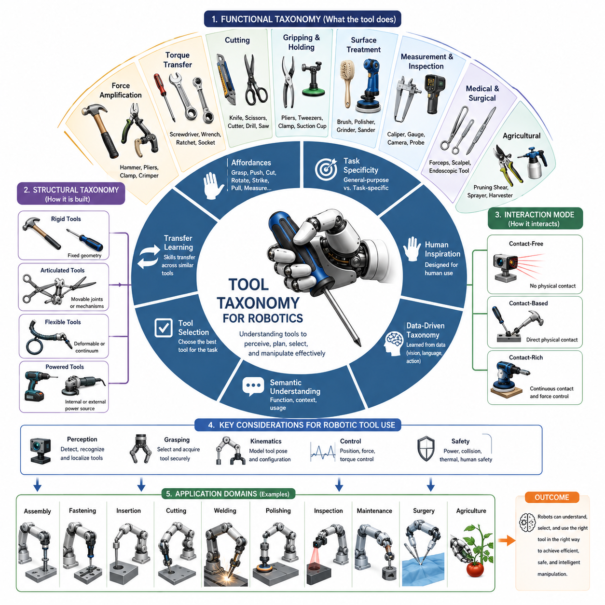{width="7.268055555555556in" height="7.268055555555556in"}

도구 분류 체계(Tool Taxonomy)는 도구를 물리적 구조, 기능적 목적, 상호작용 특성, 조작 요구사항 등에 따라 체계적으로 분류하는 방법을 의미한다. 로봇공학에서는 이러한 분류 체계가 인지(Perception), 파지 계획(Grasp Planning), 작업 계획(Task Planning), 조작 학습(Manipulation Learning), 조립 자동화(Assembly Automation), 그리고 체화 인공지능(Embodied AI)의 기반이 된다. 인간은 경험을 통해 망치와 드라이버가 서로 다른 목적을 가진 도구라는 사실을 자연스럽게 이해한다. 로봇 역시 도구를 체계적으로 분류할 수 있어야 기능을 추론하고, 적절한 조작 전략을 선택하며, 새로운 도구에 대해서도 기존 지식을 활용할 수 있다.

최근 정교한 로봇 핸드(Dexterous Hand), 모바일 매니퓰레이터(Mobile Manipulator), 파운데이션 모델(Foundation Model), 체화 AI(Embodied AI)가 발전하면서 도구 분류 체계의 중요성은 더욱 커지고 있다. 과거 산업용 로봇은 제한된 종류의 도구만 사용했지만, 미래의 로봇은 다양한 환경에서 수많은 종류의 도구를 인식하고 활용해야 한다. 도구 분류 체계는 이러한 상황에서 로봇이 도구의 기능적 특성을 이해하고 적절한 행동을 선택할 수 있도록 지원한다.

로봇공학에서 도구는 로봇이 환경과 상호작용하는 능력을 확장하기 위해 사용하는 외부 물체로 정의할 수 있다. 도구는 힘을 증폭시키고, 작업 범위를 넓히며, 정밀도를 향상시키고, 새로운 형태의 상호작용을 가능하게 한다. 일반적인 물체와 달리 도구는 기능적 목적을 가지고 있으며, 단순히 이동시키는 것이 아니라 실제 작업 수행을 위해 사용된다.

가장 기본적인 분류 방식은 기능(Function)에 따른 분류이다. 이는 인간이 도구를 이해하는 방식과 가장 유사하다.

힘 증폭 도구(Force Amplification Tools)는 외부 대상에 더 큰 힘을 전달하기 위해 사용된다. 망치(Hammer), 플라이어(Pliers), 너트 크래커(Nutcracker), 클램프(Clamp), 압착기(Crimping Tool) 등이 여기에 속한다. 이러한 도구를 사용하는 로봇은 충격과 힘 전달을 정밀하게 제어해야 한다.

토크 전달 도구(Torque Transfer Tools)는 회전력을 전달하기 위한 도구이다. 드라이버(Screwdriver), 렌치(Wrench), 라쳇(Ratchet), 소켓 렌치(Socket Wrench), 육각렌치(Allen Key)가 대표적이다. 산업 현장의 체결(Fastening) 작업 대부분이 이 범주에 속하기 때문에 매우 중요한 도구 그룹으로 간주된다.

절단 도구(Cutting Tools)는 재료를 제거하거나 분리하는 목적으로 사용된다. 칼(Knife), 가위(Scissors), 와이어 커터(Wire Cutter), 드릴(Drill), 톱(Saw), 전단기(Shear) 등이 포함된다. 절단 작업에서는 재료 특성에 따라 힘과 경로를 정밀하게 제어해야 하므로 높은 수준의 조작 능력이 요구된다.

그립 및 고정 도구(Gripping and Holding Tools)는 다른 물체를 잡고 유지하기 위한 기능을 수행한다. 플라이어, 핀셋(Tweezers), 포셉(Forceps), 클램프, 흡착 컵(Suction Cup), 자석형 그리퍼(Magnetic Gripper) 등이 여기에 속한다. 로봇은 도구 자체를 잡는 동시에 도구의 작동까지 제어해야 하므로 복합적인 조작이 필요하다.

표면 처리 도구(Surface Treatment Tools)는 브러시, 연마 패드, 그라인더, 샌더(Sander), 도장 장비(Paint Sprayer), 청소 도구 등을 포함한다. 이러한 도구는 지속적인 접촉을 유지하면서 일정한 힘과 속도를 유지하는 것이 중요하다.

측정 및 검사 도구(Measurement and Inspection Tools)는 환경 정보를 수집하는 역할을 수행한다. 버니어 캘리퍼스(Caliper), 게이지(Gauge), 프로브(Probe), 레이저 스캐너(Laser Scanner), 열화상 카메라(Thermal Camera), 초음파 센서(Ultrasonic Sensor) 등이 대표적이다. 이러한 도구는 힘보다 위치 정확성과 안정성이 중요하다.

의료 및 수술 도구(Medical and Surgical Tools)는 매우 높은 정밀성과 안전성을 요구한다. 수술용 포셉, 메스(Scalpel), 내시경 기구, 바늘 집게(Needle Driver), 전기 소작 장치(Cauterization Tool) 등이 포함된다. 의료 로봇은 엄격한 규제와 높은 정확도 기준을 충족해야 한다.

농업용 도구(Agricultural Tools)는 최근 로봇 연구에서 빠르게 성장하는 분야이다. 가지치기 가위(Pruning Shear), 수확용 절단기(Harvesting Cutter), 굴착 도구(Digging Tool), 수분 장치(Pollination Tool), 분무 장비(Spraying Tool) 등이 있다. 농업 환경은 자연 환경의 불확실성이 크기 때문에 적응형 조작 기술이 중요하다.

도구는 운동학적 구조(Kinematic Structure)에 따라서도 분류할 수 있다.

강체 도구(Rigid Tools)는 작업 중 형상이 변하지 않는다. 망치, 드라이버, 렌치, 끌(Chisel) 등이 대표적이다. 모델링과 제어가 상대적으로 단순하다.

관절형 도구(Articulated Tools)는 내부에 움직이는 기구를 포함한다. 가위, 플라이어, 집게(Tongs), 볼트 커터(Bolt Cutter), 조절식 렌치(Adjustable Wrench) 등이 여기에 속한다. 로봇은 도구의 위치뿐 아니라 내부 관절 상태도 제어해야 한다.

유연 도구(Flexible Tools)는 가장 어려운 조작 대상 중 하나이다. 케이블, 호스(Hose), 로프(Rope), 브러시, 채찍(Whip), 유연 의료 기구 등이 대표적이다. 형태가 지속적으로 변하기 때문에 실시간 형상 추정이 필요하다.

전동 도구(Powered Tools)는 내부 또는 외부 에너지원을 사용한다. 전동 드릴(Electric Drill), 전동 드라이버, 그라인더, 용접 토치(Welding Torch), 공압 장치(Pneumatic Tool) 등이 포함된다. 이러한 도구는 전원 제어, 진동 관리, 발열, 안전성까지 고려해야 한다.

도구는 환경과의 상호작용 방식에 따라서도 분류된다.

비접촉 도구(Contact-Free Tools)는 직접 접촉 없이 작업을 수행한다. 레이저 절단기(Laser Cutter), 프로젝터(Projector), 열화상 카메라, 광학 스캐너 등이 여기에 속한다. 정확한 위치 제어가 핵심이다.

접촉 도구(Contact-Based Tools)는 대부분의 산업용 도구가 해당된다. 힘 전달과 마찰, 접촉 상태 관리가 중요하다.

접촉 중심 도구(Contact-Rich Tools)는 연마기, 용접 토치, 드라이버, 삽입 도구, 그라인더와 같이 지속적인 접촉 상태에서 작업이 이루어진다. 이 경우 힘 제어와 위치 제어를 동시에 수행해야 한다.

최근에는 어포던스(Affordance) 기반 분류가 중요해지고 있다. 어포던스는 물체가 제공하는 행동 가능성을 의미한다. 손잡이는 파지를 제공하고, 칼날은 절단을 제공하며, 망치 머리는 타격 기능을 제공한다. 이러한 기능 중심 표현은 외형이 다른 도구 간에도 공통된 특성을 발견할 수 있게 해준다.

예를 들어 일반 드라이버, 전동 드라이버, 산업용 토크 드라이버는 외형은 다르지만 모두 회전 토크 전달이라는 동일한 기능을 수행한다. 로봇은 이러한 공통 기능을 이해함으로써 새로운 도구에 대해서도 학습된 기술을 적용할 수 있다.

또 다른 중요한 분류 기준은 작업 특화 정도(Task Specificity)이다.

범용 도구(General-Purpose Tools)는 다양한 작업에 사용될 수 있다. 망치, 플라이어, 드라이버, 칼 등이 대표적이다. 이러한 도구는 인간 환경에서 가장 자주 등장한다.

특수 목적 도구(Task-Specific Tools)는 특정 작업에 최적화되어 있다. 토크 렌치(Torque Wrench), 의료 생검 도구(Biopsy Tool), 반도체 핸들링 장치, 항공기 검사 장비 등이 여기에 속한다. 이러한 도구는 전문적인 지식과 특화된 조작 기술을 요구한다.

휴머노이드 로봇(Humanoid Robot)의 발전과 함께 인간 중심 분류(Human-Inspired Taxonomy)도 중요해지고 있다. 대부분의 도구는 인간 손을 기준으로 설계되었기 때문에 손가락 구조, 손목 운동 범위, 파지 방식 등에 대한 이해가 필요하다. 로봇은 인간용 도구가 어떤 전제를 기반으로 설계되었는지 이해해야 효율적으로 사용할 수 있다.

최근 머신러닝(Machine Learning)은 데이터 기반 도구 분류(Data-Driven Tool Taxonomy)를 가능하게 만들고 있다. 과거에는 사람이 직접 도구 범주를 정의했지만, 현재는 딥러닝 모델이 대규모 데이터를 분석하여 스스로 도구 간의 관계를 학습한다. 이러한 방식은 인간이 쉽게 발견하지 못하는 기능적 유사성을 찾아낼 수 있다.

파운데이션 모델과 비전-언어-행동 모델(Vision-Language-Action Model)은 이러한 개념을 더욱 발전시키고 있다. 로봇은 이미지, 텍스트, 비디오를 학습하여 가위는 자르기 위한 도구이고, 브러시는 청소를 위한 도구이며, 드라이버는 체결을 위한 도구라는 의미적 관계를 이해할 수 있다. 이러한 능력은 더욱 유연한 추론과 일반화를 가능하게 한다.

도구 분류 체계는 자율 도구 선택(Autonomous Tool Selection)에도 중요한 역할을 한다. 여러 개의 도구가 존재할 때 로봇은 작업 목표에 가장 적합한 도구를 선택해야 한다. 예를 들어 전자 부품 조립에서는 플라이어보다 정밀 핀셋이 적합하며, 좁은 공간의 정비 작업에서는 일반 렌치보다 라쳇 렌치가 더 효율적일 수 있다.

또한 도구 분류 체계는 전이 학습(Transfer Learning)을 지원한다. 하나의 드라이버 사용법을 학습한 로봇은 다른 드라이버도 빠르게 사용할 수 있다. 마찬가지로 특정 절단 도구에 대한 경험은 다른 절단 도구 학습에도 활용될 수 있다.

성능 평가(Benchmarking)에서도 도구 분류 체계는 중요한 역할을 한다. 연구자들은 다양한 도구 범주를 포함한 벤치마크를 통해 로봇의 일반화 능력을 평가한다. 성공률, 작업 시간, 힘 제어 품질, 도구 획득 시간, 적응 능력 등이 주요 평가 지표로 사용된다.

그러나 실제 환경의 도구는 종종 여러 범주를 동시에 포함한다. 전동 드라이버는 토크 전달 도구이면서 전동 도구이기도 하다. 수술 기구는 절단, 파지, 측정 기능을 동시에 수행할 수 있다. 따라서 미래의 도구 분류 체계는 단순한 고정 분류가 아니라 계층적(Hierarchical)이고 동적인(Dynamic) 구조로 발전할 가능성이 높다.

미래의 로봇은 단순히 특정 범주에 속한 도구를 인식하는 수준을 넘어, 그 도구가 언제 사용되어야 하는지, 어떤 작업에 적합한지, 어떤 환경에서 최상의 성능을 발휘하는지까지 이해하게 될 것이다. 결국 도구 분류 체계는 인지와 행동을 연결하는 핵심 지식 구조이며, 범용 로봇 조작(General-Purpose Manipulation)과 체화 지능(Embodied Intelligence)을 실현하기 위한 필수 기반 기술이라고 할 수 있다.

## 13.03 Tool Detection and Localization

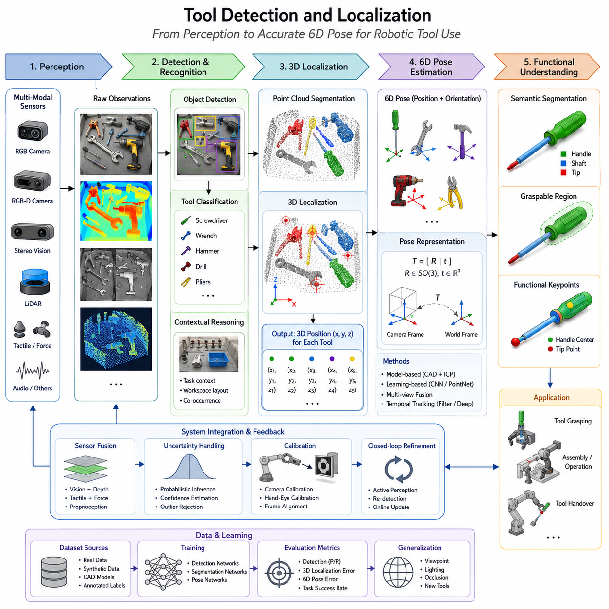{width="7.268055555555556in" height="7.268055555555556in"}

도구 검출 및 위치 추정(Tool Detection and Localization)은 로봇의 도구 사용(Robot Tool Use)과 자동 조립(Automated Assembly)을 구현하기 위한 가장 기본적이면서도 핵심적인 기술이다. 로봇이 드라이버, 렌치, 해머, 드릴, 커터 또는 다양한 산업용 특수 공구를 성공적으로 사용하기 위해서는 먼저 해당 도구의 존재를 인식하고, 종류를 식별하며, 위치와 자세를 추정하고, 기능적 구조를 이해하며, 로봇 좌표계 내에서 정확하게 위치를 계산할 수 있어야 한다. 실제 산업 환경에서는 도구 검출 단계에서 발생한 작은 오차가 이후의 그리핑(Grasping), 조작(Manipulation), 삽입(Insertion), 조립(Assembly) 단계로 누적되면서 전체 작업 실패의 주요 원인이 되는 경우가 많다. 따라서 도구 검출 및 위치 추정은 고차원적인 도구 사용 지능의 기반이 되는 핵심 기술이라 할 수 있다. 이는 Robot Hand and Dexterous Grasping 볼륨의 Tool Use and Assembly 분야에서 시각 인지(Perception)와 실제 물리적 조작(Physical Interaction)을 연결하는 중요한 역할을 수행한다.

일반적인 물체 인식(Object Detection)과 비교하면 도구 검출은 여러 가지 고유한 어려움을 가진다. 산업용 도구는 길쭉한 형태를 가지는 경우가 많고, 금속 재질로 인한 반사 특성이 강하며, 일부가 가려져 있거나(Occlusion), 교체 가능한 부품을 포함하기도 한다. 또한 서로 다른 모델이 매우 유사한 외형을 가지는 경우도 많다. 예를 들어 렌치는 크기만 다르고 형태는 거의 동일할 수 있으며, 드라이버 역시 끝부분만 다르고 손잡이는 매우 비슷한 구조를 가진다. 전동 공구는 액세서리의 부착 여부에 따라 외형이 달라질 수 있다. 이러한 이유로 도구 검출은 단순한 이미지 분류(Image Classification)가 아니라 물체 인식, 기하학적 분석, 자세 추정(Pose Estimation), 상황 이해(Context Understanding)를 통합적으로 수행해야 한다.

도구 위치 추정의 첫 번째 단계는 도구 인식(Tool Recognition)이다. 인식은 특정 물체가 어떤 종류의 도구인지를 판단하는 과정이다. 초기 연구에서는 SIFT, SURF, ORB, 에지(Edge) 특징, 형상 매칭(Template Matching)과 같은 수작업 특징(Handcrafted Features)이 주로 사용되었다. 이러한 방법은 제한된 환경에서는 효과적이었지만 시점 변화, 조명 변화, 부분 가림, 금속 반사 등에 취약했다. 최근에는 대규모 데이터 기반의 딥러닝(Deep Learning) 기술이 이러한 한계를 크게 극복하였다.

합성곱 신경망(Convolutional Neural Network, CNN)을 기반으로 한 객체 검출기는 도구 인식 성능을 크게 향상시켰다. Faster R-CNN, YOLO, SSD, RetinaNet, DETR 등의 네트워크는 여러 종류의 도구를 동시에 인식하면서도 실시간 처리 속도를 제공한다. 이러한 모델들은 손잡이(Handle), 조(Jaw), 축(Shaft), 블레이드(Blade), 트리거(Trigger) 등 도구를 특징짓는 구조를 학습한다. 충분한 학습 데이터가 제공되면 로봇은 다양한 산업 환경에서도 높은 정확도로 도구를 인식할 수 있다. 특히 십자 드라이버(Phillips Screwdriver), 일자 드라이버(Flat-head Screwdriver), 육각 드라이버(Hex Driver), 토크 드라이버(Torque Driver)와 같이 외형이 매우 유사한 도구들을 구별하는 능력이 중요하다.

도구 사용에서는 단순히 종류를 인식하는 것만으로는 충분하지 않다. 로봇은 도구의 위치를 정확하게 알아야 한다. 위치 추정(Localization)은 도구가 로봇에 대해 어디에 존재하는지를 계산하는 과정이다. 2차원 위치 추정은 이미지 내의 픽셀 좌표를 의미하고, 3차원 위치 추정은 실제 공간상의 물리적 좌표를 의미한다. 대부분의 산업용 조작 작업은 3차원 위치 정보가 필요하므로 위치 추정 시스템은 카메라 보정(Camera Calibration), 깊이 측정(Depth Sensing), 3차원 복원(3D Reconstruction), 좌표 변환(Coordinate Transformation)을 포함하게 된다.

RGB 카메라는 가장 기본적인 도구 위치 추정 센서이다. 객체 검출기를 이용하면 이미지 상에서 도구의 위치를 찾을 수 있다. 하지만 RGB 영상만으로는 깊이 정보를 얻을 수 없기 때문에 실제 로봇 그리핑에는 한계가 있다. 이를 해결하기 위해 RGB-D 카메라가 널리 사용된다. RGB-D 센서는 색상 영상과 깊이 정보를 동시에 제공하며, 이를 통해 물체의 3차원 좌표를 계산할 수 있다. 각 픽셀에 깊이 값을 결합하면 도구의 중심 위치, 표면 구조, 그리핑 가능한 영역 등을 추정할 수 있다.

스테레오 비전(Stereo Vision)은 또 다른 3차원 위치 추정 방법이다. 두 개의 카메라를 이용하여 동일한 물체를 서로 다른 시점에서 관찰하고 삼각측량(Triangulation)을 통해 깊이를 계산한다. 스테레오 시스템은 비교적 넓은 작업 공간에서도 활용할 수 있으며, 정밀하게 보정된 경우 밀리미터 수준의 정확도를 제공할 수 있다.

LiDAR 기반 위치 추정 역시 대규모 산업 환경에서 활용되고 있다. LiDAR는 카메라보다 해상도는 낮지만 조명 변화에 영향을 덜 받으며 안정적인 거리 측정을 제공한다. 특히 카메라와 LiDAR를 결합한 센서 융합(Sensor Fusion)은 대형 작업장, 창고, 야외 유지보수 환경에서 강력한 위치 추정 성능을 제공한다.

현대의 도구 위치 추정에서는 포인트 클라우드(Point Cloud) 처리가 중요한 역할을 한다. 깊이 정보를 이용하면 작업 환경의 3차원 포인트 클라우드를 생성할 수 있으며, 이후 분할(Segmentation)을 통해 도구와 배경을 분리한다. 표면 법선(Surface Normal), 곡률(Curvature), 형상 히스토그램(Shape Histogram) 등의 기하학적 특징은 도구 영역을 식별하는 데 활용된다. 최근에는 포인트 클라우드를 직접 처리하는 딥러닝 네트워크가 등장하면서 복잡한 환경에서도 높은 성능을 달성하고 있다.

도구 사용에서 특히 중요한 기술은 6자유도 자세 추정(6D Pose Estimation)이다. 단순히 위치만 아는 것으로는 충분하지 않다. 로봇은 도구가 어떤 방향으로 놓여 있는지까지 이해해야 한다. 6D 자세 추정은 X, Y, Z 위치뿐 아니라 Roll, Pitch, Yaw 회전 정보를 함께 계산한다. 예를 들어 동일한 드라이버라도 수평으로 놓여 있는 경우와 수직으로 세워져 있는 경우는 완전히 다른 그리핑 전략이 필요하다. 정확한 자세 정보는 성공적인 조작의 필수 조건이다.

모델 기반 자세 추정(Model-Based Pose Estimation)은 CAD 모델을 활용한다. 관측된 센서 데이터와 CAD 모델을 정합(Registration)하여 최적의 자세를 계산한다. 대표적으로 ICP(Iterative Closest Point) 알고리즘이 사용되어 왔다. CAD 모델이 정확하게 제공될 경우 매우 높은 정밀도를 달성할 수 있다.

최근에는 학습 기반 자세 추정(Learning-Based Pose Estimation)이 빠르게 발전하고 있다. 딥러닝 모델은 이미지나 포인트 클라우드로부터 직접 자세를 예측한다. 이러한 방법은 다양한 시점 변화, 조명 변화, 배경 변화에 대해 높은 강인성을 보이며 실시간 동작도 가능하다.

도구가 부분적으로 가려진 경우에는 위치 추정이 훨씬 어려워진다. 실제 산업 환경에서는 여러 도구가 겹쳐 놓여 있거나 일부가 다른 물체 아래에 숨겨져 있는 경우가 많다. 이를 해결하기 위해 다중 시점 인식(Multi-view Perception), 확률적 추론(Probabilistic Inference), 형상 복원(Shape Completion) 기술이 사용된다. 여러 시점의 정보를 결합하면 보이지 않는 부분까지 추정하여 보다 정확한 위치를 계산할 수 있다.

도구 위치 추정에서 또 하나의 중요한 요소는 기능 영역 인식(Functional Localization)이다. 도구는 단순한 물체가 아니라 특정 기능을 수행하기 위한 구조를 가진다. 드라이버는 손잡이와 팁(Tip)을 가지며, 렌치는 손잡이와 조(Jaw)를 가진다. 로봇은 어느 부분을 잡아야 하고 어느 부분을 작업에 사용해야 하는지를 구분해야 한다. 예를 들어 드라이버의 팁을 잡으면 나사를 조일 수 없기 때문에 기능 영역을 이해하는 것이 중요하다.

이를 위해 의미론적 분할(Semantic Segmentation)이 활용된다. 픽셀 단위로 도구의 각 영역을 분류하여 손잡이, 작업부, 연결부 등을 구분할 수 있다. 이를 통해 로봇은 작업에 방해되지 않는 최적의 그리핑 위치를 선택할 수 있다.

인간은 도구를 인식할 때 단순히 외형만 보지 않는다. 작업 환경과 주변 맥락(Context)을 함께 고려한다. 현대 로봇 역시 이러한 상황 정보를 활용하기 시작했다. 예를 들어 나사 트레이 근처에 있는 물체는 드라이버일 가능성이 높으며, 용접 작업장 근처에서는 특정 공구가 사용될 확률이 높다. 이러한 문맥 정보는 시각적 정보만으로는 구분하기 어려운 경우에 인식 성능을 향상시킨다.

최근의 파운데이션 모델(Foundation Model)과 비전-언어 모델(Vision-Language Model)은 도구 검출 분야에 큰 변화를 가져오고 있다. 이러한 모델은 학습 시 보지 못한 새로운 도구도 자연어 설명만으로 인식할 수 있다. 예를 들어 사용자가 "조절식 렌치를 가져와라" 또는 "토크 드라이버를 찾아라"라고 지시하면, 로봇은 해당 도구를 탐색하고 위치를 추정할 수 있다. 이는 오픈 보캐뷸러리(Open Vocabulary) 인식의 대표적인 사례이다.

다중 모달 인식(Multi-modal Perception)도 중요한 발전 방향이다. 시각 정보뿐 아니라 촉각(Tactile), 힘(Force), 음향(Audio), 고유 감각(Proprioception)을 함께 활용할 수 있다. 예를 들어 시각적으로 위치 추정이 불확실한 경우 촉각 센서가 실제 접촉 위치를 보정할 수 있다. 이러한 센서 융합은 실제 환경에서 높은 신뢰성을 제공한다.

도구 추적(Tool Tracking)은 위치 추정을 시간 축으로 확장한 개념이다. 도구가 이동하거나 사람과 로봇 사이에서 전달되는 경우, 로봇은 지속적으로 도구의 자세를 추적해야 한다. 이를 위해 칼만 필터(Kalman Filter), 파티클 필터(Particle Filter), 베이지안 추정(Bayesian Estimation), 딥러닝 기반 추적 네트워크가 사용된다.

정확한 위치 추정을 위해서는 보정(Calibration)이 필수적이다. 카메라 보정(Camera Calibration), Hand-Eye Calibration, 센서 동기화(Sensor Synchronization), 좌표계 정렬(Frame Alignment)이 정확해야만 높은 위치 추정 성능을 얻을 수 있다. 아무리 우수한 인식 알고리즘이라도 보정 오차가 크면 전체 시스템 성능이 크게 저하된다.

최근에는 시뮬레이션(Simulation)을 이용한 데이터 생성도 활발히 사용된다. 가상 환경에서 수많은 도구와 다양한 환경 조건을 생성하여 학습 데이터를 확보할 수 있다. Domain Randomization과 Sim-to-Real Transfer 기술은 실제 환경에서도 높은 일반화 성능을 제공한다.

도구 검출 시스템의 성능 평가는 검출 정확도(Precision), 재현율(Recall), 위치 오차(Localization Error), 자세 오차(Pose Error), 가림(Occlusion)에 대한 강인성, 처리 지연 시간(Latency), 최종 작업 성공률(Task Success Rate) 등을 기준으로 수행된다. 산업용 조립에서는 밀리미터 수준의 위치 정확도와 1도 이하의 자세 정확도가 요구되는 경우도 많다.

미래의 도구 검출 및 위치 추정 시스템은 객체 검출, 자세 추정, 기능 이해, 작업 추론, 조작 계획을 하나의 통합 프레임워크 안에서 수행하는 방향으로 발전할 것으로 예상된다. 파운데이션 모델, 월드 모델(World Model), 임바디드 AI(Embodied AI)는 로봇이 단순히 도구의 위치만 이해하는 것이 아니라 그 도구를 왜 사용해야 하는지, 어떻게 사용해야 하는지, 어떤 결과를 만들어낼 수 있는지까지 이해하도록 발전시킬 것이다. 이러한 기술은 제조업, 물류, 유지보수, 건설, 의료, 서비스 로봇 분야에서 차세대 지능형 조작 시스템의 핵심 기반이 될 것이며, 도구 검출 및 위치 추정은 그 중심 기술로 계속해서 중요한 역할을 수행할 것이다.

## 13.04 Tool Grasp Planning

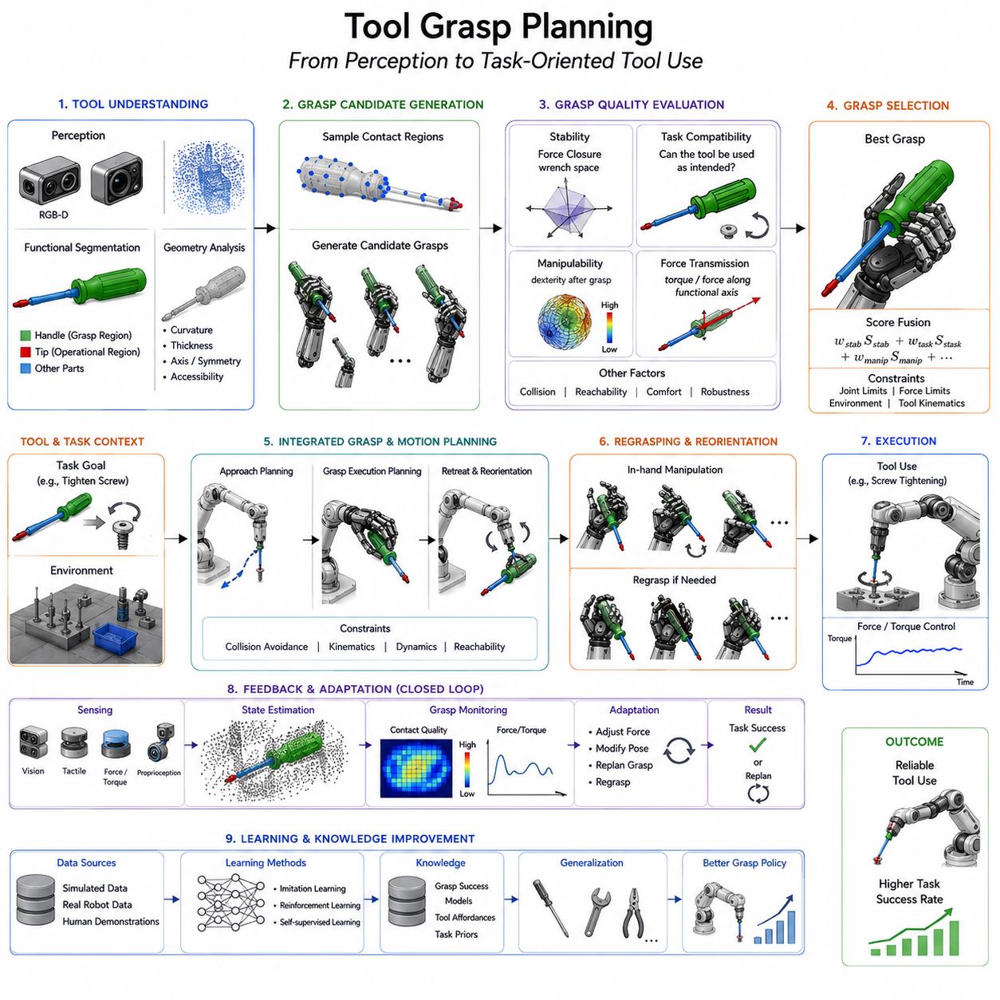{width="7.268055555555556in" height="7.268055555555556in"}

도구 그립 계획(Tool Grasp Planning)은 로봇이 특정 도구를 어떻게 파지(Grasp)해야 이후의 작업을 성공적으로 수행할 수 있는지를 결정하는 과정이다. 일반적인 물체 파지(Object Grasping)의 목적이 물체를 안정적으로 집고 이동시키는 것이라면, 도구 그립 계획은 단순한 안정성뿐 아니라 도구의 기능(Functionality)까지 고려해야 한다는 점에서 본질적으로 다르다. 성공적인 도구 파지는 도구의 형상(Geometry), 사용 목적(Task Objective), 접촉 역학(Contact Mechanics), 환경과의 상호작용(Environment Interaction), 그리고 이후 수행될 작업 순서(Task Sequence)까지 종합적으로 고려해야 한다. 따라서 도구 그립 계획은 인지(Perception), 조작(Manipulation), 파지 이론(Grasp Theory), 모션 계획(Motion Planning), 작업 계획(Task Planning), 그리고 임바디드 인공지능(Embodied Intelligence)이 만나는 핵심 분야라 할 수 있다. Robot Hand and Dexterous Grasping의 Tool Use and Assembly 영역에서 도구 그립 계획은 도구 인식과 실제 작업 수행을 연결하는 가장 중요한 연결고리 역할을 수행한다.

도구 그립 계획의 가장 큰 특징은 "잡기 좋은 위치"와 "사용하기 좋은 위치"가 반드시 같지 않다는 점이다. 해머를 예로 들면 해머 머리 부분을 잡는 것이 순간적으로는 안정적일 수 있지만, 그렇게 잡으면 못을 박는 기능을 수행할 수 없다. 반대로 손잡이를 잡으면 해머를 정상적으로 사용할 수 있지만 무게 중심과 힘 전달 측면에서 다른 문제를 고려해야 한다. 이러한 현상은 드라이버, 렌치, 플라이어, 드릴, 가위 등 거의 모든 도구에서 동일하게 나타난다. 따라서 도구 그립 계획은 항상 "어떻게 사용할 것인가"를 고려해야 한다.

전통적인 로봇 파지 연구는 주로 Force Closure(힘 폐쇄)와 Form Closure(형상 폐쇄)에 집중해 왔다. Force Closure는 외부 힘이 가해져도 물체를 안정적으로 유지할 수 있는 능력을 의미하며, Form Closure는 기하학적 제약만으로 물체를 움직이지 못하게 만드는 상태를 의미한다. 이러한 개념은 여전히 중요하지만, 도구 사용이라는 관점에서는 충분하지 않다. 왜냐하면 이들은 물체를 얼마나 안정적으로 잡을 수 있는지만 평가할 뿐, 그 물체를 실제로 사용할 수 있는지는 고려하지 않기 때문이다. 이 때문에 최근에는 Task-Oriented Grasping(작업 지향 파지)이라는 개념이 중요하게 다루어지고 있다.

작업 지향 파지는 단순히 안정적인 파지를 찾는 것이 아니라 작업 성공 가능성을 최대화하는 파지를 찾는 것을 목표로 한다. 예를 들어 드라이버는 나사를 조이기 위해 충분한 토크(Torque)를 전달할 수 있어야 하고, 렌치는 볼트를 회전시킬 수 있는 레버리지(Leverage)를 확보해야 한다. 페인트 브러시는 부드러운 궤적을 따라 움직일 수 있어야 한다. 따라서 좋은 파지란 단순히 떨어지지 않는 파지가 아니라 작업을 가장 잘 수행할 수 있는 파지를 의미한다.

이를 위해서는 먼저 도구에 대한 이해(Tool Understanding)가 필요하다. 대부분의 도구는 파지 영역(Grasp Region)과 작업 영역(Operational Region)으로 나눌 수 있다. 드라이버는 손잡이가 파지 영역이고 팁(Tip)이 작업 영역이다. 플라이어는 손잡이가 파지 영역이며 조(Jaw)가 작업 영역이다. 로봇은 이 둘을 명확히 구분할 수 있어야 한다.

최근에는 기능적 분할(Functional Segmentation)이 이러한 문제를 해결하는 중요한 기술로 발전하고 있다. 의미론적 분할(Semantic Segmentation)을 통해 도구의 각 부분을 손잡이, 팁, 블레이드, 조, 트리거 등의 기능 단위로 분류할 수 있다. 이렇게 기능 구조를 이해하면 로봇은 어디를 잡아야 하고 어디를 사용해야 하는지를 쉽게 판단할 수 있다.

기하학적 분석(Geometric Analysis) 역시 중요한 역할을 수행한다. 도구의 손잡이는 일반적으로 길고 원통형 구조를 가지며, 사람이 잡기 편하도록 설계되어 있다. 반면 작업 영역은 날카로운 부분이나 정밀한 접촉 면을 포함하는 경우가 많다. 곡률(Curvature), 두께(Thickness), 대칭성(Symmetry), 접근 가능성(Accessibility), 표면 방향(Surface Orientation) 등의 기하학적 특징은 파지 후보를 찾는 데 중요한 단서가 된다.

실제 계획 과정은 파지 후보 생성(Grasp Candidate Generation)으로 시작된다. 파지 후보란 로봇 손과 도구 사이의 가능한 접촉 구성을 의미한다. 알고리즘은 도구 표면을 탐색하여 안정적인 접촉이 가능한 위치를 찾는다. 단순한 평행 그리퍼(Parallel Jaw Gripper)의 경우 두 개의 대향 표면을 찾는 것으로 충분할 수 있지만, 다지형 로봇 핸드(Multifinger Hand)의 경우 손가락 배치와 접촉 분포를 동시에 고려해야 하므로 훨씬 복잡해진다.

전통적으로는 샘플링 기반(Sampling-Based) 방법이 널리 사용되었다. 이러한 방법은 표면 위의 접촉점을 무작위로 선택하고 각 파지의 품질을 평가한다. 하지만 복잡한 도구에서는 계산량이 매우 커질 수 있다. 이를 개선하기 위해 손잡이와 같이 파지 가능성이 높은 영역을 우선적으로 탐색하는 기하학적 휴리스틱(Geometric Heuristic)이 활용된다.

최적화 기반 파지 계획(Optimization-Based Grasp Planning)은 파지 문제를 수학적 최적화 문제로 정의한다. 시스템은 안정성, 힘 전달 효율, 조작성(Manipulability), 충돌 회피(Collision Avoidance), 작업 적합성(Task Compatibility) 등을 동시에 고려하여 최적의 파지를 탐색한다. 이러한 접근은 체계적으로 고품질 해를 찾을 수 있다는 장점을 가진다.

파지 품질 평가(Grasp Quality Evaluation)는 계획 과정의 핵심 요소이다. 전통적인 평가 지표는 Force Closure와 외란 저항 능력을 평가했지만, 도구 사용에서는 작업 성능까지 고려해야 한다. 따라서 최근에는 안정성과 기능성을 동시에 평가하는 복합 지표(Hybrid Metric)가 사용된다.

조작성(Manipulability)은 도구 파지에서 매우 중요한 개념이다. 조작성은 로봇이 파지 후 원하는 방향으로 도구를 움직이고 힘을 전달할 수 있는 능력을 의미한다. 어떤 파지는 매우 안정적일 수 있지만 자세 변경이 어렵고, 또 다른 파지는 약간 덜 안정적이지만 훨씬 자유로운 움직임을 제공할 수 있다. 도구 사용은 종종 큰 자세 변화와 정밀한 위치 조정을 요구하므로 조작성은 매우 중요한 평가 요소가 된다.

접촉 역학(Contact Mechanics) 역시 파지 계획에 큰 영향을 미친다. 무거운 도구는 높은 마찰력을 필요로 하고, 정밀 도구는 지나친 힘을 가하면 변형이나 정렬 오차가 발생할 수 있다. 따라서 로봇은 손가락과 도구 사이의 접촉 특성을 이해해야 한다.

플라이어, 가위, 조절식 렌치, 전동 공구와 같이 가동 부품을 가진 도구는 더욱 복잡한 문제를 제기한다. 이러한 도구들은 사용 과정에서 형상이 변화한다. 따라서 로봇은 자신의 파지가 도구의 동작을 방해하지 않는지 고려해야 하며, 경우에 따라 작업 도중 파지 위치를 변경해야 할 수도 있다.

환경(Context) 또한 중요한 요소이다. 실제 작업 환경에서는 도구가 단독으로 존재하는 경우가 거의 없다. 공구함, 선반, 작업대 등 복잡한 환경 속에 놓여 있으며 주변 물체가 접근 방향을 제한할 수 있다. 따라서 파지 계획은 항상 충돌 회피와 접근 가능성을 함께 고려해야 한다.

모션 계획(Motion Planning)과 파지 계획은 밀접하게 연결되어 있다. 아무리 좋은 파지라도 로봇 팔이 해당 위치에 도달할 수 없다면 의미가 없다. 따라서 최근 시스템은 파지와 궤적을 동시에 최적화하는 통합 계획(Integrated Grasp-Motion Planning)을 채택하고 있다.

도구 재배향(Tool Reorientation)도 중요한 문제이다. 도구는 원하는 자세로 놓여 있는 경우가 드물다. 따라서 로봇은 도구를 집은 뒤 회전시키거나 재배치해야 하는 경우가 많다. 이를 위해 재파지(Regrasping) 전략이 활용된다. 재파지는 작업 도중 파지 방식을 변경하여 원하는 최종 자세를 얻는 기술이다. 고성능 다지형 로봇 핸드는 물체를 내려놓지 않고 손 안에서 재배향하는 In-Hand Manipulation까지 수행할 수 있다.

최근에는 학습 기반(Learning-Based) 방법이 도구 파지 분야를 크게 변화시키고 있다. 대규모 데이터셋을 이용하여 성공적인 파지와 실패한 파지를 학습함으로써 신경망이 직접 파지 품질을 예측할 수 있다. 이러한 방법은 복잡한 환경에서 기존 규칙 기반 방법보다 우수한 성능을 보이는 경우가 많다.

행동 모방 학습(Behavior Cloning)은 인간 전문가의 시연을 관찰하고 이를 모방하는 방식이다. 사람의 도구 사용 방식을 학습함으로써 로봇은 작업 목적에 맞는 파지를 자연스럽게 습득할 수 있다.

강화학습(Reinforcement Learning)은 시행착오를 통해 최적의 파지 정책을 학습한다. 성공적인 작업에는 보상을 부여하고 실패에는 패널티를 부여함으로써 장기적으로 가장 효과적인 파지 전략을 발견한다. 특히 복잡한 도구 사용 작업에서 매우 강력한 접근법으로 평가받고 있다.

시뮬레이션(Simulation)은 학습 기반 파지 시스템 개발에 필수적인 도구가 되었다. 가상 환경에서는 수백만 번의 파지 실험을 수행할 수 있으며, Domain Randomization과 Sim-to-Real Transfer 기술을 통해 실제 환경에서도 높은 성능을 유지할 수 있다.

최근 등장한 파운데이션 모델(Foundation Model)과 비전-언어-행동 모델(Vision-Language-Action Model)은 도구 파지 계획의 새로운 가능성을 열고 있다. 사용자가 "드라이버를 집어서 나사를 조여라"와 같은 자연어 명령을 내리면, 시스템은 도구의 기능을 이해하고 적절한 파지를 자동으로 생성할 수 있다.

오픈 보캐뷸러리(Open Vocabulary) 파지 계획은 학습되지 않은 새로운 도구에도 대응할 수 있도록 한다. 기존 시스템은 미리 정의된 도구만 다룰 수 있었지만, 최신 시스템은 시각적 유사성과 언어적 설명을 바탕으로 새로운 도구에도 적응할 수 있다.

다중 모달 센싱(Multi-modal Sensing)은 신뢰성을 더욱 향상시킨다. 시각 센서는 형상과 의미를 제공하고, 촉각 센서는 접촉 품질을 알려주며, 힘 센서는 실제 상호작용 힘을 측정한다. 관절 센서는 손의 상태를 알려준다. 이러한 정보를 통합하면 불확실성을 줄이고 더욱 안정적인 파지가 가능해진다.

인간-로봇 협업(Human-Robot Collaboration) 환경에서는 도구 전달(Tool Handover)도 중요한 과제가 된다. 로봇은 사람이 쉽게 받을 수 있도록 도구를 잡아야 하며, 반대로 사람이 건네준 도구를 안전하게 받아야 한다. 따라서 파지 계획은 인간의 행동과 인체공학적 요소까지 고려해야 한다.

산업용 조립 작업은 도구 파지 계획이 가장 중요한 응용 분야 중 하나이다. 나사 체결, 볼트 조임, 케이블 배선, 부품 삽입, 접착제 도포, 정밀 정렬 등의 작업은 매우 높은 수준의 신뢰성을 요구한다. 작은 파지 오차도 조립 품질에 큰 영향을 줄 수 있기 때문에 인지, 계획, 힘 제어, 실시간 피드백이 긴밀하게 통합되어야 한다.

도구 파지 시스템은 일반적으로 파지 성공률(Grasp Success Rate), 작업 성공률(Task Completion Rate), 힘 전달 효율(Force Efficiency), 수행 시간(Cycle Time), 자세 오차에 대한 강인성(Robustness), 새로운 도구에 대한 적응성(Adaptability), 계산 효율성(Computational Efficiency) 등을 기준으로 평가된다.

미래의 도구 파지 계획은 단순한 파지 최적화를 넘어 전체 작업 흐름을 고려하는 방향으로 발전할 것으로 예상된다. 로봇은 도구를 획득하고, 사용하고, 반납하는 전체 과정을 하나의 문제로 이해하게 될 것이다. 월드 모델(World Model)과 임바디드 AI는 다양한 파지 선택이 미래 작업에 어떤 영향을 미칠지 예측할 수 있도록 도와줄 것이며, 파운데이션 모델은 도구의 용도와 사용 방법에 대한 상식적 이해(Common Sense Reasoning)를 제공할 것이다.

결국 도구 그립 계획은 단순히 물체를 잡는 기술이 아니라, 인지된 도구를 실제 작업으로 연결하는 핵심 기술이다. 이는 로봇이 단순한 물체 조작을 넘어 실제 도구를 능숙하게 활용하는 지능형 작업자로 진화하는 데 필수적인 요소이며, 제조업, 물류, 의료, 서비스 로봇, 유지보수, 건설, 그리고 미래의 임바디드 AI 시스템에서 매우 중요한 역할을 담당하게 될 것이다.

## 13.05 Peg-in-Hole Tasks

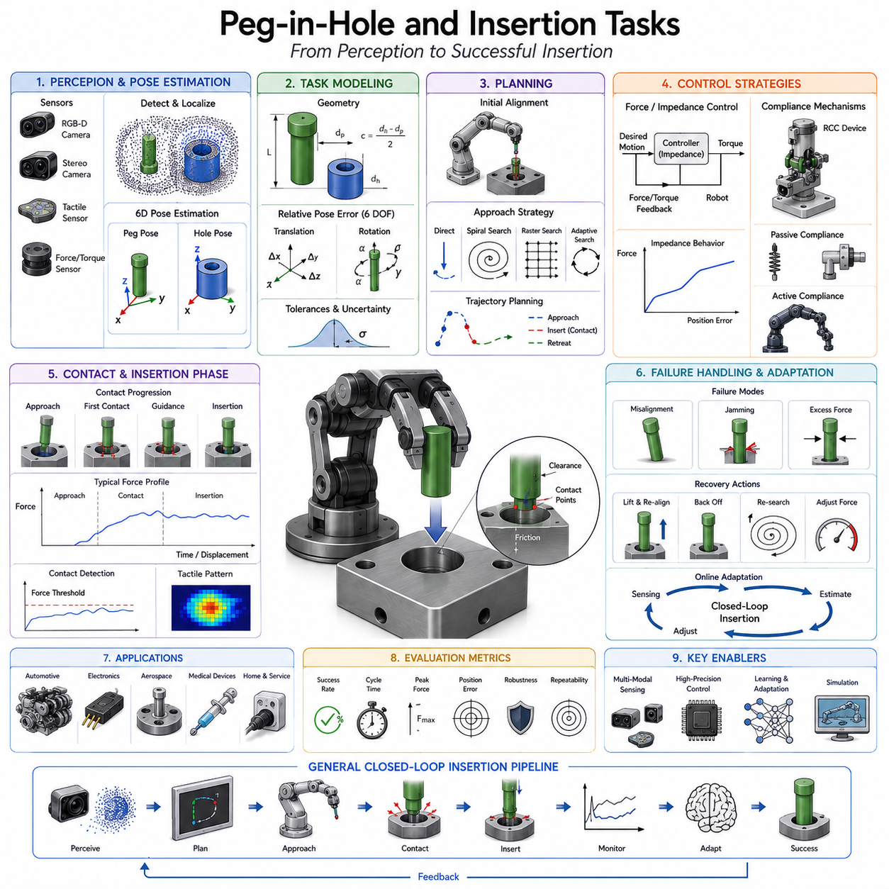{width="7.268055555555556in" height="7.268055555555556in"}

Peg-in-Hole and Insertion Tasks(핀 삽입 및 조립 작업)는 로봇공학, 제조 자동화, 정교한 조작(Dexterous Manipulation) 분야에서 가장 기본적이면서도 가장 어려운 문제 중 하나이다. 겉으로 보기에는 핀(Peg)을 구멍(Hole)에 삽입하는 단순한 작업처럼 보이지만, 실제로는 매우 높은 수준의 인지(Perception), 운동 계획(Motion Planning), 힘 제어(Force Control), 접촉 해석(Contact Reasoning), 그리고 실시간 적응(Real-Time Adaptation)이 동시에 요구된다. 사람은 충전기를 콘센트에 꽂거나, 열쇠를 자물쇠에 넣거나, 가구를 조립하는 작업을 자연스럽게 수행하지만, 로봇에게는 이러한 작업이 매우 복잡한 문제로 인식된다. 이 때문에 Peg-in-Hole 문제는 수십 년 동안 로봇 조작 연구의 대표적인 벤치마크(Benchmark) 과제로 활용되어 왔다. Robot Hand and Dexterous Grasping의 Tool Use and Assembly 영역에서는 자유 공간 조작(Free-Space Manipulation)에서 접촉 기반 조작(Contact-Rich Manipulation)으로 넘어가는 핵심 기술로 간주된다.

전통적인 Peg-in-Hole 문제는 원통형 핀을 대응되는 구멍에 정확하게 삽입하는 작업으로 정의된다. 그러나 실제 성공 여부는 위치 정확도(Position Accuracy), 각도 정렬(Angular Alignment), 마찰(Friction), 재료 특성(Material Properties), 가공 공차(Manufacturing Tolerance), 센서 품질, 제어기 성능, 외란(Disturbance) 등 수많은 요소에 의해 결정된다. 특히 고정밀 조립에서는 수백 마이크로미터 수준의 오차만 발생해도 삽입 실패가 발생할 수 있다.

삽입 작업은 현대 산업 전반에 걸쳐 매우 광범위하게 사용된다. 자동차 산업에서는 축(Shaft) 삽입, 베어링 장착, 커넥터 체결 등이 반복적으로 수행된다. 전자 산업에서는 핀과 소켓 결합, 커넥터 삽입, PCB 부품 장착 등이 대표적인 예이다. 항공우주 산업에서는 고정밀 구조물 조립과 패스너(Fastener) 삽입이 핵심 공정이다. 의료기기 제조에서도 미세 부품 조립과 정밀 삽입 작업이 필수적이다. 서비스 로봇 역시 충전 커넥터 연결, 가전제품 조작, 생활용품 사용 과정에서 다양한 삽입 작업을 수행해야 한다.

로봇 관점에서 삽입 작업은 일반적인 Pick-and-Place 작업과 근본적으로 다르다. Pick-and-Place에서는 대부분 자유 공간에서 움직이며 기하학적 궤적만 계산하면 된다. 하지만 삽입 작업은 환경과의 접촉이 필수적이다. 접촉이 발생하는 순간 시스템의 동역학은 급격하게 변화하며, 작은 오차가 큰 힘을 발생시켜 실패를 유발할 수 있다. 따라서 삽입 작업에서는 단순한 위치 제어보다 접촉(Contact)을 이해하는 능력이 더욱 중요하다.

삽입 성공의 첫 번째 조건은 기하학적 정렬(Geometric Alignment)이다. 핀은 구멍 입구 근처에 매우 정확하게 위치해야 한다. 이를 위해서는 핀과 구멍의 위치와 자세(Pose)를 정확하게 추정해야 한다. 과거 산업용 로봇은 정밀한 지그(Jig)와 고정 장치를 사용하여 이러한 문제를 해결했다. 그러나 현대의 유연 생산(Flexible Manufacturing) 환경에서는 부품 위치가 매번 조금씩 달라질 수 있기 때문에 보다 지능적인 인식과 보정이 필요하다.

핀과 구멍의 상대 자세(Relative Pose)는 6자유도(6 Degrees of Freedom)로 표현된다. 3개의 병진 자유도(Translation)와 3개의 회전 자유도(Rotation)가 모두 정렬되어야 성공적인 삽입이 가능하다. 병진 오차는 측면 오프셋(Lateral Offset)을 유발하며, 회전 오차는 각도 불일치(Angular Misalignment)를 발생시킨다. 이 두 가지는 모두 삽입 난이도를 크게 증가시킨다.

공차(Tolerance)는 삽입 작업에서 매우 중요한 개념이다. 클리어런스(Clearance)는 구멍과 핀 사이의 여유 공간을 의미한다. 클리어런스가 크면 삽입은 쉬워지지만 최종 조립 정밀도가 떨어진다. 반대로 클리어런스가 작으면 높은 정밀도를 얻을 수 있지만 훨씬 더 정확한 정렬이 요구된다. 산업 현장에서는 수 마이크로미터 수준의 공차를 요구하는 경우도 많으며, 이 경우 고성능 센서와 정밀 제어 기술이 필수적이다.

삽입 과정에서 발생하는 접촉 역학(Contact Mechanics)은 매우 중요하다. 핀이 구멍 입구에 접근하면 접촉력이 발생하기 시작한다. 상대 정렬 상태에 따라 한 점에서 접촉할 수도 있고 여러 점에서 동시에 접촉할 수도 있다. 이러한 접촉력은 핀의 자세를 변화시키는 모멘트(Moment)를 생성하며, 삽입을 돕기도 하고 방해하기도 한다. 따라서 접촉 역학에 대한 이해는 성공적인 삽입 전략 수립의 핵심이다.

삽입 실패의 대표적인 원인은 재밍(Jamming)이다. 재밍은 접촉력이 기계적 구속을 형성하여 핀이 더 이상 움직일 수 없는 상태를 의미한다. 핀이 구멍 벽면에 끼어 움직이지 못하게 되는 현상이다. 특히 정밀 조립에서는 재밍이 부품 손상이나 액추에이터 과부하를 유발할 수 있기 때문에 매우 위험하다.

또 다른 중요한 현상은 웨징(Wedging)이다. 웨징은 마찰력 때문에 상대 운동이 차단되는 현상을 의미한다. 기하학적으로는 삽입 가능한 상태라도 마찰이 지나치게 크면 실제 삽입이 불가능할 수 있다. 따라서 삽입 계획에는 마찰 모델(Friction Model)이 반드시 포함되어야 한다.

힘 센서(Force Sensor)는 삽입 작업에서 핵심적인 역할을 수행한다. 비전 시스템은 초기 정렬에는 효과적이지만 접촉 이후의 미세 오차를 감지하기 어렵다. 반면 손목 장착형 힘/토크 센서(Force-Torque Sensor)는 실제 접촉 상태를 직접 측정할 수 있다. 로봇은 힘과 토크 변화를 분석하여 정렬 오차를 추정하고 궤적을 실시간으로 수정할 수 있다.

순응성(Compliance)은 삽입 작업에서 매우 중요한 개념이다. 완전히 강체인 로봇은 작은 정렬 오차에도 큰 접촉력을 발생시킨다. 반면 순응성을 가진 시스템은 환경에 맞추어 자연스럽게 적응할 수 있다. 순응성은 탄성 요소나 유연 구조를 이용한 기계적 순응성(Mechanical Compliance)과 임피던스 제어(Impedance Control), 어드미턴스 제어(Admittance Control)를 이용한 제어 기반 순응성(Control-Based Compliance)으로 구현될 수 있다.

원격 중심 순응 장치(Remote Center Compliance, RCC)는 삽입 작업을 위해 개발된 대표적인 기계 장치이다. RCC는 핀이 구멍 입구에 접촉했을 때 자동으로 위치와 자세를 미세하게 조정하여 정렬을 돕는다. 수십 년 전에 개발되었음에도 불구하고 현재까지 많은 산업용 조립 시스템에서 사용되고 있다.

임피던스 제어는 삽입 로봇 분야에서 가장 영향력 있는 제어 기법 중 하나이다. 임피던스 제어는 위치를 강제로 따라가는 대신 힘과 움직임 사이의 관계를 제어한다. 로봇은 가상의 질량-스프링-댐퍼 시스템처럼 동작하여 접촉 상황에 부드럽게 적응할 수 있다.

어드미턴스 제어는 그 반대 접근법이다. 측정된 힘을 기반으로 새로운 움직임 명령을 생성한다. 과도한 힘이 감지되면 로봇이 자동으로 경로를 수정하여 접촉 문제를 해결한다.

정확한 정렬이 어려운 경우에는 탐색(Search) 전략이 사용된다. 사람도 구멍 위치가 정확하지 않을 때 작은 탐색 동작을 수행한다. 로봇 역시 유사한 방법을 사용할 수 있다. 가장 대표적인 방법은 나선형 탐색(Spiral Search)이다. 핀을 나선형으로 움직이며 구멍 입구를 탐색하고, 적절한 접촉 신호가 감지되면 삽입을 수행한다.

이 외에도 격자 탐색(Raster Search), 원형 탐색(Circular Search), 진동 기반 탐색(Oscillatory Search), 적응형 탐색(Adaptive Search) 등이 개발되어 있다. 선택되는 전략은 작업 형상, 센서 종류, 요구 속도에 따라 달라진다.

비전 기반 삽입(Vision-Guided Insertion)은 카메라를 이용하여 초기 정렬을 수행한다. 고해상도 카메라는 구멍 위치와 자세를 추정하고 정렬 오차를 계산할 수 있다. 마커(Fiducial Marker), 구조광(Structured Light), 스테레오 비전(Stereo Vision), RGB-D 카메라 등이 활용된다.

최근에는 딥러닝 기반 3차원 자세 추정(3D Pose Estimation)이 삽입 작업에 적용되고 있다. 신경망은 다양한 조명, 배경, 가림(Occlusion) 상황에서도 안정적으로 부품의 자세를 추정할 수 있다.

학습 기반 삽입(Learning-Based Insertion)은 최근 가장 활발하게 연구되는 분야 중 하나이다. 기존 방법이 수학적 모델에 의존했다면, 학습 기반 방법은 실제 경험으로부터 삽입 기술을 학습한다.

행동 모방 학습(Behavior Cloning)은 인간 전문가의 시연을 학습 데이터로 활용한다. 이를 통해 사람이 수행하는 미세한 보정 동작과 힘 조절 전략을 로봇이 습득할 수 있다.

강화학습(Reinforcement Learning)은 시행착오를 통해 삽입 정책을 학습한다. 성공적인 삽입에는 보상을 부여하고 실패에는 패널티를 부여함으로써 최적의 전략을 찾는다. 최근에는 실제 산업 환경에서도 적용 가능한 수준의 성능을 달성하고 있다.

시뮬레이션은 삽입 연구의 핵심 도구가 되었다. 물리 엔진을 이용하여 접촉, 마찰, 순응성, 외란 등을 모델링할 수 있으며 수백만 번의 삽입 실험을 수행할 수 있다. Domain Randomization은 이러한 학습 결과가 실제 환경에서도 잘 동작하도록 돕는다.

촉각 센서(Tactile Sensor)는 힘 센서를 보완하는 중요한 기술이다. 힘 센서가 전체 힘을 측정한다면 촉각 센서는 접촉 위치와 접촉 분포를 제공한다. 이를 통해 구멍 가장자리 인식, 접촉 위치 추정, 삽입 진행 상태 판단 등이 가능하다.

최근에는 시각(Vision), 힘(Force), 촉각(Tactile), 고유감각(Proprioception)을 통합하는 다중 모달 인식(Multi-Modal Perception)이 활용되고 있다. 이러한 센서 융합은 불확실성이 높은 환경에서도 높은 성공률을 제공한다.

전선, 커넥터, 실링 부품, 의료용 튜브와 같은 유연 물체(Flexible Object)가 포함되면 삽입 작업은 훨씬 어려워진다. 이러한 경우에는 변형(Deformation)을 고려해야 하며 기존의 강체 모델만으로는 충분하지 않다.

삽입 작업은 대부분 더 큰 조립 공정의 일부로 수행된다. 따라서 조립 계획(Assembly Planning)은 삽입 순서, 접근성, 사용 가능한 도구, 지그 배치 등을 함께 고려해야 한다.

인간은 완벽한 위치 정확도 없이도 탐색, 촉각, 순응성, 반복 보정을 통해 삽입을 성공시킨다. 이러한 인간의 전략을 모방하는 것이 현대 로봇 연구의 중요한 목표 중 하나이다.

최근에는 파운데이션 모델(Foundation Model)과 임바디드 AI(Embodied AI)가 삽입 작업에도 적용되기 시작했다. 대규모 조작 데이터를 학습한 모델은 다양한 삽입 작업에 공통적으로 적용 가능한 일반화된 기술을 습득할 수 있다. 미래에는 자연어 명령을 통해 삽입 작업을 수행하고, 월드 모델(World Model)을 이용하여 접촉 결과를 사전에 예측하는 시스템도 등장할 것으로 예상된다.

삽입 시스템은 일반적으로 삽입 성공률(Insertion Success Rate), 수행 시간(Completion Time), 힘 효율성(Force Efficiency), 위치 정확도(Positional Accuracy), 정렬 오차 허용 범위(Tolerance to Misalignment), 환경 변화에 대한 강인성(Robustness) 등을 기준으로 평가된다. 산업 현장에서는 99.9% 이상의 성공률이 요구되는 경우도 많다.

미래의 삽입 시스템은 고정밀 인지, 실시간 힘 제어, 촉각 지능, 적응형 순응성, 학습 기반 정책, 파운데이션 모델 기반 추론이 통합된 형태로 발전할 것으로 예상된다. 이러한 시스템은 기존의 경직된 자동화를 넘어 변화하는 환경에서도 스스로 적응하는 지능형 조립 플랫폼으로 진화하게 될 것이다.

결국 Peg-in-Hole 및 삽입 작업은 단순한 벤치마크 문제가 아니다. 이는 인지 불확실성, 접촉 역학, 힘 제어, 정교한 조작, 센서 융합, 적응형 의사결정 등 로봇 조작의 핵심 문제들을 모두 포함하고 있다. 따라서 삽입 작업을 완벽하게 수행할 수 있는 능력은 진정한 지능형 조립 로봇과 미래 임바디드 AI 시스템으로 가는 중요한 이정표로 평가되고 있다.

## 13.06 Screw and Fastener Operations

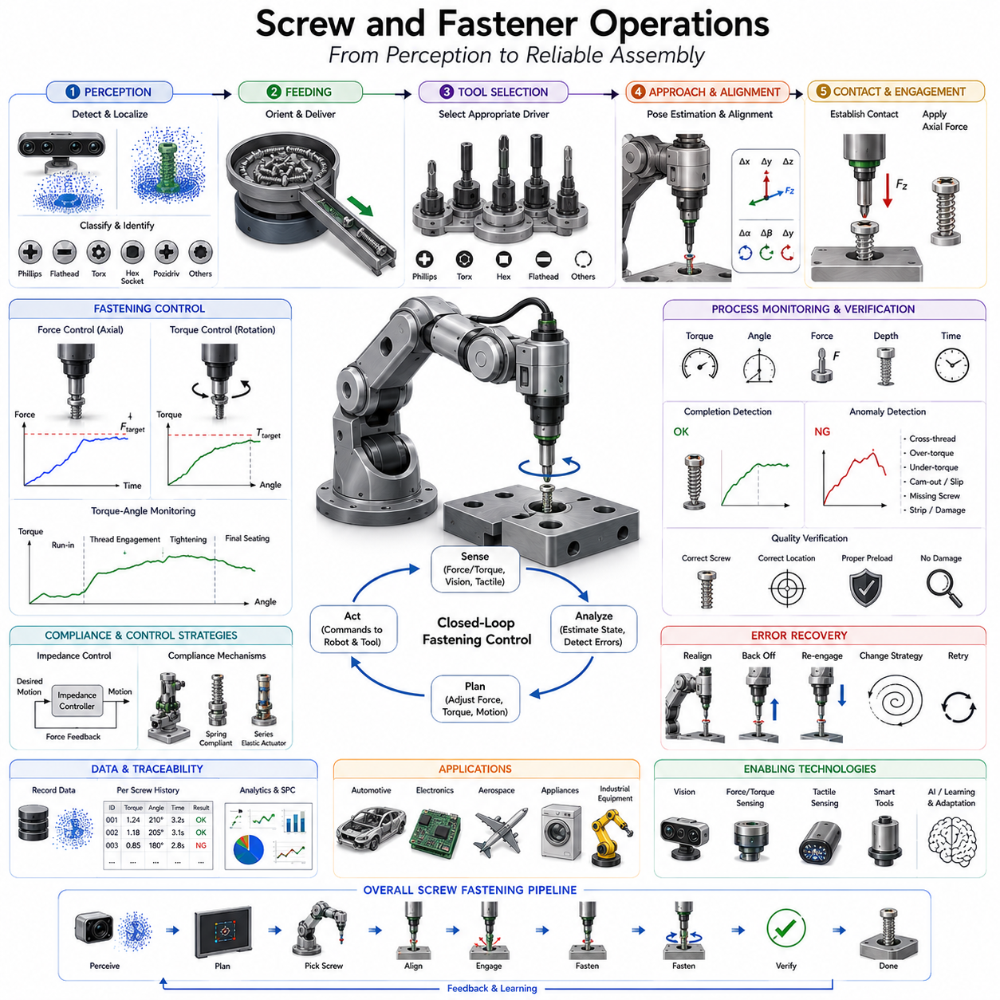{width="7.268055555555556in" height="7.268055555555556in"}

Screw and Fastener Operations(나사 및 체결 작업)은 산업용 로봇, 제조 자동화, 유지보수 시스템, 서비스 로봇 분야에서 가장 중요한 조립 작업 중 하나이다. 소비자 전자제품부터 자동차, 항공기, 산업 장비, 의료기기, 건설 장비에 이르기까지 거의 모든 공학 제품은 부품들을 안정적으로 연결하기 위해 체결 부품(Fastener)을 사용한다. 다양한 체결 방식 중에서도 나사(Screw)는 강도, 신뢰성, 분해 가능성, 경제성을 동시에 제공하기 때문에 가장 널리 사용되는 체결 방식이다. 그러나 로봇이 나사를 다루는 것은 생각보다 훨씬 복잡하다. 성공적인 체결 작업을 위해서는 정밀한 인지(Perception), 도구 사용(Tool Handling), 자세 추정(Pose Estimation), 힘 제어(Force Control), 토크 제어(Torque Regulation), 접촉 기반 조작(Contact-Rich Manipulation), 오류 복구(Error Recovery), 품질 검증(Quality Verification)이 모두 필요하다. 따라서 나사 및 체결 작업은 로봇 조립과 정교한 조작 기술의 핵심 연구 분야로 자리 잡고 있다. Robot Hand and Dexterous Grasping의 Tool Use and Assembly 영역에서는 가장 실용적이고 산업적 가치가 높은 응용 분야 중 하나로 평가된다.

패스너(Fastener)는 둘 이상의 부품을 연결하기 위해 사용되는 기계 요소이다. 나사가 가장 대표적이지만 볼트(Bolt), 너트(Nut), 리벳(Rivet), 핀(Pin), 클립(Clip), 앵커(Anchor), 나사 인서트(Threaded Insert), 스냅링(Retaining Ring) 등 다양한 종류가 존재한다. 각각은 고유한 조작 문제를 가지지만, 나사는 삽입(Insertion), 정렬(Alignment), 힘 전달(Force Application), 회전 제어(Rotational Control), 품질 검증(Verification)을 모두 포함하기 때문에 로봇 조립의 대표적인 예제로 사용된다.

로봇 관점에서 나사 체결은 여러 단계로 구성된 작업이다. 먼저 로봇은 나사와 체결 위치를 인식해야 한다. 이후 적절한 드라이버를 선택하고, 공구를 올바른 자세로 위치시키며, 나사 머리와 접촉한 뒤, 축 방향 힘(Axial Force)과 토크(Torque)를 동시에 가하면서 체결을 수행한다. 마지막으로 체결 상태를 확인하고 품질을 검증해야 한다. 어느 한 단계라도 실패하면 조립 불량, 나사 손상, 공구 마모, 생산성 저하로 이어질 수 있다.

체결 자동화에서 인식(Perception)은 매우 중요한 역할을 한다. 로봇은 먼저 나사의 위치, 방향, 종류, 크기를 식별해야 한다. 나사는 작고 금속 재질로 되어 있어 반사가 심하며, 부품함 내부에 무작위로 놓여 있는 경우가 많아 인식이 쉽지 않다. 이를 위해 고해상도 카메라, 구조광(Structured Light), 스테레오 비전(Stereo Vision), RGB-D 센서 등이 활용된다.

나사 분류(Screw Classification)도 중요한 문제이다. 나사 머리 형상에 따라 사용해야 하는 공구가 달라지기 때문이다. 대표적으로 Phillips, Flathead, Torx, Hex Socket, Pozidriv, Robertson, Security Screw 등이 있다. 정확한 분류는 적절한 드라이버 선택을 가능하게 하며 공구 손상과 작업 실패를 예방한다. 최근에는 딥러닝 기반 비전 시스템이 다양한 조명 조건과 환경 변화 속에서도 높은 정확도로 나사를 분류할 수 있게 되었다.

자세 추정(Pose Estimation)은 나사 체결에서 매우 중요하다. 로봇은 나사와 체결 홀의 위치뿐 아니라 방향까지 정확하게 계산해야 한다. 작은 각도 오차만 존재해도 드라이버와 나사 머리의 결합이 실패할 수 있다. 정밀 조립에서는 1도 이하의 오차조차 체결 품질에 큰 영향을 미친다.

나사 공급(Fastener Feeding)은 자동화에서 또 다른 중요한 과제이다. 사람은 손으로 쉽게 나사를 집을 수 있지만 로봇은 예측 가능한 자세로 나사를 공급받아야 한다. 이를 위해 진동 볼 피더(Vibratory Bowl Feeder), 테이프-릴(Tape-and-Reel), 트레이 피더(Tray Feeder), 자석 피더(Magnetic Feeder), 진공 공급 시스템(Vacuum Delivery System) 등이 사용된다. 최신 스마트 피더는 센서와 연동되어 나사의 상태와 방향을 실시간으로 제공한다.

공구 선택(Tool Selection)은 체결 작업의 핵심 요소이다. 서로 다른 나사에는 서로 다른 드라이버가 필요하다. 산업용 조립 셀은 여러 종류의 드라이버를 보유하며, 자동 공구 교환기(Automatic Tool Changer)를 통해 작업 중 공구를 자동으로 교체할 수 있다. 공구 선택은 나사 종류, 요구 토크, 접근성, 조립 사양 등을 종합적으로 고려하여 결정된다.

로봇용 드라이버(Robotic Screwdriver)는 단순한 그리퍼와 다르다. 드라이버는 회전 운동을 생성하는 동시에 나사 축과 정렬을 유지해야 한다. 산업용 드라이버는 전기 모터, 토크 센서, 힘 센서, 깊이 센서, 통신 인터페이스 등을 내장하여 정밀한 폐루프 제어(Closed-Loop Control)를 수행한다.

정렬(Alignment)은 성공적인 체결의 가장 중요한 요소 중 하나이다. 회전을 시작하기 전에 드라이버는 나사 머리와 정확히 정렬되어야 한다. 정렬이 잘못되면 캠아웃(Cam-Out)이 발생한다. 캠아웃은 드라이버가 나사 홈에서 미끄러져 빠져나오는 현상으로, 나사 머리를 손상시키고 작업 실패를 초래한다. 따라서 로봇은 체결 전 정밀 정렬 절차를 수행한다.

접촉 형성(Contact Establishment)은 자유 공간 움직임에서 접촉 기반 조작으로 전환되는 단계이다. 드라이버가 나사 머리에 접근하여 실제 접촉을 형성하는 과정이다. 힘 센서를 이용하여 접촉 여부를 감지하고 적절한 깊이를 유지한다. 너무 큰 힘은 부품 손상을 유발하고, 너무 작은 힘은 체결 실패를 초래할 수 있다.

축 방향 힘 제어(Axial Force Control)는 매우 중요하다. 나사 체결은 단순한 회전 작업이 아니라 힘과 토크를 동시에 제어해야 하는 작업이다. 로봇은 드라이버와 나사 홈이 계속 결합된 상태를 유지하기 위해 적절한 누름 힘을 가해야 한다. 필요한 힘은 나사 형상, 재료, 마찰 특성, 조립 조건에 따라 달라진다.

토크 제어(Torque Control)는 체결 작업의 핵심이다. 토크는 나사를 회전시키는 힘을 의미한다. 토크가 부족하면 체결이 느슨해지고 구조적 안정성이 떨어진다. 반대로 토크가 지나치면 나사산(Thread)이 파손되거나 부품이 변형될 수 있다. 따라서 산업용 체결 시스템은 매우 높은 정밀도로 토크를 제어한다.

토크-각도 관계(Torque-Angle Relationship)는 체결 상태를 평가하는 중요한 지표이다. 나사가 체결될수록 토크는 특정한 패턴으로 증가한다. 초기에는 낮은 토크를 보이다가 조임력이 증가하면서 토크가 상승한다. 목표 프리로드(Preload)에 도달하면 체결을 종료해야 한다. 토크-각도 곡선을 분석하면 체결 품질을 효과적으로 검증할 수 있다.

프리로드(Preload)는 체결 후 나사 내부에 생성되는 인장력(Tensile Force)을 의미한다. 적절한 프리로드는 진동 환경에서도 체결이 풀리지 않도록 보장한다. 프리로드를 직접 측정하기는 어렵기 때문에 일반적으로 토크를 이용하여 간접적으로 추정한다. 그러나 마찰 변화가 토크와 프리로드의 관계를 변화시키기 때문에 더욱 정교한 추정 기법이 연구되고 있다.

나사산 결합(Thread Engagement)은 체결 과정의 핵심이다. 나사는 먼저 상대 나사산과 정확하게 결합해야 한다. 크로스 스레딩(Cross-Threading)은 나사가 잘못된 각도로 들어가 나사산을 손상시키는 현상이다. 이는 자동 체결에서 가장 위험한 오류 중 하나이며, 이를 감지하고 예방하는 기술이 매우 중요하다.

순응성(Compliance)은 나사 체결에서도 중요한 역할을 한다. 기계적 순응성과 제어 기반 순응성은 작은 정렬 오차를 흡수하여 체결 성공률을 높인다. 순응성이 없는 강체 시스템은 과도한 힘을 발생시켜 나사산을 손상시킬 수 있다. 이를 해결하기 위해 임피던스 제어(Impedance Control)와 어드미턴스 제어(Admittance Control)가 널리 사용된다.

힘-토크 센서(Force-Torque Sensor)는 체결 과정 전반에 걸쳐 중요한 피드백을 제공한다. 손목 장착형 센서는 힘과 모멘트를 측정하여 체결 상태를 실시간으로 분석한다. 힘 신호는 나사산 결합, 삽입 깊이, 마찰 변화, 체결 완료 여부 등을 판단하는 데 활용된다.

촉각 센서(Tactile Sensor)는 최근 주목받고 있는 기술이다. 힘 센서가 전체 힘을 측정하는 반면, 촉각 센서는 접촉 분포를 제공한다. 이를 통해 미끄러짐(Slip), 접촉 품질, 정렬 상태 등을 더욱 정밀하게 파악할 수 있다.

비전 기반 체결(Vision-Guided Fastening)은 카메라와 제어를 결합한 방식이다. 카메라는 나사 위치, 홀 위치, 드라이버 정렬 상태, 조립 진행 상황을 지속적으로 모니터링한다. 최신 비전 시스템은 결함 검출, 부품 배치 확인, 체결 오류 탐지까지 수행할 수 있다.

오류 검출(Error Detection)과 복구(Error Recovery)는 산업 환경에서 필수적인 기능이다. 나사 누락(Missing Screw), 잘못된 나사 사용, 크로스 스레딩, 나사 머리 손상, 공구 미끄러짐, 토크 부족, 과도한 토크 등의 다양한 오류가 발생할 수 있다. 고급 시스템은 센서 데이터를 지속적으로 분석하여 이러한 문제를 자동으로 탐지하고 수정한다.

공정 모니터링(Process Monitoring)은 스마트 제조 환경에서 점점 더 중요해지고 있다. 모든 체결 작업은 토크, 힘, 회전 각도, 작업 시간, 공구 상태 등의 데이터를 생성한다. 이러한 데이터는 품질 보증(Quality Assurance), 추적성(Traceability), 예지 보전(Predictive Maintenance), 공정 최적화(Process Optimization)에 활용된다.

협동로봇(Collaborative Robot)의 발전은 체결 자동화의 적용 범위를 크게 확대하고 있다. 과거 체결 로봇은 독립된 셀(Cell) 내부에서만 동작했지만, 현대 협동로봇은 사람과 함께 작업할 수 있다. 로봇이 반복적인 체결 작업을 수행하고 사람은 보다 복잡한 조립 작업을 담당하는 형태의 유연 생산 시스템이 가능해지고 있다.

학습 기반 체결(Learning-Based Fastening)은 최근 빠르게 발전하는 분야이다. 기존 방식이 사전에 정의된 규칙과 공정 조건에 의존했다면, 머신러닝은 다양한 재료와 환경 변화에 적응할 수 있도록 한다. 과거 체결 데이터를 분석하여 더 나은 전략을 스스로 학습할 수 있다.

행동 모방 학습(Behavior Cloning)은 숙련 작업자의 체결 방식을 학습한다. 사람은 힘과 토크, 정렬 상태를 자연스럽게 조정하며 작업한다. 이러한 경험을 로봇이 학습함으로써 보다 유연하고 안정적인 체결이 가능해진다.

강화학습(Reinforcement Learning)은 반복적인 시도를 통해 최적의 체결 정책을 학습한다. 성공적인 체결에는 보상이 주어지고 실패에는 패널티가 부여된다. 이를 통해 로봇은 복잡한 환경에서도 높은 성공률을 달성할 수 있다.

시뮬레이션(Simulation)은 체결 기술 개발의 중요한 도구이다. 고정밀 물리 엔진은 접촉, 마찰, 나사산 결합, 순응성, 센서 응답 등을 모델링할 수 있다. 이를 통해 실제 장비를 사용하지 않고도 다양한 전략을 검증할 수 있다.

최근에는 파운데이션 모델(Foundation Model)과 임바디드 AI(Embodied AI)가 체결 작업에도 적용되기 시작했다. 미래의 로봇은 "지정된 나사로 패널을 조립하라"와 같은 자연어 명령만으로 필요한 공구 선택, 체결 순서 결정, 품질 검증까지 스스로 수행할 수 있을 것으로 예상된다.

자동차 산업은 차량 한 대당 수천 개의 체결 작업을 수행한다. 전자제품 제조는 초소형 나사 조립에 의존한다. 항공우주 산업은 극도로 높은 품질 기준을 요구하며, 의료기기 산업은 엄격한 규제 환경 속에서 안정적인 체결을 수행해야 한다. 최근에는 건설 로봇도 모듈형 건축물 조립을 위해 자동 체결 기술을 활용하고 있다.

체결 품질 검증(Fastening Quality Verification)은 작업의 마지막 단계이다. 단순히 목표 토크에 도달했다고 해서 성공으로 간주하지 않는다. 올바른 나사가 올바른 위치에 사용되었는지, 적절한 프리로드가 생성되었는지, 손상이 발생하지 않았는지, 조립 사양을 충족하는지를 종합적으로 확인해야 한다.

로봇 체결 시스템은 일반적으로 체결 성공률(Fastening Success Rate), 사이클 타임(Cycle Time), 토크 정확도(Torque Accuracy), 프리로드 일관성(Preload Consistency), 불량률(Defect Rate), 공구 마모(Tool Wear), 에너지 소비(Energy Consumption), 공정 변화 적응성(Adaptability) 등을 기준으로 평가된다. 대량 생산 환경에서는 99.99% 이상의 성공률이 요구되는 경우도 많다.

미래의 나사 및 체결 작업 시스템은 고성능 인식, 정밀 힘 제어, 촉각 지능, 적응형 순응성, 디지털 트윈(Digital Twin), 학습 기반 최적화, 파운데이션 모델 기반 추론이 통합된 형태로 발전할 것이다. 이러한 시스템은 단순 반복 자동화를 넘어 다양한 제품을 최소한의 재프로그래밍으로 조립할 수 있는 지능형 조립 플랫폼으로 진화할 것으로 기대된다.

결국 Screw and Fastener Operations는 접촉 기반 로봇 조작(Contact-Rich Robotic Manipulation)의 대표적인 사례이다. 인지, 계획, 힘 제어, 공구 사용, 공정 모니터링, 적응형 지능이 모두 결합되어야만 성공할 수 있다. 따라서 나사 체결을 완벽하게 수행할 수 있는 능력은 범용 조립 로봇(General-Purpose Assembly Robot)과 미래 임바디드 AI 시스템으로 가는 중요한 이정표로 평가되고 있다.

## 13.07 Cable Handling

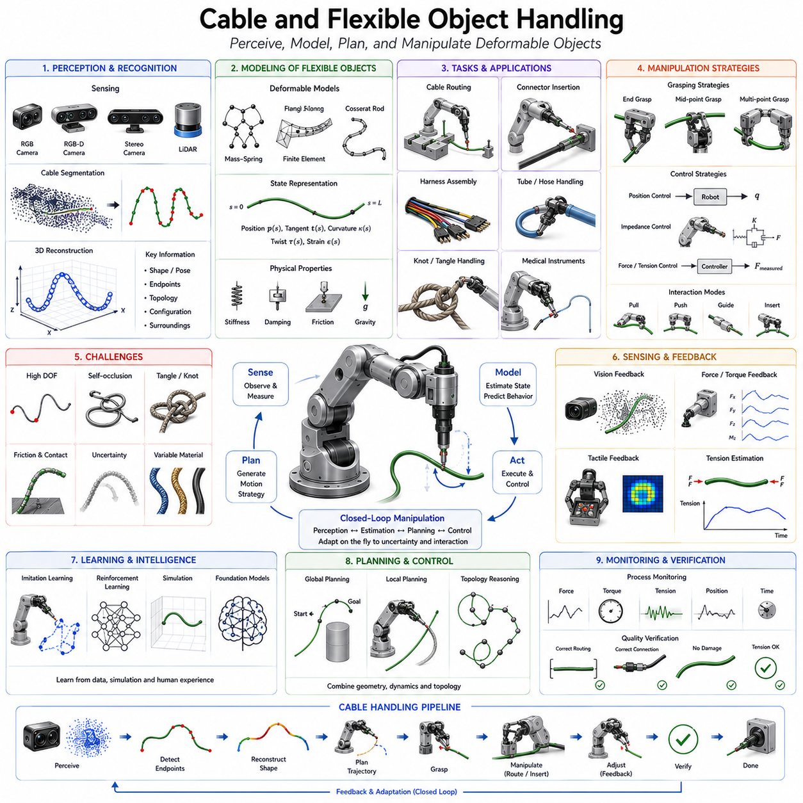{width="7.268055555555556in" height="7.268055555555556in"}

Cable and Flexible Object Handling(케이블 및 유연 물체 조작)은 로봇 조작 분야에서 가장 어려운 영역 중 하나이다. 그 이유는 케이블, 전선, 호스, 로프와 같은 유연 물체(Flexible Object)가 작업 과정에서 지속적으로 형태를 변화시키기 때문이다. 강체(Rigid Object)는 일정한 형상을 유지하기 때문에 비교적 단순한 기하학적 모델과 운동학 모델로 표현할 수 있지만, 유연 물체는 중력(Gravity), 접촉력(Contact Force), 마찰(Friction), 탄성(Elasticity), 굽힘 강성(Bending Stiffness), 비틀림(Torsion), 재료 기억 효과(Material Memory), 환경 제약(Environmental Constraints) 등에 의해 지속적으로 변형된다. 따라서 사람이 자연스럽게 수행하는 충전 케이블 연결, 전선 배선, 호스 정리, 케이블 하네스 조립, 의료용 카테터 조작, 로프 다루기 등의 작업은 로봇에게는 매우 복잡한 문제로 남아 있다. Robot Hand and Dexterous Grasping의 Tool Use and Assembly 영역에서 이 주제는 강체 조작에서 변형 가능한 물체 조작(Deformable Object Manipulation)으로 확장되는 중요한 분야이다.

유연 물체는 산업과 일상생활 전반에 걸쳐 광범위하게 존재한다. 자동차와 항공기 내부에는 복잡한 전선 하네스(Wiring Harness)가 설치되어 있으며, 산업 설비에는 수많은 유압 및 공압 호스가 사용된다. 광섬유 케이블(Fiber Optic Cable)은 통신 인프라를 구성하며, 의료 분야에서는 카테터(Catheter), 가이드와이어(Guidewire), 내시경(Endoscope)과 같은 유연 기구가 사용된다. 가정 환경에서도 전원 코드, 충전 케이블, 로프, 직물(Fabric), 플라스틱 튜브 등 다양한 유연 물체를 쉽게 찾아볼 수 있다. 따라서 이러한 물체를 안정적으로 다룰 수 있는 능력은 차세대 자율 로봇의 핵심 역량 중 하나로 평가된다.

유연 물체 조작이 어려운 가장 큰 이유는 자유도(Degrees of Freedom)가 사실상 무한대에 가깝기 때문이다. 강체는 위치와 자세를 나타내는 6자유도만으로 상태를 표현할 수 있다. 그러나 케이블은 길이 방향 전체에서 굽어지고, 꼬이고, 늘어나고, 휘어질 수 있기 때문에 매우 큰 상태 공간(State Space)을 가진다. 케이블의 모든 점이 독립적으로 움직일 수 있기 때문에 인식과 제어가 훨씬 복잡해진다.

재료 특성(Material Properties)은 유연 물체의 거동을 결정하는 핵심 요소이다. 전기 배선은 비교적 유연하지만, 유압 호스는 강성이 높고 무겁다. 광섬유 케이블은 과도한 굽힘에 매우 민감하며, 전원 케이블은 상대적으로 큰 변형을 허용한다. 따라서 로봇은 각 물체의 강성(Stiffness), 탄성(Elasticity), 감쇠(Damping), 마찰 특성(Friction Property), 비틀림 저항(Torsional Resistance)을 이해해야 한다.

유연 물체 조작의 첫 번째 과제는 인식(Perception)이다. 로봇은 먼저 케이블을 식별하고, 현재 형상을 추정하며, 끝점(Endpoint)을 찾고, 주변 환경과의 관계를 이해해야 한다. 강체 공구와 달리 케이블은 형태가 계속 변화하기 때문에 단순한 위치 인식만으로는 충분하지 않다.

비전 기반 인식(Vision-Based Perception)은 현재 가장 널리 사용되는 방법이다. RGB 카메라는 케이블의 외형과 배치를 관찰할 수 있지만, 케이블은 자기 가림(Self-Occlusion), 중첩(Overlap), 반사(Reflection), 복잡한 배경 등의 문제를 자주 발생시킨다. 따라서 고급 컴퓨터 비전 알고리즘이 필요하다.

3차원 센싱(3D Sensing)은 유연 물체 인식 능력을 크게 향상시킨다. RGB-D 카메라, 스테레오 비전, 구조광 센서, 레이저 스캐너는 케이블의 공간 형상을 재구성할 수 있다. 포인트 클라우드(Point Cloud) 분석을 통해 케이블의 경로(Trajectory), 곡률(Curvature), 끝점 위치 등을 추정할 수 있다.

끝점 검출(Endpoint Detection)은 매우 중요한 기능이다. 대부분의 케이블 작업은 케이블 끝을 잡는 것에서 시작된다. 그러나 실제 환경에서는 끝점이 가려져 있거나 다른 부분과 구분하기 어려운 경우가 많다. 최근에는 딥러닝 기반 모델과 기하학적 추론 기법을 활용하여 끝점을 안정적으로 검출할 수 있게 되었다.

형상 복원(Shape Reconstruction) 역시 중요한 문제이다. 로봇은 현재 케이블의 상태를 이해해야 미래의 변형을 예측할 수 있다. 형상 복원 알고리즘은 관측 데이터를 스플라인(Spline), 곡선(Curve), 그래프(Graph), 유한 요소 모델(Finite Element Model) 등으로 변환하여 표현한다.

유연 물체의 수학적 모델링은 강체 모델링보다 훨씬 복잡하다. 강체는 고정된 기하학 관계를 가지지만, 케이블은 지속적으로 변형된다. 이를 표현하기 위해 질량-스프링 모델(Mass-Spring Model), 유한 요소법(Finite Element Method), 코세라트 막대 모델(Cosserat Rod Model), 연속체 역학(Continuum Mechanics) 등이 사용된다.

질량-스프링 모델은 가장 단순한 접근 방식이다. 케이블을 여러 개의 질량점(Mass Point)과 이를 연결하는 스프링(Spring)으로 표현한다. 계산이 비교적 빠르지만 복잡한 굽힘과 비틀림을 정확하게 표현하기는 어렵다.

유한 요소법은 케이블을 수많은 작은 요소(Element)로 분할하여 물리 방정식을 수치적으로 계산한다. 매우 높은 정확도를 제공하지만 계산 비용이 크다. 최근 컴퓨팅 성능 향상으로 인해 실제 로봇 시스템에서도 활용 가능성이 높아지고 있다.

코세라트 막대 모델은 최근 가장 주목받는 접근법 중 하나이다. 이 모델은 굽힘, 비틀림, 늘어남, 전단 변형(Shear)을 통합적으로 표현할 수 있다. 특히 전선, 케이블, 카테터와 같은 길쭉한 유연 구조를 모델링하는 데 매우 효과적이다.

유연 물체의 파지 계획(Grasp Planning)은 강체와 본질적으로 다르다. 강체는 한 지점을 잡으면 전체 물체를 효과적으로 제어할 수 있지만, 케이블은 한 점을 잡아도 다른 부분이 자유롭게 움직인다. 따라서 로봇은 파지 위치가 전체 형상에 어떤 영향을 미치는지 고려해야 한다.

단일 지점 파지(Single-Point Grasp)는 단순한 운반 작업에 적합하지만, 케이블 배선이나 정렬과 같은 작업에는 부족하다. 이러한 경우에는 다중 지점 조작(Multi-Point Manipulation)이 필요하다. 두 개 이상의 로봇 손이나 그리퍼를 사용하여 케이블 여러 부분을 동시에 제어할 수 있다.

케이블 라우팅(Cable Routing)은 가장 중요한 산업 응용 분야 중 하나이다. 자동차, 항공기, 전자제품 제조에서는 케이블을 특정 경로로 배치해야 한다. 케이블은 클립, 브래킷, 덕트, 보호관 등을 통과해야 하며, 과도한 장력이나 비틀림이 발생해서는 안 된다.

커넥터 삽입(Connector Insertion)은 또 다른 핵심 작업이다. 로봇은 케이블의 변형을 제어하면서 동시에 커넥터를 정밀하게 정렬하여 소켓에 삽입해야 한다. 작은 변형도 삽입 정확도에 큰 영향을 미칠 수 있다.

케이블 하네스 조립(Cable Harness Assembly)은 산업 자동화 분야에서 가장 어려운 문제 중 하나로 평가된다. 하나의 하네스에는 수십 개에서 수백 개의 전선이 포함될 수 있으며, 다양한 분기 구조(Branch Structure)를 가진다. 따라서 로봇은 전체 토폴로지(Topology)를 이해하면서 작업을 수행해야 한다.

장력 제어(Tension Control)는 유연 물체 조작의 핵심 요소이다. 과도한 장력은 케이블 손상을 유발할 수 있으며, 너무 낮은 장력은 케이블이 늘어지거나 엉키게 만든다. 힘 센서를 사용하여 장력을 실시간으로 측정하고 제어하는 기술이 널리 활용된다.

접촉(Contact)은 케이블 거동에 큰 영향을 준다. 케이블은 작업 과정에서 주변 구조물, 가이드, 다른 케이블과 지속적으로 접촉한다. 특히 마찰은 전체 거동을 지배하는 주요 요인 중 하나이다. 이러한 상호작용을 정확하게 예측하는 것은 여전히 어려운 연구 과제이다.

엉킴(Tangling)은 케이블 조작에서 가장 어려운 문제 중 하나이다. 케이블은 자연스럽게 루프(Loop), 매듭(Knot), 얽힘(Entanglement)을 형성한다. 이를 해결하려면 단순한 기하학적 분석이 아니라 구조적 관계를 이해하는 능력이 필요하다.

이를 위해 토폴로지 추론(Topological Reasoning)이 연구되고 있다. 기존 로봇 계획은 주로 기하학에 초점을 맞추었지만, 케이블 조작은 루프, 교차점, 매듭, 연결 관계와 같은 위상적 특성까지 고려해야 한다.

최근에는 학습 기반 접근법(Learning-Based Approach)이 큰 성과를 보이고 있다. 기존 물리 모델은 복잡한 변형을 정확하게 예측하기 어렵지만, 머신러닝은 경험을 통해 효과적인 조작 전략을 학습할 수 있다.

행동 모방 학습(Behavior Cloning)은 사람이 수행한 케이블 조작 시연을 학습 데이터로 사용한다. 사람은 자연스럽게 전선을 정리하고, 케이블을 배선하며, 엉킴을 해소할 수 있기 때문에 이러한 경험을 로봇에 전달할 수 있다.

강화학습(Reinforcement Learning)은 수많은 시도를 통해 최적의 조작 정책을 학습한다. 특히 케이블 배선, 커넥터 삽입, 매듭 조작과 같이 긴 작업 시퀀스를 요구하는 문제에서 효과적이다.

시뮬레이션(Simulation)은 학습 기반 케이블 조작의 핵심 도구이다. 가상 환경에서 수백만 번의 조작을 수행할 수 있으며, 최근 물리 엔진은 케이블의 변형을 매우 현실적으로 모델링할 수 있게 되었다.

촉각 센서(Tactile Sensor)는 중요한 보조 정보원을 제공한다. 시각 센서는 가림 현상에 취약하지만, 촉각 센서는 실제 접촉 상태를 직접 측정할 수 있다. 따라서 시각과 촉각을 결합하면 조작의 신뢰성이 크게 향상된다.

힘 센서(Force Sensor) 역시 매우 중요하다. 힘 정보를 이용하면 장력을 측정하고, 케이블 손상을 방지하며, 커넥터 삽입 상태를 판단할 수 있다.

의료 로봇(Medical Robotics)은 유연 물체 조작 기술이 가장 활발하게 활용되는 분야 중 하나이다. 카테터, 가이드와이어, 내시경은 모두 케이블과 유사한 특성을 가진다. 의료 로봇은 이러한 기구를 복잡한 인체 내부 경로를 따라 정밀하게 이동시켜야 하며, 조직 손상을 최소화해야 한다.

최근에는 파운데이션 모델(Foundation Model)과 임바디드 AI(Embodied AI)가 유연 물체 조작에도 적용되기 시작했다. 대규모 조작 데이터를 학습한 모델은 다양한 케이블과 로프, 호스에 대해 일반화된 물리 지식을 습득할 수 있다. 미래에는 자연어 명령을 통해 원하는 케이블 형태를 지정하면 로봇이 스스로 적절한 조작 전략을 생성할 수 있을 것으로 기대된다.

자동차 산업은 자동화된 하네스 조립을 요구하고 있으며, 항공우주 산업은 항공기 내부의 복잡한 배선을 자동화하려고 한다. 전자 산업은 커넥터 삽입과 케이블 관리를 자동화하고자 하며, 서비스 로봇은 충전 케이블과 전원 코드를 다룰 수 있어야 한다. 이러한 산업적 요구는 관련 연구를 지속적으로 발전시키고 있다.

유연 물체 조작 시스템은 일반적으로 작업 성공률(Task Success Rate), 배선 정확도(Routing Accuracy), 삽입 정확도(Insertion Accuracy), 변형 제어 능력(Deformation Control), 장력 안정성(Tension Regulation), 작업 속도(Execution Speed), 불확실성에 대한 강인성(Robustness), 새로운 케이블에 대한 적응성(Adaptability) 등을 기준으로 평가된다.

미래의 Cable and Flexible Object Handling 시스템은 고성능 인식, 실시간 물리 모델링, 촉각 지능, 힘 제어, 토폴로지 추론, 시뮬레이션 기반 학습, 파운데이션 모델, 임바디드 AI가 통합된 형태로 발전할 것이다. 이러한 기술은 단순한 케이블 운반을 넘어 다양한 변형 물체를 이해하고 조작할 수 있는 수준으로 확장될 것이다.

결국 Cable and Flexible Object Handling은 로봇 조작 분야의 마지막 난제 중 하나로 평가된다. 강체 조작 기술은 상당히 성숙한 단계에 도달했지만, 유연 물체 조작은 여전히 인지, 모델링, 제어, 계획, 학습 전 분야에서 혁신이 요구된다. 이 문제를 해결하는 것은 미래의 자율 조립 시스템, 지능형 제조 플랫폼, 서비스 로봇, 그리고 범용 임바디드 AI 실현에 매우 중요한 이정표가 될 것이다.

## 13.08 Deformable Object Manipulation

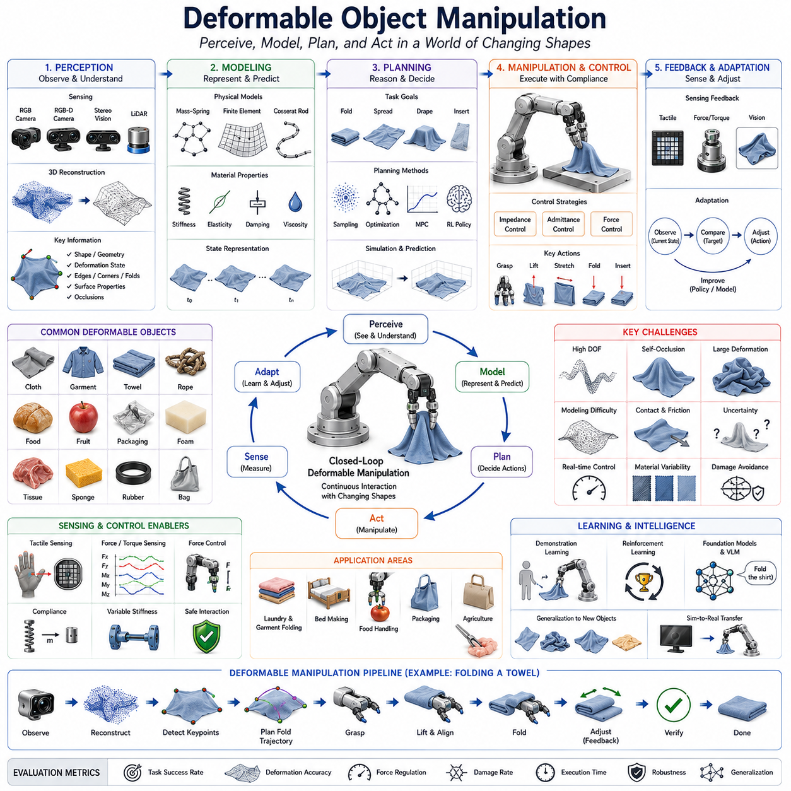{width="7.268055555555556in" height="7.268055555555556in"}

Deformable Object Manipulation(변형 가능 물체 조작)은 로봇이 형태가 지속적으로 변하는 물체를 인식하고, 파지하며, 제어하고, 변형시키고, 상호작용하는 능력을 의미한다. 강체(Rigid Object)는 일반적인 작업 환경에서 형상이 유지되지만, 변형 가능 물체(Deformable Object)는 힘, 접촉, 중력, 환경적 제약에 의해 지속적으로 형태가 변화한다. 대표적인 예로는 천(Cloth), 의류(Garment), 종이(Paper), 식품(Food), 생체 조직(Biological Tissue), 스펀지(Foam), 고무 부품(Rubber Component), 포장재(Packaging Material), 농산물(Agricultural Product), 의료 재료(Medical Material) 등이 있다. 로봇이 공장뿐만 아니라 가정, 병원, 물류센터, 농업, 건설 현장과 같은 비정형 환경으로 확장되면서 변형 가능 물체를 다루는 능력은 차세대 지능형 로봇의 핵심 기술로 부상하고 있다. Robot Hand and Dexterous Grasping의 Tool Use and Assembly 영역에서 이 주제는 강체 조립을 넘어 연속적으로 변화하는 형상을 가진 물체를 다루는 고차원 조작 기술로 볼 수 있다.

변형 가능 물체 조작이 어려운 가장 큰 이유는 물체의 상태를 단순한 6자유도(6 Degrees of Freedom)로 표현할 수 없기 때문이다. 강체는 위치(Position)와 자세(Orientation)만 알면 상태를 정의할 수 있지만, 변형 가능 물체는 사실상 무한한 자유도(Infinite Degrees of Freedom)를 가진다. 예를 들어 천 한 장은 잡는 위치, 늘어나는 정도, 접히는 형태, 주변 환경과의 접촉에 따라 전혀 다른 모양을 가질 수 있다. 이러한 거대한 상태 공간(State Space)은 인식, 모델링, 계획, 제어, 학습의 모든 측면에서 큰 어려움을 만든다.

변형 가능 물체는 거의 모든 산업과 일상생활에 존재한다. 제조업에서는 고무 패킹, 플라스틱 필름, 가스켓(Gasket), 복합 재료(Composite Material), 포장재 등을 다룬다. 물류 분야에서는 비닐 포장, 봉투, 유연한 상자, 완충재 등이 사용된다. 농업에서는 과일, 채소, 식물, 수확물 등이 대표적인 변형 가능 물체이다. 의료 분야에서는 조직(Tissue), 장기(Organ), 봉합사(Suture), 드레싱(Dressing)을 다루어야 한다. 가정용 서비스 로봇은 의류, 수건, 침대 시트, 음식물 등을 처리해야 한다. 따라서 변형 가능 물체를 안정적으로 다루는 능력은 범용 로봇 실현의 핵심 요소이다.

변형 가능 물체 조작의 첫 번째 과제는 인식(Perception)이다. 강체와 달리 변형 가능 물체는 외형이 지속적으로 변하기 때문에 단순한 물체 인식만으로는 충분하지 않다. 같은 수건이라도 펼쳐진 상태, 접힌 상태, 구겨진 상태는 전혀 다른 모양을 가진다. 따라서 로봇은 변화하는 형상을 이해할 수 있어야 한다.

컴퓨터 비전(Computer Vision)은 이러한 문제 해결의 핵심 기술이다. RGB 카메라는 색상, 질감(Texture), 주름(Wrinkle), 모서리(Edge), 접힘(Fold) 정보를 제공한다. 그러나 변형 물체는 자기 가림(Self-Occlusion)이 심하고 형태 변화가 크기 때문에 일반적인 객체 인식보다 훨씬 어렵다. 최근에는 딥러닝 기반 인식 기술이 다양한 변형 상태에서도 물체를 안정적으로 인식할 수 있게 해주고 있다.

3차원 센싱(3D Sensing)은 변형 물체 인식을 더욱 향상시킨다. RGB-D 카메라, 스테레오 비전, 구조광 센서, LiDAR는 물체의 표면 형상을 재구성할 수 있다. 포인트 클라우드(Point Cloud)를 이용하면 주름, 곡률(Curvature), 표면 구조, 변형 패턴을 분석할 수 있다. 특히 천이나 대형 직물의 조작에서는 3차원 정보가 매우 중요하다.

상태 추정(State Estimation)은 변형 가능 물체 조작의 핵심 문제 중 하나이다. 로봇은 단순히 물체의 위치를 아는 것이 아니라 현재의 변형 상태를 이해해야 한다. 예를 들어 천 조작에서는 모서리(Corner), 가장자리(Edge), 접힘(Fold), 주름(Wrinkle), 숨겨진 영역(Hidden Region)을 식별해야 한다. 식품 조작에서는 내부 구조의 변형을 파악해야 하며, 의료 분야에서는 조직의 형상과 탄성을 추정해야 한다.

변형 가능 물체의 물리 모델링(Physical Modeling)은 강체 모델링보다 훨씬 복잡하다. 기존 로봇학은 강체 역학(Rigid Body Mechanics)을 기반으로 발전해 왔다. 하지만 변형 물체는 굽힘(Bending), 늘어남(Stretching), 압축(Compression), 비틀림(Twisting), 소성 변형(Plastic Deformation) 등을 고려해야 한다.

질량-스프링 모델(Mass-Spring Model)은 가장 초기부터 사용된 접근법 중 하나이다. 물체를 질량점(Mass Point)과 스프링(Spring)의 네트워크로 표현한다. 계산이 비교적 간단하고 빠르지만 복잡한 변형을 정확히 표현하기는 어렵다.

유한 요소법(Finite Element Method, FEM)은 훨씬 높은 정확도를 제공한다. 물체를 작은 요소(Element)들로 나누고 물리 방정식을 수치적으로 계산하여 변형을 예측한다. FEM은 응력(Stress), 변형(Strain), 재료 특성(Material Property)을 정밀하게 표현할 수 있지만 계산 비용이 매우 크다.

연속체 역학(Continuum Mechanics)은 변형 물체 모델링의 이론적 기반이다. 물체를 연속적인 변형 필드로 표현하여 힘과 변형의 관계를 계산한다. 특히 의료 로봇과 연성 재료 조작 분야에서 중요한 역할을 한다.

재료 특성(Material Properties)은 조작 전략을 결정하는 중요한 요소이다. 수건은 종이와 다르게 변형되며, 고무 가스켓은 생체 조직과 다르게 반응한다. 탄성(Elasticity), 강성(Stiffness), 점성(Viscosity), 압축성(Compressibility), 감쇠(Damping), 파손 저항성(Fracture Resistance)과 같은 특성이 모두 고려되어야 한다.

파지 계획(Grasp Planning)은 변형 물체에서 더욱 어려워진다. 강체는 특정 위치를 잡으면 전체 물체를 안정적으로 제어할 수 있지만, 변형 물체는 잡는 순간 형태가 변한다. 천을 한쪽 모서리에서 들어 올리면 늘어나고 접히며 새로운 형상을 형성한다. 스펀지는 압축되고, 식품은 눌릴 수 있다. 따라서 파지 계획은 안정성뿐 아니라 변형 효과까지 고려해야 한다.

이를 위해 적응형 파지(Adaptive Grasping)가 사용된다. 로봇은 물체의 반응을 관찰하면서 파지력을 지속적으로 조절한다. 촉각 센서(Tactile Sensor)와 힘 센서(Force Sensor)는 이러한 과정에서 핵심적인 역할을 수행한다.

천 조작(Cloth Manipulation)은 변형 가능 물체 조작의 대표적인 연구 분야이다. 옷 접기(Folding), 수건 정리, 침대 정리(Bed Making), 세탁물 분류 등은 매우 어려운 문제이다. 단순히 셔츠를 접는 작업조차도 모서리 인식, 접힘 추정, 천의 형상 파악, 협조적 조작이 모두 필요하다.

의류 조작(Garment Handling)은 더욱 복잡하다. 구겨진 셔츠는 펼쳐진 셔츠와 전혀 다른 모양을 가지기 때문에 먼저 펼치는(Unfolding) 작업이 필요하다. 이를 위해 적절한 파지 위치를 찾고 단계적으로 형태를 복원해야 한다.

식품 조작(Food Handling)은 또 다른 중요한 응용 분야이다. 과일, 채소, 빵, 육류와 같은 식품은 쉽게 손상될 수 있다. 과도한 힘은 멍(Bruising), 찢어짐(Tearing), 압착(Crushing)을 유발할 수 있다. 따라서 매우 정밀한 힘 제어가 필요하다.

의료 로봇(Medical Robotics)은 가장 까다로운 변형 물체 조작 환경 중 하나이다. 수술 로봇은 생체 조직을 직접 다루며, 조직은 매우 비선형적인 기계적 특성을 가진다. 작은 힘 변화도 조직 손상을 유발할 수 있기 때문에 정밀한 힘 제어와 예측 모델이 필수적이다.

소프트 로보틱스(Soft Robotics)는 변형 가능 물체 조작에 매우 적합한 접근법으로 평가된다. 소프트 그리퍼는 물체 표면에 자연스럽게 적응하며 넓은 접촉 면적으로 힘을 분산시킨다. 따라서 손상 위험을 줄이고 안정적인 파지를 제공할 수 있다.

힘 제어(Force Control)는 변형 물체 조작의 핵심 요소이다. 위치 제어만으로는 원하는 결과를 얻기 어렵다. 물체의 거동이 힘에 크게 의존하기 때문이다. 임피던스 제어(Impedance Control)와 어드미턴스 제어(Admittance Control)는 힘과 움직임의 관계를 조절하여 보다 안전한 상호작용을 가능하게 한다.

촉각 센싱(Tactile Sensing)은 접촉 상태를 직접 측정한다. 시각 센서가 외형 정보를 제공한다면 촉각 센서는 압력 분포, 접촉 위치, 미끄러짐(Slip), 국소 변형(Local Deformation)을 측정할 수 있다. 이를 통해 실시간으로 파지력을 조정할 수 있다.

다중 모달 인식(Multi-Modal Perception)은 시각, 촉각, 힘, 고유 감각(Proprioception)을 결합한다. 시각은 전체 형상을 제공하고, 촉각은 접촉 정보를 제공하며, 힘 센서는 상호작용 동역학을 측정한다. 이러한 정보 융합은 조작 성능을 크게 향상시킨다.

변형 가능 물체의 경로 계획(Motion Planning)은 강체보다 훨씬 복잡하다. 기존 계획기는 충돌 없는 경로만 찾으면 되지만, 변형 물체 계획기는 이동 과정에서 형상이 어떻게 변할지를 예측해야 한다. 따라서 물리 시뮬레이션과 경로 계획이 긴밀하게 결합된다.

모델 예측 제어(Model Predictive Control, MPC)는 이러한 문제 해결에 널리 사용된다. MPC는 미래 상태를 예측하고 최적의 제어 입력을 반복적으로 계산한다. 이를 통해 변화하는 형상에 실시간으로 대응할 수 있다.

학습 기반 접근법(Learning-Based Approach)은 최근 가장 큰 발전을 보이고 있다. 변형 물체는 수학적 모델링이 매우 어렵기 때문에 데이터 기반 학습이 효과적이다. 머신러닝은 복잡한 변형 거동을 직접 학습하여 조작 전략을 생성할 수 있다.

행동 모방 학습(Behavior Cloning)은 인간 시연(Human Demonstration)을 학습한다. 사람은 천을 접고, 음식을 다루고, 부드러운 물체를 조작하는 방법을 자연스럽게 알고 있다. 이러한 경험을 로봇에 전달할 수 있다.

강화학습(Reinforcement Learning)은 수많은 시도를 통해 최적의 정책을 학습한다. 천 접기, 로프 조작, 분류 작업, 연성 물체 취급 등에서 우수한 성과를 보여주고 있다.

시뮬레이션은 변형 물체 학습의 핵심 도구이다. 최신 물리 엔진은 매우 현실적인 변형 모델을 제공하며, 수백만 개의 학습 데이터를 생성할 수 있다.

디지털 트윈(Digital Twin)은 산업 응용에서 점점 중요해지고 있다. 실제 물체와 동일한 가상 모델을 유지하면서 센서 데이터를 지속적으로 반영한다. 이를 통해 예측 제어와 공정 최적화가 가능하다.

최근에는 파운데이션 모델(Foundation Model)과 임바디드 AI(Embodied AI)가 변형 물체 조작에도 적용되고 있다. 미래에는 천, 음식, 조직, 포장재를 각각 별도로 학습하는 것이 아니라, 다양한 변형 물체에 공통적으로 적용 가능한 물리 지식을 학습하는 방향으로 발전할 것으로 예상된다.

언어 기반 조작(Language-Conditioned Manipulation)도 중요한 연구 분야이다. 사용자가 "수건을 깔끔하게 접어라", "담요를 침대 위에 펼쳐라", "깨지기 쉬운 물건을 조심스럽게 포장하라"와 같은 명령을 내리면 로봇은 이를 변형 인식 기반 조작 전략으로 변환해야 한다.

산업계는 이러한 기술에 큰 관심을 가지고 있다. 섬유 산업은 의류 자동화를 원하고 있으며, 식품 산업은 섬세한 식품 조작을 필요로 한다. 의료 산업은 안전한 조직 조작을 요구하고, 물류 산업은 유연 포장재 처리를 자동화하려고 한다. 서비스 로봇 역시 일상생활 속의 다양한 변형 물체를 다루어야 한다.

변형 가능 물체 조작 시스템은 일반적으로 작업 성공률(Task Success Rate), 변형 정확도(Deformation Accuracy), 힘 제어 성능(Force Regulation Quality), 손상 발생률(Damage Rate), 수행 시간(Execution Speed), 불확실성에 대한 강인성(Robustness), 새로운 물체에 대한 적응성(Adaptability), 일반화 성능(Generalization) 등을 기준으로 평가된다.

미래의 Deformable Object Manipulation 시스템은 고성능 인식, 실시간 물리 시뮬레이션, 촉각 지능, 적응형 힘 제어, 학습 기반 계획, 파운데이션 모델, 디지털 트윈, 임바디드 AI가 통합된 형태로 발전할 것으로 예상된다. 이러한 기술은 인간 수준의 정교한 조작 능력에 한 걸음 더 다가가게 할 것이다.

궁극적으로 변형 가능 물체 조작은 현대 로봇공학의 가장 큰 난제(Grand Challenge) 중 하나이다. 이 문제를 해결하기 위해서는 인식, 역학, 제어, 계획, 학습, 추론이 모두 통합되어야 한다. 변형 가능 물체를 자유롭게 다룰 수 있는 능력은 미래의 지능형 제조 시스템, 서비스 로봇, 의료 로봇, 그리고 범용 임바디드 AI 실현을 위한 핵심 이정표가 될 것이다.

## 13.09 Assembly Planning

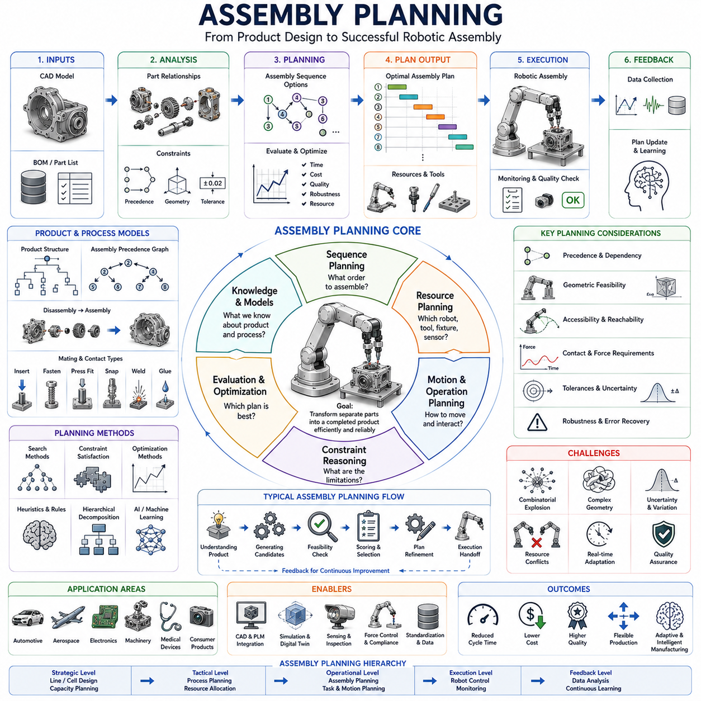{width="7.268055555555556in" height="7.268055555555556in"}

Assembly Planning(조립 계획)은 개별 부품, 구성 요소, 공구, 지그(Fixture), 로봇 자원 등을 어떻게 조정하여 분리된 부품 집합을 완성된 제품으로 변환할 것인지를 결정하는 과정이다. 이는 제품 설계(Product Design)와 실제 제조(Manufacturing)를 연결하는 핵심 단계로서, 무엇을 조립해야 하는지뿐만 아니라 어떤 순서로 조립할 것인지, 어떤 방법과 자원을 사용할 것인지, 어떤 동작과 상호작용이 필요한지를 정의한다. 로봇 시스템에서 조립 계획은 인지(Perception), 조작(Manipulation), 모션 계획(Motion Planning), 파지 계획(Grasp Planning), 공구 사용(Tool Use), 힘 제어(Force Control), 작업 계획(Task Planning), 실행 모니터링(Execution Monitoring)을 하나의 통합된 체계로 연결하는 상위 수준의 의사결정 과정이다. Robot Hand and Dexterous Grasping의 Tool Use and Assembly 영역에서 조립 계획은 개별 조작 기술들을 하나의 완전한 제조 공정으로 조직하는 핵심 지능 계층이라 할 수 있다.

조립 계획은 원래 자동차, 항공기, 전자제품, 산업기계와 같은 대규모 제조 산업에서 시작되었다. 과거에는 숙련된 엔지니어가 부품 간 관계를 분석하고 조립 순서를 결정하며 작업 절차를 설계하였다. 그러나 제품이 복잡해지고 개발 주기가 짧아지면서 이러한 수작업 방식은 점점 한계를 드러내게 되었다. 이에 따라 CAD 모델과 디지털 제품 정보를 기반으로 자동으로 조립 계획을 생성하는 기술이 발전하게 되었다.

조립 계획은 여러 가지 핵심 질문에 답해야 한다. 어떤 부품을 먼저 조립해야 하는가, 어떤 부품이 다른 부품에 의존하는가, 어떤 공구가 필요한가, 부품을 어떻게 파지해야 하는가, 어떤 방향으로 삽입해야 하는가, 어떤 제약 조건이 존재하는가, 품질은 어떻게 검증할 것인가, 오류가 발생하면 어떻게 복구할 것인가 등이 모두 조립 계획의 대상이 된다.

조립 공정은 초기 상태(Initial State)에서 최종 상태(Final State)로의 변환 과정으로 볼 수 있다. 초기 상태에서는 모든 부품이 분리되어 있으며, 최종 상태에서는 완성된 제품이 존재한다. 이 두 상태 사이에는 매우 많은 가능한 조립 순서가 존재한다. 일부는 효율적이고 실행 가능하지만, 일부는 물리적으로 불가능하거나 비효율적이다. 조립 계획의 목표는 이러한 수많은 대안 중에서 가장 적절한 조립 순서를 찾는 것이다.

조립 계획에서 가장 중요한 개념 중 하나는 선행 관계(Precedence Relationship)이다. 많은 제품은 특정 부품이 먼저 조립되어야만 다른 부품을 조립할 수 있다. 예를 들어 베어링은 축보다 먼저 하우징에 삽입되어야 한다. 전자 제품에서는 PCB에 부품을 실장한 후에 외함을 조립해야 한다. 전선 하네스는 커버를 닫기 전에 배선되어야 한다. 이러한 의존 관계는 반드시 지켜져야 하는 조립 제약 조건을 형성한다.

선행 관계는 일반적으로 그래프(Graph) 형태로 표현된다. 조립 선행 그래프(Assembly Precedence Graph)에서는 노드(Node)가 부품 또는 작업을 나타내고, 간선(Edge)이 의존 관계를 나타낸다. 이러한 그래프 표현은 가능한 조립 순서를 체계적으로 분석하는 데 유용하다.

조립 순서 계획(Assembly Sequence Planning)은 조립 계획의 핵심 문제이다. 하나의 제품은 여러 개의 유효한 조립 순서를 가질 수 있다. 어떤 순서는 작업 시간을 최소화하고, 어떤 순서는 공구 교환을 줄이며, 어떤 순서는 접근성을 향상시킨다. 따라서 시스템은 다양한 후보를 평가하고 생산 목표에 가장 적합한 순서를 선택해야 한다.

기하학적 추론(Geometric Reasoning)은 조립 계획에서 매우 중요하다. 부품은 충돌 없이 최종 위치까지 이동할 수 있어야 한다. 이를 위해 삽입 방향(Insertion Direction), 이동 경로(Motion Path), 여유 공간(Clearance), 접근 가능성(Accessibility)을 분석해야 한다. 선행 관계가 충족되더라도 기하학적 제약 때문에 특정 조립 순서는 실행 불가능할 수 있다.

분해 분석(Disassembly Analysis)은 조립 계획에 자주 활용된다. 완성된 제품에서 시작하여 어떤 순서로 분해할 수 있는지를 분석한 뒤, 그 순서를 역순으로 적용하여 조립 순서를 얻는 방법이다. 많은 경우 삽입보다 제거가 분석하기 쉽기 때문에 효율적인 접근법으로 사용된다.

조립 계획은 부품 간 접촉(Contact)도 고려해야 한다. 실제 조립 과정에는 삽입(Insertion), 체결(Fastening), 정렬(Alignment), 압입(Press Fitting), 스냅 결합(Snap Fitting), 용접(Welding), 접착(Gluing) 등이 포함된다. 이러한 작업은 단순 배치보다 훨씬 복잡하며 힘 제어와 순응성 제어가 필요하다.

제품 규모가 커질수록 조립 계획의 복잡도는 급격히 증가한다. 단 10개의 부품만 있어도 수천 개의 조립 순서가 존재할 수 있다. 수백 개의 부품이 포함된 제품은 사실상 천문학적인 수의 조합을 가진다. 따라서 완전 탐색은 불가능하며, 최적화(Optimization), 휴리스틱(Heuristic), 제약 조건 추론(Constraint Reasoning), 계층적 분해(Hierarchical Decomposition)가 활용된다.

계층적 조립 계획(Hierarchical Assembly Planning)은 복잡한 제품을 여러 개의 서브어셈블리(Subassembly)로 나누어 계획하는 방식이다. 먼저 작은 조립체를 만들고, 이후 이를 결합하여 최종 제품을 구성한다. 이는 사람이 복잡한 제품을 조립하는 방식과 매우 유사하다.

제품 구조(Product Structure)는 조립 계획의 중요한 정보원이다. 현대 CAD 시스템에는 부품 형상, 결합 관계(Mating Relationship), 공차(Tolerance), 재료(Material), 조립 제약 정보가 포함되어 있다. 조립 계획 시스템은 이러한 정보를 활용하여 자동으로 조립 순서를 생성할 수 있다.

Computer-Aided Assembly Planning(CAAP)은 CAD 데이터를 이용하여 조립 계획을 자동 생성하는 기술이다. 시스템은 부품 간 관계를 분석하고 가능한 순서를 생성하며 최적의 계획을 제안한다. 최근에는 PLM(Product Lifecycle Management) 및 Digital Twin 환경과 통합되는 경우가 많다.

자원 계획(Resource Planning)도 중요한 요소이다. 조립 작업에는 로봇, 공구, 센서, 지그, 작업 공간, 인간 작업자가 필요하다. 계획 시스템은 어떤 자원이 언제 필요한지를 결정해야 한다. 자원 활용 효율은 생산 비용과 생산성에 직접적인 영향을 미친다.

공구 계획(Tool Planning)은 조립 계획의 특수 분야이다. 조립 작업마다 필요한 공구가 다르다. 드라이버, 용접기, 삽입 공구, 검사 장비, 힘 제어 엔드이펙터 등이 대표적이다. 공구 선택은 품질, 속도, 접근성, 신뢰성에 큰 영향을 미친다.

지그 계획(Fixture Planning)도 매우 중요하다. 지그는 부품을 안정적으로 고정하고 위치 정확도를 향상시킨다. 그러나 지그는 비용을 증가시키고 유연성을 저하시킨다. 최근에는 로봇이 직접 부품을 제어하는 지그리스 조립(Fixtureless Assembly)이 활발히 연구되고 있다.

모션 계획과 조립 계획은 밀접하게 연결되어 있다. 이론적으로는 올바른 조립 순서라도 로봇이 실제로 도달할 수 없다면 의미가 없다. 따라서 최근 조립 계획은 로봇의 운동학(Kinematics), 작업 공간(Workspace), 충돌 검사(Collision Checking), 궤적 생성(Trajectory Generation)을 동시에 고려한다.

인간-로봇 협업(Human-Robot Collaboration)은 새로운 조립 계획 문제를 제기한다. 일부 작업은 로봇이 수행하는 것이 효율적이며, 일부 작업은 인간의 유연성과 판단력이 더 적합하다. 따라서 조립 계획은 작업 분배(Task Allocation)와 작업 부하 균형(Workload Balancing)도 포함해야 한다.

힘 기반 조립 계획(Force-Aware Assembly Planning)은 정밀 제조에서 중요성이 커지고 있다. 베어링 삽입, 커넥터 체결, 나사 조립과 같은 작업은 단순한 위치 제어만으로는 불가능하다. 계획 단계에서부터 필요한 힘, 순응성 설정, 센서 사용 방식을 고려해야 한다.

공차 분석(Tolerance Analysis)은 제조 오차를 고려하기 위한 과정이다. 실제 부품은 설계값과 완전히 동일하지 않다. 조립 계획은 이러한 오차를 고려하여 충분히 강인한(Robust) 조립 절차를 생성해야 한다.

유연 생산 시스템(Flexible Manufacturing System)은 조립 계획의 중요성을 더욱 높이고 있다. 과거의 생산 라인은 단일 제품만 생산했지만, 현대 제조는 다양한 제품과 맞춤형 생산을 요구한다. 따라서 새로운 제품이 등장할 때마다 빠르게 조립 계획을 생성할 수 있어야 한다.

재구성 가능 제조 시스템(Reconfigurable Manufacturing System)은 이러한 개념을 더욱 확장한다. 로봇, 작업 셀, 공구, 생산 라인이 동적으로 재배치될 수 있으며, 조립 계획도 이에 맞추어 지속적으로 최적화되어야 한다.

인공지능(AI)은 조립 계획 분야에 큰 변화를 가져왔다. 과거에는 규칙 기반 시스템이 주로 사용되었지만, 복잡한 제품에서는 한계가 있었다. AI는 보다 유연하고 확장 가능한 계획 생성을 가능하게 한다.

제약 만족 기법(Constraint Satisfaction)은 가장 오래된 AI 접근법 중 하나이다. 조립 문제를 제약 만족 문제로 정의하고, 기하학적 제약, 시간 제약, 자원 제약, 선행 관계를 만족하는 해를 탐색한다.

그래프 탐색(Graph Search) 기법도 널리 사용된다. 조립 상태를 그래프의 노드로 표현하고 가능한 작업을 간선으로 표현하여 최적의 조립 경로를 탐색한다.

최적화 기반 접근법은 조립 계획을 수학적 최적화 문제로 정의한다. 목표는 생산 시간 최소화, 비용 절감, 공구 교환 최소화, 생산량 최대화, 품질 향상 등 다양할 수 있다.

머신러닝(Machine Learning)은 과거 생산 데이터를 분석하여 어떤 조립 전략이 성공적인지 학습할 수 있다. 이러한 학습 기반 시스템은 새로운 제품에도 빠르게 적응할 수 있다.

강화학습(Reinforcement Learning)은 조립 계획에서도 유망한 접근법으로 평가된다. 로봇은 반복적인 시도를 통해 장기적으로 가장 효율적인 조립 전략을 학습할 수 있다.

시뮬레이션(Simulation)은 현대 조립 계획의 핵심 도구이다. 실제 조립 전에 디지털 환경에서 충돌 여부, 접근성, 작업 시간, 힘 요구 사항 등을 검증할 수 있다. 이를 통해 개발 비용과 위험을 크게 줄일 수 있다.

디지털 트윈(Digital Twin)은 실시간 센서 데이터를 이용하여 가상 생산 시스템을 지속적으로 업데이트한다. 이를 통해 조립 진행 상황을 모니터링하고 문제를 예측하며 계획을 동적으로 수정할 수 있다.

최근에는 파운데이션 모델(Foundation Model)과 임바디드 AI(Embodied AI)가 조립 계획에도 적용되기 시작했다. 미래에는 로봇이 자연어 명령만으로 조립 목표를 이해하고, 전체 조립 계획을 자동으로 생성하는 수준으로 발전할 가능성이 있다.

예를 들어 사용자가 "공구 교환을 최소화하면서 가장 빠르게 기어박스를 조립하라"고 지시하면, 시스템은 CAD 데이터, 생산 자원, 작업 조건을 분석하여 최적의 조립 계획을 자동 생성할 수 있을 것이다.

다중 로봇 조립(Multi-Agent Assembly Planning)도 중요한 연구 분야이다. 미래의 공장은 여러 대의 로봇이 협력하여 복잡한 제품을 조립할 것이다. 이를 위해서는 작업 분배, 동기화, 통신, 충돌 방지, 협력 계획이 필요하다.

조립 검증(Assembly Verification)과 품질 보증(Quality Assurance)은 계획 과정의 마지막 단계이다. 조립 계획은 검사 위치, 측정 방법, 허용 오차, 오류 복구 절차까지 정의해야 한다.

조립 계획 시스템은 일반적으로 계획 시간(Planning Time), 조립 사이클 타임(Cycle Time), 자원 활용도(Resource Utilization), 품질(Quality), 강인성(Robustness), 확장성(Scalability), 계산 효율성(Computational Efficiency), 성공률(Success Rate) 등을 기준으로 평가된다.

미래의 Assembly Planning 시스템은 CAD 지능, 물리 시뮬레이션, 디지털 트윈, 힘 기반 계획, 학습 기반 최적화, 파운데이션 모델, 임바디드 AI를 통합한 형태로 발전할 것이다. 이러한 시스템은 변화하는 제품과 생산 환경에 실시간으로 적응하면서도 높은 품질과 생산성을 유지할 수 있게 될 것이다.

궁극적으로 조립 계획은 개별 로봇 기술을 하나의 완전한 제조 공정으로 통합하는 두뇌 역할을 수행한다. 인지, 파지, 공구 사용, 삽입, 체결, 검사, 품질 관리까지 모든 과정을 연결하는 핵심 기술이며, 미래의 지능형 제조 시스템, 협업 로봇, 자율 생산 공장, 그리고 범용 임바디드 AI 실현을 위한 필수 요소가 될 것이다.

## 13.10 Contact-Rich Manipulation

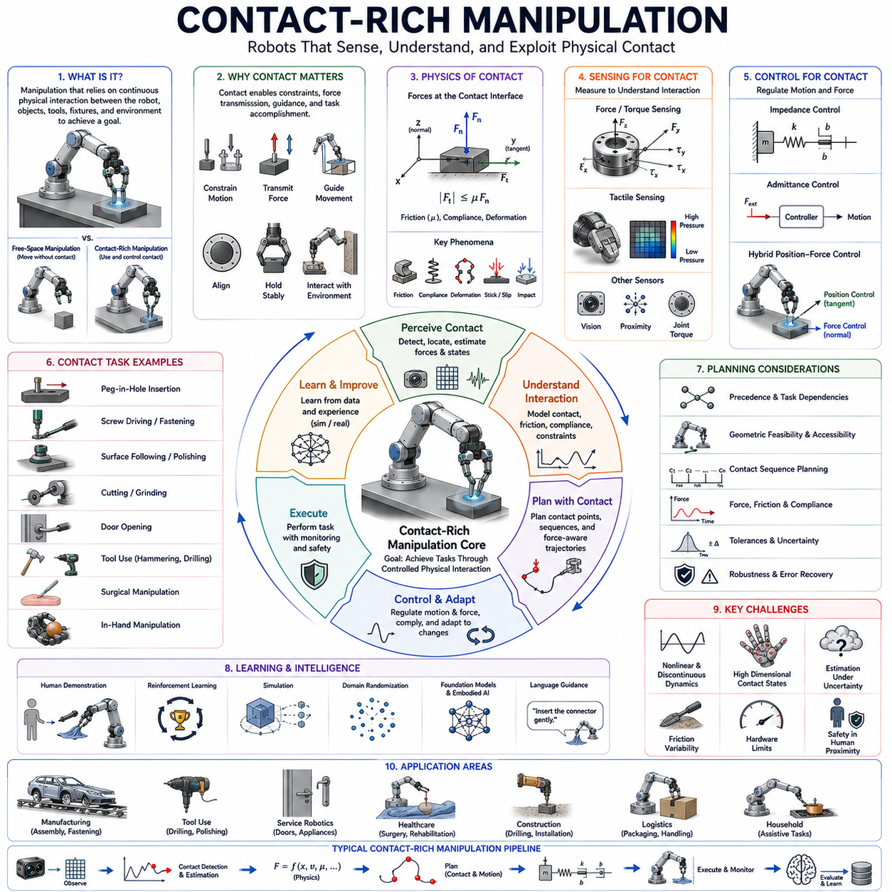{width="7.268055555555556in" height="7.268055555555556in"}

Contact-Rich Manipulation(접촉 기반 조작)은 로봇, 물체, 공구, 지그(Fixture), 그리고 주변 환경 사이의 지속적인 물리적 접촉이 작업 수행의 핵심 역할을 하는 조작 기술을 의미한다. 자유 공간 조작(Free-Space Manipulation)이 환경과의 상호작용 없이 물체를 이동시키는 데 초점을 맞춘다면, 접촉 기반 조작은 원하는 작업 결과를 얻기 위해 의도적으로 물리적 접촉을 활용한다. 조립(Assembly), 삽입(Insertion), 체결(Fastening), 공구 사용(Tool Use), 글쓰기(Writing), 연마(Polishing), 절단(Cutting), 문 열기(Door Opening), 기계 조작(Operation), 의복 착용(Dressing), 요리(Cooking), 수술(Surgery)과 같은 인간의 중요한 활동 대부분은 본질적으로 접촉 기반 작업이다. 따라서 접촉 기반 조작을 성공적으로 수행하는 능력은 범용 로봇과 임바디드 AI(Embodied AI) 실현의 핵심 이정표로 간주된다.

전통적인 산업용 로봇은 구조화된 환경에서 매우 성공적이었다. 이러한 환경에서는 부품 위치가 정확히 알려져 있고 작업 조건이 일정하기 때문에 위치 제어(Position Control)와 사전 정의된 경로만으로도 충분했다. 그러나 로봇이 공장 밖으로 나와 가정, 병원, 물류센터, 건설 현장과 같은 비정형 환경에서 작업하기 시작하면서 단순한 위치 제어만으로는 충분하지 않게 되었다. 접촉이 발생하면 마찰(Friction), 순응성(Compliance), 힘 전달(Force Transmission), 변형(Deformation), 불확실성(Uncertainty)과 같은 복잡한 물리 현상이 등장하기 때문이다. 따라서 접촉 기반 조작은 움직임(Motion)과 힘(Force)을 동시에 이해하고 제어해야 한다.

접촉 기반 조작의 이론적 기반은 접촉 역학(Contact Mechanics)에 있다. 두 물체가 접촉하면 접촉면(Contact Interface)을 통해 힘이 전달된다. 이 힘은 재료(Material), 표면 형상(Surface Geometry), 마찰 계수(Friction Coefficient), 순응성 특성(Compliance Characteristics), 상대 운동(Relative Motion), 환경 조건(Environmental Condition)에 의해 결정된다. 이러한 상호작용을 이해하고 제어하는 것이 성공적인 조작의 핵심이다.

접촉 기반 작업의 가장 큰 특징 중 하나는 제약 조건(Constraint)의 존재이다. 자유 공간에서는 로봇이 비교적 자유롭게 움직일 수 있지만, 접촉이 발생하면 환경이 로봇의 움직임을 제한한다. 예를 들어 핀 삽입(Peg-in-Hole)에서는 홀(Hole)의 형상이 이동 방향을 제한한다. 문을 열 때는 경첩(Hinge)이 특정 궤적만 허용한다. 연마 작업에서는 표면 형상이 공구 움직임을 결정한다. 따라서 접촉 기반 조작은 환경 제약을 이해하고 활용해야 한다.

Peg-in-Hole 삽입 작업은 접촉 기반 조작의 대표적인 예이다. 단순해 보이지만 실제로는 정렬(Alignment), 힘 제어(Force Control), 순응성 관리(Compliance Management), 마찰 처리(Friction Handling), 오류 복구(Error Recovery)가 모두 필요하다. 작은 위치 오차도 재밍(Jamming), 웨징(Wedging), 과도한 접촉력을 발생시킬 수 있다. 이러한 이유로 Peg-in-Hole은 수십 년 동안 접촉 기반 조작의 대표 벤치마크(Benchmark)로 사용되어 왔다.

체결 작업(Fastening Operation) 역시 대표적인 접촉 기반 조작이다. 나사 체결(Screw Driving), 볼트 조임(Bolt Tightening), 커넥터 삽입(Connector Insertion), 스냅 결합(Snap-Fit Assembly) 등은 모두 지속적인 접촉을 포함한다. 로봇은 힘, 토크(Torque), 정렬 상태, 삽입 깊이를 동시에 제어해야 하며, 작업 중 변화하는 접촉 상태에 실시간으로 대응해야 한다.

공구 사용(Tool Use)은 접촉 기반 조작을 더욱 복잡하게 만든다. 인간은 망치(Hammer), 드릴(Drill), 칼(Knife), 사포(Sandpaper), 붓(Brush) 등을 이용하여 힘을 증폭하거나 상호작용을 변화시킨다. 로봇이 망치질, 드릴링, 절단, 샌딩, 연마, 페인팅, 필기 등을 수행하려면 공구를 통해 전달되는 힘을 이해하고 제어해야 한다.

접촉 모델(Contact Model)은 접촉 기반 조작의 수학적 기반을 제공한다. 가장 단순한 모델은 강체 접촉(Rigid Contact)과 쿨롱 마찰(Coulomb Friction)을 가정한다. 그러나 실제 환경에서는 순응성, 변형, 점탄성(Viscoelasticity), 접착(Adhesion), 비선형 마찰(Nonlinear Friction) 등이 존재한다. 정확한 접촉 모델은 시뮬레이션, 계획, 제어의 핵심 요소이다.

마찰(Friction)은 접촉 기반 조작에서 매우 중요한 역할을 한다. 마찰은 물체를 안정적으로 잡고 힘을 전달할 수 있게 해주는 긍정적인 요소이다. 그러나 지나친 마찰은 재밍, 마모(Wear), 에너지 손실(Energy Loss), 예측 불가능한 거동을 유발할 수 있다. 따라서 로봇은 마찰을 활용하면서도 동시에 관리해야 한다.

순응성(Compliance)은 또 다른 핵심 개념이다. 순응성이란 외부 힘이 가해졌을 때 시스템이 변형되거나 적응하는 능력을 의미한다. 인간은 근육(Muscle), 힘줄(Tendon), 연부 조직(Soft Tissue)을 통해 자연스럽게 순응성을 활용한다. 로봇도 유사한 능력을 얻기 위해 기계적 순응성(Mechanical Compliance)과 제어 기반 순응성(Control-Based Compliance)을 사용한다.

기계적 순응성은 탄성 재료, 유연 구조(Flexible Structure), 탄성 관절(Elastic Joint), 수동 메커니즘(Passive Mechanism)을 통해 구현된다. 이러한 구조는 충격을 흡수하고 오차에 대한 민감도를 줄여준다. 조립 작업과 인간-로봇 협업(Human-Robot Collaboration)에서 특히 유용하다.

제어 기반 순응성은 소프트웨어를 통해 구현된다. 대표적으로 임피던스 제어(Impedance Control)와 어드미턴스 제어(Admittance Control)가 있다. 임피던스 제어는 힘과 움직임의 관계를 정의하여 로봇이 가상의 스프링(Spring)이나 댐퍼(Damper)처럼 동작하도록 만든다. 어드미턴스 제어는 측정된 힘에 따라 움직임을 수정한다. 두 방식 모두 안전하고 유연한 접촉 상호작용을 가능하게 한다.

힘 센서(Force Sensor)는 접촉 기반 조작의 핵심 센서이다. 힘-토크 센서(Force-Torque Sensor)는 접촉력과 모멘트(Moment)를 직접 측정할 수 있다. 이를 통해 로봇은 접촉 발생 여부를 감지하고, 환경 특성을 추정하며, 힘을 제어하고, 이상 상황을 탐지할 수 있다.

촉각 센서(Tactile Sensor)는 힘 센서를 보완한다. 힘 센서가 전체 힘을 측정하는 반면, 촉각 센서는 압력 분포(Pressure Distribution), 접촉 위치(Contact Location), 미끄러짐(Slip), 표면 질감(Texture) 등을 측정한다. 힘 센서와 촉각 센서를 결합하면 훨씬 정교한 조작이 가능하다.

접촉 상태 추정(Contact State Estimation)은 중요한 연구 주제이다. 로봇은 접촉이 존재하는지, 어디에서 접촉이 일어나는지, 몇 개의 접촉점(Contact Point)이 존재하는지, 어떤 힘이 전달되는지를 실시간으로 파악해야 한다. 접촉 상태는 매우 빠르게 변화하기 때문에 정확한 추정이 필요하다.

하이브리드 위치-힘 제어(Hybrid Position-Force Control)는 접촉 기반 조작의 대표적인 제어 기법이다. 특정 방향은 위치 제어를 수행하고 다른 방향은 힘 제어를 수행한다. 예를 들어 표면을 따라 이동하는 작업에서는 표면 접선 방향(Tangential Direction)은 위치 제어를 하고, 법선 방향(Normal Direction)은 힘 제어를 수행한다.

제약 기반 제어(Constraint-Based Control)는 환경 제약을 제어기에 직접 포함한다. 기존 방식이 접촉을 피하려고 했다면, 제약 기반 제어는 접촉을 유용한 정보와 가이드로 활용한다. 이러한 접근은 높은 강인성과 효율성을 제공한다.

모션 계획(Motion Planning)은 접촉이 포함되면 훨씬 복잡해진다. 기존 계획은 충돌 없는 경로만 찾으면 되었지만, 접촉 기반 조작에서는 접촉을 의도적으로 생성하고 유지하며 활용해야 한다. 따라서 단순한 기하학적 결과뿐 아니라 힘과 물리적 상호작용까지 예측해야 한다.

접촉 계획(Contact Planning)은 이러한 문제를 해결하기 위한 연구 분야이다. 어디에서 접촉을 만들 것인지, 언제 접촉 상태를 변경할 것인지, 어떤 힘을 적용할 것인지를 계획한다. 조립, 보행, 정교한 손 조작, 공구 사용에서 매우 중요하다.

다중 접촉 조작(Multi-Contact Manipulation)은 더욱 복잡한 문제를 다룬다. 인간의 손은 여러 손가락과 손바닥을 동시에 사용하며, 환경과도 접촉한다. 다중 접촉은 조작 능력을 크게 향상시키지만 제어 문제를 훨씬 어렵게 만든다.

정교한 로봇 손(Dexterous Robotic Hand)은 접촉 기반 조작의 핵심 플랫폼이다. 다관절 손은 여러 접촉점을 동시에 생성하고 조절할 수 있다. 이를 통해 물체 재배치(Object Reorientation), 손 안 조작(In-Hand Manipulation), 힘 재분배(Force Redistribution)가 가능해진다.

환경 활용(Environmental Exploitation)은 최근 주목받는 연구 방향이다. 인간은 벽을 이용해 정렬하고, 테이블 위에서 물체를 미끄러뜨리며, 환경을 적극 활용한다. 로봇도 환경을 단순한 장애물로 보지 않고 조작을 돕는 요소로 활용하기 시작하고 있다.

학습 기반 접근법(Learning-Based Approach)은 접촉 기반 조작 분야를 크게 변화시키고 있다. 접촉 동역학은 비선형적이고 불연속적이며 모델링이 어렵기 때문에 데이터 기반 접근이 매우 효과적이다.

행동 모방 학습(Behavior Cloning)은 인간 시연을 학습한다. 사람은 접촉 상황에서 힘과 움직임을 자연스럽게 조절한다. 로봇은 이러한 시연을 통해 복잡한 상호작용 전략을 학습할 수 있다.

강화학습(Reinforcement Learning)은 접촉 기반 작업에서 큰 성과를 보이고 있다. 반복적인 상호작용을 통해 최적의 정책을 학습하며, 삽입, 조립, 공구 사용, 물체 재배치, 정교한 손 조작에서 뛰어난 결과를 보여주고 있다.

시뮬레이션(Simulation)은 학습 기반 접촉 조작의 핵심 도구이다. 최신 물리 엔진은 접촉, 마찰, 변형, 힘 상호작용을 매우 현실적으로 표현할 수 있다. 이를 통해 로봇은 실제 환경에 배치되기 전에 수백만 번의 경험을 축적할 수 있다.

도메인 랜덤화(Domain Randomization)는 시뮬레이션과 현실 사이의 차이를 줄이는 방법이다. 마찰, 질량, 센서 노이즈, 순응성 등을 다양하게 변화시키며 학습함으로써 실제 환경에서도 강인하게 동작하도록 만든다.

최근에는 파운데이션 모델(Foundation Model)과 임바디드 AI(Embodied AI)가 접촉 기반 조작에도 적용되고 있다. 미래의 시스템은 개별 작업마다 별도로 학습하는 대신, 다양한 접촉 경험을 통해 일반적인 물리 추론 능력(Physical Reasoning)을 습득할 것으로 기대된다.

언어 기반 조작(Language-Guided Manipulation)도 새로운 가능성을 열고 있다. 사용자가 "커넥터를 부드럽게 삽입해라", "나사를 조심스럽게 조여라", "저항이 느껴질 때까지 밀어라"와 같은 명령을 내리면 로봇은 이를 힘 제어 정책으로 변환해야 한다.

산업 현장에서 접촉 기반 조작은 매우 광범위하게 사용된다. 제조업에서는 조립, 체결, 용접, 연마, 포장 작업을 수행한다. 서비스 로봇은 문, 가전제품, 가구, 스위치 등을 조작한다. 의료 로봇은 조직과 의료기구를 다룬다. 건설 로봇은 드릴링, 체결, 절단, 설치 작업을 수행한다.

접촉 기반 조작 시스템은 일반적으로 작업 성공률(Task Success Rate), 힘 제어 정확도(Force Regulation Accuracy), 삽입 정확도(Insertion Accuracy), 조립 품질(Assembly Quality), 접촉 안정성(Contact Stability), 불확실성에 대한 강인성(Robustness), 적응 능력(Adaptation Capability), 수행 시간(Execution Speed), 에너지 효율(Energy Efficiency), 안전성(Safety)을 기준으로 평가된다.

미래의 Contact-Rich Manipulation 시스템은 고해상도 촉각 센싱, 힘 기반 인지, 실시간 물리 추론, 순응형 액추에이션, 적응형 제어, 시뮬레이션 기반 학습, 파운데이션 모델, 디지털 트윈, 임바디드 지능을 통합한 형태로 발전할 것이다. 이러한 시스템은 단순히 접촉을 처리하는 수준을 넘어 접촉을 이해하고 예측하며 적극적으로 활용할 수 있게 될 것이다.

궁극적으로 Contact-Rich Manipulation은 지능형 로봇공학의 핵심 난제 중 하나이다. 이는 단순히 물체의 위치를 이해하는 것을 넘어, 물리적 상호작용 속에서 힘이 어떻게 전달되고 변화하는지를 이해해야 한다. 접촉 기반 조작을 완전히 마스터하는 것은 조립, 공구 사용, 유지보수, 의료 지원, 가사 지원 등 인간 수준의 물리적 작업을 수행할 수 있는 범용 로봇과 미래 임바디드 AI 실현을 위한 핵심 단계로 평가된다.

## 13.11 Learning Tool Use

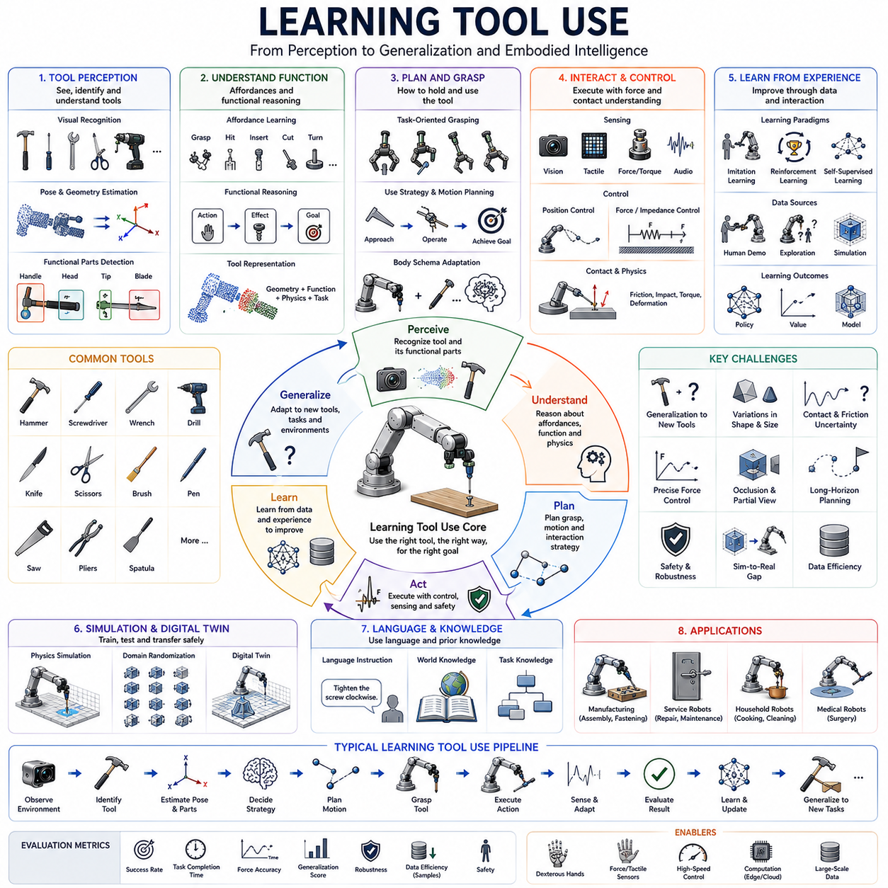{width="7.268055555555556in" height="7.268055555555556in"}

Learning Tool Use(공구 사용 학습)는 로봇이 경험, 관찰, 시뮬레이션, 명령, 환경과의 상호작용을 통해 공구를 사용하는 방법을 학습하고, 이해하며, 적응하고, 일반화하는 능력을 의미한다. 공구 사용은 인간 지능의 대표적인 특징 중 하나로 여겨져 왔다. 이는 단순히 물체를 잡는 것이 아니라 외부 물체를 자신의 신체 능력의 확장으로 활용하여 목표를 달성하는 능력이기 때문이다. 인간은 망치(Hammer), 드라이버(Screwdriver), 칼(Knife), 렌치(Wrench), 가위(Scissors), 펜(Pen), 붓(Brush), 드릴(Drill)과 같은 다양한 공구를 자연스럽게 사용한다. 그러나 로봇에게 공구 사용은 인식(Perception), 추론(Reasoning), 조작(Manipulation), 계획(Planning), 물리 이해(Physical Understanding), 학습(Learning)이 결합된 매우 복잡한 문제이다. Robot Hand and Dexterous Grasping의 Tool Use and Assembly 영역에서 Learning Tool Use는 사전에 정의된 조작 기술에서 벗어나 적응형 임바디드 지능(Embodied Intelligence)으로 발전하기 위한 핵심 단계로 간주된다.

공구 사용의 중요성은 단순한 산업 응용을 넘어선다. 인지과학(Cognitive Science)과 발달심리학(Developmental Psychology)에서는 공구 사용을 고등 지능의 상징으로 본다. 인간뿐 아니라 침팬지(Chimpanzee), 까마귀(Crow), 돌고래(Dolphin)와 같은 일부 동물도 공구 사용 능력을 보여준다. 이는 외부 물체를 이용하여 자신의 능력을 확장하고 새로운 문제를 해결할 수 있음을 의미한다. 마찬가지로, 로봇이 처음 보는 공구를 스스로 이해하고 사용할 수 있다면 이는 보다 일반적인 지능을 향한 중요한 진전으로 평가된다.

전통적인 로봇 시스템은 대부분 사전에 정의된 공구 모델과 수동 프로그래밍에 의존하였다. 엔지니어는 공구의 형상(Geometry), 접촉점(Contact Point), 동작 시퀀스(Motion Sequence), 제어 알고리즘(Control Algorithm)을 직접 설계하였다. 이러한 방식은 공장과 같은 구조화된 환경에서는 효과적이었지만, 공구가 바뀌거나 작업 환경이 달라질 경우 대규모 재프로그래밍이 필요했다. 따라서 현대 로봇은 공구 사용을 프로그래밍하는 것이 아니라 학습해야 한다는 방향으로 발전하고 있다.

공구 사용은 신체 능력의 확장(Extension of Embodied Action)으로 볼 수 있다. 일반적으로 로봇은 엔드이펙터(End Effector)를 이용하여 직접 환경과 상호작용한다. 그러나 공구를 사용하면 로봇과 환경 사이에 새로운 물체가 개입하게 된다. 따라서 힘, 움직임, 정보가 공구를 통해 전달된다. 로봇은 공구를 자신의 일부처럼 인식하고 활용할 수 있어야 한다.

공구 사용 학습의 첫 번째 단계는 공구 인식(Tool Perception)이다. 로봇은 공구를 식별하고, 형상을 추정하며, 기능적 구조를 이해하고, 적절한 파지 위치를 찾아야 한다. 일반 물체와 달리 공구는 특정 기능을 수행하기 위해 설계된 구조를 가진다. 망치는 손잡이와 타격면(Striking Surface)을 가지고 있으며, 드라이버는 손잡이와 팁(Tip)을 가진다. 가위는 두 개의 관절식 블레이드(Articulated Blade)를 가진다. 이러한 기능적 구조를 이해하는 것이 중요하다.

컴퓨터 비전(Computer Vision)은 공구 인식의 핵심 기술이다. 최신 시스템은 딥러닝을 이용하여 공구 종류를 분류하고, 자세(Pose)를 추정하며, 파지점(Grasp Point)과 기능 영역(Functional Region)을 찾는다. 그러나 단순히 외형을 인식하는 것만으로는 충분하지 않다. 로봇은 공구의 기능(Function)을 이해해야 한다.

이를 위해 어포던스 학습(Affordance Learning)이 활용된다. 어포던스(Affordance)는 특정 물체가 제공하는 행동 가능성을 의미한다. 손잡이는 잡을 수 있도록 하고, 칼날은 자를 수 있도록 하며, 망치 머리는 타격을 가능하게 한다. 공구의 어포던스를 학습하면 로봇은 단순히 물체를 보는 것이 아니라 어떻게 사용할 수 있는지를 이해하게 된다.

기능적 추론(Functional Reasoning)은 한 단계 더 나아간 개념이다. 로봇은 단순히 어포던스를 아는 것이 아니라 그것이 작업 목표에 어떻게 기여하는지 이해해야 한다. 예를 들어 드라이버를 사용할 때 손잡이를 회전시키면 팁에서 토크가 발생하고, 이 토크가 나사를 회전시킨다는 인과관계를 이해해야 한다.

공구 표현(Tool Representation)도 중요한 문제이다. 초기 시스템은 공구를 단순한 기하학적 모델로 표현하였다. 그러나 최근에는 기능, 접촉 역학, 재료 특성, 작업 관련 정보를 포함하는 풍부한 표현 방식이 사용된다. 이를 통해 보다 유연한 공구 사용이 가능해진다.

신체 스키마 적응(Body Schema Adaptation)은 공구 사용 학습에서 중요한 개념이다. 인간은 테니스 라켓이나 지팡이를 사용할 때 그것을 자신의 신체 일부처럼 인식한다. 로봇도 마찬가지로 공구를 자신의 조작기(Manipulator)의 연장으로 통합할 수 있어야 한다. 이러한 적응은 경로 계획, 제어 정확도, 작업 효율성을 향상시킨다.

공구 사용을 위한 파지 계획(Grasp Planning)은 일반 물체 파지와 다르다. 단순히 안정적으로 잡는 것만으로는 충분하지 않다. 작업 목적(Task Objective)에 적합해야 한다. 예를 들어 망치는 손잡이 끝부분을 잡아야 큰 타격력을 얻을 수 있으며, 드라이버는 보다 정밀한 제어를 위해 중간 부분을 잡을 수 있다. 따라서 공구 파지는 안정성과 기능성을 동시에 고려해야 한다.

작업 지향 조작(Task-Oriented Manipulation)은 공구 사용의 핵심이다. 로봇은 공구 움직임, 힘 적용, 접촉 상호작용, 환경 반응을 통합적으로 제어해야 한다. 이 과정에서 공구 사용은 단순한 물체 이동이 아니라 복잡한 접촉 기반 조작(Contact-Rich Manipulation) 문제로 변환된다.

물리 추론(Physical Reasoning)은 성공적인 공구 사용의 필수 요소이다. 로봇은 힘이 공구를 통해 어떻게 전달되는지, 접촉이 어떤 결과를 만드는지, 환경 제약이 작업 결과에 어떤 영향을 미치는지를 이해해야 한다. 망치는 운동량(Momentum)을 전달하고, 칼은 절삭력(Cutting Force)을 생성하며, 지렛대(Lever)는 기계적 이득(Mechanical Advantage)을 제공한다. 이러한 물리 원리를 학습하는 것이 중요하다.

시뮬레이션(Simulation)은 공구 사용 학습에 매우 중요한 역할을 한다. 현대 물리 엔진은 강체 동역학(Rigid Body Dynamics), 접촉, 마찰, 변형, 힘 전달을 모델링할 수 있다. 로봇은 시뮬레이션 환경에서 수백만 번의 실험을 수행하며 공구 사용 기술을 학습할 수 있다.

행동 모방 학습(Behavior Cloning)은 가장 널리 사용되는 학습 방법 중 하나이다. 인간의 시연(Demonstration)을 관찰하고 이를 모방함으로써 공구 사용 기술을 습득한다. 이를 통해 파지 전략, 움직임 패턴, 힘 적용 방식, 작업 순서를 학습할 수 있다.

모방 학습(Imitation Learning)은 단순 복제를 넘어 작업의 의도(Intent)를 추론한다. 이를 통해 동일한 공구뿐 아니라 유사한 공구에도 학습된 지식을 적용할 수 있다.

강화학습(Reinforcement Learning)은 공구 사용 학습에서 매우 강력한 방법으로 평가된다. 로봇은 시행착오(Trial and Error)를 반복하며 성공적인 행동에는 보상을 받고 실패에는 패널티를 받는다. 이를 통해 망치질, 밀기, 절단, 물체 회수, 조립 등 다양한 공구 사용 기술을 학습할 수 있다.

탐색(Exploration)은 강화학습의 중요한 요소이다. 로봇은 어떤 행동이 어떤 결과를 가져오는지 직접 경험해야 한다. 공구 사용은 공구의 동역학까지 포함해야 하기 때문에 행동 공간(Action Space)이 매우 크다. 따라서 효율적인 탐색 전략이 중요하다.

커리큘럼 학습(Curriculum Learning)은 학습 효율을 높이는 방법이다. 처음부터 어려운 작업을 수행하는 대신 쉬운 작업부터 시작하여 점차 난이도를 높인다. 예를 들어 망치를 잡는 것부터 시작하여, 정적인 목표를 치고, 나중에는 복잡한 조립 작업으로 발전할 수 있다.

전이 학습(Transfer Learning)은 공구 사용 확장성의 핵심이다. 하나의 망치를 사용하는 방법을 학습했다면 다른 망치에도 적용할 수 있어야 한다. 하나의 드라이버 경험이 다른 드라이버 학습을 촉진할 수 있어야 한다. 이를 통해 학습 데이터 요구량을 크게 줄일 수 있다.

일반화(Generalization)는 공구 사용 연구의 궁극적인 목표 중 하나이다. 기존 시스템은 학습에 사용된 공구에 대해서만 잘 동작하는 경우가 많다. 진정한 지능형 시스템은 처음 보는 공구에도 적응할 수 있어야 한다. 이를 위해서는 특정 형상을 암기하는 것이 아니라 공구 사용의 원리를 학습해야 한다.

메타 학습(Meta-Learning)은 이러한 문제를 해결하기 위한 유망한 접근법이다. 특정 작업을 직접 학습하는 것이 아니라 학습하는 방법 자체를 학습한다. 이를 통해 새로운 공구에 빠르게 적응할 수 있다.

다중 모달 인식(Multi-Modal Perception)은 공구 학습을 크게 향상시킨다. 시각은 형상과 외형 정보를 제공하고, 촉각은 접촉 정보를 제공하며, 힘 센서는 상호작용 동역학을 측정한다. 오디오 센서는 충격음, 절삭음, 체결음을 감지할 수 있다. 이러한 정보를 통합하면 더욱 풍부한 공구 이해가 가능해진다.

언어 기반 공구 학습(Language-Guided Tool Learning)은 최근 주목받고 있는 분야이다. 인간은 "망치로 못을 박아라", "드라이버를 시계 방향으로 돌려라", "가장자리를 따라 잘라라"와 같은 언어로 공구 사용 방법을 설명한다. 대규모 언어 모델(Large Language Model)은 이러한 언어 지식을 로봇 학습에 통합할 수 있다.

파운데이션 모델(Foundation Model)은 공구 사용 연구를 변화시키고 있다. 방대한 시각, 텍스트, 상호작용 데이터를 학습한 모델은 공구와 기능에 대한 일반적인 지식을 획득할 수 있다. 이를 통해 작업별 학습 비용을 크게 줄일 수 있다.

임바디드 AI(Embodied AI)는 이러한 개념을 더욱 확장한다. 로봇은 공구를 인식하는 것뿐 아니라 언제 사용해야 하는지, 왜 필요한지, 작업 목표 달성에 어떻게 기여하는지를 이해해야 한다. 공구 사용은 단순한 조작 기술이 아니라 더 큰 인지 구조(Cognitive Architecture)의 일부가 된다.

인과 추론(Causal Reasoning)은 고급 공구 사용의 핵심 요소로 점점 중요해지고 있다. 로봇은 단순히 행동과 결과를 연결하는 것이 아니라 왜 그런 결과가 발생하는지를 이해해야 한다. 이러한 이해는 예측(Prediction), 계획(Planning), 적응(Adaptation), 오류 복구(Error Recovery)를 가능하게 한다.

공구 발명(Tool Invention)은 가장 높은 수준의 공구 지능이다. 인간은 필요한 공구가 없을 때 주변 물체를 활용하여 새로운 공구를 만들 수 있다. 미래의 로봇도 일반 물체를 재활용하거나 즉석에서 공구를 제작할 수 있을 것으로 기대된다. 이는 기능, 물리, 작업 목표에 대한 깊은 이해를 요구한다.

협업 공구 사용(Collaborative Tool Use)은 또 다른 도전 과제이다. 산업 현장과 서비스 환경에서는 인간과 로봇이 공구를 공유하거나 여러 로봇이 함께 공구를 사용해야 할 수 있다. 이를 위해서는 의도 이해(Intention Understanding), 안전성(Safety), 통신(Communication), 협력 계획(Cooperative Planning)이 필요하다.

학습 기반 공구 사용은 제조, 서비스, 의료, 건설 등 다양한 산업에 적용되고 있다. 제조 로봇은 드릴, 용접기, 드라이버, 연마 공구를 사용하며, 서비스 로봇은 청소 도구, 조리 도구, 가전기기를 조작한다. 의료 로봇은 수술 도구를 사용하고, 건설 로봇은 절단 및 체결 공구를 활용한다.

공구 사용 학습 시스템은 일반적으로 작업 성공률(Task Success Rate), 학습 효율성(Learning Efficiency), 일반화 능력(Generalization Capability), 새로운 공구 적응성(Adaptability), 강인성(Robustness), 작업 속도(Execution Speed), 힘 제어 품질(Force Regulation Quality), 안전성(Safety)을 기준으로 평가된다. 특히 일반화와 적응성은 단순 암기와 진정한 학습을 구분하는 핵심 지표이다.

미래의 Learning Tool Use 시스템은 파운데이션 모델, 임바디드 AI, 인과 추론, 다중 모달 인식, 강화학습, 모방학습, 시뮬레이션 기반 학습, 디지털 트윈, 언어 기반 계획을 통합한 형태로 발전할 것이다. 이러한 시스템은 단순히 공구를 사용하는 수준을 넘어, 새로운 공구를 이해하고, 적응하며, 심지어 발명할 수 있는 방향으로 진화할 것으로 예상된다.

궁극적으로 Learning Tool Use는 범용 로봇 지능(General-Purpose Robotic Intelligence)으로 가는 핵심 단계이다. 이는 로봇이 기능(Function)을 이해하고, 물리적 상호작용을 추론하며, 새로운 환경에 적응하고, 외부 물체를 통해 자신의 능력을 확장할 수 있음을 의미한다. 따라서 공구 사용 학습은 실용적인 기술일 뿐만 아니라 미래 임바디드 AI가 복잡한 물리 세계에서 자율적이고 지능적으로 행동하기 위한 핵심 이정표로 평가된다.

## 13.12 Industrial Assembly Case Studies

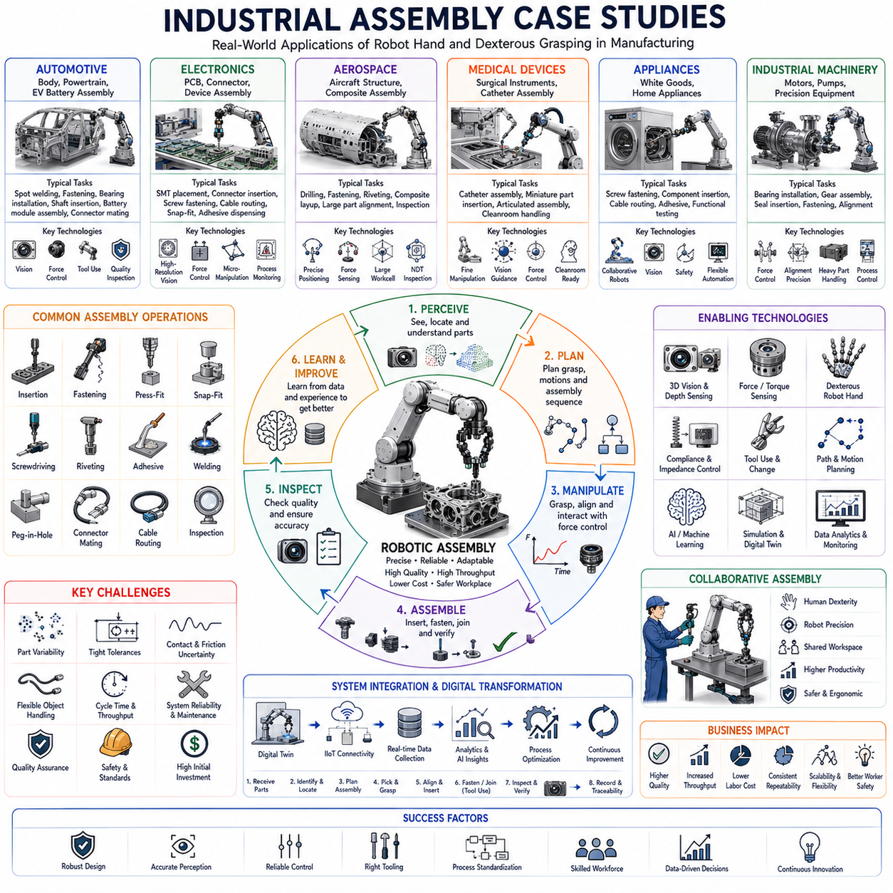{width="7.268055555555556in" height="7.268055555555556in"}

Industrial Assembly Case Studies(산업 조립 사례 연구)는 로봇 조작(Robotic Manipulation), 정교한 파지(Dexterous Grasping), 공구 사용(Tool Use), 힘 제어(Force Control), 인식(Perception), 계획(Planning), 학습(Learning) 기술이 실제 제조 환경에서 어떻게 적용되는지를 보여주는 사례들을 의미한다. 이론 연구가 로봇 조립의 기초를 제공한다면, 산업 사례 연구는 이러한 기술들이 실제 생산 현장에서 비용, 속도, 신뢰성, 안전성, 확장성, 품질 요구사항을 만족하면서 어떻게 활용되는지를 보여준다. Robot Hand and Dexterous Grasping의 Tool Use and Assembly 영역에서 산업 조립 사례 연구는 연구실 기술과 실제 산업 적용 사이를 연결하는 중요한 역할을 수행한다.

조립(Assembly)은 제조 산업의 핵심 공정 중 하나이다. 스마트폰, 노트북, 자동차, 항공기, 의료기기, 산업 장비, 가전제품 등 거의 모든 제품은 수십 개에서 수천 개의 부품을 결합하여 만들어진다. 오랫동안 조립 공정은 인간 작업자에게 의존해 왔다. 조립 작업은 복잡한 인식, 정밀한 손동작, 힘 기반 상호작용, 상황 적응 능력을 요구하기 때문이다. 그러나 센서, 컴퓨팅, 로봇공학, 인공지능, 자동화 기술의 발전으로 인해 과거에는 인간만 가능하다고 여겨졌던 조립 작업들이 점차 자동화되고 있다.

산업용 조립 환경은 연구실 환경과 매우 다르다. 연구실에서는 단 한 번의 성공적인 조립만으로도 의미 있는 결과가 될 수 있지만, 실제 산업 현장에서는 수천 시간 동안 안정적으로 동작해야 한다. 제조 시스템은 기술적 성공뿐 아니라 생산량(Throughput), 비용 효율성(Cost Efficiency), 신뢰성(Reliability), 유지보수성(Maintainability), 투자 대비 수익(Return on Investment)까지 평가받는다. 따라서 성공적인 산업용 조립 시스템은 기계공학, 로봇공학, 소프트웨어, 제어, 품질관리, 생산관리의 통합이 필요하다.

자동차 산업은 산업용 조립 자동화의 가장 대표적인 사례이다. 자동차는 수천 개의 부품으로 구성되며, 정밀한 조립이 요구된다. 현대 자동차 공장은 용접(Welding), 체결(Fastening), 도장(Painting), 운반(Handling), 검사(Inspection), 조립(Assembly) 작업에 대규모 로봇 시스템을 사용한다. 로봇은 높은 반복 정밀도와 24시간 연속 운전 능력을 제공하기 때문에 매우 큰 가치를 가진다.

차체 조립(Body-in-White Assembly)은 산업용 로봇이 가장 먼저 성공적으로 적용된 분야 중 하나이다. 이 공정에서는 여러 개의 금속 판재를 정밀하게 위치시키고 점용접(Spot Welding)을 수행하여 자동차 차체를 만든다. 이러한 자동화는 로봇 조립의 경제성을 입증한 대표적인 사례가 되었다.

파워트레인(Powertrain) 조립 역시 중요한 사례이다. 엔진, 변속기, 전기 구동 장치(Electric Drive Unit)는 베어링(Bearing), 샤프트(Shaft), 기어(Gear), 씰(Seal), 체결 부품(Fastener)을 높은 정밀도로 조립해야 한다. 이러한 작업은 접촉 기반 조작(Contact-Rich Manipulation)과 힘 제어가 필수적이다.

전기차(Electric Vehicle)의 확산은 새로운 조립 과제를 만들었다. 배터리 팩(Battery Pack)은 수많은 셀(Cell), 전기 연결부, 냉각 시스템, 구조 부품으로 구성된다. 로봇은 민감한 전기 부품을 손상시키지 않으면서 정확하게 조립해야 한다. 배터리 모듈 조립은 정밀 배치(Placement), 커넥터 삽입(Connector Insertion), 접착제 도포(Adhesive Application), 검사(Inspection) 기술을 요구한다.

전자제품 제조(Electronics Manufacturing)는 또 다른 대표적인 사례이다. 스마트폰, 태블릿, 노트북, 웨어러블 기기는 매우 작은 부품들로 구성된다. 이러한 부품은 미세한 조작(Fine Manipulation)과 정밀한 힘 제어를 요구하기 때문에 일반적인 산업용 로봇만으로는 처리하기 어렵다.

표면실장기술(Surface Mount Technology, SMT) 생산 라인은 세계에서 가장 자동화된 조립 시스템 중 하나이다. SMT 장비는 초고속으로 전자 부품을 PCB에 배치한다. 이는 정밀 기계공학, 머신비전(Machine Vision), 실시간 제어가 결합된 대표적 성공 사례이다.

전자제품 제조에서는 커넥터 삽입이 매우 중요한 문제이다. 플렉시블 케이블(Flexible Cable)과 소형 커넥터는 매우 민감하기 때문에 힘 기반 제어와 시각 기반 정렬(Visual Servoing)이 필요하다. 최근의 조립 시스템은 비전, 힘 센서, 순응성 제어를 결합하여 안정적인 삽입을 수행한다.

전자제품 최종 조립(Final Assembly)은 스냅 결합(Snap-Fit), 접착, 나사 체결, 케이블 배선, 품질 검사를 포함한다. 이러한 작업은 여러 조립 기술을 동시에 활용해야 하며 높은 생산성을 유지해야 한다.

항공우주 산업(Aerospace Industry)은 극도로 높은 품질 요구사항을 가진 조립 사례를 제공한다. 항공기는 수백만 개의 부품으로 구성되며, 모든 조립 과정이 엄격하게 관리된다. 자동차 산업과 달리 생산량은 적지만 정밀성과 안전성이 훨씬 중요하다.

항공기 동체(Fuselage) 조립은 대형 구조물 조립의 대표 사례이다. 수 미터 길이의 구조물을 정밀하게 정렬한 후 드릴링(Drilling), 체결(Fastening), 검사(Inspection)를 수행해야 한다. 로봇은 인간 작업자와 협력하면서 이러한 작업을 수행한다.

복합재(Composite Material) 조립도 항공우주 산업에서 중요하다. 탄소섬유(Carbon Fiber) 구조물은 특별한 취급이 필요하며, 로봇은 적층(Layup), 절단(Trimming), 검사, 결합 작업에 활용된다.

의료기기 제조(Medical Device Manufacturing)는 또 다른 중요한 응용 분야이다. 의료기기는 소형 부품, 정밀 기구, 높은 청정도(Cleanliness)를 요구한다. 로봇은 일관성, 오염 방지, 추적성(Traceability) 측면에서 큰 장점을 제공한다.

카테터(Catheter) 조립은 유연 물체 조작(Deformable Object Manipulation)의 대표 사례이다. 카테터는 길고 유연한 구조를 가지므로 정교한 인식과 힘 제어가 필요하다.

수술 기구(Surgical Instrument) 조립은 더욱 복잡하다. 관절 구조, 미세 체결 부품, 정밀 정렬이 포함되며, 환자의 안전과 직결되기 때문에 품질 기준이 매우 엄격하다.

가전제품 산업(Appliance Industry)은 대형 소비자 제품 조립 사례를 제공한다. 세탁기, 냉장고, 오븐, 에어컨은 기계 부품, 전기 부품, 구조 부품이 복합적으로 결합된다. 로봇은 나사 체결, 부품 삽입, 케이블 배선, 접착제 도포, 기능 테스트를 수행한다.

백색가전(White Goods) 제조에서는 협동로봇(Collaborative Robot)의 활용이 증가하고 있다. 협동로봇은 인간 작업자와 함께 작업하면서 반복 작업을 수행하고, 작업자의 피로를 줄여준다.

산업 장비(Industrial Machinery) 제조도 중요한 사례이다. 펌프(Pump), 모터(Motor), 압축기(Compressor), 생산 장비는 정밀한 기계 부품 조립을 요구한다. 로봇은 무거운 부품을 다루고 정밀 정렬을 수행한다.

베어링 설치(Bearing Installation)는 대표적인 접촉 기반 조립 사례이다. 베어링은 정확한 정렬과 적절한 삽입력을 요구한다. 힘 센서와 순응성 제어를 활용하여 손상 없이 조립해야 한다.

체결 작업(Fastener Assembly)은 거의 모든 산업에서 공통적으로 사용된다. 나사, 볼트, 리벳, 클립은 다양한 제품에 사용된다. 로봇 체결 시스템은 비전, 토크 센서, 힘 제어, 공정 모니터링을 통합하여 품질을 보장한다.

자동 나사 체결 시스템은 최근 매우 발전하였다. 토크 프로파일(Torque Profile), 삽입 깊이, 회전 속도, 공구 상태를 실시간으로 모니터링하여 이상을 감지할 수 있다.

케이블 하네스(Cable Harness) 조립은 산업 자동화의 가장 어려운 문제 중 하나이다. 수많은 유연 케이블을 특정 경로로 배선하고 연결해야 하기 때문이다. 현재도 많은 작업이 인간 작업자에 의해 수행되고 있다.

그러나 최근 인식, 머신러닝, 정교한 조작 기술의 발전으로 자동 케이블 라우팅, 커넥터 삽입, 하네스 조립 시스템이 개발되고 있다. 이는 AI 기반 조작 기술의 중요성을 보여주는 사례이다.

물류(Logistics) 및 창고(Warehouse) 산업에서도 조립 기술이 활용된다. 포장 박스 조립, 제품 삽입, 라벨 부착, 포장 밀봉과 같은 작업이 대표적이다.

전자상거래(E-Commerce)의 성장으로 인해 유연한 조립 및 포장 자동화에 대한 수요가 크게 증가하였다. 다양한 제품을 처리해야 하기 때문에 높은 적응성이 요구된다.

협업 조립 시스템(Collaborative Assembly System)은 현대 제조의 중요한 트렌드이다. 로봇은 정밀성과 반복성을 제공하고, 인간은 유연성과 문제 해결 능력을 제공한다. 두 시스템을 결합함으로써 생산성과 품질을 동시에 향상시킬 수 있다.

디지털 전환(Digital Transformation)은 산업 조립에 큰 영향을 미치고 있다. 디지털 트윈(Digital Twin), 산업용 IoT(Industrial Internet of Things), 클라우드 컴퓨팅(Cloud Computing), 데이터 분석(Data Analytics)이 조립 공정을 지속적으로 최적화하고 있다.

디지털 트윈은 조립 라인, 로봇, 제품, 공정을 가상 환경에 복제한다. 이를 통해 병목 현상(Bottleneck)을 찾고, 고장을 예측하며, 생산성을 향상시킬 수 있다.

인공지능(AI)은 산업 조립의 핵심 기술로 자리 잡고 있다. AI는 예지보전(Predictive Maintenance), 품질 검사(Quality Inspection), 공정 최적화(Process Optimization), 이상 탐지(Anomaly Detection), 적응형 제어(Adaptive Control)를 지원한다.

학습 기반 조립(Learning-Based Assembly)은 현재 가장 활발한 연구 분야 중 하나이다. 전통적인 조립 시스템은 사전에 정의된 절차를 사용했지만, 미래 시스템은 시연(Demonstration), 시뮬레이션, 강화학습을 통해 조립 기술을 학습하게 될 것이다.

파운데이션 모델(Foundation Model)과 임바디드 AI(Embodied AI)는 미래 조립 시스템을 크게 변화시킬 가능성이 있다. CAD 데이터, 제조 지식, 조립 영상, 로봇 경험을 학습한 모델은 새로운 제품에 대해 스스로 조립 전략을 생성할 수 있을 것이다.

산업 조립 시스템은 일반적으로 사이클 타임(Cycle Time), 생산량(Throughput), 최초 합격률(First-Pass Yield), 평균 고장 간격(Mean Time Between Failures), 자원 활용도(Resource Utilization), 단위 생산 비용(Cost per Unit), 안전성(Safety) 등의 지표로 평가된다.

성공적인 산업 조립 사례는 로봇 기술뿐 아니라 생산 계획, 유지보수, 품질 시스템, 작업자 교육이 함께 통합될 때 가장 큰 효과를 얻을 수 있음을 보여준다.

미래의 산업 조립 시스템은 고급 인식, 정교한 로봇 손, 힘 기반 조작, 유연 자동화, 협동로봇, 디지털 트윈, 강화학습, 파운데이션 모델, 임바디드 AI를 통합한 형태로 발전할 것이다. 이러한 시스템은 고정 자동화를 넘어 변화하는 제품과 환경에 적응할 수 있는 지능형 조립 시스템으로 진화할 것으로 예상된다.

궁극적으로 Industrial Assembly Case Studies는 로봇 조작 기술이 실제 산업 현장에서 어떻게 경제적 가치를 창출하는지를 보여주는 가장 중요한 증거이다. 파지 계획, 접촉 기반 조작, 힘 제어, 공구 사용, 학습, 임바디드 지능과 같은 기술들이 실제 제조 시스템에서 생산성과 품질을 향상시키는 핵심 요소로 작동하고 있음을 입증한다. 따라서 산업 조립 사례 연구는 미래의 자율 제조 시스템과 지능형 생산 공장을 실현하기 위한 가장 중요한 실증 분야 중 하나라고 할 수 있다.
