**Volume 06 Robot Hands and Dexterous Grasping**

# 14. Benchmarking and Performance Evaluation

## 14.01 Benchmarking Fundamentals

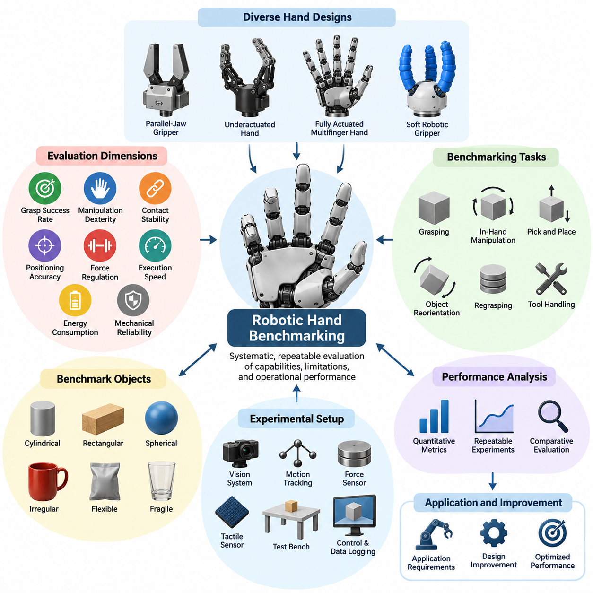{width="7.268055555555556in" height="7.268055555555556in"}

로봇 손 벤치마킹(Hand Benchmarking)은 로봇 손(Robotic Hand)과 그리퍼(Gripper)의 기능, 한계 및 운용 성능을 측정하기 위한 체계적인 평가 프레임워크(Evaluation Framework)를 제공한다. 개별적인 시연에 의존하는 대신, 벤치마킹은 파지(Grasping), 조작(Manipulation), 센싱(Sensing) 및 제어(Control) 성능을 정량화하는 반복 가능한 실험을 수립한다. 주요 목적은 서로 다른 손 구조, 제어 전략 및 응용 요구사항을 객관적으로 비교하는 것이다.

로봇 손 설계의 다양성으로 인해 표준화된 평가(Standardized Evaluation)가 특히 중요하다. 평행 조 그리퍼(Parallel-Jaw Gripper), 부족구동 손(Underactuated Hand), 완전구동 다지 손(Fully Actuated Multifinger Hand), 소프트 로봇 그리퍼(Soft Robotic Gripper)는 근본적으로 서로 다른 기계적 특성을 가진다. 의미 있는 벤치마크는 일관된 평가 조건을 유지하면서 이러한 차이를 고려해야 한다. 따라서 성능은 단일한 보편적 순위가 아니라 의도된 작업을 기준으로 해석해야 한다.

포괄적인 벤치마킹 프레임워크(Comprehensive Benchmarking Framework)는 로봇 손 성능의 여러 상호 보완적인 차원을 평가한다. 여기에는 파지 성공률(Grasp Success Rate), 조작 숙련도(Manipulation Dexterity), 접촉 안정성(Contact Stability), 위치 정확도(Positioning Accuracy), 힘 조절(Force Regulation), 실행 속도(Execution Speed), 에너지 소비(Energy Consumption), 기계적 신뢰성(Mechanical Reliability)이 포함된다. 각 차원은 서로 다른 운용 능력을 나타내며, 이들을 종합적으로 평가하면 개별 지표보다 유용한 성능 분석이 가능하다.

파지 성능(Grasping Performance)은 많은 조작 작업에서 물체 획득(Object Acquisition)이 출발점이 되므로 가장 기본적인 평가 범주 중 하나이다. 일반적인 파지 벤치마크는 로봇 손이 물체에 접근하고, 안정적으로 잡고, 들어 올리고, 운반한 다음, 의도하지 않은 제어 손실 없이 놓을 수 있는지를 측정한다. 형상, 질량, 재료 및 표면 특성이 서로 다른 물체를 대상으로 반복 실험을 수행하면 파지 메커니즘(Grasping Mechanism)의 강건성(Robustness)을 확인할 수 있다.

손재주 벤치마킹(Dexterity Benchmarking)은 성공적인 물체 획득을 넘어 초기 접촉 이후 물체를 조작하는 능력을 평가한다. 관련 작업에는 물체 회전(Object Rotation), 병진 이동(Translation), 손가락 보행(Finger Gaiting), 재파지(Regrasping), 물체 방향의 제어된 변경이 포함된다. 이러한 기능은 단순한 파지 및 해제 작업만으로 충분하지 않은 조립(Assembly), 도구 취급(Tool Handling), 접촉 집약적 조작(Contact-Rich Manipulation)을 수행하는 다지 로봇 손(Multifinger Robotic Hand)에서 특히 중요하다.

벤치마크 물체(Benchmark Objects)는 평가 편향(Evaluation Bias)을 방지하기 위해 충분히 다양한 물리적 특성을 나타내야 한다. 일반적인 물체 범주에는 원통형 부품, 직사각형 블록, 구형 물체, 불규칙한 생활용품, 유연한 재료 및 파손되기 쉬운 제품이 포함된다. 물체의 크기, 질량 분포(Mass Distribution), 마찰 특성(Friction Characteristics), 변형 거동(Deformation Behavior)은 파지 난이도에 영향을 미치므로 실험 구성의 일부로 문서화해야 한다.

표준화된 물체 집합(Standardized Object Collections)은 실험실과 로봇 플랫폼 간에 일관된 물리적 기준을 제공하여 재현성(Reproducibility)을 향상시킨다. 예일-카네기멜런-버클리 물체 집합(Yale-CMU-Berkeley Object Set), 즉 YCB 물체 집합(YCB Object Set)은 로봇 조작 연구에서 사용되는 대표적인 사례이다. 이러한 물체 집합은 통제된 비교를 지원하지만, 실험 절차, 물체 배치, 인식 시스템 및 성공 기준의 차이는 여전히 보고된 결과에 영향을 미칠 수 있다.

그라스프넷(GraspNet) 및 관련 파지 벤치마크(Grasp Benchmarks)는 파지 검출(Grasp Detection), 파지 후보 생성(Candidate Generation), 예측 품질(Prediction Quality)을 강조함으로써 또 다른 중요한 평가 관점을 제공한다. 이러한 벤치마크는 로봇 손이 비전 기반 파지 계획(Vision-Based Grasp Planning) 시스템과 함께 작동할 때 특히 유용하다. 그러나 인식 정확도가 반드시 안정적인 접촉이나 신뢰할 수 있는 조작을 보장하지 않으므로 예측된 파지 품질과 실제 물리적 실행 성공률을 구분해야 한다.

촉각 센싱(Tactile Sensing)은 접촉 정보가 조작 안정성과 힘 제어에 직접적인 영향을 미치므로 추가적인 벤치마킹 요구사항을 발생시킨다. 평가 항목에는 접촉 위치 추정 정확도(Contact Localization Accuracy), 압력 측정 오차(Pressure Measurement Error), 공간 해상도(Spatial Resolution), 민감도(Sensitivity), 응답 지연(Response Latency), 센서 반복성(Sensor Repeatability)이 포함될 수 있다. 촉각 배열(Tactile Array)의 경우 분산 하중, 변화하는 접촉 형상 및 반복적인 기계적 변형 조건에서도 성능을 평가해야 한다.

미끄러짐 검출 벤치마킹(Slip Detection Benchmarking)은 로봇 손이 파지 중인 물체의 초기 미끄러짐(Incipient Slip) 또는 실제 움직임을 인식하고 대응할 수 있는지를 평가한다. 주요 측정 항목에는 검출 정확도(Detection Accuracy), 오경보율(False Alarm Rate), 검출 지연(Detection Latency), 보정 제어 동작(Corrective Control Actions)의 효과가 포함된다. 불안정성을 검출하는 것이 반드시 물체 낙하를 방지하는 것은 아니므로 성공적인 미끄러짐 인식과 성공적인 파지 복구(Grasp Recovery)를 구분하여 실험해야 한다.

힘 및 토크 제어(Force and Torque Control) 성능은 또 다른 핵심 벤치마킹 차원이다. 로봇 손은 파지 안정성을 유지할 수 있는 충분한 접촉력을 생성하면서도 물체를 손상시키거나 민감한 재료를 변형시킬 수 있는 과도한 압력을 피해야 한다. 힘 추종 오차(Force Tracking Error), 오버슈트(Overshoot), 정착 시간(Settling Time), 접촉력 분포(Contact Force Distribution), 외란 억제(Disturbance Rejection)는 폐루프 파지 조절(Closed-Loop Grasp Regulation)의 품질을 평가하는 유용한 측정 항목이다.

속도 및 사이클 시간 지표(Speed and Cycle Time Metrics)는 로봇 손이 실제 응용 분야의 처리량(Throughput) 요구사항을 충족할 수 있는지를 결정한다. 완전한 조작 사이클(Manipulation Cycle)에는 물체 검출, 파지 계획, 손 위치 결정, 손가락 폐쇄, 들어 올리기, 조작, 배치 및 해제가 포함될 수 있다. 개별 단계를 측정하면 성능 병목 현상(Performance Bottleneck)을 식별하고 기계적 구동의 한계와 인식 또는 계획에서 발생하는 한계를 구분할 수 있다.

신뢰성 벤치마킹(Reliability Benchmarking)은 짧은 실험 시연뿐만 아니라 장시간 운용에서도 성능이 일관되게 유지되는지를 평가한다. 반복적인 파지 사이클은 액추에이터 마모(Actuator Wear), 동력 전달계 백래시(Transmission Backlash), 텐던 열화(Tendon Degradation), 센서 드리프트(Sensor Drift), 열적 한계(Thermal Limitations)를 드러낼 수 있다. 신뢰성 지표에는 고장 빈도(Failure Frequency), 평균 고장 간격(Mean Time Between Failures, MTBF), 유지보수 주기(Maintenance Interval), 누적 운용 사이클에 따른 성능 저하가 포함될 수 있다.

에너지 효율(Energy Efficiency)은 로봇 손이 배터리 기반 모바일 매니퓰레이터(Battery-Powered Mobile Manipulator)에 장착되어 작동할 때 특히 중요하다. 벤치마킹에서는 대기 상태(Idle Operation), 손가락 움직임, 지속적인 파지(Sustained Grasping), 반복 조작 사이클 동안의 전력 소비를 측정해야 한다. 성공적인 작업당 에너지 소비량(Energy per Successful Task)은 유용한 응용 수준 지표이지만, 비교 시에는 페이로드(Payload), 파지 지속 시간, 액추에이터 구조 및 작업 복잡도의 차이를 고려해야 한다.

벤치마크 환경(Benchmark Environment)은 현실적인 운용 과제를 제거하지 않으면서 실험 변동성(Experimental Variability)을 제어할 수 있도록 설계해야 한다. 관련 조건에는 물체 배치 불확실성(Object Placement Uncertainty), 조명 변화(Lighting Variation), 표면 마찰, 환경 온도, 진동 및 외부 외란(External Disturbances)이 포함된다. 통제된 실험실 환경은 기준 성능(Baseline Performance)을 확립하며, 점진적으로 비정형성이 증가하는 환경은 실제 배치 과정에서 발생하는 한계를 드러낸다.

실험 반복성(Experimental Repeatability)을 확보하려면 초기화(Initialization), 보정(Calibration), 물체 위치 설정, 시험 실행 및 결과 기록에 대한 절차를 명확히 정의해야 한다. 시험 횟수는 성능 변동성을 특성화하기에 충분해야 하며, 무작위 물체 배치(Randomized Object Configuration)는 체계적 편향(Systematic Bias)을 줄일 수 있다. 통계 보고에는 실험적 맥락 없이 개별 성공률만 제시하는 대신 표본 크기(Sample Size), 불확실성 추정치(Uncertainty Estimate), 실패 분포(Failure Distribution)를 포함해야 한다.

로봇 손 간의 공정한 비교(Fair Comparison)를 위해서는 하드웨어 성능(Hardware Capability)과 지원 시스템 성능(Supporting System Performance)을 신중하게 구분해야 한다. 높은 성능을 가진 로봇 손도 부정확한 인식 시스템이나 적절히 조정되지 않은 제어 소프트웨어와 결합하면 비효율적으로 보일 수 있다. 반대로 정교한 계획 알고리즘(Planning Algorithm)은 기계적 한계를 보완할 수 있다. 따라서 벤치마크 보고서에는 손 메커니즘, 센싱 시스템, 제어기 및 외부 조작 플랫폼의 기여도를 명확히 구분해야 한다.

시뮬레이션 기반 벤치마킹(Simulation-Based Benchmarking)은 실제 물리적 시험에 앞서 많은 파지 구성과 제어 정책을 효율적으로 평가할 수 있는 방법을 제공한다. 시뮬레이션 환경(Simulated Environment)은 접촉력, 물체 궤적(Object Trajectory), 실패 조건(Failure Condition)을 정밀하게 측정할 수 있다. 그러나 마찰, 순응성(Compliance), 액추에이터 거동 및 접촉 모델링(Contact Modeling)의 차이로 인해 실제 배치 성능을 주장하기 전에 시뮬레이션 결과를 물리적 실험으로 검증해야 한다.

학습 기반 로봇 손(Learning-Based Robotic Hand)은 학습 데이터(Training Data), 일반화(Generalization), 평가 무결성(Evaluation Integrity)에 관한 추가 요구사항을 가진다. 오해를 유발하는 성능 추정을 방지하려면 벤치마크 물체와 작업 구성을 학습 사례와 적절히 분리해야 한다. 또한 익숙하지 않은 물체, 변화된 물리적 조건 및 분포 변화(Distribution Shift)를 평가해야 한다. 기존에 경험한 작업에서 높은 성공률을 보인다고 해서 반드시 일반적인 조작 능력을 갖추었다고 볼 수는 없기 때문이다.

안전성(Safety)은 인간 환경에서 사용되는 로봇 손의 벤치마킹에서 명시적으로 고려해야 하는 요소이다. 관련 평가에는 과도한 파지력(Excessive Gripping Force), 의도하지 않은 손가락 움직임, 충돌 대응(Collision Response), 물체 해제 거동(Object Release Behavior), 센싱 또는 제어 실패 이후의 복구가 포함된다. 작업을 성공적으로 완료했다는 사실이 허용할 수 없는 기계적 또는 운용상 위험을 정당화할 수는 없으므로 안전 관련 측정은 일반적인 성능 지표와 구분해야 한다.

응용 분야별 벤치마킹(Application-Specific Benchmarking)은 실험실 측정 결과를 실제 운용 요구사항으로 연결한다. 산업용 조립(Industrial Assembly)은 정밀도, 반복성, 접촉력 조절 및 사이클 시간을 강조하는 반면, 창고 물류(Warehouse Handling)는 물체 다양성과 처리량을 우선시한다. 의료 및 서비스 응용 분야(Healthcare and Service Applications)는 부드러운 상호작용(Gentle Interaction), 예측 가능한 동작(Predictable Behavior), 섬세한 물체의 신뢰성 있는 취급을 더욱 중요하게 고려할 수 있다. 평가 기준은 이러한 서로 다른 우선순위를 반영해야 한다.

체계적인 벤치마크 보고서(Structured Benchmark Report)는 로봇 손 구성, 액추에이터 사양, 센서 배치, 제어 아키텍처(Control Architecture), 물체 데이터셋(Object Dataset), 실험 환경 및 평가 절차를 문서화해야 한다. 또한 성공 및 실패 시험의 정의, 통계 분석 방법(Statistical Analysis Methods), 관찰된 한계를 명시해야 한다. 이러한 문서화는 다른 연구자와 엔지니어가 실험을 재현하고 보고된 성능을 일관되게 해석할 수 있도록 지원한다.

로봇 손 벤치마킹(Hand Benchmarking)의 궁극적인 목적은 단순히 가장 높은 수치 점수를 기록한 로봇 손을 식별하는 것이 아니다. 측정 가능한 기술적 능력(Measurable Technical Capabilities)과 실제 조작 요구사항(Practical Manipulation Requirements) 사이의 신뢰할 수 있는 관계를 확립하는 것이다. 파지 성공률, 손재주, 센싱, 속도, 신뢰성 및 환경 강건성을 종합적으로 평가함으로써 벤치마킹은 합리적인 설계 의사결정(Design Decision)을 지원하고 로봇 손 엔지니어링(Robotic Hand Engineering)의 지속적인 개선을 위한 기반을 제공한다.

## 14.02 Dexterity Metrics

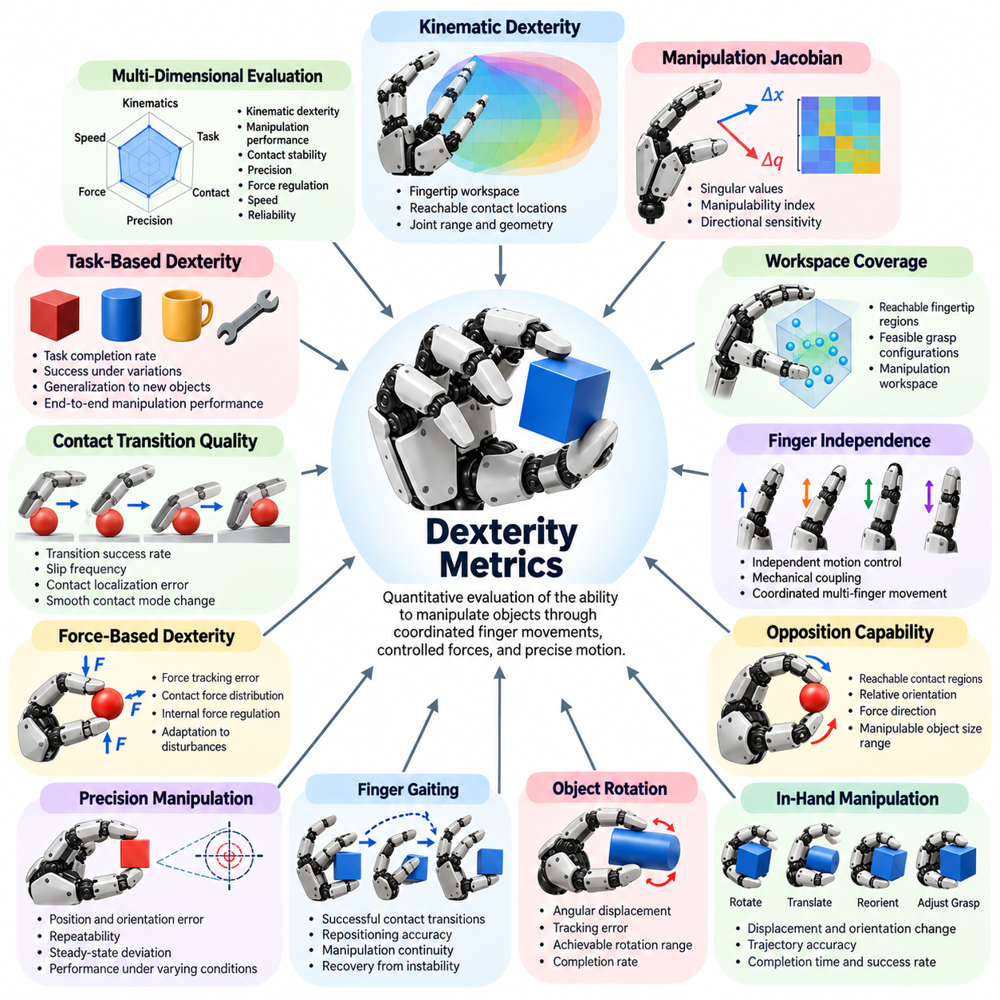{width="7.268055555555556in" height="7.268055555555556in"}

손재주 평가 지표(Dexterity Metrics)는 로봇 손(Robotic Hand)이 조정된 손가락 움직임(Coordinated Finger Movements), 제어된 접촉력(Controlled Contact Forces), 정밀한 동작(Precise Motion)을 통해 물체를 조작하는 능력을 정량적으로 평가하는 방법을 제공한다. 기본적인 파지 성공률(Grasp Success Rate) 측정과 달리 손재주 평가는 로봇 손이 물체의 위치, 방향 및 접촉 구성을 얼마나 효과적으로 변경하는지에 초점을 맞춘다. 이러한 지표는 단순한 물체 유지가 아니라 복잡한 조작을 목적으로 설계된 로봇 손을 비교하는 데 필수적이다.

로봇 손의 손재주(Robotic Hand Dexterity)는 기계적 설계(Mechanical Design), 구동(Actuation), 센싱(Sensing), 제어(Control), 작업 계획(Task Planning)을 포함하는 다차원적 능력(Multidimensional Capability)이다. 독립적으로 구동되는 관절이 많은 로봇 손은 광범위한 움직임을 제공할 수 있지만, 기계적 복잡성만으로 효과적인 조작이 보장되지는 않는다. 따라서 손재주 평가 지표는 이론적인 기계적 능력(Theoretical Mechanical Capability)과 통제된 실험 조건에서 입증된 작업 성능(Demonstrated Task Performance)을 구분해야 한다.

운동학적 손재주(Kinematic Dexterity)는 로봇 손이 도달 가능한 작업공간(Reachable Workspace) 내에서 다양한 손가락 끝 위치와 방향을 생성하는 능력을 나타낸다. 관절 가동 범위(Joint Range), 손가락 길이(Finger Length), 링크 기하학(Linkage Geometry), 기계적 제약(Mechanical Constraints)이 사용 가능한 구성을 결정한다. 평가에서는 일반적으로 손가락 끝 작업공간 체적(Fingertip Workspace Volume), 도달 가능한 접촉 위치(Reachable Contact Locations), 충돌이나 제한적인 관절 한계 없이 여러 손가락을 조정하는 능력을 고려한다.

조작 자코비안(Manipulation Jacobian)은 관절 속도(Joint Velocity)와 손가락 끝 움직임(Fingertip Motion) 사이의 수학적 관계를 제공한다. 자코비안의 특이값(Singular Values)은 국소적인 운동 능력(Local Motion Capability), 방향 민감도(Directional Sensitivity), 특이 구성(Singular Configuration)에 대한 근접성을 평가하는 데 사용할 수 있다. 자코비안에서 도출된 조작성 지수(Manipulability Index)는 관절 움직임이 손가락 끝 속도를 얼마나 효과적으로 생성하는지 나타내지만, 해석은 좌표 스케일링(Coordinate Scaling), 정규화(Normalization), 선택된 손 구성에 따라 달라진다.

작업공간 커버리지(Workspace Coverage)는 로봇 손이 물체를 효과적으로 조작하기 위해 적절한 접촉 영역에 접근해야 하므로 중요한 손재주 지표이다. 손가락 끝 작업공간이 넓더라도 유용한 접촉 구성을 형성하기 어렵다면 반드시 높은 기능적 손재주(Functional Dexterity)를 의미하지는 않는다. 따라서 벤치마킹에서는 도달 가능한 손가락 끝 영역, 실현 가능한 파지 구성(Feasible Grasp Configurations), 물체 조작 작업공간(Object Manipulation Workspace)의 교집합을 평가해야 한다.

손가락 독립성(Finger Independence)은 개별 손가락이 인접한 손가락에 의도하지 않은 영향을 주지 않으면서 움직이거나 힘을 가할 수 있는 정도를 측정한다. 완전구동 손(Fully Actuated Hand)은 일반적으로 더 높은 독립적 제어 능력(Independent Control Authority)을 제공하는 반면, 부족구동 메커니즘(Underactuated Mechanism)은 하드웨어를 단순화하기 위해 손가락 움직임을 의도적으로 결합한다. 평가에서는 제어 가능한 운동 차원(Controllable Motion Dimensions), 기계적 결합(Mechanical Coupling), 대표적인 조작 작업에 필요한 협조 동작(Coordinated Movements)의 실행 능력을 고려해야 한다.

대립 동작 능력(Opposition Capability)은 안정적인 정밀 조작(Precision Manipulation)에 엄지손가락과 다른 손가락 사이의 조정된 접촉이 필요한 경우가 많으므로 인간형 로봇 손(Anthropomorphic Robotic Hand)에서 특히 중요하다. 대립 동작 지표(Opposition Metrics)는 도달 가능한 손가락 끝 접촉 영역, 상대 방향(Relative Orientation), 접촉력 방향(Contact Force Direction), 조작 가능한 물체 크기의 범위를 평가할 수 있다. 효과적인 대립 동작은 기계적 기하학뿐 아니라 움직임 중 접촉을 조절하는 능력에도 의존한다.

손 내부 조작 성능(In-Hand Manipulation Performance)은 손가락 접촉을 통해 제어를 유지하면서 물체의 자세(Object Pose)를 변경하는 능력을 측정한다. 대표적인 작업에는 정육면체 회전, 원통형 물체의 방향 변경, 작은 물체의 손가락 끝 사이 이동, 파지 구성 조정이 포함된다. 평가에서는 달성된 변위(Displacement), 방향 변화(Orientation Change), 궤적 정확도(Trajectory Accuracy), 완료 시간(Completion Time), 물체가 제어된 조작 상태를 유지하는지를 기록해야 한다.

물체 회전 능력(Object Rotation Capability)은 회전 조작에 조정된 접촉 전환(Contact Transition)과 힘 재분배(Force Redistribution)가 필요하므로 실용적인 손재주 측정 지표를 제공한다. 회전 벤치마크(Rotation Benchmark)는 각변위(Angular Displacement), 각도 추종 오차(Angular Tracking Error), 달성 가능한 회전 범위(Achievable Rotation Range), 성공적인 작업 완료율을 측정할 수 있다. 연속 회전(Continuous Rotation)에는 손가락 보행(Finger Gaiting)이나 반복적인 재파지(Regrasping)가 필요할 수 있으므로 기계적 능력과 제어 전략 모두에 영향을 받는다.

손가락 보행(Finger Gaiting)은 다른 손가락들이 물체를 충분히 지지하는 동안 개별 손가락의 위치를 다시 조정하는 과정을 의미한다. 손재주 평가에서는 성공적인 접촉 전환 횟수, 재배치 정확도(Repositioning Accuracy), 조작 연속성(Manipulation Continuity), 불안정한 중간 구성에서의 복구 능력을 측정할 수 있다. 이러한 측정은 로봇 손이 단일 고정 파지(Fixed Grasp)의 한계를 넘어 유효 조작 범위(Effective Manipulation Range)를 확장할 수 있는지를 보여준다.

정밀 조작 지표(Precision Manipulation Metrics)는 로봇 손이 목표 물체 자세(Desired Object Pose)나 손가락 끝 궤적(Fingertip Trajectory)을 얼마나 정확하게 달성할 수 있는지 평가한다. 위치 오차(Position Error), 방향 오차(Orientation Error), 반복성(Repeatability), 정상상태 편차(Steady-State Deviation)가 일반적인 측정 항목이다. 기계적 백래시(Mechanical Backlash), 순응성(Compliance), 센서 잡음(Sensor Noise), 제어 지연(Control Latency)이 최종 결과에 영향을 줄 수 있으므로 다양한 물체 질량, 접촉 조건 및 이동 속도에서 정밀도를 평가해야 한다.

힘 기반 손재주(Force-Based Dexterity)는 원하는 물체 움직임을 생성하면서 여러 접촉력을 조절하는 능력과 관련된다. 손재주가 뛰어난 로봇 손은 물체를 손상시킬 수 있는 과도한 내부 힘(Internal Force)을 발생시키지 않으면서 충분한 파지 안정성(Grasp Stability)을 유지해야 한다. 평가 항목에는 힘 추종 오차(Force Tracking Error), 접촉력 분포(Contact Force Distribution), 내부 힘 조절(Internal Force Regulation), 외부 외란(External Disturbance)이 발생했을 때 접촉력을 적응적으로 조절하는 능력이 포함될 수 있다.

접촉 전환 품질(Contact Transition Quality)은 구름(Rolling), 미끄러짐(Sliding), 피벗 회전(Pivoting), 제어된 해제(Controlled Release)를 포함하는 조작 작업에서 필수적이다. 이러한 동작은 물체 제어를 잃지 않으면서 접촉 위치나 접촉 모드(Contact Mode)를 변경해야 한다. 관련 지표에는 접촉 전환 성공률(Transition Success Rate), 의도하지 않은 미끄러짐 발생 빈도(Unintended Slip Frequency), 접촉 위치 추정 오차(Contact Localization Error), 접촉 상태(Contact State)가 변화하는 동안 안정적인 물체 움직임을 유지하는 능력이 포함된다.

조작 효율(Manipulation Efficiency)은 로봇 손이 사용 가능한 움직임, 시간 및 에너지 자원을 활용하여 손재주 작업을 얼마나 효과적으로 완료하는지 평가한다. 지표에는 작업 완료 시간(Task Completion Time), 보정 움직임 횟수(Number of Corrective Movements), 총 관절 이동량(Total Joint Travel), 에너지 소비(Energy Consumption), 단위 시간당 성공적인 작업 횟수가 포함될 수 있다. 빠른 실행은 조작 오류를 증가시키거나 더 큰 접촉력을 요구할 수 있으므로 효율은 정확도 및 안정성과 함께 해석해야 한다.

강건성 지표(Robustness Metrics)는 운용 조건이 정상적인 가정과 달라질 때에도 손재주 조작이 성공적으로 유지되는지를 평가한다. 실험에서는 물체 질량, 마찰계수(Friction Coefficient), 초기 자세(Initial Pose), 외부 외란(External Disturbance), 센싱 불확실성(Sensing Uncertainty)의 변화를 도입할 수 있다. 이러한 조건에서 나타나는 성능 저하(Performance Degradation)는 로봇 손이 불확실성에 얼마나 효과적으로 적응하는지, 조작 전략이 정교하게 준비된 시연 환경을 넘어 일반화될 수 있는지를 보여준다.

작업 다양성(Task Diversity)은 단일 조작 작업의 성능만으로 로봇 손의 전체 능력을 나타낼 수 없으므로 손재주 평가의 중요한 구성 요소이다. 벤치마크 모음(Benchmark Suite)에는 물체 병진 이동(Object Translation), 회전(Rotation), 재파지(Regrasping), 도구 재배치(Tool Repositioning), 접촉 집약적 조작(Contact-Rich Manipulation)이 포함되어야 한다. 각 작업은 기계적 이동성(Mechanical Mobility), 힘 조절, 센싱 정확도 및 계획 능력의 서로 다른 조합을 평가한다.

벤치마크 물체(Benchmark Objects)의 선택은 측정된 손재주에 큰 영향을 미친다. 구형 물체(Spherical Object)는 구름과 접촉 조정을 강조하는 반면, 정육면체와 직사각형 물체는 모서리와 이산적인 접촉 전환(Discrete Contact Transition)을 발생시킨다. 원통형 물체(Cylindrical Object)는 회전 조작에 적합하며, 불규칙한 물체는 파지 적응(Grasp Adaptation) 능력을 시험한다. YCB 물체 집합(YCB Object Set)과 같은 표준화된 물체 집합은 작업 정의와 실험 조건을 일관되게 문서화할 때 비교 가능성을 향상시킬 수 있다.

손재주 평가(Dexterity Evaluation)에서는 로봇 손의 고유 능력(Intrinsic Hand Capability)과 전체 로봇 조작 시스템(Complete Robotic Manipulation System)의 성능을 구분해야 한다. 손목 움직임(Wrist Movement), 로봇 팔 재배치(Arm Repositioning), 환경적 지지(Environmental Support), 외부 고정 장치(External Fixtures)는 작업 완료 성능을 크게 향상시킬 수 있다. 따라서 벤치마크에서는 조작이 손가락 움직임만으로 수행되는지, 아니면 외재적 손재주(Extrinsic Dexterity)와 추가 자유도(Additional Degrees of Freedom)가 허용되는지를 명시해야 한다.

학습 기반 로봇 손(Learning-Based Robotic Hand)은 손재주가 학습 경험(Training Experience), 물체 친숙도(Object Familiarity), 학습된 제어 정책(Learned Control Policy)에 의존할 수 있으므로 추가적인 고려가 필요하다. 평가에서는 학습 분포(Training Distribution)에서의 성능과 익숙하지 않은 물체 및 조작 조건에서의 성능을 구분해야 한다. 일반화 지표(Generalization Metrics)는 이전에 경험하지 못한 작업 구성을 만났을 때의 성공률, 적응 요구사항(Adaptation Requirements), 성능 저하를 평가할 수 있다.

통계적 신뢰성(Statistical Reliability)은 손재주 측정 결과를 해석하는 데 필수적이다. 각 작업은 여러 초기 조건, 물체 및 시험에 걸쳐 반복해야 하며, 성공 기준(Success Criteria)은 시험 전에 정의해야 한다. 보고서에는 표본 크기(Sample Size), 성공 비율(Success Proportion), 오차 분포(Error Distribution), 불확실성 추정치(Uncertainty Estimates)를 포함해야 한다. 종합 점수(Aggregated Score)는 비교를 지원할 수 있지만 특정 조작 능력의 약점을 감추어서는 안 된다.

포괄적인 손재주 평가(Comprehensive Dexterity Assessment)는 운동학적 측정(Kinematic Measurements), 힘 기반 측정(Force-Based Measurements), 작업 수준 측정(Task-Level Measurements), 강건성 측정(Robustness Measurements)을 일관된 평가 프레임워크(Evaluation Framework)로 통합한다. 정규화된 복합 점수(Normalized Composite Score)는 지표 정의, 가중치(Weighting Factors), 실험 조건이 투명하게 공개된다면 여러 로봇 손을 비교하는 데 유용할 수 있다. 최종 평가는 설명되지 않은 수치 순위만 제시하는 대신 어떤 능력이 관찰된 성능에 기여했는지를 설명해야 한다.

궁극적으로 손재주 평가 지표(Dexterity Metrics)는 로봇 손의 기계적 및 계산적 능력(Mechanical and Computational Capabilities)을 실제 조작 요구사항(Practical Manipulation Requirements)과 연결한다. 도달 가능한 움직임, 손가락 협조(Finger Coordination), 물체 방향 변경(Object Reorientation), 접촉 조절(Contact Regulation), 정밀도, 효율 및 강건성을 평가함으로써 엔지니어는 의미 있는 설계 절충관계(Design Tradeoffs)를 식별할 수 있다. 이러한 측정은 하드웨어 최적화(Hardware Optimization), 제어기 개발(Controller Development), 벤치마크 비교(Benchmark Comparison), 점점 더 복잡해지는 환경에서의 로봇 손 배치(Deployment)를 지원한다.

## 14.03 Grasp Success Metrics

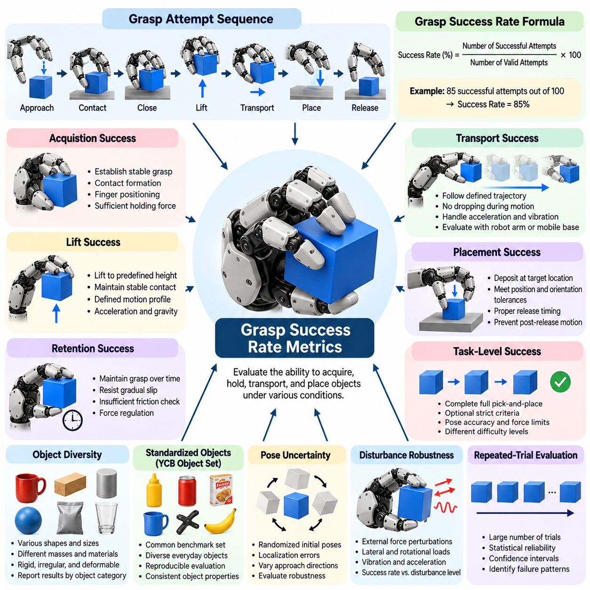{width="7.268055555555556in" height="7.268055555555556in"}

파지 성공률(Grasp Success Rate)은 로봇 손(Robotic Hand)과 그리퍼(Gripper)의 성능을 평가하는 데 가장 널리 사용되는 지표 중 하나이다. 이는 통제된 실험 절차(Controlled Experimental Procedures)에서 사전에 정의된 성공 조건(Success Conditions)을 충족하는 파지 시도(Grasp Attempts)의 비율을 측정한다. 지표 자체는 단순해 보이지만, 그 해석은 파지 시도를 어떻게 정의하는지, 어떤 작업이 포함되는지, 물체 획득(Object Acquisition)과 유지(Retention)의 성공을 무엇으로 판단하는지에 따라 달라진다.

기본적인 파지 성공률(Grasp Success Rate)은 성공한 파지 시도 횟수를 전체 유효 시도 횟수(Total Valid Attempts)로 나눈 다음 100을 곱하여 계산한다. 예를 들어 로봇 손이 100번의 시도 중 85번을 성공적으로 완료했다면 보고되는 성공률은 85%이다. 이러한 계산은 직관적인 성능 지표(Performance Indicator)를 제공하지만, 의미 있는 비교를 위해서는 성공(Success), 실패(Failure), 유효 실험 시험(Valid Experimental Trials)에 대한 일관된 정의가 필요하다.

일반적인 파지 시도(Grasp Attempt)는 물체에 접근하고, 접촉을 형성하고, 손가락을 닫고, 물체를 들어 올린 다음, 지정된 시간 동안 안정적으로 유지하는 과정으로 구성된다. 일부 벤치마크(Benchmark)는 추가적으로 운반(Transportation), 제어된 배치(Controlled Placement), 물체 해제(Object Release)를 요구한다. 이러한 차이는 측정된 성능에 상당한 영향을 미치므로 운용 맥락 없이 성공률만 보고하는 대신 전체 평가 절차(Evaluation Sequence)를 문서화하는 것이 필수적이다.

성공 기준(Success Criteria)은 실험 전에 수립하고 모든 시험에 일관되게 적용해야 한다. 기본적인 기준은 물체를 들어 올린 후 안정적으로 유지하는 것을 요구할 수 있으며, 더 엄격한 기준은 미끄러짐(Slipping)이나 낙하(Dropping) 없이 성공적으로 운반하는 것을 요구할 수 있다. 고급 벤치마크에는 물체 자세 정확도(Object Pose Accuracy), 허용 변형량(Allowable Deformation), 힘 제한(Force Limits), 성공적인 배치가 포함될 수 있다. 서로 다른 기준은 서로 다른 수준의 조작 난이도(Manipulation Difficulty)를 나타낸다.

파지 획득 성공률(Grasp Acquisition Success)은 로봇 손이 대상 물체에 대해 초기의 안정적인 파지(Initial Stable Grasp)를 형성하는지를 측정한다. 이 지표는 접촉 형성(Contact Formation), 손가락 위치 결정(Finger Positioning), 충분한 유지력(Holding Force)을 생성하는 능력에 초점을 맞춘다. 이는 파지 형성 과정에서 발생한 실패와 이후 들어 올리기 또는 조작 과정에서 발생한 실패를 구분하는 데 유용하며, 엔지니어가 파지 과정의 구체적인 취약점을 식별할 수 있도록 한다.

들어 올리기 성공률(Lift Success Rate)은 로봇 손이 안정적인 접촉(Stable Contact)을 유지하면서 물체를 사전에 정의된 높이까지 들어 올릴 수 있는지를 평가한다. 요구되는 들어 올리기 거리(Lifting Distance), 운동 프로파일(Motion Profile), 가속도(Acceleration), 유지 시간(Holding Duration)은 표준화해야 한다. 정지 상태에서 성공한 파지도 들어 올리는 과정에서는 관성력(Inertial Forces), 중력 하중(Gravitational Loading), 접촉 형상(Contact Geometry)의 변화가 사용 가능한 파지 안정성 여유(Grasp Stability Margin)를 초과하면 실패할 수 있다.

파지 유지 성공률(Grasp Retention Success)은 지정된 시간 간격 또는 규정된 움직임 동안 물체에 대한 제어를 유지하는 능력을 측정한다. 유지 시험(Retention Test)은 점진적인 미끄러짐(Gradual Slip), 불충분한 마찰(Insufficient Friction), 액추에이터 순응성(Actuator Compliance), 힘 조절 오차(Force Regulation Errors)를 드러낼 수 있다. 몇 초 동안 물체를 유지할 수 있는 로봇 손이 장시간 운용에서도 동일한 신뢰성을 보장하지는 않으므로 유지 시간과 외란 조건(Disturbance Conditions)을 반드시 보고해야 한다.

운반 성공률(Transport Success Rate)은 로봇 손이 물체를 떨어뜨리지 않고 정의된 궤적(Defined Trajectory)을 따라 이동하도록 요구함으로써 들어 올리기 이상의 평가를 수행한다. 운반 작업(Transport Tasks)은 가속, 감속, 진동 및 방향 변화를 발생시켜 파지 안정성(Grasp Stability)을 시험한다. 특히 로봇 손이 로봇 팔(Robot Arm)이나 모바일 조작 플랫폼(Mobile Manipulation Platform)에 통합된 경우에는 대표적인 운동 프로파일(Motion Profiles)에 걸쳐 성능을 평가해야 한다.

배치 성공률(Placement Success Rate)은 로봇 손이 위치 및 방향 허용오차(Positional and Orientation Tolerances)를 충족하면서 지정된 목적지에 물체를 놓을 수 있는지를 측정한다. 파지 성공이 반드시 배치 성공을 의미하지는 않는다. 해제 시점(Release Timing), 잔류 접촉력(Residual Contact Forces), 해제 후 물체 움직임(Object Motion After Release)이 오차를 발생시킬 수 있기 때문이다. 따라서 배치 지표(Placement Metrics)는 실제 집기 및 배치(Pick-and-Place) 성능을 더욱 완전하게 나타낸다.

물체 다양성(Object Diversity)은 서로 다른 형상, 크기, 질량 및 재료가 서로 다른 접촉 조건(Contact Conditions)을 형성하므로 파지 성공률 측정에 큰 영향을 미친다. 원통형 물체(Cylindrical Objects), 구형 물체(Spheres), 상자(Boxes), 불규칙한 부품(Irregular Components), 변형 가능한 제품(Deformable Products)은 각각 서로 다른 기계적 과제를 제시한다. 벤치마크 데이터셋(Benchmark Dataset)은 목표 응용 분야를 대표해야 하며, 유리한 물체 선택으로 전체 성능이 과대평가되지 않도록 물체 범주별 결과를 보고해야 한다.

YCB 물체 집합(YCB Object Set)은 재현 가능한 파지 평가(Reproducible Grasp Evaluation)를 지원할 수 있는 표준화된 일상 물체 집합을 제공한다. 다양한 물체를 통해 연구자는 물체 형상(Object Geometry), 표면 특성(Surface Characteristics), 질량(Mass)이 파지 결과에 미치는 영향을 조사할 수 있다. 그러나 표준화된 물체를 사용한다는 사실만으로 비교 가능한 결과가 보장되는 것은 아니다. 파지 절차, 물체 배치, 센싱 구성(Sensing Configurations), 성공 정의가 실험마다 다를 수 있기 때문이다.

자세 불확실성 조건에서의 파지 성공률(Grasp Success under Pose Uncertainty)은 물체의 위치와 방향을 정확하게 알 수 없을 때 로봇 손의 강건성(Robustness)을 평가한다. 실험에서는 초기 물체 자세(Initial Object Pose)를 무작위로 설정하거나 위치 추정 오차(Localization Errors)를 도입하거나 접근 방향(Approach Directions)을 변경할 수 있다. 이러한 조건은 특히 인식 불확실성(Perception Uncertainty)이 접촉 위치에 영향을 미치는 경우, 이상적인 실험실 구성을 벗어나서도 파지 계획(Grasp Planning)과 제어(Control)가 효과적으로 작동하는지를 보여준다.

외란 강건성(Disturbance Robustness)은 파지가 형성된 후 제어된 외부 힘(External Forces)이나 움직임을 가하여 평가할 수 있다. 외란에는 측면 하중(Lateral Loading), 회전 교란(Rotational Perturbations), 진동(Vibration), 가속도 변화(Changes in Acceleration)가 포함될 수 있다. 외란 수준이 증가함에 따른 성공률은 파지 안정성의 한계를 보여주며, 강건한 파지 전략(Robust Grasping Strategies)과 정지 상태에서만 성공하는 전략을 구분하는 데 도움이 된다.

반복 시험 평가(Repeated-Trial Evaluation)는 개별 파지 결과가 물체 배치, 마찰, 센서 측정 및 액추에이터 거동(Actuator Behavior)의 무작위 변동에 영향을 받을 수 있으므로 필수적이다. 각 실험 조건에서 충분히 많은 시험을 수행해야 한다. 표본 크기(Sample Size), 성공 횟수(Success Count), 불확실성 구간(Uncertainty Intervals)을 보고하면 소수의 시연에서 얻은 백분율만 제시하는 것보다 신뢰할 수 있는 평가가 가능하다.

통계적 신뢰구간(Statistical Confidence Intervals)은 추정된 파지 성공률의 불확실성을 특성화하는 데 도움이 된다. 10번의 시도에서 얻은 90%의 성공률은 수백 번의 독립적인 시험에서 얻은 동일한 성공률보다 훨씬 약한 근거를 제공한다. 윌슨 점수 구간(Wilson Score Interval)이나 다른 적절한 이항분포 기반 방법(Binomial Methods)은 표본 추출 불확실성(Sampling Uncertainty)을 정량화할 수 있으며, 여러 물체와 실험 세션에 걸친 반복 시험은 추가적인 변동 원인을 드러내는 데 도움이 된다.

실패 분류(Failure Classification)는 전체 성공률 이상의 유용한 진단 정보(Diagnostic Information)를 제공한다. 일반적인 실패 범주에는 접촉 실패(Missed Contact), 잘못된 손가락 위치(Incorrect Finger Positioning), 불충분한 파지력(Insufficient Grip Force), 물체 미끄러짐(Object Slip), 충돌(Collision), 조기 해제(Premature Release), 배치 실패(Unsuccessful Placement)가 포함된다. 실패 원인을 기록하면 엔지니어는 성능 한계가 인식(Perception), 파지 계획(Grasp Planning), 기계적 설계(Mechanical Design), 센싱(Sensing), 폐루프 제어(Closed-Loop Control) 중 어디에서 발생하는지 판단할 수 있다.

파지 성공률(Grasp Success Rate)은 실행 시간(Execution Time) 및 자원 소비(Resource Consumption)와 함께 평가해야 한다. 로봇 손은 느리고 보수적인 움직임(Conservative Movements)을 통해 높은 신뢰성을 달성할 수 있는 반면, 다른 시스템은 성공 확률이 약간 낮더라도 더 빠르게 작동할 수 있다. 분당 성공 파지 횟수(Successful Grasps per Minute), 평균 사이클 시간(Average Cycle Time), 성공적인 파지당 에너지 소비(Energy per Successful Grasp)와 같은 지표는 운용 효율(Operational Efficiency)과 실제 생산성(Practical Productivity)에 대한 추가적인 정보를 제공한다.

학습 기반 파지 시스템(Learning-Based Grasping Systems)은 학습 조건(Training Conditions)과 평가 조건(Evaluation Conditions)을 신중하게 분리해야 한다. 익숙한 물체에서 측정한 성공률은 이전에 경험하지 못한 물체나 환경에서의 성능을 과대평가할 수 있다. 따라서 평가에서는 알려진 물체에 대한 성능(Known-Object Performance), 새로운 물체에 대한 일반화(Novel-Object Generalization), 조명, 복잡한 물체 배치(Clutter), 마찰 및 물체 자세 변화에 대한 강건성을 구분해야 한다. 이러한 구분은 학습된 파지 정책(Learned Grasp Policies)을 평가할 때 필수적이다.

시뮬레이션 기반 파지 성공률 지표(Simulation-Based Grasp Success Metrics)는 다양한 물체 구성(Object Configurations)과 제어 전략(Control Strategies)에 걸친 대규모 시험을 가능하게 한다. 시뮬레이션 실험(Simulated Experiments)은 개발 속도를 높이고 실제 물리적 실행 전에 유망한 파지 후보(Grasp Candidates)를 식별할 수 있다. 그러나 부정확한 접촉 역학(Contact Mechanics), 마찰 모델(Friction Models), 액추에이터 동역학(Actuator Dynamics), 물체 특성(Object Properties)은 잘못된 성공률 추정을 초래할 수 있다. 실제 환경에서의 파지 신뢰성을 확인하려면 물리적 검증(Physical Validation)이 여전히 필요하다.

비교 파지 벤치마킹(Comparative Grasp Benchmarking)은 가능한 한 일관된 하드웨어 및 실험 가정(Hardware and Experimental Assumptions)을 요구한다. 손가락 끝 재료(Fingertip Materials), 센서 가용성(Sensor Availability), 물체 제시 방식(Object Presentation), 로봇 팔 움직임(Robot Arm Motion), 제어기 튜닝(Controller Tuning)의 차이는 결과에 상당한 영향을 미칠 수 있다. 동일한 조건을 구현하기 어려운 경우 벤치마크 보고서는 이러한 차이를 명시적으로 문서화하고 성공률 비교를 로봇 손 자체의 우수성(Intrinsic Hand Superiority)에 대한 직접적인 척도로 해석하지 않아야 한다.

포괄적인 파지 성공률 평가(Comprehensive Grasp Success Evaluation)는 파지 획득(Grasp Acquisition), 들어 올리기(Lifting), 유지(Retention), 운반(Transport), 배치(Placement) 결과를 물체별 측정(Object-Specific Measurements) 및 외란 의존적 측정(Disturbance-Dependent Measurements)과 결합해야 한다. 이러한 단계를 개별적으로 보고하면 단일 종합 점수(Aggregate Score)가 중요한 취약점을 감추는 것을 방지할 수 있다. 궁극적으로 파지 성공률 지표(Grasp Success Rate Metrics)는 로봇 손 설계 개선, 제어 전략 검증(Control Strategy Validation), 실제 운용 환경에서 신뢰할 수 있는 조작을 수행하기 위한 준비 수준(Readiness)을 판단하는 실용적인 기반을 제공한다.

## 14.04 YCB Object Benchmark

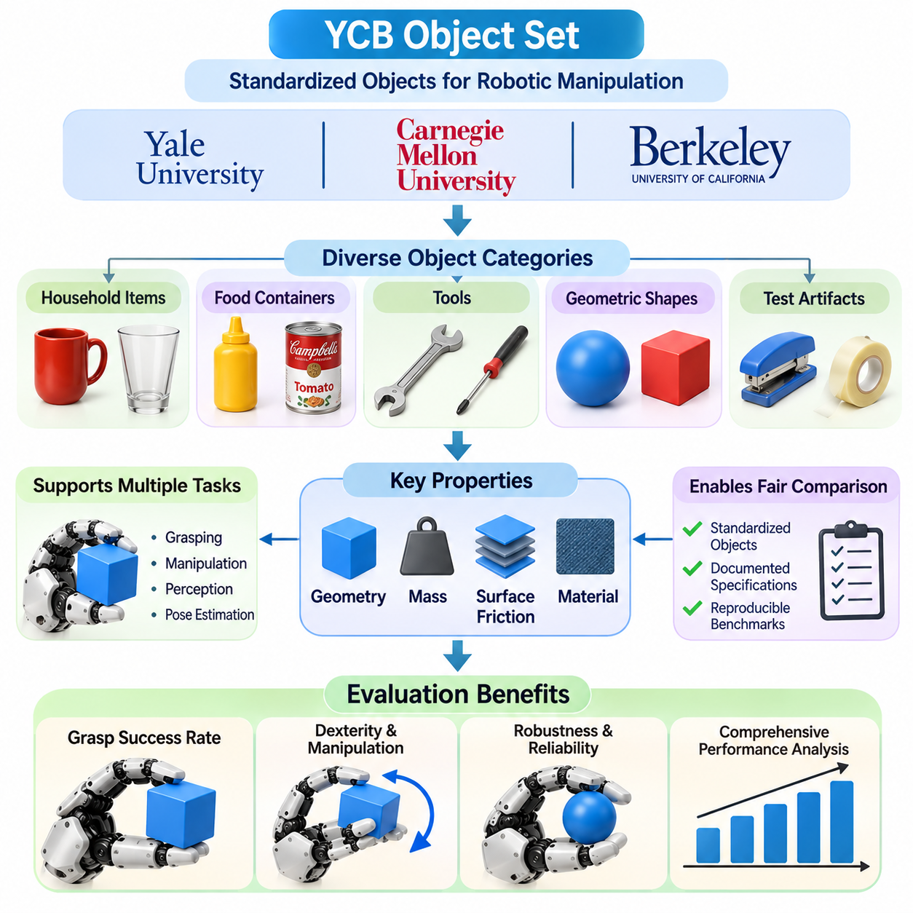{width="7.268055555555556in" height="7.268055555555556in"}

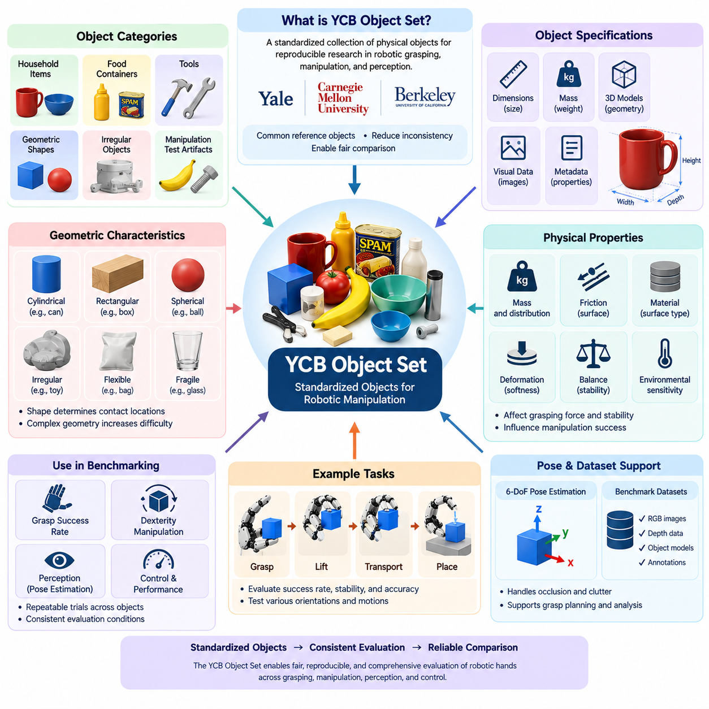{width="7.268055555555556in" height="7.268055555555556in"}

YCB 물체 집합(YCB Object Set)은 로봇 파지(Robotic Grasping), 조작(Manipulation), 인식(Perception) 분야에서 재현 가능한 연구(Reproducible Research)를 지원하기 위해 개발된 표준화된 물리적 물체 집합(Standardized Collection of Physical Objects)이다. 예일대학교(Yale University), 카네기멜런대학교(Carnegie Mellon University), 캘리포니아대학교 버클리(University of California, Berkeley)의 협력을 통해 개발되었으며, 로봇 시스템을 평가하기 위한 공통 기준 물체(Common Reference Objects)를 제공한다. 주요 목적은 실험의 비일관성을 줄이고 서로 다른 로봇 플랫폼 간에 의미 있는 비교를 가능하게 하는 것이다.

로봇 파지 연구(Robotic Grasping Research)는 전통적으로 실험실마다 서로 다른 물체를 사용했기 때문에 실험 간 직접적인 비교가 어려웠다. 물체 형상(Object Geometry), 재료 특성(Material Properties), 질량(Mass), 표면 마찰(Surface Friction)의 차이는 일관되지 않은 평가 조건을 발생시키는 경우가 많았다. YCB 물체 집합(YCB Object Set)은 연구자가 공통 실험 조건(Common Experimental Conditions)과 재현 가능한 조작 벤치마크(Reproducible Manipulation Benchmarks)를 수립할 수 있도록 문서화된 물체 집합을 제공하여 이러한 문제를 해결한다.

YCB 물체 집합은 일상적인 가정용품(Household Items), 식품 용기(Food Containers), 도구(Tools), 기하학적 형상(Geometric Shapes), 조작 전용 시험 물체(Manipulation-Specific Test Artifacts)를 포함한다. 이러한 범주는 로봇 손에 서로 다른 과제를 제시하는 다양한 물리적 특성을 제공한다. 원통형 용기(Cylindrical Containers)는 파지 안정성(Grasp Stability)을 강조하고, 불규칙한 도구(Irregular Tools)는 적응형 손가락 배치(Adaptive Finger Placement)를 요구하며, 기하학적 물체는 접촉 역학(Contact Mechanics)과 물체 방향 변경(Object Reorientation)에 관한 통제된 실험을 지원한다.

YCB 물체 집합(YCB Object Set)의 중요한 특징 중 하나는 물리적 물체 사양(Physical Object Specifications)과 디지털 표현(Digital Representations)을 사용할 수 있다는 점이다. 물체와 공개된 자료에 따라 크기(Dimensions), 질량 정보(Mass Information), 기하학적 모델(Geometric Models), 시각 데이터(Visual Data)가 포함될 수 있다. 이러한 정보는 실험 준비(Experimental Preparation), 인식 알고리즘 개발(Perception Algorithm Development), 파지 계획(Grasp Planning), 시뮬레이션 기반 평가(Simulation-Based Evaluation)를 지원하면서 물리적 환경과 가상 환경 사이의 일관성을 향상시킨다.

물체 형상(Object Geometry)은 가능한 접촉 위치(Feasible Contact Locations)와 손가락 구성(Finger Configurations)을 결정하므로 파지 난이도에 큰 영향을 미친다. 단순한 원통형 물체는 여러 파지 방향(Grasp Orientations)을 허용하는 경우가 많지만, 불규칙한 물체는 정밀한 접촉 위치 결정(Precise Contact Positioning)이 필요할 수 있다. 얇은 물체, 좁은 손잡이, 복잡한 표면은 추가적인 과제를 발생시킨다. 이러한 기하학적 변화를 평가하면 로봇 손 메커니즘(Robotic Hand Mechanisms)의 적응성과 한계를 파악할 수 있다.

질량(Mass)과 질량 분포(Mass Distribution)도 중력 하중(Gravitational Loading)을 결정하고 안정적인 조작에 필요한 힘에 영향을 미치므로 중요하다. 가벼운 물체는 들어 올리기 쉬울 수 있지만 과도한 힘을 가하지 않고 취급하기 어려울 수 있으며, 무거운 물체는 더 큰 파지력(Grip Strength)을 요구한다. 비대칭 질량 분포(Asymmetric Mass Distribution)를 가진 물체는 회전 모멘트(Rotational Moments)를 발생시켜 이동 중 힘 조정(Force Coordination)과 파지 안정성(Grasp Stability)을 어렵게 만들 수 있다.

표면 특성(Surface Properties)은 마찰(Friction)이 수직 접촉력(Normal Contact Force)과 미끄러짐 저항(Resistance to Sliding) 사이의 관계를 결정하므로 또 다른 난이도 요소를 제공한다. 매끄러운 플라스틱(Smooth Plastic), 금속(Metal), 판지(Cardboard), 질감이 있는 표면(Textured Surfaces)은 서로 다른 파지 거동(Grasping Behavior)을 나타낼 수 있다. 표면 오염(Surface Contamination), 마모(Wear), 습도(Humidity)는 마찰을 변화시키고 실험 반복성(Experimental Repeatability)에 영향을 미칠 수 있으므로 벤치마크 절차에서는 접촉 재료와 환경 조건을 문서화해야 한다.

YCB 물체 집합(YCB Object Set)은 일관된 물체 그룹에 대해 반복 시험(Repeated Trials)을 수행할 수 있도록 하여 파지 성공률 평가(Grasp Success Rate Evaluation)를 지원한다. 로봇 손은 사전에 정의된 조건에서 각 물체를 파지하고, 들어 올리고, 운반하고, 해제하는 작업을 시도할 수 있다. 이후 개별 물체, 물체 범주 또는 전체 평가 집합에 대한 성공률을 보고할 수 있다. 이러한 접근 방식은 성능 한계가 특정 형상이나 물리적 특성과 관련되는지를 식별하는 데 도움이 된다.

손재주 평가(Dexterity Evaluation)는 물체 획득(Object Acquisition)을 넘어 로봇 손이 파지 이후 YCB 물체를 어떻게 조작하는지 평가한다. 관련 작업에는 제어된 회전(Controlled Rotation), 병진 이동(Translation), 방향 변경(Reorientation), 재파지(Regrasping)가 포함된다. 뚜렷한 기하학적 특징(Geometric Features)을 가진 물체는 방향 정확도(Orientation Accuracy)와 접촉 전환(Contact Transitions)을 측정하는 데 유용하다. 이러한 실험은 로봇 손이 단순히 정적인 파지(Static Grasp)를 유지하는 수준을 넘어 협조적인 조작(Coordinated Manipulation)을 수행할 수 있는지를 보여준다.

YCB 물체 집합은 로봇 시스템이 조작 전에 물체를 인식하고 위치를 추정해야 하므로 인식 연구(Perception Research)도 지원한다. RGB 영상(RGB Images), 깊이 측정(Depth Measurements), 3차원 물체 모델(Three-Dimensional Object Models)은 물체 검출(Object Detection) 및 자세 추정 알고리즘(Pose Estimation Algorithms)을 개발하는 데 사용할 수 있다. 파지 실행 실험(Grasp Execution Experiments)과 결합하면 인식 벤치마크(Perception Benchmarks)는 위치 추정 정확도(Localization Accuracy)가 실제 물리적 조작 성능에 어떤 영향을 미치는지 판단하는 데 도움이 된다.

6자유도 물체 자세 추정(Six-Degree-of-Freedom Object Pose Estimation)은 복잡하게 배치된 환경(Cluttered Environments)에서 작동하는 로봇 손에 특히 중요하다. 인식 시스템(Perception System)은 가림(Occlusion), 조명 변화(Lighting Changes), 물체 중첩(Overlapping Objects)이 존재하더라도 물체의 병진 위치(Translation)와 방향(Orientation)을 추정해야 한다. YCB 물체는 이러한 문제를 다루는 데이터셋(Datasets)과 실험 프레임워크(Experimental Frameworks)에 사용된다. 이후 자세 추정 오차(Pose Estimation Errors)를 파지 계획 실패(Grasp Planning Failures) 및 조작 부정확성(Manipulation Inaccuracies)과 연관 지어 분석할 수 있다.

벤치마크 프로토콜(Benchmark Protocols)은 물체가 로봇 손에 어떻게 제시되는지를 명확히 정의해야 한다. 실험 조건에는 테이블 위에 놓인 단일 물체(Isolated Objects), 무작위 물체 방향(Randomized Object Orientations), 여러 물체가 포함된 복잡한 배치(Cluttered Arrangements)가 포함될 수 있다. 각 조건은 서로 다른 수준의 난이도를 발생시킨다. 시스템 간 의미 있는 비교를 위해서는 일관된 배치 절차(Placement Procedures), 카메라 구성(Camera Configurations), 로봇 보정(Robot Calibration), 작업공간 경계(Workspace Boundaries)가 필요하다.

각 물체에 대해 수행하는 시험 횟수(Number of Trials)는 보고된 결과의 통계적 신뢰성(Statistical Reliability)에 상당한 영향을 미친다. 반복적인 파지 시도(Repeated Grasp Attempts)에는 적절한 경우 초기 자세(Initial Pose)와 접근 방향(Approach Direction)의 변화를 포함해야 한다. 연구자는 성공 횟수(Successful Attempts), 전체 유효 시도 횟수(Total Valid Attempts), 실패 범주(Failure Categories), 불확실성 추정치(Uncertainty Estimates)를 보고해야 한다. 종합 성공률(Aggregate Success Rate)이 어려운 물체 범주에서의 낮은 성능을 감출 수 있으므로 물체별 성능 보고(Object-Level Reporting)는 특히 중요하다.

YCB 물체 집합(YCB Object Set)은 공통 조건에서 서로 다른 로봇 손 구조(Robotic Hand Architectures)를 평가하는 데도 유용하다. 평행 조 그리퍼(Parallel-Jaw Grippers), 적응형 부족구동 손(Adaptive Underactuated Hands), 소프트 그리퍼(Soft Grippers), 다지 손재주 로봇 손(Dexterous Multifinger Hands)은 근본적으로 서로 다른 파지 전략(Grasp Strategies)을 사용할 수 있다. 따라서 비교 실험(Comparative Experiments)에서는 동일한 작업 요구사항(Identical Task Requirements)과 구조별 제어 방법(Architecture-Specific Control Methods)을 구분하여 평가 절차가 특정 메커니즘에 불공정하게 유리하지 않도록 해야 한다.

시뮬레이션 환경(Simulation Environments)은 파지 계획(Grasp Planning), 강화학습(Reinforcement Learning), 조작 정책 개발(Manipulation Policy Development)을 지원하기 위해 YCB 물체의 디지털 표현(Digital Representations)을 통합할 수 있다. 물체 모델(Object Models)은 실제 물리적 실행 전에 가상 접촉 실험(Virtual Contact Experiments)과 대규모 시험(Large-Scale Testing)을 가능하게 한다. 그러나 정확한 시뮬레이션에는 적절한 질량(Mass), 관성(Inertia), 마찰(Friction), 접촉 매개변수(Contact Parameters)가 필요하다. 시뮬레이션과 실제 물체 거동의 차이는 시뮬레이션에서 현실로의 전이 성능(Simulation-to-Real Transfer Performance)을 해석할 때 고려해야 한다.

학습 기반 파지 시스템(Learning-Based Grasping Systems)은 표준화된 물체가 학습(Training), 검증(Validation), 시험(Testing)을 위한 일관된 기준을 제공하므로 이점을 얻는다. 그러나 학습 중 경험한 물체만 평가하면 일반화 성능(Generalization Performance)을 잘못 추정할 수 있다. 실험 설계(Experimental Design)에서는 익숙하지 않은 물체에 대한 성능을 평가할 때 학습 조건과 평가 조건을 분리해야 한다. 새로운 물체 벤치마크(Novel-Object Benchmarks)는 학습된 파지 정책(Learned Grasp Policies)이 기억된 형상을 넘어 다른 물체에도 적용되는지를 판단하는 데 필요하다.

YCB 물체 집합은 적절한 물체와 작업 정의(Task Definitions)를 선택할 경우 접촉 집약적 조작(Contact-Rich Manipulation)과 조립 중심 연구(Assembly-Oriented Research)도 지원할 수 있다. 물체 정렬(Object Alignment), 삽입(Insertion), 재배치(Repositioning), 도구 취급(Tool Handling)을 포함하는 작업에는 협조적인 센싱(Coordinated Sensing)과 힘 제어(Force Control)가 필요하다. 이러한 평가는 기존의 파지 성공률 측정을 더욱 까다로운 손재주 조작 능력(Dexterous Manipulation Capabilities)으로 확장하지만, 포괄적인 평가를 위해서는 전문적인 조립 벤치마크(Specialized Assembly Benchmarks)가 필요할 수 있다.

표준화된 물체 집합(Standardized Object Collections)의 한계는 실제 환경에서 접하는 모든 물체의 다양성을 대표할 수 없다는 점이다. 산업용 부품(Industrial Components), 변형 가능한 재료(Deformable Materials), 파손되기 쉬운 제품(Fragile Products), 반사율이 높은 표면(Highly Reflective Surfaces)은 범용 물체 집합(General-Purpose Collection)으로 충분히 평가하기 어려운 과제를 발생시킬 수 있다. 따라서 제조(Manufacturing), 물류(Logistics), 의료(Healthcare), 서비스 응용(Service Applications) 분야의 로봇 손을 검증할 때는 YCB 기반 평가를 응용 분야별 물체(Application-Specific Objects)로 보완해야 한다.

물리적 물체 상태(Physical Object Condition)도 반복 실험이 표면 특성, 치수 또는 기계적 무결성(Mechanical Integrity)을 변화시킬 수 있으므로 중요한 고려사항이다. 포장 손상(Packaging Damage), 변형(Deformation), 오염(Contamination), 마모(Wear)는 시간이 지남에 따라 파지 거동에 영향을 미칠 수 있다. 실험실에서는 벤치마크 물체를 주기적으로 검사하고 중요한 변화를 문서화해야 한다. 일관된 물체 상태를 유지하면 의도하지 않은 실험 변동(Experimental Variation)을 방지하고 장기적인 재현성(Long-Term Reproducibility)을 향상시킬 수 있다.

포괄적인 YCB 벤치마킹 보고서(Comprehensive YCB Benchmarking Report)는 선택된 물체(Selected Objects), 실험 환경(Experimental Environment), 로봇 손 구성(Robotic Hand Configuration), 센싱 시스템(Sensing System), 제어 전략(Control Strategy), 성공 기준(Success Criteria)을 설명해야 한다. 결과에는 물체별 성능(Object-Specific Performance), 반복 시험 통계(Repeated-Trial Statistics), 관련 실패 분석(Failure Analysis)이 포함되어야 한다. 서로 다른 시스템을 비교할 때는 인식(Perception), 로봇 팔 움직임(Arm Motion), 손가락 끝 재료(Fingertip Materials), 환경적 지지(Environmental Support)의 차이도 문서화해야 한다.

궁극적으로 YCB 물체 집합(YCB Object Set)은 표준화된 로봇 파지 및 조작 평가(Standardized Robotic Grasping and Manipulation Evaluation)를 위한 실용적인 기반을 제공한다. 물리적 물체(Physical Objects), 문서화된 특성(Documented Characteristics), 지원 디지털 자료(Supporting Digital Resources)의 조합은 서로 다른 로봇 플랫폼에서 더욱 체계적인 실험을 가능하게 한다. YCB 기반 시험(YCB-Based Tests)을 손재주 지표(Dexterity Metrics), 파지 성공률 측정(Grasp Success Measurements), 강건성 분석(Robustness Analysis), 응용 분야별 검증(Application-Specific Validation)과 통합함으로써 엔지니어는 로봇 손의 능력에 대해 더욱 신뢰할 수 있는 이해를 확보할 수 있다.

## 14.05 GraspNet Benchmark

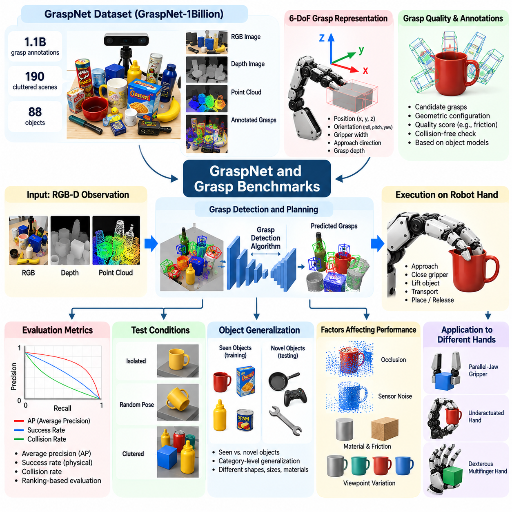{width="7.268055555555556in" height="7.268055555555556in"}

GraspNet 및 관련 파지 벤치마크(Grasp Benchmarks)는 로봇 파지 검출(Robotic Grasp Detection), 계획(Planning), 실행(Execution)을 평가하기 위한 표준화된 프레임워크(Standardized Frameworks)를 제공한다. 이러한 벤치마크는 로봇 시스템이 시각적 또는 기하학적 관측 정보(Visual or Geometric Observations)로부터 실행 가능한 파지 구성(Feasible Grasp Configurations)을 얼마나 효과적으로 식별하는지 측정한다. 단순한 파지 성공 시험과 달리 인식(Perception), 예측된 파지 품질(Predicted Grasp Quality), 물리적 조작(Physical Manipulation) 사이의 관계를 평가하여 파지 알고리즘의 체계적인 비교를 가능하게 한다.

GraspNet-1Billion은 복잡한 물체 배치 환경(Cluttered Environments)에서 일반적인 물체 파지(General Object Grasping)를 평가하도록 설계된 대규모 벤치마크(Large-Scale Benchmark)이다. RGB-D 관측 정보(RGB-D Observations), 주석이 부여된 파지 후보(Annotated Grasp Candidates), 물체 정보를 제공하여 6자유도 파지 검출(Six-Degree-of-Freedom Grasp Detection)을 평가한다. 이 벤치마크는 88개 물체가 포함된 190개의 복잡한 장면에 걸쳐 약 11억 개의 파지 주석(Grasp Annotations)을 포함하며, 학습 기반 파지 예측(Learning-Based Grasp Prediction)을 위한 방대한 지도 정보와 체계적인 평가 기반을 제공한다.

GraspNet의 핵심 목표 중 하나는 파지 검출 알고리즘(Grasp Detection Algorithms)이 불완전하고 잡음이 포함된 센서 정보(Incomplete and Noisy Sensory Information)로부터 신뢰할 수 있는 파지 자세(Reliable Grasp Poses)를 식별할 수 있는지 평가하는 것이다. 실제 환경에서는 물체가 서로 겹치거나 부분적으로 가려지거나 익숙하지 않은 방향으로 놓일 수 있다. 이러한 조건에서는 물체 형상에 대한 가시성과 정보가 제한되더라도 적절한 접촉 구성(Contact Configurations)을 추론해야 하므로 파지 계획(Grasp Planning)이 더욱 어려워진다.

6자유도 파지 표현(Six-Degree-of-Freedom Grasp Representation)은 파지 후보(Candidate Grasp)의 3차원 위치(Three-Dimensional Position)와 방향(Orientation)을 나타낸다. 평행 조 그리퍼(Parallel-Jaw Grippers)의 경우 추가 매개변수로 그리퍼 개방 폭(Gripper Opening Width), 접근 방향(Approach Direction), 파지 깊이(Grasp Depth)를 지정할 수 있다. 이러한 표현을 통해 알고리즘은 3차원 공간에서 실행 가능한 파지 가설(Executable Grasp Hypotheses)을 생성할 수 있다. 그러나 특정 로봇 손과의 호환성은 손의 형상, 구동 한계(Actuation Limits), 접촉 특성(Contact Characteristics)에 따라 달라진다.

파지 주석(Grasp Annotations)은 예측된 파지 후보(Predicted Grasp Candidates)를 평가하기 위한 기준 정보를 제공한다. GraspNet에서 파지 후보는 물체 모델(Object Models)과 파지 분석(Grasp Analysis)에서 도출된 기하학적 구성(Geometric Configurations) 및 품질 관련 정보(Quality-Related Information)와 연결된다. 이러한 주석을 통해 알고리즘은 관측된 물체 형상과 실행 가능한 파지 구성 사이의 관계를 학습할 수 있다. 다만 그 유용성은 접촉 모델링(Contact Modeling)과 파지 품질 추정(Grasp Quality Estimation)에 포함된 가정에 따라 달라진다.

파지 검출 성능(Grasp Detection Performance)은 일반적으로 평균 정밀도(Average Precision) 및 관련 순위 기반 지표(Ranking-Based Metrics)를 사용하여 평가한다. 예측된 파지는 벤치마크에서 정의한 품질 조건(Quality Conditions)에 따라 평가되며, 여기에는 마찰 기반 파지 가능성(Friction-Based Grasp Feasibility)이 포함되는 경우가 많다. 평균 정밀도는 여러 평가 임계값(Evaluation Thresholds)에 걸쳐 유용한 파지 후보를 높은 순위에 배치하는 능력을 요약한다. 이러한 지표는 예측 품질(Prediction Quality)을 나타내지만 실제 물리적 파지 실행 성공률을 직접 측정한 것으로 해석해서는 안 된다.

충돌 검사(Collision Checking)는 기하학적으로 유망한 파지 자세가 실제로는 접근 불가능할 수 있으므로 파지 벤치마킹(Grasp Benchmarking)의 필수 구성요소이다. 파지 후보는 주변 물체, 지지 표면(Supporting Surface), 로봇 자체와 간섭할 수 있다. 따라서 평가 파이프라인(Evaluation Pipelines)은 그리퍼가 허용할 수 없는 충돌 없이 목표 물체에 접근하고 손가락을 닫을 수 있는지 검사한다. 충돌 인식 파지 예측(Collision-Aware Grasp Prediction)은 특히 물체가 복잡하게 배치된 조작 환경에서 중요하다.

포인트 클라우드 처리(Point Cloud Processing)는 깊이 센서(Depth Sensors)가 가시적인 물체 표면에 대한 3차원 정보를 제공하므로 GraspNet 기반 평가에서 중요한 역할을 한다. 신경망(Neural Networks)은 국소 형상(Local Geometry), 표면 방향(Surface Orientation), 공간적 관계(Spatial Relationships)를 분석하여 파지 후보를 예측할 수 있다. 포인트 클라우드 밀도(Point Cloud Density), 센서 잡음(Sensor Noise), 누락된 깊이 측정값(Missing Depth Measurements), 가림(Occlusion)은 예측 정확도에 영향을 미치므로 인식 품질(Perception Quality)은 벤치마크 성능의 중요한 요소가 된다.

RGB-D 파지 검출(RGB-D Grasp Detection)은 물체 이해(Object Understanding)와 파지 후보 생성(Grasp Candidate Generation)을 개선하기 위해 색상 정보(Color Information)와 깊이 측정(Depth Measurements)을 결합한다. 컬러 영상(Color Images)은 의미적 정보(Semantic Information)와 외관 정보(Appearance Information)를 제공하며, 깊이 데이터(Depth Data)는 기하학적 추론(Geometric Reasoning)을 지원한다. 다중 모달 인식(Multimodal Perception)은 어느 한 정보가 불완전할 때 성능을 개선할 수 있지만, 조명 변화(Lighting Variation), 반사 표면(Reflective Surfaces), 센서 보정 오차(Sensor Calibration Errors)는 여전히 상당한 불확실성을 발생시킬 수 있다.

GraspNet 평가는 학습 관측 정보(Training Observations)를 넘어서는 일반화(Generalization)를 검증하기 위해 구분된 시험 조건(Testing Conditions)을 포함한다. 벤치마크 프로토콜(Benchmark Protocols)은 익숙한 물체(Familiar Objects)와 새로운 물체 범주 또는 개체(Novel Object Categories or Instances)를 구분하여 연구자가 물체 친숙도(Object Familiarity)에 따른 성능을 분석할 수 있도록 한다. 이러한 구분은 이전에 경험한 형상에서 높은 성능을 보이더라도 익숙하지 않은 물체에 대해 신뢰할 수 있는 파지 예측이 반드시 보장되는 것은 아니기 때문에 중요하다.

파지 벤치마크 비교(Grasp Benchmark Comparisons)에서는 물체 수준 인식(Object-Level Recognition)과 기하학 기반 파지 일반화(Geometry-Based Grasp Generalization)를 구분해야 한다. 한 알고리즘은 익숙한 물체 형상을 학습하여 성공적인 파지를 예측할 수 있으며, 다른 알고리즘은 국소 접촉 형상(Local Contact Geometry)으로부터 파지 구성을 추론할 수 있다. 두 접근 방식 모두 특정 조건에서 우수한 성능을 보일 수 있지만, 익숙하지 않은 형상, 질감 또는 물리적 특성을 가진 물체를 다룰 때 강건성(Robustness)은 서로 다를 수 있다.

파지 예측(Grasp Prediction)과 로봇 손 실행(Robotic Hand Execution) 사이의 관계는 중요한 평가 경계(Evaluation Boundary)를 형성한다. 평행 조 그리퍼(Parallel-Jaw Gripper)에 적합하다고 판단된 파지 자세가 부족구동 손(Underactuated Hand)이나 손재주가 뛰어난 다지 로봇 손(Dexterous Multifinger Hand)에 직접 적용될 수 있는 것은 아니다. 손가락 배열(Finger Arrangement), 접촉 분포(Contact Distribution), 액추에이터 한계(Actuator Limits), 사용 가능한 자유도(Degrees of Freedom)는 실행 가능성(Execution Feasibility)에 영향을 미친다. 따라서 벤치마크 결과는 목표 말단효과기 구조(End-Effector Architecture)와 관련하여 해석해야 한다.

물리적 파지 실행 벤치마크(Physical Grasp Execution Benchmarks)는 생성된 파지가 실제 로봇 하드웨어에서 성공하는지 시험함으로써 예측 지표(Prediction Metrics)를 보완한다. 일반적인 절차에는 예측된 파지 선택, 목표 위치로 로봇 이동, 그리퍼 폐쇄, 물체 들어 올리기, 유지 상태 확인이 포함된다. 반복 시험(Repeated Trials)은 오프라인 평가(Offline Evaluation)에서 포착되지 않을 수 있는 보정 오차(Calibration Errors), 접촉 불확실성(Contact Uncertainty), 마찰 변화(Friction Variation), 기계적 한계(Mechanical Limitations)로 인한 실패를 드러낸다.

파지 성공률(Grasp Success Rate)은 높은 예측 정확도(Prediction Accuracy)가 신뢰할 수 있는 물리적 조작(Physical Manipulation)을 보장하지 않으므로 반드시 함께 평가해야 하는 지표이다. 오프라인 벤치마크는 기하학적 또는 해석적 근사(Geometric or Analytical Approximations)를 사용하여 파지 후보의 품질을 평가하는 경우가 많지만, 실제 실행은 액추에이터 거동(Actuator Behavior), 물체 순응성(Object Compliance), 센서 피드백(Sensor Feedback), 환경 외란(Environmental Disturbances)에 따라 달라진다. 예측 성능과 물리적 성공률을 함께 보고하면 파지 능력을 더욱 완전하게 평가할 수 있다.

다른 파지 벤치마크(Grasp Benchmarks)는 상호 보완적인 평가 관점을 제공한다. 코넬 파지 데이터셋(Cornell Grasping Dataset)은 영상 기반 파지 사각형 예측(Image-Based Grasp Rectangle Prediction)을 지원하며, Jacquard는 파지 검출 연구를 위한 대규모 합성 데이터셋(Large Synthetic Dataset)을 제공한다. Dex-Net은 해석적 파지 품질(Analytical Grasp Quality)과 합성 학습 데이터(Synthetic Training Data)를 강조한다. 이러한 자료는 주석 방법(Annotation Methods), 물체 다양성(Object Diversity), 파지 표현(Grasp Representations), 평가 절차(Evaluation Procedures)가 서로 다르므로 방법론적 정렬(Methodological Alignment) 없이 보고된 점수를 직접 비교하는 것은 적절하지 않다.

시뮬레이션 기반 파지 벤치마크(Simulation-Based Grasp Benchmarks)는 실제 배치(Physical Deployment) 전에 파지 후보 생성(Candidate Generation)과 파지 계획 전략(Grasp Planning Strategies)을 광범위하게 평가할 수 있도록 한다. 시뮬레이션 환경은 물체 형상, 배치, 마찰, 로봇 구성을 변경하면서 상세한 접촉 정보(Contact Information)를 기록할 수 있다. 그러나 시뮬레이션 충실도(Simulation Fidelity)는 접촉 모델(Contact Models), 재료 매개변수(Material Parameters), 액추에이터 동역학(Actuator Dynamics)에 따라 달라진다. 시뮬레이션 성능이 실제 로봇 시스템으로 전이되는지를 확인하려면 물리적 검증(Physical Validation)이 필요하다.

학습 기반 파지 알고리즘(Learning-Based Grasping Algorithms)은 잘못된 벤치마크 결과를 방지하기 위해 학습 데이터(Training Data)와 시험 데이터(Testing Data)를 신중하게 관리해야 한다. 밀접하게 관련된 물체 모델, 장면 또는 관측 정보가 학습 집합과 평가 집합 모두에 포함되면 데이터 누출(Data Leakage)이 발생할 수 있다. 연구자는 공식 데이터셋 분할(Official Dataset Partitions)을 준수하고, 전처리 절차(Preprocessing Procedures)를 문서화하며, 추가 학습 데이터(Additional Training Data)를 보고해야 한다. 이러한 관행은 재현성(Reproducibility)을 높이고 공정한 알고리즘 비교(Fair Algorithm Comparisons)를 지원한다.

추론 지연시간(Inference Latency)과 계산 효율성(Computational Efficiency)은 파지 검출 모델이 실시간 로봇 시스템(Real-Time Robotic Systems)에서 작동할 때 중요하다. 정확도가 매우 높은 신경망이라도 파지 예측에 과도한 처리 시간이나 메모리가 필요하다면 실제 배치에 적합하지 않을 수 있다. 따라서 벤치마킹에는 특히 임베디드 컴퓨팅(Embedded Computing)과 엣지 컴퓨팅(Edge Computing) 플랫폼을 대상으로 정확도 측정과 함께 추론 시간(Inference Time), 하드웨어 구성(Hardware Configuration), 메모리 소비(Memory Consumption), 파지 후보 생성 처리량(Candidate Generation Throughput)을 포함해야 한다.

강건성 평가(Robustness Evaluation)는 센서 잡음(Sensor Noise), 물체 가림(Object Occlusion), 복잡한 배치 밀도(Clutter Density), 환경 변화(Environmental Variation)에 따라 파지 검출 성능이 어떻게 달라지는지 조사한다. 제어된 교란(Controlled Perturbations)은 불완전한 포인트 클라우드(Incomplete Point Clouds), 부정확한 깊이 측정(Inaccurate Depth Measurements), 익숙하지 않은 물체 배치(Unfamiliar Object Arrangements)에 대한 민감도를 드러낼 수 있다. 평균 벤치마크 점수(Average Benchmark Scores)는 어려운 운용 조건에서의 상당한 취약점을 감출 수 있으므로 여러 난이도 수준에 걸쳐 성능을 보고해야 한다.

포괄적인 파지 벤치마킹 보고서(Comprehensive Grasp Benchmarking Report)는 데이터셋 버전(Dataset Version), 평가 분할(Evaluation Split), 파지 표현(Grasp Representation), 예측 지표(Prediction Metrics), 충돌 검사 절차(Collision Checking Procedure), 계산 플랫폼(Computational Platform), 물리적 실행 프로토콜(Physical Execution Protocol)을 문서화해야 한다. 또한 오프라인 파지 검출 성능(Offline Grasp Detection Performance)과 실제 환경의 조작 결과(Real-World Manipulation Results)를 구분하고, 마찰(Friction), 물체 형상(Object Geometry), 그리퍼 설계(Gripper Design)에 관한 가정을 명시해야 한다. 이러한 문서화는 재현 가능한 비교와 의미 있는 결과 해석을 지원한다.

궁극적으로 GraspNet 및 관련 파지 벤치마크는 로봇 파지 인식(Robotic Grasp Perception)과 계획(Planning)의 발전 수준을 측정하기 위한 기반을 제공한다. 표준화된 데이터셋(Standardized Datasets), 주석(Annotations), 평가 프로토콜(Evaluation Protocols)을 통해 연구자는 알고리즘을 비교하고 일반화의 한계(Generalization Limitations)를 식별할 수 있다. 오프라인 예측 지표(Offline Prediction Metrics)를 물리적 파지 성공률(Physical Grasp Success), 강건성 시험(Robustness Testing), 응용 분야별 검증(Application-Specific Validation)과 결합함으로써 엔지니어는 실제 로봇 조작(Practical Robotic Manipulation)을 위한 더욱 신뢰할 수 있는 파지 시스템을 개발할 수 있다.

## 14.06 In-Hand Manipulation Benchmark

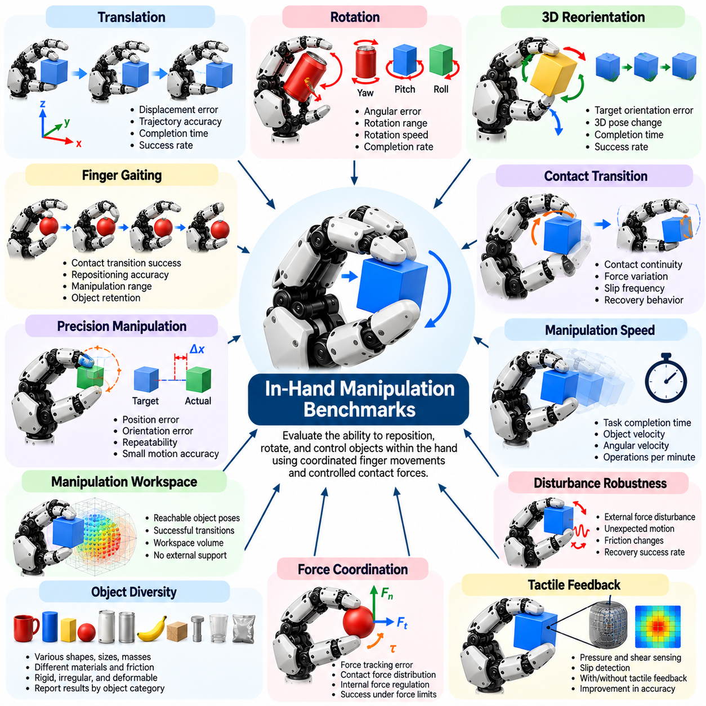{width="7.268055555555556in" height="7.268055555555556in"}

손 안 조작 벤치마크(In-Hand Manipulation Benchmarks)는 로봇 손(Robotic Hand)이 물체를 손 내부에 유지하면서 위치를 변경하고, 회전시키고, 제어하는 능력을 평가한다. 주로 물체 획득(Object Acquisition)과 유지(Retention)를 측정하는 기존 파지 벤치마크(Grasping Benchmarks)와 달리, 이러한 평가는 협조적인 손가락 움직임(Coordinated Finger Movements), 제어된 접촉 전환(Controlled Contact Transitions), 정밀한 물체 운동(Precise Object Motion)을 조사한다. 이는 기본적인 파지 안정성(Grasp Stability)을 넘어서는 손재주(Dexterity)를 입증하는 중요한 근거를 제공한다.

손 안 조작(In-Hand Manipulation)은 로봇 손이 협조적인 손가락 끝 힘(Coordinated Fingertip Forces)과 변화하는 접촉 구성(Contact Configurations)을 통해 제어된 물체 운동(Controlled Object Motion)을 생성하도록 요구한다. 물체는 손에서 해제되지 않은 상태로 병진 이동(Translation), 회전(Rotation), 또는 복합 운동(Combined Movements)을 수행할 수 있다. 따라서 벤치마크 설계(Benchmark Design)에서는 손가락만으로 수행하는 조작과 로봇 팔(Robot Arm), 손목(Wrist), 중력(Gravity), 외부 환경 지지(External Environmental Support)에 의해 발생하는 운동을 구분해야 한다.

물체 병진 이동 벤치마크(Object Translation Benchmarks)는 로봇 손이 손바닥(Palm)을 기준으로 지정된 위치 사이에서 물체를 얼마나 정확하게 이동시키는지 측정한다. 일반적인 작업에는 안정적인 접촉(Stable Contact)을 유지하면서 하나 이상의 축을 따라 물체를 이동시키는 과정이 포함된다. 성능은 변위 오차(Displacement Error), 궤적 추종 정확도(Trajectory Tracking Accuracy), 작업 완료 시간(Completion Time), 실패 빈도(Failure Frequency)를 통해 평가할 수 있다. 이러한 측정은 제어된 위치 변경 과정에서 여러 손가락을 협조적으로 제어하는 능력을 보여준다.

물체 회전 벤치마크(Object Rotation Benchmarks)는 지정된 축을 중심으로 물체의 방향을 변경하는 능력을 평가한다. 작업에는 정육면체 회전(Rotating a Cube), 원통형 부품 돌리기(Turning a Cylindrical Component), 손가락 끝 접촉(Fingertip Contacts)을 이용한 물체의 연속 회전(Continuous Spinning)이 포함될 수 있다. 회전 정확도(Rotation Accuracy)는 일반적으로 목표 방향(Target Orientation)과 실제 달성 방향(Achieved Orientation) 사이의 각도 오차(Angular Error)로 측정한다. 추가 지표에는 회전 속도(Rotation Speed), 누적 각변위(Accumulated Angular Displacement), 작업 성공률(Successful Completion Rate)이 포함된다.

3차원 방향 변경 작업(Three-Dimensional Reorientation Tasks)은 사전에 정의된 단일 방향을 중심으로 회전하는 것이 아니라 여러 축에 대한 협조적인 회전(Coordinated Rotation)을 요구한다. 이러한 작업은 접촉 위치(Contact Locations)와 힘 분포(Force Distributions)가 지속적으로 변화하기 때문에 특히 어렵다. 벤치마크 프로토콜(Benchmark Protocols)은 목표 방향(Target Orientations), 초기 물체 자세(Initial Object Poses), 허용 실행 시간(Allowable Execution Time), 조작 중 일시적인 환경 접촉(Temporary Environmental Contact)의 허용 여부를 명시해야 한다.

손가락 보행 벤치마크(Finger Gaiting Benchmarks)는 로봇 손이 전체적인 물체 안정성(Object Stability)을 유지하면서 개별 손가락의 접촉을 어떻게 변경하는지 평가한다. 한 손가락이 접촉을 해제하고 위치를 변경한 다음 다시 접촉하는 동안 다른 손가락들은 물체를 지지할 수 있다. 성공적인 손가락 보행(Finger Gaiting)은 고정된 손가락 끝 접촉(Fixed Fingertip Contacts)의 한계를 넘어 조작 작업공간(Manipulation Workspace)을 확장한다. 평가 지표에는 접촉 전환 성공률(Contact Transition Success), 위치 변경 정확도(Repositioning Accuracy), 조작 범위(Manipulation Range), 물체 유지 능력(Object Retention)이 포함된다.

접촉 전환 품질(Contact Transition Quality)은 손가락이 물체에 대한 제어를 잃지 않으면서 힘을 재분배해야 하므로 손재주 조작(Dexterous Manipulation)의 핵심 요소이다. 협조가 부족한 접촉 전환은 의도하지 않은 미끄러짐(Unintended Slipping), 과도한 힘(Excessive Force), 완전한 파지 실패(Complete Grasp Failure)를 발생시킬 수 있다. 벤치마크는 접촉 연속성(Contact Continuity), 힘 변화(Force Variation), 미끄러짐 발생(Slip Events), 복구 동작(Recovery Behavior)을 측정할 수 있다. 이러한 측정은 촉각 센싱(Tactile Sensing)과 폐루프 손가락 제어(Closed-Loop Finger Control)의 한계를 식별하는 데 도움이 된다.

정밀 조작 벤치마크(Precision Manipulation Benchmarks)는 로봇 손이 작고 정확하게 제어된 물체 움직임을 달성할 수 있는지 평가한다. 예로는 미세 회전 조정(Fine Rotational Adjustments), 점진적 병진 이동(Incremental Translation), 목표 자세 정렬(Target Pose Alignment)이 있다. 위치 및 방향 오차(Position and Orientation Errors)는 보정된 추적 시스템(Calibrated Tracking Systems)을 사용하여 측정해야 한다. 단일 시험에서 높은 정확도를 달성했다고 해서 일관된 조작 능력이 입증되는 것은 아니므로 정밀도(Precision)는 반복성(Repeatability)과 함께 평가해야 한다.

조작 속도(Manipulation Speed)는 손재주 작업(Dexterous Tasks)이 운용 시간 제약(Operational Time Constraints) 내에 완료되어야 하는 경우가 많으므로 또 다른 중요한 벤치마크 요소이다. 지표에는 작업 완료 시간(Task Completion Time), 평균 물체 속도(Average Object Velocity), 각속도(Angular Velocity), 분당 성공 작업 횟수(Successful Operations per Minute)가 포함된다. 빠른 조작은 생산성(Productivity)을 높일 수 있지만 안정성(Stability)과 정밀도(Precision)를 저하시킬 수 있다. 따라서 벤치마크 보고서는 실행 속도와 성공적인 작업 완료 사이의 관계를 설명해야 한다.

조작 작업공간(Manipulation Workspace)은 물체를 해제하거나 외부 지지(External Support)에 의존하지 않고 달성할 수 있는 물체 위치와 방향의 범위를 측정한다. 넓은 조작 작업공간을 가진 로봇 손은 더 다양한 작업을 수행할 수 있으며 로봇 팔의 위치 변경(Arm Repositioning) 필요성을 줄일 수 있다. 작업공간 평가(Workspace Evaluation)는 도달 가능한 물체 자세(Reachable Object Poses)를 표본 추출하고 그 사이의 성공적인 전환을 기록하여 실제 조작 능력에 대한 추정치를 제공할 수 있다.

힘 협조 벤치마크(Force Coordination Benchmarks)는 여러 손가락이 원하지 않는 움직임을 방지하면서 물체를 이동시키는 데 필요한 접촉력(Contact Forces)을 얼마나 효과적으로 생성하는지 평가한다. 조작에는 수직력(Normal Forces), 접선력(Tangential Forces), 물체 모멘트(Object Moments)의 균형이 필요하다. 과도한 파지력(Excessive Gripping)은 깨지기 쉬운 물체(Fragile Objects)를 손상시킬 수 있으며, 불충분한 힘은 미끄러짐(Slip)을 발생시킬 수 있다. 관련 지표에는 힘 추종 오차(Force Tracking Error), 최대 접촉력(Peak Contact Force), 힘 제약 조건에서의 조작 성공률(Manipulation Success under Force Constraints)이 포함된다.

촉각 피드백(Tactile Feedback)은 접촉 압력(Contact Pressure), 전단력(Shear Forces), 초기 미끄러짐(Incipient Slip)에 대한 정보를 제공하여 손 안 조작(In-Hand Manipulation)을 크게 개선할 수 있다. 벤치마크는 다른 조건을 동일하게 유지하면서 촉각 피드백의 사용 여부에 따른 성능을 비교할 수 있다. 이를 통해 미끄러짐 방지(Slip Prevention), 접촉 조정(Contact Adjustment), 조작 정확도(Manipulation Accuracy)의 개선 정도를 정량화할 수 있다. 이러한 비교는 촉각 센싱(Tactile Sensing)이 손재주 제어(Dexterous Control)에 기여하는 실제 효과를 판단하는 데 도움이 된다.

강건성 벤치마크(Robustness Benchmarks)는 조작 중 외란(Disturbances)을 도입하여 로봇 손이 물체 제어를 유지하거나 복구할 수 있는지 평가한다. 외란에는 예상하지 못한 물체 움직임(Unexpected Object Motion), 외력(External Forces), 마찰 변화(Friction Changes), 물체 특성의 불확실성(Uncertainty in Object Properties)이 포함될 수 있다. 복구 성공률(Recovery Success Rate), 최대 허용 외란(Maximum Tolerated Disturbance), 의도한 물체 궤적을 복구하는 데 필요한 시간은 조작 회복력(Manipulation Resilience)을 측정하는 유용한 지표이다.

물체 다양성(Object Diversity)은 조작 난이도가 형상(Geometry), 질량 분포(Mass Distribution), 마찰(Friction), 크기(Size), 표면 순응성(Surface Compliance)에 따라 달라지므로 필수적이다. 구(Spheres), 정육면체(Cubes), 원통(Cylinders), 도구(Tools), 불규칙한 물체(Irregular Objects)는 서로 다른 접촉 전략(Contact Strategies)을 요구한다. YCB 물체 집합(YCB Object Set)과 같은 표준화된 물체 집합(Standardized Object Collections)은 재현 가능한 평가를 지원할 수 있지만, 연속 회전(Continuous Rotation)과 복잡한 손가락 보행(Complex Finger Gaiting)을 측정하기 위해서는 특수 조작 물체(Specialized Manipulation Objects)가 필요할 수 있다.

벤치마크 프로토콜(Benchmark Protocols)은 서로 다른 초기 접촉 상태(Starting Contacts)가 조작 난이도에 상당한 영향을 미칠 수 있으므로 초기 파지 구성(Initial Grasp Configuration)을 신중하게 통제해야 한다. 실험에서는 초기 물체 자세(Initial Object Pose), 손가락 배치(Finger Placement), 액추에이터 상태(Actuator State), 접촉 조건(Contact Conditions)을 문서화해야 한다. 무작위 초기 구성(Randomized Initial Configurations)은 적응성(Adaptability)을 평가할 수 있으며, 고정 초기 구성(Fixed Initial Configurations)은 통제된 비교를 지원한다. 두 접근 방식은 조작 성능에 관한 상호 보완적인 정보를 제공한다.

시뮬레이션 기반 손 안 조작 벤치마크(Simulation-Based In-Hand Manipulation Benchmarks)는 제어 정책(Control Policies), 접촉 전략(Contact Strategies), 학습 알고리즘(Learning Algorithms)에 대한 광범위한 시험을 가능하게 한다. 시뮬레이션 환경(Simulated Environments)은 정밀한 물체 상태 정보(Object State Information)와 반복 가능한 외란 조건(Repeatable Disturbance Conditions)을 제공할 수 있다. 그러나 접촉 집약적 조작(Contact-Rich Manipulation)은 마찰(Friction), 순응성(Compliance), 충돌 모델링(Collision Modeling)에 매우 민감하다. 따라서 실제 환경에서의 신뢰성을 주장하기 전에 시뮬레이션 결과를 물리적 실험(Physical Experiments)으로 검증해야 한다.

학습 기반 조작 벤치마크(Learning-Based Manipulation Benchmarks)는 로봇 손이 강화학습(Reinforcement Learning), 모방학습(Imitation Learning), 기타 데이터 기반 방법(Data-Driven Methods)을 통해 협조적인 제어 정책(Coordinated Control Policies)을 습득할 수 있는지 평가한다. 평가에서는 학습 물체(Training Objects)와 학습 조건(Training Conditions)을 이전에 경험하지 않은 시험 사례(Unseen Test Cases)와 분리해야 한다. 새로운 물체 형상(Novel Object Geometries), 변경된 마찰 조건(Altered Friction Conditions), 익숙하지 않은 목표 방향(Unfamiliar Target Orientations)에 대한 성공률은 학습된 정책(Learned Policies)이 학습 분포(Training Distributions)를 넘어 일반화되는지를 보여준다.

장기 시간 범위 조작 작업(Long-Horizon Manipulation Tasks)은 로봇 손이 물체를 떨어뜨리거나 제어를 잃지 않고 일련의 협조적인 동작(Coordinated Actions)을 실행하도록 요구한다. 예로는 반복적인 방향 변경(Repeated Reorientation), 연속 회전(Continuous Rotation), 다단계 위치 변경(Multi-Stage Repositioning)이 있다. 벤치마크 지표에는 연속 작업 완료율(Sequence Completion Rate), 누적 자세 오차(Cumulative Pose Error), 접촉 전환 횟수(Number of Contact Transitions), 복구 빈도(Recovery Frequency)가 포함될 수 있다. 이러한 작업은 짧고 독립적인 조작 시험에서 발견하지 못할 수 있는 한계를 드러낸다.

비교 벤치마킹(Comparative Benchmarking)은 손가락 수(Finger Count), 관절 배열(Joint Arrangement), 구동 전략(Actuation Strategy), 촉각 센싱(Tactile Sensing), 기계적 순응성(Mechanical Compliance)을 포함한 로봇 손 구조(Robotic Hand Architecture)의 차이를 고려해야 한다. 한 설계에서는 간단한 작업이 다른 설계에서는 어렵거나 실행 불가능할 수 있다. 공정한 평가(Fair Evaluation)를 위해서는 공통 작업 목표(Common Task Objectives), 투명한 하드웨어 설명(Transparent Hardware Descriptions), 손 자체만을 이용한 조작(Hand-Only Manipulation)과 외부 메커니즘의 지원(Assistance from External Mechanisms)을 명확히 구분해야 한다.

포괄적인 손 안 조작 벤치마크(Comprehensive In-Hand Manipulation Benchmark)는 작업 성공률(Task Success), 물체 자세 정확도(Object Pose Accuracy), 조작 속도(Manipulation Speed), 작업공간 범위(Workspace Coverage), 접촉 안정성(Contact Stability), 강건성(Robustness), 반복성(Repeatability)을 보고해야 한다. 결과는 여러 물체, 초기 구성(Initial Configurations), 외란 조건(Disturbance Conditions)에 걸쳐 제시해야 한다. 이러한 측정값을 통합함으로써 엔지니어는 로봇 손의 실질적인 손재주(Practical Dexterity)를 평가하고 신뢰할 수 있는 조작을 위해 필요한 센싱(Sensing), 기계적 설계(Mechanical Design), 제어(Control) 개선 사항을 식별할 수 있다.

## 14.07 Tactile Benchmark

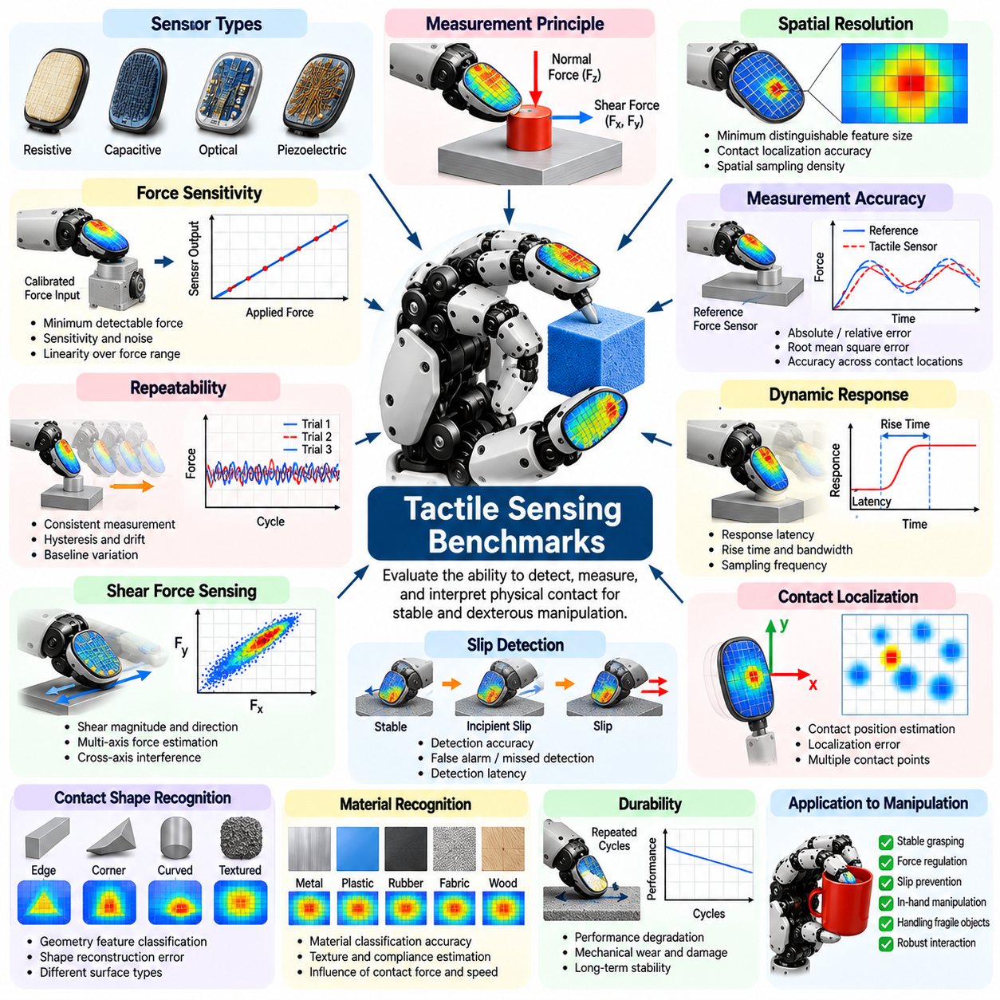{width="7.268055555555556in" height="7.268055555555556in"}

촉각 센싱 벤치마크(Tactile Sensing Benchmarks)는 로봇 손(Robotic Hands)이 파지(Grasping)와 조작(Manipulation) 과정에서 물리적 접촉(Physical Contact)을 얼마나 효과적으로 감지하고, 측정하고, 해석하는지 평가한다. 시각 기반 평가(Vision-Based Evaluation)와 달리 촉각 벤치마킹(Tactile Benchmarking)은 접촉 인터페이스(Contact Interfaces)에서 직접 생성되는 정보에 초점을 맞춘다. 이러한 측정은 시각 정보가 불완전한 상황에서 로봇 손이 접촉 상태(Contact Conditions)를 인식하고, 상호작용 힘(Interaction Forces)을 조절하고, 미끄러짐(Slip)을 감지하고, 안정적인 조작을 유지할 수 있는지 보여준다.

촉각 센서(Tactile Sensors)는 기계적 상호작용(Mechanical Interactions)을 측정 가능한 전기적 신호(Electrical Signals), 광학적 신호(Optical Signals) 또는 기타 신호로 변환한다. 센서 기술(Sensor Technology)에 따라 이러한 신호는 수직 압력(Normal Pressure), 전단력(Shear Force), 변형(Deformation), 진동(Vibration), 접촉 위치(Contact Location)를 나타낼 수 있다. 벤치마크 설계(Benchmark Design)에서는 센서 자체의 원시 성능(Raw Sensor Performance)과 촉각 정보를 해석하는 알고리즘의 효과(Algorithm Effectiveness)를 구분해야 한다. 분해능(Resolution)이 우수한 센서가 반드시 더 뛰어난 조작 성능(Manipulation Performance)을 제공하는 것은 아니다.

공간 분해능(Spatial Resolution)은 촉각 센서가 인접한 접촉 위치(Neighboring Contact Locations)나 압력 분포(Pressure Distributions)를 구별하는 능력을 측정한다. 고해상도 촉각 배열(High-Resolution Tactile Arrays)은 작은 접촉 특징(Contact Features)을 식별하고 정밀한 손가락 끝 상호작용(Precise Fingertip Interaction)을 지원할 수 있다. 평가에는 알려진 위치와 간격에 적용하는 보정된 압입 도구(Calibrated Indenters)를 사용할 수 있다. 결과에는 지정된 하중 조건(Loading Conditions)에서 공간 샘플링 밀도(Spatial Sampling Density), 유효 위치 추정 정확도(Effective Localization Accuracy), 최소 식별 가능 특징 크기(Minimum Distinguishable Feature Size)를 보고해야 한다.

힘 민감도(Force Sensitivity)는 촉각 센서가 안정적으로 감지할 수 있는 가해진 힘의 최소 변화량을 측정한다. 높은 민감도(High Sensitivity)는 부드러운 접촉(Gentle Contact)이 필요한 가볍거나 파손되기 쉬운 물체(Lightweight or Fragile Objects)를 조작할 때 특히 중요하다. 벤치마크 절차에서는 제어된 힘 증가량(Controlled Force Increments)을 적용하고 센서 출력(Sensor Outputs)을 보정된 기준 측정값(Calibrated Reference Measurements)과 비교한다. 겉으로 나타나는 신호 변화가 실제 접촉 변화를 의미하지 않을 수 있으므로 민감도는 잡음(Noise)과 함께 평가해야 한다.

측정 정확도(Measurement Accuracy)는 촉각 센서 출력이 알려진 기준 힘(Reference Forces)이나 압력(Pressures)과 얼마나 일치하는지를 나타낸다. 보정 실험(Calibration Experiments)은 일반적으로 의도된 운용 범위(Operating Range) 전체에 걸쳐 하중을 가하고 추정값(Estimated Values)을 기준 계측기(Reference Instruments)와 비교한다. 지표에는 절대 오차(Absolute Error), 상대 오차(Relative Error), 평균 제곱근 오차(Root Mean Square Error)가 포함될 수 있다. 센서 응답(Sensor Response)은 감지 표면(Sensing Surface)의 위치에 따라 달라질 수 있으므로 여러 접촉 위치에서 정확도를 평가해야 한다.

반복성(Repeatability)은 동일한 접촉 조건(Contact Conditions)을 반복적으로 적용했을 때 촉각 센서가 일관된 측정값을 생성하는지 평가한다. 실험에는 고정된 위치와 힘 수준에서 반복적인 하중 및 제하 주기(Repeated Loading and Unloading Cycles)를 적용하는 과정이 포함될 수 있다. 측정값 분산(Measurement Dispersion), 히스테리시스(Hysteresis), 기준선 변화(Baseline Variation)는 센서 일관성(Sensor Consistency)에 관한 정보를 제공한다. 높은 반복성은 신뢰할 수 있는 폐루프 파지 제어(Closed-Loop Grasp Control)와 서로 다른 실험 세션(Experimental Sessions) 간의 의미 있는 비교에 필수적이다.

동적 응답(Dynamic Response)은 촉각 센서가 변화하는 접촉 조건에 얼마나 빠르게 반응하는지를 결정한다. 중요한 측정 항목에는 응답 지연시간(Response Latency), 상승 시간(Rise Time), 샘플링 주파수(Sampling Frequency), 사용 가능한 대역폭(Usable Bandwidth)이 포함된다. 갑작스러운 접촉 사건(Contact Events)을 감지하고 보정 제어 동작(Corrective Control Actions)을 시작하려면 빠른 응답이 필요하다. 벤치마크 절차에서는 센서 응답 시간(Sensor Response Time)을 통신 지연(Communication Delays), 신호 처리 지연시간(Signal Processing Latency), 전체 제어 루프 응답(Overall Control-Loop Response)과 구분해야 한다.

전단력 센싱(Shear Force Sensing)은 접선 방향 접촉력(Tangential Contact Forces)이 미끄러짐(Slip)과 물체 안정성(Object Stability)에 영향을 미치므로 특히 중요하다. 벤치마크는 센서가 제어된 하중 조건에서 전단력의 크기(Shear Magnitude)와 방향(Direction)을 추정할 수 있는지 평가한다. 실제 조작에서는 개별 힘 성분이 독립적으로 작용하는 경우가 드물기 때문에 수직력(Normal Forces)과 접선력(Tangential Forces)이 결합된 조건을 시험해야 한다. 축 간 간섭(Cross-Axis Interference)과 추정 오차(Estimation Errors)는 다방향 촉각 센싱(Multidirectional Tactile Sensing)의 한계를 보여준다.

미끄러짐 감지 벤치마크(Slip Detection Benchmarks)는 물체와 로봇 손가락 끝(Robotic Fingertip) 사이의 상대 운동(Relative Motion)을 식별하는 능력을 측정한다. 시험에서는 미끄러짐이 시작될 때까지 접선 하중(Tangential Loading)을 점진적으로 증가시키거나 제어된 물체 움직임(Controlled Object Movement)을 도입할 수 있다. 감지 정확도(Detection Accuracy), 오경보율(False Alarm Rate), 미검출률(Missed Detection Rate), 감지 지연시간(Detection Latency)이 관련 지표이다. 초기 미끄러짐(Incipient Slip)을 조기에 식별하면 완전한 파지 실패(Complete Grasp Failure)가 발생하기 전에 보정 파지 조정(Corrective Grip Adjustments)을 수행할 수 있다.

접촉 위치 추정 벤치마크(Contact Localization Benchmarks)는 촉각 센싱 시스템(Tactile Sensing System)이 물체가 손가락이나 손바닥(Finger or Palm)의 어느 위치에 접촉하는지 판단할 수 있는지 평가한다. 보정된 기계적 시험 장치(Calibrated Mechanical Fixtures)를 사용하여 알려진 접촉점(Known Contact Points)을 생성하고, 추정 위치(Estimated Positions)를 기준 위치(Reference Locations)와 비교한다. 위치 추정 오차(Localization Error)는 거리(Distance) 또는 분포 중첩(Distribution Overlap)으로 표현할 수 있다. 정확한 접촉 위치 추정은 파지 계획(Grasp Planning), 손가락 위치 변경(Finger Repositioning), 손 내부 물체 운동 추정(Object Motion Estimation)을 지원한다.

접촉 형상 인식(Contact Shape Recognition)은 센서가 기하학적 표면 특징(Geometric Surface Features)을 구별할 수 있는지 평가함으로써 개별 힘 측정을 넘어 촉각 평가를 확장한다. 실험에는 모서리(Edges), 꼭짓점(Corners), 곡면(Curved Surfaces), 질감이 있는 재료(Textured Materials)를 사용할 수 있다. 분류 정확도(Classification Accuracy)와 재구성 오차(Reconstruction Error)는 촉각 인식 능력(Tactile Perception Capability)을 측정하는 지표를 제공한다. 이러한 벤치마크는 부분적인 시각적 가림(Partial Visual Occlusion) 상태에서 물체를 조작해야 하는 로봇 손에 특히 유용하다.

재료 인식 벤치마크(Material Recognition Benchmarks)는 촉각 측정값을 통해 질감(Texture), 경도(Hardness), 순응성(Compliance)과 같은 표면 특성(Surface Characteristics)을 구별할 수 있는지 평가한다. 제어된 접촉 및 미끄럼 절차(Controlled Contact and Sliding Procedures)는 서로 다른 재료와 관련된 신호를 생성한다. 성능은 접촉력(Contact Force), 이동 속도(Movement Speed), 환경 조건(Environmental Conditions)에 따라 달라진다. 평가에서는 재료 분류 정확도(Material Classification Accuracy)를 물체 형상(Object Geometry)과 실험 구성(Experimental Setup)의 영향으로부터 구분해야 한다.

센서 내구성(Sensor Durability)은 로봇 손가락 끝(Robotic Fingertips)이 반복적인 압축(Compression), 전단 하중(Shear Loading), 마모(Abrasion), 간헐적인 충격(Impacts)을 경험하므로 중요한 벤치마크 요소이다. 가속 시험(Accelerated Testing)은 측정 정확도(Measurement Accuracy)와 신호 안정성(Signal Stability)을 관찰하면서 반복적인 접촉 주기(Repeated Contact Cycles)를 적용할 수 있다. 관련 지표에는 성능 저하(Performance Degradation), 기계적 손상(Mechanical Damage), 보정 드리프트(Calibration Drift)가 포함된다. 내구성 평가는 촉각 센싱 시스템이 연속적인 로봇 운용(Continuous Robotic Operation)에 적합한지 판단하는 데 도움이 된다.

환경 강건성(Environmental Robustness)은 온도(Temperature), 습도(Humidity), 진동(Vibration), 표면 오염(Surface Contamination)의 변화에 따른 촉각 센서 성능을 측정한다. 이러한 조건은 센서 재료(Sensor Materials), 전기적 특성(Electrical Characteristics), 접촉 거동(Contact Behavior)을 변화시킬 수 있다. 벤치마크 절차에서는 대표적인 운용 환경(Operating Environments)에 걸쳐 측정 드리프트(Measurement Drift)와 감지 신뢰성(Detection Reliability)을 정량화해야 한다. 강건성 시험(Robustness Testing)은 통제된 실험실 외부에서 작동하는 산업용 로봇(Industrial Robots)과 모바일 로봇 시스템(Mobile Robotic Systems)에 특히 중요하다.

촉각 보정 절차(Tactile Calibration Procedures)는 물리적 접촉 물리량(Physical Contact Quantities)과 센서 출력(Sensor Outputs) 사이의 관계를 수립한다. 보정에는 힘 기준값(Force References), 공간 매핑(Spatial Mapping), 온도 보상(Temperature Compensation), 비선형 응답 보정(Correction of Nonlinear Responses)이 필요할 수 있다. 벤치마크 보고서는 보정 방법(Calibration Methods), 기준 장비(Reference Equipment), 불확실성(Uncertainty), 재보정 주기(Recalibration Frequency)를 문서화해야 한다. 일관된 보정이 없으면 촉각 센싱 기술 간 비교가 실제 능력보다 측정 방식의 차이를 반영할 수 있다.

촉각 데이터 처리(Tactile Data Processing)는 원시 측정값(Raw Measurements)에 필터링(Filtering), 특징 추출(Feature Extraction), 상태 추정(State Estimation)이 필요한 경우가 많으므로 추가적인 성능 고려사항을 발생시킨다. 신경망(Neural Networks)과 기타 학습 기반 방법(Learning-Based Methods)은 촉각 신호(Tactile Signals)로부터 접촉 형상(Contact Geometry), 미끄러짐 상태(Slip State), 물체 특성(Object Properties)을 추론할 수 있다. 벤치마크는 센싱 하드웨어 능력(Sensing Hardware Capability)과 알고리즘 추론 성능(Algorithmic Inference Performance)을 구분하고 계산 지연시간(Computational Latency), 학습 조건(Training Conditions), 익숙하지 않은 접촉에 대한 일반화(Generalization to Unfamiliar Contacts)를 보고해야 한다.

폐루프 파지 벤치마크(Closed-Loop Grasping Benchmarks)는 센서 피드백(Sensor Feedback)을 로봇 손 제어(Robotic Hand Control)에 통합하여 촉각 센싱의 실제 기여도를 평가한다. 실험에서는 동일한 조건에서 촉각 지원 파지(Tactile-Enabled Grasping)를 시각 정보만 사용하는 제어(Vision-Only Control) 또는 개루프 제어(Open-Loop Control)와 비교할 수 있다. 파지 성공률(Grasp Success Rate), 미끄러짐 빈도(Slip Frequency), 힘 조절 정확도(Force Regulation Accuracy), 물체 손상(Object Damage)을 측정할 수 있다. 이러한 비교는 개선된 촉각 측정이 실제로 의미 있는 조작 성능 향상으로 이어지는지 보여준다.

손 안 조작 벤치마크(In-Hand Manipulation Benchmarks)는 물체 회전(Object Rotation)과 위치 변경(Repositioning) 과정에서 손가락 접촉(Finger Contacts)이 지속적으로 변화하므로 촉각 센싱을 평가하기 위한 까다로운 환경을 제공한다. 센서는 접촉 전환(Contact Transitions)을 감지하고, 힘 분포(Force Distribution)를 추정하며, 보정 제어(Corrective Control)를 지원해야 한다. 성능은 조작 성공률(Manipulation Success), 자세 정확도(Pose Accuracy), 접촉 안정성(Contact Stability), 외란 복구(Disturbance Recovery)를 통해 측정할 수 있다. 이러한 작업은 정적인 압력 측정(Static Pressure Measurements)만으로는 발견하기 어려운 한계를 드러낸다.

벤치마크 재현성(Benchmark Reproducibility)을 확보하려면 표준화된 접촉 물체(Standardized Contact Objects), 하중 적용 절차(Loading Procedures), 센서 장착 조건(Sensor Mounting Conditions), 기준 측정 시스템(Reference Measurement Systems)이 필요하다. 손가락 끝 순응성(Fingertip Compliance), 접촉 면적(Contact Area), 기계적 통합(Mechanical Integration)의 차이는 촉각 신호에 큰 영향을 미칠 수 있다. 연구자는 센서 사양(Sensor Specifications) 및 통계적 불확실성(Statistical Uncertainty)과 함께 이러한 조건을 보고해야 한다. 일관된 실험 문서화(Experimental Documentation)는 실험실과 로봇 플랫폼 간에 더욱 의미 있는 비교를 가능하게 한다.

포괄적인 촉각 센싱 벤치마크(Comprehensive Tactile Sensing Benchmark)는 정적 정확도(Static Accuracy), 공간 분해능(Spatial Resolution), 힘 민감도(Force Sensitivity), 동적 응답(Dynamic Response), 미끄러짐 감지(Slip Detection), 내구성(Durability), 작업 수준 성능(Task-Level Performance)을 결합해야 한다. 조작 작업마다 센싱 요구사항(Sensing Requirements)이 다르므로 단일 지표만으로 촉각 센싱 능력을 충분히 설명할 수 없다. 센서 수준 측정(Sensor-Level Measurements)을 폐루프 파지(Closed-Loop Grasping) 및 손재주 조작 시험(Dexterous Manipulation Tests)과 통합함으로써 엔지니어는 촉각 피드백(Tactile Feedback)이 로봇 손의 신뢰성(Reliability)과 적응성(Adaptability)을 어떻게 향상시키는지 판단할 수 있다.

## 14.08 Speed and Cycle Time Metrics

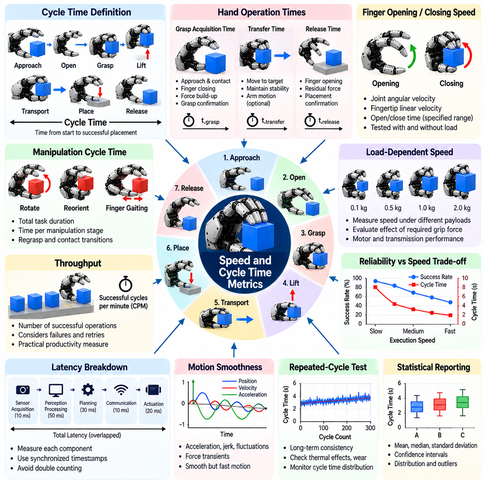{width="7.268055555555556in" height="7.268055555555556in"}

속도 및 사이클 시간 지표(Speed and Cycle Time Metrics)는 로봇 손(Robotic Hand)이 파지(Grasping), 조작(Manipulation), 해제(Release) 작업을 얼마나 효율적으로 수행하는지 평가한다. 이러한 측정은 로봇 손이 산업 자동화(Industrial Automation), 물류(Logistics), 서비스 로봇(Service Robotics)의 생산성 요구사항(Productivity Requirements)을 충족할 수 있는지 판단하는 데 필수적이다. 신뢰성(Reliability)을 강조하는 파지 성공률(Grasp Success Rate)과 달리 속도 지표(Speed Metrics)는 실행 시간(Execution Time)을 정량화하고 운용 효율성(Operational Efficiency)과 조작 성능(Manipulation Performance) 사이의 관계를 보여준다.

사이클 시간(Cycle Time)은 사전에 정의된 조작 순서(Manipulation Sequence)를 완료하는 데 필요한 전체 시간을 의미한다. 일반적인 집기 및 배치 사이클(Pick-and-Place Cycle)에는 물체 접근(Object Approach), 손가락 열기(Finger Opening), 파지 획득(Grasp Acquisition), 들어 올리기(Lifting), 운반(Transportation), 배치(Placement), 해제(Release)가 포함된다. 로봇 팔 움직임(Robot Arm Motion), 인식(Perception), 통신 지연(Communication Delays)의 포함 여부에 따라 보고되는 사이클 시간이 크게 달라질 수 있으므로 벤치마크 프로토콜(Benchmark Protocols)은 시작 및 종료 시점(Starting and Ending Events)을 정확하게 정의해야 한다.

파지 획득 시간(Grasp Acquisition Time)은 파지 명령(Grasp Command)을 시작한 시점부터 안정적인 물체 유지(Stable Object Hold)가 형성될 때까지의 시간을 측정한다. 이 구간에는 손가락 접근(Finger Approach), 초기 접촉(Initial Contact), 파지력 형성(Force Buildup), 파지 확인(Grasp Confirmation)이 포함될 수 있다. 획득 시간은 액추에이터 속도(Actuator Speed), 손가락 이동 거리(Finger Travel Distance), 센싱 지연시간(Sensing Latency), 제어 전략(Control Strategy)에 따라 달라진다. 벤치마크 결과에서는 기계적인 손가락 닫힘 시간(Mechanical Closing Time)과 파지 안정성을 검증하는 데 필요한 전체 과정을 구분해야 한다.

손가락 열림 및 닫힘 속도(Finger Opening and Closing Speed)는 로봇 손의 구동 성능(Actuation Performance)을 직접 측정하는 지표이다. 관련 지표에는 관절 각속도(Joint Angular Velocity), 손가락 끝 선속도(Fingertip Linear Velocity), 지정된 구성 사이를 이동하는 데 필요한 시간(Time Between Configurations)이 포함된다. 시험에서는 표준화된 운동 범위(Motion Ranges)와 하중 조건(Loading Conditions)을 사용해야 한다. 액추에이터가 접촉력(Contact Forces)에 대항하여 작동할 때 성능이 크게 저하될 수 있으므로 무부하 최대 속도(Maximum Unloaded Speed)만으로는 충분하지 않다.

물체 이송 시간(Object Transfer Time)은 로봇 시스템이 파지한 물체를 사전에 정의된 위치 사이에서 이동시키는 데 걸리는 시간을 측정한다. 이송 속도(Transfer Speed)는 로봇 팔 움직임(Robot Arm Motion)의 영향을 크게 받지만, 로봇 손의 안정성(Hand Stability)은 허용 가능한 가속도(Acceleration)와 속도(Velocity)를 제한할 수 있다. 벤치마크에서는 로봇 팔에 의존하는 운반 시간(Arm-Dependent Transportation Time)과 로봇 손 자체의 제어 지연(Hand-Specific Control Delays)을 분리해야 한다. 이러한 구분은 전체 로봇 운동 성능이 로봇 손의 성능으로 잘못 해석되는 것을 방지한다.

해제 시간(Release Time)은 손가락의 접촉을 해제하고 안정적인 물체 배치(Stable Object Placement)를 완료하는 데 필요한 시간을 측정한다. 해제 성능(Release Performance)은 손가락 열림 동역학(Finger Opening Dynamics), 잔류 접촉력(Residual Contact Forces), 표면 접착(Surface Adhesion), 제어 동기화(Control Synchronization)에 따라 달라진다. 빠른 열림 명령(Rapid Opening Command)이 반드시 즉각적인 물체 분리(Object Separation)를 의미하는 것은 아니다. 벤치마크 절차에서는 액추에이터 명령 종료(Actuator Command Termination)만이 아니라 관측 가능한 물리적 사건(Observable Physical Events)을 기준으로 해제 완료를 정의해야 한다.

조작 사이클 시간(Manipulation Cycle Time)은 물체 방향 변경(Object Reorientation), 손가락 보행(Finger Gaiting), 반복적인 접촉 전환(Repeated Contact Transitions)이 필요한 작업에서 더욱 복잡해진다. 이러한 작업에는 여러 손가락의 협조적인 움직임(Coordinated Finger Movements)과 중간 안정화 시간(Intermediate Stabilization Periods)이 포함될 수 있다. 평가에서는 전체 작업 시간(Total Task Duration)과 개별 조작 단계(Individual Manipulation Stages)에 소요된 시간을 모두 기록해야 한다. 이러한 측정은 단순한 손가락 열림 및 닫힘 시험으로는 발견하기 어려운 병목 현상(Bottlenecks)을 식별한다.

처리량(Throughput)은 지정된 시간 동안 성공적으로 완료한 조작 작업의 수를 측정한다. 일반적으로 분당 또는 시간당 성공 사이클 수(Successful Cycles per Minute or Hour)로 표현한다. 실패한 시도(Failed Attempts), 재시도(Retries), 복구 작업(Recovery Operations)도 추가 시간을 소비하므로 처리량은 실행 속도(Execution Speed)와 신뢰성(Reliability)의 영향을 모두 받는다. 따라서 처리량은 달성 가능한 최소 사이클 시간(Minimum Achievable Cycle Time)보다 실제 생산성(Practical Productivity)을 더 잘 나타내는 경우가 많다.

속도(Speed)와 파지 신뢰성(Grasp Reliability)은 서로 상충하는 요구사항을 가지는 경우가 많다. 손가락 속도(Finger Velocity)를 높이면 파지 획득 시간(Grasp Acquisition Time)을 줄일 수 있지만 충격력(Impact Forces), 물체 변위(Object Displacement), 불안정한 접촉(Unstable Contacts)이 발생할 수 있다. 마찬가지로 공격적인 로봇 팔 가속(Arm Acceleration)은 운반 중 미끄러짐 위험(Slip Risk)을 증가시킬 수 있다. 벤치마크 실험에서는 빠른 실행과 허용 가능한 신뢰성 사이의 균형을 유지하는 운용 영역(Operating Regions)을 식별하기 위해 여러 속도 설정에서 성공률을 측정해야 한다.

지연시간 측정(Latency Measurements)은 센싱(Sensing), 의사결정(Decision-Making), 물리적 구동(Physical Actuation) 사이에서 발생하는 지연을 설명하는 데 도움이 된다. 관련 구성요소에는 센서 획득 지연시간(Sensor Acquisition Latency), 인식 처리 시간(Perception Processing Time), 파지 계획 시간(Grasp Planning Time), 통신 지연(Communication Delay), 액추에이터 응답 지연시간(Actuator Response Latency)이 포함된다. 이러한 지연은 순차적으로 발생하기보다 서로 중첩될 수 있다. 정확한 벤치마킹을 위해서는 전체 사이클에서 시간을 중복 계산(Double Counting)하지 않도록 동기화된 타임스탬프(Synchronized Timestamps)와 명확한 정의가 필요하다.

운동 부드러움(Motion Smoothness)은 빠르지만 제어가 불안정한 손가락 움직임이 진동(Vibration)과 과도한 접촉력(Excessive Contact Forces)을 발생시킬 수 있으므로 중요하다. 가속도(Acceleration), 저크(Jerk), 속도 변동(Velocity Fluctuations), 힘 과도응답(Force Transients)은 운동 품질(Motion Quality)을 나타내는 추가 지표이다. 부드러움 지표(Smoothness Metrics)는 완료 시간(Completion Time)과 파지 안정성(Grasp Stability)과 함께 해석해야 한다. 파손되기 쉬운 물체(Fragile Objects)를 취급하거나 정밀 조립(Precision Assembly)을 수행할 때는 느린 궤적(Slower Trajectory)이 더 적합할 수 있다.

하중 의존 속도 시험(Load-Dependent Speed Testing)은 물체 질량(Object Mass), 필요한 파지력(Required Gripping Force), 액추에이터 하중(Actuator Loading)에 따라 로봇 손의 성능이 어떻게 변화하는지 평가한다. 모터(Motors)와 동력 전달 장치(Transmissions)는 높은 토크 요구(High Torque Demand)에서 속도가 감소할 수 있으며, 순응성 메커니즘(Compliant Mechanisms)은 추가적인 안정화 시간(Settling Time)이 필요할 수 있다. 벤치마크 프로토콜은 대표적인 적재 하중(Representative Payloads)과 접촉력(Contact Forces)을 명시해야 한다. 무부하 조건에서 얻은 결과가 실제 운용 조건을 대표한다고 가정해서는 안 된다.

반복 사이클 시험(Repeated-Cycle Testing)은 장시간 운용(Prolonged Operation) 중에도 속도 성능이 일관되게 유지되는지 보여준다. 액추에이터 발열(Actuator Heating), 배터리 전압 변화(Battery Voltage Changes), 기계적 마모(Mechanical Wear), 제어기 한계(Controller Limitations)는 실행 시간에 영향을 미칠 수 있다. 실험에서는 초기 측정값만 보고하는 대신 장시간 반복 작업에 걸친 사이클 시간 분포(Cycle Time Distributions)를 기록해야 한다. 사이클 시간이 증가하면 열적 출력 제한(Thermal Derating), 기계적 성능 저하(Mechanical Degradation), 새롭게 발생하는 제어 문제(Emerging Control Problems)를 의미할 수 있다.

사이클 시간(Cycle Times)은 물체, 파지 구성(Grasp Configurations), 환경 조건(Environmental Conditions)에 따라 달라지므로 통계 분석(Statistical Analysis)이 필요하다. 평균(Mean)과 중앙값(Median)은 일반적인 성능을 설명하며, 표준편차(Standard Deviation)와 백분위수 값(Percentile Values)은 변동성(Variability)을 나타낸다. 높은 백분위수의 사이클 시간(High-Percentile Cycle Times)은 간헐적인 지연이 생산 일정(Production Scheduling)을 방해하는 경우 특히 중요하다. 보고서에는 표본 크기(Sample Size), 실패한 시도(Failed Attempts), 미완료 사이클(Incomplete Cycles)의 처리 방법을 포함해야 한다.

에너지 효율(Energy Efficiency)은 빠른 조작이 최대 전력 소비(Peak Power Consumption)와 액추에이터 발열(Actuator Heating)을 증가시킬 수 있으므로 속도 평가에 추가적인 관점을 제공한다. 관련 측정 항목에는 완료된 사이클당 에너지(Energy per Completed Cycle), 평균 전력(Average Electrical Power), 최대 전력 요구량(Peak Power Demand)이 포함된다. 비교에서는 동등한 작업(Equivalent Tasks)과 적재 하중 조건(Payload Conditions)을 사용해야 한다. 생산성이 가장 높은 운용 속도(Operating Speed)는 성공적인 작업당 에너지 소비(Energy Consumption per Successful Operation)를 최소화하는 속도와 다를 수 있다.

벤치마크 환경 설계(Benchmark Environment Design)는 측정된 사이클 시간에 큰 영향을 미친다. 물체 배치(Object Placement), 작업공간 형상(Workspace Geometry), 센서 위치(Sensor Positioning), 로봇 보정(Robot Calibration), 통신 아키텍처(Communication Architecture)는 체계적인 차이(Systematic Differences)를 발생시킬 수 있다. 따라서 공정한 비교를 위해서는 표준화된 시작 구성(Standardized Starting Configurations)과 작업 거리(Task Distances)가 필요하다. 하드웨어 플랫폼(Hardware Platforms)이 서로 다른 경우 보고서에서는 로봇 손 고유 성능(Intrinsic Hand Performance)과 전체 시스템 수준 실행 시간(System-Level Execution Time)을 구분해야 한다.

실시간 제어 요구사항(Real-Time Control Requirements)은 빠른 접촉 집약적 조작(Rapid Contact-Rich Manipulation)을 수행하는 로봇 손에서 특히 중요하다. 제어 주파수(Control Frequency), 피드백 대역폭(Feedback Bandwidth), 계산 스케줄링(Computation Scheduling)은 빠른 움직임 중 안정성을 유지하는 능력에 영향을 미친다. 벤치마킹에서는 실제 계산 부하(Realistic Computational Loads)에서 제어 루프(Control Loops)가 시간 요구사항(Timing Requirements)을 충족하는지 평가해야 한다. 평균 지연시간(Average Latency)만으로는 조작 실패를 유발하는 간헐적인 지연(Occasional Delays)을 발견하지 못할 수 있다.

학습 기반 파지 시스템(Learning-Based Grasping Systems)은 신경망 추론(Neural Network Inference)과 정책 실행(Policy Execution)이 상당한 계산 자원(Computational Resources)을 소비할 수 있으므로 추가적인 시간 관련 고려사항이 필요하다. 모델 크기(Model Size), 프로세서 아키텍처(Processor Architecture), 메모리 대역폭(Memory Bandwidth), 추론 최적화(Inference Optimization)는 응답 시간(Response Time)에 영향을 미친다. 평가에서는 오프라인 계획(Offline Planning)과 온라인 의사결정(Online Decision-Making)을 구분하고 사용된 하드웨어를 보고해야 한다. 이러한 정보는 임베디드 로봇 제어기(Embedded Robotic Controllers)에 배치할 수 있는지 평가하는 데 필수적이다.

비교 속도 벤치마킹(Comparative Speed Benchmarking)은 로봇 손 구조(Hand Architecture), 액추에이터 기술(Actuator Technology), 손가락 수(Finger Count), 기계적 동력 전달 장치(Mechanical Transmission)의 차이를 고려해야 한다. 평행 조 그리퍼(Parallel-Jaw Gripper)는 단순한 파지 사이클을 손재주가 뛰어난 다지 로봇 손(Dexterous Multifinger Hand)보다 빠르게 완료할 수 있지만, 다지 로봇 손은 외부 위치 변경(External Repositioning) 없이 복잡한 조작을 수행할 수 있다. 따라서 공정한 비교를 위해서는 액추에이터 속도나 개별 사이클 측정값에만 의존하지 않고 동등한 작업 목표(Equivalent Task Objectives)를 사용해야 한다.

포괄적인 속도 및 사이클 시간 평가(Comprehensive Speed and Cycle Time Evaluation)는 파지 획득 시간(Grasp Acquisition Time), 구동 속도(Actuation Speed), 조작 시간(Manipulation Duration), 해제 시간(Release Time), 처리량(Throughput), 지연시간(Latency), 시간 변동성(Timing Variability)을 결합해야 한다. 이러한 측정은 파지 성공률(Grasp Success), 적재 하중 용량(Payload Capacity), 에너지 소비(Energy Consumption), 신뢰성(Reliability)과 함께 해석해야 한다. 대표적인 조건에서 전체 작업 성능(Complete Task Performance)을 평가함으로써 엔지니어는 실제 운용 한계(Practical Operating Limits)를 식별하고 효율적이고 신뢰할 수 있는 조작을 위해 로봇 손을 최적화할 수 있다.

## 14.09 Reliability and MTBF

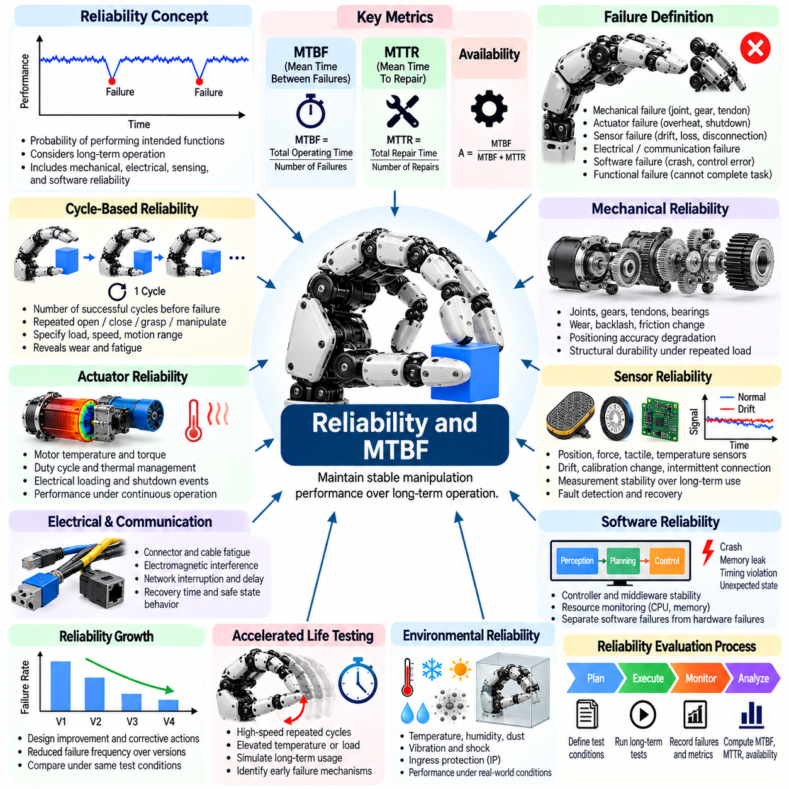{width="7.268055555555556in" height="7.268055555555556in"}

신뢰성(Reliability)은 로봇 손(Robotic Hands)이 장시간 운용(Extended Operation) 동안 성공적인 조작(Manipulation)을 지속적으로 유지해야 하므로 핵심적인 성능 특성이다. 신뢰성 벤치마크(Reliability Benchmarks)는 지정된 조건에서 로봇 손이 고장 없이 의도된 기능(Intended Functions)을 수행할 확률을 평가한다. 단기적인 파지 성공 시험(Short-Term Grasp Success Tests)과 달리 신뢰성 평가는 기계적 마모(Mechanical Wear), 액추에이터 성능 저하(Actuator Degradation), 센서 결함(Sensor Faults), 제어 불안정성(Control Instability), 반복적인 조작 사이클(Manipulation Cycles)의 누적 영향을 고려한다.

평균 고장 간격(Mean Time Between Failures, MTBF)은 수리가 가능한 로봇 손 시스템(Repairable Robotic Hand System)에서 연속된 고장 사이의 평균 운용 시간을 나타낸다. 일반적으로 정의된 시험 기간(Test Period) 동안 누적된 총 운용 시간(Accumulated Operating Time)을 관측된 고장 횟수(Number of Observed Failures)로 나누어 추정한다. MTBF는 유지보수 계획(Maintenance Planning)에 유용한 지표이지만, 개별 로봇 손이 해당 시간 동안 고장 없이 작동한다는 것을 보장하지는 않는다. 그 해석은 고장 정의(Failure Definition)와 운용 조건(Operating Conditions)에 따라 달라진다.

고장 정의(Failure Definition)는 로봇 손에서 기계적(Mechanical), 전기적(Electrical), 센싱(Sensing), 소프트웨어 관련(Software-Related) 문제가 발생할 수 있으므로 필수적이다. 고장에는 동력 전달 장치 파손(Broken Transmission), 액추에이터 정지(Actuator Shutdown), 센서 오작동(Sensor Malfunction), 통신 손실(Communication Loss), 요구된 조작 작업의 수행 불능(Inability to Complete a Required Manipulation Task)이 포함될 수 있다. 벤치마크 프로토콜(Benchmark Protocols)은 기능적 고장(Functional Failures)과 일시적인 성능 저하(Temporary Performance Degradation)를 구분해야 한다. 명확한 고장 기준(Failure Criteria)은 서로 다른 로봇 플랫폼 간 신뢰성 측정의 불일치를 방지한다.

평균 수리 시간(Mean Time To Repair, MTTR)은 고장 난 로봇 손을 정상적인 운용 상태(Operational State)로 복구하는 데 필요한 평균 시간을 측정한다. 수리 활동(Repair Activities)에는 고장 진단(Fault Diagnosis), 부품 교체(Component Replacement), 재보정(Recalibration), 소프트웨어 복구(Software Recovery), 기능 검증(Functional Verification)이 포함될 수 있다. MTTR은 고장 자체에 대한 저항성(Intrinsic Failure Resistance)이 아니라 유지보수성(Maintainability)을 나타낸다. MTBF와 MTTR을 일관되게 측정하면 두 지표의 관계를 통해 수리 가능한 시스템의 운용 가용성(Operational Availability)을 추정할 수 있다.

운용 가용성(Operational Availability)은 로봇 손이 요구된 기능을 수행할 수 있는 상태에 있는 시간의 비율을 나타낸다. 단순화된 가정(Simplified Assumptions)에서는 고유 가용성(Inherent Availability)을 MTBF를 MTBF와 MTTR의 합으로 나눈 값으로 추정할 수 있다. 실제 운용 가용성은 정기 유지보수(Scheduled Maintenance), 예비 부품 가용성(Spare-Part Availability), 물류 지연(Logistical Delays)의 영향을 받을 수도 있다. 따라서 신뢰성 벤치마크는 고유 가용성과 실제 배치(Practical Deployment) 과정에서 관측되는 가용성을 구분해야 한다.

사이클 기반 신뢰성(Cycle-Based Reliability)은 로봇 손이 반복적인 열림(Opening), 닫힘(Closing), 파지(Gripping), 조작(Manipulation) 작업을 수행하므로 특히 중요하다. 벤치마크는 운용 시간(Operating Hours)만 측정하는 대신 고장 발생 전 성공적으로 수행한 사이클 수(Number of Successful Cycles Before Failure)를 보고할 수 있다. 사이클 수(Cycle Counts)는 반복 운동(Repetitive Motion)과 관련된 피로(Fatigue) 및 마모(Wear) 메커니즘을 보여준다. 이러한 요인은 부품 수명(Component Lifetime)에 큰 영향을 미치므로 시험 결과에는 하중(Load), 속도(Speed), 운동 범위(Motion Range), 환경 조건(Environmental Conditions)을 명시해야 한다.

기계적 신뢰성(Mechanical Reliability)은 관절(Joints), 기어(Gears), 텐던(Tendons), 베어링(Bearings), 링크 기구(Linkages), 구조 부품(Structural Components)의 내구성(Durability)에 따라 달라진다. 반복 하중(Repeated Loading)은 피로(Fatigue), 백래시(Backlash), 마찰 변화(Friction Changes), 동력 전달 장치 마모(Transmission Wear)를 발생시킬 수 있다. 벤치마크 시험에서는 기계적 성능을 관찰하면서 대표적인 힘(Representative Forces)을 적용한 가속 반복 시험(Accelerated Cycling)을 수행할 수 있다. 위치 정확도(Positioning Accuracy), 관절 강성(Joint Stiffness), 동력 전달 효율(Transmission Efficiency)의 변화는 완전한 고장이 발생하기 전에 진행성 성능 저하(Progressive Degradation)를 나타낼 수 있다.

액추에이터 신뢰성(Actuator Reliability)은 모터 온도(Motor Temperature), 토크 요구량(Torque Demand), 듀티 사이클(Duty Cycle), 전기적 부하(Electrical Loading), 열 관리(Thermal Management)의 영향을 받는다. 지속적인 파지(Continuous Gripping)나 빠른 반복 운동(Rapid Repetitive Motion)은 상당한 열을 발생시키고 부품 수명을 단축할 수 있다. 신뢰성 시험에서는 온도(Temperature), 전류(Current), 토크(Torque), 보호 정지 사건(Protective Shutdown Events)을 관찰해야 한다. 열적 출력 제한(Thermal Derating)과 간헐적인 액추에이터 결함(Intermittent Actuator Faults)은 영구적인 하드웨어 손상을 일으키지 않더라도 운용 능력을 감소시킬 수 있으므로 문서화해야 한다.

센서 신뢰성(Sensor Reliability)은 로봇 손이 폐루프 제어(Closed-Loop Control)를 위해 위치(Position), 힘(Force), 촉각(Tactile), 경우에 따라 온도(Temperature) 측정에 의존하므로 매우 중요하다. 센서 드리프트(Sensor Drift), 간헐적인 연결 불량(Intermittent Connections), 보정 변화(Calibration Changes), 신호 손실(Signal Loss)은 조작 정확도(Manipulation Accuracy)를 저하시킬 수 있다. 벤치마크는 장시간 운용과 반복적인 접촉 사건(Repeated Contact Events) 동안 측정 안정성(Measurement Stability)을 평가해야 한다. 또한 센싱 고장이 안전하지 않거나 실패한 조작으로 이어지는지 판단하기 위해 결함 감지(Fault Detection) 및 복구 능력(Recovery Capabilities)을 시험해야 한다.

전기 및 통신 신뢰성(Electrical and Communication Reliability)은 분산된 액추에이터(Distributed Actuators)와 센서(Sensors)의 협조적인 동작에 영향을 미친다. 커넥터 성능 저하(Connector Degradation), 케이블 피로(Cable Fatigue), 전자기 간섭(Electromagnetic Interference), 네트워크 중단(Network Interruptions)은 간헐적인 결함(Intermittent Faults)을 발생시킬 수 있다. 벤치마크 절차에서는 시스템 동작을 관찰하면서 제어된 통신 지연(Controlled Communication Delays)이나 연결 해제(Disconnections)를 도입할 수 있다. 복구 시간(Recovery Time), 결함 감지 정확도(Fault Detection Accuracy), 안전 상태(Safe State)로 전환하는 능력은 시스템 회복력(System Resilience)을 나타내는 중요한 지표이다.

소프트웨어 신뢰성(Software Reliability)은 운동 제어기(Motion Controllers), 통신 미들웨어(Communication Middleware), 인식 알고리즘(Perception Algorithms), 조작 계획 시스템(Manipulation Planning Systems)의 안정성을 포함한다. 메모리 누수(Memory Leaks), 시간 제약 위반(Timing Violations), 예상하지 못한 상태 전환(Unexpected State Transitions), 처리되지 않은 예외(Unhandled Exceptions)는 운용을 중단시킬 수 있다. 장시간 시험(Long-Duration Tests)에서는 계산 자원 소비(Computational Resource Consumption)와 제어기 동작(Controller Behavior)을 관찰해야 한다. 정확한 진단과 목표 지향적인 개선을 위해 소프트웨어 고장은 하드웨어 고장과 별도로 기록해야 한다.

신뢰성 성장 시험(Reliability Growth Testing)은 설계 변경(Design Modifications)과 시정 조치(Corrective Actions)가 연속적인 개발 단계(Successive Development Stages)에서 고장 빈도(Failure Frequency)를 감소시키는지 평가한다. 엔지니어는 고장 메커니즘(Failure Mechanisms)을 식별하고 개선 사항을 적용한 다음 대표적인 운용 시험(Representative Operational Tests)을 반복한다. 신뢰성 추세(Reliability Trends)는 변경 사항이 측정 가능한 효과를 제공하는지 보여줄 수 있다. 제한된 근거를 바탕으로 개선 효과를 과장하지 않으려면 시험 시간(Test Duration), 운용 조건(Operating Conditions), 표본 크기(Sample Size)의 차이를 고려해야 한다.

가속 수명 시험(Accelerated Life Testing)은 높은 스트레스 조건(Elevated Stresses)을 적용하여 짧은 실험 기간에 고장 메커니즘(Failure Mechanisms)을 드러낸다. 증가된 사이클 주파수(Cycle Frequency), 하중(Load), 온도(Temperature), 진동(Vibration)은 마모(Wear)와 피로(Fatigue)를 가속할 수 있다. 그러나 과도한 스트레스(Excessive Stress)는 정상 운용(Normal Operation)에서는 발생하지 않는 고장 메커니즘을 유발할 수 있다. 따라서 벤치마크 설계에서는 가속 조건(Acceleration Conditions)의 타당성을 설명하고, 사용 수명(Service Life)을 외삽(Extrapolation)하기 전에 실제 로봇 손 사용 조건과의 관계를 검증해야 한다.

고장 형태 및 영향 분석(Failure Mode and Effects Analysis, FMEA)은 잠재적인 고장 메커니즘(Potential Failure Mechanisms)과 그 결과를 식별하기 위한 체계적인 방법을 제공한다. 구성요소와 기능(Components and Functions)을 검토하여 고장이 파지 안정성(Grasp Stability), 조작 능력(Manipulation Capability), 운용 안전성(Operational Safety)에 어떤 영향을 미치는지 판단한다. 심각도(Severity), 발생 가능성(Occurrence Likelihood), 검출 가능성(Detectability)은 엔지니어링 우선순위(Engineering Priorities)를 결정하는 데 활용될 수 있다. FMEA는 제한된 실험 관찰에서 나타나지 않을 수 있는 위험을 식별함으로써 신뢰성 시험을 보완한다.

결함 허용성(Fault Tolerance)은 개별 구성요소에 고장이 발생했을 때 로봇 손이 계속 작동하거나 안전하게 전환할 수 있는 능력을 의미한다. 예로는 액추에이터 과부하(Actuator Overload) 감지, 고장 난 촉각 센서(Failed Tactile Sensor)의 기능 보완, 비정상 피드백(Abnormal Feedback) 발생 후 조작 속도 감소(Reducing Manipulation Speed)가 있다. 벤치마크 평가는 기능을 유지한 상태의 계속 운용(Continued Functional Operation)과 제어된 정지(Controlled Shutdown)를 구분해야 한다. 안전하게 고장에 대응하는 시스템은 제어되지 않은 복구(Uncontrolled Recovery)를 시도하는 시스템보다 실제 신뢰성과 안전성이 높을 수 있다.

통계적 신뢰성 분석(Statistical Reliability Analysis)은 고장 사건(Failure Events)이 불확실하며 드물게 발생할 수 있으므로 필요하다. 신뢰성 추정값(Reliability Estimates)에는 시험한 로봇 손의 수(Number of Tested Hands), 누적 운용 시간(Accumulated Operating Hours), 관측된 고장(Observed Failures), 신뢰구간(Confidence Intervals)을 포함해야 한다. 생존 분석(Survival Analysis)과 와이블 분포(Weibull Distributions)를 포함한 수명 모델(Lifetime Models)은 충분한 데이터가 확보된 경우 고장 거동(Failure Behavior)을 특성화할 수 있다. 관측된 고장이 없는 시험에서도 무제한의 신뢰성을 주장하는 대신 불확실성 범위(Uncertainty Bounds)를 제시해야 한다.

유지보수 전략(Maintenance Strategies)은 경미한 성능 저하(Minor Degradation)가 심각한 고장(Major Failures)으로 발전하는 것을 방지하여 장기적인 로봇 손 성능에 영향을 미친다. 예방 유지보수(Preventive Maintenance)에는 윤활(Lubrication), 점검(Inspection), 텐던 조정(Tendon Adjustment), 재보정(Recalibration), 마모 부품 교체(Replacement of Wear Components)가 포함될 수 있다. 예지 유지보수(Predictive Maintenance)는 상태 감시(Condition Monitoring)를 활용하여 비정상적인 진동(Vibration), 온도(Temperature), 전류(Current), 위치 제어 거동(Positioning Behavior)을 식별한다. 벤치마크 연구에서는 유지보수 조치가 가용성을 개선하고 예상하지 못한 가동 중단 시간(Unplanned Downtime)을 감소시키는지 평가해야 한다.

환경 신뢰성 시험(Environmental Reliability Testing)은 온도 변화(Temperature Variation), 습도(Humidity), 먼지(Dust), 진동(Vibration), 기계적 충격(Mechanical Shock) 조건에서의 성능을 조사한다. 산업용 및 모바일 로봇 손(Industrial and Mobile Robotic Hands)은 부식(Corrosion), 오염(Contamination), 기계적 마모(Mechanical Wear)를 가속하는 환경에 노출될 수 있다. 시험에서는 대표적인 환경 프로파일(Representative Environmental Profiles)을 사용하고 적용된 보호 조치(Protective Measures)를 문서화해야 한다. 환경 적합성 평가(Environmental Qualification)는 실험실 신뢰성 결과가 실제 운용 환경에도 적용될 수 있는지 판단하는 데 도움이 된다.

시스템 수준 신뢰성(System-Level Reliability)은 기계적 구성요소(Mechanical Components), 액추에이터(Actuators), 센서(Sensors), 제어기(Controllers), 통신 시스템(Communication Systems) 사이의 상호작용에 따라 결정된다. 액추에이터의 신뢰성이 매우 높더라도 센싱이나 제어에서 고장이 자주 발생하면 신뢰할 수 있는 조작이 보장되지 않는다. 벤치마크 프로토콜에서는 대표적인 작업(Representative Tasks)과 현실적인 듀티 사이클(Realistic Duty Cycles)을 사용하여 완전한 로봇 손 시스템의 운용을 평가해야 한다. 구성요소 수준 결과(Component-Level Results)는 진단에 유용하지만 전체 시스템 신뢰성을 독립적으로 입증할 수는 없다.

포괄적인 신뢰성 벤치마크(Comprehensive Reliability Benchmark)는 평균 고장 간격(MTBF), 평균 수리 시간(MTTR), 운용 가용성(Operational Availability), 사이클 기반 수명(Cycle-Based Lifetime), 성능 저하 추세(Degradation Trends), 결함 허용성(Fault Tolerance), 유지보수 요구사항(Maintenance Requirements)을 결합해야 한다. 결과는 명확하게 정의된 고장 기준(Failure Criteria), 운용 조건(Operating Conditions), 통계적 불확실성(Statistical Uncertainty)과 함께 보고해야 한다. 장시간 시험(Long-Duration Testing)을 고장 분석(Failure Analysis) 및 상태 감시(Condition Monitoring)와 통합함으로써 엔지니어는 의도된 사용 수명(Intended Service Life) 전반에 걸쳐 신뢰할 수 있게 작동하는 로봇 손을 개발할 수 있다.

## 14.10 Comparative Hand Evaluation

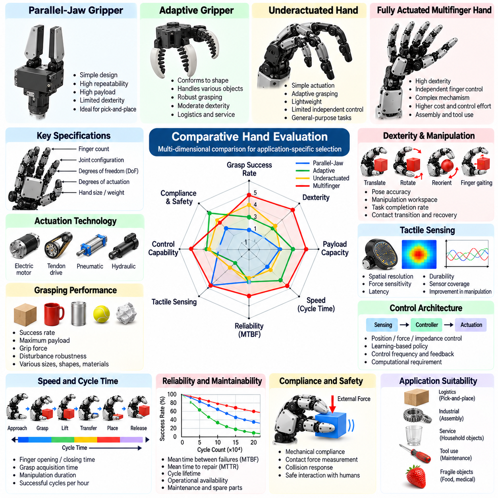{width="7.268055555555556in" height="7.268055555555556in"}

로봇 손 비교 평가(Comparative Hand Review)는 일관된 기술적(Technical), 기능적(Functional), 운용적(Operational) 기준을 통해 로봇 손 설계(Robotic Hand Designs)를 평가한다. 그 목적은 모든 상황에서 우수한 단일 로봇 손을 식별하는 것이 아니라 특정 조작 요구사항(Manipulation Requirements)을 가장 잘 충족하는 아키텍처(Architecture)를 결정하는 것이다. 손재주(Dexterity), 적재 하중(Payload), 센싱(Sensing), 속도(Speed), 신뢰성(Reliability), 비용(Cost)의 차이를 종합적으로 고려해야 한다. 의미 있는 비교는 측정 가능한 하드웨어 능력(Hardware Capabilities)을 대표적인 실제 작업(Real-World Tasks)의 성능과 연결한다.

로봇 손(Robotic Hands)은 평행 조 그리퍼(Parallel-Jaw Grippers), 적응형 그리퍼(Adaptive Grippers), 부족구동 손(Underactuated Hands), 완전구동 다지 시스템(Fully Actuated Multifinger Systems)으로 분류할 수 있다. 평행 조 설계(Parallel-Jaw Designs)는 단순성(Simplicity)과 반복성(Repeatability)을 강조하는 반면, 적응형 메커니즘(Adaptive Mechanisms)은 다양한 물체 형상(Object Geometries)에 대응한다. 다지 로봇 손(Multifinger Hands)은 추가적인 조작 가능성을 제공하지만 기계적 및 제어 복잡성(Mechanical and Control Complexity)을 증가시킨다. 벤치마크 결과를 해석하기 전에 이러한 아키텍처 차이를 인식해야 한다.

손가락 수(Finger Count)와 관절 구성(Joint Configuration)은 로봇 손의 조작 능력(Manipulation Capabilities)에 큰 영향을 미친다. 손가락이 추가되면 접촉 유연성(Contact Flexibility), 파지 안정성(Grasp Stability), 손 안 위치 변경(In-Hand Repositioning)의 가능성이 증가할 수 있다. 그러나 손가락 수만으로 손재주(Dexterity)가 결정되는 것은 아니며, 관절 이동성(Joint Mobility), 손가락 형상(Finger Geometry), 제어 협조(Control Coordination)도 동일하게 중요하다. 비교 평가에서는 구조적 사양(Structural Specifications)에만 의존하지 않고 달성 가능한 접촉 구성(Achievable Contact Configurations)을 평가해야 한다.

자유도(Degrees of Freedom, DoF)는 로봇 손 내부에서 가능한 독립적인 관절 운동(Independent Joint Motions)을 나타내며, 구동 자유도(Degrees of Actuation)는 독립적으로 제어할 수 있는 운동의 수를 의미한다. 이러한 수치는 텐던 구동(Tendon-Driven) 또는 부족구동 메커니즘(Underactuated Mechanisms)에서 상당한 차이를 보일 수 있다. 관절 수는 많지만 액추에이터(Actuators)가 적은 로봇 손은 정밀한 독립 손가락 제어(Independent Finger Control) 없이도 적응형 파지(Adaptive Grasping)를 수행할 수 있다. 비교 평가에서는 기계적 이동성(Mechanical Mobility)과 독립적으로 제어 가능한 운동(Independently Controllable Motion)을 구분해야 한다.

구동 기술(Actuation Technology)은 힘 생성(Force Generation), 이동 속도(Movement Speed), 정밀도(Precision), 기계적 통합(Mechanical Integration)에 영향을 미친다. 전기 모터(Electric Motors), 텐던 동력 전달 장치(Tendon Transmissions), 공압 시스템(Pneumatic Systems), 유압 메커니즘(Hydraulic Mechanisms)은 서로 다른 성능 특성을 제공한다. 모터 구동 손(Motor-Driven Hands)은 일반적으로 편리한 전자식 제어(Electronic Control)를 제공하며, 순응성 또는 유체 동력 기반 설계(Compliant or Fluid-Powered Designs)는 상호작용 거동(Interaction Behavior)에서 장점을 가질 수 있다. 공정한 비교를 위해서는 동등한 하중 및 운용 조건(Loading and Operating Conditions)에서 측정해야 한다.

파지 성능(Grasping Performance)은 크기(Sizes), 형상(Shapes), 질량(Masses), 표면 특성(Surface Properties)이 서로 다른 물체를 대상으로 평가해야 한다. 관련 측정 항목에는 파지 성공률(Grasp Success Rate), 최대 지지 적재 하중(Maximum Supported Payload), 파지력(Grip Force), 외부 외란 저항성(Resistance to External Disturbances)이 포함된다. 강체 산업용 부품(Rigid Industrial Components)에서 우수한 성능을 보이는 로봇 손도 변형 가능한 물체(Deformable Objects)나 파손되기 쉬운 물체(Fragile Objects)를 다루는 데 어려움을 겪을 수 있다. 표준화된 물체 집합(Standardized Object Sets)과 반복 시험(Repeated Trials)은 개별 시연(Isolated Demonstrations)보다 강력한 근거를 제공한다.

손재주 평가(Dexterity Evaluation)는 물체 획득(Object Acquisition)을 넘어 제어된 병진 이동(Controlled Translation), 회전(Rotation), 손가락 보행(Finger Gaiting), 복잡한 접촉 전환(Complex Contact Transitions)을 포함한다. 완전구동 다지 로봇 손(Fully Actuated Multifinger Hands)은 이러한 작업에서 장점을 가질 수 있지만 실제 성능은 센싱(Sensing)과 제어 품질(Control Quality)에 따라 달라진다. 벤치마크 비교에서는 물체 자세 정확도(Object Pose Accuracy), 조작 작업공간(Manipulation Workspace), 작업 완료율(Task Completion Rate), 복구 동작(Recovery Behavior)을 측정해야 한다. 기계적 복잡성(Mechanical Complexity)만으로 우수한 손재주가 입증되는 것은 아니다.

촉각 센싱 능력(Tactile Sensing Capabilities)은 로봇 손 플랫폼(Robotic Hand Platforms)에 따라 상당한 차이를 보인다. 일부 시스템은 주로 관절 위치(Joint Position)와 모터 전류(Motor Current)에 의존하지만, 다른 시스템은 손가락 끝 압력 배열(Fingertip Pressure Arrays), 힘 센서(Force Sensors), 분산 촉각 스킨(Distributed Tactile Skins)을 통합한다. 비교 평가에서는 공간 분해능(Spatial Resolution), 민감도(Sensitivity), 지연시간(Latency), 내구성(Durability), 센서 적용 범위(Sensor Coverage)를 고려해야 한다. 촉각 센싱의 실질적인 가치는 폐루프 조작(Closed-Loop Manipulation)의 성능 개선을 통해 입증되어야 한다.

제어 아키텍처(Control Architecture)는 기계적 능력(Mechanical Capabilities)이 유용한 조작 동작(Manipulation Behavior)으로 얼마나 효과적으로 전환되는지에 영향을 미친다. 위치 제어(Position Control), 힘 제어(Force Control), 임피던스 제어(Impedance Control), 학습 기반 정책(Learning-Based Policies)은 서로 다른 장점을 제공한다. 기계적 사양(Mechanical Specifications)이 유사한 로봇 손도 제어기 설계(Controller Design)에 따라 상당히 다른 성능을 보일 수 있다. 비교 평가에서는 제어 주파수(Control Frequency), 피드백 가용성(Feedback Availability), 계산 요구사항(Computational Requirements), 시험 중 사용된 자율성 수준(Degree of Autonomy)을 문서화해야 한다.

속도 및 사이클 시간(Speed and Cycle Time)은 로봇 손이 생산 환경(Production Environments)에서 작동할 때 중요하다. 비교 항목에는 손가락 열림 시간(Finger Opening Time), 파지 획득 시간(Grasp Acquisition Time), 조작 시간(Manipulation Duration), 해제 시간(Release Time), 시간당 성공 사이클 수(Successful Cycles per Hour)가 포함되어야 한다. 센싱(Sensing), 계획(Planning), 복구(Recovery)에 시간이 소요되므로 최대 액추에이터 속도(Maximum Actuator Speed)가 작업 처리량(Task Throughput)과 동일한 것은 아니다. 평가에서는 로봇 손 자체의 지연(Hand-Specific Delays)을 로봇 팔 움직임(Robot Arm Motion) 및 외부 처리(External Processing)와 분리해야 한다.

신뢰성(Reliability)과 유지보수성(Maintainability)은 로봇 손이 장기간 배치(Extended Deployment)되는 동안 성능을 유지할 수 있는지 결정한다. 관련 지표에는 평균 고장 간격(Mean Time Between Failures, MTBF), 평균 수리 시간(Mean Time to Repair, MTTR), 사이클 수명(Cycle Lifetime), 운용 가용성(Operational Availability)이 포함된다. 텐던(Tendons), 기어(Gears), 센서(Sensors), 유연한 구성요소(Flexible Components)는 서로 다른 마모 메커니즘(Wear Mechanisms)을 나타낼 수 있다. 비교 평가에서는 유지보수 접근성(Maintenance Accessibility), 교체 절차(Replacement Procedures), 예비 부품 가용성(Spare-Part Availability), 장시간 시험(Long-Duration Testing)의 근거를 고려해야 한다.

기계적 순응성(Mechanical Compliance)과 안전성(Safety)은 사람이나 섬세한 물체와 상호작용하는 로봇 손에서 특히 중요하다. 순응성 구조(Compliant Structures)는 접촉력(Contact Forces)을 줄이고 기하학적 불확실성(Geometric Uncertainty)에 대응할 수 있지만, 과도한 순응성은 위치 정확도(Positioning Accuracy)를 저하시킬 수 있다. 강체 메커니즘(Rigid Mechanisms)은 정밀도를 제공할 수 있지만 더욱 정교한 힘 조절(Force Regulation)이 필요하다. 비교 평가에서는 접촉력, 충돌 응답(Collision Response), 예상하지 못한 상호작용(Unexpected Interactions) 중의 제어된 동작(Controlled Behavior)을 측정해야 한다.

적재 하중 용량(Payload Capacity)은 로봇 손 질량(Hand Mass), 파지 형상(Grasp Geometry), 액추에이터 출력(Actuator Power)과 함께 해석해야 한다. 높은 최대 적재 하중(Maximum Payload)은 유리한 물체 방향(Object Orientations)이나 파지 구성(Grasp Configurations)에서만 달성될 수 있다. 유용한 비교를 위해서는 적재 하중 대비 손 질량 비율(Payload-to-Hand-Mass Ratio), 연속 파지 능력(Continuous Gripping Capability), 동적 하중(Dynamic Loading) 조건에서의 성능을 보고해야 한다. 정적 유지 시험(Static Holding Tests)만으로는 빠른 조작(Rapid Manipulation)이나 모바일 로봇 운용(Mobile Robotic Operation)에 대한 적합성을 입증할 수 없다.

에너지 소비(Energy Consumption)와 열적 거동(Thermal Behavior)은 배터리 구동 로봇(Battery-Powered Robots) 및 연속 운용 자동화 시스템(Continuously Operating Automation Systems)과의 통합에 영향을 미친다. 측정 항목에는 평균 전력(Average Power), 최대 전력 요구량(Peak Demand), 성공적인 파지당 에너지(Energy per Successful Grasp), 반복 사이클 중 온도 상승(Temperature Rise)이 포함되어야 한다. 고성능 액추에이터(High-Performance Actuators)는 상당한 전력 및 냉각 자원(Electrical and Cooling Resources)을 요구할 수 있다. 따라서 비교 분석에서는 개별 최대 성능 사양(Isolated Peak Specifications)이 아니라 전체 운용 조건(Complete Operating Conditions)을 고려해야 한다.

물리적 크기(Physical Dimensions)와 통합 요구사항(Integration Requirements)은 다양한 로봇 플랫폼에 대한 로봇 손의 적합성에 영향을 미친다. 손바닥 크기(Palm Size), 손가락 도달 범위(Finger Reach), 손목 인터페이스(Wrist Interface), 배선(Wiring), 통신 프로토콜(Communication Protocols), 제어기 배치(Controller Placement)는 설치 복잡성(Installation Complexity)을 결정한다. 소형 로봇 손(Compact Hands)은 제한된 공간(Confined Environments)에서 유리할 수 있으며, 대형 설계(Larger Designs)는 더 큰 적재 하중이나 조작 범위(Manipulation Range)를 지원할 수 있다. 비교 평가에서는 기존 로봇 팔(Robot Arms), 전원 시스템(Power Systems), 소프트웨어 프레임워크(Software Frameworks)와의 호환성을 평가해야 한다.

비용 비교(Cost Comparison)는 초기 구매 가격(Initial Purchase Price)을 넘어 제어기(Controllers), 센서(Sensors), 설치(Installation), 유지보수(Maintenance), 교체 부품(Replacement Components)을 포함해야 한다. 저비용 로봇 손(Lower-Cost Hand)이라도 잦은 수리(Frequent Repairs)나 특수한 시스템 통합(Specialized Integration)이 필요하면 전체 비용이 높아질 수 있다. 반대로 고급 손재주 로봇 손(Advanced Dexterous Hands)은 여러 개의 특수 그리퍼(Specialized Grippers)를 대체할 수 있다면 높은 초기 도입 비용(Higher Acquisition Costs)을 정당화할 수 있다. 총소유비용(Total Cost of Ownership, TCO)은 측정 가능한 작업 성능(Task Performance)과 예상 활용률(Expected Utilization)을 기준으로 평가해야 한다.

벤치마크 공정성(Benchmark Fairness)을 확보하려면 동등한 작업 정의(Task Definitions), 물체 집합(Object Sets), 환경 조건(Environmental Conditions), 성공 기준(Success Criteria)이 필요하다. 서로 다른 로봇 손에는 각기 다른 제어 전략(Control Strategies)이 필요할 수 있지만, 실험적 지원(Experimental Assistance)은 투명하게 문서화해야 한다. 작업자 개입(Operator Intervention), 외부 고정 장치(External Fixtures), 로봇 팔의 기여(Robot Arm Contributions)는 결과에 상당한 영향을 미칠 수 있다. 비교 보고서에서는 이러한 요소를 식별하고 서로 다른 조건에서 수행된 시연을 직접적으로 동등한 결과로 취급하지 않아야 한다.

공개된 사양(Published Specifications)과 실험실 시연(Laboratory Demonstrations)은 독립적으로 검증된 운용 결과(Independently Validated Operational Results)와 구분해야 한다. 제조업체 데이터(Manufacturer Data)는 유용한 설계 정보를 제공할 수 있지만 측정 방법(Measurement Methods)과 시험 조건(Test Conditions)은 서로 다를 수 있다. 독립 벤치마킹(Independent Benchmarking)에서는 시험 횟수(Trial Counts), 불확실성(Uncertainty), 실패 사례(Failure Cases), 재현성(Reproducibility)을 보고해야 한다. 측정되지 않은 항목(Missing Measurements)은 마케팅 주장(Marketing Claims)이나 기계적 외형(Mechanical Appearance)을 바탕으로 추론하지 않고 검증되지 않은 상태(Unverified)로 명확히 표시해야 한다.

응용 분야별 비교(Application-Specific Comparison)는 단일한 보편적 순위(Universal Ranking)보다 더 유용한 정보를 제공한다. 산업 조립(Industrial Assembly)은 정밀도(Precision), 사이클 시간(Cycle Time), 신뢰성(Reliability)을 우선할 수 있지만, 서비스 로봇(Service Robotics)은 적응성(Adaptability), 안전성(Safety), 물체 다양성(Object Diversity)을 강조할 수 있다. 연구 플랫폼(Research Platforms)은 구매 비용(Acquisition Cost)보다 제어 가능성(Controllability)과 센서 접근성(Sensor Access)을 우선할 수 있다. 가중 평가 기준(Weighted Evaluation Criteria)은 가중치 가정(Weighting Assumptions)과 성능 절충 관계(Performance Tradeoffs)를 공개한다는 조건에서 선정 과정을 지원할 수 있다.

포괄적인 로봇 손 비교 평가(Comprehensive Comparative Hand Review)는 아키텍처(Architecture), 구동 방식(Actuation), 손재주(Dexterity), 센싱(Sensing), 속도(Speed), 신뢰성(Reliability), 안전성(Safety), 시스템 통합(Integration), 수명주기 비용(Lifecycle Cost)을 통합해야 한다. 평가 결과는 기계적 복잡성(Mechanical Complexity)이 높을수록 반드시 더 좋은 성능을 제공한다고 가정하지 않고 강점(Strengths), 한계(Limitations), 응용 적합성(Application Suitability)을 식별해야 한다. 표준화된 벤치마크(Standardized Benchmarks)와 운용 요구사항(Operational Requirements)을 결합함으로써 엔지니어는 능력(Capability), 효율성(Efficiency), 신뢰성(Dependability) 사이에서 가장 적절한 균형을 제공하는 로봇 손을 선정할 수 있다.

## 14.11 Benchmark Environment Design

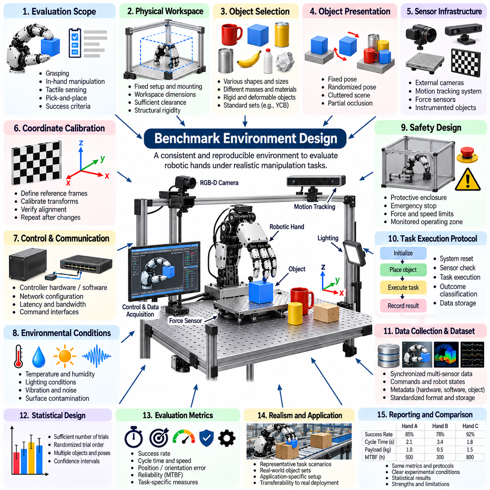{width="7.268055555555556in" height="7.268055555555556in"}

벤치마크 환경 설계(Benchmark Environment Design)는 로봇 손(Robotic Hands)을 일관되게 평가하는 데 필요한 물리적(Physical), 계산적(Computational), 절차적(Procedural) 조건을 수립한다. 잘 설계된 환경은 서로 다른 시스템의 파지(Grasping), 손재주(Dexterity), 센싱(Sensing), 속도(Speed), 신뢰성(Reliability)을 의미 있게 비교할 수 있도록 한다. 주요 목적은 현실적인 조작 과제(Realistic Manipulation Challenges)를 유지하면서 통제되지 않은 변동(Uncontrolled Variation)을 최소화하는 것이다. 벤치마크 품질(Benchmark Quality)은 성능 지표(Performance Metrics) 자체만큼이나 실험 설계(Experimental Design)에 크게 좌우된다.

첫 번째 요구사항은 평가 대상 능력(Capabilities)과 작업(Tasks)을 식별하는 명확한 평가 범위(Evaluation Scope)를 정의하는 것이다. 벤치마크는 정적 파지 안정성(Static Grasp Stability), 물체 획득(Object Acquisition), 손 안 조작(In-Hand Manipulation), 촉각 피드백(Tactile Feedback), 완전한 집기 및 배치 작업(Complete Pick-and-Place Operations)에 초점을 맞출 수 있다. 각 작업에는 명시적인 성공 기준(Success Criteria), 시작 조건(Starting Conditions), 종료 규칙(Termination Rules)이 필요하다. 이러한 정의가 없으면 실험 결과가 실제 로봇 손 성능이 아니라 해석상의 차이를 반영할 수 있다.

물리적 작업공간 설계(Physical Workspace Design)는 실험 환경의 형상(Geometry)과 접근성(Accessibility)을 결정한다. 시험대(Test Benches)는 안정적인 장착(Stable Mounting), 반복 가능한 물체 배치(Repeatable Object Placement), 손가락 및 로봇 팔 움직임에 필요한 충분한 여유 공간(Clearance)을 제공해야 한다. 작업공간 크기(Workspace Dimensions), 고정 장치 위치(Fixture Locations), 접근 방향(Approach Directions)을 문서화해야 한다. 작은 위치 오차(Positioning Errors)도 접촉 집약적 조작(Contact-Rich Manipulation) 결과에 상당한 영향을 미칠 수 있으므로 기계적 정렬(Mechanical Alignment)과 구조적 강성(Structural Rigidity)이 중요하다.

물체 선정(Object Selection)은 벤치마크 대표성(Benchmark Representativeness)의 기본 요소이다. 시험 물체 집합(Test Collections)에는 형상(Geometry), 크기(Size), 질량(Mass), 표면 마찰(Surface Friction), 순응성(Compliance)의 다양성이 포함되어야 한다. YCB 물체 집합(YCB Object Set)과 같은 표준화된 물체 집합(Standardized Collections)은 연구 그룹 간 비교를 지원하며, 섬세한 파지(Delicate Grasping)나 연속 회전(Continuous Rotation)을 위해서는 특수 물체(Specialized Objects)가 필요할 수 있다. 재현 가능한 실험을 보장하기 위해 각 물체의 물리적 특성(Physical Properties)과 상태(Condition)를 기록해야 한다.

물체 제시 조건(Object Presentation Conditions)은 파지 난이도(Grasping Difficulty)에 큰 영향을 미친다. 물체는 고정된 방향(Fixed Orientations), 무작위로 추출된 자세(Randomly Sampled Poses), 복잡하게 배치된 장면(Cluttered Scenes), 부분적으로 가려진 구성(Partially Occluded Configurations)으로 제시될 수 있다. 벤치마크 프로토콜(Benchmark Protocols)은 통제된 배치(Controlled Placement)와 무작위 제시(Randomized Presentation)를 구분해야 한다. 서로 다른 시스템이 우연히 유리한 조건이 아니라 비교 가능한 작업 난이도(Task Difficulty)를 경험하도록 무작위화 분포(Randomization Distributions)와 샘플링 절차(Sampling Procedures)를 명시해야 한다.

센서 인프라(Sensor Infrastructure)는 로봇 손의 동작을 객관적으로 평가하는 데 필요한 기준 측정값(Reference Measurements)을 제공한다. 외부 카메라(External Cameras), 운동 추적 시스템(Motion Tracking Systems), 힘 센서(Force Sensors), 계측 기능이 내장된 물체(Instrumented Objects)는 물체 자세(Object Pose), 접촉력(Contact Forces), 조작 결과(Manipulation Outcomes)를 측정할 수 있다. 기준 계측기(Reference Instruments)는 평가 대상 로봇 손과 독립적으로 보정해야 한다. 측정 정확도(Measurement Accuracy), 샘플링 주파수(Sampling Frequency), 동기화(Synchronization), 불확실성(Uncertainty)을 문서화해야 한다.

좌표계 보정(Coordinate Frame Calibration)은 카메라(Cameras), 로봇 팔(Robot Arms), 로봇 손(Hands), 외부 추적 장치(External Tracking Devices)의 측정값을 결합할 때 필수적이다. 일관되지 않은 좌표 변환(Inconsistent Transformations)은 실제 조작 성능과 무관한 겉보기 위치 오차(Apparent Positioning Errors)를 발생시킬 수 있다. 벤치마크 환경에서는 기준 좌표계(Reference Frames)를 정의하고 반복 가능한 보정 절차(Repeatable Calibration Procedures)를 통해 좌표 변환을 검증해야 한다. 장비 장착 상태(Equipment Mounting)나 작업공간 형상(Workspace Geometry)이 변경될 때마다 보정 확인(Calibration Checks)을 수행해야 한다.

제어 및 통신 인프라(Control and Communication Infrastructure)는 지연시간(Latency), 대역폭 제한(Bandwidth Limitations), 동기화 오차(Synchronization Errors)를 통해 벤치마크 결과에 영향을 미칠 수 있다. 실험 시스템은 제어기 하드웨어(Controller Hardware), 운영 소프트웨어(Operating Software), 네트워크 구성(Network Configuration), 명령 인터페이스(Command Interfaces)를 문서화해야 한다. 시간 측정(Timing Measurements)에서는 센서 데이터 획득(Sensor Acquisition), 계산(Computation), 통신(Communication), 구동(Actuation) 지연을 구분해야 한다. 공통 인터페이스(Common Interfaces)는 유용하지만 지원되는 제어 모드(Control Modes)의 차이는 투명하게 공개해야 한다.

환경 조건(Environmental Conditions)은 온도(Temperature), 습도(Humidity), 조명(Lighting), 진동(Vibration), 표면 오염(Surface Contamination)이 센싱과 조작에 영향을 미칠 수 있으므로 통제해야 한다. 조명은 시각 기반 파지 계획(Vision-Based Grasp Planning)에 특히 중요하며, 온도와 오염은 마찰(Friction)과 촉각 응답(Tactile Response)을 변화시킬 수 있다. 벤치마크 프로토콜에서는 허용 가능한 환경 범위(Acceptable Environmental Ranges)를 정의하고 편차(Deviations)를 기록해야 한다. 강건성 실험(Robustness Experiments)에서는 문서화된 절차를 사용하여 이러한 조건을 의도적으로 변화시킬 수 있다.

안전 설계(Safety Design)는 상당한 힘을 생성하거나 빠른 움직임을 수행할 수 있는 로봇 손을 평가할 때 필요하다. 보호 울타리(Protective Enclosures), 비상 정지(Emergency Stops), 힘 제한(Force Limits), 감시되는 운용 구역(Monitored Operating Zones)은 작업자와 장비에 대한 위험을 줄인다. 예상하지 못한 접촉(Unexpected Contact)이나 부품 고장(Component Failure)을 포함하는 시험에는 추가적인 안전 조치(Safeguards)가 필요하다. 벤치마킹 중에도 안전 메커니즘(Safety Mechanisms)을 활성화된 상태로 유지해야 하며, 이러한 메커니즘이 성능에 미치는 영향을 보고해야 한다.

작업 실행 프로토콜(Task Execution Protocols)은 초기화(Initialization)부터 결과 기록(Result Recording)까지 반복 가능한 순서를 수립해야 한다. 각 시험(Trial)에는 시스템 초기화(System Reset), 물체 배치(Object Placement), 센서 검증(Sensor Verification), 작업 실행(Task Execution), 결과 분류(Outcome Classification), 데이터 저장(Data Storage)이 포함될 수 있다. 잔류 물체 운동(Residual Object Motion)이나 액추에이터 상태(Actuator State)가 후속 시험에 영향을 미칠 수 있으므로 초기화 절차(Reset Procedures)는 특히 중요하다. 자동화된 실행(Automated Execution)은 작업자 변동성(Operator Variability)을 줄이지만, 수동 개입(Manual Intervention)이 불가피한 경우 이를 문서화해야 한다.

벤치마크 데이터셋(Benchmark Datasets)은 명령(Commands), 센서 관측값(Sensor Observations), 물체 상태(Object States), 작업 결과(Task Outcomes)에 대한 동기화된 기록(Synchronized Records)을 포함해야 한다. 메타데이터(Metadata)는 하드웨어 구성(Hardware Configuration), 소프트웨어 버전(Software Version), 보정 매개변수(Calibration Parameters), 환경 조건(Environmental Conditions), 물체 특성(Object Properties)을 식별해야 한다. 일관된 데이터 형식(Consistent Data Formats)은 독립적인 분석(Independent Analysis)과 향후 재현(Future Replication)을 지원한다. 실험을 반복하지 않고도 대체 지표(Alternative Metrics)를 계산할 수 있도록 가능한 경우 원시 측정값(Raw Measurements)을 보존해야 한다.

통계적 설계(Statistical Design)는 의미 있는 결론을 뒷받침하기 위해 필요한 시험 횟수(Number of Trials)를 결정한다. 다양한 물체(Objects), 자세(Poses), 운용 조건(Operating Conditions)에 대한 반복 측정(Repeated Measurements)은 변동성(Variability)을 특성화하는 데 도움이 된다. 무작위 시험 순서(Randomized Trial Ordering)는 발열(Heating), 마모(Wear), 작업자 적응(Operator Adaptation)으로 인한 체계적 편향(Systematic Bias)을 줄일 수 있다. 결과에는 표본 크기(Sample Sizes), 신뢰구간(Confidence Intervals), 실패 분류(Failure Classifications), 제외된 관측값(Excluded Observations)을 보고해야 한다. 실험적 불확실성(Experimental Uncertainty)은 명확하게 제시되어야 한다.

벤치마크 공정성(Benchmark Fairness)은 서로 다른 로봇 손이 동일한 기계적 능력(Mechanical Capabilities)을 가진다고 가정하지 않으면서 비교 가능한 작업 목표(Comparable Task Objectives)를 요구한다. 평행 조 그리퍼(Parallel-Jaw Gripper)와 손재주가 뛰어난 다지 로봇 손(Dexterous Multifinger Hand)은 서로 다른 파지 전략(Grasp Strategies)이 필요할 수 있다. 따라서 평가에서는 보편적인 작업 결과(Universal Task Outcomes)와 아키텍처별 측정값(Architecture-Specific Measurements)을 구분해야 한다. 오해를 유발하는 비교를 방지하기 위해 외부 지원(External Assistance), 특수 고정 장치(Specialized Fixtures), 사람의 개입(Human Intervention)을 공개해야 한다.

시뮬레이션 환경(Simulation Environments)은 반복 가능한 실험(Repeatable Experiments)과 광범위한 매개변수 변화(Parameter Variation)를 가능하게 하여 물리적 벤치마크(Physical Benchmarks)를 보완할 수 있다. 시뮬레이션 접촉 모델(Simulated Contact Models)은 마찰(Friction), 순응성(Compliance), 물체 관성(Object Inertia), 액추에이터 제약(Actuator Constraints)을 적절한 충실도(Fidelity)로 표현해야 한다. 도메인 무작위화(Domain Randomization)는 불확실한 물리적 특성(Physical Properties)에 대한 민감도(Sensitivity)를 탐색할 수 있다. 그러나 하드웨어 측정값(Hardware Measurements)과의 대응 관계가 실험적으로 검증되기 전까지 시뮬레이션 결과는 별도로 보고해야 한다.

포괄적인 벤치마크 환경(Comprehensive Benchmark Environment)은 개별 구성요소 시험(Isolated Component Tests)과 통합 조작 작업(Integrated Manipulation Tasks)을 모두 지원해야 한다. 구성요소 수준 실험(Component-Level Experiments)은 액추에이터 속도(Actuator Speed), 촉각 정확도(Tactile Accuracy), 힘 생성(Force Generation), 기계적 반복성(Mechanical Repeatability)을 측정한다. 통합 작업(Integrated Tasks)은 파지 성공률(Grasp Success), 손 안 조작(In-Hand Manipulation), 사이클 시간(Cycle Time), 복구 동작(Recovery Behavior)을 평가한다. 이러한 평가 수준을 결합하면 성능 한계(Performance Limitations)가 하드웨어(Hardware), 인식(Perception), 계획(Planning), 제어(Control) 중 어디에서 발생하는지 식별하는 데 도움이 된다.

장시간 시험(Long-Duration Testing)에는 자동 반복 운전(Automated Cycling), 상태 감시(Condition Monitoring), 결함 기록(Fault Recording)을 위한 추가 인프라가 필요하다. 온도 센서(Temperature Sensors), 전류 모니터(Current Monitors), 진동 측정(Vibration Measurements), 이벤트 로그(Event Logs)는 점진적인 성능 저하(Gradual Degradation)를 드러낼 수 있다. 시험 시스템은 안전하지 않은 상태(Unsafe States)를 감지하고 사전에 정의된 한계(Predefined Limits)를 초과하면 운용을 중단해야 한다. 신뢰성 측정(Reliability Measurements)에는 운용 시간(Operating Hours), 사이클 수(Cycle Counts), 유지보수 조치(Maintenance Actions), 명확하게 정의된 고장 사건(Failure Events)을 포함해야 한다.

재현성(Reproducibility)은 다른 실험실에서 실험을 재구성할 수 있을 만큼 상세한 문서화(Documentation)에 달려 있다. 프로토콜(Protocols)은 물체 모델(Object Models), 고정 장치 치수(Fixture Dimensions), 보정 방법(Calibration Methods), 소프트웨어 구성(Software Configurations), 시험 순서(Trial Sequences), 채점 규칙(Scoring Rules)을 명시해야 한다. 버전 관리되는 벤치마크 정의(Version-Controlled Benchmark Definitions)는 절차가 발전하면서 발생하는 모호성(Ambiguity)을 줄인다. 공개적으로 이용 가능한 데이터셋(Publicly Available Datasets)과 참조 구현(Reference Implementations)은 개인정보 보호(Privacy)와 지식재산권(Intellectual Property) 제약을 준수하는 조건에서 투명성(Transparency)을 더욱 향상시킬 수 있다.

벤치마크 환경은 이상적인 실험실 구성(Ideal Laboratory Setups)에만 의존하지 않고 실제 배치 조건(Practical Deployment Conditions)도 고려해야 한다. 산업용 작업 셀(Industrial Workcells), 모바일 매니퓰레이터(Mobile Manipulators), 서비스 로봇(Service Robots)은 공간(Space), 진동(Vibration), 조명(Lighting), 인간과의 상호작용(Human Interaction)과 관련하여 서로 다른 제약을 경험한다. 대표적인 시나리오(Representative Scenarios)는 단순화된 시험(Simplified Tests)에서 드러나지 않는 한계를 보여준다. 평가에서는 통제된 기준 성능(Controlled Baseline Performance)과 현실적인 운용 외란(Realistic Operational Disturbances)에 대한 강건성(Robustness)을 구분해야 한다.

효과적인 벤치마크 환경(Effective Benchmark Environment)은 표준화된 작업(Standardized Tasks), 보정된 계측 장비(Calibrated Instrumentation), 재현 가능한 절차(Reproducible Procedures), 안전 제어(Safety Controls), 통계적으로 타당한 분석(Statistically Sound Analysis)을 통합한다. 또한 서로 다른 로봇 손 아키텍처(Robotic Hand Architectures)의 한계를 드러내면서 공정한 비교(Fair Comparison)를 지원해야 한다. 통제된 실험실 측정(Controlled Laboratory Measurements)과 대표적인 운용 시나리오(Representative Operational Scenarios)를 결합함으로써 엔지니어는 손재주(Dexterity), 신뢰성(Reliability), 실제 배치 준비도(Deployment Readiness)에 관한 신뢰할 수 있는 근거를 생성할 수 있다.
