**Volume 06 Robot Hands and Dexterous Grasping**

# 15. Case Studies

## 15.01 Shadow Dexterous Hand

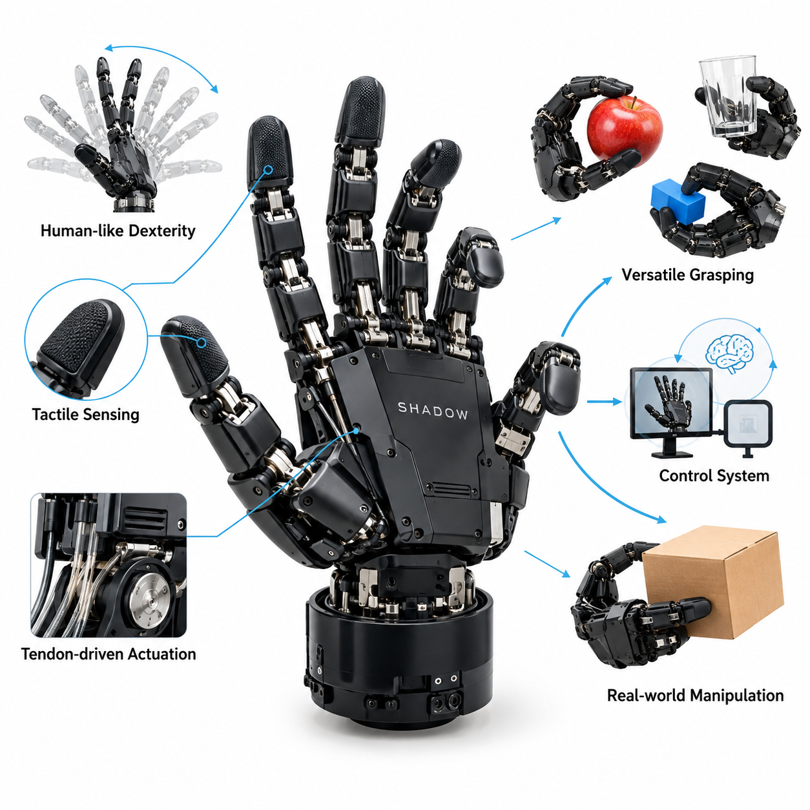{width="7.268055555555556in" height="7.268055555555556in"}

섀도 덱스터러스 핸드(Shadow Dexterous Hand)는 인간형 로봇 조작(Anthropomorphic Robotic Manipulation)의 중요한 사례로, 인간의 손을 모방한 기계적 설계(Human-Inspired Mechanical Design)가 복잡한 파지(Grasping)와 물체 조작(Object Manipulation)을 어떻게 지원할 수 있는지 보여준다. 섀도 로봇 컴퍼니(Shadow Robot Company)가 개발한 이 플랫폼은 손가락 협응(Finger Coordination), 촉각 인식(Tactile Perception), 조작 계획(Manipulation Planning), 학습 기반 제어(Learning-Based Control)를 연구하는 데 널리 활용되어 왔다. 인간과 유사한 정교한 조작 능력(Dexterity)을 연구할 수 있는 실험 플랫폼이라는 점에서 중요한 의미를 가진다.

기존 산업용 그리퍼(Industrial Gripper)가 주로 개폐 동작(Opening and Closing Motion)을 수행하는 것과 달리, 섀도 덱스터러스 핸드는 대향 운동(Opposition)이 가능한 엄지손가락을 포함하여 다섯 개의 관절형 손가락(Articulated Digits)을 갖추고 있다. 운동학적 구조(Kinematic Structure)는 구성에 따라 약 20개의 독립 제어 가능한 자유도(Degrees of Freedom, DOF)를 제공하며, 추가적인 기계적 연동 관절(Mechanically Coupled Joints)을 포함한다. 이를 통해 복잡한 손가락 자세, 협응 접촉 형성, 정교한 물체 조작이 가능하다.

기계적 아키텍처(Mechanical Architecture)는 로봇 구동(Actuation)의 현실적인 제약을 고려하면서도 인간 손의 해부학적 유사성(Anatomical Similarity)을 강조한다. 손가락과 손바닥에 분산된 여러 관절은 정밀 집기(Precision Pinching), 감싸 쥐기(Enveloping Grasp), 물체 재배치(Object Repositioning)를 가능하게 한다. 특히 엄지손가락은 다른 손가락과 대향 접촉(Oppositional Contact)을 형성하여 다양한 접촉 기하학(Contact Geometry)을 구현한다. 이러한 유연성은 연구 가능한 물체와 조작 작업의 범위를 확장한다.

섀도 핸드 플랫폼(Shadow Hand Platform)은 공압 인공근육(Pneumatic Artificial Muscles)과 전기 모터 구동 텐던 시스템(Electric Motor-Driven Tendon Systems)을 포함한 다양한 구동 기술을 사용해 왔다. 텐던 구동 구조(Tendon-Driven Configuration)에서는 액추에이터(Actuator)가 생체 힘줄과 유사한 케이블 메커니즘(Cable Mechanism)을 통해 힘을 전달한다. 이러한 방식은 일부 손가락 관절에서 액추에이터를 떨어진 위치에 배치할 수 있지만, 텐던 마찰(Tendon Friction), 탄성(Elasticity), 백래시(Backlash), 기계적 결합(Mechanical Coupling)으로 인해 정밀 제어와 보정이 어려워진다.

관절 운동(Joint Motion)과 액추에이터 변위(Actuator Displacement)의 관계는 섀도 덱스터러스 핸드 제어에서 핵심적인 고려 사항이다. 텐던 경로(Tendon Routing)와 관절 기하학(Joint Geometry)은 액추에이터 명령이 손가락 움직임으로 변환되는 방식을 결정하며, 기계적 순응성(Mechanical Compliance)은 힘 전달에 영향을 미친다. 따라서 정확한 조작을 위해서는 적절한 운동학 모델(Kinematic Model), 액추에이터 보정(Actuator Calibration), 피드백 제어(Feedback Control)가 필요하다. 비선형 거동(Nonlinear Behavior)과 실제 관절 상태의 차이도 고려해야 한다.

이 플랫폼의 중요한 특징 중 하나는 정교한 손끝 접촉 전략(Fingertip Contact Strategies)을 지원한다는 점이다. 여러 손가락은 물체 주변에 분산된 접촉점(Contact Points)을 형성하여 병진 운동(Translation)과 회전 운동(Rotation)에 저항하는 힘을 생성할 수 있다. 안정적인 조작은 접촉 기하학(Contact Geometry), 마찰 조건(Friction Conditions), 협응된 힘 분배(Coordinated Force Distribution)에 의존한다. 섀도 덱스터러스 핸드는 힘 폐쇄(Force Closure), 파지 렌치 공간(Grasp Wrench Space), 파지 구성(Grasp Configuration)과 기계적 안정성(Mechanical Stability)의 관계를 연구하는 데 유용하다.

촉각 센싱(Tactile Sensing)은 시각 정보(Vision)만으로 안정적으로 획득하기 어려운 정보를 제공하여 정교한 로봇 손의 능력을 확장한다. 섀도 핸드 연구 플랫폼에는 바이오택 센서(BioTac Sensor)를 비롯한 다양한 손끝 촉각 센서(Fingertip Tactile Sensor)가 통합되어 왔다. 센서 구성에 따라 접촉 압력(Contact Pressure), 변형(Deformation), 진동(Vibration), 접촉 동역학(Contact Dynamics)에 관한 정보를 제공할 수 있다. 이러한 측정값은 접촉 위치 추정(Contact Localization), 파지 상태 감시(Grasp Monitoring), 조작 피드백(Manipulation Feedback)을 지원한다.

미끄러짐 감지(Slip Detection)는 마찰 특성이 불확실하거나 접촉 조건이 변화하는 물체를 조작할 때 특히 중요하다. 로봇 손은 물체의 낙하나 손상을 방지하기 위해 안정적인 접촉(Stable Contact)과 초기 미끄러짐(Incipient Slip)을 구별해야 한다. 촉각 신호(Tactile Signals)는 압력 분포(Pressure Distribution)와 동적 접촉 거동(Dynamic Contact Behavior)의 변화를 나타낼 수 있다. 이러한 측정값을 피드백 제어기(Feedback Controller)에 통합하면 파지력 증가나 개별 손가락 위치 조정과 같은 보정 동작(Corrective Actions)을 수행할 수 있다.

힘 제어(Force Control)는 여러 손가락이 동일한 물체와 동시에 상호작용하기 때문에 또 다른 주요 공학적 과제가 된다. 과도한 힘은 취약한 물체(Fragile Object)를 손상시키고, 부족한 힘은 불안정한 파지(Unstable Grasp)를 초래한다. 제어기는 원하는 물체 움직임을 유지하면서 접촉력(Contact Force)을 조절하고 불필요한 손가락 간 상호작용을 방지해야 한다. 임피던스 제어(Impedance Control), 순응 제어(Compliant Control), 내부 힘 조절(Internal Force Regulation)은 조작 정확도와 기계적 적응성(Mechanical Adaptability)의 균형을 유지하는 상호 보완적인 방법이다.

손안 조작(In-Hand Manipulation)은 섀도 덱스터러스 핸드를 이용해 연구하는 가장 어려운 능력 중 하나이다. 물체를 놓았다가 다시 잡는 대신, 로봇은 손가락의 협응 운동(Coordinated Finger Movements)을 통해 물체의 위치나 방향을 변경한다. 이러한 작업에는 구름 운동(Rolling), 피벗 운동(Pivoting), 제어된 미끄러짐(Controlled Sliding), 손가락 보행(Finger Gaiting)이 포함될 수 있다. 성공적인 수행을 위해서는 손가락 운동학(Finger Kinematics), 접촉 역학(Contact Mechanics), 물체 동역학(Object Dynamics), 센서 피드백(Sensor Feedback)의 지속적인 협응이 필요하다.

섀도 덱스터러스 핸드는 강화학습(Reinforcement Learning)을 활용한 로봇 조작을 연구한 오픈AI의 닥틸 프로젝트(OpenAI Dactyl Project)를 통해 특히 주목받았다. 이 연구에서는 섀도 로봇 손이 대규모 시뮬레이션 학습(Simulated Training)을 통해 정육면체를 조작하도록 훈련되었다. 도메인 무작위화(Domain Randomization)는 물리적 매개변수(Physical Parameters)와 환경 조건(Environmental Conditions)에 변화를 도입하여 시뮬레이션에서 실제 하드웨어로의 전이(Sim-to-Real Transfer)를 개선하였다. 이 프로젝트는 복잡한 조작을 위한 학습된 정책(Learned Policies)의 가능성을 보여주었다.

닥틸 실험(Dactyl Experiments)은 복잡한 접촉 중심 상호작용(Contact-Rich Interactions)을 표현할 수 있는 학습 환경(Training Environment)의 중요성도 강조하였다. 마찰(Friction), 충돌(Collision), 관절 동역학(Joint Dynamics), 물체 운동(Object Motion)을 정확하게 시뮬레이션하는 것은 작은 모델링 오차(Modeling Error)가 조작 과정에서 누적될 수 있기 때문에 어렵다. 무작위화 학습(Randomized Training)은 매우 정확한 물리 모델에만 의존하는 대신 다양한 조건을 경험하게 하여 강건성(Robustness)을 향상시킬 수 있다. 다만 실제 전이 성능은 학습 분포와 하드웨어 특성에 영향을 받는다.

학습 기반 조작(Learning-Based Manipulation)은 반복적인 상호작용을 통해 제어 정책(Control Policy)이 협응 동작을 발견할 수 있다는 점에서 기존의 해석적 파지 계획(Analytical Grasp Planning)과 차이가 있다. 강화학습(Reinforcement Learning)은 물체 안정성 유지, 목표 방향 달성, 조작 순서 완료와 같은 목적에 따라 동작을 최적화할 수 있다. 그러나 정교한 조작 정책(Dexterous Manipulation Policy)의 학습에는 상당한 계산 자원이 필요하며, 관측(Observations), 보상(Rewards), 시뮬레이션 절차(Simulation Procedures)의 신중한 설계가 요구된다.

시각 정보(Vision)와 고유수용감각(Proprioception)의 통합은 섀도 핸드 연구의 또 다른 중요한 영역이다. 외부 카메라(External Cameras)는 물체의 위치와 방향을 추정할 수 있으며, 관절 엔코더(Joint Encoders)는 손가락 구성(Finger Configuration)에 관한 정보를 제공한다. 이러한 관측값을 결합하면 제어기가 물체 움직임과 손가락 운동의 관계를 파악할 수 있다. 촉각 피드백(Tactile Feedback)은 손가락에 의해 시야가 가려지거나 미세한 접촉 변화가 카메라로 감지되기 어려운 상황에서 상태 추정(State Estimation)을 개선할 수 있다.

모바일 매니퓰레이션 시스템(Mobile Manipulation System)에 섀도 덱스터러스 핸드를 통합하면 추가적인 기계적 요구사항과 계산 요구사항이 발생한다. 로봇 팔(Robot Arm)은 손의 질량과 구동 인프라(Actuation Infrastructure)를 수용하면서 적절한 위치 정확도(Positioning Accuracy), 가반하중(Payload Capacity), 손목 방향(Wrist Orientation)을 제공해야 한다. 전체 제어기는 팔 궤적(Arm Trajectory), 손가락 운동(Finger Motion), 물체 접촉 상태(Object Contact State)를 협응해야 한다. 모바일 플랫폼에서는 위치 추정 불확실성(Localization Uncertainty), 베이스 진동(Base Vibration), 작업 공간 제약(Workspace Constraints)도 파지 신뢰성에 영향을 미친다.

이 플랫폼은 정교한 조작 능력(Dexterity)과 공학적 복잡성(Engineering Complexity) 사이의 중요한 상충관계(Tradeoff)를 보여준다. 제어 가능한 관절 수가 증가하면 조작 작업 공간(Manipulation Workspace)과 가능한 접촉 구성이 확장되지만, 액추에이터 요구사항, 보정 작업, 센싱 복잡성, 제어 차원(Control Dimensionality)도 증가한다. 텐던 시스템(Tendon Systems), 관절 구조(Articulated Joints), 민감한 손끝 부품(Fingertip Components)의 정기적인 점검이 필요하므로 기계적 유지보수도 어려워진다. 이러한 특성은 연구용 덱스터러스 핸드와 단순한 산업용 엔드 이펙터(Industrial End Effector)를 구분한다.

섀도 덱스터러스 핸드의 성능 평가(Performance Evaluation)는 물체를 성공적으로 들어 올릴 수 있는지만 측정해서는 충분하지 않다. 의미 있는 벤치마크(Benchmark)는 파지 성공률(Grasp Success Rate), 물체 방향 정확도(Object Orientation Accuracy), 조작 완료 시간(Manipulation Completion Time), 접촉 안정성(Contact Stability), 외란 복구 능력(Disturbance Recovery)을 평가해야 한다. 다양한 형상, 재질, 질량, 마찰 특성을 가진 물체를 시험하면 작동 조건에 따른 성능 변화를 파악할 수 있다. 반복 시험(Repeated Trials)은 일회성 성공과 일관된 능력을 구별하는 데 필요하다.

신뢰성(Reliability)과 운영 효율성(Operational Efficiency)은 산업 적용을 검토할 때 특히 중요하다. 고도로 정교한 로봇 손은 기존 그리퍼로 수행하기 어려운 조작 작업을 처리할 수 있지만, 이러한 장점은 추가적인 하드웨어 비용(Hardware Cost), 전력 소비(Power Consumption), 유지보수(Maintenance), 계산 자원(Computational Requirements)을 정당화할 수 있어야 한다. 따라서 산업적 평가는 작업 적용 범위(Task Coverage), 사이클 시간(Cycle Time), 평균 고장 간격(Mean Time Between Failures, MTBF), 총운영비용(Total Operating Cost)을 고려해야 한다.

섀도 덱스터러스 핸드는 로봇 조작용 파운데이션 모델(Foundation Models for Robotic Manipulation)의 개발에도 중요한 교훈을 제공한다. 높은 차원의 행동 공간(High-Dimensional Action Space)과 풍부한 센서 관측값(Sensor Observations)은 시각 인식(Visual Perception), 촉각 정보(Tactile Information), 운동 제어(Motor Control)를 연결하는 표현 학습(Representation Learning)의 기회를 제공한다. 시연 학습(Demonstration Learning), 강화학습(Reinforcement Learning), 멀티모달 정책 아키텍처(Multimodal Policy Architecture)는 이러한 능력을 활용할 수 있다. 다만 물체, 작업, 하드웨어 구성 전반에 걸친 일반화(Generalization)는 여전히 중요한 연구 과제이다.

시스템 엔지니어링(System Engineering) 관점에서 섀도 덱스터러스 핸드가 제공하는 핵심 교훈은 기계적 정교함(Mechanical Sophistication)만으로 유용한 조작 능력이 보장되지 않는다는 것이다. 성공적인 조작은 손 운동학(Hand Kinematics), 액추에이터 동역학(Actuator Dynamics), 촉각 센싱(Tactile Sensing), 접촉 모델링(Contact Modeling), 인식(Perception), 적응형 제어(Adaptive Control)의 통합을 통해 구현된다. 이 플랫폼은 인간과 유사한 조작 능력을 재현할 수 있는 가능성과 어려움을 동시에 보여주며, 더욱 범용적인 물리적 상호작용(General Physical Interaction)이 가능한 차세대 로봇 손을 설계하는 데 중요한 참고 사례로 남아 있다.

## 15.02 Robotiq Grippers

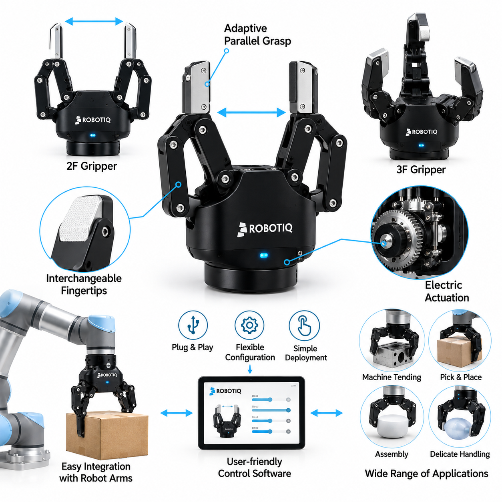{width="7.268055555555556in" height="7.268055555555556in"}

로보티크 그리퍼(Robotiq Grippers)는 인간 손의 모든 복잡성을 재현하기보다는 적응성(Adaptability), 통합 용이성(Ease of Integration), 안정적인 작동(Reliable Operation)을 강조하는 실용적인 산업용 로봇 조작(Industrial Robotic Manipulation) 기술을 대표한다. 로보티크(Robotiq)가 개발한 이러한 엔드 이펙터(End Effectors)는 협동 로봇(Collaborative Robotics)과 유연 자동화(Flexible Automation) 분야에서 널리 활용된다. 개별 응용 분야마다 고도로 특수화된 파지 메커니즘(Gripping Mechanism)을 요구하지 않으면서 다양한 물체를 처리할 수 있다는 점에서 중요한 의미를 가진다.

로보티크 제품군(Robotiq Product Family)에는 다양한 조작 요구사항에 대응하도록 설계된 적응형 2지 그리퍼(Adaptive Two-Finger Grippers)와 적응형 3지 그리퍼(Adaptive Three-Finger Grippers)가 포함된다. 2지 모델은 일반적인 픽 앤 플레이스(Pick-and-Place), 머신 텐딩(Machine Tending), 자재 취급(Material Handling)에 적합하며, 3지 적응형 설계는 더욱 다양한 파지 구성(Grasp Configurations)을 지원한다. 이러한 제품은 비교적 간결한 기계적 아키텍처(Mechanical Architecture)에서도 정교하게 설계된 링크 구조(Linkages), 구동 시스템(Actuation Systems), 제어 인터페이스(Control Interfaces)를 통해 유용한 파지 유연성을 구현할 수 있음을 보여준다.

로보티크 적응형 그리퍼(Robotiq Adaptive Grippers)의 핵심 특징은 저구동 기계 원리(Underactuated Mechanical Principles)를 활용한다는 점이다. 모든 손가락 관절을 독립적으로 제어하는 대신, 상대적으로 적은 수의 액추에이터(Actuators)가 기계적으로 연결된 손가락 세그먼트(Mechanically Coupled Finger Segments)를 구동한다. 이러한 구조에서는 수동적 기계 적응(Passive Mechanical Adaptation)을 통해 손가락이 서로 다른 물체 형상에 맞춰진다. 저구동(Underactuation)은 유용한 파지 유연성을 유지하면서 액추에이터 수, 제어 복잡성(Control Complexity), 공간 배치 요구사항(Packaging Requirements)을 줄인다.

적응형 파지 메커니즘(Adaptive Gripping Mechanism)은 물체의 크기, 형상, 위치 정확도(Positioning Accuracy)가 달라지는 환경에서 특히 유용하다. 그리퍼가 닫히는 과정에서 손가락 세그먼트가 순차적으로 접촉(Sequential Contact)을 형성하여 상세한 물체 모델(Object Model) 없이도 일정 범위의 기하학적 변화(Geometric Variations)를 수용할 수 있다. 이러한 능력은 매우 정확한 인식(Perception)과 위치 결정(Positioning)에 대한 의존도를 낮춘다. 그러나 성공적인 적응은 손가락 형상, 작동 스트로크(Stroke), 물체 마찰(Object Friction), 대상 물체의 기계적 특성(Mechanical Properties)에 의해 제한된다.

로보티크 2지 적응형 그리퍼(Robotiq Two-Finger Adaptive Grippers)는 일반적으로 소형 전동 구동(Compact Electric Actuation)과 프로그래밍 가능한 파지 매개변수(Programmable Gripping Parameters)를 특징으로 한다. 모델에 따라 사용자는 지원되는 작동 범위 내에서 손가락 위치(Finger Position), 닫힘 속도(Closing Speed), 파지력(Gripping Force)을 명령할 수 있다. 이러한 제어 기능을 통해 하나의 그리퍼가 소프트웨어 조정(Software Adjustment)만으로 서로 다른 물체 범주를 처리할 수 있다. 기계적 적응성과 설정 가능한 구동 기능의 결합은 제품 변경이 빈번한 제조 환경에서 중요한 장점이 된다.

3지 적응형 그리퍼(Three-Finger Adaptive Grippers)는 협응된 손가락 배치(Coordinated Finger Arrangements)를 통해 여러 파지 구성(Grasping Configurations)을 지원함으로써 이러한 개념을 확장한다. 해당 메커니즘은 원통형 물체(Cylindrical Objects), 불규칙한 형상(Irregular Shapes), 일부 정밀 조작 작업(Precision Manipulation Tasks)에 대응할 수 있다. 작동 모드(Operating Modes)에 따라 감싸 쥐기(Encompassing Grasp), 집기(Pinch Grasp), 기타 응용 분야별 파지 패턴(Application-Specific Grasp Patterns)을 제공할 수 있다. 이러한 그리퍼는 단순화된 로봇 손과 유사하지만, 기계적 결합과 제한된 독립 관절 제어라는 점에서 완전 구동 인간형 덱스터러스 핸드(Fully Actuated Anthropomorphic Dexterous Hands)와 구별된다.

로보티크 기술을 평가할 때 적응형 파지(Adaptive Gripping)와 정교한 조작(Dexterous Manipulation)의 차이를 이해하는 것이 중요하다. 적응형 그리퍼는 주로 안정적인 물체 접촉(Object Contact)을 형성하고 유지하도록 설계되는 반면, 고도의 덱스터러스 핸드(Dexterous Hands)는 손가락 수준의 복잡한 물체 재배치(Object Repositioning)를 수행할 수 있다. 로보티크 메커니즘은 일반적으로 독립적인 손끝 궤적 제어(Independent Fingertip Trajectory Control)보다 안정적인 파지 확보(Robust Grasp Acquisition)를 우선한다. 따라서 다양한 산업 작업에 효율적이지만, 제약 없는 손안 조작(In-Hand Manipulation)에는 적합성이 제한된다.

파지 안정성(Grasp Stability)은 손가락 형상(Finger Geometry), 접촉력(Contact Forces), 물체 표면(Object Surfaces), 외부 외란(External Disturbances) 사이의 상호작용에 의해 결정된다. 로보티크 그리퍼는 기계적 형상 적응(Mechanical Conformity)과 제어된 닫힘 힘(Controlled Closing Forces)을 통해 안정적인 파지를 구현할 수 있지만, 모든 물체에서 안정성이 보장되는 것은 아니다. 매끄러운 표면(Smooth Surfaces), 비정상적인 질량 분포(Mass Distribution), 변형 가능한 재료(Deformable Materials)는 불확실성을 증가시킨다. 따라서 적절한 응용 설계(Application Engineering)에는 마찰, 물체 무게, 무게중심(Center of Mass), 로봇 운동 중 예상 가속도(Expected Acceleration)에 대한 검토가 필요하다.

힘 조절(Force Regulation)은 취약하거나 변형 가능한 물체를 취급할 때 특히 중요하다. 프로그래밍 가능한 파지력(Programmable Gripping Force)을 통해 작업자는 재료에 적합한 설정을 선택하고 과도한 압축(Excessive Compression)의 위험을 줄일 수 있다. 그러나 명령된 힘 설정(Commanded Force Settings)이 개별 손끝 접촉력(Fingertip Contact Forces)을 직접 측정한다는 의미는 아니다. 액추에이터 구동력(Actuator Effort)과 실제 접촉력의 관계는 메커니즘 형상(Mechanism Geometry), 마찰(Friction), 접촉 구성(Contact Configuration)에 따라 달라지므로 민감한 응용 분야에서는 실험적 검증(Empirical Validation)이 필요하다.

로보티크 그리퍼는 내장 센싱(Embedded Sensing)과 작동 피드백(Operational Feedback)의 실용적 가치도 보여준다. 제품에 따라 액추에이터 위치(Actuator Position), 동작 상태(Motion Status), 물체 감지(Object Detection), 오류 상태(Fault Conditions)와 같은 정보를 제공할 수 있다. 이러한 신호는 로봇 제어기(Robot Controller)가 파지 순서(Grasping Sequence)의 성공적인 완료 여부를 판단하도록 지원한다. 그러나 이러한 피드백을 접촉 분포(Contact Distribution), 국부 변형(Local Deformation), 초기 미끄러짐(Incipient Slip)에 대한 상세 정보를 제공하는 고해상도 촉각 센싱(High-Resolution Tactile Sensing)과 혼동해서는 안 된다.

협동 로봇 시스템(Collaborative Robot Systems)과의 통합은 로보티크 접근 방식의 주요 장점이다. 호환되는 그리퍼는 지원되는 로봇 인터페이스(Robot Interfaces), 통신 프로토콜(Communication Protocols), 응용 소프트웨어(Application Software)를 통해 설정할 수 있다. 이는 기본 파지 작업(Basic Gripping Operations)을 구현하는 데 필요한 엔지니어링 작업을 줄여준다. 다만 하드웨어 세대(Hardware Generations)와 소프트웨어 환경(Software Environments)에 따라 통합 기능이 달라지므로 로봇 모델, 제어기 버전(Controller Version), 통신 인터페이스, 그리퍼 구성별 호환성을 확인해야 한다.

실제 자동화 시스템(Automation Systems)에서는 그리퍼 제어(Gripper Control)가 로봇 팔 궤적(Robot Arm Trajectories) 및 작업 실행 로직(Task Execution Logic)과 협응된다. 일반적인 작업은 물체 접근(Object Approach), 그리퍼 위치 결정(Gripper Positioning), 손가락 닫기(Finger Closing), 파지 상태 확인(Grasp Status Confirmation), 물체 운반(Object Transportation), 목표 위치에서의 해제(Object Release)로 구성된다. 각 단계에는 잠재적인 실패 조건(Failure Conditions)이 존재한다. 안정적인 구현에서는 모든 파지 명령이 성공한다고 가정하기보다 상태 감시(Status Monitoring), 시간 초과 처리(Timeout Handling), 충돌 회피(Collision Avoidance), 복구 절차(Recovery Procedures)를 포함한다.

로보티크 그리퍼는 생산 환경에서 서로 다른 치수의 부품을 자주 취급해야 하므로 유연 제조(Flexible Manufacturing)에 특히 적합하다. 적응형 손가락(Adaptive Fingers)은 물체의 범위가 그리퍼의 기계적 능력(Mechanical Capabilities) 내에 있을 경우 전용 툴링(Dedicated Tooling)의 필요성을 줄일 수 있다. 이러한 유연성은 제품 전환 절차(Changeover Procedures)를 단축하고 자동화 구축(Automation Deployment)을 단순화할 수 있다. 그러나 정밀한 위치 결정, 특수한 형상, 높은 파지력이 요구되는 경우에는 전용 지그(Specialized Fixtures)나 맞춤형 손끝(Custom Fingertips)이 필요할 수 있다.

맞춤형 손끝 설계(Custom Fingertip Design)는 그리퍼 성능을 확장하는 중요한 방법이다. 접촉 표면(Contact Surfaces)을 수정하여 마찰을 개선하거나 압력을 분산하고 특정 부품 형상에 대응할 수 있다. 적절한 재료는 긁힘(Scratching)과 국부 변형(Localized Deformation)을 줄일 수 있으며, 형상화된 손끝(Shaped Fingertips)은 물체 정렬(Object Alignment)을 개선할 수 있다. 그러나 손끝 질량(Fingertip Mass)의 증가, 접촉 형상의 변화, 전체 치수의 증가는 파지 성능과 충돌 여유 공간(Collision Clearance)에 영향을 미칠 수 있으므로 신중하게 평가해야 한다.

모바일 매니퓰레이터(Mobile Manipulators)에 로보티크 그리퍼를 적용하면 고정형 산업용 응용 분야와는 다른 추가적인 고려 사항이 발생한다. 모바일 플랫폼(Mobile Platforms)은 위치 추정 오차(Localization Errors), 진동(Vibration), 물체 접근 형상(Object Approach Geometry)의 변화를 경험할 수 있다. 적응형 파지(Adaptive Gripping)는 일부 위치 불확실성(Positioning Uncertainty)을 보완할 수 있지만, 정확한 로봇 팔 제어(Arm Control)나 신뢰할 수 있는 물체 위치 추정(Object Localization)을 대체할 수는 없다. 성공적인 통합에는 전체 로봇 시스템에서 인식(Perception), 내비게이션(Navigation), 조작 계획(Manipulation Planning), 파지 검증(Grasp Verification)의 협응이 필요하다.

창고 및 물류 응용 분야(Warehouse and Logistics Applications)에서 로보티크 그리퍼는 구조화된 물체 또는 중간 수준의 변동성을 가진 물체를 취급하기 위한 유용한 참고 사례를 제공한다. 기계적 단순성(Mechanical Simplicity)은 물체 특성이 선택한 그리퍼와 호환되는 경우 반복적인 피킹(Picking), 이송(Transfer), 분류(Sorting) 작업을 지원할 수 있다. 성능은 물체 다양성(Object Diversity), 사용 가능한 파지 표면(Gripping Surfaces), 사이클 시간 요구사항(Cycle-Time Requirements), 배치 정확도(Placement Accuracy)에 따라 달라진다. 매우 불규칙한 물체나 밀집된 환경에서는 추가적인 인식 기술, 특수 툴링, 대체 엔드 이펙터가 필요할 수 있다.

로보티크 그리퍼의 벤치마킹(Benchmarking)은 공칭 제품 사양(Nominal Product Specifications)에만 의존하기보다 실제 작동 조건을 대표하는 환경에서 성능을 평가해야 한다. 주요 측정 항목에는 파지 성공률(Grasp Success Rate), 사이클 시간(Cycle Time), 파지 반복 정밀도(Gripping Repeatability), 물체 손상(Object Damage), 파지 실패 복구(Failed Grasp Recovery)가 포함된다. 시험은 물체 치수, 질량, 방향, 표면 특성의 변화를 포함해야 한다. 반복 시험(Repeated Trials)은 의도한 응용 범위에서 적응형 동작(Adaptive Behavior)이 일관되게 성능을 개선하는지 판단하는 데 도움이 된다.

신뢰성 평가(Reliability Evaluation)에서는 기계적 마모(Mechanical Wear), 액추에이터 부하(Actuator Loading), 전기 연결(Electrical Connections), 환경 노출(Environmental Exposure)도 고려해야 한다. 반복적인 파지 사이클(Gripping Cycles)은 가동 관절(Moving Joints), 동력 전달 장치(Transmissions), 손끝 재료(Fingertip Materials)에 마모를 발생시킬 수 있다. 먼지(Dust), 습기(Moisture), 온도(Temperature), 진동(Vibration)과 같은 작동 조건은 사용 수명(Service Life)에 영향을 미칠 수 있다. 따라서 특히 장시간 무인 작동(Unattended Operation)이 필요한 응용 분야에서는 일관된 파지 성능을 유지하기 위한 예방 정비(Preventive Maintenance)와 정기 점검(Periodic Inspection)이 중요하다.

경제적 관점(Economic Perspective)에서 로보티크 그리퍼는 표준화된 엔드 이펙터(Standardized End Effectors)가 시스템 통합 작업(System Integration Effort)을 줄이고 유연 자동화(Flexible Automation)를 지원하는 방식을 보여준다. 제품의 가치는 구매 가격(Purchase Price)뿐 아니라 설치 시간(Installation Time), 프로그래밍 작업(Programming Effort), 유지보수 요구사항(Maintenance Requirements), 생산 유연성(Production Flexibility)에 따라 결정된다. 중간 가격대의 적응형 그리퍼가 여러 전용 도구(Dedicated Tools)를 대체할 수 있다면 상당한 운영상 이점을 제공할 수 있다. 반대로 균일한 물체를 반복적으로 처리하는 작업에서는 더 단순한 고정형 그리퍼(Fixed Grippers)가 적합할 수 있다.

로보티크 사례 연구(Robotiq Case Study)는 실용적인 로봇 조작(Practical Robotic Manipulation)에 항상 인간 수준의 정교한 조작 능력(Human-Level Dexterity)이 필요한 것은 아니라는 점을 보여준다. 정교하게 설계된 저구동 메커니즘(Underactuated Mechanisms), 설정 가능한 전동 구동(Configurable Electric Actuation), 접근하기 쉬운 통합 인터페이스(Accessible Integration Interfaces)는 다양한 산업 응용 분야에서 유용한 성능을 제공할 수 있다. 핵심적인 공학적 교훈은 기계적 복잡성(Mechanical Complexity)과 제어 능력(Control Capability)을 실제 작업 요구사항(Task Requirements)에 맞추는 것이다. 로보티크 그리퍼는 로봇 파지 시스템(Robotic Grasping Systems)에서 적응성, 신뢰성, 통합 단순성, 운영 비용 사이의 균형을 구현한 대표적인 사례이다.

## 15.03 Schunk SVH Hand

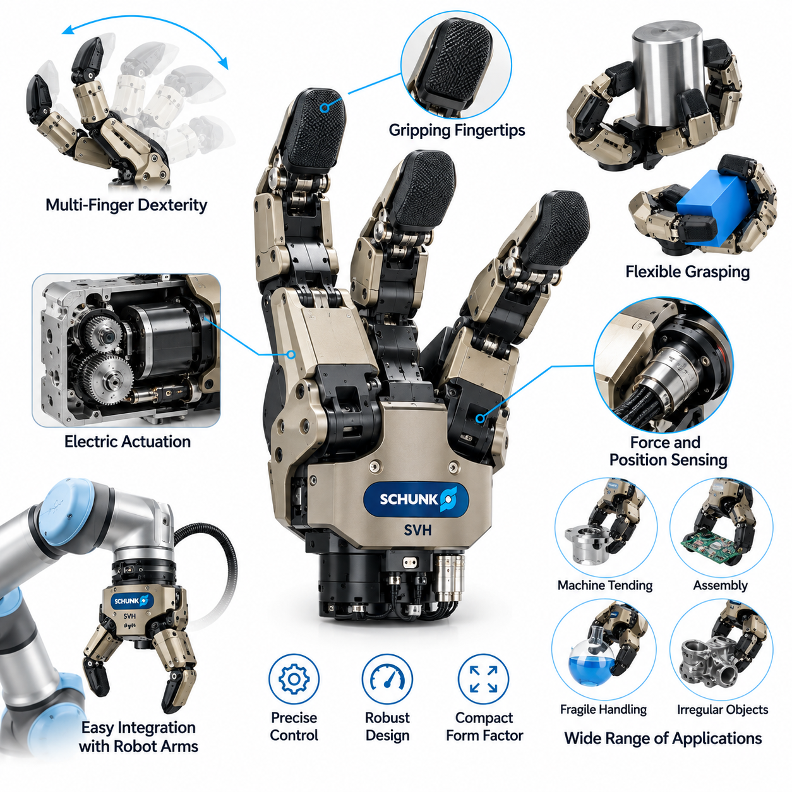{width="7.268055555555556in" height="7.268055555555556in"}

슝크 SVH 핸드(SCHUNK SVH Hand)는 인간의 손을 모방한 손가락 형상(Human-Inspired Finger Geometry), 전동식 관절(Electrically Actuated Joints), 통합 제어 기능(Integrated Control Capabilities)을 결합한 인간형 로봇 조작(Anthropomorphic Robotic Manipulation) 기술의 중요한 발전 사례이다. 슝크(SCHUNK)가 개발한 SVH(Servo Electric 5-Finger Gripping Hand)는 복잡한 파지 작업(Complex Grasping Tasks)을 연구하고 지원하도록 설계되었다. 소형 전기기계 아키텍처(Compact Electromechanical Architecture)를 통해 로봇 시스템 내에서 협응된 다지 조작(Coordinated Multifinger Manipulation)을 구현할 수 있다는 점에서 중요한 의미를 가진다.

기존의 평행 조 그리퍼(Parallel-Jaw Grippers)와 달리 슝크 SVH는 인간의 손과 유사하게 배치된 다섯 개의 관절형 손가락(Articulated Fingers)을 갖추고 있다. 이 설계는 9개의 독립 구동 자유도(Independently Actuated Degrees of Freedom)를 제공하며, 추가적인 기계적 연동 관절 운동(Mechanically Coupled Joint Movements)이 전체 손의 관절 움직임에 기여한다. 이러한 구조는 파워 파지(Power Grasp), 정밀 집기(Precision Pinch), 협응된 손가락 구성(Coordinated Finger Configurations)을 포함한 다양한 파지 자세(Grasp Postures)를 지원한다. 이 아키텍처는 기계적 복잡성과 실제 시스템 통합 요구사항 사이의 균형을 추구한다.

SVH의 기계적 구조(Mechanical Structure)는 소형화(Compactness), 반복 정밀도(Repeatability), 제어 가능한 손가락 관절 운동(Controlled Finger Articulation)을 강조한다. 개별 손가락 세그먼트(Finger Segments)는 액추에이터 운동(Actuator Motion)을 협응된 움직임으로 전달하는 관절 메커니즘(Joint Mechanisms)을 통해 연결된다. 엄지손가락은 다른 손가락과 대향 운동(Opposition)을 수행하여 다양한 크기의 물체에 적합한 접촉 배치(Contact Arrangements)를 형성한다. 손의 외형은 인간의 해부학적 구조와 유사하지만, 관절 운동 범위와 구동 구조는 생체 손(Biological Hand)보다 제한적이다.

전동 구동(Electric Actuation)은 슝크 SVH 아키텍처의 핵심 특징이다. 통합 서보 구동 메커니즘(Integrated Servo-Driven Mechanisms)은 일부 인간형 로봇 손에서 사용하는 외부 공압 인프라(External Pneumatic Infrastructure) 없이 제어된 손가락 운동(Controlled Finger Movement)을 제공한다. 이러한 구성은 설치와 시스템 통합의 일부 과정을 단순화한다. 그러나 여러 손가락을 소형 하우징(Compact Enclosure) 내부에서 작동시키기 때문에 액추에이터 배치(Actuator Packaging), 동력 전달 효율(Transmission Efficiency), 열 관리(Thermal Management), 기계적 부하(Mechanical Loading)는 여전히 중요한 공학적 고려 사항이다.

액추에이터 명령(Actuator Commands)과 손가락 운동(Finger Motion)의 관계는 손의 기계적 동력 전달 구조(Mechanical Transmission)와 관절 연동(Joint Coupling)에 따라 결정된다. 모든 해부학적 관절이 독립적으로 구동되는 것은 아니므로 협응 운동(Coordinated Movement)은 손가락 세그먼트 사이에 미리 정의된 기계적 관계(Mechanical Relationships)를 고려해야 한다. 관절 위치 제어(Joint Position Control)는 반복 가능한 파지 구성(Repeatable Grasp Configurations)을 생성하는 실용적인 기반을 제공한다. 그러나 마찰, 순응성, 물체 형상, 외력으로 인해 명령 위치와 실제 접촉 조건 사이에 차이가 발생할 수 있다.

SVH는 인간형 외형(Anthropomorphic Appearance)과 제약 없는 정교한 조작 능력(Unrestricted Dexterity)의 실질적인 차이를 보여준다. 다섯 개의 손가락은 다양한 파지 구성(Grasp Configurations)을 제공하지만, 독립적으로 제어되는 관절 수가 제한되어 임의의 손끝 위치 결정(Arbitrary Fingertip Positioning)에는 제약이 있다. 따라서 이 손은 제약 없는 인간형 조작(Unrestricted Human-Like Manipulation)보다는 구조화된 다지 파지(Structured Multifinger Grasping)에 적합하다. 이러한 설계는 모든 해부학적 능력을 재현하지 않고도 적절하게 선택된 자유도(Degrees of Freedom)를 통해 유용한 파지 다양성(Grasp Diversity)을 확보할 수 있음을 보여준다.

슝크 SVH의 파지 계획(Grasp Planning)에서는 물체 형상(Object Geometry)과 작업 요구사항(Task Requirements)에 적합한 손가락 구성(Finger Configurations)을 선택해야 한다. 원통형 물체(Cylindrical Objects)는 감싸는 접촉(Encompassing Contact)이 유리할 수 있으며, 작은 부품은 협응된 손끝 집기(Coordinated Fingertip Pinching)가 필요할 수 있다. 성공적인 파지 형성(Grasp Formation)은 엄지와 다른 손가락의 상대 위치(Relative Positions), 사용 가능한 관절 범위(Joint Ranges), 접근 가능한 접촉 표면(Contact Surfaces)에 따라 결정된다. 또한 손가락을 닫기 전에 로봇 팔(Robot Arm)이 손을 적절한 위치에 배치해야 한다.

접촉 역학(Contact Mechanics)은 SVH의 조작 성능(Manipulation Performance)을 평가하는 데 필수적인 역할을 한다. 여러 손가락은 물체 표면에 힘을 분산시켜 제한된 접촉점을 사용하는 그리퍼보다 안정성을 높일 수 있다. 그러나 파지 품질(Grasp Quality)은 마찰계수(Friction Coefficients), 접촉 형상(Contact Geometry), 외부 하중 방향(Direction of External Loads)에 따라 달라진다. 외관상 안정적으로 보이는 파지 자세가 반드시 힘 폐쇄(Force Closure)나 외란 저항성(Disturbance Resistance)을 보장하지는 않는다. 따라서 신뢰할 수 있는 파지 평가를 위해 해석 모델(Analytical Models)과 실험적 측정(Experimental Measurements)이 필요하다.

힘 조절(Force Regulation)은 액추에이터 구동력(Actuator Effort)이 개별 손끝 접촉력(Individual Fingertip Contact Forces)과 항상 직접적으로 일치하지 않기 때문에 어려움이 있다. 기계적 연동(Mechanical Coupling)과 동력 전달 손실(Transmission Losses)은 접촉점 사이의 힘 분포(Force Distribution)에 영향을 줄 수 있다. 취약한 물체(Delicate Objects)에 과도한 파지력이 작용하면 변형이나 손상이 발생할 수 있으며, 힘이 부족하면 미끄러짐(Slipping)이 발생할 수 있다. 따라서 실용적인 제어 전략(Control Strategies)은 적절한 운동 제한(Motion Limits), 보수적인 힘 설정(Conservative Force Settings), 실험적으로 검증된 파지 매개변수(Validated Grasp Parameters)를 결합해야 한다.

센싱(Sensing)과 피드백(Feedback)은 명령된 파지 동작이 성공적으로 완료되었는지 판단하는 데 중요하다. 관절 위치 정보(Joint Position Information)와 액추에이터 상태(Actuator Status)는 손가락 운동과 작동 조건(Operating Conditions)을 감시하는 데 활용할 수 있다. 응용 분야에서 상세한 접촉력 측정(Contact Force Measurement)이나 미끄러짐 감지(Slip Detection)가 요구되는 경우 추가적인 외부 센싱(External Sensing)이 필요할 수 있다. SVH가 고밀도 손끝 센서 배열(Dense Fingertip Sensor Arrays)을 장착한 연구용 로봇 손과 동일한 촉각 정보(Tactile Information)를 제공한다고 가정해서는 안 된다.

슝크 SVH는 휴머노이드 로봇(Humanoid Robots), 서비스 로봇(Service Robotics), 첨단 조작 시스템(Advanced Manipulation Systems)과 관련된 연구개발에 활용되어 왔다. 인간형 구성(Anthropomorphic Configuration)은 인간 손의 형상을 기준으로 설계된 물체와의 상호작용을 연구하는 데 적합하다. 잠재적인 작업에는 가정용 물품 파지(Grasping Household Items), 일부 도구 취급(Tool Handling), 다양한 형상의 부품 조작(Component Manipulation)이 포함된다. 실제 성능은 물체의 특성, 파지 전략(Grasp Strategy), 주변 로봇 시스템(Robotic System)에 따라 달라진다.

로봇 팔(Robotic Arm)과의 통합에는 손목 인터페이스(Wrist Interfaces), 가반하중(Payload Capacity), 통신(Communication), 제어 협응(Control Coordination)에 관한 요구사항이 수반된다. 매니퓰레이터(Manipulator)는 손의 질량과 물리적 치수를 수용하면서 충분한 위치 정확도(Positioning Accuracy)를 유지해야 한다. 의도하지 않은 접촉이나 물체 변위(Object Displacement)를 방지하기 위해 손가락 운동(Finger Movements)은 로봇 팔 궤적(Arm Trajectories)과 동기화되어야 한다. 선택한 로봇 플랫폼에 대해서는 기계적 장착(Mechanical Mounting), 전기적 연결(Electrical Connectivity), 소프트웨어 호환성(Software Compatibility)을 검증해야 한다.

모바일 매니퓰레이션(Mobile Manipulation) 응용 분야에서 SVH는 인간형 로봇 손이 수행 가능한 파지 작업의 범위를 확장하는 방법을 보여주는 유용한 사례이다. 이러한 손을 장착한 모바일 로봇(Mobile Robot)은 단순한 2지 그리퍼(Two-Finger Grippers)로 취급하기 어려운 물체와 상호작용할 수 있다. 그러나 내비게이션 불확실성(Navigation Uncertainty), 플랫폼 진동(Platform Vibration), 제한된 작업 공간 접근성(Limited Workspace Access)은 파지 신뢰성(Grasp Reliability)을 낮출 수 있다. 성공적인 적용을 위해서는 인식(Perception), 로봇 팔 위치 결정(Arm Positioning), 손가락 제어(Finger Control)의 협응이 필수적이다.

이 로봇 손의 전기적 아키텍처(Electrical Architecture)는 공압 공급 시스템(Pneumatic Supply Systems)이 추가적인 복잡성을 초래하는 응용 분야에서 장점을 제공한다. 전동 구동(Electric Actuation)은 인프라 요구사항(Infrastructure Requirements)을 단순화하고 호환 가능한 인터페이스(Compatible Interfaces)를 통해 프로그래밍 가능한 운동 제어(Programmable Motion Control)를 지원할 수 있다. 그러나 시스템 설계에서는 전력 소비(Electrical Power Consumption), 액추에이터 발열(Actuator Heating), 지속 부하(Sustained Loading)를 고려해야 한다. 소형 손가락 메커니즘(Compact Finger Mechanisms)은 반복적이거나 장시간 지속되는 파지 작업에서 열적·기계적 제약(Thermal and Mechanical Constraints)을 경험할 수 있다.

섀도 덱스터러스 핸드(Shadow Dexterous Hand)와 같은 고구동 연구 플랫폼(Highly Actuated Research Platforms)에 비해 슝크 SVH는 상대적으로 제한된 전기기계 구성(Electromechanical Configuration)을 강조한다. 섀도 플랫폼은 일부 구성에서 더 높은 수준의 독립 관절 제어(Independent Joint Control)를 제공하는 반면, SVH는 더 적은 구동 자유도(Actuated Degrees of Freedom)를 사용하여 협응된 인간형 파지(Coordinated Anthropomorphic Grasping)를 구현한다. 이러한 비교는 정교한 조작 능력(Dexterity), 액추에이터 수(Actuator Count), 제어 차원(Control Dimensionality), 통합 복잡성(Integration Complexity) 사이의 상충관계(Tradeoff)를 보여준다. 어느 아키텍처도 모든 작업에서 보편적으로 우수한 것은 아니다.

SVH의 벤치마킹(Benchmarking)에서는 실제 물체와 환경 조건을 대표하는 상황에서 파지 성공 여부(Grasp Success)를 평가해야 한다. 주요 성능 지표(Performance Metrics)에는 파지 성공 완료(Successful Grasp Completion), 물체 유지(Object Retention), 위치 반복 정밀도(Positioning Repeatability), 파지 실행 시간(Grasp Execution Time), 외란 저항성(Resistance to Disturbances)이 포함된다. 시험에는 서로 다른 치수, 질량, 표면 재료(Surface Materials), 형상(Geometries)을 가진 물체가 포함되어야 한다. 기계적 적응성(Mechanical Adaptability)과 협응된 손가락 운동(Coordinated Finger Movement)이 낯선 물체에서도 자동으로 안정적인 파지를 보장하는 것은 아니므로 반복 시험(Repeated Trials)이 중요하다.

신뢰성 평가(Reliability Assessment)에서는 관절 마모(Joint Wear), 액추에이터 성능(Actuator Performance), 동력 전달 구조의 건전성(Transmission Integrity), 반복 파지 사이클(Repeated Grasping Cycles)의 영향을 조사해야 한다. 소형 전기기계 메커니즘(Compact Electromechanical Mechanisms)은 시간이 지남에 따라 마찰(Friction), 백래시(Backlash), 기계적 정렬(Mechanical Alignment)이 변화할 수 있다. 먼지(Dust), 온도(Temperature), 진동(Vibration)과 같은 환경 조건도 작동 성능에 영향을 줄 수 있다. 정기 점검(Periodic Inspection), 보정(Calibration), 적절한 작동 한계(Operating Limits)는 반복 정밀도를 유지하고 예상하지 못한 기계적 고장(Mechanical Failures)의 위험을 줄이는 데 도움이 된다.

산업적 관점(Industrial Perspective)에서 SVH는 인간형 파지 시스템(Anthropomorphic Gripping Systems)의 가능성과 한계를 동시에 보여준다. 다지 아키텍처(Multifinger Architecture)는 다양한 물체와 복잡한 파지 자세(Complex Grasp Postures)를 지원할 수 있지만, 반복성이 높은 작업에서는 추가적인 기계적 복잡성(Mechanical Complexity)과 제어 복잡성(Control Complexity)이 정당화되지 않을 수 있다. 물체 형상이 표준화되어 있고 높은 사이클 시간 효율(Cycle-Time Efficiency)이 요구되는 경우에는 기존 산업용 그리퍼(Conventional Industrial Grippers)가 더 적합한 경우가 많다. SVH는 작업 유연성(Task Flexibility)과 인간 중심 물체 상호작용(Human-Oriented Object Interaction)이 중요한 환경에서 더욱 매력적인 선택이 된다.

슝크 SVH 사례 연구(SCHUNK SVH Case Study)는 신중하게 제한된 수의 독립 구동 관절(Independently Actuated Joints)을 통해서도 유용한 인간형 파지(Anthropomorphic Grasping)를 구현할 수 있음을 보여준다. 이 설계는 인간 손을 모방한 손가락 배치(Human-Inspired Finger Arrangements), 전동 구동(Electric Actuation), 협응된 관절 운동(Coordinated Joint Movement), 로봇 시스템 통합(Robotic System Integration)을 결합한다. 핵심적인 공학적 교훈은 효과적인 조작(Effective Manipulation)이 기계적 자유도(Mechanical Freedom), 제어 복잡성(Control Complexity), 센싱 능력(Sensing Capability), 응용 요구사항(Application Requirements)의 적절한 조합에 달려 있다는 것이다. SVH는 실용적인 다지 로봇 손 아키텍처(Practical Multifinger Robotic Hand Architectures)를 평가하는 데 중요한 참고 사례로 남아 있다.

## 15.04 Allegro Hand

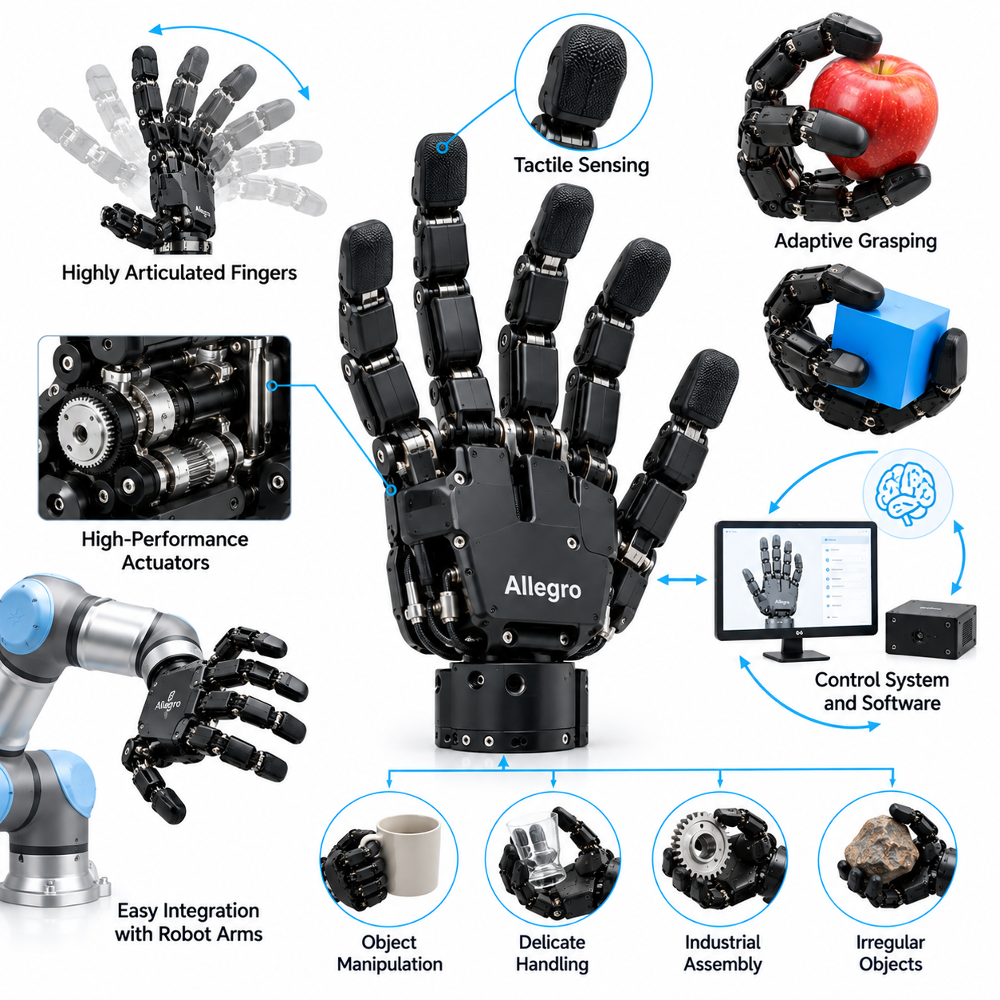{width="7.268055555555556in" height="7.268055555555556in"}

알레그로 핸드(Allegro Hand)는 소형 기계 구조(Compact Mechanical Structure), 독립적으로 구동되는 손가락 관절(Independently Actuated Finger Joints), 프로그래밍 가능한 제어(Programmable Control)를 결합한 정교한 로봇 조작(Dexterous Robotic Manipulation) 연구의 중요한 플랫폼이다. 원익로보틱스(Wonik Robotics)가 개발한 이 로봇 손은 파지 계획(Grasp Planning), 강화학습(Reinforcement Learning), 협응된 손가락 조작(Coordinated Finger Manipulation)과 관련된 학술 및 산업 연구에서 널리 활용된다. 복잡한 다지 제어(Multifinger Control)를 연구하기 위한 비교적 접근성이 높은 실험 플랫폼(Experimental Platform)을 제공한다는 점에서 중요한 의미를 가진다.

알레그로 핸드는 대향 운동(Opposition)이 가능한 엄지손가락을 포함하여 네 개의 관절형 손가락(Articulated Fingers)을 갖추고 있으며, 각 손가락에는 네 개의 독립 구동 관절(Independently Actuated Joints)이 있다. 이러한 구성은 총 16개의 구동 자유도(Actuated Degrees of Freedom)를 제공하여 협응된 손끝 위치 결정(Coordinated Fingertip Positioning)과 물체 조작(Object Manipulation)을 연구할 수 있도록 한다. 인간의 손보다 손가락 수는 적지만 다양한 파지 자세(Grasp Postures)를 지원하며, 기계적 능력(Mechanical Capability)과 제어 복잡성(Control Complexity) 사이의 실용적인 균형을 제공한다.

기계적 설계(Mechanical Design)는 소형화(Compactness), 상대적으로 낮은 질량(Low Mass), 모듈형 전기기계 구조(Modular Electromechanical Construction)를 강조한다. 각 손가락은 회전 관절(Rotary Joints)로 연결된 관절형 세그먼트(Articulated Segments)로 구성되어 제어 가능한 굽힘 운동(Flexion)과 협응된 위치 결정(Coordinated Positioning)을 수행한다. 손바닥(Palm)은 구조적 지지(Structural Support)를 제공하고 손가락의 상대적 배치(Relative Arrangement)를 결정한다. 왼손형(Left-Handed)과 오른손형(Right-Handed)을 포함한 다양한 구성은 로봇 팔(Robotic Arms) 및 실험용 조작 플랫폼(Experimental Manipulation Platforms)과의 통합을 지원한다.

전기 모터 구동(Electric Motor Actuation)은 알레그로 핸드의 핵심 특징이다. 각 관절은 소형 모터 및 동력 전달 메커니즘(Compact Motor and Transmission Mechanisms)을 통해 구동되며, 프로그래밍 가능한 위치 제어(Position Control)와 토크 관련 제어(Torque-Related Control)를 지원한다. 독립 구동(Independent Actuation)은 개별 손가락 관절이 서로 다른 제어 명령(Control Commands)을 따를 수 있으므로 기계적으로 연결된 적응형 그리퍼(Adaptive Grippers)보다 높은 유연성을 제공한다. 그러나 까다로운 조작 작업을 설계할 때는 액추에이터 한계(Actuator Limits), 동력 전달 마찰(Transmission Friction), 기계적 백래시(Mechanical Backlash), 열적 거동(Thermal Behavior)을 고려해야 한다.

알레그로 핸드의 16차원 관절 구성(Sixteen-Dimensional Joint Configuration)은 복잡한 제어 문제(Control Problem)를 형성한다. 비교적 단순한 파지 작업에서도 여러 손가락의 협응 운동(Coordinated Movement)이 필요하며, 물체 조작에는 추가적인 접촉 제약(Contact Constraints)이 발생한다. 관절 공간 제어(Joint-Space Control)는 손가락 위치 결정의 기초를 제공하지만, 정확한 손끝 운동(Fingertip Motion)을 위해서는 순기구학(Forward Kinematics)과 역기구학(Inverse Kinematics) 모델도 필요하다. 연구자는 관절 한계(Joint Limits), 도달 가능한 작업 공간(Reachable Workspaces), 손가락과 주변 물체 사이의 잠재적 충돌(Potential Collisions)을 고려해야 한다.

손끝 궤적 계획(Fingertip Trajectory Planning)은 알레그로 핸드가 정밀 조작(Precision Manipulation)을 수행할 때 특히 중요하다. 각 손끝은 의도한 접촉 영역(Contact Region)에 접근하면서 불필요한 충돌(Unintended Collisions)을 피해야 한다. 제어기(Controller)는 손가락이 적절한 시점에 접촉을 형성하도록 여러 궤적(Trajectories)을 협응해야 한다. 접촉 형성(Contact Formation) 과정에서 물체가 움직일 수 있으므로 순수한 개방 루프 위치 제어(Open-Loop Positioning)만으로는 충분하지 않은 경우가 많다. 물체 형상(Object Geometry)이나 초기 자세(Initial Pose)가 불확실할 때 피드백(Feedback)과 적응형 보정(Adaptive Correction)은 신뢰성을 개선할 수 있다.

알레그로 핸드는 기계적 작업 공간(Mechanical Workspace) 내에서 손끝 집기(Fingertip Pinching), 다지 접촉(Multidigit Contact), 감싸 쥐기(Enveloping Grasps)를 포함한 다양한 파지 구성(Grasp Configurations)을 지원한다. 물체에 따라 서로 다른 손가락 배치(Finger Placement)와 접촉력(Contact Force)의 조합이 필요하다. 작은 부품은 정밀 접촉(Precision Contacts)이 유리할 수 있으며, 큰 물체는 여러 손가락에 분산된 지지(Distributed Support)가 필요할 수 있다. 따라서 성공적인 파지 계획(Grasp Planning)은 물체 형상, 마찰 특성(Friction Properties), 의도한 조작 목표(Manipulation Objective)에 따라 결정된다.

접촉 역학(Contact Mechanics)은 알레그로 핸드의 능력을 이해하는 핵심 요소이다. 여러 손끝 접촉(Multiple Fingertip Contacts)은 외부 외란(External Disturbances)에 대해 물체를 안정화하는 힘과 모멘트(Forces and Moments)를 생성할 수 있다. 파지 품질(Grasp Quality)은 접촉 위치(Contact Locations), 마찰계수(Friction Coefficients), 사용 가능한 관절 토크(Available Joint Torques)에 따라 달라진다. 힘 폐쇄(Force Closure)와 파지 렌치 공간(Grasp Wrench Space)과 같은 해석적 개념(Analytical Concepts)은 유용한 평가 방법을 제공한다. 그러나 실제 접촉에는 순응성(Compliance), 마찰 불확실성(Friction Uncertainty), 변형(Deformation)이 존재하므로 실제 성능은 이상화된 모델과 다를 수 있다.

힘 및 토크 제어(Force and Torque Control)는 서로 다른 기계적 특성(Mechanical Properties)을 가진 물체를 조작할 때 필수적이다. 제어기는 미끄러짐(Slipping)을 방지할 만큼 충분한 파지력(Gripping Force)을 제공하면서 취약한 재료(Delicate Materials)를 손상시킬 수 있는 과도한 압력을 피해야 한다. 관절 토크 명령(Joint Torque Commands)이나 추정값(Estimates)은 힘 조절(Force Regulation)을 지원할 수 있지만, 개별 손끝 접촉력(Individual Fingertip Contact Forces)을 직접 측정한다는 의미는 아니다. 정확한 접촉력 추정(Contact-Force Estimation)을 위해서는 기계적 모델(Mechanical Models), 보정(Calibration), 추가 센싱(Additional Sensing)이 필요할 수 있다.

촉각 센싱(Tactile Sensing)은 알레그로 핸드 연구에서 중요한 확장 요소이다. 표준 구성(Standard Configurations)에 고밀도 촉각 센서 배열(Dense Tactile Sensor Arrays)이 기본적으로 포함되어 있다고 가정해서는 안 되지만, 연구자는 접촉이 많은 작업(Contact-Rich Tasks)을 위해 호환 가능한 손끝 센서(Fingertip Sensors)나 표면 센서(Surface Sensors)를 통합할 수 있다. 이러한 센서는 접촉 위치(Contact Location), 압력 분포(Pressure Distribution), 미끄러짐 관련 변화(Slip-Related Changes)에 관한 정보를 제공할 수 있다. 촉각 관측값(Tactile Observations)을 관절 피드백(Joint Feedback) 및 시각 인식(Visual Perception)과 결합하면 파지 상태 감시(Grasp Monitoring)와 조작 의사결정(Manipulation Decisions)을 개선할 수 있다.

손안 조작(In-Hand Manipulation)은 알레그로 핸드의 가장 중요한 연구 응용 분야 중 하나이다. 로봇은 물체를 완전히 놓지 않고 협응된 손가락 운동(Coordinated Finger Movements)을 통해 물체의 방향(Orientation)이나 위치(Position)를 변경할 수 있다. 이러한 작업에는 구름 운동(Rolling), 피벗 운동(Pivoting), 손가락 보행(Finger Gaiting), 제어된 재파지(Controlled Regrasping)가 포함될 수 있다. 이러한 작업에서는 접촉 전환(Contact Transitions)을 신중하게 관리해야 하는데, 한 손가락의 위치를 변경할 때 나머지 접촉점(Remaining Contacts)이 충분하지 않으면 물체가 불안정해질 수 있기 때문이다.

알레그로 핸드는 독립적으로 구동되는 관절이 풍부한 행동 공간(Action Space)을 제공하기 때문에 강화학습(Reinforcement Learning) 연구에서 유용한 플랫폼으로 활용되고 있다. 학습 알고리즘(Learning Algorithms)은 수작업으로 설계하기 어려운 협응된 손가락 동작(Coordinated Finger Behaviors)을 탐색할 수 있다. 학습된 정책(Policies)은 물체 회전(Object Rotation), 안정적인 파지 유지(Stable Grasp Maintenance), 외란 복구(Disturbance Recovery)와 같은 작업을 수행하도록 훈련될 수 있다. 그러나 고차원 조작 정책(High-Dimensional Manipulation Policies)을 학습하려면 상당한 학습 데이터(Training Data), 신중하게 설계된 목표(Objectives), 신뢰할 수 있는 시뮬레이션 또는 실험 환경(Simulation or Experimental Environments)이 필요하다.

시뮬레이션(Simulation)은 알레그로 핸드의 조작 정책(Manipulation Policies)을 개발하는 데 중요한 역할을 한다. 물리 기반 환경(Physics-Based Environments)은 관절 동역학(Joint Dynamics), 충돌(Collisions), 마찰(Friction), 물체 운동(Object Motion)을 표현할 수 있으므로 실제 하드웨어를 지속적으로 사용하지 않고도 반복 실험(Repeated Experiments)을 수행할 수 있다. 시뮬레이션은 매개변수 변화(Parameter Variation)와 체계적인 시험(Systematic Testing)도 지원한다. 그러나 시뮬레이션과 실제 접촉 거동(Real Contact Behavior) 사이의 차이는 학습된 정책을 실제 로봇 손에 직접 적용할 때 성능을 저하시킬 수 있다.

따라서 시뮬레이션에서 현실로의 전이(Sim-to-Real Transfer)는 알레그로 핸드 연구에서 중요한 고려 사항이다. 도메인 무작위화(Domain Randomization)는 시뮬레이션 학습 과정에서 마찰, 질량(Mass), 액추에이터 거동(Actuator Behavior), 물체 형상(Object Geometry)의 변화를 학습 정책(Learning Policies)에 경험시킬 수 있다. 시스템 식별(System Identification)은 관련 하드웨어 매개변수(Hardware Parameters)를 추정하여 모델 정확도(Model Accuracy)를 추가로 개선할 수 있다. 이러한 기술을 실제 환경 보정(Real-World Calibration) 및 피드백 제어(Feedback Control)와 결합하면 강건성(Robustness)을 높일 수 있지만, 신뢰할 수 있는 전이 성능은 대상 작업(Target Task)과 작동 조건(Operating Conditions)에 따라 달라진다.

시각 인식(Visual Perception)의 통합은 물체 중심 조작(Object-Centered Manipulation)을 위한 추가적인 능력을 제공한다. 외부 카메라(External Cameras)나 깊이 센서(Depth Sensors)는 파지 실행 전에 물체의 위치(Position), 방향(Orientation), 주변 형상(Surrounding Geometry)을 추정할 수 있다. 조작 과정에서 시각 피드백(Visual Feedback)은 예상하지 못한 물체 움직임이나 목표 자세(Target Pose)로부터의 편차(Deviations)를 감지하는 데 도움이 된다. 시각 정보(Vision)를 고유수용감각 기반 관절 정보(Proprioceptive Joint Information)와 결합하면 더욱 완전한 상태 추정(State Estimation)이 가능하며, 특히 변화하는 접촉 구성(Contact Configurations)에 따라 손가락 운동을 협응해야 할 때 유용하다.

로봇 팔 통합(Robotic Arm Integration)을 위해 알레그로 핸드는 적절한 기계적 장착(Mechanical Mounting), 전기적 인터페이스(Electrical Interfaces), 통신 호환성(Communication Compatibility)을 필요로 한다. 로봇 팔은 손의 질량을 지지하면서 적절한 손목 위치(Wrist Positioning)와 운동 정확도(Motion Accuracy)를 유지해야 한다. 조작 계획(Manipulation Planning)은 특히 물체 획득(Object Acquisition)과 배치(Placement) 과정에서 로봇 팔 운동(Arm Movement)과 손가락 궤적(Finger Trajectories)을 협응해야 한다. 통합 시스템은 도달 가능한 작업 공간(Reachable Workspace), 충돌 제약(Collision Constraints), 액추에이터 한계(Actuator Limits), 파지된 물체의 안정성(Stability of the Grasped Object)을 고려해야 한다.

모바일 매니퓰레이션 시스템(Mobile Manipulation Systems)에서 알레그로 핸드는 기존 평행 조 그리퍼(Parallel-Jaw Grippers)가 지원하는 작업 범위를 확장할 수 있다. 이 손을 장착한 모바일 로봇(Mobile Robot)은 도구 취급(Tool Handling), 물체 방향 변경(Object Reorientation), 불규칙한 부품 조작(Manipulation of Irregular Components)을 연구할 수 있다. 그러나 플랫폼 진동(Platform Vibration), 위치 추정 불확실성(Localization Uncertainty), 제한된 물체 접근성(Restricted Object Access)은 추가적인 문제를 발생시킨다. 효과적인 작동을 위해서는 내비게이션(Navigation), 인식(Perception), 로봇 팔 제어(Arm Control), 정교한 손 조작(Dexterous Hand Manipulation)의 협응이 필요하다.

알레그로 핸드의 벤치마킹(Benchmarking)은 파지(Grasping)와 조작(Manipulation) 작업 모두에 대한 평가를 필요로 한다. 주요 성능 지표(Performance Metrics)에는 파지 성공률(Grasp Success Rate), 물체 방향 정확도(Object Orientation Accuracy), 조작 완료 시간(Manipulation Completion Time), 관절 추종 오차(Joint Tracking Error), 외란 복구 능력(Recovery from Disturbances)이 포함된다. 실험에는 서로 다른 형상(Geometries), 질량(Masses), 표면 특성(Surface Properties)을 가진 물체가 포함되어야 한다. 통제된 조건(Controlled Conditions)에서의 반복 시험(Repeated Trials)은 신뢰할 수 있는 능력과 일회성 시연(Isolated Demonstrations)을 구별하고, 해석 기반 제어기(Analytical Controllers)와 학습 기반 제어기(Learning-Based Controllers)의 비교를 지원한다.

신뢰성 및 유지보수(Reliability and Maintenance) 측면에서는 관절 마모(Joint Wear), 액추에이터 발열(Actuator Heating), 동력 전달 성능(Transmission Performance), 전기적 연결(Electrical Connectivity)을 고려해야 한다. 반복적인 고부하 조작(High-Load Manipulation)은 기계적 응력(Mechanical Stress)을 증가시키고 시간이 지남에 따라 제어 정확도(Control Accuracy)에 영향을 줄 수 있다. 보정 절차(Calibration Procedures)와 적절한 토크 제한(Torque Limits)은 일관된 작동을 유지하는 데 도움이 된다. 장시간 연구 실험(Extended Research Experiments)에서는 액추에이터 상태(Actuator Conditions)를 감시하고 고장(Failures)을 기록하는 것이 하드웨어 한계(Hardware Limitations)와 조작 알고리즘(Manipulation Algorithms)의 약점을 구별하는 데 중요하다.

알레그로 핸드 사례 연구(Allegro Hand Case Study)는 소형의 독립 구동 다지 플랫폼(Compact Independently Actuated Multifinger Platform)이 첨단 로봇 파지(Robotic Grasping)와 정교한 조작(Dexterous Manipulation) 연구를 어떻게 지원할 수 있는지 보여준다. 16개의 구동 자유도(Actuated Degrees of Freedom)는 협응 제어(Coordinated Control), 촉각 통합(Tactile Integration), 강화학습(Reinforcement Learning), 시뮬레이션에서 현실로의 전이(Sim-to-Real Transfer)를 연구할 수 있는 기회를 제공한다. 핵심적인 공학적 교훈은 유용한 정교한 조작 능력(Dexterity)이 단순히 관절 수(Joint Count)만으로 결정되는 것이 아니라 기계적 설계(Mechanical Design), 센싱(Sensing), 접촉 모델링(Contact Modeling), 지능형 제어(Intelligent Control)의 통합을 통해 구현된다는 점이다.

## 15.05 OpenAI Dactyl

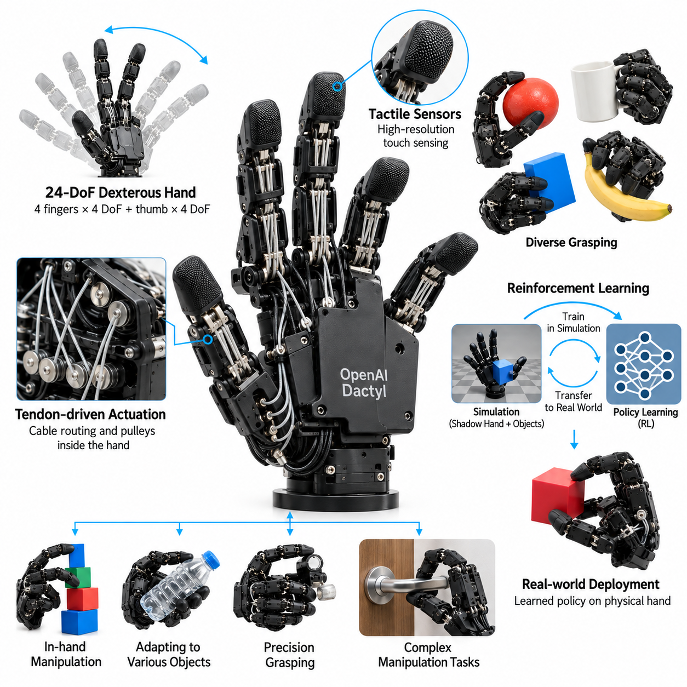{width="7.268055555555556in" height="7.268055555555556in"}

OpenAI 닥틸 프로젝트(OpenAI Dactyl Project)는 학습 기반 정교한 로봇 조작(Learning-Based Dexterous Robotic Manipulation) 분야의 중요한 이정표로, 강화학습(Reinforcement Learning)이 대규모 시뮬레이션 학습(Extensive Simulation Training)을 통해 복잡한 로봇 손을 제어할 수 있음을 보여주었다. 이 프로젝트는 섀도 덱스터러스 핸드(Shadow Dexterous Hand)를 사용하여 수작업으로 프로그래밍된 손가락 궤적(Manually Programmed Finger Trajectories)에 전적으로 의존하지 않고 실제 물체를 조작하였다. 고차원 로봇 제어(High-Dimensional Robotic Control), 시뮬레이션(Simulation), 도메인 무작위화(Domain Randomization), 실제 환경 조작(Real-World Manipulation)을 연결했다는 점에서 중요한 의미를 가진다.

닥틸(Dactyl)의 핵심 목표는 협응된 손가락 운동(Coordinated Finger Movements)을 통해 물체를 조작할 수 있는 로봇 시스템을 개발하는 것이었다. 주로 물체를 파지하고 운반하는 기존 파지 시스템(Conventional Grasping Systems)과 달리, 닥틸은 손안에서 물체의 방향을 연속적으로 변경하는 손안 조작(In-Hand Manipulation)을 연구하였다. 이러한 작업은 손가락 위치와 힘을 조절하면서 접촉 안정성(Contact Stability)을 유지해야 한다. 따라서 제어 문제(Control Problem)는 복잡한 손 기구학(Hand Kinematics), 비선형 접촉 동역학(Nonlinear Contact Dynamics), 물리적 상호작용의 불확실성(Uncertainty in Physical Interactions)을 결합한다.

실험 플랫폼(Experimental Platform)은 여러 관절형 관절(Articulated Joints)과 독립적으로 제어 가능한 운동(Independently Controllable Motions)을 갖춘 5지 섀도 덱스터러스 핸드(Five-Finger Shadow Dexterous Hand)를 사용하였다. 협응된 조작(Coordinated Manipulation)을 위해 다수의 관절을 동시에 제어해야 했기 때문에 높은 차원의 행동 공간(Action Space)이 형성되었다. 외부 센싱(External Sensing)과 관절 피드백(Joint Feedback)은 물체 및 손의 상태에 관한 정보를 제공하였다. 이러한 하드웨어 구성(Hardware Configuration)은 기존 규칙 기반 제어(Rule-Based Control)로 구현하기 어려운 조작 정책(Manipulation Policies)을 연구할 수 있도록 하였다.

강화학습(Reinforcement Learning)은 닥틸 제어 전략(Dactyl Control Strategy)의 기반을 형성하였다. 정책(Policy)은 시뮬레이션 환경(Simulated Environments)과 상호작용하고 조작 목표(Manipulation Objectives)에 따른 피드백을 받으면서 행동을 선택하는 방법을 학습하였다. 학습 과정에서는 물체가 떨어지는 등의 실패를 방지할 수 있는 충분한 제어 능력을 유지하면서 물체를 목표 방향(Desired Orientation)으로 회전하도록 유도하였다. 모든 접촉 전환(Contact Transitions)을 명시적으로 프로그래밍하는 대신 반복적인 시뮬레이션 경험(Repeated Simulated Experience)을 통해 협응된 동작(Coordinated Behaviors)을 발견하였다.

이 프로젝트의 가장 중요한 혁신 중 하나는 도메인 무작위화(Domain Randomization)를 광범위하게 활용했다는 점이다. 학습 과정에서 시뮬레이션 매개변수(Simulation Parameters)를 변화시켜 정책이 다양한 물리적 조건(Physical Conditions)을 경험하도록 하였다. 이러한 변화에는 물체 특성(Object Properties), 마찰(Friction), 액추에이터 거동(Actuator Behavior), 기타 환경 요인(Environmental Factors)이 포함되었다. 다양한 시뮬레이션 환경의 분포(Distribution of Simulated Environments)에서 학습함으로써 제어기(Controller)는 특정 물리 모델(Physical Model)에 대한 의존도를 낮추고 시뮬레이션과 현실 사이의 차이를 더 잘 견딜 수 있게 되었다.

닥틸 연구는 정확한 시뮬레이션(Accurate Simulation)만으로 실제 물체 조작(Physical Manipulation)의 성공을 보장할 수 없다는 점을 보여주었다. 접촉이 많은 작업(Contact-Rich Tasks)은 마찰, 순응성(Compliance), 충돌 거동(Collision Behavior)의 작은 차이만으로도 물체 운동(Object Motion)에 큰 변화가 발생할 수 있어 모델링이 특히 어렵다. 도메인 무작위화(Domain Randomization)는 불확실한 동역학(Uncertain Dynamics)에 대한 강건성(Robustness)을 강조함으로써 이러한 한계를 해결하고자 하였다. 이 접근법은 매우 정밀한 시스템 식별(System Identification)과 수작업 접촉 모델(Handcrafted Contact Models)에만 의존하는 방식의 대안을 제공하였다.

초기 닥틸 연구(Initial Dactyl Research)는 실제 로봇 손을 사용하여 정육면체(Cube)의 학습 기반 손안 조작(Learned In-Hand Manipulation)을 시연하였다. 시스템은 주로 시뮬레이션에서 학습되었으며, 실제 하드웨어에서 동일한 규모의 시행착오 학습(Trial-and-Error Training)을 수행하지 않고도 학습 결과를 이전할 수 있었다. 이러한 결과는 강화학습이 제어된 물체 회전(Controlled Object Rotations)을 생성하는 협응된 손가락 운동(Coordinated Finger Movements)을 발견할 수 있음을 보여주었다. 그러나 시연된 능력은 특정 작업(Task-Specific)에 한정되었으며, 제약 없는 인간 수준의 정교한 조작 능력(Unrestricted Human-Level Dexterity)을 의미하지는 않았다.

이후 루빅스 큐브(Rubik\'s Cube)를 로봇 손으로 해결하는 연구는 더욱 까다로운 조작 시퀀스(Manipulation Sequences)로 연구 범위를 확장하였다. 이 연구는 학습된 로봇 제어(Learned Robotic Control)를 추가적인 인식(Perception) 및 계획(Planning) 구성요소와 결합하였다. 상위 수준의 논리(High-Level Logic)가 필요한 변환 순서(Sequence of Transformations)를 결정하는 동안 로봇 손은 실제 큐브 회전(Physical Cube Rotations)을 수행하였다. 이러한 성과는 학습된 운동 기술(Learned Motor Skills)과 구조화된 작업 계획(Structured Task Planning)을 통합하는 것이 중요하다는 점을 보여주었다.

자동 도메인 무작위화(Automatic Domain Randomization)는 학습 중 시뮬레이션 환경의 난이도를 조절함으로써 학습 방법론(Training Methodology)을 더욱 발전시켰다. 고정된 무작위 매개변수 분포(Fixed Distribution of Randomized Parameters)만 사용하는 대신, 정책 성능(Policy Performance)이 개선됨에 따라 학습 과정에서 점진적으로 더 어려운 조건을 탐색하였다. 이러한 접근법은 제어기가 점점 더 다양한 동역학(Dynamics)을 경험하도록 도왔다. 또한 학습 환경 설계(Training Environment Design)가 학습된 조작 정책(Learned Manipulation Policies)의 강건성에 영향을 줄 수 있음을 보여주었다.

이 프로젝트는 상위 수준의 작업 목표(High-Level Task Objectives)와 하위 수준의 운동 제어(Low-Level Motor Control)를 구분하는 것이 중요하다는 점을 강조하였다. 상위 수준의 시스템은 물체의 목표 방향(Desired Orientation)이나 변환(Transformation)을 지정할 수 있으며, 학습된 제어 정책(Learned Control Policy)은 이를 달성하는 데 필요한 손가락 운동을 결정한다. 이러한 분리는 모든 관절 궤적(Joint Trajectories)을 수작업으로 지정해야 하는 필요성을 줄여준다. 그러나 성공적인 실행을 위해서는 여전히 신뢰할 수 있는 상태 추정(State Estimation), 적절한 행동 표현(Action Representations), 신중하게 정의된 작업 목표(Task Objectives)가 필요하다.

시각 인식(Visual Perception)은 조작 중 물체 상태(Object State)를 추정하는 데 중요한 역할을 하였다. 카메라 기반 관측(Camera-Based Observations)은 물체 방향(Object Orientation)에 관한 정보를 제공하였으며, 고유수용감각 측정(Proprioceptive Measurements)은 로봇 손의 관절 구성(Joint Configuration)을 나타냈다. 이러한 정보원을 결합함으로써 제어기는 손의 운동(Hand Motion)과 물체 움직임(Object Movement)의 관계를 파악할 수 있었다. 인식 오류(Perception Errors), 가려짐(Occlusion), 센서 지연(Sensor Delays)은 부정확한 상태 추정(State Estimates)이 조작을 불안정하게 만들 수 있기 때문에 중요한 과제로 남아 있었다.

닥틸 실험은 관측 및 행동 타이밍(Observation and Action Timing)의 중요성도 보여주었다. 로봇 조작(Robotic Manipulation)에서는 센싱(Sensing), 정책 추론(Policy Inference), 액추에이터 제어(Actuator Control) 사이의 지속적인 상호작용이 필요하다. 이러한 제어 루프(Control Loop)에서 발생하는 지연(Delays)이나 불일치(Inconsistencies)는 특히 물체가 빠르게 움직이거나 접촉점(Contact Points)이 변경될 때 접촉 안정성(Contact Stability)에 영향을 줄 수 있다. 따라서 학습 절차(Training Procedures)에서는 관련 제어 주파수(Control Frequencies), 액추에이터 응답 특성(Actuator Response Characteristics), 관측 불확실성(Observation Uncertainty)을 고려해야 한다.

기계적 관점(Mechanical Perspective)에서 닥틸은 복잡한 로봇 하드웨어(Complex Robotic Hardware)가 해석적으로 도출하기 어려운 동작을 어떻게 지원할 수 있는지 보여주었다. 섀도 덱스터러스 핸드(Shadow Dexterous Hand)는 다수의 제어 가능한 관절(Controllable Joints)을 제공하여 다양한 접촉 구성(Contact Configurations)과 물체 운동(Object Movements)을 가능하게 하였다. 그러나 동일한 기계적 자유도(Mechanical Freedom)는 고차원 제어 문제(High-Dimensional Control Problem)를 발생시켰다. 강화학습(Reinforcement Learning)은 완전한 수작업 조작 전략(Manually Designed Manipulation Strategy) 없이도 협응된 관절 동작(Coordinated Joint Behaviors)을 탐색할 수 있는 방법을 제공하였다.

시뮬레이션(Simulation)과 실제 하드웨어(Physical Hardware)의 관계는 프로젝트의 공학적 방법론(Engineering Methodology)에서 핵심적인 요소였다. 시뮬레이션 학습 환경(Simulated Training Environments)은 실제 로봇에 동일한 수준의 기계적 마모(Mechanical Wear)를 발생시키지 않고도 대량의 조작 시도(Manipulation Attempts)를 수행할 수 있도록 하였다. 이후 하드웨어 실험(Hardware Experiments)을 통해 학습된 정책(Learned Policy)이 실제 조건(Real Conditions)에서도 일반화(Generalization)되는지 평가하였다. 이러한 작업 흐름(Workflow)은 비용이 많이 드는 실제 데이터 수집(Physical Data Collection)에 대한 의존도를 줄였지만, 성능 검증(Performance Validation)을 위해 실제 환경 시험(Real-World Testing)은 여전히 필요하였다.

닥틸은 정교한 조작(Dexterous Manipulation)을 위한 강화학습(Reinforcement Learning)의 중요한 한계도 드러냈다. 학습에는 상당한 컴퓨팅 자원(Computational Resources), 신중하게 설계된 목표(Objectives), 정교한 시뮬레이션 인프라(Simulation Infrastructure)가 필요하였다. 정책(Policies)은 학습 분포(Training Distribution)를 벗어난 익숙하지 않은 물체(Unfamiliar Objects), 극단적인 물리적 조건(Extreme Physical Conditions), 인식 실패(Perception Failures)에 민감할 수 있었다. 따라서 어려운 벤치마크(Benchmark)에서의 성공이 임의의 물체와 환경 전반에 걸친 범용 조작 능력(General-Purpose Manipulation Capability)을 자동으로 입증하는 것은 아니었다.

이 프로젝트의 관련성은 인간형 로봇 손(Anthropomorphic Robotic Hands)을 넘어 확장된다. 도메인 무작위화(Domain Randomization), 시뮬레이션 기반 학습(Simulation-Based Learning), 강건한 정책 전이(Robust Policy Transfer)는 로봇 팔(Robotic Arms), 모바일 매니퓰레이터(Mobile Manipulators), 기타 접촉이 많은 시스템(Contact-Rich Systems)에도 적용될 수 있다. 불확실한 마찰(Uncertain Friction), 변화하는 적재하중(Changing Payloads), 복잡한 상호작용(Complex Interactions)이 포함된 응용 분야는 유사한 방법론의 이점을 얻을 수 있다. 그러나 이러한 기술의 효과는 시뮬레이션된 변동성(Simulated Variability)이 실제 작동 중 발생하는 외란(Disturbances)을 얼마나 적절하게 표현하는지에 따라 달라진다.

모바일 매니퓰레이션 시스템(Mobile Manipulation Systems)에서 닥틸 접근법(Dactyl Approach)은 인식(Perception), 작업 계획(Task Planning), 학습된 조작 정책(Learned Manipulation Policies), 하위 수준의 액추에이터 제어(Low-Level Actuator Control)를 결합하는 계층형 아키텍처(Layered Architecture)를 제시한다. 모바일 로봇(Mobile Robot)은 추가적으로 내비게이션(Navigation), 로봇 팔 위치 결정(Arm Positioning), 손 조작(Hand Manipulation)을 협응해야 한다. 플랫폼 위치 추정(Platform Localization)과 물체 자세(Object Pose)의 불확실성은 파지 실행(Grasp Execution)으로 전파될 수 있다. 강건한 정책(Robust Policies)은 일부 변동성을 보상할 수 있지만, 신뢰할 수 있는 배포(Reliable Deployment)를 위해서는 여전히 시스템 수준의 협응(System-Level Coordination)과 안전 메커니즘(Safety Mechanisms)이 필요하다.

닥틸 방식의 조작(Dactyl-Style Manipulation)을 벤치마킹(Benchmarking)할 때는 개별 작업 완료(Isolated Task Completion) 이상의 요소를 평가해야 한다. 관련 측정 지표(Measurements)에는 물체 방향 정확도(Object Orientation Accuracy), 성공적인 조작 시퀀스(Successful Manipulation Sequences), 외란 복구(Recovery from Disturbances), 실행 시간(Execution Time), 물리적 매개변수 변화에 대한 강건성(Robustness under Changes in Physical Parameters)이 포함된다. 평가에서는 시뮬레이션 성능(Simulation Performance)과 실제 하드웨어 성능(Real Hardware Performance)을 구분해야 한다. 통제된 조건 변화(Controlled Variations)에서 반복 시험(Repeated Trials)을 수행하는 것은 학습된 정책이 익숙한 학습 조건(Training Conditions)을 넘어 일반화되는지 판단하는 데 필수적이다.

OpenAI 닥틸 프로젝트(OpenAI Dactyl Project)는 강화학습(Reinforcement Learning), 로봇 시뮬레이션(Robotic Simulation), 물리적 조작(Physical Manipulation)의 융합을 보여주는 기초적인 사례 연구(Foundational Case Study)이다. 이 프로젝트는 복잡한 손가락 협응(Complex Finger Coordination)이 시뮬레이션 경험(Simulated Experience)을 통해 형성되고 강건한 학습 방법(Robust Training Methods)을 통해 실제 로봇 하드웨어로 전이될 수 있음을 입증하였다. 핵심적인 공학적 교훈은 성공적인 정교한 조작 능력(Dexterity)이 정교한 기계 메커니즘(Sophisticated Mechanisms)뿐만 아니라 불확실성(Uncertainty), 접촉 동역학(Contact Dynamics), 변화하는 물리적 조건(Changing Physical Conditions)을 처리할 수 있는 학습 시스템(Learning Systems)에도 달려 있다는 점이다.

## 15.06 Google RT-2 Grasping

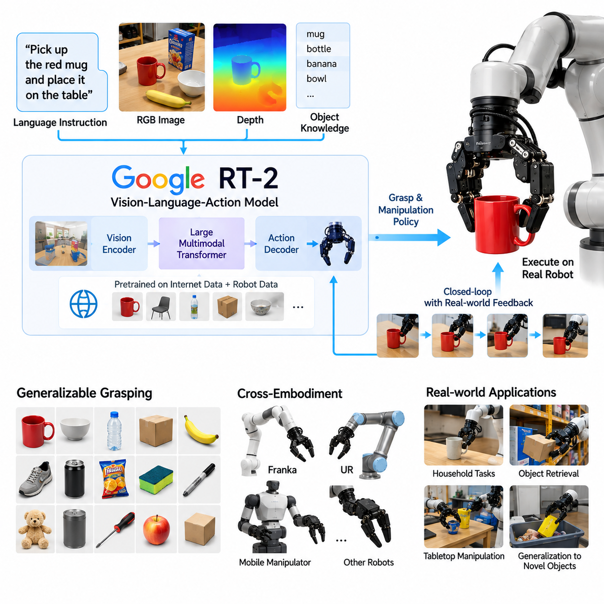{width="7.268055555555556in" height="7.268055555555556in"}

구글 RT-2(Google RT-2)는 시각-언어-행동 학습(Vision-Language-Action Learning) 분야의 중요한 발전 사례로, 대규모 시각-언어 사전학습(Large-Scale Vision-Language Pretraining)을 통해 획득한 지식이 로봇 조작(Robotic Manipulation)을 지원할 수 있음을 보여주었다. 2023년 구글 딥마인드(Google DeepMind)가 발표한 RT-2는 시각적 관측(Visual Observations)과 자연어 명령(Natural-Language Instructions)을 로봇 행동(Robot Actions)에 연결하여 시각-언어 모델(Vision-Language Models)의 능력을 확장하였다. 좁게 정의된 학습 작업(Training Tasks)을 넘어 로봇 행동의 일반화(Generalization)를 개선했다는 점에서 중요한 의미를 가진다.

기존 로봇 파지 시스템(Traditional Robotic Grasping Systems)은 명시적으로 프로그래밍된 인식 파이프라인(Perception Pipelines), 기하학적 파지 계획기(Geometric Grasp Planners), 작업별 제어기(Task-Specific Controllers)에 의존하는 경우가 많다. RT-2는 시각적 장면(Visual Scenes), 언어 명령(Linguistic Instructions), 실행 가능한 행동(Executable Actions) 사이의 관계를 학습하는 다른 접근법을 탐구한다. 인식(Perception), 의미론적 추론(Semantic Reasoning), 행동 생성(Action Generation)을 완전히 분리된 구성요소로 취급하는 대신, 공유 학습 프레임워크(Shared Learning Framework) 내에서 통합한다. 이를 통해 조작 요청(Manipulation Requests)을 더욱 유연하게 해석할 수 있다.

RT-2는 일반적으로 VLA로 약칭하는 시각-언어-행동 모델(Vision-Language-Action Model) 계열에 속한다. 이 아키텍처(Architecture)는 원래 연구에서 검토된 PaLI-X 및 PaLM-E 변형(Variants)을 포함한 사전학습된 시각-언어 모델(Pretrained Vision-Language Models)을 기반으로 한다. 이러한 모델은 시각 정보(Visual Information)와 텍스트 정보(Textual Information)를 처리하면서 로봇 행동 예측(Robotic Action Prediction)에 적합한 표현(Representations)을 생성하도록 학습한다. 이 접근법은 광범위한 시각 및 언어 데이터셋(Visual and Language Datasets)에서 얻은 의미론적 지식(Semantic Knowledge)을 조작 작업(Manipulation Tasks)으로 전이한다.

RT-2의 핵심 특징 중 하나는 로봇 행동(Robotic Actions)을 토큰(Tokens)으로 표현한다는 점이다. 연속적인 로봇 명령(Continuous Robot Commands)은 이산화(Discretization)되어 언어 모델 학습(Language-Model Training)과 호환되는 형식으로 표현된다. 행동 차원(Action Dimensions)은 말단효과기 이동(End-Effector Translation), 회전(Rotation), 그리퍼 작동(Gripper Operation), 관련 제어 변수(Control Variables)를 나타낼 수 있다. 모델은 행동 토큰(Action Tokens)을 예측함으로써 언어 방식의 시퀀스 생성(Language-Style Sequence Generation)을 실제 로봇 실행(Physical Robot Execution)과 연결하지만, 명령을 실제로 구현하기 위해서는 여전히 하위 수준 제어기(Low-Level Controllers)가 필요하다.

학습 전략(Training Strategy)은 로봇 시연 데이터(Robot Demonstration Data)와 대규모 시각-언어 정보(Large-Scale Vision-Language Information)를 결합한다. 로봇 궤적(Robot Trajectories)은 관측(Observations), 명령(Instructions), 성공적인 행동(Successful Actions) 사이의 관계를 모델에 학습시키며, 인터넷 규모의 시각 및 텍스트 데이터(Internet-Scale Visual and Textual Data)는 더욱 광범위한 의미론적 이해(Semantic Understanding)에 기여한다. 공동 미세조정(Joint Fine-Tuning)은 모델을 로봇 제어(Robotic Control)에 적응시키면서 일반 지식(General Knowledge)을 유지하도록 돕는다. 이러한 결합은 제한적으로 수집된 조작 데이터셋(Manipulation Datasets)에만 의존하는 문제를 줄여준다.

파지 응용 분야(Grasping Applications)에서 RT-2는 시각적 관측(Visual Observations)과 언어 명령(Language Instructions)을 통해 물체의 정체성(Object Identity)과 작업 의도(Task Intent)를 해석한다. 특정 물체를 집어 올리라는 요청은 목표 물체(Target Object)를 인식하고 주변 물체(Surrounding Items)와 구별하며 적절한 조작 행동(Manipulation Behavior)을 선택해야 한다. 모델은 물체 범주(Object Categories)와 기능적 연관성(Functional Associations)을 포함하여 사전학습(Pretraining) 과정에서 습득한 의미론적 관계(Semantic Relationships)를 활용할 수 있다. 그러나 의미론적 이해만으로 기계적으로 안정적인 파지 실행(Mechanically Stable Grasp Execution)이 보장되는 것은 아니다.

초기 RT-2 시연(Original RT-2 Demonstrations)에서는 카메라 기반 인식(Camera-Based Perception)과 그리퍼가 장착된 로봇 팔(Gripper-Equipped Arms)을 갖춘 로봇 조작 플랫폼(Robotic Manipulation Platforms)을 사용하였다. 이 시스템은 고도로 관절화된 인간형 로봇 손(Highly Articulated Anthropomorphic Hand)의 모든 관절을 직접 제어하는 대신 해당 플랫폼에 대한 행동 명령(Action Commands)을 생성하였다. 이러한 차이는 RT-2를 파지 사례 연구(Grasping Case Study)로 해석할 때 중요하다. RT-2의 주요 기여는 고급 다지 손안 조작(Advanced Multifinger In-Hand Manipulation)의 시연이 아니라 의미론적 일반화(Semantic Generalization)와 행동 생성(Action Generation)에 있다.

RT-2에서 연구된 중요한 능력 중 하나는 로봇 학습 사례(Robot Training Examples)에 명시적으로 포함되지 않은 물체와 명령에 대한 일반화(Generalization)였다. 모델은 시각-언어 사전학습(Vision-Language Pretraining)을 통해 습득한 지식을 활용하여 익숙하지 않은 범주(Unfamiliar Categories)와 관계(Relationships)를 해석할 수 있었다. 예를 들어 특정 목적(Purpose)과 연관된 물체를 다루라는 명령은 단순한 시각적 형상 인식(Visual Shape Recognition)을 넘어서는 의미론적 추론(Semantic Reasoning)을 요구할 수 있다. 이러한 행동은 사전학습된 지식(Pretrained Knowledge)과 체화된 행동 학습(Embodied Action Learning)을 결합하는 가치를 보여준다.

RT-2는 언어 이해(Language Understanding)를 물리적 작업(Physical Tasks)과 연결하는 추론(Reasoning)의 형태도 보여주었다. 명령에는 공간적 관계(Spatial Relationships), 물체의 기능(Object Functions), 단순한 기호적 연관성(Symbolic Associations)이 포함될 수 있다. 모델은 이러한 개념을 관측된 환경(Observed Environment)에서 실행할 수 있는 행동(Actions)으로 변환해야 한다. 이러한 능력은 목표 물체(Target Object)와 원하는 파지 구성(Desired Grasp Configuration)이 일반적으로 더 명시적인 기하학적 표현(Geometric Representations)을 통해 지정되는 기존 파지 계획(Conventional Grasp Planning)과 구별된다.

의미론적 추론(Semantic Reasoning)과 물리적 실행 가능성(Physical Feasibility)의 관계는 여전히 핵심적인 공학적 과제(Engineering Challenge)이다. 모델이 요청된 물체를 정확하게 식별하더라도 부적절한 접근 형상(Poor Approach Geometry), 불충분한 파지력(Inadequate Gripping Force), 환경적 장애물(Environmental Obstruction) 때문에 행동 실행에 실패할 수 있다. 따라서 신뢰할 수 있는 파지(Reliable Grasping)를 위해서는 상위 수준의 행동 예측(High-Level Action Prediction)과 물리적 제약(Physical Constraints) 사이의 협응이 필요하다. 충돌 회피(Collision Avoidance), 도달 가능한 작업 공간 한계(Reachable Workspace Limits), 파지 안정성(Grasp Stability)은 여전히 필수적인 고려 사항이다.

시각 인식(Visual Perception)은 행동 예측(Action Predictions)이 관측된 장면(Observed Scene)에 의존하기 때문에 RT-2의 성능에 큰 영향을 미친다. 카메라 영상(Camera Images)은 물체 외형(Object Appearance), 상대 위치(Relative Position), 주변 상황(Surrounding Context)에 관한 정보를 제공한다. 그러나 가려짐(Occlusion), 반사 표면(Reflective Surfaces), 조명 변화(Changing Illumination), 불명확한 물체 경계(Ambiguous Object Boundaries)는 인식 신뢰성(Perception Reliability)을 낮출 수 있다. 추가적인 깊이 센싱(Depth Sensing), 기하학적 추정(Geometric Estimation), 촉각 피드백(Tactile Feedback)은 후속 실행(Downstream Execution)을 개선할 수 있지만, 이러한 능력이 RT-2 아키텍처에 자동으로 포함되는 것은 아니다.

행동 토큰 표현(Action-Token Formulation)은 파운데이션 모델(Foundation Models)과 로봇 제어(Robotic Control)를 연결하는 실용적인 방법을 제공한다. 모델은 원래 다중모달 시퀀스 예측(Multimodal Sequence Prediction)을 위해 개발된 학습 프레임워크(Learning Framework)를 사용하여 구조화된 행동 시퀀스(Structured Action Sequence)를 예측할 수 있다. 그러나 이산화(Discretization)는 행동 해상도(Action Resolution), 제어 주파수(Control Frequency), 계산 지연(Computational Latency) 사이의 상충관계(Tradeoffs)를 발생시킨다. 실제 실행을 위해서는 로봇 제어 인프라(Robot Control Infrastructure)를 통해 예측된 행동을 액추에이터 호환 명령(Actuator-Compatible Commands)으로 변환해야 한다.

RT-2는 웹 규모 데이터(Web-Scale Data)에서 획득한 지식을 체화 지능(Embodied Intelligence)으로 전이하는 사례를 제공한다. 대규모 시각-언어 데이터셋(Large Visual-Language Datasets)에는 로봇 시연(Robot Demonstrations)만으로 수집하기 어려운 물체 범주(Object Categories), 일상 활동(Everyday Activities), 의미론적 관계(Semantic Relationships)에 관한 정보가 포함되어 있다. 이러한 지식은 익숙하지 않은 환경(Unfamiliar Environments)에서 작업 해석(Task Interpretation)과 물체 선택(Object Selection)을 지원할 수 있다. 그러나 인터넷에서 얻은 정보(Internet-Derived Information)는 정밀한 접촉 동역학(Precise Contact Dynamics), 액추에이터 한계(Actuator Limitations), 파지력(Grasp Forces)을 직접적으로 표현하지는 않는다.

학습 관점(Learning Perspective)에서 RT-2는 광범위한 사전학습(Broad Pretraining)과 작업별 로봇 경험(Task-Specific Robotic Experience)을 결합하는 것이 중요하다는 점을 강조한다. 시각-언어 사전학습(Vision-Language Pretraining)은 의미론적 표현(Semantic Representations)을 제공하고, 로봇 궤적(Robot Trajectories)은 이러한 표현과 실행 가능한 움직임(Executable Movements) 사이의 연결을 형성한다. 어느 한 데이터 소스(Data Source)만으로는 신뢰할 수 있는 물리적 조작(Physical Manipulation)을 구현하기에 충분하지 않다. 결합 모델(Combined Model)의 효과는 데이터 품질(Data Quality), 학습 분포(Training Distribution), 행동 표현(Action Representation), 대상 하드웨어(Target Hardware)의 능력에 따라 달라진다.

일반화(Generalization)는 익숙한 물체에 대한 작업 완료(Task Completion)와 구분하여 평가해야 한다. 관련 실험에는 학습되지 않은 물체 파지(Unseen-Object Grasping), 새로운 언어 명령(Novel Language Instructions), 배경 외형 변화(Changes in Background Appearance), 물체 배치 변화(Variations in Object Placement)가 포함된다. 평가 지표(Metrics)에는 작업 성공률(Task Success Rate), 목표 선택 정확도(Target Selection Accuracy), 실행 시간(Execution Time), 실패한 시도로부터의 복구(Recovery from Failed Attempts)가 포함될 수 있다. 비교 평가에서는 의미론적 일반화(Semantic Generalization)를 하드웨어(Hardware), 인식(Perception), 기존 제어(Conventional Control)의 개선으로 발생한 성능 향상과 구분해야 한다.

RT-2는 계산 요구사항(Computational Requirements)과 응답 지연(Response Latency)에 관한 중요한 배포 고려사항(Deployment Considerations)도 제기한다. 대규모 다중모달 모델(Large Multimodal Models)은 상당한 처리 자원(Processing Resources)을 요구할 수 있으며, 실제 로봇(Physical Robots)은 적시에 행동을 생성해야 한다. 시스템 설계자(System Designers)는 모델 용량(Model Capacity)과 추론 속도(Inference Speed), 통신 신뢰성(Communication Reliability), 에너지 소비(Energy Consumption) 사이의 균형을 고려해야 한다. 예측할 수 없는 네트워크 지연(Network Delays)을 허용할 수 없는 응용 분야에서는 로컬 추론(Local Inference), 최적화된 실행(Optimized Execution), 적절한 제어 계층 구조(Control Hierarchies)가 필요할 수 있다.

모바일 매니퓰레이터(Mobile Manipulators)에 대해 RT-2는 언어 명령(Language Instructions)과 시각적 관측(Visual Observations)이 물체 중심 행동(Object-Oriented Actions)을 안내하는 아키텍처(Architecture)를 제시한다. 내비게이션(Navigation)과 로봇 팔 위치 결정(Arm Positioning)은 행동 모델(Action Model)이 그리퍼에 명령을 내리기 전에 적절한 조작 작업 공간(Manipulation Workspace)을 확보할 수 있다. 그러나 초기 RT-2 결과를 완전한 자율 모바일 매니퓰레이션(Complete Autonomous Mobile Manipulation)의 입증으로 해석해서는 안 된다. 내비게이션, 안전 감독(Safety Supervision), 힘 조절(Force Regulation), 작업 복구(Task Recovery)에는 추가적인 시스템 수준의 능력(System-Level Capabilities)이 필요하다.

RT-2와 알레그로 핸드(Allegro Hand) 또는 섀도 덱스터러스 핸드(Shadow Dexterous Hand)와 같은 정교한 로봇 손 플랫폼(Dexterous-Hand Platforms)의 차이를 이해하는 것은 특히 중요하다. 알레그로와 섀도는 여러 손가락을 독립적으로 제어하기 위한 물리적 메커니즘(Physical Mechanisms)을 제공하는 반면, RT-2는 다중모달 관측(Multimodal Observations)을 로봇 행동(Robot Actions)에 연결하는 학습 기반 방법(Learned Method)을 제공한다. 이러한 기술은 조작 문제(Manipulation Problem)의 서로 다른 계층(Layers)을 담당한다. VLA 추론(VLA Reasoning)과 정교한 로봇 손 하드웨어(Dexterous Hardware)의 통합은 유망한 연구 방향이지만, 적절한 행동 표현(Action Representations)과 학습 데이터(Training Data)가 필요하다.

구글 RT-2 파지 사례 연구(Google RT-2 Grasping Case Study)는 파운데이션 모델 지식(Foundation-Model Knowledge)이 로봇의 작업 해석(Task Interpretation)과 행동 생성(Action Generation)의 유연성을 어떻게 개선할 수 있는지 보여준다. 주요 기여는 시각-언어 학습(Vision-Language Learning)을 통해 얻은 의미론적 이해(Semantic Understanding)를 체화된 조작(Embodied Manipulation)으로 전이한 것이다. 핵심적인 공학적 교훈은 지능형 파지(Intelligent Grasping)가 의미 있는 작업 이해(Meaningful Task Understanding)와 신뢰할 수 있는 물리적 실행(Reliable Physical Execution)을 모두 필요로 한다는 점이다. 미래 시스템(Future Systems)은 의미론적 일반화(Semantic Generalization), 기하학적 추론(Geometric Reasoning), 접촉 인식 제어(Contact-Aware Control), 강건한 실제 환경 피드백(Robust Real-World Feedback)을 통합해야 한다.

## 15.07 Tesla Optimus Hand

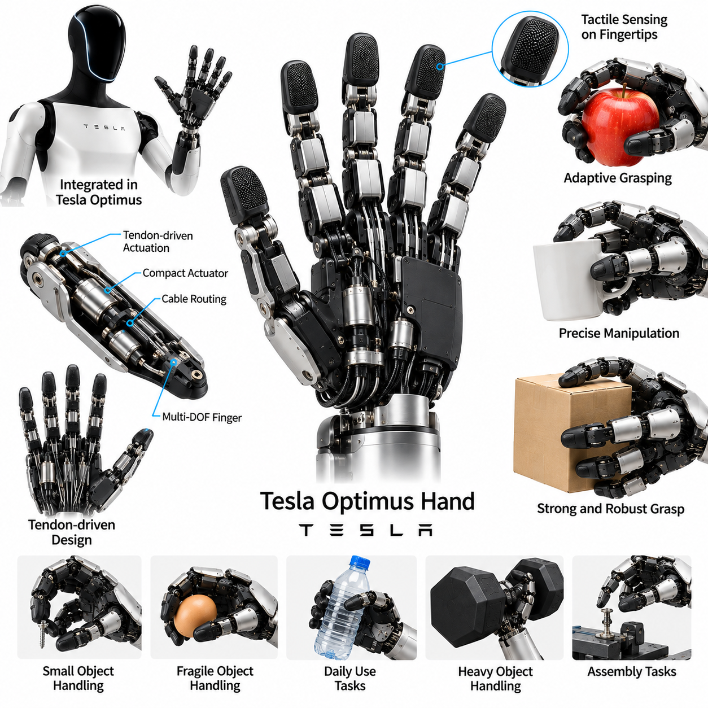{width="7.268055555555556in" height="7.268055555555556in"}

테슬라 옵티머스 핸드(Tesla Optimus Hand)는 인간형 손가락 메커니즘(Anthropomorphic Finger Mechanisms), 전동 구동(Electric Actuation), 센싱(Sensing), 학습 기반 제어(Learned Control)의 통합을 강조하는 휴머노이드 로봇 조작(Humanoid Robotic Manipulation)의 중요한 접근법이다. 테슬라(Tesla)의 옵티머스 휴머노이드 로봇 프로그램(Optimus Humanoid Robot Program)의 일부로 개발된 이 로봇 손은 일상적인 물체 취급(Everyday Object Handling)과 산업 작업(Industrial Tasks)을 지원하도록 설계되었다. 정교한 조작 능력(Dexterity), 제조 용이성(Manufacturability), 신뢰성(Reliability), 시스템 수준 자율성(System-Level Autonomy)을 결합하려는 시도라는 점에서 중요한 의미를 가진다.

옵티머스 핸드(Optimus Hand)는 고정된 기계적 설계(Mechanical Design)를 유지하기보다 연속적인 하드웨어 시제품(Hardware Prototypes)을 통해 발전해 왔다. 공개 시연(Public Demonstrations)에서는 점점 더 정교해지는 손가락 운동(Finger Movements)과 물체 조작 능력(Object Manipulation Capabilities)이 나타났다. 테슬라는 추가적인 자유도(Degrees of Freedom)와 텐던 구동 메커니즘(Tendon-Driven Mechanisms)을 통합한 새로운 손 설계를 설명해 왔다. 그러나 상세 사양(Detailed Specifications), 양산 구성(Production Configurations), 독립적으로 검증된 성능 특성(Independently Verified Performance Characteristics)에 관한 공개 기술 문서(Publicly Available Technical Documentation)는 여전히 제한적이다.

인간형 기하학적 구조(Anthropomorphic Geometry)는 많은 도구(Tools), 용기(Containers), 작업장 물체(Workplace Objects)가 인간의 사용을 기준으로 설계되었다는 점에서 옵티머스 핸드 개념(Optimus Hand Concept)의 핵심 요소이다. 다섯 손가락 구조(Five-Finger Arrangements)는 손끝 집기(Fingertip Pinching), 원통형 파지(Cylindrical Grasping), 넓은 감싸기 접촉(Enveloping Contact)을 포함한 다양한 파지 패턴(Grasp Patterns)을 제공할 수 있다. 대향 운동이 가능한 엄지손가락(Opposable Thumb)은 안정적인 접촉 구성(Stable Contact Configurations)을 형성하는 데 중요한 역할을 한다. 그러나 인간과 유사한 외형(Human-Like Appearance)이 인간과 동등한 관절 운동성(Joint Mobility)이나 조작 능력(Manipulation Capability)을 자동으로 의미하지는 않는다.

기계적 아키텍처(Mechanical Architecture)는 손가락 관절 운동(Finger Articulation), 액추에이터 배치(Actuator Packaging), 구조적 강성(Structural Stiffness), 전체 손의 질량(Overall Hand Mass) 사이의 균형을 유지해야 한다. 소형 관절(Compact Joints)과 동력 전달 메커니즘(Transmission Mechanisms)은 제한된 공간 내에서 여러 손가락이 작동할 수 있도록 한다. 텐던 구동 구조(Tendon-Driven Arrangements)는 일부 액추에이터 질량(Actuator Mass)을 손끝에서 떨어진 위치로 이동시켜 원위부 관성(Distal Inertia)을 줄일 수 있다. 그러나 텐던 경로 설계(Tendon Routing), 마찰(Friction), 장력 유지(Tension Maintenance), 기계적 마모(Mechanical Wear)는 추가적인 공학적 과제를 발생시킨다.

전동 구동(Electric Actuation)은 로봇이 통합 전력 시스템(Integrated Electrical Power System)을 사용하여 작동해야 한다는 점에서 옵티머스 플랫폼(Optimus Platform)에 특히 중요하다. 모터(Motors)와 관련 동력 전달 장치(Transmissions)는 전기 에너지(Electrical Energy)를 제어된 손가락 운동(Controlled Finger Motion)으로 변환한다. 위치(Position), 속도(Velocity), 힘 관련 명령(Force-Related Commands)은 액추에이터 한계(Actuator Limits)와 기계적 제약(Mechanical Constraints)을 준수해야 한다. 손의 작동은 배터리 기반 휴머노이드 로봇(Battery-Powered Humanoid Robot)의 전체 전력 소비(Power Consumption)와 열 부하(Thermal Load)에 영향을 주므로 효율적인 구동(Efficient Actuation)이 중요하다.

손가락 협응(Finger Coordination)에는 여러 관절(Multiple Joints)과 접촉 조건(Contact Conditions)을 동시에 관리할 수 있는 제어 아키텍처(Control Architecture)가 필요하다. 관절 수준 제어기(Joint-Level Controllers)는 액추에이터 운동(Actuator Motion)을 조절하며, 상위 수준 조작 정책(Higher-Level Manipulation Policies)은 목표 파지 구성(Desired Grasp Configurations)을 결정한다. 손가락이 서로 다른 시점에 물체와 접촉할 때 협응 제어(Coordinated Control)는 특히 어려워진다. 안정적인 작동(Stable Operation)을 위해서는 적절한 운동 타이밍(Motion Timing), 접촉 감지(Contact Detection), 물체 형상(Object Geometry)과 배치(Placement)의 불확실성을 고려한 조정(Adjustments)이 필요하다.

옵티머스 핸드의 파지 계획(Grasp Planning)은 서로 다른 형상(Shapes), 질량(Masses), 표면 특성(Surface Characteristics)을 가진 물체를 처리할 수 있어야 한다. 작은 부품(Small Components)은 정밀한 손끝 배치(Precise Fingertip Placement)가 필요할 수 있으며, 큰 물체(Larger Objects)는 여러 손가락에 걸친 분산 접촉(Distributed Contact)이 유리할 수 있다. 성공적인 파지 실행(Grasp Execution)은 접근 방향(Approach Direction), 손가락 구성(Finger Configuration), 사용 가능한 마찰(Available Friction)에 따라 결정된다. 따라서 범용 휴머노이드 손(General-Purpose Humanoid Hand)은 하나의 사전 정의된 닫힘 동작(Predefined Closing Motion)에 의존하기보다 다양한 파지 전략(Grasp Strategies)을 지원해야 한다.

촉각 센싱(Tactile Sensing)은 시각 정보(Visual Information)만으로 접촉 조건(Contact Conditions)을 판단할 수 없는 환경에서 조작을 수행하기 위한 핵심 능력이다. 손가락 내부나 접촉 표면(Contact Surfaces)에 배치된 센서는 압력(Pressure), 접촉 위치(Contact Location), 변화하는 하중(Changing Loads)에 관한 정보를 제공할 수 있다. 이러한 피드백(Feedback)은 파지력 조절(Grip Adjustment)과 미끄러짐 방지(Slip Prevention)를 지원할 수 있다. 테슬라가 촉각 기능(Tactile Capabilities)에 관해 설명한 바 있지만, 정확한 센싱 아키텍처(Sensing Architecture)와 성능은 공개 시연을 기반으로 한 추정(Assumptions Based on Demonstrations)과 구분해야 한다.

시각 인식(Visual Perception)은 물체의 정체성(Object Identity), 위치(Position), 방향(Orientation), 주변 장애물(Surrounding Obstacles)에 관한 보완적인 정보를 제공한다. 카메라 관측(Camera Observations)은 파지 형성(Grasp Formation) 전에 손이 적절한 접촉 영역(Contact Regions)으로 접근하도록 안내할 수 있다. 조작 과정에서 시각 피드백(Visual Feedback)은 예상하지 못한 물체 움직임(Unexpected Object Movement)이나 배치 오류(Placement Errors)를 감지할 수 있다. 시각 관측(Visual Observations)을 관절 피드백(Joint Feedback) 및 촉각 측정(Tactile Measurements)과 결합하면 더욱 신뢰할 수 있는 상태 추정(State Estimation)과 폐루프 조작(Closed-Loop Manipulation)을 구현할 수 있다.

학습 기반 제어(Learning-Based Control)는 범용 조작(General-Purpose Manipulation)에 개별적으로 프로그래밍하기 어려운 다양한 작업이 포함된다는 점에서 옵티머스 프로그램(Optimus Program)의 중요한 발전 방향이다. 시연 학습(Demonstration Learning)과 모방학습(Imitation Learning)은 관측된 작업(Observed Tasks)을 적절한 로봇 행동(Robot Actions)과 연결할 수 있다. 강화학습(Reinforcement Learning)은 적응(Adaptation)과 접촉이 많은 제어(Contact-Rich Control)를 추가로 지원할 수 있다. 그러나 특정 공개 시연(Public Demonstrations)에 사용된 정확한 학습 방법(Training Methods)은 이를 뒷받침하는 기술 공개(Technical Disclosures) 없이 추정해서는 안 된다.

원격조작(Teleoperation)과 인간 시연(Human Demonstrations)은 휴머노이드 조작 정책(Humanoid Manipulation Policies)을 개발하기 위한 유용한 데이터를 제공할 수 있다. 인간 작업자(Human Operators)는 시각 관측(Visual Observations), 관절 궤적(Joint Trajectories), 작업 결과(Task Outcomes)를 기록하면서 로봇 운동(Robotic Movements)을 안내할 수 있다. 이러한 시연은 파지(Grasping), 분류(Sorting), 물체 배치(Object Placement)를 위한 정책(Policies)의 초기 학습에 도움이 될 수 있다. 그러나 성공적인 원격조작 성능(Teleoperated Performance)은 자율 실행(Autonomous Execution)과 구분해야 하며, 두 방식은 인식(Perception), 계획(Planning), 의사결정(Decision-Making)에서 서로 다른 수준의 능력을 요구한다.

손안 조작(In-Hand Manipulation)은 인간형 로봇 손(Anthropomorphic Robotic Hands)에 매우 까다로운 목표이다. 물체를 놓지 않고 방향(Orientation)을 변경하려면 협응된 손가락 위치 변경(Coordinated Finger Repositioning)과 접촉력(Contact Forces)의 신중한 관리가 필요하다. 가능한 동작에는 제어된 구름 운동(Controlled Rolling), 피벗 운동(Pivoting), 재파지(Regrasping)가 포함된다. 이러한 능력은 휴머노이드 로봇(Humanoid Robot)의 활용성을 높일 수 있지만, 익숙하지 않은 물체(Unfamiliar Objects)에 대해 안정적으로 수행하려면 시각적으로 인상적인 시연(Visually Convincing Demonstrations) 이상의 기술이 필요하다.

옵티머스 핸드는 독립된 그리퍼(Isolated Gripper)가 아니라 완전한 휴머노이드 조작 시스템(Complete Humanoid Manipulation System)의 일부로 작동해야 한다. 로봇 팔 궤적(Arm Trajectories), 손목 방향(Wrist Orientation), 몸통 자세(Torso Posture), 균형(Balance)은 물체 취급(Object Handling) 과정에서 발생하는 힘에 영향을 준다. 정지 상태 시험(Stationary Testing)에서 안정적인 파지도 로봇이 보행(Walking)하거나 자세를 변경하면 불안정해질 수 있다. 따라서 정교한 조작(Dexterous Manipulation)을 휴머노이드 이동성(Humanoid Mobility)과 통합하기 위해서는 전신 협응(Whole-Body Coordination)이 필수적이다.

산업 응용(Industrial Applications)은 옵티머스 핸드의 실용적 가치(Practical Value)를 평가할 수 있는 잠재적인 환경을 제공한다. 부품 이송(Component Transfer), 자재 분류(Material Sorting), 인간 작업자를 위해 설계된 물체 취급(Handling Objects Designed for Human Workers)과 같은 작업은 인간형 조작(Anthropomorphic Manipulation)의 이점을 얻을 수 있다. 그러나 많은 반복적인 산업 작업(Repetitive Industrial Operations)에서는 여전히 특수 목적 그리퍼(Specialized Grippers)가 더 적합하다. 휴머노이드 손의 경제적 타당성(Economic Justification)은 작업 다양성(Task Diversity), 사이클 시간(Cycle Time), 신뢰성(Reliability), 유지보수 요구사항(Maintenance Requirements), 통합 비용(Integration Costs)에 따라 결정된다.

안전(Safety)은 휴머노이드 로봇이 사람 가까이에서 작동하거나 깨지기 쉬운 물체(Fragile Objects)를 취급할 때 특히 중요하다. 손가락 메커니즘(Finger Mechanisms)은 과도한 접촉력(Excessive Contact Forces), 의도하지 않은 끼임(Unintended Pinching), 제어되지 않은 운동(Uncontrolled Motion)을 방지해야 한다. 적절한 힘 제한(Force Limits), 충돌 감시(Collision Monitoring), 고장 처리(Fault Handling)는 조작 과정의 위험을 줄일 수 있다. 또한 로봇 팔 운동(Arm Movement)과 몸체 운동(Body Motion)은 손 제어(Hand Control)만으로 해결할 수 없는 위험을 발생시킬 수 있으므로 안전 설계(Safety Design)는 로봇 전체를 고려해야 한다.

제조 용이성(Manufacturability)과 유지보수(Maintenance)는 상용 휴머노이드 손 개발(Commercial Humanoid Hand Development)을 순수 실험 연구 플랫폼(Experimental Research Platforms)과 구별하는 중요한 요소이다. 실제 배포 가능한 설계(Deployable Design)는 부품 수(Component Count), 조립 복잡성(Assembly Complexity), 보정 작업(Calibration Effort), 교체 절차(Replacement Procedures), 생산 일관성(Production Consistency)을 고려해야 한다. 텐던 구동 메커니즘(Tendon-Driven Mechanisms)은 장력 조정(Tension Adjustment)과 마모(Wear)에 대한 관리가 필요할 수 있다. 따라서 정교한 조작 능력(Dexterity)의 향상이 제공하는 실용적 가치는 제조 비용(Manufacturing Cost), 정비 용이성(Serviceability), 장기 운영 신뢰성(Long-Term Operational Reliability)과 비교하여 평가해야 한다.

옵티머스 핸드의 벤치마킹(Benchmarking)에는 선별된 시연 영상(Selected Demonstration Videos)에만 의존하지 않는 표준화된 시험(Standardized Tests)이 필요하다. 관련 성능 지표(Performance Metrics)에는 파지 성공률(Grasp Success Rate), 물체 다양성(Object Diversity), 조작 정확도(Manipulation Accuracy), 실행 시간(Execution Time), 지속 작동 성능(Sustained Operating Performance), 외란 복구 능력(Recovery from Disturbances)이 포함된다. 시험에서는 원격조작(Teleoperated), 스크립트 기반(Scripted), 자율 행동(Autonomous Behaviors)을 구분해야 한다. 다른 로봇 손 플랫폼(Robotic Hand Platforms)과 신뢰할 수 있는 비교를 수행하려면 통제된 조건(Controlled Conditions)에서 독립적인 반복 검증(Independent Repetition)이 필요하다.

옵티머스 접근법(Optimus Approach)은 잠재적으로 확장 가능한 휴머노이드 제품(Scalable Humanoid Product)에 통합하는 것을 강조한다는 점에서 알레그로 핸드(Allegro Hand)와 섀도 덱스터러스 핸드(Shadow Dexterous Hand) 같은 연구 플랫폼(Research Platforms)과 차이가 있다. 연구용 로봇 손(Research Hands)은 실험적 유연성(Experimental Flexibility)과 상세 제어 인터페이스(Detailed Control Interfaces)에 대한 접근성을 우선하는 경우가 많다. 반면 상용 휴머노이드 손(Commercial Humanoid Hand)은 제조(Manufacturing), 전력 소비(Power Consumption), 유지보수(Maintenance), 로봇 군집 운영(Fleet Operation)에 관한 제약도 충족해야 한다. 이러한 우선순위의 차이는 기계적 설계(Mechanical Design)와 제어 아키텍처(Control Architecture)에 영향을 준다.

테슬라 옵티머스 핸드 사례 연구(Tesla Optimus Hand Case Study)는 정교한 조작 연구(Dexterous Manipulation Research)를 실용적인 휴머노이드 로봇 기술(Practical Humanoid Robotics)로 전환하는 과정의 광범위한 과제를 보여준다. 인간형 메커니즘(Anthropomorphic Mechanisms), 전동 구동(Electric Actuation), 다중모달 센싱(Multimodal Sensing), 학습된 정책(Learned Policies)은 엄격한 물리적·경제적 제약(Physical and Economic Constraints) 안에서 함께 작동해야 한다. 핵심적인 공학적 교훈은 유용한 로봇의 정교한 조작 능력(Robotic Dexterity)이 기계적 정교함(Mechanical Sophistication)이나 시연 품질(Demonstration Quality)만으로 결정되는 것이 아니라 측정 가능한 작업 성능(Measurable Task Performance), 강건한 시스템 통합(Robust System Integration), 신뢰할 수 있는 자율 작동(Reliable Autonomous Operation)에 달려 있다는 점이다.

## 15.08 Figure AI Hand

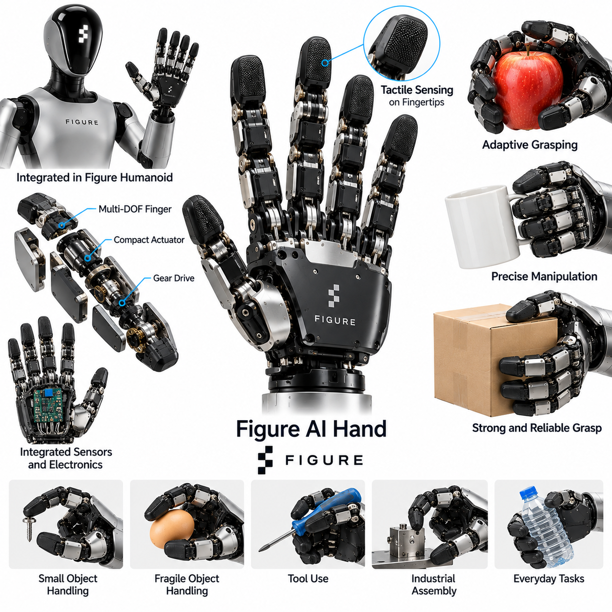{width="7.268055555555556in" height="7.268055555555556in"}

피규어 AI 핸드(Figure AI Hand)는 인간형 손가락 설계(Anthropomorphic Finger Design), 전동 구동(Electric Actuation), 학습 기반 제어(Learning-Based Control)를 결합한 휴머노이드 로봇 조작(Humanoid Robotic Manipulation) 분야의 중요한 발전 사례이다. 피규어 AI(Figure AI)의 휴머노이드 로봇 플랫폼(Humanoid Robot Platforms)을 위해 개발된 이 로봇 손은 인간 작업자를 위해 설계된 환경에서 물체 취급(Object Handling)을 지원하도록 설계되었다. 정교한 조작 능력(Dexterous Manipulation)을 전신 자율성(Whole-Body Autonomy), 실용적 배포(Practical Deployment), 확장 가능한 로봇 운영(Scalable Robotic Operations)과 통합하려는 시도라는 점에서 중요한 의미를 가진다.

피규어 AI는 손 메커니즘(Hand Mechanisms)과 조작 능력(Manipulation Capabilities)이 지속적으로 발전하는 여러 세대의 휴머노이드 플랫폼(Humanoid Platforms)을 개발해 왔다. 공개 시연(Public Demonstrations)에는 물체 파지(Object Grasping), 분류(Sorting), 협응된 물체 취급(Coordinated Handling Tasks)이 포함되어 있다. 그러나 정확한 기계적 사양(Mechanical Specifications)과 센싱 구성(Sensing Configurations)은 하드웨어 세대(Hardware Generations)에 따라 달라진다. 따라서 손가락의 정교한 조작 능력(Finger Dexterity), 힘 제어(Force Control), 지속적인 신뢰성(Sustained Reliability)을 평가할 때는 공개된 시연과 독립적으로 검증된 성능(Independently Verified Performance)을 구분해야 한다.

이 로봇 손의 인간형 구성(Anthropomorphic Configuration)은 인간이 사용하도록 설계된 물체와 상호작용하는 것의 중요성을 반영한다. 여러 개의 관절형 손가락(Articulated Fingers)은 원통형 물체(Cylindrical Objects), 용기(Containers), 도구(Tools), 불규칙한 부품(Irregular Components)에 대해 다양한 접촉 배치(Contact Arrangements)를 가능하게 한다. 엄지 대향 운동(Thumb Opposition)은 정밀 파지(Precision Grasping)와 폭넓은 물체 안정화(Object Stabilization)를 지원한다. 그러나 인간과 유사한 손가락 형상(Human-Like Finger Geometry)이 인간과 동등한 정교한 조작 능력(Human-Equivalent Dexterity)을 자동으로 제공하는 것은 아니며, 관절 운동성(Joint Mobility), 액추에이터 성능(Actuator Capability), 센싱 해상도(Sensing Resolution)가 실질적인 한계를 결정한다.

기계적 설계(Mechanical Design)는 손가락 관절 운동(Finger Articulation), 구조적 강도(Structural Strength), 소형 패키징(Compact Packaging), 전체 질량(Overall Mass) 사이의 균형을 유지해야 한다. 제어 가능한 관절(Controlled Joints)이 추가될수록 조작 가능성(Manipulation Possibilities)은 확대되지만, 액추에이터 수(Actuator Count), 동력 전달 복잡성(Transmission Complexity), 유지보수 요구사항(Maintenance Requirements)도 증가한다. 소형 전기기계 메커니즘(Compact Electromechanical Mechanisms)은 원위부 질량(Distal Mass)이 과도하면 로봇 팔 효율(Arm Efficiency)이 저하될 수 있기 때문에 휴머노이드 손에서 특히 중요하다. 따라서 최종 아키텍처(Architecture)는 파지 유연성(Grasp Flexibility)과 내구성(Durability), 제조 용이성(Manufacturability) 사이의 균형을 유지해야 한다.

전동 구동(Electric Actuation)은 배터리 기반 휴머노이드 로봇(Battery-Powered Humanoid Robot)과 통합하기 위한 실용적인 기반을 제공한다. 모터(Motors)와 동력 전달 메커니즘(Transmission Mechanisms)은 전기 에너지(Electrical Energy)를 제어된 손가락 운동(Controlled Finger Movements)으로 변환한다. 관절 명령(Joint Commands)은 기계적 한계(Mechanical Limits), 액추에이터 응답(Actuator Response), 부하 의존적 거동(Load-Dependent Behavior)을 고려해야 한다. 반복적인 파지(Repeated Grasping)는 전체 에너지 소비(Energy Consumption)와 열 부하(Thermal Loading)에 영향을 미치므로, 특히 장시간 산업 운영(Extended Industrial Operation)에서는 효율적인 구동(Efficient Actuation)이 필수적이다.

손가락 협응(Finger Coordination)에는 여러 접촉(Simultaneous Contacts)을 동시에 관리할 수 있는 제어 시스템(Control System)이 필요하다. 개별 손가락은 서로 다른 시점에 물체와 접촉할 수 있으며, 이 과정에서 힘 분포(Force Distributions)와 접촉 제약(Contact Constraints)이 변화한다. 협응 제어기(Coordinated Controller)는 과도한 압력(Excessive Pressure)을 피하면서 파지 안정성(Grasp Stability)을 유지하도록 손가락 운동(Finger Motion)을 조정해야 한다. 이러한 요구사항은 물체 형상(Object Geometry)이 불확실하거나 익숙하지 않은 물리적 특성(Physical Properties)을 가진 물체를 조작해야 할 때 더욱 까다로워진다.

파지 계획(Grasp Planning)은 목표 물체(Target Object)의 위치(Position), 방향(Orientation), 형상(Shape), 접근 가능한 접촉 영역(Accessible Contact Regions)을 추정하는 것에서 시작된다. 로봇은 접촉을 형성하기 전에 적절한 접근 방향(Approach Direction)과 손가락 구성(Finger Configuration)을 선택해야 한다. 작은 부품(Small Components)은 손끝 집기(Fingertip Pinching)가 필요할 수 있으며, 큰 물체(Larger Objects)는 여러 손가락에 분산된 접촉(Distributed Contact)이 유리할 수 있다. 성공적인 파지 실행(Grasp Execution)은 인식 정확도(Perception Accuracy), 기계적 도달 가능성(Mechanical Reachability), 마찰(Friction), 사용 가능한 파지력(Available Gripping Force) 사이의 관계에 따라 결정된다.

촉각 센싱(Tactile Sensing)은 외부 카메라(External Cameras)만으로 얻을 수 없는 정보를 제공하여 조작 성능을 개선할 수 있다. 접촉 측정(Contact Measurements)은 압력 분포(Pressure Distribution), 예상하지 못한 충돌(Unexpected Collisions), 미끄러짐(Slipping)과 관련된 변화를 감지할 수 있다. 이러한 정보는 적응형 파지력 조절(Adaptive Grip Regulation)과 물체 안정화(Object Stabilization)를 지원한다. 피규어 AI는 발전 중인 로봇 시스템(Robotic Systems)에서 촉각 기능(Tactile Capabilities)을 공개적으로 강조해 왔지만, 구체적인 센서 배치(Sensor Layouts)와 측정 성능(Measurement Performance)은 해당 하드웨어 세대(Hardware Generation)에 따라 평가해야 한다.

시각 인식(Visual Perception)은 물체를 식별하고 공간적 관계(Spatial Relationships)를 추정하는 데 필요한 정보를 제공한다. 카메라 관측(Camera Observations)은 접근 궤적(Approach Trajectories)을 안내하고 적절한 파지 위치(Grasp Locations)를 결정하며 실행 중 물체 움직임(Object Movement)을 감시할 수 있다. 시각 피드백(Visual Feedback)은 물체가 부분적으로 가려지거나 위치가 변경될 때 특히 중요하다. 시각 관측(Visual Observations)을 관절 피드백(Joint Feedback) 및 촉각 정보(Tactile Information)와 결합하면 불확실한 환경 조건(Uncertain Environmental Conditions)에서도 폐루프 조작(Closed-Loop Manipulation)을 수행할 수 있는 기반을 마련할 수 있다.

학습 기반 제어(Learning-Based Control)는 범용 휴머노이드 행동(General-Purpose Humanoid Behavior)을 개발하려는 피규어 AI 접근법(Figure AI Approach)의 핵심이다. 모든 파지 작업(Grasping Tasks)을 고정된 규칙(Fixed Rules)으로 프로그래밍하는 대신, 학습 시스템(Learning Systems)은 감각 관측(Sensory Observations)을 적절한 로봇 행동(Robotic Actions)과 연결할 수 있다. 시연 기반 학습(Demonstration-Based Learning)은 성공적인 조작(Successful Manipulation)의 사례를 제공하며, 정책 학습(Policy Training)은 여러 작업에서 협응 능력(Coordination)을 개선할 수 있다. 그러나 실제 성능은 학습 범위(Training Coverage), 데이터 품질(Data Quality), 배포된 제어 시스템(Deployed Control System)의 강건성(Robustness)에 따라 달라진다.

피규어 AI의 헬릭스 시각-언어-행동 프레임워크(Helix Vision-Language-Action Framework)는 상위 수준의 작업 이해(High-Level Task Understanding)와 로봇 제어(Robot Control)의 통합을 보여준다. 이러한 시스템은 시각 관측(Visual Observations)과 언어 명령(Language Instructions)을 협응된 물리적 행동(Coordinated Physical Behavior)으로 변환하는 것을 목표로 한다. 조작 제어기(Manipulation Controller)는 물체 선택(Object Selection)과 작업 의도(Task Intent)를 실행 가능한 로봇 팔 및 손 운동(Executable Arm and Hand Movements)과 연결해야 한다. 이 접근법은 파지를 독립적인 기계적 작업(Isolated Mechanical Operation)으로 취급하기보다 의미론적 추론(Semantic Reasoning)과 연속적인 운동 제어(Continuous Motor Control)를 통합하는 것이 중요하다는 점을 강조한다.

인간 시연(Human Demonstrations)과 원격조작(Teleoperation)은 조작 정책(Manipulation Policies)을 위한 유용한 학습 데이터(Training Data)를 제공할 수 있다. 기록된 사례(Recorded Examples)에는 물체 획득(Object Acquisition), 위치 변경(Repositioning), 분류(Sorting), 배치(Placement)가 포함될 수 있다. 이러한 시연은 학습 시스템(Learning Systems)이 시각적 조건(Visual Conditions)과 성공적인 행동(Successful Actions) 사이의 관계를 파악하도록 돕는다. 그러나 원격조작 시연(Teleoperated Demonstrations)과 자율 실행(Autonomous Execution)은 별도로 평가해야 한다. 자율성(Autonomy)은 독립적인 인식(Perception), 의사결정(Decision-Making), 오류 감지(Error Detection), 복구(Recovery)를 필요로 하기 때문이다.

피규어 AI 핸드는 협응된 휴머노이드 조작 시스템(Coordinated Humanoid Manipulation System)의 일부로 작동해야 한다. 로봇 팔 운동(Arm Movement), 손목 방향(Wrist Orientation), 몸통 자세(Torso Posture), 균형(Balance)은 물체를 파지하고 운반하는 조건에 영향을 미친다. 정지 상태 시험(Stationary Testing)에서 안정적인 파지(Stable Grasp)도 로봇이 이동하거나 자세를 변경하면 신뢰성이 낮아질 수 있다. 따라서 정교한 손 조작(Dexterous Hand Operation)을 보행(Locomotion) 및 산업용 자재 취급(Industrial Material Handling)과 결합하기 위해서는 전신 협응(Whole-Body Coordination)이 필수적이다.

산업 환경(Industrial Environments)은 피규어 AI의 조작 접근법(Manipulation Approach)을 평가하기 위한 실용적인 환경을 제공한다. 잠재적인 응용 분야(Potential Applications)에는 부품 이송(Component Transfer), 자재 취급(Material Handling), 분류(Sorting), 반복적인 작업장 운영(Repetitive Workplace Operations)이 포함된다. 인간형 손(Anthropomorphic Hands)은 작업 요구사항(Task Requirements)이 자주 변경되거나 물체가 인간 작업자를 위해 설계된 경우 장점을 제공할 수 있다. 그러나 파지 다양성(Grasp Diversity)이 제한적으로 요구되는 고속 반복 작업(High-Speed Repetitive Tasks)에서는 특수 산업용 그리퍼(Specialized Industrial Grippers)가 여전히 더 적합할 수 있다.

신뢰성(Reliability)은 휴머노이드 손(Humanoid Hands)이 생산 환경(Production Environments)에서 연속적으로 작동할 때 특히 중요해진다. 손가락 관절(Finger Joints), 동력 전달 장치(Transmissions), 액추에이터(Actuators), 전기적 연결부(Electrical Connections)는 반복적인 기계적 부하(Repeated Mechanical Loading)를 받는다. 마모(Wear), 백래시(Backlash), 온도 변화(Temperature Changes), 보정 드리프트(Calibration Drift)는 시간이 지남에 따라 조작 정확도(Manipulation Accuracy)에 영향을 줄 수 있다. 따라서 유지보수 절차(Maintenance Procedures)에는 상태 감시(Condition Monitoring), 정기 점검(Periodic Inspection), 대표적인 작동 조건(Representative Operating Conditions)에서의 파지 성능 검증(Verification of Grasp Performance)이 포함되어야 한다.

안전 요구사항(Safety Requirements)은 손가락 메커니즘(Finger Mechanisms) 자체를 넘어선다. 작업자 근처에서 작동하는 휴머노이드 로봇(Humanoid Robot)은 의도하지 않은 접촉(Unintended Contact), 과도한 파지력(Excessive Gripping Force), 예상하지 못한 로봇 팔 또는 몸체 운동(Unexpected Arm or Body Movement)을 관리해야 한다. 힘 제한(Force Limits), 충돌 감지(Collision Detection), 제어된 정지(Controlled Stopping), 고장 처리(Fault Handling)는 위험 감소(Risk Reduction)에 기여한다. 전체 시스템(Complete System)은 물체 낙하(Object Dropping), 불안정한 하중(Unstable Loads), 조작 행동(Manipulation Actions)과 전신 균형(Whole-Body Balance) 사이의 상호작용도 고려해야 한다.

피규어 AI 핸드의 벤치마킹(Benchmarking)에는 파지 및 조작 성능(Grasping and Manipulation Performance)에 대한 체계적인 평가(Systematic Evaluation)가 필요하다. 관련 성능 지표(Performance Metrics)에는 파지 성공률(Grasp Success Rate), 물체 다양성(Object Diversity), 조작 정확도(Manipulation Accuracy), 사이클 시간(Cycle Time), 외란 복구 능력(Recovery from Disturbances), 지속 작동 신뢰성(Sustained Operating Reliability)이 포함된다. 시험에서는 자율 행동(Autonomous Behavior)을 원격조작(Teleoperated Execution) 또는 스크립트 기반 실행(Scripted Execution)과 구분해야 한다. 다른 휴머노이드 조작 플랫폼(Humanoid Manipulation Platforms)과 신뢰할 수 있는 비교를 수행하려면 다양한 물체와 환경 조건에서 독립적인 실험(Independent Experiments)이 필요하다.

피규어 AI 접근법(Figure AI Approach)은 실제 배포 가능한 휴머노이드 로봇(Deployable Humanoid Robot)에 통합하는 것을 강조한다는 점에서 알레그로 핸드(Allegro Hand) 및 섀도 덱스터러스 핸드(Shadow Dexterous Hand)와 같은 연구 중심 로봇 손(Research-Oriented Hands)과 차이가 있다. 연구 플랫폼(Research Platforms)은 관절 제어(Joint Control)와 조작 알고리즘(Manipulation Algorithms)에 대한 실험적 접근성(Experimental Access)을 우선하는 경우가 많다. 반면 상용 휴머노이드 개발(Commercial Humanoid Development)에서는 제조 비용(Manufacturing Cost), 에너지 효율(Energy Efficiency), 정비 용이성(Serviceability), 로봇 군집 확장성(Fleet Scalability)도 고려해야 한다. 이러한 요구사항은 기계적 아키텍처(Mechanical Architecture)와 학습 기반 제어 시스템(Learning-Based Control Systems)의 설계에 영향을 미친다.

피규어 AI 핸드 사례 연구(Figure AI Hand Case Study)는 독립적인 정교한 조작 연구(Isolated Dexterous Manipulation Research)에서 통합 휴머노이드 지능(Integrated Humanoid Intelligence)으로 전환하는 과정을 보여준다. 인간형 메커니즘(Anthropomorphic Mechanisms), 다중모달 센싱(Multimodal Sensing), 학습된 정책(Learned Policies), 전신 협응(Whole-Body Coordination)은 유용한 물리적 작업(Useful Physical Tasks)을 수행하기 위해 함께 작동해야 한다. 핵심적인 공학적 교훈은 실용적인 정교한 조작 능력(Practical Dexterity)이 단순한 손가락 구조의 복잡성(Finger Complexity)이 아니라 신뢰할 수 있는 작업 실행(Reliable Task Execution), 적응형 인식(Adaptable Perception), 강건한 제어(Robust Control), 운영 확장성(Operational Scalability)에 달려 있다는 점이다.

## 15.09 Warehouse Picking Applications

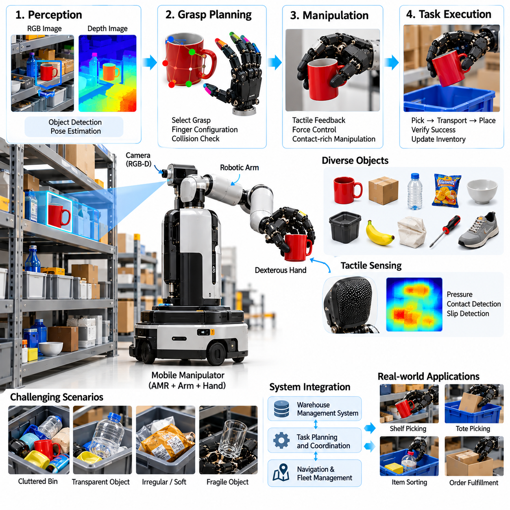{width="7.268055555555556in" height="7.268055555555556in"}

정교한 로봇 손을 이용한 창고 피킹(Warehouse Picking with Dexterous Robotic Hands)은 물류 자동화(Logistics Automation) 분야에서 피지컬 인공지능(Physical Artificial Intelligence)의 중요한 응용 사례이다. 표준화된 포장물을 위해 설계된 기존 그리퍼(Conventional Grippers)와 달리, 정교한 로봇 손(Dexterous Hands)은 다양한 형상(Shapes), 크기(Sizes), 표면 특성(Surface Properties)을 가진 물체를 조작할 수 있는 잠재력을 제공한다. 이러한 기술의 가치는 경직된 자동화(Rigid Automation)를 적용하기 어려운 혼합 재고(Mixed Inventory)를 처리하는 데 있다. 성공적인 배포(Deployment)를 위해서는 인식(Perception), 파지 계획(Grasp Planning), 접촉 제어(Contact Control), 창고 관리 시스템(Warehouse Management Systems)의 통합이 필요하다.

창고 환경(Warehouse Environments)은 재고가 자주 변경되고 물체가 복잡하게 배치된 빈(Bins), 선반(Shelves), 컨테이너(Containers)에 보관되기 때문에 상당한 조작 과제(Manipulation Challenges)를 발생시킨다. 제품은 투명(Transparent), 반사성(Reflective), 변형 가능(Deformable), 파손되기 쉬운(Fragile), 불규칙한 형상(Irregularly Shaped)을 가질 수 있다. 포장재(Packaging Materials) 역시 파지의 마찰(Friction)과 안정성(Stability)을 변화시킬 수 있다. 따라서 정교한 피킹 시스템(Dexterous Picking System)은 개별 물체를 인식하고 접근 가능한 접촉 영역(Accessible Contact Regions)을 추정하며 물리적 특성(Physical Characteristics)에 적합한 조작 전략(Manipulation Strategies)을 선택해야 한다.

일반적인 창고 피킹 시스템(Warehouse Picking System)은 로봇 팔(Robotic Arms), 정교한 말단효과기(Dexterous End Effectors), 카메라(Cameras), 컴퓨팅 하드웨어(Computing Hardware), 작업 조정 소프트웨어(Task Coordination Software)를 결합한다. 로봇 팔은 목표 물체(Target Item) 근처에 손을 위치시키고, 손가락은 접촉을 형성하고 유지한다. 비전 시스템(Vision Systems)은 물체를 식별하고 보관 공간(Storage Spaces) 내 위치를 추정한다. 상위 수준 소프트웨어(Higher-Level Software)는 피킹 주문(Picking Orders), 목적지 컨테이너(Destination Containers), 재고 갱신(Inventory Updates)을 조정하여 물리적 조작(Physical Manipulation)을 창고 운영(Warehouse Operations)과 연결한다.

시각 인식(Visual Perception)은 로봇이 주변 재고(Surrounding Inventory)에서 목표 제품(Target Products)을 구별해야 하므로 기본적인 요소이다. RGB 카메라(RGB Cameras)는 외형 정보(Appearance Information)를 제공하고, 깊이 센서(Depth Sensors)는 3차원 기하학적 구조(Three-Dimensional Geometry)와 공간적 관계(Spatial Relationships)를 추정한다. 객체 탐지(Object Detection)와 분할(Segmentation)은 후보 물체(Candidate Items)를 식별하며, 자세 추정(Pose Estimation)은 파지 계획(Grasp Planning)을 지원한다. 그러나 가려짐(Occlusion)과 밀집된 물체(Tightly Packed Objects)는 가시성을 제한할 수 있으므로 조작을 시작하기 전에 능동 인식(Active Perception)이나 대체 관측 시점(Alternative Viewpoints)이 필요할 수 있다.

파지 계획(Grasp Planning)은 로봇 손이 물체에 접근하고 안정적으로 잡는 방법을 결정한다. 계획기(Planner)는 후보 접촉점(Candidate Contact Points), 손가락 구성(Finger Configurations), 충돌 제약(Collision Constraints), 예상 파지 안정성(Expected Grasp Stability)을 평가한다. 정밀 파지(Precision Grasps)는 작은 제품에 적합할 수 있으며, 감싸기 파지(Enveloping Grasps)는 크거나 불규칙한 물체를 지지할 수 있다. 정교한 로봇 손(Dexterous Hands)은 단순한 평행 조 그리퍼(Parallel-Jaw Grippers)보다 다양한 구성을 제공하지만, 이러한 유연성은 계획 복잡성(Planning Complexity)과 계산 요구사항(Computational Requirements)도 증가시킨다.

촉각 센싱(Tactile Sensing)은 외부 카메라(External Cameras)가 접촉 과정에서 신뢰성 있게 포착할 수 없는 정보를 제공한다. 손가락 센서(Finger Sensors)는 압력 분포(Pressure Distribution), 접촉 위치(Contact Location), 물체 미끄러짐(Object Slipping)과 관련된 변화를 측정할 수 있다. 이러한 피드백(Feedback)을 통해 제어기(Controller)는 파지력(Grip Forces)을 조절하고 불확실한 재료 특성(Uncertain Material Properties)을 보상할 수 있다. 파손되기 쉬운 상품(Fragile Merchandise)의 경우 촉각 제어(Tactile Control)는 손상 위험을 줄일 수 있으며, 무거운 물체(Heavier Objects)는 운반 중 우발적인 이탈(Accidental Release)을 방지하기 위해 충분한 힘이 필요하다.

접촉 중심 조작(Contact-Rich Manipulation)은 물체를 직접 파지하기 어려운 상황에서 특히 중요해진다. 로봇은 물체를 들어 올리기 전에 주변 물체(Neighboring Items)를 밀어내거나 제품을 회전시키거나 위치를 변경해야 할 수 있다. 정교한 손가락(Dexterous Fingers)은 말단효과기(End Effectors)를 교체하지 않고도 이러한 준비 동작(Preparatory Movements)을 수행할 수 있는 잠재력을 제공한다. 그러나 이러한 작업에는 정확한 접촉 추론(Contact Reasoning)과 신중한 힘 조절(Force Regulation)이 필요하며, 재고 손상(Inventory Damage)이나 주변 물체의 불필요한 교란(Unnecessary Disturbance)을 방지해야 한다.

학습 기반 파지 방법(Learning-Based Grasping Methods)은 다양한 제품 범주(Product Categories)에 대한 적응성(Adaptability)을 개선할 수 있다. 시연 학습(Demonstration Learning)은 성공적인 피킹 행동(Successful Picking Actions)의 사례를 제공하며, 강화학습(Reinforcement Learning)은 반복적인 상호작용(Repeated Interaction)을 통해 조작 정책(Manipulation Policies)을 최적화할 수 있다. 시뮬레이션 환경(Simulation Environments)은 물체 형상(Object Geometry), 마찰(Friction), 배치(Placement)의 변화를 포함한 학습을 가능하게 한다. 그러나 학습된 정책을 실제 창고(Physical Warehouses)에 전이하려면 센서 노이즈(Sensor Noise), 기계적 차이(Mechanical Differences), 예상하지 못한 접촉 동역학(Unexpected Contact Dynamics)을 고려해야 한다.

파운데이션 모델(Foundation Models)과 시각-언어-행동 시스템(Vision-Language-Action Systems)은 창고 피킹(Warehouse Picking)에 대한 또 다른 접근법을 제공한다. 이러한 모델은 제품 범주(Product Categories), 속성(Attributes), 의미론적 관계(Semantic Relationships)를 포함한 명령을 해석할 수 있다. 특정 물품을 회수하라는 요청은 시각적 인식(Visual Recognition)과 작업 수준 추론(Task-Level Reasoning)을 결합해야 할 수 있다. 그러나 의미론적 이해(Semantic Understanding)는 신뢰할 수 있는 파지 실행(Reliable Grasp Execution)과 연결되어야 하며, 접촉 안정성(Contact Stability), 충돌 회피(Collision Avoidance), 액추에이터 안전(Actuator Safety)을 위해서는 여전히 하위 수준 제어기(Low-Level Controllers)가 필요하다.

실용적인 피킹 사이클(Picking Cycle)은 창고 관리 시스템(Warehouse Management System)이 물품 회수 작업(Retrieval Task)을 할당하면서 시작된다. 로봇은 보관 위치(Storage Location)를 식별하고 목표 물체(Target Object)에 접근하여 후보 파지(Candidate Grasps)를 평가한다. 접촉을 형성한 후 로봇 손은 물체를 들어 올려 지정된 목적지(Designated Destination)로 운반한다. 시스템은 성공적인 배치(Successful Placement)를 확인하고 재고 기록(Inventory Record)을 갱신한다. 각 단계는 오류 감지(Error Detection)를 지원해야 하며, 실패가 잘못된 주문(Incorrect Orders)이나 제품 손상(Damaged Products)으로 이어질 수 있기 때문이다.

모바일 매니퓰레이터(Mobile Manipulators)는 창고 피킹을 고정형 로봇 작업대(Fixed Robotic Workstations) 밖으로 확장한다. 자율 이동 플랫폼(Autonomous Mobile Platform)은 보관 위치(Storage Locations) 사이를 이동하고, 로봇 팔(Robotic Arm)과 정교한 손(Dexterous Hand)은 물품 회수(Item Retrieval)를 수행할 수 있다. 이러한 구성은 광범위한 컨베이어 인프라(Conveyor Infrastructure)의 필요성을 줄일 수 있다. 그러나 좁은 통로(Narrow Aisles)와 혼잡한 운영 환경(Crowded Operating Environments)에서 신뢰할 수 있는 조작을 유지하려면 내비게이션 정확도(Navigation Accuracy), 위치 추정(Localization), 플랫폼 안정성(Platform Stability), 로봇 팔 도달 가능성(Arm Reachability)을 협응해야 한다.

창고 피킹(Warehouse Picking)은 다양한 재고 조건(Diverse Inventory Conditions)에서 파지 실패(Unsuccessful Grasps)를 완전히 피할 수 없으므로 강건한 복구 전략(Robust Recovery Strategies)이 필요하다. 로봇은 미끄러짐(Slipping), 불완전한 들어 올리기(Incomplete Lifting), 물체 오인식(Object Misidentification), 예상하지 못한 충돌(Unexpected Collisions)을 감지할 수 있다. 복구 행동(Recovery Actions)에는 손가락 위치 조정(Adjusting Finger Positions), 다른 파지 선택(Selecting Another Grasp), 카메라 관측 시점 변경(Changing Camera Viewpoints), 인간 지원 요청(Requesting Human Assistance)이 포함될 수 있다. 효과적인 복구(Effective Recovery)는 운영 중단(Operational Interruptions)을 줄이고 자율 피킹 시스템(Autonomous Picking Systems)의 실용적 가치를 높인다.

안전 고려사항(Safety Considerations)은 조작 하드웨어(Manipulation Hardware)와 주변 물류 환경(Surrounding Logistics Environment)을 모두 포함한다. 로봇은 창고 작업자(Warehouse Workers), 이동 장비(Mobile Equipment), 밀집된 재고(Densely Packed Inventory) 근처에서 작동할 수 있다. 힘 제한(Force Limits), 충돌 감시(Collision Monitoring), 제어된 정지(Controlled Stopping), 안전한 운동 계획(Safe Motion Planning)은 물리적 위험(Physical Risks)을 줄이는 데 도움이 된다. 특히 무겁거나 날카롭거나 파손되기 쉬운 제품(Heavy, Sharp, or Fragile Products)을 취급할 때는 물체 낙하(Object Dropping)와 선반과의 의도하지 않은 접촉(Unintended Contact with Shelving)도 고려해야 한다.

성능 평가(Performance Evaluation)는 파지 성공률(Grasp Success Rate)을 넘어 전체 운영 결과(Complete Operational Outcomes)를 포함해야 한다. 관련 지표(Metrics)에는 시간당 성공적인 피킹 수(Successful Picks per Hour), 사이클 시간(Cycle Time), 물품 손상률(Item Damage Rate), 주문 정확도(Order Accuracy), 복구 빈도(Recovery Frequency), 시스템 가용성(System Availability)이 포함된다. 시험은 신중하게 선택된 물체만이 아니라 대표적인 제품 분포(Representative Product Distributions)를 대상으로 수행해야 한다. 여러 교대 근무(Multiple Shifts)에 걸친 지속적인 운영(Sustained Operation)은 짧은 시연(Short Demonstrations)보다 실제 배포 준비도(Deployment Readiness)를 평가하는 데 더 의미 있는 근거를 제공한다.

정교한 피킹(Dexterous Picking)의 경제적 가치(Economic Value)는 향상된 조작 유연성(Manipulation Flexibility)이 높은 하드웨어 및 제어 비용(Hardware and Control Costs)을 상쇄할 수 있는지에 따라 결정된다. 다지 로봇 손(Multifinger Hands)은 단순한 그리퍼(Simpler Grippers)에 비해 추가 액추에이터(Actuators), 센서(Sensors), 보정(Calibration), 유지보수(Maintenance)가 필요할 수 있다. 하나의 특수 도구(Specialized Tool)로 효율적으로 처리하기 어려운 다양한 제품을 취급하는 창고에서는 이러한 장점이 더욱 중요해진다. 따라서 활용률(Utilization), 처리량(Throughput), 유지보수 비용(Maintenance Expenses)은 투자수익률(Return on Investment)에 영향을 미친다.

시스템 통합(System Integration)은 로봇 피킹(Robotic Picking)이 창고 관리 시스템(Warehouse Management Systems), 주문 처리(Order Processing), 재고 데이터베이스(Inventory Databases)와 상호작용해야 하므로 필수적이다. 작업 할당(Task Assignments)에는 제품 식별 정보(Product Identity), 보관 위치(Storage Location), 목적지(Destination), 취급 제약(Handling Constraints)이 포함되어야 한다. 실행 피드백(Execution Feedback)은 성공적인 물품 회수(Successful Retrieval), 배치 확인(Placement Confirmation), 감지된 예외(Detected Exceptions)를 보고해야 한다. 신뢰할 수 있는 데이터 교환(Reliable Data Exchange)은 물리적 재고(Physical Inventory)와 디지털 기록(Digital Records) 사이의 불일치를 방지하고 추적성(Traceability)과 운영 협응(Operational Coordination)을 지원한다.

주요 공학적 과제(Engineering Challenge) 중 하나는 조작 범용성(Manipulation Versatility)과 실행 속도(Execution Speed) 사이의 균형을 유지하는 것이다. 정교한 로봇 손(Dexterous Hands)은 복잡한 파지(Complex Grasps)를 지원할 수 있지만, 추가적인 손가락 운동(Finger Movements)과 접촉 검증(Contact Verification)은 사이클 시간(Cycle Time)을 증가시킬 수 있다. 하이브리드 솔루션(Hybrid Solutions)은 필요에 따라 정교한 손을 흡착 방식(Suction) 또는 특수 파지 도구(Specialized Gripping Tools)와 결합할 수 있다. 최적의 말단효과기 전략(Optimal End-Effector Strategy)은 제품 다양성(Product Diversity), 요구 처리량(Required Throughput), 손상 민감도(Damage Sensitivity), 예외 처리 비용(Cost of Handling Exceptions)에 따라 달라진다.

확장성(Scalability)은 로봇 군집 협응(Fleet Coordination), 예지보전(Predictive Maintenance), 로봇 간 일관된 성능(Consistent Performance Across Robotic Units)에 관한 추가 요구사항을 발생시킨다. 보정 차이(Calibration Differences)와 기계적 마모(Mechanical Wear)로 인해 동일한 정책(Identical Policies)도 서로 다른 로봇 손에서 다르게 작동할 수 있다. 중앙 집중식 모니터링(Centralized Monitoring)은 반복적인 실패(Recurring Failures)를 식별하고 체계적인 개선(Systematic Improvement)을 지원할 수 있다. 표준화된 인터페이스(Standardized Interfaces), 모듈형 하드웨어(Modular Hardware), 재현 가능한 시험 절차(Reproducible Testing Procedures)는 창고 자동화(Warehouse Automation)를 확장하는 과정의 복잡성을 줄이는 데 도움이 된다.

정교한 로봇 손을 이용한 창고 피킹(Warehouse Picking with Dexterous Hands)은 경직된 산업 자동화(Rigid Industrial Automation)에서 적응형 피지컬 지능(Adaptable Physical Intelligence)으로 전환하는 과정을 보여준다. 성공적인 시스템은 시각 인식(Visual Perception), 의미론적 이해(Semantic Understanding), 파지 계획(Grasp Planning), 촉각 피드백(Tactile Feedback), 신뢰할 수 있는 운영 통합(Reliable Operational Integration)을 결합해야 한다. 핵심적인 공학적 교훈은 정교한 조작 능력(Dexterity)이 측정 가능한 창고 운영 성과(Measurable Warehouse Outcomes)를 개선할 때에만 가치를 창출한다는 점이다. 향후 발전은 강건한 일반화(Robust Generalization), 효율적인 제어(Efficient Control), 신뢰할 수 있는 복구(Reliable Recovery), 경제적으로 지속 가능한 배포(Economically Sustainable Deployment)에 달려 있다.

## 15.10 Hospital Logistics Applications

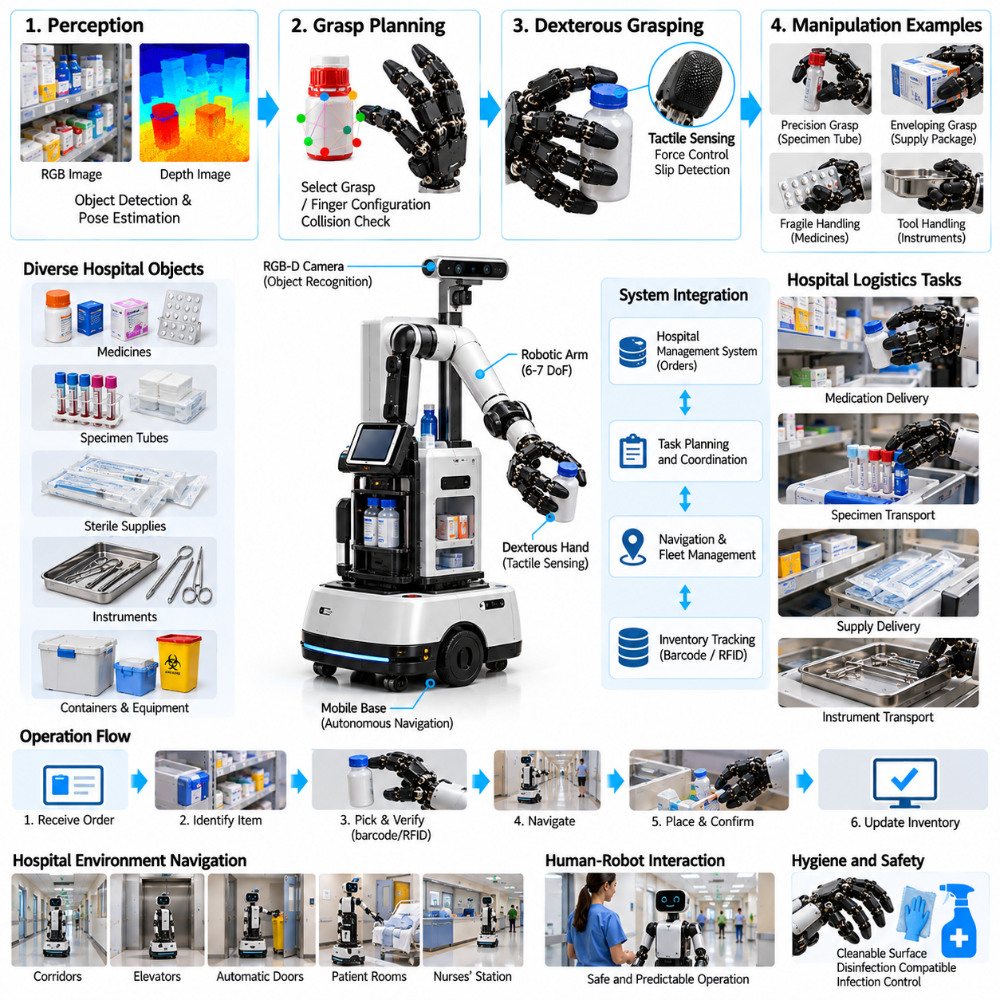{width="7.268055555555556in" height="7.268055555555556in"}

병원 물류(Hospital Logistics)는 의료 자동화(Healthcare Automation) 분야에서 정교한 로봇 손(Dexterous Robotic Hands)을 활용할 수 있는 유망한 응용 분야이다. 병원에서는 의약품(Medicines), 검사실 검체(Laboratory Samples), 멸균 물품(Sterile Supplies), 의료 장비(Medical Equipment)의 지속적인 운송과 취급이 필요하다. 기존 산업 환경(Industrial Environments)과 달리 이러한 작업에는 다양한 물체(Diverse Objects), 엄격한 위생 요구사항(Hygiene Requirements), 빈번한 인간 상호작용(Human Interaction)이 포함된다. 정교한 로봇 손은 자율 모바일 조작 시스템(Autonomous Mobile Manipulation Systems)과 통합될 때 물체 취급의 유연성(Handling Flexibility)을 향상시킬 수 있다.

병원 물류 작업(Hospital Logistics Tasks)은 물체 형상(Object Geometry), 포장(Packaging), 파손 가능성(Fragility), 취급 제약(Handling Constraints)에서 상당한 차이를 보인다. 의약품 용기(Medication Containers), 검체 튜브(Specimen Tubes), 의료 물품 포장(Supply Packages), 의료기구 트레이(Instrument Trays)는 서로 다른 파지 구성(Grasp Configurations)을 요구한다. 일부 물체는 수직 상태(Upright Position)를 유지해야 하며, 다른 물체는 신중한 방향 제어(Orientation Control)나 제한된 접촉력(Limited Contact Force)이 필요하다. 따라서 범용 로봇 손(General-Purpose Robotic Hand)은 각 물품의 물리적 특성(Physical Characteristics)과 운영 요구사항(Operational Requirements)에 맞게 파지 전략(Grasp Strategy)을 조정해야 한다.

병원 물류 로봇(Hospital Logistics Robot)은 일반적으로 모바일 베이스(Mobile Base), 로봇 팔(Robotic Arm), 정교한 말단효과기(Dexterous End Effector), 인식 센서(Perception Sensors), 작업 관리 소프트웨어(Task Management Software)를 결합한다. 모바일 플랫폼(Mobile Platform)은 지정된 장소 사이에서 물품을 운송하고, 로봇 팔은 물체를 집거나 배치하기 위해 손의 위치를 조정한다. 상위 수준 소프트웨어(Higher-Level Software)는 배송 요청(Delivery Requests), 목적지 확인(Destination Verification), 작업 완료 기록(Task Completion Records)을 관리한다. 신뢰할 수 있는 작동을 위해서는 물리적 조작(Physical Manipulation)과 병원 업무 흐름 시스템(Hospital Workflow Systems)의 통합이 필요하다.

시각 인식(Visual Perception)은 로봇이 보관 캐비닛(Storage Cabinets), 카트(Carts), 배송 스테이션(Delivery Stations) 내부의 목표 물체(Target Objects)를 식별하고 위치를 추정하도록 한다. RGB 카메라(RGB Cameras)는 외형 정보(Appearance Information)를 제공하며, 깊이 센서(Depth Sensors)는 기하학적 추정(Geometric Estimation)과 파지 계획(Grasp Planning)을 지원한다. 객체 탐지(Object Detection)와 분할(Segmentation)은 요청된 물품을 주변 물품과 구별한다. 그러나 투명 용기(Transparent Containers), 반사성 포장(Reflective Packaging), 부분적으로 가려진 물체(Partially Occluded Objects)는 인식 정확도(Perception Accuracy)를 낮출 수 있으므로 추가적인 센싱(Sensing)이나 검증(Verification)이 필요할 수 있다.

파지 계획(Grasp Planning)은 물체 형상(Object Shape), 무게(Weight), 표면 마찰(Surface Friction), 접근 가능성(Accessibility)을 고려해야 한다. 작은 검체 튜브(Specimen Tube)는 정밀 집기 파지(Precision Pinch Grasp)가 필요할 수 있으며, 큰 의료 물품 용기(Supply Container)는 감싸기 파지(Enveloping Grasp)가 유리할 수 있다. 로봇은 필요한 경우 라벨(Labels), 밀봉 부위(Seals), 민감한 표면(Sensitive Surfaces)을 피하는 접촉 영역(Contact Regions)을 선택해야 한다. 안정적인 파지 실행(Stable Grasp Execution)은 적절한 접근 기하학(Approach Geometry), 충돌 회피(Collision Avoidance), 밀집된 보관 공간(Crowded Storage Areas)에서의 충분한 여유 공간(Clearance)에도 영향을 받는다.

촉각 센싱(Tactile Sensing)은 접촉력(Contact Forces)과 물체 안정성(Object Stability)의 변화를 감지하여 취급 신뢰성(Handling Reliability)을 향상시킬 수 있다. 손가락에 장착된 센서(Finger-Mounted Sensors)는 압력 분포(Pressure Distribution), 접촉 위치(Contact Location), 미끄러짐(Slipping)에 관한 정보를 제공할 수 있다. 이러한 피드백(Feedback)은 물체 특성(Object Properties)에 따라 파지력(Grip Forces)을 조절하도록 한다. 파손되기 쉬운 용기(Fragile Containers)는 제한된 압력(Limited Pressure)이 필요하며, 무거운 장비(Heavier Equipment)는 더 강한 파지력이 요구될 수 있다. 접촉 센싱(Contact Sensing)은 시각 관측(Visual Observations)으로 정확한 상호작용 조건(Interaction Conditions)을 파악할 수 없을 때 특히 유용하다.

위생(Hygiene)과 오염 관리(Contamination Control)는 로봇 손 설계(Robotic Hand Design)에 추가적인 요구사항을 부과한다. 접촉 표면(Contact Surfaces)은 승인된 세척 절차(Approved Cleaning Procedures)와 선택된 소독제(Disinfectants)에 적합해야 한다. 기계적 관절(Mechanical Joints), 노출된 케이블(Exposed Cables), 복잡한 손가락 구조(Complex Finger Structures)는 세척하기 어려운 영역을 만들 수 있다. 따라서 정교한 메커니즘(Dexterous Mechanism)이 임상 환경(Clinical Use)에 본질적으로 적합하다고 가정하기보다 재료(Materials)와 보호 덮개(Protective Coverings)의 세척 용이성(Cleanability), 내구성(Durability), 병원 감염 예방 절차(Hospital Infection Prevention Procedures)와의 적합성을 평가해야 한다.

멸균 물품(Sterile Supplies)은 포장 무결성(Package Integrity)을 유지하는 것이 필수적이므로 특히 신중하게 취급해야 한다. 로봇 손은 밀봉된 멸균 포장(Sealed Sterile Packages)을 운송할 수 있지만, 보호 장벽(Protective Barriers)에 구멍을 내거나 압축하거나 손상시키지 않아야 한다. 멸균 포장의 외부 표면(Exterior of a Sterile Package)과 접촉한다고 해서 로봇 손의 멸균 상태(Sterility)가 보장되는 것은 아니다. 멸균 영역(Sterile Fields)과 직접 상호작용하는 작업에는 별도의 검증(Validation), 통제된 절차(Controlled Procedures), 적용 가능한 임상 요구사항(Applicable Clinical Requirements)의 준수가 필요하다.

의약품 물류(Medication Logistics)에는 식별(Identification), 추적성(Traceability), 접근 제어(Access Control)에 관한 과제가 존재한다. 의약품 포장(Medication Packages)을 취급하는 로봇은 선택한 물품이 승인된 배송 요청(Authorized Delivery Request)과 일치하는지 확인해야 한다. 바코드(Barcode) 또는 무선주파수 식별(Radio-Frequency Identification, RFID) 시스템은 시각 인식(Visual Recognition)을 보완하고 재고 추적(Inventory Tracking)을 지원할 수 있다. 그러나 물체 식별(Object Identification)만으로 의약품의 정확성(Medication Correctness)이나 취급 권한(Authorization)이 보장되지는 않는다. 병원 절차(Hospital Procedures)는 조제 및 불출(Dispensing), 보관 책임(Custody), 배송 확인(Delivery Confirmation), 예외 처리(Exception Handling)를 관리해야 한다.

검사실 검체 운송(Laboratory Specimen Transportation)에서는 용기 안정성(Container Stability), 누출 방지(Leakage Prevention), 취급 조건(Handling Conditions)에 주의해야 한다. 검체 튜브(Specimen Tubes)와 운송 용기(Transport Containers)는 수직 상태를 유지하거나 지정된 환경 한계(Environmental Limits) 내에 있어야 할 수 있다. 로봇 손은 들어 올리기(Lifting)와 배치(Placement) 과정에서 과도한 압축(Excessive Compression)과 급격한 가속(Sudden Acceleration)을 피해야 한다. 생물학적 위해(Biological Hazards)가 존재하는 경우 로봇의 조작 능력(Manipulation Capabilities)과 관계없이 승인된 이차 밀폐 용기(Approved Secondary Containment)와 기관의 생물안전 절차(Institutional Biosafety Procedures)가 필요하다.

모바일 조작(Mobile Manipulation)은 고정형 컨베이어 인프라(Fixed Conveyor Infrastructure) 없이 병원 물류 로봇이 물품을 회수하고 배송할 수 있도록 한다. 내비게이션 시스템(Navigation Systems)은 로봇을 복도(Corridors)와 지정된 서비스 구역(Designated Service Areas)으로 안내하며, 로봇 팔과 손은 국소적인 물체 취급(Local Handling Tasks)을 수행한다. 엘리베이터(Elevators), 자동문(Automatic Doors), 접근 통제 공간(Access-Controlled Spaces)은 추가적인 인프라 통합(Infrastructure Integration)이 필요할 수 있다. 신뢰할 수 있는 작동은 내비게이션(Navigation), 위치 결정(Positioning), 조작(Manipulation), 병원 시스템과의 통신(Communication)의 협응에 달려 있다.

인간-로봇 상호작용(Human-Robot Interaction)은 병원 환경(Hospital Environments)에 환자(Patients), 의료진(Clinical Staff), 방문객(Visitors), 이동형 의료 장비(Mobile Medical Equipment)가 존재하기 때문에 특히 중요하다. 로봇은 예측 가능한 방식(Predictable Manner)으로 작동하고 중요한 업무 흐름(Critical Workflows)을 방해하지 않아야 한다. 속도 제한(Speed Limits), 장애물 감지(Obstacle Detection), 제어된 정지(Controlled Stopping), 적절한 인간 감독(Human Supervision)은 운영 안전(Operational Safety)에 기여한다. 조작 작업(Manipulation Tasks)은 물체 낙하(Dropped Objects), 의도하지 않은 접촉(Unintended Contact), 주변 의료 활동(Nearby Medical Activities)에 대한 간섭 위험도 최소화해야 한다.

학습 기반 조작(Learning-Based Manipulation)은 로봇이 의료 포장(Medical Packaging)과 물품 배치(Supply Arrangements)의 변화에 적응하도록 도울 수 있다. 시연 학습(Demonstration Learning)은 성공적인 파지(Grasping)와 배치(Placement)의 사례를 제공할 수 있으며, 시뮬레이션(Simulation)은 다양한 물체 구성(Object Configurations)에 대한 학습을 지원할 수 있다. 그러나 학습 기반 정책(Learning-Based Policies)은 익숙하지 않은 조건(Unfamiliar Conditions)에서 실패할 수 있으므로 병원 배포(Hospital Deployment)에는 통제된 검증(Controlled Validation)이 필요하다. 안전 필수 취급(Safety-Critical Handling)에는 명시적인 제약(Explicit Constraints)과 신뢰할 수 있는 대체 절차(Reliable Fallback Procedures)가 포함되어야 한다.

작업 실행(Task Execution)에는 각 조작 작업(Manipulation Operation)의 전후에 검증(Verification)이 포함되어야 한다. 로봇은 물체 식별 정보(Object Identity)를 확인하고, 예정된 목적지(Intended Destination)를 검사하며, 파지를 실행하고, 성공적인 배치(Successful Placement)를 검증할 수 있다. 센서(Sensors)는 불완전한 들어 올리기(Incomplete Lifting), 예상하지 못한 움직임(Unexpected Motion), 물체 이탈(Object Release)을 감지할 수 있다. 신뢰도(Confidence)가 충분하지 않으면 시스템은 불확실한 취급(Uncertain Handling)을 계속하기보다 정지하거나 지원을 요청해야 한다. 이러한 절차는 추적성(Traceability)을 지원하고 조작 오류(Manipulation Errors)의 결과를 줄인다.

성능 평가(Performance Evaluation)는 로봇의 능력(Robotic Capability)과 병원 업무 흐름의 성과(Hospital Workflow Outcomes)를 모두 고려해야 한다. 관련 지표(Metrics)에는 배송 성공률(Successful Delivery Rate), 물체 손상률(Object Damage Rate), 식별 정확도(Identification Accuracy), 작업 완료 시간(Task Completion Time), 복구 빈도(Recovery Frequency), 시스템 가용성(System Availability)이 포함된다. 추가적인 평가 항목으로 세척 시간(Cleaning Time), 오염 관리 준수(Contamination-Control Compliance), 직원 개입 요구사항(Staff Intervention Requirements)을 고려할 수 있다. 시험은 통제된 환경(Controlled Environments)에서 선별된 시연에만 의존하기보다 현실적인 운영 조건(Realistic Operating Conditions)을 반영해야 한다.

경제적 타당성(Economic Feasibility)은 자동화의 이점(Automation Benefits)과 전체 시스템 비용(Total System Costs) 사이의 관계에 따라 결정된다. 정교한 로봇 손(Dexterous Hands)은 취급 유연성(Handling Flexibility)을 높일 수 있지만, 추가적인 액추에이터(Actuators), 센서(Sensors), 유지보수 요구사항(Maintenance Requirements), 제어 복잡성(Control Complexity)을 발생시킨다. 병원은 이러한 유연성이 처리량(Throughput)을 개선하거나 수작업 취급(Manual Handling)을 충분히 줄여 투자(Investment)를 정당화할 수 있는지 평가해야 한다. 정교한 조작(Dexterous Manipulation)이 필요하지 않은 표준화된 배송(Standardized Deliveries)에서는 특수 그리퍼(Specialized Grippers)나 잠금식 운송 구획(Secured Transport Compartments)이 더 적합할 수 있다.

신뢰성(Reliability)과 유지보수 용이성(Maintainability)은 병원 물류 서비스(Hospital Logistics Services)가 장시간 교대 근무(Extended Shifts)에 걸쳐 운영될 수 있으므로 필수적이다. 반복적인 물체 취급(Repeated Handling)은 기계적 마모(Mechanical Wear), 센서 드리프트(Sensor Drift), 보정 변화(Calibration Changes)를 발생시킬 수 있다. 예방 정비(Preventive Maintenance)에는 손가락 메커니즘(Finger Mechanisms)의 점검, 힘 제한(Force Limits)의 검증, 세척으로 인한 재료 열화(Cleaning-Related Material Degradation)의 평가가 포함되어야 한다. 모듈형 교체(Modular Replacement)와 진단 모니터링(Diagnostic Monitoring)은 일관된 취급 성능(Consistent Handling Performance)을 지원하면서 가동 중단 시간(Downtime)을 줄일 수 있다.

시스템 통합(System Integration)은 로봇 작업 실행(Robotic Task Execution)을 병원 물류 소프트웨어(Hospital Logistics Software), 재고 기록(Inventory Records), 승인된 업무 절차(Authorized Workflow Procedures)와 연결해야 한다. 배송 요청(Delivery Requests)에는 물품 식별 정보(Item Identity), 목적지(Destination), 취급 제약(Handling Constraints), 확인 요구사항(Confirmation Requirements)이 명시되어야 한다. 실행 기록(Execution Records)은 불필요한 환자 정보(Patient Information)를 노출하지 않으면서 성공적인 물품 전달(Successful Transfers), 예외 사항(Exceptions), 개입 내역(Interventions)을 기록해야 한다. 병원 운영에는 민감한 시스템(Sensitive Systems)과 규제 대상 정보(Regulated Information)가 포함되므로 사이버보안(Cybersecurity), 접근 제어(Access Control), 데이터 보호(Data Protection)가 중요하다.

병원 물류 로봇 손 응용(Hospital Logistics Hand Applications)은 정교한 조작(Dexterous Manipulation)이 단순한 물품 운송(Simple Material Transportation)을 넘어 의료 자동화(Healthcare Automation)를 어떻게 확장할 수 있는지 보여준다. 성공적인 배포(Successful Deployment)를 위해서는 인식(Perception), 파지 계획(Grasp Planning), 촉각 제어(Tactile Control), 위생 공학(Hygiene Engineering), 업무 흐름 통합(Workflow Integration), 인간 안전(Human Safety) 사이의 협응이 필요하다. 핵심적인 공학적 교훈은 로봇의 정교한 조작 능력(Robotic Dexterity)이 기존 병원 절차(Established Hospital Procedures) 내에서 신뢰할 수 있고(Reliable), 추적 가능하며(Traceable), 임상적으로 적절한(Clinically Appropriate) 물품 취급을 개선할 때에만 실질적인 가치를 창출한다는 점이다.

## 15.11 Factory Assembly Applications

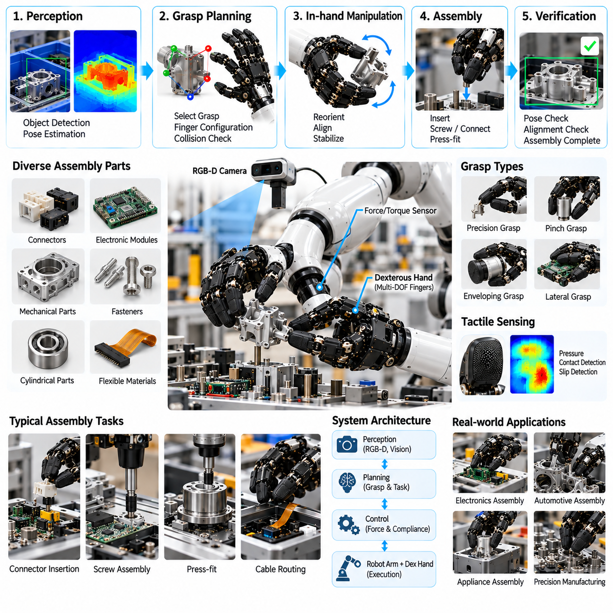{width="7.268055555555556in" height="7.268055555555556in"}

정교한 로봇 손을 이용한 공장 조립(Factory Assembly with Dexterous Robotic Hands)은 첨단 제조(Advanced Manufacturing) 분야에서 피지컬 인공지능(Physical Artificial Intelligence)의 중요한 응용 사례이다. 반복적인 물체 취급(Repetitive Handling)을 위해 설계된 기존 그리퍼(Conventional Grippers)와 달리, 정교한 로봇 손(Dexterous Hands)은 다양한 기하학적 형상(Geometries)과 조립 요구사항(Assembly Requirements)을 가진 부품을 조작할 수 있는 잠재력을 제공한다. 주요 장점은 변화하는 생산 작업(Production Tasks)에 대한 적응성(Adaptability)이다. 실제 배포(Practical Deployment)를 위해서는 인식(Perception), 파지 계획(Grasp Planning), 힘 제어(Force Control), 산업 자동화 시스템(Industrial Automation Systems)과의 통합이 필요하다.

조립 환경(Assembly Environments)은 부품을 정해진 공차(Tolerances) 내에서 위치시키고 결합해야 하므로 많은 운송 작업(Transportation Tasks)보다 높은 조작 정밀도(Manipulation Precision)를 요구한다. 작업에는 커넥터 삽입(Connector Insertion), 기계 부품 정렬(Mechanical Part Alignment), 체결 부품 취급(Fastener Handling), 유연한 재료 배치(Flexible Material Positioning)가 포함될 수 있다. 작은 기하학적 오차(Geometric Errors)도 간섭(Interference)이나 손상(Damage)을 발생시킬 수 있다. 따라서 정교한 로봇 손은 조립 과정 전반에서 적절한 접촉력(Contact Forces)을 유지하면서 손가락 운동(Finger Motion)과 로봇 팔 위치 결정(Arm Positioning)을 협응해야 한다.

일반적인 정교한 조립 시스템(Dexterous Assembly System)은 로봇 팔(Robotic Arm), 다지 로봇 손(Multifinger Hand), 시각 센서(Visual Sensors), 힘 센싱(Force Sensing), 산업용 제어 소프트웨어(Industrial Control Software)를 결합한다. 로봇 팔은 작업 위치(Working Position)를 설정하고, 개별 손가락은 부품을 파지(Grasp), 안정화(Stabilize), 재배치(Reposition)한다. 카메라(Cameras)는 조작 전에 물체의 위치(Location)와 방향(Orientation)을 추정한다. 상위 수준 제어기(Higher-Level Controllers)는 작업 순서(Task Sequences)를 조정하고 생산 장비(Production Equipment)와 통신하여 조립 작업이 기존 제조 업무 흐름(Manufacturing Workflows) 내에서 수행되도록 한다.

기계적 손 설계(Mechanical Hand Design)는 수행할 수 있는 조립 작업(Assembly Tasks)의 범위에 큰 영향을 미친다. 여러 개의 관절형 손가락(Articulated Fingers)은 작은 부품(Small Components), 원통형 부품(Cylindrical Parts), 불규칙한 물체(Irregular Objects)에 대해 다양한 접촉 구성(Contact Configurations)을 제공한다. 엄지 대향 운동(Thumb Opposition)은 정밀 집기(Precision Pinching)를 지원하며, 분산된 손가락 접촉(Distributed Finger Contact)은 큰 부품의 안정성을 개선한다. 그러나 관절 운동(Articulation)이 증가하면 액추에이터 복잡성(Actuator Complexity), 기계적 유연성(Mechanical Compliance), 보정 요구사항(Calibration Requirements), 추가적인 유지보수 고려사항(Maintenance Considerations)도 발생한다.

정밀 파지(Precision Grasping)는 커넥터(Connectors), 전자 모듈(Electronic Modules), 소형 기계 부품(Small Mechanical Components)을 취급할 때 특히 중요하다. 로봇은 삽입(Insertion)에 필요한 충분한 안정성(Stability)을 유지하면서 민감한 표면(Sensitive Surfaces)의 손상을 방지할 수 있는 접촉 위치(Contact Locations)를 선택해야 한다. 손가락 위치 정확도(Finger Positioning Accuracy), 반복 정밀도(Repeatability), 제어된 파지력(Controlled Gripping Force)은 부품이 올바른 방향(Orientation)을 유지하는지를 결정한다. 성공적인 조립(Successful Assembly)을 위해서는 국소적인 손가락 조정(Local Finger Adjustments)과 로봇 팔의 전체 운동(Larger Motion of the Robotic Arm) 사이의 협응이 필요하다.

시각 인식(Visual Perception)은 부품 식별(Component Identification), 자세 추정(Pose Estimation), 조립 상태 검사(Inspection of Assembly Conditions)를 지원한다. RGB 카메라(RGB Cameras)는 외형 정보(Appearance Information)를 제공하며, 깊이 센서(Depth Sensors)와 구조화 조명(Structured Illumination)은 기하학적 측정(Geometric Measurements)을 개선할 수 있다. 머신 비전(Machine Vision)은 정렬 특징(Alignment Features), 결합 표면(Mating Surfaces), 잠재적인 장애물(Potential Obstructions)을 식별할 수 있다. 그러나 반사성 금속(Reflective Metals), 작은 간극(Small Clearances), 부분적으로 가려진 접촉 영역(Partially Hidden Contact Regions)은 시각적 정확도(Visual Accuracy)를 제한할 수 있으므로 신뢰할 수 있는 조립을 위해 추가적인 센싱(Additional Sensing)이 필요할 수 있다.

힘 센싱(Force Sensing)과 촉각 센싱(Tactile Sensing)은 부품 사이의 물리적 접촉(Physical Contact)이 포함된 조립 작업에서 필수적이다. 손목 장착형 힘-토크 센서(Wrist-Mounted Force-Torque Sensors)는 상호작용 하중(Interaction Loads)을 측정하며, 손가락 센서(Finger Sensors)는 국소 압력(Local Pressure)과 접촉 변화(Contact Changes)를 감지할 수 있다. 이러한 측정값은 성공적인 결합(Successful Engagement)과 예상하지 못한 저항(Unexpected Resistance)을 구분하는 데 도움이 된다. 폐루프 힘 제어(Closed-Loop Force Control)는 삽입 중 과도한 하중(Excessive Loading)을 줄일 수 있지만, 센서 해상도(Sensor Resolution), 기계적 강성(Mechanical Stiffness), 제어 지연(Control Latency)은 달성 가능한 성능에 영향을 미친다.

컴플라이언스 제어(Compliance Control)는 로봇 시스템이 조립 과정에서 발생하는 작은 위치 오차(Positioning Errors)를 수용하도록 한다. 임피던스 제어(Impedance Control)는 운동(Motion)과 상호작용 힘(Interaction Force) 사이의 관계를 조절하며, 어드미턴스 제어(Admittance Control)는 측정된 힘(Measured Forces)에 따라 명령된 운동(Commanded Movement)을 조정한다. 이러한 방법은 커넥터 삽입(Connector Insertion), 정렬(Alignment), 제어된 표면 접촉(Controlled Surface Contact)을 지원할 수 있다. 그러나 안정적인 구현(Stable Implementation)을 위해서는 제어기 게인(Controller Gains), 액추에이터 동역학(Actuator Dynamics), 조작 대상 부품의 기계적 특성(Mechanical Properties)을 신중하게 조정해야 한다.

손안 조작(In-Hand Manipulation)은 물체를 놓지 않고 재배치할 수 있도록 하여 조립 유연성(Assembly Flexibility)을 확장한다. 협응된 손가락 운동(Coordinated Finger Movements)은 파지 상태(Grasp) 내에서 물체를 회전(Rotate), 병진 이동(Translate), 방향 변경(Reorient)할 수 있다. 이러한 능력은 반복적인 집기 및 배치 작업(Pick-and-Place Operations)을 줄이고 접근하기 어려운 조립 방향(Assembly Orientations)에 대한 접근성을 개선할 수 있다. 그러나 신뢰할 수 있는 손안 조작을 위해서는 정확한 접촉 추정(Contact Estimation), 마찰 관리(Friction Management), 변화하는 손가락-물체 접촉 구성(Finger-Object Contact Configurations)에 대한 계획(Planning)이 필요하다.

학습 기반 조작(Learning-Based Manipulation)은 모든 조립 운동(Assembly Movements)을 고정된 궤적(Fixed Trajectories)으로 프로그래밍하는 방식의 대안을 제공한다. 시연 학습(Demonstration Learning)은 성공적인 취급 전략(Handling Strategies)을 학습할 수 있으며, 강화학습(Reinforcement Learning)은 다양한 접촉 조건(Contact Conditions)에 대한 적응성(Adaptation)을 개선할 수 있다. 시뮬레이션(Simulation)은 기하학적 변화(Geometric Variations)와 재료 특성 변화(Material Variations)에 대한 정책 개발(Policy Development)을 지원할 수 있다. 그러나 단순화된 조건(Simplified Conditions)에서 학습한 정책(Policies)은 실제 기계적 공차(Mechanical Tolerances)와 예상하지 못한 외란(Unexpected Disturbances)에 노출되면 실패할 수 있으므로 산업 현장 배포(Industrial Deployment)에는 검증(Validation)이 필요하다.

조립 계획(Assembly Planning)은 개별 부품의 기하학적 구조(Geometry)뿐 아니라 부품이 결합되는 순서(Assembly Sequence)도 고려해야 한다. 로봇은 부품의 방향을 조정하고(Orient), 임시 지지(Temporary Support)를 형성하며, 결합 특징(Mating Features)을 정렬하고, 제어된 삽입력(Controlled Insertion Force)을 적용해야 할 수 있다. 각 단계에서는 접촉 조건(Contact Conditions)과 사용 가능한 운동(Available Motion)이 변화한다. 계층적 계획(Hierarchical Planning)은 작업 수준 의사결정(Task-Level Decisions)을 파지 선택(Grasp Selection), 운동 생성(Motion Generation), 접촉 인식 제어(Contact-Aware Control)와 협응하여 경직된 사전 정의 시퀀스(Rigid Predefined Sequences)에 대한 의존도를 줄일 수 있다.

양손 조작(Bimanual Manipulation)은 하나의 부품을 안정적으로 지지하면서 다른 부품을 삽입하거나 부착해야 하는 조립 작업에서 유용하다. 두 개의 로봇 손(Two Robotic Hands)은 지지(Holding)와 조작(Manipulation)의 역할을 분담하여 일부 전용 고정구(Dedicated Fixtures)를 대체할 수 있다. 그러나 협응된 양손 제어(Coordinated Bimanual Control)는 상대 위치 결정(Relative Positioning), 힘 분배(Force Distribution), 충돌 회피(Collision Avoidance)와 관련된 추가적인 과제를 발생시킨다. 전체 시스템은 두 매니퓰레이터(Manipulators)가 동기화된 행동(Synchronized Actions)을 수행하는 동안 안정적인 물체 지지(Stable Object Support)를 유지해야 한다.

산업 안전(Industrial Safety)은 로봇 손(Robotic Hands), 작업자(Workers), 부품(Components), 주변 기계(Surrounding Machinery) 사이의 상호작용을 신중하게 고려해야 한다. 끼임 지점(Pinch Points), 예상하지 못한 손가락 운동(Unexpected Finger Motion), 부품 낙하(Dropped Parts), 과도한 접촉력(Excessive Contact Forces)은 위험을 발생시킬 수 있다. 위험 감소(Risk Reduction)를 위해 보호 구역(Guarded Workspaces), 안전 등급 감시(Safety-Rated Monitoring), 비상 정지(Emergency Stopping), 제어된 운동 제한(Controlled Motion Limits)을 적용할 수 있다. 협동 작업(Collaborative Operation)에는 낮은 파지력(Low Gripping Forces)에만 의존하지 않고 응용 분야별 위험성 평가(Application-Specific Risk Assessment)와 적절한 보호 조치(Protective Measures)가 필요하다.

품질 보증(Quality Assurance)은 성공적인 파지(Successful Grasping)가 올바르게 조립된 제품(Correctly Assembled Products)으로 이어졌는지 검증해야 한다. 검사(Inspection)에는 치수 측정(Dimensional Measurements), 커넥터 결합 확인(Connector Engagement Checks), 토크 검증(Torque Verification), 기능 시험(Functional Testing)이 포함될 수 있다. 센서 기록(Sensor Records)은 삽입력(Insertion Forces), 정렬 상태(Alignment Conditions), 실행 결과(Execution Outcomes)에 대한 근거를 제공할 수 있다. 이러한 측정값을 제조 실행 시스템(Manufacturing Execution Systems)과 통합하면 추적성(Traceability)을 지원하고 후속 생산 단계(Subsequent Production Stages)로 진행하기 전에 불량 조립품(Defective Assemblies)을 식별할 수 있다.

성능 벤치마킹(Performance Benchmarking)은 개별 파지 성공(Isolated Grasp Success)이 아니라 전체 조립 결과(Complete Assembly Outcomes)를 평가해야 한다. 관련 지표(Metrics)에는 조립 성공률(Assembly Success Rate), 위치 정확도(Positional Accuracy), 사이클 시간(Cycle Time), 부품 손상(Component Damage), 재작업 빈도(Rework Frequency), 지속적인 시스템 가용성(Sustained System Availability)이 포함된다. 시험에는 현실적인 공차 변화(Realistic Tolerance Variations)와 대표적인 생산 조건(Representative Production Conditions)이 포함되어야 한다. 기존 그리퍼(Conventional Grippers)와 비교할 때는 조작 유연성(Manipulation Flexibility)과 다지 제어(Multifinger Control)로 인해 발생하는 추가적인 복잡성을 모두 고려해야 한다.

경제적 타당성(Economic Feasibility)은 정교한 로봇 손(Dexterous Hands)이 공구 교체(Tooling Changes), 인간 개입(Manual Intervention), 생산 재구성 비용(Production Reconfiguration Costs)을 줄일 수 있는지에 따라 결정된다. 다지 메커니즘(Multifinger Mechanisms)은 일반적으로 추가적인 액추에이터(Actuators), 센서(Sensors), 보정(Calibration), 유지보수(Maintenance)를 필요로 한다. 이러한 장점은 부품 다양성(Component Diversity)이 자주 변경되는 다품종 소량 생산(High-Mix, Low-Volume Manufacturing)에서 더욱 중요해진다. 반면 안정적인 대량 생산(Stable, High-Volume Production)에서는 특수 그리퍼(Specialized Grippers)와 고정구(Fixtures)가 여전히 더 경제적이며 빠른 사이클 시간(Faster Cycle Times)을 달성할 수 있다.

신뢰성 공학(Reliability Engineering)은 조립 시스템(Assembly Systems)이 반복적인 생산 사이클(Repeated Production Cycles) 전반에서 일관된 성능(Consistent Performance)을 유지해야 하므로 필수적이다. 손가락 관절(Finger Joints), 동력 전달 장치(Transmissions), 촉각 센서(Tactile Sensors), 전기적 연결부(Electrical Connections)는 마모(Wear)와 환경적 스트레스(Environmental Stress)를 받는다. 보정 드리프트(Calibration Drift)와 백래시(Backlash)는 시간이 지남에 따라 위치 정확도(Positioning Accuracy)를 저하시킬 수 있다. 예방 정비(Preventive Maintenance), 상태 감시(Condition Monitoring), 모듈형 부품 교체(Modular Component Replacement), 정기적인 성능 검증(Periodic Performance Verification)은 반복 정밀도(Repeatability)를 유지하고 예기치 않은 생산 중단(Unplanned Production Interruptions)을 줄이는 데 도움이 된다.

시스템 통합(System Integration)은 정교한 조작(Dexterous Manipulation)을 프로그래머블 로직 컨트롤러(Programmable Logic Controllers), 제조 실행 시스템(Manufacturing Execution Systems), 품질 데이터베이스(Quality Databases)와 연결한다. 작업 명령(Task Instructions)에는 부품 식별 정보(Component Identity), 조립 순서(Assembly Sequence), 기하학적 공차(Geometric Tolerances), 공정 제약(Process Constraints)이 명시되어야 한다. 실행 피드백(Execution Feedback)은 완료된 작업(Completed Operations), 감지된 고장(Detected Faults), 검사 결과(Inspection Results)를 보고해야 한다. 표준화된 인터페이스(Standardized Interfaces)와 신뢰할 수 있는 통신(Reliable Communication)은 로봇 조립 스테이션(Robotic Assembly Stations)이 협응된 생산 업무 흐름(Coordinated Production Workflows)에 참여하고 체계적인 공정 개선(Systematic Process Improvement)을 지원하도록 한다.

정교한 로봇 손을 이용한 공장 조립(Factory Assembly with Dexterous Hands)은 경직된 로봇 자동화(Rigid Robotic Automation)에서 적응형 접촉 인식 제조 지능(Adaptable, Contact-Aware Manufacturing Intelligence)으로 전환하는 과정을 보여준다. 성공적인 시스템은 기계적 정교함(Mechanical Dexterity), 시각 인식(Visual Perception), 촉각 센싱(Tactile Sensing), 정밀 제어(Precision Control), 생산 수준 검증(Production-Level Verification)을 결합해야 한다. 핵심적인 공학적 교훈은 유용한 정교한 조작 능력(Useful Dexterity)이 단순한 손가락 구조의 복잡성(Finger Complexity)이 아니라 조립 품질(Assembly Quality), 반복 정밀도(Repeatability), 운영 신뢰성(Operational Reliability), 경제적 성과(Economic Performance)를 통해 평가되어야 한다는 점이다.
