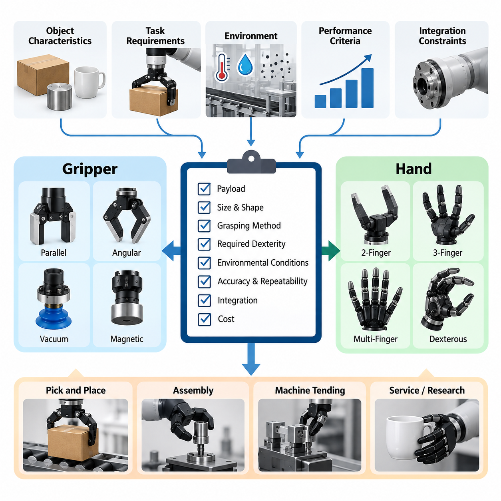
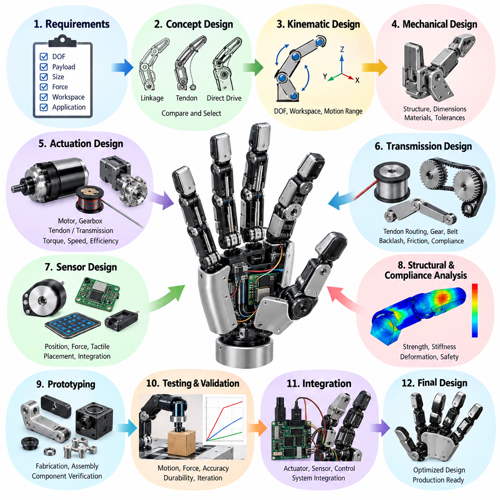
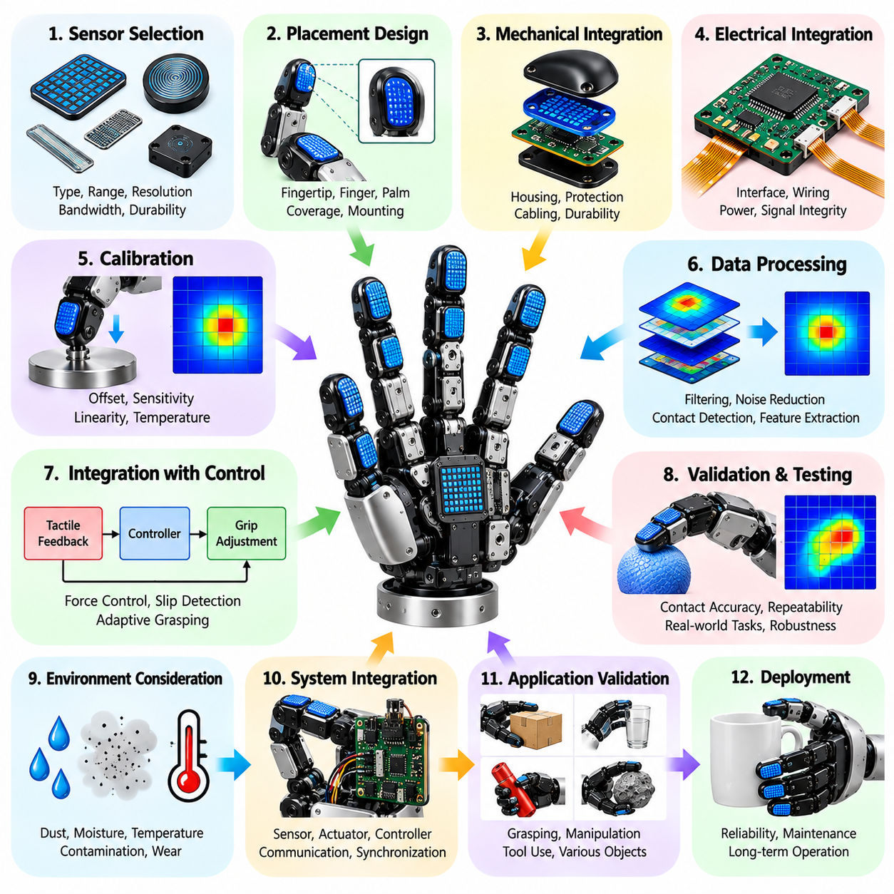
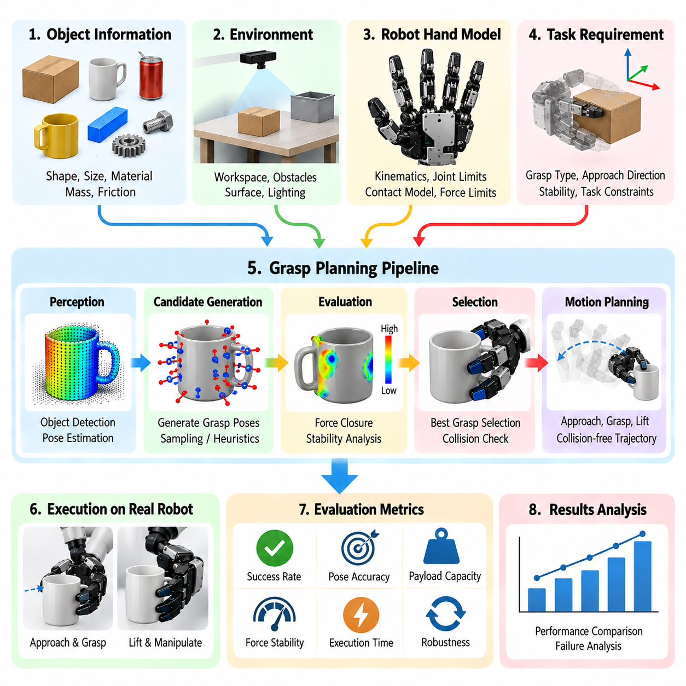
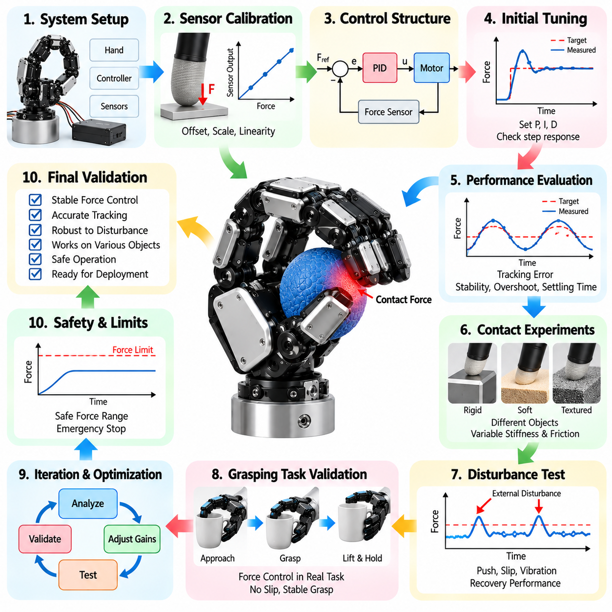
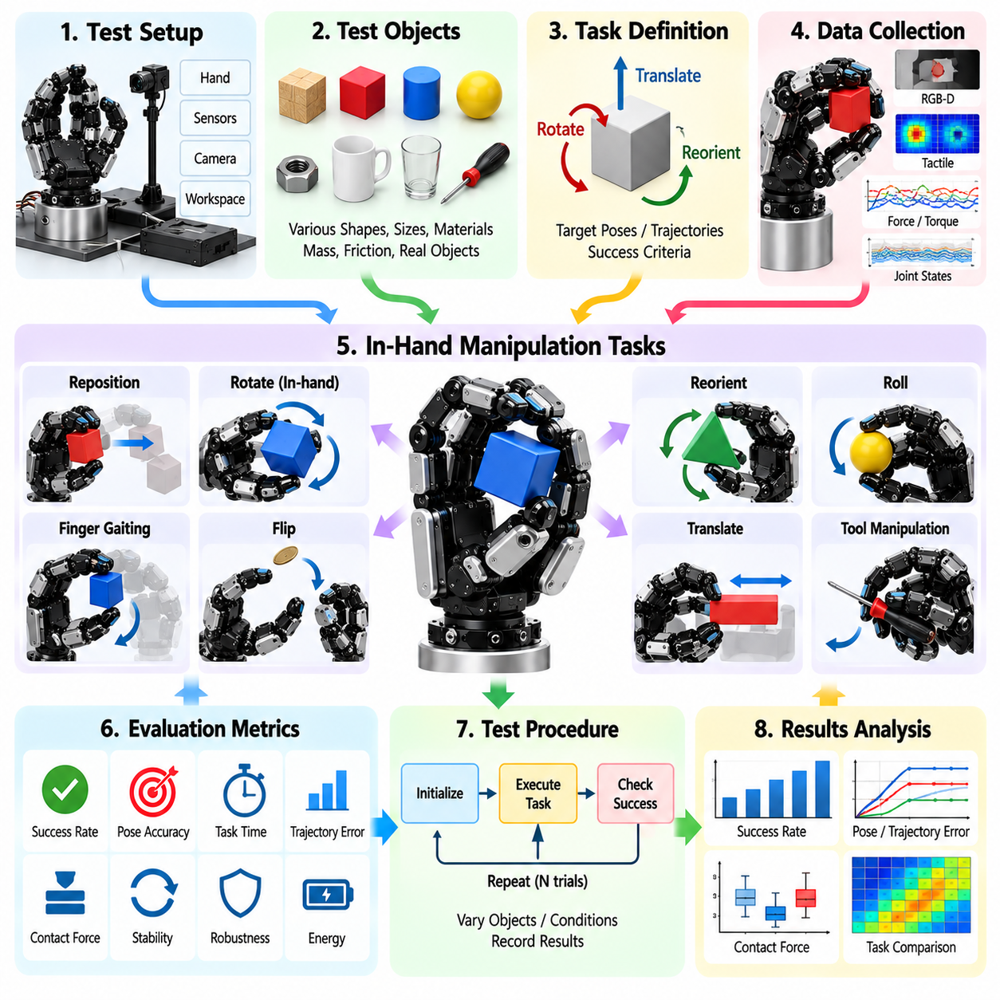
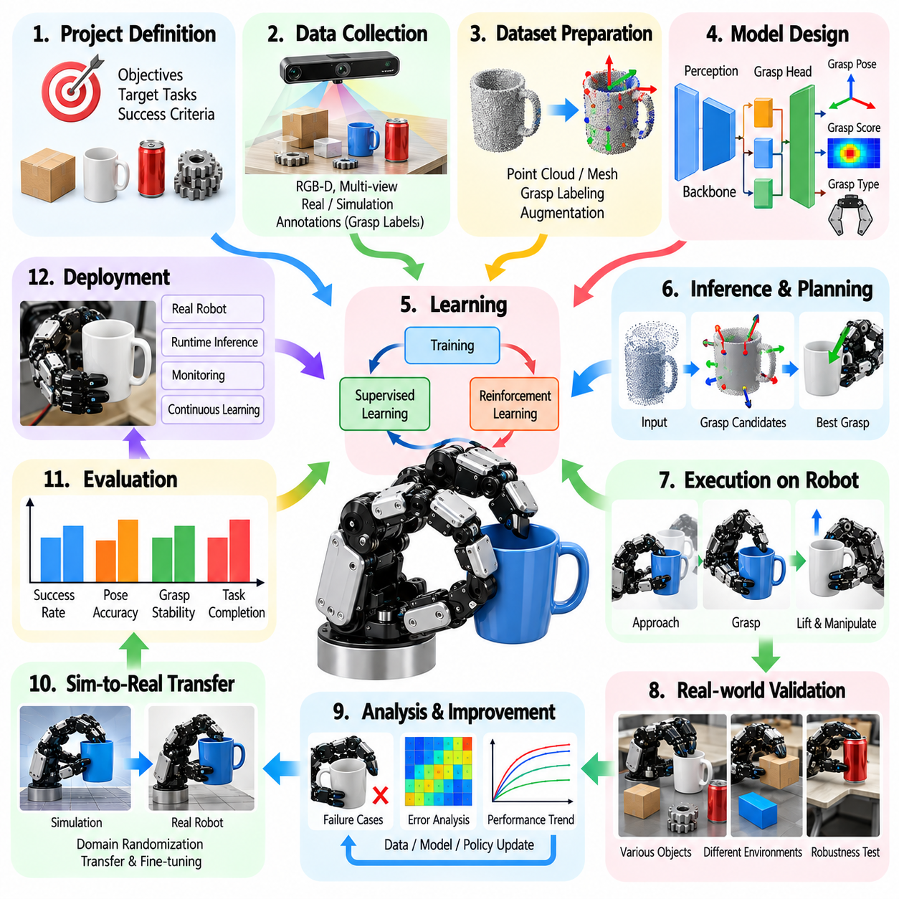
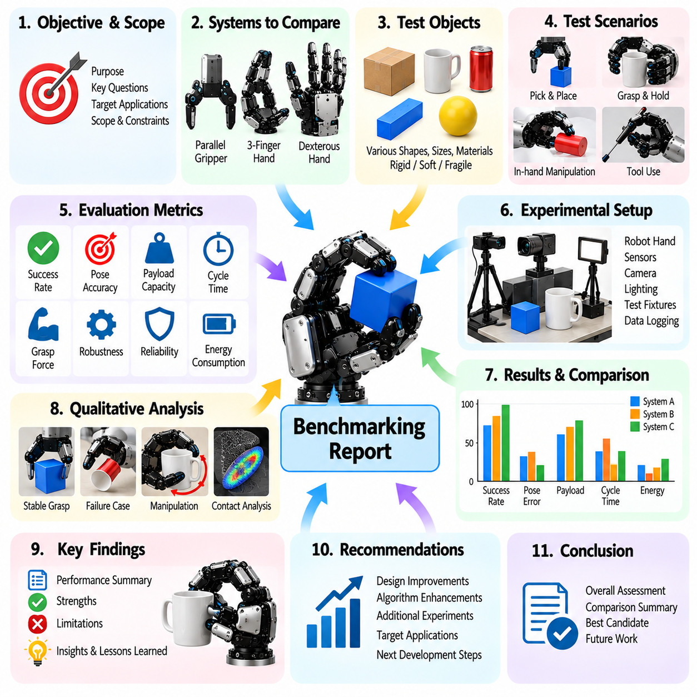
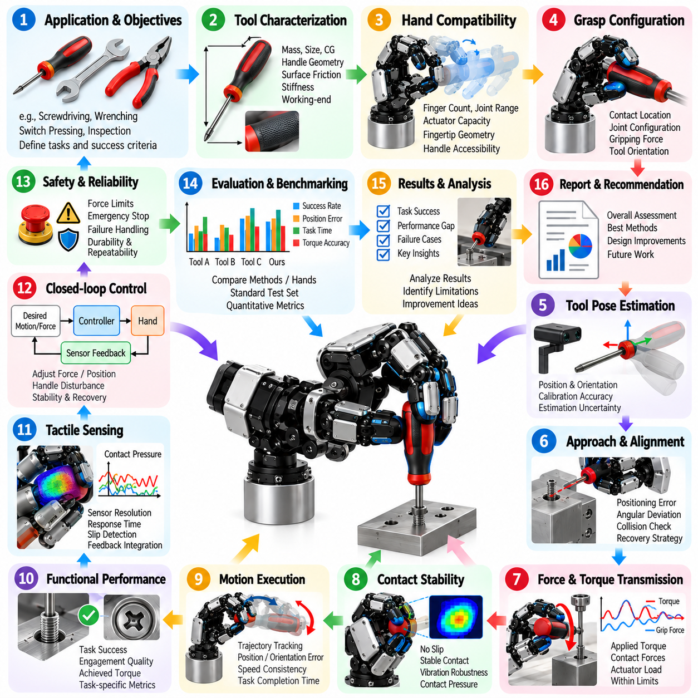
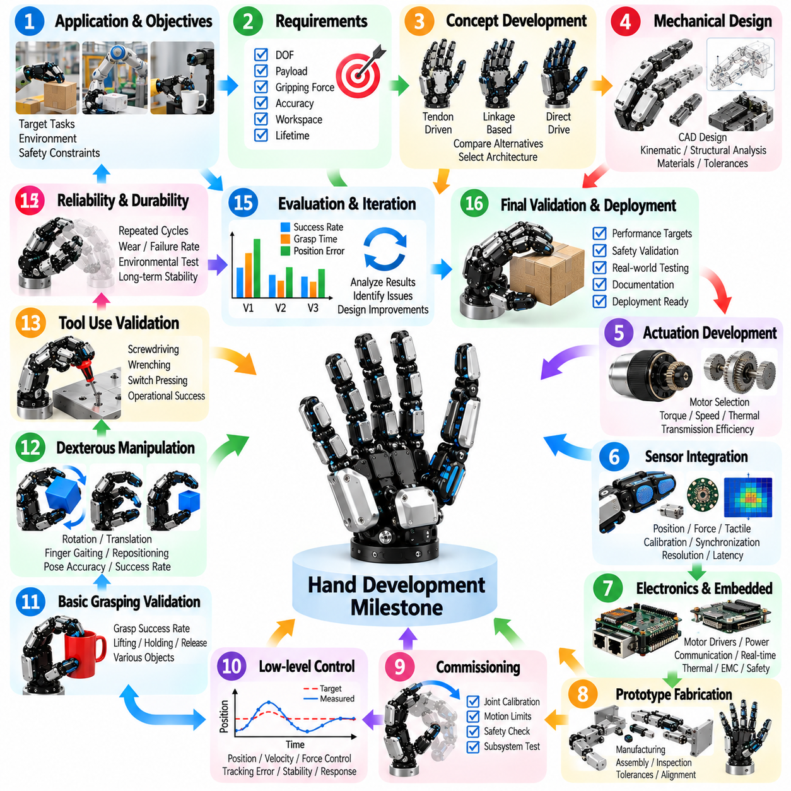

**Volume 06 Robot Hands and Dexterous Grasping**


# 16. Checklists and Templates

##  

## 16.01 Hand Selection Checklist

{width="7.268055555555556in" height="7.268055555555556in"}

Selecting an appropriate robotic gripper or dexterous hand requires a systematic evaluation of task requirements, object characteristics, mechanical capabilities, sensing functions, and operational constraints. The selection process should begin with a clearly defined application profile rather than a preference for a particular mechanism. A structured checklist helps engineers compare alternatives consistently and document the technical justification for each decision.

The first evaluation concerns the intended manipulation tasks and operating environment. Engineers should identify whether the system performs simple pick-and-place operations, warehouse sorting, precision assembly, tool handling, or complex in-hand manipulation. Each application imposes different requirements for gripping precision, adaptability, speed, and force regulation. Environmental factors such as dust, humidity, temperature, vibration, and human proximity must also be documented.

Object characteristics form the foundation of gripper selection because they determine the required contact geometry and gripping strategy. The checklist should record minimum and maximum object dimensions, mass, center of gravity, surface friction, rigidity, fragility, and geometric variability. Special attention is necessary for transparent, reflective, deformable, irregular, or slippery objects because their physical properties can significantly influence grasp reliability and sensor performance.

The next consideration is the appropriate end-effector category. Parallel-jaw grippers are suitable for many structured industrial tasks involving predictable object geometries, while angular and three-finger grippers provide alternative contact configurations. Multifinger dexterous hands support more complex manipulation but introduce additional mechanical and control complexity. The checklist should establish whether the application genuinely requires dexterity beyond conventional gripping.

Actuation architecture must be evaluated according to force requirements, positioning accuracy, response speed, and mechanical complexity. Electric servo actuators provide controllable motion and convenient integration with digital controllers, while pneumatic systems may offer lightweight mechanisms and rapid gripping actions. Tendon-driven, cable-driven, and elastic actuation systems introduce additional design possibilities. Each candidate should be assessed for efficiency, backlash, thermal behavior, and maintenance requirements.

Underactuated and fully actuated mechanisms represent different engineering compromises. Underactuated hands can adapt passively to variations in object geometry while reducing actuator count and control complexity. Fully actuated hands provide greater independent finger control and support sophisticated manipulation sequences. The checklist should compare required degrees of freedom, actuator independence, mechanical coupling, and the relationship between achievable dexterity and system cost.

Rigid, soft, and hybrid gripping structures should be evaluated against object sensitivity and contact requirements. Rigid fingers provide predictable geometry and efficient force transmission, whereas soft fingers distribute contact pressure and accommodate geometric uncertainty. Hybrid designs combine structural stiffness with compliant contact surfaces. Material durability, surface friction, elastic recovery, contamination resistance, and replacement intervals should be considered when selecting the final configuration.

Mechanical compatibility with the robot arm is another essential selection criterion. The end effector must satisfy wrist payload limits, mounting interface dimensions, allowable moments, and available installation space. Engineers should calculate total mass, including actuators, sensors, cabling, adapters, and protective structures. The checklist should also verify whether the selected hand restricts arm reachability, creates collision risks, or shifts the effective center of gravity beyond acceptable limits.

Finger kinematics and workspace characteristics determine whether a hand can achieve the necessary grasp configurations. The evaluation should examine finger reach, joint limits, fingertip trajectories, opening width, and accessible contact regions. Multifinger hands additionally require analysis of coordinated motion and potential kinematic singularities. Engineers should confirm that the required grasp poses are achievable without excessive joint motion, self-collision, or unfavorable mechanical configurations.

Grasp stability must be evaluated using contact mechanics and force transmission principles. The checklist should consider contact locations, friction coefficients, normal forces, external disturbances, and expected object acceleration. Force closure and grasp wrench space analysis provide useful theoretical measures of grasp capability. However, analytical feasibility alone does not guarantee reliable operation, making physical validation under representative loading and motion conditions essential.

Force and torque control capabilities become especially important when manipulating fragile or mechanically sensitive objects. The selected system should provide sufficient force resolution, controllable gripping pressure, and appropriate response to contact disturbances. Impedance control, compliant grasping, and variable stiffness strategies may be necessary for contact-rich operations. Engineers should verify that force regulation remains stable across the intended operating range and does not damage handled objects.

Tactile sensing requirements should be derived from the information necessary for successful manipulation. Basic applications may require only grasp confirmation, whereas advanced dexterous manipulation can benefit from distributed pressure measurements and contact localization. Capacitive, piezoresistive, optical, and other tactile sensing technologies offer different performance characteristics. The checklist should assess spatial resolution, sensitivity, sampling frequency, calibration effort, and integration complexity.

Slip detection and grasp adjustment capabilities should be evaluated when objects experience variable loading or uncertain friction. Tactile signals, vibration measurements, visual observations, and learned estimators can provide evidence of impending or active slip. A suitable system must detect relevant disturbances and respond before object retention becomes unreliable. Engineers should assess detection latency, false alarm rates, recovery effectiveness, and the stability of corrective gripping actions.

In-hand manipulation requirements should be explicitly separated from basic object acquisition and retention. Tasks involving object rotation, translation, reorientation, finger gaiting, or controlled regrasping demand coordinated contact transitions and sufficient independent motion. The checklist should identify the required manipulation primitives and their allowable errors. When simpler alternatives such as wrist rotation or external fixtures can accomplish the task, additional hand complexity may be unnecessary.

Software and control integration must be considered before hardware procurement. Engineers should verify communication protocols, controller interfaces, supported operating systems, device drivers, and compatibility with the robot\'s motion planning framework. Feedback signals should be available at the required control frequency, with documented timing behavior. Integration with ROS 2, manipulation planning software, and perception systems should be evaluated according to the actual deployment architecture.

Learning-based grasping introduces additional requirements for observation quality, data collection, and computational resources. Systems employing grasp detection networks, reinforcement learning, imitation learning, or vision-language-action models must provide appropriate sensory inputs and executable control interfaces. The checklist should verify dataset relevance, training requirements, inference latency, and robustness to unfamiliar objects. Simulation-to-real transfer limitations should also be included in the evaluation.

Safety assessment should cover mechanical hazards, excessive contact forces, unintended motion, dropped objects, and actuator or communication failures. The hand should support appropriate protective behavior during emergency stops, power interruptions, and unexpected collisions. Engineers must determine whether releasing or retaining an object represents the safer failure response for each application. Safety requirements should be established through system-level risk assessment rather than assumed from component specifications.

Reliability and maintainability directly influence the practical value of a selected gripper or hand. The checklist should evaluate actuator lifetime, transmission wear, cable fatigue, sensor degradation, sealing effectiveness, and resistance to repetitive loading. Modular fingers, replaceable contact pads, accessible connectors, and straightforward calibration procedures can reduce maintenance effort. Mean time between failures and repair duration should be measured under representative operating conditions.

Energy consumption and thermal management are particularly important for battery-powered mobile manipulators. Engineers should estimate peak electrical demand, average operating power, idle consumption, and energy required per manipulation cycle. Continuous gripping may introduce thermal loads even when finger motion is minimal. The checklist should confirm that actuator heating, power distribution, and cooling arrangements remain compatible with the platform\'s available energy and thermal capacity.

Performance benchmarking should use representative objects, grasp configurations, and environmental conditions. Important measures include grasp success rate, object retention reliability, manipulation accuracy, cycle time, force consistency, and recovery performance. Standardized object sets such as the YCB collection can support comparative experiments, but application-specific objects remain necessary. Repeated trials should capture variability rather than relying on isolated successful demonstrations.

Economic evaluation should include the complete lifecycle cost rather than the initial purchase price alone. Relevant factors include actuators, sensors, controllers, mechanical adapters, software integration, calibration, replacement components, maintenance labor, and operational downtime. Highly dexterous hands may justify greater investment when their capabilities enable valuable tasks. Conversely, simpler grippers may provide better economic performance when the required manipulation operations are limited and predictable.

The final selection checklist should combine mandatory requirements, preferred capabilities, measurable acceptance criteria, and supporting test evidence. Each candidate should receive a documented assessment covering mechanical compatibility, grasp performance, sensing, control, safety, reliability, and cost. Requirements that cannot be satisfied should be distinguished from characteristics that merely reduce comparative scores. This prevents attractive secondary features from concealing critical engineering deficiencies.

A practical decision process should progress from requirement definition to candidate screening, prototype evaluation, and final validation. Initial screening eliminates incompatible mechanisms, while laboratory testing establishes measurable performance under controlled conditions. Subsequent trials should reproduce realistic object variation, motion disturbances, and operating constraints. Any unresolved technical risks should be documented together with proposed mitigation measures and verification responsibilities.

The completed selection record should identify the chosen end effector, its intended applications, verified operating limits, integration dependencies, and remaining development risks. It should also preserve the rationale for rejecting alternative designs, allowing future engineers to reconsider decisions when requirements change. By treating gripper and hand selection as an evidence-based engineering process, development teams can improve manipulation reliability, control complexity, maintainability, and overall system suitability.

적절한 로봇 그리퍼(Robotic Gripper) 또는 정교한 로봇 손(Dexterous Hand)을 선정하려면 작업 요구사항(Task Requirements), 물체 특성(Object Characteristics), 기계적 성능(Mechanical Capabilities), 센싱 기능(Sensing Functions), 운영 제약조건(Operational Constraints)을 체계적으로 평가해야 한다. 선정 과정은 특정 메커니즘(Mechanism)에 대한 선호보다 명확하게 정의된 응용 프로파일(Application Profile)에서 시작해야 한다. 구조화된 점검표(Checklist)는 엔지니어가 대안을 일관되게 비교하고 각 결정의 기술적 근거를 문서화하도록 지원한다.

첫 번째 평가 항목은 의도된 조작 작업(Manipulation Tasks)과 운영 환경(Operating Environment)이다. 엔지니어는 시스템이 단순한 집기 및 배치(Pick-and-Place), 창고 분류(Warehouse Sorting), 정밀 조립(Precision Assembly), 도구 취급(Tool Handling), 복잡한 손 내부 조작(In-Hand Manipulation) 중 어떤 작업을 수행하는지 파악해야 한다. 각 응용 분야는 파지 정밀도(Gripping Precision), 적응성(Adaptability), 속도(Speed), 힘 조절(Force Regulation)에 서로 다른 요구사항을 부과한다. 먼지, 습도, 온도, 진동, 사람과의 근접성 등의 환경적 요인도 문서화해야 한다.

물체 특성(Object Characteristics)은 필요한 접촉 형상(Contact Geometry)과 파지 전략(Grasping Strategy)을 결정하므로 그리퍼 선정의 기초가 된다. 점검표에는 물체의 최소 및 최대 크기, 질량(Mass), 무게중심(Center of Gravity), 표면 마찰(Surface Friction), 강성(Rigidity), 취약성(Fragility), 기하학적 변동성(Geometric Variability)을 기록해야 한다. 투명하거나 반사성이 높고, 변형 가능하거나 불규칙하며, 미끄러운 물체는 물리적 특성이 파지 신뢰성과 센서 성능에 상당한 영향을 줄 수 있으므로 특별한 주의가 필요하다.

다음 고려사항은 적절한 말단 효과기(End-Effector) 유형이다. 평행 조 그리퍼(Parallel-Jaw Gripper)는 예측 가능한 물체 형상을 다루는 많은 구조화된 산업 작업에 적합하며, 각도형 그리퍼(Angular Gripper)와 3지 그리퍼(Three-Finger Gripper)는 대안적인 접촉 구성을 제공한다. 다지 정교 손(Multifinger Dexterous Hand)은 더욱 복잡한 조작을 지원하지만 추가적인 기계 및 제어 복잡성을 초래한다. 점검표에서는 해당 응용 분야가 기존 파지 방식 이상의 정교한 조작 능력(Dexterity)을 실제로 요구하는지 판단해야 한다.

구동 아키텍처(Actuation Architecture)는 힘 요구사항(Force Requirements), 위치 정확도(Positioning Accuracy), 응답 속도(Response Speed), 기계적 복잡성(Mechanical Complexity)에 따라 평가해야 한다. 전기 서보 액추에이터(Electric Servo Actuator)는 제어 가능한 운동과 디지털 제어기(Digital Controller)와의 편리한 통합을 제공하며, 공압 시스템(Pneumatic System)은 경량 메커니즘과 빠른 파지 동작에 유리할 수 있다. 텐던 구동(Tendon-Driven), 케이블 구동(Cable-Driven), 탄성 구동(Elastic Actuation) 시스템도 추가적인 설계 가능성을 제공한다. 각 후보는 효율, 백래시(Backlash), 열적 특성(Thermal Behavior), 유지보수 요구사항을 기준으로 평가해야 한다.

저구동 메커니즘(Underactuated Mechanism)과 완전 구동 메커니즘(Fully Actuated Mechanism)은 서로 다른 공학적 절충관계(Engineering Trade-Off)를 나타낸다. 저구동 손(Underactuated Hand)은 액추에이터 수와 제어 복잡성을 줄이면서 물체 형상의 변화에 수동적으로 적응할 수 있다. 완전 구동 손(Fully Actuated Hand)은 더 높은 수준의 독립적인 손가락 제어를 제공하고 정교한 조작 순서를 지원한다. 점검표에서는 필요한 자유도(Degrees of Freedom), 액추에이터 독립성(Actuator Independence), 기계적 결합(Mechanical Coupling), 구현 가능한 정교성과 시스템 비용의 관계를 비교해야 한다.

강체(Rigid), 연성(Soft), 하이브리드(Hybrid) 파지 구조는 물체의 민감도(Object Sensitivity)와 접촉 요구사항(Contact Requirements)에 따라 평가해야 한다. 강체 손가락(Rigid Finger)은 예측 가능한 형상과 효율적인 힘 전달을 제공하는 반면, 연성 손가락(Soft Finger)은 접촉 압력을 분산하고 기하학적 불확실성에 대응한다. 하이브리드 설계(Hybrid Design)는 구조적 강성과 유연한 접촉 표면을 결합한다. 최종 구성을 선정할 때 재료 내구성(Material Durability), 표면 마찰, 탄성 회복(Elastic Recovery), 오염 저항성(Contamination Resistance), 교체 주기를 고려해야 한다.

로봇 팔(Robot Arm)과의 기계적 호환성(Mechanical Compatibility)도 필수적인 선정 기준이다. 말단 효과기는 손목의 가반하중 한계(Payload Limit), 장착 인터페이스(Mounting Interface) 치수, 허용 모멘트(Allowable Moment), 설치 공간 요구사항을 충족해야 한다. 엔지니어는 액추에이터, 센서, 케이블, 어댑터, 보호 구조물을 포함한 전체 질량을 계산해야 한다. 또한 선정된 손이 로봇 팔의 도달 가능 영역(Reachability)을 제한하거나 충돌 위험을 발생시키거나 유효 무게중심을 허용 범위 밖으로 이동시키는지 확인해야 한다.

손가락 운동학(Finger Kinematics)과 작업공간(Workspace) 특성은 손이 필요한 파지 구성을 달성할 수 있는지를 결정한다. 평가에서는 손가락 도달 범위(Finger Reach), 관절 한계(Joint Limits), 손끝 궤적(Fingertip Trajectory), 개구 폭(Opening Width), 접근 가능한 접촉 영역(Contact Region)을 검토해야 한다. 다지 손(Multifinger Hand)은 추가적으로 협조 운동(Coordinated Motion)과 잠재적인 운동학적 특이점(Kinematic Singularity)을 분석해야 한다. 엔지니어는 과도한 관절 운동, 자기 충돌(Self-Collision), 불리한 기계적 구성을 발생시키지 않고 필요한 파지 자세(Grasp Pose)를 구현할 수 있는지 확인해야 한다.

파지 안정성(Grasp Stability)은 접촉 역학(Contact Mechanics)과 힘 전달 원리(Force Transmission Principles)를 사용하여 평가해야 한다. 점검표에서는 접촉 위치(Contact Location), 마찰계수(Friction Coefficient), 법선력(Normal Force), 외부 교란(External Disturbance), 예상 물체 가속도(Object Acceleration)를 고려해야 한다. 힘 폐쇄(Force Closure)와 파지 렌치 공간(Grasp Wrench Space) 분석은 파지 능력을 평가하는 유용한 이론적 지표를 제공한다. 그러나 해석적 실현 가능성(Analytical Feasibility)만으로 신뢰할 수 있는 작동이 보장되는 것은 아니므로 대표적인 하중 및 운동 조건에서 물리적 검증(Physical Validation)이 필수적이다.

힘 및 토크 제어(Force and Torque Control) 능력은 깨지기 쉽거나 기계적으로 민감한 물체를 조작할 때 특히 중요하다. 선정된 시스템은 충분한 힘 분해능(Force Resolution), 제어 가능한 파지 압력(Gripping Pressure), 접촉 교란에 대한 적절한 응답을 제공해야 한다. 접촉이 많은 작업(Contact-Rich Operation)에는 임피던스 제어(Impedance Control), 유연 파지(Compliant Grasping), 가변 강성(Variable Stiffness) 전략이 필요할 수 있다. 엔지니어는 의도된 작동 범위 전체에서 힘 조절이 안정적으로 유지되고 취급 물체를 손상시키지 않는지 확인해야 한다.

촉각 센싱(Tactile Sensing) 요구사항은 성공적인 조작에 필요한 정보에서 도출해야 한다. 기본적인 응용 분야에서는 파지 확인(Grasp Confirmation)만 필요할 수 있지만, 고급 정교 조작(Advanced Dexterous Manipulation)에서는 분산 압력 측정(Distributed Pressure Measurement)과 접촉 위치 추정(Contact Localization)이 유용할 수 있다. 정전용량식(Capacitive), 압저항식(Piezoresistive), 광학식(Optical) 및 기타 촉각 센싱 기술은 서로 다른 성능 특성을 제공한다. 점검표에서는 공간 분해능(Spatial Resolution), 민감도(Sensitivity), 샘플링 주파수(Sampling Frequency), 보정 작업(Calibration Effort), 통합 복잡성(Integration Complexity)을 평가해야 한다.

미끄럼 감지(Slip Detection)와 파지 조정(Grasp Adjustment) 기능은 물체에 가변 하중(Variable Loading)이나 불확실한 마찰(Uncertain Friction)이 작용하는 경우 평가해야 한다. 촉각 신호(Tactile Signal), 진동 측정(Vibration Measurement), 시각 관측(Visual Observation), 학습 기반 추정기(Learned Estimator)는 미끄럼 발생 직전 또는 진행 중인 상태에 대한 정보를 제공할 수 있다. 적절한 시스템은 물체 유지 능력이 불안정해지기 전에 관련 교란을 감지하고 대응해야 한다. 엔지니어는 감지 지연시간(Detection Latency), 오경보율(False Alarm Rate), 복구 효과(Recovery Effectiveness), 보정 파지 동작(Corrective Gripping Action)의 안정성을 평가해야 한다.

손 내부 조작(In-Hand Manipulation) 요구사항은 기본적인 물체 획득(Object Acquisition) 및 유지(Object Retention) 기능과 명확하게 구분해야 한다. 물체 회전(Rotation), 병진 이동(Translation), 방향 재조정(Reorientation), 손가락 보행(Finger Gaiting), 제어된 재파지(Regrasping)를 포함하는 작업에는 조정된 접촉 전환(Coordinated Contact Transition)과 충분한 독립 운동이 필요하다. 점검표에서는 필요한 조작 기본 동작(Manipulation Primitives)과 허용 오차(Allowable Error)를 식별해야 한다. 손목 회전이나 외부 지그(External Fixture)와 같은 간단한 대안으로 작업을 수행할 수 있다면 추가적인 손의 복잡성은 불필요할 수 있다.

소프트웨어 및 제어 통합(Software and Control Integration)은 하드웨어 구매 전에 검토해야 한다. 엔지니어는 통신 프로토콜(Communication Protocol), 제어기 인터페이스(Controller Interface), 지원 운영체제(Operating System), 장치 드라이버(Device Driver), 로봇 동작 계획 프레임워크(Motion Planning Framework)와의 호환성을 확인해야 한다. 피드백 신호(Feedback Signal)는 필요한 제어 주파수(Control Frequency)에서 이용할 수 있어야 하며 시간적 동작 특성(Timing Behavior)이 문서화되어야 한다. ROS 2, 조작 계획 소프트웨어(Manipulation Planning Software), 인식 시스템(Perception System)과의 통합은 실제 배포 아키텍처(Deployment Architecture)에 따라 평가해야 한다.

학습 기반 파지(Learning-Based Grasping)는 관측 품질(Observation Quality), 데이터 수집(Data Collection), 계산 자원(Computational Resources)에 대한 추가 요구사항을 발생시킨다. 파지 검출 네트워크(Grasp Detection Network), 강화학습(Reinforcement Learning), 모방학습(Imitation Learning), 시각-언어-행동 모델(Vision-Language-Action Model)을 사용하는 시스템은 적절한 센서 입력과 실행 가능한 제어 인터페이스를 제공해야 한다. 점검표에서는 데이터셋 적합성(Dataset Relevance), 학습 요구사항(Training Requirements), 추론 지연시간(Inference Latency), 미지 물체(Unfamiliar Object)에 대한 강건성(Robustness)을 확인해야 한다. 시뮬레이션에서 현실로의 전이(Sim-to-Real Transfer) 한계도 평가에 포함해야 한다.

안전성 평가(Safety Assessment)는 기계적 위험(Mechanical Hazard), 과도한 접촉력(Excessive Contact Force), 의도하지 않은 운동(Unintended Motion), 물체 낙하(Dropped Object), 액추에이터 또는 통신 장애를 포함해야 한다. 로봇 손은 비상 정지(Emergency Stop), 전원 차단(Power Interruption), 예기치 않은 충돌(Unexpected Collision) 상황에서 적절한 보호 동작(Protective Behavior)을 지원해야 한다. 엔지니어는 각 응용 분야에서 물체를 놓는 것과 유지하는 것 중 어느 쪽이 더 안전한 고장 대응(Failure Response)인지 결정해야 한다. 안전 요구사항은 부품 사양에 대한 가정이 아니라 시스템 수준 위험 평가(System-Level Risk Assessment)를 통해 수립해야 한다.

신뢰성(Reliability)과 유지보수성(Maintainability)은 선정된 그리퍼 또는 손의 실질적인 가치에 직접적인 영향을 미친다. 점검표에서는 액추에이터 수명(Actuator Lifetime), 전달장치 마모(Transmission Wear), 케이블 피로(Cable Fatigue), 센서 성능 저하(Sensor Degradation), 밀봉 효과(Sealing Effectiveness), 반복 하중(Repeated Loading)에 대한 저항성을 평가해야 한다. 모듈형 손가락(Modular Finger), 교체 가능한 접촉 패드(Replaceable Contact Pad), 접근하기 쉬운 커넥터(Accessible Connector), 간단한 보정 절차(Calibration Procedure)는 유지보수 부담을 줄일 수 있다. 평균 고장 간격(Mean Time Between Failures, MTBF)과 수리 시간(Repair Duration)은 대표적인 운영 조건에서 측정해야 한다.

에너지 소비(Energy Consumption)와 열 관리(Thermal Management)는 배터리 구동 모바일 매니퓰레이터(Battery-Powered Mobile Manipulator)에서 특히 중요하다. 엔지니어는 최대 전력 수요(Peak Electrical Demand), 평균 작동 전력(Average Operating Power), 유휴 소비전력(Idle Consumption), 조작 주기당 필요한 에너지(Energy per Manipulation Cycle)를 추정해야 한다. 손가락 운동이 거의 없는 상태에서도 지속적인 파지(Continuous Gripping)는 열 부하(Thermal Load)를 발생시킬 수 있다. 점검표에서는 액추에이터 발열(Actuator Heating), 전력 분배(Power Distribution), 냉각 구성(Cooling Arrangement)이 플랫폼의 가용 에너지 및 열 관리 용량과 호환되는지 확인해야 한다.

성능 벤치마킹(Performance Benchmarking)은 대표적인 물체, 파지 구성(Grasp Configuration), 환경 조건(Environmental Condition)을 사용해야 한다. 주요 측정 지표에는 파지 성공률(Grasp Success Rate), 물체 유지 신뢰성(Object Retention Reliability), 조작 정확도(Manipulation Accuracy), 사이클 시간(Cycle Time), 힘 일관성(Force Consistency), 복구 성능(Recovery Performance)이 포함된다. YCB 물체 집합(YCB Object Set)과 같은 표준화된 물체 집합은 비교 실험을 지원할 수 있지만, 응용 분야별 물체(Application-Specific Object)에 대한 평가도 필요하다. 반복 시험(Repeated Trial)을 통해 개별적인 성공 사례에 의존하지 않고 성능 변동성을 파악해야 한다.

경제성 평가(Economic Evaluation)는 초기 구매 가격뿐 아니라 전체 수명주기 비용(Lifecycle Cost)을 포함해야 한다. 관련 요소에는 액추에이터, 센서, 제어기, 기계적 어댑터(Mechanical Adapter), 소프트웨어 통합(Software Integration), 보정(Calibration), 교체 부품(Replacement Component), 유지보수 인건비(Maintenance Labor), 운영 중단시간(Operational Downtime)이 포함된다. 높은 정교성을 갖춘 손은 그 능력이 가치 있는 작업을 가능하게 할 때 더 큰 투자를 정당화할 수 있다. 반대로 필요한 조작 작업이 제한적이고 예측 가능하다면 단순한 그리퍼가 더 나은 경제적 성능을 제공할 수 있다.

최종 선정 점검표(Final Selection Checklist)는 필수 요구사항(Mandatory Requirements), 선호 기능(Preferred Capabilities), 측정 가능한 합격 기준(Measurable Acceptance Criteria), 이를 뒷받침하는 시험 증거(Test Evidence)를 결합해야 한다. 각 후보는 기계적 호환성, 파지 성능, 센싱, 제어, 안전성, 신뢰성, 비용을 포함하는 문서화된 평가를 받아야 한다. 충족할 수 없는 요구사항은 단순히 비교 점수를 낮추는 특성과 구분해야 한다. 이를 통해 매력적인 부가 기능이 중대한 공학적 결함을 가리는 상황을 방지할 수 있다.

실질적인 의사결정 과정(Decision Process)은 요구사항 정의(Requirement Definition), 후보 선별(Candidate Screening), 시제품 평가(Prototype Evaluation), 최종 검증(Final Validation)의 순서로 진행해야 한다. 초기 선별에서는 호환되지 않는 메커니즘을 제외하고, 실험실 시험(Laboratory Testing)을 통해 통제된 조건에서 측정 가능한 성능을 확립한다. 이후 시험에서는 실제 물체의 변동성, 운동 교란(Motion Disturbance), 운영 제약조건을 재현해야 한다. 해결되지 않은 기술적 위험(Technical Risk)은 제안된 완화 대책(Mitigation Measures) 및 검증 책임(Verification Responsibilities)과 함께 문서화해야 한다.

완성된 선정 기록(Selection Record)에는 선택된 말단 효과기, 의도된 응용 분야, 검증된 작동 한계(Verified Operating Limits), 통합 의존성(Integration Dependencies), 남아 있는 개발 위험(Development Risks)을 명시해야 한다. 또한 대안 설계를 제외한 근거를 보존하여 향후 요구사항이 변경될 때 엔지니어가 기존 결정을 재검토할 수 있도록 해야 한다. 그리퍼 및 로봇 손 선정을 증거 기반 공학 프로세스(Evidence-Based Engineering Process)로 다룸으로써 개발팀은 조작 신뢰성(Manipulation Reliability), 제어 복잡성(Control Complexity), 유지보수성(Maintainability), 전체 시스템 적합성(Overall System Suitability)을 개선할 수 있다.

##  

## 16.02 Mechanism Design Template

{width="7.268055555555556in" height="7.268055555555556in"}

A hand mechanism design template provides a systematic framework for transforming manipulation requirements into a manufacturable robotic hand architecture. It organizes mechanical specifications, kinematic relationships, actuation choices, structural constraints, and validation procedures within a consistent engineering document. The template should support design traceability, allowing each mechanical decision to be connected to functional requirements and measurable performance objectives.

The design process begins by defining the intended application and operational objectives. Engineers should describe whether the hand will perform industrial gripping, precision assembly, tool manipulation, object reorientation, or general-purpose dexterous tasks. The description should identify target objects, expected manipulation sequences, environmental conditions, and required interaction forces. These requirements establish the foundation for selecting the appropriate mechanical configuration.

A functional specification should translate application objectives into measurable engineering parameters. Important characteristics include the number of fingers, required degrees of freedom, finger opening range, maximum payload, gripping force, positioning accuracy, and allowable mechanism mass. The template should distinguish mandatory performance thresholds from desirable capabilities. Each requirement should include an evaluation method and an acceptance criterion that can be verified experimentally.

The overall hand architecture should be documented before detailed component design begins. Engineers should define the number and arrangement of fingers, palm geometry, thumb opposition capability, wrist interface, and actuator placement. Alternative configurations may include parallel gripping mechanisms, three-finger adaptive hands, and anthropomorphic multifinger structures. The selected architecture should balance manipulation versatility against mechanical complexity, weight, cost, and reliability.

Finger mechanism design requires a clear description of joint arrangement and motion transmission. Each finger should be represented by its link lengths, joint axes, allowable rotation ranges, and mechanical constraints. Linkage-based mechanisms provide coordinated motion through rigid mechanical connections, while tendon-driven mechanisms enable compact actuation arrangements. The template should document how each mechanism transforms actuator motion into fingertip displacement and contact force.

The kinematic model should establish the relationship between joint coordinates and fingertip positions. Forward kinematics determines fingertip pose from joint configurations, while inverse kinematics estimates the joint values required to achieve desired contact locations. Engineers should identify relevant coordinate frames, joint limits, workspace boundaries, and potential singularities. The resulting model provides a foundation for mechanical optimization and subsequent motion control development.

Underactuated mechanisms should be evaluated when passive adaptation to object geometry is desirable. Such designs use fewer independently controlled actuators than mechanical degrees of freedom, allowing finger joints to redistribute motion during contact. The template should describe coupling relationships, differential mechanisms, elastic elements, and contact-dependent behavior. Particular attention should be given to repeatability, grasp stability, and limitations in independent joint positioning.

Fully actuated designs require a different assessment of actuator allocation and control independence. Each independently driven joint increases potential dexterity but also introduces additional motors, transmissions, sensors, wiring, and control requirements. Engineers should determine whether independent joint control is necessary for the intended manipulation primitives. The design document should justify actuator count through demonstrated task requirements rather than assuming that additional degrees of freedom always improve performance.

Transmission architecture strongly influences mechanical efficiency, accuracy, and durability. Gear trains, pulley systems, cable drives, tendon transmissions, and direct-drive mechanisms should be compared according to torque capacity, backlash, friction, compliance, and packaging requirements. The template should specify transmission ratios, expected losses, cable routing, pretension requirements, and mechanical adjustment procedures. Transmission characteristics must remain compatible with the desired force and position control behavior.

Actuator selection should follow quantitative estimates of required joint torque, velocity, acceleration, and duty cycle. Electric motors, servo actuators, pneumatic systems, and alternative compact actuation technologies offer different combinations of power density, controllability, and integration complexity. Engineers should document continuous and peak operating limits, thermal constraints, and electrical requirements. Safety margins should be justified using realistic loading conditions rather than arbitrary oversizing.

The palm structure provides the mechanical foundation for finger attachment, actuator integration, and load transfer to the wrist. Its design should consider structural stiffness, internal component packaging, cable passages, sensor placement, and accessibility for maintenance. The template should identify critical load paths and mounting interfaces. Palm geometry must also preserve sufficient clearance for finger movement while supporting the intended grasp configurations and object dimensions.

Wrist integration requires verification of mechanical compatibility with the supporting manipulator. The design should specify mounting dimensions, interface orientation, allowable forces and moments, cable routing, and the location of the assembled hand\'s center of mass. Additional wrist degrees of freedom may improve manipulation reachability but increase mass and control complexity. Engineers should evaluate whether required object orientations can be achieved through existing arm motion before adding wrist mechanisms.

Material selection should reflect structural loading, manufacturing constraints, friction behavior, and environmental exposure. Aluminum alloys, engineering polymers, composite materials, elastomers, and specialized surface coatings may be appropriate for different components. The template should document material properties, expected wear mechanisms, thermal effects, and compatibility with manufacturing processes. Contact surfaces should be evaluated separately from load-bearing structures because their functional requirements often differ.

Weight and payload optimization should consider the complete assembled mechanism rather than individual components in isolation. Finger links, actuators, transmissions, sensors, fasteners, wiring, and protective covers all contribute to total mass and rotational inertia. Engineers should evaluate the influence of component placement on wrist loading and dynamic performance. Lightweight construction must not compromise structural stiffness, impact resistance, or the ability to maintain stable grasping forces.

Structural validation should include analytical calculations and finite element analysis where appropriate. Critical components should be examined under maximum gripping loads, external disturbances, accidental impacts, and repeated operating cycles. Stress concentration, elastic deformation, fatigue resistance, and joint bearing loads require particular attention. Simulation assumptions, boundary conditions, material properties, and safety factors should be documented so that structural predictions can be reproduced and verified.

Mechanical compliance should be introduced deliberately rather than treated solely as an undesirable deformation. Elastic joints, compliant fingertips, flexible transmissions, and series elastic elements can improve contact adaptation and reduce impact forces. However, excessive compliance may reduce positioning accuracy and complicate force estimation. The template should specify desired stiffness characteristics, allowable deformation, hysteresis behavior, and methods for measuring compliance under representative loading conditions.

Sensor integration requirements should influence mechanical design from the earliest development stages. Joint encoders, fingertip force sensors, tactile arrays, and wrist force-torque sensors require appropriate mounting surfaces, protected wiring paths, and calibration access. Engineers should identify sensor placement constraints and possible interference with finger motion. The design should also consider connector durability, electromagnetic compatibility, and replacement procedures for sensors exposed to repeated contact.

Manufacturability should be evaluated through the selected fabrication and assembly processes. Machining, additive manufacturing, molding, and sheet-metal fabrication impose different constraints on tolerances, surface quality, material selection, and production cost. The template should document critical dimensions, geometric tolerances, fastening methods, and assembly sequences. Components requiring frequent replacement should be designed for accessibility without extensive disassembly of the entire hand.

Modularity and replaceability can substantially reduce development and maintenance effort. Finger modules, contact pads, tendon assemblies, actuators, and sensor units should be evaluated for independent removal and replacement. Standardized interfaces simplify configuration changes and allow alternative mechanisms to be tested using a common palm or wrist structure. The design document should define interface dimensions, alignment features, connector specifications, and procedures for restoring calibration after component replacement.

Mechanical safety considerations should address pinch points, exposed transmissions, sharp edges, uncontrolled joint movement, and structural failure. Protective covers, mechanical stops, compliant contact surfaces, and overload protection mechanisms may reduce operational risks. Engineers should also consider the consequences of power loss or actuator failure while holding an object. The template should identify hazardous failure modes and define appropriate mechanical safeguards consistent with the overall robotic system.

Prototype development should proceed through controlled design iterations. Early prototypes may focus on individual finger mechanisms, transmission efficiency, or actuator integration before a complete hand is assembled. Each iteration should have defined objectives, measurable test conditions, and documented design changes. Experimental observations should be compared against analytical and simulation predictions to identify modeling errors, unexpected friction, structural deformation, and manufacturing limitations.

Mechanical performance validation should measure fingertip workspace, gripping force, positioning repeatability, transmission efficiency, structural deflection, and mechanism response under load. Repeated cycling should reveal wear, backlash growth, cable relaxation, and changes in contact behavior. Tests should include representative object geometries and manipulation conditions. Results should be recorded using consistent procedures so that successive design revisions can be compared objectively.

The completed design template should consolidate requirements, architecture decisions, kinematic models, component specifications, material selections, manufacturing information, and validation results. Drawings, interface definitions, revision records, and unresolved technical risks should remain traceable throughout development. A well-maintained template transforms hand mechanism design from an isolated mechanical activity into a repeatable engineering process supporting integration, verification, production, and future improvements.

로봇 손 메커니즘 설계 템플릿(Hand Mechanism Design Template)은 조작 요구사항(Manipulation Requirements)을 제조 가능한 로봇 손 아키텍처(Robotic Hand Architecture)로 전환하기 위한 체계적인 프레임워크(Systematic Framework)를 제공한다. 이 템플릿은 기계적 사양(Mechanical Specifications), 운동학적 관계(Kinematic Relationships), 구동 방식 선택(Actuation Choices), 구조적 제약조건(Structural Constraints), 검증 절차(Validation Procedures)를 일관된 엔지니어링 문서로 구성한다. 또한 각 기계적 설계 결정을 기능 요구사항(Functional Requirements) 및 측정 가능한 성능 목표(Measurable Performance Objectives)와 연결할 수 있도록 설계 추적성(Design Traceability)을 지원해야 한다.

설계 과정은 의도된 응용 분야(Intended Application)와 운영 목표(Operational Objectives)를 정의하는 것에서 시작한다. 엔지니어는 로봇 손이 산업용 파지(Industrial Gripping), 정밀 조립(Precision Assembly), 도구 조작(Tool Manipulation), 물체 방향 재조정(Object Reorientation), 범용 정교 조작(General-Purpose Dexterous Tasks) 중 어떤 작업을 수행할 것인지 설명해야 한다. 이 설명에는 대상 물체(Target Objects), 예상 조작 순서(Manipulation Sequences), 환경 조건(Environmental Conditions), 필요한 상호작용 힘(Interaction Forces)이 포함되어야 한다. 이러한 요구사항은 적절한 기계적 구성(Mechanical Configuration)을 선정하기 위한 기초가 된다.

기능 사양(Functional Specification)은 응용 목표(Application Objectives)를 측정 가능한 공학적 매개변수(Engineering Parameters)로 변환해야 한다. 주요 특성에는 손가락 수(Number of Fingers), 필요한 자유도(Degrees of Freedom), 손가락 개구 범위(Finger Opening Range), 최대 가반하중(Maximum Payload), 파지력(Gripping Force), 위치 정확도(Positioning Accuracy), 허용 메커니즘 질량(Allowable Mechanism Mass)이 포함된다. 템플릿은 필수 성능 기준(Mandatory Performance Thresholds)과 바람직한 기능(Desirable Capabilities)을 구분해야 한다. 각 요구사항에는 실험적으로 검증할 수 있는 평가 방법(Evaluation Method)과 합격 기준(Acceptance Criterion)을 포함해야 한다.

전체 로봇 손 아키텍처(Hand Architecture)는 세부 부품 설계(Detailed Component Design)를 시작하기 전에 문서화해야 한다. 엔지니어는 손가락의 수와 배치(Finger Arrangement), 손바닥 형상(Palm Geometry), 엄지 대립 기능(Thumb Opposition Capability), 손목 인터페이스(Wrist Interface), 액추에이터 배치(Actuator Placement)를 정의해야 한다. 대안적인 구성에는 평행 파지 메커니즘(Parallel Gripping Mechanism), 3지 적응형 손(Three-Finger Adaptive Hand), 인간형 다지 구조(Anthropomorphic Multifinger Structure)가 포함될 수 있다. 선정된 아키텍처는 조작 범용성(Manipulation Versatility)과 기계적 복잡성(Mechanical Complexity), 무게(Weight), 비용(Cost), 신뢰성(Reliability) 사이의 균형을 유지해야 한다.

손가락 메커니즘 설계(Finger Mechanism Design)에는 관절 배치(Joint Arrangement)와 운동 전달(Motion Transmission)에 대한 명확한 설명이 필요하다. 각 손가락은 링크 길이(Link Lengths), 관절 축(Joint Axes), 허용 회전 범위(Allowable Rotation Ranges), 기계적 제약조건(Mechanical Constraints)으로 표현해야 한다. 링크 기반 메커니즘(Linkage-Based Mechanism)은 강체 기계 연결(Rigid Mechanical Connections)을 통해 협조 운동(Coordinated Motion)을 제공하며, 텐던 구동 메커니즘(Tendon-Driven Mechanism)은 소형 구동 배치(Compact Actuation Arrangement)를 가능하게 한다. 템플릿에는 각 메커니즘이 액추에이터 운동(Actuator Motion)을 손끝 변위(Fingertip Displacement)와 접촉력(Contact Force)으로 변환하는 방식을 문서화해야 한다.

운동학 모델(Kinematic Model)은 관절 좌표(Joint Coordinates)와 손끝 위치(Fingertip Positions) 사이의 관계를 정의해야 한다. 순기구학(Forward Kinematics)은 관절 구성(Joint Configuration)으로부터 손끝 자세(Fingertip Pose)를 결정하며, 역기구학(Inverse Kinematics)은 원하는 접촉 위치(Contact Location)를 달성하는 데 필요한 관절 값을 추정한다. 엔지니어는 관련 좌표계(Coordinate Frames), 관절 한계(Joint Limits), 작업공간 경계(Workspace Boundaries), 잠재적 특이점(Singularities)을 식별해야 한다. 결과적으로 도출된 모델은 기계적 최적화(Mechanical Optimization)와 후속 운동 제어 개발(Motion Control Development)의 기반을 제공한다.

저구동 메커니즘(Underactuated Mechanism)은 물체 형상(Object Geometry)에 대한 수동적 적응(Passive Adaptation)이 필요한 경우 평가해야 한다. 이러한 설계는 기계적 자유도(Mechanical Degrees of Freedom)보다 적은 수의 독립 제어 액추에이터(Independently Controlled Actuators)를 사용하여 접촉 중 손가락 관절이 운동을 재분배하도록 한다. 템플릿에는 결합 관계(Coupling Relationships), 차동 메커니즘(Differential Mechanisms), 탄성 요소(Elastic Elements), 접촉 의존적 거동(Contact-Dependent Behavior)을 설명해야 한다. 특히 반복 정밀도(Repeatability), 파지 안정성(Grasp Stability), 독립적인 관절 위치 결정(Independent Joint Positioning)의 한계에 주의를 기울여야 한다.

완전 구동 설계(Fully Actuated Design)는 액추에이터 할당(Actuator Allocation)과 제어 독립성(Control Independence)에 대한 별도의 평가가 필요하다. 독립적으로 구동되는 관절은 잠재적인 정교 조작 능력(Dexterity)을 높이지만, 추가적인 모터(Motors), 전달장치(Transmissions), 센서(Sensors), 배선(Wiring), 제어 요구사항(Control Requirements)을 발생시킨다. 엔지니어는 의도된 조작 기본 동작(Manipulation Primitives)에 독립적인 관절 제어(Independent Joint Control)가 필요한지 판단해야 한다. 설계 문서는 자유도가 많을수록 항상 성능이 향상된다고 가정하기보다 입증된 작업 요구사항(Demonstrated Task Requirements)을 통해 액추에이터 수를 정당화해야 한다.

동력 전달 아키텍처(Transmission Architecture)는 기계적 효율(Mechanical Efficiency), 정확도(Accuracy), 내구성(Durability)에 큰 영향을 미친다. 기어열(Gear Trains), 풀리 시스템(Pulley Systems), 케이블 구동(Cable Drives), 텐던 전달장치(Tendon Transmissions), 직접 구동 메커니즘(Direct-Drive Mechanisms)은 토크 용량(Torque Capacity), 백래시(Backlash), 마찰(Friction), 컴플라이언스(Compliance), 패키징 요구사항(Packaging Requirements)에 따라 비교해야 한다. 템플릿에는 전달비(Transmission Ratios), 예상 손실(Expected Losses), 케이블 경로(Cable Routing), 초기 장력 요구사항(Pretension Requirements), 기계적 조정 절차(Mechanical Adjustment Procedures)를 명시해야 한다. 전달장치의 특성은 목표 힘 및 위치 제어 동작과 호환되어야 한다.

액추에이터 선정(Actuator Selection)은 필요한 관절 토크(Joint Torque), 속도(Velocity), 가속도(Acceleration), 듀티 사이클(Duty Cycle)에 대한 정량적 추정(Quantitative Estimates)을 기반으로 해야 한다. 전기 모터(Electric Motors), 서보 액추에이터(Servo Actuators), 공압 시스템(Pneumatic Systems), 대체 소형 구동 기술(Alternative Compact Actuation Technologies)은 출력 밀도(Power Density), 제어 가능성(Controllability), 통합 복잡성(Integration Complexity)에서 서로 다른 특성을 제공한다. 엔지니어는 연속 및 최대 작동 한계(Continuous and Peak Operating Limits), 열적 제약조건(Thermal Constraints), 전기적 요구사항(Electrical Requirements)을 문서화해야 한다. 안전 여유(Safety Margins)는 임의의 과대 설계(Arbitrary Oversizing)가 아니라 현실적인 하중 조건(Realistic Loading Conditions)을 사용하여 정당화해야 한다.

손바닥 구조(Palm Structure)는 손가락 부착(Finger Attachment), 액추에이터 통합(Actuator Integration), 손목으로의 하중 전달(Load Transfer)을 위한 기계적 기반을 제공한다. 설계에서는 구조적 강성(Structural Stiffness), 내부 부품 배치(Internal Component Packaging), 케이블 통로(Cable Passages), 센서 배치(Sensor Placement), 유지보수 접근성(Maintenance Accessibility)을 고려해야 한다. 템플릿에는 주요 하중 전달 경로(Critical Load Paths)와 장착 인터페이스(Mounting Interfaces)를 식별해야 한다. 손바닥 형상은 의도된 파지 구성(Grasp Configurations)과 물체 크기(Object Dimensions)를 지원하면서 손가락 운동에 필요한 충분한 간극(Clearance)을 확보해야 한다.

손목 통합(Wrist Integration)에는 로봇 팔(Manipulator)과의 기계적 호환성(Mechanical Compatibility) 검증이 필요하다. 설계에서는 장착 치수(Mounting Dimensions), 인터페이스 방향(Interface Orientation), 허용 힘과 모멘트(Allowable Forces and Moments), 케이블 경로(Cable Routing), 조립된 손의 질량중심(Center of Mass) 위치를 명시해야 한다. 추가적인 손목 자유도(Wrist Degrees of Freedom)는 조작 도달 가능성(Manipulation Reachability)을 향상시킬 수 있지만 질량과 제어 복잡성을 증가시킨다. 엔지니어는 손목 메커니즘을 추가하기 전에 기존 로봇 팔 운동(Arm Motion)으로 필요한 물체 방향(Object Orientations)을 구현할 수 있는지 평가해야 한다.

재료 선정(Material Selection)은 구조적 하중(Structural Loading), 제조 제약조건(Manufacturing Constraints), 마찰 특성(Friction Behavior), 환경 노출(Environmental Exposure)을 반영해야 한다. 알루미늄 합금(Aluminum Alloys), 엔지니어링 폴리머(Engineering Polymers), 복합재료(Composite Materials), 엘라스토머(Elastomers), 특수 표면 코팅(Specialized Surface Coatings)은 서로 다른 부품에 적합할 수 있다. 템플릿에는 재료 물성(Material Properties), 예상 마모 메커니즘(Expected Wear Mechanisms), 열적 영향(Thermal Effects), 제조 공정(Manufacturing Processes)과의 호환성을 문서화해야 한다. 접촉 표면(Contact Surfaces)은 기능적 요구사항이 다른 경우가 많으므로 하중 지지 구조(Load-Bearing Structures)와 별도로 평가해야 한다.

무게 및 가반하중 최적화(Weight and Payload Optimization)는 개별 부품이 아니라 전체 조립 메커니즘(Complete Assembled Mechanism)을 고려해야 한다. 손가락 링크(Finger Links), 액추에이터(Actuators), 전달장치(Transmissions), 센서(Sensors), 체결 부품(Fasteners), 배선(Wiring), 보호 커버(Protective Covers)는 모두 전체 질량(Total Mass)과 회전 관성(Rotational Inertia)에 영향을 미친다. 엔지니어는 부품 배치(Component Placement)가 손목 하중(Wrist Loading)과 동적 성능(Dynamic Performance)에 미치는 영향을 평가해야 한다. 경량 구조(Lightweight Construction)는 구조적 강성(Structural Stiffness), 충격 저항성(Impact Resistance), 안정적인 파지력(Stable Grasping Forces) 유지 능력을 저하시켜서는 안 된다.

구조 검증(Structural Validation)에는 적절한 경우 해석적 계산(Analytical Calculations)과 유한요소해석(Finite Element Analysis, FEA)을 포함해야 한다. 주요 부품(Critical Components)은 최대 파지 하중(Maximum Gripping Loads), 외부 교란(External Disturbances), 우발적 충격(Accidental Impacts), 반복 작동 주기(Repeated Operating Cycles)에서 검토해야 한다. 응력 집중(Stress Concentration), 탄성 변형(Elastic Deformation), 피로 저항성(Fatigue Resistance), 관절 베어링 하중(Joint Bearing Loads)에 특별한 주의가 필요하다. 구조적 예측(Structural Predictions)을 재현하고 검증할 수 있도록 시뮬레이션 가정(Simulation Assumptions), 경계조건(Boundary Conditions), 재료 물성(Material Properties), 안전계수(Safety Factors)를 문서화해야 한다.

기계적 컴플라이언스(Mechanical Compliance)는 단순히 바람직하지 않은 변형으로 취급하기보다 의도적으로 도입해야 한다. 탄성 관절(Elastic Joints), 유연한 손끝(Compliant Fingertips), 유연 전달장치(Flexible Transmissions), 직렬 탄성 요소(Series Elastic Elements)는 접촉 적응성(Contact Adaptation)을 향상시키고 충격력(Impact Forces)을 줄일 수 있다. 그러나 과도한 컴플라이언스는 위치 정확도(Positioning Accuracy)를 낮추고 힘 추정(Force Estimation)을 복잡하게 만들 수 있다. 템플릿에는 목표 강성 특성(Desired Stiffness Characteristics), 허용 변형(Allowable Deformation), 히스테리시스 거동(Hysteresis Behavior), 대표적인 하중 조건에서 컴플라이언스를 측정하는 방법을 명시해야 한다.

센서 통합 요구사항(Sensor Integration Requirements)은 개발 초기 단계부터 기계적 설계에 반영되어야 한다. 관절 엔코더(Joint Encoders), 손끝 힘 센서(Fingertip Force Sensors), 촉각 센서 배열(Tactile Arrays), 손목 힘-토크 센서(Wrist Force-Torque Sensors)는 적절한 장착 표면(Mounting Surfaces), 보호된 배선 경로(Protected Wiring Paths), 보정 접근성(Calibration Access)을 필요로 한다. 엔지니어는 센서 배치 제약조건(Sensor Placement Constraints)과 손가락 운동에 대한 잠재적 간섭(Potential Interference)을 식별해야 한다. 또한 반복 접촉에 노출되는 센서의 커넥터 내구성(Connector Durability), 전자기 호환성(Electromagnetic Compatibility), 교체 절차(Replacement Procedures)를 고려해야 한다.

제조 가능성(Manufacturability)은 선정된 제작 및 조립 공정(Fabrication and Assembly Processes)을 통해 평가해야 한다. 기계 가공(Machining), 적층 제조(Additive Manufacturing), 성형(Molding), 판금 가공(Sheet-Metal Fabrication)은 공차(Tolerances), 표면 품질(Surface Quality), 재료 선정(Material Selection), 생산 비용(Production Cost)에 서로 다른 제약조건을 부과한다. 템플릿에는 주요 치수(Critical Dimensions), 기하공차(Geometric Tolerances), 체결 방법(Fastening Methods), 조립 순서(Assembly Sequences)를 문서화해야 한다. 빈번한 교체가 필요한 부품은 로봇 손 전체를 광범위하게 분해하지 않고도 접근할 수 있도록 설계해야 한다.

모듈성(Modularity)과 교체 가능성(Replaceability)은 개발 및 유지보수 부담을 상당히 줄일 수 있다. 손가락 모듈(Finger Modules), 접촉 패드(Contact Pads), 텐던 조립체(Tendon Assemblies), 액추에이터(Actuators), 센서 장치(Sensor Units)는 독립적인 탈착과 교체 가능성을 기준으로 평가해야 한다. 표준화된 인터페이스(Standardized Interfaces)는 구성 변경(Configuration Changes)을 단순화하고 공통 손바닥 또는 손목 구조를 사용하여 대안 메커니즘을 시험할 수 있도록 한다. 설계 문서에는 인터페이스 치수(Interface Dimensions), 정렬 요소(Alignment Features), 커넥터 사양(Connector Specifications), 부품 교체 후 보정 복구 절차(Calibration Restoration Procedures)를 정의해야 한다.

기계적 안전 고려사항(Mechanical Safety Considerations)은 끼임 지점(Pinch Points), 노출된 전달장치(Exposed Transmissions), 날카로운 모서리(Sharp Edges), 제어되지 않는 관절 운동(Uncontrolled Joint Movement), 구조적 파손(Structural Failure)을 다루어야 한다. 보호 커버(Protective Covers), 기계적 스토퍼(Mechanical Stops), 유연한 접촉 표면(Compliant Contact Surfaces), 과부하 보호 메커니즘(Overload Protection Mechanisms)은 운영 위험(Operational Risks)을 줄일 수 있다. 엔지니어는 물체를 잡고 있는 동안 전원 손실(Power Loss)이나 액추에이터 고장(Actuator Failure)이 발생했을 때의 결과도 고려해야 한다. 템플릿에는 위험한 고장 형태(Hazardous Failure Modes)를 식별하고 전체 로봇 시스템과 일치하는 적절한 기계적 안전장치(Mechanical Safeguards)를 정의해야 한다.

시제품 개발(Prototype Development)은 통제된 설계 반복(Controlled Design Iterations)을 통해 진행해야 한다. 초기 시제품(Early Prototypes)은 완전한 로봇 손을 조립하기 전에 개별 손가락 메커니즘(Individual Finger Mechanisms), 전달 효율(Transmission Efficiency), 액추에이터 통합(Actuator Integration)에 집중할 수 있다. 각 반복 단계(Iteration)에는 명확한 목표(Defined Objectives), 측정 가능한 시험 조건(Measurable Test Conditions), 문서화된 설계 변경사항(Documented Design Changes)이 있어야 한다. 실험 관측 결과(Experimental Observations)는 해석 및 시뮬레이션 예측(Analytical and Simulation Predictions)과 비교하여 모델링 오류(Modeling Errors), 예상하지 못한 마찰(Unexpected Friction), 구조 변형(Structural Deformation), 제조 한계(Manufacturing Limitations)를 식별해야 한다.

기계적 성능 검증(Mechanical Performance Validation)은 손끝 작업공간(Fingertip Workspace), 파지력(Gripping Force), 위치 반복 정밀도(Positioning Repeatability), 전달 효율(Transmission Efficiency), 구조적 처짐(Structural Deflection), 하중 조건에서의 메커니즘 응답(Mechanism Response)을 측정해야 한다. 반복 사이클 시험(Repeated Cycling)은 마모(Wear), 백래시 증가(Backlash Growth), 케이블 장력 완화(Cable Relaxation), 접촉 거동 변화(Contact Behavior Changes)를 드러낼 수 있어야 한다. 시험에는 대표적인 물체 형상(Representative Object Geometries)과 조작 조건(Manipulation Conditions)을 포함해야 한다. 연속적인 설계 개정(Design Revisions)을 객관적으로 비교할 수 있도록 일관된 절차(Consistent Procedures)를 사용하여 결과를 기록해야 한다.

완성된 설계 템플릿(Completed Design Template)은 요구사항(Requirements), 아키텍처 결정(Architecture Decisions), 운동학 모델(Kinematic Models), 부품 사양(Component Specifications), 재료 선정(Material Selections), 제조 정보(Manufacturing Information), 검증 결과(Validation Results)를 통합해야 한다. 도면(Drawings), 인터페이스 정의(Interface Definitions), 개정 기록(Revision Records), 해결되지 않은 기술적 위험(Unresolved Technical Risks)은 개발 전 과정에서 추적 가능해야 한다. 체계적으로 관리되는 템플릿은 로봇 손 메커니즘 설계를 독립적인 기계 설계 활동에서 통합(Integration), 검증(Verification), 생산(Production), 향후 개선(Future Improvements)을 지원하는 반복 가능한 엔지니어링 프로세스(Repeatable Engineering Process)로 발전시킨다.

##  

## 16.03 Tactile Integration Checklist

{width="7.268055555555556in" height="7.268055555555556in"}

Tactile sensor integration is a critical engineering process for robotic hands that require reliable contact perception, force regulation, and adaptive grasping. A structured integration checklist ensures that sensing requirements, mechanical interfaces, electrical connections, calibration procedures, and control functions are evaluated consistently. The objective is to establish a sensing system that provides accurate and timely contact information under realistic manipulation conditions.

The integration process begins with defining the tactile information required by the intended application. Basic gripping operations may require contact detection and force estimation, while dexterous manipulation demands spatial pressure distribution, contact localization, and slip recognition. Engineers should identify the manipulation tasks, expected contact conditions, and necessary feedback variables. These requirements determine sensor technology, placement, resolution, and processing complexity.

Sensor technology selection should consider the physical principles and limitations of available sensing methods. Piezoresistive sensors measure resistance changes associated with applied pressure, while capacitive sensors detect changes in electrical capacitance. Optical tactile sensors infer deformation through image-based measurements, and barometric sensors estimate pressure through enclosed sensing structures. Each technology presents different trade-offs involving sensitivity, durability, packaging, and environmental robustness.

The sensing range must be matched to the forces and pressures expected during manipulation. Sensors should detect initial contact without excessive noise while remaining operational under maximum anticipated gripping loads. Engineers should specify minimum detectable force, maximum measurable pressure, resolution, and overload tolerance. The checklist should also distinguish normal-force measurement from shear-force sensing because slip detection and contact stabilization may require information about tangential loading.

Spatial resolution determines how precisely the system can identify contact locations and pressure distributions. High-resolution tactile arrays can reveal local contact patterns, but they increase data bandwidth, wiring complexity, and computational requirements. The checklist should specify sensing element dimensions, spacing, active coverage area, and expected contact patch size. Resolution should be selected according to task requirements rather than maximizing sensor density without considering practical benefits.

Sensor placement should reflect the actual contact regions of the robotic hand. Fingertips generally require precise sensing because they frequently establish initial contact and perform fine manipulation. Finger pads, lateral surfaces, and palm regions may also need coverage when enveloping grasps or complex object interactions are expected. Engineers should evaluate whether sensor placement introduces blind spots, mechanical interference, or inconsistent contact sensitivity across different grasp configurations.

Mechanical integration requires careful consideration of sensor thickness, flexibility, mounting methods, and protective structures. Tactile elements must remain mechanically coupled to the contact surface while avoiding excessive deformation or localized stress concentrations. Adhesive bonding, embedded mounting, and replaceable sensor modules provide different maintenance and manufacturing advantages. The checklist should verify that installation does not restrict finger motion or compromise the intended compliance of the gripping surface.

Contact materials and protective layers influence the relationship between applied forces and sensor measurements. Elastomer coatings can improve friction and distribute pressure, but their thickness and stiffness may alter sensitivity and spatial resolution. Engineers should document material properties, surface texture, wear resistance, and expected aging behavior. Protective layers should preserve sufficient mechanical transmission for reliable sensing while preventing damage from repeated contact, abrasion, and contamination.

Electrical integration should address supply voltage, current consumption, signal conditioning, grounding, and electromagnetic compatibility. Analog sensors may require amplification, filtering, and analog-to-digital conversion, while digital sensor modules introduce communication protocol and synchronization requirements. The checklist should document connector assignments, cable specifications, shielding arrangements, and power distribution. Electrical design must prevent motor switching noise from corrupting low-amplitude tactile measurements.

Communication architecture determines how tactile measurements reach the robot controller and higher-level manipulation software. Common interfaces include I2C, SPI, UART, CAN, and Ethernet, depending on sensor complexity and system architecture. Engineers should evaluate bandwidth, transmission reliability, synchronization, and communication latency. The checklist should verify that the selected interface supports the required sensor update rate without creating unacceptable delays in force control or slip detection.

Sampling frequency and response time must be appropriate for the dynamics of contact events. Slow pressure changes may be captured with moderate sampling rates, whereas rapid slip onset and impact detection can require substantially faster measurements. Engineers should distinguish sensor response time, acquisition interval, communication delay, and processing latency. End-to-end timing should be measured experimentally because nominal sensor sampling specifications do not necessarily represent usable control feedback performance.

Calibration procedures are essential for converting raw tactile signals into meaningful physical measurements. Calibration should establish relationships between sensor outputs and applied forces or pressures across the expected operating range. Engineers should examine offset errors, gain variation, nonlinearity, hysteresis, and temperature dependence. The checklist should define calibration equipment, reference measurements, repeatability criteria, and recalibration intervals. Calibration records must remain traceable to individual sensor modules.

Signal processing should remove measurement artifacts while preserving information necessary for manipulation control. Filtering methods can suppress electrical noise and mechanical vibration, but excessive filtering may delay detection of rapid contact changes. Engineers should evaluate baseline correction, temperature compensation, normalization, and spatial interpolation. The processing pipeline should provide stable contact estimates without concealing transient events that are important for slip detection and collision response.

Contact detection algorithms should identify the onset, location, and approximate magnitude of physical interaction. Threshold-based methods provide simple implementations, while spatial and temporal processing can improve robustness under uncertain conditions. The checklist should evaluate false contact detections, missed events, and sensitivity to changing environmental conditions. Contact localization accuracy should be validated using known loading positions and representative object surfaces.

Slip detection integration requires careful interpretation of tactile changes associated with relative motion. Variations in pressure distribution, shear force, vibration, and contact deformation can indicate incipient or active slip. Engineers should determine which sensing features are available and whether they provide sufficient information for reliable classification. The checklist should include detection latency, false alarm rate, missed slip events, and the effectiveness of corrective grasp adjustments.

Tactile feedback should be integrated with grasp force control and finger motion planning. Contact measurements can support force regulation, compliant interaction, impedance control, and adaptive grasp stabilization. Engineers should define how tactile information modifies actuator commands and how control authority is distributed between local finger controllers and higher-level planners. Stability must be verified under changing contact stiffness, object geometry, and sensor uncertainty.

Multimodal sensing can improve manipulation reliability by combining tactile measurements with vision, joint encoders, and wrist force-torque sensors. Vision provides geometric context before contact, while tactile sensing supplies local interaction information after contact occurs. The checklist should verify coordinate transformations, timestamp alignment, and consistency between sensing modalities. Sensor fusion should account for differences in uncertainty, measurement frequency, and spatial reference frames.

Software integration should provide standardized access to tactile measurements and diagnostic information. In ROS 2 environments, sensor data may be distributed through dedicated topics and processed by contact estimation or grasp control nodes. Engineers should define message structures, timestamps, coordinate frames, and error reporting mechanisms. The checklist should verify compatibility with existing manipulation software and ensure that communication failures are detected and handled appropriately.

Environmental robustness must be evaluated against the conditions expected during deployment. Temperature changes, humidity, dust, liquids, chemical exposure, and mechanical abrasion can affect tactile sensor performance. Engineers should identify sealing requirements, contamination risks, and cleaning procedures. The checklist should include tests for environmental drift, protective layer degradation, and sensor functionality after repeated exposure to representative operating conditions.

Reliability testing should examine sensor performance over repeated grasping cycles and prolonged operation. Mechanical fatigue, connector degradation, adhesive failure, and changes in sensing material properties may gradually reduce measurement quality. Engineers should monitor calibration drift, failed sensing elements, signal noise, and response consistency. Accelerated testing may support durability assessment, but results should be compared with realistic loading patterns and environmental conditions.

Safety considerations should address the consequences of inaccurate, delayed, or unavailable tactile information. A sensor fault may cause excessive gripping force, unexpected object release, or unstable manipulation. The checklist should define fault detection thresholds, diagnostic coverage, and appropriate fallback behavior. Tactile sensing should not be assumed to provide certified protective functions unless the complete sensing and control architecture has been validated for the applicable safety requirements.

Performance validation should use controlled experiments involving known forces, contact locations, object materials, and manipulation trajectories. Important metrics include force estimation error, spatial localization accuracy, repeatability, response latency, slip detection performance, and long-term stability. Tests should include both isolated sensor characterization and complete robotic hand operation. Results must distinguish laboratory sensor performance from system-level manipulation effectiveness.

The completed integration checklist should consolidate sensor specifications, placement decisions, mechanical interfaces, electrical architecture, calibration procedures, software configuration, and validation evidence. Each requirement should have a documented acceptance criterion and associated test result. Unresolved limitations and maintenance requirements should remain visible throughout development. A systematic integration process enables tactile sensing to become a dependable component of intelligent robotic grasping and dexterous manipulation.

촉각 센서 통합(Tactile Sensor Integration)은 신뢰할 수 있는 접촉 인식(Contact Perception), 힘 조절(Force Regulation), 적응형 파지(Adaptive Grasping)가 필요한 로봇 손(Robotic Hand)의 핵심 엔지니어링 프로세스(Engineering Process)이다. 구조화된 통합 점검표(Integration Checklist)는 센싱 요구사항(Sensing Requirements), 기계적 인터페이스(Mechanical Interfaces), 전기적 연결(Electrical Connections), 보정 절차(Calibration Procedures), 제어 기능(Control Functions)을 일관되게 평가하도록 한다. 목표는 실제 조작 조건에서 정확하고 신속한 접촉 정보를 제공하는 센싱 시스템(Sensing System)을 구축하는 것이다.

통합 과정은 의도된 응용 분야(Intended Application)에 필요한 촉각 정보(Tactile Information)를 정의하는 것에서 시작한다. 기본적인 파지 작업(Basic Gripping Operations)에는 접촉 감지(Contact Detection)와 힘 추정(Force Estimation)이 필요할 수 있지만, 정교한 조작(Dexterous Manipulation)에는 공간적 압력 분포(Spatial Pressure Distribution), 접촉 위치 추정(Contact Localization), 미끄럼 인식(Slip Recognition)이 요구된다. 엔지니어는 조작 작업(Manipulation Tasks), 예상 접촉 조건(Expected Contact Conditions), 필요한 피드백 변수(Feedback Variables)를 식별해야 한다. 이러한 요구사항은 센서 기술(Sensor Technology), 배치(Placement), 분해능(Resolution), 처리 복잡성(Processing Complexity)을 결정한다.

센서 기술 선정(Sensor Technology Selection)에서는 사용 가능한 센싱 방식(Sensing Methods)의 물리적 원리(Physical Principles)와 한계(Limitations)를 고려해야 한다. 압저항식 센서(Piezoresistive Sensor)는 가해진 압력에 따른 저항 변화를 측정하며, 정전용량식 센서(Capacitive Sensor)는 전기적 정전용량(Electrical Capacitance)의 변화를 감지한다. 광학식 촉각 센서(Optical Tactile Sensor)는 영상 기반 측정(Image-Based Measurement)을 통해 변형을 추정하고, 기압식 센서(Barometric Sensor)는 밀폐된 감지 구조(Enclosed Sensing Structure)를 통해 압력을 추정한다. 각 기술은 민감도(Sensitivity), 내구성(Durability), 패키징(Packaging), 환경 강건성(Environmental Robustness) 측면에서 서로 다른 절충관계(Trade-Off)를 가진다.

센싱 범위(Sensing Range)는 조작 중 예상되는 힘과 압력에 맞추어야 한다. 센서는 과도한 잡음(Noise) 없이 초기 접촉(Initial Contact)을 감지하면서 예상 최대 파지 하중(Maximum Anticipated Gripping Load)에서도 정상적으로 작동해야 한다. 엔지니어는 최소 감지 가능 힘(Minimum Detectable Force), 최대 측정 가능 압력(Maximum Measurable Pressure), 분해능(Resolution), 과부하 허용도(Overload Tolerance)를 명시해야 한다. 또한 미끄럼 감지(Slip Detection)와 접촉 안정화(Contact Stabilization)에는 접선 방향 하중(Tangential Loading)에 대한 정보가 필요할 수 있으므로 법선력 측정(Normal-Force Measurement)과 전단력 센싱(Shear-Force Sensing)을 구분해야 한다.

공간 분해능(Spatial Resolution)은 시스템이 접촉 위치(Contact Locations)와 압력 분포(Pressure Distributions)를 얼마나 정밀하게 식별할 수 있는지를 결정한다. 고해상도 촉각 센서 배열(High-Resolution Tactile Arrays)은 국부적인 접촉 패턴(Local Contact Patterns)을 파악할 수 있지만 데이터 대역폭(Data Bandwidth), 배선 복잡성(Wiring Complexity), 계산 요구사항(Computational Requirements)을 증가시킨다. 점검표에는 감지 요소 크기(Sensing Element Dimensions), 간격(Spacing), 활성 감지 영역(Active Coverage Area), 예상 접촉 패치 크기(Expected Contact Patch Size)를 명시해야 한다. 센서 밀도(Sensor Density)를 무조건 높이기보다 실제 작업 요구사항과 실용적 이점을 고려하여 분해능을 선정해야 한다.

센서 배치(Sensor Placement)는 로봇 손의 실제 접촉 영역(Actual Contact Regions)을 반영해야 한다. 손끝(Fingertips)은 초기 접촉을 형성하고 정밀 조작(Fine Manipulation)을 수행하는 경우가 많으므로 일반적으로 정밀한 센싱이 필요하다. 감싸 쥐기 파지(Enveloping Grasps)나 복잡한 물체 상호작용(Complex Object Interactions)이 예상된다면 손가락 패드(Finger Pads), 측면 표면(Lateral Surfaces), 손바닥 영역(Palm Regions)에도 센서 배치가 필요할 수 있다. 엔지니어는 센서 배치가 사각지대(Blind Spots), 기계적 간섭(Mechanical Interference), 파지 구성별 불균일한 접촉 민감도(Inconsistent Contact Sensitivity)를 발생시키는지 평가해야 한다.

기계적 통합(Mechanical Integration)에서는 센서 두께(Sensor Thickness), 유연성(Flexibility), 장착 방법(Mounting Methods), 보호 구조(Protective Structures)를 신중하게 고려해야 한다. 촉각 감지 요소(Tactile Elements)는 접촉 표면(Contact Surface)과 기계적으로 결합된 상태를 유지하면서 과도한 변형(Excessive Deformation)이나 국부적인 응력 집중(Localized Stress Concentrations)을 방지해야 한다. 접착 결합(Adhesive Bonding), 매립형 장착(Embedded Mounting), 교체 가능한 센서 모듈(Replaceable Sensor Modules)은 유지보수와 제조 측면에서 서로 다른 장점을 제공한다. 점검표에서는 센서 설치가 손가락 운동(Finger Motion)을 제한하거나 파지 표면의 의도된 컴플라이언스(Compliance)를 저하시키지 않는지 확인해야 한다.

접촉 재료(Contact Materials)와 보호층(Protective Layers)은 가해진 힘과 센서 측정값 사이의 관계에 영향을 미친다. 엘라스토머 코팅(Elastomer Coatings)은 마찰력을 향상시키고 압력을 분산할 수 있지만, 두께와 강성(Stiffness)에 따라 민감도(Sensitivity)와 공간 분해능(Spatial Resolution)이 달라질 수 있다. 엔지니어는 재료 물성(Material Properties), 표면 질감(Surface Texture), 내마모성(Wear Resistance), 예상 노화 특성(Expected Aging Behavior)을 문서화해야 한다. 보호층은 반복 접촉(Repeated Contact), 마모(Abrasion), 오염(Contamination)으로 인한 손상을 방지하면서 신뢰할 수 있는 센싱에 필요한 기계적 전달(Mechanical Transmission)을 유지해야 한다.

전기적 통합(Electrical Integration)에서는 공급 전압(Supply Voltage), 소비 전류(Current Consumption), 신호 조절(Signal Conditioning), 접지(Grounding), 전자기 호환성(Electromagnetic Compatibility)을 다루어야 한다. 아날로그 센서(Analog Sensors)에는 증폭(Amplification), 필터링(Filtering), 아날로그-디지털 변환(Analog-to-Digital Conversion)이 필요할 수 있으며, 디지털 센서 모듈(Digital Sensor Modules)에는 통신 프로토콜(Communication Protocol)과 동기화(Synchronization) 요구사항이 추가된다. 점검표에는 커넥터 핀 할당(Connector Assignments), 케이블 사양(Cable Specifications), 차폐 구성(Shielding Arrangements), 전력 분배(Power Distribution)를 문서화해야 한다. 전기 설계는 모터 스위칭 잡음(Motor Switching Noise)이 미세한 촉각 측정 신호를 왜곡하지 않도록 해야 한다.

통신 아키텍처(Communication Architecture)는 촉각 측정값이 로봇 제어기(Robot Controller)와 상위 조작 소프트웨어(Higher-Level Manipulation Software)에 전달되는 방식을 결정한다. 일반적인 인터페이스에는 센서 복잡성과 시스템 아키텍처에 따라 I2C, SPI, UART, CAN, Ethernet이 포함된다. 엔지니어는 대역폭(Bandwidth), 전송 신뢰성(Transmission Reliability), 동기화(Synchronization), 통신 지연시간(Communication Latency)을 평가해야 한다. 점검표에서는 선정된 인터페이스가 힘 제어(Force Control)나 미끄럼 감지(Slip Detection)에 허용할 수 없는 지연을 발생시키지 않으면서 필요한 센서 갱신 주기(Sensor Update Rate)를 지원하는지 확인해야 한다.

샘플링 주파수(Sampling Frequency)와 응답시간(Response Time)은 접촉 이벤트(Contact Events)의 동적 특성에 적합해야 한다. 느린 압력 변화(Slow Pressure Changes)는 중간 수준의 샘플링 속도로 측정할 수 있지만, 빠른 미끄럼 발생(Rapid Slip Onset)과 충격 감지(Impact Detection)에는 훨씬 빠른 측정이 필요할 수 있다. 엔지니어는 센서 응답시간(Sensor Response Time), 데이터 획득 간격(Acquisition Interval), 통신 지연(Communication Delay), 처리 지연시간(Processing Latency)을 구분해야 한다. 센서의 명목상 샘플링 사양(Nominal Sampling Specifications)이 실제 제어 피드백 성능을 반드시 나타내는 것은 아니므로 종단 간 지연시간(End-to-End Timing)을 실험적으로 측정해야 한다.

보정 절차(Calibration Procedures)는 원시 촉각 신호(Raw Tactile Signals)를 의미 있는 물리적 측정값(Physical Measurements)으로 변환하는 데 필수적이다. 보정은 예상 작동 범위(Expected Operating Range)에서 센서 출력(Sensor Outputs)과 가해진 힘 또는 압력(Applied Forces or Pressures) 사이의 관계를 설정해야 한다. 엔지니어는 오프셋 오차(Offset Errors), 이득 변동(Gain Variation), 비선형성(Nonlinearity), 히스테리시스(Hysteresis), 온도 의존성(Temperature Dependence)을 검토해야 한다. 점검표에는 보정 장비(Calibration Equipment), 기준 측정값(Reference Measurements), 반복성 기준(Repeatability Criteria), 재보정 주기(Recalibration Intervals)를 정의해야 한다. 보정 기록(Calibration Records)은 개별 센서 모듈까지 추적 가능해야 한다.

신호 처리(Signal Processing)는 조작 제어(Manipulation Control)에 필요한 정보를 유지하면서 측정 아티팩트(Measurement Artifacts)를 제거해야 한다. 필터링 기법(Filtering Methods)은 전기적 잡음(Electrical Noise)과 기계적 진동(Mechanical Vibration)을 억제할 수 있지만, 과도한 필터링은 빠른 접촉 변화(Rapid Contact Changes)의 감지를 지연시킬 수 있다. 엔지니어는 기준선 보정(Baseline Correction), 온도 보상(Temperature Compensation), 정규화(Normalization), 공간 보간(Spatial Interpolation)을 평가해야 한다. 처리 파이프라인(Processing Pipeline)은 미끄럼 감지와 충돌 대응(Collision Response)에 중요한 과도 이벤트(Transient Events)를 감추지 않으면서 안정적인 접촉 추정(Contact Estimation)을 제공해야 한다.

접촉 감지 알고리즘(Contact Detection Algorithms)은 물리적 상호작용(Physical Interaction)의 시작 시점(Onset), 위치(Location), 대략적인 크기(Approximate Magnitude)를 식별해야 한다. 임계값 기반 방법(Threshold-Based Methods)은 간단한 구현을 제공하며, 공간 및 시간 처리(Spatial and Temporal Processing)는 불확실한 조건에서 강건성(Robustness)을 향상시킬 수 있다. 점검표에서는 잘못된 접촉 감지(False Contact Detections), 감지 누락(Missed Events), 환경 조건 변화(Changing Environmental Conditions)에 대한 민감도를 평가해야 한다. 접촉 위치 추정 정확도(Contact Localization Accuracy)는 알려진 하중 위치(Known Loading Positions)와 대표적인 물체 표면(Representative Object Surfaces)을 사용하여 검증해야 한다.

미끄럼 감지 통합(Slip Detection Integration)에는 상대 운동(Relative Motion)과 관련된 촉각 변화(Tactile Changes)를 신중하게 해석하는 과정이 필요하다. 압력 분포(Pressure Distribution), 전단력(Shear Force), 진동(Vibration), 접촉 변형(Contact Deformation)의 변화는 초기 미끄럼(Incipient Slip)이나 진행 중인 미끄럼(Active Slip)을 나타낼 수 있다. 엔지니어는 어떤 센싱 특징(Sensing Features)을 사용할 수 있으며, 이러한 정보가 신뢰할 수 있는 분류(Classification)에 충분한지 판단해야 한다. 점검표에는 감지 지연시간(Detection Latency), 오경보율(False Alarm Rate), 미끄럼 감지 누락(Missed Slip Events), 보정 파지 조정(Corrective Grasp Adjustments)의 효과를 포함해야 한다.

촉각 피드백(Tactile Feedback)은 파지력 제어(Grasp Force Control)와 손가락 운동 계획(Finger Motion Planning)에 통합되어야 한다. 접촉 측정값(Contact Measurements)은 힘 조절(Force Regulation), 유연한 상호작용(Compliant Interaction), 임피던스 제어(Impedance Control), 적응형 파지 안정화(Adaptive Grasp Stabilization)를 지원할 수 있다. 엔지니어는 촉각 정보가 액추에이터 명령(Actuator Commands)을 어떻게 수정하는지, 그리고 로컬 손가락 제어기(Local Finger Controllers)와 상위 계획기(Higher-Level Planners) 사이에 제어 권한(Control Authority)을 어떻게 분배하는지 정의해야 한다. 접촉 강성(Contact Stiffness), 물체 형상(Object Geometry), 센서 불확실성(Sensor Uncertainty)이 변화하는 조건에서도 안정성을 검증해야 한다.

다중 모달 센싱(Multimodal Sensing)은 촉각 측정값을 비전(Vision), 관절 엔코더(Joint Encoders), 손목 힘-토크 센서(Wrist Force-Torque Sensors)와 결합하여 조작 신뢰성(Manipulation Reliability)을 향상시킬 수 있다. 비전은 접촉 이전에 기하학적 맥락(Geometric Context)을 제공하고, 촉각 센싱은 접촉 발생 이후 국부적인 상호작용 정보(Local Interaction Information)를 제공한다. 점검표에서는 좌표 변환(Coordinate Transformations), 타임스탬프 정렬(Timestamp Alignment), 센싱 모달리티(Sensing Modalities) 간 일관성을 확인해야 한다. 센서 융합(Sensor Fusion)은 불확실성(Uncertainty), 측정 주파수(Measurement Frequency), 공간 기준 좌표계(Spatial Reference Frames)의 차이를 고려해야 한다.

소프트웨어 통합(Software Integration)은 촉각 측정값(Tactile Measurements)과 진단 정보(Diagnostic Information)에 대한 표준화된 접근(Standardized Access)을 제공해야 한다. ROS 2 환경에서는 센서 데이터를 전용 토픽(Dedicated Topics)을 통해 배포하고 접촉 추정 노드(Contact Estimation Nodes) 또는 파지 제어 노드(Grasp Control Nodes)에서 처리할 수 있다. 엔지니어는 메시지 구조(Message Structures), 타임스탬프(Timestamps), 좌표계(Coordinate Frames), 오류 보고 메커니즘(Error Reporting Mechanisms)을 정의해야 한다. 점검표에서는 기존 조작 소프트웨어(Manipulation Software)와의 호환성을 확인하고 통신 장애(Communication Failures)를 적절하게 감지하고 처리하는지 검증해야 한다.

환경 강건성(Environmental Robustness)은 실제 배포(Deployment) 과정에서 예상되는 조건을 기준으로 평가해야 한다. 온도 변화(Temperature Changes), 습도(Humidity), 먼지(Dust), 액체(Liquids), 화학물질 노출(Chemical Exposure), 기계적 마모(Mechanical Abrasion)는 촉각 센서 성능에 영향을 미칠 수 있다. 엔지니어는 밀봉 요구사항(Sealing Requirements), 오염 위험(Contamination Risks), 세척 절차(Cleaning Procedures)를 식별해야 한다. 점검표에는 환경적 드리프트(Environmental Drift), 보호층 열화(Protective Layer Degradation), 대표적인 운영 조건에 반복적으로 노출된 이후의 센서 기능(Sensor Functionality)을 평가하는 시험을 포함해야 한다.

신뢰성 시험(Reliability Testing)은 반복 파지 주기(Repeated Grasping Cycles)와 장시간 작동(Prolonged Operation)에서 센서 성능을 평가해야 한다. 기계적 피로(Mechanical Fatigue), 커넥터 열화(Connector Degradation), 접착 불량(Adhesive Failure), 센싱 재료 물성 변화(Changes in Sensing Material Properties)는 측정 품질(Measurement Quality)을 점진적으로 저하시킬 수 있다. 엔지니어는 보정 드리프트(Calibration Drift), 고장 난 감지 요소(Failed Sensing Elements), 신호 잡음(Signal Noise), 응답 일관성(Response Consistency)을 모니터링해야 한다. 가속 시험(Accelerated Testing)은 내구성 평가(Durability Assessment)를 지원할 수 있지만, 시험 결과는 현실적인 하중 패턴(Realistic Loading Patterns) 및 환경 조건과 비교해야 한다.

안전성 고려사항(Safety Considerations)은 부정확하거나 지연되거나 사용할 수 없는 촉각 정보(Inaccurate, Delayed, or Unavailable Tactile Information)가 초래하는 결과를 다루어야 한다. 센서 고장(Sensor Fault)은 과도한 파지력(Excessive Gripping Force), 예상하지 못한 물체 해제(Unexpected Object Release), 불안정한 조작(Unstable Manipulation)을 발생시킬 수 있다. 점검표에서는 고장 감지 임계값(Fault Detection Thresholds), 진단 범위(Diagnostic Coverage), 적절한 대체 동작(Fallback Behavior)을 정의해야 한다. 전체 센싱 및 제어 아키텍처가 해당 안전 요구사항(Applicable Safety Requirements)에 따라 검증되지 않았다면 촉각 센싱이 인증된 보호 기능(Certified Protective Functions)을 제공한다고 가정해서는 안 된다.

성능 검증(Performance Validation)은 알려진 힘(Known Forces), 접촉 위치(Contact Locations), 물체 재료(Object Materials), 조작 궤적(Manipulation Trajectories)을 사용하는 통제된 실험(Controlled Experiments)을 통해 수행해야 한다. 주요 지표에는 힘 추정 오차(Force Estimation Error), 공간 위치 추정 정확도(Spatial Localization Accuracy), 반복성(Repeatability), 응답 지연시간(Response Latency), 미끄럼 감지 성능(Slip Detection Performance), 장기 안정성(Long-Term Stability)이 포함된다. 시험에는 개별 센서 특성 평가(Isolated Sensor Characterization)와 완전한 로봇 손 작동(Complete Robotic Hand Operation)을 모두 포함해야 한다. 결과에서는 실험실 센서 성능(Laboratory Sensor Performance)과 시스템 수준 조작 효과(System-Level Manipulation Effectiveness)를 구분해야 한다.

완성된 통합 점검표(Completed Integration Checklist)는 센서 사양(Sensor Specifications), 배치 결정(Placement Decisions), 기계적 인터페이스(Mechanical Interfaces), 전기적 아키텍처(Electrical Architecture), 보정 절차(Calibration Procedures), 소프트웨어 구성(Software Configuration), 검증 증거(Validation Evidence)를 통합해야 한다. 각 요구사항에는 문서화된 합격 기준(Acceptance Criterion)과 관련 시험 결과(Test Result)가 있어야 한다. 해결되지 않은 한계(Unresolved Limitations)와 유지보수 요구사항(Maintenance Requirements)은 개발 전 과정에서 명확하게 관리해야 한다. 체계적인 통합 프로세스(Systematic Integration Process)를 통해 촉각 센싱은 지능형 로봇 파지(Intelligent Robotic Grasping)와 정교한 조작(Dexterous Manipulation)을 지원하는 신뢰할 수 있는 구성요소로 발전할 수 있다.

##  

## 16.04 Grasp Planning Evaluation Template

{width="7.268055555555556in" height="7.268055555555556in"}

A grasp planning evaluation template provides a systematic framework for assessing how effectively a robotic hand generates, selects, and executes stable grasps. The evaluation should connect planning algorithms with object characteristics, contact mechanics, robot kinematics, and task requirements. Its primary objective is to establish reproducible criteria for measuring grasp feasibility, stability, execution reliability, and computational efficiency across different manipulation scenarios.

The evaluation begins with a clear definition of the manipulation task and expected operating conditions. Engineers should document target objects, grasp objectives, environmental constraints, and required post-grasp operations. A grasp intended for simple object transportation may differ substantially from one required for precision assembly or in-hand manipulation. The template should distinguish task-specific success criteria from general grasp quality indicators.

Object characterization establishes the physical foundation for grasp planning. Relevant parameters include object geometry, dimensions, mass, center of gravity, surface friction, material stiffness, and potential deformation. Engineers should identify whether object models are obtained from CAD data, depth sensing, point clouds, or reconstructed geometry. Uncertainty in these properties should be recorded because inaccurate object representations can significantly affect grasp predictions.

The perception evaluation should examine how reliably the system identifies objects and estimates their poses before grasp generation. RGB cameras, depth sensors, and point-cloud processing systems provide different levels of geometric information. The template should document detection confidence, pose estimation accuracy, occlusion conditions, and sensor calibration quality. Perception errors should be evaluated independently from planning errors to identify their respective contributions to grasp failure.

Grasp representation determines how candidate configurations are described and evaluated. Parallel-jaw systems commonly represent grasps using contact positions, approach directions, gripper orientation, and opening width. Multifinger hands require additional joint configurations, fingertip contact locations, and coordinated finger postures. The template should define coordinate frames, parameter conventions, and configuration constraints so that grasp candidates can be compared consistently.

Candidate grasp generation should be evaluated according to coverage, diversity, and computational cost. Analytical planners may sample contact configurations using geometric and mechanical constraints, while learning-based methods predict promising grasps from sensory observations. Engineers should measure how many valid candidates are generated within a specified computation budget. The evaluation should also determine whether candidate diversity is sufficient to handle changes in object orientation and environmental accessibility.

Geometric feasibility assessment should verify that candidate grasps satisfy finger reachability, joint limits, and collision constraints. The planner must account for interference between the hand, object, surrounding obstacles, and supporting robot structure. Engineers should examine whether the selected approach direction permits collision-free access to the intended contact regions. The template should distinguish geometrically valid grasps from those that are executable by the complete robotic system.

Contact mechanics evaluation should consider friction, contact geometry, and achievable force distributions. Force closure analysis determines whether available contact forces can resist arbitrary external wrenches within the assumed contact model. Form closure and grasp wrench space analysis provide additional measures of mechanical constraint and disturbance resistance. The template should document friction assumptions, contact models, and the sensitivity of predicted stability to parameter uncertainty.

Grasp quality metrics should be selected according to the physical requirements of the application. Common measures include force closure feasibility, grasp wrench space properties, contact distribution, minimum required gripping force, and resistance to external disturbances. No single metric captures every aspect of grasp performance. Engineers should explain the relevance of each metric and avoid comparing numerical scores derived from incompatible assumptions or normalization methods.

Kinematic feasibility must be evaluated for both the robotic hand and its supporting manipulator. A grasp may be mechanically stable but unreachable because of arm joint limits, wrist orientation restrictions, or obstacles. The template should verify inverse kinematics solutions, joint configurations, and approach trajectories. Reachability should be assessed throughout the complete grasp execution sequence rather than only at the final contact pose.

Grasp ranking and selection should incorporate task requirements alongside mechanical stability. A highly stable grasp may obstruct an assembly interface, interfere with tool operation, or prevent subsequent object reorientation. Engineers should define ranking criteria that account for accessibility, manipulation objectives, execution time, and expected recovery difficulty. The evaluation should document how competing objectives are weighted and how the final candidate is selected.

Uncertainty analysis should examine the effects of imperfect perception, object property variation, and actuator positioning errors. Small deviations in estimated pose or contact location may significantly alter grasp stability, particularly for narrow contact regions. Engineers should evaluate candidate robustness through perturbation tests, probabilistic models, or repeated simulation trials. The template should record uncertainty assumptions and distinguish nominal performance from performance under realistic disturbances.

Trajectory planning evaluation should consider the complete sequence of approach, contact establishment, closure, lifting, transportation, and release. Each phase introduces different collision, force, and timing constraints. Engineers should verify that planned trajectories remain dynamically feasible and compatible with actuator limits. The template should also examine whether contact transitions produce excessive impact forces or unintended object motion.

Force control and tactile feedback should be evaluated as components of grasp execution rather than isolated control functions. Tactile measurements can confirm contact, estimate force distribution, and detect incipient slip. Adaptive controllers may modify gripping force or finger posture when disturbances occur. The evaluation should measure whether feedback improves grasp retention without producing excessive force, unstable oscillation, or damage to sensitive objects.

Learning-based grasp planning requires additional assessment of model generalization and training-data dependence. Neural grasp predictors may perform well on familiar objects but degrade under unfamiliar shapes, materials, or sensor conditions. Engineers should distinguish training, validation, and test objects and prevent data leakage between evaluation partitions. The template should document model versions, dataset characteristics, inference latency, and performance on previously unseen objects.

Simulation-based evaluation provides a controlled environment for testing large numbers of grasp candidates. Physics engines can approximate contact forces, object motion, and collision behavior under specified material assumptions. However, simulated friction, compliance, and sensor noise may differ from physical conditions. Engineers should document simulator configuration, contact parameters, and model limitations. Simulation results should be validated through representative physical experiments before deployment decisions.

Experimental benchmarking should use standardized procedures and representative object collections. The YCB Object Set and grasp-oriented benchmark datasets can support reproducible comparisons, while application-specific objects provide practical relevance. Engineers should define object placement distributions, trial counts, environmental conditions, and success definitions before testing. Consistent experimental protocols are essential for comparing planning methods without introducing uncontrolled procedural differences.

Grasp success rate is a fundamental performance indicator but requires a precise operational definition. Successful contact does not necessarily imply successful lifting, transportation, or task completion. The template should distinguish initial grasp acquisition, stable lifting, sustained retention, and final placement success. Engineers should report the number of successful trials relative to total attempts and include statistical uncertainty when interpreting measured success rates.

Computational performance should be evaluated against the real-time requirements of the manipulation system. Relevant measurements include perception processing time, candidate generation latency, grasp scoring duration, trajectory planning time, and total decision latency. Engineers should identify whether computation occurs on embedded processors, edge computers, or external servers. The evaluation should verify that planning remains responsive under realistic workloads and communication constraints.

Failure analysis should classify unsuccessful grasps according to their underlying causes. Typical categories include perception errors, unreachable configurations, collisions, insufficient friction, unstable contact, excessive object deformation, and control failures. Engineers should preserve relevant sensor recordings, planner outputs, and execution logs. Structured failure classification helps distinguish algorithmic weaknesses from mechanical limitations and provides evidence for targeted system improvements.

Robustness testing should introduce controlled variations in object pose, surface properties, lighting, clutter, and external disturbances. Repeated trials under changing conditions reveal whether planning performance depends excessively on idealized assumptions. The template should establish acceptable performance degradation limits for each disturbance category. Recovery behavior should also be assessed when the robot must replan, adjust contact locations, or attempt another grasp.

Safety evaluation should consider the consequences of incorrect grasp selection and execution failure. Dropped objects, excessive gripping forces, unexpected collisions, and unstable load transfer can create hazards for nearby people and equipment. Engineers should define protective constraints, execution monitoring requirements, and safe responses to detected failures. Grasp quality scores should never substitute for independent system-level safety assessment and validation.

Comparative evaluation should apply identical task definitions, object sets, hardware constraints, and measurement procedures to competing planners. Results should distinguish grasp prediction quality from complete system execution performance. Engineers should report both average performance and variability across objects and conditions. Comparisons should also account for computational resources, sensing requirements, and integration complexity rather than relying exclusively on grasp success percentages.

The completed evaluation template should consolidate task specifications, object characteristics, perception quality, grasp representations, planning configurations, stability metrics, execution results, and failure analyses. Every performance claim should be supported by documented test conditions and reproducible evidence. Unresolved limitations and improvement priorities should remain traceable. This structured approach enables grasp planning systems to be evaluated consistently and improved through measurable engineering feedback.

파지 계획 평가 템플릿(Grasp Planning Evaluation Template)은 로봇 손(Robotic Hand)이 안정적인 파지(Stable Grasp)를 생성하고 선택하며 실행하는 능력을 체계적으로 평가하기 위한 프레임워크(Systematic Framework)를 제공한다. 평가 과정에서는 계획 알고리즘(Planning Algorithms)을 물체 특성(Object Characteristics), 접촉 역학(Contact Mechanics), 로봇 운동학(Robot Kinematics), 작업 요구사항(Task Requirements)과 연결해야 한다. 주요 목표는 다양한 조작 시나리오(Manipulation Scenarios)에서 파지 실현 가능성(Grasp Feasibility), 안정성(Stability), 실행 신뢰성(Execution Reliability), 계산 효율성(Computational Efficiency)을 측정하기 위한 재현 가능한 기준(Reproducible Criteria)을 확립하는 것이다.

평가는 조작 작업(Manipulation Task)과 예상 운영 조건(Expected Operating Conditions)을 명확하게 정의하는 것에서 시작한다. 엔지니어는 대상 물체(Target Objects), 파지 목표(Grasp Objectives), 환경적 제약조건(Environmental Constraints), 파지 이후 필요한 작업(Post-Grasp Operations)을 문서화해야 한다. 단순한 물체 운반(Object Transportation)을 위한 파지는 정밀 조립(Precision Assembly)이나 손 내부 조작(In-Hand Manipulation)에 필요한 파지와 상당히 다를 수 있다. 템플릿은 작업별 성공 기준(Task-Specific Success Criteria)과 일반적인 파지 품질 지표(General Grasp Quality Indicators)를 구분해야 한다.

물체 특성화(Object Characterization)는 파지 계획(Grasp Planning)을 위한 물리적 기반을 확립한다. 관련 매개변수에는 물체 형상(Object Geometry), 치수(Dimensions), 질량(Mass), 무게중심(Center of Gravity), 표면 마찰(Surface Friction), 재료 강성(Material Stiffness), 잠재적 변형(Potential Deformation)이 포함된다. 엔지니어는 물체 모델(Object Models)이 CAD 데이터(CAD Data), 깊이 센싱(Depth Sensing), 포인트 클라우드(Point Clouds), 재구성된 형상(Reconstructed Geometry) 중 어떤 방식으로 획득되었는지 식별해야 한다. 이러한 특성의 불확실성(Uncertainty)은 부정확한 물체 표현(Inaccurate Object Representations)이 파지 예측(Grasp Predictions)에 상당한 영향을 미칠 수 있으므로 기록해야 한다.

인식 평가(Perception Evaluation)는 시스템이 파지 후보 생성(Grasp Generation) 이전에 물체를 얼마나 신뢰성 있게 식별하고 자세(Object Pose)를 추정하는지 검토해야 한다. RGB 카메라(RGB Cameras), 깊이 센서(Depth Sensors), 포인트 클라우드 처리 시스템(Point-Cloud Processing Systems)은 서로 다른 수준의 기하학적 정보(Geometric Information)를 제공한다. 템플릿에는 검출 신뢰도(Detection Confidence), 자세 추정 정확도(Pose Estimation Accuracy), 가림 조건(Occlusion Conditions), 센서 보정 품질(Sensor Calibration Quality)을 문서화해야 한다. 인식 오류(Perception Errors)는 파지 실패(Grasp Failure)에 대한 각각의 기여도를 식별할 수 있도록 계획 오류(Planning Errors)와 독립적으로 평가해야 한다.

파지 표현(Grasp Representation)은 후보 구성(Candidate Configurations)을 기술하고 평가하는 방식을 결정한다. 평행 조 그리퍼 시스템(Parallel-Jaw Systems)은 일반적으로 접촉 위치(Contact Positions), 접근 방향(Approach Directions), 그리퍼 방향(Gripper Orientation), 개구 폭(Opening Width)을 사용하여 파지를 표현한다. 다지 로봇 손(Multifinger Hands)에는 추가적인 관절 구성(Joint Configurations), 손끝 접촉 위치(Fingertip Contact Locations), 협조 손가락 자세(Coordinated Finger Postures)가 필요하다. 템플릿은 파지 후보(Grasp Candidates)를 일관되게 비교할 수 있도록 좌표계(Coordinate Frames), 매개변수 규약(Parameter Conventions), 구성 제약조건(Configuration Constraints)을 정의해야 한다.

파지 후보 생성(Candidate Grasp Generation)은 탐색 범위(Coverage), 다양성(Diversity), 계산 비용(Computational Cost)을 기준으로 평가해야 한다. 해석적 계획기(Analytical Planners)는 기하학적 및 기계적 제약조건(Geometric and Mechanical Constraints)을 사용하여 접촉 구성(Contact Configurations)을 샘플링할 수 있으며, 학습 기반 방법(Learning-Based Methods)은 센서 관측값(Sensory Observations)으로부터 유망한 파지를 예측한다. 엔지니어는 지정된 계산 예산(Computation Budget) 내에서 생성되는 유효한 후보(Valid Candidates)의 수를 측정해야 한다. 또한 후보 다양성이 물체 방향(Object Orientation)과 환경 접근성(Environmental Accessibility)의 변화에 대응하기에 충분한지 판단해야 한다.

기하학적 실현 가능성 평가(Geometric Feasibility Assessment)는 파지 후보가 손가락 도달 가능성(Finger Reachability), 관절 한계(Joint Limits), 충돌 제약조건(Collision Constraints)을 만족하는지 검증해야 한다. 계획기(Planner)는 로봇 손, 물체, 주변 장애물(Surrounding Obstacles), 로봇 지지 구조(Supporting Robot Structure) 사이의 간섭을 고려해야 한다. 엔지니어는 선정된 접근 방향(Approach Direction)이 목표 접촉 영역(Intended Contact Regions)에 충돌 없이 접근할 수 있도록 하는지 검토해야 한다. 템플릿은 기하학적으로 유효한 파지(Geometrically Valid Grasps)와 전체 로봇 시스템(Complete Robotic System)에서 실제 실행 가능한 파지를 구분해야 한다.

접촉 역학 평가(Contact Mechanics Evaluation)는 마찰(Friction), 접촉 형상(Contact Geometry), 실현 가능한 힘 분포(Achievable Force Distributions)를 고려해야 한다. 힘 폐쇄 분석(Force Closure Analysis)은 가정된 접촉 모델(Contact Model)에서 사용 가능한 접촉력(Contact Forces)이 임의의 외부 렌치(External Wrenches)에 저항할 수 있는지 판단한다. 형상 폐쇄(Form Closure)와 파지 렌치 공간 분석(Grasp Wrench Space Analysis)은 기계적 구속(Mechanical Constraint)과 외란 저항성(Disturbance Resistance)에 대한 추가적인 척도를 제공한다. 템플릿에는 마찰 가정(Friction Assumptions), 접촉 모델(Contact Models), 매개변수 불확실성(Parameter Uncertainty)에 대한 예측 안정성(Predicted Stability)의 민감도를 문서화해야 한다.

파지 품질 지표(Grasp Quality Metrics)는 응용 분야의 물리적 요구사항(Physical Requirements)에 따라 선정해야 한다. 일반적인 측정 항목에는 힘 폐쇄 실현 가능성(Force Closure Feasibility), 파지 렌치 공간 특성(Grasp Wrench Space Properties), 접촉 분포(Contact Distribution), 최소 필요 파지력(Minimum Required Gripping Force), 외부 교란 저항성(Resistance to External Disturbances)이 포함된다. 단일 지표(Single Metric)만으로 파지 성능의 모든 측면을 표현할 수는 없다. 엔지니어는 각 지표의 관련성을 설명하고 서로 호환되지 않는 가정(Incompatible Assumptions)이나 정규화 방법(Normalization Methods)에서 도출된 수치 점수(Numerical Scores)를 직접 비교하지 않아야 한다.

운동학적 실현 가능성(Kinematic Feasibility)은 로봇 손과 이를 지지하는 매니퓰레이터(Manipulator) 모두에 대해 평가해야 한다. 파지가 기계적으로 안정적이더라도 로봇 팔 관절 한계(Arm Joint Limits), 손목 방향 제약(Wrist Orientation Restrictions), 장애물(Obstacles) 때문에 도달할 수 없을 수 있다. 템플릿은 역기구학 해(Inverse Kinematics Solutions), 관절 구성(Joint Configurations), 접근 궤적(Approach Trajectories)을 검증해야 한다. 도달 가능성(Reachability)은 최종 접촉 자세(Final Contact Pose)뿐만 아니라 전체 파지 실행 순서(Complete Grasp Execution Sequence)에 걸쳐 평가해야 한다.

파지 순위 결정 및 선택(Grasp Ranking and Selection)은 기계적 안정성(Mechanical Stability)과 함께 작업 요구사항(Task Requirements)을 반영해야 한다. 매우 안정적인 파지라도 조립 인터페이스(Assembly Interface)를 가리거나 도구 작동(Tool Operation)을 방해하거나 후속 물체 방향 재조정(Object Reorientation)을 어렵게 만들 수 있다. 엔지니어는 접근성(Accessibility), 조작 목표(Manipulation Objectives), 실행 시간(Execution Time), 예상 복구 난이도(Expected Recovery Difficulty)를 고려하는 순위 기준(Ranking Criteria)을 정의해야 한다. 평가에서는 상충하는 목표(Competing Objectives)에 가중치(Weights)를 어떻게 부여하고 최종 후보(Final Candidate)를 어떻게 선정하는지 문서화해야 한다.

불확실성 분석(Uncertainty Analysis)은 불완전한 인식(Imperfect Perception), 물체 특성 변화(Object Property Variation), 액추에이터 위치 오차(Actuator Positioning Errors)의 영향을 검토해야 한다. 추정 자세(Estimated Pose)나 접촉 위치(Contact Location)의 작은 편차도 특히 좁은 접촉 영역(Narrow Contact Regions)에서는 파지 안정성(Grasp Stability)을 크게 변화시킬 수 있다. 엔지니어는 섭동 시험(Perturbation Tests), 확률 모델(Probabilistic Models), 반복 시뮬레이션 시험(Repeated Simulation Trials)을 통해 후보의 강건성(Candidate Robustness)을 평가해야 한다. 템플릿에는 불확실성 가정(Uncertainty Assumptions)을 기록하고 명목 성능(Nominal Performance)과 현실적인 교란 조건에서의 성능을 구분해야 한다.

궤적 계획 평가(Trajectory Planning Evaluation)는 접근(Approach), 접촉 형성(Contact Establishment), 손가락 폐쇄(Closure), 들어 올리기(Lifting), 운반(Transportation), 해제(Release)의 전체 순서를 고려해야 한다. 각 단계에는 서로 다른 충돌(Collision), 힘(Force), 시간 제약조건(Timing Constraints)이 존재한다. 엔지니어는 계획된 궤적(Planned Trajectories)이 동역학적으로 실현 가능(Dynamically Feasible)하고 액추에이터 한계(Actuator Limits)와 호환되는지 검증해야 한다. 템플릿에서는 접촉 전환(Contact Transitions)이 과도한 충격력(Excessive Impact Forces)이나 의도하지 않은 물체 운동(Unintended Object Motion)을 발생시키는지도 검토해야 한다.

힘 제어(Force Control)와 촉각 피드백(Tactile Feedback)은 독립적인 제어 기능이 아니라 파지 실행(Grasp Execution)의 구성요소로 평가해야 한다. 촉각 측정값(Tactile Measurements)은 접촉을 확인하고 힘 분포(Force Distribution)를 추정하며 초기 미끄럼(Incipient Slip)을 감지할 수 있다. 적응형 제어기(Adaptive Controllers)는 교란(Disturbances)이 발생하면 파지력(Gripping Force)이나 손가락 자세(Finger Posture)를 수정할 수 있다. 평가에서는 피드백이 과도한 힘(Excessive Force), 불안정한 진동(Unstable Oscillation), 민감한 물체의 손상(Damage to Sensitive Objects)을 유발하지 않으면서 파지 유지(Grasp Retention)를 향상시키는지 측정해야 한다.

학습 기반 파지 계획(Learning-Based Grasp Planning)에는 모델 일반화(Model Generalization)와 학습 데이터 의존성(Training-Data Dependence)에 대한 추가적인 평가가 필요하다. 신경망 기반 파지 예측기(Neural Grasp Predictors)는 익숙한 물체(Familiar Objects)에서는 좋은 성능을 보이지만 새로운 형상(Unfamiliar Shapes), 재료(Materials), 센서 조건(Sensor Conditions)에서는 성능이 저하될 수 있다. 엔지니어는 학습 물체(Training Objects), 검증 물체(Validation Objects), 시험 물체(Test Objects)를 구분하고 평가 데이터 분할(Evaluation Partitions) 사이의 데이터 누출(Data Leakage)을 방지해야 한다. 템플릿에는 모델 버전(Model Versions), 데이터셋 특성(Dataset Characteristics), 추론 지연시간(Inference Latency), 이전에 관측하지 않은 물체(Unseen Objects)에 대한 성능을 문서화해야 한다.

시뮬레이션 기반 평가(Simulation-Based Evaluation)는 많은 파지 후보를 시험할 수 있는 통제된 환경(Controlled Environment)을 제공한다. 물리 엔진(Physics Engines)은 지정된 재료 가정(Material Assumptions)에 따라 접촉력(Contact Forces), 물체 운동(Object Motion), 충돌 거동(Collision Behavior)을 근사할 수 있다. 그러나 시뮬레이션된 마찰(Simulated Friction), 컴플라이언스(Compliance), 센서 잡음(Sensor Noise)은 실제 물리적 조건과 다를 수 있다. 엔지니어는 시뮬레이터 구성(Simulator Configuration), 접촉 매개변수(Contact Parameters), 모델 한계(Model Limitations)를 문서화해야 한다. 배포 결정(Deployment Decisions)에 앞서 대표적인 물리 실험(Representative Physical Experiments)을 통해 시뮬레이션 결과를 검증해야 한다.

실험적 벤치마킹(Experimental Benchmarking)은 표준화된 절차(Standardized Procedures)와 대표적인 물체 집합(Representative Object Collections)을 사용해야 한다. YCB 물체 집합(YCB Object Set)과 파지 중심 벤치마크 데이터셋(Grasp-Oriented Benchmark Datasets)은 재현 가능한 비교(Reproducible Comparisons)를 지원하며, 응용 분야별 물체(Application-Specific Objects)는 실용적 관련성(Practical Relevance)을 제공한다. 엔지니어는 시험 전에 물체 배치 분포(Object Placement Distributions), 시험 횟수(Trial Counts), 환경 조건(Environmental Conditions), 성공 정의(Success Definitions)를 설정해야 한다. 통제되지 않은 절차상의 차이(Uncontrolled Procedural Differences)를 발생시키지 않고 계획 방법(Planning Methods)을 비교하려면 일관된 실험 프로토콜(Experimental Protocols)이 필수적이다.

파지 성공률(Grasp Success Rate)은 기본적인 성능 지표(Fundamental Performance Indicator)이지만 명확한 운영적 정의(Operational Definition)가 필요하다. 접촉 성공(Successful Contact)이 반드시 들어 올리기(Lifting), 운반(Transportation), 작업 완료(Task Completion)의 성공을 의미하지는 않는다. 템플릿은 초기 파지 획득(Initial Grasp Acquisition), 안정적인 들어 올리기(Stable Lifting), 지속적인 파지 유지(Sustained Retention), 최종 배치 성공(Final Placement Success)을 구분해야 한다. 엔지니어는 전체 시도 횟수(Total Attempts) 대비 성공 횟수(Successful Trials)를 보고하고 측정된 성공률을 해석할 때 통계적 불확실성(Statistical Uncertainty)을 포함해야 한다.

계산 성능(Computational Performance)은 조작 시스템(Manipulation System)의 실시간 요구사항(Real-Time Requirements)에 따라 평가해야 한다. 관련 측정 항목에는 인식 처리 시간(Perception Processing Time), 후보 생성 지연시간(Candidate Generation Latency), 파지 점수 계산 시간(Grasp Scoring Duration), 궤적 계획 시간(Trajectory Planning Time), 전체 의사결정 지연시간(Total Decision Latency)이 포함된다. 엔지니어는 계산이 임베디드 프로세서(Embedded Processors), 엣지 컴퓨터(Edge Computers), 외부 서버(External Servers) 중 어디에서 수행되는지 식별해야 한다. 평가에서는 실제 작업 부하(Realistic Workloads)와 통신 제약조건(Communication Constraints)에서도 계획 시스템이 적절한 응답성(Responsiveness)을 유지하는지 검증해야 한다.

실패 분석(Failure Analysis)은 성공하지 못한 파지를 근본 원인(Underlying Causes)에 따라 분류해야 한다. 일반적인 범주에는 인식 오류(Perception Errors), 도달 불가능한 구성(Unreachable Configurations), 충돌(Collisions), 불충분한 마찰(Insufficient Friction), 불안정한 접촉(Unstable Contact), 과도한 물체 변형(Excessive Object Deformation), 제어 실패(Control Failures)가 포함된다. 엔지니어는 관련 센서 기록(Sensor Recordings), 계획기 출력(Planner Outputs), 실행 로그(Execution Logs)를 보존해야 한다. 구조화된 실패 분류(Structured Failure Classification)는 알고리즘의 약점(Algorithmic Weaknesses)과 기계적 한계(Mechanical Limitations)를 구분하고 목표 지향적인 시스템 개선(Targeted System Improvements)을 위한 근거를 제공한다.

강건성 시험(Robustness Testing)은 물체 자세(Object Pose), 표면 특성(Surface Properties), 조명(Lighting), 주변 혼잡도(Clutter), 외부 교란(External Disturbances)에 통제된 변화를 도입해야 한다. 변화하는 조건에서 반복 시험(Repeated Trials)을 수행하면 계획 성능(Planning Performance)이 이상화된 가정(Idealized Assumptions)에 과도하게 의존하는지 확인할 수 있다. 템플릿은 각 교란 범주(Disturbance Category)에 대한 허용 성능 저하 한계(Acceptable Performance Degradation Limits)를 설정해야 한다. 로봇이 재계획(Replanning), 접촉 위치 조정(Contact Location Adjustment), 파지 재시도(Grasp Reattempt)를 수행해야 하는 경우 복구 동작(Recovery Behavior)도 평가해야 한다.

안전성 평가(Safety Evaluation)는 잘못된 파지 선택(Incorrect Grasp Selection)과 실행 실패(Execution Failure)의 결과를 고려해야 한다. 물체 낙하(Dropped Objects), 과도한 파지력(Excessive Gripping Forces), 예상하지 못한 충돌(Unexpected Collisions), 불안정한 하중 전달(Unstable Load Transfer)은 주변 사람과 장비에 위험을 발생시킬 수 있다. 엔지니어는 보호 제약조건(Protective Constraints), 실행 모니터링 요구사항(Execution Monitoring Requirements), 감지된 실패에 대한 안전 대응(Safe Responses)을 정의해야 한다. 파지 품질 점수(Grasp Quality Scores)가 독립적인 시스템 수준 안전성 평가 및 검증(System-Level Safety Assessment and Validation)을 대체해서는 안 된다.

비교 평가(Comparative Evaluation)는 경쟁하는 계획기(Competing Planners)에 동일한 작업 정의(Task Definitions), 물체 집합(Object Sets), 하드웨어 제약조건(Hardware Constraints), 측정 절차(Measurement Procedures)를 적용해야 한다. 결과에서는 파지 예측 품질(Grasp Prediction Quality)과 전체 시스템 실행 성능(Complete System Execution Performance)을 구분해야 한다. 엔지니어는 물체와 조건에 따른 평균 성능(Average Performance) 및 변동성(Variability)을 모두 보고해야 한다. 또한 파지 성공률(Grasp Success Percentages)에만 의존하지 않고 계산 자원(Computational Resources), 센싱 요구사항(Sensing Requirements), 통합 복잡성(Integration Complexity)을 고려해야 한다.

완성된 평가 템플릿(Completed Evaluation Template)은 작업 사양(Task Specifications), 물체 특성(Object Characteristics), 인식 품질(Perception Quality), 파지 표현(Grasp Representations), 계획 구성(Planning Configurations), 안정성 지표(Stability Metrics), 실행 결과(Execution Results), 실패 분석(Failure Analyses)을 통합해야 한다. 모든 성능 주장(Performance Claims)은 문서화된 시험 조건(Documented Test Conditions)과 재현 가능한 증거(Reproducible Evidence)로 뒷받침되어야 한다. 해결되지 않은 한계(Unresolved Limitations)와 개선 우선순위(Improvement Priorities)는 추적 가능하게 유지해야 한다. 이러한 구조화된 접근법(Structured Approach)은 파지 계획 시스템을 일관되게 평가하고 측정 가능한 엔지니어링 피드백(Measurable Engineering Feedback)을 통해 지속적으로 개선할 수 있도록 한다.

##  

## 16.05 Force Control Tuning Checklist

{width="7.268055555555556in" height="7.268055555555556in"}

Force control tuning is a critical engineering process for robotic hands that must regulate contact forces while maintaining stable and responsive manipulation. A structured tuning checklist establishes consistent procedures for configuring controllers, validating sensor feedback, and evaluating interaction performance. The objective is to achieve accurate force tracking, stable contact behavior, and reliable object handling across different grasp configurations and environmental conditions.

The tuning process begins with defining the force control requirements of the intended manipulation tasks. Engineers should specify target gripping forces, allowable contact pressure, force accuracy, response time, and acceptable overshoot. Fragile objects may require gentle force regulation, while heavy or slippery objects demand stronger and more adaptive gripping. Each requirement should be associated with measurable acceptance criteria and representative operating conditions.

The mechanical characteristics of the robotic hand must be evaluated before controller parameters are adjusted. Joint friction, transmission backlash, tendon elasticity, structural compliance, and actuator limitations influence force control behavior. Engineers should identify nonlinearities and mechanical disturbances that may affect force transmission. The checklist should distinguish limitations caused by hardware from those that can be corrected through controller tuning.

Actuator characterization should establish the relationship between command signals and generated joint torque or fingertip force. Motor current, torque constants, gear ratios, transmission efficiency, and thermal limits determine achievable force output. Engineers should measure continuous and peak force capabilities under realistic loading conditions. The checklist should verify that commanded forces remain within actuator ratings and that force estimation accounts for transmission losses.

Force sensing accuracy must be verified before closed-loop tuning begins. Fingertip sensors, tactile arrays, joint torque sensors, and wrist force-torque sensors provide different measurements of physical interaction. Engineers should examine sensor calibration, resolution, noise, hysteresis, and temperature drift. The checklist should confirm that sensor measurements correspond to the intended contact forces and that measurement uncertainty is acceptable for the application.

Control architecture selection should reflect the mechanical system and manipulation objectives. Direct force control regulates measured interaction forces, while impedance control establishes a desired relationship between motion and contact force. Admittance control converts measured forces into motion commands and may be appropriate for suitable position-controlled systems. Engineers should document the selected architecture, feedback variables, actuator interfaces, and expected operating limitations.

Controller timing and communication performance should be evaluated before increasing control gains. Sampling frequency, sensor acquisition delay, computation time, and actuator command latency influence closed-loop stability. Engineers should measure timing jitter and identify communication bottlenecks. The checklist should verify that the control update rate is appropriate for the mechanical bandwidth and that delayed measurements do not produce unstable force corrections.

Initial controller tuning should begin with conservative gains and controlled contact conditions. Proportional control can establish basic force responsiveness, while integral action may reduce steady-state tracking error. Derivative action or additional damping may improve transient behavior when implemented with appropriate noise filtering. Engineers should adjust parameters systematically and record the effect of each change rather than relying on uncontrolled trial-and-error tuning.

Force tracking evaluation should compare commanded forces with measured contact forces over representative operating ranges. Step responses, gradual force ramps, and repeated loading sequences can reveal tracking errors and nonlinear behavior. Engineers should measure rise time, settling time, overshoot, steady-state error, and force oscillation. The checklist should define acceptable thresholds for each metric and identify operating regions where controller performance deteriorates.

Contact transition behavior requires particular attention because free-space motion and constrained contact exhibit different dynamics. Rapid contact establishment may produce impact forces, overshoot, or unstable controller responses. Engineers should evaluate contact detection thresholds, approach velocity, force ramping, and transitions between position and force control. The checklist should confirm that the controller enters contact smoothly without excessive force or unnecessary delays.

Mechanical compliance and contact stiffness strongly influence controller stability. Soft fingertips and elastic transmissions can absorb disturbances, but they may introduce additional dynamics and reduce force estimation accuracy. Rigid contacts can create rapid force changes that challenge controller bandwidth. Engineers should test representative combinations of object stiffness and gripping surface compliance. Controller settings should remain stable across the expected range of contact conditions.

Friction compensation should address resistance within joints, transmissions, and contact interfaces. Static friction, Coulomb friction, and velocity-dependent effects can cause force tracking errors, particularly during small adjustments. Engineers should characterize friction behavior and determine whether compensation improves performance without introducing instability. The checklist should verify that compensation remains effective under changing temperatures, loading conditions, and mechanical wear.

Integral windup prevention is essential when force commands exceed actuator capabilities or contact conditions prevent the requested force from being achieved. Accumulated integral error can produce excessive force when constraints change or contact is restored. Engineers should implement appropriate saturation handling, anti-windup mechanisms, and controller state management. The checklist should include tests involving actuator limits, contact loss, and recovery from prolonged force errors.

Tactile feedback can improve force control by providing localized contact information and early indications of slip. Pressure distribution and shear-force measurements may reveal uneven loading that cannot be detected through joint torque alone. Engineers should evaluate how tactile signals influence force commands and finger coordination. The checklist should verify that feedback integration improves grasp stability without causing excessive corrections or unstable interactions.

Multifinger force coordination requires consistent distribution of contact forces across the robotic hand. Independent finger controllers may create conflicting forces if their objectives are not coordinated. Engineers should consider grasp geometry, friction constraints, object equilibrium, and internal force distribution. The checklist should evaluate whether coordinated control maintains stable object positioning while minimizing unnecessary gripping forces and excessive actuator loading.

Adaptive force control may be necessary when object properties or contact conditions vary significantly. Gain scheduling, online parameter estimation, and adaptive control methods can adjust controller behavior according to estimated stiffness, friction, or loading conditions. Engineers should establish limits on parameter adaptation and verify stability during transitions. The checklist should distinguish demonstrated adaptive improvements from performance changes caused by uncontrolled experimental conditions.

Disturbance rejection testing should examine how the controller responds to external forces, object movement, and unexpected contact changes. Controlled disturbances can reveal insufficient damping, delayed feedback, or excessive force correction. Engineers should measure recovery time, peak force deviation, and grasp retention performance. The checklist should include disturbances representative of actual manipulation tasks rather than relying exclusively on idealized laboratory conditions.

Force control during object lifting and transportation should account for gravitational loading, acceleration, and changing object orientation. Dynamic motion can alter required gripping forces and contact distributions. Engineers should evaluate whether force commands remain sufficient to prevent slip without damaging the object. The checklist should verify stable force regulation during acceleration, deceleration, trajectory changes, and transitions between manipulation phases.

Safety constraints must remain active throughout controller tuning and operation. Excessive contact forces can damage objects, mechanical components, or nearby equipment and may create hazards for people. Engineers should define force limits, actuator saturation thresholds, emergency responses, and safe behavior following sensor or communication failures. The checklist should verify that protective functions operate independently of experimental controller settings where required by the system safety architecture.

Thermal and energy constraints should be evaluated during prolonged force regulation. Maintaining continuous gripping force may increase motor current, actuator temperature, and electrical consumption. Engineers should measure sustained force capability, temperature rise, and performance degradation under extended loading. The checklist should verify that thermal protection and duty-cycle limitations do not cause unexpected loss of gripping force during normal operation.

Experimental validation should use standardized objects, calibrated reference instruments, and repeatable loading procedures. Tests should cover different object materials, sizes, stiffness levels, and friction conditions. Engineers should perform multiple trials to quantify variability and distinguish repeatable controller behavior from isolated successful results. Measurement records should include controller parameters, sensor calibration status, operating conditions, and relevant software versions.

Performance comparison should examine alternative controller configurations using identical hardware and experimental conditions. Relevant metrics include force tracking accuracy, response latency, overshoot, disturbance rejection, energy consumption, and grasp success rate. Engineers should evaluate trade-offs between responsiveness, stability, and mechanical stress. Comparative results should identify which configurations satisfy application requirements rather than selecting parameters solely through a single performance metric.

The completed tuning checklist should consolidate force requirements, actuator characteristics, sensor calibration, control architecture, tuning parameters, stability assessments, and validation results. Each parameter change should be documented with its rationale and measured consequences. Unresolved limitations, operating boundaries, and maintenance considerations should remain traceable. This systematic approach supports reliable force regulation and repeatable deployment of robotic grasping and dexterous manipulation systems.

힘 제어 튜닝(Force Control Tuning)은 안정적이고 응답성이 높은 조작(Manipulation)을 유지하면서 접촉력(Contact Forces)을 조절해야 하는 로봇 손(Robotic Hands)의 핵심 엔지니어링 프로세스(Engineering Process)이다. 체계적인 튜닝 점검표(Tuning Checklist)는 제어기 설정(Controller Configuration), 센서 피드백 검증(Sensor Feedback Validation), 상호작용 성능 평가(Interaction Performance Evaluation)를 위한 일관된 절차를 확립한다. 목표는 다양한 파지 구성(Grasp Configurations)과 환경 조건(Environmental Conditions)에서 정확한 힘 추종(Force Tracking), 안정적인 접촉 거동(Stable Contact Behavior), 신뢰할 수 있는 물체 취급(Reliable Object Handling)을 달성하는 것이다.

튜닝 과정은 의도된 조작 작업(Manipulation Tasks)의 힘 제어 요구사항(Force Control Requirements)을 정의하는 것에서 시작한다. 엔지니어는 목표 파지력(Target Gripping Forces), 허용 접촉 압력(Allowable Contact Pressure), 힘 정확도(Force Accuracy), 응답시간(Response Time), 허용 오버슈트(Acceptable Overshoot)를 명시해야 한다. 깨지기 쉬운 물체(Fragile Objects)는 부드러운 힘 조절(Gentle Force Regulation)이 필요할 수 있지만, 무겁거나 미끄러운 물체(Heavy or Slippery Objects)는 더 강하고 적응적인 파지(Adaptive Gripping)를 요구한다. 각 요구사항은 측정 가능한 합격 기준(Measurable Acceptance Criteria)과 대표적인 작동 조건(Representative Operating Conditions)에 연결되어야 한다.

로봇 손의 기계적 특성(Mechanical Characteristics)은 제어기 매개변수(Controller Parameters)를 조정하기 전에 평가해야 한다. 관절 마찰(Joint Friction), 전달장치 백래시(Transmission Backlash), 텐던 탄성(Tendon Elasticity), 구조적 컴플라이언스(Structural Compliance), 액추에이터 한계(Actuator Limitations)는 힘 제어 거동(Force Control Behavior)에 영향을 미친다. 엔지니어는 힘 전달(Force Transmission)에 영향을 줄 수 있는 비선형성(Nonlinearities)과 기계적 교란(Mechanical Disturbances)을 식별해야 한다. 점검표는 하드웨어(Hardware)에서 발생하는 한계와 제어기 튜닝을 통해 보정할 수 있는 한계를 구분해야 한다.

액추에이터 특성화(Actuator Characterization)는 명령 신호(Command Signals)와 생성된 관절 토크(Joint Torque) 또는 손끝 힘(Fingertip Force) 사이의 관계를 확립해야 한다. 모터 전류(Motor Current), 토크 상수(Torque Constants), 기어비(Gear Ratios), 전달 효율(Transmission Efficiency), 열적 한계(Thermal Limits)는 달성 가능한 힘 출력(Achievable Force Output)을 결정한다. 엔지니어는 현실적인 하중 조건(Realistic Loading Conditions)에서 연속 및 최대 힘 성능(Continuous and Peak Force Capabilities)을 측정해야 한다. 점검표는 명령된 힘(Commanded Forces)이 액추에이터 정격(Actuator Ratings) 이내에 유지되고 힘 추정(Force Estimation)에 전달 손실(Transmission Losses)이 반영되는지 검증해야 한다.

힘 센싱 정확도(Force Sensing Accuracy)는 폐루프 튜닝(Closed-Loop Tuning)을 시작하기 전에 검증해야 한다. 손끝 센서(Fingertip Sensors), 촉각 센서 배열(Tactile Arrays), 관절 토크 센서(Joint Torque Sensors), 손목 힘-토크 센서(Wrist Force-Torque Sensors)는 물리적 상호작용(Physical Interaction)에 대해 서로 다른 측정값을 제공한다. 엔지니어는 센서 보정(Sensor Calibration), 분해능(Resolution), 잡음(Noise), 히스테리시스(Hysteresis), 온도 드리프트(Temperature Drift)를 검토해야 한다. 점검표는 센서 측정값(Sensor Measurements)이 의도된 접촉력(Intended Contact Forces)에 대응하고 측정 불확실성(Measurement Uncertainty)이 응용 분야에서 허용 가능한 수준인지 확인해야 한다.

제어 아키텍처 선정(Control Architecture Selection)은 기계 시스템(Mechanical System)과 조작 목표(Manipulation Objectives)를 반영해야 한다. 직접 힘 제어(Direct Force Control)는 측정된 상호작용 힘(Measured Interaction Forces)을 조절하며, 임피던스 제어(Impedance Control)는 운동(Motion)과 접촉력(Contact Force) 사이의 목표 관계를 설정한다. 어드미턴스 제어(Admittance Control)는 측정된 힘을 운동 명령(Motion Commands)으로 변환하며 적절한 위치 제어 시스템(Position-Controlled Systems)에 적용할 수 있다. 엔지니어는 선정된 아키텍처(Selected Architecture), 피드백 변수(Feedback Variables), 액추에이터 인터페이스(Actuator Interfaces), 예상 작동 한계(Expected Operating Limitations)를 문서화해야 한다.

제어기 타이밍(Controller Timing)과 통신 성능(Communication Performance)은 제어 이득(Control Gains)을 높이기 전에 평가해야 한다. 샘플링 주파수(Sampling Frequency), 센서 데이터 획득 지연(Sensor Acquisition Delay), 계산 시간(Computation Time), 액추에이터 명령 지연시간(Actuator Command Latency)은 폐루프 안정성(Closed-Loop Stability)에 영향을 미친다. 엔지니어는 타이밍 지터(Timing Jitter)를 측정하고 통신 병목현상(Communication Bottlenecks)을 식별해야 한다. 점검표는 제어 갱신 주기(Control Update Rate)가 기계적 대역폭(Mechanical Bandwidth)에 적합하고 지연된 측정값(Delayed Measurements)이 불안정한 힘 보정(Unstable Force Corrections)을 발생시키지 않는지 검증해야 한다.

초기 제어기 튜닝(Initial Controller Tuning)은 보수적인 이득(Conservative Gains)과 통제된 접촉 조건(Controlled Contact Conditions)에서 시작해야 한다. 비례 제어(Proportional Control)는 기본적인 힘 응답성(Force Responsiveness)을 확보할 수 있으며, 적분 동작(Integral Action)은 정상상태 추종 오차(Steady-State Tracking Error)를 줄일 수 있다. 미분 동작(Derivative Action)이나 추가 감쇠(Additional Damping)는 적절한 잡음 필터링(Noise Filtering)과 함께 구현할 경우 과도 응답(Transient Behavior)을 개선할 수 있다. 엔지니어는 통제되지 않은 시행착오식 튜닝(Trial-and-Error Tuning)에 의존하기보다 매개변수를 체계적으로 조정하고 각 변경의 영향을 기록해야 한다.

힘 추종 평가(Force Tracking Evaluation)는 대표적인 작동 범위(Representative Operating Ranges)에서 명령된 힘(Commanded Forces)과 측정된 접촉력(Measured Contact Forces)을 비교해야 한다. 계단 응답(Step Responses), 점진적인 힘 증가(Gradual Force Ramps), 반복 하중 시퀀스(Repeated Loading Sequences)는 추종 오차(Tracking Errors)와 비선형 거동(Nonlinear Behavior)을 드러낼 수 있다. 엔지니어는 상승시간(Rise Time), 정착시간(Settling Time), 오버슈트(Overshoot), 정상상태 오차(Steady-State Error), 힘 진동(Force Oscillation)을 측정해야 한다. 점검표는 각 지표의 허용 임계값(Acceptable Thresholds)을 정의하고 제어기 성능(Controller Performance)이 저하되는 작동 영역(Operating Regions)을 식별해야 한다.

접촉 전환 거동(Contact Transition Behavior)은 자유공간 운동(Free-Space Motion)과 구속된 접촉(Constrained Contact)이 서로 다른 동역학(Dynamics)을 나타내므로 특별한 주의가 필요하다. 빠른 접촉 형성(Rapid Contact Establishment)은 충격력(Impact Forces), 오버슈트(Overshoot), 불안정한 제어기 응답(Unstable Controller Responses)을 발생시킬 수 있다. 엔지니어는 접촉 감지 임계값(Contact Detection Thresholds), 접근 속도(Approach Velocity), 힘 램핑(Force Ramping), 위치 제어와 힘 제어 사이의 전환(Transitions Between Position and Force Control)을 평가해야 한다. 점검표는 제어기가 과도한 힘이나 불필요한 지연 없이 부드럽게 접촉 상태에 진입하는지 확인해야 한다.

기계적 컴플라이언스(Mechanical Compliance)와 접촉 강성(Contact Stiffness)은 제어기 안정성(Controller Stability)에 큰 영향을 미친다. 부드러운 손끝(Soft Fingertips)과 탄성 전달장치(Elastic Transmissions)는 교란(Disturbances)을 흡수할 수 있지만 추가적인 동역학(Additional Dynamics)을 발생시키고 힘 추정 정확도(Force Estimation Accuracy)를 낮출 수 있다. 강체 접촉(Rigid Contacts)은 제어기 대역폭(Controller Bandwidth)에 부담을 주는 급격한 힘 변화를 발생시킬 수 있다. 엔지니어는 물체 강성(Object Stiffness)과 파지 표면 컴플라이언스(Gripping Surface Compliance)의 대표적인 조합을 시험해야 한다. 제어기 설정은 예상되는 접촉 조건 범위에서 안정적으로 유지되어야 한다.

마찰 보상(Friction Compensation)은 관절(Joints), 전달장치(Transmissions), 접촉 인터페이스(Contact Interfaces) 내부의 저항을 다루어야 한다. 정지 마찰(Static Friction), 쿨롱 마찰(Coulomb Friction), 속도 의존적 효과(Velocity-Dependent Effects)는 특히 작은 조정 동작(Small Adjustments)에서 힘 추종 오차(Force Tracking Errors)를 발생시킬 수 있다. 엔지니어는 마찰 거동(Friction Behavior)을 특성화하고 보상(Compensation)이 불안정성을 유발하지 않으면서 성능을 개선하는지 판단해야 한다. 점검표는 온도(Temperature), 하중 조건(Loading Conditions), 기계적 마모(Mechanical Wear)가 변화하는 상황에서도 보상이 효과적으로 작동하는지 검증해야 한다.

적분 와인드업 방지(Integral Windup Prevention)는 힘 명령(Force Commands)이 액추에이터 성능(Actuator Capabilities)을 초과하거나 접촉 조건 때문에 요청된 힘을 달성할 수 없는 경우 필수적이다. 누적된 적분 오차(Accumulated Integral Error)는 제약조건이 변경되거나 접촉이 복구될 때 과도한 힘을 발생시킬 수 있다. 엔지니어는 적절한 포화 처리(Saturation Handling), 안티 와인드업 메커니즘(Anti-Windup Mechanisms), 제어기 상태 관리(Controller State Management)를 구현해야 한다. 점검표에는 액추에이터 한계(Actuator Limits), 접촉 상실(Contact Loss), 장시간 힘 오차(Prolonged Force Errors) 이후의 복구를 포함하는 시험이 필요하다.

촉각 피드백(Tactile Feedback)은 국부적인 접촉 정보(Localized Contact Information)와 초기 미끄럼 징후(Early Indications of Slip)를 제공하여 힘 제어를 개선할 수 있다. 압력 분포(Pressure Distribution)와 전단력 측정(Shear-Force Measurements)은 관절 토크(Joint Torque)만으로 감지할 수 없는 불균일한 하중(Uneven Loading)을 드러낼 수 있다. 엔지니어는 촉각 신호(Tactile Signals)가 힘 명령(Force Commands)과 손가락 협조 제어(Finger Coordination)에 어떤 영향을 미치는지 평가해야 한다. 점검표는 피드백 통합(Feedback Integration)이 과도한 보정(Excessive Corrections)이나 불안정한 상호작용(Unstable Interactions)을 발생시키지 않으면서 파지 안정성(Grasp Stability)을 향상시키는지 검증해야 한다.

다지 손가락 힘 협조 제어(Multifinger Force Coordination)는 로봇 손 전체에서 접촉력(Contact Forces)을 일관되게 분배해야 한다. 독립적인 손가락 제어기(Independent Finger Controllers)는 제어 목표가 조정되지 않으면 서로 충돌하는 힘(Conflicting Forces)을 발생시킬 수 있다. 엔지니어는 파지 형상(Grasp Geometry), 마찰 제약조건(Friction Constraints), 물체 평형(Object Equilibrium), 내부 힘 분포(Internal Force Distribution)를 고려해야 한다. 점검표는 협조 제어(Coordinated Control)가 불필요한 파지력(Unnecessary Gripping Forces)과 과도한 액추에이터 하중(Excessive Actuator Loading)을 최소화하면서 안정적인 물체 위치(Stable Object Positioning)를 유지하는지 평가해야 한다.

적응형 힘 제어(Adaptive Force Control)는 물체 특성(Object Properties)이나 접촉 조건(Contact Conditions)이 크게 변화하는 경우 필요할 수 있다. 이득 스케줄링(Gain Scheduling), 온라인 매개변수 추정(Online Parameter Estimation), 적응 제어 방법(Adaptive Control Methods)은 추정된 강성(Stiffness), 마찰(Friction), 하중 조건(Loading Conditions)에 따라 제어기 동작을 조정할 수 있다. 엔지니어는 매개변수 적응(Parameter Adaptation)의 한계를 설정하고 전환 과정(Transitions)에서 안정성을 검증해야 한다. 점검표는 입증된 적응 성능 개선(Demonstrated Adaptive Improvements)과 통제되지 않은 실험 조건(Uncontrolled Experimental Conditions)으로 인한 성능 변화를 구분해야 한다.

외란 제거 시험(Disturbance Rejection Testing)은 제어기가 외부 힘(External Forces), 물체 운동(Object Movement), 예상하지 못한 접촉 변화(Unexpected Contact Changes)에 어떻게 반응하는지 검토해야 한다. 통제된 교란(Controlled Disturbances)은 불충분한 감쇠(Insufficient Damping), 지연된 피드백(Delayed Feedback), 과도한 힘 보정(Excessive Force Correction)을 드러낼 수 있다. 엔지니어는 복구 시간(Recovery Time), 최대 힘 편차(Peak Force Deviation), 파지 유지 성능(Grasp Retention Performance)을 측정해야 한다. 점검표에는 이상화된 실험실 조건(Idealized Laboratory Conditions)에만 의존하지 않고 실제 조작 작업을 대표하는 교란을 포함해야 한다.

물체 들어 올리기(Object Lifting)와 운반(Transportation) 중의 힘 제어는 중력 하중(Gravitational Loading), 가속도(Acceleration), 변화하는 물체 방향(Changing Object Orientation)을 고려해야 한다. 동적 운동(Dynamic Motion)은 필요한 파지력(Required Gripping Forces)과 접촉력 분포(Contact Force Distributions)를 변화시킬 수 있다. 엔지니어는 힘 명령(Force Commands)이 물체를 손상시키지 않으면서 미끄럼(Slip)을 방지하기에 충분한지 평가해야 한다. 점검표는 가속(Acceleration), 감속(Deceleration), 궤적 변경(Trajectory Changes), 조작 단계 전환(Transitions Between Manipulation Phases) 중에도 안정적인 힘 조절(Stable Force Regulation)이 유지되는지 검증해야 한다.

안전 제약조건(Safety Constraints)은 제어기 튜닝과 작동 전 과정에서 활성 상태를 유지해야 한다. 과도한 접촉력(Excessive Contact Forces)은 물체(Objects), 기계 부품(Mechanical Components), 주변 장비(Nearby Equipment)를 손상시키거나 사람에게 위험을 발생시킬 수 있다. 엔지니어는 힘 한계(Force Limits), 액추에이터 포화 임계값(Actuator Saturation Thresholds), 비상 대응(Emergency Responses), 센서 또는 통신 장애(Sensor or Communication Failures) 이후의 안전 동작(Safe Behavior)을 정의해야 한다. 점검표는 시스템 안전 아키텍처(System Safety Architecture)에서 요구하는 경우 보호 기능(Protective Functions)이 실험적 제어기 설정(Experimental Controller Settings)과 독립적으로 작동하는지 검증해야 한다.

열적 제약조건(Thermal Constraints)과 에너지 제약조건(Energy Constraints)은 장시간 힘 조절(Prolonged Force Regulation) 중에 평가해야 한다. 지속적인 파지력(Continuous Gripping Force)을 유지하면 모터 전류(Motor Current), 액추에이터 온도(Actuator Temperature), 전력 소비(Electrical Consumption)가 증가할 수 있다. 엔지니어는 지속 힘 성능(Sustained Force Capability), 온도 상승(Temperature Rise), 장시간 하중(Extended Loading)에서의 성능 저하(Performance Degradation)를 측정해야 한다. 점검표는 열 보호(Thermal Protection)와 듀티 사이클 한계(Duty-Cycle Limitations)가 정상 작동 중 예상하지 못한 파지력 상실(Unexpected Loss of Gripping Force)을 발생시키지 않는지 검증해야 한다.

실험적 검증(Experimental Validation)은 표준화된 물체(Standardized Objects), 보정된 기준 계측기(Calibrated Reference Instruments), 반복 가능한 하중 절차(Repeatable Loading Procedures)를 사용해야 한다. 시험에는 서로 다른 물체 재료(Object Materials), 크기(Sizes), 강성 수준(Stiffness Levels), 마찰 조건(Friction Conditions)을 포함해야 한다. 엔지니어는 여러 차례 시험(Multiple Trials)을 수행하여 변동성(Variability)을 정량화하고 반복 가능한 제어기 동작(Repeatable Controller Behavior)과 일회성 성공 결과(Isolated Successful Results)를 구분해야 한다. 측정 기록(Measurement Records)에는 제어기 매개변수(Controller Parameters), 센서 보정 상태(Sensor Calibration Status), 작동 조건(Operating Conditions), 관련 소프트웨어 버전(Software Versions)을 포함해야 한다.

성능 비교(Performance Comparison)는 동일한 하드웨어(Hardware)와 실험 조건(Experimental Conditions)에서 대안적인 제어기 구성(Alternative Controller Configurations)을 평가해야 한다. 관련 지표에는 힘 추종 정확도(Force Tracking Accuracy), 응답 지연시간(Response Latency), 오버슈트(Overshoot), 외란 제거 성능(Disturbance Rejection), 에너지 소비(Energy Consumption), 파지 성공률(Grasp Success Rate)이 포함된다. 엔지니어는 응답성(Responsiveness), 안정성(Stability), 기계적 응력(Mechanical Stress) 사이의 절충관계(Trade-Offs)를 평가해야 한다. 비교 결과는 단일 성능 지표(Single Performance Metric)만으로 매개변수를 선정하기보다 어떤 구성이 응용 요구사항(Application Requirements)을 만족하는지 식별해야 한다.

완성된 튜닝 점검표(Completed Tuning Checklist)는 힘 요구사항(Force Requirements), 액추에이터 특성(Actuator Characteristics), 센서 보정(Sensor Calibration), 제어 아키텍처(Control Architecture), 튜닝 매개변수(Tuning Parameters), 안정성 평가(Stability Assessments), 검증 결과(Validation Results)를 통합해야 한다. 각 매개변수 변경(Parameter Change)은 변경 근거(Rationale)와 측정된 결과(Measured Consequences)를 함께 문서화해야 한다. 해결되지 않은 한계(Unresolved Limitations), 작동 경계(Operating Boundaries), 유지보수 고려사항(Maintenance Considerations)은 추적 가능하게 유지해야 한다. 이러한 체계적인 접근법(Systematic Approach)은 신뢰할 수 있는 힘 조절(Reliable Force Regulation)과 로봇 파지(Robotic Grasping) 및 정교한 조작 시스템(Dexterous Manipulation Systems)의 반복 가능한 배포(Repeatable Deployment)를 지원한다.

##  

## 16.06 In-Hand Manipulation Test Template

{width="7.268055555555556in" height="7.268055555555556in"}

An in-hand manipulation test template provides a systematic framework for evaluating how effectively a robotic hand changes an object\'s position and orientation while maintaining controlled contact. Unlike conventional grasping, in-hand manipulation requires coordinated finger motion, contact transitions, and continuous object stabilization. The template establishes reproducible procedures for measuring dexterity, accuracy, stability, and manipulation reliability.

The testing process begins by defining the intended manipulation tasks and operational objectives. Representative activities include object rotation, translation, reorientation, finger gaiting, rolling, and controlled repositioning. Engineers should specify initial and target object poses, allowable motion errors, completion time, and contact constraints. Each task should have measurable acceptance criteria that distinguish successful manipulation from partial execution.

Object selection should represent the geometric and physical diversity expected during deployment. Relevant characteristics include dimensions, mass, center of gravity, surface friction, stiffness, and shape complexity. Cylindrical, spherical, polygonal, and irregular objects may produce different contact behaviors. The template should document object properties and identify whether test objects are familiar to the control system or intentionally selected to evaluate generalization.

The robotic hand configuration must be recorded before experimentation. Important parameters include finger count, degrees of freedom, joint limits, actuator capabilities, fingertip geometry, and available tactile sensors. Engineers should document transmission compliance, force control modes, and mechanical constraints. This information establishes the physical capabilities and limitations that influence the interpretation of manipulation results.

Initial grasp conditions should be standardized to support reproducible comparisons. The template should specify finger contact locations, initial joint configurations, gripping forces, and object orientation. Small variations in initial contact geometry may substantially affect manipulation outcomes. Engineers should determine whether experiments use fixed starting configurations or randomized initial conditions and record the distribution of permitted variations.

Manipulation primitives should be evaluated individually before testing complex sequences. Rolling involves controlled relative motion between contact surfaces, while sliding changes contact locations through tangential displacement. Finger gaiting redistributes contacts by releasing and repositioning selected fingers. The template should describe the intended contact sequence and verify that each primitive maintains sufficient object support throughout execution.

Kinematic evaluation should measure whether the robotic hand can achieve required object motions within its joint and workspace limits. Finger reachability, joint coordination, and available contact configurations determine feasible manipulation trajectories. Engineers should identify singularities, mechanical interference, and configurations requiring excessive joint motion. The template should distinguish limitations of the mechanical design from deficiencies in the motion planning algorithm.

Contact mechanics evaluation should examine friction constraints, normal forces, tangential forces, and object equilibrium. Stable manipulation requires appropriate force distribution during changes in contact geometry. Engineers should verify whether contact forces remain within feasible friction limits and whether internal forces are unnecessarily excessive. The template should document assumptions about contact models, friction coefficients, and object deformation.

Force control performance should be evaluated during both continuous manipulation and discrete contact transitions. Controllers must maintain sufficient gripping force while allowing intended object movement. Excessive force can prevent sliding or damage objects, whereas insufficient force may cause unintended slip. Engineers should measure force tracking error, transient overshoot, contact stability, and recovery behavior under representative manipulation conditions.

Tactile sensing evaluation should determine whether the system accurately detects contact locations, pressure distributions, and changes in contact state. Tactile arrays may provide information about local deformation, shear loading, and slip onset. Engineers should assess sensing resolution, update frequency, calibration accuracy, and detection latency. The template should verify that tactile feedback contributes meaningfully to manipulation decisions rather than merely recording contact information.

Object pose estimation is essential for measuring manipulation progress and correcting accumulated errors. External cameras, depth sensors, tactile observations, and joint measurements may contribute to object tracking. Engineers should compare estimated poses against calibrated reference measurements. The template should report position error, orientation error, estimation latency, and tracking failures, particularly during occlusion or complex finger movements.

Trajectory tracking evaluation should compare commanded object motion with actual displacement and rotation. Tests may include fixed-angle rotations, controlled translations, and multi-axis reorientation. Engineers should measure final pose error, trajectory deviation, completion time, and motion smoothness. The template should distinguish errors arising from planning, sensing, and control while identifying conditions that produce accumulated drift.

Contact transition testing should examine how reliably fingers release, relocate, and reestablish contact without destabilizing the object. Each transition changes the available support configuration and may introduce temporary instability. Engineers should measure contact interruption duration, object displacement, force redistribution, and transition success rate. The template should identify whether failures originate from timing errors, inadequate support, or inaccurate contact localization.

Manipulation stability should be assessed throughout the entire task rather than only at its completion. An object may reach the target pose after experiencing uncontrolled slip or excessive intermediate motion. Engineers should monitor contact continuity, unintended rotation, force fluctuations, and near-drop events. The template should establish stability thresholds and document whether the controller can recover from disturbances without restarting the manipulation sequence.

Robustness testing should introduce controlled variations in object mass, friction, initial pose, and external disturbances. Changes in contact properties can reveal weaknesses that remain hidden under ideal laboratory conditions. Engineers should perform repeated trials across representative operating ranges. The template should quantify performance degradation and identify the conditions under which manipulation becomes unreliable or requires controller adaptation.

Learning-based manipulation systems require additional evaluation of training dependence and generalization. Policies trained through reinforcement learning, imitation learning, or simulation may perform differently on unfamiliar objects and contact conditions. Engineers should separate training and evaluation datasets and document policy versions. The template should measure success on unseen configurations and assess whether performance transfers from simulation to physical hardware.

Computational performance should be evaluated alongside mechanical manipulation accuracy. Relevant metrics include sensing latency, state estimation time, planning duration, control update frequency, and total task execution time. Engineers should identify processing hardware and communication dependencies. The template should verify that real-time control requirements remain satisfied during complex finger coordination and unexpected contact changes.

Failure analysis should classify unsuccessful trials according to their underlying mechanisms. Common categories include object dropping, uncontrolled slip, excessive contact force, unreachable finger configurations, pose estimation errors, and unsuccessful contact transitions. Engineers should preserve sensor recordings, actuator commands, object trajectories, and controller states. Structured failure analysis supports targeted improvements to hardware, perception, planning, and control.

Safety testing should address the consequences of unexpected object motion, excessive force, actuator faults, and communication failures. Protective limits should remain active during experimental manipulation, particularly when rigid or heavy objects are involved. Engineers should verify safe stopping behavior and appropriate responses to sensor faults. The template should distinguish experimental performance limits from independent safety requirements governing the complete robotic system.

Benchmark design should include standardized object sets, predefined manipulation tasks, consistent initial conditions, and repeatable measurement procedures. Performance indicators should include task success rate, pose accuracy, completion time, contact stability, force efficiency, and recovery capability. Engineers should report trial counts and variability rather than relying on isolated demonstrations. Comparisons between robotic hands should account for differences in sensing and actuation capabilities.

The completed test template should consolidate hardware specifications, object properties, manipulation objectives, controller configurations, experimental conditions, measured results, and failure records. Each test should include acceptance criteria and sufficient information for independent reproduction. Unresolved limitations and recommended design improvements should remain traceable. This structured process enables reliable assessment and progressive improvement of dexterous in-hand manipulation capabilities.

손 내부 조작 시험 템플릿(In-Hand Manipulation Test Template)은 로봇 손(Robotic Hand)이 제어된 접촉(Controlled Contact)을 유지하면서 물체의 위치(Position)와 방향(Orientation)을 얼마나 효과적으로 변경할 수 있는지 평가하기 위한 체계적인 프레임워크(Systematic Framework)를 제공한다. 일반적인 파지(Conventional Grasping)와 달리 손 내부 조작(In-Hand Manipulation)은 협조적인 손가락 운동(Coordinated Finger Motion), 접촉 전환(Contact Transitions), 지속적인 물체 안정화(Continuous Object Stabilization)를 필요로 한다. 템플릿은 조작 능력(Dexterity), 정확도(Accuracy), 안정성(Stability), 조작 신뢰성(Manipulation Reliability)을 측정하기 위한 재현 가능한 절차(Reproducible Procedures)를 확립한다.

시험 과정(Testing Process)은 의도된 조작 작업(Manipulation Tasks)과 운영 목표(Operational Objectives)를 정의하는 것에서 시작한다. 대표적인 작업에는 물체 회전(Object Rotation), 병진 이동(Translation), 방향 재조정(Reorientation), 손가락 걸음 동작(Finger Gaiting), 구름 운동(Rolling), 제어된 위치 재조정(Controlled Repositioning)이 포함된다. 엔지니어는 초기 및 목표 물체 자세(Initial and Target Object Poses), 허용 운동 오차(Allowable Motion Errors), 완료 시간(Completion Time), 접촉 제약조건(Contact Constraints)을 명시해야 한다. 각 작업에는 성공적인 조작(Successful Manipulation)과 부분적인 실행(Partial Execution)을 구분할 수 있는 측정 가능한 합격 기준(Measurable Acceptance Criteria)이 필요하다.

시험 물체 선정(Object Selection)은 실제 배포 환경(Deployment)에서 예상되는 기하학적 및 물리적 다양성(Geometric and Physical Diversity)을 반영해야 한다. 관련 특성에는 치수(Dimensions), 질량(Mass), 무게중심(Center of Gravity), 표면 마찰(Surface Friction), 강성(Stiffness), 형상 복잡도(Shape Complexity)가 포함된다. 원통형(Cylindrical), 구형(Spherical), 다각형(Polygonal), 불규칙 형상(Irregular Objects)의 물체는 서로 다른 접촉 거동(Contact Behaviors)을 나타낼 수 있다. 템플릿은 물체 특성(Object Properties)을 문서화하고 시험 물체가 제어 시스템(Control System)에 익숙한 물체인지, 일반화 성능(Generalization)을 평가하기 위해 의도적으로 선정된 물체인지 식별해야 한다.

로봇 손 구성(Robotic Hand Configuration)은 실험(Experimentation) 이전에 기록해야 한다. 중요한 매개변수에는 손가락 수(Finger Count), 자유도(Degrees of Freedom), 관절 한계(Joint Limits), 액추에이터 성능(Actuator Capabilities), 손끝 형상(Fingertip Geometry), 사용 가능한 촉각 센서(Tactile Sensors)가 포함된다. 엔지니어는 전달장치 컴플라이언스(Transmission Compliance), 힘 제어 모드(Force Control Modes), 기계적 제약조건(Mechanical Constraints)을 문서화해야 한다. 이러한 정보는 조작 결과(Manipulation Results)의 해석에 영향을 미치는 물리적 성능(Physical Capabilities)과 한계(Limitations)를 확립한다.

초기 파지 조건(Initial Grasp Conditions)은 재현 가능한 비교(Reproducible Comparisons)를 지원하도록 표준화해야 한다. 템플릿에는 손가락 접촉 위치(Finger Contact Locations), 초기 관절 구성(Initial Joint Configurations), 파지력(Gripping Forces), 물체 방향(Object Orientation)을 명시해야 한다. 초기 접촉 형상(Initial Contact Geometry)의 작은 변화도 조작 결과(Manipulation Outcomes)에 상당한 영향을 미칠 수 있다. 엔지니어는 실험에 고정된 시작 구성(Fixed Starting Configurations)을 사용할지, 무작위 초기 조건(Randomized Initial Conditions)을 사용할지 결정하고 허용되는 변화의 분포(Distribution of Permitted Variations)를 기록해야 한다.

조작 기본 동작(Manipulation Primitives)은 복잡한 동작 시퀀스(Complex Sequences)를 시험하기 전에 개별적으로 평가해야 한다. 구름 운동(Rolling)은 접촉 표면(Contact Surfaces) 사이의 제어된 상대 운동(Controlled Relative Motion)을 포함하며, 미끄럼 운동(Sliding)은 접선 방향 변위(Tangential Displacement)를 통해 접촉 위치(Contact Locations)를 변경한다. 손가락 걸음 동작(Finger Gaiting)은 선택된 손가락을 접촉 해제(Release)하고 다시 배치(Repositioning)하여 접촉점을 재분배한다. 템플릿은 의도된 접촉 순서(Intended Contact Sequence)를 설명하고 각 기본 동작이 실행 전반에 걸쳐 충분한 물체 지지(Object Support)를 유지하는지 검증해야 한다.

운동학적 평가(Kinematic Evaluation)는 로봇 손이 관절 및 작업공간 한계(Joint and Workspace Limits) 내에서 필요한 물체 운동(Required Object Motions)을 달성할 수 있는지 측정해야 한다. 손가락 도달 가능성(Finger Reachability), 관절 협조 동작(Joint Coordination), 사용 가능한 접촉 구성(Available Contact Configurations)은 실현 가능한 조작 궤적(Feasible Manipulation Trajectories)을 결정한다. 엔지니어는 특이점(Singularities), 기계적 간섭(Mechanical Interference), 과도한 관절 운동(Excessive Joint Motion)이 필요한 구성을 식별해야 한다. 템플릿은 기계 설계(Mechanical Design)의 한계와 운동 계획 알고리즘(Motion Planning Algorithm)의 결함을 구분해야 한다.

접촉 역학 평가(Contact Mechanics Evaluation)는 마찰 제약조건(Friction Constraints), 수직 접촉력(Normal Forces), 접선력(Tangential Forces), 물체 평형(Object Equilibrium)을 검토해야 한다. 안정적인 조작(Stable Manipulation)을 위해서는 접촉 형상(Contact Geometry)이 변화하는 동안 적절한 힘 분포(Force Distribution)를 유지해야 한다. 엔지니어는 접촉력(Contact Forces)이 실현 가능한 마찰 한계(Feasible Friction Limits) 내에 유지되는지, 내부 힘(Internal Forces)이 불필요하게 과도하지 않은지 검증해야 한다. 템플릿에는 접촉 모델(Contact Models), 마찰 계수(Friction Coefficients), 물체 변형(Object Deformation)에 대한 가정을 문서화해야 한다.

힘 제어 성능(Force Control Performance)은 연속적인 조작(Continuous Manipulation)과 불연속적인 접촉 전환(Discrete Contact Transitions) 모두에서 평가해야 한다. 제어기(Controllers)는 의도된 물체 운동(Intended Object Movement)을 허용하면서 충분한 파지력(Gripping Force)을 유지해야 한다. 과도한 힘(Excessive Force)은 미끄럼 운동(Sliding)을 방해하거나 물체를 손상시킬 수 있으며, 불충분한 힘(Insufficient Force)은 의도하지 않은 미끄럼(Unintended Slip)을 발생시킬 수 있다. 엔지니어는 대표적인 조작 조건(Representative Manipulation Conditions)에서 힘 추종 오차(Force Tracking Error), 과도 오버슈트(Transient Overshoot), 접촉 안정성(Contact Stability), 복구 동작(Recovery Behavior)을 측정해야 한다.

촉각 센싱 평가(Tactile Sensing Evaluation)는 시스템이 접촉 위치(Contact Locations), 압력 분포(Pressure Distributions), 접촉 상태 변화(Changes in Contact State)를 정확하게 감지하는지 판단해야 한다. 촉각 센서 배열(Tactile Arrays)은 국부 변형(Local Deformation), 전단 하중(Shear Loading), 미끄럼 시작(Slip Onset)에 대한 정보를 제공할 수 있다. 엔지니어는 센싱 분해능(Sensing Resolution), 갱신 주파수(Update Frequency), 보정 정확도(Calibration Accuracy), 감지 지연시간(Detection Latency)을 평가해야 한다. 템플릿은 촉각 피드백(Tactile Feedback)이 단순히 접촉 정보를 기록하는 데 그치지 않고 조작 의사결정(Manipulation Decisions)에 실질적으로 기여하는지 검증해야 한다.

물체 자세 추정(Object Pose Estimation)은 조작 진행 상황(Manipulation Progress)을 측정하고 누적 오차(Accumulated Errors)를 보정하는 데 필수적이다. 외부 카메라(External Cameras), 깊이 센서(Depth Sensors), 촉각 관측값(Tactile Observations), 관절 측정값(Joint Measurements)은 물체 추적(Object Tracking)에 기여할 수 있다. 엔지니어는 추정된 자세(Estimated Poses)를 보정된 기준 측정값(Calibrated Reference Measurements)과 비교해야 한다. 템플릿은 특히 가림(Occlusion)이나 복잡한 손가락 운동(Complex Finger Movements)이 발생하는 동안 위치 오차(Position Error), 방향 오차(Orientation Error), 추정 지연시간(Estimation Latency), 추적 실패(Tracking Failures)를 보고해야 한다.

궤적 추종 평가(Trajectory Tracking Evaluation)는 명령된 물체 운동(Commanded Object Motion)과 실제 변위(Actual Displacement) 및 회전(Rotation)을 비교해야 한다. 시험에는 고정 각도 회전(Fixed-Angle Rotations), 제어된 병진 이동(Controlled Translations), 다축 방향 재조정(Multi-Axis Reorientation)이 포함될 수 있다. 엔지니어는 최종 자세 오차(Final Pose Error), 궤적 편차(Trajectory Deviation), 완료 시간(Completion Time), 운동 부드러움(Motion Smoothness)을 측정해야 한다. 템플릿은 계획(Planning), 센싱(Sensing), 제어(Control)에서 발생하는 오차를 구분하고 누적 드리프트(Accumulated Drift)를 유발하는 조건을 식별해야 한다.

접촉 전환 시험(Contact Transition Testing)은 손가락이 물체를 불안정하게 만들지 않으면서 접촉을 해제(Release), 재배치(Relocate), 재형성(Reestablish Contact)하는 능력을 검토해야 한다. 각 전환은 사용 가능한 지지 구성(Support Configuration)을 변경하며 일시적인 불안정성(Temporary Instability)을 유발할 수 있다. 엔지니어는 접촉 중단 시간(Contact Interruption Duration), 물체 변위(Object Displacement), 힘 재분배(Force Redistribution), 전환 성공률(Transition Success Rate)을 측정해야 한다. 템플릿은 실패가 타이밍 오류(Timing Errors), 불충분한 지지(Inadequate Support), 부정확한 접촉 위치 추정(Inaccurate Contact Localization) 중 어디에서 발생하는지 식별해야 한다.

조작 안정성(Manipulation Stability)은 작업 완료 시점뿐만 아니라 전체 작업 과정(Entire Task)에 걸쳐 평가해야 한다. 물체가 제어되지 않은 미끄럼(Uncontrolled Slip)이나 과도한 중간 운동(Excessive Intermediate Motion)을 경험한 이후에도 목표 자세(Target Pose)에 도달할 수 있다. 엔지니어는 접촉 연속성(Contact Continuity), 의도하지 않은 회전(Unintended Rotation), 힘 변동(Force Fluctuations), 낙하 직전 상황(Near-Drop Events)을 모니터링해야 한다. 템플릿은 안정성 임계값(Stability Thresholds)을 설정하고 제어기가 조작 시퀀스를 처음부터 다시 시작하지 않고 교란(Disturbances)에서 복구할 수 있는지 문서화해야 한다.

강건성 시험(Robustness Testing)은 물체 질량(Object Mass), 마찰(Friction), 초기 자세(Initial Pose), 외부 교란(External Disturbances)에 통제된 변화(Controlled Variations)를 도입해야 한다. 접촉 특성(Contact Properties)의 변화는 이상적인 실험실 조건(Ideal Laboratory Conditions)에서는 드러나지 않는 약점을 확인할 수 있다. 엔지니어는 대표적인 작동 범위(Representative Operating Ranges)에서 반복 시험(Repeated Trials)을 수행해야 한다. 템플릿은 성능 저하(Performance Degradation)를 정량화하고 조작이 불안정해지거나 제어기 적응(Controller Adaptation)이 필요한 조건을 식별해야 한다.

학습 기반 조작 시스템(Learning-Based Manipulation Systems)에는 학습 의존성(Training Dependence)과 일반화 성능(Generalization)에 대한 추가 평가가 필요하다. 강화학습(Reinforcement Learning), 모방학습(Imitation Learning), 시뮬레이션(Simulation)을 통해 학습된 정책(Policies)은 익숙하지 않은 물체(Unfamiliar Objects)와 접촉 조건(Contact Conditions)에서 서로 다른 성능을 보일 수 있다. 엔지니어는 학습 데이터셋(Training Datasets)과 평가 데이터셋(Evaluation Datasets)을 분리하고 정책 버전(Policy Versions)을 문서화해야 한다. 템플릿은 학습에서 관측하지 않은 구성(Unseen Configurations)에 대한 성공률을 측정하고 시뮬레이션에서 실제 하드웨어(Physical Hardware)로 성능이 전이되는지 평가해야 한다.

계산 성능(Computational Performance)은 기계적 조작 정확도(Mechanical Manipulation Accuracy)와 함께 평가해야 한다. 관련 지표에는 센싱 지연시간(Sensing Latency), 상태 추정 시간(State Estimation Time), 계획 소요시간(Planning Duration), 제어 갱신 주파수(Control Update Frequency), 전체 작업 실행 시간(Total Task Execution Time)이 포함된다. 엔지니어는 처리 하드웨어(Processing Hardware)와 통신 의존성(Communication Dependencies)을 식별해야 한다. 템플릿은 복잡한 손가락 협조 동작(Complex Finger Coordination)과 예상하지 못한 접촉 변화(Unexpected Contact Changes)가 발생하는 동안에도 실시간 제어 요구사항(Real-Time Control Requirements)이 충족되는지 검증해야 한다.

실패 분석(Failure Analysis)은 성공하지 못한 시험(Unsuccessful Trials)을 근본적인 발생 메커니즘(Underlying Mechanisms)에 따라 분류해야 한다. 일반적인 범주에는 물체 낙하(Object Dropping), 제어되지 않은 미끄럼(Uncontrolled Slip), 과도한 접촉력(Excessive Contact Force), 도달 불가능한 손가락 구성(Unreachable Finger Configurations), 자세 추정 오류(Pose Estimation Errors), 접촉 전환 실패(Unsuccessful Contact Transitions)가 포함된다. 엔지니어는 센서 기록(Sensor Recordings), 액추에이터 명령(Actuator Commands), 물체 궤적(Object Trajectories), 제어기 상태(Controller States)를 보존해야 한다. 구조화된 실패 분석(Structured Failure Analysis)은 하드웨어(Hardware), 인식(Perception), 계획(Planning), 제어(Control)에 대한 목표 지향적 개선(Targeted Improvements)을 지원한다.

안전성 시험(Safety Testing)은 예상하지 못한 물체 운동(Unexpected Object Motion), 과도한 힘(Excessive Force), 액추에이터 결함(Actuator Faults), 통신 장애(Communication Failures)의 결과를 다루어야 한다. 특히 강체 물체(Rigid Objects)나 무거운 물체(Heavy Objects)를 조작하는 실험에서는 보호 한계(Protective Limits)를 활성 상태로 유지해야 한다. 엔지니어는 안전 정지 동작(Safe Stopping Behavior)과 센서 결함(Sensor Faults)에 대한 적절한 대응(Appropriate Responses)을 검증해야 한다. 템플릿은 실험적 성능 한계(Experimental Performance Limits)와 전체 로봇 시스템(Complete Robotic System)에 적용되는 독립적인 안전 요구사항(Independent Safety Requirements)을 구분해야 한다.

벤치마크 설계(Benchmark Design)에는 표준화된 물체 집합(Standardized Object Sets), 사전 정의된 조작 작업(Predefined Manipulation Tasks), 일관된 초기 조건(Consistent Initial Conditions), 반복 가능한 측정 절차(Repeatable Measurement Procedures)를 포함해야 한다. 성능 지표(Performance Indicators)에는 작업 성공률(Task Success Rate), 자세 정확도(Pose Accuracy), 완료 시간(Completion Time), 접촉 안정성(Contact Stability), 힘 효율성(Force Efficiency), 복구 능력(Recovery Capability)이 포함되어야 한다. 엔지니어는 일회성 시연(Isolated Demonstrations)에 의존하지 않고 시험 횟수(Trial Counts)와 변동성(Variability)을 보고해야 한다. 로봇 손 간의 비교(Comparisons Between Robotic Hands)에서는 센싱 및 구동 성능(Sensing and Actuation Capabilities)의 차이를 고려해야 한다.

완성된 시험 템플릿(Completed Test Template)은 하드웨어 사양(Hardware Specifications), 물체 특성(Object Properties), 조작 목표(Manipulation Objectives), 제어기 구성(Controller Configurations), 실험 조건(Experimental Conditions), 측정 결과(Measured Results), 실패 기록(Failure Records)을 통합해야 한다. 각 시험에는 합격 기준(Acceptance Criteria)과 독립적인 재현(Independent Reproduction)에 충분한 정보가 포함되어야 한다. 해결되지 않은 한계(Unresolved Limitations)와 권장 설계 개선사항(Recommended Design Improvements)은 추적 가능하게 유지해야 한다. 이러한 체계적인 프로세스(Structured Process)는 정교한 손 내부 조작 능력(Dexterous In-Hand Manipulation Capabilities)을 신뢰성 있게 평가하고 점진적으로 개선할 수 있도록 한다.

##  

## 16.07 Learning-Based Grasping Project Template

{width="7.268055555555556in" height="7.268055555555556in"}

A learning-based grasping project template provides a structured framework for developing robotic systems that acquire grasping capabilities from data and experience. It connects task requirements, dataset preparation, model development, training, evaluation, and deployment into a reproducible engineering workflow. The objective is to achieve reliable grasp generation and execution while maintaining traceability between learning methods and measured manipulation performance.

Project definition begins with identifying the target application, robotic platform, and expected operating environment. Engineers should specify object categories, grasp types, manipulation objectives, and environmental constraints. Warehouse picking, industrial assembly, and service robotics may require different learning strategies. The project template should establish measurable success criteria, technical boundaries, and deployment assumptions before model development begins.

System architecture should describe how perception, grasp prediction, motion planning, and robot control interact. RGB cameras, depth sensors, tactile arrays, and proprioceptive measurements provide complementary information about objects and contacts. Engineers should document sensor placement, coordinate frames, processing hardware, and communication interfaces. The architecture should identify which components use learned models and which retain conventional control methods.

Dataset planning should establish the information required for effective grasp learning. Training examples may include object images, point clouds, contact locations, grasp poses, joint configurations, and execution outcomes. Engineers should define labeling conventions, data formats, and collection procedures. The template should record dataset provenance, object diversity, environmental conditions, and potential sampling biases that could influence model generalization.

Data acquisition should combine representative physical experiments with suitable synthetic or simulated observations. Robotic demonstrations, teleoperation, automated grasp trials, and physics simulation can provide complementary training examples. Engineers should document acquisition hardware, calibration procedures, and data synchronization. The template should distinguish measured outcomes from simulated labels and identify limitations associated with each data source.

Data preprocessing should ensure consistency between training inputs and real-world sensor measurements. Typical operations include coordinate transformation, point-cloud filtering, image normalization, object segmentation, and removal of invalid records. Engineers should preserve calibration metadata and prevent preprocessing from introducing unrealistic assumptions. The template should specify reproducible processing pipelines and maintain versioned records of dataset transformations.

Training, validation, and test partitions should be designed to measure genuine generalization. Randomly dividing individual observations may create misleading results when nearly identical object instances appear across partitions. Engineers should consider object-level, scene-level, and environment-level separation. The template should document partition criteria and establish dedicated evaluation sets containing unfamiliar objects, poses, and contact conditions.

Model selection should reflect the available sensing modalities and required grasp representations. Convolutional networks, point-cloud encoders, transformers, and multimodal architectures can support different prediction objectives. Models may estimate grasp quality, candidate poses, contact configurations, or complete manipulation actions. Engineers should document architecture choices, input dimensions, output conventions, and computational requirements.

Supervised learning approaches can train grasp predictors using labeled examples of successful and unsuccessful interactions. Classification models estimate grasp feasibility, while regression models predict grasp parameters or quality scores. Engineers should define loss functions, label confidence, and strategies for handling class imbalance. The template should examine whether training objectives correspond to actual execution success rather than relying exclusively on prediction accuracy.

Reinforcement learning can optimize grasping policies through repeated interaction with simulated or physical environments. Reward functions may consider grasp acquisition, object lifting, stable retention, and task completion. Engineers should specify state representations, action spaces, episode termination rules, and exploration constraints. The template should document training efficiency, reward design, and the risk of policies exploiting unintended simulator behavior.

Imitation learning can accelerate grasp policy development by transferring behavior from expert demonstrations. Demonstrations may originate from human teleoperation, scripted controllers, or previously validated planning systems. Engineers should assess demonstration quality, coverage, and consistency. The template should identify how behavioral cloning or interactive correction methods address distribution shifts between demonstrated trajectories and autonomous execution.

Training configuration should be recorded to support reproducibility and systematic experimentation. Relevant parameters include optimizer selection, learning rate, batch size, training duration, regularization, augmentation, and random initialization. Engineers should track software dependencies, hardware resources, and model checkpoints. The template should require consistent experiment identifiers and preserve configuration files associated with reported results.

Simulation environments should reproduce the physical interactions most relevant to grasping performance. Object mass, friction, compliance, actuator dynamics, and sensor noise influence learned behavior. Domain randomization can expose models to variations that improve robustness, although unrealistic parameter ranges may reduce training effectiveness. Engineers should document simulator assumptions and validate representative contact behavior against physical measurements.

Model evaluation should distinguish offline prediction performance from closed-loop robotic execution. Offline metrics may include classification accuracy, grasp pose error, and ranking quality, but these do not guarantee successful physical manipulation. Engineers should evaluate actual grasp acquisition, lifting, retention, and placement. The template should define standardized testing conditions and report both prediction metrics and task-level success rates.

Generalization testing should examine performance on objects and environments not encountered during training. Novel geometry, reflective surfaces, deformable materials, clutter, and partial occlusion can expose weaknesses in learned representations. Engineers should measure performance changes across clearly defined test categories. The template should distinguish interpolation within familiar conditions from transfer to genuinely unfamiliar manipulation scenarios.

Sim-to-real transfer evaluation should determine whether policies trained in simulation remain effective on physical hardware. Differences in friction, contact stiffness, actuator response, and sensing can produce substantial performance degradation. Engineers should compare simulated and physical outcomes using matched tasks. The template should document adaptation procedures, calibration adjustments, and residual discrepancies that limit reliable deployment.

Closed-loop grasp execution should integrate learned predictions with feedback from tactile sensors, joint encoders, and force measurements. Initial grasp proposals may require correction when contact locations differ from predictions. Engineers should evaluate feedback latency, replanning behavior, and recovery from unsuccessful contact. The template should establish whether adaptive execution improves grasp reliability compared with fixed open-loop commands.

Computational performance should be evaluated against deployment hardware and timing constraints. Model inference latency, memory consumption, accelerator utilization, and communication delays can affect manipulation responsiveness. Engineers should assess whether quantization, pruning, or architectural simplification preserves sufficient accuracy. The template should record the relationship between model complexity, execution speed, and grasping performance.

Safety requirements should constrain both learning experiments and autonomous operation. Exploration policies must respect actuator limits, collision boundaries, force thresholds, and emergency stopping mechanisms. Engineers should implement protective supervision independently of learned policy outputs where required. The template should document failure handling, operator intervention procedures, and validation of safety-related constraints before physical deployment.

Experiment tracking should preserve the relationship between datasets, model versions, training configurations, and evaluation results. Each experiment should include reproducible identifiers, performance metrics, and relevant diagnostic records. Engineers should use controlled comparisons and ablation studies to determine which architectural or training changes provide measurable improvements. The template should prevent unsupported conclusions from isolated successful demonstrations.

Deployment planning should address integration with robot middleware, sensor pipelines, motion controllers, and operational monitoring. Engineers should establish model update procedures, rollback capabilities, and performance monitoring under changing conditions. Data collected during operation may support future improvement, but updates require controlled validation. The template should distinguish research prototypes from systems qualified for sustained autonomous use.

The completed project template should consolidate application requirements, system architecture, dataset specifications, learning methodology, training configurations, validation procedures, deployment constraints, and measured outcomes. Each development milestone should have explicit acceptance criteria and traceable evidence. Remaining limitations and future research priorities should be documented. This structured approach supports reproducible development and continuous improvement of learning-based robotic grasping systems.

학습 기반 파지 프로젝트 템플릿(Learning-Based Grasping Project Template)은 데이터(Data)와 경험(Experience)을 통해 파지 능력(Grasping Capabilities)을 습득하는 로봇 시스템(Robotic Systems)을 개발하기 위한 구조화된 프레임워크(Structured Framework)를 제공한다. 이 템플릿은 작업 요구사항(Task Requirements), 데이터셋 준비(Dataset Preparation), 모델 개발(Model Development), 학습(Training), 평가(Evaluation), 배포(Deployment)를 재현 가능한 엔지니어링 워크플로(Reproducible Engineering Workflow)로 연결한다. 목표는 학습 방법(Learning Methods)과 측정된 조작 성능(Measured Manipulation Performance) 사이의 추적 가능성(Traceability)을 유지하면서 신뢰할 수 있는 파지 생성(Grasp Generation)과 실행(Execution)을 달성하는 것이다.

프로젝트 정의(Project Definition)는 대상 응용 분야(Target Application), 로봇 플랫폼(Robotic Platform), 예상 작동 환경(Expected Operating Environment)을 식별하는 것에서 시작한다. 엔지니어는 물체 범주(Object Categories), 파지 유형(Grasp Types), 조작 목표(Manipulation Objectives), 환경적 제약조건(Environmental Constraints)을 명시해야 한다. 창고 피킹(Warehouse Picking), 산업용 조립(Industrial Assembly), 서비스 로보틱스(Service Robotics)는 서로 다른 학습 전략(Learning Strategies)을 필요로 할 수 있다. 프로젝트 템플릿은 모델 개발 이전에 측정 가능한 성공 기준(Measurable Success Criteria), 기술적 범위(Technical Boundaries), 배포 가정(Deployment Assumptions)을 확립해야 한다.

시스템 아키텍처(System Architecture)는 인식(Perception), 파지 예측(Grasp Prediction), 운동 계획(Motion Planning), 로봇 제어(Robot Control)가 어떻게 상호작용하는지 설명해야 한다. RGB 카메라(RGB Cameras), 깊이 센서(Depth Sensors), 촉각 센서 배열(Tactile Arrays), 고유수용감각 측정값(Proprioceptive Measurements)은 물체와 접촉에 관한 상호 보완적인 정보(Complementary Information)를 제공한다. 엔지니어는 센서 배치(Sensor Placement), 좌표계(Coordinate Frames), 처리 하드웨어(Processing Hardware), 통신 인터페이스(Communication Interfaces)를 문서화해야 한다. 아키텍처는 어떤 구성요소가 학습된 모델(Learned Models)을 사용하고 어떤 구성요소가 기존 제어 방법(Conventional Control Methods)을 유지하는지 식별해야 한다.

데이터셋 계획(Dataset Planning)은 효과적인 파지 학습(Grasp Learning)에 필요한 정보를 확립해야 한다. 학습 예제(Training Examples)에는 물체 이미지(Object Images), 포인트 클라우드(Point Clouds), 접촉 위치(Contact Locations), 파지 자세(Grasp Poses), 관절 구성(Joint Configurations), 실행 결과(Execution Outcomes)가 포함될 수 있다. 엔지니어는 레이블링 규약(Labeling Conventions), 데이터 형식(Data Formats), 수집 절차(Collection Procedures)를 정의해야 한다. 템플릿에는 데이터셋 출처(Dataset Provenance), 물체 다양성(Object Diversity), 환경 조건(Environmental Conditions), 모델 일반화(Model Generalization)에 영향을 미칠 수 있는 잠재적 샘플링 편향(Potential Sampling Biases)을 기록해야 한다.

데이터 획득(Data Acquisition)은 대표적인 물리적 실험(Representative Physical Experiments)과 적절한 합성 또는 시뮬레이션 관측값(Synthetic or Simulated Observations)을 결합해야 한다. 로봇 시연(Robotic Demonstrations), 원격 조작(Teleoperation), 자동화된 파지 시험(Automated Grasp Trials), 물리 시뮬레이션(Physics Simulation)은 상호 보완적인 학습 예제(Complementary Training Examples)를 제공할 수 있다. 엔지니어는 데이터 획득 하드웨어(Acquisition Hardware), 보정 절차(Calibration Procedures), 데이터 동기화(Data Synchronization)를 문서화해야 한다. 템플릿은 실제 측정 결과(Measured Outcomes)와 시뮬레이션 레이블(Simulated Labels)을 구분하고 각 데이터 출처(Data Source)와 관련된 한계를 식별해야 한다.

데이터 전처리(Data Preprocessing)는 학습 입력(Training Inputs)과 실제 센서 측정값(Real-World Sensor Measurements) 사이의 일관성을 보장해야 한다. 일반적인 작업에는 좌표 변환(Coordinate Transformation), 포인트 클라우드 필터링(Point-Cloud Filtering), 이미지 정규화(Image Normalization), 물체 분할(Object Segmentation), 유효하지 않은 기록 제거(Removal of Invalid Records)가 포함된다. 엔지니어는 보정 메타데이터(Calibration Metadata)를 보존하고 전처리가 비현실적인 가정(Unrealistic Assumptions)을 도입하지 않도록 해야 한다. 템플릿은 재현 가능한 처리 파이프라인(Reproducible Processing Pipelines)을 명시하고 데이터셋 변환(Dataset Transformations)에 대한 버전 관리 기록(Versioned Records)을 유지해야 한다.

학습, 검증 및 시험 데이터 분할(Training, Validation, and Test Partitions)은 실제 일반화 성능(Genuine Generalization)을 측정하도록 설계해야 한다. 거의 동일한 물체 인스턴스(Object Instances)가 여러 데이터 분할에 나타나는 경우 개별 관측값(Individual Observations)을 무작위로 나누는 방식은 오해를 유발하는 결과(Misleading Results)를 만들 수 있다. 엔지니어는 물체 수준(Object-Level), 장면 수준(Scene-Level), 환경 수준(Environment-Level)의 분리를 고려해야 한다. 템플릿은 분할 기준(Partition Criteria)을 문서화하고 익숙하지 않은 물체(Unfamiliar Objects), 자세(Poses), 접촉 조건(Contact Conditions)을 포함하는 전용 평가 집합(Dedicated Evaluation Sets)을 확립해야 한다.

모델 선정(Model Selection)은 사용 가능한 센싱 모달리티(Sensing Modalities)와 필요한 파지 표현(Grasp Representations)을 반영해야 한다. 합성곱 신경망(Convolutional Networks), 포인트 클라우드 인코더(Point-Cloud Encoders), 트랜스포머(Transformers), 다중 모달 아키텍처(Multimodal Architectures)는 서로 다른 예측 목표(Prediction Objectives)를 지원할 수 있다. 모델은 파지 품질(Grasp Quality), 후보 자세(Candidate Poses), 접촉 구성(Contact Configurations), 전체 조작 동작(Complete Manipulation Actions)을 추정할 수 있다. 엔지니어는 아키텍처 선택(Architecture Choices), 입력 차원(Input Dimensions), 출력 규약(Output Conventions), 계산 요구사항(Computational Requirements)을 문서화해야 한다.

지도학습 접근법(Supervised Learning Approaches)은 성공 및 실패 상호작용(Successful and Unsuccessful Interactions)의 레이블이 지정된 예제(Labeled Examples)를 사용하여 파지 예측기(Grasp Predictors)를 학습할 수 있다. 분류 모델(Classification Models)은 파지 실현 가능성(Grasp Feasibility)을 추정하며, 회귀 모델(Regression Models)은 파지 매개변수(Grasp Parameters)나 품질 점수(Quality Scores)를 예측한다. 엔지니어는 손실 함수(Loss Functions), 레이블 신뢰도(Label Confidence), 클래스 불균형 처리 전략(Strategies for Handling Class Imbalance)을 정의해야 한다. 템플릿은 학습 목표(Training Objectives)가 단순히 예측 정확도(Prediction Accuracy)에 의존하지 않고 실제 실행 성공(Actual Execution Success)에 대응하는지 검토해야 한다.

강화학습(Reinforcement Learning)은 시뮬레이션 또는 물리적 환경(Simulated or Physical Environments)과의 반복적인 상호작용(Repeated Interaction)을 통해 파지 정책(Grasping Policies)을 최적화할 수 있다. 보상 함수(Reward Functions)는 파지 획득(Grasp Acquisition), 물체 들어 올리기(Object Lifting), 안정적인 유지(Stable Retention), 작업 완료(Task Completion)를 고려할 수 있다. 엔지니어는 상태 표현(State Representations), 행동 공간(Action Spaces), 에피소드 종료 규칙(Episode Termination Rules), 탐색 제약조건(Exploration Constraints)을 명시해야 한다. 템플릿에는 학습 효율성(Training Efficiency), 보상 설계(Reward Design), 정책이 의도하지 않은 시뮬레이터 동작(Unintended Simulator Behavior)을 악용할 위험을 문서화해야 한다.

모방학습(Imitation Learning)은 전문가 시연(Expert Demonstrations)으로부터 행동(Behavior)을 전이하여 파지 정책 개발(Grasp Policy Development)을 가속할 수 있다. 시연은 인간 원격 조작(Human Teleoperation), 스크립트 기반 제어기(Scripted Controllers), 이전에 검증된 계획 시스템(Previously Validated Planning Systems)에서 얻을 수 있다. 엔지니어는 시연 품질(Demonstration Quality), 적용 범위(Coverage), 일관성(Consistency)을 평가해야 한다. 템플릿은 행동 복제(Behavioral Cloning) 또는 상호작용 기반 보정 방법(Interactive Correction Methods)이 시연된 궤적(Demonstrated Trajectories)과 자율 실행(Autonomous Execution) 사이의 분포 변화(Distribution Shifts)를 어떻게 처리하는지 식별해야 한다.

학습 구성(Training Configuration)은 재현성(Reproducibility)과 체계적인 실험(Systematic Experimentation)을 지원하도록 기록해야 한다. 관련 매개변수에는 옵티마이저 선정(Optimizer Selection), 학습률(Learning Rate), 배치 크기(Batch Size), 학습 기간(Training Duration), 정규화(Regularization), 데이터 증강(Augmentation), 무작위 초기화(Random Initialization)가 포함된다. 엔지니어는 소프트웨어 의존성(Software Dependencies), 하드웨어 자원(Hardware Resources), 모델 체크포인트(Model Checkpoints)를 추적해야 한다. 템플릿은 일관된 실험 식별자(Experiment Identifiers)를 요구하고 보고된 결과와 연결된 구성 파일(Configuration Files)을 보존해야 한다.

시뮬레이션 환경(Simulation Environments)은 파지 성능(Grasping Performance)에 가장 중요한 물리적 상호작용(Physical Interactions)을 재현해야 한다. 물체 질량(Object Mass), 마찰(Friction), 컴플라이언스(Compliance), 액추에이터 동역학(Actuator Dynamics), 센서 잡음(Sensor Noise)은 학습된 행동(Learned Behavior)에 영향을 미친다. 도메인 무작위화(Domain Randomization)는 강건성(Robustness)을 향상시키는 다양한 조건에 모델을 노출할 수 있지만, 비현실적인 매개변수 범위(Unrealistic Parameter Ranges)는 학습 효과(Training Effectiveness)를 감소시킬 수 있다. 엔지니어는 시뮬레이터 가정(Simulator Assumptions)을 문서화하고 대표적인 접촉 거동(Representative Contact Behavior)을 실제 측정값(Physical Measurements)과 비교하여 검증해야 한다.

모델 평가(Model Evaluation)는 오프라인 예측 성능(Offline Prediction Performance)과 폐루프 로봇 실행(Closed-Loop Robotic Execution)을 구분해야 한다. 오프라인 지표(Offline Metrics)에는 분류 정확도(Classification Accuracy), 파지 자세 오차(Grasp Pose Error), 순위 평가 품질(Ranking Quality)이 포함될 수 있지만, 이러한 지표가 성공적인 물리적 조작(Successful Physical Manipulation)을 보장하지는 않는다. 엔지니어는 실제 파지 획득(Actual Grasp Acquisition), 들어 올리기(Lifting), 유지(Retention), 배치(Placement)를 평가해야 한다. 템플릿은 표준화된 시험 조건(Standardized Testing Conditions)을 정의하고 예측 지표(Prediction Metrics)와 작업 수준 성공률(Task-Level Success Rates)을 모두 보고해야 한다.

일반화 시험(Generalization Testing)은 학습 과정에서 경험하지 않은 물체와 환경(Objects and Environments Not Encountered During Training)에 대한 성능을 검토해야 한다. 새로운 형상(Novel Geometry), 반사 표면(Reflective Surfaces), 변형 가능한 재료(Deformable Materials), 복잡한 주변 환경(Clutter), 부분적인 가림(Partial Occlusion)은 학습된 표현(Learned Representations)의 약점을 드러낼 수 있다. 엔지니어는 명확하게 정의된 시험 범주(Test Categories)에 따른 성능 변화를 측정해야 한다. 템플릿은 익숙한 조건 내에서의 보간(Interpolation Within Familiar Conditions)과 실제로 익숙하지 않은 조작 시나리오(Unfamiliar Manipulation Scenarios)로의 전이(Transfer)를 구분해야 한다.

시뮬레이션-현실 전이 평가(Sim-to-Real Transfer Evaluation)는 시뮬레이션에서 학습된 정책(Policies Trained in Simulation)이 실제 하드웨어(Physical Hardware)에서도 효과적으로 작동하는지 판단해야 한다. 마찰(Friction), 접촉 강성(Contact Stiffness), 액추에이터 응답(Actuator Response), 센싱(Sensing)의 차이는 상당한 성능 저하(Performance Degradation)를 발생시킬 수 있다. 엔지니어는 동일하게 대응되는 작업(Matched Tasks)을 사용하여 시뮬레이션 결과(Simulated Outcomes)와 실제 결과(Physical Outcomes)를 비교해야 한다. 템플릿에는 적응 절차(Adaptation Procedures), 보정 조정(Calibration Adjustments), 신뢰할 수 있는 배포(Reliable Deployment)를 제한하는 잔여 불일치(Residual Discrepancies)를 문서화해야 한다.

폐루프 파지 실행(Closed-Loop Grasp Execution)은 학습된 예측(Learned Predictions)을 촉각 센서(Tactile Sensors), 관절 엔코더(Joint Encoders), 힘 측정값(Force Measurements)의 피드백과 통합해야 한다. 초기 파지 제안(Initial Grasp Proposals)은 접촉 위치(Contact Locations)가 예측과 다를 경우 보정이 필요할 수 있다. 엔지니어는 피드백 지연시간(Feedback Latency), 재계획 동작(Replanning Behavior), 접촉 실패(Unsuccessful Contact) 이후의 복구(Recovery)를 평가해야 한다. 템플릿은 적응형 실행(Adaptive Execution)이 고정된 개루프 명령(Fixed Open-Loop Commands)과 비교하여 파지 신뢰성(Grasp Reliability)을 향상시키는지 확인해야 한다.

계산 성능(Computational Performance)은 배포 하드웨어(Deployment Hardware)와 타이밍 제약조건(Timing Constraints)을 기준으로 평가해야 한다. 모델 추론 지연시간(Model Inference Latency), 메모리 소비(Memory Consumption), 가속기 활용률(Accelerator Utilization), 통신 지연(Communication Delays)은 조작 응답성(Manipulation Responsiveness)에 영향을 미칠 수 있다. 엔지니어는 양자화(Quantization), 가지치기(Pruning), 아키텍처 단순화(Architectural Simplification)가 충분한 정확도(Accuracy)를 유지하는지 평가해야 한다. 템플릿은 모델 복잡도(Model Complexity), 실행 속도(Execution Speed), 파지 성능(Grasping Performance) 사이의 관계를 기록해야 한다.

안전 요구사항(Safety Requirements)은 학습 실험(Learning Experiments)과 자율 작동(Autonomous Operation) 모두를 제한해야 한다. 탐색 정책(Exploration Policies)은 액추에이터 한계(Actuator Limits), 충돌 경계(Collision Boundaries), 힘 임계값(Force Thresholds), 비상 정지 메커니즘(Emergency Stopping Mechanisms)을 준수해야 한다. 엔지니어는 필요한 경우 학습된 정책 출력(Learned Policy Outputs)과 독립적으로 보호 감독 기능(Protective Supervision)을 구현해야 한다. 템플릿에는 물리적 배포(Physical Deployment) 이전에 실패 처리(Failure Handling), 작업자 개입 절차(Operator Intervention Procedures), 안전 관련 제약조건(Safety-Related Constraints)의 검증을 문서화해야 한다.

실험 추적(Experiment Tracking)은 데이터셋(Datasets), 모델 버전(Model Versions), 학습 구성(Training Configurations), 평가 결과(Evaluation Results) 사이의 관계를 보존해야 한다. 각 실험에는 재현 가능한 식별자(Reproducible Identifiers), 성능 지표(Performance Metrics), 관련 진단 기록(Diagnostic Records)이 포함되어야 한다. 엔지니어는 통제된 비교(Controlled Comparisons)와 제거 연구(Ablation Studies)를 사용하여 어떤 아키텍처 변경(Architectural Changes)이나 학습 변경(Training Changes)이 측정 가능한 개선(Measurable Improvements)을 제공하는지 판단해야 한다. 템플릿은 일회성 성공 시연(Isolated Successful Demonstrations)으로부터 근거가 부족한 결론(Unsupported Conclusions)을 도출하지 않도록 해야 한다.

배포 계획(Deployment Planning)은 로봇 미들웨어(Robot Middleware), 센서 파이프라인(Sensor Pipelines), 운동 제어기(Motion Controllers), 운영 모니터링(Operational Monitoring)과의 통합을 다루어야 한다. 엔지니어는 모델 업데이트 절차(Model Update Procedures), 롤백 기능(Rollback Capabilities), 변화하는 조건에서의 성능 모니터링(Performance Monitoring)을 확립해야 한다. 운영 중 수집된 데이터(Data Collected During Operation)는 향후 개선(Future Improvement)에 활용할 수 있지만, 업데이트에는 통제된 검증(Controlled Validation)이 필요하다. 템플릿은 연구용 프로토타입(Research Prototypes)과 지속적인 자율 사용(Sustained Autonomous Use)에 적합하다고 검증된 시스템(Systems Qualified for Sustained Autonomous Use)을 구분해야 한다.

완성된 프로젝트 템플릿(Completed Project Template)은 응용 요구사항(Application Requirements), 시스템 아키텍처(System Architecture), 데이터셋 사양(Dataset Specifications), 학습 방법론(Learning Methodology), 학습 구성(Training Configurations), 검증 절차(Validation Procedures), 배포 제약조건(Deployment Constraints), 측정 결과(Measured Outcomes)를 통합해야 한다. 각 개발 마일스톤(Development Milestone)에는 명확한 합격 기준(Explicit Acceptance Criteria)과 추적 가능한 증거(Traceable Evidence)가 필요하다. 남아 있는 한계(Remaining Limitations)와 향후 연구 우선순위(Future Research Priorities)를 문서화해야 한다. 이러한 체계적인 접근법(Structured Approach)은 학습 기반 로봇 파지 시스템(Learning-Based Robotic Grasping Systems)의 재현 가능한 개발(Reproducible Development)과 지속적인 개선(Continuous Improvement)을 지원한다.

##  

## 16.08 Benchmarking Report Template

{width="7.268055555555556in" height="7.268055555555556in"}

A benchmarking report template provides a standardized framework for evaluating and comparing robotic hands, grippers, and dexterous manipulation systems. It connects hardware specifications, experimental procedures, performance metrics, and observed results into a reproducible assessment process. The objective is to establish transparent evidence of system capabilities while identifying performance limitations and opportunities for engineering improvement.

The report should begin by defining the evaluation objectives and intended application scenarios. Industrial assembly, warehouse picking, service robotics, and precision manipulation impose different performance requirements. Engineers should identify the primary functions being evaluated, including grasp acquisition, object retention, force regulation, and in-hand manipulation. Each objective should correspond to measurable acceptance criteria and clearly defined operating conditions.

System identification should document the hardware and software configurations used during testing. Relevant information includes robotic hand type, finger count, degrees of freedom, actuator technology, transmission mechanisms, sensors, and control architecture. Engineers should record firmware versions, software dependencies, and computing hardware. Configuration traceability is essential because small system changes can influence benchmarking results.

Benchmark selection should reflect both standardized research practices and practical application requirements. Established object collections, including the YCB Object Set, can support comparisons across research platforms. Application-specific objects may be necessary to represent industrial parts or specialized tools. The report should explain why each benchmark was selected and identify limitations in its coverage of real operating conditions.

Test object characterization should establish the physical properties that influence grasping performance. Engineers should record object dimensions, mass, geometry, center of gravity, surface friction, stiffness, and susceptibility to deformation. Object categories should include representative variations in shape and material. The report should distinguish measured properties from estimated values and document uncertainties that may affect experimental interpretation.

Experimental setup documentation should describe the physical environment and measurement infrastructure. Camera placement, lighting, work surface geometry, object positioning, and calibration procedures can influence results. Engineers should identify external tracking systems, force measurement instruments, and data acquisition equipment. The report should provide sufficient setup information for independent reproduction of the experimental conditions.

Test procedures should define the sequence of operations performed during each trial. A grasping benchmark may include object detection, candidate generation, approach, contact establishment, lifting, transportation, and placement. Engineers should specify initialization procedures, allowable retries, reset conditions, and termination rules. Consistent execution protocols prevent procedural differences from distorting comparisons between systems.

Performance metrics should be selected according to the capabilities under investigation. Common indicators include grasp success rate, pose accuracy, force tracking error, manipulation completion time, and object retention reliability. Additional measures may evaluate energy consumption, actuator temperature, and computational latency. The report should define every metric mathematically or operationally to prevent ambiguous interpretation.

Grasp success evaluation should distinguish successful contact from complete task execution. A robotic hand may establish contact but fail during lifting, transportation, or placement. Engineers should report success rates separately for relevant manipulation stages. The report should identify whether failures result from perception errors, inadequate contact forces, mechanical limitations, or control instability.

Force control benchmarking should examine the accuracy and stability of commanded contact forces. Step responses, force ramps, and sustained loading tests can reveal tracking errors, overshoot, oscillation, and drift. Engineers should measure force regulation under different object stiffness and friction conditions. The report should include actuator limits and sensor calibration information when interpreting force control performance.

Dexterous manipulation benchmarking should evaluate object translation, rotation, reorientation, and finger gaiting within the robotic hand. Relevant measures include final pose error, trajectory deviation, contact transition success, and manipulation time. Engineers should examine whether objects remain stable during intermediate motions. The report should distinguish completed manipulation tasks from attempts involving uncontrolled slip or excessive corrective movements.

Tactile sensing performance should be assessed when tactile feedback contributes to grasping or manipulation. Evaluation criteria may include contact detection accuracy, spatial resolution, force sensitivity, slip detection latency, and signal stability. Engineers should compare tactile measurements with calibrated references where possible. The report should identify whether tactile feedback produces measurable improvements in manipulation reliability.

Robustness evaluation should introduce controlled variations in object pose, lighting, surface friction, mass, and environmental clutter. Disturbance tests may include external loading, object movement, and changes in contact conditions. Engineers should measure performance degradation relative to nominal conditions. The report should document the range of disturbances tested and avoid extending conclusions beyond demonstrated operating boundaries.

Computational benchmarking should measure the processing requirements of perception, grasp planning, control, and learning-based inference. Relevant indicators include processing latency, control frequency, memory utilization, and accelerator workload. Engineers should distinguish average execution time from worst-case timing behavior. The report should specify computing hardware and communication architecture to support meaningful comparisons.

Reliability testing should examine performance across repeated trials and extended operating periods. Mechanical wear, actuator heating, sensor drift, and communication interruptions can influence long-term behavior. Engineers should record failure frequency, recovery time, and performance changes during sustained operation. The report should distinguish short-duration laboratory demonstrations from evidence supporting continuous deployment.

Statistical analysis should quantify uncertainty and variability in reported measurements. Success rates should include trial counts and suitable confidence intervals, while continuous metrics should include measures of dispersion. Engineers should evaluate whether observed performance differences exceed experimental variability. The report should document sampling procedures and avoid treating small or unrepresentative datasets as conclusive evidence.

Comparative benchmarking should apply equivalent tasks, object sets, environmental conditions, and evaluation procedures to competing systems. Differences in hand morphology, sensing capabilities, and actuator power may complicate direct comparison. Engineers should report these differences rather than concealing them through aggregated scores. The report should distinguish hardware advantages from improvements attributable to planning or control algorithms.

Learning-based system evaluation should document training datasets, model architectures, and exposure to benchmark objects. Data leakage between training and evaluation can produce misleading performance estimates. Engineers should distinguish familiar objects from previously unseen objects and report generalization performance separately. The report should also describe simulation-to-reality discrepancies when policies are trained using synthetic environments.

Failure analysis should classify unsuccessful trials according to identifiable causes. Categories may include missed contacts, unstable grasps, excessive force, unintended slip, unreachable configurations, perception errors, and software faults. Engineers should preserve relevant logs, sensor recordings, and experimental observations. The report should connect recurring failure patterns to potential corrective actions and future development priorities.

Safety assessment should document protective limits, emergency stopping behavior, and responses to unexpected system conditions. Excessive gripping forces, dropped objects, and uncontrolled movements can create hazards for operators and equipment. Engineers should verify that benchmarking procedures respect established safety constraints. The report should distinguish measured task performance from independent evidence of system-level safety compliance.

Result presentation should provide clear relationships between experimental conditions, measured performance, and observed limitations. Tables, statistical summaries, and concise technical explanations can support interpretation, although the underlying data should remain accessible. Engineers should identify missing measurements and incomplete trials. Conclusions should be proportional to the evidence rather than relying on selected successful demonstrations.

The completed benchmarking report should consolidate evaluation objectives, system configurations, benchmark definitions, experimental protocols, performance measurements, statistical analysis, and failure records. Each result should remain traceable to its test conditions and software or hardware version. Unresolved limitations and recommended improvements should be documented. This framework supports reproducible comparison and evidence-based advancement of robotic grasping systems.

벤치마킹 보고서 템플릿(Benchmarking Report Template)은 로봇 손(Robotic Hands), 그리퍼(Grippers), 정교한 조작 시스템(Dexterous Manipulation Systems)을 평가하고 비교하기 위한 표준화된 프레임워크(Standardized Framework)를 제공한다. 이 템플릿은 하드웨어 사양(Hardware Specifications), 실험 절차(Experimental Procedures), 성능 지표(Performance Metrics), 관측 결과(Observed Results)를 재현 가능한 평가 프로세스(Reproducible Assessment Process)로 연결한다. 목표는 시스템 성능(System Capabilities)에 대한 투명한 증거(Transparent Evidence)를 확립하면서 성능 한계(Performance Limitations)와 엔지니어링 개선 기회(Engineering Improvement Opportunities)를 식별하는 것이다.

보고서는 평가 목표(Evaluation Objectives)와 의도된 응용 시나리오(Intended Application Scenarios)를 정의하는 것에서 시작해야 한다. 산업용 조립(Industrial Assembly), 창고 피킹(Warehouse Picking), 서비스 로보틱스(Service Robotics), 정밀 조작(Precision Manipulation)은 서로 다른 성능 요구사항(Performance Requirements)을 가진다. 엔지니어는 파지 획득(Grasp Acquisition), 물체 유지(Object Retention), 힘 조절(Force Regulation), 손 내부 조작(In-Hand Manipulation)을 포함하여 평가할 주요 기능(Primary Functions)을 식별해야 한다. 각 목표는 측정 가능한 합격 기준(Measurable Acceptance Criteria)과 명확하게 정의된 작동 조건(Operating Conditions)에 대응해야 한다.

시스템 식별(System Identification)은 시험에 사용된 하드웨어 및 소프트웨어 구성(Hardware and Software Configurations)을 문서화해야 한다. 관련 정보에는 로봇 손 유형(Robotic Hand Type), 손가락 수(Finger Count), 자유도(Degrees of Freedom), 액추에이터 기술(Actuator Technology), 동력 전달 메커니즘(Transmission Mechanisms), 센서(Sensors), 제어 아키텍처(Control Architecture)가 포함된다. 엔지니어는 펌웨어 버전(Firmware Versions), 소프트웨어 의존성(Software Dependencies), 컴퓨팅 하드웨어(Computing Hardware)를 기록해야 한다. 작은 시스템 변경(System Changes)도 벤치마킹 결과(Benchmarking Results)에 영향을 미칠 수 있으므로 구성 추적 가능성(Configuration Traceability)은 필수적이다.

벤치마크 선정(Benchmark Selection)은 표준화된 연구 관행(Standardized Research Practices)과 실제 응용 요구사항(Practical Application Requirements)을 모두 반영해야 한다. YCB 물체 집합(YCB Object Set)을 포함한 기존 물체 컬렉션(Established Object Collections)은 연구 플랫폼(Research Platforms) 간 비교를 지원할 수 있다. 산업용 부품(Industrial Parts)이나 특수 도구(Specialized Tools)를 표현하기 위해 응용 분야별 물체(Application-Specific Objects)가 필요할 수 있다. 보고서는 각 벤치마크가 선정된 이유를 설명하고 실제 작동 조건(Real Operating Conditions)을 포괄하는 범위의 한계(Limitations in Coverage)를 식별해야 한다.

시험 물체 특성화(Test Object Characterization)는 파지 성능(Grasping Performance)에 영향을 미치는 물리적 특성(Physical Properties)을 확립해야 한다. 엔지니어는 물체 치수(Object Dimensions), 질량(Mass), 형상(Geometry), 무게중심(Center of Gravity), 표면 마찰(Surface Friction), 강성(Stiffness), 변형 민감도(Susceptibility to Deformation)를 기록해야 한다. 물체 범주(Object Categories)에는 형상(Shape)과 재료(Material)의 대표적인 변화를 포함해야 한다. 보고서는 측정된 특성(Measured Properties)과 추정값(Estimated Values)을 구분하고 실험 결과 해석(Experimental Interpretation)에 영향을 미칠 수 있는 불확실성(Uncertainties)을 문서화해야 한다.

실험 환경 구성 문서화(Experimental Setup Documentation)는 물리적 환경(Physical Environment)과 측정 인프라(Measurement Infrastructure)를 설명해야 한다. 카메라 배치(Camera Placement), 조명(Lighting), 작업 표면 형상(Work Surface Geometry), 물체 위치 지정(Object Positioning), 보정 절차(Calibration Procedures)는 결과에 영향을 미칠 수 있다. 엔지니어는 외부 추적 시스템(External Tracking Systems), 힘 측정 장비(Force Measurement Instruments), 데이터 수집 장비(Data Acquisition Equipment)를 식별해야 한다. 보고서는 실험 조건(Experimental Conditions)을 독립적으로 재현(Independent Reproduction)할 수 있을 만큼 충분한 환경 구성 정보를 제공해야 한다.

시험 절차(Test Procedures)는 각 시험(Trial)에서 수행되는 작업 순서(Sequence of Operations)를 정의해야 한다. 파지 벤치마크(Grasping Benchmark)에는 물체 검출(Object Detection), 후보 생성(Candidate Generation), 접근(Approach), 접촉 형성(Contact Establishment), 들어 올리기(Lifting), 운반(Transportation), 배치(Placement)가 포함될 수 있다. 엔지니어는 초기화 절차(Initialization Procedures), 허용 재시도(Allowable Retries), 초기화 복귀 조건(Reset Conditions), 종료 규칙(Termination Rules)을 명시해야 한다. 일관된 실행 프로토콜(Consistent Execution Protocols)은 절차상의 차이(Procedural Differences)가 시스템 간 비교를 왜곡하지 않도록 한다.

성능 지표(Performance Metrics)는 조사 대상 성능(Capabilities Under Investigation)에 따라 선정해야 한다. 일반적인 지표에는 파지 성공률(Grasp Success Rate), 자세 정확도(Pose Accuracy), 힘 추종 오차(Force Tracking Error), 조작 완료 시간(Manipulation Completion Time), 물체 유지 신뢰성(Object Retention Reliability)이 포함된다. 추가적인 측정 항목으로 에너지 소비(Energy Consumption), 액추에이터 온도(Actuator Temperature), 계산 지연시간(Computational Latency)을 평가할 수 있다. 보고서는 모호한 해석(Ambiguous Interpretation)을 방지하기 위해 모든 지표를 수학적(Mathematically) 또는 운영적(Operationally)으로 정의해야 한다.

파지 성공 평가(Grasp Success Evaluation)는 성공적인 접촉(Successful Contact)과 전체 작업 실행(Complete Task Execution)을 구분해야 한다. 로봇 손은 접촉을 형성하더라도 들어 올리기(Lifting), 운반(Transportation), 배치(Placement) 과정에서 실패할 수 있다. 엔지니어는 관련 조작 단계(Manipulation Stages)별로 성공률(Success Rates)을 구분하여 보고해야 한다. 보고서는 실패가 인식 오류(Perception Errors), 불충분한 접촉력(Inadequate Contact Forces), 기계적 한계(Mechanical Limitations), 제어 불안정성(Control Instability) 중 어디에서 발생하는지 식별해야 한다.

힘 제어 벤치마킹(Force Control Benchmarking)은 명령된 접촉력(Commanded Contact Forces)의 정확도(Accuracy)와 안정성(Stability)을 검토해야 한다. 계단 응답(Step Responses), 힘 램프(Force Ramps), 지속 하중 시험(Sustained Loading Tests)은 추종 오차(Tracking Errors), 오버슈트(Overshoot), 진동(Oscillation), 드리프트(Drift)를 드러낼 수 있다. 엔지니어는 서로 다른 물체 강성(Object Stiffness)과 마찰 조건(Friction Conditions)에서 힘 조절(Force Regulation)을 측정해야 한다. 보고서는 힘 제어 성능(Force Control Performance)을 해석할 때 액추에이터 한계(Actuator Limits)와 센서 보정 정보(Sensor Calibration Information)를 포함해야 한다.

정교한 조작 벤치마킹(Dexterous Manipulation Benchmarking)은 로봇 손 내부에서 물체의 병진 이동(Object Translation), 회전(Rotation), 방향 재조정(Reorientation), 손가락 걸음 동작(Finger Gaiting)을 평가해야 한다. 관련 측정 항목에는 최종 자세 오차(Final Pose Error), 궤적 편차(Trajectory Deviation), 접촉 전환 성공률(Contact Transition Success), 조작 시간(Manipulation Time)이 포함된다. 엔지니어는 중간 운동(Intermediate Motions) 중에도 물체가 안정적으로 유지되는지 검토해야 한다. 보고서는 완료된 조작 작업(Completed Manipulation Tasks)과 제어되지 않은 미끄럼(Uncontrolled Slip) 또는 과도한 보정 동작(Excessive Corrective Movements)을 수반한 시도를 구분해야 한다.

촉각 센싱 성능(Tactile Sensing Performance)은 촉각 피드백(Tactile Feedback)이 파지(Grasping) 또는 조작(Manipulation)에 기여하는 경우 평가해야 한다. 평가 기준(Evaluation Criteria)에는 접촉 감지 정확도(Contact Detection Accuracy), 공간 분해능(Spatial Resolution), 힘 민감도(Force Sensitivity), 미끄럼 감지 지연시간(Slip Detection Latency), 신호 안정성(Signal Stability)이 포함될 수 있다. 엔지니어는 가능한 경우 촉각 측정값(Tactile Measurements)을 보정된 기준값(Calibrated References)과 비교해야 한다. 보고서는 촉각 피드백이 조작 신뢰성(Manipulation Reliability)에 측정 가능한 개선(Measurable Improvements)을 제공하는지 식별해야 한다.

강건성 평가(Robustness Evaluation)는 물체 자세(Object Pose), 조명(Lighting), 표면 마찰(Surface Friction), 질량(Mass), 환경 내 장애물 밀집도(Environmental Clutter)에 통제된 변화(Controlled Variations)를 도입해야 한다. 외란 시험(Disturbance Tests)에는 외부 하중(External Loading), 물체 운동(Object Movement), 접촉 조건 변화(Changes in Contact Conditions)가 포함될 수 있다. 엔지니어는 기준 조건(Nominal Conditions) 대비 성능 저하(Performance Degradation)를 측정해야 한다. 보고서는 시험된 교란 범위(Range of Disturbances Tested)를 문서화하고 입증된 작동 경계(Demonstrated Operating Boundaries)를 넘어 결론을 확대하지 않아야 한다.

계산 벤치마킹(Computational Benchmarking)은 인식(Perception), 파지 계획(Grasp Planning), 제어(Control), 학습 기반 추론(Learning-Based Inference)의 처리 요구사항(Processing Requirements)을 측정해야 한다. 관련 지표에는 처리 지연시간(Processing Latency), 제어 주파수(Control Frequency), 메모리 사용률(Memory Utilization), 가속기 작업 부하(Accelerator Workload)가 포함된다. 엔지니어는 평균 실행 시간(Average Execution Time)과 최악 조건의 타이밍 거동(Worst-Case Timing Behavior)을 구분해야 한다. 보고서는 의미 있는 비교(Meaningful Comparisons)를 지원하기 위해 컴퓨팅 하드웨어(Computing Hardware)와 통신 아키텍처(Communication Architecture)를 명시해야 한다.

신뢰성 시험(Reliability Testing)은 반복 시험(Repeated Trials)과 장시간 작동(Extended Operating Periods)에 걸친 성능을 검토해야 한다. 기계적 마모(Mechanical Wear), 액추에이터 발열(Actuator Heating), 센서 드리프트(Sensor Drift), 통신 중단(Communication Interruptions)은 장기적인 동작(Long-Term Behavior)에 영향을 미칠 수 있다. 엔지니어는 고장 빈도(Failure Frequency), 복구 시간(Recovery Time), 지속 작동(Sustained Operation) 중의 성능 변화를 기록해야 한다. 보고서는 단시간 실험실 시연(Short-Duration Laboratory Demonstrations)과 연속 배포(Continuous Deployment)를 뒷받침하는 증거를 구분해야 한다.

통계 분석(Statistical Analysis)은 보고된 측정값(Reported Measurements)의 불확실성(Uncertainty)과 변동성(Variability)을 정량화해야 한다. 성공률(Success Rates)에는 시험 횟수(Trial Counts)와 적절한 신뢰구간(Confidence Intervals)을 포함해야 하며, 연속형 지표(Continuous Metrics)에는 산포도 척도(Measures of Dispersion)를 포함해야 한다. 엔지니어는 관측된 성능 차이(Observed Performance Differences)가 실험 변동성(Experimental Variability)을 초과하는지 평가해야 한다. 보고서는 표본 추출 절차(Sampling Procedures)를 문서화하고 작거나 대표성이 부족한 데이터셋(Small or Unrepresentative Datasets)을 결정적인 증거(Conclusive Evidence)로 취급하지 않아야 한다.

비교 벤치마킹(Comparative Benchmarking)은 경쟁 시스템(Competing Systems)에 동등한 작업(Equivalent Tasks), 물체 집합(Object Sets), 환경 조건(Environmental Conditions), 평가 절차(Evaluation Procedures)를 적용해야 한다. 로봇 손 형태(Hand Morphology), 센싱 성능(Sensing Capabilities), 액추에이터 출력(Actuator Power)의 차이는 직접 비교(Direct Comparison)를 어렵게 만들 수 있다. 엔지니어는 이러한 차이를 종합 점수(Aggregated Scores)로 감추지 않고 명시적으로 보고해야 한다. 보고서는 하드웨어의 장점(Hardware Advantages)과 계획 또는 제어 알고리즘(Planning or Control Algorithms)의 개선으로 발생한 성능 향상을 구분해야 한다.

학습 기반 시스템 평가(Learning-Based System Evaluation)는 학습 데이터셋(Training Datasets), 모델 아키텍처(Model Architectures), 벤치마크 물체(Benchmark Objects)에 대한 학습 노출 여부를 문서화해야 한다. 학습과 평가 사이의 데이터 누출(Data Leakage)은 오해를 유발하는 성능 추정(Misleading Performance Estimates)을 발생시킬 수 있다. 엔지니어는 익숙한 물체(Familiar Objects)와 이전에 관측하지 않은 물체(Previously Unseen Objects)를 구분하고 일반화 성능(Generalization Performance)을 별도로 보고해야 한다. 또한 정책(Policies)이 합성 환경(Synthetic Environments)을 사용하여 학습된 경우 시뮬레이션-현실 간 불일치(Simulation-to-Reality Discrepancies)를 설명해야 한다.

실패 분석(Failure Analysis)은 성공하지 못한 시험(Unsuccessful Trials)을 식별 가능한 원인(Identifiable Causes)에 따라 분류해야 한다. 범주에는 접촉 실패(Missed Contacts), 불안정한 파지(Unstable Grasps), 과도한 힘(Excessive Force), 의도하지 않은 미끄럼(Unintended Slip), 도달 불가능한 구성(Unreachable Configurations), 인식 오류(Perception Errors), 소프트웨어 결함(Software Faults)이 포함될 수 있다. 엔지니어는 관련 로그(Logs), 센서 기록(Sensor Recordings), 실험 관측 결과(Experimental Observations)를 보존해야 한다. 보고서는 반복적으로 발생하는 실패 패턴(Recurring Failure Patterns)을 잠재적인 시정 조치(Potential Corrective Actions) 및 향후 개발 우선순위(Future Development Priorities)와 연결해야 한다.

안전성 평가(Safety Assessment)는 보호 한계(Protective Limits), 비상 정지 동작(Emergency Stopping Behavior), 예상하지 못한 시스템 조건(Unexpected System Conditions)에 대한 대응을 문서화해야 한다. 과도한 파지력(Excessive Gripping Forces), 물체 낙하(Dropped Objects), 제어되지 않은 운동(Uncontrolled Movements)은 작업자(Operators)와 장비(Equipment)에 위험을 발생시킬 수 있다. 엔지니어는 벤치마킹 절차(Benchmarking Procedures)가 확립된 안전 제약조건(Established Safety Constraints)을 준수하는지 검증해야 한다. 보고서는 측정된 작업 성능(Measured Task Performance)과 시스템 수준 안전 규정 준수(System-Level Safety Compliance)에 대한 독립적인 증거(Independent Evidence)를 구분해야 한다.

결과 제시(Result Presentation)는 실험 조건(Experimental Conditions), 측정된 성능(Measured Performance), 관측된 한계(Observed Limitations) 사이의 관계를 명확하게 보여주어야 한다. 표(Tables), 통계 요약(Statistical Summaries), 간결한 기술적 설명(Concise Technical Explanations)은 결과 해석(Interpretation)을 지원할 수 있으며, 기초 데이터(Underlying Data)도 접근 가능한 상태로 유지되어야 한다. 엔지니어는 누락된 측정값(Missing Measurements)과 완료되지 않은 시험(Incomplete Trials)을 식별해야 한다. 결론(Conclusions)은 선택된 성공 시연(Selected Successful Demonstrations)에 의존하기보다 확보된 증거(Evidence)의 수준에 비례해야 한다.

완성된 벤치마킹 보고서(Completed Benchmarking Report)는 평가 목표(Evaluation Objectives), 시스템 구성(System Configurations), 벤치마크 정의(Benchmark Definitions), 실험 프로토콜(Experimental Protocols), 성능 측정값(Performance Measurements), 통계 분석(Statistical Analysis), 실패 기록(Failure Records)을 통합해야 한다. 각 결과는 해당 시험 조건(Test Conditions)과 소프트웨어 또는 하드웨어 버전(Software or Hardware Version)까지 추적 가능해야 한다. 해결되지 않은 한계(Unresolved Limitations)와 권장 개선사항(Recommended Improvements)을 문서화해야 한다. 이러한 프레임워크(Framework)는 재현 가능한 비교(Reproducible Comparison)와 증거 기반 로봇 파지 시스템 발전(Evidence-Based Advancement of Robotic Grasping Systems)을 지원한다.

##  

## 16.09 Tool Use Validation Checklist

{width="7.268055555555556in" height="7.268055555555556in"}

A tool-use validation checklist provides a systematic framework for verifying whether a robotic hand can grasp, manipulate, and operate external tools reliably. Unlike conventional object grasping, tool use requires the robot to maintain stable contact while transmitting forces and motions to an external environment. Validation must therefore address grasp stability, tool orientation, functional execution, interaction forces, and operational safety under realistic task conditions.

Tool-use validation begins by defining the intended application and functional objectives. Representative tasks include turning screwdrivers, operating wrenches, manipulating pliers, pressing switches, and handling inspection instruments. Engineers should specify the required tool motions, working directions, force ranges, and completion criteria. Each task should have measurable acceptance conditions that distinguish successful operation from simple tool retention.

Tool characterization should document the physical and functional properties that influence manipulation. Relevant parameters include tool mass, dimensions, center of gravity, handle geometry, surface friction, stiffness, and working-end configuration. Engineers should identify moving components, mechanical constraints, and required operating forces. The checklist should also record whether the tool was designed for human use or specifically adapted for robotic manipulation.

Robotic hand compatibility should be evaluated before tool operation begins. Finger count, joint range, actuator capacity, fingertip geometry, and available sensing determine whether the hand can establish a functional grasp. Engineers should examine handle accessibility, contact distribution, and possible finger interference. The checklist should identify mechanical limitations that prevent reliable tool positioning or force transmission.

Grasp configuration validation should verify that the selected contact arrangement supports both tool retention and functional operation. A grasp that prevents dropping may still be unsuitable for applying torque or performing precise movements. Engineers should record contact locations, joint configurations, gripping forces, and tool orientation. The checklist should evaluate whether the grasp remains stable throughout the complete working motion.

Tool pose estimation should establish the position and orientation of the tool relative to the robotic hand and target environment. Camera observations, joint encoders, tactile sensors, and known tool geometry can support pose estimation. Engineers should evaluate calibration accuracy, coordinate transformations, and estimation uncertainty. The checklist should determine whether pose errors remain within acceptable limits for the intended operation.

Approach and alignment validation should examine how the robot positions the tool before establishing task contact. Screwdriver engagement, wrench placement, and insertion operations require appropriate alignment between the tool and target features. Engineers should measure positioning error, angular deviation, and approach consistency. The checklist should identify collision risks and determine whether corrective movements can recover from initial misalignment.

Force and torque transmission should be evaluated under representative operating loads. The robotic hand must maintain sufficient grip while the tool transfers forces or moments to the environment. Engineers should measure contact forces, applied torque, internal grasp forces, and actuator loading. The checklist should verify that functional loads remain within mechanical limits without causing unintended tool slip or excessive deformation.

Contact stability validation should examine whether the tool remains securely constrained during changing loads and motion directions. Dynamic interactions may introduce vibration, impacts, and sudden resistance. Engineers should monitor tool displacement relative to the fingers, changes in contact pressure, and slip events. The checklist should distinguish harmless compliance from motion that compromises accuracy or operational safety.

Motion execution validation should compare commanded tool trajectories with actual tool movement. Relevant measurements include position error, orientation error, trajectory deviation, speed consistency, and task completion time. Engineers should evaluate both free-space movement and constrained motion involving environmental contact. The checklist should determine whether mechanical backlash, actuator limits, or control delays reduce execution accuracy.

Functional performance validation should assess whether the tool accomplishes its intended physical task. For screwdriving, relevant outcomes include engagement quality, achieved torque, and fastening completion. For gripping tools, performance may involve jaw positioning and applied force. Engineers should establish task-specific measurements rather than relying exclusively on generic grasp success rates. The checklist should connect tool motion to verified functional outcomes.

Tactile sensing validation should determine whether contact feedback improves tool handling and task execution. Tactile measurements can reveal grip pressure, contact migration, local deformation, and early slip. Engineers should assess sensor resolution, response time, calibration, and integration with force control. The checklist should verify whether tactile feedback supports timely correction when tool loads or contact conditions change.

Closed-loop control validation should evaluate the ability to adjust tool position, gripping force, and applied motion during operation. Unexpected resistance or target displacement may require immediate correction. Engineers should measure feedback latency, control stability, replanning behavior, and recovery performance. The checklist should confirm that adaptive control improves task reliability without introducing oscillation or excessive force.

Tool exchange and regrasping should be evaluated when the application requires multiple tools or changing grasp configurations. Engineers should examine tool acquisition, release, storage, and transfer between working positions. Regrasping may require temporary contact redistribution while preserving tool orientation. The checklist should record transition success, positioning repeatability, and failures associated with incomplete engagement.

Environmental interaction validation should reproduce realistic contact conditions and workspace constraints. Surface hardness, target geometry, fixture compliance, lighting, and nearby obstacles may influence tool operation. Engineers should introduce controlled variations in target position and resistance. The checklist should identify environmental conditions that cause degraded performance and establish the boundaries of reliable operation.

Robustness testing should examine tool use across repeated trials and changing physical conditions. Variations in handle friction, tool mass, target alignment, and external resistance can reveal limitations that remain hidden during nominal testing. Engineers should quantify success rates and performance degradation across defined test ranges. The checklist should distinguish isolated failures from systematic weaknesses in perception, grasping, or control.

Learning-based tool-use systems require additional validation of generalization and policy reliability. Models trained through demonstrations or reinforcement learning may perform well on familiar tools but fail on unfamiliar geometries or contact conditions. Engineers should separate training and evaluation scenarios and document model versions. The checklist should assess adaptation to unseen tools and identify failures caused by distribution shifts.

Computational and communication performance should be evaluated when tool control depends on real-time perception or learned policies. Processing latency, control update frequency, sensor synchronization, and communication interruptions may influence interaction stability. Engineers should measure timing behavior during demanding contact operations. The checklist should verify that computational delays do not compromise force regulation or task execution.

Safety validation should address hazards associated with tool motion, sharp edges, high contact forces, and unexpected environmental interactions. Engineers should establish force limits, collision boundaries, emergency stopping behavior, and procedures for handling dropped tools. Protective mechanisms should remain effective during sensor or actuator faults. The checklist should distinguish successful task execution from independent verification of safety requirements.

Failure analysis should classify unsuccessful tool-use attempts according to their underlying causes. Common categories include unstable grasps, tool misalignment, insufficient torque, excessive force, uncontrolled slip, sensing errors, and control instability. Engineers should preserve sensor logs, tool trajectories, force measurements, and relevant observations. The checklist should connect failure patterns to corrective design or control actions.

Validation reporting should consolidate tool specifications, robotic hand configurations, task definitions, experimental conditions, performance measurements, and failure records. Results should include trial counts, success rates, accuracy measures, and relevant uncertainty estimates. Engineers should document limitations and avoid generalizing beyond tested conditions. The completed checklist should provide traceable evidence that robotic tool use meets defined functional, reliability, and safety criteria.

도구 사용 검증 체크리스트(Tool-Use Validation Checklist)는 로봇 손(Robotic Hand)이 외부 도구(External Tools)를 안정적으로 파지(Grasping), 조작(Manipulation), 작동(Operation)할 수 있는지 검증하기 위한 체계적인 프레임워크(Systematic Framework)를 제공한다. 일반적인 물체 파지(Conventional Object Grasping)와 달리 도구 사용(Tool Use)은 외부 환경(External Environment)에 힘과 운동(Forces and Motions)을 전달하면서 안정적인 접촉(Stable Contact)을 유지해야 한다. 따라서 검증(Validation)은 실제 작업 조건(Realistic Task Conditions)에서 파지 안정성(Grasp Stability), 도구 방향(Tool Orientation), 기능적 실행(Functional Execution), 상호작용 힘(Interaction Forces), 운영 안전성(Operational Safety)을 다루어야 한다.

도구 사용 검증(Tool-Use Validation)은 의도된 응용 분야(Intended Application)와 기능적 목표(Functional Objectives)를 정의하는 것에서 시작한다. 대표적인 작업에는 드라이버 회전(Turning Screwdrivers), 렌치 작동(Operating Wrenches), 플라이어 조작(Manipulating Pliers), 스위치 누르기(Pressing Switches), 검사 장비 취급(Handling Inspection Instruments)이 포함된다. 엔지니어는 필요한 도구 운동(Required Tool Motions), 작업 방향(Working Directions), 힘 범위(Force Ranges), 완료 기준(Completion Criteria)을 명시해야 한다. 각 작업에는 단순한 도구 유지(Simple Tool Retention)와 성공적인 작동(Successful Operation)을 구분하는 측정 가능한 합격 조건(Measurable Acceptance Conditions)이 필요하다.

도구 특성화(Tool Characterization)는 조작에 영향을 미치는 물리적 및 기능적 특성(Physical and Functional Properties)을 문서화해야 한다. 관련 매개변수에는 도구 질량(Tool Mass), 치수(Dimensions), 무게중심(Center of Gravity), 손잡이 형상(Handle Geometry), 표면 마찰(Surface Friction), 강성(Stiffness), 작업 끝단 구성(Working-End Configuration)이 포함된다. 엔지니어는 가동 구성요소(Moving Components), 기계적 제약조건(Mechanical Constraints), 필요한 작동력(Required Operating Forces)을 식별해야 한다. 체크리스트에는 해당 도구가 인간 사용(Human Use)을 위해 설계되었는지 또는 로봇 조작(Robotic Manipulation)에 맞게 특별히 개조되었는지도 기록해야 한다.

로봇 손 호환성(Robotic Hand Compatibility)은 도구 작동이 시작되기 전에 평가해야 한다. 손가락 수(Finger Count), 관절 운동 범위(Joint Range), 액추에이터 용량(Actuator Capacity), 손끝 형상(Fingertip Geometry), 사용 가능한 센싱(Available Sensing)은 로봇 손이 기능적 파지(Functional Grasp)를 형성할 수 있는지 결정한다. 엔지니어는 손잡이 접근성(Handle Accessibility), 접촉 분포(Contact Distribution), 잠재적인 손가락 간섭(Possible Finger Interference)을 검토해야 한다. 체크리스트는 신뢰할 수 있는 도구 위치 지정(Tool Positioning)이나 힘 전달(Force Transmission)을 방해하는 기계적 한계(Mechanical Limitations)를 식별해야 한다.

파지 구성 검증(Grasp Configuration Validation)은 선택된 접촉 배치(Contact Arrangement)가 도구 유지(Tool Retention)와 기능적 작동(Functional Operation)을 모두 지원하는지 확인해야 한다. 도구 낙하(Dropping)를 방지하는 파지라도 토크 적용(Applying Torque)이나 정밀 운동(Precise Movements)에는 적합하지 않을 수 있다. 엔지니어는 접촉 위치(Contact Locations), 관절 구성(Joint Configurations), 파지력(Gripping Forces), 도구 방향(Tool Orientation)을 기록해야 한다. 체크리스트는 전체 작업 운동(Complete Working Motion) 동안 파지가 안정적으로 유지되는지 평가해야 한다.

도구 자세 추정(Tool Pose Estimation)은 로봇 손과 대상 환경(Target Environment)을 기준으로 도구의 위치(Position)와 방향(Orientation)을 확립해야 한다. 카메라 관측값(Camera Observations), 관절 엔코더(Joint Encoders), 촉각 센서(Tactile Sensors), 알려진 도구 형상(Known Tool Geometry)은 자세 추정(Pose Estimation)을 지원할 수 있다. 엔지니어는 보정 정확도(Calibration Accuracy), 좌표 변환(Coordinate Transformations), 추정 불확실성(Estimation Uncertainty)을 평가해야 한다. 체크리스트는 자세 오차(Pose Errors)가 의도된 작업에 허용되는 한계(Acceptable Limits) 내에 유지되는지 판단해야 한다.

접근 및 정렬 검증(Approach and Alignment Validation)은 로봇이 작업 접촉(Task Contact)을 형성하기 전에 도구를 어떻게 배치하는지 검토해야 한다. 드라이버 체결(Screwdriver Engagement), 렌치 배치(Wrench Placement), 삽입 작업(Insertion Operations)은 도구와 대상 형상(Target Features) 사이의 적절한 정렬(Alignment)을 필요로 한다. 엔지니어는 위치 지정 오차(Positioning Error), 각도 편차(Angular Deviation), 접근 일관성(Approach Consistency)을 측정해야 한다. 체크리스트는 충돌 위험(Collision Risks)을 식별하고 보정 운동(Corrective Movements)이 초기 정렬 오차(Initial Misalignment)를 복구할 수 있는지 판단해야 한다.

힘 및 토크 전달(Force and Torque Transmission)은 대표적인 작동 하중(Representative Operating Loads)에서 평가해야 한다. 로봇 손은 도구가 환경에 힘(Forces)이나 모멘트(Moments)를 전달하는 동안 충분한 파지력(Sufficient Grip)을 유지해야 한다. 엔지니어는 접촉력(Contact Forces), 적용 토크(Applied Torque), 내부 파지력(Internal Grasp Forces), 액추에이터 부하(Actuator Loading)를 측정해야 한다. 체크리스트는 기능적 하중(Functional Loads)이 의도하지 않은 도구 미끄럼(Unintended Tool Slip)이나 과도한 변형(Excessive Deformation)을 발생시키지 않으면서 기계적 한계(Mechanical Limits) 내에 유지되는지 검증해야 한다.

접촉 안정성 검증(Contact Stability Validation)은 하중(Loads)과 운동 방향(Motion Directions)이 변화하는 동안 도구가 안정적으로 구속(Securely Constrained)되는지 검토해야 한다. 동적 상호작용(Dynamic Interactions)은 진동(Vibration), 충격(Impacts), 갑작스러운 저항(Sudden Resistance)을 발생시킬 수 있다. 엔지니어는 손가락에 대한 도구의 상대 변위(Tool Displacement Relative to the Fingers), 접촉 압력 변화(Changes in Contact Pressure), 미끄럼 발생(Slip Events)을 모니터링해야 한다. 체크리스트는 무해한 컴플라이언스(Harmless Compliance)와 정확도(Accuracy) 또는 운영 안전성(Operational Safety)을 저해하는 운동을 구분해야 한다.

운동 실행 검증(Motion Execution Validation)은 명령된 도구 궤적(Commanded Tool Trajectories)과 실제 도구 운동(Actual Tool Movement)을 비교해야 한다. 관련 측정 항목에는 위치 오차(Position Error), 방향 오차(Orientation Error), 궤적 편차(Trajectory Deviation), 속도 일관성(Speed Consistency), 작업 완료 시간(Task Completion Time)이 포함된다. 엔지니어는 자유 공간 운동(Free-Space Movement)과 환경 접촉(Environmental Contact)이 수반되는 구속 운동(Constrained Motion)을 모두 평가해야 한다. 체크리스트는 기계적 백래시(Mechanical Backlash), 액추에이터 한계(Actuator Limits), 제어 지연(Control Delays)이 실행 정확도(Execution Accuracy)를 감소시키는지 판단해야 한다.

기능적 성능 검증(Functional Performance Validation)은 도구가 의도된 물리적 작업(Intended Physical Task)을 달성하는지 평가해야 한다. 나사 체결(Screwdriving)의 경우 관련 결과에는 체결부 맞물림 품질(Engagement Quality), 달성 토크(Achieved Torque), 체결 완료(Fastening Completion)가 포함된다. 집게형 도구(Gripping Tools)의 경우 성능에는 집게 턱 위치 지정(Jaw Positioning)과 적용 힘(Applied Force)이 포함될 수 있다. 엔지니어는 일반적인 파지 성공률(Generic Grasp Success Rates)에만 의존하지 않고 작업별 측정 항목(Task-Specific Measurements)을 확립해야 한다. 체크리스트는 도구 운동(Tool Motion)을 검증된 기능적 결과(Verified Functional Outcomes)와 연결해야 한다.

촉각 센싱 검증(Tactile Sensing Validation)은 접촉 피드백(Contact Feedback)이 도구 취급(Tool Handling)과 작업 실행(Task Execution)을 개선하는지 판단해야 한다. 촉각 측정값(Tactile Measurements)은 파지 압력(Grip Pressure), 접촉 위치 이동(Contact Migration), 국부 변형(Local Deformation), 초기 미끄럼(Early Slip)을 감지할 수 있다. 엔지니어는 센서 분해능(Sensor Resolution), 응답 시간(Response Time), 보정(Calibration), 힘 제어(Force Control)와의 통합을 평가해야 한다. 체크리스트는 도구 하중(Tool Loads)이나 접촉 조건(Contact Conditions)이 변화할 때 촉각 피드백이 적시에 보정(Timely Correction)을 지원하는지 검증해야 한다.

폐루프 제어 검증(Closed-Loop Control Validation)은 작동 중 도구 위치(Tool Position), 파지력(Gripping Force), 적용 운동(Applied Motion)을 조정하는 능력을 평가해야 한다. 예상하지 못한 저항(Unexpected Resistance)이나 대상 변위(Target Displacement)는 즉각적인 보정(Immediate Correction)을 필요로 할 수 있다. 엔지니어는 피드백 지연시간(Feedback Latency), 제어 안정성(Control Stability), 재계획 동작(Replanning Behavior), 복구 성능(Recovery Performance)을 측정해야 한다. 체크리스트는 적응형 제어(Adaptive Control)가 진동(Oscillation)이나 과도한 힘(Excessive Force)을 유발하지 않으면서 작업 신뢰성(Task Reliability)을 향상시키는지 확인해야 한다.

도구 교환 및 재파지(Tool Exchange and Regrasping)는 응용 분야에서 여러 도구(Multiple Tools) 또는 파지 구성 변경(Changing Grasp Configurations)이 필요한 경우 평가해야 한다. 엔지니어는 도구 획득(Tool Acquisition), 해제(Release), 보관(Storage), 작업 위치 간 이동(Transfer Between Working Positions)을 검토해야 한다. 재파지(Regrasping)는 도구 방향(Tool Orientation)을 유지하면서 일시적인 접촉 재분배(Temporary Contact Redistribution)를 필요로 할 수 있다. 체크리스트는 전환 성공률(Transition Success), 위치 지정 반복성(Positioning Repeatability), 불완전한 맞물림(Incomplete Engagement)과 관련된 실패를 기록해야 한다.

환경 상호작용 검증(Environmental Interaction Validation)은 실제적인 접촉 조건(Realistic Contact Conditions)과 작업공간 제약조건(Workspace Constraints)을 재현해야 한다. 표면 경도(Surface Hardness), 대상 형상(Target Geometry), 고정구 컴플라이언스(Fixture Compliance), 조명(Lighting), 주변 장애물(Nearby Obstacles)은 도구 작동에 영향을 미칠 수 있다. 엔지니어는 대상 위치(Target Position)와 저항(Resistance)에 통제된 변화(Controlled Variations)를 도입해야 한다. 체크리스트는 성능 저하(Degraded Performance)를 유발하는 환경 조건(Environmental Conditions)을 식별하고 신뢰할 수 있는 작동 범위(Boundaries of Reliable Operation)를 확립해야 한다.

강건성 시험(Robustness Testing)은 반복 시험(Repeated Trials)과 변화하는 물리적 조건(Changing Physical Conditions)에서 도구 사용을 검토해야 한다. 손잡이 마찰(Handle Friction), 도구 질량(Tool Mass), 대상 정렬(Target Alignment), 외부 저항(External Resistance)의 변화는 기준 시험(Nominal Testing)에서 드러나지 않는 한계를 확인할 수 있다. 엔지니어는 정의된 시험 범위(Defined Test Ranges)에서 성공률(Success Rates)과 성능 저하(Performance Degradation)를 정량화해야 한다. 체크리스트는 개별적인 실패(Isolated Failures)와 인식(Perception), 파지(Grasping), 제어(Control)의 체계적인 약점(Systematic Weaknesses)을 구분해야 한다.

학습 기반 도구 사용 시스템(Learning-Based Tool-Use Systems)에는 일반화(Generalization)와 정책 신뢰성(Policy Reliability)에 대한 추가 검증이 필요하다. 시연(Demonstrations)이나 강화학습(Reinforcement Learning)을 통해 학습된 모델(Models)은 익숙한 도구(Familiar Tools)에서는 우수한 성능을 보이지만 익숙하지 않은 형상(Unfamiliar Geometries)이나 접촉 조건(Contact Conditions)에서는 실패할 수 있다. 엔지니어는 학습 시나리오(Training Scenarios)와 평가 시나리오(Evaluation Scenarios)를 분리하고 모델 버전(Model Versions)을 문서화해야 한다. 체크리스트는 학습에서 관측하지 않은 도구(Unseen Tools)에 대한 적응 능력(Adaptation)을 평가하고 분포 변화(Distribution Shifts)로 발생하는 실패를 식별해야 한다.

계산 및 통신 성능(Computational and Communication Performance)은 도구 제어(Tool Control)가 실시간 인식(Real-Time Perception)이나 학습된 정책(Learned Policies)에 의존하는 경우 평가해야 한다. 처리 지연시간(Processing Latency), 제어 갱신 주파수(Control Update Frequency), 센서 동기화(Sensor Synchronization), 통신 중단(Communication Interruptions)은 상호작용 안정성(Interaction Stability)에 영향을 미칠 수 있다. 엔지니어는 높은 부하의 접촉 작업(Demanding Contact Operations) 중 타이밍 동작(Timing Behavior)을 측정해야 한다. 체크리스트는 계산 지연(Computational Delays)이 힘 조절(Force Regulation)이나 작업 실행(Task Execution)을 저해하지 않는지 검증해야 한다.

안전성 검증(Safety Validation)은 도구 운동(Tool Motion), 날카로운 모서리(Sharp Edges), 높은 접촉력(High Contact Forces), 예상하지 못한 환경 상호작용(Unexpected Environmental Interactions)과 관련된 위험을 다루어야 한다. 엔지니어는 힘 한계(Force Limits), 충돌 경계(Collision Boundaries), 비상 정지 동작(Emergency Stopping Behavior), 도구 낙하 처리 절차(Procedures for Handling Dropped Tools)를 확립해야 한다. 보호 메커니즘(Protective Mechanisms)은 센서 또는 액추에이터 결함(Sensor or Actuator Faults)이 발생하는 동안에도 효과적으로 작동해야 한다. 체크리스트는 성공적인 작업 실행(Successful Task Execution)과 안전 요구사항(Safety Requirements)에 대한 독립적인 검증(Independent Verification)을 구분해야 한다.

실패 분석(Failure Analysis)은 성공하지 못한 도구 사용 시도(Unsuccessful Tool-Use Attempts)를 근본적인 원인(Underlying Causes)에 따라 분류해야 한다. 일반적인 범주에는 불안정한 파지(Unstable Grasps), 도구 정렬 오류(Tool Misalignment), 불충분한 토크(Insufficient Torque), 과도한 힘(Excessive Force), 제어되지 않은 미끄럼(Uncontrolled Slip), 센싱 오류(Sensing Errors), 제어 불안정성(Control Instability)이 포함된다. 엔지니어는 센서 로그(Sensor Logs), 도구 궤적(Tool Trajectories), 힘 측정값(Force Measurements), 관련 관측 기록(Relevant Observations)을 보존해야 한다. 체크리스트는 실패 패턴(Failure Patterns)을 설계 또는 제어 개선 조치(Corrective Design or Control Actions)와 연결해야 한다.

검증 보고(Validation Reporting)는 도구 사양(Tool Specifications), 로봇 손 구성(Robotic Hand Configurations), 작업 정의(Task Definitions), 실험 조건(Experimental Conditions), 성능 측정값(Performance Measurements), 실패 기록(Failure Records)을 통합해야 한다. 결과에는 시험 횟수(Trial Counts), 성공률(Success Rates), 정확도 측정값(Accuracy Measures), 관련 불확실성 추정값(Uncertainty Estimates)이 포함되어야 한다. 엔지니어는 한계(Limitations)를 문서화하고 시험된 조건(Tested Conditions)을 넘어 결과를 일반화하지 않아야 한다. 완성된 체크리스트는 로봇 도구 사용(Robotic Tool Use)이 정의된 기능적 기준(Functional Criteria), 신뢰성 기준(Reliability Criteria), 안전 기준(Safety Criteria)을 충족한다는 추적 가능한 증거(Traceable Evidence)를 제공해야 한다.

##  

## 16.10 Development Milestone Template

{width="7.268055555555556in" height="7.268055555555556in"}

A hand development milestone template provides a structured framework for planning, monitoring, and validating the engineering progress of robotic hands and dexterous manipulation systems. It connects technical requirements, mechanical design, sensing, actuation, control, and experimental verification through measurable development stages. Each milestone should establish clear deliverables, acceptance criteria, dependencies, and documented evidence of completion.

Development planning begins with defining the intended application and overall system objectives. Industrial grasping, precision assembly, service robotics, and humanoid manipulation require different levels of dexterity, payload capacity, sensing, and reliability. Engineers should identify target objects, operating environments, manipulation tasks, and safety constraints. The milestone template should translate these requirements into measurable technical specifications.

The initial requirements milestone should establish the functional and performance boundaries of the robotic hand. Relevant specifications include finger count, degrees of freedom, workspace, gripping force, payload, positioning accuracy, and expected operating life. Engineers should distinguish mandatory requirements from desirable capabilities. The milestone should be completed only when requirements are reviewed, technically feasible, and traceable to application needs.

Concept development should compare alternative hand architectures before detailed engineering begins. Tendon-driven, linkage-based, direct-drive, and underactuated mechanisms offer different tradeoffs in complexity, force transmission, compliance, and maintenance. Engineers should evaluate mechanical feasibility, manufacturability, and expected control performance. The milestone should document the selected architecture and the rationale for rejecting alternatives.

Mechanical design milestones should verify the geometry, structural integrity, and motion capabilities of fingers, joints, palms, and transmission components. Computer-aided design models should define dimensions, tolerances, materials, assembly interfaces, and service access. Engineers should perform relevant kinematic and structural analyses. Completion requires reviewed drawings, documented design assumptions, and resolution of critical mechanical interference risks.

Actuation development should validate motor selection, transmission efficiency, torque capacity, speed, and thermal behavior. Engineers should examine actuator sizing against expected grasping forces and dynamic manipulation requirements. Gear backlash, tendon friction, compliance, and mechanical losses can affect control accuracy. The milestone should demonstrate that selected actuators satisfy representative load conditions without exceeding operating limits.

Sensor integration milestones should establish reliable measurement of joint positions, contact forces, tactile distributions, and relevant system states. Engineers should verify sensor placement, electrical interfaces, calibration procedures, and synchronization. Measurement resolution, drift, noise, and latency should be quantified. Completion requires evidence that sensor outputs remain sufficiently accurate under representative operating conditions.

Electronics and embedded system development should validate power distribution, motor drivers, communication interfaces, and real-time processing capabilities. Engineers should assess electrical protection, thermal management, wiring reliability, and electromagnetic compatibility where applicable. Firmware should support deterministic control and fault monitoring. The milestone should require verified subsystem communication and documented electrical safety checks.

Prototype fabrication should convert approved designs into an assembled robotic hand suitable for controlled testing. Engineers should inspect component tolerances, assembly alignment, tendon routing, joint friction, and mechanical clearances. Manufacturing deviations should be recorded rather than concealed through undocumented adjustments. The milestone should confirm that the prototype matches the approved configuration and is ready for commissioning.

Commissioning milestones should establish safe and repeatable operation of individual fingers and the complete hand. Engineers should verify joint calibration, motion limits, actuator direction, emergency stopping, and communication integrity. Initial movements should occur under controlled loads and conservative operating parameters. Completion requires documented functional checks and resolution of faults that could compromise subsequent experiments.

Low-level control development should demonstrate stable position, velocity, and force regulation where supported by the hardware. Engineers should tune controllers using repeatable reference trajectories and loading conditions. Tracking error, overshoot, oscillation, response time, and steady-state behavior should be measured. The milestone should establish validated control parameters and identify operating regions where performance remains insufficient.

Basic grasping validation should demonstrate that the robotic hand can acquire and retain representative objects. Engineers should evaluate contact establishment, gripping force, object lifting, and release behavior across predefined object categories. Success rates should be measured through repeated trials rather than isolated demonstrations. The milestone should define acceptable grasp reliability and document failure mechanisms requiring correction.

Dexterous manipulation development should extend basic grasping toward coordinated finger motion and controlled object repositioning. Tasks may include object rotation, translation, finger gaiting, and contact redistribution. Engineers should measure pose accuracy, manipulation time, contact stability, and recovery performance. Completion should depend on demonstrated task execution under standardized conditions rather than visual impressions of dexterity.

Perception and grasp planning milestones should integrate object detection, pose estimation, candidate grasp generation, and motion planning. Engineers should evaluate accuracy, computational latency, and robustness to occlusion or object variation. Planned grasps must be verified through physical execution. The milestone should establish traceability between perception outputs, selected grasp configurations, and measured task outcomes.

Learning-based capability development should introduce data-driven grasp prediction or manipulation policies when justified by application requirements. Engineers should define datasets, training procedures, evaluation partitions, and model versioning. Generalization should be tested using objects or conditions excluded from training. Completion requires evidence that learned methods provide measurable benefits over established baseline approaches.

System integration milestones should verify coordinated operation across mechanical, electrical, sensing, perception, planning, and control subsystems. Engineers should evaluate timing dependencies, communication reliability, and fault propagation. Integration testing should include representative manipulation sequences and recovery procedures. The milestone should confirm that subsystem interactions do not introduce unacceptable instability or performance degradation.

Reliability and durability milestones should assess performance under repeated cycles and extended operating periods. Joint wear, transmission degradation, actuator heating, sensor drift, and connector failures can reduce long-term effectiveness. Engineers should define representative duty cycles and maintenance inspection intervals. Completion should be supported by documented endurance results and identified service-life limitations.

Safety validation milestones should examine foreseeable hazards during grasping, manipulation, and interaction with surrounding equipment or people. Engineers should verify force limits, mechanical stops, fault responses, emergency stopping, and relevant protective functions. Safety-related validation should remain distinct from task success evaluation. Completion requires evidence that defined safety requirements are satisfied within the intended operating conditions.

Benchmarking milestones should establish reproducible performance comparisons against project targets and relevant reference systems. Metrics may include grasp success rate, payload, force accuracy, manipulation precision, cycle time, energy consumption, and reliability. Engineers should document test objects, environmental conditions, trial counts, and uncertainty. The milestone should identify performance gaps and determine whether corrective development is necessary.

Development reviews should connect technical progress with schedule, cost, resources, and project risks. Each milestone should identify responsible personnel, planned completion dates, dependencies, and required deliverables. Engineers should record deviations and corrective actions when acceptance criteria are not met. Advancement to the next stage should depend on documented evidence rather than completion dates alone.

Design iteration milestones should incorporate findings from testing, failure analysis, and operational feedback. Mechanical modifications, controller updates, sensor improvements, and software changes should be evaluated through controlled regression testing. Engineers should maintain configuration histories and assess the impact of modifications on previously validated functions. The milestone should prevent improvements in one capability from introducing unrecognized failures elsewhere.

Final system qualification should demonstrate that the integrated robotic hand satisfies the agreed functional, performance, reliability, and safety requirements. Engineers should execute representative end-to-end tasks under documented conditions and preserve supporting evidence. Remaining limitations, maintenance requirements, and deployment restrictions should be identified. Qualification should distinguish demonstrated capability from performance that remains experimental.

The completed milestone template should consolidate development objectives, technical specifications, responsible teams, schedules, dependencies, verification methods, acceptance criteria, and supporting records. Each milestone should have a defined status and traceable approval decision. Unresolved risks and future improvement priorities should remain visible. This structured approach supports accountable development and systematic maturation of robotic hand technology.

로봇 손 개발 마일스톤 템플릿(Hand Development Milestone Template)은 로봇 손(Robotic Hands)과 정교한 조작 시스템(Dexterous Manipulation Systems)의 엔지니어링 진행 상황(Engineering Progress)을 계획, 모니터링, 검증하기 위한 체계적인 프레임워크(Structured Framework)를 제공한다. 이 템플릿은 기술 요구사항(Technical Requirements), 기계 설계(Mechanical Design), 센싱(Sensing), 구동(Actuation), 제어(Control), 실험적 검증(Experimental Verification)을 측정 가능한 개발 단계(Measurable Development Stages)로 연결한다. 각 마일스톤(Milestone)은 명확한 산출물(Deliverables), 합격 기준(Acceptance Criteria), 의존 관계(Dependencies), 완료를 입증하는 문서화된 증거(Documented Evidence of Completion)를 확립해야 한다.

개발 계획(Development Planning)은 의도된 응용 분야(Intended Application)와 전체 시스템 목표(Overall System Objectives)를 정의하는 것에서 시작한다. 산업용 파지(Industrial Grasping), 정밀 조립(Precision Assembly), 서비스 로보틱스(Service Robotics), 휴머노이드 조작(Humanoid Manipulation)은 서로 다른 수준의 조작 능력(Dexterity), 가반하중(Payload Capacity), 센싱(Sensing), 신뢰성(Reliability)을 필요로 한다. 엔지니어는 대상 물체(Target Objects), 작동 환경(Operating Environments), 조작 작업(Manipulation Tasks), 안전 제약조건(Safety Constraints)을 식별해야 한다. 마일스톤 템플릿은 이러한 요구사항을 측정 가능한 기술 사양(Measurable Technical Specifications)으로 변환해야 한다.

초기 요구사항 마일스톤(Initial Requirements Milestone)은 로봇 손의 기능적 및 성능적 경계(Functional and Performance Boundaries)를 확립해야 한다. 관련 사양에는 손가락 수(Finger Count), 자유도(Degrees of Freedom), 작업공간(Workspace), 파지력(Gripping Force), 가반하중(Payload), 위치 정확도(Positioning Accuracy), 예상 작동 수명(Expected Operating Life)이 포함된다. 엔지니어는 필수 요구사항(Mandatory Requirements)과 바람직한 기능(Desirable Capabilities)을 구분해야 한다. 요구사항이 검토되고 기술적으로 실현 가능하며 응용 분야의 필요성(Application Needs)까지 추적 가능할 때에만 해당 마일스톤을 완료해야 한다.

개념 개발(Concept Development)은 상세 엔지니어링(Detailed Engineering)을 시작하기 전에 대안적인 로봇 손 아키텍처(Alternative Hand Architectures)를 비교해야 한다. 텐던 구동 방식(Tendon-Driven), 링크 기반 방식(Linkage-Based), 직접 구동 방식(Direct-Drive), 부족구동 메커니즘(Underactuated Mechanisms)은 복잡성(Complexity), 힘 전달(Force Transmission), 컴플라이언스(Compliance), 유지보수(Maintenance) 측면에서 서로 다른 절충 관계(Tradeoffs)를 가진다. 엔지니어는 기계적 실현 가능성(Mechanical Feasibility), 제조 가능성(Manufacturability), 예상 제어 성능(Expected Control Performance)을 평가해야 한다. 해당 마일스톤은 선정된 아키텍처와 대안을 제외한 근거(Rationale for Rejecting Alternatives)를 문서화해야 한다.

기계 설계 마일스톤(Mechanical Design Milestones)은 손가락(Fingers), 관절(Joints), 손바닥(Palms), 동력 전달 구성요소(Transmission Components)의 형상(Geometry), 구조적 건전성(Structural Integrity), 운동 능력(Motion Capabilities)을 검증해야 한다. 컴퓨터 지원 설계 모델(Computer-Aided Design Models)은 치수(Dimensions), 공차(Tolerances), 재료(Materials), 조립 인터페이스(Assembly Interfaces), 정비 접근성(Service Access)을 정의해야 한다. 엔지니어는 관련 운동학 및 구조 해석(Kinematic and Structural Analyses)을 수행해야 한다. 완료를 위해서는 검토된 도면(Reviewed Drawings), 문서화된 설계 가정(Documented Design Assumptions), 주요 기계적 간섭 위험(Critical Mechanical Interference Risks)의 해결이 필요하다.

구동 시스템 개발(Actuation Development)은 모터 선정(Motor Selection), 동력 전달 효율(Transmission Efficiency), 토크 용량(Torque Capacity), 속도(Speed), 열적 거동(Thermal Behavior)을 검증해야 한다. 엔지니어는 예상 파지력(Expected Grasping Forces)과 동적 조작 요구사항(Dynamic Manipulation Requirements)을 기준으로 액추에이터 용량 선정(Actuator Sizing)을 검토해야 한다. 기어 백래시(Gear Backlash), 텐던 마찰(Tendon Friction), 컴플라이언스(Compliance), 기계적 손실(Mechanical Losses)은 제어 정확도(Control Accuracy)에 영향을 미칠 수 있다. 해당 마일스톤은 선정된 액추에이터가 작동 한계(Operating Limits)를 초과하지 않으면서 대표적인 하중 조건(Representative Load Conditions)을 충족한다는 것을 입증해야 한다.

센서 통합 마일스톤(Sensor Integration Milestones)은 관절 위치(Joint Positions), 접촉력(Contact Forces), 촉각 분포(Tactile Distributions), 관련 시스템 상태(System States)에 대한 신뢰할 수 있는 측정(Reliable Measurement)을 확립해야 한다. 엔지니어는 센서 배치(Sensor Placement), 전기적 인터페이스(Electrical Interfaces), 보정 절차(Calibration Procedures), 동기화(Synchronization)를 검증해야 한다. 측정 분해능(Measurement Resolution), 드리프트(Drift), 잡음(Noise), 지연시간(Latency)을 정량화해야 한다. 완료를 위해서는 대표적인 작동 조건(Representative Operating Conditions)에서 센서 출력(Sensor Outputs)이 충분한 정확도를 유지한다는 증거가 필요하다.

전자장치 및 임베디드 시스템 개발(Electronics and Embedded System Development)은 전력 분배(Power Distribution), 모터 드라이버(Motor Drivers), 통신 인터페이스(Communication Interfaces), 실시간 처리 능력(Real-Time Processing Capabilities)을 검증해야 한다. 엔지니어는 해당되는 경우 전기적 보호(Electrical Protection), 열 관리(Thermal Management), 배선 신뢰성(Wiring Reliability), 전자기 적합성(Electromagnetic Compatibility)을 평가해야 한다. 펌웨어(Firmware)는 결정론적 제어(Deterministic Control)와 결함 모니터링(Fault Monitoring)을 지원해야 한다. 해당 마일스톤은 검증된 하위 시스템 통신(Verified Subsystem Communication)과 문서화된 전기 안전 점검(Documented Electrical Safety Checks)을 요구해야 한다.

시제품 제작(Prototype Fabrication)은 승인된 설계(Approved Designs)를 통제된 시험(Controlled Testing)에 적합한 조립된 로봇 손(Assembled Robotic Hand)으로 구현해야 한다. 엔지니어는 부품 공차(Component Tolerances), 조립 정렬(Assembly Alignment), 텐던 배선 경로(Tendon Routing), 관절 마찰(Joint Friction), 기계적 간극(Mechanical Clearances)을 검사해야 한다. 제조 편차(Manufacturing Deviations)는 문서화되지 않은 조정(Undocumented Adjustments)으로 감추지 않고 기록해야 한다. 해당 마일스톤은 시제품(Prototype)이 승인된 구성(Approved Configuration)과 일치하며 시운전(Commissioning)을 수행할 준비가 되었음을 확인해야 한다.

시운전 마일스톤(Commissioning Milestones)은 개별 손가락(Individual Fingers)과 전체 로봇 손(Complete Hand)의 안전하고 반복 가능한 작동(Safe and Repeatable Operation)을 확립해야 한다. 엔지니어는 관절 보정(Joint Calibration), 운동 한계(Motion Limits), 액추에이터 회전 방향(Actuator Direction), 비상 정지(Emergency Stopping), 통신 무결성(Communication Integrity)을 검증해야 한다. 초기 운동(Initial Movements)은 통제된 하중(Controlled Loads)과 보수적인 작동 매개변수(Conservative Operating Parameters)에서 수행해야 한다. 완료를 위해서는 문서화된 기능 점검(Functional Checks)과 후속 실험(Subsequent Experiments)을 저해할 수 있는 결함의 해결이 필요하다.

저수준 제어 개발(Low-Level Control Development)은 하드웨어가 지원하는 범위에서 안정적인 위치 제어(Position Control), 속도 제어(Velocity Control), 힘 제어(Force Control)를 입증해야 한다. 엔지니어는 반복 가능한 기준 궤적(Repeatable Reference Trajectories)과 하중 조건(Loading Conditions)을 사용하여 제어기(Controllers)를 튜닝해야 한다. 추종 오차(Tracking Error), 오버슈트(Overshoot), 진동(Oscillation), 응답 시간(Response Time), 정상상태 거동(Steady-State Behavior)을 측정해야 한다. 해당 마일스톤은 검증된 제어 매개변수(Validated Control Parameters)를 확립하고 성능이 여전히 불충분한 작동 영역(Operating Regions)을 식별해야 한다.

기본 파지 검증(Basic Grasping Validation)은 로봇 손이 대표적인 물체(Representative Objects)를 획득하고 유지할 수 있음을 입증해야 한다. 엔지니어는 사전에 정의된 물체 범주(Predefined Object Categories)에 걸쳐 접촉 형성(Contact Establishment), 파지력(Gripping Force), 물체 들어 올리기(Object Lifting), 해제 동작(Release Behavior)을 평가해야 한다. 성공률(Success Rates)은 일회성 시연(Isolated Demonstrations)이 아니라 반복 시험(Repeated Trials)을 통해 측정해야 한다. 해당 마일스톤은 허용 가능한 파지 신뢰성(Acceptable Grasp Reliability)을 정의하고 수정이 필요한 실패 메커니즘(Failure Mechanisms)을 문서화해야 한다.

정교한 조작 개발(Dexterous Manipulation Development)은 기본 파지(Basic Grasping)를 협조적인 손가락 운동(Coordinated Finger Motion)과 제어된 물체 위치 재조정(Controlled Object Repositioning)으로 확장해야 한다. 작업에는 물체 회전(Object Rotation), 병진 이동(Translation), 손가락 걸음 동작(Finger Gaiting), 접촉 재분배(Contact Redistribution)가 포함될 수 있다. 엔지니어는 자세 정확도(Pose Accuracy), 조작 시간(Manipulation Time), 접촉 안정성(Contact Stability), 복구 성능(Recovery Performance)을 측정해야 한다. 완료 여부는 조작 능력(Dexterity)에 대한 시각적 인상(Visual Impressions)이 아니라 표준화된 조건(Standardized Conditions)에서 입증된 작업 실행(Demonstrated Task Execution)에 따라 결정해야 한다.

인식 및 파지 계획 마일스톤(Perception and Grasp Planning Milestones)은 물체 검출(Object Detection), 자세 추정(Pose Estimation), 후보 파지 생성(Candidate Grasp Generation), 운동 계획(Motion Planning)을 통합해야 한다. 엔지니어는 정확도(Accuracy), 계산 지연시간(Computational Latency), 가림(Occlusion)이나 물체 변화(Object Variation)에 대한 강건성(Robustness)을 평가해야 한다. 계획된 파지(Planned Grasps)는 실제 물리적 실행(Physical Execution)을 통해 검증해야 한다. 해당 마일스톤은 인식 출력(Perception Outputs), 선정된 파지 구성(Selected Grasp Configurations), 측정된 작업 결과(Measured Task Outcomes) 사이의 추적 가능성(Traceability)을 확립해야 한다.

학습 기반 기능 개발(Learning-Based Capability Development)은 응용 요구사항(Application Requirements)에 의해 정당화되는 경우 데이터 기반 파지 예측(Data-Driven Grasp Prediction) 또는 조작 정책(Manipulation Policies)을 도입해야 한다. 엔지니어는 데이터셋(Datasets), 학습 절차(Training Procedures), 평가 데이터 분할(Evaluation Partitions), 모델 버전 관리(Model Versioning)를 정의해야 한다. 일반화 성능(Generalization)은 학습에서 제외된 물체나 조건(Objects or Conditions Excluded from Training)을 사용하여 시험해야 한다. 완료를 위해서는 학습 기반 방법(Learned Methods)이 기존 기준선 접근법(Established Baseline Approaches)보다 측정 가능한 이점(Measurable Benefits)을 제공한다는 증거가 필요하다.

시스템 통합 마일스톤(System Integration Milestones)은 기계(Mechanical), 전기(Electrical), 센싱(Sensing), 인식(Perception), 계획(Planning), 제어(Control) 하위 시스템(Subsystems) 간의 협조적인 작동(Coordinated Operation)을 검증해야 한다. 엔지니어는 타이밍 의존성(Timing Dependencies), 통신 신뢰성(Communication Reliability), 결함 전파(Fault Propagation)를 평가해야 한다. 통합 시험(Integration Testing)에는 대표적인 조작 시퀀스(Representative Manipulation Sequences)와 복구 절차(Recovery Procedures)가 포함되어야 한다. 해당 마일스톤은 하위 시스템 간 상호작용(Subsystem Interactions)이 허용할 수 없는 불안정성(Unacceptable Instability)이나 성능 저하(Performance Degradation)를 발생시키지 않는지 확인해야 한다.

신뢰성 및 내구성 마일스톤(Reliability and Durability Milestones)은 반복 작동 주기(Repeated Cycles)와 장시간 작동(Extended Operating Periods)에서의 성능을 평가해야 한다. 관절 마모(Joint Wear), 동력 전달 성능 저하(Transmission Degradation), 액추에이터 발열(Actuator Heating), 센서 드리프트(Sensor Drift), 커넥터 고장(Connector Failures)은 장기적인 효율성(Long-Term Effectiveness)을 감소시킬 수 있다. 엔지니어는 대표적인 듀티 사이클(Representative Duty Cycles)과 유지보수 점검 주기(Maintenance Inspection Intervals)를 정의해야 한다. 완료는 문서화된 내구 시험 결과(Documented Endurance Results)와 식별된 사용 수명 한계(Service-Life Limitations)를 근거로 해야 한다.

안전성 검증 마일스톤(Safety Validation Milestones)은 파지(Grasping), 조작(Manipulation), 주변 장비 또는 사람과의 상호작용(Interaction with Surrounding Equipment or People) 중 예측 가능한 위험(Foreseeable Hazards)을 검토해야 한다. 엔지니어는 힘 한계(Force Limits), 기계적 스토퍼(Mechanical Stops), 결함 대응(Fault Responses), 비상 정지(Emergency Stopping), 관련 보호 기능(Protective Functions)을 검증해야 한다. 안전 관련 검증(Safety-Related Validation)은 작업 성공 평가(Task Success Evaluation)와 별도로 유지해야 한다. 완료를 위해서는 의도된 작동 조건(Intended Operating Conditions) 내에서 정의된 안전 요구사항(Safety Requirements)이 충족된다는 증거가 필요하다.

벤치마킹 마일스톤(Benchmarking Milestones)은 프로젝트 목표(Project Targets) 및 관련 기준 시스템(Reference Systems)과의 재현 가능한 성능 비교(Reproducible Performance Comparisons)를 확립해야 한다. 지표에는 파지 성공률(Grasp Success Rate), 가반하중(Payload), 힘 정확도(Force Accuracy), 조작 정밀도(Manipulation Precision), 사이클 시간(Cycle Time), 에너지 소비(Energy Consumption), 신뢰성(Reliability)이 포함될 수 있다. 엔지니어는 시험 물체(Test Objects), 환경 조건(Environmental Conditions), 시험 횟수(Trial Counts), 불확실성(Uncertainty)을 문서화해야 한다. 해당 마일스톤은 성능 격차(Performance Gaps)를 식별하고 수정 개발(Corrective Development)이 필요한지 판단해야 한다.

개발 검토(Development Reviews)는 기술적 진행 상황(Technical Progress)을 일정(Schedule), 비용(Cost), 자원(Resources), 프로젝트 위험(Project Risks)과 연결해야 한다. 각 마일스톤은 담당 인력(Responsible Personnel), 계획된 완료일(Planned Completion Dates), 의존 관계(Dependencies), 필요한 산출물(Required Deliverables)을 식별해야 한다. 엔지니어는 합격 기준(Acceptance Criteria)이 충족되지 않은 경우 편차(Deviations)와 시정 조치(Corrective Actions)를 기록해야 한다. 다음 단계(Next Stage)로의 진행은 단순한 완료 예정일(Completion Dates)이 아니라 문서화된 증거(Documented Evidence)에 따라 결정해야 한다.

설계 반복 개선 마일스톤(Design Iteration Milestones)은 시험(Testing), 실패 분석(Failure Analysis), 운영 피드백(Operational Feedback)에서 얻은 결과를 반영해야 한다. 기계적 수정(Mechanical Modifications), 제어기 업데이트(Controller Updates), 센서 개선(Sensor Improvements), 소프트웨어 변경(Software Changes)은 통제된 회귀 시험(Controlled Regression Testing)을 통해 평가해야 한다. 엔지니어는 구성 변경 이력(Configuration Histories)을 유지하고 수정 사항이 이전에 검증된 기능(Previously Validated Functions)에 미치는 영향을 평가해야 한다. 해당 마일스톤은 하나의 기능 개선이 다른 영역에서 인지되지 않은 실패(Unrecognized Failures)를 발생시키지 않도록 해야 한다.

최종 시스템 적격성 평가(Final System Qualification)는 통합된 로봇 손(Integrated Robotic Hand)이 합의된 기능(Functional), 성능(Performance), 신뢰성(Reliability), 안전 요구사항(Safety Requirements)을 충족한다는 것을 입증해야 한다. 엔지니어는 문서화된 조건(Documented Conditions)에서 대표적인 종단 간 작업(Representative End-to-End Tasks)을 실행하고 이를 뒷받침하는 증거(Supporting Evidence)를 보존해야 한다. 남아 있는 한계(Remaining Limitations), 유지보수 요구사항(Maintenance Requirements), 배포 제한사항(Deployment Restrictions)을 식별해야 한다. 적격성 평가(Qualification)는 입증된 성능(Demonstrated Capability)과 아직 실험 단계에 머무르는 성능(Experimental Performance)을 구분해야 한다.

완성된 마일스톤 템플릿(Completed Milestone Template)은 개발 목표(Development Objectives), 기술 사양(Technical Specifications), 담당 팀(Responsible Teams), 일정(Schedules), 의존 관계(Dependencies), 검증 방법(Verification Methods), 합격 기준(Acceptance Criteria), 근거 기록(Supporting Records)을 통합해야 한다. 각 마일스톤은 정의된 상태(Defined Status)와 추적 가능한 승인 결정(Traceable Approval Decision)을 가져야 한다. 해결되지 않은 위험(Unresolved Risks)과 향후 개선 우선순위(Future Improvement Priorities)는 지속적으로 확인할 수 있어야 한다. 이러한 체계적인 접근법(Structured Approach)은 책임 있는 개발(Accountable Development)과 로봇 손 기술(Robotic Hand Technology)의 체계적인 성숙(Systematic Maturation)을 지원한다.
